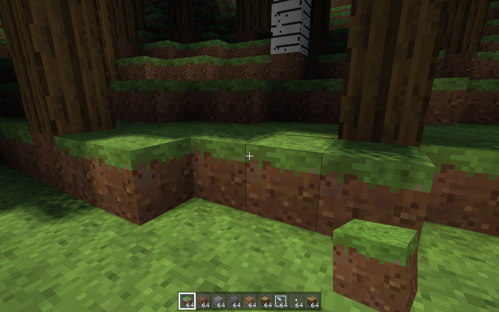

# Blocksmith fast lane

Commit `c495502719989c986796f97d21c7f30ba267b141` on `claude/project-thread-ddeimn`: build **success**, snapshot **success**

Run: https://github.com/remingtonangus-lang/blocksmith/actions/runs/42058187749

### Build errors
```
```
### Type-check (warnings, slowest first)
```
4672 Sources/FreeBuild.swift:50
4221 Sources/Greywall.swift:627
4055 Sources/AshVaultGapTests.swift:134
3964 Sources/ShapeRails.swift:110
3896 Sources/ShapeRails.swift:110
3245 Sources/Trains.swift:206
2544 Sources/InputMatrix.swift:83
2540 Sources/Mesher.swift:1803
2508 Sources/Mesher.swift:1803
2469 Sources/AshSites.swift:63
2339 Sources/Mesher.swift:1803
2173 Sources/NavalGuns.swift:73
1915 Sources/PowerSuit.swift:28
1898 Sources/Structure.swift:68
1829 Sources/NavalGuns.swift:73
1757 Sources/PowerSuit.swift:28
1749 Sources/NavalGuns.swift:73
1704 Sources/NavalGuns.swift:73
1599 Sources/Mesher.swift:1166
1541 Sources/AshSites.swift:295
1300 Sources/TexturesHD.swift:3728
1211 Sources/main.swift:1436
1055 Sources/main.swift:1436
1035 Sources/AdaptiveGround.swift:82
983 Sources/Mob.swift:3028
962 Sources/AdaptiveGround.swift:82
904 Sources/DebrisField.swift:58
848 Sources/Director.swift:462
843 Sources/Mob.swift:3028
836 Sources/Mob.swift:3028
832 Sources/DebrisField.swift:58
792 Sources/Greywall.swift:852
742 Sources/SmoothTerrain.swift:124
738 Sources/CampSmoke.swift:98
735 Sources/Renderer.swift:2874
725 Sources/SmoothTerrain.swift:124
711 Sources/HellLooks.swift:387
690 Sources/Soldiers.swift:705
681 Sources/Soldiers.swift:705
659 Sources/HellMobs.swift:530
```
### Snapshot
```
natural census: 63 sample chunks in 22616 ms
posecheck: clearance measure: 24864 measures, largest difference 0.000000 px, 1369.93 ms in all (before 1311.39 ms)
posecheck: weapon clearance: 330 of 925 poses had the weapon through an arm or the body before clearing; worst after 0.46 px
posecheck: 1034 raised limbs checked, 0 failed
textures: 2032 layers at 16 px, BC3, 0.7 MB with mips (build 1304 ms, upload 579 ms)
target: grass_block at 24 136 28, boxes [(SIMD3<Float>(0.0, 0.0, 0.0), SIMD3<Float>(1.0, 1.0, 1.0))], feet SIMD3<Float>(25.5, 136.0, 31.5)
light probe: eye sky 15 block 0 in air; floor+1 (y 72) sky 15 block 0 in air, daylight 1.0
imagecheck fast.png magenta=0.00000 black=0.0071 white=0.0008 std=39.8 hash=8e2bb75820bbfdf6
imagecheck fast.png magenta=0.00000 black=0.0071 white=0.0008 std=39.8 hash=8e2bb75820bbfdf6
seed 12345  pos 25.5 136.0 31.5  rd 4  chunks 109  (drawn 28)
gen 100077 ms  mesh(all, parallel) 23938 ms  mesh(1 section) 137.15 ms  quads 302646 opaque / 571 water
frame (encode+GPU, offscreen, median of 30) 12.03 ms  biome forest
mesh slabs 12 MB, chunks 109 (block+light arrays 11 MB), Metal allocated 114 MB
memory: resident 160 MB  (section meshes 9 MB)
wrote snaps/fast.png
imagecheck: 1 frames, no flags
```

