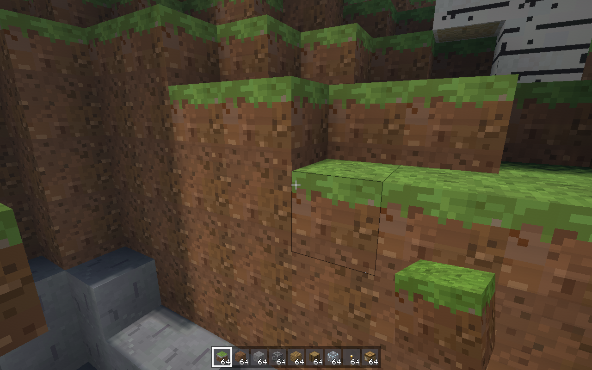

# Blocksmith fast lane

Commit `1521eb8b7f739362e59f5cd769fd4dca047bce9b` on `claude/lane-a-30uc5r`: build **success**, snapshot **success**

Run: https://github.com/remingtonangus-lang/blocksmith/actions/runs/38173277806

### Build errors
```
```
### Type-check (warnings, slowest first)
```
5796 Sources/PlaytestPM9BTests.swift:95
5607 Sources/PlaytestPM9BTests.swift:94
4723 Sources/Mob.swift:493
4626 Sources/RenderDistanceGovernor.swift:129
3686 Sources/AshVaultGapTests.swift:134
3573 Sources/Mob.swift:493
2495 Sources/InputMatrix.swift:83
2116 Sources/AshSites.swift:56
1587 Sources/AshSites.swift:229
869 Sources/main.swift:1415
788 Sources/main.swift:1415
601 Sources/HellMobs.swift:433
596 Sources/HellMobs.swift:433
587 Sources/CapitalShips.swift:1349
585 Sources/CapitalShips.swift:1349
548 Sources/DeepGapTests.swift:331
497 Sources/DeepGapTests.swift:331
389 Sources/main.swift:1415
389 Sources/CapitalBases.swift:295
379 Sources/BaseTests.swift:120
378 Sources/BaseTests.swift:120
373 Sources/Cinematic.swift:141
368 Sources/Cinematic.swift:141
366 Sources/HorseGapTests.swift:355
333 Sources/MainGunTests.swift:452
331 Sources/HorseGapTests.swift:354
326 Sources/HorseGapTests.swift:353
321 Sources/HorseGapTests.swift:353
319 Sources/HorseGapTests.swift:354
307 Sources/ShipCombat.swift:136
281 Sources/LandmarkRender.swift:77
280 Sources/LandmarkRender.swift:77
263 Sources/Cinematic.swift:141
258 Sources/MainGun.swift:397
257 Sources/CountriesTests.swift:191
256 Sources/MainGun.swift:213
250 Sources/BaseTests.swift:120
245 Sources/HorseGapTests.swift:355
240 Sources/Mob.swift:2041
228 Sources/LastWarTests.swift:105
```
### Snapshot
```
posecheck: 898 raised limbs checked, 0 failed
textures: 1809 layers at 16 px, BC3, 0.6 MB with mips (build 1169 ms, upload 507 ms)
target: grass_block at -10 145 26, boxes [(SIMD3<Float>(0.0, 0.0, 0.0), SIMD3<Float>(1.0, 1.0, 1.0))], feet SIMD3<Float>(-8.5, 145.0, 29.5)
light probe: eye sky 15 block 0 in air; floor+1 (y 81) sky 15 block 0 in air, daylight 1.0
imagecheck fast.png magenta=0.00000 black=0.0000 white=0.0008 std=25.0 hash=3410a2b27e40da2c
imagecheck fast.png magenta=0.00000 black=0.0000 white=0.0008 std=25.0 hash=3410a2b27e40da2c
seed 12345  pos -8.5 145.0 29.5  rd 4  chunks 109  (drawn 23)
gen 10964 ms  mesh(all, parallel) 18523 ms  mesh(1 section) 81.34 ms  quads 320803 opaque / 518 water
frame (encode+GPU, offscreen, median of 30) 9.46 ms  biome plains
mesh slabs 12 MB, chunks 109 (block+light arrays 11 MB), Metal allocated 114 MB
memory: resident 150 MB  (section meshes 10 MB)
wrote snaps/fast.png
imagecheck: 1 frames, no flags
```

