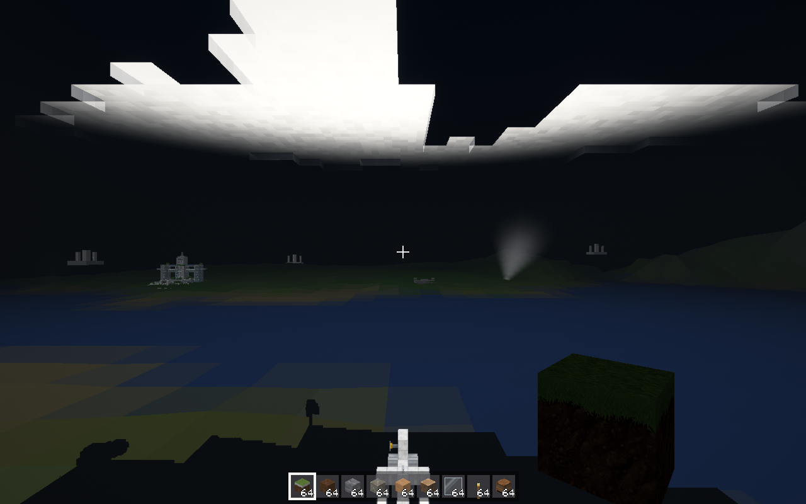

# Blocksmith CI snapshots (heavy lane)

Commit `71c49d2d5e6c6f89af28e83f66c00e7810f037ee` on `claude/quest-port`: build **success**, heavy jobs **failure**
- checks: failure
- perf: failure
- play: failure
- shots: failure
- smoke: success
- tours: failure

Run: https://github.com/remingtonangus-lang/blocksmith/actions/runs/42050849249

```
frame (encode+GPU, offscreen, median of 30) 6.29 ms  biome beach
mesh slabs 28 MB, chunks 297 (block+light arrays 28 MB), Metal allocated 174 MB
memory: resident 245 MB  (section meshes 23 MB)
wrote snaps/leak_12345.png
textures: 2032 layers at 128 px, BC3, 42.4 MB with mips (build 848 ms, upload 339 ms)
light probe: eye sky 15 block 0 in air; floor+1 (y 69) sky 15 block 0 in bush, daylight 1.0
imagecheck agent_door_777.png magenta=0.00000 black=0.0000 white=0.0008 std=46.1 hash=0fa1dac7c631ce30
imagecheck agent_door_777.png magenta=0.00000 black=0.0000 white=0.0008 std=46.1 hash=0fa1dac7c631ce30
seed 777  pos 959.5 138.0 272.5  rd 8  chunks 297  (drawn 84)
gen 2254 ms  mesh(all, parallel) 412 ms  mesh(1 section) 0.29 ms  quads 638278 opaque / 1596 water
frame (encode+GPU, offscreen, median of 30) 4.49 ms  biome plains
mesh slabs 24 MB, chunks 297 (block+light arrays 27 MB), Metal allocated 182 MB
memory: resident 255 MB  (section meshes 20 MB)
wrote snaps/agent_door_777.png
naming audit: 7927 names, 0 flagged
selftest: 1397 blocks, 123 mob kinds, 4/4 special recipes, bundle fill 32/64, 105 advancements
selftest ok: 115 mobs after 3 s
textures: 2032 layers at 128 px, BC3, 42.4 MB with mips (build 863 ms, upload 346 ms)
light probe: eye sky 15 block 0 in air; floor+1 (y 69) sky 15 block 0 in air, daylight 1.0
imagecheck selftest.png magenta=0.00000 black=0.0015 white=0.0570 std=63.0 hash=05010d447a8fe977
imagecheck selftest.png magenta=0.00000 black=0.0015 white=0.0570 std=63.3 hash=82e744cc2d37eb65
seed 12345  pos -87.5 135.0 104.5  rd 8  chunks 322  (drawn 78)
gen 5005 ms  mesh(all, parallel) 337 ms  mesh(1 section) 0.32 ms  quads 708590 opaque / 7118 water
frame (encode+GPU, offscreen, median of 30) 7.48 ms  biome plains
mesh slabs 28 MB, chunks 322 (block+light arrays 30 MB), Metal allocated 202 MB
memory: resident 333 MB  (section meshes 23 MB)
wrote snaps/selftest.png
structure village at -274 71 -1042 (35 pieces, framed)
textures: 2032 layers at 128 px, BC3, 42.4 MB with mips (build 808 ms, upload 324 ms)
light probe: eye sky 15 block 0 in air; floor+1 (y 71) sky 15 block 0 in snow, daylight 1.0
imagecheck flicker_village.png magenta=0.00000 black=0.0000 white=0.0008 std=70.9 hash=9b3735f323a1e8b4 flicker=0.00072
imagecheck flicker_village.png magenta=0.00000 black=0.0000 white=0.0008 std=70.9 hash=9b3735f323a1e8b4 flicker=0.00072
seed 12345  pos -326.5 166.0 -1088.5  rd 8  chunks 297  (drawn 72)
gen 5739 ms  mesh(all, parallel) 446 ms  mesh(1 section) 0.95 ms  quads 1159839 opaque / 1245 water
frame (encode+GPU, offscreen, median of 30) 6.69 ms  biome taiga
mesh slabs 40 MB, chunks 297 (block+light arrays 28 MB), Metal allocated 198 MB
memory: resident 285 MB  (section meshes 35 MB)
wrote snaps/flicker_village.png
textures: 2032 layers at 128 px, BC3, 42.4 MB with mips (build 877 ms, upload 348 ms)
light probe: eye sky 15 block 0 in air; floor+1 (y 90) sky 15 block 0 in air, daylight 1.0
imagecheck flicker_forest.png magenta=0.00000 black=0.0000 white=0.0008 std=59.2 hash=10f4054dbf4dad59 flicker=0.00007
imagecheck flicker_forest.png magenta=0.00000 black=0.0000 white=0.0008 std=59.2 hash=10f4054dbf4dad59 flicker=0.00007
seed 12345  pos -135.5 176.0 -39.5  rd 8  chunks 297  (drawn 81)
gen 6858 ms  mesh(all, parallel) 458 ms  mesh(1 section) 1.34 ms  quads 1088514 opaque / 280 water
frame (encode+GPU, offscreen, median of 30) 7.67 ms  biome forest
mesh slabs 40 MB, chunks 297 (block+light arrays 31 MB), Metal allocated 186 MB
memory: resident 272 MB  (section meshes 33 MB)
wrote snaps/flicker_forest.png
textures: 2032 layers at 128 px, BC3, 42.4 MB with mips (build 801 ms, upload 330 ms)
light probe: eye sky 15 block 6 in air; floor+1 (y 70) sky 15 block 0 in short_grass, daylight 1.0
imagecheck flicker_build.png magenta=0.00000 black=0.0000 white=0.0014 std=46.4 hash=4c530026b5f24dd9 flicker=0.00020
imagecheck flicker_build.png magenta=0.00000 black=0.0000 white=0.0014 std=46.4 hash=4c530026b5f24dd9 flicker=0.00020
seed 12345  pos -87.5 140.0 104.5  rd 8  chunks 297  (drawn 75)
gen 5043 ms  mesh(all, parallel) 318 ms  mesh(1 section) 0.39 ms  quads 708795 opaque / 7124 water
frame (encode+GPU, offscreen, median of 30) 5.10 ms  biome plains
mesh slabs 28 MB, chunks 297 (block+light arrays 27 MB), Metal allocated 186 MB
memory: resident 256 MB  (section meshes 22 MB)
wrote snaps/flicker_build.png
imagecheck: 201 frames, no flags
snap.sh: 4 failing line(s): 379 383 385 393
```
### Benchmarks (vs perf/baseline.json)
```
bench: device Apple Paravirtual device, 3 cores, seed 12345
bench: calibration 2.26 ms (min 2.01, max 3.96) [0]
bench: gen starts
bench gen: structure starts for the sample (cold) 0.89 ms/chunk
bench gen slow chunk -80,-25: 1135.8 ms (trees 50.2, caves 0.9, ores 0.7; starts 2340.6, place 1083.1)
bench gen slow chunk -24,-21: 259.4 ms (caves 0.7, trees 0.5, ores 0.4; starts 797.5, place 257.1)
bench gen slow chunk -73,-12: 32.9 ms (starts 7.9, plants 2.2, caves 0.5; starts 40.5, place 21.5)
bench gen phases (ms/chunk): columns 0.24, stone 0.25, surface 0.03, caves 0.95, ores 0.36, trees 3.22, plants 0.23, starts 0.55, structures 57.13
bench gen structure starts (ms over 24 chunks): military_base 894.3, capital_city 736.5, village 639.1, greywall_base 221.4, wild_camp 185.6, frontier_site 143.8, pillager_outpost 127.0, temple 111.9
bench gen: stone-fill interpolation vs Lattice.sample: 0 mismatching samples (must be 0)
bench gen: 63.05 ms/chunk (p95 259.37, max 1135.78) single-thread | 136 chunks/s parallel
bench: gen took 3.0 s (live worlds 0, games 0)
bench: mesh starts
bench mesh: 7.37 ms/chunk (24 sections, 81 non-empty), section mean 307 us p95 1182 us max 4107 us, 4430 quads/chunk
bench mesh_lod1: 7.66 ms/chunk (24 sections, 80 non-empty), section mean 319 us p95 1368 us max 2211 us, 2359 quads/chunk
bench: mesh took 2.6 s (live worlds 0, games 0)
bench: startup starts
bench startup: world+game init 27 ms, first load (r 4) 794 ms, renderer 3106 ms (textures 1152 ms, shaders 1 ms), fill rd 12 3.68 s
bench: startup took 11.1 s (live worlds 1, games 0)
bench: frame starts
bench frame 800p rd 16: encode p50 1.19 ms, GPU p50 4.33 ms (max 5.10), 260 chunks drawn
bench frame 1080p rd 16: encode p50 1.49 ms, GPU p50 4.98 ms (max 5.67), 270 chunks drawn
bench frame 4k rd 16: encode p50 1.55 ms, GPU p50 7.81 ms (max 23.54), 270 chunks drawn
bench frame: 719 visible sections, 1316 draw calls, 207k quads
bench: frame took 6.5 s (live worlds 1, games 0)
bench: edit starts
bench edit: break mean 1.39 ms max 4.20 ms, place mean 1.28 ms max 2.58 ms (synchronous remesh)
bench: edit took 1.5 s (live worlds 1, games 0)
bench: mobs starts
bench mobs: tick 0.19 ms empty, 0.95 ms with 150 mobs (p95 2.33, max 4.02), 156 alive
bench: mobs took 1.7 s (live worlds 1, games 0)
bench: save starts
bench save: 145 chunks, save 2.53 ms/chunk (main thread 28.3 ms total, unchanged re-save 2.2 ms), load 0.37 ms/chunk (145 ok), 7.0 KB/chunk
bench: save took 3.2 s (live worlds 1, games 0)
bench: tnt starts
bench tnt: blast mean 1.09 ms max 4.04 ms (main thread) | re-mesh done in 0.11 s, tick p95 3.46 max 3.46 ms
bench: tnt took 1.5 s (live worlds 1, games 0)
bench: fluids starts
bench fluids: tick p50 0.29 p95 0.81 max 2.43 ms, 1785 sections re-meshed in 6 s, 14 cells still pending
bench: fluids took 7.5 s (live worlds 1, games 0)
bench: ships starts
bench ships: edit remesh 4.28 ms, blast 1.89 ms + remesh 6.32 ms (3034 blocks left, 1 pieces split off)
bench ships: drawing two vessels at 1080p adds -0.13 ms encode, 0.14 ms GPU (68 draw calls)
bench ships: docked 3084 blocks in 28.20 ms (world remesh 0.20 s), assembled 3060 in 68.56 ms
bench ships: frigate 3034 blocks spawn 1.63 ms, mesh 8.16 ms; tick 0.43 ms (p95 1.15), physics 0.26 ms; collide 1.08 us near ships, 0.26 us far; 11 ships
bench: ships took 4.3 s (live worlds 1, games 0)
bench: worlds still alive after the scenes: 1
bench: live world: jobs 0, queue ops 0, gen in flight 0, results 0/0, chunks 593
bench: wrote 105 metrics to snaps/bench_part_0.json
bench: device Apple Paravirtual device, 3 cores, seed 12345
bench: flight8 starts
bench flight8: frame p50 2.65 p95 6.10 p99 14.12 max 53.90 ms, 1 hitches >25 ms | tick p95 1.35 (update p95 0.79, max 3.09) encode p95 1.63 GPU p95 5.80 ms
bench flight8: coverage min 92% mean 99% | gen 24 chunks/s (3.2 ms each on a worker) mesh 619 sections/s (333 us each) | realtime 1.00x
bench flight8: 328 chunks, chunk data 26 MB, meshes 20 MB (slabs 32 MB), resident peak 225 MB, preload 1359 ms
bench: flight8 took 16.5 s (live worlds 0, games 0)
bench: worlds still alive after the scenes: 0
bench: wrote 36 metrics to snaps/bench_part_flight8.json
bench: device Apple Paravirtual device, 3 cores, seed 12345
bench: flight16 starts
bench flight16: frame p50 3.94 p95 6.80 p99 12.02 max 23.48 ms, 0 hitches >25 ms | tick p95 2.37 (update p95 1.73, max 7.41) encode p95 3.37 GPU p95 5.72 ms
bench flight16: coverage min 96% mean 99% | gen 82 chunks/s (3.1 ms each on a worker) mesh 2095 sections/s (234 us each) | realtime 1.00x
bench flight16: 1056 chunks, chunk data 62 MB, meshes 35 MB (slabs 52 MB), resident peak 335 MB, preload 3348 ms
bench: flight16 took 18.6 s (live worlds 0, games 0)
bench: worlds still alive after the scenes: 0
bench: wrote 36 metrics to snaps/bench_part_flight16.json
bench: device Apple Paravirtual device, 3 cores, seed 12345
bench: flight24 starts
bench flight24: frame p50 6.19 p95 11.89 p99 17.98 max 54.92 ms, 2 hitches >25 ms | tick p95 2.85 (update p95 2.35, max 37.88) encode p95 6.81 GPU p95 10.22 ms
bench flight24: coverage min 97% mean 99% | gen 109 chunks/s (3.2 ms each on a worker) mesh 2578 sections/s (244 us each) | realtime 1.00x
bench flight24: 2176 chunks, chunk data 74 MB, meshes 62 MB (slabs 76 MB), resident peak 450 MB, preload 5975 ms
bench: flight24 took 20.9 s (live worlds 0, games 0)
bench: worlds still alive after the scenes: 0
bench: wrote 36 metrics to snaps/bench_part_flight24.json
bench: merged 207 metrics into snaps/bench.json
```
| metric | baseline | now | worse by |
|---|---|---|---|
| edit.break_ms_max | 0.6 | 4.199 | 7.00x ⚠️ worse |
| edit.break_ms_mean | 0.447 | 1.393 | 3.12x ⚠️ worse |
| edit.break_ms_p50 | 0.595 | 0.924 | 1.55x ⚠️ worse |
| edit.place_ms_max | 0.732 | 2.576 | 3.52x ⚠️ worse |
| edit.place_ms_mean | 0.455 | 1.278 | 2.81x ⚠️ worse |
| edit.place_ms_p50 | 0.595 | 0.934 | 1.57x ⚠️ worse |
| flight16.arena_free_mb | 0.864 | 11.688 | 13.53x ⚠️ worse |
| flight16.chunk_mb | 103.906 | 62.43 | 0.60x ✅ better |
| flight16.chunks | 1056 | 1056 | 1.00x |
| flight16.coverage_mean | 0.991 | 0.99 | 1.00x |
| flight16.coverage_min | 0.962 | 0.962 | 1.00x |
| flight16.cull_ms_p50 | 0.708 | 0.548 | 0.77x |
| flight16.cull_ms_p95 | 1.152 | 1.36 | 1.18x |
| flight16.cull_walked_sections | 2817 | 1836 | 0.65x ✅ better |
| flight16.draw_calls | 1434 | 989 | 0.69x ✅ better |
| flight16.drawn_kquads | 475.516 | 119.771 | 0.25x ✅ better |
| flight16.encode_ms_p50 | 1.494 | 1.318 | 0.88x |
| flight16.encode_ms_p95 | 2.361 | 3.372 | 1.43x ⚠️ worse |
| flight16.frame_ms_max | 12.652 | 23.484 | 1.86x ⚠️ worse |
| flight16.frame_ms_p50 | 4.807 | 3.935 | 0.82x |
| flight16.frame_ms_p95 | 5.8 | 6.797 | 1.17x |
| flight16.frame_ms_p99 | 7.443 | 12.022 | 1.62x ⚠️ worse |
| flight16.gen_chunks_per_s | 43.68 | 81.521 | 0.54x ✅ better |
| flight16.gpu_ms_p50 | 4.804 | 3.843 | 0.80x |
| flight16.gpu_ms_p95 | 5.71 | 5.715 | 1.00x |
| flight16.hitches | 0 | 0 | 1.00x |
| flight16.mesh_mb | 81.28 | 34.844 | 0.43x ✅ better |
| flight16.mesh_sections_per_s | 1972.83 | 2094.98 | 0.94x |
| flight16.preload_ms | 1871.23 | 3348.46 | 1.79x ⚠️ worse |
| flight16.realtime | 0.998 | 0.999 | 1.00x |
| flight16.resident_peak_mb | 285.862 | 335.362 | 1.17x |
| flight16.slab_mb | 96 | 52 | 0.54x ✅ better |
| flight16.tick_ms_max | 8.551 | 21.902 | 2.56x ⚠️ worse |
| flight16.tick_ms_p50 | 0.388 | 0.526 | 1.36x ⚠️ worse |
| flight16.tick_ms_p95 | 2.08 | 2.374 | 1.14x |
| flight16.update_ms_max | 8.289 | 7.415 | 0.89x |
| flight16.update_ms_p50 | 0.017 | 0.176 | 10.35x ⚠️ worse |
| flight16.update_ms_p95 | 1.74 | 1.726 | 0.99x |
| flight16.worker_gen_ms | 2.022 | 3.066 | 1.52x ⚠️ worse |
| flight16.worker_mesh_us | 177.949 | 233.835 | 1.31x ⚠️ worse |
| flight24.arena_free_mb | 0.427 | 4.677 | 10.95x ⚠️ worse |
| flight24.chunk_mb | 222.438 | 73.531 | 0.33x ✅ better |
| flight24.chunks | 2176 | 2176 | 1.00x |
| flight24.coverage_mean | 0.994 | 0.991 | 1.00x |
| flight24.coverage_min | 0.974 | 0.974 | 1.00x |
| flight24.cull_ms_p50 | 1.198 | 1.66 | 1.39x ⚠️ worse |
| flight24.cull_ms_p95 | 2.767 | 3.537 | 1.28x |
| flight24.cull_walked_sections | 7607 | 5485 | 0.72x ✅ better |
| flight24.draw_calls | 3175 | 2559 | 0.81x |
| flight24.drawn_kquads | 821.704 | 264.131 | 0.32x ✅ better |
| flight24.encode_ms_p50 | 2.473 | 3.222 | 1.30x ⚠️ worse |
| flight24.encode_ms_p95 | 5.237 | 6.811 | 1.30x ⚠️ worse |
| flight24.frame_ms_max | 13.319 | 54.918 | 4.12x ⚠️ worse |
| flight24.frame_ms_p50 | 7.72 | 6.194 | 0.80x |
| flight24.frame_ms_p95 | 9.472 | 11.893 | 1.26x |
| flight24.frame_ms_p99 | 10.337 | 17.977 | 1.74x ⚠️ worse |
| flight24.gen_chunks_per_s | 63.73 | 108.646 | 0.59x ✅ better |
| flight24.gpu_ms_p50 | 7.718 | 5.953 | 0.77x |
| flight24.gpu_ms_p95 | 9.428 | 10.217 | 1.08x |
| flight24.hitches | 0 | 2 | infx ⚠️ worse |
| flight24.mesh_mb | 131.138 | 62.115 | 0.47x ✅ better |
| flight24.mesh_sections_per_s | 2455.22 | 2577.68 | 0.95x |
| flight24.preload_ms | 4742.83 | 5975.04 | 1.26x |
| flight24.realtime | 1 | 1 | 1.00x |
| flight24.resident_peak_mb | 512.018 | 450.394 | 0.88x |
| flight24.slab_mb | 148 | 76 | 0.51x ✅ better |
| flight24.tick_ms_max | 11.61 | 52.462 | 4.52x ⚠️ worse |
| flight24.tick_ms_p50 | 0.401 | 0.73 | 1.82x ⚠️ worse |
| flight24.tick_ms_p95 | 2.942 | 2.854 | 0.97x |
| flight24.update_ms_max | 4.586 | 37.883 | 8.26x ⚠️ worse |
| flight24.update_ms_p50 | 0.015 | 0.378 | 25.20x ⚠️ worse |
| flight24.update_ms_p95 | 2.535 | 2.355 | 0.93x |
| flight24.worker_gen_ms | 2.355 | 3.236 | 1.37x ⚠️ worse |
| flight24.worker_mesh_us | 177.947 | 243.783 | 1.37x ⚠️ worse |
| flight8.arena_free_mb | 2.438 | 7.344 | 3.01x ⚠️ worse |
| flight8.chunk_mb | 30.25 | 25.992 | 0.86x |
| flight8.chunks | 328 | 328 | 1.00x |
| flight8.coverage_mean | 0.99 | 0.994 | 1.00x |
| flight8.coverage_min | 0.924 | 0.924 | 1.00x |
| flight8.cull_ms_p50 | 0.204 | 0.113 | 0.55x ✅ better |
| flight8.cull_ms_p95 | 0.305 | 0.281 | 0.92x |
| flight8.cull_walked_sections | 517 | 359 | 0.69x ✅ better |
| flight8.draw_calls | 463 | 335 | 0.72x ✅ better |
| flight8.drawn_kquads | 211.463 | 78.865 | 0.37x ✅ better |
| flight8.encode_ms_p50 | 0.562 | 0.645 | 1.15x |
| flight8.encode_ms_p95 | 0.832 | 1.627 | 1.96x ⚠️ worse |
| flight8.frame_ms_max | 13.232 | 53.9 | 4.07x ⚠️ worse |
| flight8.frame_ms_p50 | 2.588 | 2.648 | 1.02x |
| flight8.frame_ms_p95 | 3.197 | 6.1 | 1.91x ⚠️ worse |
| flight8.frame_ms_p99 | 4.401 | 14.121 | 3.21x ⚠️ worse |
| flight8.gen_chunks_per_s | 23.603 | 23.726 | 0.99x |
| flight8.gpu_ms_p50 | 2.579 | 2.627 | 1.02x |
| flight8.gpu_ms_p95 | 3.081 | 5.801 | 1.88x ⚠️ worse |
| flight8.hitches | 0 | 1 | infx ⚠️ worse |
| flight8.mesh_mb | 40.975 | 20.229 | 0.49x ✅ better |
| flight8.mesh_sections_per_s | 506.848 | 619.363 | 0.82x |
| flight8.preload_ms | 1398.04 | 1359.08 | 0.97x |
| flight8.realtime | 0.994 | 0.999 | 0.99x |
| flight8.resident_peak_mb | 124.705 | 225.236 | 1.81x ⚠️ worse |
| flight8.slab_mb | 52 | 32 | 0.62x ✅ better |
| flight8.tick_ms_max | 12.539 | 22.123 | 1.76x ⚠️ worse |
| flight8.tick_ms_p50 | 0.158 | 0.393 | 2.49x ⚠️ worse |
| flight8.tick_ms_p95 | 1.223 | 1.351 | 1.10x |
| flight8.update_ms_max | 12.421 | 3.088 | 0.25x ✅ better |
| flight8.update_ms_p50 | 0.01 | 0.022 | 2.20x ⚠️ worse |
| flight8.update_ms_p95 | 0.869 | 0.791 | 0.91x |
| flight8.worker_gen_ms | 3.236 | 3.199 | 0.99x |
| flight8.worker_mesh_us | 181.115 | 332.891 | 1.84x ⚠️ worse |
| fluids.pending | 240 | 14 | 0.06x ✅ better |
| fluids.remeshed_sections | 2605 | 1785 | 0.69x ✅ better |
| fluids.tick_ms_max | 3.42 | 2.435 | 0.71x ✅ better |
| fluids.tick_ms_p50 | 0.226 | 0.285 | 1.26x |
| fluids.tick_ms_p95 | 1.872 | 0.806 | 0.43x ✅ better |
| frame.draw_calls | 1076 | 1316 | 1.22x |
| frame.drawn_chunks | 272 | 270 | 0.99x |
| frame.drawn_kquads | 178.99 | 207.513 | 1.16x |
| frame.mesh_mb | 57.324 | 43.345 | 0.76x ✅ better |
| frame.visible_sections | 686 | 719 | 1.05x |
| frame_1080p.encode_ms_max | 1.123 | 3.956 | 3.52x ⚠️ worse |
| frame_1080p.encode_ms_p50 | 0.625 | 1.492 | 2.39x ⚠️ worse |
| frame_1080p.gpu_ms_max | 2.632 | 5.67 | 2.15x ⚠️ worse |
| frame_1080p.gpu_ms_p50 | 2.308 | 4.983 | 2.16x ⚠️ worse |
| frame_4k.encode_ms_max | 1.603 | 3.183 | 1.99x ⚠️ worse |
| frame_4k.encode_ms_p50 | 0.691 | 1.554 | 2.25x ⚠️ worse |
| frame_4k.gpu_ms_max | 4.083 | 23.542 | 5.77x ⚠️ worse |
| frame_4k.gpu_ms_p50 | 3.521 | 7.812 | 2.22x ⚠️ worse |
| frame_800p.encode_ms_max | 0.755 | 3.984 | 5.28x ⚠️ worse |
| frame_800p.encode_ms_p50 | 0.608 | 1.187 | 1.95x ⚠️ worse |
| frame_800p.gpu_ms_max | 2.405 | 5.1 | 2.12x ⚠️ worse |
| frame_800p.gpu_ms_p50 | 2.068 | 4.329 | 2.09x ⚠️ worse |
| gen.chunk_ms_max | 3.382 | 1135.78 | 335.83x ⚠️ worse |
| gen.chunk_ms_mean | 2.082 | 63.051 | 30.28x ❌ regression |
| gen.chunk_ms_p95 | 3.325 | 259.375 | 78.01x ⚠️ worse |
| gen.lattice_mismatches | 0 | 0 | 1.00x |
| gen.parallel_chunks_per_s | 1683.33 | 136.452 | 12.34x ⚠️ worse |
| gen.starts_cold_ms | – | 0.886 | new |
| gen.terrain_hash | 1238443285367868 | 163195936105986 | ⚠️ changed |
| genphase.caves_ms | – | 0.947 | new |
| genphase.columns_ms | – | 0.244 | new |
| genphase.ores_ms | – | 0.358 | new |
| genphase.plants_ms | – | 0.233 | new |
| genphase.starts_ms | – | 0.549 | new |
| genphase.stone_ms | – | 0.247 | new |
| genphase.structures_ms | – | 57.134 | new |
| genphase.surface_ms | – | 0.027 | new |
| genphase.trees_ms | – | 3.225 | new |
| mesh.chunk_ms_max | 5.758 | 10.038 | 1.74x ⚠️ worse |
| mesh.chunk_ms_mean | 4.38 | 7.368 | 1.68x ⚠️ worse |
| mesh.quads_per_chunk | 4996 | 4430.11 | 0.89x |
| mesh.section_us_max | 1621.01 | 4107 | 2.53x ⚠️ worse |
| mesh.section_us_mean | 139.451 | 307.012 | 2.20x ⚠️ worse |
| mesh.section_us_p95 | 686.049 | 1181.96 | 1.72x ⚠️ worse |
| mesh_lod1.chunk_ms_max | 5.44 | 9.81 | 1.80x ⚠️ worse |
| mesh_lod1.chunk_ms_mean | 4.1 | 7.658 | 1.87x ❌ regression |
| mesh_lod1.quads_per_chunk | 2535 | 2359.33 | 0.93x |
| mesh_lod1.section_us_max | 1477.96 | 2210.97 | 1.50x ⚠️ worse |
| mesh_lod1.section_us_mean | 126.754 | 319.095 | 2.52x ⚠️ worse |
| mesh_lod1.section_us_p95 | 568.032 | 1368.05 | 2.41x ⚠️ worse |
| mobs.per_mob_us | 1.608 | 5.039 | 3.13x ⚠️ worse |
| mobs.tick_150_ms_max | 1.25 | 4.018 | 3.21x ⚠️ worse |
| mobs.tick_150_ms_mean | 0.272 | 0.946 | 3.48x ⚠️ worse |
| mobs.tick_150_ms_p95 | 0.439 | 2.328 | 5.30x ⚠️ worse |
| mobs.tick_base_ms_mean | 0.031 | 0.191 | 6.16x ⚠️ worse |
| mobs.tick_base_ms_p95 | 0.082 | 0.732 | 8.93x ⚠️ worse |
| save.chunk_kb | 4.471 | 7.015 | 1.57x ⚠️ worse |
| save.chunk_ms | 2.896 | 2.527 | 0.87x |
| save.load_chunk_ms | 0.587 | 0.371 | 0.63x ✅ better |
| save.main_thread_ms | 5.206 | 28.252 | 5.43x ⚠️ worse |
| save.unchanged_resave_ms | 2.544 | 2.189 | 0.86x |
| ships.assemble_ms | 19.313 | 68.563 | 3.55x ⚠️ worse |
| ships.assemble_remesh_s | 0.027 | 0.026 | 0.96x |
| ships.blast_ms | 2.675 | 1.894 | 0.71x ✅ better |
| ships.blast_remesh_ms | 5.466 | 6.315 | 1.16x |
| ships.collide_far_us | 0.214 | 0.264 | 1.23x |
| ships.collide_us | 1.047 | 1.076 | 1.03x |
| ships.dock_ms | 12.056 | 28.195 | 2.34x ⚠️ worse |
| ships.dock_remesh_s | 0.036 | 0.202 | 5.61x ⚠️ worse |
| ships.draw_calls | 66 | 68 | 1.03x |
| ships.edit_ms_max | 0.887 | 1.011 | 1.14x |
| ships.edit_ms_mean | 0.505 | 0.491 | 0.97x |
| ships.edit_remesh_ms | 3.642 | 4.28 | 1.18x |
| ships.frame_encode_ms | 0.023 | -0.132 | -5.74x ✅ better |
| ships.frame_gpu_ms | -0.228 | 0.139 | infx ⚠️ worse |
| ships.mesh_frigate_ms | 3.066 | 8.157 | 2.66x ⚠️ worse |
| ships.physics_ms_mean | 0.165 | 0.261 | 1.58x ⚠️ worse |
| ships.physics_ms_p95 | 0.213 | 0.648 | 3.04x ⚠️ worse |
| ships.spawn_frigate_ms | 2.358 | 1.627 | 0.69x ✅ better |
| ships.tick_ms_max | 0.522 | 3.383 | 6.48x ⚠️ worse |
| ships.tick_ms_mean | 0.219 | 0.431 | 1.97x ⚠️ worse |
| ships.tick_ms_p95 | 0.302 | 1.15 | 3.81x ⚠️ worse |
| startup.fill_rd12_s | 4.324 | 3.684 | 0.85x |
| startup.first_load_ms | 206.958 | 794.016 | 3.84x ⚠️ worse |
| startup.renderer_init_again_ms | 27.582 | 1971.67 | 71.48x ⚠️ worse |
| startup.renderer_init_ms | 817.522 | 3105.89 | 3.80x ⚠️ worse |
| startup.shader_compile_ms | 0.347 | 0.832 | 2.40x ⚠️ worse |
| startup.since_launch_s | 5.923 | 16.511 | 2.79x ⚠️ worse |
| startup.textures_ms | 26.537 | 1152.42 | 43.43x ⚠️ worse |
| startup.world_init_ms | 2.198 | 27.135 | 12.35x ⚠️ worse |
| tnt.blast_ms_max | 8.579 | 4.038 | 0.47x ✅ better |
| tnt.blast_ms_mean | 2.904 | 1.09 | 0.38x ✅ better |
| tnt.remesh_s | 0.087 | 0.109 | 1.25x |
| tnt.tick_ms_max | 5.414 | 3.462 | 0.64x ✅ better |
| tnt.tick_ms_p50 | 4.529 | 0.889 | 0.20x ✅ better |
| tnt.tick_ms_p95 | 5.414 | 3.462 | 0.64x ✅ better |

**Regressions past the CI gate:**

- gen.chunk_ms_mean: 2.082 -> 63.051 (30.28x worse, 27.30x for runner speed, gate 1.6x)
- mesh_lod1.chunk_ms_mean: 4.1 -> 7.658 (1.87x worse, 1.68x for runner speed, gate 1.6x)
### Smoke test
```
smoke rd 8 mob drawing: mobs 40 (2 within 32), 8232 vertices written, 8232 drawn via Fancy buffer, 36 culled, 0 dropped (buffer full)
smoke rd 8 memory: chunks alive 430, loaded 430; stashed mobs 0; map cells 2430; block entities 3; gravity queue 0; fluid pending 33; jobs 0; NaN quarantined: player 0, mobs 0, ships 0
smoke rd 8 split: t 30 s player 2 at 4721.8 124.6 1685.3 ground no water yes menu none
smoke rd 8 Fancy: 40 s, frame 10.6 ms, resident 402 MB, Metal 272 MB, mobs 29, coverage 100%
smoke rd 8 mob drawing: mobs 29 (0 within 32), 5352 vertices written, 5352 drawn via Fancy buffer, 15 culled, 0 dropped (buffer full)
smoke rd 8 memory: chunks alive 680, loaded 680; stashed mobs 40; map cells 13660; block entities 5; gravity queue 0; fluid pending 0; jobs 0; NaN quarantined: player 0, mobs 0, ships 0
smoke rd 8 split: t 40 s player 2 at 4735.3 121.0 1668.5 ground yes water yes menu none
smoke rd 8 Fancy: 50 s, frame 12.8 ms, resident 402 MB, Metal 272 MB, mobs 55, coverage 92%
smoke rd 8 mob drawing: mobs 55 (0 within 32), 7308 vertices written, 7308 drawn via Fancy buffer, 35 culled, 0 dropped (buffer full)
smoke rd 8 memory: chunks alive 650, loaded 650; stashed mobs 111; map cells 25120; block entities 21; gravity queue 0; fluid pending 0; jobs 16; NaN quarantined: player 0, mobs 0, ships 0
smoke rd 8 split: t 50 s player 2 at 4748.7 119.0 1651.9 ground yes water yes menu none
smoke rd 8 Fancy: 60 s, frame 13.7 ms, resident 391 MB, Metal 272 MB, mobs 23, coverage 93%
smoke rd 8 mob drawing: mobs 23 (0 within 32), 4794 vertices written, 4794 drawn via Fancy buffer, 13 culled, 0 dropped (buffer full)
smoke rd 8 memory: chunks alive 664, loaded 664; stashed mobs 192; map cells 36545; block entities 36; gravity queue 0; fluid pending 0; jobs 15; NaN quarantined: player 0, mobs 0, ships 0
smoke rd 8: worst frame 680 ms at 0.0 s (frame 0): Game.tick 15 ms, render + GPU 665 ms; frames over 100 ms: 1
smoke rd 8: 3600 frames in 60.0 s wall, frame p50 13.05 p95 21.71 p99 44.69 max 680.08 ms, coverage min 77%, mobs max 55, travelled 3220 blocks, resident peak 403 MB, menu closed
smoke rd 8: mobs dropped for a full mob buffer: at most 0 in a frame (the farthest first)
smoke rd 8 split screen: player 2 moved 133 blocks
smoke rd 8 split screen: PASS
smoke: PASS at render distance 8 16 24 24f 8c
```
### Playthrough
```
INFO wyrm fight: player took 96 damage (half-hearts, healed by the test)
PASS wyrm: death sequence finishes
FAIL wyrm: 12000 XP (0 points, level 0 -> 0)
PASS wyrm: gone after dying
PASS exit portal: active (24 gate blocks)
PASS egg: the wyrm egg sits on the exit portal (4)
PASS rift: a hollow rift gateway opened on the ring
---- egg (34.9 s wall, 1144 s game)
INFO field aim at -10 122 -2 (built layer air, density 5): eye -8.50 122.63 -1.50 (field -0.59) meets -10 122 -2 (field at -9.43 122.51 -1.50, t 0.94)
INFO field aim at 4 123 12 (built layer air, density 5): eye 5.50 123.63 12.50 (field -0.66) meets 4 123 12 (field at 4.56 123.51 12.50, t 0.95)
INFO field aim at 19 123 20 (built layer air, density 5): eye 20.50 123.63 20.50 (field -0.70) meets 19 123 20 (field at 19.56 123.51 20.50, t 0.95)
INFO field aim at 21 122 12 (built layer air, density 5): eye 22.50 122.63 12.50 (field -0.49) meets 21 122 12 (field at 21.57 122.51 12.50, t 0.94)
INFO field aim at 23 122 11 (built layer air, density 5): eye 24.50 122.63 11.50 (field -0.47) meets 23 122 11 (field at 23.57 122.51 11.50, t 0.94)
INFO field aim at 13 122 2 (built layer air, density 5): eye 14.50 122.63 2.50 (field -0.60) meets 13 122 2 (field at 13.57 122.51 2.50, t 0.94)
INFO field aim at 26 123 7 (built layer air, density 5): eye 27.50 123.63 7.50 (field -0.69) meets 26 123 7 (field at 26.20 123.46 7.50, t 1.31)
INFO field aim at 38 122 17 (built layer air, density 5): eye 39.50 122.63 17.50 (field -0.50) meets 38 122 17 (field at 38.57 122.51 17.50, t 0.94)
INFO field aim at 36 123 20 (built layer air, density 4): eye 37.50 123.63 20.50 (field -0.69) meets 36 123 20 (field at 36.20 123.46 20.50, t 1.31)
INFO field aim at 26 123 18 (built layer air, density 5): eye 27.50 123.63 18.50 (field -0.72) meets 26 123 18 (field at 26.56 123.51 18.50, t 0.95)
PASS egg: hitting the egg makes it teleport (20 hops)
FAIL egg: collected by dropping it onto a torch (0)
INFO egg: last attempt: egg at 26 59 18 on torch over end_stone: no torch spot
INFO bulk: +1 dragon_egg (egg)
---- rift (37.8 s wall, 1240 s game)
INFO bulk: +2 ender_pearl (spare pearls)
PASS rift: teleports to the far islands (1040 blocks out)
PASS rift: landed on solid ground (end_stone)
PASS rift: a return rift near the landing spot
---- hollow spire (38.0 s wall, 1243 s game)
PASS spire: nearest hollow spire 1371 blocks from the landing spot (with ship)
INFO spire: 6 shellsentries
PASS spire: the ship's hold has a jetpack
PASS jetpack: 3 s of jump held lifts the player 19 blocks off the spire
PASS rift: the return rift leads back to the central island (90 blocks out)
---- save + reload (39.4 s wall, 1248 s game)
PASS reload: back in the Hollow (end)
PASS reload: wyrm stays defeated (true, 1 rifts)
PASS reload: the egg is still in the inventory
PASS reload: exit portal still open (24)
PASS reload: no new wyrm appears
---- credits (39.9 s wall, 1248 s game)
PASS exit portal: the credits roll
PASS credits: back on the Surface after the credits
PASS credits: at the spawn point
PASS credits: alive at home
---- blight (41.2 s wall, 1307 s game)
PASS blight: retired, nothing summons it (P292)
INFO bulk: +1 nether_star (a Brand Commander's star)
INFO bulk: +5 glass (sand + furnace)
INFO bulk: +3 obsidian (obsidian)
PASS craft: beacon from the Brand Star
---- deep: through the floor (41.2 s wall, 1307 s game)
INFO bulk: +1 netherite_pickaxe (Duskium gear)
INFO bulk: +1 netherite_sword (Duskium gear)
INFO bulk: +1 golden_helmet (armour)
INFO bulk: +1 diamond_chestplate (armour)
INFO bulk: +1 diamond_leggings (armour)
INFO bulk: +1 diamond_boots (armour)
PASS armour: 19 armour points worn
INFO bulk: dug a shaft 124 blocks down to the Wardstone floor
PASS deep: the bottom of the surface is Wardstone (wardstone)
INFO field aim at 4709 2 1763 (built layer air, density 8): eye 4710.50 2.63 1763.50 (field -0.48) meets 4709 2 1763 (field at 4709.92 2.55 1763.50, t 0.59)
INFO field mine at 4709 2 1763: on target 80 of 80 ticks, body moved up to 0.00 in a tick, progress 0.00, no other target
PASS deep: a Duskium pickaxe can't break the Wardstone
INFO bulk: +1 ember_charge (a base's command chest)
PASS deep: an Ember Charge blows the floor and the player drops into the Deep (charge set true, Bottom of the World)
---- deep: the hell band (59.3 s wall, 1314 s game)
INFO field aim at 4709 380 1763 (built layer air, density 5): eye 4710.50 380.63 1763.50 (field -0.59) meets 4709 380 1763 (field at 4709.56 380.51 1763.50, t 0.95)
INFO field aim at 4709 379 1763 (built layer air, density 5): eye 4710.50 379.63 1763.50 (field -0.60) meets 4709 379 1763 (field at 4709.56 379.51 1763.50, t 0.95)
INFO field aim at 4709 378 1763 (built layer air, density 5): eye 4710.50 378.63 1763.50 (field -0.62) meets 4709 378 1763 (field at 4709.56 378.51 1763.50, t 0.95)
INFO field aim at 4709 377 1763 (built layer air, density 5): eye 4710.50 377.63 1763.50 (field -0.62) meets 4709 377 1763 (field at 4709.56 377.51 1763.50, t 0.95)
INFO field aim at 4709 376 1763 (built layer air, density 5): eye 4710.50 376.63 1763.50 (field -0.62) meets 4709 376 1763 (field at 4709.56 376.51 1763.50, t 0.95)
INFO dug 5 blocks of crust
PASS deep: in the hell band (Under the Fire Sky)
PASS deep: the compass points to a Brimstone Keep 499 blocks off
INFO bulk: rode 499 blocks across the hell band to the keep
---- deep: the Castellan (60.1 s wall, 1322 s game)
INFO bulk: fought through 16 of the keep's guards to the strongroom
PASS deep: the Castellan falls to the sword (98 swings, 69 s)
PASS deep: Castellan's Fall: the Ember Gate wakes (true) and the Gate Shard is picked up (1)
---- deep: Sunderite (62.7 s wall, 1395 s game)
INFO field aim at 5206 226 1796 (built layer sunderite_ore, density -127): eye 5207.50 226.63 1796.50 (field -3.97) meets 5206 226 1796
INFO field aim at 5212 226 1797 (built layer sunderite_ore, density -127): eye 5213.50 226.63 1797.50 (field -3.97) meets 5212 226 1797
INFO field aim at 5206 229 1794 (built layer sunderite_ore, density -127): eye 5206.50 229.63 1795.50 (field -3.97) meets 5206 229 1794
INFO field aim at 5214 229 1798 (built layer sunderite_ore, density -127): eye 5213.50 229.63 1798.50 (field -3.97) meets 5214 229 1798
PASS deep: Sunderite Ore mined from the strongroom walls (4 ore, 4 Raw Sunderite)
INFO bulk: +4 raw_sunderite (the rest of the strongroom's ore and its chest)
INFO bulk: +2 blaze_rod (cinderwisps)
PASS deep: Raw Sunderite and Cinder Powder make Sunderite Flux (4)
INFO bulk: +1 blast_furnace (iron and smooth stone)
PASS deep: Sunderite Flux smelts only in a blast furnace
INFO bulk: +2 coal (fuel)
PASS deep: the blast furnace makes 4 Sunderite Ingots in 20 s
INFO bulk: +1 tnt (gunpowder and sand)
PASS deep: a Sunderite Pickaxe and a Sunder Charge crafted
---- deep: through the seal (64.2 s wall, 1448 s game)
INFO bulk: dug down to the Sealrock beside the keep, walled off from the lava
PASS deep: the hell band's floor is Sealrock (sealrock)
INFO field aim at 5249 199 1801 (built layer air, density 8): eye 5250.50 199.63 1801.50 (field -0.59) meets 5249 199 1801 (field at 5249.87 199.55 1801.50, t 0.64)
INFO field mine at 5249 199 1801: on target 100 of 100 ticks, body moved up to 0.00 in a tick, progress 0.00, no other target
PASS deep: a Duskium pickaxe can't break Sealrock
PASS deep: the Sunder Charge blows a shaft through the seal and the player drops through (aim sealrock at 5248,199,1800, menu none, held air, toast 'The Ember Gate in the courtyard wakes'; feet at 191, seal 192...199)
INFO field aim at 5248 190 1800 (built layer air, density 5): eye 5249.50 190.63 1800.50 (field -0.60) meets 5248 190 1800 (field at 5248.56 190.51 1800.50, t 0.95)
INFO field aim at 5248 189 1800 (built layer air, density 5): eye 5249.50 189.63 1800.50 (field -0.60) meets 5248 189 1800 (field at 5248.56 189.51 1800.50, t 0.95)
INFO field aim at 5248 188 1800 (built layer air, density 5): eye 5249.50 188.63 1800.50 (field -0.62) meets 5248 188 1800 (field at 5248.56 188.51 1800.50, t 0.95)
INFO field aim at 5248 187 1800 (built layer air, density 5): eye 5249.50 187.63 1800.50 (field -0.62) meets 5248 187 1800 (field at 5248.56 187.51 1800.50, t 0.95)
INFO field aim at 5248 186 1800 (built layer air, density 5): eye 5249.50 186.63 1800.50 (field -0.62) meets 5248 186 1800 (field at 5248.56 186.51 1800.50, t 0.95)
INFO field aim at 5248 185 1800 (built layer air, density 5): eye 5247.50 185.63 1800.50 (field -0.60) meets 5250 185 1800 (field at 5250.25 185.27 1800.50, t 2.77)
INFO field mine at 5248 185 1800: on target 0 of 160 ticks, body moved up to 0.00 in a tick, progress 0.00, other target 5253 184 1800 (air)
INFO dug 5 blocks of the lower crust
INFO bulk: the rest of the lower crust; out under the vault roof
PASS deep: down into the Ash Vault (landed true, 0 damage on the way down)
---- deep: the Marshal (69.1 s wall, 1473 s game)
INFO bulk: crossed 5547 blocks of the vault to the citadel
INFO bulk: fought through the Marshal's Guard (55 units)
PASS deep: the Ash Marshal falls to the sword (89 swings, 62 s)
PASS deep: the Marshal's fall starts the last battle (stage 1)
---- deep: the last battle (73.9 s wall, 1539 s game)
INFO died (You were shot by Ashguard Sharpshooter) at -8 -33 4 in deep; worst frame since the last death -20, armour 0
INFO bulk: +1 golden_helmet (armour)
INFO bulk: +1 diamond_chestplate (armour)
INFO bulk: +1 diamond_leggings (armour)
INFO bulk: +1 diamond_boots (armour)
PASS armour: 19 armour points worn
PASS deep: wave 1, their reserve infantry and half-tracks, comes in (6 units)
INFO bulk: +1 netherite_sword (a spare sword, the last one was lost on a death)
INFO wave 1: an Ashguard soldier fought hand to hand (19 swings, down true, health left -4, 2.0 blocks off)
INFO bulk: the rest of wave 1 (5 units)
PASS deep: wave 2, their last tank company, comes in (7 units)
INFO wave 2: an Ashguard soldier fought hand to hand (10 swings, down true, health left -8, 2.2 blocks off)
INFO bulk: the rest of wave 2 (6 units)
PASS deep: wave 3, the Behemoth, comes in (6 units)
INFO wave 3: an Ashguard soldier fought hand to hand (37 swings, down true, health left -3, 2.0 blocks off)
INFO bulk: the rest of wave 3 (5 units)
FAIL deep: the last army beaten, the blast door in the command bunker opens (0/9)
---- deep: the Chancellor (77.5 s wall, 1626 s game)
INFO bulk: down the bunker stairs
FAIL deep: the Ash Chancellor waits in his study
---- advancements (78.0 s wall, 1631 s game)
PASS advancement nether/obtain_blaze_rod
PASS advancement end/root
PASS advancement end/kill_dragon
PASS advancement end/dragon_egg
PASS advancement end/enter_end_gateway
INFO 36 advancements earned: adventure/ash_tank, adventure/ash_vault, adventure/brand_parry, adventure/break_seal, adventure/break_ward, adventure/deep, adventure/deep_hell, adventure/keep_warden, adventure/kill_a_mob, adventure/root, adventure/shoot_arrow, adventure/steelhold_gun, adventure/steelhold_ironclad, adventure/sunderite, end/dragon_egg, end/elytra, end/enter_end_gateway, end/kill_dragon, end/root, enter_the_end, enter_the_nether, follow_ender_eye, form_obsidian, goal/furnace, goal/wood, iron_tools, mine_diamond, nether/find_fortress, nether/obtain_blaze_rod, nether/root, root, shiny_gear, smelt_iron, spine/intro, spine/iron_set, upgrade_tools
INFO goals in order: wood 0s, root 6s, pickaxe 22s, smelt_iron 41s, spine/iron_set 105s, spine/find_town 111s, adventure/deep_hell 134s, adventure/keep_warden 1320s, adventure/break_seal 1394s, adventure/ash_vault 1456s, adventure/ash_victory 1472s
PASS first hour: the next goal only moves forward along the path (11 goals seen, 0 steps back)
FAIL first hour: the run ends with the path walked to the Capital stage (last goal adventure/ash_victory)
---- summary (78.1 s wall, 1633 s game)
INFO deaths: 1, damage healed by the test: 12395 half-hearts
playthrough: 11 failed checks, 1633 s of game time in 78.1 s wall
```
### Synthesized sounds
- [bell.wav](sounds/bell.wav)
- [birdCall.wav](sounds/birdCall.wav)
- [break_glass.wav](sounds/break_glass.wav)
- [break_wood.wav](sounds/break_wood.wav)
- [bulletWhizz.wav](sounds/bulletWhizz.wav)
- [bullet_impact_metal.wav](sounds/bullet_impact_metal.wav)
- [carriageTreadLoop.wav](sounds/carriageTreadLoop.wav)
- [chestOpen.wav](sounds/chestOpen.wav)
- [doorOpen.wav](sounds/doorOpen.wav)
- [dragonGrowl.wav](sounds/dragonGrowl.wav)
- [engineFullLoop.wav](sounds/engineFullLoop.wav)
- [explode.wav](sounds/explode.wav)
- [frigateDroneLoop.wav](sounds/frigateDroneLoop.wav)
- [gun_0.wav](sounds/gun_0.wav)
- [gun_1.wav](sounds/gun_1.wav)
- [gun_10.wav](sounds/gun_10.wav)
- [gun_2.wav](sounds/gun_2.wav)
- [gun_3.wav](sounds/gun_3.wav)
- [gun_4.wav](sounds/gun_4.wav)
- [gun_5.wav](sounds/gun_5.wav)
- [gun_9.wav](sounds/gun_9.wav)
- [gun_distant_0.wav](sounds/gun_distant_0.wav)
- [gun_reload_0.wav](sounds/gun_reload_0.wav)
- [hullCreak.wav](sounds/hullCreak.wav)
- [levelUp.wav](sounds/levelUp.wav)
- [lever.wav](sounds/lever.wav)
- [mob_cow_ambient.wav](sounds/mob_cow_ambient.wav)
- [mob_enderman_ambient.wav](sounds/mob_enderman_ambient.wav)
- [mob_ghast_ambient.wav](sounds/mob_ghast_ambient.wav)
- [mob_skeleton_hurt.wav](sounds/mob_skeleton_hurt.wav)
- [mob_villager_ambient.wav](sounds/mob_villager_ambient.wav)
- [mob_warden_death.wav](sounds/mob_warden_death.wav)
- [mob_zombie_ambient.wav](sounds/mob_zombie_ambient.wav)
- [mountainWindLoop.wav](sounds/mountainWindLoop.wav)
- [note_0_12.wav](sounds/note_0_12.wav)
- [owlHoot.wav](sounds/owlHoot.wav)
- [pistonExtend.wav](sounds/pistonExtend.wav)
- [place_metal.wav](sounds/place_metal.wav)
- [propFastLoop.wav](sounds/propFastLoop.wav)
- [riverLoop.wav](sounds/riverLoop.wav)
- [shipCollideHard.wav](sounds/shipCollideHard.wav)
- [soldier_1_alert.wav](sounds/soldier_1_alert.wav)
- [soldier_3_death.wav](sounds/soldier_3_death.wav)
- [step_gravel.wav](sounds/step_gravel.wav)
- [step_stone.wav](sounds/step_stone.wav)
- [step_wood.wav](sounds/step_wood.wav)
- [thunder.wav](sounds/thunder.wav)
- [thunderFar.wav](sounds/thunderFar.wav)
- [villager_work_0.wav](sounds/villager_work_0.wav)
- [wardenRoar.wav](sounds/wardenRoar.wav)
- [waterfallLoop.wav](sounds/waterfallLoop.wav)
- [wingRushLoop.wav](sounds/wingRushLoop.wav)
- [witherSpawn.wav](sounds/witherSpawn.wav)
### advancements

### aerial

### aerial16

### aerial16_424242

### aerial16_777

### aerial16_fast

### aerial24

### agent_door_777

### ancient_city

### animals1

### animals2

### animals3

### anvil

### aquatic

### armor

### ashen_grove

### ashen_inside

### ashen_night

### atlas_0

### atlas_1

### atlas_2

### atlas_3

### atlas_4

### audiotest

### banners

### base_air

### base_crawler

### base_lockdown

### base_patrol

### base_rebuild

### basetest_air

### basetest_lockdown

### basetest_patrol

### bastion

### bastion_far

### beacon

### biome_badlands

### biome_birch_forest

### biome_cherry_grove

### biome_dark_forest

### biome_desert

### biome_jagged_peaks

### biome_jungle

### biome_mangrove_swamp

### biome_savanna

### biome_swamp

### biome_taiga

### biome_warm_ocean

### boats

### book

### boom_night

### brewing

### bugnotes

### cactus_far

### cactus_far_nolod

### cactus_mid

### cactus_mid_fast

### camp_abandoned

### camp_hunters

### camp_outlaws

### camp_prospectors

### camp_traders

### canyon

### canyon_floor

### capital_city

### capital_street

### capitaltest

### captains

### cave_dark

### cave_dark_bright

### cave_dark_fast

### cave_dark_mobs

### cave_dark_moody

### cave_torches

### chips

### citadel_far

### citadel_gate

### citadel_plaza

### citadel_top

### citadel_turret

### climate_1

### climate_12345

### climate_424242

### climate_777

### climate_98765

### clouds

### commands

### controls_ref

### coop

### copper

### copper_golems

### coppertest

### crack

### craftbook

### crafting

### create

### creative

### credits

### dark_forest

### death

### deck_gun

### decor

### deep_dark

### desert_temple

### desert_temple_inside

### desert_well

### down

### dripstone_caves

### drops

### effects

### ember_basalt

### ember_crimson

### ember_soul

### ember_warped

### enchant

### end

### end_city

### end_outer

### end_top

### farm_variants

### firefight

### fireworks

### flicker_build

### flicker_forest

### flicker_village

### flight_heli

### flight_plane

### forest

### forest_fast

### forest_in

### forest_nobase

### forest_nocull

### forest_verify

### fortress

### fortress_far

### furnace

### gallery_build

### gallery_build_night

### gallery_color

### gallery_copper

### gallery_copper_night

### gallery_earth

### gallery_ember

### gallery_hollow

### gallery_ores

### gallery_plants

### gallery_stone

### gallery_wood

### ground16

### ground16_fast

### gun_aim

### gun_hip

### gun_scope

### hdatlas

### heads

### horizon_ring

### horizon_ring_evening

### hostile

### in_lava

### inventory

### inventory_pad

### issue_1

### issue_10

### issue_2

### issue_3

### issue_4

### issue_5

### issue_6

### issue_7

### issue_8

### issue_9

### jungle_temple

### lake

### lake_glint

### leak_12345

### lily_pond

### lily_pond_777

### loom

### lush_caves

### magic_blocks

### mansion

### mansion_inside

### map

### meadow

### mineshaft

### mineshaft_torches

### mob_shadows

### mobcheck

### mobs

### mobs_g

### mobs_new

### monument

### musiccheck

### nether

### nether_mobs

### nether_wide

### night

### ocean_night_777

### ocean_night_777_fast

### ocean_ruin

### options

### outpost

### outpost_close

### padmap

### padtest

### pathtest

### pause

### photo_dof

### photo_dof_far

### physicstest

### plantcheck

### portal

### powderwight

### rain

### recipes

### redstone

### relief_1

### relief_12345

### relief_424242

### relief_777

### relief_98765

### rulescheck

### seabed_deep

### seabed_deep_far

### seabed_warm

### selftest

### ship_airship

### ship_battle

### ship_boat

### ship_capitalbattle

### ship_car

### ship_carriage

### ship_crawler

### ship_deck

### ship_frigate

### ship_frigate_bow

### ship_frigate_deck

### ship_frigate_side

### ship_frigate_top

### ship_gunboat

### ship_plane

### ship_warfrigate

### shipwreck

### shore

### sim

### smoke_rd16

### smoke_rd24

### smoke_rd8

### snowfall

### snowslope

### snowy

### soldier_actions

### soldier_actions_heavy

### soldier_closeup

### soldier_ranks_aim

### soldier_ranks_back

### soldier_ranks_front

### soldier_ranks_night_back

### soldier_ranks_night_front

### soldier_ranks_night_side

### soldier_ranks_side

### soldier_squad

### soldier_squad_night

### soldier_stations

### soldiers

### spawn

### spawn_portal_check

### spear_hold

### spire

### spire_horizon

### spire_inside

### stars

### steelhold

### steelhold_armory

### steelhold_armory_close

### steelhold_armory_fast

### steelhold_armory_swords

### steelhold_command

### steelhold_fight

### steelhold_gate

### stronghold

### subtitles

### sunset

### sunset_fast

### sunset_sun

### survival

### temple

### temple2

### terrain_1

### terrain_12345

### terrain_424242

### terrain_777

### terrain_98765

### texsrc_cc0_cliff

### texsrc_cc0_forest

### texsrc_cc0_village

### texsrc_gemini_cliff

### texsrc_gemini_forest

### texsrc_gemini_village

### texsrc_procedural_cliff

### texsrc_procedural_forest

### texsrc_procedural_village

### third_back

### third_front

### third_swim

### thunder

### title

### torches

### torches_day

### torches_near

### tour_12345_aerial

### tour_12345_low

### tour_1_aerial

### tour_1_low

### tour_424242_aerial

### tour_424242_low

### tour_777_aerial

### tour_777_aerial_fast

### tour_777_aerial_nocull

### tour_777_low

### tour_98765_aerial

### tour_98765_low

### tour_coast

### tour_delta

### tour_delta_777

### tour_desert

### tour_forest_floor

### tour_jungle

### tour_lake

### tour_lake_424242

### tour_mesa

### tour_peaks

### tour_river

### tour_river_777

### tour_snowline

### trade

### trail_ruins

### trial_chambers

### tv_combat

### tv_confirm

### tv_coop

### tv_coop_side

### tv_craftbook

### tv_craftbook2

### tv_craftbook_all

### tv_hud

### tv_keyboard

### tv_map

### tv_options

### tv_title

### tv_worlds

### underwater

### underwater_up

### vehicle_hud

### village

### village2

### village3

### village_street

### village_top

### villager_jobs

### villagers

### volcano_crater

### volcano_dusk

### volcano_far

### volcano_horizon

### volcano_horizon_night

### water_flow

