# Blocksmith CI snapshots (heavy lane)

Commit `7d54f2e3512f7c7083bd8b81ee4477ae9f393454` on `lane/own-items`: build **success**, heavy jobs **failure**
- checks: failure
- perf: failure
- play: failure
- shots: failure
- smoke: success
- tours: failure

Run: https://github.com/remingtonangus-lang/blocksmith/actions/runs/40960648073

```
mesh slabs 28 MB, chunks 297 (block+light arrays 28 MB), Metal allocated 173 MB
memory: resident 262 MB  (section meshes 23 MB)
wrote snaps/leak_12345.png
textures: 2009 layers at 128 px, BC3, 41.9 MB with mips (build 849 ms, upload 358 ms)
light probe: eye sky 15 block 0 in air; floor+1 (y 69) sky 15 block 0 in bush, daylight 1.0
imagecheck agent_door_777.png magenta=0.00000 black=0.0000 white=0.0008 std=46.1 hash=10a113b87602e75e
imagecheck agent_door_777.png magenta=0.00000 black=0.0000 white=0.0008 std=46.1 hash=10a113b87602e75e
seed 777  pos 959.5 138.0 272.5  rd 8  chunks 297  (drawn 84)
gen 693 ms  mesh(all, parallel) 406 ms  mesh(1 section) 0.28 ms  quads 635954 opaque / 534 water
frame (encode+GPU, offscreen, median of 30) 5.36 ms  biome plains
mesh slabs 24 MB, chunks 297 (block+light arrays 27 MB), Metal allocated 181 MB
memory: resident 249 MB  (section meshes 19 MB)
wrote snaps/agent_door_777.png
naming audit: 7802 names, 0 flagged
selftest: 1343 blocks, 120 mob kinds, 4/4 special recipes, bundle fill 32/64, 105 advancements
selftest ok: 113 mobs after 3 s
textures: 2009 layers at 128 px, BC3, 41.9 MB with mips (build 945 ms, upload 418 ms)
target: tall_grass[upper] at -88 136 103, boxes [(SIMD3<Float>(0.125, 0.0, 0.125), SIMD3<Float>(0.875, 0.8125, 0.875))], feet SIMD3<Float>(-87.5, 135.0, 104.5)
light probe: eye sky 15 block 0 in air; floor+1 (y 70) sky 15 block 0 in short_grass, daylight 1.0
imagecheck selftest.png magenta=0.00000 black=0.0016 white=0.0111 std=50.4 hash=bfde411d2af719dd
imagecheck selftest.png magenta=0.00000 black=0.0017 white=0.0111 std=50.7 hash=ce943fa0427dfb5d
seed 12345  pos -87.5 135.0 104.5  rd 8  chunks 322  (drawn 78)
gen 827 ms  mesh(all, parallel) 403 ms  mesh(1 section) 0.28 ms  quads 708136 opaque / 7118 water
frame (encode+GPU, offscreen, median of 30) 8.22 ms  biome plains
mesh slabs 28 MB, chunks 322 (block+light arrays 30 MB), Metal allocated 201 MB
memory: resident 327 MB  (section meshes 23 MB)
wrote snaps/selftest.png
structure village at -274 71 -1042 (35 pieces, framed)
textures: 2009 layers at 128 px, BC3, 41.9 MB with mips (build 855 ms, upload 374 ms)
light probe: eye sky 15 block 0 in air; floor+1 (y 71) sky 15 block 0 in snow, daylight 1.0
imagecheck flicker_village.png magenta=0.00000 black=0.0000 white=0.0008 std=71.0 hash=f6920a36f599c8e2 flicker=0.00072
imagecheck flicker_village.png magenta=0.00000 black=0.0000 white=0.0008 std=71.0 hash=f6920a36f599c8e2 flicker=0.00072
seed 12345  pos -326.5 166.0 -1088.5  rd 8  chunks 297  (drawn 72)
gen 822 ms  mesh(all, parallel) 484 ms  mesh(1 section) 1.09 ms  quads 1177822 opaque / 1245 water
frame (encode+GPU, offscreen, median of 30) 6.08 ms  biome taiga
mesh slabs 40 MB, chunks 297 (block+light arrays 28 MB), Metal allocated 197 MB
memory: resident 280 MB  (section meshes 36 MB)
wrote snaps/flicker_village.png
textures: 2009 layers at 128 px, BC3, 41.9 MB with mips (build 863 ms, upload 368 ms)
light probe: eye sky 15 block 0 in air; floor+1 (y 90) sky 15 block 0 in air, daylight 1.0
imagecheck flicker_forest.png magenta=0.00000 black=0.0000 white=0.0008 std=59.2 hash=10f4054dbf4dad59 flicker=0.00007
imagecheck flicker_forest.png magenta=0.00000 black=0.0000 white=0.0008 std=59.2 hash=10f4054dbf4dad59 flicker=0.00007
seed 12345  pos -135.5 176.0 -39.5  rd 8  chunks 297  (drawn 81)
gen 824 ms  mesh(all, parallel) 516 ms  mesh(1 section) 1.29 ms  quads 1088496 opaque / 280 water
frame (encode+GPU, offscreen, median of 30) 7.67 ms  biome forest
mesh slabs 40 MB, chunks 297 (block+light arrays 31 MB), Metal allocated 185 MB
memory: resident 263 MB  (section meshes 33 MB)
wrote snaps/flicker_forest.png
textures: 2009 layers at 128 px, BC3, 41.9 MB with mips (build 925 ms, upload 406 ms)
light probe: eye sky 15 block 6 in air; floor+1 (y 70) sky 15 block 0 in short_grass, daylight 1.0
imagecheck flicker_build.png magenta=0.00000 black=0.0000 white=0.0014 std=46.4 hash=4c530026b5f24dd9 flicker=0.00020
imagecheck flicker_build.png magenta=0.00000 black=0.0000 white=0.0014 std=46.4 hash=4c530026b5f24dd9 flicker=0.00020
seed 12345  pos -87.5 140.0 104.5  rd 8  chunks 297  (drawn 75)
gen 807 ms  mesh(all, parallel) 393 ms  mesh(1 section) 0.39 ms  quads 708341 opaque / 7124 water
frame (encode+GPU, offscreen, median of 30) 5.26 ms  biome plains
mesh slabs 24 MB, chunks 297 (block+light arrays 27 MB), Metal allocated 181 MB
memory: resident 252 MB  (section meshes 22 MB)
wrote snaps/flicker_build.png
imagecheck: 200 frames, duplicate_frame 1
snap.sh: 5 failing line(s): 379 382 383 384 393
```
### Benchmarks (vs perf/baseline.json)
```
bench: device Apple Paravirtual device, 3 cores, seed 12345
bench: calibration 1.69 ms (min 1.37, max 2.72) [0]
bench: gen starts
bench gen: structure starts for the sample (cold) 5.08 ms/chunk
bench gen slow chunk -80,-25: 87.8 ms (caves 0.9, columns 0.7, ores 0.7; starts 260.3, place 84.8)
bench gen slow chunk -31,16: 54.7 ms (caves 0.6, ores 0.3, stone 0.2; starts 113.1, place 53.4)
bench gen slow chunk 60,-15: 5.3 ms (caves 1.0, ores 0.3, stone 0.3; starts 0.0, place 3.4)
bench gen phases (ms/chunk): columns 0.24, stone 0.24, surface 0.02, caves 0.87, ores 0.33, trees 0.07, plants 0.21, starts 0.01, structures 5.92
bench gen structure starts (ms over 24 chunks): military_base 289.8, village 159.9, capital_city 124.1, frontier_site 71.8, greywall_base 69.1, wild_camp 54.1, pillager_outpost 49.2, temple 20.9
bench gen: stone-fill interpolation vs Lattice.sample: 0 mismatching samples (must be 0)
bench gen: 7.99 ms/chunk (p95 54.75, max 87.79) single-thread | 245 chunks/s parallel
bench: gen took 1.2 s (live worlds 0, games 0)
bench: mesh starts
bench mesh: 5.66 ms/chunk (24 sections, 81 non-empty), section mean 236 us p95 919 us max 1370 us, 4443 quads/chunk
bench mesh_lod1: 5.20 ms/chunk (24 sections, 80 non-empty), section mean 217 us p95 849 us max 1246 us, 2359 quads/chunk
bench: mesh took 1.6 s (live worlds 0, games 0)
bench: startup starts
bench startup: world+game init 15 ms, first load (r 4) 440 ms, renderer 2565 ms (textures 911 ms, shaders 0 ms), fill rd 12 3.88 s
bench: startup took 9.5 s (live worlds 0, games 0)
bench: frame starts
bench frame 800p rd 16: encode p50 0.90 ms, GPU p50 3.31 ms (max 4.22), 260 chunks drawn
bench frame 1080p rd 16: encode p50 0.93 ms, GPU p50 3.95 ms (max 4.92), 270 chunks drawn
bench frame 4k rd 16: encode p50 0.94 ms, GPU p50 6.73 ms (max 9.01), 270 chunks drawn
bench frame: 720 visible sections, 1317 draw calls, 208k quads
bench: frame took 5.5 s (live worlds 0, games 0)
bench: edit starts
bench edit: break mean 1.85 ms max 27.51 ms, place mean 1.27 ms max 2.54 ms (synchronous remesh)
bench: edit took 1.1 s (live worlds 0, games 0)
bench: mobs starts
bench mobs: tick 0.12 ms empty, 0.83 ms with 150 mobs (p95 2.18, max 4.58), 150 alive
bench: mobs took 1.3 s (live worlds 0, games 0)
bench: save starts
bench save: 145 chunks, save 1.73 ms/chunk (main thread 8.1 ms total, unchanged re-save 2.4 ms), load 0.20 ms/chunk (145 ok), 7.0 KB/chunk
bench: save took 1.4 s (live worlds 0, games 0)
bench: tnt starts
bench tnt: blast mean 4.40 ms max 35.65 ms (main thread) | re-mesh done in 5.25 s, tick p95 1.00 max 41.43 ms
bench: tnt took 6.3 s (live worlds 1, games 0)
bench: fluids starts
bench fluids: tick p50 0.29 p95 0.92 max 26.08 ms, 2059 sections re-meshed in 6 s, 19 cells still pending
bench: fluids took 7.1 s (live worlds 1, games 0)
bench: ships starts
bench ships: edit remesh 3.08 ms, blast 1.95 ms + remesh 5.58 ms (3033 blocks left, 1 pieces split off)
bench ships: drawing two vessels at 1080p adds 0.44 ms encode, 1.98 ms GPU (68 draw calls)
bench ships: docked 3083 blocks in 22.21 ms (world remesh 0.13 s), assembled 3059 in 14.49 ms
bench ships: frigate 3033 blocks spawn 6.00 ms, mesh 3.87 ms; tick 0.43 ms (p95 1.02), physics 0.20 ms; collide 1.15 us near ships, 0.24 us far; 11 ships
bench: ships took 3.6 s (live worlds 1, games 0)
bench: worlds still alive after the scenes: 1
bench: live world: jobs 0, queue ops 0, gen in flight 0, results 0/0, chunks 193
bench: wrote 105 metrics to snaps/bench_part_0.json
bench: device Apple Paravirtual device, 3 cores, seed 12345
bench: flight8 starts
bench flight8: frame p50 2.46 p95 3.64 p99 8.66 max 18.92 ms, 0 hitches >25 ms | tick p95 1.14 (update p95 0.55, max 4.47) encode p95 1.18 GPU p95 3.53 ms
bench flight8: coverage min 92% mean 100% | gen 24 chunks/s (2.5 ms each on a worker) mesh 603 sections/s (288 us each) | realtime 1.00x
bench flight8: 328 chunks, chunk data 26 MB, meshes 20 MB (slabs 32 MB), resident peak 212 MB, preload 1085 ms
bench: flight8 took 15.7 s (live worlds 0, games 0)
bench: worlds still alive after the scenes: 0
bench: wrote 36 metrics to snaps/bench_part_flight8.json
bench: device Apple Paravirtual device, 3 cores, seed 12345
bench: flight16 starts
bench flight16: frame p50 3.99 p95 6.78 p99 11.16 max 27.71 ms, 1 hitches >25 ms | tick p95 1.81 (update p95 1.36, max 8.38) encode p95 2.65 GPU p95 6.13 ms
bench flight16: coverage min 96% mean 99% | gen 81 chunks/s (2.8 ms each on a worker) mesh 2088 sections/s (217 us each) | realtime 1.00x
bench flight16: 1056 chunks, chunk data 62 MB, meshes 35 MB (slabs 52 MB), resident peak 295 MB, preload 2764 ms
bench: flight16 took 17.2 s (live worlds 0, games 0)
bench: worlds still alive after the scenes: 0
bench: wrote 36 metrics to snaps/bench_part_flight16.json
bench: device Apple Paravirtual device, 3 cores, seed 12345
bench: flight24 starts
bench flight24: frame p50 6.08 p95 11.45 p99 18.00 max 42.69 ms, 2 hitches >25 ms | tick p95 2.49 (update p95 1.88, max 26.91) encode p95 6.39 GPU p95 9.23 ms
bench flight24: coverage min 97% mean 99% | gen 109 chunks/s (3.0 ms each on a worker) mesh 2594 sections/s (235 us each) | realtime 1.00x
bench flight24: 2176 chunks, chunk data 73 MB, meshes 64 MB (slabs 76 MB), resident peak 472 MB, preload 5398 ms
bench: flight24 took 19.8 s (live worlds 0, games 0)
bench: worlds still alive after the scenes: 0
bench: wrote 36 metrics to snaps/bench_part_flight24.json
bench: merged 207 metrics into snaps/bench.json
```
| metric | baseline | now | worse by |
|---|---|---|---|
| edit.break_ms_max | 0.6 | 27.511 | 45.85x ⚠️ worse |
| edit.break_ms_mean | 0.447 | 1.847 | 4.13x ⚠️ worse |
| edit.break_ms_p50 | 0.595 | 1.116 | 1.88x ⚠️ worse |
| edit.place_ms_max | 0.732 | 2.543 | 3.47x ⚠️ worse |
| edit.place_ms_mean | 0.455 | 1.27 | 2.79x ⚠️ worse |
| edit.place_ms_p50 | 0.595 | 1.062 | 1.78x ⚠️ worse |
| flight16.arena_free_mb | 0.864 | 10.93 | 12.65x ⚠️ worse |
| flight16.chunk_mb | 103.906 | 62.371 | 0.60x ✅ better |
| flight16.chunks | 1056 | 1056 | 1.00x |
| flight16.coverage_mean | 0.991 | 0.99 | 1.00x |
| flight16.coverage_min | 0.962 | 0.962 | 1.00x |
| flight16.cull_ms_p50 | 0.708 | 0.501 | 0.71x ✅ better |
| flight16.cull_ms_p95 | 1.152 | 1.256 | 1.09x |
| flight16.cull_walked_sections | 2817 | 1836 | 0.65x ✅ better |
| flight16.draw_calls | 1434 | 1008 | 0.70x ✅ better |
| flight16.drawn_kquads | 475.516 | 131.284 | 0.28x ✅ better |
| flight16.encode_ms_p50 | 1.494 | 1.061 | 0.71x ✅ better |
| flight16.encode_ms_p95 | 2.361 | 2.654 | 1.12x |
| flight16.frame_ms_max | 12.652 | 27.711 | 2.19x ⚠️ worse |
| flight16.frame_ms_p50 | 4.807 | 3.986 | 0.83x |
| flight16.frame_ms_p95 | 5.8 | 6.783 | 1.17x |
| flight16.frame_ms_p99 | 7.443 | 11.16 | 1.50x ⚠️ worse |
| flight16.gen_chunks_per_s | 43.68 | 81.387 | 0.54x ✅ better |
| flight16.gpu_ms_p50 | 4.804 | 3.957 | 0.82x |
| flight16.gpu_ms_p95 | 5.71 | 6.134 | 1.07x |
| flight16.hitches | 0 | 1 | infx ⚠️ worse |
| flight16.mesh_mb | 81.28 | 35.292 | 0.43x ✅ better |
| flight16.mesh_sections_per_s | 1972.83 | 2088.13 | 0.94x |
| flight16.preload_ms | 1871.23 | 2763.78 | 1.48x ⚠️ worse |
| flight16.realtime | 0.998 | 0.998 | 1.00x |
| flight16.resident_peak_mb | 285.862 | 295.268 | 1.03x |
| flight16.slab_mb | 96 | 52 | 0.54x ✅ better |
| flight16.tick_ms_max | 8.551 | 26.727 | 3.13x ⚠️ worse |
| flight16.tick_ms_p50 | 0.388 | 0.455 | 1.17x |
| flight16.tick_ms_p95 | 2.08 | 1.813 | 0.87x |
| flight16.update_ms_max | 8.289 | 8.378 | 1.01x |
| flight16.update_ms_p50 | 0.017 | 0.149 | 8.76x ⚠️ worse |
| flight16.update_ms_p95 | 1.74 | 1.36 | 0.78x |
| flight16.worker_gen_ms | 2.022 | 2.801 | 1.39x ⚠️ worse |
| flight16.worker_mesh_us | 177.949 | 216.762 | 1.22x |
| flight24.arena_free_mb | 0.427 | 3.32 | 7.78x ⚠️ worse |
| flight24.chunk_mb | 222.438 | 73.371 | 0.33x ✅ better |
| flight24.chunks | 2176 | 2176 | 1.00x |
| flight24.coverage_mean | 0.994 | 0.991 | 1.00x |
| flight24.coverage_min | 0.974 | 0.974 | 1.00x |
| flight24.cull_ms_p50 | 1.198 | 1.383 | 1.15x |
| flight24.cull_ms_p95 | 2.767 | 3.715 | 1.34x ⚠️ worse |
| flight24.cull_walked_sections | 7607 | 5485 | 0.72x ✅ better |
| flight24.draw_calls | 3175 | 2606 | 0.82x |
| flight24.drawn_kquads | 821.704 | 298.474 | 0.36x ✅ better |
| flight24.encode_ms_p50 | 2.473 | 2.446 | 0.99x |
| flight24.encode_ms_p95 | 5.237 | 6.39 | 1.22x |
| flight24.frame_ms_max | 13.319 | 42.691 | 3.21x ⚠️ worse |
| flight24.frame_ms_p50 | 7.72 | 6.084 | 0.79x |
| flight24.frame_ms_p95 | 9.472 | 11.448 | 1.21x |
| flight24.frame_ms_p99 | 10.337 | 17.999 | 1.74x ⚠️ worse |
| flight24.gen_chunks_per_s | 63.73 | 109.075 | 0.58x ✅ better |
| flight24.gpu_ms_p50 | 7.718 | 5.902 | 0.76x ✅ better |
| flight24.gpu_ms_p95 | 9.428 | 9.227 | 0.98x |
| flight24.hitches | 0 | 2 | infx ⚠️ worse |
| flight24.mesh_mb | 131.138 | 63.507 | 0.48x ✅ better |
| flight24.mesh_sections_per_s | 2455.22 | 2594.48 | 0.95x |
| flight24.preload_ms | 4742.83 | 5398.31 | 1.14x |
| flight24.realtime | 1 | 1 | 1.00x |
| flight24.resident_peak_mb | 512.018 | 471.55 | 0.92x |
| flight24.slab_mb | 148 | 76 | 0.51x ✅ better |
| flight24.tick_ms_max | 11.61 | 40.342 | 3.47x ⚠️ worse |
| flight24.tick_ms_p50 | 0.401 | 0.635 | 1.58x ⚠️ worse |
| flight24.tick_ms_p95 | 2.942 | 2.487 | 0.85x |
| flight24.update_ms_max | 4.586 | 26.91 | 5.87x ⚠️ worse |
| flight24.update_ms_p50 | 0.015 | 0.324 | 21.60x ⚠️ worse |
| flight24.update_ms_p95 | 2.535 | 1.878 | 0.74x ✅ better |
| flight24.worker_gen_ms | 2.355 | 3.003 | 1.28x |
| flight24.worker_mesh_us | 177.947 | 235.229 | 1.32x ⚠️ worse |
| flight8.arena_free_mb | 2.438 | 7.373 | 3.02x ⚠️ worse |
| flight8.chunk_mb | 30.25 | 25.992 | 0.86x |
| flight8.chunks | 328 | 328 | 1.00x |
| flight8.coverage_mean | 0.99 | 0.995 | 0.99x |
| flight8.coverage_min | 0.924 | 0.924 | 1.00x |
| flight8.cull_ms_p50 | 0.204 | 0.098 | 0.48x ✅ better |
| flight8.cull_ms_p95 | 0.305 | 0.248 | 0.81x |
| flight8.cull_walked_sections | 517 | 359 | 0.69x ✅ better |
| flight8.draw_calls | 463 | 335 | 0.72x ✅ better |
| flight8.drawn_kquads | 211.463 | 79.007 | 0.37x ✅ better |
| flight8.encode_ms_p50 | 0.562 | 0.428 | 0.76x ✅ better |
| flight8.encode_ms_p95 | 0.832 | 1.185 | 1.42x ⚠️ worse |
| flight8.frame_ms_max | 13.232 | 18.917 | 1.43x ⚠️ worse |
| flight8.frame_ms_p50 | 2.588 | 2.455 | 0.95x |
| flight8.frame_ms_p95 | 3.197 | 3.644 | 1.14x |
| flight8.frame_ms_p99 | 4.401 | 8.662 | 1.97x ⚠️ worse |
| flight8.gen_chunks_per_s | 23.603 | 23.744 | 0.99x |
| flight8.gpu_ms_p50 | 2.579 | 2.455 | 0.95x |
| flight8.gpu_ms_p95 | 3.081 | 3.532 | 1.15x |
| flight8.hitches | 0 | 0 | 1.00x |
| flight8.mesh_mb | 40.975 | 20.233 | 0.49x ✅ better |
| flight8.mesh_sections_per_s | 506.848 | 602.848 | 0.84x |
| flight8.preload_ms | 1398.04 | 1085.38 | 0.78x |
| flight8.realtime | 0.994 | 1 | 0.99x |
| flight8.resident_peak_mb | 124.705 | 211.83 | 1.70x ⚠️ worse |
| flight8.slab_mb | 52 | 32 | 0.62x ✅ better |
| flight8.tick_ms_max | 12.539 | 18.548 | 1.48x ⚠️ worse |
| flight8.tick_ms_p50 | 0.158 | 0.335 | 2.12x ⚠️ worse |
| flight8.tick_ms_p95 | 1.223 | 1.141 | 0.93x |
| flight8.update_ms_max | 12.421 | 4.466 | 0.36x ✅ better |
| flight8.update_ms_p50 | 0.01 | 0.011 | 1.10x |
| flight8.update_ms_p95 | 0.869 | 0.548 | 0.63x ✅ better |
| flight8.worker_gen_ms | 3.236 | 2.477 | 0.77x ✅ better |
| flight8.worker_mesh_us | 181.115 | 287.649 | 1.59x ⚠️ worse |
| fluids.pending | 240 | 19 | 0.08x ✅ better |
| fluids.remeshed_sections | 2605 | 2059 | 0.79x |
| fluids.tick_ms_max | 3.42 | 26.082 | 7.63x ⚠️ worse |
| fluids.tick_ms_p50 | 0.226 | 0.288 | 1.27x |
| fluids.tick_ms_p95 | 1.872 | 0.918 | 0.49x ✅ better |
| frame.draw_calls | 1076 | 1317 | 1.22x |
| frame.drawn_chunks | 272 | 270 | 0.99x |
| frame.drawn_kquads | 178.99 | 208.41 | 1.16x |
| frame.mesh_mb | 57.324 | 43.471 | 0.76x ✅ better |
| frame.visible_sections | 686 | 720 | 1.05x |
| frame_1080p.encode_ms_max | 1.123 | 3.086 | 2.75x ⚠️ worse |
| frame_1080p.encode_ms_p50 | 0.625 | 0.926 | 1.48x ⚠️ worse |
| frame_1080p.gpu_ms_max | 2.632 | 4.916 | 1.87x ⚠️ worse |
| frame_1080p.gpu_ms_p50 | 2.308 | 3.951 | 1.71x ⚠️ worse |
| frame_4k.encode_ms_max | 1.603 | 2.22 | 1.38x ⚠️ worse |
| frame_4k.encode_ms_p50 | 0.691 | 0.945 | 1.37x ⚠️ worse |
| frame_4k.gpu_ms_max | 4.083 | 9.014 | 2.21x ⚠️ worse |
| frame_4k.gpu_ms_p50 | 3.521 | 6.732 | 1.91x ⚠️ worse |
| frame_800p.encode_ms_max | 0.755 | 2.154 | 2.85x ⚠️ worse |
| frame_800p.encode_ms_p50 | 0.608 | 0.902 | 1.48x ⚠️ worse |
| frame_800p.gpu_ms_max | 2.405 | 4.219 | 1.75x ⚠️ worse |
| frame_800p.gpu_ms_p50 | 2.068 | 3.31 | 1.60x ⚠️ worse |
| gen.chunk_ms_max | 3.382 | 87.788 | 25.96x ⚠️ worse |
| gen.chunk_ms_mean | 2.082 | 7.99 | 3.84x ❌ regression |
| gen.chunk_ms_p95 | 3.325 | 54.749 | 16.47x ⚠️ worse |
| gen.lattice_mismatches | 0 | 0 | 1.00x |
| gen.parallel_chunks_per_s | 1683.33 | 245.481 | 6.86x ⚠️ worse |
| gen.starts_cold_ms | – | 5.076 | new |
| gen.terrain_hash | 1238443285367868 | 2387884811274674 | ⚠️ changed |
| genphase.caves_ms | – | 0.869 | new |
| genphase.columns_ms | – | 0.239 | new |
| genphase.ores_ms | – | 0.33 | new |
| genphase.plants_ms | – | 0.211 | new |
| genphase.starts_ms | – | 0.01 | new |
| genphase.stone_ms | – | 0.242 | new |
| genphase.structures_ms | – | 5.922 | new |
| genphase.surface_ms | – | 0.024 | new |
| genphase.trees_ms | – | 0.067 | new |
| mesh.chunk_ms_max | 5.758 | 7.033 | 1.22x |
| mesh.chunk_ms_mean | 4.38 | 5.663 | 1.29x |
| mesh.quads_per_chunk | 4996 | 4443.44 | 0.89x |
| mesh.section_us_max | 1621.01 | 1369.95 | 0.85x |
| mesh.section_us_mean | 139.451 | 235.977 | 1.69x ⚠️ worse |
| mesh.section_us_p95 | 686.049 | 918.984 | 1.34x ⚠️ worse |
| mesh_lod1.chunk_ms_max | 5.44 | 6.842 | 1.26x |
| mesh_lod1.chunk_ms_mean | 4.1 | 5.197 | 1.27x |
| mesh_lod1.quads_per_chunk | 2535 | 2359.33 | 0.93x |
| mesh_lod1.section_us_max | 1477.96 | 1246.1 | 0.84x |
| mesh_lod1.section_us_mean | 126.754 | 216.562 | 1.71x ⚠️ worse |
| mesh_lod1.section_us_p95 | 568.032 | 849.009 | 1.49x ⚠️ worse |
| mobs.per_mob_us | 1.608 | 4.746 | 2.95x ⚠️ worse |
| mobs.tick_150_ms_max | 1.25 | 4.577 | 3.66x ⚠️ worse |
| mobs.tick_150_ms_mean | 0.272 | 0.834 | 3.07x ⚠️ worse |
| mobs.tick_150_ms_p95 | 0.439 | 2.184 | 4.97x ⚠️ worse |
| mobs.tick_base_ms_mean | 0.031 | 0.122 | 3.94x ⚠️ worse |
| mobs.tick_base_ms_p95 | 0.082 | 0.219 | 2.67x ⚠️ worse |
| save.chunk_kb | 4.471 | 7.015 | 1.57x ⚠️ worse |
| save.chunk_ms | 2.896 | 1.733 | 0.60x ✅ better |
| save.load_chunk_ms | 0.587 | 0.195 | 0.33x ✅ better |
| save.main_thread_ms | 5.206 | 8.092 | 1.55x ⚠️ worse |
| save.unchanged_resave_ms | 2.544 | 2.379 | 0.94x |
| ships.assemble_ms | 19.313 | 14.492 | 0.75x ✅ better |
| ships.assemble_remesh_s | 0.027 | 0.021 | 0.78x |
| ships.blast_ms | 2.675 | 1.949 | 0.73x ✅ better |
| ships.blast_remesh_ms | 5.466 | 5.583 | 1.02x |
| ships.collide_far_us | 0.214 | 0.241 | 1.13x |
| ships.collide_us | 1.047 | 1.145 | 1.09x |
| ships.dock_ms | 12.056 | 22.215 | 1.84x ⚠️ worse |
| ships.dock_remesh_s | 0.036 | 0.128 | 3.56x ⚠️ worse |
| ships.draw_calls | 66 | 68 | 1.03x |
| ships.edit_ms_max | 0.887 | 0.857 | 0.97x |
| ships.edit_ms_mean | 0.505 | 0.343 | 0.68x ✅ better |
| ships.edit_remesh_ms | 3.642 | 3.083 | 0.85x |
| ships.frame_encode_ms | 0.023 | 0.437 | 19.00x ⚠️ worse |
| ships.frame_gpu_ms | -0.228 | 1.981 | infx ⚠️ worse |
| ships.mesh_frigate_ms | 3.066 | 3.865 | 1.26x |
| ships.physics_ms_mean | 0.165 | 0.204 | 1.24x |
| ships.physics_ms_p95 | 0.213 | 0.354 | 1.66x ⚠️ worse |
| ships.spawn_frigate_ms | 2.358 | 5.999 | 2.54x ⚠️ worse |
| ships.tick_ms_max | 0.522 | 6.738 | 12.91x ⚠️ worse |
| ships.tick_ms_mean | 0.219 | 0.435 | 1.99x ⚠️ worse |
| ships.tick_ms_p95 | 0.302 | 1.025 | 3.39x ⚠️ worse |
| startup.fill_rd12_s | 4.324 | 3.876 | 0.90x |
| startup.first_load_ms | 206.958 | 439.572 | 2.12x ⚠️ worse |
| startup.renderer_init_again_ms | 27.582 | 1266.6 | 45.92x ⚠️ worse |
| startup.renderer_init_ms | 817.522 | 2564.88 | 3.14x ⚠️ worse |
| startup.shader_compile_ms | 0.347 | 0.391 | 1.13x |
| startup.since_launch_s | 5.923 | 12.103 | 2.04x ⚠️ worse |
| startup.textures_ms | 26.537 | 910.851 | 34.32x ⚠️ worse |
| startup.world_init_ms | 2.198 | 14.703 | 6.69x ⚠️ worse |
| tnt.blast_ms_max | 8.579 | 35.653 | 4.16x ⚠️ worse |
| tnt.blast_ms_mean | 2.904 | 4.395 | 1.51x ⚠️ worse |
| tnt.remesh_s | 0.087 | 5.254 | 60.39x ⚠️ worse |
| tnt.tick_ms_max | 5.414 | 41.426 | 7.65x ⚠️ worse |
| tnt.tick_ms_p50 | 4.529 | 0.378 | 0.08x ✅ better |
| tnt.tick_ms_p95 | 5.414 | 0.999 | 0.18x ✅ better |

**Regressions past the CI gate:**

- gen.chunk_ms_mean: 2.082 -> 7.99 (3.84x worse, 3.84x for runner speed, gate 1.6x)
### Smoke test
```
smoke rd 8 mob drawing: mobs 10 (3 within 32), 7776 vertices written, 7776 drawn via Fancy buffer, 7 culled, 0 dropped (buffer full)
smoke rd 8 memory: chunks alive 394, loaded 394; stashed mobs 0; map cells 1764; block entities 2; gravity queue 0; fluid pending 11; jobs 0; NaN quarantined: player 0, mobs 0, ships 0
smoke rd 8 split: t 30 s player 2 at 4700.7 127.6 1719.3 ground no water no menu none
smoke rd 8 Fancy: 40 s, frame 13.9 ms, resident 394 MB, Metal 271 MB, mobs 14, coverage 97%
smoke rd 8 mob drawing: mobs 14 (0 within 32), 7560 vertices written, 7560 drawn via Fancy buffer, 6 culled, 0 dropped (buffer full)
smoke rd 8 memory: chunks alive 670, loaded 670; stashed mobs 46; map cells 12883; block entities 5; gravity queue 0; fluid pending 0; jobs 6; NaN quarantined: player 0, mobs 0, ships 0
smoke rd 8 split: t 40 s player 2 at 4700.7 127.9 1719.3 ground no water no menu none
smoke rd 8 Fancy: 50 s, frame 15.5 ms, resident 403 MB, Metal 271 MB, mobs 22, coverage 87%
smoke rd 8 mob drawing: mobs 22 (1 within 32), 12168 vertices written, 12168 drawn via Fancy buffer, 8 culled, 0 dropped (buffer full)
smoke rd 8 memory: chunks alive 669, loaded 669; stashed mobs 114; map cells 24107; block entities 18; gravity queue 0; fluid pending 0; jobs 13; NaN quarantined: player 0, mobs 0, ships 0
smoke rd 8 split: t 50 s player 2 at 4700.7 127.5 1719.3 ground no water no menu none
smoke rd 8 Fancy: 60 s, frame 13.9 ms, resident 399 MB, Metal 271 MB, mobs 7, coverage 93%
smoke rd 8 mob drawing: mobs 7 (0 within 32), 5832 vertices written, 5832 drawn via Fancy buffer, 3 culled, 0 dropped (buffer full)
smoke rd 8 memory: chunks alive 656, loaded 656; stashed mobs 178; map cells 35357; block entities 33; gravity queue 0; fluid pending 0; jobs 16; NaN quarantined: player 0, mobs 0, ships 0
smoke rd 8: worst frame 768 ms at 0.0 s (frame 0): Game.tick 70 ms, render + GPU 699 ms; frames over 100 ms: 1
smoke rd 8: 3600 frames in 61.3 s wall, frame p50 13.44 p95 25.97 p99 58.11 max 768.06 ms, coverage min 79%, mobs max 37, travelled 3227 blocks, resident peak 405 MB, menu closed
smoke rd 8: mobs dropped for a full mob buffer: at most 0 in a frame (the farthest first)
smoke rd 8 split screen: player 2 moved 33 blocks
smoke rd 8 split screen: PASS
smoke: PASS at render distance 8 16 24 24f 8c
```
### Playthrough
```
```
### Synthesized sounds
- [bell.wav](sounds/bell.wav)
- [birdCall.wav](sounds/birdCall.wav)
- [break_glass.wav](sounds/break_glass.wav)
- [break_wood.wav](sounds/break_wood.wav)
- [bulletWhizz.wav](sounds/bulletWhizz.wav)
- [bullet_impact_metal.wav](sounds/bullet_impact_metal.wav)
- [carriageTreadLoop.wav](sounds/carriageTreadLoop.wav)
- [chestOpen.wav](sounds/chestOpen.wav)
- [doorOpen.wav](sounds/doorOpen.wav)
- [dragonGrowl.wav](sounds/dragonGrowl.wav)
- [engineFullLoop.wav](sounds/engineFullLoop.wav)
- [explode.wav](sounds/explode.wav)
- [frigateDroneLoop.wav](sounds/frigateDroneLoop.wav)
- [gun_0.wav](sounds/gun_0.wav)
- [gun_1.wav](sounds/gun_1.wav)
- [gun_10.wav](sounds/gun_10.wav)
- [gun_2.wav](sounds/gun_2.wav)
- [gun_3.wav](sounds/gun_3.wav)
- [gun_4.wav](sounds/gun_4.wav)
- [gun_5.wav](sounds/gun_5.wav)
- [gun_9.wav](sounds/gun_9.wav)
- [gun_distant_0.wav](sounds/gun_distant_0.wav)
- [gun_reload_0.wav](sounds/gun_reload_0.wav)
- [hullCreak.wav](sounds/hullCreak.wav)
- [levelUp.wav](sounds/levelUp.wav)
- [lever.wav](sounds/lever.wav)
- [mob_cow_ambient.wav](sounds/mob_cow_ambient.wav)
- [mob_enderman_ambient.wav](sounds/mob_enderman_ambient.wav)
- [mob_ghast_ambient.wav](sounds/mob_ghast_ambient.wav)
- [mob_skeleton_hurt.wav](sounds/mob_skeleton_hurt.wav)
- [mob_villager_ambient.wav](sounds/mob_villager_ambient.wav)
- [mob_warden_death.wav](sounds/mob_warden_death.wav)
- [mob_zombie_ambient.wav](sounds/mob_zombie_ambient.wav)
- [mountainWindLoop.wav](sounds/mountainWindLoop.wav)
- [note_0_12.wav](sounds/note_0_12.wav)
- [owlHoot.wav](sounds/owlHoot.wav)
- [pistonExtend.wav](sounds/pistonExtend.wav)
- [place_metal.wav](sounds/place_metal.wav)
- [propFastLoop.wav](sounds/propFastLoop.wav)
- [riverLoop.wav](sounds/riverLoop.wav)
- [shipCollideHard.wav](sounds/shipCollideHard.wav)
- [soldier_1_alert.wav](sounds/soldier_1_alert.wav)
- [soldier_3_death.wav](sounds/soldier_3_death.wav)
- [step_gravel.wav](sounds/step_gravel.wav)
- [step_stone.wav](sounds/step_stone.wav)
- [step_wood.wav](sounds/step_wood.wav)
- [thunder.wav](sounds/thunder.wav)
- [thunderFar.wav](sounds/thunderFar.wav)
- [villager_work_0.wav](sounds/villager_work_0.wav)
- [wardenRoar.wav](sounds/wardenRoar.wav)
- [waterfallLoop.wav](sounds/waterfallLoop.wav)
- [wingRushLoop.wav](sounds/wingRushLoop.wav)
- [witherSpawn.wav](sounds/witherSpawn.wav)
### advancements

### aerial

### aerial16

### aerial16_424242

### aerial16_777

### aerial16_fast

### aerial24

### agent_door_777

### ancient_city

### animals1

### animals2

### animals3

### anvil

### aquatic

### armor

### ashen_grove

### ashen_inside

### ashen_night

### atlas_0

### atlas_1

### atlas_2

### atlas_3

### atlas_4
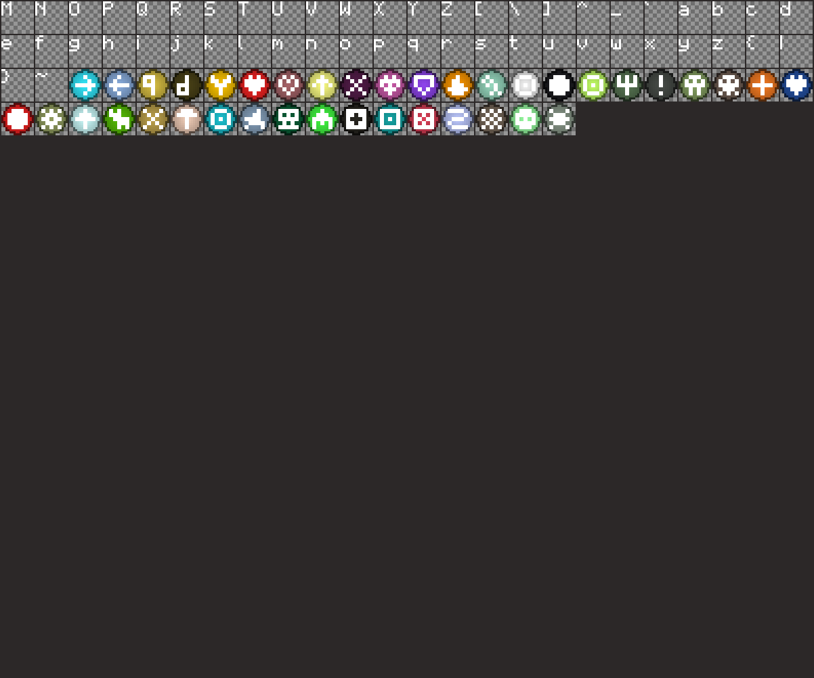
### audiotest

### banners

### base_air

### base_crawler

### base_lockdown

### base_patrol

### base_rebuild

### basetest_air

### basetest_rebuild

### bastion

### bastion_far

### beacon

### biome_badlands

### biome_birch_forest

### biome_cherry_grove

### biome_dark_forest

### biome_desert

### biome_jagged_peaks

### biome_jungle

### biome_mangrove_swamp

### biome_savanna

### biome_swamp

### biome_taiga

### biome_warm_ocean

### boats

### book

### boom_night

### brewing

### bugnotes

### cactus_far

### cactus_far_nolod

### cactus_mid

### cactus_mid_fast

### camp_abandoned

### camp_hunters

### camp_outlaws

### camp_prospectors

### camp_traders

### canyon

### canyon_floor

### capital_city
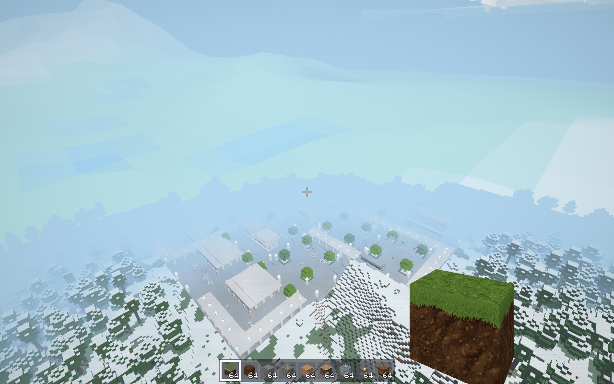
### capital_street
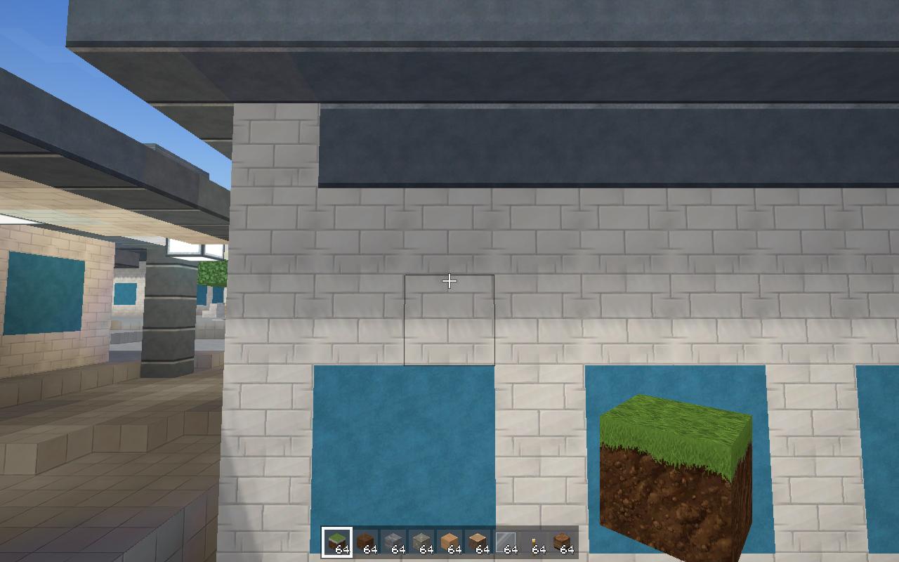
### capitaltest

### captains

### cave_dark

### cave_dark_bright

### cave_dark_fast

### cave_dark_mobs

### cave_dark_moody

### cave_torches

### chips

### citadel_far

### citadel_gate

### citadel_plaza

### citadel_top

### citadel_turret

### climate_1

### climate_12345

### climate_424242

### climate_777

### climate_98765

### clouds

### commands

### controls_ref

### coop

### copper

### copper_golems

### coppertest

### crack

### craftbook

### crafting

### create

### creative

### credits

### dark_forest

### death

### deck_gun

### decor

### deep_dark

### desert_temple

### desert_temple_inside

### desert_well

### down

### dripstone_caves

### drops

### effects

### ember_basalt

### ember_crimson

### ember_soul

### ember_warped

### enchant

### end

### end_city

### end_outer

### end_top

### farm_variants

### firefight

### fireworks

### flicker_build

### flicker_forest

### flicker_village

### flight_heli

### flight_plane

### forest

### forest_fast

### forest_in

### forest_nobase

### forest_nocull

### forest_verify

### fortress

### fortress_far

### furnace

### gallery_build

### gallery_build_night

### gallery_color

### gallery_copper

### gallery_copper_night

### gallery_earth

### gallery_ember

### gallery_hollow

### gallery_ores

### gallery_plants

### gallery_stone

### gallery_wood

### ground16

### ground16_fast

### gun_aim

### gun_hip

### gun_scope

### hdatlas

### heads

### horizon_ring

### horizon_ring_evening

### hostile

### in_lava

### inventory

### inventory_pad

### issue_1

### issue_10
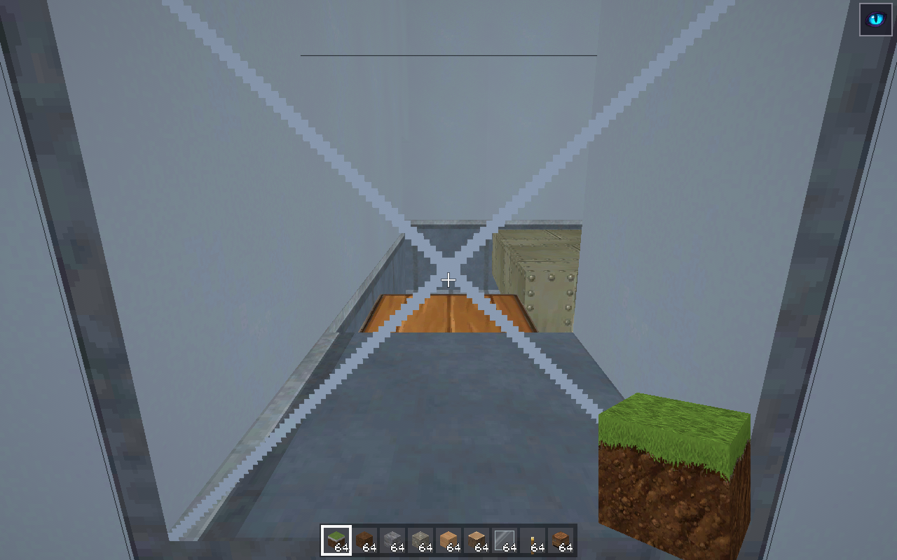
### issue_2

### issue_3
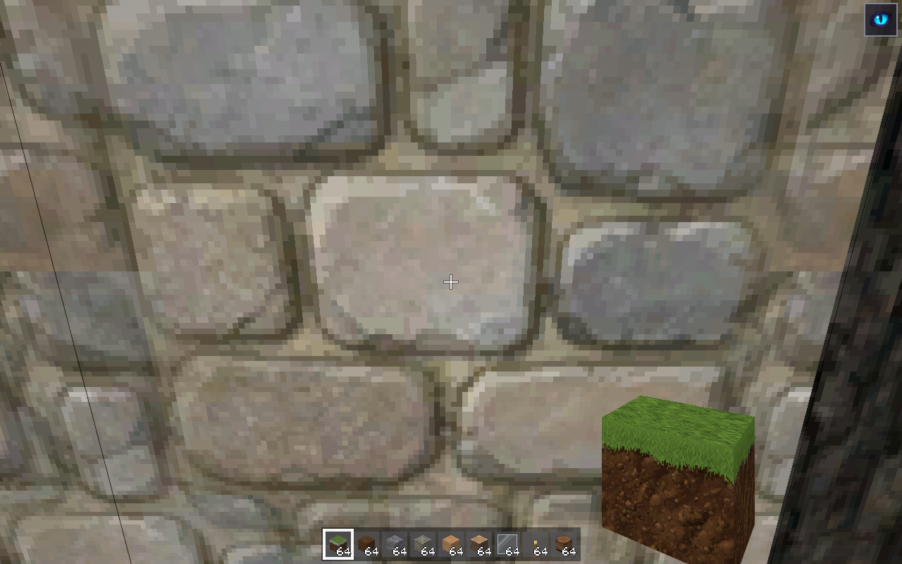
### issue_4
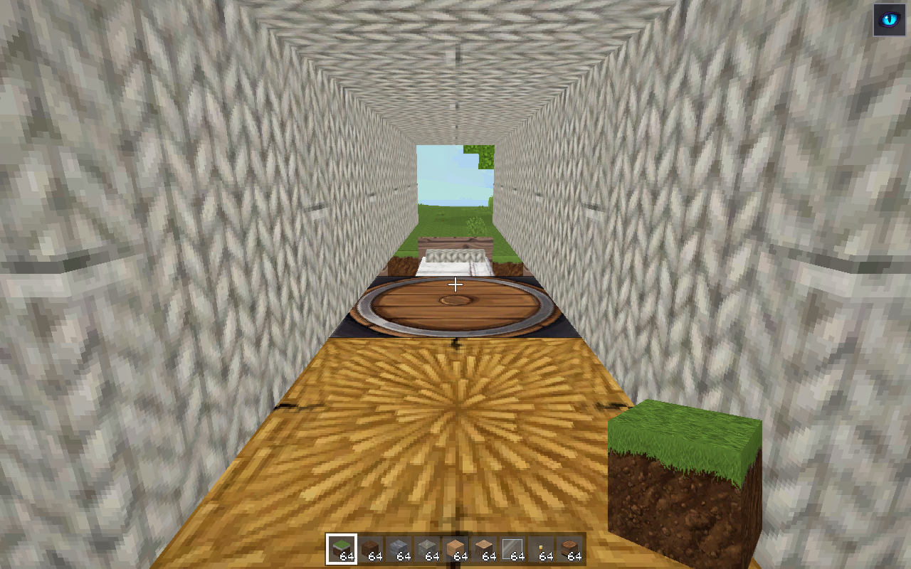
### issue_5
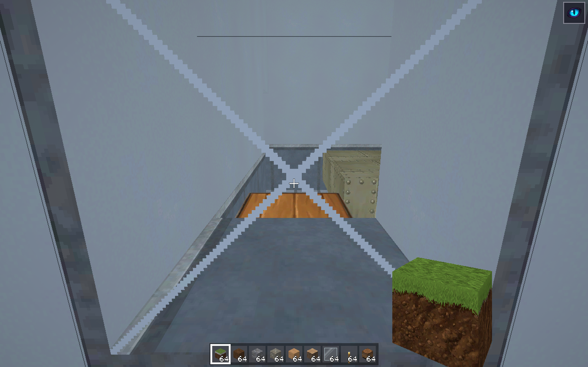
### issue_6

### issue_7
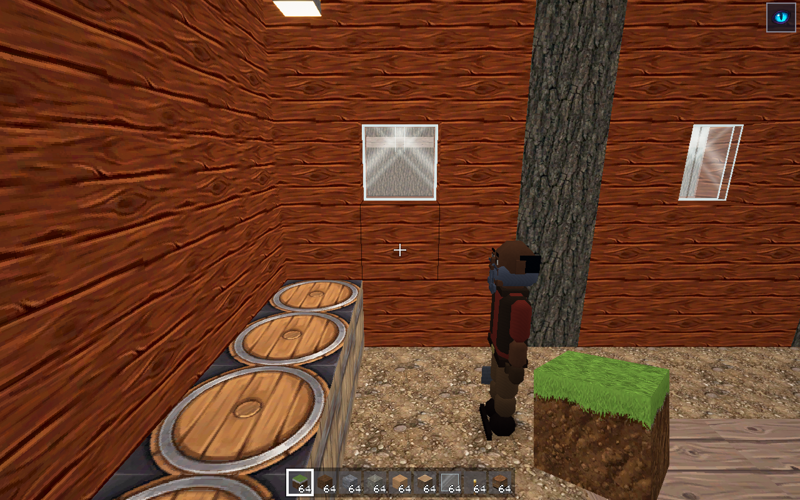
### issue_8

### issue_9
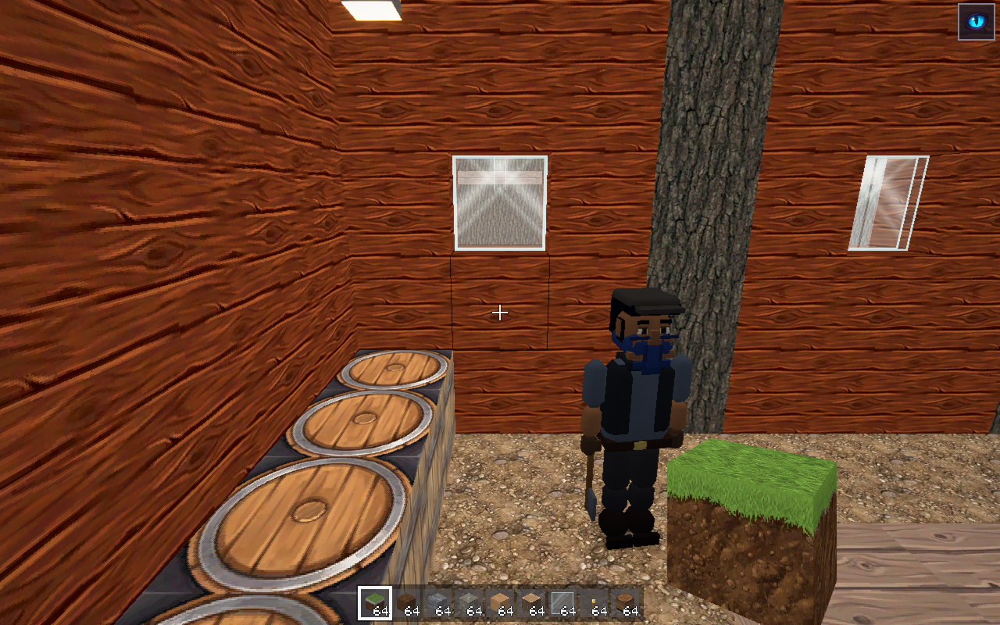
### jungle_temple

### lake

### lake_glint

### leak_12345

### lily_pond
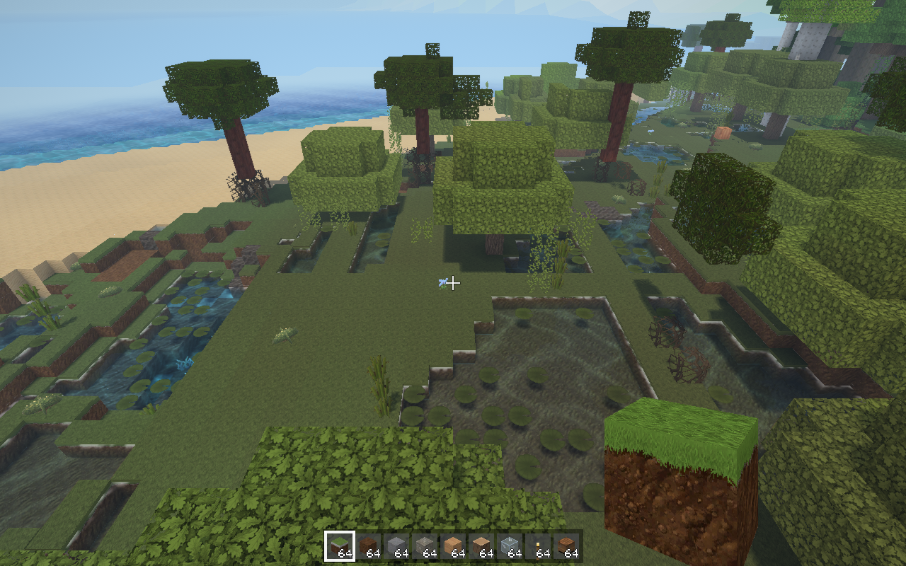
### lily_pond_777
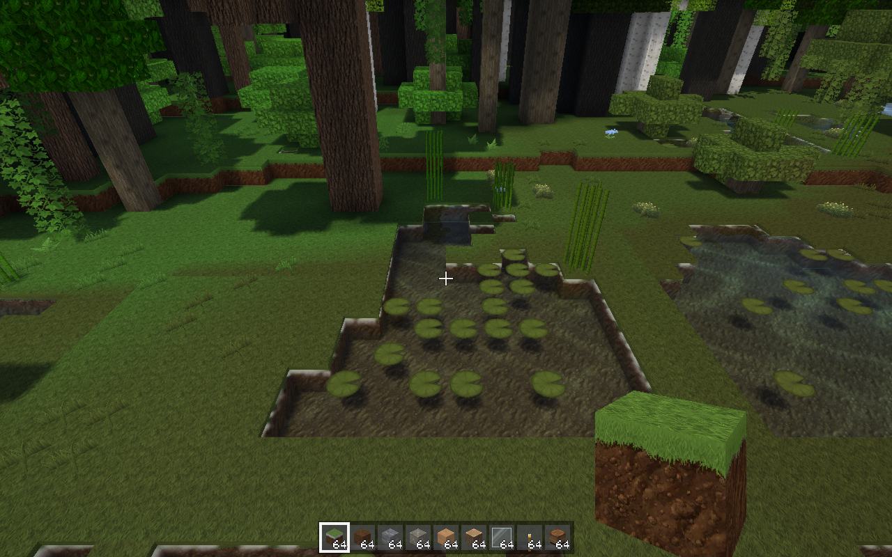
### loom

### lush_caves

### magic_blocks

### mansion

### mansion_inside

### map

### meadow

### mineshaft

### mineshaft_torches

### mob_shadows

### mobcheck

### mobs

### mobs_g

### mobs_new

### monument

### musiccheck

### nether

### nether_mobs

### nether_wide

### night

### ocean_night_777

### ocean_night_777_fast

### ocean_ruin

### options

### outpost

### outpost_close

### padmap

### padtest

### pathtest

### pause

### photo_dof

### photo_dof_far

### physicstest

### plantcheck

### portal

### powderwight

### rain

### recipes

### redstone

### relief_1

### relief_12345

### relief_424242

### relief_777

### relief_98765

### rulescheck

### seabed_deep

### seabed_deep_far

### seabed_warm

### selftest

### ship_airship

### ship_battle

### ship_boat

### ship_capitalbattle

### ship_car

### ship_carriage

### ship_crawler

### ship_deck

### ship_frigate

### ship_frigate_bow

### ship_frigate_deck

### ship_frigate_side

### ship_frigate_top

### ship_gunboat

### ship_plane

### ship_warfrigate

### shipwreck

### shore

### sim

### smoke_rd16

### smoke_rd24

### smoke_rd8

### snowfall

### snowslope

### snowy

### soldier_actions

### soldier_actions_heavy

### soldier_closeup

### soldier_ranks_aim

### soldier_ranks_back

### soldier_ranks_front

### soldier_ranks_night_back

### soldier_ranks_night_front

### soldier_ranks_night_side

### soldier_ranks_side

### soldier_squad

### soldier_squad_night

### soldier_stations

### soldiers

### spawn

### spawn_portal_check

### spear_hold

### spire

### spire_horizon

### spire_inside

### stars

### steelhold

### steelhold_armory

### steelhold_armory_close

### steelhold_armory_fast

### steelhold_armory_swords

### steelhold_command

### steelhold_fight

### steelhold_gate

### stronghold

### subtitles

### sunset

### sunset_fast

### sunset_sun

### survival

### temple

### temple2

### terrain_1

### terrain_12345

### terrain_424242

### terrain_777

### terrain_98765

### texsrc_cc0_cliff

### texsrc_cc0_forest

### texsrc_cc0_village

### texsrc_gemini_cliff

### texsrc_gemini_forest

### texsrc_gemini_village

### texsrc_procedural_cliff

### texsrc_procedural_forest

### texsrc_procedural_village

### third_back

### third_front

### third_swim

### thunder

### title

### torches

### torches_day

### torches_near

### tour_12345_aerial

### tour_12345_low

### tour_1_aerial

### tour_1_low

### tour_424242_aerial

### tour_424242_low

### tour_777_aerial

### tour_777_aerial_fast

### tour_777_aerial_nocull

### tour_777_low

### tour_98765_aerial

### tour_98765_low

### tour_coast

### tour_delta

### tour_delta_777

### tour_desert

### tour_forest_floor

### tour_jungle

### tour_lake

### tour_lake_424242

### tour_mesa

### tour_peaks

### tour_river

### tour_river_777

### tour_snowline

### trade

### trail_ruins

### trial_chambers

### tv_combat

### tv_confirm

### tv_coop

### tv_coop_side

### tv_craftbook

### tv_craftbook2

### tv_craftbook_all

### tv_hud

### tv_keyboard

### tv_map

### tv_options

### tv_title

### tv_worlds

### underwater

### underwater_up

### vehicle_hud

### village

### village2

### village3

### village_street

### village_top

### villager_jobs

### villagers

### volcano_crater

### volcano_dusk

### volcano_far

### volcano_horizon

### volcano_horizon_night

### water_flow

