# Voice bug notes 2026-10-10 (Quest)

Spoken while playing; transcribed by elevenlabs/scribe-v2. Written by `tools/quest-bugnotes.py` (rewritten each run; edit Status lines in a copy). 109 notes.

## 09:21:33 - Oh, never fixed that, did I?

- **Transcript:** Oh, never fixed that, did I?
- **Status:** open
- **Build:** 0.95 (2913b0a, M1-M4 (device-tested; ship riding, chests, comfort options, weapon wheel))
- **World:** Quest World (seed 2943808052895834412)
- **Dimension:** Surface
- **Biome:** Swamp
- **Position:** -532.6 66.0 -170.8
- **Facing:** north-west (yaw 320, pitch -24)
- **Held:** Dirt x4
- **Mount:** on foot
- **Looking at:** Grass Block at -535 65 -174
- **Mode:** Survival, health 20/20
- **Time:** day 3 11:16, clear
- **Fps:** 71
- **Levels:** mic -29 dBFS, game sound -28 dBFS
- **Length:** 3.0 s (voice 1.1 s)
- **Just before:** -10s opened PauseMenu; -10s message: Playtest build: voice bug notes ON, your speech is saved (Options > Interface); -7s closed PauseMenu; -6s message: 72 Hz to keep the frame rate (VR Comfort & Controls); -5s message: Sprinting: let the stick back to the middle to stop
- **Repro (Mac):** `./snap.sh note --seed 2943808052895834412 --x -532.6 --z -170.8 --yaw 40 --pitch -24 --time 0.220`
- **Audio (this Mac):** /Users/darthvadar/Documents/Blocksmith/QuestVoiceNotes/raw/vn-20261010-092133-027.aac

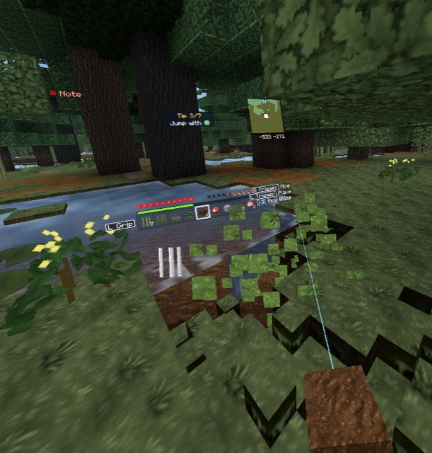

## 09:21:45 - Textures aren't good enough

- **Transcript:** Textures aren't good enough
- **Status:** open
- **Build:** 0.95 (2913b0a, M1-M4 (device-tested; ship riding, chests, comfort options, weapon wheel))
- **World:** Quest World (seed 2943808052895834412)
- **Dimension:** Surface
- **Biome:** Swamp
- **Position:** -539.4 66.0 -176.7
- **Facing:** north-west (yaw 310, pitch -42)
- **Held:** Dirt x4
- **Mount:** on foot
- **Looking at:** Podzol at -541 65 -178
- **Mode:** Survival, health 20/20
- **Time:** day 3 11:21, clear
- **Fps:** 72
- **Levels:** mic -30 dBFS, game sound -30 dBFS
- **Length:** 2.6 s (voice 0.9 s)
- **Just before:** -22s opened PauseMenu; -22s message: Playtest build: voice bug notes ON, your speech is saved (Options > Interface); -19s closed PauseMenu; -18s message: 72 Hz to keep the frame rate (VR Comfort & Controls); -17s message: Sprinting: let the stick back to the middle to stop; -12s opened PauseMenu; -4s closed PauseMenu
- **Repro (Mac):** `./snap.sh note --seed 2943808052895834412 --x -539.4 --z -176.7 --yaw 50 --pitch -42 --time 0.223`
- **Audio (this Mac):** /Users/darthvadar/Documents/Blocksmith/QuestVoiceNotes/raw/vn-20261010-092145-027.aac

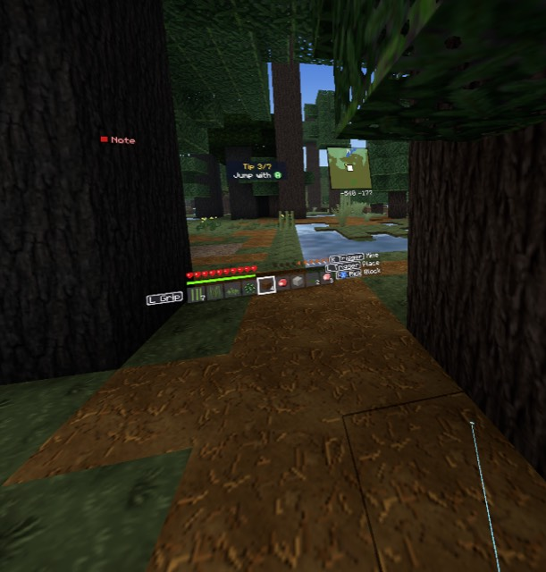

## 09:21:48 - This isn't... The trees are good. Grass sucks

- **Transcript:** This isn't... The trees are good. Grass sucks
- **Status:** open
- **Build:** 0.95 (2913b0a, M1-M4 (device-tested; ship riding, chests, comfort options, weapon wheel))
- **World:** Quest World (seed 2943808052895834412)
- **Dimension:** Surface
- **Biome:** Swamp
- **Position:** -545.5 66.0 -175.5
- **Facing:** south-west (yaw 223, pitch -10)
- **Held:** Dirt x4
- **Mount:** on foot
- **Looking at:** Spruce Log at -549 66 -173
- **Mode:** Survival, health 20/20
- **Time:** day 3 11:25, clear
- **Fps:** 72
- **Levels:** mic -38 dBFS, game sound -35 dBFS
- **Length:** 3.9 s (voice 1.5 s)
- **Just before:** -25s opened PauseMenu; -25s message: Playtest build: voice bug notes ON, your speech is saved (Options > Interface); -22s closed PauseMenu; -21s message: 72 Hz to keep the frame rate (VR Comfort & Controls); -20s message: Sprinting: let the stick back to the middle to stop; -15s opened PauseMenu; -7s closed PauseMenu
- **Repro (Mac):** `./snap.sh note --seed 2943808052895834412 --x -545.5 --z -175.5 --yaw 137 --pitch -10 --time 0.226`
- **Audio (this Mac):** /Users/darthvadar/Documents/Blocksmith/QuestVoiceNotes/raw/vn-20261010-092148-087.aac

## 09:21:53 - They're not

- **Transcript:** They're not
- **Status:** open
- **Build:** 0.95 (2913b0a, M1-M4 (device-tested; ship riding, chests, comfort options, weapon wheel))
- **World:** Quest World (seed 2943808052895834412)
- **Dimension:** Surface
- **Biome:** Swamp
- **Position:** -555.1 66.0 -175.6
- **Facing:** west (yaw 275, pitch -7)
- **Held:** Dirt x4
- **Mount:** on foot
- **Looking at:** Spruce Log at -560 67 -177
- **Mode:** Survival, health 20/20
- **Time:** day 3 11:31, clear
- **Fps:** 72
- **Levels:** mic -36 dBFS, game sound -30 dBFS
- **Length:** 1.9 s (voice 0.5 s)
- **Just before:** -27s closed PauseMenu; -26s message: 72 Hz to keep the frame rate (VR Comfort & Controls); -26s message: Sprinting: let the stick back to the middle to stop; -20s opened PauseMenu; -12s closed PauseMenu
- **Repro (Mac):** `./snap.sh note --seed 2943808052895834412 --x -555.1 --z -175.6 --yaw 85 --pitch -7 --time 0.230`
- **Audio (this Mac):** /Users/darthvadar/Documents/Blocksmith/QuestVoiceNotes/raw/vn-20261010-092153-467.aac

## 09:21:56 - Water's good

- **Transcript:** Water's good
- **Status:** open
- **Build:** 0.95 (2913b0a, M1-M4 (device-tested; ship riding, chests, comfort options, weapon wheel))
- **World:** Quest World (seed 2943808052895834412)
- **Dimension:** Surface
- **Biome:** Swamp
- **Position:** -566.4 66.0 -171.2
- **Facing:** west (yaw 262, pitch -39)
- **Held:** Dirt x4
- **Mount:** on foot
- **Looking at:** Grass Block at -570 65 -171
- **Mode:** Survival, health 20/20
- **Time:** day 3 11:35, clear
- **Fps:** 72
- **Levels:** mic -26 dBFS, game sound -27 dBFS
- **Length:** 1.7 s (voice 0.6 s)
- **Just before:** -30s message: 72 Hz to keep the frame rate (VR Comfort & Controls); -29s message: Sprinting: let the stick back to the middle to stop; -24s opened PauseMenu; -16s closed PauseMenu
- **Repro (Mac):** `./snap.sh note --seed 2943808052895834412 --x -566.4 --z -171.2 --yaw 98 --pitch -39 --time 0.233`
- **Audio (this Mac):** /Users/darthvadar/Documents/Blocksmith/QuestVoiceNotes/raw/vn-20261010-092156-987.aac

## 09:21:58 - Keep the water lily pads are good

- **Transcript:** Keep the water lily pads are good
- **Status:** open
- **Build:** 0.95 (2913b0a, M1-M4 (device-tested; ship riding, chests, comfort options, weapon wheel))
- **World:** Quest World (seed 2943808052895834412)
- **Dimension:** Surface
- **Biome:** Swamp
- **Position:** -573.5 65.3 -169.9
- **Facing:** north-west (yaw 300, pitch -50)
- **Held:** Dirt x4
- **Mount:** on foot
- **Looking at:** Grass Block at -576 64 -172
- **Mode:** Survival, health 20/20
- **Time:** day 3 11:38, clear
- **Fps:** 72
- **Levels:** mic -34 dBFS, game sound -33 dBFS
- **Length:** 2.9 s (voice 1.3 s)
- **Just before:** -26s opened PauseMenu; -18s closed PauseMenu
- **Repro (Mac):** `./snap.sh note --seed 2943808052895834412 --x -573.5 --z -169.9 --yaw 60 --pitch -50 --time 0.235`
- **Audio (this Mac):** /Users/darthvadar/Documents/Blocksmith/QuestVoiceNotes/raw/vn-20261010-092158-967.aac

## 09:22:23 - Too much vegetation seems to have fixed that

- **Transcript:** Too much vegetation seems to have fixed that
- **Status:** open
- **Build:** 0.95 (2913b0a, M1-M4 (device-tested; ship riding, chests, comfort options, weapon wheel))
- **World:** Quest World (seed 2943808052895834412)
- **Dimension:** Surface
- **Biome:** Beach
- **Position:** -1029.4 65.0 -110.1
- **Facing:** north (yaw 341, pitch -51)
- **Held:** Dirt x4
- **Mount:** on foot
- **Looking at:** Sand at -1030 64 -112
- **Mode:** Creative, health 20/20
- **Time:** day 3 12:02, clear
- **Fps:** 72
- **Levels:** mic -36 dBFS, game sound -24 dBFS
- **Length:** 3.8 s (voice 1.6 s)
- **Just before:** -19s message: No flying in survival; -18s opened PauseMenu; -15s message: Creative mode; -15s closed PauseMenu; -14s message: Flying; -9s walked into Dark Forest; -7s walked into Swamp; -5s message: Walking
- **Repro (Mac):** `./snap.sh note --seed 2943808052895834412 --x -1029.4 --z -110.1 --yaw 19 --pitch -51 --time 0.252`
- **Audio (this Mac):** /Users/darthvadar/Documents/Blocksmith/QuestVoiceNotes/raw/vn-20261010-092223-267.aac

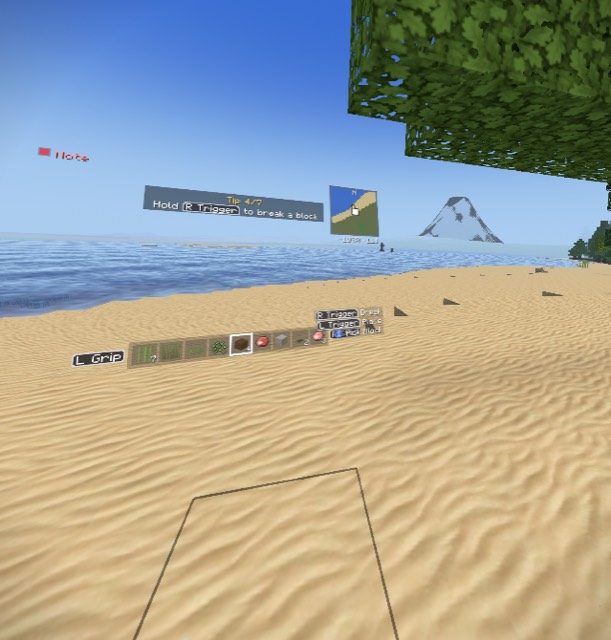

## 09:22:28 - Um, but yeah, the, uh, little bushes with the little yellow things on 

- **Transcript:** Um, but yeah, the, uh, little bushes with the little yellow things on top, they are not detailed enough
- **Status:** open
- **Build:** 0.95 (2913b0a, M1-M4 (device-tested; ship riding, chests, comfort options, weapon wheel))
- **World:** Quest World (seed 2943808052895834412)
- **Dimension:** Surface
- **Biome:** Beach
- **Position:** -1037.2 65.4 -109.9
- **Facing:** south-west (yaw 231, pitch -54)
- **Held:** Dirt x4
- **Mount:** on foot
- **Looking at:** Sand at -1039 63 -109
- **Mode:** Creative, health 20/20
- **Time:** day 3 12:08, clear
- **Fps:** 71
- **Levels:** mic -31 dBFS, game sound -29 dBFS
- **Length:** 8.4 s (voice 5.0 s)
- **Just before:** -24s message: No flying in survival; -23s opened PauseMenu; -20s message: Creative mode; -19s closed PauseMenu; -19s message: Flying; -13s walked into Dark Forest; -11s walked into Swamp; -10s message: Walking; -3s walked into Beach
- **Position at the end:** -1041.7 65.0 -102.2
- **Repro (Mac):** `./snap.sh note --seed 2943808052895834412 --x -1037.2 --z -109.9 --yaw 129 --pitch -54 --time 0.256`
- **Audio (this Mac):** /Users/darthvadar/Documents/Blocksmith/QuestVoiceNotes/raw/vn-20261010-092228-287.aac

## 09:22:37 - Um, ground's just def- very obviously not detailed enough with-- for t

- **Transcript:** Um, ground's just def- very obviously not detailed enough with-- for the grass. Water looks wonderful
- **Status:** open
- **Build:** 0.95 (2913b0a, M1-M4 (device-tested; ship riding, chests, comfort options, weapon wheel))
- **World:** Quest World (seed 2943808052895834412)
- **Dimension:** Surface
- **Biome:** Swamp
- **Position:** -1038.6 65.0 -100.3
- **Facing:** south-east (yaw 114, pitch -54)
- **Held:** Dirt x4
- **Mount:** on foot
- **Looking at:** Dirt at -1038 63 -100
- **Mode:** Creative, health 20/20
- **Time:** day 3 12:18, clear
- **Fps:** 71
- **Levels:** mic -36 dBFS, game sound -25 dBFS
- **Length:** 8.4 s (voice 4.2 s)
- **Just before:** -29s message: Creative mode; -28s closed PauseMenu; -28s message: Flying; -22s walked into Dark Forest; -20s walked into Swamp; -19s message: Walking; -12s walked into Beach; -0s walked into Swamp
- **While talking:** -5s walked into Swamp; -1s walked into Beach
- **Position at the end:** -1049.5 64.0 -101.2
- **Repro (Mac):** `./snap.sh note --seed 2943808052895834412 --x -1038.6 --z -100.3 --yaw -114 --pitch -54 --time 0.263`
- **Audio (this Mac):** /Users/darthvadar/Documents/Blocksmith/QuestVoiceNotes/raw/vn-20261010-092237-249.aac

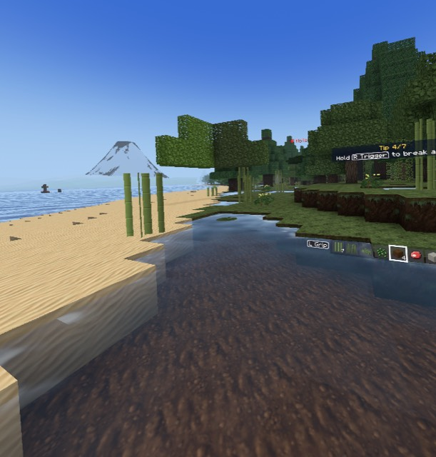

## 09:22:45 - Ja, ähm

- **Transcript:** Ja, ähm
- **Status:** open
- **Build:** 0.95 (2913b0a, M1-M4 (device-tested; ship riding, chests, comfort options, weapon wheel))
- **World:** Quest World (seed 2943808052895834412)
- **Dimension:** Surface
- **Biome:** Beach
- **Position:** -1062.0 64.0 -95.4
- **Facing:** west (yaw 250, pitch -66)
- **Held:** Dirt x4
- **Mount:** on foot
- **Looking at:** Sand at -1063 63 -96
- **Mode:** Creative, health 20/20
- **Time:** day 3 12:28, clear
- **Fps:** 71
- **Levels:** mic -40 dBFS, game sound -24 dBFS
- **Length:** 2.1 s (voice 0.8 s)
- **Just before:** -28s walked into Swamp; -27s message: Walking; -20s walked into Beach; -8s walked into Swamp; -4s walked into Beach; -2s message: ♪ Lantern Hours (Creative)
- **Repro (Mac):** `./snap.sh note --seed 2943808052895834412 --x -1062.0 --z -95.4 --yaw 110 --pitch -66 --time 0.270`
- **Audio (this Mac):** /Users/darthvadar/Documents/Blocksmith/QuestVoiceNotes/raw/vn-20261010-092245-427.aac

## 09:22:48 - Why is there a-- capital buildings are supposed to be more rare. Why, 

- **Transcript:** Why is there a-- capital buildings are supposed to be more rare. Why, why did I just find one spawning in? Maybe that has to do with the s- the, the seed you chose, just so you could verify quickly. I don't know
- **Status:** open
- **Build:** 0.95 (2913b0a, M1-M4 (device-tested; ship riding, chests, comfort options, weapon wheel))
- **World:** Quest World (seed 2943808052895834412)
- **Dimension:** Surface
- **Biome:** Forest
- **Position:** -1155.4 95.7 -26.0
- **Facing:** south-west (yaw 243, pitch -50)
- **Held:** Dirt x4
- **Mount:** on foot, flying
- **Looking at:** nothing
- **Mode:** Creative, health 20/20
- **Time:** day 3 12:32, clear
- **Fps:** 71
- **Levels:** mic -27 dBFS, game sound -23 dBFS
- **Length:** 12.4 s (voice 7.3 s)
- **Just before:** -30s message: Walking; -23s walked into Beach; -11s walked into Swamp; -7s walked into Beach; -5s message: ♪ Lantern Hours (Creative); -3s message: Flying; -1s walked into Swamp
- **While talking:** -4s message: Capital citadel marked on the map; -4s walked into Forest; -3s message: ♪ Slate and Sky (Creative); -1s walked into Beach
- **Position at the end:** -1387.2 113.0 -295.5
- **Repro (Mac):** `./snap.sh note --seed 2943808052895834412 --x -1155.4 --z -26.0 --yaw 117 --pitch -50 --time 0.272`
- **Audio (this Mac):** /Users/darthvadar/Documents/Blocksmith/QuestVoiceNotes/raw/vn-20261010-092248-587.aac

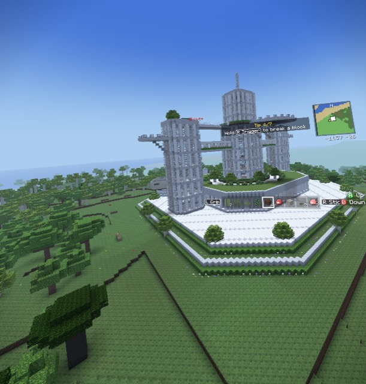

## 09:23:02 - And yeah, okay

- **Transcript:** And yeah, okay
- **Status:** open
- **Build:** 0.95 (2913b0a, M1-M4 (device-tested; ship riding, chests, comfort options, weapon wheel))
- **World:** Quest World (seed 2943808052895834412)
- **Dimension:** Surface
- **Biome:** Beach
- **Position:** -1282.1 113.0 -386.8
- **Facing:** north-west (yaw 333, pitch -64)
- **Held:** Dirt x4
- **Mount:** on foot, flying
- **Looking at:** nothing
- **Mode:** Creative, health 20/20
- **Time:** day 3 12:47, clear
- **Fps:** 71
- **Levels:** mic -31 dBFS, game sound -24 dBFS
- **Length:** 3.4 s (voice 1.1 s)
- **Just before:** -24s walked into Swamp; -20s walked into Beach; -19s message: ♪ Lantern Hours (Creative); -16s message: Flying; -14s walked into Swamp; -13s message: Capital citadel marked on the map; -12s walked into Forest; -7s message: ♪ Slate and Sky (Creative); -4s walked into Beach
- **Repro (Mac):** `./snap.sh note --seed 2943808052895834412 --x -1282.1 --z -386.8 --yaw 27 --pitch -64 --time 0.283`
- **Audio (this Mac):** /Users/darthvadar/Documents/Blocksmith/QuestVoiceNotes/raw/vn-20261010-092302-008.aac

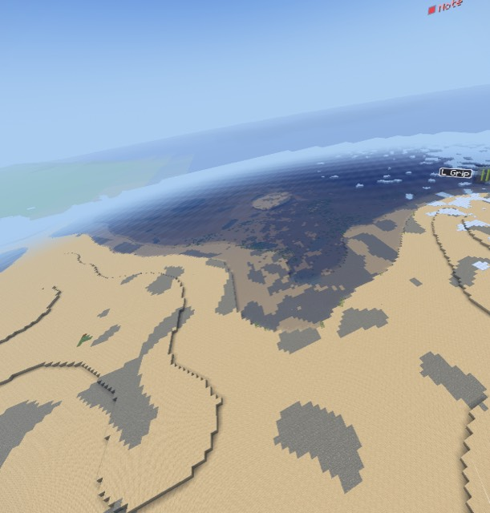

## 09:23:06 - The volcano just looks weird when it's in the background. That shouldn

- **Transcript:** The volcano just looks weird when it's in the background. That shouldn't be there
- **Status:** open
- **Build:** 0.95 (2913b0a, M1-M4 (device-tested; ship riding, chests, comfort options, weapon wheel))
- **World:** Quest World (seed 2943808052895834412)
- **Dimension:** Surface
- **Biome:** Beach
- **Position:** -1141.2 149.0 -475.5
- **Facing:** east (yaw 76, pitch -33)
- **Held:** Dirt x4
- **Mount:** on foot, flying
- **Looking at:** nothing
- **Mode:** Creative, health 20/20
- **Time:** day 3 12:52, clear
- **Fps:** 70
- **Levels:** mic -33 dBFS, game sound -30 dBFS
- **Length:** 4.6 s (voice 2.5 s)
- **Just before:** -28s walked into Swamp; -24s walked into Beach; -22s message: ♪ Lantern Hours (Creative); -20s message: Flying; -18s walked into Swamp; -17s message: Capital citadel marked on the map; -16s walked into Forest; -10s message: ♪ Slate and Sky (Creative); -8s walked into Beach
- **Repro (Mac):** `./snap.sh note --seed 2943808052895834412 --x -1141.2 --z -475.5 --yaw -76 --pitch -33 --time 0.287`
- **Audio (this Mac):** /Users/darthvadar/Documents/Blocksmith/QuestVoiceNotes/raw/vn-20261010-092306-087.aac

## 09:23:10 - The render distance switched down to 15 as I was moving. It'd be nice 

- **Transcript:** The render distance switched down to 15 as I was moving. It'd be nice if we could make it so that it automatically switches back when the, uh
- **Status:** open
- **Build:** 0.95 (2913b0a, M1-M4 (device-tested; ship riding, chests, comfort options, weapon wheel))
- **World:** Quest World (seed 2943808052895834412)
- **Dimension:** Surface
- **Biome:** Taiga
- **Position:** -859.1 149.0 -709.8
- **Facing:** east (yaw 78, pitch -35)
- **Held:** Dirt x4
- **Mount:** on foot, flying
- **Looking at:** nothing
- **Mode:** Creative, health 20/20
- **Time:** day 3 12:57, clear
- **Fps:** 66
- **Levels:** mic -28 dBFS, game sound -24 dBFS
- **Length:** 8.6 s (voice 5.2 s)
- **Just before:** -28s walked into Beach; -27s message: ♪ Lantern Hours (Creative); -24s message: Flying; -22s walked into Swamp; -21s message: Capital citadel marked on the map; -20s walked into Forest; -15s message: ♪ Slate and Sky (Creative); -12s walked into Beach; -3s message: Render distance 15 to keep the frame rate (VR Comfort & Controls); -2s walked into Snowy Taiga; -0s walked into Taiga
- **While talking:** -3s walked into Snowy Taiga; -1s walked into Stony Peaks
- **Position at the end:** -583.5 186.6 -836.3
- **Repro (Mac):** `./snap.sh note --seed 2943808052895834412 --x -859.1 --z -709.8 --yaw -78 --pitch -35 --time 0.290`
- **Audio (this Mac):** /Users/darthvadar/Documents/Blocksmith/QuestVoiceNotes/raw/vn-20261010-092310-767.aac

## 09:23:19 - The frame comes back together. Volcanoes, they don't mesh very well in

- **Transcript:** The frame comes back together. Volcanoes, they don't mesh very well into the, uh
- **Status:** open
- **Build:** 0.95 (2913b0a, M1-M4 (device-tested; ship riding, chests, comfort options, weapon wheel))
- **World:** Quest World (seed 2943808052895834412)
- **Dimension:** Surface
- **Biome:** Stony Peaks
- **Position:** -402.7 192.8 -852.0
- **Facing:** north-east (yaw 64, pitch -39)
- **Held:** Dirt x4
- **Mount:** on foot, flying
- **Looking at:** nothing
- **Mode:** Creative, health 20/20
- **Time:** day 3 13:07, clear
- **Fps:** 72
- **Levels:** mic -31 dBFS, game sound -17 dBFS
- **Length:** 6.9 s (voice 3.5 s)
- **Just before:** -29s message: Capital citadel marked on the map; -29s walked into Forest; -23s message: ♪ Slate and Sky (Creative); -21s walked into Beach; -12s message: Render distance 15 to keep the frame rate (VR Comfort & Controls); -11s walked into Snowy Taiga; -9s walked into Taiga; -7s walked into Snowy Taiga; -5s walked into Stony Peaks; -3s message: Walking; -2s message: Flying
- **While talking:** -3s walked into Taiga
- **Position at the end:** -342.3 192.8 -908.3
- **Repro (Mac):** `./snap.sh note --seed 2943808052895834412 --x -402.7 --z -852.0 --yaw -64 --pitch -39 --time 0.297`
- **Audio (this Mac):** /Users/darthvadar/Documents/Blocksmith/QuestVoiceNotes/raw/vn-20261010-092319-407.aac

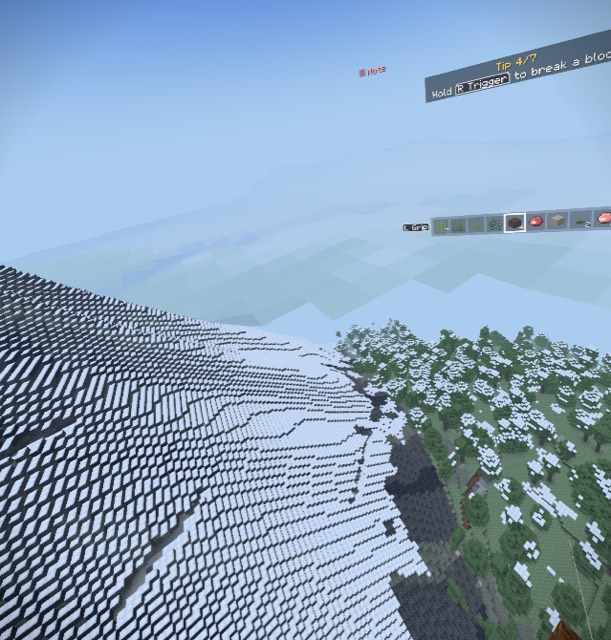

## 09:23:26 - into the environment

- **Transcript:** into the environment
- **Status:** open
- **Build:** 0.95 (2913b0a, M1-M4 (device-tested; ship riding, chests, comfort options, weapon wheel))
- **World:** Quest World (seed 2943808052895834412)
- **Dimension:** Surface
- **Biome:** Taiga
- **Position:** -290.0 195.7 -986.4
- **Facing:** north-east (yaw 41, pitch -58)
- **Held:** Dirt x4
- **Mount:** on foot
- **Looking at:** nothing
- **Mode:** Creative, health 20/20
- **Time:** day 3 13:14, clear
- **Fps:** 67
- **Levels:** mic -53 dBFS, game sound -21 dBFS
- **Length:** 1.9 s (voice 0.5 s)
- **Just before:** -29s message: ♪ Slate and Sky (Creative); -26s walked into Beach; -17s message: Render distance 15 to keep the frame rate (VR Comfort & Controls); -16s walked into Snowy Taiga; -14s walked into Taiga; -12s walked into Snowy Taiga; -10s walked into Stony Peaks; -9s message: Walking; -8s message: Flying; -4s walked into Taiga; -0s message: Walking; -0s message: Village marked on the map
- **Repro (Mac):** `./snap.sh note --seed 2943808052895834412 --x -290.0 --z -986.4 --yaw -41 --pitch -58 --time 0.302`
- **Audio (this Mac):** /Users/darthvadar/Documents/Blocksmith/QuestVoiceNotes/raw/vn-20261010-092326-867.aac

## 09:23:41 - Checking out the town now. I think it would be good if... Oh, yeah, lo

- **Transcript:** Checking out the town now. I think it would be good if... Oh, yeah, look at that. It'd be good
- **Status:** open
- **Build:** 0.95 (2913b0a, M1-M4 (device-tested; ship riding, chests, comfort options, weapon wheel))
- **World:** Quest World (seed 2943808052895834412)
- **Dimension:** Surface
- **Biome:** Taiga
- **Position:** -275.9 76.0 -1018.6
- **Facing:** north (yaw 7, pitch -1)
- **Held:** Dirt x4
- **Mount:** on foot
- **Looking at:** Chest at -276 77 -1025
- **Mode:** Creative, health 20/20
- **Time:** day 3 13:28, clear
- **Fps:** 53
- **Levels:** mic -26 dBFS, game sound -17 dBFS
- **Length:** 8.0 s (voice 3.9 s)
- **Just before:** -29s message: Render distance 15 to keep the frame rate (VR Comfort & Controls); -28s walked into Snowy Taiga; -26s walked into Taiga; -24s walked into Snowy Taiga; -22s walked into Stony Peaks; -20s message: Walking; -19s message: Flying; -16s walked into Taiga; -12s message: Walking; -12s message: Village marked on the map; -11s message: Flying; -11s message: Render distance 14 to keep the frame rate (VR Comfort & Controls); -10s message: Walking; -10s message: Flying; -9s message: Walking
- **While talking:** -5s opened ChestMenu; -3s closed ChestMenu
- **Position at the end:** -272.2 77.0 -1029.8
- **Repro (Mac):** `./snap.sh note --seed 2943808052895834412 --x -275.9 --z -1018.6 --yaw -7 --pitch -1 --time 0.311`
- **Audio (this Mac):** /Users/darthvadar/Documents/Blocksmith/QuestVoiceNotes/raw/vn-20261010-092341-587.aac

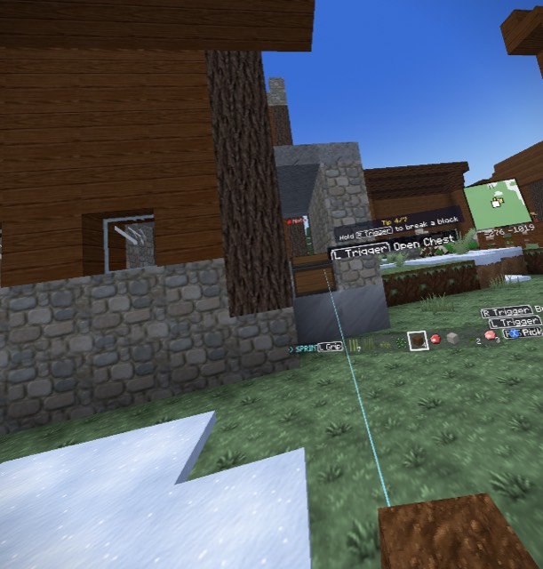

## 09:23:50 - If we'd be able to encounter like little, little camps or whatever lik

- **Transcript:** If we'd be able to encounter like little, little camps or whatever like you do in Red Dead Redemption 2
- **Status:** open
- **Build:** 0.95 (2913b0a, M1-M4 (device-tested; ship riding, chests, comfort options, weapon wheel))
- **World:** Quest World (seed 2943808052895834412)
- **Dimension:** Surface
- **Biome:** Taiga
- **Position:** -276.3 76.9 -1031.3
- **Facing:** west (yaw 287, pitch -50)
- **Held:** Dirt x4
- **Mount:** on foot
- **Looking at:** Dirt Path at -278 76 -1032
- **Mode:** Creative, health 20/20
- **Time:** day 3 13:38, clear
- **Fps:** 72
- **Levels:** mic -29 dBFS, game sound -21 dBFS
- **Length:** 6.8 s (voice 4.4 s)
- **Just before:** -30s walked into Stony Peaks; -28s message: Walking; -28s message: Flying; -24s walked into Taiga; -20s message: Walking; -20s message: Village marked on the map; -20s message: Flying; -19s message: Render distance 14 to keep the frame rate (VR Comfort & Controls); -19s message: Walking; -18s message: Flying; -17s message: Walking; -8s opened ChestMenu; -6s closed ChestMenu
- **While talking:** -5s message: Elias Burke: Afternoon.
- **Position at the end:** -281.9 77.0 -1033.0
- **Repro (Mac):** `./snap.sh note --seed 2943808052895834412 --x -276.3 --z -1031.3 --yaw 73 --pitch -50 --time 0.318`
- **Audio (this Mac):** /Users/darthvadar/Documents/Blocksmith/QuestVoiceNotes/raw/vn-20261010-092350-067.aac

## 09:23:57 - That'd be nice

- **Transcript:** That'd be nice
- **Status:** open
- **Build:** 0.95 (2913b0a, M1-M4 (device-tested; ship riding, chests, comfort options, weapon wheel))
- **World:** Quest World (seed 2943808052895834412)
- **Dimension:** Surface
- **Biome:** Taiga
- **Position:** -284.3 76.9 -1035.7
- **Facing:** west (yaw 267, pitch -8)
- **Held:** Dirt x4
- **Mount:** on foot
- **Looking at:** Cobblestone at -291 77 -1036
- **Mode:** Creative, health 20/20
- **Time:** day 3 13:46, clear
- **Fps:** 72
- **Levels:** mic -46 dBFS, game sound -22 dBFS
- **Length:** 2.0 s (voice 0.5 s)
- **Just before:** -27s message: Walking; -27s message: Village marked on the map; -27s message: Flying; -26s message: Render distance 14 to keep the frame rate (VR Comfort & Controls); -26s message: Walking; -25s message: Flying; -24s message: Walking; -15s opened ChestMenu; -13s closed ChestMenu; -7s message: Elias Burke: Afternoon.
- **Repro (Mac):** `./snap.sh note --seed 2943808052895834412 --x -284.3 --z -1035.7 --yaw 93 --pitch -8 --time 0.324`
- **Audio (this Mac):** /Users/darthvadar/Documents/Blocksmith/QuestVoiceNotes/raw/vn-20261010-092357-167.aac

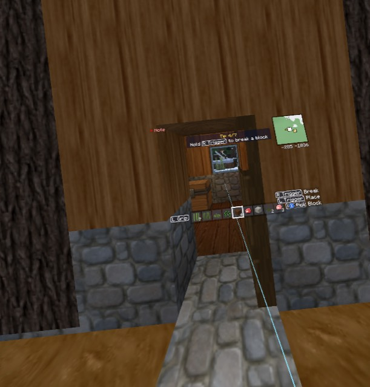

## 09:23:59 - Okay, the bed and everything

- **Transcript:** Okay, the bed and everything
- **Status:** open
- **Build:** 0.95 (2913b0a, M1-M4 (device-tested; ship riding, chests, comfort options, weapon wheel))
- **World:** Quest World (seed 2943808052895834412)
- **Dimension:** Surface
- **Biome:** Taiga
- **Position:** -287.4 77.0 -1035.3
- **Facing:** north-west (yaw 306, pitch -45)
- **Held:** Dirt x4
- **Mount:** on foot
- **Looking at:** Spruce Planks at -289 76 -1036
- **Mode:** Creative, health 20/20
- **Time:** day 3 13:49, clear
- **Fps:** 72
- **Levels:** mic -53 dBFS, game sound -24 dBFS
- **Length:** 3.1 s (voice 1.4 s)
- **Just before:** -30s message: Walking; -30s message: Village marked on the map; -29s message: Flying; -29s message: Render distance 14 to keep the frame rate (VR Comfort & Controls); -28s message: Walking; -27s message: Flying; -27s message: Walking; -18s opened ChestMenu; -16s closed ChestMenu; -9s message: Elias Burke: Afternoon.; -1s opened ChestMenu; -0s closed ChestMenu
- **Repro (Mac):** `./snap.sh note --seed 2943808052895834412 --x -287.4 --z -1035.3 --yaw 54 --pitch -45 --time 0.326`
- **Audio (this Mac):** /Users/darthvadar/Documents/Blocksmith/QuestVoiceNotes/raw/vn-20261010-092359-587.aac

## 09:24:02 - Everything looks good, it's just everything's blurry. It's not sharp, 

- **Transcript:** Everything looks good, it's just everything's blurry. It's not sharp, which
- **Status:** open
- **Build:** 0.95 (2913b0a, M1-M4 (device-tested; ship riding, chests, comfort options, weapon wheel))
- **World:** Quest World (seed 2943808052895834412)
- **Dimension:** Surface
- **Biome:** Taiga
- **Position:** -287.6 77.0 -1035.6
- **Facing:** south-west (yaw 207, pitch -34)
- **Held:** Dirt x4
- **Mount:** on foot
- **Looking at:** Cobblestone at -289 77 -1034
- **Mode:** Creative, health 20/20
- **Time:** day 3 13:52, clear
- **Fps:** 72
- **Levels:** mic -33 dBFS, game sound -22 dBFS
- **Length:** 5.7 s (voice 2.6 s)
- **Just before:** -30s message: Walking; -20s opened ChestMenu; -19s closed ChestMenu; -12s message: Elias Burke: Afternoon.; -4s opened ChestMenu; -3s closed ChestMenu; -2s message: Gideon Merriman: Don't let them sell you nothing you don't need.
- **Position at the end:** -287.3 77.0 -1035.6
- **Repro (Mac):** `./snap.sh note --seed 2943808052895834412 --x -287.6 --z -1035.6 --yaw 153 --pitch -34 --time 0.328`
- **Audio (this Mac):** /Users/darthvadar/Documents/Blocksmith/QuestVoiceNotes/raw/vn-20261010-092402-427.aac

## 09:24:08 - Isn't good. If it were sharp, it would look amazing, but I don't know 

- **Transcript:** Isn't good. If it were sharp, it would look amazing, but I don't know if you can see what I'm seeing. I'm looking at the stone and looking at the chest. It's like
- **Status:** open
- **Build:** 0.95 (2913b0a, M1-M4 (device-tested; ship riding, chests, comfort options, weapon wheel))
- **World:** Quest World (seed 2943808052895834412)
- **Dimension:** Surface
- **Biome:** Taiga
- **Position:** -287.3 77.0 -1035.6
- **Facing:** north (yaw 353, pitch -31)
- **Held:** Dirt x4
- **Mount:** on foot
- **Looking at:** Cobblestone at -288 77 -1038
- **Mode:** Creative, health 20/20
- **Time:** day 3 13:59, clear
- **Fps:** 72
- **Levels:** mic -35 dBFS, game sound -22 dBFS
- **Length:** 8.2 s (voice 5.0 s)
- **Just before:** -26s opened ChestMenu; -24s closed ChestMenu; -18s message: Elias Burke: Afternoon.; -10s opened ChestMenu; -9s closed ChestMenu; -8s message: Gideon Merriman: Don't let them sell you nothing you don't need.
- **Position at the end:** -287.9 77.0 -1035.1
- **Repro (Mac):** `./snap.sh note --seed 2943808052895834412 --x -287.3 --z -1035.6 --yaw 7 --pitch -31 --time 0.333`
- **Audio (this Mac):** /Users/darthvadar/Documents/Blocksmith/QuestVoiceNotes/raw/vn-20261010-092408-127.aac

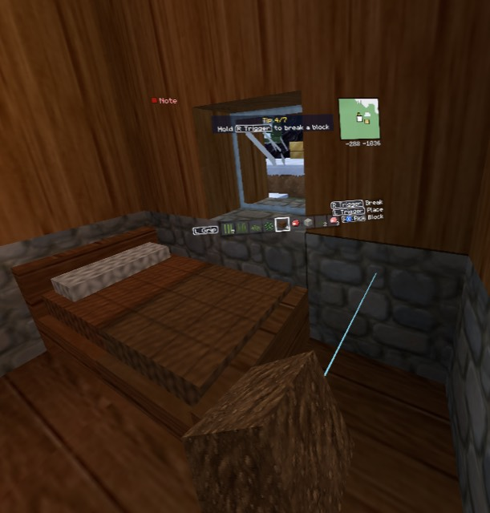

## 09:24:16 - It looks too compressed. Uh, it's just too much

- **Transcript:** It looks too compressed. Uh, it's just too much
- **Status:** open
- **Build:** 0.95 (2913b0a, M1-M4 (device-tested; ship riding, chests, comfort options, weapon wheel))
- **World:** Quest World (seed 2943808052895834412)
- **Dimension:** Surface
- **Biome:** Taiga
- **Position:** -287.9 77.0 -1035.1
- **Facing:** west (yaw 248, pitch -40)
- **Held:** Dirt x4
- **Mount:** on foot
- **Looking at:** Chest at -290 77 -1035
- **Mode:** Creative, health 20/20
- **Time:** day 3 14:09, clear
- **Fps:** 72
- **Levels:** mic -37 dBFS, game sound -22 dBFS
- **Length:** 4.3 s (voice 2.1 s)
- **Just before:** -26s message: Elias Burke: Afternoon.; -18s opened ChestMenu; -17s closed ChestMenu; -16s message: Gideon Merriman: Don't let them sell you nothing you don't need.
- **Repro (Mac):** `./snap.sh note --seed 2943808052895834412 --x -287.9 --z -1035.1 --yaw 112 --pitch -40 --time 0.340`
- **Audio (this Mac):** /Users/darthvadar/Documents/Blocksmith/QuestVoiceNotes/raw/vn-20261010-092416-167.aac

## 09:24:20 - Yeah. Not good enough. Also make it so the villagers get real angry wh

- **Transcript:** Yeah. Not good enough. Also make it so the villagers get real angry when you start stealing from them. Make it so that maybe they might have a sheriff or something that would replace the iron golem
- **Status:** open
- **Build:** 0.95 (2913b0a, M1-M4 (device-tested; ship riding, chests, comfort options, weapon wheel))
- **World:** Quest World (seed 2943808052895834412)
- **Dimension:** Surface
- **Biome:** Taiga
- **Position:** -287.9 77.0 -1034.4
- **Facing:** west (yaw 274, pitch -42)
- **Held:** Dirt x4
- **Mount:** on foot
- **Looking at:** nothing
- **Mode:** Creative, health 20/20, screen ChestMenu
- **Time:** day 3 14:14, clear
- **Fps:** 72
- **Levels:** mic -41 dBFS, game sound -22 dBFS
- **Length:** 12.4 s (voice 7.1 s)
- **Just before:** -22s opened ChestMenu; -21s closed ChestMenu; -21s message: Gideon Merriman: Don't let them sell you nothing you don't need.; -2s opened ChestMenu
- **While talking:** -5s closed ChestMenu; -3s message: Jasper Ingram: Hot one today.
- **Position at the end:** -277.9 76.9 -1031.2
- **Repro (Mac):** `./snap.sh note --seed 2943808052895834412 --x -287.9 --z -1034.4 --yaw 86 --pitch -42 --time 0.344`
- **Audio (this Mac):** /Users/darthvadar/Documents/Blocksmith/QuestVoiceNotes/raw/vn-20261010-092420-527.aac

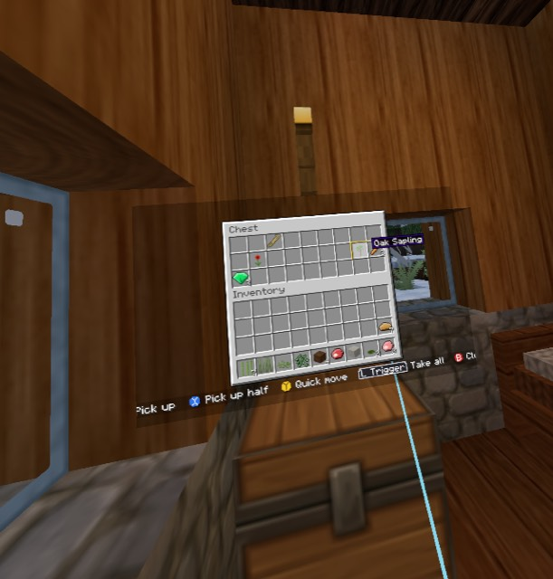

## 09:24:34 - Um, that'd be an idea

- **Transcript:** Um, that'd be an idea
- **Status:** open
- **Build:** 0.95 (2913b0a, M1-M4 (device-tested; ship riding, chests, comfort options, weapon wheel))
- **World:** Quest World (seed 2943808052895834412)
- **Dimension:** Surface
- **Biome:** Taiga
- **Position:** -269.0 76.9 -1031.5
- **Facing:** east (yaw 85, pitch -48)
- **Held:** Dirt x4
- **Mount:** on foot
- **Looking at:** nothing
- **Mode:** Creative, health 20/20
- **Time:** day 3 14:30, clear
- **Fps:** 72
- **Levels:** mic -41 dBFS, game sound -28 dBFS
- **Length:** 2.9 s (voice 1.3 s)
- **Just before:** -15s opened ChestMenu; -13s closed ChestMenu; -6s message: Jasper Ingram: Hot one today.
- **Repro (Mac):** `./snap.sh note --seed 2943808052895834412 --x -269.0 --z -1031.5 --yaw -85 --pitch -48 --time 0.355`
- **Audio (this Mac):** /Users/darthvadar/Documents/Blocksmith/QuestVoiceNotes/raw/vn-20261010-092434-027.aac

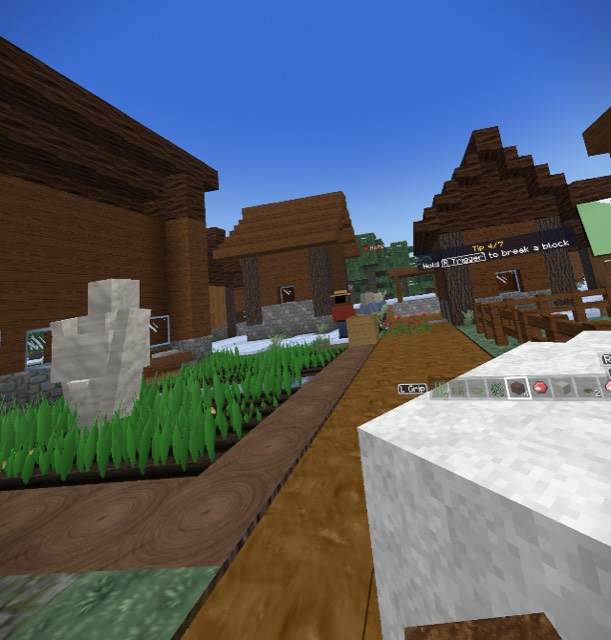

## 09:24:38 - Um, and I could say they speak English too

- **Transcript:** Um, and I could say they speak English too
- **Status:** open
- **Build:** 0.95 (2913b0a, M1-M4 (device-tested; ship riding, chests, comfort options, weapon wheel))
- **World:** Quest World (seed 2943808052895834412)
- **Dimension:** Surface
- **Biome:** Taiga
- **Position:** -260.4 77.0 -1032.8
- **Facing:** east (yaw 98, pitch -0)
- **Held:** Dirt x4
- **Mount:** on foot
- **Looking at:** nothing
- **Mode:** Creative, health 20/20
- **Time:** day 3 14:36, clear
- **Fps:** 72
- **Levels:** mic -30 dBFS, game sound -26 dBFS
- **Length:** 4.1 s (voice 1.8 s)
- **Just before:** -20s opened ChestMenu; -18s closed ChestMenu; -11s message: Jasper Ingram: Hot one today.; -3s message: Otis Ingram: Rain'd do the fields good.; -3s opened MerchantMenu; -1s closed MerchantMenu
- **Repro (Mac):** `./snap.sh note --seed 2943808052895834412 --x -260.4 --z -1032.8 --yaw -98 --pitch -0 --time 0.359`
- **Audio (this Mac):** /Users/darthvadar/Documents/Blocksmith/QuestVoiceNotes/raw/vn-20261010-092438-927.aac

## 09:24:44 - So yeah, bunch of vo-voice lines you're gonna need

- **Transcript:** So yeah, bunch of vo-voice lines you're gonna need
- **Status:** open
- **Build:** 0.95 (2913b0a, M1-M4 (device-tested; ship riding, chests, comfort options, weapon wheel))
- **World:** Quest World (seed 2943808052895834412)
- **Dimension:** Surface
- **Biome:** Snowy Taiga
- **Position:** -251.4 77.0 -1044.3
- **Facing:** north (yaw 359, pitch -22)
- **Held:** Dirt x4
- **Mount:** on foot
- **Looking at:** Glass Pane at -252 78 -1046
- **Mode:** Creative, health 20/20
- **Time:** day 3 14:43, clear
- **Fps:** 69
- **Levels:** mic -36 dBFS, game sound -39 dBFS
- **Length:** 4.0 s (voice 1.9 s)
- **Just before:** -26s opened ChestMenu; -23s closed ChestMenu; -16s message: Jasper Ingram: Hot one today.; -8s message: Otis Ingram: Rain'd do the fields good.; -8s opened MerchantMenu; -6s closed MerchantMenu; -0s message: Zeke Nash: You new around here?
- **Repro (Mac):** `./snap.sh note --seed 2943808052895834412 --x -251.4 --z -1044.3 --yaw 1 --pitch -22 --time 0.363`
- **Audio (this Mac):** /Users/darthvadar/Documents/Blocksmith/QuestVoiceNotes/raw/vn-20261010-092444-387.aac

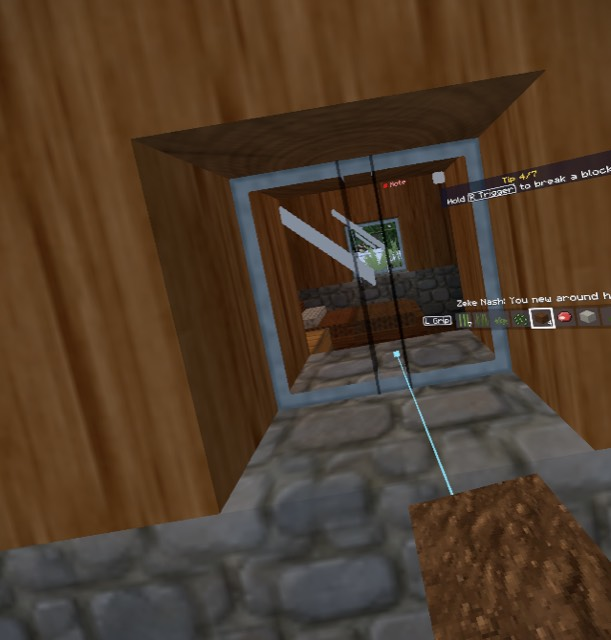

## 09:24:50 - Oh, okay. I see. You have text

- **Transcript:** Oh, okay. I see. You have text
- **Status:** open
- **Build:** 0.95 (2913b0a, M1-M4 (device-tested; ship riding, chests, comfort options, weapon wheel))
- **World:** Quest World (seed 2943808052895834412)
- **Dimension:** Surface
- **Biome:** Taiga
- **Position:** -247.8 77.0 -1047.7
- **Facing:** north (yaw 358, pitch 1)
- **Held:** Dirt x4
- **Mount:** on foot
- **Looking at:** nothing
- **Mode:** Creative, health 20/20
- **Time:** day 3 14:50, clear
- **Fps:** 71
- **Levels:** mic -39 dBFS, game sound -40 dBFS
- **Length:** 3.1 s (voice 1.3 s)
- **Just before:** -30s closed ChestMenu; -23s message: Jasper Ingram: Hot one today.; -15s message: Otis Ingram: Rain'd do the fields good.; -14s opened MerchantMenu; -12s closed MerchantMenu; -7s message: Zeke Nash: You new around here?; -4s message: Flora Wainwright: Work never ends.
- **Repro (Mac):** `./snap.sh note --seed 2943808052895834412 --x -247.8 --z -1047.7 --yaw 2 --pitch 1 --time 0.369`
- **Audio (this Mac):** /Users/darthvadar/Documents/Blocksmith/QuestVoiceNotes/raw/vn-20261010-092450-887.aac

## 09:24:54 - So it's the same thing when you tap on them. Okay. Um, fun. Got a... O

- **Transcript:** So it's the same thing when you tap on them. Okay. Um, fun. Got a... Okay, crafting table looks nice. Yeah, that's a real good job on the crafting table. I mean, still has a pixelated look. The bed looks sharp
- **Status:** open
- **Build:** 0.95 (2913b0a, M1-M4 (device-tested; ship riding, chests, comfort options, weapon wheel))
- **World:** Quest World (seed 2943808052895834412)
- **Dimension:** Surface
- **Biome:** Snowy Taiga
- **Position:** -251.1 77.0 -1047.3
- **Facing:** west (yaw 250, pitch -38)
- **Held:** Dirt x4
- **Mount:** on foot
- **Looking at:** nothing
- **Mode:** Creative, health 20/20, screen ChestMenu
- **Time:** day 3 14:55, clear
- **Fps:** 72
- **Levels:** mic -37 dBFS, game sound -38 dBFS
- **Length:** 16.5 s (voice 8.1 s)
- **Just before:** -26s message: Jasper Ingram: Hot one today.; -18s message: Otis Ingram: Rain'd do the fields good.; -18s opened MerchantMenu; -16s closed MerchantMenu; -11s message: Zeke Nash: You new around here?; -8s message: Flora Wainwright: Work never ends.; -1s opened ChestMenu
- **While talking:** -4s walked into Snowy Taiga; -4s closed ChestMenu; -2s walked into Taiga
- **Position at the end:** -243.4 77.0 -1047.7
- **Repro (Mac):** `./snap.sh note --seed 2943808052895834412 --x -251.1 --z -1047.3 --yaw 110 --pitch -38 --time 0.372`
- **Audio (this Mac):** /Users/darthvadar/Documents/Blocksmith/QuestVoiceNotes/raw/vn-20261010-092454-507.aac

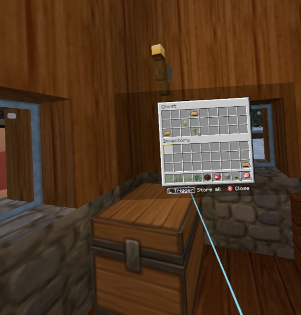

## 09:25:21 - Yeah, work never ends. We're gonna have to find a few more lines besid

- **Transcript:** Yeah, work never ends. We're gonna have to find a few more lines besides that one
- **Status:** open
- **Build:** 0.95 (2913b0a, M1-M4 (device-tested; ship riding, chests, comfort options, weapon wheel))
- **World:** Quest World (seed 2943808052895834412)
- **Dimension:** Surface
- **Biome:** Taiga
- **Position:** -243.4 78.0 -1036.4
- **Facing:** east (yaw 105, pitch -15)
- **Held:** Dirt x4
- **Mount:** on foot
- **Looking at:** Short Grass at -242 78 -1036
- **Mode:** Creative, health 20/20
- **Time:** day 3 15:26, clear
- **Fps:** 70
- **Levels:** mic -36 dBFS, game sound -28 dBFS
- **Length:** 5.6 s (voice 3.4 s)
- **Just before:** -27s opened ChestMenu; -26s walked into Snowy Taiga; -25s closed ChestMenu; -24s walked into Taiga; -8s message: Flora Wainwright: Howdy.; -5s message: Minnie Merriweather: Work never ends.; -2s message: Minnie Merriweather: You new around here?
- **While talking:** -3s message: Flying
- **Position at the end:** -307.3 91.6 -1069.1
- **Repro (Mac):** `./snap.sh note --seed 2943808052895834412 --x -243.4 --z -1036.4 --yaw -105 --pitch -15 --time 0.394`
- **Audio (this Mac):** /Users/darthvadar/Documents/Blocksmith/QuestVoiceNotes/raw/vn-20261010-092521-307.aac

## 09:25:29 - And if we're gonna make the Nether on the ground, probably don't need 

- **Transcript:** And if we're gonna make the Nether on the ground, probably don't need these portals spawning everywhere
- **Status:** open
- **Build:** 0.95 (2913b0a, M1-M4 (device-tested; ship riding, chests, comfort options, weapon wheel))
- **World:** Quest World (seed 2943808052895834412)
- **Dimension:** Surface
- **Biome:** Taiga
- **Position:** -298.2 84.5 -1051.2
- **Facing:** south (yaw 186, pitch -35)
- **Held:** Dirt x4
- **Mount:** on foot
- **Looking at:** nothing
- **Mode:** Creative, health 20/20
- **Time:** day 3 15:35, clear
- **Fps:** 64
- **Levels:** mic -32 dBFS, game sound -100 dBFS
- **Length:** 6.1 s (voice 3.2 s)
- **Just before:** -15s message: Flora Wainwright: Howdy.; -12s message: Minnie Merriweather: Work never ends.; -9s message: Minnie Merriweather: You new around here?; -6s message: Flying; -1s message: Walking
- **While talking:** -4s holding Raw Mutton; -4s message: Raw Mutton; -3s holding White Wool; -3s message: White Wool; -3s holding Lily Pad; -3s message: Lily Pad; -3s holding Raw Porkchop; -3s message: Raw Porkchop; -2s opened ChestMenu
- **Position at the end:** -300.6 78.0 -1046.3
- **Repro (Mac):** `./snap.sh note --seed 2943808052895834412 --x -298.2 --z -1051.2 --yaw 174 --pitch -35 --time 0.400`
- **Audio (this Mac):** /Users/darthvadar/Documents/Blocksmith/QuestVoiceNotes/raw/vn-20261010-092529-486.aac

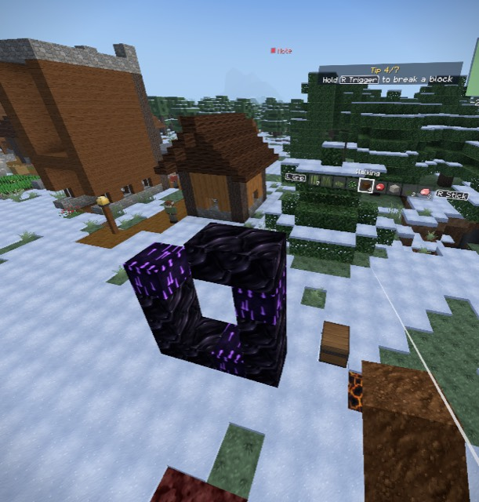

## 09:25:35 - These broken portals, not really any point. Probably a bunch of stuff 

- **Transcript:** These broken portals, not really any point. Probably a bunch of stuff we'll have to decide to get rid of. Gold block looks nice. Very nice
- **Status:** open
- **Build:** 0.95 (2913b0a, M1-M4 (device-tested; ship riding, chests, comfort options, weapon wheel))
- **World:** Quest World (seed 2943808052895834412)
- **Dimension:** Surface
- **Biome:** Taiga
- **Position:** -300.6 78.0 -1046.3
- **Facing:** east (yaw 80, pitch -30)
- **Held:** Raw Porkchop x3
- **Mount:** on foot
- **Looking at:** nothing
- **Mode:** Creative, health 20/20, screen ChestMenu
- **Time:** day 3 15:43, clear
- **Fps:** 68
- **Levels:** mic -42 dBFS, game sound -26 dBFS
- **Length:** 9.7 s (voice 3.8 s)
- **Just before:** -22s message: Flora Wainwright: Howdy.; -18s message: Minnie Merriweather: Work never ends.; -15s message: Minnie Merriweather: You new around here?; -12s message: Flying; -7s message: Walking; -5s holding Raw Mutton; -5s message: Raw Mutton; -5s holding White Wool; -5s message: White Wool; -4s holding Lily Pad; -4s message: Lily Pad; -4s holding Raw Porkchop; -4s message: Raw Porkchop; -3s opened ChestMenu
- **While talking:** -3s closed ChestMenu; -1s message: Gideon Merriman: When I was young this was all prairie.
- **Position at the end:** -291.9 78.0 -1043.5
- **Repro (Mac):** `./snap.sh note --seed 2943808052895834412 --x -300.6 --z -1046.3 --yaw -80 --pitch -30 --time 0.405`
- **Audio (this Mac):** /Users/darthvadar/Documents/Blocksmith/QuestVoiceNotes/raw/vn-20261010-092535-627.aac

## 09:25:54 - Render distance set to 13. So yeah, we're still having issues with the

- **Transcript:** Render distance set to 13. So yeah, we're still having issues with the render distance. So it's just, it's lowering over time. So
- **Status:** open
- **Build:** 0.95 (2913b0a, M1-M4 (device-tested; ship riding, chests, comfort options, weapon wheel))
- **World:** Quest World (seed 2943808052895834412)
- **Dimension:** Surface
- **Biome:** Snowy Plains
- **Position:** -338.8 103.9 -1429.9
- **Facing:** north (yaw 344, pitch -16)
- **Held:** Raw Porkchop x3
- **Mount:** on foot, flying
- **Looking at:** nothing
- **Mode:** Creative, health 20/20
- **Time:** day 3 16:04, clear
- **Fps:** 62
- **Levels:** mic -33 dBFS, game sound -33 dBFS
- **Length:** 8.6 s (voice 5.1 s)
- **Just before:** -30s message: Flying; -25s message: Walking; -23s holding Raw Mutton; -23s message: Raw Mutton; -23s holding White Wool; -23s message: White Wool; -22s holding Lily Pad; -22s message: Lily Pad; -22s holding Raw Porkchop; -22s message: Raw Porkchop; -21s opened ChestMenu; -16s closed ChestMenu; -14s message: Gideon Merriman: When I was young this was all prairie.; -6s message: Flying; -2s message: Render distance 13 to keep the frame rate (VR Comfort & Controls); -1s walked into Snowy Plains
- **While talking:** -3s message: Village marked on the map; -3s message: Walking
- **Position at the end:** -317.9 68.9 -1610.6
- **Repro (Mac):** `./snap.sh note --seed 2943808052895834412 --x -338.8 --z -1429.9 --yaw 16 --pitch -16 --time 0.420`
- **Audio (this Mac):** /Users/darthvadar/Documents/Blocksmith/QuestVoiceNotes/raw/vn-20261010-092554-947.aac

## 09:26:03 - I don't know if you actually made a permanent efficiency improvement i

- **Transcript:** I don't know if you actually made a permanent efficiency improvement in that regard
- **Status:** open
- **Build:** 0.95 (2913b0a, M1-M4 (device-tested; ship riding, chests, comfort options, weapon wheel))
- **World:** Quest World (seed 2943808052895834412)
- **Dimension:** Surface
- **Biome:** Snowy Plains
- **Position:** -328.3 70.0 -1624.7
- **Facing:** north (yaw 347, pitch -59)
- **Held:** Raw Porkchop x3
- **Mount:** on foot
- **Looking at:** Snow Block at -329 71 -1626
- **Mode:** Creative, health 20/20
- **Time:** day 3 16:14, clear
- **Fps:** 71
- **Levels:** mic -25 dBFS, game sound -20 dBFS
- **Length:** 6.5 s (voice 3.3 s)
- **Just before:** -30s opened ChestMenu; -25s closed ChestMenu; -22s message: Gideon Merriman: When I was young this was all prairie.; -14s message: Flying; -11s message: Render distance 13 to keep the frame rate (VR Comfort & Controls); -9s walked into Snowy Plains; -7s message: Village marked on the map; -7s message: Walking
- **While talking:** -5s message: Nell Nash: Take a look, I've got good stock.
- **Position at the end:** -343.4 70.0 -1622.3
- **Repro (Mac):** `./snap.sh note --seed 2943808052895834412 --x -328.3 --z -1624.7 --yaw 13 --pitch -59 --time 0.427`
- **Audio (this Mac):** /Users/darthvadar/Documents/Blocksmith/QuestVoiceNotes/raw/vn-20261010-092603-427.aac

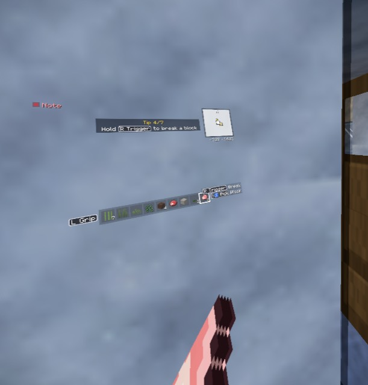

## 09:26:10 - Oh, I like the, the chef building. That's really cool. Oh, and they ta

- **Transcript:** Oh, I like the, the chef building. That's really cool. Oh, and they take money. Okay. So this guy was updated. The rest of them weren't updated. I have a wallet. We should have a, uh, amount of cash up in the side
- **Status:** open
- **Build:** 0.95 (2913b0a, M1-M4 (device-tested; ship riding, chests, comfort options, weapon wheel))
- **World:** Quest World (seed 2943808052895834412)
- **Dimension:** Surface
- **Biome:** Snowy Plains
- **Position:** -342.5 70.0 -1619.6
- **Facing:** south-west (yaw 215, pitch -10)
- **Held:** Raw Porkchop x3
- **Mount:** on foot
- **Looking at:** Furnace at -345 71 -1617
- **Mode:** Creative, health 20/20
- **Time:** day 3 16:23, clear
- **Fps:** 72
- **Levels:** mic -31 dBFS, game sound -32 dBFS
- **Length:** 14.6 s (voice 8.6 s)
- **Just before:** -29s message: Gideon Merriman: When I was young this was all prairie.; -21s message: Flying; -18s message: Render distance 13 to keep the frame rate (VR Comfort & Controls); -16s walked into Snowy Plains; -14s message: Village marked on the map; -14s message: Walking; -7s message: Nell Nash: Take a look, I've got good stock.; -1s message: Silas Coffey: Afternoon.
- **While talking:** -4s opened ShopMenu
- **Position at the end:** -341.7 70.0 -1619.5
- **Repro (Mac):** `./snap.sh note --seed 2943808052895834412 --x -342.5 --z -1619.6 --yaw 145 --pitch -10 --time 0.433`
- **Audio (this Mac):** /Users/darthvadar/Documents/Blocksmith/QuestVoiceNotes/raw/vn-20261010-092610-447.aac

## 09:26:24 - And then I'm not sure how emeralds would feed into that. I guess an em

- **Transcript:** And then I'm not sure how emeralds would feed into that. I guess an emerald would be a dollar. Yeah
- **Status:** open
- **Build:** 0.95 (2913b0a, M1-M4 (device-tested; ship riding, chests, comfort options, weapon wheel))
- **World:** Quest World (seed 2943808052895834412)
- **Dimension:** Surface
- **Biome:** Snowy Plains
- **Position:** -341.7 70.0 -1619.5
- **Facing:** south-west (yaw 229, pitch -9)
- **Held:** Raw Porkchop x3
- **Mount:** on foot
- **Looking at:** nothing
- **Mode:** Creative, health 20/20, screen ShopMenu
- **Time:** day 3 16:40, clear
- **Fps:** 72
- **Levels:** mic -34 dBFS, game sound -32 dBFS
- **Length:** 7.3 s (voice 3.5 s)
- **Just before:** -28s message: Village marked on the map; -28s message: Walking; -21s message: Nell Nash: Take a look, I've got good stock.; -15s message: Silas Coffey: Afternoon.; -14s opened ShopMenu
- **Position at the end:** -341.7 70.0 -1619.5
- **Repro (Mac):** `./snap.sh note --seed 2943808052895834412 --x -341.7 --z -1619.5 --yaw 131 --pitch -9 --time 0.445`
- **Audio (this Mac):** /Users/darthvadar/Documents/Blocksmith/QuestVoiceNotes/raw/vn-20261010-092624-867.aac

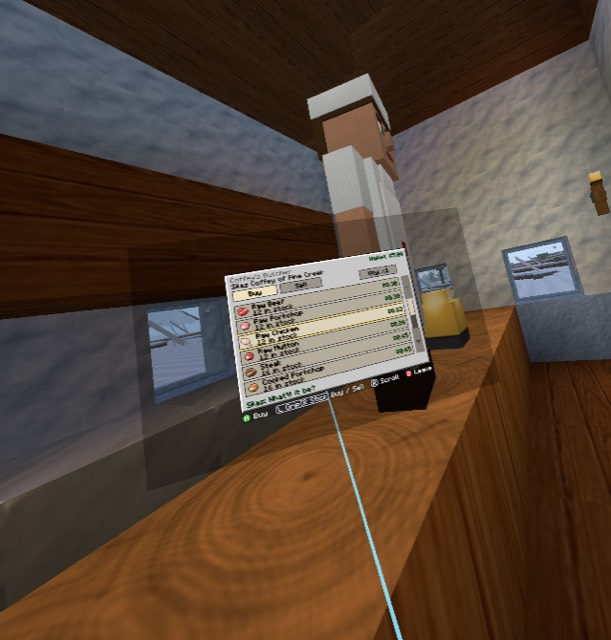

## 09:26:34 - Um, let's see. Okay. Yeah, this is really cool. I really like what was

- **Transcript:** Um, let's see. Okay. Yeah, this is really cool. I really like what was done with the chef. Very good
- **Status:** open
- **Build:** 0.95 (2913b0a, M1-M4 (device-tested; ship riding, chests, comfort options, weapon wheel))
- **World:** Quest World (seed 2943808052895834412)
- **Dimension:** Surface
- **Biome:** Snowy Plains
- **Position:** -341.7 70.0 -1619.5
- **Facing:** south-west (yaw 229, pitch -9)
- **Held:** Raw Porkchop x3
- **Mount:** on foot
- **Looking at:** nothing
- **Mode:** Creative, health 20/20, screen ShopMenu
- **Time:** day 3 16:51, clear
- **Fps:** 72
- **Levels:** mic -32 dBFS, game sound -34 dBFS
- **Length:** 6.7 s (voice 3.6 s)
- **Just before:** -24s message: Silas Coffey: Afternoon.; -23s opened ShopMenu
- **While talking:** -2s closed ShopMenu
- **Position at the end:** -343.3 70.0 -1620.7
- **Repro (Mac):** `./snap.sh note --seed 2943808052895834412 --x -341.7 --z -1619.5 --yaw 131 --pitch -9 --time 0.453`
- **Audio (this Mac):** /Users/darthvadar/Documents/Blocksmith/QuestVoiceNotes/raw/vn-20261010-092634-067.aac

## 09:26:46 - So that's good

- **Transcript:** So that's good
- **Status:** open
- **Build:** 0.95 (2913b0a, M1-M4 (device-tested; ship riding, chests, comfort options, weapon wheel))
- **World:** Quest World (seed 2943808052895834412)
- **Dimension:** Surface
- **Biome:** Snowy Plains
- **Position:** -343.6 69.9 -1623.4
- **Facing:** west (yaw 285, pitch 16)
- **Held:** Raw Porkchop x3
- **Mount:** on foot
- **Looking at:** nothing
- **Mode:** Creative, health 20/20, screen PauseMenu
- **Time:** day 3 17:04, clear
- **Fps:** 72
- **Levels:** mic -41 dBFS, game sound -30 dBFS
- **Length:** 2.1 s (voice 0.4 s)
- **Just before:** -9s closed ShopMenu; -2s opened PauseMenu
- **Repro (Mac):** `./snap.sh note --seed 2943808052895834412 --x -343.6 --z -1623.4 --yaw 75 --pitch 16 --time 0.461`
- **Audio (this Mac):** /Users/darthvadar/Documents/Blocksmith/QuestVoiceNotes/raw/vn-20261010-092646-327.aac

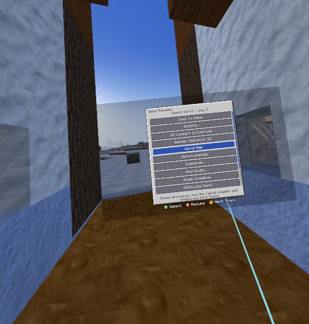

## 09:34:45 - That's cool

- **Transcript:** That's cool
- **Status:** open
- **Build:** 0.95 (2913b0a, M1-M4 (device-tested; ship riding, chests, comfort options, weapon wheel))
- **World:** Quest World (seed 2943808052895834412)
- **Dimension:** Surface
- **Biome:** Snowy Plains
- **Position:** -327.5 70.0 -1625.3
- **Facing:** south-east (yaw 124, pitch -58)
- **Held:** Lily Pad x2
- **Mount:** on foot
- **Looking at:** Spruce Door at -328 71 -1626
- **Mode:** Creative, health 20/20
- **Time:** day 3 17:29, clear
- **Fps:** 90
- **Levels:** mic -36 dBFS, game sound -26 dBFS
- **Length:** 2.0 s (voice 0.4 s)
- **Just before:** -30s opened PauseMenu; -18s closed PauseMenu; -7s message: Nell Nash: Take a look, I've got good stock.; -7s message: Nell Nash: We're closed. Come back a little later.; -2s holding Lily Pad; -2s message: Lily Pad
- **Repro (Mac):** `./snap.sh note --seed 2943808052895834412 --x -327.5 --z -1625.3 --yaw -124 --pitch -58 --time 0.479`
- **Audio (this Mac):** /Users/darthvadar/Documents/Blocksmith/QuestVoiceNotes/raw/vn-20261010-093445-923.aac

## 09:34:54 - All right. Well, I'm gonna go over to survival

- **Transcript:** All right. Well, I'm gonna go over to survival
- **Status:** open
- **Build:** 0.95 (2913b0a, M1-M4 (device-tested; ship riding, chests, comfort options, weapon wheel))
- **World:** Quest World (seed 2943808052895834412)
- **Dimension:** Surface
- **Biome:** Snowy Plains
- **Position:** -306.5 69.0 -1619.9
- **Facing:** north-east (yaw 65, pitch -24)
- **Held:** Lily Pad x2
- **Mount:** on foot
- **Looking at:** Snow at -305 69 -1622
- **Mode:** Creative, health 20/20
- **Time:** day 3 17:37, clear
- **Fps:** 90
- **Levels:** mic -39 dBFS, game sound -26 dBFS
- **Length:** 4.3 s (voice 1.1 s)
- **Just before:** -27s closed PauseMenu; -15s message: Nell Nash: Take a look, I've got good stock.; -15s message: Nell Nash: We're closed. Come back a little later.; -10s holding Lily Pad; -10s message: Lily Pad; -3s opened PauseMenu; -2s closed PauseMenu
- **Repro (Mac):** `./snap.sh note --seed 2943808052895834412 --x -306.5 --z -1619.9 --yaw -65 --pitch -24 --time 0.485`
- **Audio (this Mac):** /Users/darthvadar/Documents/Blocksmith/QuestVoiceNotes/raw/vn-20261010-093454-063.aac

## 09:35:05 - I guess those snowballs aren't a thing. They just fill up my inventory

- **Transcript:** I guess those snowballs aren't a thing. They just fill up my inventory. I don't like it
- **Status:** open
- **Build:** 0.95 (2913b0a, M1-M4 (device-tested; ship riding, chests, comfort options, weapon wheel))
- **World:** Quest World (seed 2943808052895834412)
- **Dimension:** Surface
- **Biome:** Snowy Plains
- **Position:** -305.1 69.0 -1621.4
- **Facing:** north (yaw 17, pitch 0)
- **Held:** White Wool x1
- **Mount:** on foot
- **Looking at:** nothing
- **Mode:** Survival, health 20/20
- **Time:** day 3 17:49, clear
- **Fps:** 90
- **Levels:** mic -29 dBFS, game sound -25 dBFS
- **Length:** 5.4 s (voice 2.7 s)
- **Just before:** -27s message: Nell Nash: Take a look, I've got good stock.; -26s message: Nell Nash: We're closed. Come back a little later.; -21s holding Lily Pad; -21s message: Lily Pad; -14s opened PauseMenu; -13s closed PauseMenu; -11s opened PauseMenu; -10s message: Survival mode; -10s closed PauseMenu; -9s holding Raw Porkchop; -9s message: Raw Porkchop; -9s holding Lily Pad; -9s message: Lily Pad; -9s holding White Wool; -9s message: White Wool; -4s opened InventoryMenu; -1s closed InventoryMenu
- **Repro (Mac):** `./snap.sh note --seed 2943808052895834412 --x -305.1 --z -1621.4 --yaw -17 --pitch 0 --time 0.493`
- **Audio (this Mac):** /Users/darthvadar/Documents/Blocksmith/QuestVoiceNotes/raw/vn-20261010-093505-343.aac

## 09:35:53 - Okay, so we got all these shops and everything. Where the fuck does ev

- **Transcript:** Okay, so we got all these shops and everything. Where the fuck does everybody sleep?
- **Status:** open
- **Build:** 0.95 (2913b0a, M1-M4 (device-tested; ship riding, chests, comfort options, weapon wheel))
- **World:** Quest World (seed 2943808052895834412)
- **Dimension:** Surface
- **Biome:** Snowy Plains
- **Position:** -343.7 70.0 -1624.6
- **Facing:** west (yaw 251, pitch -13)
- **Held:** empty hand
- **Mount:** on foot
- **Looking at:** nothing
- **Mode:** Survival, health 20/20
- **Time:** day 3 18:47, clear
- **Fps:** 90
- **Levels:** mic -35 dBFS, game sound -19 dBFS
- **Length:** 5.4 s (voice 3.3 s)
- **Just before:** -20s message: Edna Jessup: Mind the dark out there.; -12s message: Mabel Holloway: Late to be out.
- **Repro (Mac):** `./snap.sh note --seed 2943808052895834412 --x -343.7 --z -1624.6 --yaw 109 --pitch -13 --time 0.533`
- **Audio (this Mac):** /Users/darthvadar/Documents/Blocksmith/QuestVoiceNotes/raw/vn-20261010-093553-803.aac

## 09:36:04 - There's an anvil in here? Christ

- **Transcript:** There's an anvil in here? Christ
- **Status:** open
- **Build:** 0.95 (2913b0a, M1-M4 (device-tested; ship riding, chests, comfort options, weapon wheel))
- **World:** Quest World (seed 2943808052895834412)
- **Dimension:** Surface
- **Biome:** Snowy Plains
- **Position:** -325.2 70.0 -1617.4
- **Facing:** south-east (yaw 138, pitch -47)
- **Held:** empty hand
- **Mount:** on foot
- **Looking at:** Anvil at -325 70 -1617
- **Mode:** Survival, health 20/20
- **Time:** day 3 19:00, clear
- **Fps:** 90
- **Levels:** mic -38 dBFS, game sound -33 dBFS
- **Length:** 3.0 s (voice 1.2 s)
- **Just before:** -23s message: Mabel Holloway: Late to be out.; -4s message: Luther Stroud: Late to be out.
- **Repro (Mac):** `./snap.sh note --seed 2943808052895834412 --x -325.2 --z -1617.4 --yaw -138 --pitch -47 --time 0.542`
- **Audio (this Mac):** /Users/darthvadar/Documents/Blocksmith/QuestVoiceNotes/raw/vn-20261010-093604-383.aac

## 09:36:07 - Get one of them a freaking anvil?

- **Transcript:** Get one of them a freaking anvil?
- **Status:** open
- **Build:** 0.95 (2913b0a, M1-M4 (device-tested; ship riding, chests, comfort options, weapon wheel))
- **World:** Quest World (seed 2943808052895834412)
- **Dimension:** Surface
- **Biome:** Snowy Plains
- **Position:** -329.6 70.0 -1617.6
- **Facing:** west (yaw 255, pitch -25)
- **Held:** empty hand
- **Mount:** on foot
- **Looking at:** Blue Bed at -331 70 -1618
- **Mode:** Survival, health 20/20
- **Time:** day 3 19:03, clear
- **Fps:** 90
- **Levels:** mic -31 dBFS, game sound -25 dBFS
- **Length:** 2.4 s (voice 1.0 s)
- **Just before:** -26s message: Mabel Holloway: Late to be out.; -7s message: Luther Stroud: Late to be out.; -1s message: Respawn point set
- **Repro (Mac):** `./snap.sh note --seed 2943808052895834412 --x -329.6 --z -1617.6 --yaw 105 --pitch -25 --time 0.544`
- **Audio (this Mac):** /Users/darthvadar/Documents/Blocksmith/QuestVoiceNotes/raw/vn-20261010-093607-223.aac

## 09:36:10 - I mean, I guess that makes sense

- **Transcript:** I mean, I guess that makes sense
- **Status:** open
- **Build:** 0.95 (2913b0a, M1-M4 (device-tested; ship riding, chests, comfort options, weapon wheel))
- **World:** Quest World (seed 2943808052895834412)
- **Dimension:** Surface
- **Biome:** Snowy Plains
- **Position:** -329.6 70.0 -1617.6
- **Facing:** south (yaw 181, pitch -32)
- **Held:** empty hand
- **Mount:** on foot
- **Looking at:** Packed Ice at -330 70 -1616
- **Mode:** Survival, health 20/20
- **Time:** day 3 19:07, clear
- **Fps:** 90
- **Levels:** mic -29 dBFS, game sound -33 dBFS
- **Length:** 2.6 s (voice 1.1 s)
- **Just before:** -29s message: Mabel Holloway: Late to be out.; -10s message: Luther Stroud: Late to be out.; -4s message: Respawn point set
- **Repro (Mac):** `./snap.sh note --seed 2943808052895834412 --x -329.6 --z -1617.6 --yaw 179 --pitch -32 --time 0.547`
- **Audio (this Mac):** /Users/darthvadar/Documents/Blocksmith/QuestVoiceNotes/raw/vn-20261010-093610-262.aac

## 09:36:15 - That's a high-value item

- **Transcript:** That's a high-value item
- **Status:** open
- **Build:** 0.95 (2913b0a, M1-M4 (device-tested; ship riding, chests, comfort options, weapon wheel))
- **World:** Quest World (seed 2943808052895834412)
- **Dimension:** Surface
- **Biome:** Snowy Plains
- **Position:** -335.3 70.9 -1623.3
- **Facing:** west (yaw 274, pitch -21)
- **Held:** empty hand
- **Mount:** on foot
- **Looking at:** Dirt Path at -340 70 -1624
- **Mode:** Survival, health 20/20
- **Time:** day 4 06:19, clear
- **Fps:** 90
- **Levels:** mic -36 dBFS, game sound -30 dBFS
- **Length:** 2.3 s (voice 0.9 s)
- **Just before:** -15s message: Luther Stroud: Late to be out.; -10s message: Respawn point set; -4s message: Good morning
- **Repro (Mac):** `./snap.sh note --seed 2943808052895834412 --x -335.3 --z -1623.3 --yaw 86 --pitch -21 --time 0.014`
- **Audio (this Mac):** /Users/darthvadar/Documents/Blocksmith/QuestVoiceNotes/raw/vn-20261010-093615-702.aac

## 09:36:19 - It's like 39 iron to make one of those

- **Transcript:** It's like 39 iron to make one of those
- **Status:** open
- **Build:** 0.95 (2913b0a, M1-M4 (device-tested; ship riding, chests, comfort options, weapon wheel))
- **World:** Quest World (seed 2943808052895834412)
- **Dimension:** Surface
- **Biome:** Snowy Plains
- **Position:** -351.7 70.0 -1622.4
- **Facing:** south (yaw 165, pitch -18)
- **Held:** empty hand
- **Mount:** on foot
- **Looking at:** Snow at -352 70 -1621
- **Mode:** Survival, health 20/20
- **Time:** day 4 06:24, clear
- **Fps:** 90
- **Levels:** mic -32 dBFS, game sound -31 dBFS
- **Length:** 3.1 s (voice 1.6 s)
- **Just before:** -19s message: Luther Stroud: Late to be out.; -14s message: Respawn point set; -8s message: Good morning
- **Repro (Mac):** `./snap.sh note --seed 2943808052895834412 --x -351.7 --z -1622.4 --yaw -165 --pitch -18 --time 0.017`
- **Audio (this Mac):** /Users/darthvadar/Documents/Blocksmith/QuestVoiceNotes/raw/vn-20261010-093619-702.aac

## 09:36:34 - Okay, so the crafting menu... Hmm, okay, yeah, makes-- that's fine

- **Transcript:** Okay, so the crafting menu... Hmm, okay, yeah, makes-- that's fine
- **Status:** open
- **Build:** 0.95 (2913b0a, M1-M4 (device-tested; ship riding, chests, comfort options, weapon wheel))
- **World:** Quest World (seed 2943808052895834412)
- **Dimension:** Surface
- **Biome:** Snowy Plains
- **Position:** -308.4 69.0 -1617.8
- **Facing:** north-east (yaw 67, pitch -5)
- **Held:** empty hand
- **Mount:** on foot
- **Looking at:** nothing
- **Mode:** Survival, health 20/20, screen InventoryMenu
- **Time:** day 4 06:41, clear
- **Fps:** 86
- **Levels:** mic -68 dBFS, game sound -29 dBFS
- **Length:** 5.1 s (voice 2.2 s)
- **Just before:** -28s message: Respawn point set; -22s message: Good morning; -13s message: Cora Jessup: Early start, stranger?; -1s opened InventoryMenu
- **Repro (Mac):** `./snap.sh note --seed 2943808052895834412 --x -308.4 --z -1617.8 --yaw -67 --pitch -5 --time 0.028`
- **Audio (this Mac):** /Users/darthvadar/Documents/Blocksmith/QuestVoiceNotes/raw/vn-20261010-093634-042.aac

## 09:36:40 - Oh yeah, if we can make the slots from eight by five down to, um, mayb

- **Transcript:** Oh yeah, if we can make the slots from eight by five down to, um, maybe six by five, that way it's easier to
- **Status:** open
- **Build:** 0.95 (2913b0a, M1-M4 (device-tested; ship riding, chests, comfort options, weapon wheel))
- **World:** Quest World (seed 2943808052895834412)
- **Dimension:** Surface
- **Biome:** Snowy Plains
- **Position:** -308.4 69.0 -1617.8
- **Facing:** north-east (yaw 67, pitch -5)
- **Held:** empty hand
- **Mount:** on foot
- **Looking at:** nothing
- **Mode:** Survival, health 20/20, screen CraftingBookMenu
- **Time:** day 4 06:48, clear
- **Fps:** 89
- **Levels:** mic -27 dBFS, game sound -31 dBFS
- **Length:** 9.9 s (voice 6.2 s)
- **Just before:** -28s message: Good morning; -19s message: Cora Jessup: Early start, stranger?; -7s opened InventoryMenu; -6s opened CraftingBookMenu
- **Position at the end:** -308.4 69.0 -1617.8
- **Repro (Mac):** `./snap.sh note --seed 2943808052895834412 --x -308.4 --z -1617.8 --yaw -67 --pitch -5 --time 0.033`
- **Audio (this Mac):** /Users/darthvadar/Documents/Blocksmith/QuestVoiceNotes/raw/vn-20261010-093640-022.aac

## 09:36:50 - Oh, well

- **Transcript:** Oh, well
- **Status:** open
- **Build:** 0.95 (2913b0a, M1-M4 (device-tested; ship riding, chests, comfort options, weapon wheel))
- **World:** Quest World (seed 2943808052895834412)
- **Dimension:** Surface
- **Biome:** Snowy Plains
- **Position:** -308.4 69.0 -1617.8
- **Facing:** north-east (yaw 67, pitch -5)
- **Held:** empty hand
- **Mount:** on foot
- **Looking at:** nothing
- **Mode:** Survival, health 20/20, screen CraftingBookMenu
- **Time:** day 4 07:00, clear
- **Fps:** 90
- **Levels:** mic -31 dBFS, game sound -32 dBFS
- **Length:** 2.0 s (voice 0.6 s)
- **Just before:** -29s message: Cora Jessup: Early start, stranger?; -17s opened InventoryMenu; -16s opened CraftingBookMenu
- **Repro (Mac):** `./snap.sh note --seed 2943808052895834412 --x -308.4 --z -1617.8 --yaw -67 --pitch -5 --time 0.042`
- **Audio (this Mac):** /Users/darthvadar/Documents/Blocksmith/QuestVoiceNotes/raw/vn-20261010-093650-222.aac

## 09:36:55 - It'll be easier to press the, uh, the

- **Transcript:** It'll be easier to press the, uh, the
- **Status:** open
- **Build:** 0.95 (2913b0a, M1-M4 (device-tested; ship riding, chests, comfort options, weapon wheel))
- **World:** Quest World (seed 2943808052895834412)
- **Dimension:** Surface
- **Biome:** Snowy Plains
- **Position:** -308.4 69.0 -1617.8
- **Facing:** north-east (yaw 67, pitch -5)
- **Held:** empty hand
- **Mount:** on foot
- **Looking at:** nothing
- **Mode:** Survival, health 20/20, screen CraftingBookMenu
- **Time:** day 4 07:06, clear
- **Fps:** 90
- **Levels:** mic -41 dBFS, game sound -29 dBFS
- **Length:** 3.3 s (voice 1.4 s)
- **Just before:** -22s opened InventoryMenu; -21s opened CraftingBookMenu
- **Repro (Mac):** `./snap.sh note --seed 2943808052895834412 --x -308.4 --z -1617.8 --yaw -67 --pitch -5 --time 0.046`
- **Audio (this Mac):** /Users/darthvadar/Documents/Blocksmith/QuestVoiceNotes/raw/vn-20261010-093655-002.aac

## 09:36:58 - The things I want to craft without mispressing

- **Transcript:** The things I want to craft without mispressing
- **Status:** open
- **Build:** 0.95 (2913b0a, M1-M4 (device-tested; ship riding, chests, comfort options, weapon wheel))
- **World:** Quest World (seed 2943808052895834412)
- **Dimension:** Surface
- **Biome:** Snowy Plains
- **Position:** -308.4 69.0 -1617.8
- **Facing:** north-east (yaw 67, pitch -5)
- **Held:** empty hand
- **Mount:** on foot
- **Looking at:** nothing
- **Mode:** Survival, health 20/20, screen CraftingBookMenu
- **Time:** day 4 07:10, clear
- **Fps:** 90
- **Levels:** mic -39 dBFS, game sound -28 dBFS
- **Length:** 3.2 s (voice 1.4 s)
- **Just before:** -25s opened InventoryMenu; -24s opened CraftingBookMenu
- **Repro (Mac):** `./snap.sh note --seed 2943808052895834412 --x -308.4 --z -1617.8 --yaw -67 --pitch -5 --time 0.049`
- **Audio (this Mac):** /Users/darthvadar/Documents/Blocksmith/QuestVoiceNotes/raw/vn-20261010-093658-462.aac

## 09:37:08 - Just did there. I accidentally crafted an axe and I didn't want to

- **Transcript:** Just did there. I accidentally crafted an axe and I didn't want to
- **Status:** open
- **Build:** 0.95 (2913b0a, M1-M4 (device-tested; ship riding, chests, comfort options, weapon wheel))
- **World:** Quest World (seed 2943808052895834412)
- **Dimension:** Surface
- **Biome:** Snowy Plains
- **Position:** -306.6 68.9 -1622.4
- **Facing:** east (yaw 72, pitch -24)
- **Held:** Wooden Axe x1
- **Mount:** on foot
- **Looking at:** nothing
- **Mode:** Survival, health 20/20, screen CraftingBookMenu
- **Time:** day 4 07:22, clear
- **Fps:** 89
- **Levels:** mic -31 dBFS, game sound -29 dBFS
- **Length:** 5.5 s (voice 1.9 s)
- **Just before:** -5s closed CraftingBookMenu; -5s holding Bread; -5s message: Bread; -5s holding Raw Porkchop; -5s message: Raw Porkchop; -5s holding Crafting Table; -5s message: Crafting Table; -4s holding empty hand; -4s opened CraftingBookMenu; -2s holding Wooden Axe
- **Repro (Mac):** `./snap.sh note --seed 2943808052895834412 --x -306.6 --z -1622.4 --yaw -72 --pitch -24 --time 0.057`
- **Audio (this Mac):** /Users/darthvadar/Documents/Blocksmith/QuestVoiceNotes/raw/vn-20261010-093708-742.aac

## 09:37:16 - Either that or maybe you could incorporate so the joysticks also, uh, 

- **Transcript:** Either that or maybe you could incorporate so the joysticks also, uh, affect how, uh
- **Status:** open
- **Build:** 0.95 (2913b0a, M1-M4 (device-tested; ship riding, chests, comfort options, weapon wheel))
- **World:** Quest World (seed 2943808052895834412)
- **Dimension:** Surface
- **Biome:** Snowy Plains
- **Position:** -304.8 68.9 -1623.9
- **Facing:** south-east (yaw 151, pitch -81)
- **Held:** empty hand
- **Mount:** on foot
- **Looking at:** Dirt at -305 65 -1624
- **Mode:** Survival, health 20/20
- **Time:** day 4 07:31, clear
- **Fps:** 90
- **Levels:** mic -23 dBFS, game sound -21 dBFS
- **Length:** 7.2 s (voice 4.1 s)
- **Just before:** -13s closed CraftingBookMenu; -13s holding Bread; -13s message: Bread; -13s holding Raw Porkchop; -13s message: Raw Porkchop; -12s holding Crafting Table; -12s message: Crafting Table; -12s holding empty hand; -12s opened CraftingBookMenu; -10s holding Wooden Axe; -8s closed CraftingBookMenu; -7s message: Zeke Merriweather: Early start, stranger?; -7s holding Spruce Planks; -7s message: Spruce Planks; -7s holding Stick; -7s message: Stick; -7s holding Wooden Pickaxe; -7s message: Wooden Pickaxe; -5s holding empty hand
- **While talking:** -2s holding Wooden Pickaxe; -1s holding empty hand
- **Position at the end:** -304.4 68.9 -1624.5
- **Repro (Mac):** `./snap.sh note --seed 2943808052895834412 --x -304.8 --z -1623.9 --yaw -151 --pitch -81 --time 0.064`
- **Audio (this Mac):** /Users/darthvadar/Documents/Blocksmith/QuestVoiceNotes/raw/vn-20261010-093716-683.aac

## 09:37:24 - How you move in the inventory? 'Cause currently that doesn't happen

- **Transcript:** How you move in the inventory? 'Cause currently that doesn't happen
- **Status:** open
- **Build:** 0.95 (2913b0a, M1-M4 (device-tested; ship riding, chests, comfort options, weapon wheel))
- **World:** Quest World (seed 2943808052895834412)
- **Dimension:** Surface
- **Biome:** Snowy Plains
- **Position:** -304.5 68.9 -1624.4
- **Facing:** south-east (yaw 127, pitch -28)
- **Held:** empty hand
- **Mount:** on foot
- **Looking at:** Dirt Path at -303 68 -1623
- **Mode:** Survival, health 20/20
- **Time:** day 4 07:41, clear
- **Fps:** 90
- **Levels:** mic -31 dBFS, game sound -18 dBFS
- **Length:** 5.0 s (voice 2.1 s)
- **Just before:** -21s closed CraftingBookMenu; -20s holding Bread; -20s message: Bread; -20s holding Raw Porkchop; -20s message: Raw Porkchop; -20s holding Crafting Table; -20s message: Crafting Table; -20s holding empty hand; -19s opened CraftingBookMenu; -18s holding Wooden Axe; -16s closed CraftingBookMenu; -15s message: Zeke Merriweather: Early start, stranger?; -15s holding Spruce Planks; -15s message: Spruce Planks; -15s holding Stick; -15s message: Stick; -14s holding Wooden Pickaxe; -14s message: Wooden Pickaxe; -13s holding empty hand; -5s holding Wooden Pickaxe; -4s holding empty hand
- **Repro (Mac):** `./snap.sh note --seed 2943808052895834412 --x -304.5 --z -1624.4 --yaw -127 --pitch -28 --time 0.070`
- **Audio (this Mac):** /Users/darthvadar/Documents/Blocksmith/QuestVoiceNotes/raw/vn-20261010-093724-342.aac

## 09:37:35 - I still hear that weird drippy water sound

- **Transcript:** I still hear that weird drippy water sound
- **Status:** open
- **Build:** 0.95 (2913b0a, M1-M4 (device-tested; ship riding, chests, comfort options, weapon wheel))
- **World:** Quest World (seed 2943808052895834412)
- **Dimension:** Surface
- **Biome:** Snowy Plains
- **Position:** -304.7 64.5 -1623.5
- **Facing:** south-east (yaw 149, pitch -81)
- **Held:** Wooden Pickaxe x1
- **Mount:** on foot
- **Looking at:** Stone at -305 64 -1624
- **Mode:** Survival, health 20/20
- **Time:** day 4 07:54, clear
- **Fps:** 86
- **Levels:** mic -31 dBFS, game sound -25 dBFS
- **Length:** 4.4 s (voice 2.4 s)
- **Just before:** -29s holding Wooden Axe; -27s closed CraftingBookMenu; -26s message: Zeke Merriweather: Early start, stranger?; -26s holding Spruce Planks; -26s message: Spruce Planks; -26s holding Stick; -26s message: Stick; -26s holding Wooden Pickaxe; -26s message: Wooden Pickaxe; -24s holding empty hand; -16s holding Wooden Pickaxe; -16s holding empty hand; -11s holding Crafting Table; -11s opened InventoryMenu; -8s closed InventoryMenu; -5s holding empty hand; -5s opened CraftingBookMenu; -4s closed CraftingBookMenu; -3s holding Wooden Pickaxe
- **Repro (Mac):** `./snap.sh note --seed 2943808052895834412 --x -304.7 --z -1623.5 --yaw -149 --pitch -81 --time 0.080`
- **Audio (this Mac):** /Users/darthvadar/Documents/Blocksmith/QuestVoiceNotes/raw/vn-20261010-093735-963.aac

## 09:37:41 - So that's just, yeah

- **Transcript:** So that's just, yeah
- **Status:** open
- **Build:** 0.95 (2913b0a, M1-M4 (device-tested; ship riding, chests, comfort options, weapon wheel))
- **World:** Quest World (seed 2943808052895834412)
- **Dimension:** Surface
- **Biome:** Snowy Plains
- **Position:** -303.9 64.0 -1623.3
- **Facing:** north-east (yaw 29, pitch -27)
- **Held:** Wooden Pickaxe x1
- **Mount:** on foot
- **Looking at:** Stone at -304 65 -1625
- **Mode:** Survival, health 20/20
- **Time:** day 4 08:01, clear
- **Fps:** 90
- **Levels:** mic -34 dBFS, game sound -26 dBFS
- **Length:** 3.2 s (voice 1.0 s)
- **Just before:** -29s holding empty hand; -22s holding Wooden Pickaxe; -21s holding empty hand; -16s holding Crafting Table; -16s opened InventoryMenu; -14s closed InventoryMenu; -11s holding empty hand; -10s opened CraftingBookMenu; -9s closed CraftingBookMenu; -8s holding Wooden Pickaxe
- **Repro (Mac):** `./snap.sh note --seed 2943808052895834412 --x -303.9 --z -1623.3 --yaw -29 --pitch -27 --time 0.084`
- **Audio (this Mac):** /Users/darthvadar/Documents/Blocksmith/QuestVoiceNotes/raw/vn-20261010-093741-282.aac

## 09:37:46 - Feels like I'm stomping in mud over and over again

- **Transcript:** Feels like I'm stomping in mud over and over again
- **Status:** open
- **Build:** 0.95 (2913b0a, M1-M4 (device-tested; ship riding, chests, comfort options, weapon wheel))
- **World:** Quest World (seed 2943808052895834412)
- **Dimension:** Surface
- **Biome:** Snowy Plains
- **Position:** -303.6 64.0 -1623.5
- **Facing:** north (yaw 2, pitch -34)
- **Held:** Wooden Pickaxe x1
- **Mount:** on foot
- **Looking at:** Stone at -304 64 -1626
- **Mode:** Survival, health 20/20
- **Time:** day 4 08:07, clear
- **Fps:** 89
- **Levels:** mic -40 dBFS, game sound -26 dBFS
- **Length:** 4.2 s (voice 2.5 s)
- **Just before:** -27s holding Wooden Pickaxe; -26s holding empty hand; -21s holding Crafting Table; -21s opened InventoryMenu; -19s closed InventoryMenu; -16s holding empty hand; -15s opened CraftingBookMenu; -14s closed CraftingBookMenu; -13s holding Wooden Pickaxe
- **Repro (Mac):** `./snap.sh note --seed 2943808052895834412 --x -303.6 --z -1623.5 --yaw -2 --pitch -34 --time 0.088`
- **Audio (this Mac):** /Users/darthvadar/Documents/Blocksmith/QuestVoiceNotes/raw/vn-20261010-093746-383.aac

## 09:37:51 - Cobblestone looks nice

- **Transcript:** Cobblestone looks nice
- **Status:** open
- **Build:** 0.95 (2913b0a, M1-M4 (device-tested; ship riding, chests, comfort options, weapon wheel))
- **World:** Quest World (seed 2943808052895834412)
- **Dimension:** Surface
- **Biome:** Snowy Plains
- **Position:** -304.7 64.0 -1623.3
- **Facing:** north (yaw 7, pitch -27)
- **Held:** Cobblestone x11
- **Mount:** on foot
- **Looking at:** Dirt at -305 65 -1625
- **Mode:** Survival, health 20/20
- **Time:** day 4 08:13, clear
- **Fps:** 87
- **Levels:** mic -30 dBFS, game sound -26 dBFS
- **Length:** 2.5 s (voice 1.0 s)
- **Just before:** -26s holding Crafting Table; -26s opened InventoryMenu; -24s closed InventoryMenu; -21s holding empty hand; -20s opened CraftingBookMenu; -19s closed CraftingBookMenu; -18s holding Wooden Pickaxe; -2s holding Cobblestone; -2s message: Cobblestone
- **Repro (Mac):** `./snap.sh note --seed 2943808052895834412 --x -304.7 --z -1623.3 --yaw -7 --pitch -27 --time 0.092`
- **Audio (this Mac):** /Users/darthvadar/Documents/Blocksmith/QuestVoiceNotes/raw/vn-20261010-093751-443.aac

## 09:38:24 - Yeah, so tools clearly haven't gotten their visual upgrade yet, but th

- **Transcript:** Yeah, so tools clearly haven't gotten their visual upgrade yet, but that's probably in process, I assume
- **Status:** open
- **Build:** 0.95 (2913b0a, M1-M4 (device-tested; ship riding, chests, comfort options, weapon wheel))
- **World:** Quest World (seed 2943808052895834412)
- **Dimension:** Surface
- **Biome:** Snowy Plains
- **Position:** -288.0 69.0 -1621.7
- **Facing:** east (yaw 77, pitch -29)
- **Held:** Stone Sword x1
- **Mount:** on foot
- **Looking at:** Dirt Path at -286 68 -1623
- **Mode:** Survival, health 20/20
- **Time:** day 4 08:53, clear
- **Fps:** 90
- **Levels:** mic -30 dBFS, game sound -18 dBFS
- **Length:** 7.8 s (voice 4.2 s)
- **Just before:** -29s holding Stone Pickaxe; -21s closed CraftingBookMenu; -20s opened InventoryMenu; -18s holding empty hand; -17s closed InventoryMenu; -16s holding Dirt; -13s holding Stone Pickaxe; -13s message: Stone Pickaxe; -13s holding Stone Sword; -13s message: Stone Sword; -13s holding Stone Axe; -13s message: Stone Axe; -11s holding Stone Sword; -11s message: Stone Sword; -11s holding Stone Pickaxe; -11s message: Stone Pickaxe; -11s holding Dirt; -11s message: Dirt; -10s holding Stone Pickaxe; -10s message: Stone Pickaxe; -9s holding Dirt; -9s message: Dirt; -7s holding empty hand; -1s holding Stone Pickaxe; -1s message: Stone Pickaxe; -1s holding Stone Sword; -1s message: Stone Sword
- **Position at the end:** -261.6 70.0 -1625.5
- **Repro (Mac):** `./snap.sh note --seed 2943808052895834412 --x -288.0 --z -1621.7 --yaw -77 --pitch -29 --time 0.120`
- **Audio (this Mac):** /Users/darthvadar/Documents/Blocksmith/QuestVoiceNotes/raw/vn-20261010-093824-942.aac

## 09:38:38 - Oh yeah, the hunger bar depletes too quickly, so fix that

- **Transcript:** Oh yeah, the hunger bar depletes too quickly, so fix that
- **Status:** open
- **Build:** 0.95 (2913b0a, M1-M4 (device-tested; ship riding, chests, comfort options, weapon wheel))
- **World:** Quest World (seed 2943808052895834412)
- **Dimension:** Surface
- **Biome:** Snowy Plains
- **Position:** -272.7 70.0 -1598.6
- **Facing:** south-west (yaw 222, pitch -47)
- **Held:** Bread x7
- **Mount:** on foot
- **Looking at:** Snow at -274 70 -1598
- **Mode:** Survival, health 20/20
- **Time:** day 4 09:09, clear
- **Fps:** 89
- **Levels:** mic -27 dBFS, game sound -28 dBFS
- **Length:** 4.9 s (voice 1.9 s)
- **Just before:** -30s holding Dirt; -27s holding Stone Pickaxe; -27s message: Stone Pickaxe; -27s holding Stone Sword; -27s message: Stone Sword; -26s holding Stone Axe; -26s message: Stone Axe; -25s holding Stone Sword; -25s message: Stone Sword; -24s holding Stone Pickaxe; -24s message: Stone Pickaxe; -24s holding Dirt; -24s message: Dirt; -23s holding Stone Pickaxe; -23s message: Stone Pickaxe; -22s holding Dirt; -22s message: Dirt; -20s holding empty hand; -15s holding Stone Pickaxe; -15s message: Stone Pickaxe; -14s holding Stone Sword; -14s message: Stone Sword; -3s holding Stone Pickaxe; -3s message: Stone Pickaxe; -1s holding empty hand; -1s holding Crafting Table; -1s message: Crafting Table; -1s holding Bread; -1s message: Bread
- **Repro (Mac):** `./snap.sh note --seed 2943808052895834412 --x -272.7 --z -1598.6 --yaw 138 --pitch -47 --time 0.132`
- **Audio (this Mac):** /Users/darthvadar/Documents/Blocksmith/QuestVoiceNotes/raw/vn-20261010-093838-782.aac

## 09:38:45 - Should only deplete when I'm sprinting really. Otherwise, if I'm just 

- **Transcript:** Should only deplete when I'm sprinting really. Otherwise, if I'm just moving around, it shouldn't change. That's how it works in the actual Minecraft
- **Status:** open
- **Build:** 0.95 (2913b0a, M1-M4 (device-tested; ship riding, chests, comfort options, weapon wheel))
- **World:** Quest World (seed 2943808052895834412)
- **Dimension:** Surface
- **Biome:** Snowy Plains
- **Position:** -278.2 70.0 -1586.0
- **Facing:** south-west (yaw 210, pitch -33)
- **Held:** empty hand
- **Mount:** on foot
- **Looking at:** Snow at -279 70 -1586
- **Mode:** Survival, health 20/20
- **Time:** day 4 09:17, clear
- **Fps:** 89
- **Levels:** mic -27 dBFS, game sound -31 dBFS
- **Length:** 7.9 s (voice 4.7 s)
- **Just before:** -30s holding Stone Pickaxe; -30s message: Stone Pickaxe; -29s holding Dirt; -29s message: Dirt; -27s holding empty hand; -21s holding Stone Pickaxe; -21s message: Stone Pickaxe; -21s holding Stone Sword; -21s message: Stone Sword; -9s holding Stone Pickaxe; -9s message: Stone Pickaxe; -8s holding empty hand; -8s holding Crafting Table; -8s message: Crafting Table; -7s holding Bread; -7s message: Bread; -0s holding Crafting Table; -0s message: Crafting Table; -0s holding empty hand
- **While talking:** -5s holding empty hand; -5s holding Stone Pickaxe; -5s message: Stone Pickaxe
- **Position at the end:** -296.6 71.0 -1560.5
- **Repro (Mac):** `./snap.sh note --seed 2943808052895834412 --x -278.2 --z -1586.0 --yaw 150 --pitch -33 --time 0.137`
- **Audio (this Mac):** /Users/darthvadar/Documents/Blocksmith/QuestVoiceNotes/raw/vn-20261010-093845-203.aac

## 09:38:59 - Okay, so in a cave now. Coal looks weird. It's almost like a liquid th

- **Transcript:** Okay, so in a cave now. Coal looks weird. It's almost like a liquid that's blended into the ground
- **Status:** open
- **Build:** 0.95 (2913b0a, M1-M4 (device-tested; ship riding, chests, comfort options, weapon wheel))
- **World:** Quest World (seed 2943808052895834412)
- **Dimension:** Surface
- **Biome:** Snowy Plains
- **Position:** -278.3 54.3 -1563.1
- **Facing:** east (yaw 100, pitch -66)
- **Held:** Stone Pickaxe x1
- **Mount:** on foot
- **Looking at:** Stone at -276 51 -1563
- **Mode:** Survival, health 20/20
- **Time:** day 4 09:33, clear
- **Fps:** 90
- **Levels:** mic -30 dBFS, game sound -100 dBFS
- **Length:** 8.8 s (voice 4.8 s)
- **Just before:** -23s holding Stone Pickaxe; -23s message: Stone Pickaxe; -22s holding empty hand; -21s holding Crafting Table; -21s message: Crafting Table; -21s holding Bread; -21s message: Bread; -14s holding Crafting Table; -14s message: Crafting Table; -14s holding empty hand; -13s holding Stone Pickaxe; -13s message: Stone Pickaxe
- **Position at the end:** -275.1 52.0 -1562.5
- **Repro (Mac):** `./snap.sh note --seed 2943808052895834412 --x -278.3 --z -1563.1 --yaw -100 --pitch -66 --time 0.148`
- **Audio (this Mac):** /Users/darthvadar/Documents/Blocksmith/QuestVoiceNotes/raw/vn-20261010-093859-022.aac

## 09:39:07 - I don't really like it

- **Transcript:** I don't really like it
- **Status:** open
- **Build:** 0.95 (2913b0a, M1-M4 (device-tested; ship riding, chests, comfort options, weapon wheel))
- **World:** Quest World (seed 2943808052895834412)
- **Dimension:** Surface
- **Biome:** Snowy Plains
- **Position:** -273.6 49.8 -1562.3
- **Facing:** north (yaw 7, pitch -50)
- **Held:** Stone Pickaxe x1
- **Mount:** on foot
- **Looking at:** Stone at -274 49 -1564
- **Mode:** Survival, health 20/20
- **Time:** day 4 09:43, clear
- **Fps:** 90
- **Levels:** mic -31 dBFS, game sound -17 dBFS
- **Length:** 1.9 s (voice 0.7 s)
- **Just before:** -30s holding Crafting Table; -30s message: Crafting Table; -30s holding Bread; -30s message: Bread; -23s holding Crafting Table; -23s message: Crafting Table; -22s holding empty hand; -22s holding Stone Pickaxe; -22s message: Stone Pickaxe
- **Repro (Mac):** `./snap.sh note --seed 2943808052895834412 --x -273.6 --z -1562.3 --yaw -7 --pitch -50 --time 0.156`
- **Audio (this Mac):** /Users/darthvadar/Documents/Blocksmith/QuestVoiceNotes/raw/vn-20261010-093907-603.aac

## 09:39:09 - Still has that compressed look to it

- **Transcript:** Still has that compressed look to it
- **Status:** open
- **Build:** 0.95 (2913b0a, M1-M4 (device-tested; ship riding, chests, comfort options, weapon wheel))
- **World:** Quest World (seed 2943808052895834412)
- **Dimension:** Surface
- **Biome:** Snowy Plains
- **Position:** -275.6 52.0 -1562.8
- **Facing:** north (yaw 351, pitch -19)
- **Held:** Stone Pickaxe x1
- **Mount:** on foot
- **Looking at:** Stone at -276 52 -1566
- **Mode:** Survival, health 20/20
- **Time:** day 4 09:46, clear
- **Fps:** 90
- **Levels:** mic -26 dBFS, game sound -100 dBFS
- **Length:** 2.8 s (voice 1.0 s)
- **Just before:** -25s holding Crafting Table; -25s message: Crafting Table; -25s holding empty hand; -24s holding Stone Pickaxe; -24s message: Stone Pickaxe
- **Repro (Mac):** `./snap.sh note --seed 2943808052895834412 --x -275.6 --z -1562.8 --yaw 9 --pitch -19 --time 0.157`
- **Audio (this Mac):** /Users/darthvadar/Documents/Blocksmith/QuestVoiceNotes/raw/vn-20261010-093909-841.aac

## 09:39:13 - I think everything still has that compressed look. It's just not sharp

- **Transcript:** I think everything still has that compressed look. It's just not sharp. Like, looking at gravel right now, looking at the normal stone, it's just, it's fine, but I don't know, it still has that
- **Status:** open
- **Build:** 0.95 (2913b0a, M1-M4 (device-tested; ship riding, chests, comfort options, weapon wheel))
- **World:** Quest World (seed 2943808052895834412)
- **Dimension:** Surface
- **Biome:** Snowy Plains
- **Position:** -277.5 53.0 -1567.8
- **Facing:** north-east (yaw 38, pitch -51)
- **Held:** Stone Pickaxe x1
- **Mount:** on foot
- **Looking at:** Stone at -277 52 -1570
- **Mode:** Survival, health 20/20
- **Time:** day 4 09:50, clear
- **Fps:** 90
- **Levels:** mic -25 dBFS, game sound -100 dBFS
- **Length:** 10.5 s (voice 6.5 s)
- **Just before:** -28s holding Crafting Table; -28s message: Crafting Table; -28s holding empty hand; -28s holding Stone Pickaxe; -28s message: Stone Pickaxe
- **Position at the end:** -277.2 53.0 -1570.5
- **Repro (Mac):** `./snap.sh note --seed 2943808052895834412 --x -277.5 --z -1567.8 --yaw -38 --pitch -51 --time 0.160`
- **Audio (this Mac):** /Users/darthvadar/Documents/Blocksmith/QuestVoiceNotes/raw/vn-20261010-093913-442.aac

## 09:39:24 - block game slop look to it

- **Transcript:** block game slop look to it
- **Status:** open
- **Build:** 0.95 (2913b0a, M1-M4 (device-tested; ship riding, chests, comfort options, weapon wheel))
- **World:** Quest World (seed 2943808052895834412)
- **Dimension:** Surface
- **Biome:** Snowy Plains
- **Position:** -275.6 49.0 -1590.4
- **Facing:** north-east (yaw 34, pitch -30)
- **Held:** Stone Pickaxe x1
- **Mount:** on foot
- **Looking at:** Stone at -276 50 -1592
- **Mode:** Survival, health 20/20
- **Time:** day 4 10:04, clear
- **Fps:** 90
- **Levels:** mic -25 dBFS, game sound -21 dBFS
- **Length:** 2.8 s (voice 0.9 s)
- **Repro (Mac):** `./snap.sh note --seed 2943808052895834412 --x -275.6 --z -1590.4 --yaw -34 --pitch -30 --time 0.170`
- **Audio (this Mac):** /Users/darthvadar/Documents/Blocksmith/QuestVoiceNotes/raw/vn-20261010-093924-383.aac

## 09:39:51 - Could also just be that I'm used to Minecraft looks, so anything that 

- **Transcript:** Could also just be that I'm used to Minecraft looks, so anything that doesn't look like Minecraft is something that bothers me. I don't know. That could be
- **Status:** open
- **Build:** 0.95 (2913b0a, M1-M4 (device-tested; ship riding, chests, comfort options, weapon wheel))
- **World:** Quest World (seed 2943808052895834412)
- **Dimension:** Surface
- **Biome:** Snowy Plains
- **Position:** -233.8 56.0 -1591.3
- **Facing:** south (yaw 159, pitch -3)
- **Held:** Stone Pickaxe x1
- **Mount:** on foot
- **Looking at:** Coal Ore at -233 57 -1589
- **Mode:** Survival, health 20/20
- **Time:** day 4 10:35, clear
- **Fps:** 90
- **Levels:** mic -24 dBFS, game sound -44 dBFS
- **Length:** 8.6 s (voice 4.8 s)
- **Position at the end:** -233.3 56.0 -1589.5
- **Repro (Mac):** `./snap.sh note --seed 2943808052895834412 --x -233.8 --z -1591.3 --yaw -159 --pitch -3 --time 0.192`
- **Audio (this Mac):** /Users/darthvadar/Documents/Blocksmith/QuestVoiceNotes/raw/vn-20261010-093951-123.aac

## 09:40:03 - What I'm saying is just one

- **Transcript:** What I'm saying is just one
- **Status:** open
- **Build:** 0.95 (2913b0a, M1-M4 (device-tested; ship riding, chests, comfort options, weapon wheel))
- **World:** Quest World (seed 2943808052895834412)
- **Dimension:** Surface
- **Biome:** Snowy Plains
- **Position:** -233.6 56.0 -1590.1
- **Facing:** south (yaw 178, pitch -59)
- **Held:** Stone Pickaxe x1
- **Mount:** on foot
- **Looking at:** Coal Ore at -234 55 -1589
- **Mode:** Survival, health 20/20
- **Time:** day 4 10:50, clear
- **Fps:** 90
- **Levels:** mic -30 dBFS, game sound -19 dBFS
- **Length:** 2.4 s (voice 0.7 s)
- **Repro (Mac):** `./snap.sh note --seed 2943808052895834412 --x -233.6 --z -1590.1 --yaw -178 --pitch -59 --time 0.202`
- **Audio (this Mac):** /Users/darthvadar/Documents/Blocksmith/QuestVoiceNotes/raw/vn-20261010-094003-442.aac

## 09:40:28 - Okay, so why did we copy and paste the naval gun from the capital into

- **Transcript:** Okay, so why did we copy and paste the naval gun from the capital into the Sibe-Siberia base?
- **Status:** open
- **Build:** 0.95 (2913b0a, M1-M4 (device-tested; ship riding, chests, comfort options, weapon wheel))
- **World:** Quest World (seed 2943808052895834412)
- **Dimension:** Surface
- **Biome:** Snowy Plains
- **Position:** -316.9 70.0 -1651.1
- **Facing:** north-west (yaw 318, pitch -22)
- **Held:** Stone Pickaxe x1
- **Mount:** on foot
- **Looking at:** Snow at -319 70 -1654
- **Mode:** Survival, health 20/20
- **Time:** day 4 11:20, clear
- **Fps:** 89
- **Levels:** mic -31 dBFS, game sound -13 dBFS
- **Length:** 10.1 s (voice 5.8 s)
- **Just before:** -4s message: Edna Jessup: You new around here?
- **Position at the end:** -329.0 69.0 -1679.4
- **Repro (Mac):** `./snap.sh note --seed 2943808052895834412 --x -316.9 --z -1651.1 --yaw 42 --pitch -22 --time 0.223`
- **Audio (this Mac):** /Users/darthvadar/Documents/Blocksmith/QuestVoiceNotes/raw/vn-20261010-094028-822.aac

## 09:40:39 - Or is it a part of the capital? Wha-

- **Transcript:** Or is it a part of the capital? Wha-
- **Status:** open
- **Build:** 0.95 (2913b0a, M1-M4 (device-tested; ship riding, chests, comfort options, weapon wheel))
- **World:** Quest World (seed 2943808052895834412)
- **Dimension:** Surface
- **Biome:** Snowy Plains
- **Position:** -326.6 69.0 -1711.2
- **Facing:** north-west (yaw 314, pitch -58)
- **Held:** Stone Pickaxe x1
- **Mount:** on foot
- **Looking at:** Snow at -328 69 -1712
- **Mode:** Survival, health 20/20
- **Time:** day 4 11:33, clear
- **Fps:** 89
- **Levels:** mic -24 dBFS, game sound -30 dBFS
- **Length:** 4.5 s (voice 1.8 s)
- **Just before:** -14s message: Edna Jessup: You new around here?
- **Repro (Mac):** `./snap.sh note --seed 2943808052895834412 --x -326.6 --z -1711.2 --yaw 46 --pitch -58 --time 0.232`
- **Audio (this Mac):** /Users/darthvadar/Documents/Blocksmith/QuestVoiceNotes/raw/vn-20261010-094039-843.aac

## 09:40:44 - Oh, is this like an outpost outside of the capital? Is that what this 

- **Transcript:** Oh, is this like an outpost outside of the capital? Is that what this is?
- **Status:** open
- **Build:** 0.95 (2913b0a, M1-M4 (device-tested; ship riding, chests, comfort options, weapon wheel))
- **World:** Quest World (seed 2943808052895834412)
- **Dimension:** Surface
- **Biome:** Snowy Plains
- **Position:** -328.9 69.0 -1730.0
- **Facing:** north-west (yaw 322, pitch -69)
- **Held:** Stone Pickaxe x1
- **Mount:** on foot
- **Looking at:** Snow at -330 69 -1730
- **Mode:** Survival, health 20/20
- **Time:** day 4 11:39, clear
- **Fps:** 89
- **Levels:** mic -24 dBFS, game sound -14 dBFS
- **Length:** 4.3 s (voice 2.1 s)
- **Just before:** -19s message: Edna Jessup: You new around here?; -3s message: No flying in survival
- **Repro (Mac):** `./snap.sh note --seed 2943808052895834412 --x -328.9 --z -1730.0 --yaw 38 --pitch -69 --time 0.236`
- **Audio (this Mac):** /Users/darthvadar/Documents/Blocksmith/QuestVoiceNotes/raw/vn-20261010-094044-462.aac

## 09:40:52 - The guns are fucking huge

- **Transcript:** The guns are fucking huge
- **Status:** open
- **Build:** 0.95 (2913b0a, M1-M4 (device-tested; ship riding, chests, comfort options, weapon wheel))
- **World:** Quest World (seed 2943808052895834412)
- **Dimension:** Surface
- **Biome:** Snowy Plains
- **Position:** -327.0 69.0 -1734.9
- **Facing:** south-west (yaw 247, pitch -75)
- **Held:** Coal x10
- **Mount:** on foot
- **Looking at:** Snow at -328 69 -1735
- **Mode:** Survival, health 20/20
- **Time:** day 4 11:48, clear
- **Fps:** 89
- **Levels:** mic -31 dBFS, game sound -26 dBFS
- **Length:** 2.5 s (voice 0.6 s)
- **Just before:** -27s message: Edna Jessup: You new around here?; -11s message: No flying in survival; -8s message: Boreal Station marked on the map; -0s holding Coal; -0s message: Coal
- **Repro (Mac):** `./snap.sh note --seed 2943808052895834412 --x -327.0 --z -1734.9 --yaw 113 --pitch -75 --time 0.242`
- **Audio (this Mac):** /Users/darthvadar/Documents/Blocksmith/QuestVoiceNotes/raw/vn-20261010-094052-503.aac

## 09:40:55 - I guess I did say 42 centimeter, didn't I?

- **Transcript:** I guess I did say 42 centimeter, didn't I?
- **Status:** open
- **Build:** 0.95 (2913b0a, M1-M4 (device-tested; ship riding, chests, comfort options, weapon wheel))
- **World:** Quest World (seed 2943808052895834412)
- **Dimension:** Surface
- **Biome:** Snowy Plains
- **Position:** -339.4 69.0 -1719.2
- **Facing:** west (yaw 277, pitch -68)
- **Held:** Coal x10
- **Mount:** on foot
- **Looking at:** Snow at -340 69 -1720
- **Mode:** Survival, health 20/20
- **Time:** day 4 11:52, clear
- **Fps:** 89
- **Levels:** mic -38 dBFS, game sound -29 dBFS
- **Length:** 3.2 s (voice 1.7 s)
- **Just before:** -14s message: No flying in survival; -11s message: Boreal Station marked on the map; -3s holding Coal; -3s message: Coal
- **Repro (Mac):** `./snap.sh note --seed 2943808052895834412 --x -339.4 --z -1719.2 --yaw 83 --pitch -68 --time 0.245`
- **Audio (this Mac):** /Users/darthvadar/Documents/Blocksmith/QuestVoiceNotes/raw/vn-20261010-094055-823.aac

## 09:41:02 - But yeah, maybe some diversity in naval guns. I don't know how

- **Transcript:** But yeah, maybe some diversity in naval guns. I don't know how
- **Status:** open
- **Build:** 0.95 (2913b0a, M1-M4 (device-tested; ship riding, chests, comfort options, weapon wheel))
- **World:** Quest World (seed 2943808052895834412)
- **Dimension:** Surface
- **Biome:** Snowy Plains
- **Position:** -366.7 70.0 -1689.0
- **Facing:** north-west (yaw 294, pitch -53)
- **Held:** Stone Pickaxe x1
- **Mount:** on foot
- **Looking at:** Spruce Leaves at -368 71 -1690
- **Mode:** Survival, health 20/20
- **Time:** day 4 12:00, clear
- **Fps:** 89
- **Levels:** mic -32 dBFS, game sound -29 dBFS
- **Length:** 4.2 s (voice 2.6 s)
- **Just before:** -21s message: No flying in survival; -17s message: Boreal Station marked on the map; -10s holding Coal; -10s message: Coal; -3s holding Stone Pickaxe; -3s message: Stone Pickaxe
- **Repro (Mac):** `./snap.sh note --seed 2943808052895834412 --x -366.7 --z -1689.0 --yaw 66 --pitch -53 --time 0.250`
- **Audio (this Mac):** /Users/darthvadar/Documents/Blocksmith/QuestVoiceNotes/raw/vn-20261010-094102-063.aac

## 09:41:06 - If that comes at a cost or not, but

- **Transcript:** If that comes at a cost or not, but
- **Status:** open
- **Build:** 0.95 (2913b0a, M1-M4 (device-tested; ship riding, chests, comfort options, weapon wheel))
- **World:** Quest World (seed 2943808052895834412)
- **Dimension:** Surface
- **Biome:** Snowy Plains
- **Position:** -388.6 71.0 -1673.0
- **Facing:** west (yaw 252, pitch -70)
- **Held:** Stone Pickaxe x1
- **Mount:** on foot
- **Looking at:** Snow at -389 71 -1674
- **Mode:** Survival, health 20/20
- **Time:** day 4 12:05, clear
- **Fps:** 89
- **Levels:** mic -31 dBFS, game sound -27 dBFS
- **Length:** 2.8 s (voice 1.2 s)
- **Just before:** -25s message: No flying in survival; -21s message: Boreal Station marked on the map; -14s holding Coal; -14s message: Coal; -7s holding Stone Pickaxe; -7s message: Stone Pickaxe
- **Repro (Mac):** `./snap.sh note --seed 2943808052895834412 --x -388.6 --z -1673.0 --yaw 108 --pitch -70 --time 0.254`
- **Audio (this Mac):** /Users/darthvadar/Documents/Blocksmith/QuestVoiceNotes/raw/vn-20261010-094106-262.aac

## 09:41:09 - 'Cause we just have big giant naval guns everywhere. Yeah

- **Transcript:** 'Cause we just have big giant naval guns everywhere. Yeah
- **Status:** open
- **Build:** 0.95 (2913b0a, M1-M4 (device-tested; ship riding, chests, comfort options, weapon wheel))
- **World:** Quest World (seed 2943808052895834412)
- **Dimension:** Surface
- **Biome:** Snowy Plains
- **Position:** -408.8 72.0 -1663.4
- **Facing:** west (yaw 283, pitch -12)
- **Held:** Stone Pickaxe x1
- **Mount:** on foot
- **Looking at:** Snow at -411 72 -1665
- **Mode:** Survival, health 20/20
- **Time:** day 4 12:09, clear
- **Fps:** 89
- **Levels:** mic -37 dBFS, game sound -17 dBFS
- **Length:** 4.6 s (voice 2.3 s)
- **Just before:** -28s message: No flying in survival; -25s message: Boreal Station marked on the map; -17s holding Coal; -17s message: Coal; -10s holding Stone Pickaxe; -10s message: Stone Pickaxe
- **Repro (Mac):** `./snap.sh note --seed 2943808052895834412 --x -408.8 --z -1663.4 --yaw 77 --pitch -12 --time 0.256`
- **Audio (this Mac):** /Users/darthvadar/Documents/Blocksmith/QuestVoiceNotes/raw/vn-20261010-094109-642.aac

## 09:41:14 - I also wasn't terribly pleased with how much damage they did when I fi

- **Transcript:** I also wasn't terribly pleased with how much damage they did when I fired them. Like, yeah, I shot down a frigate in one shot, but still, it's kinda like
- **Status:** open
- **Build:** 0.95 (2913b0a, M1-M4 (device-tested; ship riding, chests, comfort options, weapon wheel))
- **World:** Quest World (seed 2943808052895834412)
- **Dimension:** Surface
- **Biome:** Snowy Plains
- **Position:** -437.9 73.0 -1655.9
- **Facing:** west (yaw 277, pitch -43)
- **Held:** Stone Pickaxe x1
- **Mount:** on foot
- **Looking at:** Snow at -441 72 -1657
- **Mode:** Survival, health 20/20
- **Time:** day 4 12:14, clear
- **Fps:** 87
- **Levels:** mic -27 dBFS, game sound -26 dBFS
- **Length:** 8.7 s (voice 5.5 s)
- **Just before:** -29s message: Boreal Station marked on the map; -21s holding Coal; -21s message: Coal; -14s holding Stone Pickaxe; -14s message: Stone Pickaxe
- **Position at the end:** -468.1 74.0 -1641.0
- **Repro (Mac):** `./snap.sh note --seed 2943808052895834412 --x -437.9 --z -1655.9 --yaw 83 --pitch -43 --time 0.260`
- **Audio (this Mac):** /Users/darthvadar/Documents/Blocksmith/QuestVoiceNotes/raw/vn-20261010-094114-143.aac

## 09:41:23 - It looked like the frigate shouldn't have gotten destroyed. Like, it j

- **Transcript:** It looked like the frigate shouldn't have gotten destroyed. Like, it just didn't really look like it did much damage
- **Status:** open
- **Build:** 0.95 (2913b0a, M1-M4 (device-tested; ship riding, chests, comfort options, weapon wheel))
- **World:** Quest World (seed 2943808052895834412)
- **Dimension:** Surface
- **Biome:** Snowy Plains
- **Position:** -492.0 75.1 -1627.9
- **Facing:** west (yaw 261, pitch -41)
- **Held:** Stone Pickaxe x1
- **Mount:** on foot
- **Looking at:** Snow at -496 73 -1628
- **Mode:** Survival, health 20/20
- **Time:** day 4 12:25, clear
- **Fps:** 86
- **Levels:** mic -26 dBFS, game sound -29 dBFS
- **Length:** 6.2 s (voice 3.1 s)
- **Just before:** -23s holding Stone Pickaxe; -23s message: Stone Pickaxe
- **Position at the end:** -517.6 71.9 -1613.1
- **Repro (Mac):** `./snap.sh note --seed 2943808052895834412 --x -492.0 --z -1627.9 --yaw 99 --pitch -41 --time 0.267`
- **Audio (this Mac):** /Users/darthvadar/Documents/Blocksmith/QuestVoiceNotes/raw/vn-20261010-094123-342.aac

## 09:41:29 - There sh-should also be some ravines

- **Transcript:** There sh-should also be some ravines
- **Status:** open
- **Build:** 0.95 (2913b0a, M1-M4 (device-tested; ship riding, chests, comfort options, weapon wheel))
- **World:** Quest World (seed 2943808052895834412)
- **Dimension:** Surface
- **Biome:** Snowy Plains
- **Position:** -519.7 69.0 -1609.8
- **Facing:** west (yaw 285, pitch -62)
- **Held:** Stone Pickaxe x1
- **Mount:** on foot
- **Looking at:** Snow at -520 69 -1611
- **Mode:** Survival, health 20/20
- **Time:** day 4 12:32, clear
- **Fps:** 84
- **Levels:** mic -34 dBFS, game sound -26 dBFS
- **Length:** 3.1 s (voice 1.6 s)
- **Just before:** -30s holding Stone Pickaxe; -30s message: Stone Pickaxe
- **Repro (Mac):** `./snap.sh note --seed 2943808052895834412 --x -519.7 --z -1609.8 --yaw 75 --pitch -62 --time 0.273`
- **Audio (this Mac):** /Users/darthvadar/Documents/Blocksmith/QuestVoiceNotes/raw/vn-20261010-094129-943.aac

## 09:41:34 - That would be something good to have too, 'cause currently all of the,

- **Transcript:** That would be something good to have too, 'cause currently all of the, uh
- **Status:** open
- **Build:** 0.95 (2913b0a, M1-M4 (device-tested; ship riding, chests, comfort options, weapon wheel))
- **World:** Quest World (seed 2943808052895834412)
- **Dimension:** Surface
- **Biome:** Plains
- **Position:** -527.4 57.0 -1606.6
- **Facing:** north-west (yaw 295, pitch -71)
- **Held:** Stone Pickaxe x1
- **Mount:** on foot
- **Looking at:** Snow at -528 57 -1607
- **Mode:** Survival, health 20/20
- **Time:** day 4 12:37, clear
- **Fps:** 85
- **Levels:** mic -35 dBFS, game sound -31 dBFS
- **Length:** 5.4 s (voice 3.1 s)
- **Just before:** -0s walked into Plains
- **Repro (Mac):** `./snap.sh note --seed 2943808052895834412 --x -527.4 --z -1606.6 --yaw 65 --pitch -71 --time 0.276`
- **Audio (this Mac):** /Users/darthvadar/Documents/Blocksmith/QuestVoiceNotes/raw/vn-20261010-094134-182.aac

## 09:41:40 - All this stuff is just, I don't know

- **Transcript:** All this stuff is just, I don't know
- **Status:** open
- **Build:** 0.95 (2913b0a, M1-M4 (device-tested; ship riding, chests, comfort options, weapon wheel))
- **World:** Quest World (seed 2943808052895834412)
- **Dimension:** Surface
- **Biome:** Plains
- **Position:** -523.2 54.0 -1607.4
- **Facing:** north (yaw 18, pitch -30)
- **Held:** Stone Pickaxe x1
- **Mount:** on foot
- **Looking at:** Lapis Lazuli Ore at -523 54 -1610
- **Mode:** Survival, health 20/20
- **Time:** day 4 12:45, clear
- **Fps:** 90
- **Levels:** mic -30 dBFS, game sound -26 dBFS
- **Length:** 3.7 s (voice 1.4 s)
- **Just before:** -7s walked into Plains
- **Repro (Mac):** `./snap.sh note --seed 2943808052895834412 --x -523.2 --z -1607.4 --yaw -18 --pitch -30 --time 0.281`
- **Audio (this Mac):** /Users/darthvadar/Documents/Blocksmith/QuestVoiceNotes/raw/vn-20261010-094140-822.aac

## 09:41:45 - It's kind of the same cave style currently. There's nothing... It's pr

- **Transcript:** It's kind of the same cave style currently. There's nothing... It's predictable a little bit in a way
- **Status:** open
- **Build:** 0.95 (2913b0a, M1-M4 (device-tested; ship riding, chests, comfort options, weapon wheel))
- **World:** Quest World (seed 2943808052895834412)
- **Dimension:** Surface
- **Biome:** Plains
- **Position:** -523.0 54.0 -1607.4
- **Facing:** north (yaw 350, pitch 18)
- **Held:** Stone Pickaxe x1
- **Mount:** on foot
- **Looking at:** Stone at -524 56 -1611
- **Mode:** Survival, health 20/20
- **Time:** day 4 12:50, clear
- **Fps:** 90
- **Levels:** mic -40 dBFS, game sound -26 dBFS
- **Length:** 6.4 s (voice 2.9 s)
- **Just before:** -11s walked into Plains
- **While talking:** -4s holding Stone Sword; -4s message: Stone Sword; -4s holding Stone Axe; -4s message: Stone Axe; -4s holding Spruce Planks; -4s message: Spruce Planks; -3s holding Stone Axe; -3s message: Stone Axe; -2s holding Stone Sword; -2s message: Stone Sword; -2s walked into Snowy Plains; -2s holding Stone Pickaxe; -2s message: Stone Pickaxe
- **Position at the end:** -522.5 54.0 -1608.9
- **Repro (Mac):** `./snap.sh note --seed 2943808052895834412 --x -523.0 --z -1607.4 --yaw 10 --pitch 18 --time 0.285`
- **Audio (this Mac):** /Users/darthvadar/Documents/Blocksmith/QuestVoiceNotes/raw/vn-20261010-094145-022.aac

## 09:41:51 - Minecraft, there was almost like there was

- **Transcript:** Minecraft, there was almost like there was
- **Status:** open
- **Build:** 0.95 (2913b0a, M1-M4 (device-tested; ship riding, chests, comfort options, weapon wheel))
- **World:** Quest World (seed 2943808052895834412)
- **Dimension:** Surface
- **Biome:** Snowy Plains
- **Position:** -522.5 54.0 -1610.4
- **Facing:** north (yaw 1, pitch -29)
- **Held:** Stone Pickaxe x1
- **Mount:** on foot
- **Looking at:** Diorite at -523 54 -1613
- **Mode:** Survival, health 20/20
- **Time:** day 4 12:57, clear
- **Fps:** 90
- **Levels:** mic -28 dBFS, game sound -29 dBFS
- **Length:** 3.0 s (voice 1.8 s)
- **Just before:** -17s walked into Plains; -5s holding Stone Sword; -5s message: Stone Sword; -5s holding Stone Axe; -5s message: Stone Axe; -5s holding Spruce Planks; -5s message: Spruce Planks; -4s holding Stone Axe; -4s message: Stone Axe; -4s holding Stone Sword; -4s message: Stone Sword; -3s walked into Snowy Plains; -3s holding Stone Pickaxe; -3s message: Stone Pickaxe
- **Repro (Mac):** `./snap.sh note --seed 2943808052895834412 --x -522.5 --z -1610.4 --yaw -1 --pitch -29 --time 0.290`
- **Audio (this Mac):** /Users/darthvadar/Documents/Blocksmith/QuestVoiceNotes/raw/vn-20261010-094151-102.aac

## 09:41:54 - Maybe two main types of cave styles

- **Transcript:** Maybe two main types of cave styles
- **Status:** open
- **Build:** 0.95 (2913b0a, M1-M4 (device-tested; ship riding, chests, comfort options, weapon wheel))
- **World:** Quest World (seed 2943808052895834412)
- **Dimension:** Surface
- **Biome:** Plains
- **Position:** -525.3 55.0 -1608.0
- **Facing:** north-west (yaw 296, pitch -51)
- **Held:** Stone Pickaxe x1
- **Mount:** on foot
- **Looking at:** nothing
- **Mode:** Survival, health 20/20
- **Time:** day 4 13:01, clear
- **Fps:** 90
- **Levels:** mic -31 dBFS, game sound -31 dBFS
- **Length:** 4.3 s (voice 2.2 s)
- **Just before:** -21s walked into Plains; -9s holding Stone Sword; -9s message: Stone Sword; -8s holding Stone Axe; -8s message: Stone Axe; -8s holding Spruce Planks; -8s message: Spruce Planks; -7s holding Stone Axe; -7s message: Stone Axe; -7s holding Stone Sword; -7s message: Stone Sword; -7s walked into Snowy Plains; -6s holding Stone Pickaxe; -6s message: Stone Pickaxe
- **Repro (Mac):** `./snap.sh note --seed 2943808052895834412 --x -525.3 --z -1608.0 --yaw 64 --pitch -51 --time 0.293`
- **Audio (this Mac):** /Users/darthvadar/Documents/Blocksmith/QuestVoiceNotes/raw/vn-20261010-094154-422.aac

## 09:41:58 - Which now that I think about it, you kind of have

- **Transcript:** Which now that I think about it, you kind of have
- **Status:** open
- **Build:** 0.95 (2913b0a, M1-M4 (device-tested; ship riding, chests, comfort options, weapon wheel))
- **World:** Quest World (seed 2943808052895834412)
- **Dimension:** Surface
- **Biome:** Plains
- **Position:** -530.5 50.1 -1609.3
- **Facing:** south-east (yaw 118, pitch -72)
- **Held:** Stone Pickaxe x1
- **Mount:** on foot
- **Looking at:** Moss Carpet at -531 50 -1610
- **Mode:** Survival, health 20/20
- **Time:** day 4 13:06, clear
- **Fps:** 90
- **Levels:** mic -24 dBFS, game sound -56 dBFS
- **Length:** 2.6 s (voice 1.1 s)
- **Just before:** -25s walked into Plains; -13s holding Stone Sword; -13s message: Stone Sword; -13s holding Stone Axe; -13s message: Stone Axe; -12s holding Spruce Planks; -12s message: Spruce Planks; -11s holding Stone Axe; -11s message: Stone Axe; -11s holding Stone Sword; -11s message: Stone Sword; -11s walked into Snowy Plains; -11s holding Stone Pickaxe; -11s message: Stone Pickaxe; -3s walked into Plains
- **Repro (Mac):** `./snap.sh note --seed 2943808052895834412 --x -530.5 --z -1609.3 --yaw -118 --pitch -72 --time 0.296`
- **Audio (this Mac):** /Users/darthvadar/Documents/Blocksmith/QuestVoiceNotes/raw/vn-20261010-094158-562.aac

## 09:42:02 - Two main kinds, but I don't know

- **Transcript:** Two main kinds, but I don't know
- **Status:** open
- **Build:** 0.95 (2913b0a, M1-M4 (device-tested; ship riding, chests, comfort options, weapon wheel))
- **World:** Quest World (seed 2943808052895834412)
- **Dimension:** Surface
- **Biome:** Plains
- **Position:** -534.3 51.1 -1609.5
- **Facing:** south-west (yaw 211, pitch -12)
- **Held:** Stone Pickaxe x1
- **Mount:** on foot
- **Looking at:** Stone at -535 52 -1609
- **Mode:** Survival, health 20/20
- **Time:** day 4 13:10, clear
- **Fps:** 90
- **Levels:** mic -32 dBFS, game sound -23 dBFS
- **Length:** 3.0 s (voice 1.1 s)
- **Just before:** -28s walked into Plains; -16s holding Stone Sword; -16s message: Stone Sword; -16s holding Stone Axe; -16s message: Stone Axe; -16s holding Spruce Planks; -16s message: Spruce Planks; -15s holding Stone Axe; -15s message: Stone Axe; -14s holding Stone Sword; -14s message: Stone Sword; -14s walked into Snowy Plains; -14s holding Stone Pickaxe; -14s message: Stone Pickaxe; -6s walked into Plains
- **Repro (Mac):** `./snap.sh note --seed 2943808052895834412 --x -534.3 --z -1609.5 --yaw 149 --pitch -12 --time 0.299`
- **Audio (this Mac):** /Users/darthvadar/Documents/Blocksmith/QuestVoiceNotes/raw/vn-20261010-094202-042.aac

## 09:42:36 - Okay, this cave looks pretty cool

- **Transcript:** Okay, this cave looks pretty cool
- **Status:** open
- **Build:** 0.95 (2913b0a, M1-M4 (device-tested; ship riding, chests, comfort options, weapon wheel))
- **World:** Quest World (seed 2943808052895834412)
- **Dimension:** Surface
- **Biome:** Plains
- **Position:** -530.5 27.1 -1614.9
- **Facing:** south-east (yaw 135, pitch -60)
- **Held:** Stone Pickaxe x1
- **Mount:** on foot
- **Looking at:** Moss Carpet at -531 27 -1615
- **Mode:** Survival, health 20/20
- **Time:** day 4 13:52, clear
- **Fps:** 86
- **Levels:** mic -36 dBFS, game sound -43 dBFS
- **Length:** 3.5 s (voice 1.1 s)
- **Just before:** -27s message: Plants and dirt aren't picked up on the move: stand over them a moment or crouch; -6s took 5 damage (health 17/20)
- **Repro (Mac):** `./snap.sh note --seed 2943808052895834412 --x -530.5 --z -1614.9 --yaw -135 --pitch -60 --time 0.328`
- **Audio (this Mac):** /Users/darthvadar/Documents/Blocksmith/QuestVoiceNotes/raw/vn-20261010-094236-763.aac

## 09:42:42 - Now let's see if it's still got that water pot problem

- **Transcript:** Now let's see if it's still got that water pot problem
- **Status:** open
- **Build:** 0.95 (2913b0a, M1-M4 (device-tested; ship riding, chests, comfort options, weapon wheel))
- **World:** Quest World (seed 2943808052895834412)
- **Dimension:** Surface
- **Biome:** Snowy Plains
- **Position:** -527.4 28.4 -1621.6
- **Facing:** north (yaw 353, pitch -65)
- **Held:** Stone Pickaxe x1
- **Mount:** on foot
- **Looking at:** Short Grass at -528 27 -1623
- **Mode:** Survival, health 20/20
- **Time:** day 4 13:59, clear
- **Fps:** 89
- **Levels:** mic -29 dBFS, game sound -22 dBFS
- **Length:** 3.7 s (voice 1.8 s)
- **Just before:** -12s took 5 damage (health 17/20); -5s walked into Snowy Plains
- **Repro (Mac):** `./snap.sh note --seed 2943808052895834412 --x -527.4 --z -1621.6 --yaw 7 --pitch -65 --time 0.333`
- **Audio (this Mac):** /Users/darthvadar/Documents/Blocksmith/QuestVoiceNotes/raw/vn-20261010-094242-882.aac

## 09:42:48 - Yeah, you definitely got something going on here

- **Transcript:** Yeah, you definitely got something going on here
- **Status:** open
- **Build:** 0.95 (2913b0a, M1-M4 (device-tested; ship riding, chests, comfort options, weapon wheel))
- **World:** Quest World (seed 2943808052895834412)
- **Dimension:** Surface
- **Biome:** Plains
- **Position:** -546.7 24.1 -1634.1
- **Facing:** north (yaw 9, pitch -69)
- **Held:** Stone Pickaxe x1
- **Mount:** on foot
- **Looking at:** Moss Carpet at -547 24 -1635
- **Mode:** Survival, health 20/20
- **Time:** day 4 14:06, clear
- **Fps:** 90
- **Levels:** mic -29 dBFS, game sound -34 dBFS
- **Length:** 3.8 s (voice 2.1 s)
- **Just before:** -18s took 5 damage (health 17/20); -11s walked into Snowy Plains; -5s walked into Plains
- **Repro (Mac):** `./snap.sh note --seed 2943808052895834412 --x -546.7 --z -1634.1 --yaw -9 --pitch -69 --time 0.338`
- **Audio (this Mac):** /Users/darthvadar/Documents/Blocksmith/QuestVoiceNotes/raw/vn-20261010-094248-602.aac

## 09:42:55 - Looking at all the, all this water coming down just doesn't look right

- **Transcript:** Looking at all the, all this water coming down just doesn't look right in the caves
- **Status:** open
- **Build:** 0.95 (2913b0a, M1-M4 (device-tested; ship riding, chests, comfort options, weapon wheel))
- **World:** Quest World (seed 2943808052895834412)
- **Dimension:** Surface
- **Biome:** Snowy Plains
- **Position:** -555.3 22.0 -1637.8
- **Facing:** north (yaw 343, pitch -28)
- **Held:** Stone Pickaxe x1
- **Mount:** on foot
- **Looking at:** nothing
- **Mode:** Survival, health 20/20
- **Time:** day 4 14:14, clear
- **Fps:** 90
- **Levels:** mic -32 dBFS, game sound -40 dBFS
- **Length:** 5.5 s (voice 3.3 s)
- **Just before:** -25s took 5 damage (health 17/20); -18s walked into Snowy Plains; -12s walked into Plains; -4s walked into Snowy Plains
- **Position at the end:** -558.4 19.7 -1639.9
- **Repro (Mac):** `./snap.sh note --seed 2943808052895834412 --x -555.3 --z -1637.8 --yaw 17 --pitch -28 --time 0.344`
- **Audio (this Mac):** /Users/darthvadar/Documents/Blocksmith/QuestVoiceNotes/raw/vn-20261010-094255-863.aac

## 09:43:01 - Uh, yeah, I would say we still got that water pot problem. Got giant l

- **Transcript:** Uh, yeah, I would say we still got that water pot problem. Got giant little buckets of water where you can see the water from the side, but it's just
- **Status:** open
- **Build:** 0.95 (2913b0a, M1-M4 (device-tested; ship riding, chests, comfort options, weapon wheel))
- **World:** Quest World (seed 2943808052895834412)
- **Dimension:** Surface
- **Biome:** Plains
- **Position:** -559.0 18.5 -1640.7
- **Facing:** north-west (yaw 330, pitch -49)
- **Held:** Stone Pickaxe x1
- **Mount:** on foot
- **Looking at:** nothing
- **Mode:** Survival, health 20/20
- **Time:** day 4 14:21, clear
- **Fps:** 90
- **Levels:** mic -35 dBFS, game sound -28 dBFS
- **Length:** 10.9 s (voice 6.1 s)
- **Just before:** -24s walked into Snowy Plains; -18s walked into Plains; -10s walked into Snowy Plains
- **While talking:** -5s walked into Plains
- **Position at the end:** -586.7 15.0 -1664.5
- **Repro (Mac):** `./snap.sh note --seed 2943808052895834412 --x -559.0 --z -1640.7 --yaw 30 --pitch -49 --time 0.349`
- **Audio (this Mac):** /Users/darthvadar/Documents/Blocksmith/QuestVoiceNotes/raw/vn-20261010-094301-623.aac

## 09:43:13 - I guess it's not broken, but I don't know

- **Transcript:** I guess it's not broken, but I don't know
- **Status:** open
- **Build:** 0.95 (2913b0a, M1-M4 (device-tested; ship riding, chests, comfort options, weapon wheel))
- **World:** Quest World (seed 2943808052895834412)
- **Dimension:** Surface
- **Biome:** Plains
- **Position:** -587.4 15.0 -1667.5
- **Facing:** west (yaw 274, pitch -61)
- **Held:** Stone Pickaxe x1
- **Mount:** on foot
- **Looking at:** Stone at -589 14 -1668
- **Mode:** Survival, health 20/20
- **Time:** day 4 14:35, clear
- **Fps:** 90
- **Levels:** mic -31 dBFS, game sound -56 dBFS
- **Length:** 4.7 s (voice 1.8 s)
- **Just before:** -29s walked into Plains; -21s walked into Snowy Plains; -11s walked into Plains
- **Repro (Mac):** `./snap.sh note --seed 2943808052895834412 --x -587.4 --z -1667.5 --yaw 86 --pitch -61 --time 0.358`
- **Audio (this Mac):** /Users/darthvadar/Documents/Blocksmith/QuestVoiceNotes/raw/vn-20261010-094313-023.aac

## 09:43:40 - Oh shit. Oh shit. Oh shit. Oh shit

- **Transcript:** Oh shit. Oh shit. Oh shit. Oh shit
- **Status:** open
- **Build:** 0.95 (2913b0a, M1-M4 (device-tested; ship riding, chests, comfort options, weapon wheel))
- **World:** Quest World (seed 2943808052895834412)
- **Dimension:** Surface
- **Biome:** Plains
- **Position:** -583.7 15.0 -1654.0
- **Facing:** north-east (yaw 47, pitch -49)
- **Held:** Stone Sword x1
- **Mount:** on foot
- **Looking at:** Stone at -583 14 -1655
- **Mode:** Survival, health 14/20
- **Time:** day 4 15:08, clear
- **Fps:** 90
- **Levels:** mic -29 dBFS, game sound -20 dBFS
- **Length:** 3.2 s (voice 1.6 s)
- **Just before:** -24s holding Stone Sword; -24s message: Stone Sword
- **Repro (Mac):** `./snap.sh note --seed 2943808052895834412 --x -583.7 --z -1654.0 --yaw -47 --pitch -49 --time 0.381`
- **Audio (this Mac):** /Users/darthvadar/Documents/Blocksmith/QuestVoiceNotes/raw/vn-20261010-094340-843.aac

## 09:43:45 - All good. All good

- **Transcript:** All good. All good
- **Status:** open
- **Build:** 0.95 (2913b0a, M1-M4 (device-tested; ship riding, chests, comfort options, weapon wheel))
- **World:** Quest World (seed 2943808052895834412)
- **Dimension:** Surface
- **Biome:** Plains
- **Position:** -582.8 15.0 -1670.9
- **Facing:** east (yaw 70, pitch -49)
- **Held:** Stone Sword x1
- **Mount:** on foot
- **Looking at:** Stone at -581 13 -1672
- **Mode:** Survival, health 5/20
- **Time:** day 4 15:14, clear
- **Fps:** 90
- **Levels:** mic -35 dBFS, game sound -49 dBFS
- **Length:** 2.5 s (voice 0.8 s)
- **Just before:** -29s holding Stone Sword; -29s message: Stone Sword; -4s took 6 damage (health 14/20); -4s message: No flying in survival; -2s took 10 damage (health 5/20); -1s holding Stone Axe; -1s message: Stone Axe; -0s holding Stone Sword; -0s message: Stone Sword
- **Repro (Mac):** `./snap.sh note --seed 2943808052895834412 --x -582.8 --z -1670.9 --yaw -70 --pitch -49 --time 0.385`
- **Audio (this Mac):** /Users/darthvadar/Documents/Blocksmith/QuestVoiceNotes/raw/vn-20261010-094345-522.aac

## 09:44:29 - I like the iron ore

- **Transcript:** I like the iron ore
- **Status:** open
- **Build:** 0.95 (2913b0a, M1-M4 (device-tested; ship riding, chests, comfort options, weapon wheel))
- **World:** Quest World (seed 2943808052895834412)
- **Dimension:** Surface
- **Biome:** Snowy Plains
- **Position:** -565.5 11.0 -1660.7
- **Facing:** north (yaw 4, pitch -20)
- **Held:** Stone Sword x1
- **Mount:** on foot
- **Looking at:** Stone at -565 10 -1666
- **Mode:** Survival, health 11/20
- **Time:** day 4 16:07, clear
- **Fps:** 90
- **Levels:** mic -25 dBFS, game sound -28 dBFS
- **Length:** 2.2 s (voice 0.7 s)
- **Just before:** -29s walked into Plains; -11s walked into Snowy Plains; -4s holding Stone Sword; -4s message: Stone Sword
- **Repro (Mac):** `./snap.sh note --seed 2943808052895834412 --x -565.5 --z -1660.7 --yaw -4 --pitch -20 --time 0.422`
- **Audio (this Mac):** /Users/darthvadar/Documents/Blocksmith/QuestVoiceNotes/raw/vn-20261010-094429-802.aac

## 09:44:31 - I didn't like the coal ore, but I like the iron ore. Even though they 

- **Transcript:** I didn't like the coal ore, but I like the iron ore. Even though they practically look the same, I feel like that look is more appropriate for iron
- **Status:** open
- **Build:** 0.95 (2913b0a, M1-M4 (device-tested; ship riding, chests, comfort options, weapon wheel))
- **World:** Quest World (seed 2943808052895834412)
- **Dimension:** Surface
- **Biome:** Snowy Plains
- **Position:** -563.4 10.7 -1658.3
- **Facing:** north-west (yaw 337, pitch -28)
- **Held:** Stone Sword x1
- **Mount:** on foot
- **Looking at:** Stone at -565 10 -1662
- **Mode:** Survival, health 11/20
- **Time:** day 4 16:09, clear
- **Fps:** 90
- **Levels:** mic -23 dBFS, game sound -35 dBFS
- **Length:** 9.1 s (voice 5.4 s)
- **Just before:** -13s walked into Snowy Plains; -5s holding Stone Sword; -5s message: Stone Sword
- **Position at the end:** -564.0 11.0 -1661.5
- **Repro (Mac):** `./snap.sh note --seed 2943808052895834412 --x -563.4 --z -1658.3 --yaw 23 --pitch -28 --time 0.423`
- **Audio (this Mac):** /Users/darthvadar/Documents/Blocksmith/QuestVoiceNotes/raw/vn-20261010-094431-603.aac

## 09:45:05 - Okay, mobs are spawning too close

- **Transcript:** Okay, mobs are spawning too close
- **Status:** open
- **Build:** 0.95 (2913b0a, M1-M4 (device-tested; ship riding, chests, comfort options, weapon wheel))
- **World:** Quest World (seed 2943808052895834412)
- **Dimension:** Surface
- **Biome:** Snowy Plains
- **Position:** -555.6 9.0 -1674.1
- **Facing:** north (yaw 2, pitch -43)
- **Held:** Stone Pickaxe x1
- **Mount:** on foot
- **Looking at:** Stone at -556 8 -1676
- **Mode:** Survival, health 11/20
- **Time:** day 4 16:50, clear
- **Fps:** 90
- **Levels:** mic -37 dBFS, game sound -12 dBFS
- **Length:** 3.2 s (voice 1.5 s)
- **Just before:** -5s holding Stone Pickaxe; -5s message: Stone Pickaxe
- **Repro (Mac):** `./snap.sh note --seed 2943808052895834412 --x -555.6 --z -1674.1 --yaw -2 --pitch -43 --time 0.452`
- **Audio (this Mac):** /Users/darthvadar/Documents/Blocksmith/QuestVoiceNotes/raw/vn-20261010-094505-943.aac

## 09:45:09 - They, um, they should spawn further away because now I can't clear a c

- **Transcript:** They, um, they should spawn further away because now I can't clear a cave 'cause it keeps spawning where I'm not
- **Status:** open
- **Build:** 0.95 (2913b0a, M1-M4 (device-tested; ship riding, chests, comfort options, weapon wheel))
- **World:** Quest World (seed 2943808052895834412)
- **Dimension:** Surface
- **Biome:** Snowy Plains
- **Position:** -542.0 6.0 -1676.0
- **Facing:** north (yaw 345, pitch -54)
- **Held:** Stone Pickaxe x1
- **Mount:** on foot
- **Looking at:** Iron Ore at -543 5 -1678
- **Mode:** Survival, health 11/20
- **Time:** day 4 16:54, clear
- **Fps:** 90
- **Levels:** mic -37 dBFS, game sound -25 dBFS
- **Length:** 9.2 s (voice 4.8 s)
- **Just before:** -8s holding Stone Pickaxe; -8s message: Stone Pickaxe
- **While talking:** -1s holding Stone Sword; -1s message: Stone Sword
- **Position at the end:** -541.8 6.0 -1676.4
- **Repro (Mac):** `./snap.sh note --seed 2943808052895834412 --x -542.0 --z -1676.0 --yaw 15 --pitch -54 --time 0.455`
- **Audio (this Mac):** /Users/darthvadar/Documents/Blocksmith/QuestVoiceNotes/raw/vn-20261010-094509-603.aac

## 09:45:20 - So make it like, I don't know, maybe 10 blocks further

- **Transcript:** So make it like, I don't know, maybe 10 blocks further
- **Status:** open
- **Build:** 0.95 (2913b0a, M1-M4 (device-tested; ship riding, chests, comfort options, weapon wheel))
- **World:** Quest World (seed 2943808052895834412)
- **Dimension:** Surface
- **Biome:** Snowy Plains
- **Position:** -542.0 6.0 -1676.9
- **Facing:** north-west (yaw 331, pitch -35)
- **Held:** Stone Pickaxe x1
- **Mount:** on foot
- **Looking at:** Deeprock Iron Ore at -544 5 -1680
- **Mode:** Survival, health 11/20
- **Time:** day 4 17:07, clear
- **Fps:** 90
- **Levels:** mic -30 dBFS, game sound -38 dBFS
- **Length:** 3.9 s (voice 2.0 s)
- **Just before:** -19s holding Stone Pickaxe; -19s message: Stone Pickaxe; -6s holding Stone Sword; -6s message: Stone Sword; -1s holding Stone Pickaxe; -1s message: Stone Pickaxe
- **Repro (Mac):** `./snap.sh note --seed 2943808052895834412 --x -542.0 --z -1676.9 --yaw 29 --pitch -35 --time 0.463`
- **Audio (this Mac):** /Users/darthvadar/Documents/Blocksmith/QuestVoiceNotes/raw/vn-20261010-094520-123.aac

## 09:45:35 - Okay, the furnace when placed looks great, but in the inventory it doe

- **Transcript:** Okay, the furnace when placed looks great, but in the inventory it doesn't look great
- **Status:** open
- **Build:** 0.95 (2913b0a, M1-M4 (device-tested; ship riding, chests, comfort options, weapon wheel))
- **World:** Quest World (seed 2943808052895834412)
- **Dimension:** Surface
- **Biome:** Snowy Plains
- **Position:** -536.4 7.0 -1676.2
- **Facing:** north-west (yaw 334, pitch 5)
- **Held:** empty hand
- **Mount:** on foot
- **Looking at:** nothing
- **Mode:** Survival, health 11/20
- **Time:** day 4 17:25, clear
- **Fps:** 86
- **Levels:** mic -44 dBFS, game sound -36 dBFS
- **Length:** 5.1 s (voice 2.7 s)
- **Just before:** -21s holding Stone Sword; -21s message: Stone Sword; -16s holding Stone Pickaxe; -16s message: Stone Pickaxe; -8s holding Coal; -8s message: Coal; -8s holding Crafting Table; -8s message: Crafting Table; -6s holding empty hand; -6s opened CraftingBookMenu; -4s holding Furnace; -3s closed CraftingBookMenu; -3s holding Bread; -3s message: Bread; -3s holding Furnace; -3s message: Furnace; -2s holding empty hand; -2s opened FurnaceMenu; -0s closed FurnaceMenu
- **Repro (Mac):** `./snap.sh note --seed 2943808052895834412 --x -536.4 --z -1676.2 --yaw 26 --pitch 5 --time 0.476`
- **Audio (this Mac):** /Users/darthvadar/Documents/Blocksmith/QuestVoiceNotes/raw/vn-20261010-094535-282.aac

## 09:47:04 - That rip stone or upside down in the caves

- **Transcript:** That rip stone or upside down in the caves
- **Status:** open
- **Build:** 0.95 (2913b0a, M1-M4 (device-tested; ship riding, chests, comfort options, weapon wheel))
- **World:** Quest World (seed 2943808052895834412)
- **Dimension:** Surface
- **Biome:** Snowy Plains
- **Position:** -525.9 12.0 -1683.0
- **Facing:** north-west (yaw 335, pitch -17)
- **Held:** Stone Pickaxe x1
- **Mount:** on foot
- **Looking at:** nothing
- **Mode:** Survival, health 11/20
- **Time:** day 4 19:08, clear
- **Fps:** 90
- **Levels:** mic -25 dBFS, game sound -24 dBFS
- **Length:** 3.6 s (voice 1.6 s)
- **Just before:** -4s took 1 damage (health 11/20)
- **Repro (Mac):** `./snap.sh note --seed 2943808052895834412 --x -525.9 --z -1683.0 --yaw 25 --pitch -17 --time 0.548`
- **Audio (this Mac):** /Users/darthvadar/Documents/Blocksmith/QuestVoiceNotes/raw/vn-20261010-094704-363.aac

## 09:47:26 - Looks like the rendering distance held at thirteen. That's good

- **Transcript:** Looks like the rendering distance held at thirteen. That's good
- **Status:** open
- **Build:** 0.95 (2913b0a, M1-M4 (device-tested; ship riding, chests, comfort options, weapon wheel))
- **World:** Quest World (seed 2943808052895834412)
- **Dimension:** Surface
- **Biome:** Snowy Plains
- **Position:** -528.6 11.0 -1681.6
- **Facing:** north-west (yaw 331, pitch -64)
- **Held:** Stone Pickaxe x1
- **Mount:** on foot
- **Looking at:** Stone at -529 10 -1683
- **Mode:** Survival, health 11/20
- **Time:** day 4 19:35, clear
- **Fps:** 90
- **Levels:** mic -27 dBFS, game sound -18 dBFS
- **Length:** 4.0 s (voice 2.0 s)
- **Just before:** -26s took 1 damage (health 11/20); -19s holding Stone Sword; -19s message: Stone Sword; -8s holding Stone Pickaxe; -8s message: Stone Pickaxe; -1s opened PauseMenu; -1s closed PauseMenu
- **Repro (Mac):** `./snap.sh note --seed 2943808052895834412 --x -528.6 --z -1681.6 --yaw 29 --pitch -64 --time 0.566`
- **Audio (this Mac):** /Users/darthvadar/Documents/Blocksmith/QuestVoiceNotes/raw/vn-20261010-094726-803.aac

## 09:47:30 - That's a meaningful improvement

- **Transcript:** That's a meaningful improvement
- **Status:** open
- **Build:** 0.95 (2913b0a, M1-M4 (device-tested; ship riding, chests, comfort options, weapon wheel))
- **World:** Quest World (seed 2943808052895834412)
- **Dimension:** Surface
- **Biome:** Snowy Plains
- **Position:** -530.0 10.0 -1682.8
- **Facing:** south-west (yaw 209, pitch -70)
- **Held:** Stone Pickaxe x1
- **Mount:** on foot
- **Looking at:** Stone at -531 8 -1682
- **Mode:** Survival, health 11/20
- **Time:** day 4 19:39, clear
- **Fps:** 90
- **Levels:** mic -30 dBFS, game sound -23 dBFS
- **Length:** 2.5 s (voice 0.9 s)
- **Just before:** -23s holding Stone Sword; -23s message: Stone Sword; -12s holding Stone Pickaxe; -12s message: Stone Pickaxe; -5s opened PauseMenu; -5s closed PauseMenu
- **Repro (Mac):** `./snap.sh note --seed 2943808052895834412 --x -530.0 --z -1682.8 --yaw 151 --pitch -70 --time 0.569`
- **Audio (this Mac):** /Users/darthvadar/Documents/Blocksmith/QuestVoiceNotes/raw/vn-20261010-094730-803.aac

## 09:47:32 - From before

- **Transcript:** From before
- **Status:** open
- **Build:** 0.95 (2913b0a, M1-M4 (device-tested; ship riding, chests, comfort options, weapon wheel))
- **World:** Quest World (seed 2943808052895834412)
- **Dimension:** Surface
- **Biome:** Snowy Plains
- **Position:** -531.0 9.0 -1682.5
- **Facing:** west (yaw 253, pitch -70)
- **Held:** Stone Pickaxe x1
- **Mount:** on foot
- **Looking at:** Stone at -532 8 -1683
- **Mode:** Survival, health 11/20
- **Time:** day 4 19:42, clear
- **Fps:** 90
- **Levels:** mic -47 dBFS, game sound -25 dBFS
- **Length:** 1.6 s (voice 0.4 s)
- **Just before:** -25s holding Stone Sword; -25s message: Stone Sword; -14s holding Stone Pickaxe; -14s message: Stone Pickaxe; -8s opened PauseMenu; -7s closed PauseMenu
- **Repro (Mac):** `./snap.sh note --seed 2943808052895834412 --x -531.0 --z -1682.5 --yaw 107 --pitch -70 --time 0.571`
- **Audio (this Mac):** /Users/darthvadar/Documents/Blocksmith/QuestVoiceNotes/raw/vn-20261010-094732-963.aac

## 09:47:48 - Oh yeah, another, uh, problem I had before is I couldn't

- **Transcript:** Oh yeah, another, uh, problem I had before is I couldn't
- **Status:** open
- **Build:** 0.95 (2913b0a, M1-M4 (device-tested; ship riding, chests, comfort options, weapon wheel))
- **World:** Quest World (seed 2943808052895834412)
- **Dimension:** Surface
- **Biome:** Snowy Plains
- **Position:** -533.5 8.0 -1684.6
- **Facing:** west (yaw 278, pitch -56)
- **Held:** Bread x1
- **Mount:** on foot
- **Looking at:** Stone at -535 7 -1685
- **Mode:** Survival, health 11/20
- **Time:** day 4 20:01, clear
- **Fps:** 90
- **Levels:** mic -27 dBFS, game sound -22 dBFS
- **Length:** 4.1 s (voice 2.0 s)
- **Just before:** -30s holding Stone Pickaxe; -30s message: Stone Pickaxe; -23s opened PauseMenu; -22s closed PauseMenu; -11s opened FurnaceMenu; -10s closed FurnaceMenu; -6s holding Stone Sword; -6s message: Stone Sword; -2s holding Stone Pickaxe; -2s message: Stone Pickaxe; -1s holding empty hand; -1s holding Bread; -1s message: Bread
- **Repro (Mac):** `./snap.sh note --seed 2943808052895834412 --x -533.5 --z -1684.6 --yaw 82 --pitch -56 --time 0.584`
- **Audio (this Mac):** /Users/darthvadar/Documents/Blocksmith/QuestVoiceNotes/raw/vn-20261010-094748-762.aac

## 09:47:52 - get the horse to come out of the water

- **Transcript:** get the horse to come out of the water
- **Status:** open
- **Build:** 0.95 (2913b0a, M1-M4 (device-tested; ship riding, chests, comfort options, weapon wheel))
- **World:** Quest World (seed 2943808052895834412)
- **Dimension:** Surface
- **Biome:** Snowy Plains
- **Position:** -532.4 8.0 -1680.1
- **Facing:** west (yaw 273, pitch -59)
- **Held:** empty hand
- **Mount:** on foot
- **Looking at:** Stone at -534 7 -1681
- **Mode:** Survival, health 14/20
- **Time:** day 4 20:05, clear
- **Fps:** 90
- **Levels:** mic -38 dBFS, game sound -18 dBFS
- **Length:** 3.4 s (voice 1.6 s)
- **Just before:** -27s opened PauseMenu; -26s closed PauseMenu; -15s opened FurnaceMenu; -14s closed FurnaceMenu; -10s holding Stone Sword; -10s message: Stone Sword; -5s holding Stone Pickaxe; -5s message: Stone Pickaxe; -5s holding empty hand; -5s holding Bread; -5s message: Bread; -3s holding empty hand
- **Repro (Mac):** `./snap.sh note --seed 2943808052895834412 --x -532.4 --z -1680.1 --yaw 87 --pitch -59 --time 0.587`
- **Audio (this Mac):** /Users/darthvadar/Documents/Blocksmith/QuestVoiceNotes/raw/vn-20261010-094752-562.aac

## 09:47:56 - It wa- wasn't able to get over, over the block and well in the water

- **Transcript:** It wa- wasn't able to get over, over the block and well in the water
- **Status:** open
- **Build:** 0.95 (2913b0a, M1-M4 (device-tested; ship riding, chests, comfort options, weapon wheel))
- **World:** Quest World (seed 2943808052895834412)
- **Dimension:** Surface
- **Biome:** Snowy Plains
- **Position:** -533.1 8.0 -1678.8
- **Facing:** west (yaw 269, pitch -31)
- **Held:** empty hand
- **Mount:** on foot
- **Looking at:** nothing
- **Mode:** Survival, health 15/20, screen CraftingBookMenu
- **Time:** day 4 20:09, clear
- **Fps:** 90
- **Levels:** mic -31 dBFS, game sound -25 dBFS
- **Length:** 5.5 s (voice 3.0 s)
- **Just before:** -30s closed PauseMenu; -18s opened FurnaceMenu; -17s closed FurnaceMenu; -14s holding Stone Sword; -14s message: Stone Sword; -9s holding Stone Pickaxe; -9s message: Stone Pickaxe; -9s holding empty hand; -8s holding Bread; -8s message: Bread; -6s holding empty hand; -2s opened CraftingBookMenu
- **While talking:** -4s closed CraftingBookMenu; -3s holding Stone Pickaxe; -3s message: Stone Pickaxe; -3s holding Stone Sword; -3s message: Stone Sword
- **Position at the end:** -533.5 8.0 -1680.6
- **Repro (Mac):** `./snap.sh note --seed 2943808052895834412 --x -533.1 --z -1678.8 --yaw 91 --pitch -31 --time 0.590`
- **Audio (this Mac):** /Users/darthvadar/Documents/Blocksmith/QuestVoiceNotes/raw/vn-20261010-094756-142.aac

## 09:48:02 - So that was one thing

- **Transcript:** So that was one thing
- **Status:** open
- **Build:** 0.95 (2913b0a, M1-M4 (device-tested; ship riding, chests, comfort options, weapon wheel))
- **World:** Quest World (seed 2943808052895834412)
- **Dimension:** Surface
- **Biome:** Snowy Plains
- **Position:** -533.5 8.0 -1680.2
- **Facing:** west (yaw 274, pitch -18)
- **Held:** Stone Sword x1
- **Mount:** on foot
- **Looking at:** nothing
- **Mode:** Survival, health 16/20
- **Time:** day 4 20:17, clear
- **Fps:** 90
- **Levels:** mic -34 dBFS, game sound -20 dBFS
- **Length:** 2.2 s (voice 0.7 s)
- **Just before:** -24s opened FurnaceMenu; -23s closed FurnaceMenu; -20s holding Stone Sword; -20s message: Stone Sword; -15s holding Stone Pickaxe; -15s message: Stone Pickaxe; -15s holding empty hand; -14s holding Bread; -14s message: Bread; -12s holding empty hand; -9s opened CraftingBookMenu; -5s closed CraftingBookMenu; -4s holding Stone Pickaxe; -4s message: Stone Pickaxe; -4s holding Stone Sword; -4s message: Stone Sword
- **Repro (Mac):** `./snap.sh note --seed 2943808052895834412 --x -533.5 --z -1680.2 --yaw 86 --pitch -18 --time 0.595`
- **Audio (this Mac):** /Users/darthvadar/Documents/Blocksmith/QuestVoiceNotes/raw/vn-20261010-094802-223.aac

