# Voice bug notes 2026-10-16 (Quest)

Spoken while playing; transcribed by elevenlabs/scribe-v2. Written by `tools/quest-bugnotes.py` (rewritten each run; edit Status lines in a copy). 400 notes.

## 11:50:29 - All right, here we go. What do we got here? All right, good. Yeah, oka

- **Transcript:** All right, here we go. What do we got here? All right, good. Yeah, okay. Let's run... Whoa, okay. All right, interesting
- **Status:** open
- **Build:** 0.129 (60d57643, M1-M4 (device-tested; ship riding, chests, comfort options, weapon wheel))
- **World:** Quest World (seed 2943808052895834412)
- **Dimension:** Surface
- **Biome:** Old Growth Pine Taiga
- **Position:** 87.7 69.1 -3808.1
- **Facing:** east (yaw 105, pitch -49)
- **Held:** empty hand
- **Mount:** on foot
- **Looking at:** Grass Block at 89 68 -3808
- **Mode:** Creative, health 20/20
- **Time:** day 5 21:37, clear
- **Fps:** 56
- **Levels:** mic -28 dBFS, game sound -32 dBFS
- **Length:** 8.8 s (voice 4.9 s)
- **Just before:** -10s opened PauseMenu; -5s message: Height measured: eyes 1.66 m above the floor; -2s closed PauseMenu; -2s message: Playtest build: voice bug notes ON, your speech is saved (Options > Interface)
- **While talking:** -3s opened ChestMenu; -2s closed ChestMenu; -2s message: Ruth Thorne: Can't sleep either?; -1s opened PauseMenu
- **Position at the end:** 89.3 69.0 -3805.6
- **Repro (Mac):** `./snap.sh note --seed 2943808052895834412 --x 87.7 --z -3808.1 --yaw -105 --pitch -49 --time 0.651`
- **Audio (this Mac):** /Users/darthvadar/Documents/Blocksmith/QuestVoiceNotes/raw/vn-20261016-115029-688.aac

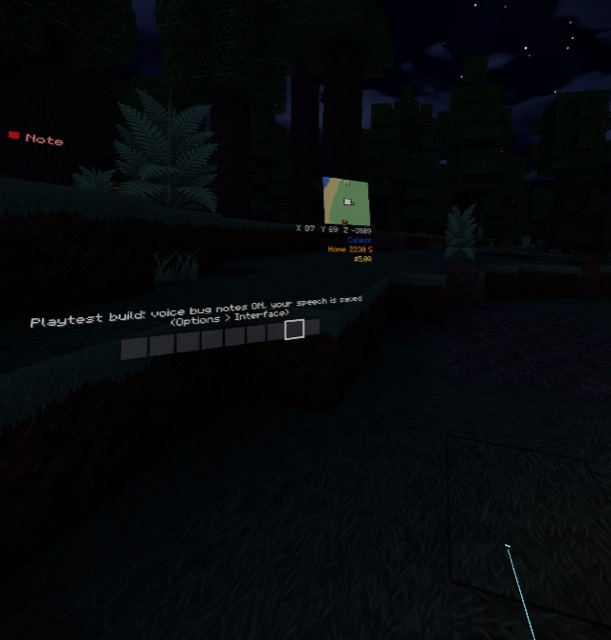

## 11:50:39 - Okay, hold save and quit game, save and quit to title. Those are redun

- **Transcript:** Okay, hold save and quit game, save and quit to title. Those are redundant
- **Status:** open
- **Build:** 0.129 (60d57643, M1-M4 (device-tested; ship riding, chests, comfort options, weapon wheel))
- **World:** Quest World (seed 2943808052895834412)
- **Dimension:** Surface
- **Biome:** Old Growth Pine Taiga
- **Position:** 89.3 69.0 -3805.6
- **Facing:** south-east (yaw 137, pitch -3)
- **Held:** empty hand
- **Mount:** on foot
- **Looking at:** nothing
- **Mode:** Creative, health 20/20, screen PauseMenu
- **Time:** day 5 21:40, clear
- **Fps:** 57
- **Levels:** mic -27 dBFS, game sound -47 dBFS
- **Length:** 5.1 s (voice 3.2 s)
- **Just before:** -16s opened PauseMenu; -11s message: Height measured: eyes 1.66 m above the floor; -8s closed PauseMenu; -8s message: Playtest build: voice bug notes ON, your speech is saved (Options > Interface); -5s opened ChestMenu; -5s closed ChestMenu; -4s message: Ruth Thorne: Can't sleep either?; -3s opened PauseMenu
- **Repro (Mac):** `./snap.sh note --seed 2943808052895834412 --x 89.3 --z -3805.6 --yaw -137 --pitch -3 --time 0.653`
- **Audio (this Mac):** /Users/darthvadar/Documents/Blocksmith/QuestVoiceNotes/raw/vn-20261016-115039-108.aac

## 11:50:46 - All right. See how well we handle 24, huh?

- **Transcript:** All right. See how well we handle 24, huh?
- **Status:** open
- **Build:** 0.129 (60d57643, M1-M4 (device-tested; ship riding, chests, comfort options, weapon wheel))
- **World:** Quest World (seed 2943808052895834412)
- **Dimension:** Surface
- **Biome:** Old Growth Pine Taiga
- **Position:** 89.3 69.0 -3805.6
- **Facing:** south-east (yaw 136, pitch 7)
- **Held:** empty hand
- **Mount:** on foot
- **Looking at:** nothing
- **Mode:** Creative, health 20/20
- **Time:** day 5 21:40, clear
- **Fps:** 62
- **Levels:** mic -30 dBFS, game sound -40 dBFS
- **Length:** 3.5 s (voice 1.9 s)
- **Just before:** -22s opened PauseMenu; -18s message: Height measured: eyes 1.66 m above the floor; -14s closed PauseMenu; -14s message: Playtest build: voice bug notes ON, your speech is saved (Options > Interface); -11s opened ChestMenu; -11s closed ChestMenu; -10s message: Ruth Thorne: Can't sleep either?; -9s opened PauseMenu; -0s closed PauseMenu
- **Repro (Mac):** `./snap.sh note --seed 2943808052895834412 --x 89.3 --z -3805.6 --yaw -136 --pitch 7 --time 0.653`
- **Audio (this Mac):** /Users/darthvadar/Documents/Blocksmith/QuestVoiceNotes/raw/vn-20261016-115046-568.aac

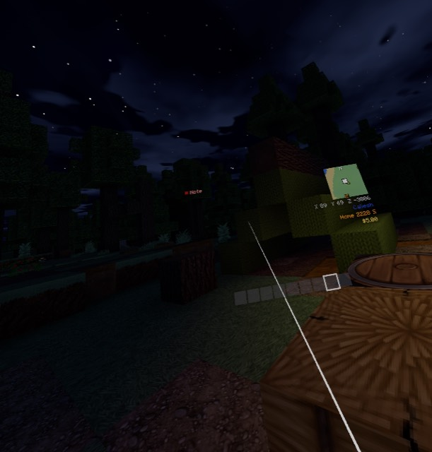

## 11:50:51 - All right. The way shit looks in the distance still sucks

- **Transcript:** All right. The way shit looks in the distance still sucks
- **Status:** open
- **Build:** 0.129 (60d57643, M1-M4 (device-tested; ship riding, chests, comfort options, weapon wheel))
- **World:** Quest World (seed 2943808052895834412)
- **Dimension:** Surface
- **Biome:** Beach
- **Position:** 65.9 131.9 -3710.7
- **Facing:** south (yaw 161, pitch -40)
- **Held:** empty hand
- **Mount:** on foot, flying
- **Looking at:** nothing
- **Mode:** Creative, health 20/20
- **Time:** day 5 21:46, clear
- **Fps:** 83
- **Levels:** mic -33 dBFS, game sound -32 dBFS
- **Length:** 3.9 s (voice 2.4 s)
- **Just before:** -27s opened PauseMenu; -22s message: Height measured: eyes 1.66 m above the floor; -19s closed PauseMenu; -18s message: Playtest build: voice bug notes ON, your speech is saved (Options > Interface); -16s opened ChestMenu; -15s closed ChestMenu; -15s message: Ruth Thorne: Can't sleep either?; -14s opened PauseMenu; -5s closed PauseMenu; -4s message: Flying
- **Repro (Mac):** `./snap.sh note --seed 2943808052895834412 --x 65.9 --z -3710.7 --yaw -161 --pitch -40 --time 0.657`
- **Audio (this Mac):** /Users/darthvadar/Documents/Blocksmith/QuestVoiceNotes/raw/vn-20261016-115051-548.aac

## 11:50:57 - It is rendering better though. Oh, very impressive. Something was

- **Transcript:** It is rendering better though. Oh, very impressive. Something was
- **Status:** open
- **Build:** 0.129 (60d57643, M1-M4 (device-tested; ship riding, chests, comfort options, weapon wheel))
- **World:** Quest World (seed 2943808052895834412)
- **Dimension:** Surface
- **Biome:** Taiga
- **Position:** 172.7 131.9 -3689.0
- **Facing:** east (yaw 78, pitch -14)
- **Held:** empty hand
- **Mount:** on foot, flying
- **Looking at:** nothing
- **Mode:** Creative, health 20/20
- **Time:** day 5 21:48, clear
- **Fps:** 67
- **Levels:** mic -30 dBFS, game sound -20 dBFS
- **Length:** 5.7 s (voice 3.2 s)
- **Just before:** -29s opened PauseMenu; -24s message: Height measured: eyes 1.66 m above the floor; -21s closed PauseMenu; -20s message: Playtest build: voice bug notes ON, your speech is saved (Options > Interface); -18s opened ChestMenu; -17s closed ChestMenu; -17s message: Ruth Thorne: Can't sleep either?; -16s opened PauseMenu; -7s closed PauseMenu; -6s message: Flying; -1s walked into Beach
- **While talking:** -3s walked into Beach; -1s walked into Taiga
- **Position at the end:** 292.1 131.9 -3679.9
- **Repro (Mac):** `./snap.sh note --seed 2943808052895834412 --x 172.7 --z -3689.0 --yaw -78 --pitch -14 --time 0.659`
- **Audio (this Mac):** /Users/darthvadar/Documents/Blocksmith/QuestVoiceNotes/raw/vn-20261016-115057-128.aac

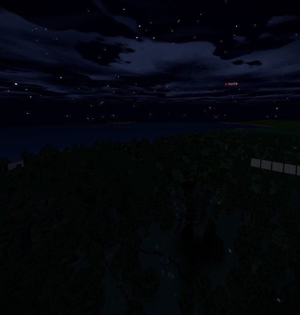

## 11:51:02 - That's good. That's actually not bad. Uh, another thing, I want, uh, s

- **Transcript:** That's good. That's actually not bad. Uh, another thing, I want, uh, smoke to be coming from the campsite. That way I can see it off in a distance
- **Status:** open
- **Build:** 0.129 (60d57643, M1-M4 (device-tested; ship riding, chests, comfort options, weapon wheel))
- **World:** Quest World (seed 2943808052895834412)
- **Dimension:** Surface
- **Biome:** Taiga
- **Position:** 305.3 131.9 -3668.0
- **Facing:** south-east (yaw 132, pitch -56)
- **Held:** empty hand
- **Mount:** on foot, flying
- **Looking at:** nothing
- **Mode:** Creative, health 20/20
- **Time:** day 5 21:51, clear
- **Fps:** 29
- **Levels:** mic -22 dBFS, game sound -23 dBFS
- **Length:** 9.3 s (voice 5.4 s)
- **Just before:** -26s message: Height measured: eyes 1.66 m above the floor; -23s closed PauseMenu; -22s message: Playtest build: voice bug notes ON, your speech is saved (Options > Interface); -20s opened ChestMenu; -19s closed ChestMenu; -19s message: Ruth Thorne: Can't sleep either?; -18s opened PauseMenu; -9s closed PauseMenu; -8s message: Flying; -3s walked into Beach; -1s walked into Taiga; -0s message: 72 Hz to keep the frame rate (VR Comfort & Controls)
- **While talking:** -3s walked into Taiga; -2s message: 72 Hz to keep the frame rate (VR Comfort & Controls)
- **Position at the end:** 398.8 131.9 -3780.1
- **Repro (Mac):** `./snap.sh note --seed 2943808052895834412 --x 305.3 --z -3668.0 --yaw -132 --pitch -56 --time 0.660`
- **Audio (this Mac):** /Users/darthvadar/Documents/Blocksmith/QuestVoiceNotes/raw/vn-20261016-115102-808.aac

## 11:51:18 - Oh, 15? Come on, what the fuck?

- **Transcript:** Oh, 15? Come on, what the fuck?
- **Status:** open
- **Build:** 0.129 (60d57643, M1-M4 (device-tested; ship riding, chests, comfort options, weapon wheel))
- **World:** Quest World (seed 2943808052895834412)
- **Dimension:** Surface
- **Biome:** Taiga
- **Position:** 425.6 76.0 -3802.0
- **Facing:** south-west (yaw 211, pitch -42)
- **Held:** empty hand
- **Mount:** on foot
- **Looking at:** Stripped Spruce Log at 424 76 -3801
- **Mode:** Creative, health 20/20, screen PauseMenu
- **Time:** day 5 22:02, clear
- **Fps:** 64
- **Levels:** mic -47 dBFS, game sound -37 dBFS
- **Length:** 3.1 s (voice 1.2 s)
- **Just before:** -29s opened ChestMenu; -29s closed ChestMenu; -28s message: Ruth Thorne: Can't sleep either?; -27s opened PauseMenu; -18s closed PauseMenu; -18s message: Flying; -12s walked into Beach; -10s walked into Taiga; -10s message: 72 Hz to keep the frame rate (VR Comfort & Controls); -7s message: Walking; -5s message: Flying; -4s message: Walking; -3s message: Render distance 15 for now, to keep the frame rate; -0s opened PauseMenu
- **Repro (Mac):** `./snap.sh note --seed 2943808052895834412 --x 425.6 --z -3802.0 --yaw 149 --pitch -42 --time 0.668`
- **Audio (this Mac):** /Users/darthvadar/Documents/Blocksmith/QuestVoiceNotes/raw/vn-20261016-115118-249.aac

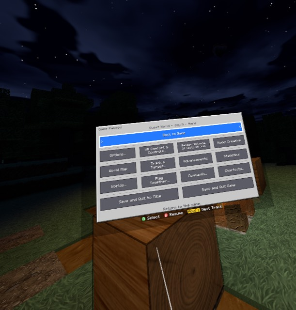

## 11:51:21 - Switch to 15. Uh, all right, well, 15's still fine-ish, I guess

- **Transcript:** Switch to 15. Uh, all right, well, 15's still fine-ish, I guess
- **Status:** open
- **Build:** 0.129 (60d57643, M1-M4 (device-tested; ship riding, chests, comfort options, weapon wheel))
- **World:** Quest World (seed 2943808052895834412)
- **Dimension:** Surface
- **Biome:** Taiga
- **Position:** 422.2 76.0 -3795.5
- **Facing:** north (yaw 346, pitch -24)
- **Held:** empty hand
- **Mount:** on foot
- **Looking at:** Grass Block at 421 75 -3800
- **Mode:** Creative, health 20/20
- **Time:** day 5 22:05, clear
- **Fps:** 64
- **Levels:** mic -34 dBFS, game sound -31 dBFS
- **Length:** 7.1 s (voice 3.1 s)
- **Just before:** -21s closed PauseMenu; -21s message: Flying; -15s walked into Beach; -13s walked into Taiga; -13s message: 72 Hz to keep the frame rate (VR Comfort & Controls); -10s message: Walking; -8s message: Flying; -7s message: Walking; -6s message: Render distance 15 for now, to keep the frame rate; -3s opened PauseMenu; -3s closed PauseMenu
- **Position at the end:** 425.8 76.0 -3806.8
- **Repro (Mac):** `./snap.sh note --seed 2943808052895834412 --x 422.2 --z -3795.5 --yaw 14 --pitch -24 --time 0.670`
- **Audio (this Mac):** /Users/darthvadar/Documents/Blocksmith/QuestVoiceNotes/raw/vn-20261016-115121-648.aac

## 11:51:37 - Yeah. Okay

- **Transcript:** Yeah. Okay
- **Status:** open
- **Build:** 0.129 (60d57643, M1-M4 (device-tested; ship riding, chests, comfort options, weapon wheel))
- **World:** Quest World (seed 2943808052895834412)
- **Dimension:** Surface
- **Biome:** Taiga
- **Position:** 423.4 76.0 -3806.6
- **Facing:** west (yaw 280, pitch -35)
- **Held:** empty hand
- **Mount:** on foot
- **Looking at:** Dirt at 421 75 -3807
- **Mode:** Creative, health 20/20
- **Time:** day 5 22:21, clear
- **Fps:** 57
- **Levels:** mic -33 dBFS, game sound -34 dBFS
- **Length:** 2.4 s (voice 0.7 s)
- **Just before:** -28s walked into Beach; -26s walked into Taiga; -26s message: 72 Hz to keep the frame rate (VR Comfort & Controls); -23s message: Walking; -21s message: Flying; -20s message: Walking; -19s message: Render distance 15 for now, to keep the frame rate; -16s opened PauseMenu; -16s closed PauseMenu; -8s opened ChestMenu; -5s closed ChestMenu; -5s message: Rosalie Yardley: You'll catch a chill, out this late.
- **Repro (Mac):** `./snap.sh note --seed 2943808052895834412 --x 423.4 --z -3806.6 --yaw 80 --pitch -35 --time 0.681`
- **Audio (this Mac):** /Users/darthvadar/Documents/Blocksmith/QuestVoiceNotes/raw/vn-20261016-115137-548.aac

## 11:51:42 - All right. Um, I'm a fucking pig, huh? Yeah. Look at this

- **Transcript:** All right. Um, I'm a fucking pig, huh? Yeah. Look at this
- **Status:** open
- **Build:** 0.129 (60d57643, M1-M4 (device-tested; ship riding, chests, comfort options, weapon wheel))
- **World:** Quest World (seed 2943808052895834412)
- **Dimension:** Surface
- **Biome:** Taiga
- **Position:** 421.6 76.0 -3804.7
- **Facing:** south (yaw 189, pitch -46)
- **Held:** empty hand
- **Mount:** on foot
- **Looking at:** Coarse Dirt at 421 75 -3804
- **Mode:** Creative, health 20/20
- **Time:** day 5 22:25, clear
- **Fps:** 54
- **Levels:** mic -31 dBFS, game sound -26 dBFS
- **Length:** 6.4 s (voice 3.6 s)
- **Just before:** -30s walked into Taiga; -29s message: 72 Hz to keep the frame rate (VR Comfort & Controls); -26s message: Walking; -25s message: Flying; -24s message: Walking; -22s message: Render distance 15 for now, to keep the frame rate; -20s opened PauseMenu; -19s closed PauseMenu; -12s opened ChestMenu; -9s closed ChestMenu; -8s message: Rosalie Yardley: You'll catch a chill, out this late.
- **While talking:** -4s message: Render distance 14 for now, to keep the frame rate
- **Position at the end:** 448.4 77.0 -3802.0
- **Repro (Mac):** `./snap.sh note --seed 2943808052895834412 --x 421.6 --z -3804.7 --yaw 171 --pitch -46 --time 0.684`
- **Audio (this Mac):** /Users/darthvadar/Documents/Blocksmith/QuestVoiceNotes/raw/vn-20261016-115142-028.aac

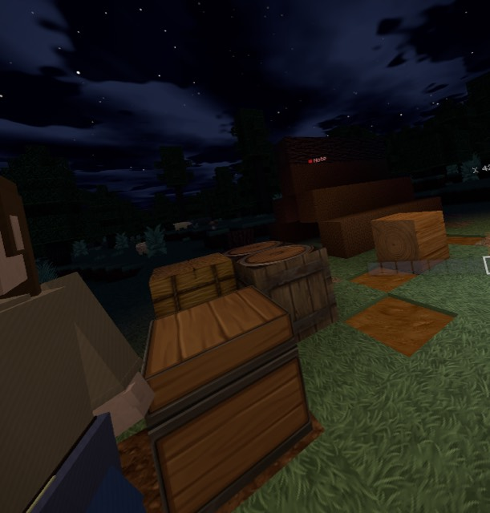

## 11:51:48 - Not bad

- **Transcript:** Not bad
- **Status:** open
- **Build:** 0.129 (60d57643, M1-M4 (device-tested; ship riding, chests, comfort options, weapon wheel))
- **World:** Quest World (seed 2943808052895834412)
- **Dimension:** Surface
- **Biome:** Taiga
- **Position:** 449.5 77.0 -3804.0
- **Facing:** north-east (yaw 31, pitch -60)
- **Held:** empty hand
- **Mount:** on foot
- **Looking at:** Grass Block at 450 76 -3805
- **Mode:** Creative, health 20/20
- **Time:** day 5 22:32, clear
- **Fps:** 71
- **Levels:** mic -58 dBFS, game sound -27 dBFS
- **Length:** 1.7 s (voice 0.5 s)
- **Just before:** -30s message: Walking; -28s message: Render distance 15 for now, to keep the frame rate; -26s opened PauseMenu; -25s closed PauseMenu; -18s opened ChestMenu; -15s closed ChestMenu; -14s message: Rosalie Yardley: You'll catch a chill, out this late.; -5s message: Render distance 14 for now, to keep the frame rate
- **Repro (Mac):** `./snap.sh note --seed 2943808052895834412 --x 449.5 --z -3804.0 --yaw -31 --pitch -60 --time 0.689`
- **Audio (this Mac):** /Users/darthvadar/Documents/Blocksmith/QuestVoiceNotes/raw/vn-20261016-115148-208.aac

## 11:51:50 - Well, I'm not sure why it's yellow on top and all around. Maybe that's

- **Transcript:** Well, I'm not sure why it's yellow on top and all around. Maybe that's like
- **Status:** open
- **Build:** 0.129 (60d57643, M1-M4 (device-tested; ship riding, chests, comfort options, weapon wheel))
- **World:** Quest World (seed 2943808052895834412)
- **Dimension:** Surface
- **Biome:** Taiga
- **Position:** 451.0 76.0 -3805.8
- **Facing:** north (yaw 355, pitch -61)
- **Held:** empty hand
- **Mount:** on foot
- **Looking at:** Grass Block at 450 75 -3807
- **Mode:** Creative, health 20/20
- **Time:** day 5 22:35, clear
- **Fps:** 71
- **Levels:** mic -26 dBFS, game sound -31 dBFS
- **Length:** 4.2 s (voice 2.7 s)
- **Just before:** -28s opened PauseMenu; -28s closed PauseMenu; -20s opened ChestMenu; -17s closed ChestMenu; -17s message: Rosalie Yardley: You'll catch a chill, out this late.; -8s message: Render distance 14 for now, to keep the frame rate
- **Repro (Mac):** `./snap.sh note --seed 2943808052895834412 --x 451.0 --z -3805.8 --yaw 5 --pitch -61 --time 0.691`
- **Audio (this Mac):** /Users/darthvadar/Documents/Blocksmith/QuestVoiceNotes/raw/vn-20261016-115150-728.aac

## 11:51:54 - Kind of looks a little weird like that

- **Transcript:** Kind of looks a little weird like that
- **Status:** open
- **Build:** 0.129 (60d57643, M1-M4 (device-tested; ship riding, chests, comfort options, weapon wheel))
- **World:** Quest World (seed 2943808052895834412)
- **Dimension:** Surface
- **Biome:** Taiga
- **Position:** 454.9 76.8 -3818.0
- **Facing:** north (yaw 1, pitch -51)
- **Held:** empty hand
- **Mount:** on foot
- **Looking at:** Grass Block at 455 74 -3822
- **Mode:** Creative, health 20/20
- **Time:** day 5 22:40, clear
- **Fps:** 71
- **Levels:** mic -26 dBFS, game sound -30 dBFS
- **Length:** 2.5 s (voice 1.1 s)
- **Just before:** -24s opened ChestMenu; -21s closed ChestMenu; -21s message: Rosalie Yardley: You'll catch a chill, out this late.; -12s message: Render distance 14 for now, to keep the frame rate
- **Repro (Mac):** `./snap.sh note --seed 2943808052895834412 --x 454.9 --z -3818.0 --yaw -1 --pitch -51 --time 0.695`
- **Audio (this Mac):** /Users/darthvadar/Documents/Blocksmith/QuestVoiceNotes/raw/vn-20261016-115154-889.aac

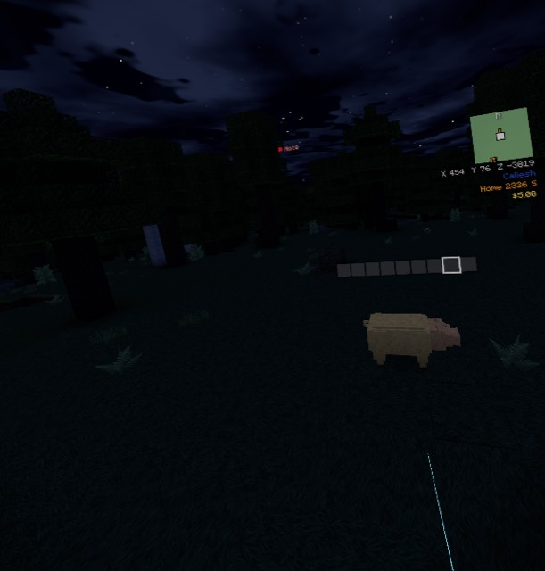

## 11:51:58 - All right, world. Where the fuck? Where's world? There we go

- **Transcript:** All right, world. Where the fuck? Where's world? There we go
- **Status:** open
- **Build:** 0.129 (60d57643, M1-M4 (device-tested; ship riding, chests, comfort options, weapon wheel))
- **World:** Quest World (seed 2943808052895834412)
- **Dimension:** Surface
- **Biome:** Taiga
- **Position:** 456.7 75.0 -3821.4
- **Facing:** east (yaw 74, pitch -37)
- **Held:** empty hand
- **Mount:** on foot
- **Looking at:** Grass Block at 458 74 -3822
- **Mode:** Creative, health 20/20, screen PauseMenu
- **Time:** day 5 22:43, clear
- **Fps:** 68
- **Levels:** mic -28 dBFS, game sound -48 dBFS
- **Length:** 5.1 s (voice 2.1 s)
- **Just before:** -28s opened ChestMenu; -25s closed ChestMenu; -25s message: Rosalie Yardley: You'll catch a chill, out this late.; -16s message: Render distance 14 for now, to keep the frame rate; -1s opened PauseMenu
- **Repro (Mac):** `./snap.sh note --seed 2943808052895834412 --x 456.7 --z -3821.4 --yaw -74 --pitch -37 --time 0.697`
- **Audio (this Mac):** /Users/darthvadar/Documents/Blocksmith/QuestVoiceNotes/raw/vn-20261016-115158-828.aac

## 11:52:13 - Yeah, loading screen still could use some work. I mean, like, we're tr

- **Transcript:** Yeah, loading screen still could use some work. I mean, like, we're trying to turn away from blocks. Then again, the title is Blocksmith. We need a new title. Okay, I'm looking at a bunch of tree trunks that aren't attached to the ground still, so yeah, that's gotta be fixed
- **Status:** open
- **Build:** 0.129 (60d57643, M1-M4 (device-tested; ship riding, chests, comfort options, weapon wheel))
- **World:** New World (10) (seed 1997562484558922131)
- **Dimension:** Surface
- **Biome:** Meadow
- **Position:** 7739.7 158.0 -5651.8
- **Facing:** south (yaw 184, pitch -39)
- **Held:** empty hand
- **Mount:** on foot
- **Looking at:** nothing
- **Mode:** Creative, health 20/20
- **Time:** day 2 06:14, thunderstorm
- **Fps:** 72
- **Levels:** mic -79 dBFS, game sound -44 dBFS
- **Length:** 18.4 s (voice 10.7 s)
- **Just before:** -0s opened PauseMenu; --5s message: Height measured: eyes 1.66 m above the floor; --8s closed PauseMenu; --9s message: Playtest build: voice bug notes ON, your speech is saved (Options > Interface); --11s opened ChestMenu; --12s closed ChestMenu; --12s message: Ruth Thorne: Can't sleep either?; --13s opened PauseMenu; --22s closed PauseMenu; --23s message: Flying; --28s walked into Beach; --30s walked into Taiga; --31s message: 72 Hz to keep the frame rate (VR Comfort & Controls); --34s message: Walking; --35s message: Flying; --36s message: Walking; --38s message: Render distance 15 for now, to keep the frame rate; --40s opened PauseMenu; --41s closed PauseMenu; --48s opened ChestMenu; --51s closed ChestMenu; --52s message: Rosalie Yardley: You'll catch a chill, out this late.; --61s message: Render distance 14 for now, to keep the frame rate; --75s opened PauseMenu; --86s message: The sky is clouding over: fog is coming; -0s closed PauseMenu
- **While talking:** -5s opened PauseMenu; --0s message: Height measured: eyes 1.66 m above the floor; --3s closed PauseMenu; --4s message: Playtest build: voice bug notes ON, your speech is saved (Options > Interface); --6s opened ChestMenu; --7s closed ChestMenu; --7s message: Ruth Thorne: Can't sleep either?; --8s opened PauseMenu; --17s closed PauseMenu; --18s message: Flying; --23s walked into Beach; --25s walked into Taiga; --26s message: 72 Hz to keep the frame rate (VR Comfort & Controls); --29s message: Walking; --30s message: Flying; --32s message: Walking; --33s message: Render distance 15 for now, to keep the frame rate; --35s opened PauseMenu; --36s closed PauseMenu; --43s opened ChestMenu; --46s closed ChestMenu; --47s message: Rosalie Yardley: You'll catch a chill, out this late.; --56s message: Render distance 14 for now, to keep the frame rate; --70s opened PauseMenu; --81s message: The sky is clouding over: fog is coming; -5s closed PauseMenu
- **Position at the end:** 7739.2 154.8 -5643.8
- **Repro (Mac):** `./snap.sh note --seed 1997562484558922131 --x 7739.7 --z -5651.8 --yaw 176 --pitch -39 --time 0.010`
- **Audio (this Mac):** /Users/darthvadar/Documents/Blocksmith/QuestVoiceNotes/raw/vn-20261016-115213-927.aac

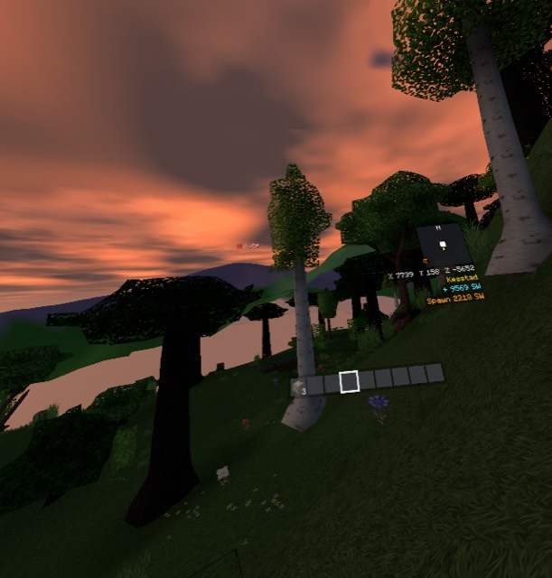

## 11:52:32 - Oh, yeah. Look at this. Beautiful. Uh, only sun in the morning is beau

- **Transcript:** Oh, yeah. Look at this. Beautiful. Uh, only sun in the morning is beautiful
- **Status:** open
- **Build:** 0.129 (60d57643, M1-M4 (device-tested; ship riding, chests, comfort options, weapon wheel))
- **World:** New World (10) (seed 1997562484558922131)
- **Dimension:** Surface
- **Biome:** Sparse Jungle
- **Position:** 7757.2 151.9 -5578.3
- **Facing:** south (yaw 158, pitch -49)
- **Held:** empty hand
- **Mount:** on foot, flying
- **Looking at:** nothing
- **Mode:** Creative, health 20/20
- **Time:** day 2 06:26, thunderstorm
- **Fps:** 72
- **Levels:** mic -25 dBFS, game sound -19 dBFS
- **Length:** 5.9 s (voice 2.8 s)
- **Just before:** -10s opened PauseMenu; -5s message: Height measured: eyes 1.66 m above the floor; -2s closed PauseMenu; -1s message: Playtest build: voice bug notes ON, your speech is saved (Options > Interface); --1s opened ChestMenu; --2s closed ChestMenu; --2s message: Ruth Thorne: Can't sleep either?; --3s opened PauseMenu; --12s closed PauseMenu; --13s message: Flying; --18s walked into Beach; --20s walked into Taiga; --21s message: 72 Hz to keep the frame rate (VR Comfort & Controls); --24s message: Walking; --25s message: Flying; --26s message: Walking; --28s message: Render distance 15 for now, to keep the frame rate; --30s opened PauseMenu; --31s closed PauseMenu; --38s opened ChestMenu; --41s closed ChestMenu; --42s message: Rosalie Yardley: You'll catch a chill, out this late.; --51s message: Render distance 14 for now, to keep the frame rate; --65s opened PauseMenu; --76s message: The sky is clouding over: fog is coming; -10s closed PauseMenu; -0s message: Flying
- **While talking:** -3s opened ChestMenu; -2s closed ChestMenu; -2s message: Ruth Thorne: Can't sleep either?; -1s opened PauseMenu; --8s closed PauseMenu; --9s message: Flying; --14s walked into Beach; --16s walked into Taiga; --17s message: 72 Hz to keep the frame rate (VR Comfort & Controls); --19s message: Walking; --21s message: Flying; --22s message: Walking; --24s message: Render distance 15 for now, to keep the frame rate; --26s opened PauseMenu; --27s closed PauseMenu; --34s opened ChestMenu; --37s closed ChestMenu; --37s message: Rosalie Yardley: You'll catch a chill, out this late.; --46s message: Render distance 14 for now, to keep the frame rate; --61s opened PauseMenu; --72s message: The sky is clouding over: fog is coming; -5s message: Flying
- **Position at the end:** 7826.0 151.9 -5563.2
- **Repro (Mac):** `./snap.sh note --seed 1997562484558922131 --x 7757.2 --z -5578.3 --yaw -158 --pitch -49 --time 0.019`
- **Audio (this Mac):** /Users/darthvadar/Documents/Blocksmith/QuestVoiceNotes/raw/vn-20261016-115232-468.aac

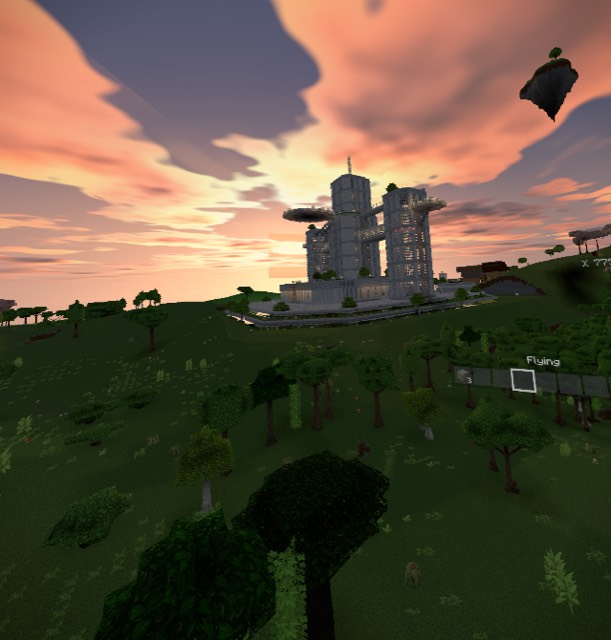

## 11:52:38 - Now something I haven't checked yet is

- **Transcript:** Now something I haven't checked yet is
- **Status:** open
- **Build:** 0.129 (60d57643, M1-M4 (device-tested; ship riding, chests, comfort options, weapon wheel))
- **World:** New World (10) (seed 1997562484558922131)
- **Dimension:** Surface
- **Biome:** Cherry Grove
- **Position:** 7821.1 156.4 -5554.1
- **Facing:** south (yaw 181, pitch -30)
- **Held:** empty hand
- **Mount:** on foot, flying
- **Looking at:** nothing
- **Mode:** Creative, health 20/20
- **Time:** day 2 06:32, thunderstorm
- **Fps:** 61
- **Levels:** mic -40 dBFS, game sound -54 dBFS
- **Length:** 4.0 s (voice 2.0 s)
- **Just before:** -15s opened PauseMenu; -10s message: Height measured: eyes 1.66 m above the floor; -7s closed PauseMenu; -6s message: Playtest build: voice bug notes ON, your speech is saved (Options > Interface); -4s opened ChestMenu; -3s closed ChestMenu; -3s message: Ruth Thorne: Can't sleep either?; -2s opened PauseMenu; --7s closed PauseMenu; --8s message: Flying; --13s walked into Beach; --15s walked into Taiga; --16s message: 72 Hz to keep the frame rate (VR Comfort & Controls); --19s message: Walking; --20s message: Flying; --21s message: Walking; --23s message: Render distance 15 for now, to keep the frame rate; --25s opened PauseMenu; --26s closed PauseMenu; --33s opened ChestMenu; --36s closed ChestMenu; --37s message: Rosalie Yardley: You'll catch a chill, out this late.; --46s message: Render distance 14 for now, to keep the frame rate; --60s opened PauseMenu; --71s message: The sky is clouding over: fog is coming; -15s closed PauseMenu; -5s message: Flying
- **Repro (Mac):** `./snap.sh note --seed 1997562484558922131 --x 7821.1 --z -5554.1 --yaw 179 --pitch -30 --time 0.023`
- **Audio (this Mac):** /Users/darthvadar/Documents/Blocksmith/QuestVoiceNotes/raw/vn-20261016-115238-388.aac

## 11:52:43 - Oh yeah, these little sky islands are cool

- **Transcript:** Oh yeah, these little sky islands are cool
- **Status:** open
- **Build:** 0.129 (60d57643, M1-M4 (device-tested; ship riding, chests, comfort options, weapon wheel))
- **World:** New World (10) (seed 1997562484558922131)
- **Dimension:** Surface
- **Biome:** Cherry Grove
- **Position:** 7792.4 247.9 -5442.1
- **Facing:** east (yaw 91, pitch -32)
- **Held:** empty hand
- **Mount:** on foot
- **Looking at:** nothing
- **Mode:** Creative, health 20/20
- **Time:** day 2 06:36, thunderstorm
- **Fps:** 51
- **Levels:** mic -27 dBFS, game sound -21 dBFS
- **Length:** 3.0 s (voice 1.4 s)
- **Just before:** -18s opened PauseMenu; -13s message: Height measured: eyes 1.66 m above the floor; -10s closed PauseMenu; -10s message: Playtest build: voice bug notes ON, your speech is saved (Options > Interface); -7s opened ChestMenu; -6s closed ChestMenu; -6s message: Ruth Thorne: Can't sleep either?; -5s opened PauseMenu; --4s closed PauseMenu; --5s message: Flying; --10s walked into Beach; --12s walked into Taiga; --13s message: 72 Hz to keep the frame rate (VR Comfort & Controls); --15s message: Walking; --17s message: Flying; --18s message: Walking; --20s message: Render distance 15 for now, to keep the frame rate; --22s opened PauseMenu; --23s closed PauseMenu; --30s opened ChestMenu; --33s closed ChestMenu; --33s message: Rosalie Yardley: You'll catch a chill, out this late.; --42s message: Render distance 14 for now, to keep the frame rate; --57s opened PauseMenu; --68s message: The sky is clouding over: fog is coming; -18s closed PauseMenu; -9s message: Flying; -1s message: Walking
- **Repro (Mac):** `./snap.sh note --seed 1997562484558922131 --x 7792.4 --z -5442.1 --yaw -91 --pitch -32 --time 0.025`
- **Audio (this Mac):** /Users/darthvadar/Documents/Blocksmith/QuestVoiceNotes/raw/vn-20261016-115243-288.aac

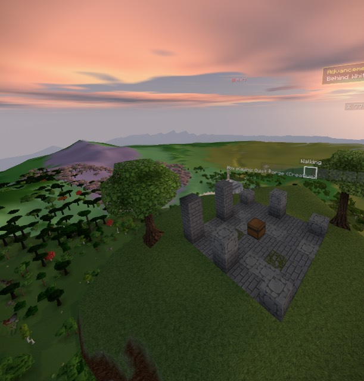

## 11:52:48 - Very nice

- **Transcript:** Very nice
- **Status:** open
- **Build:** 0.129 (60d57643, M1-M4 (device-tested; ship riding, chests, comfort options, weapon wheel))
- **World:** New World (10) (seed 1997562484558922131)
- **Dimension:** Surface
- **Biome:** Forest
- **Position:** 7797.9 241.0 -5445.9
- **Facing:** north-east (yaw 66, pitch -29)
- **Held:** empty hand
- **Mount:** on foot
- **Looking at:** Chest at 7800 241 -5448
- **Mode:** Creative, health 20/20
- **Time:** day 2 06:40, thunderstorm
- **Fps:** 49
- **Levels:** mic -27 dBFS, game sound -15 dBFS
- **Length:** 1.9 s (voice 0.5 s)
- **Just before:** -22s opened PauseMenu; -17s message: Height measured: eyes 1.66 m above the floor; -14s closed PauseMenu; -13s message: Playtest build: voice bug notes ON, your speech is saved (Options > Interface); -10s opened ChestMenu; -10s closed ChestMenu; -10s message: Ruth Thorne: Can't sleep either?; -9s opened PauseMenu; --1s closed PauseMenu; --1s message: Flying; --6s walked into Beach; --8s walked into Taiga; --9s message: 72 Hz to keep the frame rate (VR Comfort & Controls); --12s message: Walking; --13s message: Flying; --15s message: Walking; --16s message: Render distance 15 for now, to keep the frame rate; --19s opened PauseMenu; --19s closed PauseMenu; --27s opened ChestMenu; --30s closed ChestMenu; --30s message: Rosalie Yardley: You'll catch a chill, out this late.; --39s message: Render distance 14 for now, to keep the frame rate; --53s opened PauseMenu; --64s message: The sky is clouding over: fog is coming; -22s closed PauseMenu; -12s message: Flying; -4s message: Walking; -2s opened ChestMenu; -0s closed ChestMenu
- **Repro (Mac):** `./snap.sh note --seed 1997562484558922131 --x 7797.9 --z -5445.9 --yaw -66 --pitch -29 --time 0.028`
- **Audio (this Mac):** /Users/darthvadar/Documents/Blocksmith/QuestVoiceNotes/raw/vn-20261016-115248-048.aac

## 11:52:51 - Yeah, rendering ain't bad, you know? Um, not bad. I don't... I mean, i

- **Transcript:** Yeah, rendering ain't bad, you know? Um, not bad. I don't... I mean, it's rendering at 24, so it's trying
- **Status:** open
- **Build:** 0.129 (60d57643, M1-M4 (device-tested; ship riding, chests, comfort options, weapon wheel))
- **World:** New World (10) (seed 1997562484558922131)
- **Dimension:** Surface
- **Biome:** Cherry Grove
- **Position:** 7802.8 241.0 -5440.7
- **Facing:** south-east (yaw 133, pitch -31)
- **Held:** empty hand
- **Mount:** on foot
- **Looking at:** nothing
- **Mode:** Creative, health 20/20
- **Time:** day 2 06:42, thunderstorm
- **Fps:** 49
- **Levels:** mic -24 dBFS, game sound -13 dBFS
- **Length:** 8.7 s (voice 4.6 s)
- **Just before:** -23s opened PauseMenu; -18s message: Height measured: eyes 1.66 m above the floor; -15s closed PauseMenu; -14s message: Playtest build: voice bug notes ON, your speech is saved (Options > Interface); -12s opened ChestMenu; -11s closed ChestMenu; -11s message: Ruth Thorne: Can't sleep either?; -10s opened PauseMenu; -1s closed PauseMenu; -0s message: Flying; --5s walked into Beach; --7s walked into Taiga; --8s message: 72 Hz to keep the frame rate (VR Comfort & Controls); --11s message: Walking; --12s message: Flying; --13s message: Walking; --15s message: Render distance 15 for now, to keep the frame rate; --17s opened PauseMenu; --18s closed PauseMenu; --25s opened ChestMenu; --28s closed ChestMenu; --29s message: Rosalie Yardley: You'll catch a chill, out this late.; --38s message: Render distance 14 for now, to keep the frame rate; --52s opened PauseMenu; --63s message: The sky is clouding over: fog is coming; -23s closed PauseMenu; -13s message: Flying; -5s message: Walking; -4s opened ChestMenu; -2s closed ChestMenu
- **While talking:** -2s closed PauseMenu; -2s message: Flying; --3s walked into Beach; --5s walked into Taiga; --6s message: 72 Hz to keep the frame rate (VR Comfort & Controls); --9s message: Walking; --10s message: Flying; --12s message: Walking; --13s message: Render distance 15 for now, to keep the frame rate; --16s opened PauseMenu; --16s closed PauseMenu; --24s opened ChestMenu; --27s closed ChestMenu; --27s message: Rosalie Yardley: You'll catch a chill, out this late.; --36s message: Render distance 14 for now, to keep the frame rate; --50s opened PauseMenu; --61s message: The sky is clouding over: fog is coming; -3s closed ChestMenu; -0s opened PauseMenu
- **Position at the end:** 7802.9 241.0 -5440.7
- **Repro (Mac):** `./snap.sh note --seed 1997562484558922131 --x 7802.8 --z -5440.7 --yaw -133 --pitch -31 --time 0.029`
- **Audio (this Mac):** /Users/darthvadar/Documents/Blocksmith/QuestVoiceNotes/raw/vn-20261016-115251-208.aac

## 11:53:03 - We've got a little town off to the side. Okay. Um, it's kind of

- **Transcript:** We've got a little town off to the side. Okay. Um, it's kind of
- **Status:** open
- **Build:** 0.129 (60d57643, M1-M4 (device-tested; ship riding, chests, comfort options, weapon wheel))
- **World:** New World (10) (seed 1997562484558922131)
- **Dimension:** Surface
- **Biome:** Cherry Grove
- **Position:** 7837.4 150.9 -5449.6
- **Facing:** south-east (yaw 143, pitch -15)
- **Held:** empty hand
- **Mount:** on foot
- **Looking at:** Pink Petals at 7837 151 -5449
- **Mode:** Creative, health 20/20
- **Time:** day 2 06:49, thunderstorm
- **Fps:** 54
- **Levels:** mic -27 dBFS, game sound -19 dBFS
- **Length:** 5.2 s (voice 2.8 s)
- **Just before:** -29s opened PauseMenu; -24s message: Height measured: eyes 1.66 m above the floor; -21s closed PauseMenu; -21s message: Playtest build: voice bug notes ON, your speech is saved (Options > Interface); -18s opened ChestMenu; -17s closed ChestMenu; -17s message: Ruth Thorne: Can't sleep either?; -16s opened PauseMenu; -7s closed PauseMenu; -6s message: Flying; -1s walked into Beach; --1s walked into Taiga; --2s message: 72 Hz to keep the frame rate (VR Comfort & Controls); --4s message: Walking; --6s message: Flying; --7s message: Walking; --9s message: Render distance 15 for now, to keep the frame rate; --11s opened PauseMenu; --12s closed PauseMenu; --19s opened ChestMenu; --22s closed ChestMenu; --22s message: Rosalie Yardley: You'll catch a chill, out this late.; --31s message: Render distance 14 for now, to keep the frame rate; --46s opened PauseMenu; --57s message: The sky is clouding over: fog is coming; -29s closed PauseMenu; -20s message: Flying; -12s message: Walking; -10s opened ChestMenu; -8s closed ChestMenu; -5s opened PauseMenu; -4s closed PauseMenu; -4s message: Render distance 11 for now, to keep the frame rate; -1s message: A stranger in town: Ezra Quill
- **Repro (Mac):** `./snap.sh note --seed 1997562484558922131 --x 7837.4 --z -5449.6 --yaw -143 --pitch -15 --time 0.034`
- **Audio (this Mac):** /Users/darthvadar/Documents/Blocksmith/QuestVoiceNotes/raw/vn-20261016-115303-208.aac

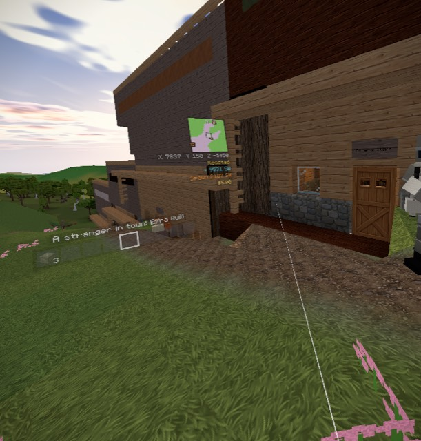

## 11:53:09 - Yeah. Somewhat blended into the ground, right?

- **Transcript:** Yeah. Somewhat blended into the ground, right?
- **Status:** open
- **Build:** 0.129 (60d57643, M1-M4 (device-tested; ship riding, chests, comfort options, weapon wheel))
- **World:** New World (10) (seed 1997562484558922131)
- **Dimension:** Surface
- **Biome:** Forest
- **Position:** 7875.7 139.9 -5447.9
- **Facing:** south (yaw 159, pitch -61)
- **Held:** empty hand
- **Mount:** on foot
- **Looking at:** Coarse Dirt at 7876 138 -5447
- **Mode:** Creative, health 20/20
- **Time:** day 2 06:56, thunderstorm
- **Fps:** 71
- **Levels:** mic -33 dBFS, game sound -25 dBFS
- **Length:** 4.5 s (voice 2.0 s)
- **Just before:** -30s message: Height measured: eyes 1.66 m above the floor; -27s closed PauseMenu; -26s message: Playtest build: voice bug notes ON, your speech is saved (Options > Interface); -24s opened ChestMenu; -23s closed ChestMenu; -23s message: Ruth Thorne: Can't sleep either?; -22s opened PauseMenu; -13s closed PauseMenu; -12s message: Flying; -7s walked into Beach; -5s walked into Taiga; -4s message: 72 Hz to keep the frame rate (VR Comfort & Controls); -1s message: Walking; --0s message: Flying; --1s message: Walking; --3s message: Render distance 15 for now, to keep the frame rate; --5s opened PauseMenu; --6s closed PauseMenu; --13s opened ChestMenu; --16s closed ChestMenu; --17s message: Rosalie Yardley: You'll catch a chill, out this late.; --26s message: Render distance 14 for now, to keep the frame rate; --40s opened PauseMenu; --51s message: The sky is clouding over: fog is coming; -25s message: Flying; -17s message: Walking; -16s opened ChestMenu; -14s closed ChestMenu; -11s opened PauseMenu; -10s closed PauseMenu; -10s message: Render distance 11 for now, to keep the frame rate; -6s message: A stranger in town: Ezra Quill
- **Repro (Mac):** `./snap.sh note --seed 1997562484558922131 --x 7875.7 --z -5447.9 --yaw -159 --pitch -61 --time 0.039`
- **Audio (this Mac):** /Users/darthvadar/Documents/Blocksmith/QuestVoiceNotes/raw/vn-20261016-115309-108.aac

## 11:53:17 - A little Capitol building. We got a little... Okay, let's take a look 

- **Transcript:** A little Capitol building. We got a little... Okay, let's take a look at this. Looking at the little rail carts and the, um
- **Status:** open
- **Build:** 0.129 (60d57643, M1-M4 (device-tested; ship riding, chests, comfort options, weapon wheel))
- **World:** New World (10) (seed 1997562484558922131)
- **Dimension:** Surface
- **Biome:** Meadow
- **Position:** 7980.3 183.4 -5534.1
- **Facing:** north-west (yaw 335, pitch -38)
- **Held:** empty hand
- **Mount:** on foot, flying
- **Looking at:** nothing
- **Mode:** Creative, health 20/20
- **Time:** day 2 07:05, thunderstorm
- **Fps:** 70
- **Levels:** mic -31 dBFS, game sound -14 dBFS
- **Length:** 8.4 s (voice 4.9 s)
- **Just before:** -29s opened PauseMenu; -20s closed PauseMenu; -20s message: Flying; -15s walked into Beach; -13s walked into Taiga; -12s message: 72 Hz to keep the frame rate (VR Comfort & Controls); -9s message: Walking; -8s message: Flying; -6s message: Walking; -5s message: Render distance 15 for now, to keep the frame rate; -2s opened PauseMenu; -2s closed PauseMenu; --6s opened ChestMenu; --9s closed ChestMenu; --9s message: Rosalie Yardley: You'll catch a chill, out this late.; --18s message: Render distance 14 for now, to keep the frame rate; --33s opened PauseMenu; --43s message: The sky is clouding over: fog is coming; -25s message: Walking; -23s opened ChestMenu; -21s closed ChestMenu; -18s opened PauseMenu; -18s closed PauseMenu; -17s message: Render distance 11 for now, to keep the frame rate; -14s message: A stranger in town: Ezra Quill; -3s message: Flying
- **While talking:** --1s opened ChestMenu; --4s closed ChestMenu; --5s message: Rosalie Yardley: You'll catch a chill, out this late.; --14s message: Render distance 14 for now, to keep the frame rate; --28s opened PauseMenu; --39s message: The sky is clouding over: fog is coming; -3s message: Walking; -1s message: Flying
- **Position at the end:** 8037.3 145.6 -5543.5
- **Repro (Mac):** `./snap.sh note --seed 1997562484558922131 --x 7980.3 --z -5534.1 --yaw 25 --pitch -38 --time 0.046`
- **Audio (this Mac):** /Users/darthvadar/Documents/Blocksmith/QuestVoiceNotes/raw/vn-20261016-115317-068.aac

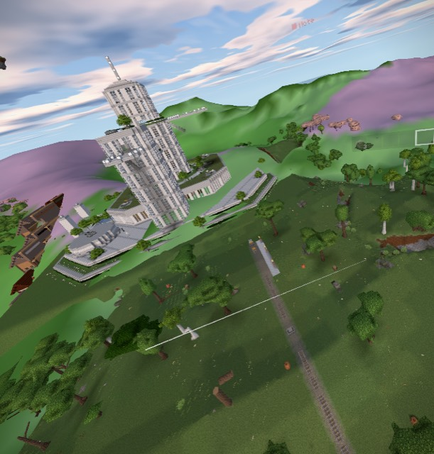

## 11:53:25 - They got gravel over them, so don't look-- The rails don't look right

- **Transcript:** They got gravel over them, so don't look-- The rails don't look right
- **Status:** open
- **Build:** 0.129 (60d57643, M1-M4 (device-tested; ship riding, chests, comfort options, weapon wheel))
- **World:** New World (10) (seed 1997562484558922131)
- **Dimension:** Surface
- **Biome:** Forest
- **Position:** 8042.0 145.6 -5537.7
- **Facing:** south-east (yaw 136, pitch -68)
- **Held:** empty hand
- **Mount:** on foot, flying
- **Looking at:** nothing
- **Mode:** Creative, health 20/20
- **Time:** day 2 07:14, thunderstorm
- **Fps:** 65
- **Levels:** mic -33 dBFS, game sound -59 dBFS
- **Length:** 4.8 s (voice 2.4 s)
- **Just before:** -28s closed PauseMenu; -28s message: Flying; -22s walked into Beach; -20s walked into Taiga; -19s message: 72 Hz to keep the frame rate (VR Comfort & Controls); -17s message: Walking; -15s message: Flying; -14s message: Walking; -12s message: Render distance 15 for now, to keep the frame rate; -10s opened PauseMenu; -9s closed PauseMenu; -2s opened ChestMenu; --1s closed ChestMenu; --1s message: Rosalie Yardley: You'll catch a chill, out this late.; --10s message: Render distance 14 for now, to keep the frame rate; --25s opened PauseMenu; --36s message: The sky is clouding over: fog is coming; -29s closed ChestMenu; -26s opened PauseMenu; -26s closed PauseMenu; -25s message: Render distance 11 for now, to keep the frame rate; -22s message: A stranger in town: Ezra Quill; -11s message: Flying; -6s message: Walking; -4s message: Flying
- **Repro (Mac):** `./snap.sh note --seed 1997562484558922131 --x 8042.0 --z -5537.7 --yaw -136 --pitch -68 --time 0.052`
- **Audio (this Mac):** /Users/darthvadar/Documents/Blocksmith/QuestVoiceNotes/raw/vn-20261016-115325-448.aac

## 11:53:30 - And it looks like it abruptly comes to an end, so I don't know, know i

- **Transcript:** And it looks like it abruptly comes to an end, so I don't know, know if
- **Status:** open
- **Build:** 0.129 (60d57643, M1-M4 (device-tested; ship riding, chests, comfort options, weapon wheel))
- **World:** New World (10) (seed 1997562484558922131)
- **Dimension:** Surface
- **Biome:** Forest
- **Position:** 8082.8 145.6 -5545.0
- **Facing:** south-west (yaw 204, pitch -19)
- **Held:** empty hand
- **Mount:** on foot, flying
- **Looking at:** nothing
- **Mode:** Creative, health 20/20
- **Time:** day 2 07:20, clear
- **Fps:** 70
- **Levels:** mic -26 dBFS, game sound -58 dBFS
- **Length:** 5.6 s (voice 3.1 s)
- **Just before:** -27s walked into Beach; -25s walked into Taiga; -24s message: 72 Hz to keep the frame rate (VR Comfort & Controls); -22s message: Walking; -20s message: Flying; -19s message: Walking; -17s message: Render distance 15 for now, to keep the frame rate; -15s opened PauseMenu; -14s closed PauseMenu; -7s opened ChestMenu; -4s closed ChestMenu; -4s message: Rosalie Yardley: You'll catch a chill, out this late.; --5s message: Render distance 14 for now, to keep the frame rate; --20s opened PauseMenu; --31s message: The sky is clouding over: fog is coming; -27s message: A stranger in town: Ezra Quill; -16s message: Flying; -11s message: Walking; -9s message: Flying
- **While talking:** --1s message: Render distance 14 for now, to keep the frame rate; --15s opened PauseMenu; --26s message: The sky is clouding over: fog is coming
- **Position at the end:** 7983.0 155.5 -5537.5
- **Repro (Mac):** `./snap.sh note --seed 1997562484558922131 --x 8082.8 --z -5545.0 --yaw 156 --pitch -19 --time 0.056`
- **Audio (this Mac):** /Users/darthvadar/Documents/Blocksmith/QuestVoiceNotes/raw/vn-20261016-115330-488.aac

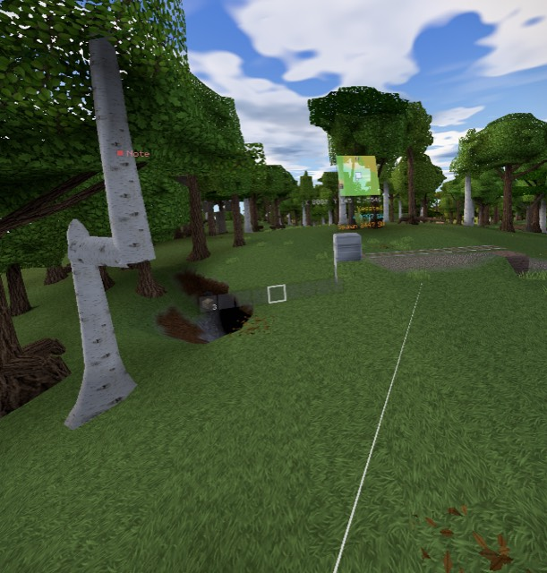

## 11:53:36 - We're doing trains or not? I mean, it'd be great if we could do trains

- **Transcript:** We're doing trains or not? I mean, it'd be great if we could do trains that could be procedurally generated. That would be quite something, but currently it's not looking like it
- **Status:** open
- **Build:** 0.129 (60d57643, M1-M4 (device-tested; ship riding, chests, comfort options, weapon wheel))
- **World:** New World (10) (seed 1997562484558922131)
- **Dimension:** Surface
- **Biome:** Meadow
- **Position:** 7968.2 156.3 -5536.3
- **Facing:** west (yaw 263, pitch -34)
- **Held:** empty hand
- **Mount:** on foot, flying
- **Looking at:** nothing
- **Mode:** Creative, health 20/20
- **Time:** day 2 07:27, clear
- **Fps:** 71
- **Levels:** mic -38 dBFS, game sound -30 dBFS
- **Length:** 9.9 s (voice 6.1 s)
- **Just before:** -30s message: 72 Hz to keep the frame rate (VR Comfort & Controls); -27s message: Walking; -26s message: Flying; -24s message: Walking; -23s message: Render distance 15 for now, to keep the frame rate; -20s opened PauseMenu; -20s closed PauseMenu; -12s opened ChestMenu; -9s closed ChestMenu; -9s message: Rosalie Yardley: You'll catch a chill, out this late.; --0s message: Render distance 14 for now, to keep the frame rate; --14s opened PauseMenu; --25s message: The sky is clouding over: fog is coming; -21s message: Flying; -16s message: Walking; -14s message: Flying
- **While talking:** -5s message: Render distance 14 for now, to keep the frame rate; --10s opened PauseMenu; --20s message: The sky is clouding over: fog is coming
- **Position at the end:** 7797.6 164.3 -5532.9
- **Repro (Mac):** `./snap.sh note --seed 1997562484558922131 --x 7968.2 --z -5536.3 --yaw 97 --pitch -34 --time 0.061`
- **Audio (this Mac):** /Users/darthvadar/Documents/Blocksmith/QuestVoiceNotes/raw/vn-20261016-115336-068.aac

## 11:53:47 - Oh, hell yeah. These black guns? [laughs] Oh, hell yeah. [whistles] Oh

- **Transcript:** Oh, hell yeah. These black guns? [laughs] Oh, hell yeah. [whistles] Oh my God. Okay. Wow. Okay. Um, listen, if this thing does that much damage
- **Status:** open
- **Build:** 0.129 (60d57643, M1-M4 (device-tested; ship riding, chests, comfort options, weapon wheel))
- **World:** New World (10) (seed 1997562484558922131)
- **Dimension:** Surface
- **Biome:** Cherry Grove
- **Position:** 7837.8 156.3 -5527.2
- **Facing:** south-east (yaw 150, pitch -69)
- **Held:** empty hand
- **Mount:** on foot
- **Looking at:** Moss Block at 7838 154 -5526
- **Mode:** Creative, health 20/20
- **Time:** day 2 07:40, clear
- **Fps:** 72
- **Levels:** mic -40 dBFS, game sound -15 dBFS
- **Length:** 14.1 s (voice 7.6 s)
- **Just before:** -23s opened ChestMenu; -21s closed ChestMenu; -20s message: Rosalie Yardley: You'll catch a chill, out this late.; -11s message: Render distance 14 for now, to keep the frame rate; --3s opened PauseMenu; --14s message: The sky is clouding over: fog is coming; -27s message: Walking; -26s message: Flying; -1s message: Walking
- **While talking:** -1s opened PauseMenu; --10s message: The sky is clouding over: fog is coming; -2s message: Manning the deck gun; -0s message: The citadel is on lockdown!; --6s message: The sky is clouding over: fog is coming; -5s message: The citadel is on lockdown!
- **Position at the end:** 7842.3 160.5 -5532.7
- **Repro (Mac):** `./snap.sh note --seed 1997562484558922131 --x 7837.8 --z -5527.2 --yaw -150 --pitch -69 --time 0.070`
- **Audio (this Mac):** /Users/darthvadar/Documents/Blocksmith/QuestVoiceNotes/raw/vn-20261016-115347-328.aac

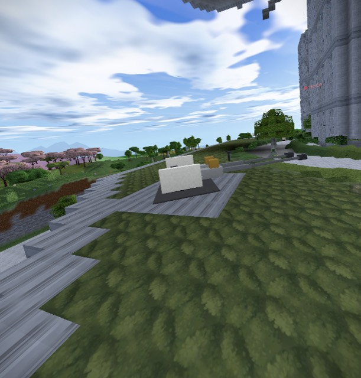

## 11:54:01 - Oh my God. Oh, that's, that's awesome. I love that

- **Transcript:** Oh my God. Oh, that's, that's awesome. I love that
- **Status:** open
- **Build:** 0.129 (60d57643, M1-M4 (device-tested; ship riding, chests, comfort options, weapon wheel))
- **World:** New World (10) (seed 1997562484558922131)
- **Dimension:** Surface
- **Biome:** Cherry Grove
- **Position:** 7843.4 160.5 -5533.7
- **Facing:** south-east (yaw 155, pitch 9)
- **Held:** empty hand
- **Mount:** on foot
- **Looking at:** nothing
- **Mode:** Creative, health 20/20
- **Time:** day 2 07:55, clear
- **Fps:** 62
- **Levels:** mic -26 dBFS, game sound -15 dBFS
- **Length:** 4.2 s (voice 2.1 s)
- **Just before:** -23s message: Render distance 14 for now, to keep the frame rate; -9s opened PauseMenu; --2s message: The sky is clouding over: fog is coming; -13s message: Walking; -10s message: Manning the deck gun; -8s message: The citadel is on lockdown!
- **Repro (Mac):** `./snap.sh note --seed 1997562484558922131 --x 7843.4 --z -5533.7 --yaw -155 --pitch 9 --time 0.080`
- **Audio (this Mac):** /Users/darthvadar/Documents/Blocksmith/QuestVoiceNotes/raw/vn-20261016-115401-288.aac

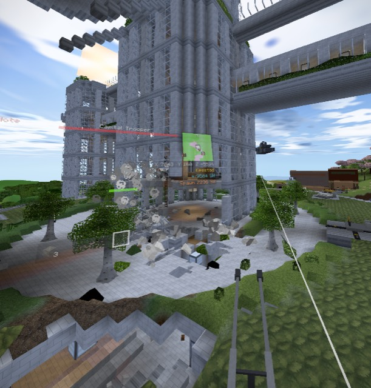

## 11:54:08 - Oh, this is a 42 centimeter tur- okay

- **Transcript:** Oh, this is a 42 centimeter tur- okay
- **Status:** open
- **Build:** 0.129 (60d57643, M1-M4 (device-tested; ship riding, chests, comfort options, weapon wheel))
- **World:** New World (10) (seed 1997562484558922131)
- **Dimension:** Surface
- **Biome:** Cherry Grove
- **Position:** 7843.4 160.5 -5533.8
- **Facing:** south-east (yaw 149, pitch 2)
- **Held:** empty hand
- **Mount:** on foot
- **Looking at:** nothing
- **Mode:** Creative, health 20/20
- **Time:** day 2 08:03, clear
- **Fps:** 66
- **Levels:** mic -21 dBFS, game sound -17 dBFS
- **Length:** 3.6 s (voice 1.9 s)
- **Just before:** -30s message: Render distance 14 for now, to keep the frame rate; -15s opened PauseMenu; -4s message: The sky is clouding over: fog is coming; -20s message: Walking; -17s message: Manning the deck gun; -15s message: The citadel is on lockdown!; -4s walked into Cherry Grove; -4s message: Sky isle marked on the map; -1s message: A Capital Dropship is landing troops!
- **Repro (Mac):** `./snap.sh note --seed 1997562484558922131 --x 7843.4 --z -5533.8 --yaw -149 --pitch 2 --time 0.085`
- **Audio (this Mac):** /Users/darthvadar/Documents/Blocksmith/QuestVoiceNotes/raw/vn-20261016-115408-688.aac

## 11:54:12 - I see. Well, I guess that's fine. Um, yeah

- **Transcript:** I see. Well, I guess that's fine. Um, yeah
- **Status:** open
- **Build:** 0.129 (60d57643, M1-M4 (device-tested; ship riding, chests, comfort options, weapon wheel))
- **World:** New World (10) (seed 1997562484558922131)
- **Dimension:** Surface
- **Biome:** Cherry Grove
- **Position:** 7842.0 160.5 -5531.2
- **Facing:** east (yaw 84, pitch 29)
- **Held:** empty hand
- **Mount:** on foot
- **Looking at:** nothing
- **Mode:** Creative, health 20/20
- **Time:** day 2 08:06, clear
- **Fps:** 66
- **Levels:** mic -29 dBFS, game sound -14 dBFS
- **Length:** 7.4 s (voice 3.0 s)
- **Just before:** -18s opened PauseMenu; -7s message: The sky is clouding over: fog is coming; -22s message: Walking; -19s message: Manning the deck gun; -18s message: The citadel is on lockdown!; -7s walked into Cherry Grove; -7s message: Sky isle marked on the map; -4s message: A Capital Dropship is landing troops!
- **Position at the end:** 7843.8 160.5 -5533.9
- **Repro (Mac):** `./snap.sh note --seed 1997562484558922131 --x 7842.0 --z -5531.2 --yaw -84 --pitch 29 --time 0.088`
- **Audio (this Mac):** /Users/darthvadar/Documents/Blocksmith/QuestVoiceNotes/raw/vn-20261016-115412-408.aac

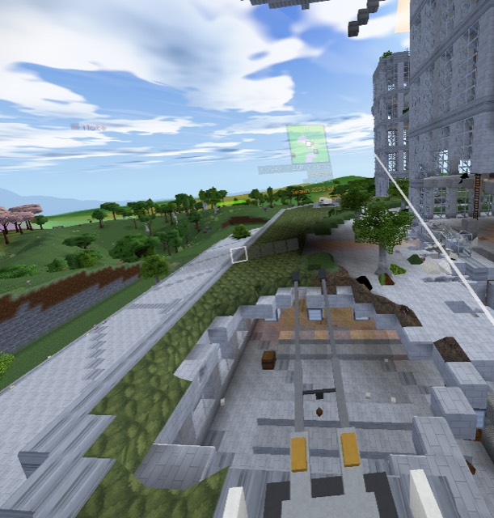

## 11:54:21 - You know, this thing, this thing fucks things up. Holy shit

- **Transcript:** You know, this thing, this thing fucks things up. Holy shit
- **Status:** open
- **Build:** 0.129 (60d57643, M1-M4 (device-tested; ship riding, chests, comfort options, weapon wheel))
- **World:** New World (10) (seed 1997562484558922131)
- **Dimension:** Surface
- **Biome:** Cherry Grove
- **Position:** 7842.0 160.5 -5531.6
- **Facing:** east (yaw 87, pitch -1)
- **Held:** empty hand
- **Mount:** on foot
- **Looking at:** nothing
- **Mode:** Creative, health 20/20
- **Time:** day 2 08:16, clear
- **Fps:** 64
- **Levels:** mic -29 dBFS, game sound -10 dBFS
- **Length:** 4.7 s (voice 2.6 s)
- **Just before:** -26s opened PauseMenu; -15s message: The sky is clouding over: fog is coming; -27s message: Manning the deck gun; -26s message: The citadel is on lockdown!; -15s walked into Cherry Grove; -15s message: Sky isle marked on the map; -12s message: A Capital Dropship is landing troops!
- **Repro (Mac):** `./snap.sh note --seed 1997562484558922131 --x 7842.0 --z -5531.6 --yaw -87 --pitch -1 --time 0.094`
- **Audio (this Mac):** /Users/darthvadar/Documents/Blocksmith/QuestVoiceNotes/raw/vn-20261016-115421-668.aac

## 11:54:30 - I, uh, fucking think so, bud. Nah. All right

- **Transcript:** I, uh, fucking think so, bud. Nah. All right
- **Status:** open
- **Build:** 0.129 (60d57643, M1-M4 (device-tested; ship riding, chests, comfort options, weapon wheel))
- **World:** New World (10) (seed 1997562484558922131)
- **Dimension:** Surface
- **Biome:** Cherry Grove
- **Position:** 7842.1 161.7 -5530.7
- **Facing:** north (yaw 14, pitch -17)
- **Held:** empty hand
- **Mount:** on foot
- **Looking at:** nothing
- **Mode:** Creative, health 20/20
- **Time:** day 2 08:24, clear
- **Fps:** 56
- **Levels:** mic -37 dBFS, game sound -12 dBFS
- **Length:** 4.9 s (voice 2.9 s)
- **Just before:** -22s message: The sky is clouding over: fog is coming; -22s walked into Cherry Grove; -21s message: Sky isle marked on the map; -19s message: A Capital Dropship is landing troops!; -3s message: A Capital patrol sets out to investigate
- **Repro (Mac):** `./snap.sh note --seed 1997562484558922131 --x 7842.1 --z -5530.7 --yaw -14 --pitch -17 --time 0.100`
- **Audio (this Mac):** /Users/darthvadar/Documents/Blocksmith/QuestVoiceNotes/raw/vn-20261016-115430-268.aac

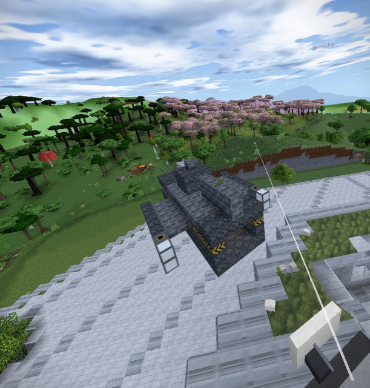

## 11:54:35 - Yeah, these guns are nice

- **Transcript:** Yeah, these guns are nice
- **Status:** open
- **Build:** 0.129 (60d57643, M1-M4 (device-tested; ship riding, chests, comfort options, weapon wheel))
- **World:** New World (10) (seed 1997562484558922131)
- **Dimension:** Surface
- **Biome:** Cherry Grove
- **Position:** 7845.7 161.7 -5529.3
- **Facing:** north-west (yaw 332, pitch -2)
- **Held:** empty hand
- **Mount:** on foot
- **Looking at:** nothing
- **Mode:** Creative, health 20/20
- **Time:** day 2 08:29, clear
- **Fps:** 58
- **Levels:** mic -25 dBFS, game sound -8 dBFS
- **Length:** 2.6 s (voice 1.2 s)
- **Just before:** -26s message: The sky is clouding over: fog is coming; -26s walked into Cherry Grove; -25s message: Sky isle marked on the map; -23s message: A Capital Dropship is landing troops!; -7s message: A Capital patrol sets out to investigate
- **Repro (Mac):** `./snap.sh note --seed 1997562484558922131 --x 7845.7 --z -5529.3 --yaw 28 --pitch -2 --time 0.104`
- **Audio (this Mac):** /Users/darthvadar/Documents/Blocksmith/QuestVoiceNotes/raw/vn-20261016-115435-268.aac

## 11:54:37 - No, but it looks like a capital ship. I don't know if that's just the 

- **Transcript:** No, but it looks like a capital ship. I don't know if that's just the AI. [laughs] Oh yeah, that's right. Oh, I'm loving these guns. These guns are great. Hello there. Okay. Uh, let's just see here. We got a helicopter I can drive
- **Status:** open
- **Build:** 0.129 (60d57643, M1-M4 (device-tested; ship riding, chests, comfort options, weapon wheel))
- **World:** New World (10) (seed 1997562484558922131)
- **Dimension:** Surface
- **Biome:** Cherry Grove
- **Position:** 7845.6 161.7 -5529.3
- **Facing:** north-west (yaw 333, pitch -9)
- **Held:** empty hand
- **Mount:** on foot
- **Looking at:** nothing
- **Mode:** Creative, health 20/20
- **Time:** day 2 08:31, clear
- **Fps:** 58
- **Levels:** mic -26 dBFS, game sound -15 dBFS
- **Length:** 15.1 s (voice 9.9 s)
- **Just before:** -28s message: The sky is clouding over: fog is coming; -28s walked into Cherry Grove; -27s message: Sky isle marked on the map; -25s message: A Capital Dropship is landing troops!; -9s message: A Capital patrol sets out to investigate
- **Position at the end:** 7843.8 161.7 -5533.9
- **Repro (Mac):** `./snap.sh note --seed 1997562484558922131 --x 7845.6 --z -5529.3 --yaw 27 --pitch -9 --time 0.105`
- **Audio (this Mac):** /Users/darthvadar/Documents/Blocksmith/QuestVoiceNotes/raw/vn-20261016-115437-488.aac

## 11:54:53 - No, I don't think there's a helicopter around here. Where, where's the

- **Transcript:** No, I don't think there's a helicopter around here. Where, where's the helicopter?
- **Status:** open
- **Build:** 0.129 (60d57643, M1-M4 (device-tested; ship riding, chests, comfort options, weapon wheel))
- **World:** New World (10) (seed 1997562484558922131)
- **Dimension:** Surface
- **Biome:** Forest
- **Position:** 7870.7 199.7 -5475.6
- **Facing:** north-east (yaw 29, pitch -50)
- **Held:** empty hand
- **Mount:** on foot, flying
- **Looking at:** nothing
- **Mode:** Creative, health 20/20
- **Time:** day 2 08:46, clear
- **Fps:** 61
- **Levels:** mic -26 dBFS, game sound -16 dBFS
- **Length:** 6.9 s (voice 3.1 s)
- **Just before:** -22s message: A Capital patrol sets out to investigate; -4s message: Flying; -2s walked into Meadow; -0s walked into Forest
- **While talking:** -4s walked into Forest; -2s walked into Cherry Grove; -0s walked into Forest; -0s message: Render distance 10 for now, to keep the frame rate
- **Position at the end:** 7909.9 199.7 -5489.6
- **Repro (Mac):** `./snap.sh note --seed 1997562484558922131 --x 7870.7 --z -5475.6 --yaw -29 --pitch -50 --time 0.116`
- **Audio (this Mac):** /Users/darthvadar/Documents/Blocksmith/QuestVoiceNotes/raw/vn-20261016-115453-128.aac

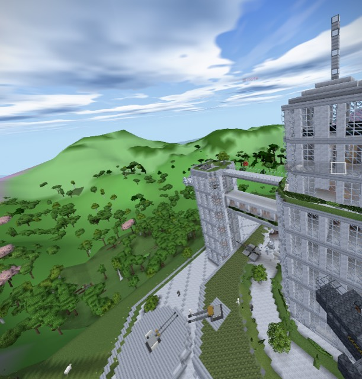

## 11:55:00 - There's kind of supposed to be a helicopter somewhere, which I'm not s

- **Transcript:** There's kind of supposed to be a helicopter somewhere, which I'm not seeing. So yeah. Um, the turrets... Hold on, let me get a look at these turrets
- **Status:** open
- **Build:** 0.129 (60d57643, M1-M4 (device-tested; ship riding, chests, comfort options, weapon wheel))
- **World:** New World (10) (seed 1997562484558922131)
- **Dimension:** Surface
- **Biome:** Forest
- **Position:** 7927.2 199.7 -5477.3
- **Facing:** south-west (yaw 218, pitch -69)
- **Held:** empty hand
- **Mount:** on foot, flying
- **Looking at:** nothing
- **Mode:** Creative, health 20/20
- **Time:** day 2 08:54, clear
- **Fps:** 58
- **Levels:** mic -40 dBFS, game sound -16 dBFS
- **Length:** 11.1 s (voice 5.7 s)
- **Just before:** -28s message: A Capital patrol sets out to investigate; -11s message: Flying; -9s walked into Meadow; -7s walked into Forest; -5s walked into Cherry Grove; -3s walked into Forest; -2s message: Render distance 10 for now, to keep the frame rate; -1s walked into Meadow
- **While talking:** -1s walked into Cherry Grove; -4s walked into Forest; -0s message: Walking
- **Position at the end:** 7825.6 199.8 -5527.1
- **Repro (Mac):** `./snap.sh note --seed 1997562484558922131 --x 7927.2 --z -5477.3 --yaw 142 --pitch -69 --time 0.121`
- **Audio (this Mac):** /Users/darthvadar/Documents/Blocksmith/QuestVoiceNotes/raw/vn-20261016-115500-768.aac

## 11:55:12 - I think there might have been some errors. Yeah, okay. See, the turret

- **Transcript:** I think there might have been some errors. Yeah, okay. See, the turrets, they don't look right. There's something wrong with them. Like, I think they're missing their top sh- shield
- **Status:** open
- **Build:** 0.129 (60d57643, M1-M4 (device-tested; ship riding, chests, comfort options, weapon wheel))
- **World:** New World (10) (seed 1997562484558922131)
- **Dimension:** Surface
- **Biome:** Cherry Grove
- **Position:** 7830.5 165.9 -5530.1
- **Facing:** east (yaw 98, pitch -64)
- **Held:** empty hand
- **Mount:** on foot, flying
- **Looking at:** nothing
- **Mode:** Creative, health 20/20
- **Time:** day 2 09:07, clear
- **Fps:** 64
- **Levels:** mic -47 dBFS, game sound -17 dBFS
- **Length:** 10.2 s (voice 6.1 s)
- **Just before:** -21s message: Flying; -19s walked into Meadow; -17s walked into Forest; -15s walked into Cherry Grove; -13s walked into Forest; -13s message: Render distance 10 for now, to keep the frame rate; -11s walked into Meadow; -7s walked into Cherry Grove; -5s walked into Forest; -2s message: Walking; -0s message: Flying
- **While talking:** -5s message: Flying; -4s walked into Cherry Grove; -2s message: The sky is clouding over: fog is coming
- **Position at the end:** 7885.7 166.4 -5539.9
- **Repro (Mac):** `./snap.sh note --seed 1997562484558922131 --x 7830.5 --z -5530.1 --yaw -98 --pitch -64 --time 0.130`
- **Audio (this Mac):** /Users/darthvadar/Documents/Blocksmith/QuestVoiceNotes/raw/vn-20261016-115512-488.aac

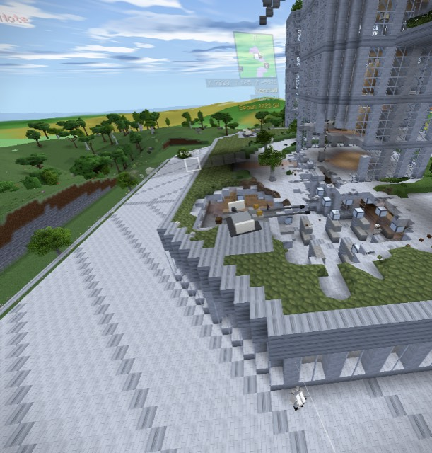

## 11:55:24 - I guess there's different types of turrets, aren't there?

- **Transcript:** I guess there's different types of turrets, aren't there?
- **Status:** open
- **Build:** 0.129 (60d57643, M1-M4 (device-tested; ship riding, chests, comfort options, weapon wheel))
- **World:** New World (10) (seed 1997562484558922131)
- **Dimension:** Surface
- **Biome:** Meadow
- **Position:** 7877.5 166.4 -5524.7
- **Facing:** south-east (yaw 152, pitch -56)
- **Held:** empty hand
- **Mount:** on foot, flying
- **Looking at:** nothing
- **Mode:** Creative, health 20/20
- **Time:** day 2 09:20, clear
- **Fps:** 69
- **Levels:** mic -25 dBFS, game sound -14 dBFS
- **Length:** 2.9 s (voice 1.4 s)
- **Just before:** -28s walked into Forest; -26s walked into Cherry Grove; -24s walked into Forest; -24s message: Render distance 10 for now, to keep the frame rate; -22s walked into Meadow; -18s walked into Cherry Grove; -16s walked into Forest; -13s message: Walking; -11s message: Flying; -10s walked into Cherry Grove; -8s message: The sky is clouding over: fog is coming; -6s walked into Meadow
- **Repro (Mac):** `./snap.sh note --seed 1997562484558922131 --x 7877.5 --z -5524.7 --yaw -152 --pitch -56 --time 0.139`
- **Audio (this Mac):** /Users/darthvadar/Documents/Blocksmith/QuestVoiceNotes/raw/vn-20261016-115524-008.aac

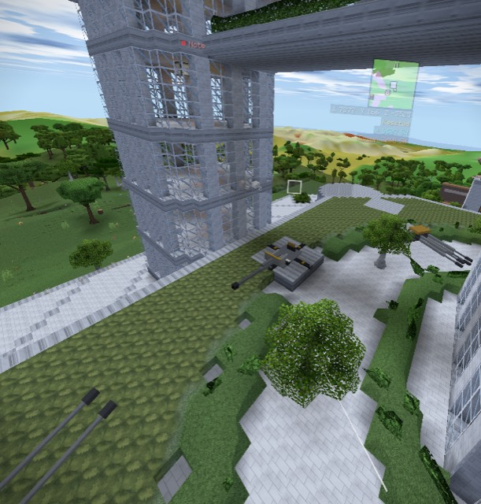

## 11:55:27 - Different barrels or something? Or I don't know if they're not complet

- **Transcript:** Different barrels or something? Or I don't know if they're not complete or what's going on
- **Status:** open
- **Build:** 0.129 (60d57643, M1-M4 (device-tested; ship riding, chests, comfort options, weapon wheel))
- **World:** New World (10) (seed 1997562484558922131)
- **Dimension:** Surface
- **Biome:** Meadow
- **Position:** 7859.5 166.4 -5540.7
- **Facing:** south-west (yaw 221, pitch -42)
- **Held:** empty hand
- **Mount:** on foot, flying
- **Looking at:** nothing
- **Mode:** Creative, health 20/20
- **Time:** day 2 09:23, clear
- **Fps:** 69
- **Levels:** mic -26 dBFS, game sound -16 dBFS
- **Length:** 4.4 s (voice 2.7 s)
- **Just before:** -29s walked into Cherry Grove; -27s walked into Forest; -27s message: Render distance 10 for now, to keep the frame rate; -25s walked into Meadow; -21s walked into Cherry Grove; -19s walked into Forest; -16s message: Walking; -14s message: Flying; -13s walked into Cherry Grove; -11s message: The sky is clouding over: fog is coming; -9s walked into Meadow
- **Repro (Mac):** `./snap.sh note --seed 1997562484558922131 --x 7859.5 --z -5540.7 --yaw 139 --pitch -42 --time 0.142`
- **Audio (this Mac):** /Users/darthvadar/Documents/Blocksmith/QuestVoiceNotes/raw/vn-20261016-115527-008.aac

## 11:55:31 - Don't quite look right. Um, the ones on top look a little better, exce

- **Transcript:** Don't quite look right. Um, the ones on top look a little better, except for the fact that the barrels are disconnected from the main body
- **Status:** open
- **Build:** 0.129 (60d57643, M1-M4 (device-tested; ship riding, chests, comfort options, weapon wheel))
- **World:** New World (10) (seed 1997562484558922131)
- **Dimension:** Surface
- **Biome:** Meadow
- **Position:** 7849.4 189.0 -5543.1
- **Facing:** south (yaw 183, pitch -60)
- **Held:** empty hand
- **Mount:** on foot, flying
- **Looking at:** nothing
- **Mode:** Creative, health 20/20
- **Time:** day 2 09:29, clear
- **Fps:** 69
- **Levels:** mic -31 dBFS, game sound -15 dBFS
- **Length:** 9.6 s (voice 5.8 s)
- **Just before:** -29s walked into Meadow; -25s walked into Cherry Grove; -23s walked into Forest; -20s message: Walking; -18s message: Flying; -17s walked into Cherry Grove; -15s message: The sky is clouding over: fog is coming; -13s walked into Meadow; -1s walked into Cherry Grove
- **While talking:** -4s walked into Meadow; -3s message: A Capital Dropship is landing troops!
- **Position at the end:** 7887.6 198.7 -5522.1
- **Repro (Mac):** `./snap.sh note --seed 1997562484558922131 --x 7849.4 --z -5543.1 --yaw 177 --pitch -60 --time 0.145`
- **Audio (this Mac):** /Users/darthvadar/Documents/Blocksmith/QuestVoiceNotes/raw/vn-20261016-115531-648.aac

## 11:55:41 - So there's that

- **Transcript:** So there's that
- **Status:** open
- **Build:** 0.129 (60d57643, M1-M4 (device-tested; ship riding, chests, comfort options, weapon wheel))
- **World:** New World (10) (seed 1997562484558922131)
- **Dimension:** Surface
- **Biome:** Forest
- **Position:** 7894.8 198.7 -5507.8
- **Facing:** south-west (yaw 214, pitch -50)
- **Held:** empty hand
- **Mount:** on foot, flying
- **Looking at:** nothing
- **Mode:** Creative, health 20/20
- **Time:** day 2 09:39, clear
- **Fps:** 66
- **Levels:** mic -43 dBFS, game sound -12 dBFS
- **Length:** 1.9 s (voice 0.4 s)
- **Just before:** -29s message: Walking; -27s message: Flying; -26s walked into Cherry Grove; -24s message: The sky is clouding over: fog is coming; -22s walked into Meadow; -10s walked into Cherry Grove; -8s walked into Meadow; -7s message: A Capital Dropship is landing troops!; -2s walked into Forest
- **Repro (Mac):** `./snap.sh note --seed 1997562484558922131 --x 7894.8 --z -5507.8 --yaw 146 --pitch -50 --time 0.153`
- **Audio (this Mac):** /Users/darthvadar/Documents/Blocksmith/QuestVoiceNotes/raw/vn-20261016-115541-488.aac

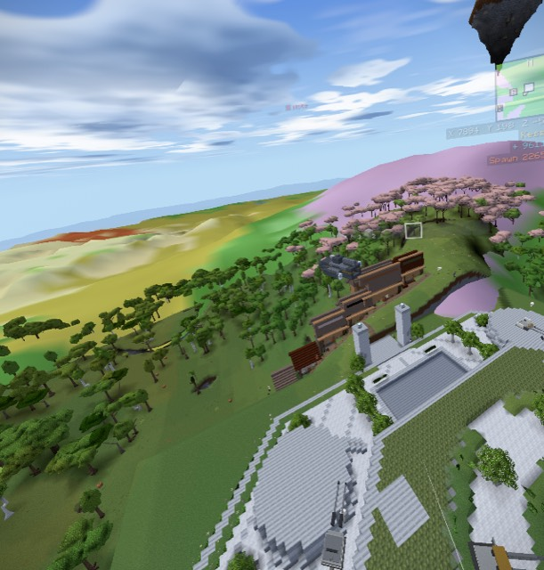

## 11:55:52 - There should be guys inside the drop ships actually driving them

- **Transcript:** There should be guys inside the drop ships actually driving them
- **Status:** open
- **Build:** 0.129 (60d57643, M1-M4 (device-tested; ship riding, chests, comfort options, weapon wheel))
- **World:** New World (10) (seed 1997562484558922131)
- **Dimension:** Surface
- **Biome:** Forest
- **Position:** 7864.3 172.1 -5496.4
- **Facing:** north-east (yaw 61, pitch -53)
- **Held:** empty hand
- **Mount:** on foot
- **Looking at:** nothing
- **Mode:** Creative, health 20/20
- **Time:** day 2 09:52, clear
- **Fps:** 67
- **Levels:** mic -33 dBFS, game sound -15 dBFS
- **Length:** 4.3 s (voice 2.8 s)
- **Just before:** -20s walked into Cherry Grove; -18s walked into Meadow; -17s message: A Capital Dropship is landing troops!; -12s walked into Forest; -9s message: Walking; -8s message: Flying; -6s message: Walking; -5s message:  Take command of the Capital Dropship
- **Repro (Mac):** `./snap.sh note --seed 1997562484558922131 --x 7864.3 --z -5496.4 --yaw -61 --pitch -53 --time 0.161`
- **Audio (this Mac):** /Users/darthvadar/Documents/Blocksmith/QuestVoiceNotes/raw/vn-20261016-115552-088.aac

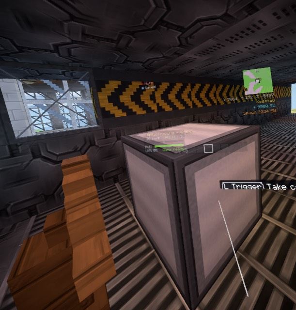

## 11:55:56 - Just, just saying like

- **Transcript:** Just, just saying like
- **Status:** open
- **Build:** 0.129 (60d57643, M1-M4 (device-tested; ship riding, chests, comfort options, weapon wheel))
- **World:** New World (10) (seed 1997562484558922131)
- **Dimension:** Surface
- **Biome:** Cherry Grove
- **Position:** 7838.7 173.1 -5488.4
- **Facing:** north (yaw 15, pitch -33)
- **Held:** empty hand
- **Mount:** piloting Capital Dropship
- **Looking at:** nothing
- **Mode:** Creative, health 20/20, screen BookMenu
- **Time:** day 2 09:56, clear
- **Fps:** 69
- **Levels:** mic -38 dBFS, game sound -12 dBFS
- **Length:** 2.4 s (voice 1.1 s)
- **Just before:** -24s walked into Cherry Grove; -22s walked into Meadow; -21s message: A Capital Dropship is landing troops!; -16s walked into Forest; -13s message: Walking; -11s message: Flying; -10s message: Walking; -9s message:  Take command of the Capital Dropship; -2s walked into Cherry Grove; -1s piloting Capital Dropship; -1s message: Steering Capital Dropship (Airship, throttle holds); -1s opened BookMenu; -1s message: Steering Capital Dropship (Airship, throttle holds). Added to journal: Repairs: Capital Dropship
- **Repro (Mac):** `./snap.sh note --seed 1997562484558922131 --x 7838.7 --z -5488.4 --yaw -15 --pitch -33 --time 0.164`
- **Audio (this Mac):** /Users/darthvadar/Documents/Blocksmith/QuestVoiceNotes/raw/vn-20261016-115556-128.aac

## 11:55:58 - And all that was in

- **Transcript:** And all that was in
- **Status:** open
- **Build:** 0.129 (60d57643, M1-M4 (device-tested; ship riding, chests, comfort options, weapon wheel))
- **World:** New World (10) (seed 1997562484558922131)
- **Dimension:** Surface
- **Biome:** Cherry Grove
- **Position:** 7837.5 172.8 -5487.7
- **Facing:** north (yaw 14, pitch -33)
- **Held:** empty hand
- **Mount:** piloting Capital Dropship
- **Looking at:** nothing
- **Mode:** Creative, health 20/20, screen BookMenu
- **Time:** day 2 09:59, clear
- **Fps:** 63
- **Levels:** mic -27 dBFS, game sound -14 dBFS
- **Length:** 2.3 s (voice 0.9 s)
- **Just before:** -26s walked into Cherry Grove; -24s walked into Meadow; -23s message: A Capital Dropship is landing troops!; -18s walked into Forest; -15s message: Walking; -14s message: Flying; -12s message: Walking; -11s message:  Take command of the Capital Dropship; -4s walked into Cherry Grove; -4s piloting Capital Dropship; -4s message: Steering Capital Dropship (Airship, throttle holds); -4s opened BookMenu; -4s message: Steering Capital Dropship (Airship, throttle holds). Added to journal: Repairs: Capital Dropship; -0s message: You have taken command of the Capital Dropship!
- **Repro (Mac):** `./snap.sh note --seed 1997562484558922131 --x 7837.5 --z -5487.7 --yaw -14 --pitch -33 --time 0.166`
- **Audio (this Mac):** /Users/darthvadar/Documents/Blocksmith/QuestVoiceNotes/raw/vn-20261016-115558-848.aac

## 11:56:06 - Yeah, so on the contrary, the, uh, dropship guns don't do jack shit, s

- **Transcript:** Yeah, so on the contrary, the, uh, dropship guns don't do jack shit, so, um, I don't know, I think they should do similar damage to the
- **Status:** open
- **Build:** 0.129 (60d57643, M1-M4 (device-tested; ship riding, chests, comfort options, weapon wheel))
- **World:** New World (10) (seed 1997562484558922131)
- **Dimension:** Surface
- **Biome:** Cherry Grove
- **Position:** 7836.3 173.8 -5487.2
- **Facing:** north-west (yaw 331, pitch -5)
- **Held:** empty hand
- **Mount:** piloting Capital Dropship
- **Looking at:** nothing
- **Mode:** Creative, health 20/20
- **Time:** day 2 10:07, clear
- **Fps:** 65
- **Levels:** mic -24 dBFS, game sound -16 dBFS
- **Length:** 10.4 s (voice 7.0 s)
- **Just before:** -30s message: A Capital Dropship is landing troops!; -25s walked into Forest; -22s message: Walking; -20s message: Flying; -19s message: Walking; -17s message:  Take command of the Capital Dropship; -11s walked into Cherry Grove; -10s piloting Capital Dropship; -10s message: Steering Capital Dropship (Airship, throttle holds); -10s opened BookMenu; -10s message: Steering Capital Dropship (Airship, throttle holds). Added to journal: Repairs: Capital Dropship; -7s message: You have taken command of the Capital Dropship!; -5s closed BookMenu
- **Position at the end:** 7833.6 173.8 -5486.0
- **Repro (Mac):** `./snap.sh note --seed 1997562484558922131 --x 7836.3 --z -5487.2 --yaw 29 --pitch -5 --time 0.172`
- **Audio (this Mac):** /Users/darthvadar/Documents/Blocksmith/QuestVoiceNotes/raw/vn-20261016-115606-188.aac

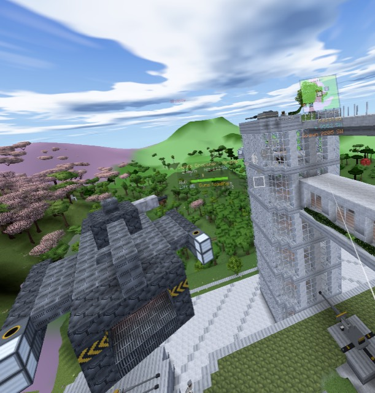

## 11:56:16 - The 42 guns or flak guns, what do you call them?

- **Transcript:** The 42 guns or flak guns, what do you call them?
- **Status:** open
- **Build:** 0.129 (60d57643, M1-M4 (device-tested; ship riding, chests, comfort options, weapon wheel))
- **World:** New World (10) (seed 1997562484558922131)
- **Dimension:** Surface
- **Biome:** Forest
- **Position:** 7764.0 173.8 -5483.2
- **Facing:** east (yaw 70, pitch -6)
- **Held:** empty hand
- **Mount:** piloting Capital Dropship
- **Looking at:** nothing
- **Mode:** Creative, health 20/20
- **Time:** day 2 10:17, clear
- **Fps:** 62
- **Levels:** mic -25 dBFS, game sound -11 dBFS
- **Length:** 4.4 s (voice 2.2 s)
- **Just before:** -29s message: Flying; -28s message: Walking; -27s message:  Take command of the Capital Dropship; -20s walked into Cherry Grove; -19s piloting Capital Dropship; -19s message: Steering Capital Dropship (Airship, throttle holds); -19s opened BookMenu; -19s message: Steering Capital Dropship (Airship, throttle holds). Added to journal: Repairs: Capital Dropship; -16s message: You have taken command of the Capital Dropship!; -14s closed BookMenu; -2s walked into Forest
- **Repro (Mac):** `./snap.sh note --seed 1997562484558922131 --x 7764.0 --z -5483.2 --yaw -70 --pitch -6 --time 0.179`
- **Audio (this Mac):** /Users/darthvadar/Documents/Blocksmith/QuestVoiceNotes/raw/vn-20261016-115616-708.aac

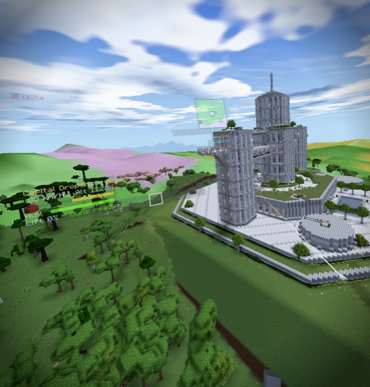

## 11:56:21 - There's giant cannon on top, like frick

- **Transcript:** There's giant cannon on top, like frick
- **Status:** open
- **Build:** 0.129 (60d57643, M1-M4 (device-tested; ship riding, chests, comfort options, weapon wheel))
- **World:** New World (10) (seed 1997562484558922131)
- **Dimension:** Surface
- **Biome:** Sparse Jungle
- **Position:** 7765.5 173.8 -5555.2
- **Facing:** east (yaw 109, pitch -7)
- **Held:** empty hand
- **Mount:** piloting Capital Dropship
- **Looking at:** nothing
- **Mode:** Creative, health 20/20
- **Time:** day 2 10:22, clear
- **Fps:** 64
- **Levels:** mic -23 dBFS, game sound -14 dBFS
- **Length:** 3.0 s (voice 1.3 s)
- **Just before:** -24s walked into Cherry Grove; -23s piloting Capital Dropship; -23s message: Steering Capital Dropship (Airship, throttle holds); -23s opened BookMenu; -23s message: Steering Capital Dropship (Airship, throttle holds). Added to journal: Repairs: Capital Dropship; -20s message: You have taken command of the Capital Dropship!; -17s closed BookMenu; -5s walked into Forest
- **Repro (Mac):** `./snap.sh note --seed 1997562484558922131 --x 7765.5 --z -5555.2 --yaw -109 --pitch -7 --time 0.182`
- **Audio (this Mac):** /Users/darthvadar/Documents/Blocksmith/QuestVoiceNotes/raw/vn-20261016-115621-048.aac

## 11:56:35 - I don't know, like, I, I think we should try to... Like, you know how 

- **Transcript:** I don't know, like, I, I think we should try to... Like, you know how the Falcon feels when you drive that in, uh, in Hill Reach? I think it sh- this thing should operate in a similar style
- **Status:** open
- **Build:** 0.129 (60d57643, M1-M4 (device-tested; ship riding, chests, comfort options, weapon wheel))
- **World:** New World (10) (seed 1997562484558922131)
- **Dimension:** Surface
- **Biome:** Meadow
- **Position:** 7982.4 173.8 -5673.2
- **Facing:** east (yaw 71, pitch -15)
- **Held:** empty hand
- **Mount:** piloting Capital Dropship
- **Looking at:** nothing
- **Mode:** Creative, health 20/20
- **Time:** day 2 10:38, clear
- **Fps:** 69
- **Levels:** mic -22 dBFS, game sound -16 dBFS
- **Length:** 13.9 s (voice 7.7 s)
- **Just before:** -19s walked into Forest; -13s walked into Sparse Jungle; -11s walked into Forest; -9s walked into Meadow
- **While talking:** -4s walked into Savanna Plateau; -2s walked into Plains; -0s walked into Savanna Plateau
- **Position at the end:** 8022.9 173.8 -5610.9
- **Repro (Mac):** `./snap.sh note --seed 1997562484558922131 --x 7982.4 --z -5673.2 --yaw -71 --pitch -15 --time 0.193`
- **Audio (this Mac):** /Users/darthvadar/Documents/Blocksmith/QuestVoiceNotes/raw/vn-20261016-115635-188.aac

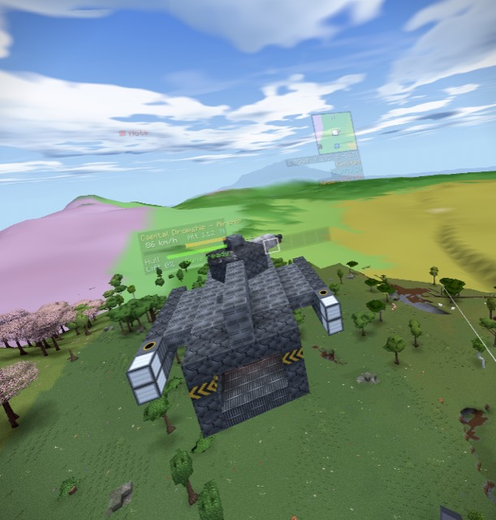

## 11:56:48 - Okay, I see a train track here

- **Transcript:** Okay, I see a train track here
- **Status:** open
- **Build:** 0.129 (60d57643, M1-M4 (device-tested; ship riding, chests, comfort options, weapon wheel))
- **World:** New World (10) (seed 1997562484558922131)
- **Dimension:** Surface
- **Biome:** Meadow
- **Position:** 7949.9 176.7 -5577.3
- **Facing:** south (yaw 159, pitch -14)
- **Held:** empty hand
- **Mount:** piloting Capital Dropship
- **Looking at:** nothing
- **Mode:** Creative, health 20/20
- **Time:** day 2 10:54, clear
- **Fps:** 70
- **Levels:** mic -29 dBFS, game sound -15 dBFS
- **Length:** 3.8 s (voice 2.2 s)
- **Just before:** -26s walked into Sparse Jungle; -24s walked into Forest; -22s walked into Meadow; -8s walked into Savanna Plateau; -6s walked into Plains; -4s walked into Savanna Plateau; -2s walked into Meadow
- **Repro (Mac):** `./snap.sh note --seed 1997562484558922131 --x 7949.9 --z -5577.3 --yaw -159 --pitch -14 --time 0.204`
- **Audio (this Mac):** /Users/darthvadar/Documents/Blocksmith/QuestVoiceNotes/raw/vn-20261016-115648-828.aac

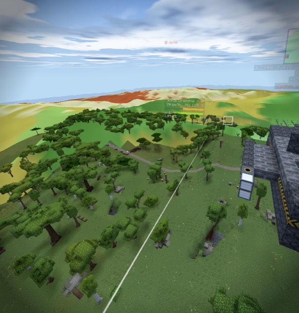

## 11:56:54 - Okay, it stops though again. Why does it stop like that? Ideally, we'd

- **Transcript:** Okay, it stops though again. Why does it stop like that? Ideally, we'd want it to carry on. Oh, yeah, look at that. Some buffalo there. Very nice. Ideally, we'd want the train to carry on to a village or something
- **Status:** open
- **Build:** 0.129 (60d57643, M1-M4 (device-tested; ship riding, chests, comfort options, weapon wheel))
- **World:** New World (10) (seed 1997562484558922131)
- **Dimension:** Surface
- **Biome:** Forest
- **Position:** 8015.1 176.8 -5515.3
- **Facing:** east (yaw 80, pitch -22)
- **Held:** empty hand
- **Mount:** piloting Capital Dropship
- **Looking at:** nothing
- **Mode:** Creative, health 20/20
- **Time:** day 2 11:00, clear
- **Fps:** 67
- **Levels:** mic -55 dBFS, game sound -15 dBFS
- **Length:** 14.5 s (voice 8.8 s)
- **Just before:** -29s walked into Forest; -27s walked into Meadow; -13s walked into Savanna Plateau; -11s walked into Plains; -9s walked into Savanna Plateau; -7s walked into Meadow; -1s walked into Savanna Plateau
- **While talking:** -3s walked into Forest; -4s walked into Plains; -2s walked into Desert; -0s walked into Savanna Plateau
- **Position at the end:** 8223.6 180.4 -5452.5
- **Repro (Mac):** `./snap.sh note --seed 1997562484558922131 --x 8015.1 --z -5515.3 --yaw -80 --pitch -22 --time 0.209`
- **Audio (this Mac):** /Users/darthvadar/Documents/Blocksmith/QuestVoiceNotes/raw/vn-20261016-115654-048.aac

## 11:57:11 - I know that's really difficult to do, but still

- **Transcript:** I know that's really difficult to do, but still
- **Status:** open
- **Build:** 0.129 (60d57643, M1-M4 (device-tested; ship riding, chests, comfort options, weapon wheel))
- **World:** New World (10) (seed 1997562484558922131)
- **Dimension:** Surface
- **Biome:** Desert
- **Position:** 8377.5 180.4 -5387.1
- **Facing:** south (yaw 175, pitch -33)
- **Held:** empty hand
- **Mount:** piloting Capital Dropship
- **Looking at:** nothing
- **Mode:** Creative, health 20/20
- **Time:** day 2 11:20, clear
- **Fps:** 71
- **Levels:** mic -25 dBFS, game sound -12 dBFS
- **Length:** 3.4 s (voice 1.6 s)
- **Just before:** -29s walked into Savanna Plateau; -27s walked into Plains; -25s walked into Savanna Plateau; -23s walked into Meadow; -17s walked into Savanna Plateau; -15s walked into Forest; -11s walked into Plains; -9s walked into Desert; -7s walked into Savanna Plateau; -5s walked into Desert; -1s message: Entering Calisesh
- **Repro (Mac):** `./snap.sh note --seed 1997562484558922131 --x 8377.5 --z -5387.1 --yaw -175 --pitch -33 --time 0.222`
- **Audio (this Mac):** /Users/darthvadar/Documents/Blocksmith/QuestVoiceNotes/raw/vn-20261016-115711-288.aac

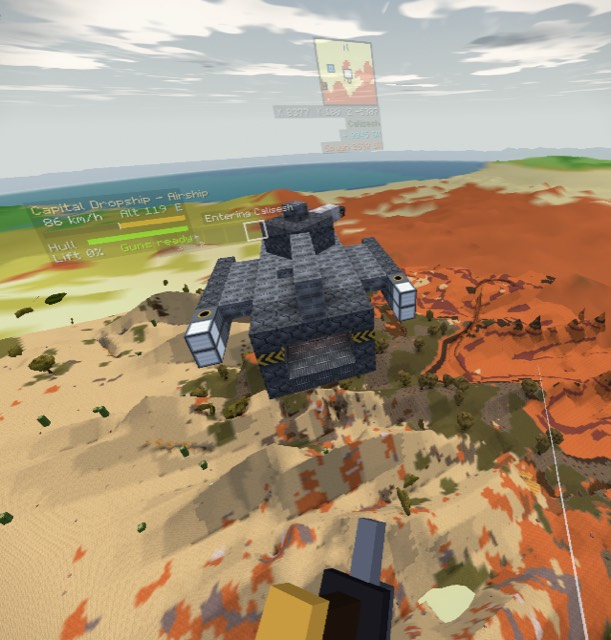

## 11:57:19 - Some reason I like, feel like I'm gonna fall over

- **Transcript:** Some reason I like, feel like I'm gonna fall over
- **Status:** open
- **Build:** 0.129 (60d57643, M1-M4 (device-tested; ship riding, chests, comfort options, weapon wheel))
- **World:** New World (10) (seed 1997562484558922131)
- **Dimension:** Surface
- **Biome:** Savanna Plateau
- **Position:** 8469.7 180.4 -5467.3
- **Facing:** north-west (yaw 320, pitch -40)
- **Held:** empty hand
- **Mount:** piloting Capital Dropship
- **Looking at:** nothing
- **Mode:** Creative, health 20/20
- **Time:** day 2 11:30, clear
- **Fps:** 71
- **Levels:** mic -27 dBFS, game sound -11 dBFS
- **Length:** 4.0 s (voice 1.9 s)
- **Just before:** -25s walked into Savanna Plateau; -23s walked into Forest; -19s walked into Plains; -17s walked into Desert; -15s walked into Savanna Plateau; -13s walked into Desert; -9s message: Entering Calisesh; -7s walked into Badlands; -5s walked into Wooded Badlands; -1s walked into Desert
- **Repro (Mac):** `./snap.sh note --seed 1997562484558922131 --x 8469.7 --z -5467.3 --yaw 40 --pitch -40 --time 0.229`
- **Audio (this Mac):** /Users/darthvadar/Documents/Blocksmith/QuestVoiceNotes/raw/vn-20261016-115719-528.aac

## 11:57:26 - Uh, when I'm driving this thing, this drop ship

- **Transcript:** Uh, when I'm driving this thing, this drop ship
- **Status:** open
- **Build:** 0.129 (60d57643, M1-M4 (device-tested; ship riding, chests, comfort options, weapon wheel))
- **World:** New World (10) (seed 1997562484558922131)
- **Dimension:** Surface
- **Biome:** Savanna Plateau
- **Position:** 8325.0 180.4 -5477.2
- **Facing:** west (yaw 266, pitch -44)
- **Held:** empty hand
- **Mount:** piloting Capital Dropship
- **Looking at:** nothing
- **Mode:** Creative, health 20/20
- **Time:** day 2 11:38, clear
- **Fps:** 71
- **Levels:** mic -25 dBFS, game sound -16 dBFS
- **Length:** 3.7 s (voice 1.7 s)
- **Just before:** -26s walked into Plains; -24s walked into Desert; -22s walked into Savanna Plateau; -20s walked into Desert; -16s message: Entering Calisesh; -14s walked into Badlands; -12s walked into Wooded Badlands; -8s walked into Desert; -6s walked into Savanna Plateau; -2s walked into Desert; -1s message: Entering Kesstad; -0s walked into Savanna Plateau
- **Repro (Mac):** `./snap.sh note --seed 1997562484558922131 --x 8325.0 --z -5477.2 --yaw 94 --pitch -44 --time 0.235`
- **Audio (this Mac):** /Users/darthvadar/Documents/Blocksmith/QuestVoiceNotes/raw/vn-20261016-115726-428.aac

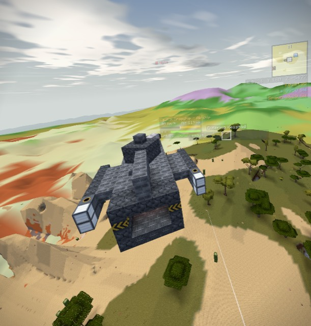

## 11:57:33 - Yeah. Anyway, rendering distance, you know, it still could use some wo

- **Transcript:** Yeah. Anyway, rendering distance, you know, it still could use some work. It still could use some work
- **Status:** open
- **Build:** 0.129 (60d57643, M1-M4 (device-tested; ship riding, chests, comfort options, weapon wheel))
- **World:** New World (10) (seed 1997562484558922131)
- **Dimension:** Surface
- **Biome:** Desert
- **Position:** 8185.0 180.4 -5395.4
- **Facing:** south-west (yaw 241, pitch -26)
- **Held:** empty hand
- **Mount:** piloting Capital Dropship
- **Looking at:** nothing
- **Mode:** Creative, health 20/20
- **Time:** day 2 11:46, clear
- **Fps:** 70
- **Levels:** mic -22 dBFS, game sound -14 dBFS
- **Length:** 6.4 s (voice 3.7 s)
- **Just before:** -29s walked into Savanna Plateau; -27s walked into Desert; -23s message: Entering Calisesh; -21s walked into Badlands; -19s walked into Wooded Badlands; -15s walked into Desert; -13s walked into Savanna Plateau; -9s walked into Desert; -8s message: Entering Kesstad; -7s walked into Savanna Plateau; -5s walked into Desert
- **While talking:** -4s walked into Savanna; -2s walked into Savanna Plateau; -2s message: Flying; -1s stopped piloting Capital Dropship
- **Position at the end:** 8100.2 181.5 -5334.6
- **Repro (Mac):** `./snap.sh note --seed 1997562484558922131 --x 8185.0 --z -5395.4 --yaw 119 --pitch -26 --time 0.241`
- **Audio (this Mac):** /Users/darthvadar/Documents/Blocksmith/QuestVoiceNotes/raw/vn-20261016-115733-388.aac

## 11:57:48 - Looks like I've got this little, um, piece in the cave that's not quit

- **Transcript:** Looks like I've got this little, um, piece in the cave that's not quite rendered correctly, 'cause I can see through it into the void
- **Status:** open
- **Build:** 0.129 (60d57643, M1-M4 (device-tested; ship riding, chests, comfort options, weapon wheel))
- **World:** New World (10) (seed 1997562484558922131)
- **Dimension:** Surface
- **Biome:** Savanna Plateau
- **Position:** 8096.2 97.0 -5295.0
- **Facing:** north-east (yaw 35, pitch -70)
- **Held:** empty hand
- **Mount:** on foot
- **Looking at:** Stone at 8096 95 -5296
- **Mode:** Creative, health 20/20
- **Time:** day 2 12:04, clear
- **Fps:** 72
- **Levels:** mic -32 dBFS, game sound -17 dBFS
- **Length:** 9.0 s (voice 5.0 s)
- **Just before:** -28s walked into Savanna Plateau; -24s walked into Desert; -23s message: Entering Kesstad; -22s walked into Savanna Plateau; -20s walked into Desert; -14s walked into Savanna; -12s walked into Savanna Plateau; -12s message: Flying; -11s stopped piloting Capital Dropship
- **Position at the end:** 8097.2 96.0 -5294.6
- **Repro (Mac):** `./snap.sh note --seed 1997562484558922131 --x 8096.2 --z -5295.0 --yaw -35 --pitch -70 --time 0.253`
- **Audio (this Mac):** /Users/darthvadar/Documents/Blocksmith/QuestVoiceNotes/raw/vn-20261016-115748-788.aac

## 11:57:57 - Which is no bueno

- **Transcript:** Which is no bueno
- **Status:** open
- **Build:** 0.129 (60d57643, M1-M4 (device-tested; ship riding, chests, comfort options, weapon wheel))
- **World:** New World (10) (seed 1997562484558922131)
- **Dimension:** Surface
- **Biome:** Savanna Plateau
- **Position:** 8106.7 92.4 -5294.7
- **Facing:** south-east (yaw 127, pitch -43)
- **Held:** empty hand
- **Mount:** on foot
- **Looking at:** Stone at 8107 92 -5294
- **Mode:** Creative, health 20/20
- **Time:** day 2 12:15, clear
- **Fps:** 72
- **Levels:** mic -39 dBFS, game sound -16 dBFS
- **Length:** 2.2 s (voice 1.0 s)
- **Just before:** -29s walked into Desert; -23s walked into Savanna; -21s walked into Savanna Plateau; -21s message: Flying; -20s stopped piloting Capital Dropship
- **Repro (Mac):** `./snap.sh note --seed 1997562484558922131 --x 8106.7 --z -5294.7 --yaw -127 --pitch -43 --time 0.260`
- **Audio (this Mac):** /Users/darthvadar/Documents/Blocksmith/QuestVoiceNotes/raw/vn-20261016-115757-468.aac

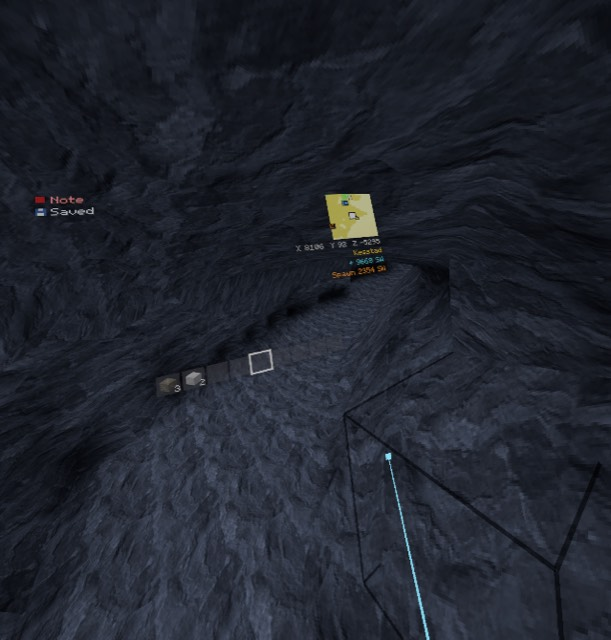

## 11:58:11 - I'm gonna start making some redstone stuff, or copper stuff I should s

- **Transcript:** I'm gonna start making some redstone stuff, or copper stuff I should say
- **Status:** open
- **Build:** 0.129 (60d57643, M1-M4 (device-tested; ship riding, chests, comfort options, weapon wheel))
- **World:** New World (10) (seed 1997562484558922131)
- **Dimension:** Surface
- **Biome:** Desert
- **Position:** 8132.7 85.5 -5214.9
- **Facing:** south-east (yaw 115, pitch -33)
- **Held:** empty hand
- **Mount:** on foot
- **Looking at:** Stone at 8134 85 -5214
- **Mode:** Creative, health 20/20
- **Time:** day 2 12:31, clear
- **Fps:** 72
- **Levels:** mic -39 dBFS, game sound -18 dBFS
- **Length:** 4.9 s (voice 1.8 s)
- **Just before:** -8s walked into Desert
- **Repro (Mac):** `./snap.sh note --seed 1997562484558922131 --x 8132.7 --z -5214.9 --yaw -115 --pitch -33 --time 0.272`
- **Audio (this Mac):** /Users/darthvadar/Documents/Blocksmith/QuestVoiceNotes/raw/vn-20261016-115811-508.aac

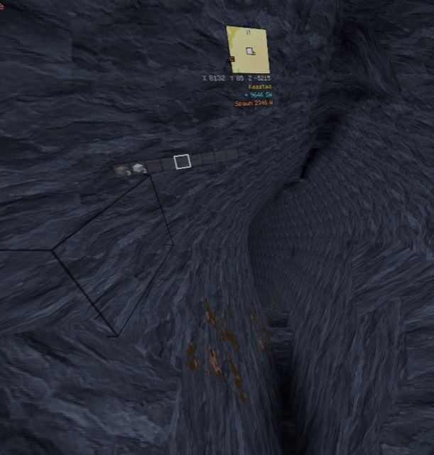

## 11:58:40 - Okay, let's take a look at the water. So

- **Transcript:** Okay, let's take a look at the water. So
- **Status:** open
- **Build:** 0.129 (60d57643, M1-M4 (device-tested; ship riding, chests, comfort options, weapon wheel))
- **World:** New World (10) (seed 1997562484558922131)
- **Dimension:** Surface
- **Biome:** Desert
- **Position:** 8199.0 -29.0 -5225.7
- **Facing:** south-east (yaw 134, pitch -59)
- **Held:** empty hand
- **Mount:** on foot
- **Looking at:** Emberslate at 8199 -30 -5225
- **Mode:** Creative, health 20/20
- **Time:** day 2 13:06, clear
- **Fps:** 72
- **Levels:** mic -28 dBFS, game sound -14 dBFS
- **Length:** 4.0 s (voice 2.2 s)
- **Just before:** -2s message: Walking
- **Repro (Mac):** `./snap.sh note --seed 1997562484558922131 --x 8199.0 --z -5225.7 --yaw -134 --pitch -59 --time 0.296`
- **Audio (this Mac):** /Users/darthvadar/Documents/Blocksmith/QuestVoiceNotes/raw/vn-20261016-115840-909.aac

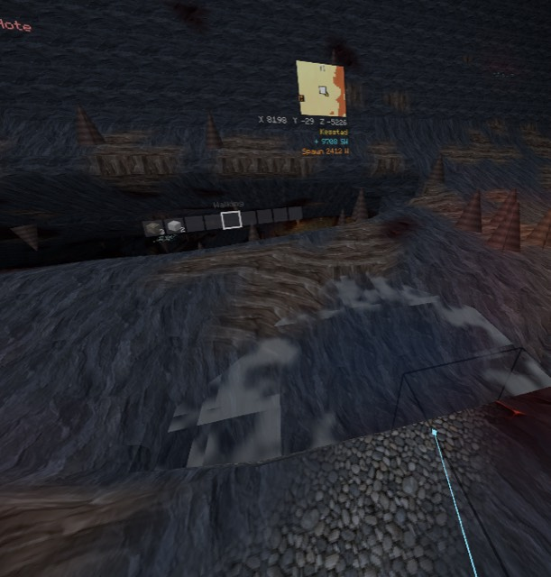

## 11:58:46 - Wire is better. I think it's... Yeah, it's fixed

- **Transcript:** Wire is better. I think it's... Yeah, it's fixed
- **Status:** open
- **Build:** 0.129 (60d57643, M1-M4 (device-tested; ship riding, chests, comfort options, weapon wheel))
- **World:** New World (10) (seed 1997562484558922131)
- **Dimension:** Surface
- **Biome:** Desert
- **Position:** 8202.4 -30.0 -5225.9
- **Facing:** south-west (yaw 204, pitch -36)
- **Held:** empty hand
- **Mount:** on foot
- **Looking at:** Deeprock at 8201 -31 -5223
- **Mode:** Creative, health 20/20
- **Time:** day 2 13:13, clear
- **Fps:** 72
- **Levels:** mic -25 dBFS, game sound -14 dBFS
- **Length:** 5.5 s (voice 2.8 s)
- **Just before:** -7s message: Walking
- **Repro (Mac):** `./snap.sh note --seed 1997562484558922131 --x 8202.4 --z -5225.9 --yaw 156 --pitch -36 --time 0.301`
- **Audio (this Mac):** /Users/darthvadar/Documents/Blocksmith/QuestVoiceNotes/raw/vn-20261016-115846-248.aac

## 11:58:51 - Yeah, I think the water's fine

- **Transcript:** Yeah, I think the water's fine
- **Status:** open
- **Build:** 0.129 (60d57643, M1-M4 (device-tested; ship riding, chests, comfort options, weapon wheel))
- **World:** New World (10) (seed 1997562484558922131)
- **Dimension:** Surface
- **Biome:** Desert
- **Position:** 8201.7 -30.0 -5226.9
- **Facing:** south-west (yaw 215, pitch -59)
- **Held:** empty hand
- **Mount:** on foot
- **Looking at:** Deeprock at 8201 -31 -5227
- **Mode:** Creative, health 20/20
- **Time:** day 2 13:19, clear
- **Fps:** 72
- **Levels:** mic -23 dBFS, game sound -16 dBFS
- **Length:** 4.0 s (voice 2.3 s)
- **Just before:** -13s message: Walking
- **Repro (Mac):** `./snap.sh note --seed 1997562484558922131 --x 8201.7 --z -5226.9 --yaw 145 --pitch -59 --time 0.305`
- **Audio (this Mac):** /Users/darthvadar/Documents/Blocksmith/QuestVoiceNotes/raw/vn-20261016-115851-688.aac

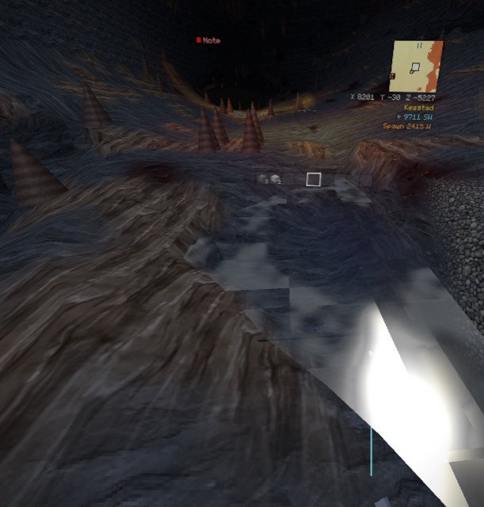

## 11:58:55 - But I still think we're op-- Yeah, we're still operating from a block-

- **Transcript:** But I still think we're op-- Yeah, we're still operating from a block-by-block basis, which I want to try to move away from
- **Status:** open
- **Build:** 0.129 (60d57643, M1-M4 (device-tested; ship riding, chests, comfort options, weapon wheel))
- **World:** New World (10) (seed 1997562484558922131)
- **Dimension:** Surface
- **Biome:** Desert
- **Position:** 8197.9 -28.9 -5218.6
- **Facing:** south-east (yaw 147, pitch -28)
- **Held:** empty hand
- **Mount:** on foot
- **Looking at:** Deeprock at 8199 -30 -5216
- **Mode:** Creative, health 20/20
- **Time:** day 2 13:24, clear
- **Fps:** 72
- **Levels:** mic -29 dBFS, game sound -21 dBFS
- **Length:** 6.9 s (voice 4.5 s)
- **Just before:** -17s message: Walking; -2s message: Render distance back up to 15
- **Position at the end:** 8201.9 -29.0 -5212.8
- **Repro (Mac):** `./snap.sh note --seed 1997562484558922131 --x 8197.9 --z -5218.6 --yaw -147 --pitch -28 --time 0.308`
- **Audio (this Mac):** /Users/darthvadar/Documents/Blocksmith/QuestVoiceNotes/raw/vn-20261016-115855-428.aac

## 11:59:03 - And, uh, the drip stone, some of it's not connected well to the ground

- **Transcript:** And, uh, the drip stone, some of it's not connected well to the ground. And we're still doing that, like, that
- **Status:** open
- **Build:** 0.129 (60d57643, M1-M4 (device-tested; ship riding, chests, comfort options, weapon wheel))
- **World:** New World (10) (seed 1997562484558922131)
- **Dimension:** Surface
- **Biome:** Desert
- **Position:** 8202.4 -29.0 -5214.8
- **Facing:** south-east (yaw 121, pitch -11)
- **Held:** empty hand
- **Mount:** on foot
- **Looking at:** nothing
- **Mode:** Creative, health 20/20
- **Time:** day 2 13:33, clear
- **Fps:** 72
- **Levels:** mic -28 dBFS, game sound -19 dBFS
- **Length:** 7.8 s (voice 4.4 s)
- **Just before:** -24s message: Walking; -10s message: Render distance back up to 15
- **Position at the end:** 8201.7 -29.0 -5213.0
- **Repro (Mac):** `./snap.sh note --seed 1997562484558922131 --x 8202.4 --z -5214.8 --yaw -121 --pitch -11 --time 0.315`
- **Audio (this Mac):** /Users/darthvadar/Documents/Blocksmith/QuestVoiceNotes/raw/vn-20261016-115903-008.aac

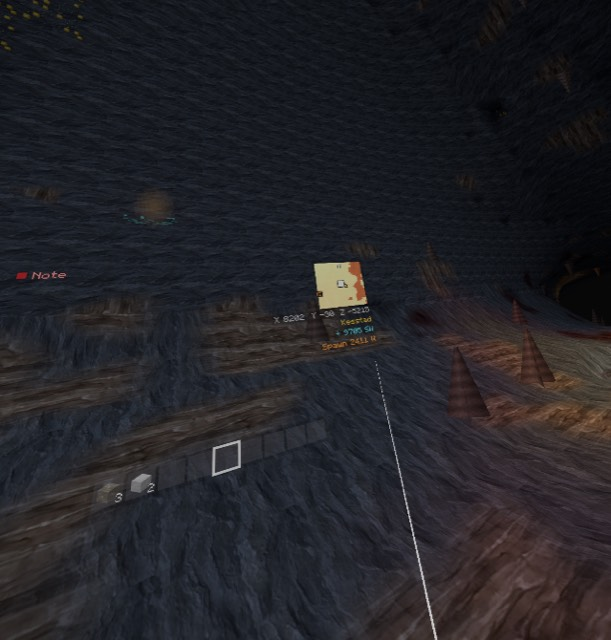

## 11:59:10 - Paper fold style where it's like it looks like dripstone from a distan

- **Transcript:** Paper fold style where it's like it looks like dripstone from a distance, but you're really up close and you see like, oh, it's just a kind of a paper fold thing. Lava's not rendering correctly into the ground
- **Status:** open
- **Build:** 0.129 (60d57643, M1-M4 (device-tested; ship riding, chests, comfort options, weapon wheel))
- **World:** New World (10) (seed 1997562484558922131)
- **Dimension:** Surface
- **Biome:** Desert
- **Position:** 8201.7 -29.0 -5213.0
- **Facing:** south-east (yaw 155, pitch -46)
- **Held:** empty hand
- **Mount:** on foot
- **Looking at:** Pointed Driprock at 8202 -29 -5212
- **Mode:** Creative, health 20/20
- **Time:** day 2 13:42, clear
- **Fps:** 72
- **Levels:** mic -44 dBFS, game sound -40 dBFS
- **Length:** 12.8 s (voice 8.1 s)
- **Just before:** -17s message: Render distance back up to 15
- **Position at the end:** 8205.9 -30.4 -5234.5
- **Repro (Mac):** `./snap.sh note --seed 1997562484558922131 --x 8201.7 --z -5213.0 --yaw -155 --pitch -46 --time 0.321`
- **Audio (this Mac):** /Users/darthvadar/Documents/Blocksmith/QuestVoiceNotes/raw/vn-20261016-115910-829.aac

## 11:59:23 - Like really these are just problems with the fact that we're still usi

- **Transcript:** Like really these are just problems with the fact that we're still using a block overlay, like
- **Status:** open
- **Build:** 0.129 (60d57643, M1-M4 (device-tested; ship riding, chests, comfort options, weapon wheel))
- **World:** New World (10) (seed 1997562484558922131)
- **Dimension:** Surface
- **Biome:** Desert
- **Position:** 8222.3 -40.8 -5240.1
- **Facing:** east (yaw 90, pitch -24)
- **Held:** empty hand
- **Mount:** on foot
- **Looking at:** nothing
- **Mode:** Creative, health 20/20
- **Time:** day 2 13:57, clear
- **Fps:** 72
- **Levels:** mic -38 dBFS, game sound -44 dBFS
- **Length:** 4.6 s (voice 2.8 s)
- **Just before:** -0s message: Render distance back up to 20
- **Repro (Mac):** `./snap.sh note --seed 1997562484558922131 --x 8222.3 --z -5240.1 --yaw -90 --pitch -24 --time 0.332`
- **Audio (this Mac):** /Users/darthvadar/Documents/Blocksmith/QuestVoiceNotes/raw/vn-20261016-115923-588.aac

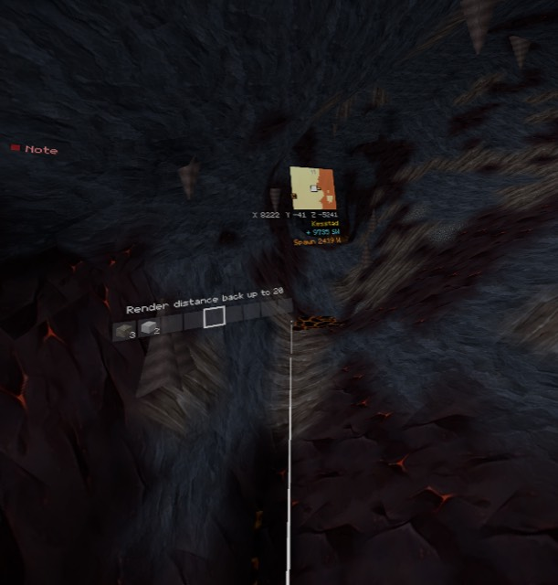

## 11:59:28 - That's what we're trying to undo

- **Transcript:** That's what we're trying to undo
- **Status:** open
- **Build:** 0.129 (60d57643, M1-M4 (device-tested; ship riding, chests, comfort options, weapon wheel))
- **World:** New World (10) (seed 1997562484558922131)
- **Dimension:** Surface
- **Biome:** Desert
- **Position:** 8244.5 -44.0 -5233.6
- **Facing:** north (yaw 14, pitch 11)
- **Held:** empty hand
- **Mount:** on foot
- **Looking at:** Emberslate at 8245 -42 -5239
- **Mode:** Creative, health 20/20
- **Time:** day 2 14:03, clear
- **Fps:** 72
- **Levels:** mic -21 dBFS, game sound -31 dBFS
- **Length:** 2.6 s (voice 1.4 s)
- **Just before:** -5s message: Render distance back up to 20; -3s message: Kesstad - Calisesh border post marked on the map
- **Repro (Mac):** `./snap.sh note --seed 1997562484558922131 --x 8244.5 --z -5233.6 --yaw -14 --pitch 11 --time 0.336`
- **Audio (this Mac):** /Users/darthvadar/Documents/Blocksmith/QuestVoiceNotes/raw/vn-20261016-115928-048.aac

## 11:59:30 - Big task, I know. It's gotta be done, though

- **Transcript:** Big task, I know. It's gotta be done, though
- **Status:** open
- **Build:** 0.129 (60d57643, M1-M4 (device-tested; ship riding, chests, comfort options, weapon wheel))
- **World:** New World (10) (seed 1997562484558922131)
- **Dimension:** Surface
- **Biome:** Desert
- **Position:** 8237.8 -41.0 -5237.6
- **Facing:** west (yaw 276, pitch -34)
- **Held:** empty hand
- **Mount:** on foot
- **Looking at:** Emberslate at 8235 -42 -5238
- **Mode:** Creative, health 20/20
- **Time:** day 2 14:06, clear
- **Fps:** 72
- **Levels:** mic -34 dBFS, game sound -32 dBFS
- **Length:** 3.3 s (voice 1.7 s)
- **Just before:** -7s message: Render distance back up to 20; -5s message: Kesstad - Calisesh border post marked on the map
- **Repro (Mac):** `./snap.sh note --seed 1997562484558922131 --x 8237.8 --z -5237.6 --yaw 84 --pitch -34 --time 0.338`
- **Audio (this Mac):** /Users/darthvadar/Documents/Blocksmith/QuestVoiceNotes/raw/vn-20261016-115930-628.aac

## 11:59:35 - Maybe the mall is working on that. Don't understand the size of such a

- **Transcript:** Maybe the mall is working on that. Don't understand the size of such a task
- **Status:** open
- **Build:** 0.129 (60d57643, M1-M4 (device-tested; ship riding, chests, comfort options, weapon wheel))
- **World:** New World (10) (seed 1997562484558922131)
- **Dimension:** Surface
- **Biome:** Desert
- **Position:** 8222.3 -38.6 -5234.3
- **Facing:** north (yaw 0, pitch -64)
- **Held:** empty hand
- **Mount:** on foot
- **Looking at:** Emberslate at 8222 -40 -5236
- **Mode:** Creative, health 20/20
- **Time:** day 2 14:12, clear
- **Fps:** 72
- **Levels:** mic -24 dBFS, game sound -33 dBFS
- **Length:** 5.4 s (voice 2.8 s)
- **Just before:** -12s message: Render distance back up to 20; -10s message: Kesstad - Calisesh border post marked on the map
- **Repro (Mac):** `./snap.sh note --seed 1997562484558922131 --x 8222.3 --z -5234.3 --yaw -0 --pitch -64 --time 0.342`
- **Audio (this Mac):** /Users/darthvadar/Documents/Blocksmith/QuestVoiceNotes/raw/vn-20261016-115935-688.aac

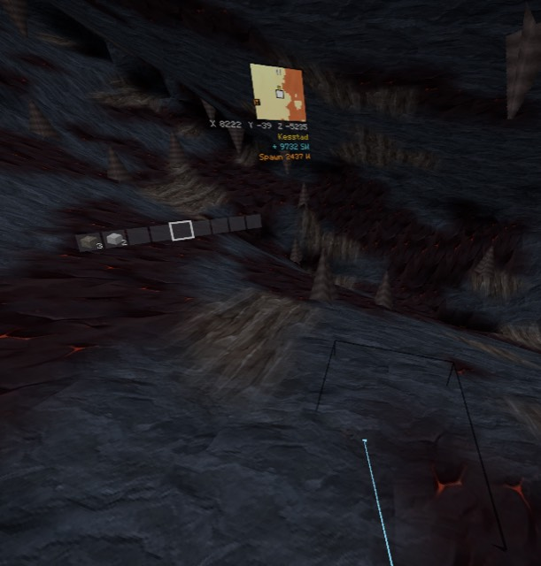

## 11:59:46 - Oh, now we're talking. See? Dropped right into hell. Very good. Oh, th

- **Transcript:** Oh, now we're talking. See? Dropped right into hell. Very good. Oh, this is what I'm talking about. Excellent work. Okay, we got new biomes going on here. They look excellent, especially this purple one. Purple one's awesome. Uh, this green sh- hmm, this yellow shit biome though, I don't like it very much. You know, I, I know it's meant to look disgusting, but yeah, it, uh, a little too disgusting. Um-
- **Status:** open
- **Build:** 0.129 (60d57643, M1-M4 (device-tested; ship riding, chests, comfort options, weapon wheel))
- **World:** New World (10) (seed 1997562484558922131)
- **Dimension:** Hell
- **Biome:** Cinder Plains
- **Position:** 8227.5 268.0 -5240.6
- **Facing:** north (yaw 17, pitch -80)
- **Held:** empty hand
- **Mount:** on foot
- **Looking at:** nothing
- **Mode:** Creative, health 20/20
- **Time:** day 2 14:24, clear
- **Fps:** 72
- **Levels:** mic -18 dBFS, game sound -14 dBFS
- **Length:** 27.9 s (voice 17.6 s)
- **Just before:** -22s message: Render distance back up to 20; -20s message: Kesstad - Calisesh border post marked on the map; -2s entered Hell; -2s message: Hell; -0s message: Sealrock under this fire blocks the way down. A Brimstone Keep about 281 blocks off holds the Sunderite that breaks it (compasses point there)
- **While talking:** -5s walked into Cinder Plains; -2s message: Flying; -3s walked into Sulfur Flats; -1s message: Walking
- **Position at the end:** 7955.4 219.2 -5296.8
- **Repro (Mac):** `./snap.sh note --seed 1997562484558922131 --x 8227.5 --z -5240.6 --yaw -17 --pitch -80 --time 0.350 --dim deep`
- **Audio (this Mac):** /Users/darthvadar/Documents/Blocksmith/QuestVoiceNotes/raw/vn-20261016-115946-588.aac

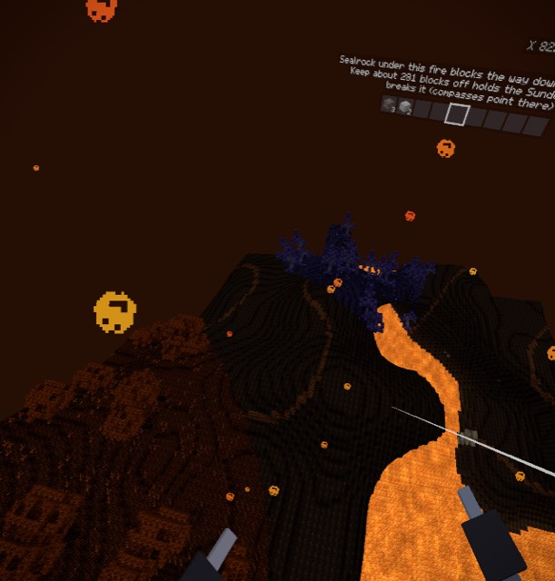

## 12:00:15 - And, uh, this little white patch here, it's fine, but these little wee

- **Transcript:** And, uh, this little white patch here, it's fine, but these little weed things sticking out don't look great
- **Status:** open
- **Build:** 0.129 (60d57643, M1-M4 (device-tested; ship riding, chests, comfort options, weapon wheel))
- **World:** New World (10) (seed 1997562484558922131)
- **Dimension:** Hell
- **Biome:** Ash Dunes
- **Position:** 7960.1 189.2 -5309.1
- **Facing:** north (yaw 1, pitch -48)
- **Held:** empty hand
- **Mount:** on foot, flying
- **Looking at:** nothing
- **Mode:** Creative, health 20/20
- **Time:** day 2 14:56, clear
- **Fps:** 63
- **Levels:** mic -27 dBFS, game sound -15 dBFS
- **Length:** 7.8 s (voice 4.7 s)
- **Just before:** -29s entered Hell; -29s message: Hell; -27s message: Sealrock under this fire blocks the way down. A Brimstone Keep about 281 blocks off holds the Sunderite that breaks it (compasses point there); -27s walked into Cinder Plains; -14s message: Flying; -11s walked into Sulfur Flats; -3s message: Walking; -3s walked into Ash Dunes; -2s message: Flying
- **Position at the end:** 7959.6 189.2 -5317.7
- **Repro (Mac):** `./snap.sh note --seed 1997562484558922131 --x 7960.1 --z -5309.1 --yaw -1 --pitch -48 --time 0.373 --dim deep`
- **Audio (this Mac):** /Users/darthvadar/Documents/Blocksmith/QuestVoiceNotes/raw/vn-20261016-120015-028.aac

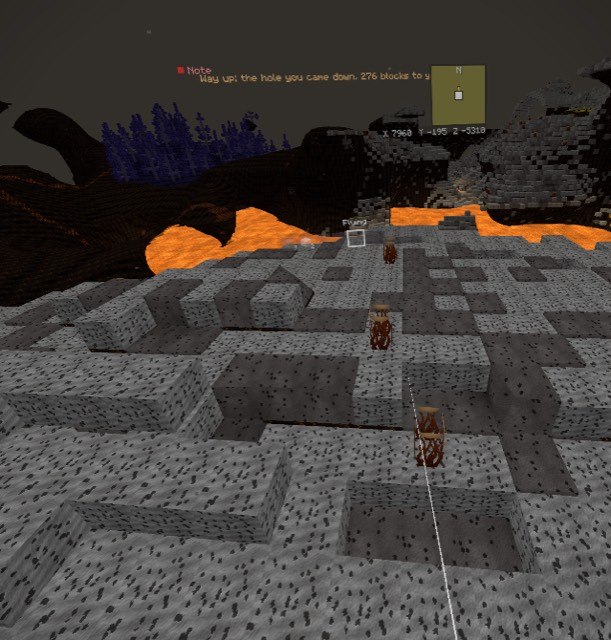

## 12:00:22 - Um, yeah, everything looks very nice here though. I really like-- They

- **Transcript:** Um, yeah, everything looks very nice here though. I really like-- They did a really good job on this
- **Status:** open
- **Build:** 0.129 (60d57643, M1-M4 (device-tested; ship riding, chests, comfort options, weapon wheel))
- **World:** New World (10) (seed 1997562484558922131)
- **Dimension:** Hell
- **Biome:** Cinder Plains
- **Position:** 7905.8 218.5 -5391.9
- **Facing:** north-west (yaw 332, pitch -52)
- **Held:** empty hand
- **Mount:** on foot, flying
- **Looking at:** nothing
- **Mode:** Creative, health 20/20
- **Time:** day 2 15:05, clear
- **Fps:** 62
- **Levels:** mic -32 dBFS, game sound -11 dBFS
- **Length:** 6.6 s (voice 4.1 s)
- **Just before:** -21s message: Flying; -18s walked into Sulfur Flats; -10s message: Walking; -9s walked into Ash Dunes; -8s message: Flying; -1s walked into Cinder Plains
- **While talking:** -2s walked into Charwood Thicket
- **Position at the end:** 7846.9 218.5 -5520.8
- **Repro (Mac):** `./snap.sh note --seed 1997562484558922131 --x 7905.8 --z -5391.9 --yaw 28 --pitch -52 --time 0.379 --dim deep`
- **Audio (this Mac):** /Users/darthvadar/Documents/Blocksmith/QuestVoiceNotes/raw/vn-20261016-120022-828.aac

## 12:00:29 - Really good job

- **Transcript:** Really good job
- **Status:** open
- **Build:** 0.129 (60d57643, M1-M4 (device-tested; ship riding, chests, comfort options, weapon wheel))
- **World:** New World (10) (seed 1997562484558922131)
- **Dimension:** Hell
- **Biome:** Ash Dunes
- **Position:** 7783.2 218.5 -5566.7
- **Facing:** west (yaw 256, pitch -42)
- **Held:** empty hand
- **Mount:** on foot, flying
- **Looking at:** nothing
- **Mode:** Creative, health 20/20
- **Time:** day 2 15:12, clear
- **Fps:** 64
- **Levels:** mic -31 dBFS, game sound -14 dBFS
- **Length:** 2.5 s (voice 1.1 s)
- **Just before:** -27s message: Flying; -23s walked into Sulfur Flats; -16s message: Walking; -15s walked into Ash Dunes; -14s message: Flying; -7s walked into Cinder Plains; -3s walked into Charwood Thicket
- **Repro (Mac):** `./snap.sh note --seed 1997562484558922131 --x 7783.2 --z -5566.7 --yaw 104 --pitch -42 --time 0.384 --dim deep`
- **Audio (this Mac):** /Users/darthvadar/Documents/Blocksmith/QuestVoiceNotes/raw/vn-20261016-120029-328.aac

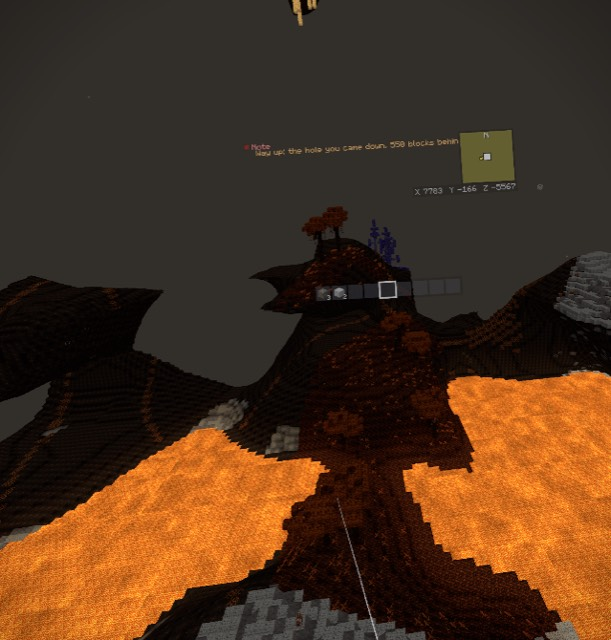

## 12:00:32 - Yeah, let's get rid of those yellow patches. Maybe turn them into some

- **Transcript:** Yeah, let's get rid of those yellow patches. Maybe turn them into something else
- **Status:** open
- **Build:** 0.129 (60d57643, M1-M4 (device-tested; ship riding, chests, comfort options, weapon wheel))
- **World:** New World (10) (seed 1997562484558922131)
- **Dimension:** Hell
- **Biome:** Sulfur Flats
- **Position:** 7664.5 218.5 -5674.5
- **Facing:** north-west (yaw 296, pitch -48)
- **Held:** empty hand
- **Mount:** on foot, flying
- **Looking at:** nothing
- **Mode:** Creative, health 20/20
- **Time:** day 2 15:16, clear
- **Fps:** 64
- **Levels:** mic -39 dBFS, game sound -14 dBFS
- **Length:** 4.5 s (voice 2.6 s)
- **Just before:** -30s message: Flying; -27s walked into Sulfur Flats; -19s message: Walking; -19s walked into Ash Dunes; -18s message: Flying; -10s walked into Cinder Plains; -6s walked into Charwood Thicket; -0s walked into Sulfur Flats
- **Repro (Mac):** `./snap.sh note --seed 1997562484558922131 --x 7664.5 --z -5674.5 --yaw 64 --pitch -48 --time 0.386 --dim deep`
- **Audio (this Mac):** /Users/darthvadar/Documents/Blocksmith/QuestVoiceNotes/raw/vn-20261016-120032-448.aac

## 12:00:36 - I like the little pathways made with the, with the lava rock. That's k

- **Transcript:** I like the little pathways made with the, with the lava rock. That's kinda cool
- **Status:** open
- **Build:** 0.129 (60d57643, M1-M4 (device-tested; ship riding, chests, comfort options, weapon wheel))
- **World:** New World (10) (seed 1997562484558922131)
- **Dimension:** Hell
- **Biome:** Cinder Plains
- **Position:** 7689.9 223.4 -5726.0
- **Facing:** north (yaw 355, pitch -60)
- **Held:** empty hand
- **Mount:** on foot, flying
- **Looking at:** nothing
- **Mode:** Creative, health 20/20
- **Time:** day 2 15:20, clear
- **Fps:** 71
- **Levels:** mic -24 dBFS, game sound -13 dBFS
- **Length:** 7.1 s (voice 3.4 s)
- **Just before:** -23s message: Walking; -23s walked into Ash Dunes; -22s message: Flying; -15s walked into Cinder Plains; -11s walked into Charwood Thicket; -4s walked into Sulfur Flats; -2s walked into Cinder Plains; -1s message: Alarm: Quiet. Radio: "Stand down. Back to your posts."
- **While talking:** -1s walked into Charwood Thicket
- **Position at the end:** 7786.1 223.4 -5832.2
- **Repro (Mac):** `./snap.sh note --seed 1997562484558922131 --x 7689.9 --z -5726.0 --yaw 5 --pitch -60 --time 0.390 --dim deep`
- **Audio (this Mac):** /Users/darthvadar/Documents/Blocksmith/QuestVoiceNotes/raw/vn-20261016-120036-608.aac

## 12:00:45 - Of course, rendering's not happening very well, but, uh, auto 20. Okay

- **Transcript:** Of course, rendering's not happening very well, but, uh, auto 20. Okay
- **Status:** open
- **Build:** 0.129 (60d57643, M1-M4 (device-tested; ship riding, chests, comfort options, weapon wheel))
- **World:** New World (10) (seed 1997562484558922131)
- **Dimension:** Hell
- **Biome:** Gloamwood
- **Position:** 7844.5 223.4 -5924.6
- **Facing:** north (yaw 11, pitch -34)
- **Held:** empty hand
- **Mount:** on foot, flying
- **Looking at:** nothing
- **Mode:** Creative, health 20/20
- **Time:** day 2 15:31, clear
- **Fps:** 71
- **Levels:** mic -25 dBFS, game sound -16 dBFS
- **Length:** 6.3 s (voice 3.6 s)
- **Just before:** -23s walked into Cinder Plains; -19s walked into Charwood Thicket; -13s walked into Sulfur Flats; -11s walked into Cinder Plains; -9s message: Alarm: Quiet. Radio: "Stand down. Back to your posts."; -5s walked into Charwood Thicket; -3s walked into Sulfur Flats; -1s walked into Gloamwood
- **While talking:** -3s opened PauseMenu; -2s closed PauseMenu; -2s walked into Sulfur Flats
- **Position at the end:** 7787.5 223.4 -5986.7
- **Repro (Mac):** `./snap.sh note --seed 1997562484558922131 --x 7844.5 --z -5924.6 --yaw -11 --pitch -34 --time 0.397 --dim deep`
- **Audio (this Mac):** /Users/darthvadar/Documents/Blocksmith/QuestVoiceNotes/raw/vn-20261016-120045-748.aac

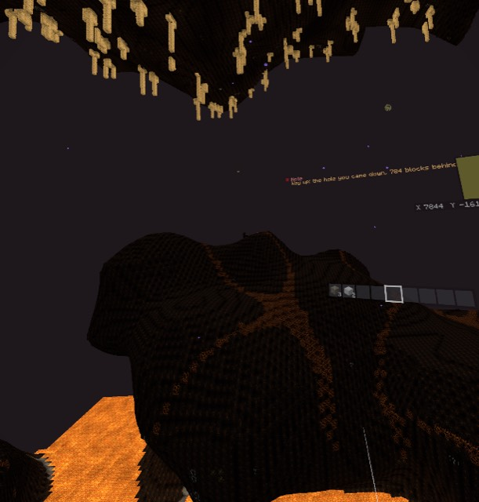

## 12:00:51 - I don't know if there's a more efficient way we can render stuff or ma

- **Transcript:** I don't know if there's a more efficient way we can render stuff or maybe there's just too much shit. Like I, I really
- **Status:** open
- **Build:** 0.129 (60d57643, M1-M4 (device-tested; ship riding, chests, comfort options, weapon wheel))
- **World:** New World (10) (seed 1997562484558922131)
- **Dimension:** Hell
- **Biome:** Ash Dunes
- **Position:** 7831.6 223.4 -6049.9
- **Facing:** north (yaw 12, pitch -23)
- **Held:** empty hand
- **Mount:** on foot, flying
- **Looking at:** nothing
- **Mode:** Creative, health 20/20
- **Time:** day 2 15:36, clear
- **Fps:** 72
- **Levels:** mic -39 dBFS, game sound -18 dBFS
- **Length:** 7.0 s (voice 4.5 s)
- **Just before:** -29s walked into Cinder Plains; -25s walked into Charwood Thicket; -19s walked into Sulfur Flats; -17s walked into Cinder Plains; -15s message: Alarm: Quiet. Radio: "Stand down. Back to your posts."; -11s walked into Charwood Thicket; -9s walked into Sulfur Flats; -7s walked into Gloamwood; -4s opened PauseMenu; -3s closed PauseMenu; -3s walked into Sulfur Flats; -1s walked into Cinder Plains
- **While talking:** -4s walked into Ash Dunes
- **Position at the end:** 7935.3 223.4 -6120.6
- **Repro (Mac):** `./snap.sh note --seed 1997562484558922131 --x 7831.6 --z -6049.9 --yaw -12 --pitch -23 --time 0.401 --dim deep`
- **Audio (this Mac):** /Users/darthvadar/Documents/Blocksmith/QuestVoiceNotes/raw/vn-20261016-120051-728.aac

## 12:00:58 - This one's been failed too many times. Performance one, we're not gett

- **Transcript:** This one's been failed too many times. Performance one, we're not getting performance. I don't know if we should have like a notes thing where it's like it responds and says like, "Hey, we got an issue." Okay, this thing with, uh, the little phantoms, fire phantoms, that's awesome. Excellent work there. Very good.
- **Status:** open
- **Build:** 0.129 (60d57643, M1-M4 (device-tested; ship riding, chests, comfort options, weapon wheel))
- **World:** New World (10) (seed 1997562484558922131)
- **Dimension:** Hell
- **Biome:** Cinder Plains
- **Position:** 7975.6 223.4 -6180.5
- **Facing:** north-west (yaw 333, pitch -45)
- **Held:** empty hand
- **Mount:** on foot, flying
- **Looking at:** nothing
- **Mode:** Creative, health 20/20
- **Time:** day 2 15:45, clear
- **Fps:** 72
- **Levels:** mic -30 dBFS, game sound -13 dBFS
- **Length:** 20.8 s (voice 12.7 s)
- **Just before:** -26s walked into Sulfur Flats; -24s walked into Cinder Plains; -23s message: Alarm: Quiet. Radio: "Stand down. Back to your posts."; -18s walked into Charwood Thicket; -16s walked into Sulfur Flats; -14s walked into Gloamwood; -11s opened PauseMenu; -10s closed PauseMenu; -10s walked into Sulfur Flats; -8s walked into Cinder Plains; -6s walked into Ash Dunes
- **While talking:** -5s walked into Cinder Plains
- **Position at the end:** 7864.5 223.5 -6375.0
- **Repro (Mac):** `./snap.sh note --seed 1997562484558922131 --x 7975.6 --z -6180.5 --yaw 27 --pitch -45 --time 0.407 --dim deep`
- **Audio (this Mac):** /Users/darthvadar/Documents/Blocksmith/QuestVoiceNotes/raw/vn-20261016-120058-968.aac

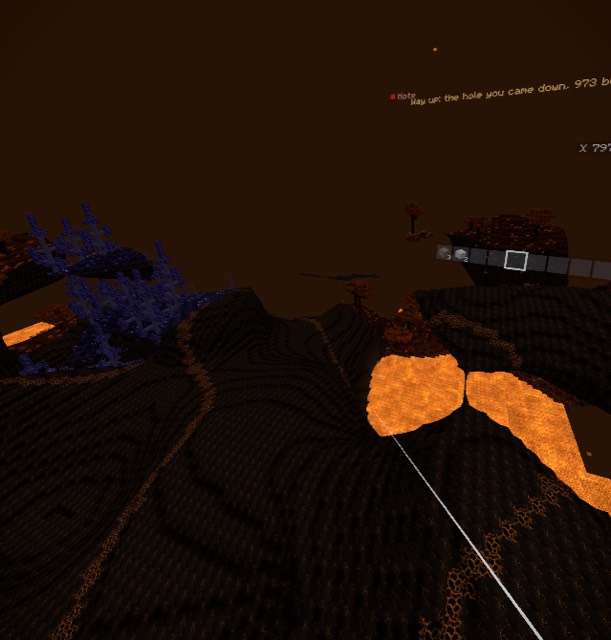

## 12:01:23 - Oh, yeah. We're talking here. Oh, yes

- **Transcript:** Oh, yeah. We're talking here. Oh, yes
- **Status:** open
- **Build:** 0.129 (60d57643, M1-M4 (device-tested; ship riding, chests, comfort options, weapon wheel))
- **World:** New World (10) (seed 1997562484558922131)
- **Dimension:** Hell
- **Biome:** Cinder Plains
- **Position:** 7863.8 214.0 -6374.3
- **Facing:** north (yaw 349, pitch -30)
- **Held:** empty hand
- **Mount:** on foot
- **Looking at:** nothing
- **Mode:** Creative, health 20/20, screen ChestMenu
- **Time:** day 2 16:08, clear
- **Fps:** 42
- **Levels:** mic -32 dBFS, game sound -16 dBFS
- **Length:** 3.9 s (voice 1.9 s)
- **Just before:** -29s closed PauseMenu; -29s walked into Sulfur Flats; -27s walked into Cinder Plains; -25s walked into Ash Dunes; -19s walked into Cinder Plains; -2s message: Walking; -1s opened ChestMenu
- **Repro (Mac):** `./snap.sh note --seed 1997562484558922131 --x 7863.8 --z -6374.3 --yaw 11 --pitch -30 --time 0.422 --dim deep`
- **Audio (this Mac):** /Users/darthvadar/Documents/Blocksmith/QuestVoiceNotes/raw/vn-20261016-120123-488.aac

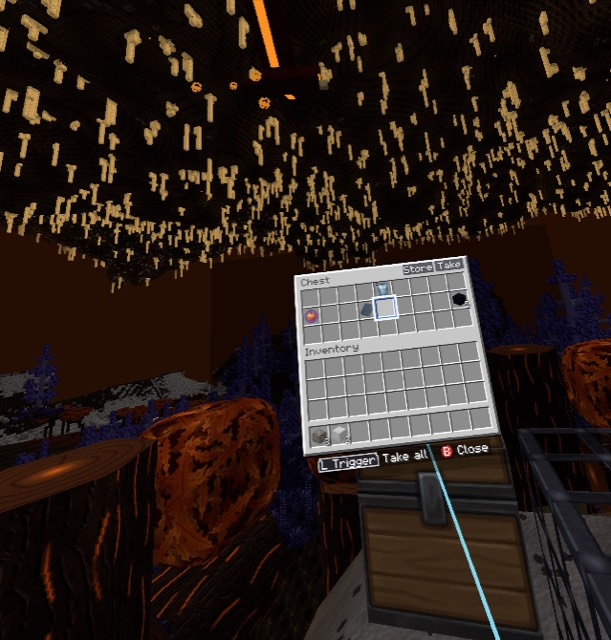

## 12:01:52 - Okay. Well, this is, this is really good. I'm gonna get back to this l

- **Transcript:** Okay. Well, this is, this is really good. I'm gonna get back to this later
- **Status:** open
- **Build:** 0.129 (60d57643, M1-M4 (device-tested; ship riding, chests, comfort options, weapon wheel))
- **World:** New World (10) (seed 1997562484558922131)
- **Dimension:** Hell
- **Biome:** Cinder Plains
- **Position:** 7863.4 214.0 -6373.7
- **Facing:** north (yaw 358, pitch -20)
- **Held:** empty hand
- **Mount:** on foot
- **Looking at:** Chest at 7863 214 -6377
- **Mode:** Creative, health 20/20, screen PauseMenu
- **Time:** day 2 16:14, clear
- **Fps:** 4
- **Levels:** mic -30 dBFS, game sound -24 dBFS
- **Length:** 4.2 s (voice 2.1 s)
- **Just before:** -24s walked into Cinder Plains; -8s message: Walking; -6s opened ChestMenu; -5s message: Render distance 12 for now, to keep the frame rate; -5s closed ChestMenu; -5s opened ChestMenu; -3s closed ChestMenu; -0s message: View recentred; -0s opened PauseMenu
- **Repro (Mac):** `./snap.sh note --seed 1997562484558922131 --x 7863.4 --z -6373.7 --yaw 2 --pitch -20 --time 0.427 --dim deep`
- **Audio (this Mac):** /Users/darthvadar/Documents/Blocksmith/QuestVoiceNotes/raw/vn-20261016-120152-144.aac

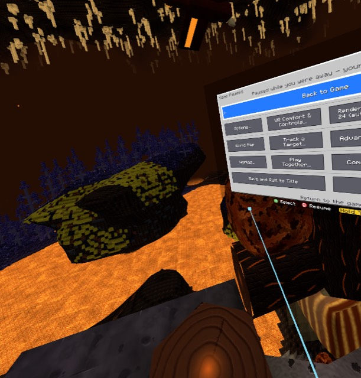

## 19:42:00 - All right, what am I doing here anyway?

- **Transcript:** All right, what am I doing here anyway?
- **Status:** open
- **Build:** 0.129 (46151e50, M1-M4 (device-tested; ship riding, chests, comfort options, weapon wheel))
- **World:** Quest World (seed 2943808052895834412)
- **Dimension:** Surface
- **Biome:** Taiga
- **Position:** 497.3 91.1 -3845.9
- **Facing:** north (yaw 354, pitch -57)
- **Held:** empty hand
- **Mount:** on foot, flying
- **Looking at:** nothing
- **Mode:** Creative, health 20/20
- **Time:** day 5 22:50, clear
- **Fps:** 67
- **Levels:** mic -33 dBFS, game sound -32 dBFS
- **Length:** 2.8 s (voice 1.3 s)
- **Just before:** -8s opened PauseMenu; -6s closed PauseMenu; -6s message: Playtest build: voice bug notes ON, your speech is saved (Options > Interface); -1s message: Flying
- **Repro (Mac):** `./snap.sh note --seed 2943808052895834412 --x 497.3 --z -3845.9 --yaw 6 --pitch -57 --time 0.702`
- **Audio (this Mac):** /Users/darthvadar/Documents/Blocksmith/QuestVoiceNotes/raw/vn-20261016-194200-845.aac

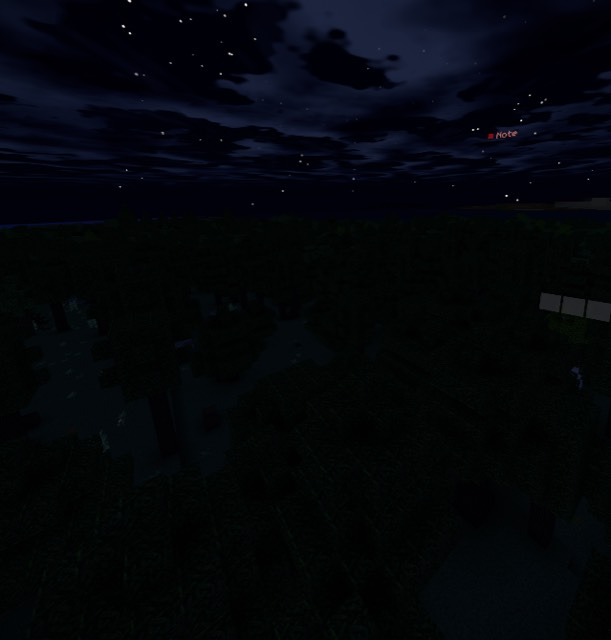

## 19:42:12 - Oh, nice. Anyway

- **Transcript:** Oh, nice. Anyway
- **Status:** open
- **Build:** 0.129 (46151e50, M1-M4 (device-tested; ship riding, chests, comfort options, weapon wheel))
- **World:** Quest World (seed 2943808052895834412)
- **Dimension:** Surface
- **Biome:** Taiga
- **Position:** 421.5 76.0 -3806.5
- **Facing:** south-west (yaw 247, pitch -68)
- **Held:** empty hand
- **Mount:** on foot
- **Looking at:** Grass Block at 420 75 -3807
- **Mode:** Creative, health 20/20
- **Time:** day 5 23:00, clear
- **Fps:** 59
- **Levels:** mic -34 dBFS, game sound -38 dBFS
- **Length:** 2.9 s (voice 0.9 s)
- **Just before:** -17s opened PauseMenu; -14s closed PauseMenu; -14s message: Playtest build: voice bug notes ON, your speech is saved (Options > Interface); -10s message: Flying; -7s message: Walking; -6s message: 72 Hz to keep the frame rate (VR Comfort & Controls)
- **Repro (Mac):** `./snap.sh note --seed 2943808052895834412 --x 421.5 --z -3806.5 --yaw 113 --pitch -68 --time 0.709`
- **Audio (this Mac):** /Users/darthvadar/Documents/Blocksmith/QuestVoiceNotes/raw/vn-20261016-194212-664.aac

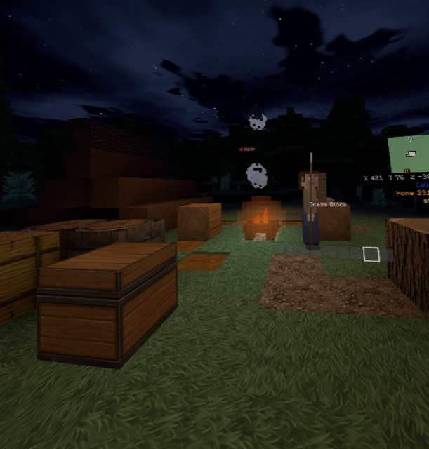

## 19:42:17 - Right, this is all blocks

- **Transcript:** Right, this is all blocks
- **Status:** open
- **Build:** 0.129 (46151e50, M1-M4 (device-tested; ship riding, chests, comfort options, weapon wheel))
- **World:** Quest World (seed 2943808052895834412)
- **Dimension:** Surface
- **Biome:** Taiga
- **Position:** 424.5 77.4 -3808.6
- **Facing:** west (yaw 286, pitch -70)
- **Held:** empty hand
- **Mount:** on foot
- **Looking at:** Grass Block at 423 75 -3809
- **Mode:** Creative, health 20/20
- **Time:** day 5 23:05, clear
- **Fps:** 58
- **Levels:** mic -36 dBFS, game sound -32 dBFS
- **Length:** 2.2 s (voice 0.6 s)
- **Just before:** -20s opened PauseMenu; -18s closed PauseMenu; -18s message: Playtest build: voice bug notes ON, your speech is saved (Options > Interface); -14s message: Flying; -11s message: Walking; -9s message: 72 Hz to keep the frame rate (VR Comfort & Controls); -0s message: Rosalie Yardley: Can't sleep either?
- **Repro (Mac):** `./snap.sh note --seed 2943808052895834412 --x 424.5 --z -3808.6 --yaw 74 --pitch -70 --time 0.712`
- **Audio (this Mac):** /Users/darthvadar/Documents/Blocksmith/QuestVoiceNotes/raw/vn-20261016-194217-224.aac

## 19:42:37 - Okay, what do we got here? Good. Yeah. Mm-hmm

- **Transcript:** Okay, what do we got here? Good. Yeah. Mm-hmm
- **Status:** open
- **Build:** 0.129 (46151e50, M1-M4 (device-tested; ship riding, chests, comfort options, weapon wheel))
- **World:** New World (10) (seed 1997562484558922131)
- **Dimension:** Hell
- **Biome:** Cinder Plains
- **Position:** 7863.7 214.0 -6373.9
- **Facing:** north (yaw 354, pitch -26)
- **Held:** empty hand
- **Mount:** on foot
- **Looking at:** nothing
- **Mode:** Creative, health 20/20, screen ChestMenu
- **Time:** day 2 16:19, clear
- **Fps:** 71
- **Levels:** mic -27 dBFS, game sound -22 dBFS
- **Length:** 4.2 s (voice 1.8 s)
- **Just before:** -4s opened PauseMenu; -2s closed PauseMenu; -2s message: Playtest build: voice bug notes ON, your speech is saved (Options > Interface); --2s message: Flying; --5s message: Walking; --7s message: 72 Hz to keep the frame rate (VR Comfort & Controls); --16s message: Rosalie Yardley: Can't sleep either?; --18s opened PauseMenu; -4s entered Hell; -4s closed PauseMenu; -1s opened ChestMenu
- **Repro (Mac):** `./snap.sh note --seed 1997562484558922131 --x 7863.7 --z -6373.9 --yaw 6 --pitch -26 --time 0.430 --dim deep`
- **Audio (this Mac):** /Users/darthvadar/Documents/Blocksmith/QuestVoiceNotes/raw/vn-20261016-194237-385.aac

## 19:42:43 - Okay. I'm just looking around here

- **Transcript:** Okay. I'm just looking around here
- **Status:** open
- **Build:** 0.129 (46151e50, M1-M4 (device-tested; ship riding, chests, comfort options, weapon wheel))
- **World:** New World (10) (seed 1997562484558922131)
- **Dimension:** Hell
- **Biome:** Gloamwood
- **Position:** 7828.7 215.8 -6408.0
- **Facing:** north-west (yaw 334, pitch -29)
- **Held:** empty hand
- **Mount:** on foot, flying
- **Looking at:** nothing
- **Mode:** Creative, health 20/20
- **Time:** day 2 16:23, clear
- **Fps:** 51
- **Levels:** mic -33 dBFS, game sound -15 dBFS
- **Length:** 4.3 s (voice 1.8 s)
- **Just before:** -7s opened PauseMenu; -5s closed PauseMenu; -5s message: Playtest build: voice bug notes ON, your speech is saved (Options > Interface); -1s message: Flying; --2s message: Walking; --4s message: 72 Hz to keep the frame rate (VR Comfort & Controls); --13s message: Rosalie Yardley: Can't sleep either?; --15s opened PauseMenu; -7s entered Hell; -7s closed PauseMenu; -4s opened ChestMenu; -2s closed ChestMenu; -1s message: Flying
- **Repro (Mac):** `./snap.sh note --seed 1997562484558922131 --x 7828.7 --z -6408.0 --yaw 26 --pitch -29 --time 0.433 --dim deep`
- **Audio (this Mac):** /Users/darthvadar/Documents/Blocksmith/QuestVoiceNotes/raw/vn-20261016-194243-105.aac

## 19:42:48 - Very cool. Very nice. Oh, look at this nice little castle. I like that

- **Transcript:** Very cool. Very nice. Oh, look at this nice little castle. I like that. Very good
- **Status:** open
- **Build:** 0.129 (46151e50, M1-M4 (device-tested; ship riding, chests, comfort options, weapon wheel))
- **World:** New World (10) (seed 1997562484558922131)
- **Dimension:** Hell
- **Biome:** Ash Dunes
- **Position:** 7727.1 215.8 -6549.3
- **Facing:** west (yaw 279, pitch -60)
- **Held:** empty hand
- **Mount:** on foot, flying
- **Looking at:** nothing
- **Mode:** Creative, health 20/20
- **Time:** day 2 16:29, clear
- **Fps:** 44
- **Levels:** mic -40 dBFS, game sound -15 dBFS
- **Length:** 6.7 s (voice 3.2 s)
- **Just before:** -12s opened PauseMenu; -10s closed PauseMenu; -10s message: Playtest build: voice bug notes ON, your speech is saved (Options > Interface); -6s message: Flying; -2s message: Walking; -1s message: 72 Hz to keep the frame rate (VR Comfort & Controls); --8s message: Rosalie Yardley: Can't sleep either?; --10s opened PauseMenu; -12s entered Hell; -12s closed PauseMenu; -9s opened ChestMenu; -7s closed ChestMenu; -6s message: Flying
- **While talking:** --3s message: Rosalie Yardley: Can't sleep either?; --5s opened PauseMenu; -0s message: Walking
- **Position at the end:** 7637.8 216.1 -6592.5
- **Repro (Mac):** `./snap.sh note --seed 1997562484558922131 --x 7727.1 --z -6549.3 --yaw 81 --pitch -60 --time 0.437 --dim deep`
- **Audio (this Mac):** /Users/darthvadar/Documents/Blocksmith/QuestVoiceNotes/raw/vn-20261016-194248-085.aac

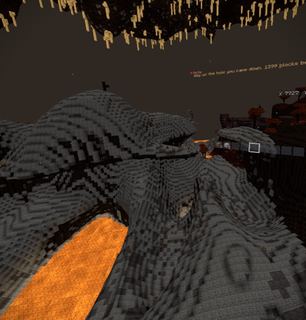

## 19:42:56 - Oh yeah, this one has some variety to it. We've got a whole bunch of B

- **Transcript:** Oh yeah, this one has some variety to it. We've got a whole bunch of Burgundy nights, yeah
- **Status:** open
- **Build:** 0.129 (46151e50, M1-M4 (device-tested; ship riding, chests, comfort options, weapon wheel))
- **World:** New World (10) (seed 1997562484558922131)
- **Dimension:** Hell
- **Biome:** Cinder Plains
- **Position:** 7626.1 204.2 -6605.9
- **Facing:** north-west (yaw 295, pitch -54)
- **Held:** empty hand
- **Mount:** on foot
- **Looking at:** nothing
- **Mode:** Creative, health 20/20
- **Time:** day 2 16:38, clear
- **Fps:** 71
- **Levels:** mic -26 dBFS, game sound -13 dBFS
- **Length:** 5.4 s (voice 3.4 s)
- **Just before:** -20s opened PauseMenu; -18s closed PauseMenu; -18s message: Playtest build: voice bug notes ON, your speech is saved (Options > Interface); -13s message: Flying; -10s message: Walking; -9s message: 72 Hz to keep the frame rate (VR Comfort & Controls); --0s message: Rosalie Yardley: Can't sleep either?; --2s opened PauseMenu; -20s entered Hell; -20s closed PauseMenu; -17s opened ChestMenu; -15s closed ChestMenu; -14s message: Flying; -3s message: Walking; -2s message: Flying; -0s message: Walking
- **Repro (Mac):** `./snap.sh note --seed 1997562484558922131 --x 7626.1 --z -6605.9 --yaw 65 --pitch -54 --time 0.443 --dim deep`
- **Audio (this Mac):** /Users/darthvadar/Documents/Blocksmith/QuestVoiceNotes/raw/vn-20261016-194256-025.aac

## 19:43:01 - Uh, yeah, burgundy knights are cool, but maybe it should be like, I do

- **Transcript:** Uh, yeah, burgundy knights are cool, but maybe it should be like, I don't know, different classes of burgundy knights or something. Or I don't know, a little more variety to the, uh
- **Status:** open
- **Build:** 0.129 (46151e50, M1-M4 (device-tested; ship riding, chests, comfort options, weapon wheel))
- **World:** New World (10) (seed 1997562484558922131)
- **Dimension:** Hell
- **Biome:** Cinder Plains
- **Position:** 7609.6 188.0 -6623.2
- **Facing:** north (yaw 1, pitch -50)
- **Held:** empty hand
- **Mount:** on foot
- **Looking at:** Charwood Planks at 7609 187 -6625
- **Mode:** Creative, health 20/20
- **Time:** day 2 16:43, clear
- **Fps:** 63
- **Levels:** mic -31 dBFS, game sound -13 dBFS
- **Length:** 9.7 s (voice 6.3 s)
- **Just before:** -24s opened PauseMenu; -22s closed PauseMenu; -22s message: Playtest build: voice bug notes ON, your speech is saved (Options > Interface); -18s message: Flying; -15s message: Walking; -13s message: 72 Hz to keep the frame rate (VR Comfort & Controls); -4s message: Rosalie Yardley: Can't sleep either?; -2s opened PauseMenu; -24s entered Hell; -24s closed PauseMenu; -21s opened ChestMenu; -19s closed ChestMenu; -18s message: Flying; -7s message: Walking; -6s message: Flying; -4s message: Walking
- **While talking:** -2s opened ChestMenu; -0s closed ChestMenu
- **Position at the end:** 7606.4 189.0 -6629.3
- **Repro (Mac):** `./snap.sh note --seed 1997562484558922131 --x 7609.6 --z -6623.2 --yaw -1 --pitch -50 --time 0.447 --dim deep`
- **Audio (this Mac):** /Users/darthvadar/Documents/Blocksmith/QuestVoiceNotes/raw/vn-20261016-194301-445.aac

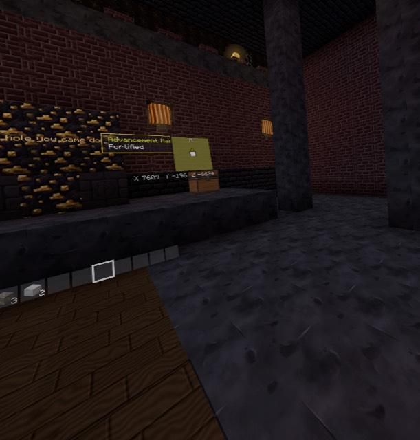

## 19:43:11 - The guys there

- **Transcript:** The guys there
- **Status:** open
- **Build:** 0.129 (46151e50, M1-M4 (device-tested; ship riding, chests, comfort options, weapon wheel))
- **World:** New World (10) (seed 1997562484558922131)
- **Dimension:** Hell
- **Biome:** Cinder Plains
- **Position:** 7610.9 189.0 -6628.3
- **Facing:** north-east (yaw 46, pitch -21)
- **Held:** empty hand
- **Mount:** on foot
- **Looking at:** nothing
- **Mode:** Creative, health 20/20, screen ChestMenu
- **Time:** day 2 16:52, clear
- **Fps:** 57
- **Levels:** mic -29 dBFS, game sound -13 dBFS
- **Length:** 2.1 s (voice 0.7 s)
- **Just before:** -30s closed PauseMenu; -30s message: Playtest build: voice bug notes ON, your speech is saved (Options > Interface); -25s message: Flying; -22s message: Walking; -21s message: 72 Hz to keep the frame rate (VR Comfort & Controls); -12s message: Rosalie Yardley: Can't sleep either?; -10s opened PauseMenu; -28s opened ChestMenu; -27s closed ChestMenu; -26s message: Flying; -15s message: Walking; -13s message: Flying; -12s message: Walking; -6s opened ChestMenu; -4s closed ChestMenu; -4s walked into Charwood Thicket; -3s opened ChestMenu; -2s walked into Cinder Plains
- **Repro (Mac):** `./snap.sh note --seed 1997562484558922131 --x 7610.9 --z -6628.3 --yaw -46 --pitch -21 --time 0.453 --dim deep`
- **Audio (this Mac):** /Users/darthvadar/Documents/Blocksmith/QuestVoiceNotes/raw/vn-20261016-194311-245.aac

## 19:43:13 - Um, oh yeah, well, this guy's, this guy's pretty good. This guy's new

- **Transcript:** Um, oh yeah, well, this guy's, this guy's pretty good. This guy's new
- **Status:** open
- **Build:** 0.129 (46151e50, M1-M4 (device-tested; ship riding, chests, comfort options, weapon wheel))
- **World:** New World (10) (seed 1997562484558922131)
- **Dimension:** Hell
- **Biome:** Cinder Plains
- **Position:** 7609.1 188.8 -6627.6
- **Facing:** west (yaw 276, pitch -41)
- **Held:** empty hand
- **Mount:** on foot
- **Looking at:** Polished Onyxstone at 7606 187 -6628
- **Mode:** Creative, health 20/20
- **Time:** day 2 16:55, clear
- **Fps:** 57
- **Levels:** mic -33 dBFS, game sound -12 dBFS
- **Length:** 5.7 s (voice 2.5 s)
- **Just before:** -27s message: Flying; -24s message: Walking; -23s message: 72 Hz to keep the frame rate (VR Comfort & Controls); -14s message: Rosalie Yardley: Can't sleep either?; -12s opened PauseMenu; -29s closed ChestMenu; -28s message: Flying; -17s message: Walking; -16s message: Flying; -14s message: Walking; -8s opened ChestMenu; -6s closed ChestMenu; -6s walked into Charwood Thicket; -5s opened ChestMenu; -4s walked into Cinder Plains; -2s closed ChestMenu
- **Position at the end:** 7608.6 188.0 -6618.7
- **Repro (Mac):** `./snap.sh note --seed 1997562484558922131 --x 7609.1 --z -6627.6 --yaw 84 --pitch -41 --time 0.455 --dim deep`
- **Audio (this Mac):** /Users/darthvadar/Documents/Blocksmith/QuestVoiceNotes/raw/vn-20261016-194313-765.aac

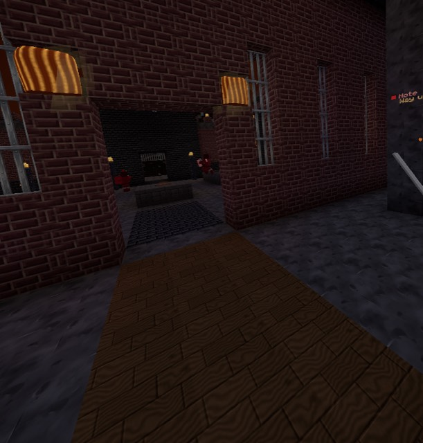

## 19:43:19 - You know what? This is fine. Um, yeah

- **Transcript:** You know what? This is fine. Um, yeah
- **Status:** open
- **Build:** 0.129 (46151e50, M1-M4 (device-tested; ship riding, chests, comfort options, weapon wheel))
- **World:** New World (10) (seed 1997562484558922131)
- **Dimension:** Hell
- **Biome:** Cinder Plains
- **Position:** 7607.5 189.4 -6614.6
- **Facing:** south-west (yaw 225, pitch -49)
- **Held:** empty hand
- **Mount:** on foot
- **Looking at:** Polished Onyxstone at 7605 187 -6613
- **Mode:** Creative, health 20/20
- **Time:** day 2 17:00, clear
- **Fps:** 60
- **Levels:** mic -27 dBFS, game sound -13 dBFS
- **Length:** 4.0 s (voice 1.6 s)
- **Just before:** -29s message: Walking; -27s message: 72 Hz to keep the frame rate (VR Comfort & Controls); -18s message: Rosalie Yardley: Can't sleep either?; -16s opened PauseMenu; -21s message: Walking; -20s message: Flying; -18s message: Walking; -12s opened ChestMenu; -11s closed ChestMenu; -10s walked into Charwood Thicket; -9s opened ChestMenu; -8s walked into Cinder Plains; -6s closed ChestMenu
- **Repro (Mac):** `./snap.sh note --seed 1997562484558922131 --x 7607.5 --z -6614.6 --yaw 135 --pitch -49 --time 0.459 --dim deep`
- **Audio (this Mac):** /Users/darthvadar/Documents/Blocksmith/QuestVoiceNotes/raw/vn-20261016-194319-466.aac

## 19:43:24 - We're gonna probably have to, um, I don't think I mentioned this previ

- **Transcript:** We're gonna probably have to, um, I don't think I mentioned this previously, but we need to improve the knight's, uh, sword fighting ability because they don't really sword fight him
- **Status:** open
- **Build:** 0.129 (46151e50, M1-M4 (device-tested; ship riding, chests, comfort options, weapon wheel))
- **World:** New World (10) (seed 1997562484558922131)
- **Dimension:** Hell
- **Biome:** Charwood Thicket
- **Position:** 7593.0 188.0 -6613.1
- **Facing:** south-west (yaw 205, pitch -58)
- **Held:** empty hand
- **Mount:** on foot
- **Looking at:** Polished Onyxstone at 7592 187 -6613
- **Mode:** Creative, health 20/20
- **Time:** day 2 17:05, clear
- **Fps:** 53
- **Levels:** mic -27 dBFS, game sound -15 dBFS
- **Length:** 9.6 s (voice 5.6 s)
- **Just before:** -22s message: Rosalie Yardley: Can't sleep either?; -20s opened PauseMenu; -25s message: Walking; -24s message: Flying; -22s message: Walking; -16s opened ChestMenu; -15s closed ChestMenu; -14s walked into Charwood Thicket; -13s opened ChestMenu; -12s walked into Cinder Plains; -10s closed ChestMenu; -2s walked into Charwood Thicket
- **While talking:** -4s message: Render distance 15 for now, to keep the frame rate; -3s opened ChestMenu; -2s closed ChestMenu
- **Position at the end:** 7603.6 189.1 -6611.8
- **Repro (Mac):** `./snap.sh note --seed 1997562484558922131 --x 7593.0 --z -6613.1 --yaw 155 --pitch -58 --time 0.462 --dim deep`
- **Audio (this Mac):** /Users/darthvadar/Documents/Blocksmith/QuestVoiceNotes/raw/vn-20261016-194324-485.aac

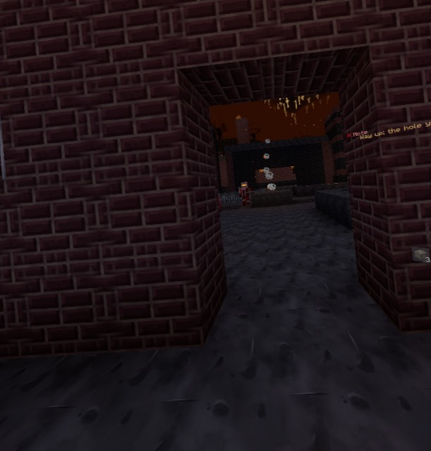

## 19:43:33 - We gotta really improve that

- **Transcript:** We gotta really improve that
- **Status:** open
- **Build:** 0.129 (46151e50, M1-M4 (device-tested; ship riding, chests, comfort options, weapon wheel))
- **World:** New World (10) (seed 1997562484558922131)
- **Dimension:** Hell
- **Biome:** Cinder Plains
- **Position:** 7622.0 188.0 -6613.4
- **Facing:** north-east (yaw 25, pitch -17)
- **Held:** empty hand
- **Mount:** on foot
- **Looking at:** nothing
- **Mode:** Creative, health 20/20, screen SmithingMenu
- **Time:** day 2 17:13, clear
- **Fps:** 55
- **Levels:** mic -31 dBFS, game sound -15 dBFS
- **Length:** 2.4 s (voice 1.2 s)
- **Just before:** -29s message: Rosalie Yardley: Can't sleep either?; -27s opened PauseMenu; -30s message: Walking; -23s opened ChestMenu; -22s closed ChestMenu; -21s walked into Charwood Thicket; -21s opened ChestMenu; -19s walked into Cinder Plains; -17s closed ChestMenu; -9s walked into Charwood Thicket; -7s message: Render distance 15 for now, to keep the frame rate; -6s opened ChestMenu; -5s closed ChestMenu; -3s walked into Cinder Plains; -0s opened SmithingMenu
- **Repro (Mac):** `./snap.sh note --seed 1997562484558922131 --x 7622.0 --z -6613.4 --yaw -25 --pitch -17 --time 0.468 --dim deep`
- **Audio (this Mac):** /Users/darthvadar/Documents/Blocksmith/QuestVoiceNotes/raw/vn-20261016-194333-785.aac

## 19:43:36 - I put it gear

- **Transcript:** I put it gear
- **Status:** open
- **Build:** 0.129 (46151e50, M1-M4 (device-tested; ship riding, chests, comfort options, weapon wheel))
- **World:** New World (10) (seed 1997562484558922131)
- **Dimension:** Hell
- **Biome:** Cinder Plains
- **Position:** 7622.0 188.0 -6614.4
- **Facing:** north-east (yaw 34, pitch -23)
- **Held:** empty hand
- **Mount:** on foot
- **Looking at:** nothing
- **Mode:** Creative, health 20/20, screen SmithingMenu
- **Time:** day 2 17:15, clear
- **Fps:** 55
- **Levels:** mic -38 dBFS, game sound -13 dBFS
- **Length:** 2.1 s (voice 0.6 s)
- **Just before:** -29s opened PauseMenu; -25s opened ChestMenu; -24s closed ChestMenu; -23s walked into Charwood Thicket; -22s opened ChestMenu; -21s walked into Cinder Plains; -19s closed ChestMenu; -11s walked into Charwood Thicket; -9s message: Render distance 15 for now, to keep the frame rate; -8s opened ChestMenu; -7s closed ChestMenu; -5s walked into Cinder Plains; -2s opened SmithingMenu; -1s closed SmithingMenu; -0s opened SmithingMenu
- **Repro (Mac):** `./snap.sh note --seed 1997562484558922131 --x 7622.0 --z -6614.4 --yaw -34 --pitch -23 --time 0.469 --dim deep`
- **Audio (this Mac):** /Users/darthvadar/Documents/Blocksmith/QuestVoiceNotes/raw/vn-20261016-194336-305.aac

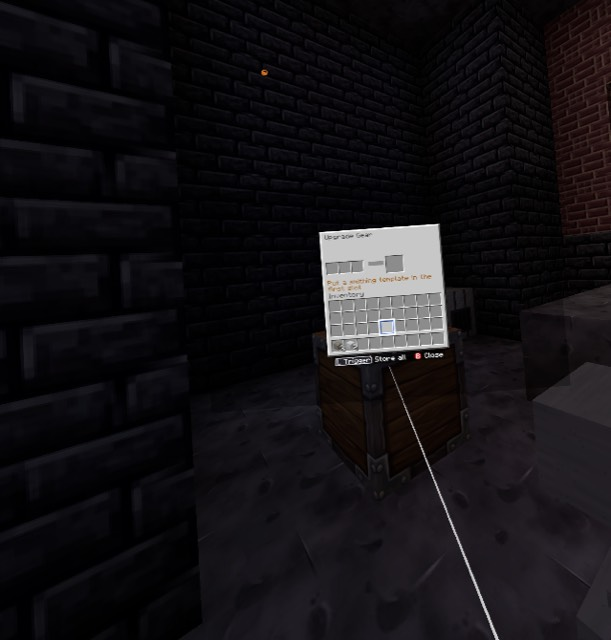

## 19:43:49 - I also found, yeah, well, uneasy they were appropriate to kill the bur

- **Transcript:** I also found, yeah, well, uneasy they were appropriate to kill the burgundy guys. They're also not burgundy, okay? I want them to actually be burgundy, kind of just red
- **Status:** open
- **Build:** 0.129 (46151e50, M1-M4 (device-tested; ship riding, chests, comfort options, weapon wheel))
- **World:** New World (10) (seed 1997562484558922131)
- **Dimension:** Hell
- **Biome:** Cinder Plains
- **Position:** 7509.0 198.1 -6517.6
- **Facing:** south (yaw 180, pitch -21)
- **Held:** empty hand
- **Mount:** on foot, flying
- **Looking at:** nothing
- **Mode:** Creative, health 20/20
- **Time:** day 2 17:29, clear
- **Fps:** 61
- **Levels:** mic -38 dBFS, game sound -13 dBFS
- **Length:** 11.4 s (voice 7.0 s)
- **Just before:** -30s closed ChestMenu; -22s walked into Charwood Thicket; -20s message: Render distance 15 for now, to keep the frame rate; -19s opened ChestMenu; -18s closed ChestMenu; -16s walked into Cinder Plains; -13s opened SmithingMenu; -12s closed SmithingMenu; -11s opened SmithingMenu; -9s closed SmithingMenu; -8s opened FurnaceMenu; -7s closed FurnaceMenu; -5s opened ChestMenu; -4s closed ChestMenu; -3s message: Flying; -2s walked into Charwood Thicket
- **While talking:** -5s walked into Ash Dunes; -3s walked into Cinder Plains; -2s walked into Gloamwood
- **Position at the end:** 7088.3 233.5 -6784.5
- **Repro (Mac):** `./snap.sh note --seed 1997562484558922131 --x 7509.0 --z -6517.6 --yaw 180 --pitch -21 --time 0.478 --dim deep`
- **Audio (this Mac):** /Users/darthvadar/Documents/Blocksmith/QuestVoiceNotes/raw/vn-20261016-194349-485.aac

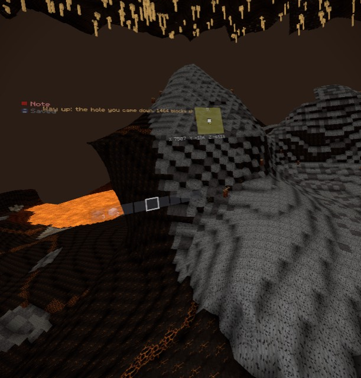

## 19:44:01 - Which isn't good enough for me

- **Transcript:** Which isn't good enough for me
- **Status:** open
- **Build:** 0.129 (46151e50, M1-M4 (device-tested; ship riding, chests, comfort options, weapon wheel))
- **World:** New World (10) (seed 1997562484558922131)
- **Dimension:** Hell
- **Biome:** Cinder Plains
- **Position:** 7031.4 233.5 -6818.1
- **Facing:** north-west (yaw 315, pitch -47)
- **Held:** empty hand
- **Mount:** on foot, flying
- **Looking at:** nothing
- **Mode:** Creative, health 20/20
- **Time:** day 2 17:43, clear
- **Fps:** 72
- **Levels:** mic -29 dBFS, game sound -14 dBFS
- **Length:** 2.3 s (voice 0.8 s)
- **Just before:** -28s walked into Cinder Plains; -25s opened SmithingMenu; -24s closed SmithingMenu; -23s opened SmithingMenu; -21s closed SmithingMenu; -20s opened FurnaceMenu; -19s closed FurnaceMenu; -17s opened ChestMenu; -16s closed ChestMenu; -15s message: Flying; -14s walked into Charwood Thicket; -12s walked into Ash Dunes; -10s walked into Cinder Plains; -4s walked into Gloamwood; -2s walked into Cinder Plains
- **Repro (Mac):** `./snap.sh note --seed 1997562484558922131 --x 7031.4 --z -6818.1 --yaw 45 --pitch -47 --time 0.489 --dim deep`
- **Audio (this Mac):** /Users/darthvadar/Documents/Blocksmith/QuestVoiceNotes/raw/vn-20261016-194401-705.aac

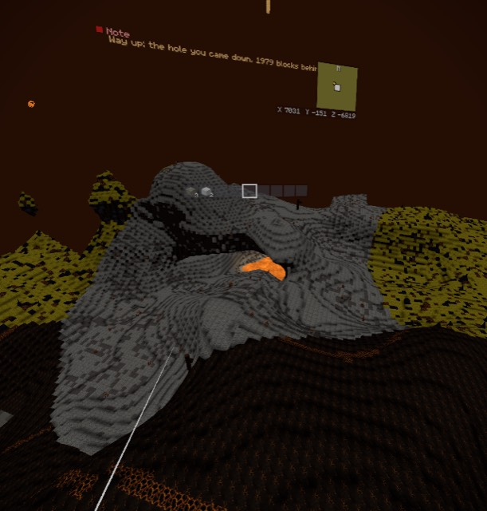

## 19:44:04 - Yeah. Uh, this yellow biome, don't like it. The gray biome needs more 

- **Transcript:** Yeah. Uh, this yellow biome, don't like it. The gray biome needs more to it. It's just, just too plain
- **Status:** open
- **Build:** 0.129 (46151e50, M1-M4 (device-tested; ship riding, chests, comfort options, weapon wheel))
- **World:** New World (10) (seed 1997562484558922131)
- **Dimension:** Hell
- **Biome:** Ash Dunes
- **Position:** 6987.2 233.5 -6864.7
- **Facing:** north-west (yaw 294, pitch -35)
- **Held:** empty hand
- **Mount:** on foot, flying
- **Looking at:** nothing
- **Mode:** Creative, health 20/20
- **Time:** day 2 17:46, clear
- **Fps:** 72
- **Levels:** mic -23 dBFS, game sound -16 dBFS
- **Length:** 8.1 s (voice 4.7 s)
- **Just before:** -28s opened SmithingMenu; -27s closed SmithingMenu; -26s opened SmithingMenu; -24s closed SmithingMenu; -23s opened FurnaceMenu; -22s closed FurnaceMenu; -20s opened ChestMenu; -19s closed ChestMenu; -18s message: Flying; -17s walked into Charwood Thicket; -15s walked into Ash Dunes; -13s walked into Cinder Plains; -7s walked into Gloamwood; -4s walked into Cinder Plains; -0s walked into Ash Dunes
- **Position at the end:** 6984.1 233.5 -6982.8
- **Repro (Mac):** `./snap.sh note --seed 1997562484558922131 --x 6987.2 --z -6864.7 --yaw 66 --pitch -35 --time 0.491 --dim deep`
- **Audio (this Mac):** /Users/darthvadar/Documents/Blocksmith/QuestVoiceNotes/raw/vn-20261016-194404-405.aac

## 19:44:14 - The red one with all the trees and shit, that looks awesome. Looks rea

- **Transcript:** The red one with all the trees and shit, that looks awesome. Looks really great. But the gray one, I'm not sure what to do with the gray one. Like, I don't want to just add trees to it or something. Like, purple one with all this stuff, this stuff, this shit's awesome
- **Status:** open
- **Build:** 0.129 (46151e50, M1-M4 (device-tested; ship riding, chests, comfort options, weapon wheel))
- **World:** New World (10) (seed 1997562484558922131)
- **Dimension:** Hell
- **Biome:** Cinder Plains
- **Position:** 6804.8 233.5 -7057.0
- **Facing:** west (yaw 264, pitch -36)
- **Held:** empty hand
- **Mount:** on foot, flying
- **Looking at:** nothing
- **Mode:** Creative, health 20/20
- **Time:** day 2 17:59, clear
- **Fps:** 72
- **Levels:** mic -25 dBFS, game sound -15 dBFS
- **Length:** 13.1 s (voice 7.7 s)
- **Just before:** -30s opened ChestMenu; -29s closed ChestMenu; -28s message: Flying; -27s walked into Charwood Thicket; -25s walked into Ash Dunes; -23s walked into Cinder Plains; -17s walked into Gloamwood; -15s walked into Cinder Plains; -11s walked into Ash Dunes; -5s walked into Sulfur Flats; -1s walked into Cinder Plains
- **While talking:** -1s walked into Charwood Thicket; -4s walked into Ash Dunes; -2s walked into Sulfur Flats; -0s walked into Gloamwood
- **Position at the end:** 6478.5 233.5 -7063.3
- **Repro (Mac):** `./snap.sh note --seed 1997562484558922131 --x 6804.8 --z -7057.0 --yaw 96 --pitch -36 --time 0.499 --dim deep`
- **Audio (this Mac):** /Users/darthvadar/Documents/Blocksmith/QuestVoiceNotes/raw/vn-20261016-194414-585.aac

## 19:44:27 - That was great. But yeah, gray one needs a little something. Yellow on

- **Transcript:** That was great. But yeah, gray one needs a little something. Yellow one just needs to be outright deleted and replaced with some totally different biome
- **Status:** open
- **Build:** 0.129 (46151e50, M1-M4 (device-tested; ship riding, chests, comfort options, weapon wheel))
- **World:** New World (10) (seed 1997562484558922131)
- **Dimension:** Hell
- **Biome:** Charwood Thicket
- **Position:** 6417.7 233.5 -7069.6
- **Facing:** south-west (yaw 245, pitch -38)
- **Held:** empty hand
- **Mount:** on foot, flying
- **Looking at:** nothing
- **Mode:** Creative, health 20/20
- **Time:** day 2 18:14, clear
- **Fps:** 72
- **Levels:** mic -29 dBFS, game sound -15 dBFS
- **Length:** 7.6 s (voice 4.6 s)
- **Just before:** -29s walked into Gloamwood; -27s walked into Cinder Plains; -23s walked into Ash Dunes; -17s walked into Sulfur Flats; -13s walked into Cinder Plains; -9s walked into Charwood Thicket; -7s walked into Ash Dunes; -5s walked into Sulfur Flats; -3s walked into Gloamwood
- **While talking:** -4s walked into Ash Dunes; -2s walked into Charwood Thicket
- **Position at the end:** 6236.1 233.5 -7168.1
- **Repro (Mac):** `./snap.sh note --seed 1997562484558922131 --x 6417.7 --z -7069.6 --yaw 115 --pitch -38 --time 0.510 --dim deep`
- **Audio (this Mac):** /Users/darthvadar/Documents/Blocksmith/QuestVoiceNotes/raw/vn-20261016-194427-685.aac

## 19:44:35 - Uh, yeah. Okay

- **Transcript:** Uh, yeah. Okay
- **Status:** open
- **Build:** 0.129 (46151e50, M1-M4 (device-tested; ship riding, chests, comfort options, weapon wheel))
- **World:** New World (10) (seed 1997562484558922131)
- **Dimension:** Hell
- **Biome:** Charwood Thicket
- **Position:** 6239.2 233.5 -7159.7
- **Facing:** south-west (yaw 239, pitch -70)
- **Held:** empty hand
- **Mount:** on foot, flying
- **Looking at:** nothing
- **Mode:** Creative, health 20/20
- **Time:** day 2 18:23, clear
- **Fps:** 72
- **Levels:** mic -33 dBFS, game sound -16 dBFS
- **Length:** 3.8 s (voice 1.2 s)
- **Just before:** -25s walked into Sulfur Flats; -21s walked into Cinder Plains; -17s walked into Charwood Thicket; -15s walked into Ash Dunes; -13s walked into Sulfur Flats; -11s walked into Gloamwood; -7s walked into Ash Dunes; -5s walked into Charwood Thicket
- **Repro (Mac):** `./snap.sh note --seed 1997562484558922131 --x 6239.2 --z -7159.7 --yaw 121 --pitch -70 --time 0.516 --dim deep`
- **Audio (this Mac):** /Users/darthvadar/Documents/Blocksmith/QuestVoiceNotes/raw/vn-20261016-194435-285.aac

## 19:45:06 - I keep forgetting to add new music to this

- **Transcript:** I keep forgetting to add new music to this
- **Status:** open
- **Build:** 0.129 (46151e50, M1-M4 (device-tested; ship riding, chests, comfort options, weapon wheel))
- **World:** New World (10) (seed 1997562484558922131)
- **Dimension:** Hell
- **Biome:** Cinder Plains
- **Position:** 6025.1 250.1 -6333.4
- **Facing:** south (yaw 200, pitch -60)
- **Held:** empty hand
- **Mount:** on foot, flying
- **Looking at:** nothing
- **Mode:** Creative, health 20/20
- **Time:** day 2 18:59, clear
- **Fps:** 72
- **Levels:** mic -35 dBFS, game sound -15 dBFS
- **Length:** 3.9 s (voice 1.6 s)
- **Just before:** -28s walked into Ash Dunes; -26s walked into Cinder Plains; -22s walked into Ash Dunes; -20s walked into Cinder Plains; -18s walked into Ash Dunes; -16s walked into Cinder Plains; -14s walked into Charwood Thicket; -12s walked into Cinder Plains; -8s walked into Gloamwood; -6s walked into Ash Dunes; -4s walked into Charwood Thicket; -2s walked into Sulfur Flats
- **Repro (Mac):** `./snap.sh note --seed 1997562484558922131 --x 6025.1 --z -6333.4 --yaw 160 --pitch -60 --time 0.541 --dim deep`
- **Audio (this Mac):** /Users/darthvadar/Documents/Blocksmith/QuestVoiceNotes/raw/vn-20261016-194506-005.aac

## 19:45:25 - Oh, um, another thing

- **Transcript:** Oh, um, another thing
- **Status:** open
- **Build:** 0.129 (46151e50, M1-M4 (device-tested; ship riding, chests, comfort options, weapon wheel))
- **World:** New World (10) (seed 1997562484558922131)
- **Dimension:** Hell
- **Biome:** Cinder Plains
- **Position:** 5525.3 250.1 -5284.5
- **Facing:** south-west (yaw 212, pitch -65)
- **Held:** empty hand
- **Mount:** on foot, flying
- **Looking at:** nothing
- **Mode:** Creative, health 20/20
- **Time:** day 2 19:22, clear
- **Fps:** 72
- **Levels:** mic -26 dBFS, game sound -21 dBFS
- **Length:** 4.1 s (voice 1.7 s)
- **Just before:** -28s walked into Gloamwood; -26s walked into Ash Dunes; -24s walked into Charwood Thicket; -22s walked into Sulfur Flats; -18s walked into Charwood Thicket; -16s walked into Gloamwood; -14s walked into Cinder Plains; -12s walked into Ash Dunes; -8s walked into Cinder Plains; -4s walked into Gloamwood; -2s walked into Cinder Plains
- **Repro (Mac):** `./snap.sh note --seed 1997562484558922131 --x 5525.3 --z -5284.5 --yaw 148 --pitch -65 --time 0.557 --dim deep`
- **Audio (this Mac):** /Users/darthvadar/Documents/Blocksmith/QuestVoiceNotes/raw/vn-20261016-194525-525.aac

## 19:45:29 - I don't think the biomes last long enough

- **Transcript:** I don't think the biomes last long enough
- **Status:** open
- **Build:** 0.129 (46151e50, M1-M4 (device-tested; ship riding, chests, comfort options, weapon wheel))
- **World:** New World (10) (seed 1997562484558922131)
- **Dimension:** Hell
- **Biome:** Gloamwood
- **Position:** 5465.7 250.1 -5210.9
- **Facing:** south-west (yaw 227, pitch -48)
- **Held:** empty hand
- **Mount:** on foot, flying
- **Looking at:** nothing
- **Mode:** Creative, health 20/20
- **Time:** day 2 19:25, clear
- **Fps:** 72
- **Levels:** mic -59 dBFS, game sound -30 dBFS
- **Length:** 3.4 s (voice 1.8 s)
- **Just before:** -28s walked into Ash Dunes; -26s walked into Charwood Thicket; -24s walked into Sulfur Flats; -20s walked into Charwood Thicket; -18s walked into Gloamwood; -16s walked into Cinder Plains; -14s walked into Ash Dunes; -10s walked into Cinder Plains; -6s walked into Gloamwood; -4s walked into Cinder Plains
- **Repro (Mac):** `./snap.sh note --seed 1997562484558922131 --x 5465.7 --z -5210.9 --yaw 133 --pitch -48 --time 0.559 --dim deep`
- **Audio (this Mac):** /Users/darthvadar/Documents/Blocksmith/QuestVoiceNotes/raw/vn-20261016-194529-345.aac

## 19:45:33 - Like they're just kind of things. Also the glowstone, I don't know if 

- **Transcript:** Like they're just kind of things. Also the glowstone, I don't know if that's a little too similar to another still
- **Status:** open
- **Build:** 0.129 (46151e50, M1-M4 (device-tested; ship riding, chests, comfort options, weapon wheel))
- **World:** New World (10) (seed 1997562484558922131)
- **Dimension:** Hell
- **Biome:** Sulfur Flats
- **Position:** 5412.9 250.1 -5070.5
- **Facing:** south-west (yaw 203, pitch -60)
- **Held:** empty hand
- **Mount:** on foot, flying
- **Looking at:** nothing
- **Mode:** Creative, health 20/20
- **Time:** day 2 19:30, clear
- **Fps:** 50
- **Levels:** mic -28 dBFS, game sound -19 dBFS
- **Length:** 7.7 s (voice 4.4 s)
- **Just before:** -28s walked into Sulfur Flats; -24s walked into Charwood Thicket; -22s walked into Gloamwood; -20s walked into Cinder Plains; -18s walked into Ash Dunes; -14s walked into Cinder Plains; -10s walked into Gloamwood; -8s walked into Cinder Plains; -0s walked into Sulfur Flats
- **While talking:** -5s walked into Sulfur Flats; -1s walked into Ash Dunes
- **Position at the end:** 5371.8 250.1 -4964.6
- **Repro (Mac):** `./snap.sh note --seed 1997562484558922131 --x 5412.9 --z -5070.5 --yaw 157 --pitch -60 --time 0.563 --dim deep`
- **Audio (this Mac):** /Users/darthvadar/Documents/Blocksmith/QuestVoiceNotes/raw/vn-20261016-194533-566.aac

## 19:45:41 - Yeah, I don't know. I don't think the biomes... Like, they should last

- **Transcript:** Yeah, I don't know. I don't think the biomes... Like, they should last longer
- **Status:** open
- **Build:** 0.129 (46151e50, M1-M4 (device-tested; ship riding, chests, comfort options, weapon wheel))
- **World:** New World (10) (seed 1997562484558922131)
- **Dimension:** Hell
- **Biome:** Ash Dunes
- **Position:** 5366.6 250.1 -4859.7
- **Facing:** south-west (yaw 209, pitch -57)
- **Held:** empty hand
- **Mount:** on foot, flying
- **Looking at:** nothing
- **Mode:** Creative, health 20/20
- **Time:** day 2 19:39, clear
- **Fps:** 71
- **Levels:** mic -32 dBFS, game sound -27 dBFS
- **Length:** 5.4 s (voice 2.7 s)
- **Just before:** -30s walked into Gloamwood; -28s walked into Cinder Plains; -26s walked into Ash Dunes; -22s walked into Cinder Plains; -18s walked into Gloamwood; -16s walked into Cinder Plains; -8s walked into Sulfur Flats; -4s walked into Ash Dunes
- **Repro (Mac):** `./snap.sh note --seed 1997562484558922131 --x 5366.6 --z -4859.7 --yaw 151 --pitch -57 --time 0.569 --dim deep`
- **Audio (this Mac):** /Users/darthvadar/Documents/Blocksmith/QuestVoiceNotes/raw/vn-20261016-194541-245.aac

## 19:45:48 - Otherwise, we're just kinda getting-- There's kind of a bitch way to h

- **Transcript:** Otherwise, we're just kinda getting-- There's kind of a bitch way to him quicker, I feel like
- **Status:** open
- **Build:** 0.129 (46151e50, M1-M4 (device-tested; ship riding, chests, comfort options, weapon wheel))
- **World:** New World (10) (seed 1997562484558922131)
- **Dimension:** Hell
- **Biome:** Cinder Plains
- **Position:** 5203.7 250.1 -4545.2
- **Facing:** south-west (yaw 211, pitch -62)
- **Held:** empty hand
- **Mount:** on foot, flying
- **Looking at:** nothing
- **Mode:** Creative, health 20/20
- **Time:** day 2 19:47, clear
- **Fps:** 72
- **Levels:** mic -31 dBFS, game sound -22 dBFS
- **Length:** 5.3 s (voice 2.7 s)
- **Just before:** -29s walked into Cinder Plains; -25s walked into Gloamwood; -23s walked into Cinder Plains; -15s walked into Sulfur Flats; -11s walked into Ash Dunes; -7s walked into Charwood Thicket; -5s walked into Sulfur Flats; -3s walked into Ash Dunes; -1s walked into Cinder Plains
- **Repro (Mac):** `./snap.sh note --seed 1997562484558922131 --x 5203.7 --z -4545.2 --yaw 149 --pitch -62 --time 0.575 --dim deep`
- **Audio (this Mac):** /Users/darthvadar/Documents/Blocksmith/QuestVoiceNotes/raw/vn-20261016-194548-365.aac

## 19:45:58 - The pathways with lava breaks, that's cool though. I like that

- **Transcript:** The pathways with lava breaks, that's cool though. I like that
- **Status:** open
- **Build:** 0.129 (46151e50, M1-M4 (device-tested; ship riding, chests, comfort options, weapon wheel))
- **World:** New World (10) (seed 1997562484558922131)
- **Dimension:** Hell
- **Biome:** Cinder Plains
- **Position:** 4783.2 250.1 -3904.9
- **Facing:** south-west (yaw 221, pitch -62)
- **Held:** empty hand
- **Mount:** on foot, flying
- **Looking at:** nothing
- **Mode:** Creative, health 20/20
- **Time:** day 2 20:00, clear
- **Fps:** 72
- **Levels:** mic -24 dBFS, game sound -27 dBFS
- **Length:** 4.1 s (voice 1.6 s)
- **Just before:** -25s walked into Sulfur Flats; -21s walked into Ash Dunes; -17s walked into Charwood Thicket; -15s walked into Sulfur Flats; -13s walked into Ash Dunes; -11s walked into Cinder Plains; -9s walked into Sulfur Flats; -5s walked into Cinder Plains
- **Repro (Mac):** `./snap.sh note --seed 1997562484558922131 --x 4783.2 --z -3904.9 --yaw 139 --pitch -62 --time 0.584 --dim deep`
- **Audio (this Mac):** /Users/darthvadar/Documents/Blocksmith/QuestVoiceNotes/raw/vn-20261016-194558-825.aac

## 19:46:06 - The lava is definitely still conforming to blocks though, which isn't 

- **Transcript:** The lava is definitely still conforming to blocks though, which isn't good
- **Status:** open
- **Build:** 0.129 (46151e50, M1-M4 (device-tested; ship riding, chests, comfort options, weapon wheel))
- **World:** New World (10) (seed 1997562484558922131)
- **Dimension:** Hell
- **Biome:** Cinder Plains
- **Position:** 4442.0 250.1 -3489.2
- **Facing:** south-west (yaw 217, pitch -63)
- **Held:** empty hand
- **Mount:** on foot, flying
- **Looking at:** nothing
- **Mode:** Creative, health 20/20
- **Time:** day 2 20:09, clear
- **Fps:** 72
- **Levels:** mic -31 dBFS, game sound -33 dBFS
- **Length:** 5.9 s (voice 3.4 s)
- **Just before:** -29s walked into Ash Dunes; -25s walked into Charwood Thicket; -23s walked into Sulfur Flats; -21s walked into Ash Dunes; -19s walked into Cinder Plains; -16s walked into Sulfur Flats; -12s walked into Cinder Plains; -4s walked into Charwood Thicket
- **While talking:** -3s walked into Cinder Plains; -1s walked into Sulfur Flats
- **Position at the end:** 4166.5 250.1 -3153.2
- **Repro (Mac):** `./snap.sh note --seed 1997562484558922131 --x 4442.0 --z -3489.2 --yaw 143 --pitch -63 --time 0.590 --dim deep`
- **Audio (this Mac):** /Users/darthvadar/Documents/Blocksmith/QuestVoiceNotes/raw/vn-20261016-194606-205.aac

## 19:46:24 - I think the, uh, villagers need to be changed up a little bit

- **Transcript:** I think the, uh, villagers need to be changed up a little bit
- **Status:** open
- **Build:** 0.129 (46151e50, M1-M4 (device-tested; ship riding, chests, comfort options, weapon wheel))
- **World:** New World (10) (seed 1997562484558922131)
- **Dimension:** Hell
- **Biome:** Ash Dunes
- **Position:** 3309.6 250.1 -2317.8
- **Facing:** south-west (yaw 223, pitch -62)
- **Held:** empty hand
- **Mount:** on foot, flying
- **Looking at:** nothing
- **Mode:** Creative, health 20/20
- **Time:** day 2 20:31, clear
- **Fps:** 72
- **Levels:** mic -31 dBFS, game sound -32 dBFS
- **Length:** 5.1 s (voice 2.5 s)
- **Just before:** -23s walked into Charwood Thicket; -17s walked into Cinder Plains; -15s walked into Sulfur Flats; -13s walked into Gloamwood; -11s walked into Ash Dunes; -7s walked into Cinder Plains; -1s walked into Sulfur Flats
- **Repro (Mac):** `./snap.sh note --seed 1997562484558922131 --x 3309.6 --z -2317.8 --yaw 137 --pitch -62 --time 0.606 --dim deep`
- **Audio (this Mac):** /Users/darthvadar/Documents/Blocksmith/QuestVoiceNotes/raw/vn-20261016-194624-985.aac

## 19:46:33 - Maybe, uh

- **Transcript:** Maybe, uh
- **Status:** open
- **Build:** 0.129 (46151e50, M1-M4 (device-tested; ship riding, chests, comfort options, weapon wheel))
- **World:** New World (10) (seed 1997562484558922131)
- **Dimension:** Hell
- **Biome:** Gloamwood
- **Position:** 2801.2 250.1 -1811.0
- **Facing:** south-west (yaw 227, pitch -63)
- **Held:** empty hand
- **Mount:** on foot, flying
- **Looking at:** nothing
- **Mode:** Creative, health 20/20
- **Time:** day 2 20:41, clear
- **Fps:** 72
- **Levels:** mic -43 dBFS, game sound -35 dBFS
- **Length:** 2.3 s (voice 0.9 s)
- **Just before:** -25s walked into Cinder Plains; -23s walked into Sulfur Flats; -21s walked into Gloamwood; -19s walked into Ash Dunes; -15s walked into Cinder Plains; -9s walked into Sulfur Flats; -7s walked into Ash Dunes; -5s walked into Cinder Plains; -3s walked into Charwood Thicket
- **Repro (Mac):** `./snap.sh note --seed 1997562484558922131 --x 2801.2 --z -1811.0 --yaw 133 --pitch -63 --time 0.612 --dim deep`
- **Audio (this Mac):** /Users/darthvadar/Documents/Blocksmith/QuestVoiceNotes/raw/vn-20261016-194633-265.aac

## 19:46:36 - Sexualize the female, um

- **Transcript:** Sexualize the female, um
- **Status:** open
- **Build:** 0.129 (46151e50, M1-M4 (device-tested; ship riding, chests, comfort options, weapon wheel))
- **World:** New World (10) (seed 1997562484558922131)
- **Dimension:** Hell
- **Biome:** Sulfur Flats
- **Position:** 2628.7 250.1 -1619.3
- **Facing:** south-west (yaw 225, pitch -62)
- **Held:** empty hand
- **Mount:** on foot, flying
- **Looking at:** nothing
- **Mode:** Creative, health 20/20
- **Time:** day 2 20:45, clear
- **Fps:** 72
- **Levels:** mic -39 dBFS, game sound -36 dBFS
- **Length:** 3.5 s (voice 1.5 s)
- **Just before:** -28s walked into Cinder Plains; -26s walked into Sulfur Flats; -24s walked into Gloamwood; -22s walked into Ash Dunes; -18s walked into Cinder Plains; -12s walked into Sulfur Flats; -10s walked into Ash Dunes; -8s walked into Cinder Plains; -6s walked into Charwood Thicket; -2s walked into Sulfur Flats
- **Repro (Mac):** `./snap.sh note --seed 1997562484558922131 --x 2628.7 --z -1619.3 --yaw 135 --pitch -62 --time 0.615 --dim deep`
- **Audio (this Mac):** /Users/darthvadar/Documents/Blocksmith/QuestVoiceNotes/raw/vn-20261016-194636-266.aac

## 19:46:39 - characters a little more

- **Transcript:** characters a little more
- **Status:** open
- **Build:** 0.129 (46151e50, M1-M4 (device-tested; ship riding, chests, comfort options, weapon wheel))
- **World:** New World (10) (seed 1997562484558922131)
- **Dimension:** Hell
- **Biome:** Cinder Plains
- **Position:** 2437.3 250.1 -1390.2
- **Facing:** south-west (yaw 227, pitch -52)
- **Held:** empty hand
- **Mount:** on foot, flying
- **Looking at:** nothing
- **Mode:** Creative, health 20/20
- **Time:** day 2 20:49, clear
- **Fps:** 72
- **Levels:** mic -31 dBFS, game sound -31 dBFS
- **Length:** 2.6 s (voice 1.2 s)
- **Just before:** -30s walked into Sulfur Flats; -28s walked into Gloamwood; -26s walked into Ash Dunes; -22s walked into Cinder Plains; -16s walked into Sulfur Flats; -14s walked into Ash Dunes; -12s walked into Cinder Plains; -10s walked into Charwood Thicket; -6s walked into Sulfur Flats; -2s walked into Charwood Thicket
- **Repro (Mac):** `./snap.sh note --seed 1997562484558922131 --x 2437.3 --z -1390.2 --yaw 133 --pitch -52 --time 0.618 --dim deep`
- **Audio (this Mac):** /Users/darthvadar/Documents/Blocksmith/QuestVoiceNotes/raw/vn-20261016-194639-725.aac

## 19:46:42 - While making them and the, the, the male ones more realistic

- **Transcript:** While making them and the, the, the male ones more realistic
- **Status:** open
- **Build:** 0.129 (46151e50, M1-M4 (device-tested; ship riding, chests, comfort options, weapon wheel))
- **World:** New World (10) (seed 1997562484558922131)
- **Dimension:** Hell
- **Biome:** Ash Dunes
- **Position:** 2257.9 250.1 -1187.5
- **Facing:** south-west (yaw 219, pitch -53)
- **Held:** empty hand
- **Mount:** on foot, flying
- **Looking at:** nothing
- **Mode:** Creative, health 20/20
- **Time:** day 2 20:53, clear
- **Fps:** 72
- **Levels:** mic -33 dBFS, game sound -29 dBFS
- **Length:** 5.8 s (voice 3.1 s)
- **Just before:** -29s walked into Ash Dunes; -25s walked into Cinder Plains; -19s walked into Sulfur Flats; -17s walked into Ash Dunes; -15s walked into Cinder Plains; -13s walked into Charwood Thicket; -9s walked into Sulfur Flats; -5s walked into Charwood Thicket; -3s walked into Cinder Plains; -1s walked into Ash Dunes
- **While talking:** -4s walked into Cinder Plains
- **Position at the end:** 2008.1 250.1 -832.7
- **Repro (Mac):** `./snap.sh note --seed 1997562484558922131 --x 2257.9 --z -1187.5 --yaw 141 --pitch -53 --time 0.620 --dim deep`
- **Audio (this Mac):** /Users/darthvadar/Documents/Blocksmith/QuestVoiceNotes/raw/vn-20261016-194642-885.aac

## 19:47:10 - That yellow shit's disgusting

- **Transcript:** That yellow shit's disgusting
- **Status:** open
- **Build:** 0.129 (46151e50, M1-M4 (device-tested; ship riding, chests, comfort options, weapon wheel))
- **World:** New World (10) (seed 1997562484558922131)
- **Dimension:** Hell
- **Biome:** Sulfur Flats
- **Position:** 1005.5 190.0 64.5
- **Facing:** south-west (yaw 245, pitch -63)
- **Held:** empty hand
- **Mount:** on foot, flying
- **Looking at:** nothing
- **Mode:** Creative, health 20/20
- **Time:** day 2 21:26, clear
- **Fps:** 72
- **Levels:** mic -37 dBFS, game sound -36 dBFS
- **Length:** 3.1 s (voice 1.1 s)
- **Just before:** -28s walked into Ash Dunes; -26s walked into Cinder Plains; -22s walked into Charwood Thicket; -20s walked into Cinder Plains; -18s walked into Charwood Thicket; -16s walked into Gloamwood; -14s walked into Cinder Plains; -12s walked into Gloamwood; -10s walked into Cinder Plains; -8s walked into Ash Dunes; -6s walked into Cinder Plains; -4s message: Walking; -4s walked into Sulfur Flats; -2s message: Flying
- **Repro (Mac):** `./snap.sh note --seed 1997562484558922131 --x 1005.5 --z 64.5 --yaw 115 --pitch -63 --time 0.643 --dim deep`
- **Audio (this Mac):** /Users/darthvadar/Documents/Blocksmith/QuestVoiceNotes/raw/vn-20261016-194710-245.aac

## 19:47:14 - Oh, there's a little spike sticking out. Interesting. Still looks too 

- **Transcript:** Oh, there's a little spike sticking out. Interesting. Still looks too gross
- **Status:** open
- **Build:** 0.129 (46151e50, M1-M4 (device-tested; ship riding, chests, comfort options, weapon wheel))
- **World:** New World (10) (seed 1997562484558922131)
- **Dimension:** Hell
- **Biome:** Sulfur Flats
- **Position:** 939.6 190.0 124.7
- **Facing:** south-west (yaw 221, pitch -50)
- **Held:** empty hand
- **Mount:** on foot, flying
- **Looking at:** nothing
- **Mode:** Creative, health 20/20
- **Time:** day 2 21:31, clear
- **Fps:** 70
- **Levels:** mic -26 dBFS, game sound -30 dBFS
- **Length:** 6.0 s (voice 2.7 s)
- **Just before:** -27s walked into Charwood Thicket; -25s walked into Cinder Plains; -23s walked into Charwood Thicket; -21s walked into Gloamwood; -19s walked into Cinder Plains; -17s walked into Gloamwood; -15s walked into Cinder Plains; -13s walked into Ash Dunes; -11s walked into Cinder Plains; -8s message: Walking; -8s walked into Sulfur Flats; -6s message: Flying
- **While talking:** -0s walked into Gloamwood; -0s message: Render distance 14 for now, to keep the frame rate
- **Position at the end:** 761.8 215.0 117.9
- **Repro (Mac):** `./snap.sh note --seed 1997562484558922131 --x 939.6 --z 124.7 --yaw 139 --pitch -50 --time 0.647 --dim deep`
- **Audio (this Mac):** /Users/darthvadar/Documents/Blocksmith/QuestVoiceNotes/raw/vn-20261016-194714-865.aac

## 19:47:22 - Purple biome might need a little more variety

- **Transcript:** Purple biome might need a little more variety
- **Status:** open
- **Build:** 0.129 (46151e50, M1-M4 (device-tested; ship riding, chests, comfort options, weapon wheel))
- **World:** New World (10) (seed 1997562484558922131)
- **Dimension:** Hell
- **Biome:** Cinder Plains
- **Position:** 699.4 221.7 130.6
- **Facing:** west (yaw 272, pitch -52)
- **Held:** empty hand
- **Mount:** on foot, flying
- **Looking at:** nothing
- **Mode:** Creative, health 20/20
- **Time:** day 2 21:39, clear
- **Fps:** 57
- **Levels:** mic -22 dBFS, game sound -18 dBFS
- **Length:** 3.2 s (voice 1.7 s)
- **Just before:** -29s walked into Charwood Thicket; -27s walked into Gloamwood; -25s walked into Cinder Plains; -23s walked into Gloamwood; -21s walked into Cinder Plains; -19s walked into Ash Dunes; -17s walked into Cinder Plains; -15s message: Walking; -15s walked into Sulfur Flats; -13s message: Flying; -3s walked into Gloamwood; -3s message: Render distance 14 for now, to keep the frame rate; -1s walked into Cinder Plains
- **Repro (Mac):** `./snap.sh note --seed 1997562484558922131 --x 699.4 --z 130.6 --yaw 88 --pitch -52 --time 0.653 --dim deep`
- **Audio (this Mac):** /Users/darthvadar/Documents/Blocksmith/QuestVoiceNotes/raw/vn-20261016-194722-545.aac

## 19:47:25 - Uh, or I don't know, maybe its own creatures or something. I don't kno

- **Transcript:** Uh, or I don't know, maybe its own creatures or something. I don't know. Up to you
- **Status:** open
- **Build:** 0.129 (46151e50, M1-M4 (device-tested; ship riding, chests, comfort options, weapon wheel))
- **World:** New World (10) (seed 1997562484558922131)
- **Dimension:** Hell
- **Biome:** Gloamwood
- **Position:** 673.6 221.7 136.5
- **Facing:** west (yaw 252, pitch -68)
- **Held:** empty hand
- **Mount:** on foot, flying
- **Looking at:** nothing
- **Mode:** Creative, health 20/20
- **Time:** day 2 21:42, clear
- **Fps:** 68
- **Levels:** mic -27 dBFS, game sound -31 dBFS
- **Length:** 5.6 s (voice 3.0 s)
- **Just before:** -30s walked into Gloamwood; -28s walked into Cinder Plains; -26s walked into Gloamwood; -24s walked into Cinder Plains; -22s walked into Ash Dunes; -20s walked into Cinder Plains; -18s message: Walking; -18s walked into Sulfur Flats; -16s message: Flying; -6s walked into Gloamwood; -5s message: Render distance 14 for now, to keep the frame rate; -4s walked into Cinder Plains; -2s walked into Gloamwood
- **Position at the end:** 636.5 221.7 155.6
- **Repro (Mac):** `./snap.sh note --seed 1997562484558922131 --x 673.6 --z 136.5 --yaw 108 --pitch -68 --time 0.655 --dim deep`
- **Audio (this Mac):** /Users/darthvadar/Documents/Blocksmith/QuestVoiceNotes/raw/vn-20261016-194725-465.aac

## 19:47:31 - Um, okay, what we got here? Very good

- **Transcript:** Um, okay, what we got here? Very good
- **Status:** open
- **Build:** 0.129 (46151e50, M1-M4 (device-tested; ship riding, chests, comfort options, weapon wheel))
- **World:** New World (10) (seed 1997562484558922131)
- **Dimension:** Hell
- **Biome:** Sulfur Flats
- **Position:** 554.9 221.7 183.0
- **Facing:** west (yaw 258, pitch -53)
- **Held:** empty hand
- **Mount:** on foot, flying
- **Looking at:** nothing
- **Mode:** Creative, health 20/20
- **Time:** day 2 21:48, clear
- **Fps:** 59
- **Levels:** mic -35 dBFS, game sound -33 dBFS
- **Length:** 4.8 s (voice 1.9 s)
- **Just before:** -29s walked into Cinder Plains; -27s walked into Ash Dunes; -25s walked into Cinder Plains; -23s message: Walking; -23s walked into Sulfur Flats; -21s message: Flying; -11s walked into Gloamwood; -10s message: Render distance 14 for now, to keep the frame rate; -9s walked into Cinder Plains; -7s walked into Gloamwood; -1s walked into Cinder Plains
- **Repro (Mac):** `./snap.sh note --seed 1997562484558922131 --x 554.9 --z 183.0 --yaw 102 --pitch -53 --time 0.659 --dim deep`
- **Audio (this Mac):** /Users/darthvadar/Documents/Blocksmith/QuestVoiceNotes/raw/vn-20261016-194731-565.aac

## 19:47:45 - Lots of blast furnaces in this one. I'm not even sure what the point o

- **Transcript:** Lots of blast furnaces in this one. I'm not even sure what the point of it is
- **Status:** open
- **Build:** 0.129 (46151e50, M1-M4 (device-tested; ship riding, chests, comfort options, weapon wheel))
- **World:** New World (10) (seed 1997562484558922131)
- **Dimension:** Hell
- **Biome:** Charwood Thicket
- **Position:** 418.8 198.0 274.9
- **Facing:** west (yaw 272, pitch -26)
- **Held:** empty hand
- **Mount:** on foot
- **Looking at:** Steel Plating at 415 197 274
- **Mode:** Creative, health 20/20
- **Time:** day 2 22:05, clear
- **Fps:** 64
- **Levels:** mic -31 dBFS, game sound -26 dBFS
- **Length:** 4.1 s (voice 1.9 s)
- **Just before:** -25s walked into Gloamwood; -24s message: Render distance 14 for now, to keep the frame rate; -23s walked into Cinder Plains; -21s walked into Gloamwood; -14s walked into Cinder Plains; -10s walked into Charwood Thicket; -8s message: Walking; -6s message: Flying; -5s message: Walking; -3s opened FurnaceMenu; -3s closed FurnaceMenu
- **Repro (Mac):** `./snap.sh note --seed 1997562484558922131 --x 418.8 --z 274.9 --yaw 88 --pitch -26 --time 0.670 --dim deep`
- **Audio (this Mac):** /Users/darthvadar/Documents/Blocksmith/QuestVoiceNotes/raw/vn-20261016-194745-945.aac

## 19:47:56 - Maybe add a, um

- **Transcript:** Maybe add a, um
- **Status:** open
- **Build:** 0.129 (46151e50, M1-M4 (device-tested; ship riding, chests, comfort options, weapon wheel))
- **World:** New World (10) (seed 1997562484558922131)
- **Dimension:** Hell
- **Biome:** Cinder Plains
- **Position:** 137.1 234.4 395.0
- **Facing:** north-west (yaw 322, pitch -27)
- **Held:** empty hand
- **Mount:** on foot, flying
- **Looking at:** nothing
- **Mode:** Creative, health 20/20
- **Time:** day 2 22:17, clear
- **Fps:** 68
- **Levels:** mic -34 dBFS, game sound -22 dBFS
- **Length:** 2.7 s (voice 1.4 s)
- **Just before:** -25s walked into Cinder Plains; -21s walked into Charwood Thicket; -18s message: Walking; -17s message: Flying; -15s message: Walking; -13s opened FurnaceMenu; -13s closed FurnaceMenu; -8s message: Flying; -3s walked into Cinder Plains
- **Repro (Mac):** `./snap.sh note --seed 1997562484558922131 --x 137.1 --z 395.0 --yaw 38 --pitch -27 --time 0.679 --dim deep`
- **Audio (this Mac):** /Users/darthvadar/Documents/Blocksmith/QuestVoiceNotes/raw/vn-20261016-194756-945.aac

## 19:48:01 - Add a sky or something in here

- **Transcript:** Add a sky or something in here
- **Status:** open
- **Build:** 0.129 (46151e50, M1-M4 (device-tested; ship riding, chests, comfort options, weapon wheel))
- **World:** New World (10) (seed 1997562484558922131)
- **Dimension:** Hell
- **Biome:** Gloamwood
- **Position:** 30.3 234.4 446.6
- **Facing:** west (yaw 257, pitch -60)
- **Held:** empty hand
- **Mount:** on foot, flying
- **Looking at:** nothing
- **Mode:** Creative, health 20/20
- **Time:** day 2 22:22, clear
- **Fps:** 63
- **Levels:** mic -43 dBFS, game sound -30 dBFS
- **Length:** 3.2 s (voice 1.3 s)
- **Just before:** -28s walked into Cinder Plains; -24s walked into Charwood Thicket; -22s message: Walking; -20s message: Flying; -19s message: Walking; -17s opened FurnaceMenu; -16s closed FurnaceMenu; -12s message: Flying; -6s walked into Cinder Plains; -0s walked into Gloamwood
- **Repro (Mac):** `./snap.sh note --seed 1997562484558922131 --x 30.3 --z 446.6 --yaw 103 --pitch -60 --time 0.682 --dim deep`
- **Audio (this Mac):** /Users/darthvadar/Documents/Blocksmith/QuestVoiceNotes/raw/vn-20261016-194801-745.aac

## 19:48:05 - Just kind of like you did with the world below it

- **Transcript:** Just kind of like you did with the world below it
- **Status:** open
- **Build:** 0.129 (46151e50, M1-M4 (device-tested; ship riding, chests, comfort options, weapon wheel))
- **World:** New World (10) (seed 1997562484558922131)
- **Dimension:** Hell
- **Biome:** Cinder Plains
- **Position:** -128.2 234.4 430.9
- **Facing:** west (yaw 266, pitch -72)
- **Held:** empty hand
- **Mount:** on foot, flying
- **Looking at:** nothing
- **Mode:** Creative, health 20/20
- **Time:** day 2 22:26, clear
- **Fps:** 66
- **Levels:** mic -30 dBFS, game sound -21 dBFS
- **Length:** 3.0 s (voice 1.4 s)
- **Just before:** -28s walked into Charwood Thicket; -26s message: Walking; -24s message: Flying; -23s message: Walking; -21s opened FurnaceMenu; -20s closed FurnaceMenu; -16s message: Flying; -10s walked into Cinder Plains; -4s walked into Gloamwood; -2s walked into Ash Dunes; -0s walked into Cinder Plains
- **Repro (Mac):** `./snap.sh note --seed 1997562484558922131 --x -128.2 --z 430.9 --yaw 94 --pitch -72 --time 0.685 --dim deep`
- **Audio (this Mac):** /Users/darthvadar/Documents/Blocksmith/QuestVoiceNotes/raw/vn-20261016-194805-685.aac

## 19:48:13 - Maybe that could replace the glowstone and shit. I don't know

- **Transcript:** Maybe that could replace the glowstone and shit. I don't know
- **Status:** open
- **Build:** 0.129 (46151e50, M1-M4 (device-tested; ship riding, chests, comfort options, weapon wheel))
- **World:** New World (10) (seed 1997562484558922131)
- **Dimension:** Hell
- **Biome:** Cinder Plains
- **Position:** -411.4 234.4 576.7
- **Facing:** west (yaw 268, pitch -48)
- **Held:** empty hand
- **Mount:** on foot, flying
- **Looking at:** nothing
- **Mode:** Creative, health 20/20
- **Time:** day 2 22:36, clear
- **Fps:** 72
- **Levels:** mic -31 dBFS, game sound -22 dBFS
- **Length:** 4.4 s (voice 1.7 s)
- **Just before:** -29s opened FurnaceMenu; -28s closed FurnaceMenu; -23s message: Flying; -18s walked into Cinder Plains; -12s walked into Gloamwood; -10s walked into Ash Dunes; -8s walked into Cinder Plains; -6s walked into Gloamwood; -4s walked into Charwood Thicket
- **Repro (Mac):** `./snap.sh note --seed 1997562484558922131 --x -411.4 --z 576.7 --yaw 92 --pitch -48 --time 0.692 --dim deep`
- **Audio (this Mac):** /Users/darthvadar/Documents/Blocksmith/QuestVoiceNotes/raw/vn-20261016-194813-385.aac

## 19:48:19 - Um, this cactus-looking thing, uh, the little blocks coming off it did

- **Transcript:** Um, this cactus-looking thing, uh, the little blocks coming off it did not look right. There's a gap of air between them. Very bad
- **Status:** open
- **Build:** 0.129 (46151e50, M1-M4 (device-tested; ship riding, chests, comfort options, weapon wheel))
- **World:** New World (10) (seed 1997562484558922131)
- **Dimension:** Hell
- **Biome:** Ash Dunes
- **Position:** -442.3 215.2 554.3
- **Facing:** south-west (yaw 246, pitch -21)
- **Held:** empty hand
- **Mount:** on foot, flying
- **Looking at:** Charwood Stem at -445 216 555
- **Mode:** Creative, health 20/20
- **Time:** day 2 22:43, clear
- **Fps:** 72
- **Levels:** mic -27 dBFS, game sound -30 dBFS
- **Length:** 8.9 s (voice 4.7 s)
- **Just before:** -30s message: Flying; -24s walked into Cinder Plains; -18s walked into Gloamwood; -16s walked into Ash Dunes; -14s walked into Cinder Plains; -12s walked into Gloamwood; -10s walked into Charwood Thicket; -6s walked into Cinder Plains; -4s message: Walking; -2s message: Flying
- **While talking:** -4s walked into Ash Dunes
- **Position at the end:** -470.0 215.2 569.9
- **Repro (Mac):** `./snap.sh note --seed 1997562484558922131 --x -442.3 --z 554.3 --yaw 114 --pitch -21 --time 0.697 --dim deep`
- **Audio (this Mac):** /Users/darthvadar/Documents/Blocksmith/QuestVoiceNotes/raw/vn-20261016-194819-805.aac

## 19:48:33 - Okay. Currently, as I dig down into hell, I can see the void all aroun

- **Transcript:** Okay. Currently, as I dig down into hell, I can see the void all around me, which isn't what it should look like
- **Status:** open
- **Build:** 0.129 (46151e50, M1-M4 (device-tested; ship riding, chests, comfort options, weapon wheel))
- **World:** New World (10) (seed 1997562484558922131)
- **Dimension:** Hell
- **Biome:** Cinder Plains
- **Position:** -512.3 167.6 593.6
- **Facing:** north-west (yaw 297, pitch -82)
- **Held:** empty hand
- **Mount:** on foot
- **Looking at:** Cinderstone at -513 166 593
- **Mode:** Creative, health 20/20
- **Time:** day 2 22:57, clear
- **Fps:** 66
- **Levels:** mic -67 dBFS, game sound -20 dBFS
- **Length:** 7.4 s (voice 4.9 s)
- **Just before:** -30s walked into Gloamwood; -28s walked into Ash Dunes; -26s walked into Cinder Plains; -24s walked into Gloamwood; -21s walked into Charwood Thicket; -17s walked into Cinder Plains; -15s message: Walking; -14s message: Flying; -11s walked into Ash Dunes; -7s message: Walking; -5s walked into Cinder Plains
- **Position at the end:** -512.3 154.5 593.6
- **Repro (Mac):** `./snap.sh note --seed 1997562484558922131 --x -512.3 --z 593.6 --yaw 63 --pitch -82 --time 0.706 --dim deep`
- **Audio (this Mac):** /Users/darthvadar/Documents/Blocksmith/QuestVoiceNotes/raw/vn-20261016-194833-085.aac

## 19:48:41 - So that's not good. I can-- It's kind of like I'm X-raying. I can see 

- **Transcript:** So that's not good. I can-- It's kind of like I'm X-raying. I can see lava
- **Status:** open
- **Build:** 0.129 (46151e50, M1-M4 (device-tested; ship riding, chests, comfort options, weapon wheel))
- **World:** New World (10) (seed 1997562484558922131)
- **Dimension:** Hell
- **Biome:** Cinder Plains
- **Position:** -512.4 144.9 593.7
- **Facing:** west (yaw 271, pitch -77)
- **Held:** empty hand
- **Mount:** on foot
- **Looking at:** Cinderstone at -514 144 593
- **Mode:** Creative, health 20/20
- **Time:** day 2 23:05, clear
- **Fps:** 63
- **Levels:** mic -42 dBFS, game sound -17 dBFS
- **Length:** 4.8 s (voice 2.6 s)
- **Just before:** -28s walked into Charwood Thicket; -24s walked into Cinder Plains; -22s message: Walking; -21s message: Flying; -18s walked into Ash Dunes; -13s message: Walking; -12s walked into Cinder Plains
- **Repro (Mac):** `./snap.sh note --seed 1997562484558922131 --x -512.4 --z 593.7 --yaw 89 --pitch -77 --time 0.712 --dim deep`
- **Audio (this Mac):** /Users/darthvadar/Documents/Blocksmith/QuestVoiceNotes/raw/vn-20261016-194841-025.aac

## 19:48:45 - Kind of an X-ray kind of way, which isn't good. We don't want that

- **Transcript:** Kind of an X-ray kind of way, which isn't good. We don't want that
- **Status:** open
- **Build:** 0.129 (46151e50, M1-M4 (device-tested; ship riding, chests, comfort options, weapon wheel))
- **World:** New World (10) (seed 1997562484558922131)
- **Dimension:** Hell
- **Biome:** Sealrock
- **Position:** -512.5 129.0 593.5
- **Facing:** north-west (yaw 316, pitch -83)
- **Held:** empty hand
- **Mount:** on foot
- **Looking at:** Emberslate at -513 127 593
- **Mode:** Creative, health 20/20
- **Time:** day 2 23:11, clear
- **Fps:** 72
- **Levels:** mic -31 dBFS, game sound -13 dBFS
- **Length:** 5.4 s (voice 2.5 s)
- **Just before:** -29s walked into Cinder Plains; -27s message: Walking; -25s message: Flying; -23s walked into Ash Dunes; -18s message: Walking; -17s walked into Cinder Plains; -1s walked into Sealrock
- **Repro (Mac):** `./snap.sh note --seed 1997562484558922131 --x -512.5 --z 593.5 --yaw 44 --pitch -83 --time 0.716 --dim deep`
- **Audio (this Mac):** /Users/darthvadar/Documents/Blocksmith/QuestVoiceNotes/raw/vn-20261016-194845-905.aac

## 19:48:53 - One reserve infantry. Okay

- **Transcript:** One reserve infantry. Okay
- **Status:** open
- **Build:** 0.129 (46151e50, M1-M4 (device-tested; ship riding, chests, comfort options, weapon wheel))
- **World:** New World (10) (seed 1997562484558922131)
- **Dimension:** Hell
- **Biome:** Ash Vault
- **Position:** -512.4 103.0 593.6
- **Facing:** west (yaw 255, pitch -78)
- **Held:** empty hand
- **Mount:** on foot
- **Looking at:** nothing
- **Mode:** Creative, health 20/20
- **Time:** day 2 23:20, clear
- **Fps:** 72
- **Levels:** mic -40 dBFS, game sound -18 dBFS
- **Length:** 3.7 s (voice 1.3 s)
- **Just before:** -26s message: Walking; -25s walked into Cinder Plains; -9s walked into Sealrock; -6s walked into Lower Crust; -4s message: Wave 1 of 3: their reserve infantry and half-tracks are coming
- **Repro (Mac):** `./snap.sh note --seed 1997562484558922131 --x -512.4 --z 593.6 --yaw 105 --pitch -78 --time 0.723 --dim deep`
- **Audio (this Mac):** /Users/darthvadar/Documents/Blocksmith/QuestVoiceNotes/raw/vn-20261016-194853-485.aac

## 19:48:58 - [laughs] Okay. This is, you know, this is nice

- **Transcript:** [laughs] Okay. This is, you know, this is nice
- **Status:** open
- **Build:** 0.129 (46151e50, M1-M4 (device-tested; ship riding, chests, comfort options, weapon wheel))
- **World:** New World (10) (seed 1997562484558922131)
- **Dimension:** Hell
- **Biome:** Ash Vault
- **Position:** -517.9 -29.7 592.6
- **Facing:** north-west (yaw 315, pitch -66)
- **Held:** empty hand
- **Mount:** on foot
- **Looking at:** Mud at -520 -34 591
- **Mode:** Creative, health 20/20
- **Time:** day 2 23:26, clear
- **Fps:** 70
- **Levels:** mic -32 dBFS, game sound -15 dBFS
- **Length:** 4.8 s (voice 1.5 s)
- **Just before:** -29s walked into Cinder Plains; -13s walked into Sealrock; -11s walked into Lower Crust; -9s message: Wave 1 of 3: their reserve infantry and half-tracks are coming; -3s walked into Ash Vault; -2s message: Flying; -1s message: Walking
- **Repro (Mac):** `./snap.sh note --seed 1997562484558922131 --x -517.9 --z 592.6 --yaw 45 --pitch -66 --time 0.726 --dim deep`
- **Audio (this Mac):** /Users/darthvadar/Documents/Blocksmith/QuestVoiceNotes/raw/vn-20261016-194858-245.aac

## 19:49:03 - This is what I'm talking about. A little half truck here. Okay

- **Transcript:** This is what I'm talking about. A little half truck here. Okay
- **Status:** open
- **Build:** 0.129 (46151e50, M1-M4 (device-tested; ship riding, chests, comfort options, weapon wheel))
- **World:** New World (10) (seed 1997562484558922131)
- **Dimension:** Hell
- **Biome:** Ash Vault
- **Position:** -525.7 -30.0 594.6
- **Facing:** west (yaw 268, pitch -75)
- **Held:** empty hand
- **Mount:** on foot
- **Looking at:** Short Grass at -527 -30 594
- **Mode:** Creative, health 20/20
- **Time:** day 2 23:32, clear
- **Fps:** 72
- **Levels:** mic -27 dBFS, game sound -14 dBFS
- **Length:** 4.0 s (voice 2.2 s)
- **Just before:** -18s walked into Sealrock; -16s walked into Lower Crust; -14s message: Wave 1 of 3: their reserve infantry and half-tracks are coming; -8s walked into Ash Vault; -8s message: Flying; -6s message: Walking
- **Repro (Mac):** `./snap.sh note --seed 1997562484558922131 --x -525.7 --z 594.6 --yaw 92 --pitch -75 --time 0.731 --dim deep`
- **Audio (this Mac):** /Users/darthvadar/Documents/Blocksmith/QuestVoiceNotes/raw/vn-20261016-194903-345.aac

## 19:49:06 - Now, can I use the turret? That's the next question

- **Transcript:** Now, can I use the turret? That's the next question
- **Status:** open
- **Build:** 0.129 (46151e50, M1-M4 (device-tested; ship riding, chests, comfort options, weapon wheel))
- **World:** New World (10) (seed 1997562484558922131)
- **Dimension:** Hell
- **Biome:** Ash Vault
- **Position:** -531.9 -28.4 603.5
- **Facing:** south-west (yaw 238, pitch -59)
- **Held:** empty hand
- **Mount:** on foot
- **Looking at:** Grass Block at -534 -30 604
- **Mode:** Creative, health 20/20
- **Time:** day 2 23:36, clear
- **Fps:** 72
- **Levels:** mic -30 dBFS, game sound -18 dBFS
- **Length:** 3.8 s (voice 2.0 s)
- **Just before:** -22s walked into Sealrock; -20s walked into Lower Crust; -17s message: Wave 1 of 3: their reserve infantry and half-tracks are coming; -12s walked into Ash Vault; -11s message: Flying; -10s message: Walking
- **Repro (Mac):** `./snap.sh note --seed 1997562484558922131 --x -531.9 --z 603.5 --yaw 122 --pitch -59 --time 0.734 --dim deep`
- **Audio (this Mac):** /Users/darthvadar/Documents/Blocksmith/QuestVoiceNotes/raw/vn-20261016-194906-965.aac

## 19:49:12 - What the fuck just happened?

- **Transcript:** What the fuck just happened?
- **Status:** open
- **Build:** 0.129 (46151e50, M1-M4 (device-tested; ship riding, chests, comfort options, weapon wheel))
- **World:** New World (10) (seed 1997562484558922131)
- **Dimension:** Hell
- **Biome:** Ash Vault
- **Position:** -535.0 -25.0 603.5
- **Facing:** north (yaw 357, pitch -32)
- **Held:** empty hand
- **Mount:** piloting Half-track
- **Looking at:** nothing
- **Mode:** Creative, health 20/20
- **Time:** day 2 23:43, clear
- **Fps:** 72
- **Levels:** mic -29 dBFS, game sound -14 dBFS
- **Length:** 3.4 s (voice 1.1 s)
- **Just before:** -28s walked into Sealrock; -26s walked into Lower Crust; -23s message: Wave 1 of 3: their reserve infantry and half-tracks are coming; -18s walked into Ash Vault; -17s message: Flying; -15s message: Walking; -5s message: Flying; -4s message: Walking; -2s piloting Half-track; -2s message: Steering Half-track
- **Repro (Mac):** `./snap.sh note --seed 1997562484558922131 --x -535.0 --z 603.5 --yaw 3 --pitch -32 --time 0.738 --dim deep`
- **Audio (this Mac):** /Users/darthvadar/Documents/Blocksmith/QuestVoiceNotes/raw/vn-20261016-194912-625.aac

## 19:49:16 - Okay, I'm sorry. What the fuck?

- **Transcript:** Okay, I'm sorry. What the fuck?
- **Status:** open
- **Build:** 0.129 (46151e50, M1-M4 (device-tested; ship riding, chests, comfort options, weapon wheel))
- **World:** New World (10) (seed 1997562484558922131)
- **Dimension:** Hell
- **Biome:** Ash Vault
- **Position:** -521.5 -27.6 596.1
- **Facing:** west (yaw 270, pitch -29)
- **Held:** empty hand
- **Mount:** on foot, flying
- **Looking at:** nothing
- **Mode:** Creative, health 20/20
- **Time:** day 2 23:47, clear
- **Fps:** 72
- **Levels:** mic -21 dBFS, game sound -16 dBFS
- **Length:** 3.7 s (voice 1.8 s)
- **Just before:** -29s walked into Lower Crust; -27s message: Wave 1 of 3: their reserve infantry and half-tracks are coming; -21s walked into Ash Vault; -21s message: Flying; -19s message: Walking; -9s message: Flying; -8s message: Walking; -6s piloting Half-track; -6s message: Steering Half-track; -3s stopped piloting Half-track; -1s message: Flying
- **Repro (Mac):** `./snap.sh note --seed 1997562484558922131 --x -521.5 --z 596.1 --yaw 90 --pitch -29 --time 0.742 --dim deep`
- **Audio (this Mac):** /Users/darthvadar/Documents/Blocksmith/QuestVoiceNotes/raw/vn-20261016-194916-385.aac

## 19:49:20 - So I got into a half truck and it turned into a totally different vehi

- **Transcript:** So I got into a half truck and it turned into a totally different vehicle that I don't even know what the fuck it is
- **Status:** open
- **Build:** 0.129 (46151e50, M1-M4 (device-tested; ship riding, chests, comfort options, weapon wheel))
- **World:** New World (10) (seed 1997562484558922131)
- **Dimension:** Hell
- **Biome:** Ash Vault
- **Position:** -525.9 -21.1 584.6
- **Facing:** south-west (yaw 244, pitch -22)
- **Held:** empty hand
- **Mount:** on foot, flying
- **Looking at:** nothing
- **Mode:** Creative, health 20/20
- **Time:** day 2 23:53, clear
- **Fps:** 72
- **Levels:** mic -27 dBFS, game sound -14 dBFS
- **Length:** 7.2 s (voice 4.9 s)
- **Just before:** -26s walked into Ash Vault; -25s message: Flying; -24s message: Walking; -13s message: Flying; -12s message: Walking; -10s piloting Half-track; -10s message: Steering Half-track; -7s stopped piloting Half-track; -5s message: Flying; -1s message: Render distance back to 16
- **Position at the end:** -527.0 -20.9 598.6
- **Repro (Mac):** `./snap.sh note --seed 1997562484558922131 --x -525.9 --z 584.6 --yaw 116 --pitch -22 --time 0.745 --dim deep`
- **Audio (this Mac):** /Users/darthvadar/Documents/Blocksmith/QuestVoiceNotes/raw/vn-20261016-194920-725.aac

## 19:49:27 - Like, I don't know what the hell happened here

- **Transcript:** Like, I don't know what the hell happened here
- **Status:** open
- **Build:** 0.129 (46151e50, M1-M4 (device-tested; ship riding, chests, comfort options, weapon wheel))
- **World:** New World (10) (seed 1997562484558922131)
- **Dimension:** Hell
- **Biome:** Ash Vault
- **Position:** -533.6 -20.9 597.6
- **Facing:** west (yaw 277, pitch -47)
- **Held:** empty hand
- **Mount:** on foot, flying
- **Looking at:** nothing
- **Mode:** Creative, health 20/20
- **Time:** day 2 00:01, clear
- **Fps:** 72
- **Levels:** mic -33 dBFS, game sound -16 dBFS
- **Length:** 4.6 s (voice 2.0 s)
- **Just before:** -21s message: Flying; -19s message: Walking; -17s piloting Half-track; -17s message: Steering Half-track; -14s stopped piloting Half-track; -13s message: Flying; -8s message: Render distance back to 16
- **Repro (Mac):** `./snap.sh note --seed 1997562484558922131 --x -533.6 --z 597.6 --yaw 83 --pitch -47 --time 0.751 --dim deep`
- **Audio (this Mac):** /Users/darthvadar/Documents/Blocksmith/QuestVoiceNotes/raw/vn-20261016-194927-885.aac

## 19:49:32 - What is this thing?

- **Transcript:** What is this thing?
- **Status:** open
- **Build:** 0.129 (46151e50, M1-M4 (device-tested; ship riding, chests, comfort options, weapon wheel))
- **World:** New World (10) (seed 1997562484558922131)
- **Dimension:** Hell
- **Biome:** Ash Vault
- **Position:** -540.0 -24.9 588.1
- **Facing:** north-west (yaw 334, pitch -15)
- **Held:** empty hand
- **Mount:** piloting Half-track
- **Looking at:** nothing
- **Mode:** Creative, health 20/20
- **Time:** day 2 00:07, clear
- **Fps:** 72
- **Levels:** mic -32 dBFS, game sound -8 dBFS
- **Length:** 2.3 s (voice 0.8 s)
- **Just before:** -26s message: Flying; -24s message: Walking; -22s piloting Half-track; -22s message: Steering Half-track; -19s stopped piloting Half-track; -17s message: Flying; -13s message: Render distance back to 16; -4s piloting Half-track; -4s message: Steering Half-track
- **Repro (Mac):** `./snap.sh note --seed 1997562484558922131 --x -540.0 --z 588.1 --yaw 26 --pitch -15 --time 0.755 --dim deep`
- **Audio (this Mac):** /Users/darthvadar/Documents/Blocksmith/QuestVoiceNotes/raw/vn-20261016-194932-805.aac

## 19:49:35 - Okay. Uh, I mean, yeah, it works pretty well, I guess

- **Transcript:** Okay. Uh, I mean, yeah, it works pretty well, I guess
- **Status:** open
- **Build:** 0.129 (46151e50, M1-M4 (device-tested; ship riding, chests, comfort options, weapon wheel))
- **World:** New World (10) (seed 1997562484558922131)
- **Dimension:** Hell
- **Biome:** Ash Vault
- **Position:** -539.6 -26.5 568.9
- **Facing:** north-west (yaw 312, pitch -27)
- **Held:** empty hand
- **Mount:** piloting Half-track
- **Looking at:** nothing
- **Mode:** Creative, health 20/20
- **Time:** day 2 00:11, clear
- **Fps:** 72
- **Levels:** mic -41 dBFS, game sound -15 dBFS
- **Length:** 5.8 s (voice 2.8 s)
- **Just before:** -29s message: Flying; -27s message: Walking; -25s piloting Half-track; -25s message: Steering Half-track; -22s stopped piloting Half-track; -21s message: Flying; -16s message: Render distance back to 16; -7s piloting Half-track; -7s message: Steering Half-track
- **Position at the end:** -547.8 -31.4 536.3
- **Repro (Mac):** `./snap.sh note --seed 1997562484558922131 --x -539.6 --z 568.9 --yaw 48 --pitch -27 --time 0.758 --dim deep`
- **Audio (this Mac):** /Users/darthvadar/Documents/Blocksmith/QuestVoiceNotes/raw/vn-20261016-194935-865.aac

## 19:49:42 - Okay, if I hit somebody with the fucking cannonball or whatever, they 

- **Transcript:** Okay, if I hit somebody with the fucking cannonball or whatever, they should fucking die. I'm sorry. They should die
- **Status:** open
- **Build:** 0.129 (46151e50, M1-M4 (device-tested; ship riding, chests, comfort options, weapon wheel))
- **World:** New World (10) (seed 1997562484558922131)
- **Dimension:** Hell
- **Biome:** Ash Vault
- **Position:** -551.2 -32.7 530.5
- **Facing:** south-west (yaw 215, pitch -17)
- **Held:** empty hand
- **Mount:** piloting Half-track
- **Looking at:** nothing
- **Mode:** Creative, health 20/20
- **Time:** day 2 00:18, clear
- **Fps:** 72
- **Levels:** mic -26 dBFS, game sound -17 dBFS
- **Length:** 8.1 s (voice 4.7 s)
- **Just before:** -28s stopped piloting Half-track; -27s message: Flying; -22s message: Render distance back to 16; -13s piloting Half-track; -13s message: Steering Half-track
- **Position at the end:** -551.4 -33.4 531.5
- **Repro (Mac):** `./snap.sh note --seed 1997562484558922131 --x -551.2 --z 530.5 --yaw 145 --pitch -17 --time 0.763 --dim deep`
- **Audio (this Mac):** /Users/darthvadar/Documents/Blocksmith/QuestVoiceNotes/raw/vn-20261016-194942-105.aac

## 19:49:49 - They should not survive. Little pillars are cool. I like that

- **Transcript:** They should not survive. Little pillars are cool. I like that
- **Status:** open
- **Build:** 0.129 (46151e50, M1-M4 (device-tested; ship riding, chests, comfort options, weapon wheel))
- **World:** New World (10) (seed 1997562484558922131)
- **Dimension:** Hell
- **Biome:** Ash Vault
- **Position:** -602.0 -32.1 555.7
- **Facing:** south-west (yaw 244, pitch -28)
- **Held:** empty hand
- **Mount:** on foot, flying
- **Looking at:** nothing
- **Mode:** Creative, health 20/20
- **Time:** day 2 00:27, clear
- **Fps:** 72
- **Levels:** mic -40 dBFS, game sound -16 dBFS
- **Length:** 4.4 s (voice 2.1 s)
- **Just before:** -30s message: Render distance back to 16; -21s piloting Half-track; -21s message: Steering Half-track; -2s stopped piloting Half-track; -2s message: Flying
- **Repro (Mac):** `./snap.sh note --seed 1997562484558922131 --x -602.0 --z 555.7 --yaw 116 --pitch -28 --time 0.769 --dim deep`
- **Audio (this Mac):** /Users/darthvadar/Documents/Blocksmith/QuestVoiceNotes/raw/vn-20261016-194949-865.aac

## 19:50:04 - The fog effect is really cool, and how the forests are really nice. Th

- **Transcript:** The fog effect is really cool, and how the forests are really nice. This is really well done
- **Status:** open
- **Build:** 0.129 (46151e50, M1-M4 (device-tested; ship riding, chests, comfort options, weapon wheel))
- **World:** New World (10) (seed 1997562484558922131)
- **Dimension:** Hell
- **Biome:** Ash Vault
- **Position:** -705.8 -27.4 758.9
- **Facing:** south-west (yaw 212, pitch -27)
- **Held:** empty hand
- **Mount:** on foot, flying
- **Looking at:** nothing
- **Mode:** Creative, health 20/20
- **Time:** day 2 00:46, clear
- **Fps:** 72
- **Levels:** mic -24 dBFS, game sound -18 dBFS
- **Length:** 5.9 s (voice 3.6 s)
- **Just before:** -18s stopped piloting Half-track; -17s message: Flying; -9s message: Walking; -6s opened ChestMenu; -5s closed ChestMenu; -1s message: Flying
- **While talking:** -1s message: The Ashguard regroups: wave 1 is coming again
- **Position at the end:** -713.4 -21.4 857.5
- **Repro (Mac):** `./snap.sh note --seed 1997562484558922131 --x -705.8 --z 758.9 --yaw 148 --pitch -27 --time 0.782 --dim deep`
- **Audio (this Mac):** /Users/darthvadar/Documents/Blocksmith/QuestVoiceNotes/raw/vn-20261016-195004-945.aac

## 19:50:10 - Uh, the plane crash is not obvious enough to be, would've been a plane

- **Transcript:** Uh, the plane crash is not obvious enough to be, would've been a plane crash
- **Status:** open
- **Build:** 0.129 (46151e50, M1-M4 (device-tested; ship riding, chests, comfort options, weapon wheel))
- **World:** New World (10) (seed 1997562484558922131)
- **Dimension:** Hell
- **Biome:** Ash Vault
- **Position:** -713.5 -21.4 854.5
- **Facing:** south (yaw 161, pitch -54)
- **Held:** empty hand
- **Mount:** on foot, flying
- **Looking at:** nothing
- **Mode:** Creative, health 20/20
- **Time:** day 2 00:52, clear
- **Fps:** 72
- **Levels:** mic -27 dBFS, game sound -23 dBFS
- **Length:** 5.4 s (voice 3.3 s)
- **Just before:** -23s stopped piloting Half-track; -22s message: Flying; -15s message: Walking; -11s opened ChestMenu; -10s closed ChestMenu; -7s message: Flying; -2s message: The Ashguard regroups: wave 1 is coming again
- **While talking:** -1s message: Wave 1 of 3: their reserve infantry and half-tracks are coming
- **Position at the end:** -719.0 -21.8 852.7
- **Repro (Mac):** `./snap.sh note --seed 1997562484558922131 --x -713.5 --z 854.5 --yaw -161 --pitch -54 --time 0.787 --dim deep`
- **Audio (this Mac):** /Users/darthvadar/Documents/Blocksmith/QuestVoiceNotes/raw/vn-20261016-195010-565.aac

## 19:50:16 - Also the dead body here. Um, okay, I see

- **Transcript:** Also the dead body here. Um, okay, I see
- **Status:** open
- **Build:** 0.129 (46151e50, M1-M4 (device-tested; ship riding, chests, comfort options, weapon wheel))
- **World:** New World (10) (seed 1997562484558922131)
- **Dimension:** Hell
- **Biome:** Ash Vault
- **Position:** -718.2 -27.1 852.3
- **Facing:** south-east (yaw 117, pitch -50)
- **Held:** empty hand
- **Mount:** on foot
- **Looking at:** nothing
- **Mode:** Creative, health 20/20
- **Time:** day 2 00:59, clear
- **Fps:** 72
- **Levels:** mic -26 dBFS, game sound -14 dBFS
- **Length:** 4.8 s (voice 3.0 s)
- **Just before:** -29s stopped piloting Half-track; -28s message: Flying; -20s message: Walking; -17s opened ChestMenu; -16s closed ChestMenu; -12s message: Flying; -7s message: The Ashguard regroups: wave 1 is coming again; -1s message: Wave 1 of 3: their reserve infantry and half-tracks are coming
- **Repro (Mac):** `./snap.sh note --seed 1997562484558922131 --x -718.2 --z 852.3 --yaw -117 --pitch -50 --time 0.791 --dim deep`
- **Audio (this Mac):** /Users/darthvadar/Documents/Blocksmith/QuestVoiceNotes/raw/vn-20261016-195016-005.aac

## 19:50:21 - Too futuristic. It should look like

- **Transcript:** Too futuristic. It should look like
- **Status:** open
- **Build:** 0.129 (46151e50, M1-M4 (device-tested; ship riding, chests, comfort options, weapon wheel))
- **World:** New World (10) (seed 1997562484558922131)
- **Dimension:** Hell
- **Biome:** Ash Vault
- **Position:** -717.4 -28.0 889.8
- **Facing:** north-east (yaw 25, pitch -31)
- **Held:** empty hand
- **Mount:** on foot, flying
- **Looking at:** nothing
- **Mode:** Creative, health 20/20
- **Time:** day 2 01:06, clear
- **Fps:** 72
- **Levels:** mic -24 dBFS, game sound -14 dBFS
- **Length:** 3.0 s (voice 1.4 s)
- **Just before:** -26s message: Walking; -23s opened ChestMenu; -22s closed ChestMenu; -18s message: Flying; -13s message: The Ashguard regroups: wave 1 is coming again; -7s message: Wave 1 of 3: their reserve infantry and half-tracks are coming; -4s message: Walking; -2s message: Flying
- **Repro (Mac):** `./snap.sh note --seed 1997562484558922131 --x -717.4 --z 889.8 --yaw -25 --pitch -31 --time 0.796 --dim deep`
- **Audio (this Mac):** /Users/darthvadar/Documents/Blocksmith/QuestVoiceNotes/raw/vn-20261016-195021-946.aac

## 19:50:25 - It should look like actual

- **Transcript:** It should look like actual
- **Status:** open
- **Build:** 0.129 (46151e50, M1-M4 (device-tested; ship riding, chests, comfort options, weapon wheel))
- **World:** New World (10) (seed 1997562484558922131)
- **Dimension:** Hell
- **Biome:** Ash Vault
- **Position:** -683.5 -28.0 850.2
- **Facing:** north (yaw 352, pitch -51)
- **Held:** empty hand
- **Mount:** on foot, flying
- **Looking at:** nothing
- **Mode:** Creative, health 20/20
- **Time:** day 2 01:10, clear
- **Fps:** 72
- **Levels:** mic -29 dBFS, game sound -15 dBFS
- **Length:** 2.8 s (voice 1.3 s)
- **Just before:** -30s message: Walking; -26s opened ChestMenu; -25s closed ChestMenu; -21s message: Flying; -17s message: The Ashguard regroups: wave 1 is coming again; -11s message: Wave 1 of 3: their reserve infantry and half-tracks are coming; -8s message: Walking; -5s message: Flying
- **Repro (Mac):** `./snap.sh note --seed 1997562484558922131 --x -683.5 --z 850.2 --yaw 8 --pitch -51 --time 0.799 --dim deep`
- **Audio (this Mac):** /Users/darthvadar/Documents/Blocksmith/QuestVoiceNotes/raw/vn-20261016-195025-325.aac

## 19:50:32 - Actual Allied soldiers. Sorry, I'm in a half truck, but I can't drive 

- **Transcript:** Actual Allied soldiers. Sorry, I'm in a half truck, but I can't drive it
- **Status:** open
- **Build:** 0.129 (46151e50, M1-M4 (device-tested; ship riding, chests, comfort options, weapon wheel))
- **World:** New World (10) (seed 1997562484558922131)
- **Dimension:** Hell
- **Biome:** Ash Vault
- **Position:** -680.6 -34.0 848.0
- **Facing:** north-east (yaw 47, pitch -74)
- **Held:** empty hand
- **Mount:** on foot
- **Looking at:** Mud at -681 -35 847
- **Mode:** Creative, health 20/20
- **Time:** day 2 01:18, clear
- **Fps:** 72
- **Levels:** mic -38 dBFS, game sound -16 dBFS
- **Length:** 6.3 s (voice 3.6 s)
- **Just before:** -28s message: Flying; -24s message: The Ashguard regroups: wave 1 is coming again; -18s message: Wave 1 of 3: their reserve infantry and half-tracks are coming; -15s message: Walking; -12s message: Flying; -6s message: Walking; -2s message: Flying; -1s message: Walking
- **While talking:** -4s message: Flying; -3s message: Walking; -1s message: Flying
- **Position at the end:** -675.0 -32.4 848.8
- **Repro (Mac):** `./snap.sh note --seed 1997562484558922131 --x -680.6 --z 848.0 --yaw -47 --pitch -74 --time 0.805 --dim deep`
- **Audio (this Mac):** /Users/darthvadar/Documents/Blocksmith/QuestVoiceNotes/raw/vn-20261016-195032-365.aac

## 19:50:38 - So vehicle is just usings right there

- **Transcript:** So vehicle is just usings right there
- **Status:** open
- **Build:** 0.129 (46151e50, M1-M4 (device-tested; ship riding, chests, comfort options, weapon wheel))
- **World:** New World (10) (seed 1997562484558922131)
- **Dimension:** Hell
- **Biome:** Ash Vault
- **Position:** -677.0 -30.1 851.6
- **Facing:** north (yaw 338, pitch -30)
- **Held:** empty hand
- **Mount:** on foot, flying
- **Looking at:** nothing
- **Mode:** Creative, health 20/20
- **Time:** day 2 01:26, clear
- **Fps:** 72
- **Levels:** mic -38 dBFS, game sound -16 dBFS
- **Length:** 3.8 s (voice 1.4 s)
- **Just before:** -30s message: The Ashguard regroups: wave 1 is coming again; -24s message: Wave 1 of 3: their reserve infantry and half-tracks are coming; -21s message: Walking; -18s message: Flying; -13s message: Walking; -8s message: Flying; -7s message: Walking; -5s message: Flying; -4s message: Walking; -2s message: Flying
- **Repro (Mac):** `./snap.sh note --seed 1997562484558922131 --x -677.0 --z 851.6 --yaw 22 --pitch -30 --time 0.810 --dim deep`
- **Audio (this Mac):** /Users/darthvadar/Documents/Blocksmith/QuestVoiceNotes/raw/vn-20261016-195038-646.aac

## 19:50:42 - Okay, this is kind of cool and all, but this... Oh, yeah, look at this

- **Transcript:** Okay, this is kind of cool and all, but this... Oh, yeah, look at this
- **Status:** open
- **Build:** 0.129 (46151e50, M1-M4 (device-tested; ship riding, chests, comfort options, weapon wheel))
- **World:** New World (10) (seed 1997562484558922131)
- **Dimension:** Hell
- **Biome:** Ash Vault
- **Position:** -873.4 -10.7 899.2
- **Facing:** north-west (yaw 318, pitch -33)
- **Held:** empty hand
- **Mount:** on foot, flying
- **Looking at:** nothing
- **Mode:** Creative, health 20/20
- **Time:** day 2 01:31, clear
- **Fps:** 72
- **Levels:** mic -37 dBFS, game sound -11 dBFS
- **Length:** 5.7 s (voice 3.0 s)
- **Just before:** -28s message: Wave 1 of 3: their reserve infantry and half-tracks are coming; -25s message: Walking; -22s message: Flying; -17s message: Walking; -12s message: Flying; -11s message: Walking; -10s message: Flying; -8s message: Walking; -6s message: Flying
- **While talking:** -2s message: Walking
- **Position at the end:** -874.8 -32.0 830.1
- **Repro (Mac):** `./snap.sh note --seed 1997562484558922131 --x -873.4 --z 899.2 --yaw 42 --pitch -33 --time 0.814 --dim deep`
- **Audio (this Mac):** /Users/darthvadar/Documents/Blocksmith/QuestVoiceNotes/raw/vn-20261016-195042-765.aac

## 19:50:48 - Got a, uh, all right, a bunch of dead soldiers. Why are they... They s

- **Transcript:** Got a, uh, all right, a bunch of dead soldiers. Why are they... They shouldn't look so futuristic though. They should look like 1940s, like, soldiers
- **Status:** open
- **Build:** 0.129 (46151e50, M1-M4 (device-tested; ship riding, chests, comfort options, weapon wheel))
- **World:** New World (10) (seed 1997562484558922131)
- **Dimension:** Hell
- **Biome:** Ash Vault
- **Position:** -873.4 -32.0 828.1
- **Facing:** north (yaw 17, pitch -29)
- **Held:** empty hand
- **Mount:** on foot
- **Looking at:** Grass Block at -873 -33 825
- **Mode:** Creative, health 20/20
- **Time:** day 2 01:37, clear
- **Fps:** 72
- **Levels:** mic -29 dBFS, game sound -14 dBFS
- **Length:** 8.6 s (voice 5.4 s)
- **Just before:** -28s message: Flying; -22s message: Walking; -18s message: Flying; -16s message: Walking; -15s message: Flying; -14s message: Walking; -11s message: Flying; -2s message: Walking
- **Position at the end:** -866.6 -32.0 816.9
- **Repro (Mac):** `./snap.sh note --seed 1997562484558922131 --x -873.4 --z 828.1 --yaw -17 --pitch -29 --time 0.818 --dim deep`
- **Audio (this Mac):** /Users/darthvadar/Documents/Blocksmith/QuestVoiceNotes/raw/vn-20261016-195048-205.aac

## 19:50:56 - And, um, also they're kind of hovering and they're all holding guns. T

- **Transcript:** And, um, also they're kind of hovering and they're all holding guns. They're-- Just doesn't look right. Very bad
- **Status:** open
- **Build:** 0.129 (46151e50, M1-M4 (device-tested; ship riding, chests, comfort options, weapon wheel))
- **World:** New World (10) (seed 1997562484558922131)
- **Dimension:** Hell
- **Biome:** Ash Vault
- **Position:** -869.7 -32.0 816.5
- **Facing:** north (yaw 356, pitch -24)
- **Held:** empty hand
- **Mount:** on foot
- **Looking at:** Podzol at -870 -33 812
- **Mode:** Creative, health 20/20
- **Time:** day 2 01:48, clear
- **Fps:** 72
- **Levels:** mic -27 dBFS, game sound -21 dBFS
- **Length:** 8.3 s (voice 4.6 s)
- **Just before:** -27s message: Flying; -25s message: Walking; -24s message: Flying; -22s message: Walking; -20s message: Flying; -11s message: Walking
- **Position at the end:** -874.4 -32.0 810.8
- **Repro (Mac):** `./snap.sh note --seed 1997562484558922131 --x -869.7 --z 816.5 --yaw 4 --pitch -24 --time 0.825 --dim deep`
- **Audio (this Mac):** /Users/darthvadar/Documents/Blocksmith/QuestVoiceNotes/raw/vn-20261016-195056-985.aac

## 19:51:05 - Um, yeah

- **Transcript:** Um, yeah
- **Status:** open
- **Build:** 0.129 (46151e50, M1-M4 (device-tested; ship riding, chests, comfort options, weapon wheel))
- **World:** New World (10) (seed 1997562484558922131)
- **Dimension:** Hell
- **Biome:** Ash Vault
- **Position:** -972.0 -26.8 748.9
- **Facing:** north (yaw 342, pitch -29)
- **Held:** empty hand
- **Mount:** on foot, flying
- **Looking at:** nothing
- **Mode:** Creative, health 20/20
- **Time:** day 2 01:58, clear
- **Fps:** 72
- **Levels:** mic -34 dBFS, game sound -42 dBFS
- **Length:** 2.6 s (voice 0.8 s)
- **Just before:** -29s message: Flying; -19s message: Walking; -3s message: Flying
- **Repro (Mac):** `./snap.sh note --seed 1997562484558922131 --x -972.0 --z 748.9 --yaw 18 --pitch -29 --time 0.832 --dim deep`
- **Audio (this Mac):** /Users/darthvadar/Documents/Blocksmith/QuestVoiceNotes/raw/vn-20261016-195105-545.aac

## 19:51:07 - Plane still doesn't look good enough

- **Transcript:** Plane still doesn't look good enough
- **Status:** open
- **Build:** 0.129 (46151e50, M1-M4 (device-tested; ship riding, chests, comfort options, weapon wheel))
- **World:** New World (10) (seed 1997562484558922131)
- **Dimension:** Hell
- **Biome:** Ash Vault
- **Position:** -1012.5 -26.8 719.0
- **Facing:** north-west (yaw 293, pitch -24)
- **Held:** empty hand
- **Mount:** on foot, flying
- **Looking at:** nothing
- **Mode:** Creative, health 20/20
- **Time:** day 2 02:01, clear
- **Fps:** 72
- **Levels:** mic -27 dBFS, game sound -18 dBFS
- **Length:** 2.5 s (voice 1.2 s)
- **Just before:** -22s message: Walking; -5s message: Flying
- **Repro (Mac):** `./snap.sh note --seed 1997562484558922131 --x -1012.5 --z 719.0 --yaw 67 --pitch -24 --time 0.834 --dim deep`
- **Audio (this Mac):** /Users/darthvadar/Documents/Blocksmith/QuestVoiceNotes/raw/vn-20261016-195107-825.aac

## 19:51:10 - Make it so that you could theoretically repla- repair the plane, but y

- **Transcript:** Make it so that you could theoretically repla- repair the plane, but you have to find rare parts
- **Status:** open
- **Build:** 0.129 (46151e50, M1-M4 (device-tested; ship riding, chests, comfort options, weapon wheel))
- **World:** New World (10) (seed 1997562484558922131)
- **Dimension:** Hell
- **Biome:** Ash Vault
- **Position:** -1159.2 -26.8 684.0
- **Facing:** south-west (yaw 215, pitch -14)
- **Held:** empty hand
- **Mount:** on foot, flying
- **Looking at:** nothing
- **Mode:** Creative, health 20/20
- **Time:** day 2 02:05, clear
- **Fps:** 72
- **Levels:** mic -20 dBFS, game sound -16 dBFS
- **Length:** 6.6 s (voice 3.8 s)
- **Just before:** -25s message: Walking; -8s message: Flying; -2s message: The Ashguard regroups: wave 1 is coming again
- **While talking:** -1s message: Wave 1 of 3: their reserve infantry and half-tracks are coming
- **Position at the end:** -1224.9 -26.8 562.3
- **Repro (Mac):** `./snap.sh note --seed 1997562484558922131 --x -1159.2 --z 684.0 --yaw 145 --pitch -14 --time 0.837 --dim deep`
- **Audio (this Mac):** /Users/darthvadar/Documents/Blocksmith/QuestVoiceNotes/raw/vn-20261016-195110-925.aac

## 19:51:19 - Wave one of three. Interesting

- **Transcript:** Wave one of three. Interesting
- **Status:** open
- **Build:** 0.129 (46151e50, M1-M4 (device-tested; ship riding, chests, comfort options, weapon wheel))
- **World:** New World (10) (seed 1997562484558922131)
- **Dimension:** Hell
- **Biome:** Ash Vault
- **Position:** -1212.1 -26.8 570.2
- **Facing:** east (yaw 78, pitch -40)
- **Held:** empty hand
- **Mount:** on foot, flying
- **Looking at:** nothing
- **Mode:** Creative, health 20/20
- **Time:** day 2 02:15, clear
- **Fps:** 72
- **Levels:** mic -34 dBFS, game sound -15 dBFS
- **Length:** 2.6 s (voice 0.6 s)
- **Just before:** -17s message: Flying; -11s message: The Ashguard regroups: wave 1 is coming again; -5s message: Wave 1 of 3: their reserve infantry and half-tracks are coming
- **Repro (Mac):** `./snap.sh note --seed 1997562484558922131 --x -1212.1 --z 570.2 --yaw -78 --pitch -40 --time 0.844 --dim deep`
- **Audio (this Mac):** /Users/darthvadar/Documents/Blocksmith/QuestVoiceNotes/raw/vn-20261016-195119-865.aac

## 19:51:23 - All right, well

- **Transcript:** All right, well
- **Status:** open
- **Build:** 0.129 (46151e50, M1-M4 (device-tested; ship riding, chests, comfort options, weapon wheel))
- **World:** New World (10) (seed 1997562484558922131)
- **Dimension:** Hell
- **Biome:** Ash Vault
- **Position:** -1221.2 -26.8 472.2
- **Facing:** north-east (yaw 67, pitch -29)
- **Held:** empty hand
- **Mount:** on foot, flying
- **Looking at:** nothing
- **Mode:** Creative, health 20/20
- **Time:** day 2 02:20, clear
- **Fps:** 72
- **Levels:** mic -29 dBFS, game sound -15 dBFS
- **Length:** 2.1 s (voice 0.7 s)
- **Just before:** -21s message: Flying; -15s message: The Ashguard regroups: wave 1 is coming again; -9s message: Wave 1 of 3: their reserve infantry and half-tracks are coming
- **Repro (Mac):** `./snap.sh note --seed 1997562484558922131 --x -1221.2 --z 472.2 --yaw -67 --pitch -29 --time 0.847 --dim deep`
- **Audio (this Mac):** /Users/darthvadar/Documents/Blocksmith/QuestVoiceNotes/raw/vn-20261016-195123-525.aac

## 19:51:39 - Okay, and, uh, this here, I guess these are supposed to be tanks. Dest

- **Transcript:** Okay, and, uh, this here, I guess these are supposed to be tanks. Destroyed tanks maybe? They look like shit. They don't look like real tanks. Go build some Sherman-looking equivalent and make it look realistic
- **Status:** open
- **Build:** 0.129 (46151e50, M1-M4 (device-tested; ship riding, chests, comfort options, weapon wheel))
- **World:** New World (10) (seed 1997562484558922131)
- **Dimension:** Hell
- **Biome:** Ash Vault
- **Position:** -481.0 -14.6 666.3
- **Facing:** east (yaw 84, pitch -55)
- **Held:** empty hand
- **Mount:** on foot
- **Looking at:** nothing
- **Mode:** Creative, health 20/20
- **Time:** day 2 02:39, clear
- **Fps:** 72
- **Levels:** mic -34 dBFS, game sound -14 dBFS
- **Length:** 12.0 s (voice 7.0 s)
- **Just before:** -25s message: Wave 1 of 3: their reserve infantry and half-tracks are coming; -8s message: The Ashguard regroups: wave 1 is coming again; -2s message: Wave 1 of 3: their reserve infantry and half-tracks are coming
- **While talking:** -4s message: Walking; -2s message: Flying
- **Position at the end:** -253.2 -2.6 660.9
- **Repro (Mac):** `./snap.sh note --seed 1997562484558922131 --x -481.0 --z 666.3 --yaw -84 --pitch -55 --time 0.861 --dim deep`
- **Audio (this Mac):** /Users/darthvadar/Documents/Blocksmith/QuestVoiceNotes/raw/vn-20261016-195139-565.aac

## 19:51:52 - Also, the

- **Transcript:** Also, the
- **Status:** open
- **Build:** 0.129 (46151e50, M1-M4 (device-tested; ship riding, chests, comfort options, weapon wheel))
- **World:** New World (10) (seed 1997562484558922131)
- **Dimension:** Hell
- **Biome:** Ash Vault
- **Position:** -163.9 -11.3 679.3
- **Facing:** east (yaw 105, pitch -50)
- **Held:** empty hand
- **Mount:** on foot
- **Looking at:** nothing
- **Mode:** Creative, health 20/20
- **Time:** day 2 02:55, clear
- **Fps:** 72
- **Levels:** mic -24 dBFS, game sound -14 dBFS
- **Length:** 2.6 s (voice 1.2 s)
- **Just before:** -21s message: The Ashguard regroups: wave 1 is coming again; -15s message: Wave 1 of 3: their reserve infantry and half-tracks are coming; -12s message: Walking; -10s message: Flying; -2s message: The Ashguard regroups: wave 1 is coming again
- **Repro (Mac):** `./snap.sh note --seed 1997562484558922131 --x -163.9 --z 679.3 --yaw -105 --pitch -50 --time 0.872 --dim deep`
- **Audio (this Mac):** /Users/darthvadar/Documents/Blocksmith/QuestVoiceNotes/raw/vn-20261016-195152-445.aac

## 19:51:55 - It's pretty clear when I'm walking around there's still blocks and shi

- **Transcript:** It's pretty clear when I'm walking around there's still blocks and shit. Like, clearly these were blo- a raised block level before
- **Status:** open
- **Build:** 0.129 (46151e50, M1-M4 (device-tested; ship riding, chests, comfort options, weapon wheel))
- **World:** New World (10) (seed 1997562484558922131)
- **Dimension:** Hell
- **Biome:** Ash Vault
- **Position:** -153.1 -34.0 685.4
- **Facing:** north-east (yaw 60, pitch -31)
- **Held:** empty hand
- **Mount:** on foot
- **Looking at:** Grass Block at -152 -35 684
- **Mode:** Creative, health 20/20
- **Time:** day 2 02:58, clear
- **Fps:** 72
- **Levels:** mic -29 dBFS, game sound -14 dBFS
- **Length:** 10.2 s (voice 5.5 s)
- **Just before:** -24s message: The Ashguard regroups: wave 1 is coming again; -18s message: Wave 1 of 3: their reserve infantry and half-tracks are coming; -15s message: Walking; -13s message: Flying; -5s message: The Ashguard regroups: wave 1 is coming again; -2s message: Walking; -1s message: Flying
- **While talking:** -4s message: Wave 1 of 3: their reserve infantry and half-tracks are coming
- **Position at the end:** -128.2 -33.0 659.7
- **Repro (Mac):** `./snap.sh note --seed 1997562484558922131 --x -153.1 --z 685.4 --yaw -60 --pitch -31 --time 0.874 --dim deep`
- **Audio (this Mac):** /Users/darthvadar/Documents/Blocksmith/QuestVoiceNotes/raw/vn-20261016-195155-706.aac

## 19:52:05 - Oh, cool. Is this a road?

- **Transcript:** Oh, cool. Is this a road?
- **Status:** open
- **Build:** 0.129 (46151e50, M1-M4 (device-tested; ship riding, chests, comfort options, weapon wheel))
- **World:** New World (10) (seed 1997562484558922131)
- **Dimension:** Hell
- **Biome:** Ash Vault
- **Position:** -87.5 -19.5 688.7
- **Facing:** south-east (yaw 131, pitch -39)
- **Held:** empty hand
- **Mount:** on foot, flying
- **Looking at:** nothing
- **Mode:** Creative, health 20/20
- **Time:** day 2 03:10, clear
- **Fps:** 72
- **Levels:** mic -28 dBFS, game sound -20 dBFS
- **Length:** 2.0 s (voice 0.9 s)
- **Just before:** -28s message: Wave 1 of 3: their reserve infantry and half-tracks are coming; -25s message: Walking; -23s message: Flying; -15s message: The Ashguard regroups: wave 1 is coming again; -12s message: Walking; -11s message: Flying; -9s message: Wave 1 of 3: their reserve infantry and half-tracks are coming; -0s message: Flying
- **Repro (Mac):** `./snap.sh note --seed 1997562484558922131 --x -87.5 --z 688.7 --yaw -131 --pitch -39 --time 0.882 --dim deep`
- **Audio (this Mac):** /Users/darthvadar/Documents/Blocksmith/QuestVoiceNotes/raw/vn-20261016-195205-545.aac

## 19:52:08 - Why does the road end like that? Oh yeah, it is a road. Look at this. 

- **Transcript:** Why does the road end like that? Oh yeah, it is a road. Look at this. Okay. Oh yeah, we got no man's land. Very good. See, I was waiting for a n- different biome. Oh, wait a minute. This is just
- **Status:** open
- **Build:** 0.129 (46151e50, M1-M4 (device-tested; ship riding, chests, comfort options, weapon wheel))
- **World:** New World (10) (seed 1997562484558922131)
- **Dimension:** Hell
- **Biome:** Ash Vault
- **Position:** -77.3 -18.5 696.7
- **Facing:** north (yaw 352, pitch -30)
- **Held:** empty hand
- **Mount:** on foot, flying
- **Looking at:** nothing
- **Mode:** Creative, health 20/20
- **Time:** day 2 03:14, clear
- **Fps:** 72
- **Levels:** mic -28 dBFS, game sound -16 dBFS
- **Length:** 12.1 s (voice 6.8 s)
- **Just before:** -28s message: Walking; -26s message: Flying; -18s message: The Ashguard regroups: wave 1 is coming again; -15s message: Walking; -14s message: Flying; -12s message: Wave 1 of 3: their reserve infantry and half-tracks are coming; -3s message: Flying
- **Position at the end:** -169.5 -18.3 425.0
- **Repro (Mac):** `./snap.sh note --seed 1997562484558922131 --x -77.3 --z 696.7 --yaw 8 --pitch -30 --time 0.885 --dim deep`
- **Audio (this Mac):** /Users/darthvadar/Documents/Blocksmith/QuestVoiceNotes/raw/vn-20261016-195208-445.aac

## 19:52:20 - Never mind, this is just the exterior. No man's land should be a fucki

- **Transcript:** Never mind, this is just the exterior. No man's land should be a fucking biome, okay?
- **Status:** open
- **Build:** 0.129 (46151e50, M1-M4 (device-tested; ship riding, chests, comfort options, weapon wheel))
- **World:** New World (10) (seed 1997562484558922131)
- **Dimension:** Hell
- **Biome:** Ash Vault
- **Position:** -251.8 7.2 343.5
- **Facing:** north-east (yaw 29, pitch -41)
- **Held:** empty hand
- **Mount:** on foot, flying
- **Looking at:** nothing
- **Mode:** Creative, health 20/20
- **Time:** day 2 03:28, clear
- **Fps:** 72
- **Levels:** mic -20 dBFS, game sound -17 dBFS
- **Length:** 6.0 s (voice 3.5 s)
- **Just before:** -30s message: The Ashguard regroups: wave 1 is coming again; -27s message: Walking; -26s message: Flying; -24s message: Wave 1 of 3: their reserve infantry and half-tracks are coming; -16s message: Flying
- **While talking:** -5s message: The Ashguard regroups: wave 1 is coming again
- **Position at the end:** -479.0 7.2 365.2
- **Repro (Mac):** `./snap.sh note --seed 1997562484558922131 --x -251.8 --z 343.5 --yaw -29 --pitch -41 --time 0.895 --dim deep`
- **Audio (this Mac):** /Users/darthvadar/Documents/Blocksmith/QuestVoiceNotes/raw/vn-20261016-195220-565.aac

## 19:52:32 - I don't know what those things are. The certain vehicle that looks lik

- **Transcript:** I don't know what those things are. The certain vehicle that looks like shit
- **Status:** open
- **Build:** 0.129 (46151e50, M1-M4 (device-tested; ship riding, chests, comfort options, weapon wheel))
- **World:** New World (10) (seed 1997562484558922131)
- **Dimension:** Hell
- **Biome:** Ash Vault
- **Position:** -379.6 7.2 246.8
- **Facing:** north-west (yaw 331, pitch -32)
- **Held:** empty hand
- **Mount:** on foot, flying
- **Looking at:** nothing
- **Mode:** Creative, health 20/20
- **Time:** day 2 03:43, clear
- **Fps:** 72
- **Levels:** mic -28 dBFS, game sound -24 dBFS
- **Length:** 6.2 s (voice 3.4 s)
- **Just before:** -27s message: Flying; -12s message: The Ashguard regroups: wave 1 is coming again; -6s message: Wave 1 of 3: their reserve infantry and half-tracks are coming
- **While talking:** -1s message: Walking
- **Position at the end:** -413.6 -1.3 189.8
- **Repro (Mac):** `./snap.sh note --seed 1997562484558922131 --x -379.6 --z 246.8 --yaw 29 --pitch -32 --time 0.905 --dim deep`
- **Audio (this Mac):** /Users/darthvadar/Documents/Blocksmith/QuestVoiceNotes/raw/vn-20261016-195232-405.aac

## 19:52:39 - And where are the tanks? I haven't seen a tank yet. Like, what is this

- **Transcript:** And where are the tanks? I haven't seen a tank yet. Like, what is this thing? Like
- **Status:** open
- **Build:** 0.129 (46151e50, M1-M4 (device-tested; ship riding, chests, comfort options, weapon wheel))
- **World:** New World (10) (seed 1997562484558922131)
- **Dimension:** Hell
- **Biome:** Ash Vault
- **Position:** -420.2 -30.7 182.8
- **Facing:** north-west (yaw 304, pitch -46)
- **Held:** empty hand
- **Mount:** on foot, flying
- **Looking at:** Packed Mud at -424 -34 180
- **Mode:** Creative, health 20/20
- **Time:** day 2 03:51, clear
- **Fps:** 72
- **Levels:** mic -30 dBFS, game sound -15 dBFS
- **Length:** 5.3 s (voice 2.4 s)
- **Just before:** -18s message: The Ashguard regroups: wave 1 is coming again; -12s message: Wave 1 of 3: their reserve infantry and half-tracks are coming; -3s message: Walking; -1s message: Flying
- **Repro (Mac):** `./snap.sh note --seed 1997562484558922131 --x -420.2 --z 182.8 --yaw 56 --pitch -46 --time 0.910 --dim deep`
- **Audio (this Mac):** /Users/darthvadar/Documents/Blocksmith/QuestVoiceNotes/raw/vn-20261016-195239-125.aac

## 19:52:44 - Ugh, I, I don't understand

- **Transcript:** Ugh, I, I don't understand
- **Status:** open
- **Build:** 0.129 (46151e50, M1-M4 (device-tested; ship riding, chests, comfort options, weapon wheel))
- **World:** New World (10) (seed 1997562484558922131)
- **Dimension:** Hell
- **Biome:** Ash Vault
- **Position:** -433.0 -28.8 162.0
- **Facing:** west (yaw 279, pitch -56)
- **Held:** empty hand
- **Mount:** on foot, flying
- **Looking at:** nothing
- **Mode:** Creative, health 20/20
- **Time:** day 2 03:57, clear
- **Fps:** 72
- **Levels:** mic -26 dBFS, game sound -16 dBFS
- **Length:** 3.0 s (voice 1.0 s)
- **Just before:** -24s message: The Ashguard regroups: wave 1 is coming again; -18s message: Wave 1 of 3: their reserve infantry and half-tracks are coming; -8s message: Walking; -6s message: Flying
- **Repro (Mac):** `./snap.sh note --seed 1997562484558922131 --x -433.0 --z 162.0 --yaw 81 --pitch -56 --time 0.915 --dim deep`
- **Audio (this Mac):** /Users/darthvadar/Documents/Blocksmith/QuestVoiceNotes/raw/vn-20261016-195244-665.aac

## 19:52:47 - Why can't I get in the half truck? I should be able to drive the half 

- **Transcript:** Why can't I get in the half truck? I should be able to drive the half truck and I should be able to get on its rear machine gun
- **Status:** open
- **Build:** 0.129 (46151e50, M1-M4 (device-tested; ship riding, chests, comfort options, weapon wheel))
- **World:** New World (10) (seed 1997562484558922131)
- **Dimension:** Hell
- **Biome:** Ash Vault
- **Position:** -432.9 -33.0 167.9
- **Facing:** west (yaw 279, pitch -55)
- **Held:** empty hand
- **Mount:** on foot
- **Looking at:** Coarse Dirt at -434 -34 167
- **Mode:** Creative, health 20/20
- **Time:** day 2 04:01, clear
- **Fps:** 72
- **Levels:** mic -29 dBFS, game sound -15 dBFS
- **Length:** 6.5 s (voice 3.9 s)
- **Just before:** -27s message: The Ashguard regroups: wave 1 is coming again; -21s message: Wave 1 of 3: their reserve infantry and half-tracks are coming; -11s message: Walking; -9s message: Flying; -1s message: Walking
- **While talking:** -4s message: Flying
- **Position at the end:** -334.7 -18.2 99.1
- **Repro (Mac):** `./snap.sh note --seed 1997562484558922131 --x -432.9 --z 167.9 --yaw 81 --pitch -55 --time 0.918 --dim deep`
- **Audio (this Mac):** /Users/darthvadar/Documents/Blocksmith/QuestVoiceNotes/raw/vn-20261016-195247-825.aac

## 19:52:54 - Oh yeah, we got some artillery here. Okay, that's cool. That's nice

- **Transcript:** Oh yeah, we got some artillery here. Okay, that's cool. That's nice
- **Status:** open
- **Build:** 0.129 (46151e50, M1-M4 (device-tested; ship riding, chests, comfort options, weapon wheel))
- **World:** New World (10) (seed 1997562484558922131)
- **Dimension:** Hell
- **Biome:** Ash Vault
- **Position:** -317.2 -18.0 55.8
- **Facing:** north-east (yaw 64, pitch -47)
- **Held:** empty hand
- **Mount:** on foot, flying
- **Looking at:** nothing
- **Mode:** Creative, health 20/20
- **Time:** day 2 04:09, clear
- **Fps:** 72
- **Levels:** mic -23 dBFS, game sound -16 dBFS
- **Length:** 4.9 s (voice 2.5 s)
- **Just before:** -28s message: Wave 1 of 3: their reserve infantry and half-tracks are coming; -18s message: Walking; -16s message: Flying; -8s message: Walking; -6s message: Flying
- **Repro (Mac):** `./snap.sh note --seed 1997562484558922131 --x -317.2 --z 55.8 --yaw -64 --pitch -47 --time 0.923 --dim deep`
- **Audio (this Mac):** /Users/darthvadar/Documents/Blocksmith/QuestVoiceNotes/raw/vn-20261016-195254-666.aac

## 19:52:59 - Still can't use the artillery though, which is not cool

- **Transcript:** Still can't use the artillery though, which is not cool
- **Status:** open
- **Build:** 0.129 (46151e50, M1-M4 (device-tested; ship riding, chests, comfort options, weapon wheel))
- **World:** New World (10) (seed 1997562484558922131)
- **Dimension:** Hell
- **Biome:** Ash Vault
- **Position:** -298.6 -29.8 49.3
- **Facing:** north-east (yaw 55, pitch -28)
- **Held:** empty hand
- **Mount:** on foot
- **Looking at:** nothing
- **Mode:** Creative, health 20/20
- **Time:** day 2 04:15, clear
- **Fps:** 72
- **Levels:** mic -24 dBFS, game sound -19 dBFS
- **Length:** 3.6 s (voice 1.9 s)
- **Just before:** -23s message: Walking; -21s message: Flying; -13s message: Walking; -11s message: Flying; -5s message: Walking; -1s message: Flying
- **Repro (Mac):** `./snap.sh note --seed 1997562484558922131 --x -298.6 --z 49.3 --yaw -55 --pitch -28 --time 0.927 --dim deep`
- **Audio (this Mac):** /Users/darthvadar/Documents/Blocksmith/QuestVoiceNotes/raw/vn-20261016-195259-465.aac

## 19:53:03 - Should be able to use it. What is this? Panzerfaust warhead? I don't k

- **Transcript:** Should be able to use it. What is this? Panzerfaust warhead? I don't know
- **Status:** open
- **Build:** 0.129 (46151e50, M1-M4 (device-tested; ship riding, chests, comfort options, weapon wheel))
- **World:** New World (10) (seed 1997562484558922131)
- **Dimension:** Hell
- **Biome:** Ash Vault
- **Position:** -289.5 -33.0 46.1
- **Facing:** south-east (yaw 140, pitch -12)
- **Held:** empty hand
- **Mount:** on foot
- **Looking at:** nothing
- **Mode:** Creative, health 20/20, screen ChestMenu
- **Time:** day 2 04:19, clear
- **Fps:** 72
- **Levels:** mic -32 dBFS, game sound -18 dBFS
- **Length:** 4.5 s (voice 2.4 s)
- **Just before:** -27s message: Walking; -25s message: Flying; -17s message: Walking; -15s message: Flying; -8s message: Walking; -5s message: Flying; -3s message: Walking; -2s opened ChestMenu; -2s closed ChestMenu; -1s opened ChestMenu
- **Repro (Mac):** `./snap.sh note --seed 1997562484558922131 --x -289.5 --z 46.1 --yaw -140 --pitch -12 --time 0.930 --dim deep`
- **Audio (this Mac):** /Users/darthvadar/Documents/Blocksmith/QuestVoiceNotes/raw/vn-20261016-195303-105.aac

## 19:53:07 - Fine fans are first. Oh, very nice

- **Transcript:** Fine fans are first. Oh, very nice
- **Status:** open
- **Build:** 0.129 (46151e50, M1-M4 (device-tested; ship riding, chests, comfort options, weapon wheel))
- **World:** New World (10) (seed 1997562484558922131)
- **Dimension:** Hell
- **Biome:** Ash Vault
- **Position:** -289.5 -33.0 46.1
- **Facing:** south-east (yaw 140, pitch -12)
- **Held:** empty hand
- **Mount:** on foot
- **Looking at:** nothing
- **Mode:** Creative, health 20/20, screen ChestMenu
- **Time:** day 2 04:25, clear
- **Fps:** 72
- **Levels:** mic -34 dBFS, game sound -18 dBFS
- **Length:** 3.2 s (voice 1.2 s)
- **Just before:** -29s message: Flying; -21s message: Walking; -19s message: Flying; -13s message: Walking; -9s message: Flying; -8s message: Walking; -7s opened ChestMenu; -6s closed ChestMenu; -5s opened ChestMenu
- **Repro (Mac):** `./snap.sh note --seed 1997562484558922131 --x -289.5 --z 46.1 --yaw -140 --pitch -12 --time 0.934 --dim deep`
- **Audio (this Mac):** /Users/darthvadar/Documents/Blocksmith/QuestVoiceNotes/raw/vn-20261016-195307-825.aac

## 19:53:10 - See, why would we, why do you have Panzerfaust and then not add a frig

- **Transcript:** See, why would we, why do you have Panzerfaust and then not add a friggin'... Like, where are the tanks?
- **Status:** open
- **Build:** 0.129 (46151e50, M1-M4 (device-tested; ship riding, chests, comfort options, weapon wheel))
- **World:** New World (10) (seed 1997562484558922131)
- **Dimension:** Hell
- **Biome:** Ash Vault
- **Position:** -294.2 -33.0 48.3
- **Facing:** south-east (yaw 145, pitch -24)
- **Held:** Capital Stone x2
- **Mount:** on foot
- **Looking at:** Ashcrete at -292 -33 51
- **Mode:** Creative, health 20/20
- **Time:** day 2 04:28, clear
- **Fps:** 72
- **Levels:** mic -26 dBFS, game sound -12 dBFS
- **Length:** 6.7 s (voice 4.0 s)
- **Just before:** -24s message: Walking; -22s message: Flying; -16s message: Walking; -12s message: Flying; -11s message: Walking; -10s opened ChestMenu; -9s closed ChestMenu; -8s opened ChestMenu; -1s closed ChestMenu; -0s holding Capital Stone; -0s message: Capital Stone
- **While talking:** -5s holding Cobblestone; -5s message: Cobblestone; -5s holding Panzerfaust; -5s message: Panzerfaust; -3s message: Loaded: 1 / 1; -0s message: Flying
- **Position at the end:** -271.0 -31.5 68.5
- **Repro (Mac):** `./snap.sh note --seed 1997562484558922131 --x -294.2 --z 48.3 --yaw -145 --pitch -24 --time 0.937 --dim deep`
- **Audio (this Mac):** /Users/darthvadar/Documents/Blocksmith/QuestVoiceNotes/raw/vn-20261016-195310-605.aac

## 19:53:18 - There's no tanks anywhere

- **Transcript:** There's no tanks anywhere
- **Status:** open
- **Build:** 0.129 (46151e50, M1-M4 (device-tested; ship riding, chests, comfort options, weapon wheel))
- **World:** New World (10) (seed 1997562484558922131)
- **Dimension:** Hell
- **Biome:** Ash Vault
- **Position:** -158.8 -12.0 128.7
- **Facing:** south-east (yaw 129, pitch -34)
- **Held:** Panzerfaust x1
- **Mount:** on foot, flying
- **Looking at:** nothing
- **Mode:** Creative, health 20/20
- **Time:** day 2 04:37, clear
- **Fps:** 72
- **Levels:** mic -25 dBFS, game sound -15 dBFS
- **Length:** 2.4 s (voice 0.9 s)
- **Just before:** -30s message: Flying; -23s message: Walking; -20s message: Flying; -18s message: Walking; -17s opened ChestMenu; -17s closed ChestMenu; -16s opened ChestMenu; -9s closed ChestMenu; -8s holding Capital Stone; -8s message: Capital Stone; -7s holding Cobblestone; -7s message: Cobblestone; -7s holding Panzerfaust; -7s message: Panzerfaust; -5s message: Loaded: 1 / 1; -3s message: Flying; -1s message: The Ashguard regroups: wave 1 is coming again
- **Repro (Mac):** `./snap.sh note --seed 1997562484558922131 --x -158.8 --z 128.7 --yaw -129 --pitch -34 --time 0.943 --dim deep`
- **Audio (this Mac):** /Users/darthvadar/Documents/Blocksmith/QuestVoiceNotes/raw/vn-20261016-195318-106.aac

## 19:53:21 - Like, is this, is this supposed to be a tank?

- **Transcript:** Like, is this, is this supposed to be a tank?
- **Status:** open
- **Build:** 0.129 (46151e50, M1-M4 (device-tested; ship riding, chests, comfort options, weapon wheel))
- **World:** New World (10) (seed 1997562484558922131)
- **Dimension:** Hell
- **Biome:** Ash Vault
- **Position:** -148.9 -12.0 128.0
- **Facing:** south-east (yaw 157, pitch -49)
- **Held:** Panzerfaust x1
- **Mount:** on foot, flying
- **Looking at:** nothing
- **Mode:** Creative, health 20/20
- **Time:** day 2 04:42, clear
- **Fps:** 72
- **Levels:** mic -36 dBFS, game sound -18 dBFS
- **Length:** 3.1 s (voice 1.5 s)
- **Just before:** -27s message: Walking; -23s message: Flying; -22s message: Walking; -21s opened ChestMenu; -20s closed ChestMenu; -19s opened ChestMenu; -13s closed ChestMenu; -11s holding Capital Stone; -11s message: Capital Stone; -11s holding Cobblestone; -11s message: Cobblestone; -11s holding Panzerfaust; -11s message: Panzerfaust; -9s message: Loaded: 1 / 1; -6s message: Flying; -5s message: The Ashguard regroups: wave 1 is coming again
- **Repro (Mac):** `./snap.sh note --seed 1997562484558922131 --x -148.9 --z 128.0 --yaw -157 --pitch -49 --time 0.946 --dim deep`
- **Audio (this Mac):** /Users/darthvadar/Documents/Blocksmith/QuestVoiceNotes/raw/vn-20261016-195321-845.aac

## 19:53:25 - No, 'cause look, there's tanks over here. What the heck?

- **Transcript:** No, 'cause look, there's tanks over here. What the heck?
- **Status:** open
- **Build:** 0.129 (46151e50, M1-M4 (device-tested; ship riding, chests, comfort options, weapon wheel))
- **World:** New World (10) (seed 1997562484558922131)
- **Dimension:** Hell
- **Biome:** Ash Vault
- **Position:** -142.9 -11.7 130.9
- **Facing:** south-east (yaw 120, pitch -47)
- **Held:** Panzerfaust x1
- **Mount:** on foot, flying
- **Looking at:** nothing
- **Mode:** Creative, health 20/20
- **Time:** day 2 04:47, clear
- **Fps:** 72
- **Levels:** mic -24 dBFS, game sound -14 dBFS
- **Length:** 3.9 s (voice 1.8 s)
- **Just before:** -27s message: Flying; -26s message: Walking; -25s opened ChestMenu; -24s closed ChestMenu; -23s opened ChestMenu; -17s closed ChestMenu; -15s holding Capital Stone; -15s message: Capital Stone; -15s holding Cobblestone; -15s message: Cobblestone; -15s holding Panzerfaust; -15s message: Panzerfaust; -13s message: Loaded: 1 / 1; -10s message: Flying; -9s message: The Ashguard regroups: wave 1 is coming again; -3s message: Wave 1 of 3: their reserve infantry and half-tracks are coming
- **Repro (Mac):** `./snap.sh note --seed 1997562484558922131 --x -142.9 --z 130.9 --yaw -120 --pitch -47 --time 0.949 --dim deep`
- **Audio (this Mac):** /Users/darthvadar/Documents/Blocksmith/QuestVoiceNotes/raw/vn-20261016-195325-825.aac

## 19:53:30 - This is a tank. Looks beautiful. I can't get in the fucking Tiger tank

- **Transcript:** This is a tank. Looks beautiful. I can't get in the fucking Tiger tank. Are you kidding me? Why the hell not?
- **Status:** open
- **Build:** 0.129 (46151e50, M1-M4 (device-tested; ship riding, chests, comfort options, weapon wheel))
- **World:** New World (10) (seed 1997562484558922131)
- **Dimension:** Hell
- **Biome:** Ash Vault
- **Position:** -113.0 -33.0 131.3
- **Facing:** south-east (yaw 130, pitch -7)
- **Held:** empty hand
- **Mount:** on foot
- **Looking at:** nothing
- **Mode:** Creative, health 20/20
- **Time:** day 2 04:52, clear
- **Fps:** 72
- **Levels:** mic -28 dBFS, game sound -19 dBFS
- **Length:** 6.6 s (voice 2.8 s)
- **Just before:** -29s opened ChestMenu; -29s closed ChestMenu; -28s opened ChestMenu; -21s closed ChestMenu; -20s holding Capital Stone; -20s message: Capital Stone; -19s holding Cobblestone; -19s message: Cobblestone; -19s holding Panzerfaust; -19s message: Panzerfaust; -17s message: Loaded: 1 / 1; -14s message: Flying; -13s message: The Ashguard regroups: wave 1 is coming again; -7s message: Wave 1 of 3: their reserve infantry and half-tracks are coming; -4s message: Walking; -2s holding Panzerfaust Warhead; -2s holding empty hand
- **While talking:** -2s message: Flying; -0s message: Walking
- **Position at the end:** -115.5 -33.0 134.8
- **Repro (Mac):** `./snap.sh note --seed 1997562484558922131 --x -113.0 --z 131.3 --yaw -130 --pitch -7 --time 0.953 --dim deep`
- **Audio (this Mac):** /Users/darthvadar/Documents/Blocksmith/QuestVoiceNotes/raw/vn-20261016-195330-045.aac

## 19:53:37 - Why can't I get in the tiger tank?

- **Transcript:** Why can't I get in the tiger tank?
- **Status:** open
- **Build:** 0.129 (46151e50, M1-M4 (device-tested; ship riding, chests, comfort options, weapon wheel))
- **World:** New World (10) (seed 1997562484558922131)
- **Dimension:** Hell
- **Biome:** Ash Vault
- **Position:** -93.7 -24.7 179.1
- **Facing:** south (yaw 160, pitch -29)
- **Held:** empty hand
- **Mount:** on foot, flying
- **Looking at:** nothing
- **Mode:** Creative, health 20/20
- **Time:** day 2 05:00, clear
- **Fps:** 72
- **Levels:** mic -32 dBFS, game sound -13 dBFS
- **Length:** 2.5 s (voice 1.0 s)
- **Just before:** -28s closed ChestMenu; -27s holding Capital Stone; -27s message: Capital Stone; -27s holding Cobblestone; -27s message: Cobblestone; -26s holding Panzerfaust; -26s message: Panzerfaust; -25s message: Loaded: 1 / 1; -22s message: Flying; -20s message: The Ashguard regroups: wave 1 is coming again; -15s message: Wave 1 of 3: their reserve infantry and half-tracks are coming; -11s message: Walking; -10s holding Panzerfaust Warhead; -9s holding empty hand; -4s message: Flying; -3s message: Walking; -1s message: Flying
- **Repro (Mac):** `./snap.sh note --seed 1997562484558922131 --x -93.7 --z 179.1 --yaw -160 --pitch -29 --time 0.959 --dim deep`
- **Audio (this Mac):** /Users/darthvadar/Documents/Blocksmith/QuestVoiceNotes/raw/vn-20261016-195337-345.aac

## 19:53:40 - Oh, here's a good idea. Make a, uh

- **Transcript:** Oh, here's a good idea. Make a, uh
- **Status:** open
- **Build:** 0.129 (46151e50, M1-M4 (device-tested; ship riding, chests, comfort options, weapon wheel))
- **World:** New World (10) (seed 1997562484558922131)
- **Dimension:** Hell
- **Biome:** Ash Vault
- **Position:** -72.8 -17.8 232.4
- **Facing:** south (yaw 161, pitch -42)
- **Held:** empty hand
- **Mount:** on foot, flying
- **Looking at:** nothing
- **Mode:** Creative, health 20/20
- **Time:** day 2 05:04, clear
- **Fps:** 72
- **Levels:** mic -22 dBFS, game sound -17 dBFS
- **Length:** 3.7 s (voice 1.8 s)
- **Just before:** -30s holding Capital Stone; -30s message: Capital Stone; -29s holding Cobblestone; -29s message: Cobblestone; -29s holding Panzerfaust; -29s message: Panzerfaust; -27s message: Loaded: 1 / 1; -24s message: Flying; -23s message: The Ashguard regroups: wave 1 is coming again; -17s message: Wave 1 of 3: their reserve infantry and half-tracks are coming; -14s message: Walking; -12s holding Panzerfaust Warhead; -12s holding empty hand; -7s message: Flying; -5s message: Walking; -4s message: Flying; -1s message: Walking
- **Repro (Mac):** `./snap.sh note --seed 1997562484558922131 --x -72.8 --z 232.4 --yaw -161 --pitch -42 --time 0.961 --dim deep`
- **Audio (this Mac):** /Users/darthvadar/Documents/Blocksmith/QuestVoiceNotes/raw/vn-20261016-195340-065.aac

## 19:53:44 - That'd be cool to have little concentration camps. That'd be, that'd b

- **Transcript:** That'd be cool to have little concentration camps. That'd be, that'd be neat
- **Status:** open
- **Build:** 0.129 (46151e50, M1-M4 (device-tested; ship riding, chests, comfort options, weapon wheel))
- **World:** New World (10) (seed 1997562484558922131)
- **Dimension:** Hell
- **Biome:** Ash Vault
- **Position:** -35.1 -17.8 284.1
- **Facing:** east (yaw 99, pitch -27)
- **Held:** empty hand
- **Mount:** on foot, flying
- **Looking at:** nothing
- **Mode:** Creative, health 20/20
- **Time:** day 2 05:09, clear
- **Fps:** 72
- **Levels:** mic -33 dBFS, game sound -17 dBFS
- **Length:** 5.0 s (voice 2.6 s)
- **Just before:** -29s message: Flying; -28s message: The Ashguard regroups: wave 1 is coming again; -22s message: Wave 1 of 3: their reserve infantry and half-tracks are coming; -19s message: Walking; -17s holding Panzerfaust Warhead; -17s holding empty hand; -12s message: Flying; -10s message: Walking; -9s message: Flying; -6s message: Walking; -4s message: Flying
- **Repro (Mac):** `./snap.sh note --seed 1997562484558922131 --x -35.1 --z 284.1 --yaw -99 --pitch -27 --time 0.965 --dim deep`
- **Audio (this Mac):** /Users/darthvadar/Documents/Blocksmith/QuestVoiceNotes/raw/vn-20261016-195344-905.aac

## 19:53:50 - Okay, a little truck and the truck's doing something. I don't know wha

- **Transcript:** Okay, a little truck and the truck's doing something. I don't know what it's doing. Why is it hopping? Why is the truck hopping?
- **Status:** open
- **Build:** 0.129 (46151e50, M1-M4 (device-tested; ship riding, chests, comfort options, weapon wheel))
- **World:** New World (10) (seed 1997562484558922131)
- **Dimension:** Hell
- **Biome:** Ash Vault
- **Position:** -78.6 -22.2 268.5
- **Facing:** north-west (yaw 335, pitch -43)
- **Held:** empty hand
- **Mount:** on foot, flying
- **Looking at:** nothing
- **Mode:** Creative, health 20/20
- **Time:** day 2 05:16, clear
- **Fps:** 72
- **Levels:** mic -30 dBFS, game sound -14 dBFS
- **Length:** 8.2 s (voice 4.7 s)
- **Just before:** -28s message: Wave 1 of 3: their reserve infantry and half-tracks are coming; -25s message: Walking; -23s holding Panzerfaust Warhead; -22s holding empty hand; -17s message: Flying; -16s message: Walking; -14s message: Flying; -11s message: Walking; -10s message: Flying; -5s message: Walking; -3s message: Flying
- **Position at the end:** -87.2 -22.2 266.7
- **Repro (Mac):** `./snap.sh note --seed 1997562484558922131 --x -78.6 --z 268.5 --yaw 25 --pitch -43 --time 0.970 --dim deep`
- **Audio (this Mac):** /Users/darthvadar/Documents/Blocksmith/QuestVoiceNotes/raw/vn-20261016-195350-485.aac

## 19:53:58 - There's a few trucks that don't look like half trucks. There's some ot

- **Transcript:** There's a few trucks that don't look like half trucks. There's some other kind of truck
- **Status:** open
- **Build:** 0.129 (46151e50, M1-M4 (device-tested; ship riding, chests, comfort options, weapon wheel))
- **World:** New World (10) (seed 1997562484558922131)
- **Dimension:** Hell
- **Biome:** Ash Vault
- **Position:** -77.4 -22.2 285.6
- **Facing:** north (yaw 16, pitch -29)
- **Held:** empty hand
- **Mount:** on foot, flying
- **Looking at:** nothing
- **Mode:** Creative, health 20/20
- **Time:** day 2 05:26, clear
- **Fps:** 72
- **Levels:** mic -30 dBFS, game sound -26 dBFS
- **Length:** 4.7 s (voice 2.6 s)
- **Just before:** -25s message: Flying; -24s message: Walking; -22s message: Flying; -19s message: Walking; -18s message: Flying; -12s message: Walking; -11s message: Flying
- **Repro (Mac):** `./snap.sh note --seed 1997562484558922131 --x -77.4 --z 285.6 --yaw -16 --pitch -29 --time 0.977 --dim deep`
- **Audio (this Mac):** /Users/darthvadar/Documents/Blocksmith/QuestVoiceNotes/raw/vn-20261016-195358-405.aac

## 19:54:03 - And it's hopping around for some reason

- **Transcript:** And it's hopping around for some reason
- **Status:** open
- **Build:** 0.129 (46151e50, M1-M4 (device-tested; ship riding, chests, comfort options, weapon wheel))
- **World:** New World (10) (seed 1997562484558922131)
- **Dimension:** Hell
- **Biome:** Ash Vault
- **Position:** -96.2 9.6 223.9
- **Facing:** north-west (yaw 330, pitch -34)
- **Held:** empty hand
- **Mount:** on foot, flying
- **Looking at:** nothing
- **Mode:** Creative, health 20/20
- **Time:** day 2 05:31, clear
- **Fps:** 72
- **Levels:** mic -31 dBFS, game sound -25 dBFS
- **Length:** 2.9 s (voice 1.5 s)
- **Just before:** -30s message: Flying; -28s message: Walking; -27s message: Flying; -24s message: Walking; -23s message: Flying; -17s message: Walking; -16s message: Flying
- **Repro (Mac):** `./snap.sh note --seed 1997562484558922131 --x -96.2 --z 223.9 --yaw 30 --pitch -34 --time 0.980 --dim deep`
- **Audio (this Mac):** /Users/darthvadar/Documents/Blocksmith/QuestVoiceNotes/raw/vn-20261016-195403-085.aac

## 19:54:12 - Oh yeah, there we go. This is, this is what we're talking about right 

- **Transcript:** Oh yeah, there we go. This is, this is what we're talking about right here. This is very good
- **Status:** open
- **Build:** 0.129 (46151e50, M1-M4 (device-tested; ship riding, chests, comfort options, weapon wheel))
- **World:** New World (10) (seed 1997562484558922131)
- **Dimension:** Hell
- **Biome:** Ash Vault
- **Position:** -82.3 9.9 26.3
- **Facing:** east (yaw 84, pitch -44)
- **Held:** empty hand
- **Mount:** on foot, flying
- **Looking at:** nothing
- **Mode:** Creative, health 20/20
- **Time:** day 2 05:42, clear
- **Fps:** 72
- **Levels:** mic -27 dBFS, game sound -17 dBFS
- **Length:** 5.3 s (voice 1.9 s)
- **Just before:** -26s message: Walking; -25s message: Flying
- **Repro (Mac):** `./snap.sh note --seed 1997562484558922131 --x -82.3 --z 26.3 --yaw -84 --pitch -44 --time 0.988 --dim deep`
- **Audio (this Mac):** /Users/darthvadar/Documents/Blocksmith/QuestVoiceNotes/raw/vn-20261016-195412-345.aac

## 19:54:27 - All right. This is neat

- **Transcript:** All right. This is neat
- **Status:** open
- **Build:** 0.129 (46151e50, M1-M4 (device-tested; ship riding, chests, comfort options, weapon wheel))
- **World:** New World (10) (seed 1997562484558922131)
- **Dimension:** Hell
- **Biome:** Ash Vault
- **Position:** 40.6 -33.0 -23.2
- **Facing:** south (yaw 176, pitch -36)
- **Held:** empty hand
- **Mount:** on foot
- **Looking at:** Coarse Dirt at 40 -34 -22
- **Mode:** Creative, health 20/20
- **Time:** day 3 06:01, clear
- **Fps:** 72
- **Levels:** mic -28 dBFS, game sound -38 dBFS
- **Length:** 2.9 s (voice 1.2 s)
- **Just before:** -11s message: Walking; -6s message: Flying; -5s message: Walking
- **Repro (Mac):** `./snap.sh note --seed 1997562484558922131 --x 40.6 --z -23.2 --yaw -176 --pitch -36 --time 0.001 --dim deep`
- **Audio (this Mac):** /Users/darthvadar/Documents/Blocksmith/QuestVoiceNotes/raw/vn-20261016-195427-625.aac

## 19:54:30 - Let's just see what we got going on here. So

- **Transcript:** Let's just see what we got going on here. So
- **Status:** open
- **Build:** 0.129 (46151e50, M1-M4 (device-tested; ship riding, chests, comfort options, weapon wheel))
- **World:** New World (10) (seed 1997562484558922131)
- **Dimension:** Hell
- **Biome:** Ash Vault
- **Position:** 28.8 -31.7 -4.8
- **Facing:** west (yaw 259, pitch -8)
- **Held:** empty hand
- **Mount:** on foot
- **Looking at:** nothing
- **Mode:** Creative, health 20/20
- **Time:** day 3 06:04, clear
- **Fps:** 72
- **Levels:** mic -33 dBFS, game sound -19 dBFS
- **Length:** 3.4 s (voice 1.8 s)
- **Just before:** -14s message: Walking; -9s message: Flying; -8s message: Walking
- **Repro (Mac):** `./snap.sh note --seed 1997562484558922131 --x 28.8 --z -4.8 --yaw 101 --pitch -8 --time 0.003 --dim deep`
- **Audio (this Mac):** /Users/darthvadar/Documents/Blocksmith/QuestVoiceNotes/raw/vn-20261016-195430-585.aac

## 19:54:34 - Right. Okay. The Marshal's Ward. Interesting. Okay. Take that, take th

- **Transcript:** Right. Okay. The Marshal's Ward. Interesting. Okay. Take that, take that. Uh-huh, lots of rounds and shit. Rifle rounds. I have rifle rounds. Wonder what this does
- **Status:** open
- **Build:** 0.129 (46151e50, M1-M4 (device-tested; ship riding, chests, comfort options, weapon wheel))
- **World:** New World (10) (seed 1997562484558922131)
- **Dimension:** Hell
- **Biome:** Ash Vault
- **Position:** 19.7 -33.0 -3.4
- **Facing:** west (yaw 260, pitch -4)
- **Held:** empty hand
- **Mount:** on foot
- **Looking at:** nothing
- **Mode:** Creative, health 20/20, screen ChestMenu
- **Time:** day 3 06:09, clear
- **Fps:** 72
- **Levels:** mic -33 dBFS, game sound -17 dBFS
- **Length:** 15.3 s (voice 5.9 s)
- **Just before:** -18s message: Walking; -13s message: Flying; -12s message: Walking; -3s opened ChestMenu
- **While talking:** -0s holding Duskium Leggings
- **Position at the end:** 19.7 -33.0 -3.4
- **Repro (Mac):** `./snap.sh note --seed 1997562484558922131 --x 19.7 --z -3.4 --yaw 100 --pitch -4 --time 0.006 --dim deep`
- **Audio (this Mac):** /Users/darthvadar/Documents/Blocksmith/QuestVoiceNotes/raw/vn-20261016-195434-405.aac

## 19:54:50 - Okay, so we have blast doors that we apparently should be able to get 

- **Transcript:** Okay, so we have blast doors that we apparently should be able to get through. I can't or I don't have to... There's some magical way
- **Status:** open
- **Build:** 0.129 (46151e50, M1-M4 (device-tested; ship riding, chests, comfort options, weapon wheel))
- **World:** New World (10) (seed 1997562484558922131)
- **Dimension:** Hell
- **Biome:** Ash Vault
- **Position:** 10.1 -33.0 -1.1
- **Facing:** west (yaw 271, pitch -26)
- **Held:** Sechser Revolver x1
- **Mount:** on foot
- **Looking at:** Polished Onyxstone at 6 -34 -2
- **Mode:** Creative, health 20/20
- **Time:** day 3 06:28, clear
- **Fps:** 72
- **Levels:** mic -32 dBFS, game sound -14 dBFS
- **Length:** 11.8 s (voice 6.2 s)
- **Just before:** -29s message: Flying; -27s message: Walking; -19s opened ChestMenu; -11s holding Duskium Leggings; -4s closed ChestMenu; -4s holding Duskium Chestplate; -4s message: Duskium Chestplate; -4s holding Duskium Helmet; -4s message: Duskium Helmet; -3s holding Sechser Revolver; -3s message: Sechser Revolver
- **While talking:** -2s opened ChestMenu; -3s closed ChestMenu
- **Position at the end:** 8.0 -33.0 4.0
- **Repro (Mac):** `./snap.sh note --seed 1997562484558922131 --x 10.1 --z -1.1 --yaw 89 --pitch -26 --time 0.020 --dim deep`
- **Audio (this Mac):** /Users/darthvadar/Documents/Blocksmith/QuestVoiceNotes/raw/vn-20261016-195450-225.aac

## 19:55:08 - You have to kill somebody or something? Don't know

- **Transcript:** You have to kill somebody or something? Don't know
- **Status:** open
- **Build:** 0.129 (46151e50, M1-M4 (device-tested; ship riding, chests, comfort options, weapon wheel))
- **World:** New World (10) (seed 1997562484558922131)
- **Dimension:** Hell
- **Biome:** Ash Vault
- **Position:** 8.2 -33.0 0.0
- **Facing:** north-east (yaw 25, pitch -16)
- **Held:** Sechser Revolver x1
- **Mount:** on foot
- **Looking at:** Polished Onyxstone at 10 -34 -5
- **Mode:** Creative, health 20/20
- **Time:** day 3 06:50, clear
- **Fps:** 72
- **Levels:** mic -38 dBFS, game sound -11 dBFS
- **Length:** 4.1 s (voice 1.4 s)
- **Just before:** -30s holding Duskium Leggings; -23s closed ChestMenu; -22s holding Duskium Chestplate; -22s message: Duskium Chestplate; -22s holding Duskium Helmet; -22s message: Duskium Helmet; -22s holding Sechser Revolver; -22s message: Sechser Revolver; -15s opened ChestMenu; -12s closed ChestMenu; -4s opened ChestMenu; -2s closed ChestMenu
- **Repro (Mac):** `./snap.sh note --seed 1997562484558922131 --x 8.2 --z 0.0 --yaw -25 --pitch -16 --time 0.035 --dim deep`
- **Audio (this Mac):** /Users/darthvadar/Documents/Blocksmith/QuestVoiceNotes/raw/vn-20261016-195508-725.aac

## 19:55:12 - Maybe now that I've installed them

- **Transcript:** Maybe now that I've installed them
- **Status:** open
- **Build:** 0.129 (46151e50, M1-M4 (device-tested; ship riding, chests, comfort options, weapon wheel))
- **World:** New World (10) (seed 1997562484558922131)
- **Dimension:** Hell
- **Biome:** Ash Vault
- **Position:** 7.9 -33.0 0.7
- **Facing:** south (yaw 170, pitch -42)
- **Held:** Sechser Revolver x1
- **Mount:** on foot
- **Looking at:** Blast Door at 8 -34 2
- **Mode:** Creative, health 20/20
- **Time:** day 3 06:55, clear
- **Fps:** 72
- **Levels:** mic -36 dBFS, game sound -13 dBFS
- **Length:** 2.5 s (voice 0.9 s)
- **Just before:** -27s closed ChestMenu; -26s holding Duskium Chestplate; -26s message: Duskium Chestplate; -26s holding Duskium Helmet; -26s message: Duskium Helmet; -26s holding Sechser Revolver; -26s message: Sechser Revolver; -19s opened ChestMenu; -16s closed ChestMenu; -7s opened ChestMenu; -6s closed ChestMenu; -4s opened ChestMenu; -1s closed ChestMenu
- **Repro (Mac):** `./snap.sh note --seed 1997562484558922131 --x 7.9 --z 0.7 --yaw -170 --pitch -42 --time 0.038 --dim deep`
- **Audio (this Mac):** /Users/darthvadar/Documents/Blocksmith/QuestVoiceNotes/raw/vn-20261016-195512-685.aac

## 19:55:21 - Let's say I open the blast doors, however that's done. I don't know ho

- **Transcript:** Let's say I open the blast doors, however that's done. I don't know how it's done
- **Status:** open
- **Build:** 0.129 (46151e50, M1-M4 (device-tested; ship riding, chests, comfort options, weapon wheel))
- **World:** New World (10) (seed 1997562484558922131)
- **Dimension:** Hell
- **Biome:** Ash Vault
- **Position:** 8.7 -43.3 12.8
- **Facing:** south (yaw 183, pitch -49)
- **Held:** Duskium Helmet x1
- **Mount:** on foot
- **Looking at:** nothing
- **Mode:** Creative, health 20/20
- **Time:** day 3 07:06, clear
- **Fps:** 72
- **Levels:** mic -49 dBFS, game sound -15 dBFS
- **Length:** 5.4 s (voice 3.3 s)
- **Just before:** -28s opened ChestMenu; -25s closed ChestMenu; -16s opened ChestMenu; -15s closed ChestMenu; -13s opened ChestMenu; -10s closed ChestMenu; -9s holding Cobblestone; -9s message: Cobblestone; -8s holding Sechser Revolver; -8s message: Sechser Revolver; -8s holding Capital Stone; -8s message: Capital Stone; -8s holding Cobblestone; -8s message: Cobblestone; -2s holding Sechser Revolver; -2s message: Sechser Revolver; -2s holding Cobblestone; -2s message: Cobblestone; -1s holding Panzerfaust; -1s message: Panzerfaust; -1s holding Panzerfaust Warhead; -1s message: Panzerfaust Warhead; -1s holding Duskium Boots; -1s message: Duskium Boots; -1s holding Duskium Leggings; -1s message: Duskium Leggings; -0s holding Duskium Chestplate; -0s message: Duskium Chestplate; -0s holding Duskium Helmet; -0s message: Duskium Helmet
- **Repro (Mac):** `./snap.sh note --seed 1997562484558922131 --x 8.7 --z 12.8 --yaw 177 --pitch -49 --time 0.046 --dim deep`
- **Audio (this Mac):** /Users/darthvadar/Documents/Blocksmith/QuestVoiceNotes/raw/vn-20261016-195521-725.aac

## 19:55:27 - Why are there workbenches everywhere? That just looks wrong. Is this f

- **Transcript:** Why are there workbenches everywhere? That just looks wrong. Is this fuel? What is this?
- **Status:** open
- **Build:** 0.129 (46151e50, M1-M4 (device-tested; ship riding, chests, comfort options, weapon wheel))
- **World:** New World (10) (seed 1997562484558922131)
- **Dimension:** Hell
- **Biome:** Ash Vault
- **Position:** 9.7 -49.0 31.5
- **Facing:** south (yaw 177, pitch -3)
- **Held:** Sechser Revolver x1
- **Mount:** on foot
- **Looking at:** nothing
- **Mode:** Creative, health 20/20
- **Time:** day 3 07:12, clear
- **Fps:** 72
- **Levels:** mic -28 dBFS, game sound -16 dBFS
- **Length:** 5.7 s (voice 3.2 s)
- **Just before:** -22s opened ChestMenu; -21s closed ChestMenu; -18s opened ChestMenu; -16s closed ChestMenu; -14s holding Cobblestone; -14s message: Cobblestone; -14s holding Sechser Revolver; -14s message: Sechser Revolver; -13s holding Capital Stone; -13s message: Capital Stone; -13s holding Cobblestone; -13s message: Cobblestone; -7s holding Sechser Revolver; -7s message: Sechser Revolver; -7s holding Cobblestone; -7s message: Cobblestone; -7s holding Panzerfaust; -7s message: Panzerfaust; -6s holding Panzerfaust Warhead; -6s message: Panzerfaust Warhead; -6s holding Duskium Boots; -6s message: Duskium Boots; -6s holding Duskium Leggings; -6s message: Duskium Leggings; -6s holding Duskium Chestplate; -6s message: Duskium Chestplate; -6s holding Duskium Helmet; -6s message: Duskium Helmet; -5s holding Sechser Revolver; -5s message: Sechser Revolver
- **Position at the end:** 12.0 -49.0 38.4
- **Repro (Mac):** `./snap.sh note --seed 1997562484558922131 --x 9.7 --z 31.5 --yaw -177 --pitch -3 --time 0.050 --dim deep`
- **Audio (this Mac):** /Users/darthvadar/Documents/Blocksmith/QuestVoiceNotes/raw/vn-20261016-195527-125.aac

## 19:55:32 - And why is there no enemies in here? Oh, okay. Hold on

- **Transcript:** And why is there no enemies in here? Oh, okay. Hold on
- **Status:** open
- **Build:** 0.129 (46151e50, M1-M4 (device-tested; ship riding, chests, comfort options, weapon wheel))
- **World:** New World (10) (seed 1997562484558922131)
- **Dimension:** Hell
- **Biome:** Ash Vault
- **Position:** 9.9 -49.0 33.0
- **Facing:** west (yaw 258, pitch -24)
- **Held:** Sechser Revolver x1
- **Mount:** on foot
- **Looking at:** Polished Onyxstone at 6 -50 34
- **Mode:** Creative, health 20/20
- **Time:** day 3 07:19, clear
- **Fps:** 72
- **Levels:** mic -34 dBFS, game sound -14 dBFS
- **Length:** 4.3 s (voice 2.3 s)
- **Just before:** -28s opened ChestMenu; -26s closed ChestMenu; -24s opened ChestMenu; -21s closed ChestMenu; -20s holding Cobblestone; -20s message: Cobblestone; -19s holding Sechser Revolver; -19s message: Sechser Revolver; -19s holding Capital Stone; -19s message: Capital Stone; -19s holding Cobblestone; -19s message: Cobblestone; -13s holding Sechser Revolver; -13s message: Sechser Revolver; -13s holding Cobblestone; -13s message: Cobblestone; -13s holding Panzerfaust; -13s message: Panzerfaust; -12s holding Panzerfaust Warhead; -12s message: Panzerfaust Warhead; -12s holding Duskium Boots; -12s message: Duskium Boots; -12s holding Duskium Leggings; -12s message: Duskium Leggings; -11s holding Duskium Chestplate; -11s message: Duskium Chestplate; -11s holding Duskium Helmet; -11s message: Duskium Helmet; -11s holding Sechser Revolver; -11s message: Sechser Revolver
- **Repro (Mac):** `./snap.sh note --seed 1997562484558922131 --x 9.9 --z 33.0 --yaw 102 --pitch -24 --time 0.055 --dim deep`
- **Audio (this Mac):** /Users/darthvadar/Documents/Blocksmith/QuestVoiceNotes/raw/vn-20261016-195532-825.aac

## 19:55:43 - Ok, ok

- **Transcript:** Ok, ok
- **Status:** open
- **Build:** 0.129 (46151e50, M1-M4 (device-tested; ship riding, chests, comfort options, weapon wheel))
- **World:** New World (10) (seed 1997562484558922131)
- **Dimension:** Hell
- **Biome:** Ash Vault
- **Position:** -10.4 -49.0 28.7
- **Facing:** east (yaw 103, pitch -20)
- **Held:** Sechser Revolver x1
- **Mount:** on foot
- **Looking at:** Polished Onyxstone at -6 -50 29
- **Mode:** Creative, health 20/20
- **Time:** day 3 07:31, clear
- **Fps:** 72
- **Levels:** mic -27 dBFS, game sound -14 dBFS
- **Length:** 1.9 s (voice 0.5 s)
- **Just before:** -30s holding Sechser Revolver; -30s message: Sechser Revolver; -29s holding Capital Stone; -29s message: Capital Stone; -29s holding Cobblestone; -29s message: Cobblestone; -23s holding Sechser Revolver; -23s message: Sechser Revolver; -23s holding Cobblestone; -23s message: Cobblestone; -23s holding Panzerfaust; -23s message: Panzerfaust; -22s holding Panzerfaust Warhead; -22s message: Panzerfaust Warhead; -22s holding Duskium Boots; -22s message: Duskium Boots; -22s holding Duskium Leggings; -22s message: Duskium Leggings; -22s holding Duskium Chestplate; -22s message: Duskium Chestplate; -22s holding Duskium Helmet; -22s message: Duskium Helmet; -21s holding Sechser Revolver; -21s message: Sechser Revolver
- **Repro (Mac):** `./snap.sh note --seed 1997562484558922131 --x -10.4 --z 28.7 --yaw -103 --pitch -20 --time 0.064 --dim deep`
- **Audio (this Mac):** /Users/darthvadar/Documents/Blocksmith/QuestVoiceNotes/raw/vn-20261016-195543-145.aac

## 19:55:45 - There's a bunch of rooms in here. There's not a whole lot of soldiers.

- **Transcript:** There's a bunch of rooms in here. There's not a whole lot of soldiers. I'd expect this thing to be filled with Nazis
- **Status:** open
- **Build:** 0.129 (46151e50, M1-M4 (device-tested; ship riding, chests, comfort options, weapon wheel))
- **World:** New World (10) (seed 1997562484558922131)
- **Dimension:** Hell
- **Biome:** Ash Vault
- **Position:** -1.5 -49.0 28.4
- **Facing:** north-east (yaw 58, pitch -18)
- **Held:** Sechser Revolver x1
- **Mount:** on foot
- **Looking at:** Bunker Concrete at 0 -49 26
- **Mode:** Creative, health 20/20
- **Time:** day 3 07:34, clear
- **Fps:** 72
- **Levels:** mic -33 dBFS, game sound -17 dBFS
- **Length:** 6.5 s (voice 4.0 s)
- **Just before:** -25s holding Sechser Revolver; -25s message: Sechser Revolver; -25s holding Cobblestone; -25s message: Cobblestone; -25s holding Panzerfaust; -25s message: Panzerfaust; -24s holding Panzerfaust Warhead; -24s message: Panzerfaust Warhead; -24s holding Duskium Boots; -24s message: Duskium Boots; -24s holding Duskium Leggings; -24s message: Duskium Leggings; -24s holding Duskium Chestplate; -24s message: Duskium Chestplate; -23s holding Duskium Helmet; -23s message: Duskium Helmet; -23s holding Sechser Revolver; -23s message: Sechser Revolver
- **Position at the end:** 8.8 -49.0 32.1
- **Repro (Mac):** `./snap.sh note --seed 1997562484558922131 --x -1.5 --z 28.4 --yaw -58 --pitch -18 --time 0.065 --dim deep`
- **Audio (this Mac):** /Users/darthvadar/Documents/Blocksmith/QuestVoiceNotes/raw/vn-20261016-195545-085.aac

## 19:55:52 - And there's nothing

- **Transcript:** And there's nothing
- **Status:** open
- **Build:** 0.129 (46151e50, M1-M4 (device-tested; ship riding, chests, comfort options, weapon wheel))
- **World:** New World (10) (seed 1997562484558922131)
- **Dimension:** Hell
- **Biome:** Ash Vault
- **Position:** 5.2 -48.0 42.2
- **Facing:** east (yaw 96, pitch -26)
- **Held:** Sechser Revolver x1
- **Mount:** on foot
- **Looking at:** Polished Onyxstone at 10 -50 42
- **Mode:** Creative, health 20/20
- **Time:** day 3 07:42, clear
- **Fps:** 72
- **Levels:** mic -29 dBFS, game sound -13 dBFS
- **Length:** 1.9 s (voice 0.4 s)
- **Repro (Mac):** `./snap.sh note --seed 1997562484558922131 --x 5.2 --z 42.2 --yaw -96 --pitch -26 --time 0.071 --dim deep`
- **Audio (this Mac):** /Users/darthvadar/Documents/Blocksmith/QuestVoiceNotes/raw/vn-20261016-195552-025.aac

## 19:55:55 - There's a special crafting table? What the fuck? Like

- **Transcript:** There's a special crafting table? What the fuck? Like
- **Status:** open
- **Build:** 0.129 (46151e50, M1-M4 (device-tested; ship riding, chests, comfort options, weapon wheel))
- **World:** New World (10) (seed 1997562484558922131)
- **Dimension:** Hell
- **Biome:** Ash Vault
- **Position:** 6.3 -49.0 43.2
- **Facing:** north-east (yaw 35, pitch -9)
- **Held:** Sechser Revolver x1
- **Mount:** on foot
- **Looking at:** nothing
- **Mode:** Creative, health 20/20, screen CraftingBookMenu
- **Time:** day 3 07:46, clear
- **Fps:** 71
- **Levels:** mic -41 dBFS, game sound -15 dBFS
- **Length:** 4.0 s (voice 1.4 s)
- **Just before:** -1s opened CraftingBookMenu
- **Repro (Mac):** `./snap.sh note --seed 1997562484558922131 --x 6.3 --z 43.2 --yaw -35 --pitch -9 --time 0.074 --dim deep`
- **Audio (this Mac):** /Users/darthvadar/Documents/Blocksmith/QuestVoiceNotes/raw/vn-20261016-195555-885.aac

## 19:56:00 - Sorry, I don't get it

- **Transcript:** Sorry, I don't get it
- **Status:** open
- **Build:** 0.129 (46151e50, M1-M4 (device-tested; ship riding, chests, comfort options, weapon wheel))
- **World:** New World (10) (seed 1997562484558922131)
- **Dimension:** Hell
- **Biome:** Ash Vault
- **Position:** 5.5 -49.0 38.2
- **Facing:** north (yaw 9, pitch -13)
- **Held:** Sechser Revolver x1
- **Mount:** on foot
- **Looking at:** nothing
- **Mode:** Creative, health 20/20
- **Time:** day 3 07:51, clear
- **Fps:** 71
- **Levels:** mic -24 dBFS, game sound -13 dBFS
- **Length:** 2.1 s (voice 0.7 s)
- **Just before:** -5s opened CraftingBookMenu; -4s closed CraftingBookMenu
- **Repro (Mac):** `./snap.sh note --seed 1997562484558922131 --x 5.5 --z 38.2 --yaw -9 --pitch -13 --time 0.078 --dim deep`
- **Audio (this Mac):** /Users/darthvadar/Documents/Blocksmith/QuestVoiceNotes/raw/vn-20261016-195600-065.aac

## 19:56:03 - Je ne comprends pas

- **Transcript:** Je ne comprends pas
- **Status:** open
- **Build:** 0.129 (46151e50, M1-M4 (device-tested; ship riding, chests, comfort options, weapon wheel))
- **World:** New World (10) (seed 1997562484558922131)
- **Dimension:** Hell
- **Biome:** Ash Vault
- **Position:** 10.3 -49.0 21.2
- **Facing:** north-east (yaw 25, pitch -5)
- **Held:** Sechser Revolver x1
- **Mount:** on foot
- **Looking at:** Ashguard Crate at 11 -48 18
- **Mode:** Creative, health 20/20
- **Time:** day 3 07:55, clear
- **Fps:** 72
- **Levels:** mic -30 dBFS, game sound -12 dBFS
- **Length:** 2.7 s (voice 1.0 s)
- **Just before:** -9s opened CraftingBookMenu; -7s closed CraftingBookMenu
- **Repro (Mac):** `./snap.sh note --seed 1997562484558922131 --x 10.3 --z 21.2 --yaw -25 --pitch -5 --time 0.080 --dim deep`
- **Audio (this Mac):** /Users/darthvadar/Documents/Blocksmith/QuestVoiceNotes/raw/vn-20261016-195603-106.aac

## 19:56:05 - Oh, look at this. Okay, never mind

- **Transcript:** Oh, look at this. Okay, never mind
- **Status:** open
- **Build:** 0.129 (46151e50, M1-M4 (device-tested; ship riding, chests, comfort options, weapon wheel))
- **World:** New World (10) (seed 1997562484558922131)
- **Dimension:** Hell
- **Biome:** Ash Vault
- **Position:** 8.6 -39.7 9.2
- **Facing:** north (yaw 12, pitch 31)
- **Held:** Sechser Revolver x1
- **Mount:** on foot
- **Looking at:** nothing
- **Mode:** Creative, health 20/20
- **Time:** day 3 07:58, clear
- **Fps:** 72
- **Levels:** mic -31 dBFS, game sound -20 dBFS
- **Length:** 2.4 s (voice 1.1 s)
- **Just before:** -11s opened CraftingBookMenu; -10s closed CraftingBookMenu; -2s message: Flying; -0s message: Walking
- **Repro (Mac):** `./snap.sh note --seed 1997562484558922131 --x 8.6 --z 9.2 --yaw -12 --pitch 31 --time 0.082 --dim deep`
- **Audio (this Mac):** /Users/darthvadar/Documents/Blocksmith/QuestVoiceNotes/raw/vn-20261016-195605-465.aac

## 19:56:09 - Why does this gun not work?

- **Transcript:** Why does this gun not work?
- **Status:** open
- **Build:** 0.129 (46151e50, M1-M4 (device-tested; ship riding, chests, comfort options, weapon wheel))
- **World:** New World (10) (seed 1997562484558922131)
- **Dimension:** Hell
- **Biome:** Ash Vault
- **Position:** 8.3 -39.8 8.3
- **Facing:** north (yaw 6, pitch -12)
- **Held:** Sechser Revolver x1
- **Mount:** on foot
- **Looking at:** Polished Onyxstone at 8 -39 6
- **Mode:** Creative, health 20/20
- **Time:** day 3 08:03, clear
- **Fps:** 72
- **Levels:** mic -40 dBFS, game sound -18 dBFS
- **Length:** 2.3 s (voice 0.8 s)
- **Just before:** -15s opened CraftingBookMenu; -13s closed CraftingBookMenu; -6s message: Flying; -4s message: Walking
- **Repro (Mac):** `./snap.sh note --seed 1997562484558922131 --x 8.3 --z 8.3 --yaw -6 --pitch -12 --time 0.085 --dim deep`
- **Audio (this Mac):** /Users/darthvadar/Documents/Blocksmith/QuestVoiceNotes/raw/vn-20261016-195609-285.aac

## 19:56:18 - Okay. What, what

- **Transcript:** Okay. What, what
- **Status:** open
- **Build:** 0.129 (46151e50, M1-M4 (device-tested; ship riding, chests, comfort options, weapon wheel))
- **World:** New World (10) (seed 1997562484558922131)
- **Dimension:** Hell
- **Biome:** Ash Vault
- **Position:** 9.3 -35.0 4.1
- **Facing:** south-west (yaw 216, pitch -16)
- **Held:** Sechser Revolver x1
- **Mount:** on foot
- **Looking at:** Bunker Concrete at 8 -34 5
- **Mode:** Creative, health 20/20
- **Time:** day 3 08:13, clear
- **Fps:** 72
- **Levels:** mic -29 dBFS, game sound -20 dBFS
- **Length:** 3.5 s (voice 1.2 s)
- **Just before:** -24s opened CraftingBookMenu; -22s closed CraftingBookMenu; -14s message: Flying; -13s message: Walking
- **Repro (Mac):** `./snap.sh note --seed 1997562484558922131 --x 9.3 --z 4.1 --yaw 144 --pitch -16 --time 0.093 --dim deep`
- **Audio (this Mac):** /Users/darthvadar/Documents/Blocksmith/QuestVoiceNotes/raw/vn-20261016-195618-265.aac

## 19:56:40 - That's cool. Okay, well, if it's gonna work like that, then it better 

- **Transcript:** That's cool. Okay, well, if it's gonna work like that, then it better like, better one or two shot guys. If I have to pull the thing, the hammer back each time
- **Status:** open
- **Build:** 0.129 (46151e50, M1-M4 (device-tested; ship riding, chests, comfort options, weapon wheel))
- **World:** New World (10) (seed 1997562484558922131)
- **Dimension:** Hell
- **Biome:** Ash Vault
- **Position:** 8.7 -33.0 0.7
- **Facing:** south-east (yaw 150, pitch -31)
- **Held:** Sechser Revolver x1
- **Mount:** on foot
- **Looking at:** Bunker Concrete at 10 -34 3
- **Mode:** Creative, health 20/20
- **Time:** day 3 08:40, clear
- **Fps:** 72
- **Levels:** mic -26 dBFS, game sound -16 dBFS
- **Length:** 10.3 s (voice 5.9 s)
- **Position at the end:** 0.9 -33.0 6.5
- **Repro (Mac):** `./snap.sh note --seed 1997562484558922131 --x 8.7 --z 0.7 --yaw -150 --pitch -31 --time 0.112 --dim deep`
- **Audio (this Mac):** /Users/darthvadar/Documents/Blocksmith/QuestVoiceNotes/raw/vn-20261016-195640-705.aac

## 19:56:51 - Uh, and also we're in easy difficulty. They should have fucking, like,

- **Transcript:** Uh, and also we're in easy difficulty. They should have fucking, like, especially in... They should be one shot, one kill with this little pistol, especially in easy difficulty. Especially
- **Status:** open
- **Build:** 0.129 (46151e50, M1-M4 (device-tested; ship riding, chests, comfort options, weapon wheel))
- **World:** New World (10) (seed 1997562484558922131)
- **Dimension:** Hell
- **Biome:** Ash Vault
- **Position:** 7.4 -33.0 3.6
- **Facing:** south-east (yaw 118, pitch -68)
- **Held:** Sechser Revolver x1
- **Mount:** on foot
- **Looking at:** Blast Door at 7 -34 3
- **Mode:** Creative, health 20/20
- **Time:** day 3 08:53, clear
- **Fps:** 72
- **Levels:** mic -29 dBFS, game sound -13 dBFS
- **Length:** 10.7 s (voice 6.5 s)
- **While talking:** -2s opened ChestMenu
- **Position at the end:** 17.9 -33.0 -0.1
- **Repro (Mac):** `./snap.sh note --seed 1997562484558922131 --x 7.4 --z 3.6 --yaw -118 --pitch -68 --time 0.120 --dim deep`
- **Audio (this Mac):** /Users/darthvadar/Documents/Blocksmith/QuestVoiceNotes/raw/vn-20261016-195651-365.aac

## 19:57:14 - Let's just see what happens here. This could be death

- **Transcript:** Let's just see what happens here. This could be death
- **Status:** open
- **Build:** 0.129 (46151e50, M1-M4 (device-tested; ship riding, chests, comfort options, weapon wheel))
- **World:** New World (10) (seed 1997562484558922131)
- **Dimension:** Hell
- **Biome:** Ash Vault
- **Position:** 39.3 -33.0 -22.6
- **Facing:** south-east (yaw 157, pitch -32)
- **Held:** Sechser Revolver x1
- **Mount:** on foot
- **Looking at:** Coarse Dirt at 40 -34 -21
- **Mode:** Creative, health 20/20
- **Time:** day 3 09:21, clear
- **Fps:** 72
- **Levels:** mic -31 dBFS, game sound -14 dBFS
- **Length:** 3.7 s (voice 1.7 s)
- **Just before:** -15s opened ChestMenu; -8s closed ChestMenu
- **Repro (Mac):** `./snap.sh note --seed 1997562484558922131 --x 39.3 --z -22.6 --yaw -157 --pitch -32 --time 0.140 --dim deep`
- **Audio (this Mac):** /Users/darthvadar/Documents/Blocksmith/QuestVoiceNotes/raw/vn-20261016-195714-385.aac

## 19:57:49 - A couple rounds

- **Transcript:** A couple rounds
- **Status:** open
- **Build:** 0.129 (46151e50, M1-M4 (device-tested; ship riding, chests, comfort options, weapon wheel))
- **World:** New World (10) (seed 1997562484558922131)
- **Dimension:** Hell
- **Biome:** Ash Vault
- **Position:** 39.3 -33.0 -22.4
- **Facing:** south (yaw 168, pitch 3)
- **Held:** Sechser Revolver x1
- **Mount:** on foot
- **Looking at:** nothing
- **Mode:** Creative, health 20/20, screen CreativeMenu
- **Time:** day 3 09:53, clear
- **Fps:** 72
- **Levels:** mic -38 dBFS, game sound -20 dBFS
- **Length:** 2.3 s (voice 0.8 s)
- **Just before:** -30s opened PauseMenu; -29s closed PauseMenu; -29s opened InventoryMenu; -18s closed InventoryMenu; -18s opened PauseMenu; -16s message: Creative mode; -15s closed PauseMenu; -15s opened CreativeMenu
- **Repro (Mac):** `./snap.sh note --seed 1997562484558922131 --x 39.3 --z -22.4 --yaw -168 --pitch 3 --time 0.162 --dim deep`
- **Audio (this Mac):** /Users/darthvadar/Documents/Blocksmith/QuestVoiceNotes/raw/vn-20261016-195749-805.aac

## 19:58:05 - Oh, sh-- okay. So, uh, clearly difficulty was not

- **Transcript:** Oh, sh-- okay. So, uh, clearly difficulty was not
- **Status:** open
- **Build:** 0.129 (46151e50, M1-M4 (device-tested; ship riding, chests, comfort options, weapon wheel))
- **World:** New World (10) (seed 1997562484558922131)
- **Dimension:** Hell
- **Biome:** Ash Vault
- **Position:** 39.5 -33.0 -24.4
- **Facing:** south-west (yaw 235, pitch -39)
- **Held:** Donnerkeil Service Rifle x1
- **Mount:** on foot
- **Looking at:** Ash Plating at 38 -32 -24
- **Mode:** Survival, health 6/20
- **Time:** day 3 10:07, clear
- **Fps:** 72
- **Levels:** mic -35 dBFS, game sound -6 dBFS
- **Length:** 5.3 s (voice 2.9 s)
- **Just before:** -30s opened CreativeMenu; -9s closed CreativeMenu; -9s holding Himmelsturm Launcher; -9s message: Himmelsturm Launcher; -8s holding Sechser Revolver; -8s message: Sechser Revolver; -8s holding Himmelsturm Launcher; -8s message: Himmelsturm Launcher; -8s holding Donnerkeil Service Rifle; -8s message: Donnerkeil Service Rifle; -6s opened PauseMenu; -2s message: Survival mode; -1s closed PauseMenu; -0s message: Alarm: Alert. Radio: "All posts, intruder in the vault. Eyes open."
- **Repro (Mac):** `./snap.sh note --seed 1997562484558922131 --x 39.5 --z -24.4 --yaw 125 --pitch -39 --time 0.172 --dim deep`
- **Audio (this Mac):** /Users/darthvadar/Documents/Blocksmith/QuestVoiceNotes/raw/vn-20261016-195805-025.aac

## 19:58:10 - Okay, another thing, the half trucks just came alive randomly. There's

- **Transcript:** Okay, another thing, the half trucks just came alive randomly. There's no Germans in them
- **Status:** open
- **Build:** 0.129 (46151e50, M1-M4 (device-tested; ship riding, chests, comfort options, weapon wheel))
- **World:** New World (10) (seed 1997562484558922131)
- **Dimension:** Hell
- **Biome:** Ash Vault
- **Position:** 40.9 -33.0 -24.2
- **Facing:** south-west (yaw 215, pitch -23)
- **Held:** empty hand
- **Mount:** on foot
- **Looking at:** nothing
- **Mode:** Survival, health 4/20, screen DeathMenu
- **Time:** day 3 10:13, clear
- **Fps:** 72
- **Levels:** mic -25 dBFS, game sound -12 dBFS
- **Length:** 5.9 s (voice 3.6 s)
- **Just before:** -15s closed CreativeMenu; -14s holding Himmelsturm Launcher; -14s message: Himmelsturm Launcher; -14s holding Sechser Revolver; -14s message: Sechser Revolver; -13s holding Himmelsturm Launcher; -13s message: Himmelsturm Launcher; -13s holding Donnerkeil Service Rifle; -13s message: Donnerkeil Service Rifle; -11s opened PauseMenu; -7s message: Survival mode; -7s closed PauseMenu; -6s message: Alarm: Alert. Radio: "All posts, intruder in the vault. Eyes open."; -5s died; -5s opened DeathMenu; -5s holding empty hand; -4s took 20 damage (health 2/20)
- **Position at the end:** 40.9 -33.0 -24.2
- **Repro (Mac):** `./snap.sh note --seed 1997562484558922131 --x 40.9 --z -24.2 --yaw 145 --pitch -23 --time 0.176 --dim deep`
- **Audio (this Mac):** /Users/darthvadar/Documents/Blocksmith/QuestVoiceNotes/raw/vn-20261016-195810-605.aac

## 19:58:16 - There were definitely no Germans in them, let me tell you

- **Transcript:** There were definitely no Germans in them, let me tell you
- **Status:** open
- **Build:** 0.129 (46151e50, M1-M4 (device-tested; ship riding, chests, comfort options, weapon wheel))
- **World:** New World (10) (seed 1997562484558922131)
- **Dimension:** Hell
- **Biome:** Ash Vault
- **Position:** 40.9 -33.0 -24.2
- **Facing:** south-west (yaw 215, pitch -23)
- **Held:** empty hand
- **Mount:** on foot
- **Looking at:** nothing
- **Mode:** Survival, health 4/20, screen DeathMenu
- **Time:** day 3 10:20, clear
- **Fps:** 72
- **Levels:** mic -27 dBFS, game sound -11 dBFS
- **Length:** 3.4 s (voice 2.0 s)
- **Just before:** -20s closed CreativeMenu; -20s holding Himmelsturm Launcher; -20s message: Himmelsturm Launcher; -20s holding Sechser Revolver; -20s message: Sechser Revolver; -19s holding Himmelsturm Launcher; -19s message: Himmelsturm Launcher; -19s holding Donnerkeil Service Rifle; -19s message: Donnerkeil Service Rifle; -17s opened PauseMenu; -13s message: Survival mode; -12s closed PauseMenu; -11s message: Alarm: Alert. Radio: "All posts, intruder in the vault. Eyes open."; -11s died; -11s opened DeathMenu; -11s holding empty hand; -10s took 20 damage (health 2/20)
- **Repro (Mac):** `./snap.sh note --seed 1997562484558922131 --x 40.9 --z -24.2 --yaw 145 --pitch -23 --time 0.181 --dim deep`
- **Audio (this Mac):** /Users/darthvadar/Documents/Blocksmith/QuestVoiceNotes/raw/vn-20261016-195816-285.aac

## 19:58:21 - That was not, that was not good. Not good at all

- **Transcript:** That was not, that was not good. Not good at all
- **Status:** open
- **Build:** 0.129 (46151e50, M1-M4 (device-tested; ship riding, chests, comfort options, weapon wheel))
- **World:** New World (10) (seed 1997562484558922131)
- **Dimension:** Surface
- **Biome:** Forest
- **Position:** 5954.6 67.7 -4326.0
- **Facing:** south-west (yaw 219, pitch -41)
- **Held:** empty hand
- **Mount:** on foot
- **Looking at:** Grass Block at 5952 65 -4323
- **Mode:** Survival, health 20/20
- **Time:** day 3 10:23, clear
- **Fps:** 38
- **Levels:** mic -32 dBFS, game sound -18 dBFS
- **Length:** 4.9 s (voice 2.1 s)
- **Just before:** -23s closed CreativeMenu; -22s holding Himmelsturm Launcher; -22s message: Himmelsturm Launcher; -22s holding Sechser Revolver; -22s message: Sechser Revolver; -21s holding Himmelsturm Launcher; -21s message: Himmelsturm Launcher; -21s holding Donnerkeil Service Rifle; -21s message: Donnerkeil Service Rifle; -19s opened PauseMenu; -16s message: Survival mode; -15s closed PauseMenu; -14s message: Alarm: Alert. Radio: "All posts, intruder in the vault. Eyes open."; -14s died; -14s opened DeathMenu; -14s holding empty hand; -13s took 20 damage (health 2/20); -1s respawned; -1s entered Surface; -1s closed DeathMenu; -1s message: Surface; -1s walked into Forest; -0s message: Vesoesh has gone to war with Ardwick
- **Repro (Mac):** `./snap.sh note --seed 1997562484558922131 --x 5954.6 --z -4326.0 --yaw 141 --pitch -41 --time 0.183`
- **Audio (this Mac):** /Users/darthvadar/Documents/Blocksmith/QuestVoiceNotes/raw/vn-20261016-195821-106.aac

## 19:58:31 - This is pretty and all if it wasn't for the shitty rendered

- **Transcript:** This is pretty and all if it wasn't for the shitty rendered
- **Status:** open
- **Build:** 0.129 (46151e50, M1-M4 (device-tested; ship riding, chests, comfort options, weapon wheel))
- **World:** New World (10) (seed 1997562484558922131)
- **Dimension:** Surface
- **Biome:** Beach
- **Position:** 5930.4 65.0 -4373.1
- **Facing:** north-west (yaw 315, pitch -50)
- **Held:** empty hand
- **Mount:** on foot
- **Looking at:** Sand at 5929 64 -4374
- **Mode:** Survival, health 20/20
- **Time:** day 3 10:35, clear
- **Fps:** 66
- **Levels:** mic -47 dBFS, game sound -30 dBFS
- **Length:** 4.2 s (voice 2.5 s)
- **Just before:** -29s opened PauseMenu; -25s message: Survival mode; -25s closed PauseMenu; -24s message: Alarm: Alert. Radio: "All posts, intruder in the vault. Eyes open."; -23s died; -23s opened DeathMenu; -23s holding empty hand; -22s took 20 damage (health 2/20); -11s respawned; -11s entered Surface; -11s closed DeathMenu; -11s message: Surface; -11s walked into Forest; -10s message: Vesoesh has gone to war with Ardwick; -7s walked into Beach; -3s walked into Forest; -1s walked into Beach
- **Repro (Mac):** `./snap.sh note --seed 1997562484558922131 --x 5930.4 --z -4373.1 --yaw 45 --pitch -50 --time 0.191`
- **Audio (this Mac):** /Users/darthvadar/Documents/Blocksmith/QuestVoiceNotes/raw/vn-20261016-195831-205.aac

## 19:58:37 - Friend, it just looks so sloppy. It's gotta be fixed, man. Water's sti

- **Transcript:** Friend, it just looks so sloppy. It's gotta be fixed, man. Water's still not fixed here entirely. I still see blocked shit
- **Status:** open
- **Build:** 0.129 (46151e50, M1-M4 (device-tested; ship riding, chests, comfort options, weapon wheel))
- **World:** New World (10) (seed 1997562484558922131)
- **Dimension:** Surface
- **Biome:** Beach
- **Position:** 5894.3 62.5 -4377.7
- **Facing:** west (yaw 279, pitch -67)
- **Held:** empty hand
- **Mount:** on foot
- **Looking at:** Gravel at 5893 61 -4378
- **Mode:** Survival, health 20/20
- **Time:** day 3 10:40, clear
- **Fps:** 61
- **Levels:** mic -46 dBFS, game sound -30 dBFS
- **Length:** 7.7 s (voice 3.8 s)
- **Just before:** -30s message: Survival mode; -29s closed PauseMenu; -28s message: Alarm: Alert. Radio: "All posts, intruder in the vault. Eyes open."; -28s died; -28s opened DeathMenu; -28s holding empty hand; -27s took 20 damage (health 2/20); -16s respawned; -16s entered Surface; -16s closed DeathMenu; -16s message: Surface; -16s walked into Forest; -14s message: Vesoesh has gone to war with Ardwick; -12s walked into Beach; -8s walked into Forest; -6s walked into Beach
- **Position at the end:** 5878.1 62.8 -4385.7
- **Repro (Mac):** `./snap.sh note --seed 1997562484558922131 --x 5894.3 --z -4377.7 --yaw 81 --pitch -67 --time 0.195`
- **Audio (this Mac):** /Users/darthvadar/Documents/Blocksmith/QuestVoiceNotes/raw/vn-20261016-195837-045.aac

## 19:58:44 - So I take back what I said

- **Transcript:** So I take back what I said
- **Status:** open
- **Build:** 0.129 (46151e50, M1-M4 (device-tested; ship riding, chests, comfort options, weapon wheel))
- **World:** New World (10) (seed 1997562484558922131)
- **Dimension:** Surface
- **Biome:** Beach
- **Position:** 5867.3 63.6 -4387.8
- **Facing:** west (yaw 255, pitch -12)
- **Held:** empty hand
- **Mount:** on foot
- **Looking at:** nothing
- **Mode:** Survival, health 20/20, screen PauseMenu
- **Time:** day 3 10:46, clear
- **Fps:** 46
- **Levels:** mic -38 dBFS, game sound -35 dBFS
- **Length:** 2.5 s (voice 1.0 s)
- **Just before:** -21s respawned; -21s entered Surface; -21s closed DeathMenu; -21s message: Surface; -21s walked into Forest; -19s message: Vesoesh has gone to war with Ardwick; -17s walked into Beach; -12s walked into Forest; -10s walked into Beach; -0s opened PauseMenu
- **Repro (Mac):** `./snap.sh note --seed 1997562484558922131 --x 5867.3 --z -4387.8 --yaw 105 --pitch -12 --time 0.199`
- **Audio (this Mac):** /Users/darthvadar/Documents/Blocksmith/QuestVoiceNotes/raw/vn-20261016-195844-685.aac

## 19:58:48 - Oh yeah, here we go. Like that. Neat. Okay, um, render distance. Yeah,

- **Transcript:** Oh yeah, here we go. Like that. Neat. Okay, um, render distance. Yeah, yeah, yeah
- **Status:** open
- **Build:** 0.129 (46151e50, M1-M4 (device-tested; ship riding, chests, comfort options, weapon wheel))
- **World:** New World (10) (seed 1997562484558922131)
- **Dimension:** Surface
- **Biome:** Beach
- **Position:** 5857.6 64.0 -4398.2
- **Facing:** north-west (yaw 298, pitch -44)
- **Held:** empty hand
- **Mount:** on foot
- **Looking at:** Sand at 5856 63 -4399
- **Mode:** Survival, health 20/20
- **Time:** day 3 10:48, clear
- **Fps:** 45
- **Levels:** mic -37 dBFS, game sound -36 dBFS
- **Length:** 8.2 s (voice 3.8 s)
- **Just before:** -23s respawned; -23s entered Surface; -23s closed DeathMenu; -23s message: Surface; -23s walked into Forest; -22s message: Vesoesh has gone to war with Ardwick; -19s walked into Beach; -15s walked into Forest; -13s walked into Beach; -3s opened PauseMenu; -2s closed PauseMenu; -2s message: Render distance 15 for now, to keep the frame rate
- **While talking:** -1s opened PauseMenu
- **Position at the end:** 5843.6 64.0 -4395.6
- **Repro (Mac):** `./snap.sh note --seed 1997562484558922131 --x 5857.6 --z -4398.2 --yaw 62 --pitch -44 --time 0.201`
- **Audio (this Mac):** /Users/darthvadar/Documents/Blocksmith/QuestVoiceNotes/raw/vn-20261016-195848-565.aac

## 19:58:58 - Okay, see what else I can find

- **Transcript:** Okay, see what else I can find
- **Status:** open
- **Build:** 0.129 (46151e50, M1-M4 (device-tested; ship riding, chests, comfort options, weapon wheel))
- **World:** New World (10) (seed 1997562484558922131)
- **Dimension:** Surface
- **Biome:** Beach
- **Position:** 5818.7 73.9 -4405.0
- **Facing:** north-west (yaw 305, pitch -23)
- **Held:** empty hand
- **Mount:** on foot, flying
- **Looking at:** nothing
- **Mode:** Creative, health 20/20
- **Time:** day 3 10:52, clear
- **Fps:** 47
- **Levels:** mic -34 dBFS, game sound -30 dBFS
- **Length:** 3.0 s (voice 1.1 s)
- **Just before:** -30s respawned; -30s entered Surface; -30s closed DeathMenu; -30s message: Surface; -29s walked into Forest; -28s message: Vesoesh has gone to war with Ardwick; -25s walked into Beach; -21s walked into Forest; -19s walked into Beach; -9s opened PauseMenu; -9s closed PauseMenu; -8s message: Render distance 15 for now, to keep the frame rate; -4s opened PauseMenu; -1s message: Creative mode; -1s closed PauseMenu
- **Repro (Mac):** `./snap.sh note --seed 1997562484558922131 --x 5818.7 --z -4405.0 --yaw 55 --pitch -23 --time 0.203`
- **Audio (this Mac):** /Users/darthvadar/Documents/Blocksmith/QuestVoiceNotes/raw/vn-20261016-195858-485.aac

## 19:59:02 - I'm gonna need a, um, frigate, I think. Sure

- **Transcript:** I'm gonna need a, um, frigate, I think. Sure
- **Status:** open
- **Build:** 0.129 (46151e50, M1-M4 (device-tested; ship riding, chests, comfort options, weapon wheel))
- **World:** New World (10) (seed 1997562484558922131)
- **Dimension:** Surface
- **Biome:** Plains
- **Position:** 5660.8 99.3 -4535.1
- **Facing:** north-west (yaw 308, pitch -35)
- **Held:** empty hand
- **Mount:** on foot, flying
- **Looking at:** nothing
- **Mode:** Creative, health 20/20, screen PauseMenu
- **Time:** day 3 10:55, clear
- **Fps:** 54
- **Levels:** mic -28 dBFS, game sound -50 dBFS
- **Length:** 4.4 s (voice 1.3 s)
- **Just before:** -29s walked into Beach; -25s walked into Forest; -23s walked into Beach; -12s opened PauseMenu; -12s closed PauseMenu; -11s message: Render distance 15 for now, to keep the frame rate; -7s opened PauseMenu; -4s message: Creative mode; -4s closed PauseMenu; -3s message: Flying; -1s message: Entering Fenivania; -0s walked into Plains; -0s opened PauseMenu
- **Repro (Mac):** `./snap.sh note --seed 1997562484558922131 --x 5660.8 --z -4535.1 --yaw 52 --pitch -35 --time 0.206`
- **Audio (this Mac):** /Users/darthvadar/Documents/Blocksmith/QuestVoiceNotes/raw/vn-20261016-195902-065.aac

## 19:59:08 - Sunken Dreadnought 63 negative 61

- **Transcript:** Sunken Dreadnought 63 negative 61
- **Status:** open
- **Build:** 0.129 (46151e50, M1-M4 (device-tested; ship riding, chests, comfort options, weapon wheel))
- **World:** New World (10) (seed 1997562484558922131)
- **Dimension:** Surface
- **Biome:** Plains
- **Position:** 5660.8 99.3 -4535.1
- **Facing:** north-west (yaw 308, pitch -35)
- **Held:** empty hand
- **Mount:** on foot, flying
- **Looking at:** nothing
- **Mode:** Creative, health 20/20, screen CommandMenu
- **Time:** day 3 11:01, clear
- **Fps:** 67
- **Levels:** mic -37 dBFS, game sound -100 dBFS
- **Length:** 5.5 s (voice 2.5 s)
- **Just before:** -30s walked into Forest; -28s walked into Beach; -18s opened PauseMenu; -17s closed PauseMenu; -17s message: Render distance 15 for now, to keep the frame rate; -13s opened PauseMenu; -9s message: Creative mode; -9s closed PauseMenu; -8s message: Flying; -7s message: Entering Fenivania; -6s walked into Plains; -6s opened PauseMenu; -5s opened CommandMenu; -2s message: Sealed Armoury: 5224 ~ -4376 (464 blocks)
- **Repro (Mac):** `./snap.sh note --seed 1997562484558922131 --x 5660.8 --z -4535.1 --yaw 52 --pitch -35 --time 0.209`
- **Audio (this Mac):** /Users/darthvadar/Documents/Blocksmith/QuestVoiceNotes/raw/vn-20261016-195908-984.aac

## 19:59:14 - Okay. 63, negative 61

- **Transcript:** Okay. 63, negative 61
- **Status:** open
- **Build:** 0.129 (46151e50, M1-M4 (device-tested; ship riding, chests, comfort options, weapon wheel))
- **World:** New World (10) (seed 1997562484558922131)
- **Dimension:** Surface
- **Biome:** Plains
- **Position:** 5660.8 99.3 -4535.1
- **Facing:** north-west (yaw 308, pitch -35)
- **Held:** empty hand
- **Mount:** on foot, flying
- **Looking at:** nothing
- **Mode:** Creative, health 20/20, screen CommandMenu
- **Time:** day 3 11:05, clear
- **Fps:** 44
- **Levels:** mic -31 dBFS, game sound -100 dBFS
- **Length:** 4.6 s (voice 1.8 s)
- **Just before:** -21s opened PauseMenu; -21s closed PauseMenu; -20s message: Render distance 15 for now, to keep the frame rate; -16s opened PauseMenu; -13s message: Creative mode; -13s closed PauseMenu; -12s message: Flying; -10s message: Entering Fenivania; -9s walked into Plains; -9s opened PauseMenu; -8s opened CommandMenu; -5s message: Sealed Armoury: 5224 ~ -4376 (464 blocks)
- **Repro (Mac):** `./snap.sh note --seed 1997562484558922131 --x 5660.8 --z -4535.1 --yaw 52 --pitch -35 --time 0.212`
- **Audio (this Mac):** /Users/darthvadar/Documents/Blocksmith/QuestVoiceNotes/raw/vn-20261016-195914-884.aac

## 19:59:48 - A sunken dreadnought, huh?

- **Transcript:** A sunken dreadnought, huh?
- **Status:** open
- **Build:** 0.129 (46151e50, M1-M4 (device-tested; ship riding, chests, comfort options, weapon wheel))
- **World:** New World (10) (seed 1997562484558922131)
- **Dimension:** Surface
- **Biome:** Deep Lukewarm Ocean
- **Position:** 6297.8 85.0 -6102.3
- **Facing:** west (yaw 249, pitch -57)
- **Held:** empty hand
- **Mount:** on foot, flying
- **Looking at:** nothing
- **Mode:** Creative, health 20/20
- **Time:** day 3 11:41, clear
- **Fps:** 57
- **Levels:** mic -40 dBFS, game sound -37 dBFS
- **Length:** 2.8 s (voice 1.2 s)
- **Just before:** -30s closed CommandMenu; -27s walked into Taiga; -25s message: Render distance 14 for now, to keep the frame rate; -25s walked into Plains; -22s message: Sky isle marked on the map; -19s message: Entering Kesstad; -17s walked into Savanna; -15s walked into Plains; -13s walked into Lukewarm Ocean; -9s walked into Warm Ocean; -7s message: Entering Valiwick; -7s walked into Deep Lukewarm Ocean; -5s message: Walking; -1s message: Flying
- **Repro (Mac):** `./snap.sh note --seed 1997562484558922131 --x 6297.8 --z -6102.3 --yaw 111 --pitch -57 --time 0.237`
- **Audio (this Mac):** /Users/darthvadar/Documents/Blocksmith/QuestVoiceNotes/raw/vn-20261016-195948-325.aac

## 19:59:52 - I'm not seeing this sunken dreadnought

- **Transcript:** I'm not seeing this sunken dreadnought
- **Status:** open
- **Build:** 0.129 (46151e50, M1-M4 (device-tested; ship riding, chests, comfort options, weapon wheel))
- **World:** New World (10) (seed 1997562484558922131)
- **Dimension:** Surface
- **Biome:** Deep Lukewarm Ocean
- **Position:** 6259.6 101.0 -6204.9
- **Facing:** east (yaw 91, pitch -46)
- **Held:** empty hand
- **Mount:** on foot, flying
- **Looking at:** nothing
- **Mode:** Creative, health 20/20
- **Time:** day 3 11:45, clear
- **Fps:** 46
- **Levels:** mic -35 dBFS, game sound -28 dBFS
- **Length:** 4.4 s (voice 2.5 s)
- **Just before:** -28s message: Render distance 14 for now, to keep the frame rate; -28s walked into Plains; -25s message: Sky isle marked on the map; -22s message: Entering Kesstad; -20s walked into Savanna; -18s walked into Plains; -16s walked into Lukewarm Ocean; -12s walked into Warm Ocean; -10s message: Entering Valiwick; -10s walked into Deep Lukewarm Ocean; -8s message: Walking; -4s message: Flying
- **Repro (Mac):** `./snap.sh note --seed 1997562484558922131 --x 6259.6 --z -6204.9 --yaw -91 --pitch -46 --time 0.240`
- **Audio (this Mac):** /Users/darthvadar/Documents/Blocksmith/QuestVoiceNotes/raw/vn-20261016-195952-825.aac

## 19:59:57 - Sure what they're talking about

- **Transcript:** Sure what they're talking about
- **Status:** open
- **Build:** 0.129 (46151e50, M1-M4 (device-tested; ship riding, chests, comfort options, weapon wheel))
- **World:** New World (10) (seed 1997562484558922131)
- **Dimension:** Surface
- **Biome:** Warm Ocean
- **Position:** 6385.1 101.0 -6178.1
- **Facing:** north-east (yaw 39, pitch -44)
- **Held:** empty hand
- **Mount:** on foot, flying
- **Looking at:** nothing
- **Mode:** Creative, health 20/20
- **Time:** day 3 11:49, clear
- **Fps:** 48
- **Levels:** mic -34 dBFS, game sound -26 dBFS
- **Length:** 2.5 s (voice 0.8 s)
- **Just before:** -28s message: Sky isle marked on the map; -25s message: Entering Kesstad; -23s walked into Savanna; -21s walked into Plains; -19s walked into Lukewarm Ocean; -15s walked into Warm Ocean; -13s message: Entering Valiwick; -13s walked into Deep Lukewarm Ocean; -10s message: Walking; -7s message: Flying
- **Repro (Mac):** `./snap.sh note --seed 1997562484558922131 --x 6385.1 --z -6178.1 --yaw -39 --pitch -44 --time 0.242`
- **Audio (this Mac):** /Users/darthvadar/Documents/Blocksmith/QuestVoiceNotes/raw/vn-20261016-195957-205.aac

## 20:00:02 - Sunken dreadnought

- **Transcript:** Sunken dreadnought
- **Status:** open
- **Build:** 0.129 (46151e50, M1-M4 (device-tested; ship riding, chests, comfort options, weapon wheel))
- **World:** New World (10) (seed 1997562484558922131)
- **Dimension:** Surface
- **Biome:** Deep Lukewarm Ocean
- **Position:** 6339.3 101.0 -6114.2
- **Facing:** west (yaw 278, pitch -53)
- **Held:** empty hand
- **Mount:** on foot, flying
- **Looking at:** nothing
- **Mode:** Creative, health 20/20, screen CommandMenu
- **Time:** day 3 11:52, clear
- **Fps:** 47
- **Levels:** mic -62 dBFS, game sound -33 dBFS
- **Length:** 2.2 s (voice 0.8 s)
- **Just before:** -28s message: Entering Kesstad; -27s walked into Savanna; -25s walked into Plains; -23s walked into Lukewarm Ocean; -19s walked into Warm Ocean; -17s message: Entering Valiwick; -17s walked into Deep Lukewarm Ocean; -14s message: Walking; -11s message: Flying; -2s opened PauseMenu; -1s opened CommandMenu
- **Repro (Mac):** `./snap.sh note --seed 1997562484558922131 --x 6339.3 --z -6114.2 --yaw 82 --pitch -53 --time 0.245`
- **Audio (this Mac):** /Users/darthvadar/Documents/Blocksmith/QuestVoiceNotes/raw/vn-20261016-200002-625.aac

## 20:00:06 - 63, negative 61. That's what this is

- **Transcript:** 63, negative 61. That's what this is
- **Status:** open
- **Build:** 0.129 (46151e50, M1-M4 (device-tested; ship riding, chests, comfort options, weapon wheel))
- **World:** New World (10) (seed 1997562484558922131)
- **Dimension:** Surface
- **Biome:** Deep Lukewarm Ocean
- **Position:** 6339.3 101.0 -6114.2
- **Facing:** west (yaw 278, pitch -53)
- **Held:** empty hand
- **Mount:** on foot, flying
- **Looking at:** nothing
- **Mode:** Creative, health 20/20, screen CommandMenu
- **Time:** day 3 11:55, clear
- **Fps:** 50
- **Levels:** mic -44 dBFS, game sound -26 dBFS
- **Length:** 5.1 s (voice 2.0 s)
- **Just before:** -29s walked into Savanna; -27s walked into Plains; -25s walked into Lukewarm Ocean; -21s walked into Warm Ocean; -20s message: Entering Valiwick; -19s walked into Deep Lukewarm Ocean; -17s message: Walking; -14s message: Flying; -5s opened PauseMenu; -4s opened CommandMenu
- **Repro (Mac):** `./snap.sh note --seed 1997562484558922131 --x 6339.3 --z -6114.2 --yaw 82 --pitch -53 --time 0.247`
- **Audio (this Mac):** /Users/darthvadar/Documents/Blocksmith/QuestVoiceNotes/raw/vn-20261016-200006-545.aac

## 20:00:15 - Um, the second dreadnought looks like shit. Um

- **Transcript:** Um, the second dreadnought looks like shit. Um
- **Status:** open
- **Build:** 0.129 (46151e50, M1-M4 (device-tested; ship riding, chests, comfort options, weapon wheel))
- **World:** New World (10) (seed 1997562484558922131)
- **Dimension:** Surface
- **Biome:** Deep Lukewarm Ocean
- **Position:** 6339.7 51.0 -6110.8
- **Facing:** north-east (yaw 45, pitch -46)
- **Held:** empty hand
- **Mount:** on foot
- **Looking at:** nothing
- **Mode:** Creative, health 20/20
- **Time:** day 3 12:03, clear
- **Fps:** 50
- **Levels:** mic -27 dBFS, game sound -22 dBFS
- **Length:** 4.8 s (voice 2.3 s)
- **Just before:** -28s walked into Warm Ocean; -26s message: Entering Valiwick; -26s walked into Deep Lukewarm Ocean; -24s message: Walking; -20s message: Flying; -11s opened PauseMenu; -11s opened CommandMenu; -6s closed CommandMenu; -5s message: Walking; -3s message: Render distance 13 for now, to keep the frame rate
- **Repro (Mac):** `./snap.sh note --seed 1997562484558922131 --x 6339.7 --z -6110.8 --yaw -45 --pitch -46 --time 0.253`
- **Audio (this Mac):** /Users/darthvadar/Documents/Blocksmith/QuestVoiceNotes/raw/vn-20261016-200015-165.aac

## 20:00:20 - Too small, I think, possibly. Well

- **Transcript:** Too small, I think, possibly. Well
- **Status:** open
- **Build:** 0.129 (46151e50, M1-M4 (device-tested; ship riding, chests, comfort options, weapon wheel))
- **World:** New World (10) (seed 1997562484558922131)
- **Dimension:** Surface
- **Biome:** Deep Lukewarm Ocean
- **Position:** 6337.5 37.0 -6120.0
- **Facing:** north-west (yaw 302, pitch -64)
- **Held:** empty hand
- **Mount:** on foot
- **Looking at:** Block of Iron at 6336 36 -6121
- **Mode:** Creative, health 20/20
- **Time:** day 3 12:10, clear
- **Fps:** 65
- **Levels:** mic -35 dBFS, game sound -23 dBFS
- **Length:** 4.0 s (voice 2.1 s)
- **Just before:** -29s message: Walking; -26s message: Flying; -17s opened PauseMenu; -16s opened CommandMenu; -11s closed CommandMenu; -10s message: Walking; -9s message: Render distance 13 for now, to keep the frame rate
- **Repro (Mac):** `./snap.sh note --seed 1997562484558922131 --x 6337.5 --z -6120.0 --yaw 58 --pitch -64 --time 0.257`
- **Audio (this Mac):** /Users/darthvadar/Documents/Blocksmith/QuestVoiceNotes/raw/vn-20261016-200020-446.aac

## 20:00:24 - Kind of. Um, hold on

- **Transcript:** Kind of. Um, hold on
- **Status:** open
- **Build:** 0.129 (46151e50, M1-M4 (device-tested; ship riding, chests, comfort options, weapon wheel))
- **World:** New World (10) (seed 1997562484558922131)
- **Dimension:** Surface
- **Biome:** Deep Lukewarm Ocean
- **Position:** 6331.3 41.2 -6118.7
- **Facing:** south-west (yaw 236, pitch -36)
- **Held:** empty hand
- **Mount:** on foot, flying
- **Looking at:** Steel Plating at 6330 41 -6119
- **Mode:** Creative, health 20/20
- **Time:** day 3 12:14, clear
- **Fps:** 72
- **Levels:** mic -32 dBFS, game sound -25 dBFS
- **Length:** 2.7 s (voice 1.3 s)
- **Just before:** -29s message: Flying; -20s opened PauseMenu; -20s opened CommandMenu; -15s closed CommandMenu; -14s message: Walking; -12s message: Render distance 13 for now, to keep the frame rate; -2s message: Flying
- **Repro (Mac):** `./snap.sh note --seed 1997562484558922131 --x 6331.3 --z -6118.7 --yaw 124 --pitch -36 --time 0.260`
- **Audio (this Mac):** /Users/darthvadar/Documents/Blocksmith/QuestVoiceNotes/raw/vn-20261016-200024-305.aac

## 20:00:26 - Um, okay. Oh yeah, it's neat. I mean, okay, it's neat, but it's also n

- **Transcript:** Um, okay. Oh yeah, it's neat. I mean, okay, it's neat, but it's also not
- **Status:** open
- **Build:** 0.129 (46151e50, M1-M4 (device-tested; ship riding, chests, comfort options, weapon wheel))
- **World:** New World (10) (seed 1997562484558922131)
- **Dimension:** Surface
- **Biome:** Deep Lukewarm Ocean
- **Position:** 6329.4 41.2 -6118.2
- **Facing:** south (yaw 171, pitch -83)
- **Held:** empty hand
- **Mount:** on foot, flying
- **Looking at:** nothing
- **Mode:** Creative, health 20/20, screen ChestMenu
- **Time:** day 3 12:17, clear
- **Fps:** 71
- **Levels:** mic -31 dBFS, game sound -21 dBFS
- **Length:** 6.2 s (voice 3.2 s)
- **Just before:** -23s opened PauseMenu; -22s opened CommandMenu; -18s closed CommandMenu; -16s message: Walking; -15s message: Render distance 13 for now, to keep the frame rate; -5s message: Flying; -0s opened ChestMenu
- **While talking:** -3s closed ChestMenu
- **Position at the end:** 6320.9 41.2 -6119.9
- **Repro (Mac):** `./snap.sh note --seed 1997562484558922131 --x 6329.4 --z -6118.2 --yaw -171 --pitch -83 --time 0.262`
- **Audio (this Mac):** /Users/darthvadar/Documents/Blocksmith/QuestVoiceNotes/raw/vn-20261016-200026-925.aac

## 20:00:33 - neat at the same time 'cause it doesn't like... The inside of the drea

- **Transcript:** neat at the same time 'cause it doesn't like... The inside of the dread now is not realistic
- **Status:** open
- **Build:** 0.129 (46151e50, M1-M4 (device-tested; ship riding, chests, comfort options, weapon wheel))
- **World:** New World (10) (seed 1997562484558922131)
- **Dimension:** Surface
- **Biome:** Deep Lukewarm Ocean
- **Position:** 6319.2 41.2 -6120.4
- **Facing:** west (yaw 281, pitch -16)
- **Held:** empty hand
- **Mount:** on foot, flying
- **Looking at:** Block of Iron at 6314 41 -6122
- **Mode:** Creative, health 20/20
- **Time:** day 3 12:25, clear
- **Fps:** 72
- **Levels:** mic -30 dBFS, game sound -19 dBFS
- **Length:** 6.4 s (voice 3.4 s)
- **Just before:** -29s opened PauseMenu; -29s opened CommandMenu; -24s closed CommandMenu; -23s message: Walking; -21s message: Render distance 13 for now, to keep the frame rate; -11s message: Flying; -6s opened ChestMenu; -5s closed ChestMenu
- **Position at the end:** 6322.0 50.1 -6110.8
- **Repro (Mac):** `./snap.sh note --seed 1997562484558922131 --x 6319.2 --z -6120.4 --yaw 79 --pitch -16 --time 0.268`
- **Audio (this Mac):** /Users/darthvadar/Documents/Blocksmith/QuestVoiceNotes/raw/vn-20261016-200033-165.aac

## 20:00:41 - And just the whole thing, it just looks too simple. It's just

- **Transcript:** And just the whole thing, it just looks too simple. It's just
- **Status:** open
- **Build:** 0.129 (46151e50, M1-M4 (device-tested; ship riding, chests, comfort options, weapon wheel))
- **World:** New World (10) (seed 1997562484558922131)
- **Dimension:** Surface
- **Biome:** Deep Lukewarm Ocean
- **Position:** 6335.9 61.8 -6098.9
- **Facing:** north (yaw 350, pitch -58)
- **Held:** empty hand
- **Mount:** on foot, flying
- **Looking at:** nothing
- **Mode:** Creative, health 20/20
- **Time:** day 3 12:34, clear
- **Fps:** 65
- **Levels:** mic -27 dBFS, game sound -18 dBFS
- **Length:** 5.0 s (voice 2.8 s)
- **Just before:** -30s message: Walking; -29s message: Render distance 13 for now, to keep the frame rate; -19s message: Flying; -14s opened ChestMenu; -12s closed ChestMenu
- **Repro (Mac):** `./snap.sh note --seed 1997562484558922131 --x 6335.9 --z -6098.9 --yaw 10 --pitch -58 --time 0.274`
- **Audio (this Mac):** /Users/darthvadar/Documents/Blocksmith/QuestVoiceNotes/raw/vn-20261016-200041-125.aac

## 20:00:47 - And like, it was, it was half-assed

- **Transcript:** And like, it was, it was half-assed
- **Status:** open
- **Build:** 0.129 (46151e50, M1-M4 (device-tested; ship riding, chests, comfort options, weapon wheel))
- **World:** New World (10) (seed 1997562484558922131)
- **Dimension:** Surface
- **Biome:** Deep Lukewarm Ocean
- **Position:** 6340.0 65.2 -6100.6
- **Facing:** north-east (yaw 29, pitch -28)
- **Held:** empty hand
- **Mount:** on foot, flying
- **Looking at:** nothing
- **Mode:** Creative, health 20/20, screen CommandMenu
- **Time:** day 3 12:37, clear
- **Fps:** 47
- **Levels:** mic -28 dBFS, game sound -17 dBFS
- **Length:** 3.2 s (voice 1.3 s)
- **Just before:** -23s message: Flying; -18s opened ChestMenu; -16s closed ChestMenu; -2s opened PauseMenu; -1s opened CommandMenu
- **Repro (Mac):** `./snap.sh note --seed 1997562484558922131 --x 6340.0 --z -6100.6 --yaw -29 --pitch -28 --time 0.276`
- **Audio (this Mac):** /Users/darthvadar/Documents/Blocksmith/QuestVoiceNotes/raw/vn-20261016-200047-705.aac

## 20:00:51 - Um, trail ruins, 62 negative two one

- **Transcript:** Um, trail ruins, 62 negative two one
- **Status:** open
- **Build:** 0.129 (46151e50, M1-M4 (device-tested; ship riding, chests, comfort options, weapon wheel))
- **World:** New World (10) (seed 1997562484558922131)
- **Dimension:** Surface
- **Biome:** Deep Lukewarm Ocean
- **Position:** 6340.0 65.2 -6100.6
- **Facing:** north-east (yaw 29, pitch -28)
- **Held:** empty hand
- **Mount:** on foot, flying
- **Looking at:** nothing
- **Mode:** Creative, health 20/20, screen CommandMenu
- **Time:** day 3 12:41, clear
- **Fps:** 46
- **Levels:** mic -25 dBFS, game sound -18 dBFS
- **Length:** 4.9 s (voice 2.8 s)
- **Just before:** -25s message: Flying; -21s opened ChestMenu; -19s closed ChestMenu; -5s opened PauseMenu; -4s opened CommandMenu
- **Repro (Mac):** `./snap.sh note --seed 1997562484558922131 --x 6340.0 --z -6100.6 --yaw -29 --pitch -28 --time 0.279`
- **Audio (this Mac):** /Users/darthvadar/Documents/Blocksmith/QuestVoiceNotes/raw/vn-20261016-200051-825.aac

## 20:01:18 - So everything looks great. Oh, look at this. Well

- **Transcript:** So everything looks great. Oh, look at this. Well
- **Status:** open
- **Build:** 0.129 (46151e50, M1-M4 (device-tested; ship riding, chests, comfort options, weapon wheel))
- **World:** New World (10) (seed 1997562484558922131)
- **Dimension:** Surface
- **Biome:** Savanna
- **Position:** 6447.0 233.9 -4591.8
- **Facing:** south (yaw 162, pitch -52)
- **Held:** empty hand
- **Mount:** on foot, flying
- **Looking at:** nothing
- **Mode:** Creative, health 20/20
- **Time:** day 3 13:10, clear
- **Fps:** 72
- **Levels:** mic -30 dBFS, game sound -16 dBFS
- **Length:** 5.0 s (voice 2.5 s)
- **Just before:** -29s opened PauseMenu; -28s opened CommandMenu; -23s closed CommandMenu; -21s message: Render distance 12 for now, to keep the frame rate; -15s message: Entering Kesstad; -12s walked into Lukewarm Ocean; -8s walked into Forest; -6s walked into Taiga; -4s walked into Plains; -0s message: Greywall Fortress marked on the map
- **Repro (Mac):** `./snap.sh note --seed 1997562484558922131 --x 6447.0 --z -4591.8 --yaw -162 --pitch -52 --time 0.299`
- **Audio (this Mac):** /Users/darthvadar/Documents/Blocksmith/QuestVoiceNotes/raw/vn-20261016-200118-465.aac

## 20:01:25 - Okay, let's take a look at this. First of all, if there's gonna be a h

- **Transcript:** Okay, let's take a look at this. First of all, if there's gonna be a helicopter
- **Status:** open
- **Build:** 0.129 (46151e50, M1-M4 (device-tested; ship riding, chests, comfort options, weapon wheel))
- **World:** New World (10) (seed 1997562484558922131)
- **Dimension:** Surface
- **Biome:** Savanna
- **Position:** 6382.7 227.1 -4582.1
- **Facing:** north-west (yaw 336, pitch -69)
- **Held:** empty hand
- **Mount:** on foot
- **Looking at:** nothing
- **Mode:** Creative, health 20/20
- **Time:** day 3 13:17, clear
- **Fps:** 72
- **Levels:** mic -24 dBFS, game sound -14 dBFS
- **Length:** 5.0 s (voice 2.2 s)
- **Just before:** -29s closed CommandMenu; -27s message: Render distance 12 for now, to keep the frame rate; -21s message: Entering Kesstad; -18s walked into Lukewarm Ocean; -14s walked into Forest; -12s walked into Taiga; -10s walked into Plains; -6s message: Greywall Fortress marked on the map; -6s walked into Savanna; -3s message: Walking; -2s message: Intel: this base is an Ammo Depot
- **Repro (Mac):** `./snap.sh note --seed 1997562484558922131 --x 6382.7 --z -4582.1 --yaw 24 --pitch -69 --time 0.304`
- **Audio (this Mac):** /Users/darthvadar/Documents/Blocksmith/QuestVoiceNotes/raw/vn-20261016-200125-145.aac

## 20:01:30 - Is that even a heli-- That's not a helicopter. It's just a broken gun

- **Transcript:** Is that even a heli-- That's not a helicopter. It's just a broken gun
- **Status:** open
- **Build:** 0.129 (46151e50, M1-M4 (device-tested; ship riding, chests, comfort options, weapon wheel))
- **World:** New World (10) (seed 1997562484558922131)
- **Dimension:** Surface
- **Biome:** Savanna
- **Position:** 6374.3 96.2 -4593.3
- **Facing:** north-west (yaw 299, pitch -49)
- **Held:** empty hand
- **Mount:** on foot, flying
- **Looking at:** nothing
- **Mode:** Creative, health 20/20
- **Time:** day 3 13:22, clear
- **Fps:** 60
- **Levels:** mic -29 dBFS, game sound -48 dBFS
- **Length:** 4.8 s (voice 2.6 s)
- **Just before:** -25s message: Entering Kesstad; -22s walked into Lukewarm Ocean; -18s walked into Forest; -16s walked into Taiga; -14s walked into Plains; -11s message: Greywall Fortress marked on the map; -10s walked into Savanna; -8s message: Walking; -6s message: Intel: this base is an Ammo Depot; -4s message: Flying; -3s message: Walking; -1s message: Flying
- **Repro (Mac):** `./snap.sh note --seed 1997562484558922131 --x 6374.3 --z -4593.3 --yaw 61 --pitch -49 --time 0.307`
- **Audio (this Mac):** /Users/darthvadar/Documents/Blocksmith/QuestVoiceNotes/raw/vn-20261016-200130-285.aac

## 20:01:35 - One broken gun in one position on top of the base that just doesn't ev

- **Transcript:** One broken gun in one position on top of the base that just doesn't even look... I think it's a flak gun, but it looks weird
- **Status:** open
- **Build:** 0.129 (46151e50, M1-M4 (device-tested; ship riding, chests, comfort options, weapon wheel))
- **World:** New World (10) (seed 1997562484558922131)
- **Dimension:** Surface
- **Biome:** Savanna
- **Position:** 6356.0 96.2 -4619.7
- **Facing:** south-west (yaw 214, pitch -36)
- **Held:** empty hand
- **Mount:** on foot, flying
- **Looking at:** nothing
- **Mode:** Creative, health 20/20
- **Time:** day 3 13:27, clear
- **Fps:** 65
- **Levels:** mic -24 dBFS, game sound -18 dBFS
- **Length:** 7.1 s (voice 4.4 s)
- **Just before:** -30s message: Entering Kesstad; -27s walked into Lukewarm Ocean; -23s walked into Forest; -21s walked into Taiga; -19s walked into Plains; -15s message: Greywall Fortress marked on the map; -15s walked into Savanna; -12s message: Walking; -11s message: Intel: this base is an Ammo Depot; -9s message: Flying; -7s message: Walking; -6s message: Flying
- **Position at the end:** 6353.3 96.2 -4605.3
- **Repro (Mac):** `./snap.sh note --seed 1997562484558922131 --x 6356.0 --z -4619.7 --yaw 146 --pitch -36 --time 0.311`
- **Audio (this Mac):** /Users/darthvadar/Documents/Blocksmith/QuestVoiceNotes/raw/vn-20261016-200135-025.aac

## 20:01:41 - It's gotta be fixed

- **Transcript:** It's gotta be fixed
- **Status:** open
- **Build:** 0.129 (46151e50, M1-M4 (device-tested; ship riding, chests, comfort options, weapon wheel))
- **World:** New World (10) (seed 1997562484558922131)
- **Dimension:** Surface
- **Biome:** Savanna
- **Position:** 6338.3 96.2 -4573.8
- **Facing:** west (yaw 267, pitch -69)
- **Held:** empty hand
- **Mount:** on foot, flying
- **Looking at:** nothing
- **Mode:** Creative, health 20/20
- **Time:** day 3 13:35, clear
- **Fps:** 64
- **Levels:** mic -36 dBFS, game sound -16 dBFS
- **Length:** 1.8 s (voice 0.4 s)
- **Just before:** -29s walked into Forest; -27s walked into Taiga; -25s walked into Plains; -21s message: Greywall Fortress marked on the map; -21s walked into Savanna; -18s message: Walking; -17s message: Intel: this base is an Ammo Depot; -15s message: Flying; -13s message: Walking; -12s message: Flying
- **Repro (Mac):** `./snap.sh note --seed 1997562484558922131 --x 6338.3 --z -4573.8 --yaw 93 --pitch -69 --time 0.316`
- **Audio (this Mac):** /Users/darthvadar/Documents/Blocksmith/QuestVoiceNotes/raw/vn-20261016-200141-965.aac

## 20:01:43 - Then we got this turret, which is-- Oh, yeah, I love this. This is gre

- **Transcript:** Then we got this turret, which is-- Oh, yeah, I love this. This is great. Oh, yeah. Let me fucking take that bitch
- **Status:** open
- **Build:** 0.129 (46151e50, M1-M4 (device-tested; ship riding, chests, comfort options, weapon wheel))
- **World:** New World (10) (seed 1997562484558922131)
- **Dimension:** Surface
- **Biome:** Savanna
- **Position:** 6334.9 96.5 -4570.7
- **Facing:** west (yaw 252, pitch -28)
- **Held:** empty hand
- **Mount:** on foot
- **Looking at:** nothing
- **Mode:** Creative, health 20/20
- **Time:** day 3 13:37, clear
- **Fps:** 64
- **Levels:** mic -41 dBFS, game sound -16 dBFS
- **Length:** 8.3 s (voice 3.2 s)
- **Just before:** -28s walked into Taiga; -26s walked into Plains; -23s message: Greywall Fortress marked on the map; -22s walked into Savanna; -20s message: Walking; -18s message: Intel: this base is an Ammo Depot; -16s message: Flying; -15s message: Walking; -13s message: Flying; -1s message: Walking
- **While talking:** -4s message: Manning the deck gun; -2s message: The Greywall Fortress is sounding the alarm!
- **Position at the end:** 6332.5 96.5 -4569.0
- **Repro (Mac):** `./snap.sh note --seed 1997562484558922131 --x 6334.9 --z -4570.7 --yaw 108 --pitch -28 --time 0.317`
- **Audio (this Mac):** /Users/darthvadar/Documents/Blocksmith/QuestVoiceNotes/raw/vn-20261016-200143-845.aac

## 20:01:54 - Oh, hell yeah. That was terrific. Oh, yeah. Oh, geez

- **Transcript:** Oh, hell yeah. That was terrific. Oh, yeah. Oh, geez
- **Status:** open
- **Build:** 0.129 (46151e50, M1-M4 (device-tested; ship riding, chests, comfort options, weapon wheel))
- **World:** New World (10) (seed 1997562484558922131)
- **Dimension:** Surface
- **Biome:** Savanna
- **Position:** 6332.4 96.5 -4569.0
- **Facing:** north (yaw 1, pitch -12)
- **Held:** empty hand
- **Mount:** on foot
- **Looking at:** nothing
- **Mode:** Creative, health 20/20
- **Time:** day 3 13:48, clear
- **Fps:** 67
- **Levels:** mic -25 dBFS, game sound -14 dBFS
- **Length:** 5.1 s (voice 2.4 s)
- **Just before:** -30s message: Walking; -28s message: Intel: this base is an Ammo Depot; -26s message: Flying; -25s message: Walking; -23s message: Flying; -11s message: Walking; -9s message: Manning the deck gun; -8s message: The Greywall Fortress is sounding the alarm!
- **Repro (Mac):** `./snap.sh note --seed 1997562484558922131 --x 6332.4 --z -4569.0 --yaw -1 --pitch -12 --time 0.326`
- **Audio (this Mac):** /Users/darthvadar/Documents/Blocksmith/QuestVoiceNotes/raw/vn-20261016-200154-605.aac

## 20:02:00 - Oh yeah

- **Transcript:** Oh yeah
- **Status:** open
- **Build:** 0.129 (46151e50, M1-M4 (device-tested; ship riding, chests, comfort options, weapon wheel))
- **World:** New World (10) (seed 1997562484558922131)
- **Dimension:** Surface
- **Biome:** Savanna
- **Position:** 6330.5 96.5 -4570.1
- **Facing:** north-east (yaw 55, pitch -31)
- **Held:** empty hand
- **Mount:** on foot
- **Looking at:** nothing
- **Mode:** Creative, health 20/20
- **Time:** day 3 13:55, clear
- **Fps:** 71
- **Levels:** mic -31 dBFS, game sound -12 dBFS
- **Length:** 2.1 s (voice 0.7 s)
- **Just before:** -29s message: Flying; -16s message: Walking; -15s message: Manning the deck gun; -13s message: The Greywall Fortress is sounding the alarm!
- **Repro (Mac):** `./snap.sh note --seed 1997562484558922131 --x 6330.5 --z -4570.1 --yaw -55 --pitch -31 --time 0.330`
- **Audio (this Mac):** /Users/darthvadar/Documents/Blocksmith/QuestVoiceNotes/raw/vn-20261016-200200-445.aac

## 20:02:15 - Okay, this guy. Yeah, all right. Fine

- **Transcript:** Okay, this guy. Yeah, all right. Fine
- **Status:** open
- **Build:** 0.129 (46151e50, M1-M4 (device-tested; ship riding, chests, comfort options, weapon wheel))
- **World:** New World (10) (seed 1997562484558922131)
- **Dimension:** Surface
- **Biome:** Savanna
- **Position:** 6357.7 82.0 -4602.2
- **Facing:** east (yaw 84, pitch -15)
- **Held:** empty hand
- **Mount:** on foot
- **Looking at:** nothing
- **Mode:** Creative, health 20/20
- **Time:** day 3 14:13, clear
- **Fps:** 71
- **Levels:** mic -32 dBFS, game sound -16 dBFS
- **Length:** 4.1 s (voice 1.8 s)
- **Just before:** -30s message: Manning the deck gun; -28s message: The Greywall Fortress is sounding the alarm!; -7s message: Greywall reinforcements at the gate; -4s message: Flying; -3s message: Walking
- **Repro (Mac):** `./snap.sh note --seed 1997562484558922131 --x 6357.7 --z -4602.2 --yaw -84 --pitch -15 --time 0.343`
- **Audio (this Mac):** /Users/darthvadar/Documents/Blocksmith/QuestVoiceNotes/raw/vn-20261016-200215-645.aac

## 20:02:20 - Neet, neet, neet, neet

- **Transcript:** Neet, neet, neet, neet
- **Status:** open
- **Build:** 0.129 (46151e50, M1-M4 (device-tested; ship riding, chests, comfort options, weapon wheel))
- **World:** New World (10) (seed 1997562484558922131)
- **Dimension:** Surface
- **Biome:** Savanna
- **Position:** 6364.1 82.0 -4604.6
- **Facing:** north-east (yaw 23, pitch -17)
- **Held:** empty hand
- **Mount:** on foot
- **Looking at:** nothing
- **Mode:** Creative, health 20/20, screen ChestMenu
- **Time:** day 3 14:19, clear
- **Fps:** 71
- **Levels:** mic -33 dBFS, game sound -18 dBFS
- **Length:** 2.9 s (voice 0.9 s)
- **Just before:** -12s message: Greywall reinforcements at the gate; -9s message: Flying; -8s message: Walking; -2s opened ChestMenu
- **Repro (Mac):** `./snap.sh note --seed 1997562484558922131 --x 6364.1 --z -4604.6 --yaw -23 --pitch -17 --time 0.347`
- **Audio (this Mac):** /Users/darthvadar/Documents/Blocksmith/QuestVoiceNotes/raw/vn-20261016-200220-665.aac

## 20:02:23 - Very cool. Very cool

- **Transcript:** Very cool. Very cool
- **Status:** open
- **Build:** 0.129 (46151e50, M1-M4 (device-tested; ship riding, chests, comfort options, weapon wheel))
- **World:** New World (10) (seed 1997562484558922131)
- **Dimension:** Surface
- **Biome:** Savanna
- **Position:** 6358.4 82.0 -4605.0
- **Facing:** north-west (yaw 318, pitch -14)
- **Held:** empty hand
- **Mount:** on foot
- **Looking at:** nothing
- **Mode:** Creative, health 20/20, screen ChestMenu
- **Time:** day 3 14:23, clear
- **Fps:** 72
- **Levels:** mic -28 dBFS, game sound -15 dBFS
- **Length:** 3.0 s (voice 1.0 s)
- **Just before:** -15s message: Greywall reinforcements at the gate; -13s message: Flying; -11s message: Walking; -6s opened ChestMenu; -3s closed ChestMenu; -1s opened ChestMenu
- **Repro (Mac):** `./snap.sh note --seed 1997562484558922131 --x 6358.4 --z -4605.0 --yaw 42 --pitch -14 --time 0.350`
- **Audio (this Mac):** /Users/darthvadar/Documents/Blocksmith/QuestVoiceNotes/raw/vn-20261016-200223-945.aac

## 20:02:29 - I gotta try with the handball armor if I can. Let's see if I can

- **Transcript:** I gotta try with the handball armor if I can. Let's see if I can
- **Status:** open
- **Build:** 0.129 (46151e50, M1-M4 (device-tested; ship riding, chests, comfort options, weapon wheel))
- **World:** New World (10) (seed 1997562484558922131)
- **Dimension:** Surface
- **Biome:** Savanna
- **Position:** 6363.5 87.7 -4577.7
- **Facing:** south (yaw 158, pitch -56)
- **Held:** empty hand
- **Mount:** on foot, flying
- **Looking at:** nothing
- **Mode:** Creative, health 20/20
- **Time:** day 3 14:29, clear
- **Fps:** 71
- **Levels:** mic -29 dBFS, game sound -10 dBFS
- **Length:** 5.0 s (voice 2.5 s)
- **Just before:** -20s message: Greywall reinforcements at the gate; -18s message: Flying; -16s message: Walking; -11s opened ChestMenu; -8s closed ChestMenu; -6s opened ChestMenu; -5s closed ChestMenu; -4s message: Flying
- **Repro (Mac):** `./snap.sh note --seed 1997562484558922131 --x 6363.5 --z -4577.7 --yaw -158 --pitch -56 --time 0.354`
- **Audio (this Mac):** /Users/darthvadar/Documents/Blocksmith/QuestVoiceNotes/raw/vn-20261016-200229-045.aac

## 20:02:34 - Put some of that on Annabelle

- **Transcript:** Put some of that on Annabelle
- **Status:** open
- **Build:** 0.129 (46151e50, M1-M4 (device-tested; ship riding, chests, comfort options, weapon wheel))
- **World:** New World (10) (seed 1997562484558922131)
- **Dimension:** Surface
- **Biome:** Savanna
- **Position:** 6365.0 77.0 -4576.3
- **Facing:** south-west (yaw 210, pitch 5)
- **Held:** empty hand
- **Mount:** on foot
- **Looking at:** nothing
- **Mode:** Creative, health 20/20, screen CreativeMenu
- **Time:** day 3 14:35, clear
- **Fps:** 71
- **Levels:** mic -35 dBFS, game sound -17 dBFS
- **Length:** 3.4 s (voice 1.2 s)
- **Just before:** -26s message: Greywall reinforcements at the gate; -23s message: Flying; -22s message: Walking; -16s opened ChestMenu; -13s closed ChestMenu; -12s opened ChestMenu; -10s closed ChestMenu; -9s message: Flying; -5s message: Walking; -4s opened PauseMenu; -3s closed PauseMenu; -3s opened CreativeMenu
- **Repro (Mac):** `./snap.sh note --seed 1997562484558922131 --x 6365.0 --z -4576.3 --yaw 150 --pitch 5 --time 0.358`
- **Audio (this Mac):** /Users/darthvadar/Documents/Blocksmith/QuestVoiceNotes/raw/vn-20261016-200234-665.aac

## 20:02:39 - Where's the hell flight suit? I can't

- **Transcript:** Where's the hell flight suit? I can't
- **Status:** open
- **Build:** 0.129 (46151e50, M1-M4 (device-tested; ship riding, chests, comfort options, weapon wheel))
- **World:** New World (10) (seed 1997562484558922131)
- **Dimension:** Surface
- **Biome:** Savanna
- **Position:** 6365.0 77.0 -4576.3
- **Facing:** south-west (yaw 210, pitch 5)
- **Held:** empty hand
- **Mount:** on foot
- **Looking at:** nothing
- **Mode:** Creative, health 20/20, screen CreativeMenu
- **Time:** day 3 14:41, clear
- **Fps:** 70
- **Levels:** mic -26 dBFS, game sound -15 dBFS
- **Length:** 3.6 s (voice 1.5 s)
- **Just before:** -28s message: Flying; -27s message: Walking; -21s opened ChestMenu; -18s closed ChestMenu; -17s opened ChestMenu; -15s closed ChestMenu; -14s message: Flying; -10s message: Walking; -9s opened PauseMenu; -8s closed PauseMenu; -8s opened CreativeMenu
- **Repro (Mac):** `./snap.sh note --seed 1997562484558922131 --x 6365.0 --z -4576.3 --yaw 150 --pitch 5 --time 0.362`
- **Audio (this Mac):** /Users/darthvadar/Documents/Blocksmith/QuestVoiceNotes/raw/vn-20261016-200239-625.aac

## 20:02:43 - Looking for it. I don't see it

- **Transcript:** Looking for it. I don't see it
- **Status:** open
- **Build:** 0.129 (46151e50, M1-M4 (device-tested; ship riding, chests, comfort options, weapon wheel))
- **World:** New World (10) (seed 1997562484558922131)
- **Dimension:** Surface
- **Biome:** Savanna
- **Position:** 6365.0 77.0 -4576.3
- **Facing:** south-west (yaw 210, pitch 5)
- **Held:** empty hand
- **Mount:** on foot
- **Looking at:** nothing
- **Mode:** Creative, health 20/20, screen CreativeMenu
- **Time:** day 3 14:46, clear
- **Fps:** 72
- **Levels:** mic -32 dBFS, game sound -14 dBFS
- **Length:** 2.7 s (voice 1.0 s)
- **Just before:** -25s opened ChestMenu; -22s closed ChestMenu; -21s opened ChestMenu; -20s closed ChestMenu; -18s message: Flying; -14s message: Walking; -13s opened PauseMenu; -13s closed PauseMenu; -12s opened CreativeMenu
- **Repro (Mac):** `./snap.sh note --seed 1997562484558922131 --x 6365.0 --z -4576.3 --yaw 150 --pitch 5 --time 0.365`
- **Audio (this Mac):** /Users/darthvadar/Documents/Blocksmith/QuestVoiceNotes/raw/vn-20261016-200243-965.aac

## 20:03:03 - Thought I said to add a flight suit

- **Transcript:** Thought I said to add a flight suit
- **Status:** open
- **Build:** 0.129 (46151e50, M1-M4 (device-tested; ship riding, chests, comfort options, weapon wheel))
- **World:** New World (10) (seed 1997562484558922131)
- **Dimension:** Surface
- **Biome:** Savanna
- **Position:** 6365.0 77.0 -4576.3
- **Facing:** south-west (yaw 210, pitch 5)
- **Held:** empty hand
- **Mount:** on foot
- **Looking at:** nothing
- **Mode:** Creative, health 20/20, screen CreativeMenu
- **Time:** day 3 15:08, clear
- **Fps:** 72
- **Levels:** mic -34 dBFS, game sound -38 dBFS
- **Length:** 3.3 s (voice 1.3 s)
- **Just before:** -12s opened KeyboardMenu; -7s message: That was the Greywall Fortress's last reinforcements; -7s opened CreativeMenu; -5s message: Greywall reinforcements at the gate
- **Repro (Mac):** `./snap.sh note --seed 1997562484558922131 --x 6365.0 --z -4576.3 --yaw 150 --pitch 5 --time 0.381`
- **Audio (this Mac):** /Users/darthvadar/Documents/Blocksmith/QuestVoiceNotes/raw/vn-20261016-200303-045.aac

## 20:03:15 - Oh, yeah. I like the look of titanium. This shit's cool

- **Transcript:** Oh, yeah. I like the look of titanium. This shit's cool
- **Status:** open
- **Build:** 0.129 (46151e50, M1-M4 (device-tested; ship riding, chests, comfort options, weapon wheel))
- **World:** New World (10) (seed 1997562484558922131)
- **Dimension:** Surface
- **Biome:** Savanna
- **Position:** 6366.7 77.0 -4576.6
- **Facing:** south (yaw 168, pitch -27)
- **Held:** Block of Titanium x64
- **Mount:** on foot
- **Looking at:** Coarse Dirt at 6367 76 -4574
- **Mode:** Creative, health 20/20
- **Time:** day 3 15:22, clear
- **Fps:** 72
- **Levels:** mic -40 dBFS, game sound -17 dBFS
- **Length:** 4.2 s (voice 1.4 s)
- **Just before:** -23s opened KeyboardMenu; -19s message: That was the Greywall Fortress's last reinforcements; -19s opened CreativeMenu; -17s message: Greywall reinforcements at the gate; -3s closed CreativeMenu; -2s holding Block of Titanium; -2s message: Block of Titanium
- **Repro (Mac):** `./snap.sh note --seed 1997562484558922131 --x 6366.7 --z -4576.6 --yaw -168 --pitch -27 --time 0.391`
- **Audio (this Mac):** /Users/darthvadar/Documents/Blocksmith/QuestVoiceNotes/raw/vn-20261016-200315-025.aac

## 20:03:20 - Okay. Um, very nice

- **Transcript:** Okay. Um, very nice
- **Status:** open
- **Build:** 0.129 (46151e50, M1-M4 (device-tested; ship riding, chests, comfort options, weapon wheel))
- **World:** New World (10) (seed 1997562484558922131)
- **Dimension:** Surface
- **Biome:** Savanna
- **Position:** 6351.7 77.0 -4576.5
- **Facing:** west (yaw 260, pitch -20)
- **Held:** empty hand
- **Mount:** on foot
- **Looking at:** Coarse Dirt at 6346 76 -4576
- **Mode:** Creative, health 20/20
- **Time:** day 3 15:28, clear
- **Fps:** 72
- **Levels:** mic -29 dBFS, game sound -15 dBFS
- **Length:** 3.8 s (voice 2.0 s)
- **Just before:** -29s opened KeyboardMenu; -25s message: That was the Greywall Fortress's last reinforcements; -24s opened CreativeMenu; -22s message: Greywall reinforcements at the gate; -8s closed CreativeMenu; -7s holding Block of Titanium; -7s message: Block of Titanium; -5s holding empty hand
- **Repro (Mac):** `./snap.sh note --seed 1997562484558922131 --x 6351.7 --z -4576.5 --yaw 100 --pitch -20 --time 0.395`
- **Audio (this Mac):** /Users/darthvadar/Documents/Blocksmith/QuestVoiceNotes/raw/vn-20261016-200320-625.aac

## 20:03:36 - This is cool. Neat. Okay

- **Transcript:** This is cool. Neat. Okay
- **Status:** open
- **Build:** 0.129 (46151e50, M1-M4 (device-tested; ship riding, chests, comfort options, weapon wheel))
- **World:** New World (10) (seed 1997562484558922131)
- **Dimension:** Surface
- **Biome:** Savanna
- **Position:** 6360.0 77.0 -4603.3
- **Facing:** east (yaw 84, pitch -17)
- **Held:** empty hand
- **Mount:** on foot
- **Looking at:** Steel Plating at 6364 77 -4605
- **Mode:** Creative, health 20/20
- **Time:** day 3 15:47, clear
- **Fps:** 71
- **Levels:** mic -44 dBFS, game sound -16 dBFS
- **Length:** 3.5 s (voice 0.9 s)
- **Just before:** -24s closed CreativeMenu; -23s holding Block of Titanium; -23s message: Block of Titanium; -21s holding empty hand; -2s opened ChestMenu; -1s closed ChestMenu
- **Repro (Mac):** `./snap.sh note --seed 1997562484558922131 --x 6360.0 --z -4603.3 --yaw -84 --pitch -17 --time 0.408`
- **Audio (this Mac):** /Users/darthvadar/Documents/Blocksmith/QuestVoiceNotes/raw/vn-20261016-200336-565.aac

## 20:03:39 - Where was I?

- **Transcript:** Where was I?
- **Status:** open
- **Build:** 0.129 (46151e50, M1-M4 (device-tested; ship riding, chests, comfort options, weapon wheel))
- **World:** New World (10) (seed 1997562484558922131)
- **Dimension:** Surface
- **Biome:** Savanna
- **Position:** 6382.6 90.8 -4613.2
- **Facing:** north-east (yaw 45, pitch -16)
- **Held:** empty hand
- **Mount:** on foot, flying
- **Looking at:** nothing
- **Mode:** Creative, health 20/20
- **Time:** day 3 15:51, clear
- **Fps:** 71
- **Levels:** mic -28 dBFS, game sound -16 dBFS
- **Length:** 2.6 s (voice 0.6 s)
- **Just before:** -27s closed CreativeMenu; -26s holding Block of Titanium; -26s message: Block of Titanium; -24s holding empty hand; -6s opened ChestMenu; -5s closed ChestMenu; -1s message: Flying
- **Repro (Mac):** `./snap.sh note --seed 1997562484558922131 --x 6382.6 --z -4613.2 --yaw -45 --pitch -16 --time 0.411`
- **Audio (this Mac):** /Users/darthvadar/Documents/Blocksmith/QuestVoiceNotes/raw/vn-20261016-200339-845.aac

## 20:03:42 - Yeah, let's try to check out that cow

- **Transcript:** Yeah, let's try to check out that cow
- **Status:** open
- **Build:** 0.129 (46151e50, M1-M4 (device-tested; ship riding, chests, comfort options, weapon wheel))
- **World:** New World (10) (seed 1997562484558922131)
- **Dimension:** Surface
- **Biome:** Desert
- **Position:** 6381.3 134.3 -4795.0
- **Facing:** east (yaw 81, pitch -53)
- **Held:** empty hand
- **Mount:** on foot, flying
- **Looking at:** nothing
- **Mode:** Creative, health 20/20
- **Time:** day 3 15:55, clear
- **Fps:** 72
- **Levels:** mic -25 dBFS, game sound -15 dBFS
- **Length:** 3.2 s (voice 1.5 s)
- **Just before:** -29s holding Block of Titanium; -29s message: Block of Titanium; -27s holding empty hand; -8s opened ChestMenu; -8s closed ChestMenu; -4s message: Flying; -1s message: Render distance back up to 14; -1s walked into Desert
- **Repro (Mac):** `./snap.sh note --seed 1997562484558922131 --x 6381.3 --z -4795.0 --yaw -81 --pitch -53 --time 0.413`
- **Audio (this Mac):** /Users/darthvadar/Documents/Blocksmith/QuestVoiceNotes/raw/vn-20261016-200342-665.aac

## 20:03:47 - Cow looks excellent. Very good. Very well done, the cow

- **Transcript:** Cow looks excellent. Very good. Very well done, the cow
- **Status:** open
- **Build:** 0.129 (46151e50, M1-M4 (device-tested; ship riding, chests, comfort options, weapon wheel))
- **World:** New World (10) (seed 1997562484558922131)
- **Dimension:** Surface
- **Biome:** Desert
- **Position:** 6372.4 92.0 -4756.9
- **Facing:** east (yaw 90, pitch -16)
- **Held:** empty hand
- **Mount:** on foot
- **Looking at:** Sand at 6377 92 -4757
- **Mode:** Creative, health 20/20
- **Time:** day 3 16:00, clear
- **Fps:** 66
- **Levels:** mic -25 dBFS, game sound -19 dBFS
- **Length:** 4.6 s (voice 2.3 s)
- **Just before:** -13s opened ChestMenu; -12s closed ChestMenu; -9s message: Flying; -6s message: Render distance back up to 14; -6s walked into Desert; -4s message: Walking; -3s message: Flying; -1s message: The sky is clouding over: fog is coming
- **Repro (Mac):** `./snap.sh note --seed 1997562484558922131 --x 6372.4 --z -4756.9 --yaw -90 --pitch -16 --time 0.417`
- **Audio (this Mac):** /Users/darthvadar/Documents/Blocksmith/QuestVoiceNotes/raw/vn-20261016-200347-865.aac

## 20:03:55 - So whoever did the cow, like they did, that was a good job. Good job o

- **Transcript:** So whoever did the cow, like they did, that was a good job. Good job on the fucking cow
- **Status:** open
- **Build:** 0.129 (46151e50, M1-M4 (device-tested; ship riding, chests, comfort options, weapon wheel))
- **World:** New World (10) (seed 1997562484558922131)
- **Dimension:** Surface
- **Biome:** Forest
- **Position:** 6431.6 219.2 -5302.8
- **Facing:** north-east (yaw 54, pitch -39)
- **Held:** empty hand
- **Mount:** on foot, flying
- **Looking at:** nothing
- **Mode:** Creative, health 20/20
- **Time:** day 3 16:10, clear
- **Fps:** 70
- **Levels:** mic -24 dBFS, game sound -21 dBFS
- **Length:** 5.6 s (voice 2.8 s)
- **Just before:** -21s opened ChestMenu; -20s closed ChestMenu; -16s message: Flying; -14s message: Render distance back up to 14; -14s walked into Desert; -12s message: Walking; -10s message: Flying; -9s message: The sky is clouding over: fog is coming; -7s message: Walking; -6s walked into Plains; -5s message: Flying; -4s walked into Taiga; -2s walked into Meadow
- **While talking:** -5s walked into Forest; -3s walked into Lukewarm Ocean; -1s walked into Deep Lukewarm Ocean
- **Position at the end:** 6484.0 219.2 -5725.0
- **Repro (Mac):** `./snap.sh note --seed 1997562484558922131 --x 6431.6 --z -5302.8 --yaw -54 --pitch -39 --time 0.424`
- **Audio (this Mac):** /Users/darthvadar/Documents/Blocksmith/QuestVoiceNotes/raw/vn-20261016-200355-725.aac

## 20:04:08 - I can still see a volcano in the distance. I don't like that

- **Transcript:** I can still see a volcano in the distance. I don't like that
- **Status:** open
- **Build:** 0.129 (46151e50, M1-M4 (device-tested; ship riding, chests, comfort options, weapon wheel))
- **World:** New World (10) (seed 1997562484558922131)
- **Dimension:** Surface
- **Biome:** Deep Lukewarm Ocean
- **Position:** 6518.7 219.2 -6357.1
- **Facing:** north (yaw 346, pitch -15)
- **Held:** empty hand
- **Mount:** on foot, flying
- **Looking at:** nothing
- **Mode:** Creative, health 20/20
- **Time:** day 3 16:25, clear
- **Fps:** 72
- **Levels:** mic -37 dBFS, game sound -18 dBFS
- **Length:** 4.0 s (voice 2.3 s)
- **Just before:** -29s message: Flying; -26s message: Render distance back up to 14; -26s walked into Desert; -24s message: Walking; -23s message: Flying; -21s message: The sky is clouding over: fog is coming; -19s message: Walking; -18s walked into Plains; -18s message: Flying; -16s walked into Taiga; -14s walked into Meadow; -12s walked into Forest; -10s walked into Lukewarm Ocean; -8s walked into Deep Lukewarm Ocean; -4s walked into Warm Ocean; -4s message: Entering Valiwick
- **Repro (Mac):** `./snap.sh note --seed 1997562484558922131 --x 6518.7 --z -6357.1 --yaw 14 --pitch -15 --time 0.434`
- **Audio (this Mac):** /Users/darthvadar/Documents/Blocksmith/QuestVoiceNotes/raw/vn-20261016-200408-125.aac

## 20:04:12 - Like I see it before any of the land around it even renders, so that's

- **Transcript:** Like I see it before any of the land around it even renders, so that's not cool
- **Status:** open
- **Build:** 0.129 (46151e50, M1-M4 (device-tested; ship riding, chests, comfort options, weapon wheel))
- **World:** New World (10) (seed 1997562484558922131)
- **Dimension:** Surface
- **Biome:** Lukewarm Ocean
- **Position:** 6433.8 219.2 -6743.0
- **Facing:** north (yaw 9, pitch -30)
- **Held:** empty hand
- **Mount:** on foot, flying
- **Looking at:** nothing
- **Mode:** Creative, health 20/20
- **Time:** day 3 16:30, clear
- **Fps:** 72
- **Levels:** mic -32 dBFS, game sound -19 dBFS
- **Length:** 5.7 s (voice 3.4 s)
- **Just before:** -29s message: Walking; -27s message: Flying; -26s message: The sky is clouding over: fog is coming; -24s message: Walking; -23s walked into Plains; -22s message: Flying; -21s walked into Taiga; -19s walked into Meadow; -17s walked into Forest; -15s walked into Lukewarm Ocean; -13s walked into Deep Lukewarm Ocean; -9s walked into Warm Ocean; -8s message: Entering Valiwick; -5s walked into Deep Lukewarm Ocean; -3s walked into Warm Ocean; -1s walked into Lukewarm Ocean
- **While talking:** -3s walked into Deep Lukewarm Ocean; -1s walked into Lukewarm Ocean
- **Position at the end:** 6448.7 219.2 -6868.7
- **Repro (Mac):** `./snap.sh note --seed 1997562484558922131 --x 6433.8 --z -6743.0 --yaw -9 --pitch -30 --time 0.438`
- **Audio (this Mac):** /Users/darthvadar/Documents/Blocksmith/QuestVoiceNotes/raw/vn-20261016-200412-765.aac

## 20:04:45 - There we've been. Let me check that out

- **Transcript:** There we've been. Let me check that out
- **Status:** open
- **Build:** 0.129 (46151e50, M1-M4 (device-tested; ship riding, chests, comfort options, weapon wheel))
- **World:** New World (10) (seed 1997562484558922131)
- **Dimension:** Surface
- **Biome:** Savanna
- **Position:** 6229.4 249.2 -4614.7
- **Facing:** south-east (yaw 137, pitch -54)
- **Held:** empty hand
- **Mount:** on foot
- **Looking at:** nothing
- **Mode:** Creative, health 20/20
- **Time:** day 3 17:09, clear
- **Fps:** 72
- **Levels:** mic -31 dBFS, game sound -18 dBFS
- **Length:** 3.1 s (voice 1.2 s)
- **Just before:** -29s walked into Lukewarm Ocean; -23s walked into Deep Lukewarm Ocean; -21s walked into Warm Ocean; -19s walked into Deep Lukewarm Ocean; -16s message: Entering Kesstad; -13s walked into Lukewarm Ocean; -9s walked into Forest; -7s walked into Taiga; -5s walked into Plains; -3s walked into Desert; -1s walked into Savanna; -0s message: Walking
- **Repro (Mac):** `./snap.sh note --seed 1997562484558922131 --x 6229.4 --z -4614.7 --yaw -137 --pitch -54 --time 0.465`
- **Audio (this Mac):** /Users/darthvadar/Documents/Blocksmith/QuestVoiceNotes/raw/vn-20261016-200445-405.aac

## 20:04:51 - Okay. It's a ravine, but there's like... I think it's a ravine. It's l

- **Transcript:** Okay. It's a ravine, but there's like... I think it's a ravine. It's like floating blocks and shit in the middle of it that, like, just physically wouldn't happen. Oh yeah, that brings us to another thing. Physics needs to be realistic. That means things fall, including trees, including maybe even unsupported blocks
- **Status:** open
- **Build:** 0.129 (46151e50, M1-M4 (device-tested; ship riding, chests, comfort options, weapon wheel))
- **World:** New World (10) (seed 1997562484558922131)
- **Dimension:** Surface
- **Biome:** Savanna
- **Position:** 6215.2 80.2 -4641.5
- **Facing:** north (yaw 356, pitch -73)
- **Held:** empty hand
- **Mount:** on foot, flying
- **Looking at:** nothing
- **Mode:** Creative, health 20/20
- **Time:** day 3 17:16, clear
- **Fps:** 72
- **Levels:** mic -30 dBFS, game sound -80 dBFS
- **Length:** 20.5 s (voice 12.2 s)
- **Just before:** -29s walked into Deep Lukewarm Ocean; -27s walked into Warm Ocean; -25s walked into Deep Lukewarm Ocean; -22s message: Entering Kesstad; -19s walked into Lukewarm Ocean; -14s walked into Forest; -12s walked into Taiga; -10s walked into Plains; -8s walked into Desert; -6s walked into Savanna; -6s message: Walking; -2s message: Flying
- **While talking:** -3s message: Walking; -2s message: Flying; -1s walked into Desert; -2s walked into Savanna; -2s walked into Forest; -2s message: Entering Vesoesh
- **Position at the end:** 6200.0 115.5 -4255.8
- **Repro (Mac):** `./snap.sh note --seed 1997562484558922131 --x 6215.2 --z -4641.5 --yaw 4 --pitch -73 --time 0.470`
- **Audio (this Mac):** /Users/darthvadar/Documents/Blocksmith/QuestVoiceNotes/raw/vn-20261016-200451-344.aac

## 20:05:12 - All right. From above, the swamp area looks weird 'cause of the water 

- **Transcript:** All right. From above, the swamp area looks weird 'cause of the water and the, the white, I guess, repli-replicating bubbles is what it's supposed to replicate
- **Status:** open
- **Build:** 0.129 (46151e50, M1-M4 (device-tested; ship riding, chests, comfort options, weapon wheel))
- **World:** New World (10) (seed 1997562484558922131)
- **Dimension:** Surface
- **Biome:** Swamp
- **Position:** 6173.1 76.5 -4133.4
- **Facing:** south-west (yaw 212, pitch -53)
- **Held:** empty hand
- **Mount:** on foot
- **Looking at:** nothing
- **Mode:** Creative, health 20/20
- **Time:** day 3 17:40, clear
- **Fps:** 71
- **Levels:** mic -25 dBFS, game sound -32 dBFS
- **Length:** 10.0 s (voice 5.5 s)
- **Just before:** -28s walked into Desert; -26s walked into Savanna; -26s message: Walking; -22s message: Flying; -18s message: Walking; -17s message: Flying; -16s walked into Desert; -12s walked into Savanna; -8s walked into Forest; -7s message: Entering Vesoesh; -4s walked into Swamp; -3s message: Walking; -2s walked into Dark Forest; -1s message: Flying; -0s walked into Swamp
- **While talking:** -5s walked into Swamp; -4s message: Walking; -0s message: Flying
- **Position at the end:** 6178.0 67.4 -4121.8
- **Repro (Mac):** `./snap.sh note --seed 1997562484558922131 --x 6173.1 --z -4133.4 --yaw 148 --pitch -53 --time 0.486`
- **Audio (this Mac):** /Users/darthvadar/Documents/Blocksmith/QuestVoiceNotes/raw/vn-20261016-200512-225.aac

## 20:05:22 - Yeah, looks a little fucking weird. Oh, is this like a pirate ship? Wh

- **Transcript:** Yeah, looks a little fucking weird. Oh, is this like a pirate ship? What is this?
- **Status:** open
- **Build:** 0.129 (46151e50, M1-M4 (device-tested; ship riding, chests, comfort options, weapon wheel))
- **World:** New World (10) (seed 1997562484558922131)
- **Dimension:** Surface
- **Biome:** Swamp
- **Position:** 6201.4 65.9 -4079.8
- **Facing:** south-west (yaw 227, pitch -59)
- **Held:** empty hand
- **Mount:** on foot
- **Looking at:** Grass Block at 6200 64 -4079
- **Mode:** Creative, health 20/20
- **Time:** day 3 17:50, clear
- **Fps:** 63
- **Levels:** mic -34 dBFS, game sound -31 dBFS
- **Length:** 6.2 s (voice 2.4 s)
- **Just before:** -27s message: Walking; -25s message: Flying; -25s walked into Desert; -21s walked into Savanna; -17s walked into Forest; -16s message: Entering Vesoesh; -13s walked into Swamp; -12s message: Walking; -11s walked into Dark Forest; -10s message: Flying; -9s walked into Swamp; -9s message: Walking; -4s message: Flying; -3s message: Walking
- **While talking:** -4s message: Flying; -3s walked into Beach
- **Position at the end:** 6190.0 76.5 -4025.0
- **Repro (Mac):** `./snap.sh note --seed 1997562484558922131 --x 6201.4 --z -4079.8 --yaw 133 --pitch -59 --time 0.494`
- **Audio (this Mac):** /Users/darthvadar/Documents/Blocksmith/QuestVoiceNotes/raw/vn-20261016-200522-045.aac

## 20:05:33 - Where is this asshole?

- **Transcript:** Where is this asshole?
- **Status:** open
- **Build:** 0.129 (46151e50, M1-M4 (device-tested; ship riding, chests, comfort options, weapon wheel))
- **World:** New World (10) (seed 1997562484558922131)
- **Dimension:** Surface
- **Biome:** Beach
- **Position:** 6184.6 67.0 -4010.0
- **Facing:** south (yaw 174, pitch -17)
- **Held:** empty hand
- **Mount:** on foot
- **Looking at:** Oak Planks at 6185 66 -4006
- **Mode:** Creative, health 20/20
- **Time:** day 3 18:02, clear
- **Fps:** 58
- **Levels:** mic -33 dBFS, game sound -16 dBFS
- **Length:** 2.1 s (voice 0.4 s)
- **Just before:** -27s walked into Forest; -26s message: Entering Vesoesh; -23s walked into Swamp; -21s message: Walking; -21s walked into Dark Forest; -20s message: Flying; -19s walked into Swamp; -18s message: Walking; -14s message: Flying; -12s message: Walking; -10s message: Flying; -9s walked into Beach; -3s message: Walking; -1s message: Flying
- **Repro (Mac):** `./snap.sh note --seed 1997562484558922131 --x 6184.6 --z -4010.0 --yaw -174 --pitch -17 --time 0.502`
- **Audio (this Mac):** /Users/darthvadar/Documents/Blocksmith/QuestVoiceNotes/raw/vn-20261016-200533-625.aac

## 20:05:38 - He has

- **Transcript:** He has
- **Status:** open
- **Build:** 0.129 (46151e50, M1-M4 (device-tested; ship riding, chests, comfort options, weapon wheel))
- **World:** New World (10) (seed 1997562484558922131)
- **Dimension:** Surface
- **Biome:** Beach
- **Position:** 6188.0 67.0 -4009.8
- **Facing:** south-west (yaw 236, pitch -48)
- **Held:** empty hand
- **Mount:** on foot
- **Looking at:** Oak Planks at 6186 66 -4009
- **Mode:** Creative, health 20/20
- **Time:** day 3 18:06, clear
- **Fps:** 60
- **Levels:** mic -36 dBFS, game sound -14 dBFS
- **Length:** 2.0 s (voice 0.6 s)
- **Just before:** -30s message: Entering Vesoesh; -26s walked into Swamp; -25s message: Walking; -24s walked into Dark Forest; -23s message: Flying; -22s walked into Swamp; -22s message: Walking; -18s message: Flying; -16s message: Walking; -13s message: Flying; -12s walked into Beach; -7s message: Walking; -5s message: Flying; -2s opened ChestMenu; -1s closed ChestMenu
- **Repro (Mac):** `./snap.sh note --seed 1997562484558922131 --x 6188.0 --z -4009.8 --yaw 124 --pitch -48 --time 0.505`
- **Audio (this Mac):** /Users/darthvadar/Documents/Blocksmith/QuestVoiceNotes/raw/vn-20261016-200538-065.aac

## 20:05:39 - He, his gun, this pirate, whoever he is on a, like, run-aground ship

- **Transcript:** He, his gun, this pirate, whoever he is on a, like, run-aground ship
- **Status:** open
- **Build:** 0.129 (46151e50, M1-M4 (device-tested; ship riding, chests, comfort options, weapon wheel))
- **World:** New World (10) (seed 1997562484558922131)
- **Dimension:** Surface
- **Biome:** Beach
- **Position:** 6184.5 67.0 -4010.0
- **Facing:** south (yaw 173, pitch -48)
- **Held:** empty hand
- **Mount:** on foot
- **Looking at:** Oak Planks at 6184 66 -4009
- **Mode:** Creative, health 20/20
- **Time:** day 3 18:08, clear
- **Fps:** 60
- **Levels:** mic -30 dBFS, game sound -13 dBFS
- **Length:** 6.4 s (voice 3.5 s)
- **Just before:** -28s walked into Swamp; -27s message: Walking; -26s walked into Dark Forest; -25s message: Flying; -24s walked into Swamp; -24s message: Walking; -19s message: Flying; -18s message: Walking; -15s message: Flying; -14s walked into Beach; -9s message: Walking; -6s message: Flying; -4s opened ChestMenu; -3s closed ChestMenu
- **Position at the end:** 6184.5 67.0 -4010.0
- **Repro (Mac):** `./snap.sh note --seed 1997562484558922131 --x 6184.5 --z -4010.0 --yaw -173 --pitch -48 --time 0.506`
- **Audio (this Mac):** /Users/darthvadar/Documents/Blocksmith/QuestVoiceNotes/raw/vn-20261016-200539-865.aac

## 20:05:47 - Gun is going through his arm

- **Transcript:** Gun is going through his arm
- **Status:** open
- **Build:** 0.129 (46151e50, M1-M4 (device-tested; ship riding, chests, comfort options, weapon wheel))
- **World:** New World (10) (seed 1997562484558922131)
- **Dimension:** Surface
- **Biome:** Beach
- **Position:** 6185.2 67.0 -4009.7
- **Facing:** south (yaw 194, pitch 0)
- **Held:** empty hand
- **Mount:** on foot
- **Looking at:** nothing
- **Mode:** Creative, health 20/20
- **Time:** day 3 18:15, clear
- **Fps:** 58
- **Levels:** mic -24 dBFS, game sound -16 dBFS
- **Length:** 2.8 s (voice 1.2 s)
- **Just before:** -30s walked into Swamp; -29s message: Walking; -25s message: Flying; -24s message: Walking; -21s message: Flying; -20s walked into Beach; -15s message: Walking; -12s message: Flying; -10s opened ChestMenu; -9s closed ChestMenu
- **Repro (Mac):** `./snap.sh note --seed 1997562484558922131 --x 6185.2 --z -4009.7 --yaw 166 --pitch 0 --time 0.511`
- **Audio (this Mac):** /Users/darthvadar/Documents/Blocksmith/QuestVoiceNotes/raw/vn-20261016-200547-165.aac

## 20:05:49 - So instead of just fixing that, make it so things can't go through stu

- **Transcript:** So instead of just fixing that, make it so things can't go through stuff
- **Status:** open
- **Build:** 0.129 (46151e50, M1-M4 (device-tested; ship riding, chests, comfort options, weapon wheel))
- **World:** New World (10) (seed 1997562484558922131)
- **Dimension:** Surface
- **Biome:** Beach
- **Position:** 6184.9 67.0 -4010.1
- **Facing:** south (yaw 183, pitch -14)
- **Held:** empty hand
- **Mount:** on foot
- **Looking at:** Oak Fence at 6184 67 -4005
- **Mode:** Creative, health 20/20
- **Time:** day 3 18:18, clear
- **Fps:** 58
- **Levels:** mic -33 dBFS, game sound -21 dBFS
- **Length:** 4.8 s (voice 2.7 s)
- **Just before:** -27s message: Flying; -26s message: Walking; -23s message: Flying; -22s walked into Beach; -17s message: Walking; -14s message: Flying; -11s opened ChestMenu; -11s closed ChestMenu
- **Repro (Mac):** `./snap.sh note --seed 1997562484558922131 --x 6184.9 --z -4010.1 --yaw 177 --pitch -14 --time 0.513`
- **Audio (this Mac):** /Users/darthvadar/Documents/Blocksmith/QuestVoiceNotes/raw/vn-20261016-200549-705.aac

## 20:05:54 - So his gun should physically not be able to go through his arm, but li

- **Transcript:** So his gun should physically not be able to go through his arm, but like, I don't know
- **Status:** open
- **Build:** 0.129 (46151e50, M1-M4 (device-tested; ship riding, chests, comfort options, weapon wheel))
- **World:** New World (10) (seed 1997562484558922131)
- **Dimension:** Surface
- **Biome:** Beach
- **Position:** 6185.1 67.0 -4009.0
- **Facing:** south (yaw 189, pitch -13)
- **Held:** empty hand
- **Mount:** on foot
- **Looking at:** Oak Fence at 6184 67 -4005
- **Mode:** Creative, health 20/20
- **Time:** day 3 18:22, clear
- **Fps:** 55
- **Levels:** mic -37 dBFS, game sound -17 dBFS
- **Length:** 4.9 s (voice 2.5 s)
- **Just before:** -29s message: Walking; -27s message: Flying; -25s walked into Beach; -20s message: Walking; -18s message: Flying; -15s opened ChestMenu; -14s closed ChestMenu
- **Repro (Mac):** `./snap.sh note --seed 1997562484558922131 --x 6185.1 --z -4009.0 --yaw 171 --pitch -13 --time 0.516`
- **Audio (this Mac):** /Users/darthvadar/Documents/Blocksmith/QuestVoiceNotes/raw/vn-20261016-200554-725.aac

## 20:05:59 - Breaking something

- **Transcript:** Breaking something
- **Status:** open
- **Build:** 0.129 (46151e50, M1-M4 (device-tested; ship riding, chests, comfort options, weapon wheel))
- **World:** New World (10) (seed 1997562484558922131)
- **Dimension:** Surface
- **Biome:** Ocean
- **Position:** 6224.3 77.0 -3754.5
- **Facing:** south (yaw 174, pitch -30)
- **Held:** empty hand
- **Mount:** on foot, flying
- **Looking at:** nothing
- **Mode:** Creative, health 20/20
- **Time:** day 3 18:27, clear
- **Fps:** 55
- **Levels:** mic -28 dBFS, game sound -24 dBFS
- **Length:** 2.3 s (voice 0.7 s)
- **Just before:** -30s walked into Beach; -25s message: Walking; -22s message: Flying; -20s opened ChestMenu; -19s closed ChestMenu; -1s message: Walking
- **Repro (Mac):** `./snap.sh note --seed 1997562484558922131 --x 6224.3 --z -3754.5 --yaw -174 --pitch -30 --time 0.519`
- **Audio (this Mac):** /Users/darthvadar/Documents/Blocksmith/QuestVoiceNotes/raw/vn-20261016-200559-645.aac

## 20:06:23 - I don't know what kind of building this is

- **Transcript:** I don't know what kind of building this is
- **Status:** open
- **Build:** 0.129 (46151e50, M1-M4 (device-tested; ship riding, chests, comfort options, weapon wheel))
- **World:** New World (10) (seed 1997562484558922131)
- **Dimension:** Surface
- **Biome:** Snowy Plains
- **Position:** 6068.8 77.0 -2491.3
- **Facing:** south-west (yaw 246, pitch -43)
- **Held:** empty hand
- **Mount:** on foot
- **Looking at:** Packed Ice at 6068 77 -2491
- **Mode:** Creative, health 20/20
- **Time:** day 3 18:56, clear
- **Fps:** 72
- **Levels:** mic -32 dBFS, game sound -26 dBFS
- **Length:** 3.1 s (voice 1.4 s)
- **Just before:** -25s message: Walking; -23s walked into Ocean; -17s walked into Beach; -15s walked into Snowy Plains; -5s message: Elk Gulch marked on the map; -3s message: Walking; -2s message: A stranger in town: Ezra Quill
- **Repro (Mac):** `./snap.sh note --seed 1997562484558922131 --x 6068.8 --z -2491.3 --yaw 114 --pitch -43 --time 0.539`
- **Audio (this Mac):** /Users/darthvadar/Documents/Blocksmith/QuestVoiceNotes/raw/vn-20261016-200623-225.aac

## 20:06:25 - What even is this building? It's too small to be anything

- **Transcript:** What even is this building? It's too small to be anything
- **Status:** open
- **Build:** 0.129 (46151e50, M1-M4 (device-tested; ship riding, chests, comfort options, weapon wheel))
- **World:** New World (10) (seed 1997562484558922131)
- **Dimension:** Surface
- **Biome:** Snowy Plains
- **Position:** 6068.9 77.0 -2491.5
- **Facing:** west (yaw 270, pitch -33)
- **Held:** empty hand
- **Mount:** on foot
- **Looking at:** Spruce Planks at 6066 77 -2492
- **Mode:** Creative, health 20/20
- **Time:** day 3 18:59, clear
- **Fps:** 72
- **Levels:** mic -23 dBFS, game sound -29 dBFS
- **Length:** 3.2 s (voice 1.8 s)
- **Just before:** -27s message: Walking; -26s walked into Ocean; -20s walked into Beach; -18s walked into Snowy Plains; -8s message: Elk Gulch marked on the map; -6s message: Walking; -4s message: A stranger in town: Ezra Quill; -2s message: Henry Burke: Best find a roof before dark.
- **Repro (Mac):** `./snap.sh note --seed 1997562484558922131 --x 6068.9 --z -2491.5 --yaw 90 --pitch -33 --time 0.541`
- **Audio (this Mac):** /Users/darthvadar/Documents/Blocksmith/QuestVoiceNotes/raw/vn-20261016-200625-905.aac

## 20:06:30 - Okay, the jail is too fucking small. Make it bigger

- **Transcript:** Okay, the jail is too fucking small. Make it bigger
- **Status:** open
- **Build:** 0.129 (46151e50, M1-M4 (device-tested; ship riding, chests, comfort options, weapon wheel))
- **World:** New World (10) (seed 1997562484558922131)
- **Dimension:** Surface
- **Biome:** Snowy Plains
- **Position:** 6077.9 78.0 -2478.4
- **Facing:** north-east (yaw 58, pitch -37)
- **Held:** empty hand
- **Mount:** on foot
- **Looking at:** Cobblestone at 6079 77 -2480
- **Mode:** Creative, health 20/20
- **Time:** day 3 19:05, clear
- **Fps:** 71
- **Levels:** mic -39 dBFS, game sound -21 dBFS
- **Length:** 4.1 s (voice 2.2 s)
- **Just before:** -25s walked into Beach; -23s walked into Snowy Plains; -13s message: Elk Gulch marked on the map; -11s message: Walking; -9s message: A stranger in town: Ezra Quill; -7s message: Henry Burke: Best find a roof before dark.
- **Repro (Mac):** `./snap.sh note --seed 1997562484558922131 --x 6077.9 --z -2478.4 --yaw -58 --pitch -37 --time 0.545`
- **Audio (this Mac):** /Users/darthvadar/Documents/Blocksmith/QuestVoiceNotes/raw/vn-20261016-200630-825.aac

## 20:06:36 - All right, now the stores. See, this is, this is excellent. The store 

- **Transcript:** All right, now the stores. See, this is, this is excellent. The store is terrific. And they're big too. The stores are big. Why are the houses so small?
- **Status:** open
- **Build:** 0.129 (46151e50, M1-M4 (device-tested; ship riding, chests, comfort options, weapon wheel))
- **World:** New World (10) (seed 1997562484558922131)
- **Dimension:** Surface
- **Biome:** Snowy Plains
- **Position:** 6086.6 78.9 -2472.9
- **Facing:** north-east (yaw 53, pitch -12)
- **Held:** empty hand
- **Mount:** on foot
- **Looking at:** Packed Ice at 6089 79 -2476
- **Mode:** Creative, health 20/20
- **Time:** day 3 19:12, clear
- **Fps:** 72
- **Levels:** mic -28 dBFS, game sound -28 dBFS
- **Length:** 9.8 s (voice 5.1 s)
- **Just before:** -29s walked into Snowy Plains; -19s message: Elk Gulch marked on the map; -17s message: Walking; -15s message: A stranger in town: Ezra Quill; -13s message: Henry Burke: Best find a roof before dark.
- **While talking:** -0s message: Mabel Merriman: Prices are down for the festival.
- **Position at the end:** 6090.8 79.0 -2470.1
- **Repro (Mac):** `./snap.sh note --seed 1997562484558922131 --x 6086.6 --z -2472.9 --yaw -53 --pitch -12 --time 0.550`
- **Audio (this Mac):** /Users/darthvadar/Documents/Blocksmith/QuestVoiceNotes/raw/vn-20261016-200636-965.aac

## 20:06:49 - And, uh, yeah, it looks like the little planks are being, uh, causing 

- **Transcript:** And, uh, yeah, it looks like the little planks are being, uh, causing abnormalities with the ground
- **Status:** open
- **Build:** 0.129 (46151e50, M1-M4 (device-tested; ship riding, chests, comfort options, weapon wheel))
- **World:** New World (10) (seed 1997562484558922131)
- **Dimension:** Surface
- **Biome:** Snowy Plains
- **Position:** 6075.3 80.1 -2453.7
- **Facing:** west (yaw 263, pitch -30)
- **Held:** empty hand
- **Mount:** on foot
- **Looking at:** Coarse Dirt at 6073 80 -2454
- **Mode:** Creative, health 20/20
- **Time:** day 3 19:26, clear
- **Fps:** 70
- **Levels:** mic -30 dBFS, game sound -24 dBFS
- **Length:** 6.7 s (voice 4.4 s)
- **Just before:** -29s message: Walking; -27s message: A stranger in town: Ezra Quill; -25s message: Henry Burke: Best find a roof before dark.; -8s message: Mabel Merriman: Prices are down for the festival.
- **Position at the end:** 6070.5 81.0 -2451.9
- **Repro (Mac):** `./snap.sh note --seed 1997562484558922131 --x 6075.3 --z -2453.7 --yaw 97 --pitch -30 --time 0.560`
- **Audio (this Mac):** /Users/darthvadar/Documents/Blocksmith/QuestVoiceNotes/raw/vn-20261016-200649-645.aac

## 20:06:57 - Um, okay, where was I? I think I was looking for something

- **Transcript:** Um, okay, where was I? I think I was looking for something
- **Status:** open
- **Build:** 0.129 (46151e50, M1-M4 (device-tested; ship riding, chests, comfort options, weapon wheel))
- **World:** New World (10) (seed 1997562484558922131)
- **Dimension:** Surface
- **Biome:** Snowy Plains
- **Position:** 6152.0 97.7 -2368.8
- **Facing:** south-east (yaw 130, pitch -15)
- **Held:** empty hand
- **Mount:** on foot, flying
- **Looking at:** nothing
- **Mode:** Creative, health 20/20
- **Time:** day 3 19:35, clear
- **Fps:** 70
- **Levels:** mic -28 dBFS, game sound -32 dBFS
- **Length:** 6.1 s (voice 2.7 s)
- **Just before:** -15s message: Mabel Merriman: Prices are down for the festival.; -1s message: Flying
- **Position at the end:** 6089.7 128.3 -2109.5
- **Repro (Mac):** `./snap.sh note --seed 1997562484558922131 --x 6152.0 --z -2368.8 --yaw -130 --pitch -15 --time 0.566`
- **Audio (this Mac):** /Users/darthvadar/Documents/Blocksmith/QuestVoiceNotes/raw/vn-20261016-200657-125.aac

## 20:07:06 - Yeah, over here

- **Transcript:** Yeah, over here
- **Status:** open
- **Build:** 0.129 (46151e50, M1-M4 (device-tested; ship riding, chests, comfort options, weapon wheel))
- **World:** New World (10) (seed 1997562484558922131)
- **Dimension:** Surface
- **Biome:** Snowy Plains
- **Position:** 6008.1 147.7 -2070.7
- **Facing:** north-west (yaw 336, pitch -22)
- **Held:** empty hand
- **Mount:** on foot, flying
- **Looking at:** nothing
- **Mode:** Creative, health 20/20
- **Time:** day 3 19:46, clear
- **Fps:** 72
- **Levels:** mic -29 dBFS, game sound -31 dBFS
- **Length:** 2.2 s (voice 0.9 s)
- **Just before:** -24s message: Mabel Merriman: Prices are down for the festival.; -11s message: Flying; -3s walked into Snowy Taiga
- **Repro (Mac):** `./snap.sh note --seed 1997562484558922131 --x 6008.1 --z -2070.7 --yaw 24 --pitch -22 --time 0.574`
- **Audio (this Mac):** /Users/darthvadar/Documents/Blocksmith/QuestVoiceNotes/raw/vn-20261016-200706-685.aac

## 20:07:38 - I don't know what this is

- **Transcript:** I don't know what this is
- **Status:** open
- **Build:** 0.129 (46151e50, M1-M4 (device-tested; ship riding, chests, comfort options, weapon wheel))
- **World:** New World (10) (seed 1997562484558922131)
- **Dimension:** Surface
- **Biome:** Snowy Taiga
- **Position:** 6254.5 90.0 -2113.5
- **Facing:** west (yaw 262, pitch -68)
- **Held:** empty hand
- **Mount:** on foot, flying
- **Looking at:** Mud Bricks at 6253 88 -2114
- **Mode:** Creative, health 20/20
- **Time:** day 3 20:21, clear
- **Fps:** 72
- **Levels:** mic -32 dBFS, game sound -22 dBFS
- **Length:** 2.4 s (voice 0.7 s)
- **Just before:** -21s message: Walking; -7s message: Flying
- **Repro (Mac):** `./snap.sh note --seed 1997562484558922131 --x 6254.5 --z -2113.5 --yaw 98 --pitch -68 --time 0.598`
- **Audio (this Mac):** /Users/darthvadar/Documents/Blocksmith/QuestVoiceNotes/raw/vn-20261016-200738-305.aac

## 20:07:42 - Maybe a well or something?

- **Transcript:** Maybe a well or something?
- **Status:** open
- **Build:** 0.129 (46151e50, M1-M4 (device-tested; ship riding, chests, comfort options, weapon wheel))
- **World:** New World (10) (seed 1997562484558922131)
- **Dimension:** Surface
- **Biome:** Snowy Taiga
- **Position:** 6259.7 108.6 -2119.1
- **Facing:** south-west (yaw 234, pitch -52)
- **Held:** empty hand
- **Mount:** on foot, flying
- **Looking at:** nothing
- **Mode:** Creative, health 20/20
- **Time:** day 3 20:26, clear
- **Fps:** 69
- **Levels:** mic -39 dBFS, game sound -17 dBFS
- **Length:** 2.0 s (voice 0.5 s)
- **Just before:** -25s message: Walking; -11s message: Flying
- **Repro (Mac):** `./snap.sh note --seed 1997562484558922131 --x 6259.7 --z -2119.1 --yaw 126 --pitch -52 --time 0.602`
- **Audio (this Mac):** /Users/darthvadar/Documents/Blocksmith/QuestVoiceNotes/raw/vn-20261016-200742-885.aac

## 20:07:45 - What am I looking for here?

- **Transcript:** What am I looking for here?
- **Status:** open
- **Build:** 0.129 (46151e50, M1-M4 (device-tested; ship riding, chests, comfort options, weapon wheel))
- **World:** New World (10) (seed 1997562484558922131)
- **Dimension:** Surface
- **Biome:** Snowy Taiga
- **Position:** 6260.3 108.6 -2119.5
- **Facing:** south-west (yaw 214, pitch -28)
- **Held:** empty hand
- **Mount:** on foot, flying
- **Looking at:** nothing
- **Mode:** Creative, health 20/20, screen PauseMenu
- **Time:** day 3 20:27, clear
- **Fps:** 69
- **Levels:** mic -31 dBFS, game sound -29 dBFS
- **Length:** 2.9 s (voice 1.4 s)
- **Just before:** -27s message: Walking; -12s message: Flying; -1s opened PauseMenu
- **Repro (Mac):** `./snap.sh note --seed 1997562484558922131 --x 6260.3 --z -2119.5 --yaw 146 --pitch -28 --time 0.602`
- **Audio (this Mac):** /Users/darthvadar/Documents/Blocksmith/QuestVoiceNotes/raw/vn-20261016-200745-125.aac

## 20:07:48 - Trail Ruins. Trail Ruins. Okay

- **Transcript:** Trail Ruins. Trail Ruins. Okay
- **Status:** open
- **Build:** 0.129 (46151e50, M1-M4 (device-tested; ship riding, chests, comfort options, weapon wheel))
- **World:** New World (10) (seed 1997562484558922131)
- **Dimension:** Surface
- **Biome:** Snowy Taiga
- **Position:** 6260.3 108.6 -2119.5
- **Facing:** south-west (yaw 214, pitch -28)
- **Held:** empty hand
- **Mount:** on foot, flying
- **Looking at:** nothing
- **Mode:** Creative, health 20/20, screen CommandMenu
- **Time:** day 3 20:29, clear
- **Fps:** 51
- **Levels:** mic -26 dBFS, game sound -16 dBFS
- **Length:** 5.2 s (voice 2.1 s)
- **Just before:** -29s message: Walking; -15s message: Flying; -3s opened PauseMenu; -2s opened CommandMenu
- **Repro (Mac):** `./snap.sh note --seed 1997562484558922131 --x 6260.3 --z -2119.5 --yaw 146 --pitch -28 --time 0.604`
- **Audio (this Mac):** /Users/darthvadar/Documents/Blocksmith/QuestVoiceNotes/raw/vn-20261016-200748-325.aac

## 20:07:53 - I don't know what this is unless it says

- **Transcript:** I don't know what this is unless it says
- **Status:** open
- **Build:** 0.129 (46151e50, M1-M4 (device-tested; ship riding, chests, comfort options, weapon wheel))
- **World:** New World (10) (seed 1997562484558922131)
- **Dimension:** Surface
- **Biome:** Snowy Taiga
- **Position:** 6249.7 112.7 -2129.4
- **Facing:** south-east (yaw 148, pitch -64)
- **Held:** empty hand
- **Mount:** on foot, flying
- **Looking at:** nothing
- **Mode:** Creative, health 20/20
- **Time:** day 3 20:33, clear
- **Fps:** 47
- **Levels:** mic -29 dBFS, game sound -17 dBFS
- **Length:** 4.4 s (voice 2.1 s)
- **Just before:** -18s message: Flying; -7s opened PauseMenu; -6s opened CommandMenu; -2s closed CommandMenu
- **Repro (Mac):** `./snap.sh note --seed 1997562484558922131 --x 6249.7 --z -2129.4 --yaw -148 --pitch -64 --time 0.607`
- **Audio (this Mac):** /Users/darthvadar/Documents/Blocksmith/QuestVoiceNotes/raw/vn-20261016-200753-806.aac

## 20:07:59 - No, I, I have no idea. No, I fucking do

- **Transcript:** No, I, I have no idea. No, I fucking do
- **Status:** open
- **Build:** 0.129 (46151e50, M1-M4 (device-tested; ship riding, chests, comfort options, weapon wheel))
- **World:** New World (10) (seed 1997562484558922131)
- **Dimension:** Surface
- **Biome:** Snowy Taiga
- **Position:** 6259.0 93.1 -2120.4
- **Facing:** south-west (yaw 213, pitch -51)
- **Held:** empty hand
- **Mount:** on foot
- **Looking at:** Stone at 6258 92 -2119
- **Mode:** Creative, health 20/20
- **Time:** day 3 20:38, clear
- **Fps:** 50
- **Levels:** mic -28 dBFS, game sound -16 dBFS
- **Length:** 4.3 s (voice 2.0 s)
- **Just before:** -22s message: Flying; -11s opened PauseMenu; -10s opened CommandMenu; -7s closed CommandMenu; -3s message: Walking
- **Repro (Mac):** `./snap.sh note --seed 1997562484558922131 --x 6259.0 --z -2120.4 --yaw 147 --pitch -51 --time 0.610`
- **Audio (this Mac):** /Users/darthvadar/Documents/Blocksmith/QuestVoiceNotes/raw/vn-20261016-200759-025.aac

## 20:08:03 - Okay, moving on to the next

- **Transcript:** Okay, moving on to the next
- **Status:** open
- **Build:** 0.129 (46151e50, M1-M4 (device-tested; ship riding, chests, comfort options, weapon wheel))
- **World:** New World (10) (seed 1997562484558922131)
- **Dimension:** Surface
- **Biome:** Snowy Taiga
- **Position:** 6261.2 142.2 -2084.2
- **Facing:** south (yaw 167, pitch -47)
- **Held:** empty hand
- **Mount:** on foot, flying
- **Looking at:** nothing
- **Mode:** Creative, health 20/20, screen PauseMenu
- **Time:** day 3 20:42, clear
- **Fps:** 58
- **Levels:** mic -30 dBFS, game sound -21 dBFS
- **Length:** 2.2 s (voice 0.9 s)
- **Just before:** -25s message: Flying; -14s opened PauseMenu; -13s opened CommandMenu; -9s closed CommandMenu; -6s message: Walking; -2s message: Flying; -1s message: Render distance 13 for now, to keep the frame rate; -0s opened PauseMenu
- **Repro (Mac):** `./snap.sh note --seed 1997562484558922131 --x 6261.2 --z -2084.2 --yaw -167 --pitch -47 --time 0.613`
- **Audio (this Mac):** /Users/darthvadar/Documents/Blocksmith/QuestVoiceNotes/raw/vn-20261016-200803-325.aac

## 20:08:06 - Brigand Roost

- **Transcript:** Brigand Roost
- **Status:** open
- **Build:** 0.129 (46151e50, M1-M4 (device-tested; ship riding, chests, comfort options, weapon wheel))
- **World:** New World (10) (seed 1997562484558922131)
- **Dimension:** Surface
- **Biome:** Snowy Taiga
- **Position:** 6261.1 142.3 -2084.0
- **Facing:** south (yaw 167, pitch -47)
- **Held:** empty hand
- **Mount:** on foot, flying
- **Looking at:** nothing
- **Mode:** Creative, health 20/20, screen CommandMenu
- **Time:** day 3 20:43, clear
- **Fps:** 58
- **Levels:** mic -38 dBFS, game sound -16 dBFS
- **Length:** 2.4 s (voice 0.9 s)
- **Just before:** -26s message: Flying; -15s opened PauseMenu; -14s opened CommandMenu; -11s closed CommandMenu; -7s message: Walking; -4s message: Flying; -2s message: Render distance 13 for now, to keep the frame rate; -1s opened PauseMenu; -1s opened CommandMenu
- **Repro (Mac):** `./snap.sh note --seed 1997562484558922131 --x 6261.1 --z -2084.0 --yaw -167 --pitch -47 --time 0.613`
- **Audio (this Mac):** /Users/darthvadar/Documents/Blocksmith/QuestVoiceNotes/raw/vn-20261016-200806-085.aac

## 20:08:09 - Pioneer Spire. Okay. Um, let's do bases

- **Transcript:** Pioneer Spire. Okay. Um, let's do bases
- **Status:** open
- **Build:** 0.129 (46151e50, M1-M4 (device-tested; ship riding, chests, comfort options, weapon wheel))
- **World:** New World (10) (seed 1997562484558922131)
- **Dimension:** Surface
- **Biome:** Snowy Taiga
- **Position:** 6261.1 142.3 -2084.0
- **Facing:** south (yaw 167, pitch -47)
- **Held:** empty hand
- **Mount:** on foot, flying
- **Looking at:** nothing
- **Mode:** Creative, health 20/20, screen CommandMenu
- **Time:** day 3 20:44, clear
- **Fps:** 35
- **Levels:** mic -31 dBFS, game sound -21 dBFS
- **Length:** 4.7 s (voice 2.4 s)
- **Just before:** -28s message: Flying; -16s opened PauseMenu; -15s opened CommandMenu; -12s closed CommandMenu; -9s message: Walking; -5s message: Flying; -3s message: Render distance 13 for now, to keep the frame rate; -3s opened PauseMenu; -2s opened CommandMenu
- **Repro (Mac):** `./snap.sh note --seed 1997562484558922131 --x 6261.1 --z -2084.0 --yaw -167 --pitch -47 --time 0.615`
- **Audio (this Mac):** /Users/darthvadar/Documents/Blocksmith/QuestVoiceNotes/raw/vn-20261016-200809-145.aac

## 20:08:14 - Sealed Armory 52 negative 43

- **Transcript:** Sealed Armory 52 negative 43
- **Status:** open
- **Build:** 0.129 (46151e50, M1-M4 (device-tested; ship riding, chests, comfort options, weapon wheel))
- **World:** New World (10) (seed 1997562484558922131)
- **Dimension:** Surface
- **Biome:** Snowy Taiga
- **Position:** 6261.1 142.3 -2084.0
- **Facing:** south (yaw 167, pitch -47)
- **Held:** empty hand
- **Mount:** on foot, flying
- **Looking at:** nothing
- **Mode:** Creative, health 20/20, screen CommandMenu
- **Time:** day 3 20:47, clear
- **Fps:** 34
- **Levels:** mic -21 dBFS, game sound -18 dBFS
- **Length:** 4.0 s (voice 1.8 s)
- **Just before:** -19s opened PauseMenu; -18s opened CommandMenu; -14s closed CommandMenu; -11s message: Walking; -7s message: Flying; -6s message: Render distance 13 for now, to keep the frame rate; -5s opened PauseMenu; -5s opened CommandMenu
- **Repro (Mac):** `./snap.sh note --seed 1997562484558922131 --x 6261.1 --z -2084.0 --yaw -167 --pitch -47 --time 0.617`
- **Audio (this Mac):** /Users/darthvadar/Documents/Blocksmith/QuestVoiceNotes/raw/vn-20261016-200814-005.aac

## 20:08:27 - So yeah, performance, that's a huge one. We need to find a way to bols

- **Transcript:** So yeah, performance, that's a huge one. We need to find a way to bolster performance
- **Status:** open
- **Build:** 0.129 (46151e50, M1-M4 (device-tested; ship riding, chests, comfort options, weapon wheel))
- **World:** New World (10) (seed 1997562484558922131)
- **Dimension:** Surface
- **Biome:** Snowy Plains
- **Position:** 6035.3 142.3 -2567.9
- **Facing:** north-west (yaw 330, pitch -2)
- **Held:** empty hand
- **Mount:** on foot, flying
- **Looking at:** nothing
- **Mode:** Creative, health 20/20
- **Time:** day 3 21:00, clear
- **Fps:** 72
- **Levels:** mic -26 dBFS, game sound -16 dBFS
- **Length:** 5.7 s (voice 3.1 s)
- **Just before:** -29s opened PauseMenu; -28s opened CommandMenu; -25s closed CommandMenu; -22s message: Walking; -18s message: Flying; -16s message: Render distance 13 for now, to keep the frame rate; -16s opened PauseMenu; -15s opened CommandMenu; -10s closed CommandMenu; -7s walked into Grove; -5s walked into Snowy Taiga; -3s walked into Snowy Plains
- **While talking:** -0s walked into Snowy Taiga
- **Position at the end:** 5872.7 142.3 -2962.7
- **Repro (Mac):** `./snap.sh note --seed 1997562484558922131 --x 6035.3 --z -2567.9 --yaw 30 --pitch -2 --time 0.625`
- **Audio (this Mac):** /Users/darthvadar/Documents/Blocksmith/QuestVoiceNotes/raw/vn-20261016-200827-125.aac

## 20:08:33 - 'Cause like I know I'm in creative and flying around really quick, but

- **Transcript:** 'Cause like I know I'm in creative and flying around really quick, but even in survival I've had issues where just it takes forever for everything around me to get rendered to say 20 chunks
- **Status:** open
- **Build:** 0.129 (46151e50, M1-M4 (device-tested; ship riding, chests, comfort options, weapon wheel))
- **World:** New World (10) (seed 1997562484558922131)
- **Dimension:** Surface
- **Biome:** Snowy Taiga
- **Position:** 5845.1 142.3 -3047.6
- **Facing:** north-west (yaw 329, pitch -16)
- **Held:** empty hand
- **Mount:** on foot, flying
- **Looking at:** nothing
- **Mode:** Creative, health 20/20
- **Time:** day 3 21:07, clear
- **Fps:** 72
- **Levels:** mic -28 dBFS, game sound -24 dBFS
- **Length:** 11.9 s (voice 7.6 s)
- **Just before:** -28s message: Walking; -24s message: Flying; -22s message: Render distance 13 for now, to keep the frame rate; -22s opened PauseMenu; -21s opened CommandMenu; -16s closed CommandMenu; -13s walked into Grove; -11s walked into Snowy Taiga; -9s walked into Snowy Plains; -1s walked into Snowy Taiga
- **While talking:** -2s walked into Cold Ocean; -3s walked into Ocean; -3s message: Sky isle marked on the map
- **Position at the end:** 5566.8 142.3 -3867.8
- **Repro (Mac):** `./snap.sh note --seed 1997562484558922131 --x 5845.1 --z -3047.6 --yaw 31 --pitch -16 --time 0.630`
- **Audio (this Mac):** /Users/darthvadar/Documents/Blocksmith/QuestVoiceNotes/raw/vn-20261016-200833-166.aac

## 20:08:47 - I think that's the problem, you know?

- **Transcript:** I think that's the problem, you know?
- **Status:** open
- **Build:** 0.129 (46151e50, M1-M4 (device-tested; ship riding, chests, comfort options, weapon wheel))
- **World:** New World (10) (seed 1997562484558922131)
- **Dimension:** Surface
- **Biome:** Ocean
- **Position:** 5517.0 142.3 -4261.8
- **Facing:** north-west (yaw 336, pitch -23)
- **Held:** empty hand
- **Mount:** on foot, flying
- **Looking at:** nothing
- **Mode:** Creative, health 20/20
- **Time:** day 3 21:25, clear
- **Fps:** 72
- **Levels:** mic -23 dBFS, game sound -15 dBFS
- **Length:** 3.0 s (voice 1.1 s)
- **Just before:** -28s walked into Grove; -26s walked into Snowy Taiga; -24s walked into Snowy Plains; -16s walked into Snowy Taiga; -12s walked into Cold Ocean; -8s walked into Ocean; -7s message: Sky isle marked on the map
- **Repro (Mac):** `./snap.sh note --seed 1997562484558922131 --x 5517.0 --z -4261.8 --yaw 24 --pitch -23 --time 0.642`
- **Audio (this Mac):** /Users/darthvadar/Documents/Blocksmith/QuestVoiceNotes/raw/vn-20261016-200847-765.aac

## 20:08:54 - What I'm looking for it was, um

- **Transcript:** What I'm looking for it was, um
- **Status:** open
- **Build:** 0.129 (46151e50, M1-M4 (device-tested; ship riding, chests, comfort options, weapon wheel))
- **World:** New World (10) (seed 1997562484558922131)
- **Dimension:** Surface
- **Biome:** Ocean
- **Position:** 5282.3 142.3 -4316.2
- **Facing:** north-west (yaw 308, pitch -20)
- **Held:** empty hand
- **Mount:** on foot, flying
- **Looking at:** nothing
- **Mode:** Creative, health 20/20, screen CommandMenu
- **Time:** day 3 21:32, clear
- **Fps:** 72
- **Levels:** mic -35 dBFS, game sound -16 dBFS
- **Length:** 3.5 s (voice 2.0 s)
- **Just before:** -22s walked into Snowy Taiga; -18s walked into Cold Ocean; -14s walked into Ocean; -14s message: Sky isle marked on the map; -3s message: Entering Fenivania; -1s opened PauseMenu; -0s opened CommandMenu
- **Repro (Mac):** `./snap.sh note --seed 1997562484558922131 --x 5282.3 --z -4316.2 --yaw 52 --pitch -20 --time 0.647`
- **Audio (this Mac):** /Users/darthvadar/Documents/Blocksmith/QuestVoiceNotes/raw/vn-20261016-200854-325.aac

## 20:08:59 - Five two negative four. I'm literally over one. Okay

- **Transcript:** Five two negative four. I'm literally over one. Okay
- **Status:** open
- **Build:** 0.129 (46151e50, M1-M4 (device-tested; ship riding, chests, comfort options, weapon wheel))
- **World:** New World (10) (seed 1997562484558922131)
- **Dimension:** Surface
- **Biome:** Ocean
- **Position:** 5282.3 142.3 -4316.2
- **Facing:** north-west (yaw 308, pitch -20)
- **Held:** empty hand
- **Mount:** on foot, flying
- **Looking at:** nothing
- **Mode:** Creative, health 20/20, screen CommandMenu
- **Time:** day 3 21:37, clear
- **Fps:** 70
- **Levels:** mic -32 dBFS, game sound -15 dBFS
- **Length:** 5.1 s (voice 2.4 s)
- **Just before:** -27s walked into Snowy Taiga; -23s walked into Cold Ocean; -19s walked into Ocean; -18s message: Sky isle marked on the map; -8s message: Entering Fenivania; -6s opened PauseMenu; -5s opened CommandMenu
- **Repro (Mac):** `./snap.sh note --seed 1997562484558922131 --x 5282.3 --z -4316.2 --yaw 52 --pitch -20 --time 0.651`
- **Audio (this Mac):** /Users/darthvadar/Documents/Blocksmith/QuestVoiceNotes/raw/vn-20261016-200859-505.aac

## 20:09:07 - A base? What kind of base would be here?

- **Transcript:** A base? What kind of base would be here?
- **Status:** open
- **Build:** 0.129 (46151e50, M1-M4 (device-tested; ship riding, chests, comfort options, weapon wheel))
- **World:** New World (10) (seed 1997562484558922131)
- **Dimension:** Surface
- **Biome:** Ocean
- **Position:** 5282.6 69.0 -4321.3
- **Facing:** north (yaw 358, pitch -62)
- **Held:** empty hand
- **Mount:** on foot, flying
- **Looking at:** nothing
- **Mode:** Creative, health 20/20
- **Time:** day 3 21:43, clear
- **Fps:** 42
- **Levels:** mic -31 dBFS, game sound -19 dBFS
- **Length:** 4.4 s (voice 1.7 s)
- **Just before:** -28s walked into Cold Ocean; -24s walked into Ocean; -24s message: Sky isle marked on the map; -13s message: Entering Fenivania; -11s opened PauseMenu; -10s opened CommandMenu; -5s closed CommandMenu; -3s message: Walking; -1s message: Flying
- **Repro (Mac):** `./snap.sh note --seed 1997562484558922131 --x 5282.6 --z -4321.3 --yaw 2 --pitch -62 --time 0.655`
- **Audio (this Mac):** /Users/darthvadar/Documents/Blocksmith/QuestVoiceNotes/raw/vn-20261016-200907-305.aac

## 20:09:16 - [sighs] What the heck?

- **Transcript:** [sighs] What the heck?
- **Status:** open
- **Build:** 0.129 (46151e50, M1-M4 (device-tested; ship riding, chests, comfort options, weapon wheel))
- **World:** New World (10) (seed 1997562484558922131)
- **Dimension:** Surface
- **Biome:** Ocean
- **Position:** 5270.7 50.5 -4307.7
- **Facing:** north-east (yaw 62, pitch -53)
- **Held:** empty hand
- **Mount:** on foot
- **Looking at:** nothing
- **Mode:** Creative, health 20/20
- **Time:** day 3 21:53, clear
- **Fps:** 59
- **Levels:** mic -39 dBFS, game sound -18 dBFS
- **Length:** 3.6 s (voice 1.4 s)
- **Just before:** -21s message: Entering Fenivania; -19s opened PauseMenu; -18s opened CommandMenu; -13s closed CommandMenu; -12s message: Walking; -9s message: Flying; -8s message: Render distance 9 for now, to keep the frame rate; -5s message: Walking
- **Repro (Mac):** `./snap.sh note --seed 1997562484558922131 --x 5270.7 --z -4307.7 --yaw -62 --pitch -53 --time 0.662`
- **Audio (this Mac):** /Users/darthvadar/Documents/Blocksmith/QuestVoiceNotes/raw/vn-20261016-200916-225.aac

## 20:09:21 - This is water. Why does it say there's a base here?

- **Transcript:** This is water. Why does it say there's a base here?
- **Status:** open
- **Build:** 0.129 (46151e50, M1-M4 (device-tested; ship riding, chests, comfort options, weapon wheel))
- **World:** New World (10) (seed 1997562484558922131)
- **Dimension:** Surface
- **Biome:** Ocean
- **Position:** 5270.7 81.1 -4308.4
- **Facing:** south-east (yaw 130, pitch -40)
- **Held:** empty hand
- **Mount:** on foot, flying
- **Looking at:** nothing
- **Mode:** Creative, health 20/20
- **Time:** day 3 21:59, clear
- **Fps:** 71
- **Levels:** mic -33 dBFS, game sound -18 dBFS
- **Length:** 3.3 s (voice 1.6 s)
- **Just before:** -26s message: Entering Fenivania; -24s opened PauseMenu; -23s opened CommandMenu; -18s closed CommandMenu; -16s message: Walking; -14s message: Flying; -13s message: Render distance 9 for now, to keep the frame rate; -10s message: Walking; -3s message: Flying
- **Repro (Mac):** `./snap.sh note --seed 1997562484558922131 --x 5270.7 --z -4308.4 --yaw -130 --pitch -40 --time 0.666`
- **Audio (this Mac):** /Users/darthvadar/Documents/Blocksmith/QuestVoiceNotes/raw/vn-20261016-200921-725.aac

## 20:09:26 - Uh, okay. It says there is a sealed armory

- **Transcript:** Uh, okay. It says there is a sealed armory
- **Status:** open
- **Build:** 0.129 (46151e50, M1-M4 (device-tested; ship riding, chests, comfort options, weapon wheel))
- **World:** New World (10) (seed 1997562484558922131)
- **Dimension:** Surface
- **Biome:** Ocean
- **Position:** 5270.7 83.1 -4308.4
- **Facing:** south-east (yaw 139, pitch -34)
- **Held:** empty hand
- **Mount:** on foot, flying
- **Looking at:** nothing
- **Mode:** Creative, health 20/20, screen CommandMenu
- **Time:** day 3 22:02, clear
- **Fps:** 63
- **Levels:** mic -34 dBFS, game sound -21 dBFS
- **Length:** 4.7 s (voice 2.2 s)
- **Just before:** -29s message: Entering Fenivania; -27s opened PauseMenu; -27s opened CommandMenu; -21s closed CommandMenu; -20s message: Walking; -18s message: Flying; -16s message: Render distance 9 for now, to keep the frame rate; -13s message: Walking; -7s message: Flying; -3s opened PauseMenu; -2s opened CommandMenu
- **Repro (Mac):** `./snap.sh note --seed 1997562484558922131 --x 5270.7 --z -4308.4 --yaw -139 --pitch -34 --time 0.669`
- **Audio (this Mac):** /Users/darthvadar/Documents/Blocksmith/QuestVoiceNotes/raw/vn-20261016-200926-085.aac

## 20:09:31 - 52, negative 43

- **Transcript:** 52, negative 43
- **Status:** open
- **Build:** 0.129 (46151e50, M1-M4 (device-tested; ship riding, chests, comfort options, weapon wheel))
- **World:** New World (10) (seed 1997562484558922131)
- **Dimension:** Surface
- **Biome:** Ocean
- **Position:** 5270.7 83.1 -4308.4
- **Facing:** south-east (yaw 139, pitch -34)
- **Held:** empty hand
- **Mount:** on foot, flying
- **Looking at:** nothing
- **Mode:** Creative, health 20/20, screen CommandMenu
- **Time:** day 3 22:08, clear
- **Fps:** 57
- **Levels:** mic -21 dBFS, game sound -20 dBFS
- **Length:** 2.6 s (voice 1.0 s)
- **Just before:** -26s closed CommandMenu; -24s message: Walking; -22s message: Flying; -21s message: Render distance 9 for now, to keep the frame rate; -18s message: Walking; -11s message: Flying; -8s opened PauseMenu; -7s opened CommandMenu
- **Repro (Mac):** `./snap.sh note --seed 1997562484558922131 --x 5270.7 --z -4308.4 --yaw -139 --pitch -34 --time 0.672`
- **Audio (this Mac):** /Users/darthvadar/Documents/Blocksmith/QuestVoiceNotes/raw/vn-20261016-200931-485.aac

## 20:09:41 - Why is there a log just floating over the water here?

- **Transcript:** Why is there a log just floating over the water here?
- **Status:** open
- **Build:** 0.129 (46151e50, M1-M4 (device-tested; ship riding, chests, comfort options, weapon wheel))
- **World:** New World (10) (seed 1997562484558922131)
- **Dimension:** Surface
- **Biome:** Ocean
- **Position:** 5264.3 69.8 -4416.9
- **Facing:** north-west (yaw 325, pitch -44)
- **Held:** empty hand
- **Mount:** on foot, flying
- **Looking at:** nothing
- **Mode:** Creative, health 20/20
- **Time:** day 3 22:18, clear
- **Fps:** 59
- **Levels:** mic -29 dBFS, game sound -31 dBFS
- **Length:** 3.7 s (voice 2.0 s)
- **Just before:** -30s message: Render distance 9 for now, to keep the frame rate; -27s message: Walking; -20s message: Flying; -17s opened PauseMenu; -16s opened CommandMenu; -8s closed CommandMenu; -2s message: Walking; -1s message: Flying
- **Repro (Mac):** `./snap.sh note --seed 1997562484558922131 --x 5264.3 --z -4416.9 --yaw 35 --pitch -44 --time 0.680`
- **Audio (this Mac):** /Users/darthvadar/Documents/Blocksmith/QuestVoiceNotes/raw/vn-20261016-200941-725.aac

## 20:09:47 - All right. Well, if there's a sealed armory, it's underwater, so, uh, 

- **Transcript:** All right. Well, if there's a sealed armory, it's underwater, so, uh, that's cool. Yeah. Mm. Love that. Also, the kelp's not fixed. Kelp still looks like shit. I don't know why it wasn't fixed
- **Status:** open
- **Build:** 0.129 (46151e50, M1-M4 (device-tested; ship riding, chests, comfort options, weapon wheel))
- **World:** New World (10) (seed 1997562484558922131)
- **Dimension:** Surface
- **Biome:** Ocean
- **Position:** 5202.9 70.2 -4293.4
- **Facing:** north-west (yaw 294, pitch -67)
- **Held:** empty hand
- **Mount:** on foot
- **Looking at:** nothing
- **Mode:** Creative, health 20/20
- **Time:** day 3 22:25, clear
- **Fps:** 69
- **Levels:** mic -22 dBFS, game sound -29 dBFS
- **Length:** 11.4 s (voice 6.6 s)
- **Just before:** -26s message: Flying; -22s opened PauseMenu; -21s opened CommandMenu; -14s closed CommandMenu; -8s message: Walking; -7s message: Flying; -0s message: Walking
- **While talking:** -2s message: Flying
- **Position at the end:** 5220.9 97.6 -4382.1
- **Repro (Mac):** `./snap.sh note --seed 1997562484558922131 --x 5202.9 --z -4293.4 --yaw 66 --pitch -67 --time 0.684`
- **Audio (this Mac):** /Users/darthvadar/Documents/Blocksmith/QuestVoiceNotes/raw/vn-20261016-200947-485.aac

## 20:09:58 - Um, okay. Command bases

- **Transcript:** Um, okay. Command bases
- **Status:** open
- **Build:** 0.129 (46151e50, M1-M4 (device-tested; ship riding, chests, comfort options, weapon wheel))
- **World:** New World (10) (seed 1997562484558922131)
- **Dimension:** Surface
- **Biome:** Ocean
- **Position:** 5227.8 98.1 -4393.4
- **Facing:** north-east (yaw 36, pitch -25)
- **Held:** empty hand
- **Mount:** on foot, flying
- **Looking at:** nothing
- **Mode:** Creative, health 20/20, screen PauseMenu
- **Time:** day 3 22:38, clear
- **Fps:** 71
- **Levels:** mic -33 dBFS, game sound -38 dBFS
- **Length:** 4.4 s (voice 1.7 s)
- **Just before:** -25s closed CommandMenu; -19s message: Walking; -18s message: Flying; -11s message: Walking; -3s message: Flying; -1s opened PauseMenu
- **Repro (Mac):** `./snap.sh note --seed 1997562484558922131 --x 5227.8 --z -4393.4 --yaw -36 --pitch -25 --time 0.693`
- **Audio (this Mac):** /Users/darthvadar/Documents/Blocksmith/QuestVoiceNotes/raw/vn-20261016-200958-865.aac

## 20:10:04 - Jesus Temple, Dreadnought. Yeah, yeah, yeah. Sealed Armory, ready your

- **Transcript:** Jesus Temple, Dreadnought. Yeah, yeah, yeah. Sealed Armory, ready your roost
- **Status:** open
- **Build:** 0.129 (46151e50, M1-M4 (device-tested; ship riding, chests, comfort options, weapon wheel))
- **World:** New World (10) (seed 1997562484558922131)
- **Dimension:** Surface
- **Biome:** Ocean
- **Position:** 5227.8 98.1 -4393.4
- **Facing:** north-east (yaw 36, pitch -25)
- **Held:** empty hand
- **Mount:** on foot, flying
- **Looking at:** nothing
- **Mode:** Creative, health 20/20, screen CommandMenu
- **Time:** day 3 22:44, clear
- **Fps:** 69
- **Levels:** mic -36 dBFS, game sound -27 dBFS
- **Length:** 5.1 s (voice 3.4 s)
- **Just before:** -25s message: Walking; -24s message: Flying; -17s message: Walking; -9s message: Flying; -6s opened PauseMenu; -5s opened CommandMenu
- **Repro (Mac):** `./snap.sh note --seed 1997562484558922131 --x 5227.8 --z -4393.4 --yaw -36 --pitch -25 --time 0.698`
- **Audio (this Mac):** /Users/darthvadar/Documents/Blocksmith/QuestVoiceNotes/raw/vn-20261016-201004-825.aac

## 20:10:13 - Um, something else. Solar temple, Dreadnought news

- **Transcript:** Um, something else. Solar temple, Dreadnought news
- **Status:** open
- **Build:** 0.129 (46151e50, M1-M4 (device-tested; ship riding, chests, comfort options, weapon wheel))
- **World:** New World (10) (seed 1997562484558922131)
- **Dimension:** Surface
- **Biome:** Ocean
- **Position:** 5227.8 98.1 -4393.4
- **Facing:** north-east (yaw 38, pitch 4)
- **Held:** empty hand
- **Mount:** on foot, flying
- **Looking at:** nothing
- **Mode:** Creative, health 20/20, screen CommandMenu
- **Time:** day 3 22:54, clear
- **Fps:** 70
- **Levels:** mic -30 dBFS, game sound -36 dBFS
- **Length:** 5.1 s (voice 2.4 s)
- **Just before:** -25s message: Walking; -17s message: Flying; -15s opened PauseMenu; -14s opened CommandMenu; -3s closed CommandMenu; -1s opened PauseMenu; -1s opened CommandMenu
- **Repro (Mac):** `./snap.sh note --seed 1997562484558922131 --x 5227.8 --z -4393.4 --yaw -38 --pitch 4 --time 0.704`
- **Audio (this Mac):** /Users/darthvadar/Documents/Blocksmith/QuestVoiceNotes/raw/vn-20261016-201013-425.aac

## 20:10:25 - Select? I don't fucking know. Civils

- **Transcript:** Select? I don't fucking know. Civils
- **Status:** open
- **Build:** 0.129 (46151e50, M1-M4 (device-tested; ship riding, chests, comfort options, weapon wheel))
- **World:** New World (10) (seed 1997562484558922131)
- **Dimension:** Surface
- **Biome:** Ocean
- **Position:** 5227.8 98.1 -4393.4
- **Facing:** north-east (yaw 38, pitch 4)
- **Held:** empty hand
- **Mount:** on foot, flying
- **Looking at:** nothing
- **Mode:** Creative, health 20/20, screen CommandMenu
- **Time:** day 3 23:08, clear
- **Fps:** 71
- **Levels:** mic -34 dBFS, game sound -31 dBFS
- **Length:** 3.5 s (voice 1.2 s)
- **Just before:** -29s message: Flying; -27s opened PauseMenu; -26s opened CommandMenu; -15s closed CommandMenu; -13s opened PauseMenu; -13s opened CommandMenu
- **Repro (Mac):** `./snap.sh note --seed 1997562484558922131 --x 5227.8 --z -4393.4 --yaw -38 --pitch 4 --time 0.714`
- **Audio (this Mac):** /Users/darthvadar/Documents/Blocksmith/QuestVoiceNotes/raw/vn-20261016-201025-665.aac

## 20:10:31 - Okay, there's significant overlap with

- **Transcript:** Okay, there's significant overlap with
- **Status:** open
- **Build:** 0.129 (46151e50, M1-M4 (device-tested; ship riding, chests, comfort options, weapon wheel))
- **World:** New World (10) (seed 1997562484558922131)
- **Dimension:** Surface
- **Biome:** Ocean
- **Position:** 5227.8 98.1 -4393.4
- **Facing:** north-east (yaw 38, pitch 4)
- **Held:** empty hand
- **Mount:** on foot, flying
- **Looking at:** nothing
- **Mode:** Creative, health 20/20, screen CommandMenu
- **Time:** day 3 23:14, clear
- **Fps:** 70
- **Levels:** mic -54 dBFS, game sound -26 dBFS
- **Length:** 3.4 s (voice 1.7 s)
- **Just before:** -20s closed CommandMenu; -19s opened PauseMenu; -18s opened CommandMenu; -3s opened KeyboardMenu; -2s opened CommandMenu
- **Repro (Mac):** `./snap.sh note --seed 1997562484558922131 --x 5227.8 --z -4393.4 --yaw -38 --pitch 4 --time 0.719`
- **Audio (this Mac):** /Users/darthvadar/Documents/Blocksmith/QuestVoiceNotes/raw/vn-20261016-201031-306.aac

## 20:10:35 - Uh, citadels, bases, and rare, okay? Significant overlap. Like

- **Transcript:** Uh, citadels, bases, and rare, okay? Significant overlap. Like
- **Status:** open
- **Build:** 0.129 (46151e50, M1-M4 (device-tested; ship riding, chests, comfort options, weapon wheel))
- **World:** New World (10) (seed 1997562484558922131)
- **Dimension:** Surface
- **Biome:** Ocean
- **Position:** 5227.8 98.1 -4393.4
- **Facing:** north-east (yaw 41, pitch 4)
- **Held:** empty hand
- **Mount:** on foot, flying
- **Looking at:** nothing
- **Mode:** Creative, health 20/20, screen CommandMenu
- **Time:** day 3 23:19, clear
- **Fps:** 70
- **Levels:** mic -33 dBFS, game sound -29 dBFS
- **Length:** 5.8 s (voice 3.2 s)
- **Just before:** -24s closed CommandMenu; -23s opened PauseMenu; -23s opened CommandMenu; -8s opened KeyboardMenu; -7s opened CommandMenu; -2s closed CommandMenu; -1s opened PauseMenu; -0s opened CommandMenu
- **While talking:** -5s opened CommandMenu
- **Position at the end:** 5227.8 98.1 -4393.4
- **Repro (Mac):** `./snap.sh note --seed 1997562484558922131 --x 5227.8 --z -4393.4 --yaw -41 --pitch 4 --time 0.722`
- **Audio (this Mac):** /Users/darthvadar/Documents/Blocksmith/QuestVoiceNotes/raw/vn-20261016-201035-845.aac

## 20:10:41 - I don't know if I'm supposed to be able to scroll down or something, b

- **Transcript:** I don't know if I'm supposed to be able to scroll down or something, but yeah, it's just not good
- **Status:** open
- **Build:** 0.129 (46151e50, M1-M4 (device-tested; ship riding, chests, comfort options, weapon wheel))
- **World:** New World (10) (seed 1997562484558922131)
- **Dimension:** Surface
- **Biome:** Ocean
- **Position:** 5227.8 98.1 -4393.4
- **Facing:** north-east (yaw 41, pitch 4)
- **Held:** empty hand
- **Mount:** on foot, flying
- **Looking at:** nothing
- **Mode:** Creative, health 20/20, screen CommandMenu
- **Time:** day 3 23:25, clear
- **Fps:** 69
- **Levels:** mic -25 dBFS, game sound -26 dBFS
- **Length:** 4.5 s (voice 2.7 s)
- **Just before:** -30s closed CommandMenu; -28s opened PauseMenu; -28s opened CommandMenu; -13s opened KeyboardMenu; -12s opened CommandMenu; -7s closed CommandMenu; -6s opened PauseMenu; -5s opened CommandMenu
- **Repro (Mac):** `./snap.sh note --seed 1997562484558922131 --x 5227.8 --z -4393.4 --yaw -41 --pitch 4 --time 0.726`
- **Audio (this Mac):** /Users/darthvadar/Documents/Blocksmith/QuestVoiceNotes/raw/vn-20261016-201041-345.aac

## 20:10:46 - Okay, so, um, slash

- **Transcript:** Okay, so, um, slash
- **Status:** open
- **Build:** 0.129 (46151e50, M1-M4 (device-tested; ship riding, chests, comfort options, weapon wheel))
- **World:** New World (10) (seed 1997562484558922131)
- **Dimension:** Surface
- **Biome:** Ocean
- **Position:** 5227.8 98.1 -4393.4
- **Facing:** north-east (yaw 41, pitch 4)
- **Held:** empty hand
- **Mount:** on foot, flying
- **Looking at:** nothing
- **Mode:** Creative, health 20/20, screen KeyboardMenu
- **Time:** day 3 23:31, clear
- **Fps:** 68
- **Levels:** mic -27 dBFS, game sound -26 dBFS
- **Length:** 4.3 s (voice 1.9 s)
- **Just before:** -17s opened KeyboardMenu; -16s opened CommandMenu; -12s closed CommandMenu; -11s opened PauseMenu; -10s opened CommandMenu; -2s opened KeyboardMenu
- **Repro (Mac):** `./snap.sh note --seed 1997562484558922131 --x 5227.8 --z -4393.4 --yaw -41 --pitch 4 --time 0.730`
- **Audio (this Mac):** /Users/darthvadar/Documents/Blocksmith/QuestVoiceNotes/raw/vn-20261016-201046-145.aac

## 20:11:04 - And frigate seven one negative six seven

- **Transcript:** And frigate seven one negative six seven
- **Status:** open
- **Build:** 0.129 (46151e50, M1-M4 (device-tested; ship riding, chests, comfort options, weapon wheel))
- **World:** New World (10) (seed 1997562484558922131)
- **Dimension:** Surface
- **Biome:** Ocean
- **Position:** 5227.8 98.1 -4393.4
- **Facing:** north-east (yaw 41, pitch 4)
- **Held:** empty hand
- **Mount:** on foot, flying
- **Looking at:** nothing
- **Mode:** Creative, health 20/20, screen CommandMenu
- **Time:** day 3 23:52, clear
- **Fps:** 70
- **Levels:** mic -40 dBFS, game sound -27 dBFS
- **Length:** 4.1 s (voice 2.0 s)
- **Just before:** -30s closed CommandMenu; -29s opened PauseMenu; -28s opened CommandMenu; -20s opened KeyboardMenu; -4s message: Meridian Frigate: 7123 ~ -6727 (3006 blocks, patrols); -3s opened CommandMenu
- **Repro (Mac):** `./snap.sh note --seed 1997562484558922131 --x 5227.8 --z -4393.4 --yaw -41 --pitch 4 --time 0.745`
- **Audio (this Mac):** /Users/darthvadar/Documents/Blocksmith/QuestVoiceNotes/raw/vn-20261016-201104-505.aac

## 20:11:58 - Okay, here it is. Very good. Um

- **Transcript:** Okay, here it is. Very good. Um
- **Status:** open
- **Build:** 0.129 (46151e50, M1-M4 (device-tested; ship riding, chests, comfort options, weapon wheel))
- **World:** New World (10) (seed 1997562484558922131)
- **Dimension:** Surface
- **Biome:** Lukewarm Ocean
- **Position:** 7018.8 169.3 -6657.4
- **Facing:** north-west (yaw 312, pitch -33)
- **Held:** empty hand
- **Mount:** on foot, flying
- **Looking at:** nothing
- **Mode:** Creative, health 20/20
- **Time:** day 3 00:57, clear
- **Fps:** 72
- **Levels:** mic -24 dBFS, game sound -16 dBFS
- **Length:** 4.1 s (voice 2.2 s)
- **Just before:** -29s message: Flying; -27s walked into Beach; -25s walked into Savanna; -19s walked into Beach; -17s walked into Warm Ocean; -7s message: Entering Valiwick; -5s walked into Lukewarm Ocean; -3s message: A Meridian Frigate looms on the horizon
- **Repro (Mac):** `./snap.sh note --seed 1997562484558922131 --x 7018.8 --z -6657.4 --yaw 48 --pitch -33 --time 0.790`
- **Audio (this Mac):** /Users/darthvadar/Documents/Blocksmith/QuestVoiceNotes/raw/vn-20261016-201158-405.aac

## 20:12:02 - Yeah, you know, this is fine

- **Transcript:** Yeah, you know, this is fine
- **Status:** open
- **Build:** 0.129 (46151e50, M1-M4 (device-tested; ship riding, chests, comfort options, weapon wheel))
- **World:** New World (10) (seed 1997562484558922131)
- **Dimension:** Surface
- **Biome:** Lukewarm Ocean
- **Position:** 7095.9 169.3 -6645.1
- **Facing:** north-west (yaw 315, pitch -46)
- **Held:** empty hand
- **Mount:** on foot, flying
- **Looking at:** nothing
- **Mode:** Creative, health 20/20
- **Time:** day 3 01:01, clear
- **Fps:** 68
- **Levels:** mic -24 dBFS, game sound -17 dBFS
- **Length:** 2.6 s (voice 1.0 s)
- **Just before:** -29s walked into Savanna; -23s walked into Beach; -21s walked into Warm Ocean; -10s message: Entering Valiwick; -9s walked into Lukewarm Ocean; -6s message: A Meridian Frigate looms on the horizon; -2s message: The frigate's cargo winch lowers a line
- **Repro (Mac):** `./snap.sh note --seed 1997562484558922131 --x 7095.9 --z -6645.1 --yaw 45 --pitch -46 --time 0.793`
- **Audio (this Mac):** /Users/darthvadar/Documents/Blocksmith/QuestVoiceNotes/raw/vn-20261016-201202-525.aac

## 20:12:05 - Let's take a look here

- **Transcript:** Let's take a look here
- **Status:** open
- **Build:** 0.129 (46151e50, M1-M4 (device-tested; ship riding, chests, comfort options, weapon wheel))
- **World:** New World (10) (seed 1997562484558922131)
- **Dimension:** Surface
- **Biome:** Lukewarm Ocean
- **Position:** 7052.7 145.2 -6686.2
- **Facing:** north-west (yaw 326, pitch -52)
- **Held:** empty hand
- **Mount:** on foot
- **Looking at:** nothing
- **Mode:** Creative, health 20/20
- **Time:** day 3 01:04, clear
- **Fps:** 68
- **Levels:** mic -30 dBFS, game sound -21 dBFS
- **Length:** 2.0 s (voice 0.5 s)
- **Just before:** -25s walked into Beach; -23s walked into Warm Ocean; -13s message: Entering Valiwick; -11s walked into Lukewarm Ocean; -9s message: A Meridian Frigate looms on the horizon; -5s message: The frigate's cargo winch lowers a line; -1s message: Walking
- **Repro (Mac):** `./snap.sh note --seed 1997562484558922131 --x 7052.7 --z -6686.2 --yaw 34 --pitch -52 --time 0.795`
- **Audio (this Mac):** /Users/darthvadar/Documents/Blocksmith/QuestVoiceNotes/raw/vn-20261016-201205-265.aac

## 20:12:14 - Let's take a look what we got in here

- **Transcript:** Let's take a look what we got in here
- **Status:** open
- **Build:** 0.129 (46151e50, M1-M4 (device-tested; ship riding, chests, comfort options, weapon wheel))
- **World:** New World (10) (seed 1997562484558922131)
- **Dimension:** Surface
- **Biome:** Lukewarm Ocean
- **Position:** 6989.6 128.7 -6593.5
- **Facing:** south-west (yaw 235, pitch -72)
- **Held:** empty hand
- **Mount:** on foot
- **Looking at:** nothing
- **Mode:** Creative, health 20/20
- **Time:** day 3 01:14, clear
- **Fps:** 69
- **Levels:** mic -32 dBFS, game sound -11 dBFS
- **Length:** 3.4 s (voice 1.6 s)
- **Just before:** -21s message: Entering Valiwick; -20s walked into Lukewarm Ocean; -17s message: A Meridian Frigate looms on the horizon; -13s message: The frigate's cargo winch lowers a line; -10s message: Walking; -8s message: Flying; -6s message: Walking
- **Repro (Mac):** `./snap.sh note --seed 1997562484558922131 --x 6989.6 --z -6593.5 --yaw 125 --pitch -72 --time 0.802`
- **Audio (this Mac):** /Users/darthvadar/Documents/Blocksmith/QuestVoiceNotes/raw/vn-20261016-201214-465.aac

## 20:12:19 - Okay, little catwalks, I see. Yeah, all right, fine. This is supposed 

- **Transcript:** Okay, little catwalks, I see. Yeah, all right, fine. This is supposed to be like an engine room or something, I suppose
- **Status:** open
- **Build:** 0.129 (46151e50, M1-M4 (device-tested; ship riding, chests, comfort options, weapon wheel))
- **World:** New World (10) (seed 1997562484558922131)
- **Dimension:** Surface
- **Biome:** Lukewarm Ocean
- **Position:** 7016.7 118.9 -6526.8
- **Facing:** south-west (yaw 235, pitch -60)
- **Held:** empty hand
- **Mount:** on foot, flying
- **Looking at:** nothing
- **Mode:** Creative, health 20/20
- **Time:** day 3 01:20, clear
- **Fps:** 62
- **Levels:** mic -29 dBFS, game sound -13 dBFS
- **Length:** 7.5 s (voice 4.4 s)
- **Just before:** -26s message: Entering Valiwick; -24s walked into Lukewarm Ocean; -22s message: A Meridian Frigate looms on the horizon; -18s message: The frigate's cargo winch lowers a line; -14s message: Walking; -13s message: Flying; -11s message: Walking; -2s message: Flying
- **While talking:** -1s message: Walking
- **Position at the end:** 7084.2 115.0 -6480.7
- **Repro (Mac):** `./snap.sh note --seed 1997562484558922131 --x 7016.7 --z -6526.8 --yaw 125 --pitch -60 --time 0.806`
- **Audio (this Mac):** /Users/darthvadar/Documents/Blocksmith/QuestVoiceNotes/raw/vn-20261016-201219-645.aac

## 20:12:27 - Okay, the hallway is a little too central. Okay

- **Transcript:** Okay, the hallway is a little too central. Okay
- **Status:** open
- **Build:** 0.129 (46151e50, M1-M4 (device-tested; ship riding, chests, comfort options, weapon wheel))
- **World:** New World (10) (seed 1997562484558922131)
- **Dimension:** Surface
- **Biome:** Lukewarm Ocean
- **Position:** 7131.4 115.0 -6487.7
- **Facing:** north-east (yaw 40, pitch -13)
- **Held:** empty hand
- **Mount:** on foot
- **Looking at:** nothing
- **Mode:** Creative, health 20/20
- **Time:** day 3 01:29, clear
- **Fps:** 70
- **Levels:** mic -28 dBFS, game sound -13 dBFS
- **Length:** 5.0 s (voice 2.8 s)
- **Just before:** -29s message: A Meridian Frigate looms on the horizon; -25s message: The frigate's cargo winch lowers a line; -22s message: Walking; -20s message: Flying; -18s message: Walking; -9s message: Flying; -4s message: Walking
- **Repro (Mac):** `./snap.sh note --seed 1997562484558922131 --x 7131.4 --z -6487.7 --yaw -40 --pitch -13 --time 0.812`
- **Audio (this Mac):** /Users/darthvadar/Documents/Blocksmith/QuestVoiceNotes/raw/vn-20261016-201227-045.aac

## 20:12:32 - Too big and central. It's just a hallway with a bunch of rooms on the 

- **Transcript:** Too big and central. It's just a hallway with a bunch of rooms on the side. Like, who gives a fuck?
- **Status:** open
- **Build:** 0.129 (46151e50, M1-M4 (device-tested; ship riding, chests, comfort options, weapon wheel))
- **World:** New World (10) (seed 1997562484558922131)
- **Dimension:** Surface
- **Biome:** Lukewarm Ocean
- **Position:** 7216.2 115.0 -6520.7
- **Facing:** north (yaw 12, pitch -20)
- **Held:** empty hand
- **Mount:** on foot
- **Looking at:** nothing
- **Mode:** Creative, health 20/20
- **Time:** day 3 01:35, clear
- **Fps:** 72
- **Levels:** mic -41 dBFS, game sound -12 dBFS
- **Length:** 5.5 s (voice 3.4 s)
- **Just before:** -27s message: Walking; -25s message: Flying; -23s message: Walking; -14s message: Flying; -9s message: Walking
- **Repro (Mac):** `./snap.sh note --seed 1997562484558922131 --x 7216.2 --z -6520.7 --yaw -12 --pitch -20 --time 0.816`
- **Audio (this Mac):** /Users/darthvadar/Documents/Blocksmith/QuestVoiceNotes/raw/vn-20261016-201232-085.aac

## 20:12:37 - Oh, very good. Oh, yeah. See, this is how a vehicle ought to turn. Tha

- **Transcript:** Oh, very good. Oh, yeah. See, this is how a vehicle ought to turn. That's what I'm talking about. This is better
- **Status:** open
- **Build:** 0.129 (46151e50, M1-M4 (device-tested; ship riding, chests, comfort options, weapon wheel))
- **World:** New World (10) (seed 1997562484558922131)
- **Dimension:** Surface
- **Biome:** Lukewarm Ocean
- **Position:** 7292.7 125.8 -6551.5
- **Facing:** north (yaw 18, pitch 22)
- **Held:** empty hand
- **Mount:** piloting Meridian Frigate
- **Looking at:** nothing
- **Mode:** Creative, health 20/20
- **Time:** day 3 01:41, clear
- **Fps:** 72
- **Levels:** mic -32 dBFS, game sound -13 dBFS
- **Length:** 8.1 s (voice 4.3 s)
- **Just before:** -29s message: Walking; -19s message: Flying; -14s message: Walking; -2s piloting Meridian Frigate; -2s message: Steering Meridian Frigate
- **While talking:** -5s message: You have taken command of the Meridian Frigate!
- **Position at the end:** 7353.8 125.7 -6564.6
- **Repro (Mac):** `./snap.sh note --seed 1997562484558922131 --x 7292.7 --z -6551.5 --yaw -18 --pitch 22 --time 0.821`
- **Audio (this Mac):** /Users/darthvadar/Documents/Blocksmith/QuestVoiceNotes/raw/vn-20261016-201237-486.aac

## 20:12:48 - Oh, yeah. All right. Very good

- **Transcript:** Oh, yeah. All right. Very good
- **Status:** open
- **Build:** 0.129 (46151e50, M1-M4 (device-tested; ship riding, chests, comfort options, weapon wheel))
- **World:** New World (10) (seed 1997562484558922131)
- **Dimension:** Surface
- **Biome:** Warm Ocean
- **Position:** 7523.8 125.8 -6472.1
- **Facing:** south-east (yaw 152, pitch 38)
- **Held:** empty hand
- **Mount:** piloting Meridian Frigate
- **Looking at:** nothing
- **Mode:** Creative, health 20/20
- **Time:** day 3 01:54, clear
- **Fps:** 71
- **Levels:** mic -27 dBFS, game sound -15 dBFS
- **Length:** 3.9 s (voice 2.2 s)
- **Just before:** -25s message: Walking; -13s piloting Meridian Frigate; -13s message: Steering Meridian Frigate; -11s message: You have taken command of the Meridian Frigate!; -1s walked into Warm Ocean
- **Repro (Mac):** `./snap.sh note --seed 1997562484558922131 --x 7523.8 --z -6472.1 --yaw -152 --pitch 38 --time 0.830`
- **Audio (this Mac):** /Users/darthvadar/Documents/Blocksmith/QuestVoiceNotes/raw/vn-20261016-201248-425.aac

## 20:12:53 - Rag round

- **Transcript:** Rag round
- **Status:** open
- **Build:** 0.129 (46151e50, M1-M4 (device-tested; ship riding, chests, comfort options, weapon wheel))
- **World:** New World (10) (seed 1997562484558922131)
- **Dimension:** Surface
- **Biome:** Jungle
- **Position:** 7644.3 124.9 -6404.4
- **Facing:** south-east (yaw 138, pitch -11)
- **Held:** Bread x1
- **Mount:** on foot
- **Looking at:** nothing
- **Mode:** Creative, health 20/20
- **Time:** day 3 02:00, clear
- **Fps:** 72
- **Levels:** mic -36 dBFS, game sound -21 dBFS
- **Length:** 2.2 s (voice 0.8 s)
- **Just before:** -29s message: Walking; -17s piloting Meridian Frigate; -17s message: Steering Meridian Frigate; -15s message: You have taken command of the Meridian Frigate!; -5s walked into Warm Ocean; -1s walked into Beach; -1s stopped piloting Meridian Frigate; -1s holding Bread; -1s message: Entering Kesstad
- **Repro (Mac):** `./snap.sh note --seed 1997562484558922131 --x 7644.3 --z -6404.4 --yaw -138 --pitch -11 --time 0.834`
- **Audio (this Mac):** /Users/darthvadar/Documents/Blocksmith/QuestVoiceNotes/raw/vn-20261016-201253-125.aac

## 20:13:02 - Oh, that's excellent. Okay, ran aground

- **Transcript:** Oh, that's excellent. Okay, ran aground
- **Status:** open
- **Build:** 0.129 (46151e50, M1-M4 (device-tested; ship riding, chests, comfort options, weapon wheel))
- **World:** New World (10) (seed 1997562484558922131)
- **Dimension:** Surface
- **Biome:** Jungle
- **Position:** 7647.3 120.4 -6375.6
- **Facing:** north (yaw 17, pitch -24)
- **Held:** Bread x1
- **Mount:** on foot, flying
- **Looking at:** nothing
- **Mode:** Creative, health 20/20
- **Time:** day 3 02:08, clear
- **Fps:** 59
- **Levels:** mic -26 dBFS, game sound -30 dBFS
- **Length:** 4.0 s (voice 2.3 s)
- **Just before:** -24s piloting Meridian Frigate; -24s message: Steering Meridian Frigate; -22s message: You have taken command of the Meridian Frigate!; -12s walked into Warm Ocean; -8s walked into Beach; -8s stopped piloting Meridian Frigate; -7s holding Bread; -7s message: Entering Kesstad; -6s walked into Jungle; -4s message: The Meridian Frigate has crash-landed; -1s message: Flying
- **Repro (Mac):** `./snap.sh note --seed 1997562484558922131 --x 7647.3 --z -6375.6 --yaw -17 --pitch -24 --time 0.839`
- **Audio (this Mac):** /Users/darthvadar/Documents/Blocksmith/QuestVoiceNotes/raw/vn-20261016-201302-125.aac

## 20:13:06 - Whole thing has, uh, fallen apart. Yeah, no, that's, that's not bad

- **Transcript:** Whole thing has, uh, fallen apart. Yeah, no, that's, that's not bad
- **Status:** open
- **Build:** 0.129 (46151e50, M1-M4 (device-tested; ship riding, chests, comfort options, weapon wheel))
- **World:** New World (10) (seed 1997562484558922131)
- **Dimension:** Surface
- **Biome:** Sparse Jungle
- **Position:** 7678.6 120.4 -6340.4
- **Facing:** north (yaw 341, pitch -60)
- **Held:** Bread x1
- **Mount:** on foot, flying
- **Looking at:** nothing
- **Mode:** Creative, health 20/20
- **Time:** day 3 02:12, clear
- **Fps:** 51
- **Levels:** mic -49 dBFS, game sound -25 dBFS
- **Length:** 5.1 s (voice 2.8 s)
- **Just before:** -28s piloting Meridian Frigate; -28s message: Steering Meridian Frigate; -26s message: You have taken command of the Meridian Frigate!; -16s walked into Warm Ocean; -11s walked into Beach; -11s stopped piloting Meridian Frigate; -11s holding Bread; -11s message: Entering Kesstad; -9s walked into Jungle; -7s message: The Meridian Frigate has crash-landed; -5s message: Flying; -4s message: Render distance 8 for now, to keep the frame rate; -1s walked into Sparse Jungle
- **Repro (Mac):** `./snap.sh note --seed 1997562484558922131 --x 7678.6 --z -6340.4 --yaw 19 --pitch -60 --time 0.842`
- **Audio (this Mac):** /Users/darthvadar/Documents/Blocksmith/QuestVoiceNotes/raw/vn-20261016-201306-825.aac

## 20:13:11 - Although I would like to see a little more stuff fall apart in the shi

- **Transcript:** Although I would like to see a little more stuff fall apart in the ship. That'd be kind of cool
- **Status:** open
- **Build:** 0.129 (46151e50, M1-M4 (device-tested; ship riding, chests, comfort options, weapon wheel))
- **World:** New World (10) (seed 1997562484558922131)
- **Dimension:** Surface
- **Biome:** Sparse Jungle
- **Position:** 7692.0 120.4 -6347.6
- **Facing:** north (yaw 5, pitch -44)
- **Held:** Bread x1
- **Mount:** on foot, flying
- **Looking at:** nothing
- **Mode:** Creative, health 20/20
- **Time:** day 3 02:17, clear
- **Fps:** 56
- **Levels:** mic -32 dBFS, game sound -28 dBFS
- **Length:** 5.0 s (voice 3.0 s)
- **Just before:** -30s message: You have taken command of the Meridian Frigate!; -20s walked into Warm Ocean; -16s walked into Beach; -16s stopped piloting Meridian Frigate; -15s holding Bread; -15s message: Entering Kesstad; -14s walked into Jungle; -12s message: The Meridian Frigate has crash-landed; -9s message: Flying; -8s message: Render distance 8 for now, to keep the frame rate; -6s walked into Sparse Jungle; -4s walked into Jungle
- **Repro (Mac):** `./snap.sh note --seed 1997562484558922131 --x 7692.0 --z -6347.6 --yaw -5 --pitch -44 --time 0.846`
- **Audio (this Mac):** /Users/darthvadar/Documents/Blocksmith/QuestVoiceNotes/raw/vn-20261016-201311-585.aac

## 20:13:18 - And, uh, make sure it, like make sure if I tried to land it and I actu

- **Transcript:** And, uh, make sure it, like make sure if I tried to land it and I actually had a good place to land it, that it wouldn't actually
- **Status:** open
- **Build:** 0.129 (46151e50, M1-M4 (device-tested; ship riding, chests, comfort options, weapon wheel))
- **World:** New World (10) (seed 1997562484558922131)
- **Dimension:** Surface
- **Biome:** Sparse Jungle
- **Position:** 7713.5 120.4 -6357.9
- **Facing:** north (yaw 22, pitch -48)
- **Held:** Bread x1
- **Mount:** on foot, flying
- **Looking at:** nothing
- **Mode:** Creative, health 20/20
- **Time:** day 3 02:24, clear
- **Fps:** 58
- **Levels:** mic -30 dBFS, game sound -30 dBFS
- **Length:** 7.7 s (voice 5.0 s)
- **Just before:** -25s walked into Warm Ocean; -21s walked into Beach; -21s stopped piloting Meridian Frigate; -21s holding Bread; -21s message: Entering Kesstad; -19s walked into Jungle; -17s message: The Meridian Frigate has crash-landed; -15s message: Flying; -13s message: Render distance 8 for now, to keep the frame rate; -11s walked into Sparse Jungle; -9s walked into Jungle; -5s walked into Sparse Jungle; -3s walked into Forest
- **While talking:** -3s walked into Sparse Jungle
- **Position at the end:** 7707.2 120.4 -6322.5
- **Repro (Mac):** `./snap.sh note --seed 1997562484558922131 --x 7713.5 --z -6357.9 --yaw -22 --pitch -48 --time 0.850`
- **Audio (this Mac):** /Users/darthvadar/Documents/Blocksmith/QuestVoiceNotes/raw/vn-20261016-201318-285.aac

## 20:13:25 - Be that bad. Also, the crater that was made, um

- **Transcript:** Be that bad. Also, the crater that was made, um
- **Status:** open
- **Build:** 0.129 (46151e50, M1-M4 (device-tested; ship riding, chests, comfort options, weapon wheel))
- **World:** New World (10) (seed 1997562484558922131)
- **Dimension:** Surface
- **Biome:** Sparse Jungle
- **Position:** 7706.8 120.4 -6317.2
- **Facing:** north-east (yaw 56, pitch -59)
- **Held:** Bread x1
- **Mount:** on foot, flying
- **Looking at:** nothing
- **Mode:** Creative, health 20/20
- **Time:** day 3 02:32, clear
- **Fps:** 59
- **Levels:** mic -27 dBFS, game sound -29 dBFS
- **Length:** 5.0 s (voice 2.5 s)
- **Just before:** -28s walked into Beach; -28s stopped piloting Meridian Frigate; -27s holding Bread; -27s message: Entering Kesstad; -26s walked into Jungle; -24s message: The Meridian Frigate has crash-landed; -21s message: Flying; -20s message: Render distance 8 for now, to keep the frame rate; -18s walked into Sparse Jungle; -16s walked into Jungle; -12s walked into Sparse Jungle; -10s walked into Forest; -6s walked into Sparse Jungle
- **Repro (Mac):** `./snap.sh note --seed 1997562484558922131 --x 7706.8 --z -6317.2 --yaw -56 --pitch -59 --time 0.856`
- **Audio (this Mac):** /Users/darthvadar/Documents/Blocksmith/QuestVoiceNotes/raw/vn-20261016-201325-785.aac

## 20:13:30 - I think it's just a placeholder crater. Like, it should reflect the an

- **Transcript:** I think it's just a placeholder crater. Like, it should reflect the angle at which the ground was shot. Like, this is acting as if I shot from directly above
- **Status:** open
- **Build:** 0.129 (46151e50, M1-M4 (device-tested; ship riding, chests, comfort options, weapon wheel))
- **World:** New World (10) (seed 1997562484558922131)
- **Dimension:** Surface
- **Biome:** Sparse Jungle
- **Position:** 7705.4 120.4 -6320.6
- **Facing:** north-east (yaw 64, pitch -61)
- **Held:** Bread x1
- **Mount:** on foot, flying
- **Looking at:** nothing
- **Mode:** Creative, health 20/20
- **Time:** day 3 02:38, clear
- **Fps:** 68
- **Levels:** mic -38 dBFS, game sound -26 dBFS
- **Length:** 10.2 s (voice 5.6 s)
- **Just before:** -28s message: The Meridian Frigate has crash-landed; -26s message: Flying; -25s message: Render distance 8 for now, to keep the frame rate; -23s walked into Sparse Jungle; -21s walked into Jungle; -16s walked into Sparse Jungle; -14s walked into Forest; -10s walked into Sparse Jungle
- **Position at the end:** 7705.4 120.4 -6320.6
- **Repro (Mac):** `./snap.sh note --seed 1997562484558922131 --x 7705.4 --z -6320.6 --yaw -64 --pitch -61 --time 0.860`
- **Audio (this Mac):** /Users/darthvadar/Documents/Blocksmith/QuestVoiceNotes/raw/vn-20261016-201330-805.aac

## 20:13:42 - Which isn't right

- **Transcript:** Which isn't right
- **Status:** open
- **Build:** 0.129 (46151e50, M1-M4 (device-tested; ship riding, chests, comfort options, weapon wheel))
- **World:** New World (10) (seed 1997562484558922131)
- **Dimension:** Surface
- **Biome:** Sparse Jungle
- **Position:** 7661.5 120.4 -6348.6
- **Facing:** north (yaw 346, pitch -25)
- **Held:** Bread x1
- **Mount:** on foot, flying
- **Looking at:** nothing
- **Mode:** Creative, health 20/20
- **Time:** day 3 02:50, clear
- **Fps:** 68
- **Levels:** mic -36 dBFS, game sound -28 dBFS
- **Length:** 1.8 s (voice 0.4 s)
- **Just before:** -27s walked into Sparse Jungle; -25s walked into Forest; -21s walked into Sparse Jungle
- **Repro (Mac):** `./snap.sh note --seed 1997562484558922131 --x 7661.5 --z -6348.6 --yaw 14 --pitch -25 --time 0.869`
- **Audio (this Mac):** /Users/darthvadar/Documents/Blocksmith/QuestVoiceNotes/raw/vn-20261016-201342-026.aac

## 20:13:46 - Also, I was able to drive the frigate from anywhere I was standing, wh

- **Transcript:** Also, I was able to drive the frigate from anywhere I was standing, which isn't right either
- **Status:** open
- **Build:** 0.129 (46151e50, M1-M4 (device-tested; ship riding, chests, comfort options, weapon wheel))
- **World:** New World (10) (seed 1997562484558922131)
- **Dimension:** Surface
- **Biome:** Jungle
- **Position:** 7644.8 115.6 -6401.8
- **Facing:** north-west (yaw 326, pitch -21)
- **Held:** Bread x1
- **Mount:** on foot
- **Looking at:** nothing
- **Mode:** Creative, health 20/20
- **Time:** day 3 02:55, clear
- **Fps:** 67
- **Levels:** mic -24 dBFS, game sound -25 dBFS
- **Length:** 6.4 s (voice 4.0 s)
- **Just before:** -29s walked into Forest; -25s walked into Sparse Jungle; -3s walked into Jungle; -2s message: Walking
- **While talking:** -4s walked into Beach; -3s message: Entering Valiwick; -2s opened ChestMenu; -1s closed ChestMenu
- **Position at the end:** 7640.8 114.9 -6408.2
- **Repro (Mac):** `./snap.sh note --seed 1997562484558922131 --x 7644.8 --z -6401.8 --yaw 34 --pitch -21 --time 0.872`
- **Audio (this Mac):** /Users/darthvadar/Documents/Blocksmith/QuestVoiceNotes/raw/vn-20261016-201346-065.aac

## 20:13:56 - I should only be able to drive the fragger when I'm at the wheel

- **Transcript:** I should only be able to drive the fragger when I'm at the wheel
- **Status:** open
- **Build:** 0.129 (46151e50, M1-M4 (device-tested; ship riding, chests, comfort options, weapon wheel))
- **World:** New World (10) (seed 1997562484558922131)
- **Dimension:** Surface
- **Biome:** Sparse Jungle
- **Position:** 7639.5 133.6 -6216.7
- **Facing:** south (yaw 175, pitch -69)
- **Held:** Bread x1
- **Mount:** on foot, flying
- **Looking at:** nothing
- **Mode:** Creative, health 20/20
- **Time:** day 3 03:07, clear
- **Fps:** 68
- **Levels:** mic -22 dBFS, game sound -13 dBFS
- **Length:** 4.2 s (voice 1.7 s)
- **Just before:** -13s walked into Jungle; -12s message: Walking; -9s walked into Beach; -8s message: Entering Valiwick; -7s opened ChestMenu; -6s closed ChestMenu; -5s message: Entering Kesstad; -3s message: Flying; -3s walked into Forest; -1s walked into Sparse Jungle
- **Repro (Mac):** `./snap.sh note --seed 1997562484558922131 --x 7639.5 --z -6216.7 --yaw -175 --pitch -69 --time 0.880`
- **Audio (this Mac):** /Users/darthvadar/Documents/Blocksmith/QuestVoiceNotes/raw/vn-20261016-201356-766.aac

## 20:14:00 - Um, yeah. Okay. Well, let's see. This is a pretty cool meme, I gotta s

- **Transcript:** Um, yeah. Okay. Well, let's see. This is a pretty cool meme, I gotta say
- **Status:** open
- **Build:** 0.129 (46151e50, M1-M4 (device-tested; ship riding, chests, comfort options, weapon wheel))
- **World:** New World (10) (seed 1997562484558922131)
- **Dimension:** Surface
- **Biome:** Sparse Jungle
- **Position:** 7667.2 133.6 -6303.7
- **Facing:** north-west (yaw 329, pitch -33)
- **Held:** Bread x1
- **Mount:** on foot, flying
- **Looking at:** nothing
- **Mode:** Creative, health 20/20, screen PauseMenu
- **Time:** day 3 03:10, clear
- **Fps:** 68
- **Levels:** mic -33 dBFS, game sound -25 dBFS
- **Length:** 5.3 s (voice 1.8 s)
- **Just before:** -17s walked into Jungle; -16s message: Walking; -13s walked into Beach; -12s message: Entering Valiwick; -11s opened ChestMenu; -10s closed ChestMenu; -9s message: Entering Kesstad; -7s message: Flying; -7s walked into Forest; -5s walked into Sparse Jungle; -2s opened PauseMenu
- **While talking:** -2s closed PauseMenu
- **Position at the end:** 7744.3 133.6 -6337.5
- **Repro (Mac):** `./snap.sh note --seed 1997562484558922131 --x 7667.2 --z -6303.7 --yaw 31 --pitch -33 --time 0.882`
- **Audio (this Mac):** /Users/darthvadar/Documents/Blocksmith/QuestVoiceNotes/raw/vn-20261016-201400-705.aac

## 20:14:08 - Yep, performance fixes and so on

- **Transcript:** Yep, performance fixes and so on
- **Status:** open
- **Build:** 0.129 (46151e50, M1-M4 (device-tested; ship riding, chests, comfort options, weapon wheel))
- **World:** New World (10) (seed 1997562484558922131)
- **Dimension:** Surface
- **Biome:** Plains
- **Position:** 7838.4 133.6 -6401.2
- **Facing:** north (yaw 343, pitch -45)
- **Held:** Bread x1
- **Mount:** on foot, flying
- **Looking at:** nothing
- **Mode:** Creative, health 20/20
- **Time:** day 3 03:15, clear
- **Fps:** 68
- **Levels:** mic -25 dBFS, game sound -13 dBFS
- **Length:** 3.6 s (voice 1.8 s)
- **Just before:** -24s walked into Jungle; -23s message: Walking; -20s walked into Beach; -19s message: Entering Valiwick; -18s opened ChestMenu; -17s closed ChestMenu; -16s message: Entering Kesstad; -14s message: Flying; -14s walked into Forest; -12s walked into Sparse Jungle; -9s opened PauseMenu; -5s closed PauseMenu; -2s walked into Forest
- **Repro (Mac):** `./snap.sh note --seed 1997562484558922131 --x 7838.4 --z -6401.2 --yaw 17 --pitch -45 --time 0.886`
- **Audio (this Mac):** /Users/darthvadar/Documents/Blocksmith/QuestVoiceNotes/raw/vn-20261016-201408-425.aac

## 20:14:12 - This is-- let me just see here

- **Transcript:** This is-- let me just see here
- **Status:** open
- **Build:** 0.129 (46151e50, M1-M4 (device-tested; ship riding, chests, comfort options, weapon wheel))
- **World:** New World (10) (seed 1997562484558922131)
- **Dimension:** Surface
- **Biome:** Plains
- **Position:** 7822.3 80.4 -6439.4
- **Facing:** north (yaw 351, pitch -14)
- **Held:** Bread x1
- **Mount:** on foot
- **Looking at:** Grass Block at 7821 79 -6445
- **Mode:** Creative, health 20/20, screen PauseMenu
- **Time:** day 3 03:20, clear
- **Fps:** 68
- **Levels:** mic -37 dBFS, game sound -23 dBFS
- **Length:** 2.7 s (voice 0.9 s)
- **Just before:** -28s walked into Jungle; -27s message: Walking; -24s walked into Beach; -23s message: Entering Valiwick; -22s opened ChestMenu; -21s closed ChestMenu; -20s message: Entering Kesstad; -18s message: Flying; -18s walked into Forest; -16s walked into Sparse Jungle; -13s opened PauseMenu; -8s closed PauseMenu; -6s walked into Forest; -4s walked into Plains; -3s message: Walking; -0s opened PauseMenu
- **Repro (Mac):** `./snap.sh note --seed 1997562484558922131 --x 7822.3 --z -6439.4 --yaw 9 --pitch -14 --time 0.889`
- **Audio (this Mac):** /Users/darthvadar/Documents/Blocksmith/QuestVoiceNotes/raw/vn-20261016-201412-045.aac

## 20:14:15 - Rendering, yeah. So 24, forcing it

- **Transcript:** Rendering, yeah. So 24, forcing it
- **Status:** open
- **Build:** 0.129 (46151e50, M1-M4 (device-tested; ship riding, chests, comfort options, weapon wheel))
- **World:** New World (10) (seed 1997562484558922131)
- **Dimension:** Surface
- **Biome:** Plains
- **Position:** 7822.3 80.4 -6439.4
- **Facing:** north (yaw 351, pitch -14)
- **Held:** Bread x1
- **Mount:** on foot
- **Looking at:** Grass Block at 7821 79 -6445
- **Mode:** Creative, health 20/20, screen PauseMenu
- **Time:** day 3 03:20, clear
- **Fps:** 72
- **Levels:** mic -31 dBFS, game sound -25 dBFS
- **Length:** 4.5 s (voice 2.0 s)
- **Just before:** -27s walked into Beach; -26s message: Entering Valiwick; -25s opened ChestMenu; -24s closed ChestMenu; -23s message: Entering Kesstad; -21s message: Flying; -21s walked into Forest; -19s walked into Sparse Jungle; -16s opened PauseMenu; -11s closed PauseMenu; -9s walked into Forest; -7s walked into Plains; -6s message: Walking; -3s opened PauseMenu
- **Repro (Mac):** `./snap.sh note --seed 1997562484558922131 --x 7822.3 --z -6439.4 --yaw 9 --pitch -14 --time 0.889`
- **Audio (this Mac):** /Users/darthvadar/Documents/Blocksmith/QuestVoiceNotes/raw/vn-20261016-201415-325.aac

## 20:14:23 - So forcing a render distance of twenty-four

- **Transcript:** So forcing a render distance of twenty-four
- **Status:** open
- **Build:** 0.129 (46151e50, M1-M4 (device-tested; ship riding, chests, comfort options, weapon wheel))
- **World:** New World (10) (seed 1997562484558922131)
- **Dimension:** Surface
- **Biome:** Plains
- **Position:** 7832.4 76.7 -6474.8
- **Facing:** north-east (yaw 42, pitch -38)
- **Held:** Bread x1
- **Mount:** on foot
- **Looking at:** Grass Block at 7834 75 -6477
- **Mode:** Creative, health 20/20
- **Time:** day 3 03:28, clear
- **Fps:** 71
- **Levels:** mic -28 dBFS, game sound -14 dBFS
- **Length:** 3.2 s (voice 1.3 s)
- **Just before:** -29s message: Flying; -29s walked into Forest; -27s walked into Sparse Jungle; -24s opened PauseMenu; -20s closed PauseMenu; -17s walked into Forest; -15s walked into Plains; -14s message: Walking; -11s opened PauseMenu; -7s closed PauseMenu
- **Repro (Mac):** `./snap.sh note --seed 1997562484558922131 --x 7832.4 --z -6474.8 --yaw -42 --pitch -38 --time 0.895`
- **Audio (this Mac):** /Users/darthvadar/Documents/Blocksmith/QuestVoiceNotes/raw/vn-20261016-201423-605.aac

## 20:14:30 - There's gotta be a better way to lower, like

- **Transcript:** There's gotta be a better way to lower, like
- **Status:** open
- **Build:** 0.129 (46151e50, M1-M4 (device-tested; ship riding, chests, comfort options, weapon wheel))
- **World:** New World (10) (seed 1997562484558922131)
- **Dimension:** Surface
- **Biome:** Plains
- **Position:** 7837.6 72.6 -6508.5
- **Facing:** north-east (yaw 54, pitch -63)
- **Held:** Bread x1
- **Mount:** on foot
- **Looking at:** Grass Block at 7838 71 -6509
- **Mode:** Creative, health 20/20
- **Time:** day 3 03:33, clear
- **Fps:** 52
- **Levels:** mic -26 dBFS, game sound -19 dBFS
- **Length:** 4.7 s (voice 2.0 s)
- **Just before:** -28s opened PauseMenu; -24s closed PauseMenu; -21s walked into Forest; -19s walked into Plains; -18s message: Walking; -16s opened PauseMenu; -11s closed PauseMenu; -3s message: Entering Valiwick
- **Repro (Mac):** `./snap.sh note --seed 1997562484558922131 --x 7837.6 --z -6508.5 --yaw -54 --pitch -63 --time 0.898`
- **Audio (this Mac):** /Users/darthvadar/Documents/Blocksmith/QuestVoiceNotes/raw/vn-20261016-201430-465.aac

## 20:14:35 - You can just, just show the trees, show everything, but don't actually

- **Transcript:** You can just, just show the trees, show everything, but don't actually
- **Status:** open
- **Build:** 0.129 (46151e50, M1-M4 (device-tested; ship riding, chests, comfort options, weapon wheel))
- **World:** New World (10) (seed 1997562484558922131)
- **Dimension:** Surface
- **Biome:** Plains
- **Position:** 7837.9 69.9 -6524.9
- **Facing:** north-east (yaw 41, pitch -60)
- **Held:** Bread x1
- **Mount:** on foot
- **Looking at:** Grass Block at 7838 69 -6526
- **Mode:** Creative, health 20/20
- **Time:** day 3 03:36, clear
- **Fps:** 35
- **Levels:** mic -33 dBFS, game sound -20 dBFS
- **Length:** 4.9 s (voice 3.3 s)
- **Just before:** -26s closed PauseMenu; -23s walked into Forest; -21s walked into Plains; -20s message: Walking; -18s opened PauseMenu; -13s closed PauseMenu; -5s message: Entering Valiwick
- **Repro (Mac):** `./snap.sh note --seed 1997562484558922131 --x 7837.9 --z -6524.9 --yaw -41 --pitch -60 --time 0.900`
- **Audio (this Mac):** /Users/darthvadar/Documents/Blocksmith/QuestVoiceNotes/raw/vn-20261016-201435-545.aac

## 20:14:40 - Make anything move over there. Like make the, make there a distance wh

- **Transcript:** Make anything move over there. Like make the, make there a distance where shit moves and then another distance where you see shit, but it's just static. Nothing actually happens.
- **Status:** open
- **Build:** 0.129 (46151e50, M1-M4 (device-tested; ship riding, chests, comfort options, weapon wheel))
- **World:** New World (10) (seed 1997562484558922131)
- **Dimension:** Surface
- **Biome:** Plains
- **Position:** 7832.3 68.6 -6537.3
- **Facing:** north (yaw 344, pitch -14)
- **Held:** Bread x1
- **Mount:** on foot
- **Looking at:** Short Grass at 7830 68 -6543
- **Mode:** Creative, health 20/20
- **Time:** day 3 03:39, clear
- **Fps:** 27
- **Levels:** mic -26 dBFS, game sound -18 dBFS
- **Length:** 11.6 s (voice 7.1 s)
- **Just before:** -29s closed PauseMenu; -26s walked into Forest; -24s walked into Plains; -23s message: Walking; -21s opened PauseMenu; -16s closed PauseMenu; -8s message: Entering Valiwick; -2s message: Render distance 13 for now, to keep the frame rate
- **Position at the end:** 7833.4 66.9 -6575.5
- **Repro (Mac):** `./snap.sh note --seed 1997562484558922131 --x 7832.3 --z -6537.3 --yaw 16 --pitch -14 --time 0.903`
- **Audio (this Mac):** /Users/darthvadar/Documents/Blocksmith/QuestVoiceNotes/raw/vn-20261016-201440-565.aac

## 20:14:54 - My wounds mend. Interesting. Okay. Um, like I'm down to a frame rate o

- **Transcript:** My wounds mend. Interesting. Okay. Um, like I'm down to a frame rate of 12, which is disappointing
- **Status:** open
- **Build:** 0.129 (46151e50, M1-M4 (device-tested; ship riding, chests, comfort options, weapon wheel))
- **World:** New World (10) (seed 1997562484558922131)
- **Dimension:** Surface
- **Biome:** Plains
- **Position:** 7832.9 66.9 -6580.2
- **Facing:** north (yaw 353, pitch -46)
- **Held:** Bread x1
- **Mount:** on foot
- **Looking at:** Campfire at 7832 67 -6582
- **Mode:** Creative, health 20/20
- **Time:** day 3 03:52, clear
- **Fps:** 53
- **Levels:** mic -33 dBFS, game sound -17 dBFS
- **Length:** 7.2 s (voice 3.6 s)
- **Just before:** -27s closed PauseMenu; -18s message: Entering Valiwick; -13s message: Render distance 13 for now, to keep the frame rate; -2s message: You rest by the fire. Your wounds mend.
- **While talking:** -4s message: Render distance 12 for now, to keep the frame rate; -4s holding Block of Titanium; -3s holding Capital Rounds
- **Position at the end:** 7841.8 67.0 -6581.8
- **Repro (Mac):** `./snap.sh note --seed 1997562484558922131 --x 7832.9 --z -6580.2 --yaw 7 --pitch -46 --time 0.911`
- **Audio (this Mac):** /Users/darthvadar/Documents/Blocksmith/QuestVoiceNotes/raw/vn-20261016-201454-365.aac

## 20:15:01 - Um, moon looks nice

- **Transcript:** Um, moon looks nice
- **Status:** open
- **Build:** 0.129 (46151e50, M1-M4 (device-tested; ship riding, chests, comfort options, weapon wheel))
- **World:** New World (10) (seed 1997562484558922131)
- **Dimension:** Surface
- **Biome:** Plains
- **Position:** 7840.0 67.0 -6590.1
- **Facing:** north-west (yaw 334, pitch -41)
- **Held:** Capital Rounds x28
- **Mount:** on foot
- **Looking at:** Grass Block at 7839 66 -6593
- **Mode:** Creative, health 20/20
- **Time:** day 3 03:59, clear
- **Fps:** 59
- **Levels:** mic -31 dBFS, game sound -17 dBFS
- **Length:** 3.4 s (voice 1.4 s)
- **Just before:** -24s message: Entering Valiwick; -19s message: Render distance 13 for now, to keep the frame rate; -9s message: You rest by the fire. Your wounds mend.; -6s message: Render distance 12 for now, to keep the frame rate; -6s holding Block of Titanium; -5s holding Capital Rounds
- **Repro (Mac):** `./snap.sh note --seed 1997562484558922131 --x 7840.0 --z -6590.1 --yaw 26 --pitch -41 --time 0.917`
- **Audio (this Mac):** /Users/darthvadar/Documents/Blocksmith/QuestVoiceNotes/raw/vn-20261016-201501-825.aac

## 20:15:05 - Also, there shouldn't be any lights on the ship now that I've crashed 

- **Transcript:** Also, there shouldn't be any lights on the ship now that I've crashed it
- **Status:** open
- **Build:** 0.129 (46151e50, M1-M4 (device-tested; ship riding, chests, comfort options, weapon wheel))
- **World:** New World (10) (seed 1997562484558922131)
- **Dimension:** Surface
- **Biome:** Plains
- **Position:** 7813.1 67.0 -6584.2
- **Facing:** south-west (yaw 221, pitch 14)
- **Held:** Capital Rounds x28
- **Mount:** on foot
- **Looking at:** nothing
- **Mode:** Creative, health 20/20
- **Time:** day 3 04:03, clear
- **Fps:** 62
- **Levels:** mic -27 dBFS, game sound -21 dBFS
- **Length:** 4.1 s (voice 2.4 s)
- **Just before:** -28s message: Entering Valiwick; -22s message: Render distance 13 for now, to keep the frame rate; -12s message: You rest by the fire. Your wounds mend.; -10s message: Render distance 12 for now, to keep the frame rate; -9s holding Block of Titanium; -9s holding Capital Rounds
- **Repro (Mac):** `./snap.sh note --seed 1997562484558922131 --x 7813.1 --z -6584.2 --yaw 139 --pitch 14 --time 0.919`
- **Audio (this Mac):** /Users/darthvadar/Documents/Blocksmith/QuestVoiceNotes/raw/vn-20261016-201505-665.aac

## 20:15:38 - Okay, neat. Um, yeah, very, very cool and wonderful. Okay, whatever. G

- **Transcript:** Okay, neat. Um, yeah, very, very cool and wonderful. Okay, whatever. Good
- **Status:** open
- **Build:** 0.129 (46151e50, M1-M4 (device-tested; ship riding, chests, comfort options, weapon wheel))
- **World:** New World (10) (seed 1997562484558922131)
- **Dimension:** Surface
- **Biome:** Warm Ocean
- **Position:** 7562.0 85.1 -6476.4
- **Facing:** south-west (yaw 213, pitch -42)
- **Held:** Capital Rounds x28
- **Mount:** on foot, flying
- **Looking at:** nothing
- **Mode:** Creative, health 20/20
- **Time:** day 3 04:35, clear
- **Fps:** 56
- **Levels:** mic -31 dBFS, game sound -18 dBFS
- **Length:** 9.3 s (voice 3.8 s)
- **Just before:** -10s walked into Beach; -4s message: Flying; -2s walked into Warm Ocean
- **While talking:** -1s message: Render distance 11 for now, to keep the frame rate
- **Position at the end:** 7523.5 85.1 -6470.3
- **Repro (Mac):** `./snap.sh note --seed 1997562484558922131 --x 7562.0 --z -6476.4 --yaw 147 --pitch -42 --time 0.941`
- **Audio (this Mac):** /Users/darthvadar/Documents/Blocksmith/QuestVoiceNotes/raw/vn-20261016-201538-665.aac

## 23:02:38 - All right, back to game

- **Transcript:** All right, back to game
- **Status:** open
- **Build:** 0.129 (46151e50, M1-M4 (device-tested; ship riding, chests, comfort options, weapon wheel))
- **World:** New World (10) (seed 1997562484558922131)
- **Dimension:** Surface
- **Biome:** Lukewarm Ocean
- **Position:** 7548.7 85.1 -6593.6
- **Facing:** north-east (yaw 59, pitch -49)
- **Held:** Capital Rounds x28
- **Mount:** on foot, flying
- **Looking at:** nothing
- **Mode:** Creative, health 20/20, screen PauseMenu
- **Time:** day 3 04:42, clear
- **Fps:** 4
- **Levels:** mic -32 dBFS, game sound -43 dBFS
- **Length:** 2.8 s (voice 1.3 s)
- **Just before:** -20s walked into Beach; -14s message: Flying; -12s walked into Warm Ocean; -7s message: Render distance 11 for now, to keep the frame rate; -4s walked into Lukewarm Ocean; -4s opened PauseMenu; -2s message: View recentred
- **Repro (Mac):** `./snap.sh note --seed 1997562484558922131 --x 7548.7 --z -6593.6 --yaw -59 --pitch -49 --time 0.946`
- **Audio (this Mac):** /Users/darthvadar/Documents/Blocksmith/QuestVoiceNotes/raw/vn-20261016-230238-481.aac

## 23:02:46 - Let's turn our distance to twenty-four, do ten instead

- **Transcript:** Let's turn our distance to twenty-four, do ten instead
- **Status:** open
- **Build:** 0.129 (46151e50, M1-M4 (device-tested; ship riding, chests, comfort options, weapon wheel))
- **World:** New World (10) (seed 1997562484558922131)
- **Dimension:** Surface
- **Biome:** Beach
- **Position:** 7541.6 85.4 -6631.2
- **Facing:** north (yaw 357, pitch -16)
- **Held:** Capital Rounds x28
- **Mount:** on foot, flying
- **Looking at:** nothing
- **Mode:** Creative, health 20/20, screen PauseMenu
- **Time:** day 3 04:44, clear
- **Fps:** 30
- **Levels:** mic -36 dBFS, game sound -38 dBFS
- **Length:** 4.4 s (voice 1.9 s)
- **Just before:** -22s walked into Beach; -16s message: Flying; -14s walked into Warm Ocean; -9s message: Render distance 11 for now, to keep the frame rate; -6s walked into Lukewarm Ocean; -6s opened PauseMenu; -4s message: View recentred; -2s closed PauseMenu; -1s message: Walking; -0s opened PauseMenu; -0s walked into Beach
- **Repro (Mac):** `./snap.sh note --seed 1997562484558922131 --x 7541.6 --z -6631.2 --yaw 3 --pitch -16 --time 0.948`
- **Audio (this Mac):** /Users/darthvadar/Documents/Blocksmith/QuestVoiceNotes/raw/vn-20261016-230246-541.aac

## 23:03:26 - Here's another such instance where I can see through the side of the w

- **Transcript:** Here's another such instance where I can see through the side of the wall for some reason
- **Status:** open
- **Build:** 0.129 (46151e50, M1-M4 (device-tested; ship riding, chests, comfort options, weapon wheel))
- **World:** New World (10) (seed 1997562484558922131)
- **Dimension:** Surface
- **Biome:** Dark Forest
- **Position:** 7114.9 76.5 -7450.2
- **Facing:** north-west (yaw 325, pitch -62)
- **Held:** Capital Rounds x28
- **Mount:** on foot, flying
- **Looking at:** nothing
- **Mode:** Creative, health 20/20
- **Time:** day 3 05:19, clear
- **Fps:** 64
- **Levels:** mic -27 dBFS, game sound -33 dBFS
- **Length:** 6.5 s (voice 4.0 s)
- **Just before:** -30s message: Flying; -29s closed PauseMenu; -26s walked into Forest; -26s message: Sky isle marked on the map; -3s message: Walking; -1s message: Flying
- **While talking:** -4s message: 72 Hz to keep the frame rate (VR Comfort & Controls); -3s walked into Dark Forest; -1s message: The sky is clouding over: fog is coming
- **Position at the end:** 7113.2 76.5 -7451.5
- **Repro (Mac):** `./snap.sh note --seed 1997562484558922131 --x 7114.9 --z -7450.2 --yaw 35 --pitch -62 --time 0.972`
- **Audio (this Mac):** /Users/darthvadar/Documents/Blocksmith/QuestVoiceNotes/raw/vn-20261016-230326-281.aac

## 23:03:33 - Another instance right here

- **Transcript:** Another instance right here
- **Status:** open
- **Build:** 0.129 (46151e50, M1-M4 (device-tested; ship riding, chests, comfort options, weapon wheel))
- **World:** New World (10) (seed 1997562484558922131)
- **Dimension:** Surface
- **Biome:** Forest
- **Position:** 7108.5 55.3 -7446.1
- **Facing:** south-west (yaw 226, pitch -68)
- **Held:** Capital Rounds x28
- **Mount:** on foot
- **Looking at:** nothing
- **Mode:** Creative, health 20/20
- **Time:** day 3 05:27, clear
- **Fps:** 64
- **Levels:** mic -32 dBFS, game sound -33 dBFS
- **Length:** 2.6 s (voice 1.1 s)
- **Just before:** -9s message: Walking; -7s message: Flying; -6s message: 72 Hz to keep the frame rate (VR Comfort & Controls); -5s walked into Dark Forest; -3s message: The sky is clouding over: fog is coming; -1s message: Walking
- **Repro (Mac):** `./snap.sh note --seed 1997562484558922131 --x 7108.5 --z -7446.1 --yaw 134 --pitch -68 --time 0.977`
- **Audio (this Mac):** /Users/darthvadar/Documents/Blocksmith/QuestVoiceNotes/raw/vn-20261016-230333-701.aac

## 23:03:37 - Oh, it turned into normal rock when I got close to it

- **Transcript:** Oh, it turned into normal rock when I got close to it
- **Status:** open
- **Build:** 0.129 (46151e50, M1-M4 (device-tested; ship riding, chests, comfort options, weapon wheel))
- **World:** New World (10) (seed 1997562484558922131)
- **Dimension:** Surface
- **Biome:** Forest
- **Position:** 7104.2 31.0 -7438.5
- **Facing:** west (yaw 284, pitch -38)
- **Held:** Capital Rounds x28
- **Mount:** on foot
- **Looking at:** Stone at 7102 31 -7440
- **Mode:** Creative, health 20/20
- **Time:** day 3 05:32, clear
- **Fps:** 71
- **Levels:** mic -30 dBFS, game sound -97 dBFS
- **Length:** 3.6 s (voice 2.0 s)
- **Just before:** -13s message: Walking; -11s message: Flying; -10s message: 72 Hz to keep the frame rate (VR Comfort & Controls); -9s walked into Dark Forest; -7s message: The sky is clouding over: fog is coming; -5s message: Walking; -3s walked into Forest
- **Repro (Mac):** `./snap.sh note --seed 1997562484558922131 --x 7104.2 --z -7438.5 --yaw 76 --pitch -38 --time 0.981`
- **Audio (this Mac):** /Users/darthvadar/Documents/Blocksmith/QuestVoiceNotes/raw/vn-20261016-230337-561.aac

## 23:05:05 - Okay, so I spawned in survival, and yet it gave me sixty-four of a bun

- **Transcript:** Okay, so I spawned in survival, and yet it gave me sixty-four of a bunch of different blocks in my inventory. So that's not right
- **Status:** open
- **Build:** 0.129 (46151e50, M1-M4 (device-tested; ship riding, chests, comfort options, weapon wheel))
- **World:** New World (11) (seed 13480747113613945685)
- **Dimension:** Surface
- **Biome:** Forest
- **Position:** 3824.2 139.0 3386.0
- **Facing:** south-west (yaw 210, pitch -24)
- **Held:** Grass Block x64
- **Mount:** on foot
- **Looking at:** Grass Block at 3822 138 3389
- **Mode:** Creative, health 20/20
- **Time:** day 1 07:35, clear
- **Fps:** 71
- **Levels:** mic -44 dBFS, game sound -37 dBFS
- **Length:** 9.4 s (voice 6.0 s)
- **Just before:** --1828s walked into Beach; --1835s message: Flying; --1836s walked into Warm Ocean; --1841s message: Render distance 11 for now, to keep the frame rate; --1844s walked into Lukewarm Ocean; --1844s opened PauseMenu; --1847s message: View recentred; --1849s closed PauseMenu; --1849s message: Walking; --1850s opened PauseMenu; --1850s walked into Beach; --1851s message: Flying; --1851s closed PauseMenu; --1854s walked into Forest; --1854s message: Sky isle marked on the map; --1878s message: Walking; --1880s message: Flying; --1881s message: 72 Hz to keep the frame rate (VR Comfort & Controls); --1882s walked into Dark Forest; --1884s message: The sky is clouding over: fog is coming; --1886s message: Walking; --1888s walked into Forest; --1895s message: Flying; --1896s message: Walking; --1914s message: Battle on the Kesstad-Valiwick front: Kesstad advances 64 blocks; --1918s message: Flying; --1919s walked into Sparse Jungle; --1925s walked into Dark Forest; --1927s walked into Forest; --1929s walked into Dark Forest; --1935s walked into Forest; --1937s opened PauseMenu; --1952s opened KeyboardMenu; --1955s opened PauseMenu; -12s closed PauseMenu; -12s holding Grass Block; -12s message: Spring: the snow melts and the young are born; -6s opened PauseMenu; -1s message: Creative mode; -1s closed PauseMenu
- **While talking:** --1823s walked into Beach; --1829s message: Flying; --1831s walked into Warm Ocean; --1836s message: Render distance 11 for now, to keep the frame rate; --1839s walked into Lukewarm Ocean; --1839s opened PauseMenu; --1842s message: View recentred; --1844s closed PauseMenu; --1844s message: Walking; --1845s opened PauseMenu; --1845s walked into Beach; --1846s message: Flying; --1846s closed PauseMenu; --1849s walked into Forest; --1849s message: Sky isle marked on the map; --1873s message: Walking; --1875s message: Flying; --1876s message: 72 Hz to keep the frame rate (VR Comfort & Controls); --1877s walked into Dark Forest; --1879s message: The sky is clouding over: fog is coming; --1881s message: Walking; --1883s walked into Forest; --1890s message: Flying; --1891s message: Walking; --1909s message: Battle on the Kesstad-Valiwick front: Kesstad advances 64 blocks; --1913s message: Flying; --1914s walked into Sparse Jungle; --1920s walked into Dark Forest; --1922s walked into Forest; --1924s walked into Dark Forest; --1930s walked into Forest; --1932s opened PauseMenu; --1947s opened KeyboardMenu; --1950s opened PauseMenu
- **Position at the end:** 3817.0 138.0 3391.8
- **Repro (Mac):** `./snap.sh note --seed 13480747113613945685 --x 3824.2 --z 3386.0 --yaw 150 --pitch -24 --time 0.066`
- **Audio (this Mac):** /Users/darthvadar/Documents/Blocksmith/QuestVoiceNotes/raw/vn-20261016-230505-321.aac

## 23:05:14 - Shouldn't have this shit. Now I gotta throw it all up

- **Transcript:** Shouldn't have this shit. Now I gotta throw it all up
- **Status:** open
- **Build:** 0.129 (46151e50, M1-M4 (device-tested; ship riding, chests, comfort options, weapon wheel))
- **World:** New World (11) (seed 13480747113613945685)
- **Dimension:** Surface
- **Biome:** Forest
- **Position:** 3817.0 138.0 3391.9
- **Facing:** west (yaw 262, pitch -15)
- **Held:** empty hand
- **Mount:** on foot
- **Looking at:** nothing
- **Mode:** Creative, health 20/20, screen CreativeMenu
- **Time:** day 1 07:46, clear
- **Fps:** 72
- **Levels:** mic -30 dBFS, game sound -50 dBFS
- **Length:** 3.4 s (voice 1.9 s)
- **Just before:** --1827s walked into Warm Ocean; --1831s message: Render distance 11 for now, to keep the frame rate; --1835s walked into Lukewarm Ocean; --1835s opened PauseMenu; --1837s message: View recentred; --1839s closed PauseMenu; --1840s message: Walking; --1841s opened PauseMenu; --1841s walked into Beach; --1841s message: Flying; --1842s closed PauseMenu; --1845s walked into Forest; --1845s message: Sky isle marked on the map; --1868s message: Walking; --1870s message: Flying; --1872s message: 72 Hz to keep the frame rate (VR Comfort & Controls); --1873s walked into Dark Forest; --1874s message: The sky is clouding over: fog is coming; --1877s message: Walking; --1879s walked into Forest; --1885s message: Flying; --1886s message: Walking; --1905s message: Battle on the Kesstad-Valiwick front: Kesstad advances 64 blocks; --1908s message: Flying; --1909s walked into Sparse Jungle; --1915s walked into Dark Forest; --1917s walked into Forest; --1919s walked into Dark Forest; --1925s walked into Forest; --1928s opened PauseMenu; --1943s opened KeyboardMenu; --1946s opened PauseMenu; -22s closed PauseMenu; -22s holding Grass Block; -22s message: Spring: the snow melts and the young are born; -16s opened PauseMenu; -11s message: Creative mode; -10s closed PauseMenu; -2s opened CreativeMenu; -1s holding empty hand
- **Repro (Mac):** `./snap.sh note --seed 13480747113613945685 --x 3817.0 --z 3391.9 --yaw 98 --pitch -15 --time 0.074`
- **Audio (this Mac):** /Users/darthvadar/Documents/Blocksmith/QuestVoiceNotes/raw/vn-20261016-230514-941.aac

## 23:05:25 - What the hell?

- **Transcript:** What the hell?
- **Status:** open
- **Build:** 0.129 (46151e50, M1-M4 (device-tested; ship riding, chests, comfort options, weapon wheel))
- **World:** New World (11) (seed 13480747113613945685)
- **Dimension:** Surface
- **Biome:** Forest
- **Position:** 3820.4 138.8 3389.3
- **Facing:** north (yaw 348, pitch -3)
- **Held:** empty hand
- **Mount:** on foot
- **Looking at:** Grass Block at 3819 138 3384
- **Mode:** Creative, health 20/20
- **Time:** day 1 07:59, clear
- **Fps:** 72
- **Levels:** mic -40 dBFS, game sound -59 dBFS
- **Length:** 1.9 s (voice 0.5 s)
- **Just before:** --1821s message: Render distance 11 for now, to keep the frame rate; --1824s walked into Lukewarm Ocean; --1824s opened PauseMenu; --1827s message: View recentred; --1829s closed PauseMenu; --1829s message: Walking; --1830s opened PauseMenu; --1830s walked into Beach; --1831s message: Flying; --1831s closed PauseMenu; --1834s walked into Forest; --1834s message: Sky isle marked on the map; --1858s message: Walking; --1860s message: Flying; --1861s message: 72 Hz to keep the frame rate (VR Comfort & Controls); --1862s walked into Dark Forest; --1864s message: The sky is clouding over: fog is coming; --1866s message: Walking; --1868s walked into Forest; --1875s message: Flying; --1876s message: Walking; --1894s message: Battle on the Kesstad-Valiwick front: Kesstad advances 64 blocks; --1897s message: Flying; --1898s walked into Sparse Jungle; --1904s walked into Dark Forest; --1907s walked into Forest; --1909s walked into Dark Forest; --1915s walked into Forest; --1917s opened PauseMenu; --1932s opened KeyboardMenu; --1935s opened PauseMenu; -26s opened PauseMenu; -21s message: Creative mode; -21s closed PauseMenu; -12s opened CreativeMenu; -11s holding empty hand; -3s closed CreativeMenu
- **Repro (Mac):** `./snap.sh note --seed 13480747113613945685 --x 3820.4 --z 3389.3 --yaw 12 --pitch -3 --time 0.083`
- **Audio (this Mac):** /Users/darthvadar/Documents/Blocksmith/QuestVoiceNotes/raw/vn-20261016-230525-481.aac

## 23:05:30 - Okay, trees are working well, I guess. Um, hold on

- **Transcript:** Okay, trees are working well, I guess. Um, hold on
- **Status:** open
- **Build:** 0.129 (46151e50, M1-M4 (device-tested; ship riding, chests, comfort options, weapon wheel))
- **World:** New World (11) (seed 13480747113613945685)
- **Dimension:** Surface
- **Biome:** Forest
- **Position:** 3827.7 139.0 3384.9
- **Facing:** north-west (yaw 302, pitch -14)
- **Held:** empty hand
- **Mount:** on foot
- **Looking at:** nothing
- **Mode:** Creative, health 20/20
- **Time:** day 1 08:05, clear
- **Fps:** 71
- **Levels:** mic -56 dBFS, game sound -54 dBFS
- **Length:** 5.0 s (voice 3.0 s)
- **Just before:** --1816s message: Render distance 11 for now, to keep the frame rate; --1819s walked into Lukewarm Ocean; --1819s opened PauseMenu; --1822s message: View recentred; --1823s closed PauseMenu; --1824s message: Walking; --1825s opened PauseMenu; --1825s walked into Beach; --1825s message: Flying; --1826s closed PauseMenu; --1829s walked into Forest; --1829s message: Sky isle marked on the map; --1853s message: Walking; --1855s message: Flying; --1856s message: 72 Hz to keep the frame rate (VR Comfort & Controls); --1857s walked into Dark Forest; --1859s message: The sky is clouding over: fog is coming; --1861s message: Walking; --1863s walked into Forest; --1870s message: Flying; --1871s message: Walking; --1889s message: Battle on the Kesstad-Valiwick front: Kesstad advances 64 blocks; --1892s message: Flying; --1893s walked into Sparse Jungle; --1899s walked into Dark Forest; --1901s walked into Forest; --1903s walked into Dark Forest; --1909s walked into Forest; --1912s opened PauseMenu; --1927s opened KeyboardMenu; --1930s opened PauseMenu; -27s message: Creative mode; -26s closed PauseMenu; -17s opened CreativeMenu; -16s holding empty hand; -9s closed CreativeMenu
- **Repro (Mac):** `./snap.sh note --seed 13480747113613945685 --x 3827.7 --z 3384.9 --yaw 58 --pitch -14 --time 0.087`
- **Audio (this Mac):** /Users/darthvadar/Documents/Blocksmith/QuestVoiceNotes/raw/vn-20261016-230530-641.aac

## 23:05:35 - Why? Okay, no

- **Transcript:** Why? Okay, no
- **Status:** open
- **Build:** 0.129 (46151e50, M1-M4 (device-tested; ship riding, chests, comfort options, weapon wheel))
- **World:** New World (11) (seed 13480747113613945685)
- **Dimension:** Surface
- **Biome:** Forest
- **Position:** 3825.5 139.0 3383.6
- **Facing:** north-west (yaw 300, pitch -12)
- **Held:** empty hand
- **Mount:** on foot
- **Looking at:** nothing
- **Mode:** Survival, health 20/20, screen PauseMenu
- **Time:** day 1 08:08, clear
- **Fps:** 71
- **Levels:** mic -31 dBFS, game sound -47 dBFS
- **Length:** 2.6 s (voice 1.1 s)
- **Just before:** --1814s opened PauseMenu; --1817s message: View recentred; --1819s closed PauseMenu; --1819s message: Walking; --1820s opened PauseMenu; --1820s walked into Beach; --1821s message: Flying; --1821s closed PauseMenu; --1824s walked into Forest; --1824s message: Sky isle marked on the map; --1848s message: Walking; --1850s message: Flying; --1851s message: 72 Hz to keep the frame rate (VR Comfort & Controls); --1852s walked into Dark Forest; --1854s message: The sky is clouding over: fog is coming; --1856s message: Walking; --1858s walked into Forest; --1865s message: Flying; --1866s message: Walking; --1884s message: Battle on the Kesstad-Valiwick front: Kesstad advances 64 blocks; --1888s message: Flying; --1889s walked into Sparse Jungle; --1895s walked into Dark Forest; --1897s walked into Forest; --1899s walked into Dark Forest; --1905s walked into Forest; --1907s opened PauseMenu; --1922s opened KeyboardMenu; --1925s opened PauseMenu; -22s opened CreativeMenu; -21s holding empty hand; -13s closed CreativeMenu; -2s opened PauseMenu; -0s message: Survival mode
- **Repro (Mac):** `./snap.sh note --seed 13480747113613945685 --x 3825.5 --z 3383.6 --yaw 60 --pitch -12 --time 0.089`
- **Audio (this Mac):** /Users/darthvadar/Documents/Blocksmith/QuestVoiceNotes/raw/vn-20261016-230535-541.aac

## 23:05:51 - Okay, so instead of breaking logs to collect them, I think I should ju

- **Transcript:** Okay, so instead of breaking logs to collect them, I think I should just be able to pick them up
- **Status:** open
- **Build:** 0.129 (46151e50, M1-M4 (device-tested; ship riding, chests, comfort options, weapon wheel))
- **World:** New World (11) (seed 13480747113613945685)
- **Dimension:** Surface
- **Biome:** Forest
- **Position:** 3818.2 138.0 3389.9
- **Facing:** west (yaw 286, pitch -34)
- **Held:** empty hand
- **Mount:** on foot
- **Looking at:** Grass Block at 3816 137 3389
- **Mode:** Survival, health 20/20
- **Time:** day 1 08:26, clear
- **Fps:** 70
- **Levels:** mic -36 dBFS, game sound -56 dBFS
- **Length:** 6.7 s (voice 3.5 s)
- **Just before:** --1801s message: View recentred; --1803s closed PauseMenu; --1804s message: Walking; --1805s opened PauseMenu; --1805s walked into Beach; --1805s message: Flying; --1806s closed PauseMenu; --1809s walked into Forest; --1809s message: Sky isle marked on the map; --1832s message: Walking; --1834s message: Flying; --1836s message: 72 Hz to keep the frame rate (VR Comfort & Controls); --1837s walked into Dark Forest; --1838s message: The sky is clouding over: fog is coming; --1841s message: Walking; --1843s walked into Forest; --1849s message: Flying; --1851s message: Walking; --1869s message: Battle on the Kesstad-Valiwick front: Kesstad advances 64 blocks; --1872s message: Flying; --1873s walked into Sparse Jungle; --1879s walked into Dark Forest; --1881s walked into Forest; --1883s walked into Dark Forest; --1889s walked into Forest; --1892s opened PauseMenu; --1907s opened KeyboardMenu; --1910s opened PauseMenu; -29s closed CreativeMenu; -17s opened PauseMenu; -16s message: Survival mode; -15s closed PauseMenu
- **While talking:** --1796s message: View recentred; --1798s closed PauseMenu; --1799s message: Walking; --1800s opened PauseMenu; --1800s walked into Beach; --1800s message: Flying; --1801s closed PauseMenu; --1804s walked into Forest; --1804s message: Sky isle marked on the map; --1828s message: Walking; --1829s message: Flying; --1831s message: 72 Hz to keep the frame rate (VR Comfort & Controls); --1832s walked into Dark Forest; --1834s message: The sky is clouding over: fog is coming; --1836s message: Walking; --1838s walked into Forest; --1844s message: Flying; --1846s message: Walking; --1864s message: Battle on the Kesstad-Valiwick front: Kesstad advances 64 blocks; --1867s message: Flying; --1868s walked into Sparse Jungle; --1874s walked into Dark Forest; --1876s walked into Forest; --1878s walked into Dark Forest; --1884s walked into Forest; --1887s opened PauseMenu; --1902s opened KeyboardMenu; --1905s opened PauseMenu
- **Position at the end:** 3815.5 138.0 3390.2
- **Repro (Mac):** `./snap.sh note --seed 13480747113613945685 --x 3818.2 --z 3389.9 --yaw 74 --pitch -34 --time 0.102`
- **Audio (this Mac):** /Users/darthvadar/Documents/Blocksmith/QuestVoiceNotes/raw/vn-20261016-230551-201.aac

## 23:06:13 - This is weird. Yeah, I'm breaking trees to get wood's not

- **Transcript:** This is weird. Yeah, I'm breaking trees to get wood's not
- **Status:** open
- **Build:** 0.129 (46151e50, M1-M4 (device-tested; ship riding, chests, comfort options, weapon wheel))
- **World:** New World (11) (seed 13480747113613945685)
- **Dimension:** Surface
- **Biome:** Forest
- **Position:** 3821.8 139.0 3388.3
- **Facing:** south-west (yaw 230, pitch -29)
- **Held:** empty hand
- **Mount:** on foot
- **Looking at:** Grass Block at 3819 138 3389
- **Mode:** Survival, health 20/20
- **Time:** day 1 08:53, clear
- **Fps:** 71
- **Levels:** mic -33 dBFS, game sound -15 dBFS
- **Length:** 4.9 s (voice 2.4 s)
- **Just before:** --1787s walked into Forest; --1787s message: Sky isle marked on the map; --1810s message: Walking; --1812s message: Flying; --1814s message: 72 Hz to keep the frame rate (VR Comfort & Controls); --1815s walked into Dark Forest; --1816s message: The sky is clouding over: fog is coming; --1819s message: Walking; --1821s walked into Forest; --1827s message: Flying; --1828s message: Walking; --1847s message: Battle on the Kesstad-Valiwick front: Kesstad advances 64 blocks; --1850s message: Flying; --1851s walked into Sparse Jungle; --1857s walked into Dark Forest; --1859s walked into Forest; --1861s walked into Dark Forest; --1867s walked into Forest; --1870s opened PauseMenu; --1885s opened KeyboardMenu; --1888s opened PauseMenu; -2s holding Oak Log; -2s message: Oak Log; -2s holding empty hand; -1s holding Oak Log; -1s holding empty hand; -1s holding Oak Log; -1s holding empty hand
- **Repro (Mac):** `./snap.sh note --seed 13480747113613945685 --x 3821.8 --z 3388.3 --yaw 130 --pitch -29 --time 0.120`
- **Audio (this Mac):** /Users/darthvadar/Documents/Blocksmith/QuestVoiceNotes/raw/vn-20261016-230613-721.aac

## 23:06:25 - Pick up chunks of wood. You know, that would make sense. You know, pic

- **Transcript:** Pick up chunks of wood. You know, that would make sense. You know, pick up, pick up chunks. Oh
- **Status:** open
- **Build:** 0.129 (46151e50, M1-M4 (device-tested; ship riding, chests, comfort options, weapon wheel))
- **World:** New World (11) (seed 13480747113613945685)
- **Dimension:** Surface
- **Biome:** Forest
- **Position:** 3818.1 139.1 3396.4
- **Facing:** north-east (yaw 32, pitch -61)
- **Held:** empty hand
- **Mount:** on foot
- **Looking at:** nothing
- **Mode:** Survival, health 20/20
- **Time:** day 1 09:07, clear
- **Fps:** 71
- **Levels:** mic -42 dBFS, game sound -14 dBFS
- **Length:** 5.0 s (voice 2.4 s)
- **Just before:** --1774s walked into Forest; --1775s message: Sky isle marked on the map; --1798s message: Walking; --1800s message: Flying; --1801s message: 72 Hz to keep the frame rate (VR Comfort & Controls); --1803s walked into Dark Forest; --1804s message: The sky is clouding over: fog is coming; --1807s message: Walking; --1809s walked into Forest; --1815s message: Flying; --1816s message: Walking; --1835s message: Battle on the Kesstad-Valiwick front: Kesstad advances 64 blocks; --1838s message: Flying; --1839s walked into Sparse Jungle; --1845s walked into Dark Forest; --1847s walked into Forest; --1849s walked into Dark Forest; --1855s walked into Forest; --1857s opened PauseMenu; --1873s opened KeyboardMenu; --1876s opened PauseMenu; -15s holding Oak Log; -15s message: Oak Log; -14s holding empty hand; -14s holding Oak Log; -13s holding empty hand; -13s holding Oak Log; -13s holding empty hand
- **Repro (Mac):** `./snap.sh note --seed 13480747113613945685 --x 3818.1 --z 3396.4 --yaw -32 --pitch -61 --time 0.130`
- **Audio (this Mac):** /Users/darthvadar/Documents/Blocksmith/QuestVoiceNotes/raw/vn-20261016-230625-922.aac

## 23:06:37 - What the hell?

- **Transcript:** What the hell?
- **Status:** open
- **Build:** 0.129 (46151e50, M1-M4 (device-tested; ship riding, chests, comfort options, weapon wheel))
- **World:** New World (11) (seed 13480747113613945685)
- **Dimension:** Surface
- **Biome:** Forest
- **Position:** 3818.7 138.7 3390.1
- **Facing:** north (yaw 2, pitch -39)
- **Held:** Oak Log x3
- **Mount:** on foot
- **Looking at:** Grass Block at 3818 137 3387
- **Mode:** Survival, health 20/20
- **Time:** day 1 09:21, clear
- **Fps:** 72
- **Levels:** mic -31 dBFS, game sound -19 dBFS
- **Length:** 2.5 s (voice 0.8 s)
- **Just before:** --1788s message: Flying; --1790s message: 72 Hz to keep the frame rate (VR Comfort & Controls); --1791s walked into Dark Forest; --1793s message: The sky is clouding over: fog is coming; --1795s message: Walking; --1797s walked into Forest; --1803s message: Flying; --1805s message: Walking; --1823s message: Battle on the Kesstad-Valiwick front: Kesstad advances 64 blocks; --1826s message: Flying; --1827s walked into Sparse Jungle; --1833s walked into Dark Forest; --1835s walked into Forest; --1837s walked into Dark Forest; --1843s walked into Forest; --1846s opened PauseMenu; --1861s opened KeyboardMenu; --1864s opened PauseMenu; -26s holding Oak Log; -26s message: Oak Log; -25s holding empty hand; -25s holding Oak Log; -25s holding empty hand; -25s holding Oak Log; -24s holding empty hand; -9s holding Oak Log; -8s holding empty hand; -6s holding Oak Log
- **Repro (Mac):** `./snap.sh note --seed 13480747113613945685 --x 3818.7 --z 3390.1 --yaw -2 --pitch -39 --time 0.140`
- **Audio (this Mac):** /Users/darthvadar/Documents/Blocksmith/QuestVoiceNotes/raw/vn-20261016-230637-442.aac

## 23:06:42 - Looks like I can skate off the logs. Physics on top of this weird

- **Transcript:** Looks like I can skate off the logs. Physics on top of this weird
- **Status:** open
- **Build:** 0.129 (46151e50, M1-M4 (device-tested; ship riding, chests, comfort options, weapon wheel))
- **World:** New World (11) (seed 13480747113613945685)
- **Dimension:** Surface
- **Biome:** Forest
- **Position:** 3816.6 138.0 3387.7
- **Facing:** north (yaw 350, pitch -18)
- **Held:** Oak Log x3
- **Mount:** on foot
- **Looking at:** Oak Log at 3815 138 3384
- **Mode:** Survival, health 19/20
- **Time:** day 1 09:28, clear
- **Fps:** 71
- **Levels:** mic -27 dBFS, game sound -16 dBFS
- **Length:** 6.4 s (voice 3.5 s)
- **Just before:** --1783s message: Flying; --1784s message: 72 Hz to keep the frame rate (VR Comfort & Controls); --1786s walked into Dark Forest; --1787s message: The sky is clouding over: fog is coming; --1790s message: Walking; --1792s walked into Forest; --1798s message: Flying; --1799s message: Walking; --1818s message: Battle on the Kesstad-Valiwick front: Kesstad advances 64 blocks; --1821s message: Flying; --1822s walked into Sparse Jungle; --1828s walked into Dark Forest; --1830s walked into Forest; --1832s walked into Dark Forest; --1838s walked into Forest; --1841s opened PauseMenu; --1856s opened KeyboardMenu; --1859s opened PauseMenu; -30s holding empty hand; -15s holding Oak Log; -14s holding empty hand; -11s holding Oak Log
- **While talking:** --1779s message: 72 Hz to keep the frame rate (VR Comfort & Controls); --1781s walked into Dark Forest; --1782s message: The sky is clouding over: fog is coming; --1785s message: Walking; --1787s walked into Forest; --1793s message: Flying; --1794s message: Walking; --1813s message: Battle on the Kesstad-Valiwick front: Kesstad advances 64 blocks; --1816s message: Flying; --1817s walked into Sparse Jungle; --1823s walked into Dark Forest; --1825s walked into Forest; --1827s walked into Dark Forest; --1833s walked into Forest; --1836s opened PauseMenu; --1851s opened KeyboardMenu; --1854s opened PauseMenu; -5s took 1 damage (health 20/20)
- **Position at the end:** 3819.7 139.0 3391.4
- **Repro (Mac):** `./snap.sh note --seed 13480747113613945685 --x 3816.6 --z 3387.7 --yaw 10 --pitch -18 --time 0.145`
- **Audio (this Mac):** /Users/darthvadar/Documents/Blocksmith/QuestVoiceNotes/raw/vn-20261016-230642-942.aac

## 23:06:55 - Yeah. So the polygons that break off, some of that break sometimes are

- **Transcript:** Yeah. So the polygons that break off, some of that break sometimes are of even more volume than the thing itself. Meaning, I don't know what algorithm you're using to break, turn into polygons and shit, but it's not right
- **Status:** open
- **Build:** 0.129 (46151e50, M1-M4 (device-tested; ship riding, chests, comfort options, weapon wheel))
- **World:** New World (11) (seed 13480747113613945685)
- **Dimension:** Surface
- **Biome:** Forest
- **Position:** 3817.7 139.8 3395.5
- **Facing:** south-west (yaw 210, pitch -40)
- **Held:** Oak Log x4
- **Mount:** on foot
- **Looking at:** Grass Block at 3816 138 3397
- **Mode:** Survival, health 20/20
- **Time:** day 1 09:43, clear
- **Fps:** 71
- **Levels:** mic -26 dBFS, game sound -16 dBFS
- **Length:** 14.9 s (voice 8.5 s)
- **Just before:** --1772s message: 72 Hz to keep the frame rate (VR Comfort & Controls); --1773s walked into Dark Forest; --1775s message: The sky is clouding over: fog is coming; --1777s message: Walking; --1779s walked into Forest; --1786s message: Flying; --1787s message: Walking; --1805s message: Battle on the Kesstad-Valiwick front: Kesstad advances 64 blocks; --1808s message: Flying; --1809s walked into Sparse Jungle; --1815s walked into Dark Forest; --1817s walked into Forest; --1819s walked into Dark Forest; --1826s walked into Forest; --1828s opened PauseMenu; --1843s opened KeyboardMenu; --1846s opened PauseMenu; -27s holding Oak Log; -26s holding empty hand; -23s holding Oak Log; -12s took 1 damage (health 20/20)
- **While talking:** --1767s message: 72 Hz to keep the frame rate (VR Comfort & Controls); --1768s walked into Dark Forest; --1770s message: The sky is clouding over: fog is coming; --1772s message: Walking; --1774s walked into Forest; --1781s message: Flying; --1782s message: Walking; --1800s message: Battle on the Kesstad-Valiwick front: Kesstad advances 64 blocks; --1803s message: Flying; --1804s walked into Sparse Jungle; --1810s walked into Dark Forest; --1812s walked into Forest; --1815s walked into Dark Forest; --1821s walked into Forest; --1823s opened PauseMenu; --1838s opened KeyboardMenu; --1841s opened PauseMenu; --1762s message: 72 Hz to keep the frame rate (VR Comfort & Controls); --1763s walked into Dark Forest; --1765s message: The sky is clouding over: fog is coming; --1767s message: Walking; --1769s walked into Forest; --1776s message: Flying; --1777s message: Walking; --1795s message: Battle on the Kesstad-Valiwick front: Kesstad advances 64 blocks; --1799s message: Flying; --1800s walked into Sparse Jungle; --1806s walked into Dark Forest; --1808s walked into Forest; --1810s walked into Dark Forest; --1816s walked into Forest; --1818s opened PauseMenu; --1833s opened KeyboardMenu; --1836s opened PauseMenu
- **Position at the end:** 3833.9 143.7 3435.0
- **Repro (Mac):** `./snap.sh note --seed 13480747113613945685 --x 3817.7 --z 3395.5 --yaw 150 --pitch -40 --time 0.155`
- **Audio (this Mac):** /Users/darthvadar/Documents/Blocksmith/QuestVoiceNotes/raw/vn-20261016-230655-522.aac

## 23:07:24 - For some reason it's making a weird sound when I cut down the tree

- **Transcript:** For some reason it's making a weird sound when I cut down the tree
- **Status:** open
- **Build:** 0.129 (46151e50, M1-M4 (device-tested; ship riding, chests, comfort options, weapon wheel))
- **World:** New World (11) (seed 13480747113613945685)
- **Dimension:** Surface
- **Biome:** Cherry Grove
- **Position:** 3855.5 140.0 3446.5
- **Facing:** east (yaw 101, pitch -34)
- **Held:** Oak Log x5
- **Mount:** on foot
- **Looking at:** nothing
- **Mode:** Survival, health 20/20
- **Time:** day 1 10:16, clear
- **Fps:** 66
- **Levels:** mic -26 dBFS, game sound -20 dBFS
- **Length:** 4.0 s (voice 2.1 s)
- **Just before:** --1744s message: 72 Hz to keep the frame rate (VR Comfort & Controls); --1745s walked into Dark Forest; --1747s message: The sky is clouding over: fog is coming; --1749s message: Walking; --1751s walked into Forest; --1758s message: Flying; --1759s message: Walking; --1778s message: Battle on the Kesstad-Valiwick front: Kesstad advances 64 blocks; --1781s message: Flying; --1782s walked into Sparse Jungle; --1788s walked into Dark Forest; --1790s walked into Forest; --1792s walked into Dark Forest; --1798s walked into Forest; --1800s opened PauseMenu; --1815s opened KeyboardMenu; --1819s opened PauseMenu
- **Repro (Mac):** `./snap.sh note --seed 13480747113613945685 --x 3855.5 --z 3446.5 --yaw -101 --pitch -34 --time 0.178`
- **Audio (this Mac):** /Users/darthvadar/Documents/Blocksmith/QuestVoiceNotes/raw/vn-20261016-230724-322.aac

## 23:07:32 - Reminds me of what the creeper sounded like

- **Transcript:** Reminds me of what the creeper sounded like
- **Status:** open
- **Build:** 0.129 (46151e50, M1-M4 (device-tested; ship riding, chests, comfort options, weapon wheel))
- **World:** New World (11) (seed 13480747113613945685)
- **Dimension:** Surface
- **Biome:** Forest
- **Position:** 3859.7 139.0 3443.4
- **Facing:** south-east (yaw 136, pitch -39)
- **Held:** Oak Log x5
- **Mount:** on foot
- **Looking at:** nothing
- **Mode:** Survival, health 20/20
- **Time:** day 1 10:25, clear
- **Fps:** 68
- **Levels:** mic -27 dBFS, game sound -16 dBFS
- **Length:** 3.4 s (voice 1.4 s)
- **Just before:** --1738s walked into Dark Forest; --1740s message: The sky is clouding over: fog is coming; --1742s message: Walking; --1744s walked into Forest; --1751s message: Flying; --1752s message: Walking; --1770s message: Battle on the Kesstad-Valiwick front: Kesstad advances 64 blocks; --1773s message: Flying; --1774s walked into Sparse Jungle; --1780s walked into Dark Forest; --1782s walked into Forest; --1784s walked into Dark Forest; --1790s walked into Forest; --1793s opened PauseMenu; --1808s opened KeyboardMenu; --1811s opened PauseMenu; -0s took 1 damage (health 20/20)
- **Repro (Mac):** `./snap.sh note --seed 13480747113613945685 --x 3859.7 --z 3443.4 --yaw -136 --pitch -39 --time 0.184`
- **Audio (this Mac):** /Users/darthvadar/Documents/Blocksmith/QuestVoiceNotes/raw/vn-20261016-230732-081.aac

## 23:07:36 - I gotta get the sound effects updated in this game. [sighs] Someday

- **Transcript:** I gotta get the sound effects updated in this game. [sighs] Someday
- **Status:** open
- **Build:** 0.129 (46151e50, M1-M4 (device-tested; ship riding, chests, comfort options, weapon wheel))
- **World:** New World (11) (seed 13480747113613945685)
- **Dimension:** Surface
- **Biome:** Forest
- **Position:** 3864.7 137.2 3441.2
- **Facing:** east (yaw 99, pitch -44)
- **Held:** Oak Log x5
- **Mount:** on foot
- **Looking at:** Grass Block at 3868 134 3441
- **Mode:** Survival, health 20/20
- **Time:** day 1 10:30, clear
- **Fps:** 68
- **Levels:** mic -24 dBFS, game sound -12 dBFS
- **Length:** 5.2 s (voice 2.6 s)
- **Just before:** --1734s walked into Dark Forest; --1735s message: The sky is clouding over: fog is coming; --1738s message: Walking; --1740s walked into Forest; --1746s message: Flying; --1747s message: Walking; --1766s message: Battle on the Kesstad-Valiwick front: Kesstad advances 64 blocks; --1769s message: Flying; --1770s walked into Sparse Jungle; --1776s walked into Dark Forest; --1778s walked into Forest; --1780s walked into Dark Forest; --1786s walked into Forest; --1788s opened PauseMenu; --1804s opened KeyboardMenu; --1807s opened PauseMenu; -5s took 1 damage (health 20/20)
- **Repro (Mac):** `./snap.sh note --seed 13480747113613945685 --x 3864.7 --z 3441.2 --yaw -99 --pitch -44 --time 0.188`
- **Audio (this Mac):** /Users/darthvadar/Documents/Blocksmith/QuestVoiceNotes/raw/vn-20261016-230736-882.aac

## 23:08:27 - The parrots are flying backwards

- **Transcript:** The parrots are flying backwards
- **Status:** open
- **Build:** 0.129 (46151e50, M1-M4 (device-tested; ship riding, chests, comfort options, weapon wheel))
- **World:** New World (11) (seed 13480747113613945685)
- **Dimension:** Surface
- **Biome:** Sparse Jungle
- **Position:** 4049.4 97.0 3358.7
- **Facing:** east (yaw 69, pitch -72)
- **Held:** Melon Slice x5
- **Mount:** on foot
- **Looking at:** Short Grass at 4049 97 3358
- **Mode:** Survival, health 20/20
- **Time:** day 1 11:30, clear
- **Fps:** 72
- **Levels:** mic -27 dBFS, game sound -16 dBFS
- **Length:** 2.8 s (voice 1.0 s)
- **Just before:** -25s opened ChestMenu; -23s message: Nothing in your pack matches this chest; -22s closed ChestMenu; -21s message: Honour lowered (theft); -19s message: Isaiah Whitlock: I'm watching you.; -18s holding Melon Slice; -17s message: Calvin Fenwick: I saw that. Put it back, slow.; -14s message: Calvin Fenwick: You're on thin ice, stranger.; -12s message: Calvin Fenwick: Drop what you took and raise your hands.; -9s message: Isaiah Whitlock: You're not welcome here anymore.; -6s message: Lone Hollow has turned on you!; -4s message: Calvin Fenwick: Hands where I can see 'em!
- **Repro (Mac):** `./snap.sh note --seed 13480747113613945685 --x 4049.4 --z 3358.7 --yaw -69 --pitch -72 --time 0.229`
- **Audio (this Mac):** /Users/darthvadar/Documents/Blocksmith/QuestVoiceNotes/raw/vn-20261016-230827-162.aac

## 23:08:34 - I like the, uh, roosters or ducks, I guess. They look great

- **Transcript:** I like the, uh, roosters or ducks, I guess. They look great
- **Status:** open
- **Build:** 0.129 (46151e50, M1-M4 (device-tested; ship riding, chests, comfort options, weapon wheel))
- **World:** New World (11) (seed 13480747113613945685)
- **Dimension:** Surface
- **Biome:** Sparse Jungle
- **Position:** 4066.4 88.5 3356.9
- **Facing:** north-east (yaw 45, pitch -33)
- **Held:** Melon Slice x12
- **Mount:** on foot
- **Looking at:** Grass Block at 4069 86 3353
- **Mode:** Survival, health 20/20
- **Time:** day 1 11:38, clear
- **Fps:** 71
- **Levels:** mic -54 dBFS, game sound -15 dBFS
- **Length:** 4.8 s (voice 2.1 s)
- **Just before:** -29s closed ChestMenu; -28s message: Honour lowered (theft); -26s message: Isaiah Whitlock: I'm watching you.; -25s holding Melon Slice; -24s message: Calvin Fenwick: I saw that. Put it back, slow.; -21s message: Calvin Fenwick: You're on thin ice, stranger.; -19s message: Calvin Fenwick: Drop what you took and raise your hands.; -16s message: Isaiah Whitlock: You're not welcome here anymore.; -13s message: Lone Hollow has turned on you!; -11s message: Calvin Fenwick: Hands where I can see 'em!
- **Repro (Mac):** `./snap.sh note --seed 13480747113613945685 --x 4066.4 --z 3356.9 --yaw -45 --pitch -33 --time 0.235`
- **Audio (this Mac):** /Users/darthvadar/Documents/Blocksmith/QuestVoiceNotes/raw/vn-20261016-230834-082.aac

## 23:08:39 - Uh, but they look black sometimes. They completely black. Doesn't look

- **Transcript:** Uh, but they look black sometimes. They completely black. Doesn't look right when they're completely black
- **Status:** open
- **Build:** 0.129 (46151e50, M1-M4 (device-tested; ship riding, chests, comfort options, weapon wheel))
- **World:** New World (11) (seed 13480747113613945685)
- **Dimension:** Surface
- **Biome:** Savanna
- **Position:** 4099.3 76.0 3348.8
- **Facing:** south-east (yaw 132, pitch -27)
- **Held:** Melon Slice x12
- **Mount:** on foot
- **Looking at:** Short Grass at 4099 76 3349
- **Mode:** Survival, health 20/20
- **Time:** day 1 11:45, clear
- **Fps:** 72
- **Levels:** mic -37 dBFS, game sound -52 dBFS
- **Length:** 7.0 s (voice 3.3 s)
- **Just before:** -30s message: Calvin Fenwick: I saw that. Put it back, slow.; -27s message: Calvin Fenwick: You're on thin ice, stranger.; -24s message: Calvin Fenwick: Drop what you took and raise your hands.; -21s message: Isaiah Whitlock: You're not welcome here anymore.; -19s message: Lone Hollow has turned on you!; -17s message: Calvin Fenwick: Hands where I can see 'em!
- **Position at the end:** 4121.0 73.7 3330.2
- **Repro (Mac):** `./snap.sh note --seed 13480747113613945685 --x 4099.3 --z 3348.8 --yaw -132 --pitch -27 --time 0.240`
- **Audio (this Mac):** /Users/darthvadar/Documents/Blocksmith/QuestVoiceNotes/raw/vn-20261016-230839-701.aac

## 23:08:46 - Yeah, pumpkin. Okay, this tree right here is fucked. It's like tiered 

- **Transcript:** Yeah, pumpkin. Okay, this tree right here is fucked. It's like tiered logs that aren't connected to each other
- **Status:** open
- **Build:** 0.129 (46151e50, M1-M4 (device-tested; ship riding, chests, comfort options, weapon wheel))
- **World:** New World (11) (seed 13480747113613945685)
- **Dimension:** Surface
- **Biome:** Savanna
- **Position:** 4126.4 73.8 3320.4
- **Facing:** north-east (yaw 40, pitch -23)
- **Held:** Melon Slice x12
- **Mount:** on foot
- **Looking at:** nothing
- **Mode:** Survival, health 20/20
- **Time:** day 1 11:53, clear
- **Fps:** 72
- **Levels:** mic -34 dBFS, game sound -100 dBFS
- **Length:** 8.4 s (voice 4.5 s)
- **Just before:** -28s message: Isaiah Whitlock: You're not welcome here anymore.; -25s message: Lone Hollow has turned on you!; -23s message: Calvin Fenwick: Hands where I can see 'em!
- **While talking:** -1s message: The sky is clouding over: fog is coming
- **Position at the end:** 4133.8 72.0 3313.4
- **Repro (Mac):** `./snap.sh note --seed 13480747113613945685 --x 4126.4 --z 3320.4 --yaw -40 --pitch -23 --time 0.245`
- **Audio (this Mac):** /Users/darthvadar/Documents/Blocksmith/QuestVoiceNotes/raw/vn-20261016-230846-341.aac

## 23:08:57 - And mysterious fog is hit randomly

- **Transcript:** And mysterious fog is hit randomly
- **Status:** open
- **Build:** 0.129 (46151e50, M1-M4 (device-tested; ship riding, chests, comfort options, weapon wheel))
- **World:** New World (11) (seed 13480747113613945685)
- **Dimension:** Surface
- **Biome:** Savanna
- **Position:** 4160.7 69.0 3286.7
- **Facing:** north-east (yaw 34, pitch -18)
- **Held:** Melon Slice x12
- **Mount:** on foot
- **Looking at:** Grass Block at 4161 69 3284
- **Mode:** Survival, health 20/20
- **Time:** day 1 12:06, clear
- **Fps:** 71
- **Levels:** mic -29 dBFS, game sound -31 dBFS
- **Length:** 4.2 s (voice 1.9 s)
- **Just before:** -7s message: The sky is clouding over: fog is coming
- **Repro (Mac):** `./snap.sh note --seed 13480747113613945685 --x 4160.7 --z 3286.7 --yaw -34 --pitch -18 --time 0.255`
- **Audio (this Mac):** /Users/darthvadar/Documents/Blocksmith/QuestVoiceNotes/raw/vn-20261016-230857-862.aac

## 23:09:05 - Okay, so I'm gonna go on to

- **Transcript:** Okay, so I'm gonna go on to
- **Status:** open
- **Build:** 0.129 (46151e50, M1-M4 (device-tested; ship riding, chests, comfort options, weapon wheel))
- **World:** New World (11) (seed 13480747113613945685)
- **Dimension:** Surface
- **Biome:** Savanna
- **Position:** 4183.3 67.0 3259.1
- **Facing:** north (yaw 15, pitch -23)
- **Held:** Melon Slice x12
- **Mount:** on foot
- **Looking at:** Grass Block at 4184 66 3255
- **Mode:** Survival, health 20/20
- **Time:** day 1 12:15, clear
- **Fps:** 70
- **Levels:** mic -31 dBFS, game sound -67 dBFS
- **Length:** 3.3 s (voice 1.1 s)
- **Just before:** -15s message: The sky is clouding over: fog is coming
- **Repro (Mac):** `./snap.sh note --seed 13480747113613945685 --x 4183.3 --z 3259.1 --yaw -15 --pitch -23 --time 0.261`
- **Audio (this Mac):** /Users/darthvadar/Documents/Blocksmith/QuestVoiceNotes/raw/vn-20261016-230905-521.aac

## 23:09:37 - Yeah, so the polygon shit's getting in my way

- **Transcript:** Yeah, so the polygon shit's getting in my way
- **Status:** open
- **Build:** 0.129 (46151e50, M1-M4 (device-tested; ship riding, chests, comfort options, weapon wheel))
- **World:** New World (11) (seed 13480747113613945685)
- **Dimension:** Surface
- **Biome:** Savanna
- **Position:** 4184.1 66.0 3253.8
- **Facing:** north (yaw 11, pitch -50)
- **Held:** Wooden Pickaxe x1
- **Mount:** on foot
- **Looking at:** Stone at 4184 65 3251
- **Mode:** Survival, health 20/20
- **Time:** day 1 12:51, clear
- **Fps:** 67
- **Levels:** mic -31 dBFS, game sound -34 dBFS
- **Length:** 4.9 s (voice 3.1 s)
- **Just before:** -29s opened InventoryMenu; -28s opened CraftingBookMenu; -26s closed CraftingBookMenu; -25s opened InventoryMenu; -24s closed InventoryMenu; -24s holding Pumpkin; -24s message: Pumpkin; -24s holding Paper; -24s message: Paper; -24s holding Gold Ingot; -24s message: Gold Ingot; -23s holding Emerald; -23s message: Emerald; -23s holding Crafting Table; -23s message: Crafting Table; -23s holding empty hand; -22s opened CraftingBookMenu; -9s holding Wooden Pickaxe; -8s closed CraftingBookMenu
- **Repro (Mac):** `./snap.sh note --seed 13480747113613945685 --x 4184.1 --z 3253.8 --yaw -11 --pitch -50 --time 0.286`
- **Audio (this Mac):** /Users/darthvadar/Documents/Blocksmith/QuestVoiceNotes/raw/vn-20261016-230937-201.aac

## 23:09:42 - Because it's just like I break a block and it explodes into way bigger

- **Transcript:** Because it's just like I break a block and it explodes into way bigger polygons when I'm supposed to be taking the stuff
- **Status:** open
- **Build:** 0.129 (46151e50, M1-M4 (device-tested; ship riding, chests, comfort options, weapon wheel))
- **World:** New World (11) (seed 13480747113613945685)
- **Dimension:** Surface
- **Biome:** Savanna
- **Position:** 4184.7 63.7 3252.7
- **Facing:** north (yaw 11, pitch 32)
- **Held:** Wooden Pickaxe x1
- **Mount:** on foot
- **Looking at:** Stone at 4185 67 3249
- **Mode:** Survival, health 20/20
- **Time:** day 1 12:57, clear
- **Fps:** 65
- **Levels:** mic -40 dBFS, game sound -36 dBFS
- **Length:** 7.5 s (voice 4.7 s)
- **Just before:** -30s opened InventoryMenu; -29s closed InventoryMenu; -29s holding Pumpkin; -29s message: Pumpkin; -29s holding Paper; -29s message: Paper; -28s holding Gold Ingot; -28s message: Gold Ingot; -28s holding Emerald; -28s message: Emerald; -28s holding Crafting Table; -28s message: Crafting Table; -27s holding empty hand; -26s opened CraftingBookMenu; -13s holding Wooden Pickaxe; -13s closed CraftingBookMenu; -5s message: Render distance 9 for now, to keep the frame rate
- **Position at the end:** 4184.5 65.8 3253.7
- **Repro (Mac):** `./snap.sh note --seed 13480747113613945685 --x 4184.7 --z 3252.7 --yaw -11 --pitch 32 --time 0.290`
- **Audio (this Mac):** /Users/darthvadar/Documents/Blocksmith/QuestVoiceNotes/raw/vn-20261016-230942-421.aac

## 23:09:50 - The pieces of shit, which

- **Transcript:** The pieces of shit, which
- **Status:** open
- **Build:** 0.129 (46151e50, M1-M4 (device-tested; ship riding, chests, comfort options, weapon wheel))
- **World:** New World (11) (seed 13480747113613945685)
- **Dimension:** Surface
- **Biome:** Savanna
- **Position:** 4184.1 65.8 3253.1
- **Facing:** north-west (yaw 300, pitch -64)
- **Held:** Wooden Pickaxe x1
- **Mount:** on foot
- **Looking at:** Stone at 4183 65 3252
- **Mode:** Survival, health 20/20
- **Time:** day 1 13:05, clear
- **Fps:** 65
- **Levels:** mic -29 dBFS, game sound -19 dBFS
- **Length:** 3.0 s (voice 1.1 s)
- **Just before:** -21s holding Wooden Pickaxe; -20s closed CraftingBookMenu; -12s message: Render distance 9 for now, to keep the frame rate
- **Repro (Mac):** `./snap.sh note --seed 13480747113613945685 --x 4184.1 --z 3253.1 --yaw 60 --pitch -64 --time 0.296`
- **Audio (this Mac):** /Users/darthvadar/Documents/Blocksmith/QuestVoiceNotes/raw/vn-20261016-230950-482.aac

## 23:09:54 - So it doesn't really make sense if a bunch of polygons break off and y

- **Transcript:** So it doesn't really make sense if a bunch of polygons break off and yet I still get the block
- **Status:** open
- **Build:** 0.129 (46151e50, M1-M4 (device-tested; ship riding, chests, comfort options, weapon wheel))
- **World:** New World (11) (seed 13480747113613945685)
- **Dimension:** Surface
- **Biome:** Savanna
- **Position:** 4183.4 65.0 3253.2
- **Facing:** north-west (yaw 307, pitch -57)
- **Held:** Wooden Pickaxe x1
- **Mount:** on foot
- **Looking at:** Stone at 4182 65 3252
- **Mode:** Survival, health 20/20
- **Time:** day 1 13:09, clear
- **Fps:** 62
- **Levels:** mic -36 dBFS, game sound -41 dBFS
- **Length:** 5.7 s (voice 3.2 s)
- **Just before:** -24s holding Wooden Pickaxe; -23s closed CraftingBookMenu; -15s message: Render distance 9 for now, to keep the frame rate; -2s message: Render distance 8 for now, to keep the frame rate
- **Position at the end:** 4183.6 65.5 3253.2
- **Repro (Mac):** `./snap.sh note --seed 13480747113613945685 --x 4183.4 --z 3253.2 --yaw 53 --pitch -57 --time 0.298`
- **Audio (this Mac):** /Users/darthvadar/Documents/Blocksmith/QuestVoiceNotes/raw/vn-20261016-230954-142.aac

## 23:10:37 - All the animals look excellent

- **Transcript:** All the animals look excellent
- **Status:** open
- **Build:** 0.129 (46151e50, M1-M4 (device-tested; ship riding, chests, comfort options, weapon wheel))
- **World:** New World (11) (seed 13480747113613945685)
- **Dimension:** Surface
- **Biome:** Desert
- **Position:** 4232.9 72.7 3283.4
- **Facing:** south-east (yaw 137, pitch -73)
- **Held:** Stone Sword x1
- **Mount:** on foot
- **Looking at:** Sand at 4233 72 3283
- **Mode:** Survival, health 20/20
- **Time:** day 1 14:00, clear
- **Fps:** 72
- **Levels:** mic -25 dBFS, game sound -38 dBFS
- **Length:** 2.9 s (voice 1.1 s)
- **Just before:** -18s closed CraftingBookMenu; -17s opened InventoryMenu; -14s closed InventoryMenu; -11s holding Stone Axe; -11s message: Stone Axe; -11s holding Stone Sword; -11s message: Stone Sword
- **Repro (Mac):** `./snap.sh note --seed 13480747113613945685 --x 4232.9 --z 3283.4 --yaw -137 --pitch -73 --time 0.334`
- **Audio (this Mac):** /Users/darthvadar/Documents/Blocksmith/QuestVoiceNotes/raw/vn-20261016-231037-562.aac

## 23:10:45 - Yeah, so the render distance still looks like shit, but I already ment

- **Transcript:** Yeah, so the render distance still looks like shit, but I already mentioned that
- **Status:** open
- **Build:** 0.129 (46151e50, M1-M4 (device-tested; ship riding, chests, comfort options, weapon wheel))
- **World:** New World (11) (seed 13480747113613945685)
- **Dimension:** Surface
- **Biome:** Savanna
- **Position:** 4272.6 72.5 3252.5
- **Facing:** east (yaw 93, pitch -67)
- **Held:** Stone Sword x1
- **Mount:** on foot
- **Looking at:** Grass Block at 4272 72 3252
- **Mode:** Survival, health 20/20
- **Time:** day 1 14:10, clear
- **Fps:** 71
- **Levels:** mic -31 dBFS, game sound -91 dBFS
- **Length:** 5.4 s (voice 2.4 s)
- **Just before:** -26s closed CraftingBookMenu; -25s opened InventoryMenu; -22s closed InventoryMenu; -19s holding Stone Axe; -19s message: Stone Axe; -19s holding Stone Sword; -19s message: Stone Sword; -0s message: Lone Hollow has calmed down.
- **Repro (Mac):** `./snap.sh note --seed 13480747113613945685 --x 4272.6 --z 3252.5 --yaw -93 --pitch -67 --time 0.340`
- **Audio (this Mac):** /Users/darthvadar/Documents/Blocksmith/QuestVoiceNotes/raw/vn-20261016-231045-421.aac

## 23:10:51 - A lot of these trees, like I don't know if you can see this, but holy 

- **Transcript:** A lot of these trees, like I don't know if you can see this, but holy fuck, this is
- **Status:** open
- **Build:** 0.129 (46151e50, M1-M4 (device-tested; ship riding, chests, comfort options, weapon wheel))
- **World:** New World (11) (seed 13480747113613945685)
- **Dimension:** Surface
- **Biome:** Savanna
- **Position:** 4281.7 75.0 3216.9
- **Facing:** north-east (yaw 43, pitch -55)
- **Held:** Stone Sword x1
- **Mount:** on foot
- **Looking at:** Grass Block at 4282 74 3216
- **Mode:** Survival, health 20/20
- **Time:** day 1 14:16, clear
- **Fps:** 72
- **Levels:** mic -31 dBFS, game sound -34 dBFS
- **Length:** 5.4 s (voice 2.8 s)
- **Just before:** -28s closed InventoryMenu; -25s holding Stone Axe; -25s message: Stone Axe; -25s holding Stone Sword; -25s message: Stone Sword; -6s message: Lone Hollow has calmed down.
- **Repro (Mac):** `./snap.sh note --seed 13480747113613945685 --x 4281.7 --z 3216.9 --yaw -43 --pitch -55 --time 0.345`
- **Audio (this Mac):** /Users/darthvadar/Documents/Blocksmith/QuestVoiceNotes/raw/vn-20261016-231051-121.aac

## 23:10:56 - This wouldn't pass scor-- store quality. You see this? Uh, I'm pretty 

- **Transcript:** This wouldn't pass scor-- store quality. You see this? Uh, I'm pretty sure this would get rejected, right?
- **Status:** open
- **Build:** 0.129 (46151e50, M1-M4 (device-tested; ship riding, chests, comfort options, weapon wheel))
- **World:** New World (11) (seed 13480747113613945685)
- **Dimension:** Surface
- **Biome:** Savanna
- **Position:** 4285.5 75.0 3212.1
- **Facing:** north (yaw 14, pitch -54)
- **Held:** Stone Sword x1
- **Mount:** on foot
- **Looking at:** Grass Block at 4285 75 3210
- **Mode:** Survival, health 20/20
- **Time:** day 1 14:23, clear
- **Fps:** 72
- **Levels:** mic -44 dBFS, game sound -23 dBFS
- **Length:** 6.8 s (voice 3.8 s)
- **Just before:** -30s holding Stone Axe; -30s message: Stone Axe; -30s holding Stone Sword; -30s message: Stone Sword; -11s message: Lone Hollow has calmed down.
- **Position at the end:** 4285.8 75.7 3192.6
- **Repro (Mac):** `./snap.sh note --seed 13480747113613945685 --x 4285.5 --z 3212.1 --yaw -14 --pitch -54 --time 0.349`
- **Audio (this Mac):** /Users/darthvadar/Documents/Blocksmith/QuestVoiceNotes/raw/vn-20261016-231056-321.aac

## 23:11:21 - The sound for the roosters is weird

- **Transcript:** The sound for the roosters is weird
- **Status:** open
- **Build:** 0.129 (46151e50, M1-M4 (device-tested; ship riding, chests, comfort options, weapon wheel))
- **World:** New World (11) (seed 13480747113613945685)
- **Dimension:** Surface
- **Biome:** Savanna
- **Position:** 4368.7 76.5 3256.7
- **Facing:** south-west (yaw 218, pitch -82)
- **Held:** Stone Sword x1
- **Mount:** on foot
- **Looking at:** Short Grass at 4368 76 3256
- **Mode:** Survival, health 20/20
- **Time:** day 1 14:53, clear
- **Fps:** 72
- **Levels:** mic -28 dBFS, game sound -22 dBFS
- **Length:** 2.8 s (voice 1.4 s)
- **Repro (Mac):** `./snap.sh note --seed 13480747113613945685 --x 4368.7 --z 3256.7 --yaw 142 --pitch -82 --time 0.370`
- **Audio (this Mac):** /Users/darthvadar/Documents/Blocksmith/QuestVoiceNotes/raw/vn-20261016-231121-222.aac

## 23:11:24 - When it gets killed

- **Transcript:** When it gets killed
- **Status:** open
- **Build:** 0.129 (46151e50, M1-M4 (device-tested; ship riding, chests, comfort options, weapon wheel))
- **World:** New World (11) (seed 13480747113613945685)
- **Dimension:** Surface
- **Biome:** Savanna
- **Position:** 4379.1 76.8 3276.8
- **Facing:** south-west (yaw 205, pitch -73)
- **Held:** Stone Sword x1
- **Mount:** on foot
- **Looking at:** Grass Block at 4379 76 3277
- **Mode:** Survival, health 20/20
- **Time:** day 1 14:57, clear
- **Fps:** 72
- **Levels:** mic -38 dBFS, game sound -53 dBFS
- **Length:** 2.3 s (voice 0.5 s)
- **Repro (Mac):** `./snap.sh note --seed 13480747113613945685 --x 4379.1 --z 3276.8 --yaw 155 --pitch -73 --time 0.373`
- **Audio (this Mac):** /Users/darthvadar/Documents/Blocksmith/QuestVoiceNotes/raw/vn-20261016-231124-862.aac

## 23:11:28 - And sometimes they still look black, which is weird

- **Transcript:** And sometimes they still look black, which is weird
- **Status:** open
- **Build:** 0.129 (46151e50, M1-M4 (device-tested; ship riding, chests, comfort options, weapon wheel))
- **World:** New World (11) (seed 13480747113613945685)
- **Dimension:** Surface
- **Biome:** Savanna
- **Position:** 4366.1 76.0 3254.8
- **Facing:** north (yaw 352, pitch -59)
- **Held:** Stone Sword x1
- **Mount:** on foot
- **Looking at:** Grass Block at 4365 75 3254
- **Mode:** Survival, health 20/20
- **Time:** day 1 15:01, clear
- **Fps:** 72
- **Levels:** mic -35 dBFS, game sound -23 dBFS
- **Length:** 4.3 s (voice 1.9 s)
- **Repro (Mac):** `./snap.sh note --seed 13480747113613945685 --x 4366.1 --z 3254.8 --yaw 8 --pitch -59 --time 0.376`
- **Audio (this Mac):** /Users/darthvadar/Documents/Blocksmith/QuestVoiceNotes/raw/vn-20261016-231128-702.aac

## 23:12:32 - Yeah, real difficult to collect ores this way

- **Transcript:** Yeah, real difficult to collect ores this way
- **Status:** open
- **Build:** 0.129 (46151e50, M1-M4 (device-tested; ship riding, chests, comfort options, weapon wheel))
- **World:** New World (11) (seed 13480747113613945685)
- **Dimension:** Surface
- **Biome:** Sparse Jungle
- **Position:** 4152.2 55.0 3262.4
- **Facing:** west (yaw 286, pitch -41)
- **Held:** Stone Pickaxe x1
- **Mount:** on foot
- **Looking at:** Iron Ore at 4149 53 3261
- **Mode:** Survival, health 20/20
- **Time:** day 1 16:17, clear
- **Fps:** 72
- **Levels:** mic -34 dBFS, game sound -28 dBFS
- **Length:** 4.1 s (voice 1.6 s)
- **Just before:** -28s holding Stone Sword; -28s message: Stone Sword; -28s holding Stone Axe; -28s message: Stone Axe; -20s took 2 damage (health 18/20); -19s holding Stone Sword; -19s message: Stone Sword; -19s holding Stone Pickaxe; -19s message: Stone Pickaxe; -0s message: Render distance back to 10
- **Repro (Mac):** `./snap.sh note --seed 13480747113613945685 --x 4152.2 --z 3262.4 --yaw 74 --pitch -41 --time 0.429`
- **Audio (this Mac):** /Users/darthvadar/Documents/Blocksmith/QuestVoiceNotes/raw/vn-20261016-231232-761.aac

## 23:12:38 - 'Cause I can't see what I'm supposed to pick up. Like, it's just

- **Transcript:** 'Cause I can't see what I'm supposed to pick up. Like, it's just
- **Status:** open
- **Build:** 0.129 (46151e50, M1-M4 (device-tested; ship riding, chests, comfort options, weapon wheel))
- **World:** New World (11) (seed 13480747113613945685)
- **Dimension:** Surface
- **Biome:** Savanna
- **Position:** 4151.1 54.0 3268.1
- **Facing:** south-west (yaw 222, pitch -70)
- **Held:** Stone Pickaxe x1
- **Mount:** on foot
- **Looking at:** Iron Ore at 4150 52 3268
- **Mode:** Survival, health 20/20
- **Time:** day 1 16:24, clear
- **Fps:** 72
- **Levels:** mic -41 dBFS, game sound -37 dBFS
- **Length:** 4.2 s (voice 2.0 s)
- **Just before:** -27s took 2 damage (health 18/20); -26s holding Stone Sword; -26s message: Stone Sword; -25s holding Stone Pickaxe; -25s message: Stone Pickaxe; -6s message: Render distance back to 10
- **Repro (Mac):** `./snap.sh note --seed 13480747113613945685 --x 4151.1 --z 3268.1 --yaw 138 --pitch -70 --time 0.434`
- **Audio (this Mac):** /Users/darthvadar/Documents/Blocksmith/QuestVoiceNotes/raw/vn-20261016-231238-822.aac

## 23:12:44 - All these freaking blocks come out from the shit. It's just like

- **Transcript:** All these freaking blocks come out from the shit. It's just like
- **Status:** open
- **Build:** 0.129 (46151e50, M1-M4 (device-tested; ship riding, chests, comfort options, weapon wheel))
- **World:** New World (11) (seed 13480747113613945685)
- **Dimension:** Surface
- **Biome:** Savanna
- **Position:** 4151.1 54.0 3268.2
- **Facing:** south (yaw 186, pitch -68)
- **Held:** Stone Pickaxe x1
- **Mount:** on foot
- **Looking at:** Stone at 4151 51 3269
- **Mode:** Survival, health 20/20
- **Time:** day 1 16:31, clear
- **Fps:** 72
- **Levels:** mic -30 dBFS, game sound -22 dBFS
- **Length:** 4.7 s (voice 2.1 s)
- **Just before:** -12s message: Render distance back to 10
- **Repro (Mac):** `./snap.sh note --seed 13480747113613945685 --x 4151.1 --z 3268.2 --yaw 174 --pitch -68 --time 0.438`
- **Audio (this Mac):** /Users/darthvadar/Documents/Blocksmith/QuestVoiceNotes/raw/vn-20261016-231244-362.aac

## 23:14:17 - Yeah. So once again, if I crouch down physically, like I should be abl

- **Transcript:** Yeah. So once again, if I crouch down physically, like I should be able to get through
- **Status:** open
- **Build:** 0.129 (46151e50, M1-M4 (device-tested; ship riding, chests, comfort options, weapon wheel))
- **World:** New World (11) (seed 13480747113613945685)
- **Dimension:** Surface
- **Biome:** Savanna
- **Position:** 4149.4 18.0 3271.7
- **Facing:** south-west (yaw 204, pitch -60)
- **Held:** Stone Pickaxe x1
- **Mount:** on foot
- **Looking at:** Stone at 4148 17 3272
- **Mode:** Survival, health 18/20
- **Time:** day 1 18:23, clear
- **Fps:** 72
- **Levels:** mic -34 dBFS, game sound -34 dBFS
- **Length:** 5.5 s (voice 3.1 s)
- **Position at the end:** 4149.1 17.0 3274.8
- **Repro (Mac):** `./snap.sh note --seed 13480747113613945685 --x 4149.4 --z 3271.7 --yaw 156 --pitch -60 --time 0.516`
- **Audio (this Mac):** /Users/darthvadar/Documents/Blocksmith/QuestVoiceNotes/raw/vn-20261016-231417-882.aac

## 23:14:23 - Caves that don't have a very big ceiling

- **Transcript:** Caves that don't have a very big ceiling
- **Status:** open
- **Build:** 0.129 (46151e50, M1-M4 (device-tested; ship riding, chests, comfort options, weapon wheel))
- **World:** New World (11) (seed 13480747113613945685)
- **Dimension:** Surface
- **Biome:** Savanna
- **Position:** 4149.0 17.0 3275.1
- **Facing:** south-west (yaw 215, pitch -54)
- **Held:** Stone Pickaxe x1
- **Mount:** on foot
- **Looking at:** Stone at 4148 16 3275
- **Mode:** Survival, health 18/20
- **Time:** day 1 18:29, clear
- **Fps:** 72
- **Levels:** mic -28 dBFS, game sound -29 dBFS
- **Length:** 3.2 s (voice 1.8 s)
- **Repro (Mac):** `./snap.sh note --seed 13480747113613945685 --x 4149.0 --z 3275.1 --yaw 145 --pitch -54 --time 0.521`
- **Audio (this Mac):** /Users/darthvadar/Documents/Blocksmith/QuestVoiceNotes/raw/vn-20261016-231423-042.aac

## 23:14:26 - Instead of having to mine the actual

- **Transcript:** Instead of having to mine the actual
- **Status:** open
- **Build:** 0.129 (46151e50, M1-M4 (device-tested; ship riding, chests, comfort options, weapon wheel))
- **World:** New World (11) (seed 13480747113613945685)
- **Dimension:** Surface
- **Biome:** Savanna
- **Position:** 4151.5 14.0 3280.6
- **Facing:** south-west (yaw 218, pitch -51)
- **Held:** Stone Pickaxe x1
- **Mount:** on foot
- **Looking at:** Iron Ore at 4150 13 3282
- **Mode:** Survival, health 18/20
- **Time:** day 1 18:34, clear
- **Fps:** 72
- **Levels:** mic -42 dBFS, game sound -31 dBFS
- **Length:** 2.8 s (voice 1.3 s)
- **Repro (Mac):** `./snap.sh note --seed 13480747113613945685 --x 4151.5 --z 3280.6 --yaw 142 --pitch -51 --time 0.524`
- **Audio (this Mac):** /Users/darthvadar/Documents/Blocksmith/QuestVoiceNotes/raw/vn-20261016-231426-942.aac

## 23:14:29 - Ceiling of the cave

- **Transcript:** Ceiling of the cave
- **Status:** open
- **Build:** 0.129 (46151e50, M1-M4 (device-tested; ship riding, chests, comfort options, weapon wheel))
- **World:** New World (11) (seed 13480747113613945685)
- **Dimension:** Surface
- **Biome:** Savanna
- **Position:** 4151.2 15.0 3281.1
- **Facing:** south (yaw 186, pitch -57)
- **Held:** Stone Pickaxe x1
- **Mount:** on foot
- **Looking at:** Stone at 4150 13 3283
- **Mode:** Survival, health 18/20
- **Time:** day 1 18:37, clear
- **Fps:** 72
- **Levels:** mic -40 dBFS, game sound -25 dBFS
- **Length:** 2.1 s (voice 0.5 s)
- **Repro (Mac):** `./snap.sh note --seed 13480747113613945685 --x 4151.2 --z 3281.1 --yaw 174 --pitch -57 --time 0.526`
- **Audio (this Mac):** /Users/darthvadar/Documents/Blocksmith/QuestVoiceNotes/raw/vn-20261016-231429-922.aac

## 23:14:47 - Iron ore is also too common

- **Transcript:** Iron ore is also too common
- **Status:** open
- **Build:** 0.129 (46151e50, M1-M4 (device-tested; ship riding, chests, comfort options, weapon wheel))
- **World:** New World (11) (seed 13480747113613945685)
- **Dimension:** Surface
- **Biome:** Savanna
- **Position:** 4155.8 9.0 3288.4
- **Facing:** east (yaw 68, pitch -38)
- **Held:** Stone Pickaxe x1
- **Mount:** on foot
- **Looking at:** Iron Ore at 4157 9 3287
- **Mode:** Survival, health 18/20
- **Time:** day 1 18:58, clear
- **Fps:** 72
- **Levels:** mic -29 dBFS, game sound -31 dBFS
- **Length:** 3.0 s (voice 1.4 s)
- **Just before:** -5s opened InventoryMenu; -4s closed InventoryMenu
- **Repro (Mac):** `./snap.sh note --seed 13480747113613945685 --x 4155.8 --z 3288.4 --yaw -68 --pitch -38 --time 0.541`
- **Audio (this Mac):** /Users/darthvadar/Documents/Blocksmith/QuestVoiceNotes/raw/vn-20261016-231447-362.aac

## 23:14:51 - Maybe get about, um, a third is common

- **Transcript:** Maybe get about, um, a third is common
- **Status:** open
- **Build:** 0.129 (46151e50, M1-M4 (device-tested; ship riding, chests, comfort options, weapon wheel))
- **World:** New World (11) (seed 13480747113613945685)
- **Dimension:** Surface
- **Biome:** Savanna
- **Position:** 4156.3 8.0 3288.4
- **Facing:** north-east (yaw 43, pitch -4)
- **Held:** Stone Pickaxe x1
- **Mount:** on foot
- **Looking at:** Stone at 4157 9 3286
- **Mode:** Survival, health 18/20
- **Time:** day 1 19:03, clear
- **Fps:** 72
- **Levels:** mic -32 dBFS, game sound -75 dBFS
- **Length:** 4.1 s (voice 2.1 s)
- **Just before:** -9s opened InventoryMenu; -8s closed InventoryMenu
- **Repro (Mac):** `./snap.sh note --seed 13480747113613945685 --x 4156.3 --z 3288.4 --yaw -43 --pitch -4 --time 0.544`
- **Audio (this Mac):** /Users/darthvadar/Documents/Blocksmith/QuestVoiceNotes/raw/vn-20261016-231451-662.aac

## 23:17:13 - Get all this shit out of the way

- **Transcript:** Get all this shit out of the way
- **Status:** open
- **Build:** 0.129 (46151e50, M1-M4 (device-tested; ship riding, chests, comfort options, weapon wheel))
- **World:** New World (11) (seed 13480747113613945685)
- **Dimension:** Surface
- **Biome:** Savanna
- **Position:** 4174.8 -16.3 3341.3
- **Facing:** north (yaw 6, pitch -68)
- **Held:** Iron Pickaxe x1
- **Mount:** on foot
- **Looking at:** Deeprock at 4174 -18 3340
- **Mode:** Survival, health 18/20
- **Time:** day 1 21:54, clear
- **Fps:** 72
- **Levels:** mic -41 dBFS, game sound -39 dBFS
- **Length:** 2.8 s (voice 0.9 s)
- **Just before:** -25s opened FurnaceMenu; -23s closed FurnaceMenu; -22s opened FurnaceMenu; -21s closed FurnaceMenu; -20s opened FurnaceMenu; -19s closed FurnaceMenu; -19s opened CraftingBookMenu; -15s closed CraftingBookMenu; -15s opened InventoryMenu; -13s closed InventoryMenu; -13s holding Melon Slice; -13s message: Melon Slice; -12s holding Stone Pickaxe; -12s message: Stone Pickaxe; -12s holding Stone Sword; -12s message: Stone Sword; -12s holding Stone Axe; -12s message: Stone Axe; -12s holding Iron Pickaxe; -12s message: Iron Pickaxe
- **Repro (Mac):** `./snap.sh note --seed 13480747113613945685 --x 4174.8 --z 3341.3 --yaw -6 --pitch -68 --time 0.663`
- **Audio (this Mac):** /Users/darthvadar/Documents/Blocksmith/QuestVoiceNotes/raw/vn-20261016-231713-802.aac

## 23:18:16 - Okay, so I can see the armor on me. I got a very modest upgrade

- **Transcript:** Okay, so I can see the armor on me. I got a very modest upgrade
- **Status:** open
- **Build:** 0.129 (46151e50, M1-M4 (device-tested; ship riding, chests, comfort options, weapon wheel))
- **World:** New World (11) (seed 13480747113613945685)
- **Dimension:** Surface
- **Biome:** Badlands
- **Position:** 4176.8 -16.0 3344.4
- **Facing:** south-east (yaw 144, pitch -3)
- **Held:** Iron Pickaxe x1
- **Mount:** on foot
- **Looking at:** nothing
- **Mode:** Survival, health 18/20, screen InventoryMenu
- **Time:** day 1 23:09, clear
- **Fps:** 72
- **Levels:** mic -35 dBFS, game sound -34 dBFS
- **Length:** 6.2 s (voice 4.0 s)
- **Just before:** -18s closed CraftingBookMenu; -18s opened FurnaceMenu; -16s closed FurnaceMenu; -16s opened FurnaceMenu; -15s closed FurnaceMenu; -14s opened CraftingBookMenu; -8s closed CraftingBookMenu; -7s opened InventoryMenu; -5s closed InventoryMenu; -5s opened FurnaceMenu; -3s closed FurnaceMenu; -3s opened FurnaceMenu; -2s closed FurnaceMenu; -2s opened InventoryMenu
- **While talking:** -3s closed InventoryMenu; -3s opened FurnaceMenu
- **Position at the end:** 4176.8 -16.0 3344.4
- **Repro (Mac):** `./snap.sh note --seed 13480747113613945685 --x 4176.8 --z 3344.4 --yaw -144 --pitch -3 --time 0.715`
- **Audio (this Mac):** /Users/darthvadar/Documents/Blocksmith/QuestVoiceNotes/raw/vn-20261016-231816-601.aac

## 23:18:23 - Very modest. Like

- **Transcript:** Very modest. Like
- **Status:** open
- **Build:** 0.129 (46151e50, M1-M4 (device-tested; ship riding, chests, comfort options, weapon wheel))
- **World:** New World (11) (seed 13480747113613945685)
- **Dimension:** Surface
- **Biome:** Badlands
- **Position:** 4176.7 -16.0 3344.4
- **Facing:** south (yaw 189, pitch -32)
- **Held:** Iron Pickaxe x1
- **Mount:** on foot
- **Looking at:** nothing
- **Mode:** Survival, health 18/20, screen FurnaceMenu
- **Time:** day 1 23:17, clear
- **Fps:** 72
- **Levels:** mic -27 dBFS, game sound -56 dBFS
- **Length:** 2.4 s (voice 0.8 s)
- **Just before:** -25s closed CraftingBookMenu; -24s opened FurnaceMenu; -23s closed FurnaceMenu; -23s opened FurnaceMenu; -21s closed FurnaceMenu; -21s opened CraftingBookMenu; -15s closed CraftingBookMenu; -14s opened InventoryMenu; -12s closed InventoryMenu; -11s opened FurnaceMenu; -10s closed FurnaceMenu; -10s opened FurnaceMenu; -9s closed FurnaceMenu; -8s opened InventoryMenu; -5s closed InventoryMenu; -4s opened FurnaceMenu; -1s closed FurnaceMenu; -1s opened FurnaceMenu
- **Repro (Mac):** `./snap.sh note --seed 13480747113613945685 --x 4176.7 --z 3344.4 --yaw 171 --pitch -32 --time 0.721`
- **Audio (this Mac):** /Users/darthvadar/Documents/Blocksmith/QuestVoiceNotes/raw/vn-20261016-231823-302.aac

## 23:18:25 - Disgustingly modest

- **Transcript:** Disgustingly modest
- **Status:** open
- **Build:** 0.129 (46151e50, M1-M4 (device-tested; ship riding, chests, comfort options, weapon wheel))
- **World:** New World (11) (seed 13480747113613945685)
- **Dimension:** Surface
- **Biome:** Badlands
- **Position:** 4176.9 -16.0 3344.4
- **Facing:** south (yaw 168, pitch -34)
- **Held:** Iron Pickaxe x1
- **Mount:** on foot
- **Looking at:** Furnace at 4177 -16 3347
- **Mode:** Survival, health 18/20
- **Time:** day 1 23:20, clear
- **Fps:** 72
- **Levels:** mic -35 dBFS, game sound -100 dBFS
- **Length:** 2.5 s (voice 1.2 s)
- **Just before:** -27s closed CraftingBookMenu; -27s opened FurnaceMenu; -25s closed FurnaceMenu; -25s opened FurnaceMenu; -24s closed FurnaceMenu; -23s opened CraftingBookMenu; -17s closed CraftingBookMenu; -16s opened InventoryMenu; -14s closed InventoryMenu; -14s opened FurnaceMenu; -12s closed FurnaceMenu; -12s opened FurnaceMenu; -11s closed FurnaceMenu; -11s opened InventoryMenu; -7s closed InventoryMenu; -6s opened FurnaceMenu; -3s closed FurnaceMenu; -3s opened FurnaceMenu; -1s closed FurnaceMenu
- **Repro (Mac):** `./snap.sh note --seed 13480747113613945685 --x 4176.9 --z 3344.4 --yaw -168 --pitch -34 --time 0.722`
- **Audio (this Mac):** /Users/darthvadar/Documents/Blocksmith/QuestVoiceNotes/raw/vn-20261016-231825-561.aac

## 23:18:27 - It should look like it does in inventory when it's on. So if I got the

- **Transcript:** It should look like it does in inventory when it's on. So if I got the old armor on or the not so good armor, it should look like I've-- I should look like a fucking knight with the same amount of detail as it is in inventory
- **Status:** open
- **Build:** 0.129 (46151e50, M1-M4 (device-tested; ship riding, chests, comfort options, weapon wheel))
- **World:** New World (11) (seed 13480747113613945685)
- **Dimension:** Surface
- **Biome:** Badlands
- **Position:** 4176.4 -16.0 3345.0
- **Facing:** south (yaw 174, pitch -38)
- **Held:** Iron Pickaxe x1
- **Mount:** on foot
- **Looking at:** Furnace at 4176 -16 3346
- **Mode:** Survival, health 18/20
- **Time:** day 1 23:23, clear
- **Fps:** 72
- **Levels:** mic -28 dBFS, game sound -33 dBFS
- **Length:** 14.8 s (voice 8.6 s)
- **Just before:** -30s closed CraftingBookMenu; -29s opened FurnaceMenu; -28s closed FurnaceMenu; -27s opened FurnaceMenu; -26s closed FurnaceMenu; -26s opened CraftingBookMenu; -19s closed CraftingBookMenu; -19s opened InventoryMenu; -16s closed InventoryMenu; -16s opened FurnaceMenu; -15s closed FurnaceMenu; -14s opened FurnaceMenu; -14s closed FurnaceMenu; -13s opened InventoryMenu; -10s closed InventoryMenu; -9s opened FurnaceMenu; -6s closed FurnaceMenu; -5s opened FurnaceMenu; -3s closed FurnaceMenu; -2s holding Stone Axe; -2s message: Stone Axe; -2s holding Stone Sword; -2s message: Stone Sword; -1s holding Stone Axe; -1s message: Stone Axe; -1s holding Iron Pickaxe; -1s message: Iron Pickaxe
- **While talking:** -1s holding Stone Axe; -1s message: Stone Axe; -1s holding Stone Sword; -1s message: Stone Sword; -0s holding Stone Axe; -0s message: Stone Axe
- **Position at the end:** 4184.4 -18.8 3343.7
- **Repro (Mac):** `./snap.sh note --seed 13480747113613945685 --x 4176.4 --z 3345.0 --yaw -174 --pitch -38 --time 0.724`
- **Audio (this Mac):** /Users/darthvadar/Documents/Blocksmith/QuestVoiceNotes/raw/vn-20261016-231827-901.aac

## 23:18:44 - Shouldn't be a discrepancy between them.

- **Transcript:** Shouldn't be a discrepancy between them.
- **Status:** open
- **Build:** 0.129 (46151e50, M1-M4 (device-tested; ship riding, chests, comfort options, weapon wheel))
- **World:** New World (11) (seed 13480747113613945685)
- **Dimension:** Surface
- **Biome:** Badlands
- **Position:** 4180.2 -35.0 3357.6
- **Facing:** south-west (yaw 220, pitch -12)
- **Held:** Stone Sword x1
- **Mount:** on foot
- **Looking at:** nothing
- **Mode:** Survival, health 16/20, screen InventoryMenu
- **Time:** day 1 23:42, clear
- **Fps:** 72
- **Levels:** mic -29 dBFS, game sound -44 dBFS
- **Length:** 3.0 s (voice 1.3 s)
- **Just before:** -30s closed FurnaceMenu; -29s opened InventoryMenu; -26s closed InventoryMenu; -25s opened FurnaceMenu; -22s closed FurnaceMenu; -22s opened FurnaceMenu; -19s closed FurnaceMenu; -18s holding Stone Axe; -18s message: Stone Axe; -18s holding Stone Sword; -18s message: Stone Sword; -18s holding Stone Axe; -18s message: Stone Axe; -18s holding Iron Pickaxe; -18s message: Iron Pickaxe; -12s holding Stone Axe; -12s message: Stone Axe; -12s holding Stone Sword; -12s message: Stone Sword; -12s holding Stone Axe; -12s message: Stone Axe; -3s took 2 damage (health 16/20); -2s holding Stone Sword; -2s message: Stone Sword; -1s opened InventoryMenu
- **Repro (Mac):** `./snap.sh note --seed 13480747113613945685 --x 4180.2 --z 3357.6 --yaw 140 --pitch -12 --time 0.738`
- **Audio (this Mac):** /Users/darthvadar/Documents/Blocksmith/QuestVoiceNotes/raw/vn-20261016-231844-222.aac

## 23:19:17 - There's one thing that I can't seem to do

- **Transcript:** There's one thing that I can't seem to do
- **Status:** open
- **Build:** 0.129 (46151e50, M1-M4 (device-tested; ship riding, chests, comfort options, weapon wheel))
- **World:** New World (11) (seed 13480747113613945685)
- **Dimension:** Surface
- **Biome:** Badlands
- **Position:** 4174.0 -31.0 3362.5
- **Facing:** south (yaw 172, pitch -47)
- **Held:** Bucket x1
- **Mount:** on foot
- **Looking at:** Deeprock at 4174 -31 3364
- **Mode:** Survival, health 16/20
- **Time:** day 1 00:22, clear
- **Fps:** 72
- **Levels:** mic -53 dBFS, game sound -14 dBFS
- **Length:** 3.2 s (voice 1.5 s)
- **Just before:** -30s holding Pumpkin; -30s message: Pumpkin; -30s holding Cobbled Deeprock; -30s message: Cobbled Deeprock; -25s holding empty hand; -22s opened InventoryMenu; -20s holding Crafting Table; -19s closed InventoryMenu; -18s holding empty hand; -18s opened CraftingBookMenu; -12s holding Bucket; -12s closed CraftingBookMenu
- **Repro (Mac):** `./snap.sh note --seed 13480747113613945685 --x 4174.0 --z 3362.5 --yaw -172 --pitch -47 --time 0.766`
- **Audio (this Mac):** /Users/darthvadar/Documents/Blocksmith/QuestVoiceNotes/raw/vn-20261016-231917-502.aac

## 23:19:20 - Am I able to collect lava?

- **Transcript:** Am I able to collect lava?
- **Status:** open
- **Build:** 0.129 (46151e50, M1-M4 (device-tested; ship riding, chests, comfort options, weapon wheel))
- **World:** New World (11) (seed 13480747113613945685)
- **Dimension:** Surface
- **Biome:** Badlands
- **Position:** 4174.8 -31.0 3362.1
- **Facing:** south (yaw 191, pitch -33)
- **Held:** Bucket x1
- **Mount:** on foot
- **Looking at:** Deeprock at 4174 -31 3364
- **Mode:** Survival, health 16/20
- **Time:** day 1 00:26, clear
- **Fps:** 72
- **Levels:** mic -31 dBFS, game sound -21 dBFS
- **Length:** 2.6 s (voice 1.0 s)
- **Just before:** -28s holding empty hand; -25s opened InventoryMenu; -23s holding Crafting Table; -23s closed InventoryMenu; -22s holding empty hand; -22s opened CraftingBookMenu; -16s holding Bucket; -15s closed CraftingBookMenu
- **Repro (Mac):** `./snap.sh note --seed 13480747113613945685 --x 4174.8 --z 3362.1 --yaw 169 --pitch -33 --time 0.768`
- **Audio (this Mac):** /Users/darthvadar/Documents/Blocksmith/QuestVoiceNotes/raw/vn-20261016-231920-862.aac

## 23:19:39 - I stand corrected. I can collect lava

- **Transcript:** I stand corrected. I can collect lava
- **Status:** open
- **Build:** 0.129 (46151e50, M1-M4 (device-tested; ship riding, chests, comfort options, weapon wheel))
- **World:** New World (11) (seed 13480747113613945685)
- **Dimension:** Surface
- **Biome:** Badlands
- **Position:** 4175.0 -31.0 3362.1
- **Facing:** west (yaw 269, pitch -40)
- **Held:** Lava Bucket x1
- **Mount:** on foot
- **Looking at:** Cobbled Deeprock at 4173 -32 3362
- **Mode:** Survival, health 16/20
- **Time:** day 1 00:48, clear
- **Fps:** 72
- **Levels:** mic -29 dBFS, game sound -29 dBFS
- **Length:** 3.3 s (voice 1.3 s)
- **Just before:** -12s holding Iron Ingot; -12s message: Iron Ingot; -11s holding Emerald; -11s message: Emerald; -11s holding Iron Pickaxe; -11s message: Iron Pickaxe; -3s holding Stone Axe; -3s message: Stone Axe; -2s holding Stone Sword; -2s message: Stone Sword; -2s holding Stone Pickaxe; -2s message: Stone Pickaxe; -2s holding Melon Slice; -2s message: Melon Slice; -2s holding Pumpkin; -2s message: Pumpkin; -1s holding Bucket; -1s message: Bucket; -1s holding Lava Bucket
- **Repro (Mac):** `./snap.sh note --seed 13480747113613945685 --x 4175.0 --z 3362.1 --yaw 91 --pitch -40 --time 0.784`
- **Audio (this Mac):** /Users/darthvadar/Documents/Blocksmith/QuestVoiceNotes/raw/vn-20261016-231939-602.aac

## 23:19:45 - Never mind

- **Transcript:** Never mind
- **Status:** open
- **Build:** 0.129 (46151e50, M1-M4 (device-tested; ship riding, chests, comfort options, weapon wheel))
- **World:** New World (11) (seed 13480747113613945685)
- **Dimension:** Surface
- **Biome:** Badlands
- **Position:** 4175.1 -31.0 3362.1
- **Facing:** south-west (yaw 244, pitch -31)
- **Held:** Stone Pickaxe x1
- **Mount:** on foot
- **Looking at:** nothing
- **Mode:** Survival, health 16/20, screen InventoryMenu
- **Time:** day 1 00:55, clear
- **Fps:** 72
- **Levels:** mic -34 dBFS, game sound -33 dBFS
- **Length:** 2.0 s (voice 0.6 s)
- **Just before:** -18s holding Iron Ingot; -18s message: Iron Ingot; -17s holding Emerald; -17s message: Emerald; -17s holding Iron Pickaxe; -17s message: Iron Pickaxe; -8s holding Stone Axe; -8s message: Stone Axe; -8s holding Stone Sword; -8s message: Stone Sword; -8s holding Stone Pickaxe; -8s message: Stone Pickaxe; -7s holding Melon Slice; -7s message: Melon Slice; -7s holding Pumpkin; -7s message: Pumpkin; -7s holding Bucket; -7s message: Bucket; -7s holding Lava Bucket; -5s holding Pumpkin; -5s message: Pumpkin; -5s holding Melon Slice; -5s message: Melon Slice; -4s holding Stone Pickaxe; -4s message: Stone Pickaxe; -1s opened InventoryMenu
- **Repro (Mac):** `./snap.sh note --seed 13480747113613945685 --x 4175.1 --z 3362.1 --yaw 116 --pitch -31 --time 0.789`
- **Audio (this Mac):** /Users/darthvadar/Documents/Blocksmith/QuestVoiceNotes/raw/vn-20261016-231945-142.aac

## 23:20:59 - Titanium, I'd say is the right now rarity

- **Transcript:** Titanium, I'd say is the right now rarity
- **Status:** open
- **Build:** 0.129 (46151e50, M1-M4 (device-tested; ship riding, chests, comfort options, weapon wheel))
- **World:** New World (11) (seed 13480747113613945685)
- **Dimension:** Surface
- **Biome:** Savanna
- **Position:** 4153.5 -47.0 3406.1
- **Facing:** south (yaw 182, pitch -84)
- **Held:** Stone Axe x1
- **Mount:** on foot
- **Looking at:** Deeprock at 4153 -48 3406
- **Mode:** Survival, health 15/20
- **Time:** day 1 02:24, clear
- **Fps:** 72
- **Levels:** mic -36 dBFS, game sound -48 dBFS
- **Length:** 4.0 s (voice 2.3 s)
- **Just before:** -8s took 1 damage (health 15/20)
- **Repro (Mac):** `./snap.sh note --seed 13480747113613945685 --x 4153.5 --z 3406.1 --yaw 178 --pitch -84 --time 0.850`
- **Audio (this Mac):** /Users/darthvadar/Documents/Blocksmith/QuestVoiceNotes/raw/vn-20261016-232059-381.aac

## 23:24:20 - So I notice there's no mobs in the caves. I don't know if that's becau

- **Transcript:** So I notice there's no mobs in the caves. I don't know if that's because I'm on easy mode
- **Status:** open
- **Build:** 0.129 (46151e50, M1-M4 (device-tested; ship riding, chests, comfort options, weapon wheel))
- **World:** New World (11) (seed 13480747113613945685)
- **Dimension:** Surface
- **Biome:** Savanna
- **Position:** 4131.9 -27.0 3527.8
- **Facing:** south (yaw 161, pitch -36)
- **Held:** Melon Slice x8
- **Mount:** on foot
- **Looking at:** Deeprock at 4132 -27 3530
- **Mode:** Survival, health 10/20
- **Time:** day 2 06:21, clear
- **Fps:** 72
- **Levels:** mic -31 dBFS, game sound -16 dBFS
- **Length:** 5.4 s (voice 3.3 s)
- **Just before:** -29s holding Emerald; -29s message: Emerald; -29s holding Iron Pickaxe; -29s message: Iron Pickaxe; -23s holding Stone Axe; -23s message: Stone Axe; -23s holding Stone Sword; -23s message: Stone Sword; -22s holding Stone Pickaxe; -22s message: Stone Pickaxe; -22s holding Melon Slice; -22s message: Melon Slice; -10s took 16 damage (health 7/20); -8s opened InventoryMenu; -6s closed InventoryMenu
- **Repro (Mac):** `./snap.sh note --seed 13480747113613945685 --x 4131.9 --z 3527.8 --yaw -161 --pitch -36 --time 0.015`
- **Audio (this Mac):** /Users/darthvadar/Documents/Blocksmith/QuestVoiceNotes/raw/vn-20261016-232420-922.aac

## 23:24:31 - Peace ball. Oh, fuck

- **Transcript:** Peace ball. Oh, fuck
- **Status:** open
- **Build:** 0.129 (46151e50, M1-M4 (device-tested; ship riding, chests, comfort options, weapon wheel))
- **World:** New World (11) (seed 13480747113613945685)
- **Dimension:** Surface
- **Biome:** Savanna
- **Position:** 4132.3 -27.0 3528.7
- **Facing:** south-east (yaw 137, pitch -9)
- **Held:** Melon Slice x8
- **Mount:** on foot
- **Looking at:** nothing
- **Mode:** Survival, health 10/20, screen PauseMenu
- **Time:** day 2 06:24, clear
- **Fps:** 72
- **Levels:** mic -26 dBFS, game sound -26 dBFS
- **Length:** 3.5 s (voice 0.8 s)
- **Just before:** -20s took 16 damage (health 7/20); -19s opened InventoryMenu; -16s closed InventoryMenu; -7s opened PauseMenu
- **Repro (Mac):** `./snap.sh note --seed 13480747113613945685 --x 4132.3 --z 3528.7 --yaw -137 --pitch -9 --time 0.017`
- **Audio (this Mac):** /Users/darthvadar/Documents/Blocksmith/QuestVoiceNotes/raw/vn-20261016-232431-401.aac

## 23:24:35 - I mean to make it peaceful

- **Transcript:** I mean to make it peaceful
- **Status:** open
- **Build:** 0.129 (46151e50, M1-M4 (device-tested; ship riding, chests, comfort options, weapon wheel))
- **World:** New World (11) (seed 13480747113613945685)
- **Dimension:** Surface
- **Biome:** Savanna
- **Position:** 4132.3 -27.0 3528.7
- **Facing:** south-east (yaw 137, pitch -9)
- **Held:** Melon Slice x8
- **Mount:** on foot
- **Looking at:** nothing
- **Mode:** Survival, health 10/20, screen PauseMenu
- **Time:** day 2 06:24, clear
- **Fps:** 72
- **Levels:** mic -30 dBFS, game sound -29 dBFS
- **Length:** 2.8 s (voice 1.2 s)
- **Just before:** -24s took 16 damage (health 7/20); -22s opened InventoryMenu; -20s closed InventoryMenu; -11s opened PauseMenu
- **Repro (Mac):** `./snap.sh note --seed 13480747113613945685 --x 4132.3 --z 3528.7 --yaw -137 --pitch -9 --time 0.017`
- **Audio (this Mac):** /Users/darthvadar/Documents/Blocksmith/QuestVoiceNotes/raw/vn-20261016-232435-042.aac

## 23:24:38 - Okay, uh, make it so I can change difficulties

- **Transcript:** Okay, uh, make it so I can change difficulties
- **Status:** open
- **Build:** 0.129 (46151e50, M1-M4 (device-tested; ship riding, chests, comfort options, weapon wheel))
- **World:** New World (11) (seed 13480747113613945685)
- **Dimension:** Surface
- **Biome:** Savanna
- **Position:** 4132.3 -27.0 3529.2
- **Facing:** south (yaw 171, pitch -39)
- **Held:** Melon Slice x8
- **Mount:** on foot
- **Looking at:** Deeprock at 4132 -27 3530
- **Mode:** Survival, health 10/20
- **Time:** day 2 06:26, clear
- **Fps:** 72
- **Levels:** mic -27 dBFS, game sound -14 dBFS
- **Length:** 5.2 s (voice 2.8 s)
- **Just before:** -27s took 16 damage (health 7/20); -25s opened InventoryMenu; -23s closed InventoryMenu; -14s opened PauseMenu; -1s closed PauseMenu
- **Repro (Mac):** `./snap.sh note --seed 13480747113613945685 --x 4132.3 --z 3529.2 --yaw -171 --pitch -39 --time 0.018`
- **Audio (this Mac):** /Users/darthvadar/Documents/Blocksmith/QuestVoiceNotes/raw/vn-20261016-232438-081.aac

## 23:24:43 - Midworld again

- **Transcript:** Midworld again
- **Status:** open
- **Build:** 0.129 (46151e50, M1-M4 (device-tested; ship riding, chests, comfort options, weapon wheel))
- **World:** New World (11) (seed 13480747113613945685)
- **Dimension:** Surface
- **Biome:** Savanna
- **Position:** 4131.8 -26.0 3530.1
- **Facing:** south (yaw 186, pitch -65)
- **Held:** Iron Pickaxe x1
- **Mount:** on foot
- **Looking at:** Deeprock at 4131 -27 3531
- **Mode:** Survival, health 10/20
- **Time:** day 2 06:32, clear
- **Fps:** 72
- **Levels:** mic -40 dBFS, game sound -13 dBFS
- **Length:** 2.3 s (voice 0.9 s)
- **Just before:** -28s closed InventoryMenu; -19s opened PauseMenu; -7s closed PauseMenu; -4s holding Stone Pickaxe; -4s message: Stone Pickaxe; -4s holding Stone Sword; -4s message: Stone Sword; -4s holding Stone Axe; -4s message: Stone Axe; -4s holding Iron Pickaxe; -4s message: Iron Pickaxe
- **Repro (Mac):** `./snap.sh note --seed 13480747113613945685 --x 4131.8 --z 3530.1 --yaw 174 --pitch -65 --time 0.023`
- **Audio (this Mac):** /Users/darthvadar/Documents/Blocksmith/QuestVoiceNotes/raw/vn-20261016-232443-322.aac

## 23:24:48 - All right. Looks like, uh, the way the polygons mesh with the lava is 

- **Transcript:** All right. Looks like, uh, the way the polygons mesh with the lava is pretty shitty
- **Status:** open
- **Build:** 0.129 (46151e50, M1-M4 (device-tested; ship riding, chests, comfort options, weapon wheel))
- **World:** New World (11) (seed 13480747113613945685)
- **Dimension:** Surface
- **Biome:** Savanna
- **Position:** 4131.8 -26.0 3530.1
- **Facing:** north-east (yaw 58, pitch -26)
- **Held:** Melon Slice x7
- **Mount:** on foot
- **Looking at:** nothing
- **Mode:** Survival, health 10/20
- **Time:** day 2 06:38, clear
- **Fps:** 72
- **Levels:** mic -33 dBFS, game sound -14 dBFS
- **Length:** 6.7 s (voice 3.7 s)
- **Just before:** -25s opened PauseMenu; -12s closed PauseMenu; -9s holding Stone Pickaxe; -9s message: Stone Pickaxe; -9s holding Stone Sword; -9s message: Stone Sword; -9s holding Stone Axe; -9s message: Stone Axe; -9s holding Iron Pickaxe; -9s message: Iron Pickaxe; -4s holding Stone Axe; -4s message: Stone Axe; -4s holding Stone Sword; -4s message: Stone Sword; -3s holding Stone Pickaxe; -3s message: Stone Pickaxe; -3s holding Melon Slice; -3s message: Melon Slice
- **Position at the end:** 4131.8 -26.0 3530.1
- **Repro (Mac):** `./snap.sh note --seed 13480747113613945685 --x 4131.8 --z 3530.1 --yaw -58 --pitch -26 --time 0.027`
- **Audio (this Mac):** /Users/darthvadar/Documents/Blocksmith/QuestVoiceNotes/raw/vn-20261016-232448-522.aac

## 23:24:55 - I don't know if you can see that down there

- **Transcript:** I don't know if you can see that down there
- **Status:** open
- **Build:** 0.129 (46151e50, M1-M4 (device-tested; ship riding, chests, comfort options, weapon wheel))
- **World:** New World (11) (seed 13480747113613945685)
- **Dimension:** Surface
- **Biome:** Savanna
- **Position:** 4131.8 -26.0 3530.1
- **Facing:** north-east (yaw 34, pitch -44)
- **Held:** Melon Slice x6
- **Mount:** on foot
- **Looking at:** Deeprock at 4133 -28 3527
- **Mode:** Survival, health 13/20
- **Time:** day 2 06:46, clear
- **Fps:** 72
- **Levels:** mic -31 dBFS, game sound -17 dBFS
- **Length:** 2.9 s (voice 1.3 s)
- **Just before:** -18s closed PauseMenu; -16s holding Stone Pickaxe; -16s message: Stone Pickaxe; -16s holding Stone Sword; -16s message: Stone Sword; -16s holding Stone Axe; -16s message: Stone Axe; -15s holding Iron Pickaxe; -15s message: Iron Pickaxe; -11s holding Stone Axe; -11s message: Stone Axe; -10s holding Stone Sword; -10s message: Stone Sword; -10s holding Stone Pickaxe; -10s message: Stone Pickaxe; -10s holding Melon Slice; -10s message: Melon Slice
- **Repro (Mac):** `./snap.sh note --seed 13480747113613945685 --x 4131.8 --z 3530.1 --yaw -34 --pitch -44 --time 0.033`
- **Audio (this Mac):** /Users/darthvadar/Documents/Blocksmith/QuestVoiceNotes/raw/vn-20261016-232455-282.aac

## 23:24:58 - Right around the pool of lava in particular

- **Transcript:** Right around the pool of lava in particular
- **Status:** open
- **Build:** 0.129 (46151e50, M1-M4 (device-tested; ship riding, chests, comfort options, weapon wheel))
- **World:** New World (11) (seed 13480747113613945685)
- **Dimension:** Surface
- **Biome:** Savanna
- **Position:** 4132.9 -27.0 3531.7
- **Facing:** east (yaw 109, pitch -50)
- **Held:** Melon Slice x6
- **Mount:** on foot
- **Looking at:** nothing
- **Mode:** Survival, health 14/20
- **Time:** day 2 06:50, clear
- **Fps:** 72
- **Levels:** mic -29 dBFS, game sound -15 dBFS
- **Length:** 3.2 s (voice 1.4 s)
- **Just before:** -22s closed PauseMenu; -19s holding Stone Pickaxe; -19s message: Stone Pickaxe; -19s holding Stone Sword; -19s message: Stone Sword; -19s holding Stone Axe; -19s message: Stone Axe; -19s holding Iron Pickaxe; -19s message: Iron Pickaxe; -14s holding Stone Axe; -14s message: Stone Axe; -14s holding Stone Sword; -14s message: Stone Sword; -13s holding Stone Pickaxe; -13s message: Stone Pickaxe; -13s holding Melon Slice; -13s message: Melon Slice
- **Repro (Mac):** `./snap.sh note --seed 13480747113613945685 --x 4132.9 --z 3531.7 --yaw -109 --pitch -50 --time 0.035`
- **Audio (this Mac):** /Users/darthvadar/Documents/Blocksmith/QuestVoiceNotes/raw/vn-20261016-232458-362.aac

## 23:25:17 - Oh, I see. You're blasphemous, right?

- **Transcript:** Oh, I see. You're blasphemous, right?
- **Status:** open
- **Build:** 0.129 (46151e50, M1-M4 (device-tested; ship riding, chests, comfort options, weapon wheel))
- **World:** New World (11) (seed 13480747113613945685)
- **Dimension:** Surface
- **Biome:** Savanna
- **Position:** 4139.6 -31.0 3570.3
- **Facing:** south-east (yaw 148, pitch -30)
- **Held:** Furnace x1
- **Mount:** on foot
- **Looking at:** nothing
- **Mode:** Survival, health 13/20, screen FurnaceMenu
- **Time:** day 2 07:13, clear
- **Fps:** 72
- **Levels:** mic -30 dBFS, game sound -15 dBFS
- **Length:** 3.5 s (voice 1.3 s)
- **Just before:** -18s took 3 damage (health 11/20); -12s opened InventoryMenu; -10s holding Furnace; -9s closed InventoryMenu; -8s opened FurnaceMenu
- **Repro (Mac):** `./snap.sh note --seed 13480747113613945685 --x 4139.6 --z 3570.3 --yaw -148 --pitch -30 --time 0.051`
- **Audio (this Mac):** /Users/darthvadar/Documents/Blocksmith/QuestVoiceNotes/raw/vn-20261016-232517-842.aac

## 23:27:59 - So this slope, realistically, I would be falling or have slipped

- **Transcript:** So this slope, realistically, I would be falling or have slipped
- **Status:** open
- **Build:** 0.129 (46151e50, M1-M4 (device-tested; ship riding, chests, comfort options, weapon wheel))
- **World:** New World (11) (seed 13480747113613945685)
- **Dimension:** Surface
- **Biome:** Savanna
- **Position:** 4084.4 -50.0 3617.8
- **Facing:** north (yaw 347, pitch -64)
- **Held:** Cobbled Deeprock x20
- **Mount:** on foot
- **Looking at:** Emberslate at 4084 -52 3616
- **Mode:** Survival, health 20/20
- **Time:** day 2 10:28, thunderstorm
- **Fps:** 72
- **Levels:** mic -32 dBFS, game sound -34 dBFS
- **Length:** 5.2 s (voice 2.5 s)
- **Just before:** -7s holding Stone Axe; -7s message: Stone Axe; -7s holding Stone Sword; -7s message: Stone Sword; -7s holding Stone Pickaxe; -7s message: Stone Pickaxe; -7s holding Furnace; -7s message: Furnace; -6s holding Crafting Table; -6s message: Crafting Table; -6s holding Cooked Chicken; -6s message: Cooked Chicken; -6s holding Cobbled Deeprock; -6s message: Cobbled Deeprock
- **Repro (Mac):** `./snap.sh note --seed 13480747113613945685 --x 4084.4 --z 3617.8 --yaw 13 --pitch -64 --time 0.186`
- **Audio (this Mac):** /Users/darthvadar/Documents/Blocksmith/QuestVoiceNotes/raw/vn-20261016-232759-741.aac

## 23:28:05 - So we need to have that mechanic in the game

- **Transcript:** So we need to have that mechanic in the game
- **Status:** open
- **Build:** 0.129 (46151e50, M1-M4 (device-tested; ship riding, chests, comfort options, weapon wheel))
- **World:** New World (11) (seed 13480747113613945685)
- **Dimension:** Surface
- **Biome:** Savanna
- **Position:** 4083.2 -52.0 3615.5
- **Facing:** north (yaw 7, pitch -61)
- **Held:** Cobbled Deeprock x13
- **Mount:** on foot
- **Looking at:** Cobbled Deeprock at 4083 -54 3614
- **Mode:** Survival, health 20/20
- **Time:** day 2 10:34, thunderstorm
- **Fps:** 72
- **Levels:** mic -32 dBFS, game sound -21 dBFS
- **Length:** 3.2 s (voice 1.6 s)
- **Just before:** -12s holding Stone Axe; -12s message: Stone Axe; -12s holding Stone Sword; -12s message: Stone Sword; -12s holding Stone Pickaxe; -12s message: Stone Pickaxe; -12s holding Furnace; -12s message: Furnace; -12s holding Crafting Table; -12s message: Crafting Table; -11s holding Cooked Chicken; -11s message: Cooked Chicken; -11s holding Cobbled Deeprock; -11s message: Cobbled Deeprock
- **Repro (Mac):** `./snap.sh note --seed 13480747113613945685 --x 4083.2 --z 3615.5 --yaw -7 --pitch -61 --time 0.191`
- **Audio (this Mac):** /Users/darthvadar/Documents/Blocksmith/QuestVoiceNotes/raw/vn-20261016-232805-002.aac

## 23:28:09 - So that can't just decline down a 50 per-- 50-degree incline

- **Transcript:** So that can't just decline down a 50 per-- 50-degree incline
- **Status:** open
- **Build:** 0.129 (46151e50, M1-M4 (device-tested; ship riding, chests, comfort options, weapon wheel))
- **World:** New World (11) (seed 13480747113613945685)
- **Dimension:** Surface
- **Biome:** Savanna
- **Position:** 4083.4 -53.0 3613.3
- **Facing:** east (yaw 95, pitch -16)
- **Held:** Iron Pickaxe x1
- **Mount:** on foot
- **Looking at:** Emberslate at 4085 -52 3613
- **Mode:** Survival, health 20/20
- **Time:** day 2 10:39, thunderstorm
- **Fps:** 72
- **Levels:** mic -49 dBFS, game sound -27 dBFS
- **Length:** 5.7 s (voice 2.5 s)
- **Just before:** -17s holding Stone Axe; -17s message: Stone Axe; -17s holding Stone Sword; -17s message: Stone Sword; -17s holding Stone Pickaxe; -17s message: Stone Pickaxe; -16s holding Furnace; -16s message: Furnace; -16s holding Crafting Table; -16s message: Crafting Table; -16s holding Cooked Chicken; -16s message: Cooked Chicken; -15s holding Cobbled Deeprock; -15s message: Cobbled Deeprock; -3s holding Emerald; -3s message: Emerald; -3s holding Iron Pickaxe; -3s message: Iron Pickaxe
- **Position at the end:** 4083.9 -53.0 3613.3
- **Repro (Mac):** `./snap.sh note --seed 13480747113613945685 --x 4083.4 --z 3613.3 --yaw -95 --pitch -16 --time 0.194`
- **Audio (this Mac):** /Users/darthvadar/Documents/Blocksmith/QuestVoiceNotes/raw/vn-20261016-232809-482.aac

## 23:28:15 - Without, without just dropping and falling

- **Transcript:** Without, without just dropping and falling
- **Status:** open
- **Build:** 0.129 (46151e50, M1-M4 (device-tested; ship riding, chests, comfort options, weapon wheel))
- **World:** New World (11) (seed 13480747113613945685)
- **Dimension:** Surface
- **Biome:** Savanna
- **Position:** 4085.0 -51.7 3613.7
- **Facing:** south-east (yaw 118, pitch -54)
- **Held:** Iron Pickaxe x1
- **Mount:** on foot
- **Looking at:** Emberslate at 4085 -52 3614
- **Mode:** Survival, health 20/20
- **Time:** day 2 10:47, thunderstorm
- **Fps:** 72
- **Levels:** mic -52 dBFS, game sound -25 dBFS
- **Length:** 4.1 s (voice 1.3 s)
- **Just before:** -23s holding Stone Axe; -23s message: Stone Axe; -23s holding Stone Sword; -23s message: Stone Sword; -23s holding Stone Pickaxe; -23s message: Stone Pickaxe; -22s holding Furnace; -22s message: Furnace; -22s holding Crafting Table; -22s message: Crafting Table; -22s holding Cooked Chicken; -22s message: Cooked Chicken; -21s holding Cobbled Deeprock; -21s message: Cobbled Deeprock; -10s holding Emerald; -10s message: Emerald; -9s holding Iron Pickaxe; -9s message: Iron Pickaxe
- **Repro (Mac):** `./snap.sh note --seed 13480747113613945685 --x 4085.0 --z 3613.7 --yaw -118 --pitch -54 --time 0.199`
- **Audio (this Mac):** /Users/darthvadar/Documents/Blocksmith/QuestVoiceNotes/raw/vn-20261016-232815-622.aac

## 23:31:45 - Make it so the blast furnace can take, um, deep rock too, not just sto

- **Transcript:** Make it so the blast furnace can take, um, deep rock too, not just stone
- **Status:** open
- **Build:** 0.129 (46151e50, M1-M4 (device-tested; ship riding, chests, comfort options, weapon wheel))
- **World:** New World (11) (seed 13480747113613945685)
- **Dimension:** Surface
- **Biome:** Savanna
- **Position:** 4012.5 -53.0 3732.0
- **Facing:** south-east (yaw 134, pitch -8)
- **Held:** empty hand
- **Mount:** on foot
- **Looking at:** nothing
- **Mode:** Survival, health 14/20
- **Time:** day 2 14:58, clear
- **Fps:** 72
- **Levels:** mic -35 dBFS, game sound -34 dBFS
- **Length:** 6.4 s (voice 3.1 s)
- **Just before:** -29s closed FurnaceMenu; -28s opened FurnaceMenu; -21s closed FurnaceMenu; -20s holding Crafting Table; -20s message: Crafting Table; -20s holding empty hand; -19s opened CraftingBookMenu; -1s closed CraftingBookMenu
- **Position at the end:** 4013.3 -53.0 3732.2
- **Repro (Mac):** `./snap.sh note --seed 13480747113613945685 --x 4012.5 --z 3732.0 --yaw -134 --pitch -8 --time 0.374`
- **Audio (this Mac):** /Users/darthvadar/Documents/Blocksmith/QuestVoiceNotes/raw/vn-20261016-233145-542.aac

