# Voice bug notes 2026-10-17 (Quest)

Spoken while playing; transcribed by elevenlabs/scribe-v2. Written by `tools/quest-bugnotes.py` (rewritten each run; edit Status lines in a copy). 155 notes.

## 15:32:52 - Okay, things are lagging bad. Ooh, yeah. All right, we're all, all goo

- **Transcript:** Okay, things are lagging bad. Ooh, yeah. All right, we're all, all good now
- **Status:** open
- **Build:** 0.129 (77871062, M1-M4 (device-tested; ship riding, chests, comfort options, weapon wheel))
- **World:** Quest World (seed 2943808052895834412)
- **Dimension:** Surface
- **Biome:** Taiga
- **Position:** 423.0 76.0 -3806.9
- **Facing:** south-east (yaw 118, pitch -34)
- **Held:** empty hand
- **Mount:** on foot
- **Looking at:** Grass Block at 424 75 -3806
- **Mode:** Creative, health 20/20
- **Time:** day 5 23:10, clear
- **Fps:** 72
- **Levels:** mic -27 dBFS, game sound -34 dBFS
- **Length:** 7.4 s (voice 3.7 s)
- **Just before:** -6s opened PauseMenu; -3s closed PauseMenu; -3s message: Playtest build: voice bug notes ON, your speech is saved (Options > Interface); -2s opened ChestMenu; -2s closed ChestMenu
- **While talking:** -2s message: Rosalie Yardley: Mind the dark out there.
- **Position at the end:** 417.3 76.0 -3798.9
- **Repro (Mac):** `./snap.sh note --seed 2943808052895834412 --x 423.0 --z -3806.9 --yaw -118 --pitch -34 --time 0.716`
- **Audio (this Mac):** /Users/darthvadar/Documents/Blocksmith/QuestVoiceNotes/raw/vn-20261017-153252-299.aac

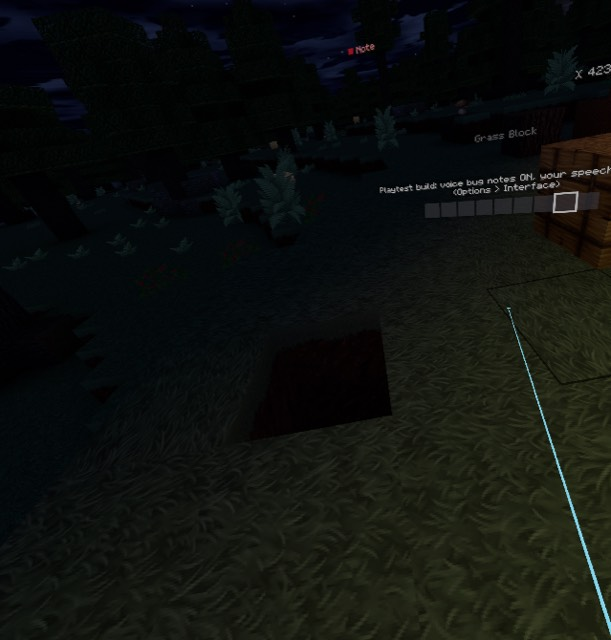

## 15:33:04 - Yeah, I don't want these blocky characters. You know, look a little mo

- **Transcript:** Yeah, I don't want these blocky characters. You know, look a little more realistic
- **Status:** open
- **Build:** 0.129 (77871062, M1-M4 (device-tested; ship riding, chests, comfort options, weapon wheel))
- **World:** Quest World (seed 2943808052895834412)
- **Dimension:** Surface
- **Biome:** Taiga
- **Position:** 421.4 76.0 -3804.0
- **Facing:** south-east (yaw 129, pitch -22)
- **Held:** empty hand
- **Mount:** on foot
- **Looking at:** Dirt Path at 424 75 -3802
- **Mode:** Creative, health 20/20
- **Time:** day 5 23:21, clear
- **Fps:** 63
- **Levels:** mic -26 dBFS, game sound -34 dBFS
- **Length:** 4.7 s (voice 2.8 s)
- **Just before:** -15s opened PauseMenu; -12s closed PauseMenu; -12s message: Playtest build: voice bug notes ON, your speech is saved (Options > Interface); -11s opened ChestMenu; -11s closed ChestMenu; -8s message: Rosalie Yardley: Mind the dark out there.; -5s message: 72 Hz to keep the frame rate (VR Comfort & Controls); -4s opened ChestMenu; -4s closed ChestMenu
- **Repro (Mac):** `./snap.sh note --seed 2943808052895834412 --x 421.4 --z -3804.0 --yaw -129 --pitch -22 --time 0.723`
- **Audio (this Mac):** /Users/darthvadar/Documents/Blocksmith/QuestVoiceNotes/raw/vn-20261017-153304-359.aac

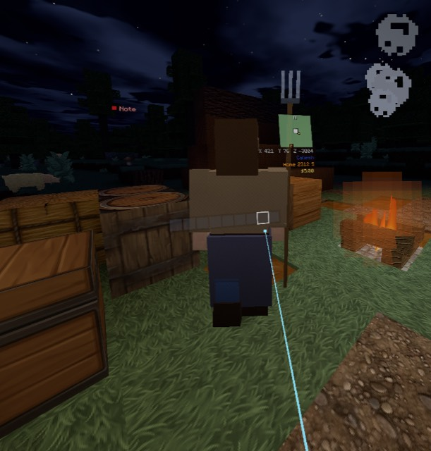

## 15:33:08 - This chick right here. Yeah, we gotta make that look a little better

- **Transcript:** This chick right here. Yeah, we gotta make that look a little better
- **Status:** open
- **Build:** 0.129 (77871062, M1-M4 (device-tested; ship riding, chests, comfort options, weapon wheel))
- **World:** Quest World (seed 2943808052895834412)
- **Dimension:** Surface
- **Biome:** Taiga
- **Position:** 424.2 76.0 -3802.5
- **Facing:** east (yaw 101, pitch -5)
- **Held:** empty hand
- **Mount:** on foot
- **Looking at:** nothing
- **Mode:** Creative, health 20/20
- **Time:** day 5 23:26, clear
- **Fps:** 62
- **Levels:** mic -40 dBFS, game sound -30 dBFS
- **Length:** 4.6 s (voice 2.5 s)
- **Just before:** -19s opened PauseMenu; -16s closed PauseMenu; -16s message: Playtest build: voice bug notes ON, your speech is saved (Options > Interface); -15s opened ChestMenu; -15s closed ChestMenu; -12s message: Rosalie Yardley: Mind the dark out there.; -9s message: 72 Hz to keep the frame rate (VR Comfort & Controls); -8s opened ChestMenu; -8s closed ChestMenu
- **Repro (Mac):** `./snap.sh note --seed 2943808052895834412 --x 424.2 --z -3802.5 --yaw -101 --pitch -5 --time 0.727`
- **Audio (this Mac):** /Users/darthvadar/Documents/Blocksmith/QuestVoiceNotes/raw/vn-20261017-153308-899.aac

## 15:34:02 - Swimming sound sounds repetitive

- **Transcript:** Swimming sound sounds repetitive
- **Status:** open
- **Build:** 0.129 (77871062, M1-M4 (device-tested; ship riding, chests, comfort options, weapon wheel))
- **World:** Quest World (seed 2943808052895834412)
- **Dimension:** Surface
- **Biome:** Beach
- **Position:** 30.9 63.0 -3662.8
- **Facing:** west (yaw 262, pitch -24)
- **Held:** empty hand
- **Mount:** on foot
- **Looking at:** Sand at 27 62 -3663
- **Mode:** Creative, health 20/20
- **Time:** day 5 00:23, clear
- **Fps:** 59
- **Levels:** mic -28 dBFS, game sound -27 dBFS
- **Length:** 2.9 s (voice 1.3 s)
- **Just before:** -19s message: Flying; -15s message: Walking; -12s walked into Beach; -4s walked into Cold Ocean; -4s message: Render distance 15 for now, to keep the frame rate; -2s walked into Beach
- **Repro (Mac):** `./snap.sh note --seed 2943808052895834412 --x 30.9 --z -3662.8 --yaw 98 --pitch -24 --time 0.766`
- **Audio (this Mac):** /Users/darthvadar/Documents/Blocksmith/QuestVoiceNotes/raw/vn-20261017-153402-959.aac

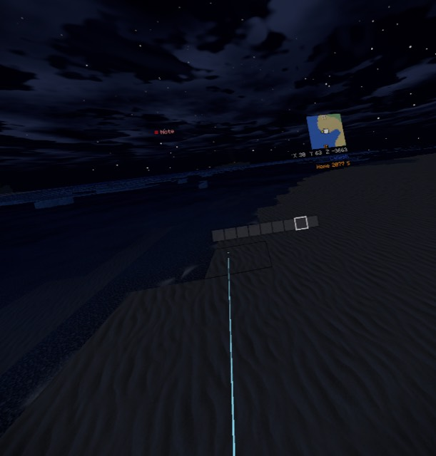

## 15:34:41 - The, um, hmm, desert temple layout is too similar to Minecraft's possi

- **Transcript:** The, um, hmm, desert temple layout is too similar to Minecraft's possibly
- **Status:** open
- **Build:** 0.129 (77871062, M1-M4 (device-tested; ship riding, chests, comfort options, weapon wheel))
- **World:** Quest World (seed 2943808052895834412)
- **Dimension:** Surface
- **Biome:** Desert
- **Position:** 297.0 75.0 -5144.8
- **Facing:** south-east (yaw 118, pitch -73)
- **Held:** empty hand
- **Mount:** on foot
- **Looking at:** Sandstone at 298 73 -5145
- **Mode:** Creative, health 20/20
- **Time:** day 5 01:09, clear
- **Fps:** 72
- **Levels:** mic -30 dBFS, game sound -33 dBFS
- **Length:** 6.7 s (voice 3.8 s)
- **Just before:** -26s walked into Lukewarm Ocean; -22s walked into Desert; -13s message: Walking; -10s message: Flying; -9s message: Walking; -7s message: Flying; -6s message: Walking
- **Position at the end:** 297.7 70.1 -5143.3
- **Repro (Mac):** `./snap.sh note --seed 2943808052895834412 --x 297.0 --z -5144.8 --yaw -118 --pitch -73 --time 0.798`
- **Audio (this Mac):** /Users/darthvadar/Documents/Blocksmith/QuestVoiceNotes/raw/vn-20261017-153441-399.aac

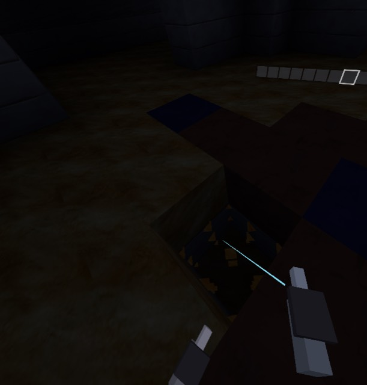

## 15:34:56 - Also, there's no spiders anymore, I don't think, so we probably should

- **Transcript:** Also, there's no spiders anymore, I don't think, so we probably should get rid of those
- **Status:** open
- **Build:** 0.129 (77871062, M1-M4 (device-tested; ship riding, chests, comfort options, weapon wheel))
- **World:** Quest World (seed 2943808052895834412)
- **Dimension:** Surface
- **Biome:** Desert
- **Position:** 298.5 62.0 -5143.4
- **Facing:** south (yaw 161, pitch -21)
- **Held:** empty hand
- **Mount:** on foot
- **Looking at:** Sandstone at 300 62 -5141
- **Mode:** Creative, health 20/20
- **Time:** day 5 01:27, clear
- **Fps:** 72
- **Levels:** mic -34 dBFS, game sound -32 dBFS
- **Length:** 5.5 s (voice 3.3 s)
- **Just before:** -28s message: Walking; -25s message: Flying; -24s message: Walking; -22s message: Flying; -21s message: Walking; -7s opened ChestMenu; -3s closed ChestMenu; -1s opened ChestMenu; -0s closed ChestMenu
- **While talking:** -4s opened ChestMenu; -1s closed ChestMenu
- **Position at the end:** 296.2 62.0 -5141.7
- **Repro (Mac):** `./snap.sh note --seed 2943808052895834412 --x 298.5 --z -5143.4 --yaw -161 --pitch -21 --time 0.811`
- **Audio (this Mac):** /Users/darthvadar/Documents/Blocksmith/QuestVoiceNotes/raw/vn-20261017-153456-339.aac

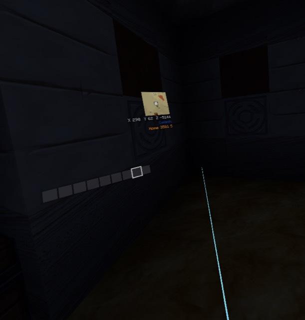

## 15:36:31 - Sounds for hitting stone are wrong

- **Transcript:** Sounds for hitting stone are wrong
- **Status:** open
- **Build:** 0.129 (77871062, M1-M4 (device-tested; ship riding, chests, comfort options, weapon wheel))
- **World:** New World (11) (seed 13480747113613945685)
- **Dimension:** Surface
- **Biome:** Savanna
- **Position:** 4003.3 -47.4 3715.6
- **Facing:** west (yaw 270, pitch 34)
- **Held:** Iron Pickaxe x1
- **Mount:** on foot
- **Looking at:** Deeprock at 4002 -45 3715
- **Mode:** Survival, health 19/20
- **Time:** day 2 16:26, clear
- **Fps:** 72
- **Levels:** mic -31 dBFS, game sound -19 dBFS
- **Length:** 3.0 s (voice 1.6 s)
- **Just before:** --73s opened ChestMenu; --74s closed ChestMenu; --75s opened ChestMenu; --77s closed ChestMenu; --78s message: Flying; --86s walked into Savanna; --90s message: Walking; --90s walked into Forest; --92s message: Flying; --94s message: Walking; --96s message: Flying; --98s opened PauseMenu; --99s message: Render distance back to 16; -29s closed InventoryMenu; -28s holding Cooked Mutton; -28s message: Cooked Mutton; -28s message: You're full; -10s holding Melon Slice; -10s message: Melon Slice; -10s holding Stone Sword; -10s message: Stone Sword; -9s holding Stone Axe; -9s message: Stone Axe; -9s holding Iron Pickaxe; -9s message: Iron Pickaxe; -9s took 1 damage (health 19/20)
- **Repro (Mac):** `./snap.sh note --seed 13480747113613945685 --x 4003.3 --z 3715.6 --yaw 90 --pitch 34 --time 0.435`
- **Audio (this Mac):** /Users/darthvadar/Documents/Blocksmith/QuestVoiceNotes/raw/vn-20261017-153631-679.aac

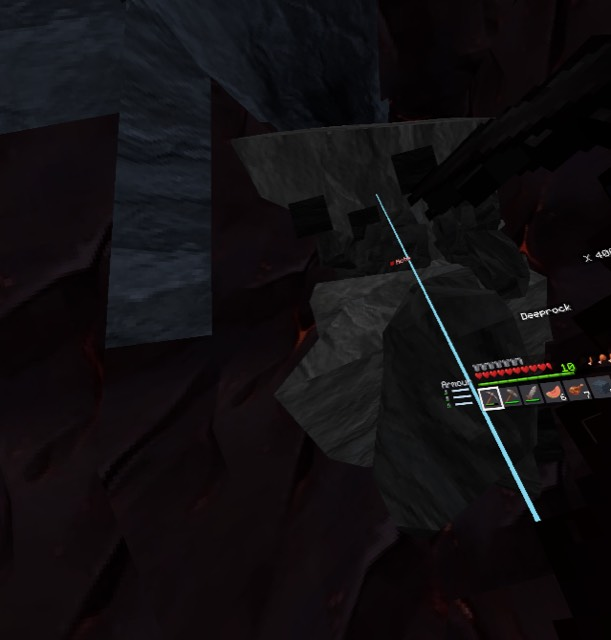

## 15:36:41 - There's actually two sounds playing right now. Both of them don't make

- **Transcript:** There's actually two sounds playing right now. Both of them don't make sense at all
- **Status:** open
- **Build:** 0.129 (77871062, M1-M4 (device-tested; ship riding, chests, comfort options, weapon wheel))
- **World:** New World (11) (seed 13480747113613945685)
- **Dimension:** Surface
- **Biome:** Savanna
- **Position:** 4001.3 -46.0 3715.3
- **Facing:** west (yaw 263, pitch 35)
- **Held:** Iron Pickaxe x1
- **Mount:** on foot
- **Looking at:** Deeprock at 3999 -43 3715
- **Mode:** Survival, health 19/20
- **Time:** day 2 16:38, clear
- **Fps:** 72
- **Levels:** mic -28 dBFS, game sound -20 dBFS
- **Length:** 4.7 s (voice 2.5 s)
- **Just before:** --63s opened ChestMenu; --64s closed ChestMenu; --65s opened ChestMenu; --67s closed ChestMenu; --68s message: Flying; --76s walked into Savanna; --80s message: Walking; --80s walked into Forest; --82s message: Flying; --84s message: Walking; --86s message: Flying; --87s opened PauseMenu; --89s message: Render distance back to 16; -20s holding Melon Slice; -20s message: Melon Slice; -20s holding Stone Sword; -20s message: Stone Sword; -19s holding Stone Axe; -19s message: Stone Axe; -19s holding Iron Pickaxe; -19s message: Iron Pickaxe; -19s took 1 damage (health 19/20)
- **Repro (Mac):** `./snap.sh note --seed 13480747113613945685 --x 4001.3 --z 3715.3 --yaw 97 --pitch 35 --time 0.444`
- **Audio (this Mac):** /Users/darthvadar/Documents/Blocksmith/QuestVoiceNotes/raw/vn-20261017-153641-699.aac

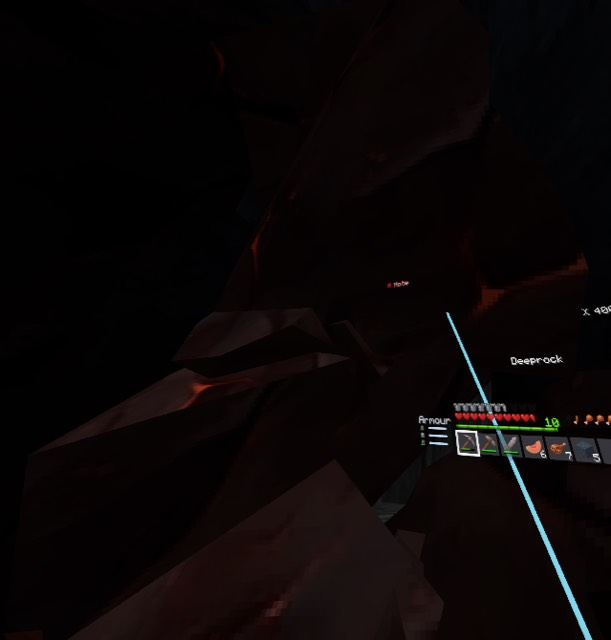

## 15:38:42 - Little water on the wall here. That's not right at all

- **Transcript:** Little water on the wall here. That's not right at all
- **Status:** open
- **Build:** 0.129 (77871062, M1-M4 (device-tested; ship riding, chests, comfort options, weapon wheel))
- **World:** New World (11) (seed 13480747113613945685)
- **Dimension:** Surface
- **Biome:** Savanna
- **Position:** 4131.7 -20.0 3668.2
- **Facing:** south-east (yaw 130, pitch 21)
- **Held:** Cobbled Deeprock x10
- **Mount:** on foot
- **Looking at:** nothing
- **Mode:** Survival, health 19/20
- **Time:** day 2 19:03, clear
- **Fps:** 72
- **Levels:** mic -38 dBFS, game sound -14 dBFS
- **Length:** 4.1 s (voice 2.3 s)
- **Just before:** -26s walked into Savanna
- **Repro (Mac):** `./snap.sh note --seed 13480747113613945685 --x 4131.7 --z 3668.2 --yaw -130 --pitch 21 --time 0.544`
- **Audio (this Mac):** /Users/darthvadar/Documents/Blocksmith/QuestVoiceNotes/raw/vn-20261017-153842-540.aac

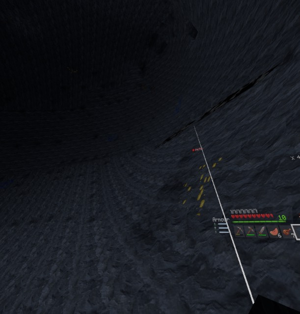

## 15:39:01 - I'm not convinced that the cave music is floating in yet

- **Transcript:** I'm not convinced that the cave music is floating in yet
- **Status:** open
- **Build:** 0.129 (77871062, M1-M4 (device-tested; ship riding, chests, comfort options, weapon wheel))
- **World:** New World (11) (seed 13480747113613945685)
- **Dimension:** Surface
- **Biome:** Savanna
- **Position:** 4153.5 -36.0 3597.9
- **Facing:** north-west (yaw 335, pitch -23)
- **Held:** Cobbled Deeprock x10
- **Mount:** on foot
- **Looking at:** Deeprock at 4151 -37 3593
- **Mode:** Survival, health 19/20
- **Time:** day 2 19:25, clear
- **Fps:** 72
- **Levels:** mic -30 dBFS, game sound -8 dBFS
- **Length:** 3.4 s (voice 1.4 s)
- **Repro (Mac):** `./snap.sh note --seed 13480747113613945685 --x 4153.5 --z 3597.9 --yaw 25 --pitch -23 --time 0.560`
- **Audio (this Mac):** /Users/darthvadar/Documents/Blocksmith/QuestVoiceNotes/raw/vn-20261017-153901-200.aac

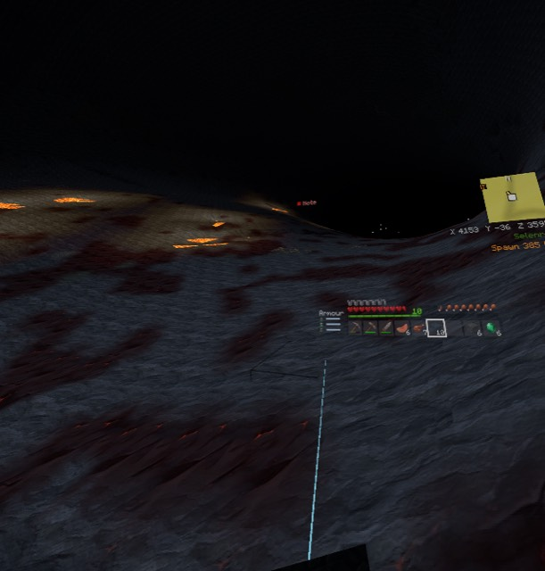

## 15:40:28 - So yeah, lava is really bad

- **Transcript:** So yeah, lava is really bad
- **Status:** open
- **Build:** 0.129 (77871062, M1-M4 (device-tested; ship riding, chests, comfort options, weapon wheel))
- **World:** New World (11) (seed 13480747113613945685)
- **Dimension:** Surface
- **Biome:** Savanna
- **Position:** 4128.0 -33.0 3504.9
- **Facing:** north (yaw 2, pitch -16)
- **Held:** Emberslate x10
- **Mount:** on foot
- **Looking at:** Emberslate at 4127 -33 3501
- **Mode:** Survival, health 18/20
- **Time:** day 2 21:10, clear
- **Fps:** 72
- **Levels:** mic -35 dBFS, game sound -17 dBFS
- **Length:** 3.0 s (voice 1.0 s)
- **Just before:** -11s holding Stone Axe; -11s message: Stone Axe; -11s holding Stone Sword; -11s message: Stone Sword; -11s holding Melon Slice; -11s message: Melon Slice; -11s holding Cooked Mutton; -11s message: Cooked Mutton; -10s holding Emberslate; -10s message: Emberslate
- **Repro (Mac):** `./snap.sh note --seed 13480747113613945685 --x 4128.0 --z 3504.9 --yaw -2 --pitch -16 --time 0.632`
- **Audio (this Mac):** /Users/darthvadar/Documents/Blocksmith/QuestVoiceNotes/raw/vn-20261017-154028-440.aac

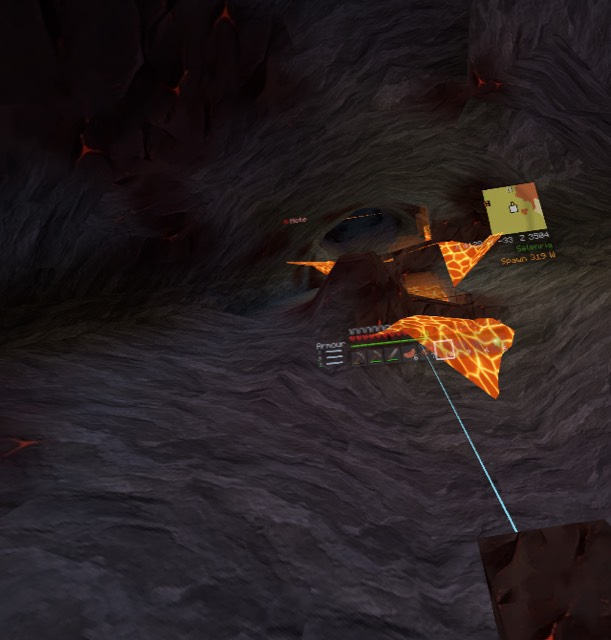

## 15:40:36 - After I kill a source block, it should be disappearing

- **Transcript:** After I kill a source block, it should be disappearing
- **Status:** open
- **Build:** 0.129 (77871062, M1-M4 (device-tested; ship riding, chests, comfort options, weapon wheel))
- **World:** New World (11) (seed 13480747113613945685)
- **Dimension:** Surface
- **Biome:** Savanna
- **Position:** 4126.8 -32.0 3502.4
- **Facing:** north (yaw 20, pitch 18)
- **Held:** Iron Pickaxe x1
- **Mount:** on foot
- **Looking at:** Deeprock at 4127 -30 3500
- **Mode:** Survival, health 18/20
- **Time:** day 2 21:19, clear
- **Fps:** 72
- **Levels:** mic -33 dBFS, game sound -16 dBFS
- **Length:** 3.4 s (voice 1.4 s)
- **Just before:** -19s holding Stone Axe; -19s message: Stone Axe; -19s holding Stone Sword; -19s message: Stone Sword; -19s holding Melon Slice; -19s message: Melon Slice; -19s holding Cooked Mutton; -19s message: Cooked Mutton; -18s holding Emberslate; -18s message: Emberslate; -2s holding Cooked Mutton; -2s message: Cooked Mutton; -1s holding Melon Slice; -1s message: Melon Slice; -1s holding Stone Sword; -1s message: Stone Sword; -1s holding Stone Axe; -1s message: Stone Axe; -1s holding Iron Pickaxe; -1s message: Iron Pickaxe
- **Repro (Mac):** `./snap.sh note --seed 13480747113613945685 --x 4126.8 --z 3502.4 --yaw -20 --pitch 18 --time 0.639`
- **Audio (this Mac):** /Users/darthvadar/Documents/Blocksmith/QuestVoiceNotes/raw/vn-20261017-154036-480.aac

## 15:40:40 - I don't really see what's happening, so I couldn't tell you if that's

- **Transcript:** I don't really see what's happening, so I couldn't tell you if that's
- **Status:** open
- **Build:** 0.129 (77871062, M1-M4 (device-tested; ship riding, chests, comfort options, weapon wheel))
- **World:** New World (11) (seed 13480747113613945685)
- **Dimension:** Surface
- **Biome:** Savanna
- **Position:** 4126.5 -32.0 3502.0
- **Facing:** north (yaw 21, pitch 15)
- **Held:** Iron Pickaxe x1
- **Mount:** on foot
- **Looking at:** Deeprock at 4126 -30 3501
- **Mode:** Survival, health 18/20
- **Time:** day 2 21:25, clear
- **Fps:** 72
- **Levels:** mic -35 dBFS, game sound -14 dBFS
- **Length:** 4.6 s (voice 1.8 s)
- **Just before:** -24s holding Stone Axe; -24s message: Stone Axe; -24s holding Stone Sword; -24s message: Stone Sword; -23s holding Melon Slice; -23s message: Melon Slice; -23s holding Cooked Mutton; -23s message: Cooked Mutton; -23s holding Emberslate; -23s message: Emberslate; -6s holding Cooked Mutton; -6s message: Cooked Mutton; -6s holding Melon Slice; -6s message: Melon Slice; -6s holding Stone Sword; -6s message: Stone Sword; -5s holding Stone Axe; -5s message: Stone Axe; -5s holding Iron Pickaxe; -5s message: Iron Pickaxe
- **Repro (Mac):** `./snap.sh note --seed 13480747113613945685 --x 4126.5 --z 3502.0 --yaw -21 --pitch 15 --time 0.642`
- **Audio (this Mac):** /Users/darthvadar/Documents/Blocksmith/QuestVoiceNotes/raw/vn-20261017-154040-860.aac

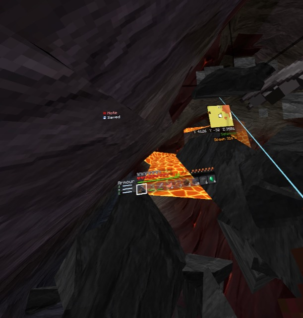

## 15:40:45 - Working or not?

- **Transcript:** Working or not?
- **Status:** open
- **Build:** 0.129 (77871062, M1-M4 (device-tested; ship riding, chests, comfort options, weapon wheel))
- **World:** New World (11) (seed 13480747113613945685)
- **Dimension:** Surface
- **Biome:** Savanna
- **Position:** 4126.7 -32.0 3501.7
- **Facing:** north-west (yaw 317, pitch 77)
- **Held:** Iron Pickaxe x1
- **Mount:** on foot
- **Looking at:** Deeprock at 4126 -29 3501
- **Mode:** Survival, health 18/20
- **Time:** day 2 21:30, clear
- **Fps:** 72
- **Levels:** mic -33 dBFS, game sound -18 dBFS
- **Length:** 1.6 s (voice 0.4 s)
- **Just before:** -28s holding Stone Axe; -28s message: Stone Axe; -28s holding Stone Sword; -28s message: Stone Sword; -28s holding Melon Slice; -28s message: Melon Slice; -27s holding Cooked Mutton; -27s message: Cooked Mutton; -27s holding Emberslate; -27s message: Emberslate; -11s holding Cooked Mutton; -11s message: Cooked Mutton; -10s holding Melon Slice; -10s message: Melon Slice; -10s holding Stone Sword; -10s message: Stone Sword; -10s holding Stone Axe; -10s message: Stone Axe; -10s holding Iron Pickaxe; -10s message: Iron Pickaxe
- **Repro (Mac):** `./snap.sh note --seed 13480747113613945685 --x 4126.7 --z 3501.7 --yaw 43 --pitch 77 --time 0.646`
- **Audio (this Mac):** /Users/darthvadar/Documents/Blocksmith/QuestVoiceNotes/raw/vn-20261017-154045-299.aac

## 15:41:47 - This better have been worth it

- **Transcript:** This better have been worth it
- **Status:** open
- **Build:** 0.129 (77871062, M1-M4 (device-tested; ship riding, chests, comfort options, weapon wheel))
- **World:** New World (11) (seed 13480747113613945685)
- **Dimension:** Surface
- **Biome:** Savanna
- **Position:** 4127.5 -24.0 3476.4
- **Facing:** north-east (yaw 35, pitch 1)
- **Held:** Iron Pickaxe x1
- **Mount:** on foot
- **Looking at:** Deeprock at 4129 -24 3474
- **Mode:** Survival, health 18/20
- **Time:** day 2 22:44, clear
- **Fps:** 72
- **Levels:** mic -30 dBFS, game sound -16 dBFS
- **Length:** 2.1 s (voice 0.6 s)
- **Just before:** -24s message: Melon Slice; -23s holding Cooked Mutton; -23s message: Cooked Mutton; -23s holding Emberslate; -23s message: Emberslate; -21s holding Cooked Mutton; -21s message: Cooked Mutton; -21s holding Melon Slice; -21s message: Melon Slice; -21s holding Stone Sword; -21s message: Stone Sword; -20s holding Stone Axe; -20s message: Stone Axe; -20s holding Iron Pickaxe; -20s message: Iron Pickaxe; -16s holding Stone Axe; -16s message: Stone Axe; -16s holding Stone Sword; -16s message: Stone Sword; -15s holding Melon Slice; -15s message: Melon Slice; -15s holding Cooked Mutton; -15s message: Cooked Mutton; -15s holding Emberslate; -15s message: Emberslate; -15s holding Cobbled Deeprock; -15s message: Cobbled Deeprock; -14s holding Emberslate; -14s message: Emberslate; -8s holding empty hand; -7s holding Cooked Mutton; -7s message: Cooked Mutton; -7s holding Melon Slice; -7s message: Melon Slice; -7s holding Stone Sword; -7s message: Stone Sword; -7s holding Stone Axe; -7s message: Stone Axe; -6s holding Iron Pickaxe; -6s message: Iron Pickaxe
- **Repro (Mac):** `./snap.sh note --seed 13480747113613945685 --x 4127.5 --z 3476.4 --yaw -35 --pitch 1 --time 0.698`
- **Audio (this Mac):** /Users/darthvadar/Documents/Blocksmith/QuestVoiceNotes/raw/vn-20261017-154147-320.aac

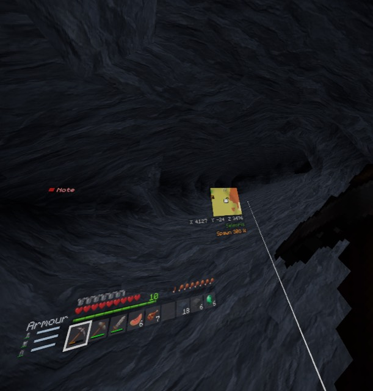

## 15:42:30 - White wool? Hmm, interesting

- **Transcript:** White wool? Hmm, interesting
- **Status:** open
- **Build:** 0.129 (77871062, M1-M4 (device-tested; ship riding, chests, comfort options, weapon wheel))
- **World:** New World (11) (seed 13480747113613945685)
- **Dimension:** Surface
- **Biome:** Wooded Badlands
- **Position:** 4175.7 -32.0 3463.8
- **Facing:** south-west (yaw 246, pitch -18)
- **Held:** Cobbled Deeprock x17
- **Mount:** on foot
- **Looking at:** nothing
- **Mode:** Survival, health 18/20, screen InventoryMenu
- **Time:** day 2 23:36, clear
- **Fps:** 72
- **Levels:** mic -31 dBFS, game sound -36 dBFS
- **Length:** 3.2 s (voice 0.9 s)
- **Just before:** -13s holding Emerald; -13s message: Emerald; -13s holding Deeprock; -13s message: Deeprock; -12s holding Cobbled Deeprock; -12s message: Cobbled Deeprock; -10s walked into Wooded Badlands; -2s opened InventoryMenu
- **Repro (Mac):** `./snap.sh note --seed 13480747113613945685 --x 4175.7 --z 3463.8 --yaw 114 --pitch -18 --time 0.734`
- **Audio (this Mac):** /Users/darthvadar/Documents/Blocksmith/QuestVoiceNotes/raw/vn-20261017-154230-460.aac

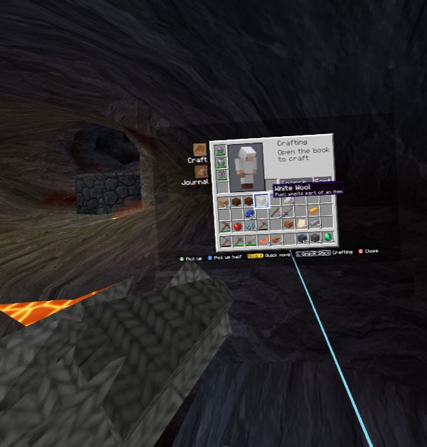

## 15:43:04 - Okay, the sound of receiving a block is wrong. Sounds really weird

- **Transcript:** Okay, the sound of receiving a block is wrong. Sounds really weird
- **Status:** open
- **Build:** 0.129 (77871062, M1-M4 (device-tested; ship riding, chests, comfort options, weapon wheel))
- **World:** New World (11) (seed 13480747113613945685)
- **Dimension:** Surface
- **Biome:** Desert
- **Position:** 4189.8 10.9 3506.1
- **Facing:** south (yaw 177, pitch -27)
- **Held:** Iron Pickaxe x1
- **Mount:** on foot
- **Looking at:** Stone at 4189 11 3508
- **Mode:** Survival, health 18/20
- **Time:** day 2 00:17, clear
- **Fps:** 72
- **Levels:** mic -30 dBFS, game sound -22 dBFS
- **Length:** 5.5 s (voice 2.5 s)
- **Just before:** -15s holding Deeprock; -15s message: Deeprock; -15s holding Emerald; -15s message: Emerald; -14s holding Iron Pickaxe; -14s message: Iron Pickaxe; -14s walked into Badlands; -12s walked into Desert
- **Repro (Mac):** `./snap.sh note --seed 13480747113613945685 --x 4189.8 --z 3506.1 --yaw -177 --pitch -27 --time 0.762`
- **Audio (this Mac):** /Users/darthvadar/Documents/Blocksmith/QuestVoiceNotes/raw/vn-20261017-154304-619.aac

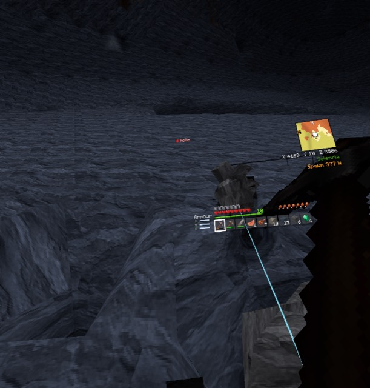

## 15:43:33 - Um, the sound of being full just to cringe, I guess

- **Transcript:** Um, the sound of being full just to cringe, I guess
- **Status:** open
- **Build:** 0.129 (77871062, M1-M4 (device-tested; ship riding, chests, comfort options, weapon wheel))
- **World:** New World (11) (seed 13480747113613945685)
- **Dimension:** Surface
- **Biome:** Wooded Badlands
- **Position:** 4177.7 -39.0 3435.3
- **Facing:** north-west (yaw 329, pitch -58)
- **Held:** Cooked Mutton x6
- **Mount:** on foot
- **Looking at:** Emberslate at 4177 -41 3434
- **Mode:** Survival, health 20/20
- **Time:** day 2 00:52, clear
- **Fps:** 72
- **Levels:** mic -31 dBFS, game sound -22 dBFS
- **Length:** 5.0 s (voice 2.1 s)
- **Just before:** -25s opened InventoryMenu; -22s closed InventoryMenu; -18s message: The sky is clouding over: fog is coming; -17s walked into Badlands; -15s walked into Wooded Badlands; -14s took 1 damage (health 17/20); -5s holding Stone Axe; -5s message: Stone Axe; -5s holding Stone Sword; -5s message: Stone Sword; -5s holding Melon Slice; -5s message: Melon Slice; -4s holding Cooked Mutton; -4s message: Cooked Mutton
- **Repro (Mac):** `./snap.sh note --seed 13480747113613945685 --x 4177.7 --z 3435.3 --yaw 31 --pitch -58 --time 0.786`
- **Audio (this Mac):** /Users/darthvadar/Documents/Blocksmith/QuestVoiceNotes/raw/vn-20261017-154333-460.aac

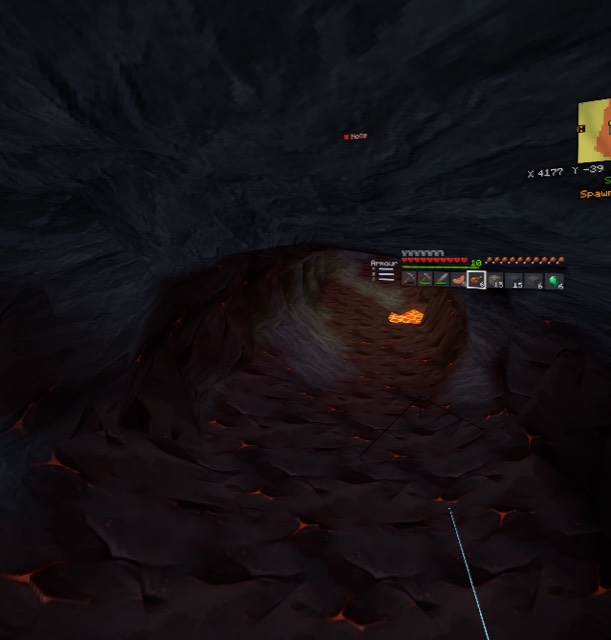

## 15:43:38 - Get rid of that

- **Transcript:** Get rid of that
- **Status:** open
- **Build:** 0.129 (77871062, M1-M4 (device-tested; ship riding, chests, comfort options, weapon wheel))
- **World:** New World (11) (seed 13480747113613945685)
- **Dimension:** Surface
- **Biome:** Wooded Badlands
- **Position:** 4172.6 -36.0 3412.5
- **Facing:** north-east (yaw 67, pitch -70)
- **Held:** Cooked Mutton x6
- **Mount:** on foot
- **Looking at:** Deeprock at 4173 -36 3412
- **Mode:** Survival, health 20/20
- **Time:** day 2 00:58, clear
- **Fps:** 72
- **Levels:** mic -37 dBFS, game sound -30 dBFS
- **Length:** 1.8 s (voice 0.5 s)
- **Just before:** -27s closed InventoryMenu; -23s message: The sky is clouding over: fog is coming; -22s walked into Badlands; -20s walked into Wooded Badlands; -19s took 1 damage (health 17/20); -10s holding Stone Axe; -10s message: Stone Axe; -10s holding Stone Sword; -10s message: Stone Sword; -10s holding Melon Slice; -10s message: Melon Slice; -9s holding Cooked Mutton; -9s message: Cooked Mutton
- **Repro (Mac):** `./snap.sh note --seed 13480747113613945685 --x 4172.6 --z 3412.5 --yaw -67 --pitch -70 --time 0.790`
- **Audio (this Mac):** /Users/darthvadar/Documents/Blocksmith/QuestVoiceNotes/raw/vn-20261017-154338-600.aac

## 15:47:06 - Where did my book, my first disappeared? Not sure where it went

- **Transcript:** Where did my book, my first disappeared? Not sure where it went
- **Status:** open
- **Build:** 0.129 (77871062, M1-M4 (device-tested; ship riding, chests, comfort options, weapon wheel))
- **World:** New World (11) (seed 13480747113613945685)
- **Dimension:** Surface
- **Biome:** Savanna
- **Position:** 4013.7 -54.4 3735.1
- **Facing:** south (yaw 176, pitch -50)
- **Held:** Iron Pickaxe x1
- **Mount:** on foot
- **Looking at:** Emberslate at 4013 -55 3735
- **Mode:** Survival, health 15/20
- **Time:** day 2 04:56, clear
- **Fps:** 72
- **Levels:** mic -30 dBFS, game sound -21 dBFS
- **Length:** 5.0 s (voice 2.0 s)
- **Just before:** -30s holding Emerald; -30s message: Emerald; -30s holding Iron Pickaxe; -30s message: Iron Pickaxe; -28s opened FurnaceMenu; -27s closed FurnaceMenu; -24s opened CraftingBookMenu; -23s closed CraftingBookMenu; -23s opened InventoryMenu; -19s closed InventoryMenu; -16s opened PauseMenu; -15s closed PauseMenu; -15s opened InventoryMenu; -13s closed InventoryMenu; -11s holding Stone Axe; -11s message: Stone Axe; -11s holding Iron Pickaxe; -11s message: Iron Pickaxe; -5s opened InventoryMenu; -3s closed InventoryMenu
- **Repro (Mac):** `./snap.sh note --seed 13480747113613945685 --x 4013.7 --z 3735.1 --yaw -176 --pitch -50 --time 0.956`
- **Audio (this Mac):** /Users/darthvadar/Documents/Blocksmith/QuestVoiceNotes/raw/vn-20261017-154706-300.aac

## 15:49:06 - For some reason, it's not letting me craft a furnace right now even th

- **Transcript:** For some reason, it's not letting me craft a furnace right now even though I have eight deep rock
- **Status:** open
- **Build:** 0.129 (77871062, M1-M4 (device-tested; ship riding, chests, comfort options, weapon wheel))
- **World:** New World (11) (seed 13480747113613945685)
- **Dimension:** Surface
- **Biome:** Savanna
- **Position:** 4014.7 -54.0 3736.7
- **Facing:** north-west (yaw 305, pitch -43)
- **Held:** Iron Pickaxe x1
- **Mount:** on foot
- **Looking at:** nothing
- **Mode:** Survival, health 20/20, screen CraftingBookMenu
- **Time:** day 3 07:16, clear
- **Fps:** 72
- **Levels:** mic -35 dBFS, game sound -23 dBFS
- **Length:** 5.5 s (voice 2.8 s)
- **Just before:** -29s message: The sky is clouding over: fog is coming; -11s closed CraftingBookMenu; -7s opened CraftingBookMenu; -5s closed CraftingBookMenu; -3s opened InventoryMenu; -2s closed InventoryMenu; -1s opened CraftingBookMenu
- **Repro (Mac):** `./snap.sh note --seed 13480747113613945685 --x 4014.7 --z 3736.7 --yaw 55 --pitch -43 --time 0.053`
- **Audio (this Mac):** /Users/darthvadar/Documents/Blocksmith/QuestVoiceNotes/raw/vn-20261017-154906-820.aac

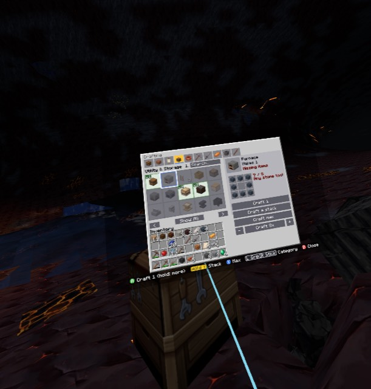

## 15:49:30 - What ingredient am I missing?

- **Transcript:** What ingredient am I missing?
- **Status:** open
- **Build:** 0.129 (77871062, M1-M4 (device-tested; ship riding, chests, comfort options, weapon wheel))
- **World:** New World (11) (seed 13480747113613945685)
- **Dimension:** Surface
- **Biome:** Savanna
- **Position:** 4015.6 -53.0 3735.8
- **Facing:** west (yaw 271, pitch -32)
- **Held:** Iron Pickaxe x1
- **Mount:** on foot
- **Looking at:** nothing
- **Mode:** Survival, health 20/20, screen CraftingBookMenu
- **Time:** day 3 07:45, clear
- **Fps:** 72
- **Levels:** mic -47 dBFS, game sound -28 dBFS
- **Length:** 2.8 s (voice 1.3 s)
- **Just before:** -29s closed CraftingBookMenu; -27s opened InventoryMenu; -26s closed InventoryMenu; -25s opened CraftingBookMenu; -21s closed CraftingBookMenu; -18s opened FurnaceMenu; -16s closed FurnaceMenu; -10s opened CraftingBookMenu
- **Repro (Mac):** `./snap.sh note --seed 13480747113613945685 --x 4015.6 --z 3735.8 --yaw 89 --pitch -32 --time 0.073`
- **Audio (this Mac):** /Users/darthvadar/Documents/Blocksmith/QuestVoiceNotes/raw/vn-20261017-154930-820.aac

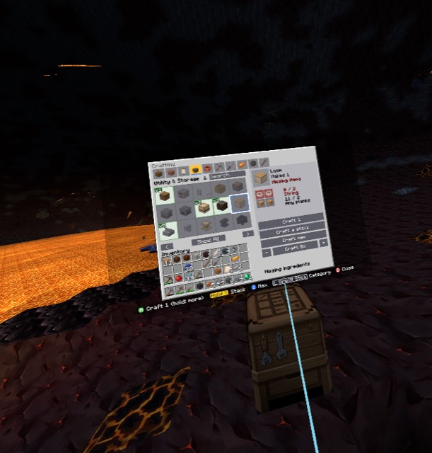

## 15:49:33 - Oh my God

- **Transcript:** Oh my God
- **Status:** open
- **Build:** 0.129 (77871062, M1-M4 (device-tested; ship riding, chests, comfort options, weapon wheel))
- **World:** New World (11) (seed 13480747113613945685)
- **Dimension:** Surface
- **Biome:** Savanna
- **Position:** 4015.6 -53.0 3735.8
- **Facing:** west (yaw 271, pitch -32)
- **Held:** Iron Pickaxe x1
- **Mount:** on foot
- **Looking at:** nothing
- **Mode:** Survival, health 20/20, screen CraftingBookMenu
- **Time:** day 3 07:49, clear
- **Fps:** 72
- **Levels:** mic -36 dBFS, game sound -29 dBFS
- **Length:** 2.0 s (voice 0.5 s)
- **Just before:** -30s opened InventoryMenu; -29s closed InventoryMenu; -28s opened CraftingBookMenu; -24s closed CraftingBookMenu; -21s opened FurnaceMenu; -19s closed FurnaceMenu; -13s opened CraftingBookMenu
- **Repro (Mac):** `./snap.sh note --seed 13480747113613945685 --x 4015.6 --z 3735.8 --yaw 89 --pitch -32 --time 0.076`
- **Audio (this Mac):** /Users/darthvadar/Documents/Blocksmith/QuestVoiceNotes/raw/vn-20261017-154933-759.aac

## 15:49:44 - Oh, okay. Sorry, it's not the kind of stone you want. Give me a minute

- **Transcript:** Oh, okay. Sorry, it's not the kind of stone you want. Give me a minute here
- **Status:** open
- **Build:** 0.129 (77871062, M1-M4 (device-tested; ship riding, chests, comfort options, weapon wheel))
- **World:** New World (11) (seed 13480747113613945685)
- **Dimension:** Surface
- **Biome:** Savanna
- **Position:** 4012.9 -54.0 3734.0
- **Facing:** north-west (yaw 307, pitch -37)
- **Held:** Stone x55
- **Mount:** on foot
- **Looking at:** Stone at 4011 -54 3733
- **Mode:** Survival, health 20/20
- **Time:** day 3 08:02, clear
- **Fps:** 72
- **Levels:** mic -41 dBFS, game sound -22 dBFS
- **Length:** 4.6 s (voice 2.4 s)
- **Just before:** -30s closed FurnaceMenu; -24s opened CraftingBookMenu; -3s closed CraftingBookMenu; -2s holding Stone Axe; -2s message: Stone Axe; -2s holding Stone Sword; -2s message: Stone Sword; -2s holding Basalt; -2s message: Basalt; -1s holding Cooked Mutton; -1s message: Cooked Mutton; -1s holding Stone; -1s message: Stone
- **Repro (Mac):** `./snap.sh note --seed 13480747113613945685 --x 4012.9 --z 3734.0 --yaw 53 --pitch -37 --time 0.085`
- **Audio (this Mac):** /Users/darthvadar/Documents/Blocksmith/QuestVoiceNotes/raw/vn-20261017-154944-820.aac

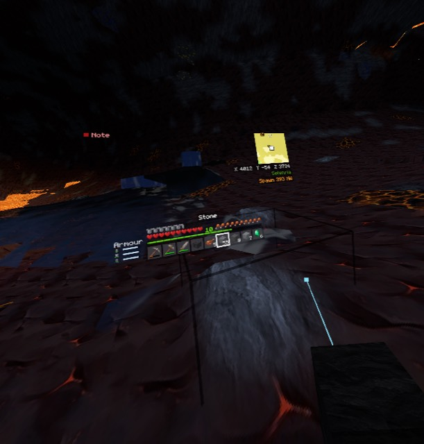

## 15:50:24 - I have a bucket in hand and I use the left trigger on a furnace. Don't

- **Transcript:** I have a bucket in hand and I use the left trigger on a furnace. Don't spill the bucket
- **Status:** open
- **Build:** 0.129 (77871062, M1-M4 (device-tested; ship riding, chests, comfort options, weapon wheel))
- **World:** New World (11) (seed 13480747113613945685)
- **Dimension:** Surface
- **Biome:** Savanna
- **Position:** 4012.6 -54.0 3738.9
- **Facing:** north (yaw 338, pitch -17)
- **Held:** Stone x43
- **Mount:** on foot
- **Looking at:** nothing
- **Mode:** Survival, health 20/20, screen FurnaceMenu
- **Time:** day 3 08:50, clear
- **Fps:** 72
- **Levels:** mic -57 dBFS, game sound -15 dBFS
- **Length:** 6.0 s (voice 3.3 s)
- **Just before:** -19s closed CraftingBookMenu; -19s opened InventoryMenu; -17s closed InventoryMenu; -17s holding Stone Axe; -17s message: Stone Axe; -17s holding Stone Sword; -17s message: Stone Sword; -17s holding Basalt; -17s message: Basalt; -17s holding Cooked Mutton; -17s message: Cooked Mutton; -16s holding Stone; -16s message: Stone; -16s holding Furnace; -16s message: Furnace; -16s opened CraftingBookMenu; -13s holding Blast Furnace; -13s closed CraftingBookMenu; -13s opened InventoryMenu; -11s closed InventoryMenu; -11s holding Smooth Stone; -11s message: Smooth Stone; -11s holding Blast Furnace; -11s message: Blast Furnace; -10s holding empty hand; -10s opened FurnaceMenu; -9s walked into Desert; -8s holding Bucket; -7s closed FurnaceMenu; -7s holding Smooth Stone; -7s message: Smooth Stone; -7s holding Bucket; -7s message: Bucket; -6s holding Lava Bucket; -5s walked into Savanna; -5s holding Bucket; -4s holding Lava Bucket; -3s holding Stone; -3s message: Stone; -2s opened FurnaceMenu
- **While talking:** -5s closed FurnaceMenu
- **Position at the end:** 4014.6 -54.0 3737.2
- **Repro (Mac):** `./snap.sh note --seed 13480747113613945685 --x 4012.6 --z 3738.9 --yaw 22 --pitch -17 --time 0.119`
- **Audio (this Mac):** /Users/darthvadar/Documents/Blocksmith/QuestVoiceNotes/raw/vn-20261017-155024-980.aac

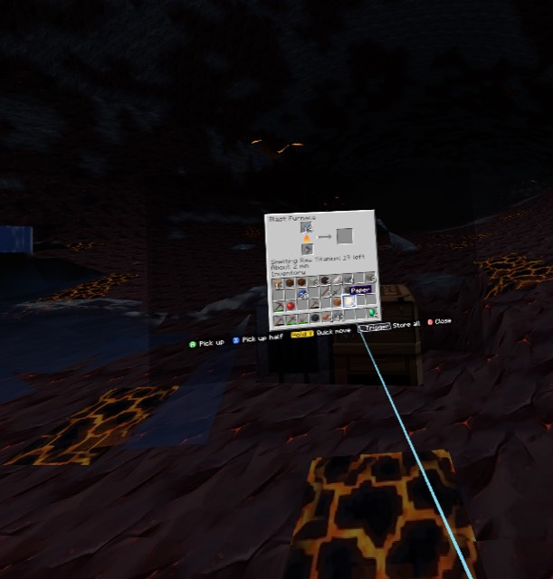

## 15:50:30 - Same, same can be said for any table.

- **Transcript:** Same, same can be said for any table.
- **Status:** open
- **Build:** 0.129 (77871062, M1-M4 (device-tested; ship riding, chests, comfort options, weapon wheel))
- **World:** New World (11) (seed 13480747113613945685)
- **Dimension:** Surface
- **Biome:** Savanna
- **Position:** 4014.6 -54.0 3737.2
- **Facing:** north-west (yaw 312, pitch -26)
- **Held:** Stone x43
- **Mount:** on foot
- **Looking at:** nothing
- **Mode:** Survival, health 20/20, screen CraftingBookMenu
- **Time:** day 3 08:57, clear
- **Fps:** 72
- **Levels:** mic -33 dBFS, game sound -12 dBFS
- **Length:** 2.9 s (voice 1.3 s)
- **Just before:** -23s closed InventoryMenu; -23s holding Stone Axe; -23s message: Stone Axe; -23s holding Stone Sword; -23s message: Stone Sword; -22s holding Basalt; -22s message: Basalt; -22s holding Cooked Mutton; -22s message: Cooked Mutton; -22s holding Stone; -22s message: Stone; -22s holding Furnace; -22s message: Furnace; -22s opened CraftingBookMenu; -19s holding Blast Furnace; -19s closed CraftingBookMenu; -18s opened InventoryMenu; -17s closed InventoryMenu; -17s holding Smooth Stone; -17s message: Smooth Stone; -17s holding Blast Furnace; -17s message: Blast Furnace; -16s holding empty hand; -16s opened FurnaceMenu; -15s walked into Desert; -13s holding Bucket; -13s closed FurnaceMenu; -13s holding Smooth Stone; -13s message: Smooth Stone; -12s holding Bucket; -12s message: Bucket; -12s holding Lava Bucket; -11s walked into Savanna; -10s holding Bucket; -10s holding Lava Bucket; -8s holding Stone; -8s message: Stone; -8s opened FurnaceMenu; -6s closed FurnaceMenu; -1s opened CraftingBookMenu
- **Repro (Mac):** `./snap.sh note --seed 13480747113613945685 --x 4014.6 --z 3737.2 --yaw 48 --pitch -26 --time 0.123`
- **Audio (this Mac):** /Users/darthvadar/Documents/Blocksmith/QuestVoiceNotes/raw/vn-20261017-155030-740.aac

## 15:53:42 - Should be a crouch indicator

- **Transcript:** Should be a crouch indicator
- **Status:** open
- **Build:** 0.129 (77871062, M1-M4 (device-tested; ship riding, chests, comfort options, weapon wheel))
- **World:** New World (11) (seed 13480747113613945685)
- **Dimension:** Surface
- **Biome:** Savanna
- **Position:** 4009.2 -37.0 3755.5
- **Facing:** north-east (yaw 45, pitch -75)
- **Held:** Iron Pickaxe x1
- **Mount:** on foot
- **Looking at:** Deeprock at 4009 -38 3755
- **Mode:** Survival, health 20/20
- **Time:** day 3 12:47, clear
- **Fps:** 72
- **Levels:** mic -29 dBFS, game sound -54 dBFS
- **Length:** 2.6 s (voice 1.0 s)
- **Just before:** -29s holding Stone Axe; -29s message: Stone Axe; -29s holding Stone Sword; -29s message: Stone Sword; -28s holding White Wool; -28s message: White Wool; -28s holding Cooked Mutton; -28s message: Cooked Mutton; -28s holding Magma Block; -28s message: Magma Block; -28s holding Deeprock; -28s message: Deeprock; -26s holding empty hand; -24s opened InventoryMenu; -23s holding Smooth Stone; -23s closed InventoryMenu; -20s holding Magma Block; -20s message: Magma Block; -20s holding Cooked Mutton; -20s message: Cooked Mutton; -20s holding White Wool; -20s message: White Wool; -19s holding Stone Sword; -19s message: Stone Sword; -19s holding Stone Axe; -19s message: Stone Axe; -19s holding Iron Pickaxe; -19s message: Iron Pickaxe
- **Repro (Mac):** `./snap.sh note --seed 13480747113613945685 --x 4009.2 --z 3755.5 --yaw -45 --pitch -75 --time 0.283`
- **Audio (this Mac):** /Users/darthvadar/Documents/Blocksmith/QuestVoiceNotes/raw/vn-20261017-155342-659.aac

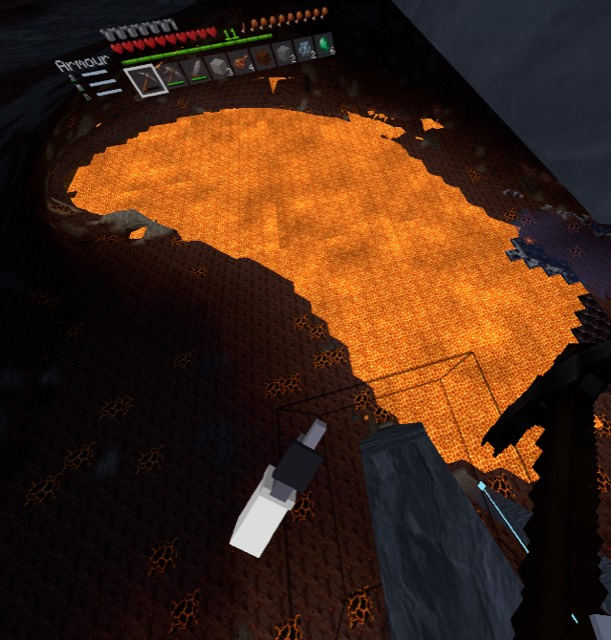

## 15:53:46 - I have no way of knowing when I'm crushed or not

- **Transcript:** I have no way of knowing when I'm crushed or not
- **Status:** open
- **Build:** 0.129 (77871062, M1-M4 (device-tested; ship riding, chests, comfort options, weapon wheel))
- **World:** New World (11) (seed 13480747113613945685)
- **Dimension:** Surface
- **Biome:** Savanna
- **Position:** 4009.5 -38.0 3755.5
- **Facing:** north-east (yaw 45, pitch -86)
- **Held:** Iron Pickaxe x1
- **Mount:** on foot
- **Looking at:** Deeprock at 4009 -39 3755
- **Mode:** Survival, health 20/20
- **Time:** day 3 12:52, clear
- **Fps:** 72
- **Levels:** mic -34 dBFS, game sound -17 dBFS
- **Length:** 2.8 s (voice 1.2 s)
- **Just before:** -28s opened InventoryMenu; -27s holding Smooth Stone; -27s closed InventoryMenu; -24s holding Magma Block; -24s message: Magma Block; -24s holding Cooked Mutton; -24s message: Cooked Mutton; -24s holding White Wool; -24s message: White Wool; -24s holding Stone Sword; -24s message: Stone Sword; -23s holding Stone Axe; -23s message: Stone Axe; -23s holding Iron Pickaxe; -23s message: Iron Pickaxe
- **Repro (Mac):** `./snap.sh note --seed 13480747113613945685 --x 4009.5 --z 3755.5 --yaw -45 --pitch -86 --time 0.287`
- **Audio (this Mac):** /Users/darthvadar/Documents/Blocksmith/QuestVoiceNotes/raw/vn-20261017-155346-780.aac

## 15:54:36 - I better be able to pick up his Blasphemous when it drops, I tell you

- **Transcript:** I better be able to pick up his Blasphemous when it drops, I tell you
- **Status:** open
- **Build:** 0.129 (77871062, M1-M4 (device-tested; ship riding, chests, comfort options, weapon wheel))
- **World:** New World (11) (seed 13480747113613945685)
- **Dimension:** Surface
- **Biome:** Desert
- **Position:** 4012.9 -54.0 3736.4
- **Facing:** west (yaw 269, pitch -57)
- **Held:** Iron Pickaxe x1
- **Mount:** on foot
- **Looking at:** Emberslate at 4011 -55 3736
- **Mode:** Survival, health 18/20
- **Time:** day 3 13:52, clear
- **Fps:** 72
- **Levels:** mic -42 dBFS, game sound -19 dBFS
- **Length:** 4.5 s (voice 2.4 s)
- **Just before:** -30s took 1 damage (health 19/20); -29s took 1 damage (health 18/20); -28s opened CraftingBookMenu; -27s closed CraftingBookMenu; -27s opened FurnaceMenu; -24s closed FurnaceMenu; -21s took 1 damage (health 19/20); -20s took 1 damage (health 18/20); -6s holding Stone Axe; -6s message: Stone Axe; -5s holding Stone Sword; -5s message: Stone Sword; -4s holding Stone Axe; -4s message: Stone Axe; -1s holding Iron Pickaxe; -1s message: Iron Pickaxe; -1s walked into Desert
- **Repro (Mac):** `./snap.sh note --seed 13480747113613945685 --x 4012.9 --z 3736.4 --yaw 91 --pitch -57 --time 0.328`
- **Audio (this Mac):** /Users/darthvadar/Documents/Blocksmith/QuestVoiceNotes/raw/vn-20261017-155436-240.aac

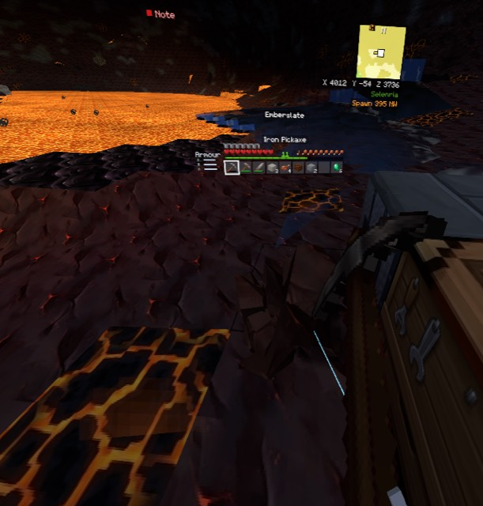

## 15:54:44 - It said let me pick up the blasters. Thank God

- **Transcript:** It said let me pick up the blasters. Thank God
- **Status:** open
- **Build:** 0.129 (77871062, M1-M4 (device-tested; ship riding, chests, comfort options, weapon wheel))
- **World:** New World (11) (seed 13480747113613945685)
- **Dimension:** Surface
- **Biome:** Desert
- **Position:** 4011.6 -54.1 3735.5
- **Facing:** north (yaw 348, pitch -16)
- **Held:** Iron Pickaxe x1
- **Mount:** on foot
- **Looking at:** Emberslate at 4010 -54 3731
- **Mode:** Survival, health 18/20
- **Time:** day 3 14:01, clear
- **Fps:** 72
- **Levels:** mic -45 dBFS, game sound -27 dBFS
- **Length:** 4.0 s (voice 1.5 s)
- **Just before:** -29s took 1 damage (health 19/20); -28s took 1 damage (health 18/20); -13s holding Stone Axe; -13s message: Stone Axe; -13s holding Stone Sword; -13s message: Stone Sword; -12s holding Stone Axe; -12s message: Stone Axe; -9s holding Iron Pickaxe; -9s message: Iron Pickaxe; -9s walked into Desert; -5s opened FurnaceMenu; -4s closed FurnaceMenu; -1s opened InventoryMenu; -0s closed InventoryMenu
- **Repro (Mac):** `./snap.sh note --seed 13480747113613945685 --x 4011.6 --z 3735.5 --yaw 12 --pitch -16 --time 0.334`
- **Audio (this Mac):** /Users/darthvadar/Documents/Blocksmith/QuestVoiceNotes/raw/vn-20261017-155444-140.aac

## 15:54:49 - And the crafting table, that's good

- **Transcript:** And the crafting table, that's good
- **Status:** open
- **Build:** 0.129 (77871062, M1-M4 (device-tested; ship riding, chests, comfort options, weapon wheel))
- **World:** New World (11) (seed 13480747113613945685)
- **Dimension:** Surface
- **Biome:** Desert
- **Position:** 4012.5 -54.0 3735.5
- **Facing:** north-west (yaw 328, pitch -40)
- **Held:** Stone Axe x1
- **Mount:** on foot
- **Looking at:** Stone at 4011 -54 3733
- **Mode:** Survival, health 17/20
- **Time:** day 3 14:08, clear
- **Fps:** 72
- **Levels:** mic -35 dBFS, game sound -22 dBFS
- **Length:** 3.7 s (voice 1.9 s)
- **Just before:** -19s holding Stone Axe; -19s message: Stone Axe; -19s holding Stone Sword; -19s message: Stone Sword; -17s holding Stone Axe; -17s message: Stone Axe; -15s holding Iron Pickaxe; -15s message: Iron Pickaxe; -14s walked into Desert; -10s opened FurnaceMenu; -10s closed FurnaceMenu; -7s opened InventoryMenu; -6s closed InventoryMenu; -4s holding Stone Axe; -4s message: Stone Axe; -4s took 1 damage (health 17/20); -1s opened InventoryMenu; -0s closed InventoryMenu
- **Repro (Mac):** `./snap.sh note --seed 13480747113613945685 --x 4012.5 --z 3735.5 --yaw 32 --pitch -40 --time 0.339`
- **Audio (this Mac):** /Users/darthvadar/Documents/Blocksmith/QuestVoiceNotes/raw/vn-20261017-155449-720.aac

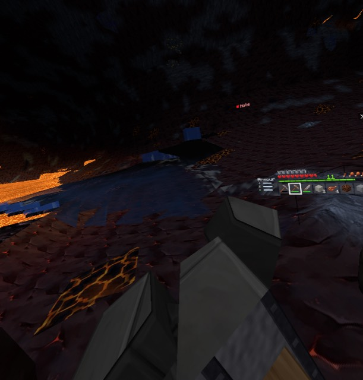

## 15:56:49 - Here's a good example of the problems with lava. You can see this

- **Transcript:** Here's a good example of the problems with lava. You can see this
- **Status:** open
- **Build:** 0.129 (77871062, M1-M4 (device-tested; ship riding, chests, comfort options, weapon wheel))
- **World:** New World (11) (seed 13480747113613945685)
- **Dimension:** Surface
- **Biome:** Savanna
- **Position:** 4126.6 -32.0 3502.5
- **Facing:** north (yaw 351, pitch -6)
- **Held:** Iron Pickaxe x1
- **Mount:** on foot
- **Looking at:** Deeprock at 4125 -31 3498
- **Mode:** Survival, health 14/20
- **Time:** day 3 16:32, clear
- **Fps:** 72
- **Levels:** mic -38 dBFS, game sound -10 dBFS
- **Length:** 4.3 s (voice 2.3 s)
- **Just before:** -16s opened InventoryMenu; -15s closed InventoryMenu
- **Repro (Mac):** `./snap.sh note --seed 13480747113613945685 --x 4126.6 --z 3502.5 --yaw 9 --pitch -6 --time 0.439`
- **Audio (this Mac):** /Users/darthvadar/Documents/Blocksmith/QuestVoiceNotes/raw/vn-20261017-155649-980.aac

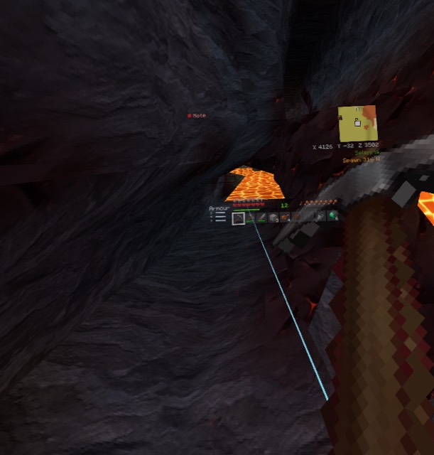

## 15:59:08 - I should be. So if you're gonna break a block, break it, but I pick up

- **Transcript:** I should be. So if you're gonna break a block, break it, but I pick up the pieces and then that counts as items inside my inventory
- **Status:** open
- **Build:** 0.129 (77871062, M1-M4 (device-tested; ship riding, chests, comfort options, weapon wheel))
- **World:** New World (11) (seed 13480747113613945685)
- **Dimension:** Surface
- **Biome:** Wooded Badlands
- **Position:** 4202.1 2.6 3485.7
- **Facing:** south (yaw 171, pitch 2)
- **Held:** Iron Pickaxe x1
- **Mount:** on foot
- **Looking at:** Stone at 4202 3 3487
- **Mode:** Survival, health 20/20
- **Time:** day 3 19:18, clear
- **Fps:** 72
- **Levels:** mic -28 dBFS, game sound -100 dBFS
- **Length:** 8.2 s (voice 4.9 s)
- **Just before:** -27s walked into Wooded Badlands
- **While talking:** -2s walked into Desert
- **Position at the end:** 4177.3 6.7 3500.3
- **Repro (Mac):** `./snap.sh note --seed 13480747113613945685 --x 4202.1 --z 3485.7 --yaw -171 --pitch 2 --time 0.554`
- **Audio (this Mac):** /Users/darthvadar/Documents/Blocksmith/QuestVoiceNotes/raw/vn-20261017-155908-319.aac

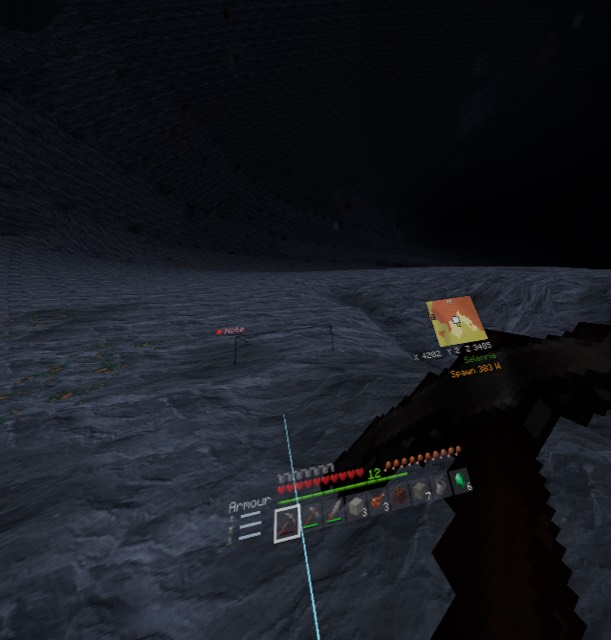

## 15:59:16 - That way they aren't all over the fucking place. I'm trying to pick sh

- **Transcript:** That way they aren't all over the fucking place. I'm trying to pick shit up
- **Status:** open
- **Build:** 0.129 (77871062, M1-M4 (device-tested; ship riding, chests, comfort options, weapon wheel))
- **World:** New World (11) (seed 13480747113613945685)
- **Dimension:** Surface
- **Biome:** Savanna
- **Position:** 4155.3 2.9 3505.5
- **Facing:** west (yaw 253, pitch -44)
- **Held:** Iron Pickaxe x1
- **Mount:** on foot
- **Looking at:** Stone at 4154 2 3506
- **Mode:** Survival, health 20/20
- **Time:** day 3 19:28, clear
- **Fps:** 72
- **Levels:** mic -31 dBFS, game sound -17 dBFS
- **Length:** 5.6 s (voice 2.8 s)
- **Just before:** -5s walked into Desert; -3s walked into Badlands; -1s walked into Savanna
- **Position at the end:** 4132.6 8.0 3481.7
- **Repro (Mac):** `./snap.sh note --seed 13480747113613945685 --x 4155.3 --z 3505.5 --yaw 107 --pitch -44 --time 0.561`
- **Audio (this Mac):** /Users/darthvadar/Documents/Blocksmith/QuestVoiceNotes/raw/vn-20261017-155916-559.aac

## 15:59:29 - I'm trying to see shit. I can't see under the blocks I break, so I don

- **Transcript:** I'm trying to see shit. I can't see under the blocks I break, so I don't know if there's any more
- **Status:** open
- **Build:** 0.129 (77871062, M1-M4 (device-tested; ship riding, chests, comfort options, weapon wheel))
- **World:** New World (11) (seed 13480747113613945685)
- **Dimension:** Surface
- **Biome:** Savanna
- **Position:** 4112.4 15.0 3473.5
- **Facing:** north-west (yaw 293, pitch -33)
- **Held:** Iron Pickaxe x1
- **Mount:** on foot
- **Looking at:** Stone at 4110 15 3473
- **Mode:** Survival, health 20/20
- **Time:** day 3 19:43, clear
- **Fps:** 72
- **Levels:** mic -37 dBFS, game sound -27 dBFS
- **Length:** 4.6 s (voice 2.8 s)
- **Just before:** -18s walked into Desert; -16s walked into Badlands; -14s walked into Savanna
- **Repro (Mac):** `./snap.sh note --seed 13480747113613945685 --x 4112.4 --z 3473.5 --yaw 67 --pitch -33 --time 0.572`
- **Audio (this Mac):** /Users/darthvadar/Documents/Blocksmith/QuestVoiceNotes/raw/vn-20261017-155929-619.aac

## 16:04:19 - Something's hogging up all the compute right now. Not sure what it is

- **Transcript:** Something's hogging up all the compute right now. Not sure what it is
- **Status:** open
- **Build:** 0.129 (77871062, M1-M4 (device-tested; ship riding, chests, comfort options, weapon wheel))
- **World:** New World (11) (seed 13480747113613945685)
- **Dimension:** Surface
- **Biome:** Savanna
- **Position:** 4009.1 108.0 3661.4
- **Facing:** south-east (yaw 155, pitch -68)
- **Held:** Stone Sword x1
- **Mount:** on foot
- **Looking at:** Grass Block at 4009 107 3661
- **Mode:** Survival, health 20/20
- **Time:** day 3 01:13, clear
- **Fps:** 52
- **Levels:** mic -40 dBFS, game sound -23 dBFS
- **Length:** 4.4 s (voice 2.2 s)
- **Just before:** -15s holding Magma Block; -15s message: Magma Block; -14s holding Cooked Mutton; -14s message: Cooked Mutton; -14s holding White Wool; -14s message: White Wool; -14s holding Stone Sword; -14s message: Stone Sword; -12s holding White Wool; -12s message: White Wool; -12s holding Cooked Mutton; -12s message: Cooked Mutton; -11s holding Magma Block; -11s message: Magma Block; -11s holding Cobblestone; -11s message: Cobblestone; -10s holding Magma Block; -10s message: Magma Block; -10s holding Cooked Mutton; -10s message: Cooked Mutton; -10s holding White Wool; -10s message: White Wool; -10s holding Stone Sword; -10s message: Stone Sword; -3s message: Render distance 14 for now, to keep the frame rate
- **Repro (Mac):** `./snap.sh note --seed 13480747113613945685 --x 4009.1 --z 3661.4 --yaw -155 --pitch -68 --time 0.801`
- **Audio (this Mac):** /Users/darthvadar/Documents/Blocksmith/QuestVoiceNotes/raw/vn-20261017-160419-999.aac

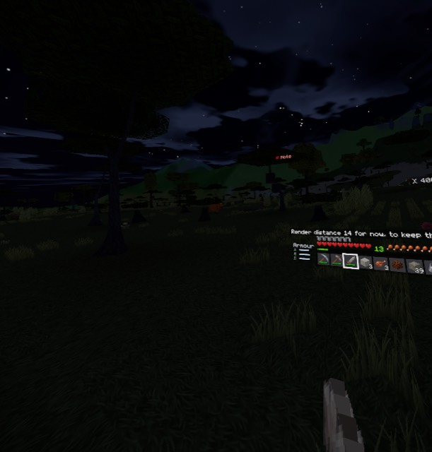

## 16:06:47 - I don't know what the structure is

- **Transcript:** I don't know what the structure is
- **Status:** open
- **Build:** 0.129 (77871062, M1-M4 (device-tested; ship riding, chests, comfort options, weapon wheel))
- **World:** New World (11) (seed 13480747113613945685)
- **Dimension:** Surface
- **Biome:** Savanna
- **Position:** 4209.7 106.8 3592.1
- **Facing:** west (yaw 268, pitch 4)
- **Held:** Written Book x1
- **Mount:** on foot
- **Looking at:** Spruce Planks at 4204 108 3592
- **Mode:** Survival, health 20/20
- **Time:** day 3 03:55, clear
- **Fps:** 56
- **Levels:** mic -31 dBFS, game sound -26 dBFS
- **Length:** 2.7 s (voice 1.1 s)
- **Just before:** -29s opened ChestMenu; -28s closed ChestMenu; -28s opened ChestMenu; -27s closed ChestMenu; -25s holding Magma Block; -25s message: Magma Block; -25s holding Cooked Mutton; -25s message: Cooked Mutton; -24s holding White Wool; -24s message: White Wool; -24s holding Intercepted Orders; -24s message: Intercepted Orders; -23s opened BookMenu; -23s holding Written Book; -23s message: Capital citadel (the enemy) marked on the map. Added to journal: Intercepted Orders; -20s message: Capital patrol routes lead to a Capital Citadel: 1,948 m S, right. Marked on your map.; -11s closed BookMenu
- **Repro (Mac):** `./snap.sh note --seed 13480747113613945685 --x 4209.7 --z 3592.1 --yaw 92 --pitch 4 --time 0.914`
- **Audio (this Mac):** /Users/darthvadar/Documents/Blocksmith/QuestVoiceNotes/raw/vn-20261017-160647-340.aac

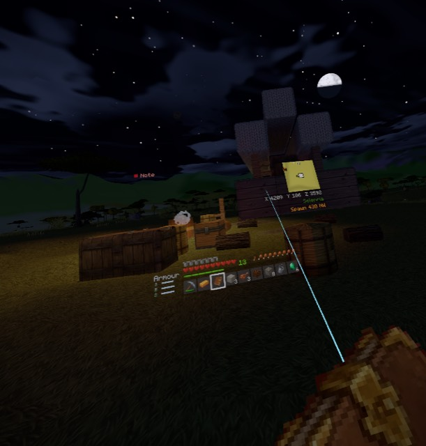

## 16:07:37 - Some sort of sound playing that's not sounding right

- **Transcript:** Some sort of sound playing that's not sounding right
- **Status:** open
- **Build:** 0.129 (77871062, M1-M4 (device-tested; ship riding, chests, comfort options, weapon wheel))
- **World:** New World (11) (seed 13480747113613945685)
- **Dimension:** Surface
- **Biome:** Savanna
- **Position:** 4201.4 107.0 3599.3
- **Facing:** south (yaw 182, pitch -50)
- **Held:** empty hand
- **Mount:** on foot
- **Looking at:** White Bed at 4201 107 3600
- **Mode:** Survival, health 20/20
- **Time:** day 4 06:41, clear
- **Fps:** 58
- **Levels:** mic -42 dBFS, game sound -18 dBFS
- **Length:** 4.5 s (voice 2.4 s)
- **Just before:** -29s holding White Bed; -29s closed CraftingBookMenu; -28s holding empty hand; -28s message: Respawn point set; -23s message: Good morning; -21s message: Quelmere has gone to war with Rhoevaal; -21s opened CraftingBookMenu; -19s message: Render distance 13 for now, to keep the frame rate; -16s closed CraftingBookMenu; -15s opened InventoryMenu; -14s holding Blast Furnace; -14s closed InventoryMenu; -6s holding empty hand; -6s opened FurnaceMenu; -3s closed FurnaceMenu
- **Repro (Mac):** `./snap.sh note --seed 13480747113613945685 --x 4201.4 --z 3599.3 --yaw 178 --pitch -50 --time 0.029`
- **Audio (this Mac):** /Users/darthvadar/Documents/Blocksmith/QuestVoiceNotes/raw/vn-20261017-160737-540.aac

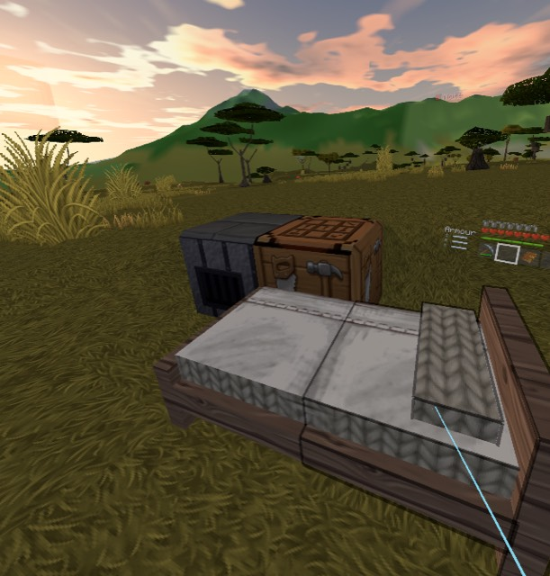

## 16:07:59 - Should be able to cook stuff on the campfire. Can't do it for some rea

- **Transcript:** Should be able to cook stuff on the campfire. Can't do it for some reason
- **Status:** open
- **Build:** 0.129 (77871062, M1-M4 (device-tested; ship riding, chests, comfort options, weapon wheel))
- **World:** New World (11) (seed 13480747113613945685)
- **Dimension:** Surface
- **Biome:** Savanna
- **Position:** 4201.0 107.0 3597.7
- **Facing:** north-west (yaw 332, pitch -45)
- **Held:** Raw Mutton x2
- **Mount:** on foot
- **Looking at:** Campfire at 4200 107 3596
- **Mode:** Survival, health 20/20
- **Time:** day 4 07:07, clear
- **Fps:** 71
- **Levels:** mic -24 dBFS, game sound -17 dBFS
- **Length:** 4.8 s (voice 2.5 s)
- **Just before:** -28s holding empty hand; -27s opened FurnaceMenu; -24s closed FurnaceMenu; -16s message: You rest by the fire. Your wounds mend.; -11s message: You've rested by the fire a while; -10s opened InventoryMenu; -9s holding Raw Mutton; -9s closed InventoryMenu
- **Repro (Mac):** `./snap.sh note --seed 13480747113613945685 --x 4201.0 --z 3597.7 --yaw 28 --pitch -45 --time 0.047`
- **Audio (this Mac):** /Users/darthvadar/Documents/Blocksmith/QuestVoiceNotes/raw/vn-20261017-160759-520.aac

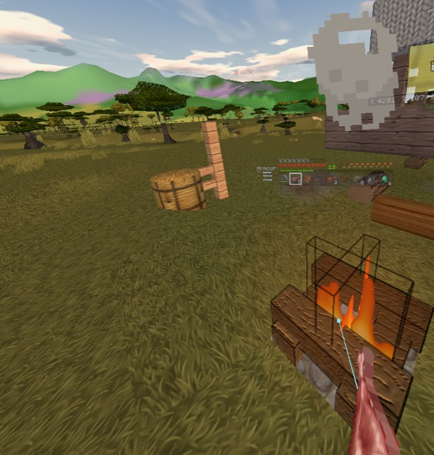

## 16:08:04 - Not sure why that is

- **Transcript:** Not sure why that is
- **Status:** open
- **Build:** 0.129 (77871062, M1-M4 (device-tested; ship riding, chests, comfort options, weapon wheel))
- **World:** New World (11) (seed 13480747113613945685)
- **Dimension:** Surface
- **Biome:** Savanna
- **Position:** 4205.7 107.0 3597.2
- **Facing:** north (yaw 339, pitch -24)
- **Held:** Raw Mutton x2
- **Mount:** on foot
- **Looking at:** Barrel at 4204 107 3595
- **Mode:** Survival, health 20/20
- **Time:** day 4 07:13, clear
- **Fps:** 64
- **Levels:** mic -35 dBFS, game sound -17 dBFS
- **Length:** 2.5 s (voice 1.1 s)
- **Just before:** -29s closed FurnaceMenu; -21s message: You rest by the fire. Your wounds mend.; -16s message: You've rested by the fire a while; -15s opened InventoryMenu; -14s holding Raw Mutton; -14s closed InventoryMenu; -1s opened ChestMenu; -1s closed ChestMenu
- **Repro (Mac):** `./snap.sh note --seed 13480747113613945685 --x 4205.7 --z 3597.2 --yaw 21 --pitch -24 --time 0.051`
- **Audio (this Mac):** /Users/darthvadar/Documents/Blocksmith/QuestVoiceNotes/raw/vn-20261017-160804-840.aac

## 16:09:04 - That's so weird

- **Transcript:** That's so weird
- **Status:** open
- **Build:** 0.129 (77871062, M1-M4 (device-tested; ship riding, chests, comfort options, weapon wheel))
- **World:** New World (11) (seed 13480747113613945685)
- **Dimension:** Surface
- **Biome:** Savanna
- **Position:** 4205.4 107.6 3603.1
- **Facing:** north-west (yaw 314, pitch -34)
- **Held:** Titanium Sword x1
- **Mount:** on foot
- **Looking at:** nothing
- **Mode:** Survival, health 20/20, screen FurnaceMenu
- **Time:** day 4 08:14, clear
- **Fps:** 60
- **Levels:** mic -32 dBFS, game sound -22 dBFS
- **Length:** 2.1 s (voice 0.6 s)
- **Just before:** -27s message: The sky is clouding over: fog is coming; -19s closed CraftingBookMenu; -19s opened InventoryMenu; -16s closed InventoryMenu; -16s holding Titanium Sword; -16s message: Titanium Sword; -15s opened InventoryMenu; -10s closed InventoryMenu; -9s opened FurnaceMenu
- **Repro (Mac):** `./snap.sh note --seed 13480747113613945685 --x 4205.4 --z 3603.1 --yaw 46 --pitch -34 --time 0.093`
- **Audio (this Mac):** /Users/darthvadar/Documents/Blocksmith/QuestVoiceNotes/raw/vn-20261017-160904-279.aac

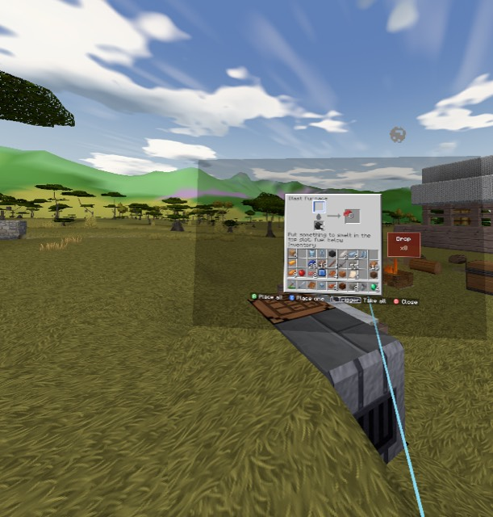

## 16:09:06 - Got a glitched thing of r-raw beef in my inventory. It won't go into t

- **Transcript:** Got a glitched thing of r-raw beef in my inventory. It won't go into the furnace. I had initially put it into the furnace, and somehow it made its way out of the furnace into my inventory
- **Status:** open
- **Build:** 0.129 (77871062, M1-M4 (device-tested; ship riding, chests, comfort options, weapon wheel))
- **World:** New World (11) (seed 13480747113613945685)
- **Dimension:** Surface
- **Biome:** Savanna
- **Position:** 4205.3 107.6 3603.8
- **Facing:** west (yaw 255, pitch -42)
- **Held:** Titanium Sword x1
- **Mount:** on foot
- **Looking at:** Grass Block at 4203 107 3604
- **Mode:** Survival, health 20/20
- **Time:** day 4 08:16, clear
- **Fps:** 60
- **Levels:** mic -28 dBFS, game sound -22 dBFS
- **Length:** 12.4 s (voice 7.8 s)
- **Just before:** -29s message: The sky is clouding over: fog is coming; -21s closed CraftingBookMenu; -21s opened InventoryMenu; -18s closed InventoryMenu; -18s holding Titanium Sword; -18s message: Titanium Sword; -16s opened InventoryMenu; -11s closed InventoryMenu; -10s opened FurnaceMenu; -0s closed FurnaceMenu
- **While talking:** -4s closed FurnaceMenu; -3s opened InventoryMenu; -1s closed InventoryMenu; -3s opened FurnaceMenu
- **Position at the end:** 4206.0 107.6 3602.1
- **Repro (Mac):** `./snap.sh note --seed 13480747113613945685 --x 4205.3 --z 3603.8 --yaw 105 --pitch -42 --time 0.095`
- **Audio (this Mac):** /Users/darthvadar/Documents/Blocksmith/QuestVoiceNotes/raw/vn-20261017-160906-140.aac

## 16:09:18 - I have no idea how

- **Transcript:** I have no idea how
- **Status:** open
- **Build:** 0.129 (77871062, M1-M4 (device-tested; ship riding, chests, comfort options, weapon wheel))
- **World:** New World (11) (seed 13480747113613945685)
- **Dimension:** Surface
- **Biome:** Savanna
- **Position:** 4202.1 108.4 3604.1
- **Facing:** west (yaw 260, pitch -19)
- **Held:** Titanium Sword x1
- **Mount:** on foot
- **Looking at:** nothing
- **Mode:** Survival, health 20/20
- **Time:** day 4 08:28, clear
- **Fps:** 57
- **Levels:** mic -33 dBFS, game sound -19 dBFS
- **Length:** 2.1 s (voice 1.0 s)
- **Just before:** -28s closed InventoryMenu; -28s holding Titanium Sword; -28s message: Titanium Sword; -26s opened InventoryMenu; -22s closed InventoryMenu; -20s opened FurnaceMenu; -10s closed FurnaceMenu; -9s opened InventoryMenu; -7s closed InventoryMenu; -5s opened FurnaceMenu; -1s closed FurnaceMenu
- **Repro (Mac):** `./snap.sh note --seed 13480747113613945685 --x 4202.1 --z 3604.1 --yaw 100 --pitch -19 --time 0.103`
- **Audio (this Mac):** /Users/darthvadar/Documents/Blocksmith/QuestVoiceNotes/raw/vn-20261017-160918-560.aac

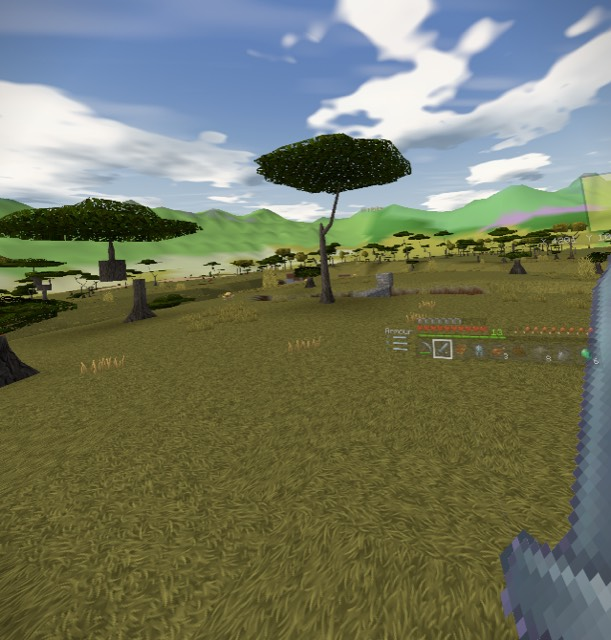

## 16:09:28 - Uh, I should be able to melt down iron armor back into iron ingots or 

- **Transcript:** Uh, I should be able to melt down iron armor back into iron ingots or ingots
- **Status:** open
- **Build:** 0.129 (77871062, M1-M4 (device-tested; ship riding, chests, comfort options, weapon wheel))
- **World:** New World (11) (seed 13480747113613945685)
- **Dimension:** Surface
- **Biome:** Savanna
- **Position:** 4197.3 107.9 3605.1
- **Facing:** south-west (yaw 233, pitch 9)
- **Held:** Titanium Sword x1
- **Mount:** on foot
- **Looking at:** nothing
- **Mode:** Survival, health 20/20
- **Time:** day 4 08:38, clear
- **Fps:** 63
- **Levels:** mic -25 dBFS, game sound -29 dBFS
- **Length:** 6.1 s (voice 3.6 s)
- **Just before:** -29s opened FurnaceMenu; -19s closed FurnaceMenu; -18s opened InventoryMenu; -16s closed InventoryMenu; -14s opened FurnaceMenu; -9s closed FurnaceMenu; -8s opened InventoryMenu; -2s message: Added to journal: Who Holds the Frontier; -0s closed InventoryMenu
- **While talking:** -4s closed InventoryMenu
- **Position at the end:** 4204.1 107.7 3604.2
- **Repro (Mac):** `./snap.sh note --seed 13480747113613945685 --x 4197.3 --z 3605.1 --yaw 127 --pitch 9 --time 0.110`
- **Audio (this Mac):** /Users/darthvadar/Documents/Blocksmith/QuestVoiceNotes/raw/vn-20261017-160928-680.aac

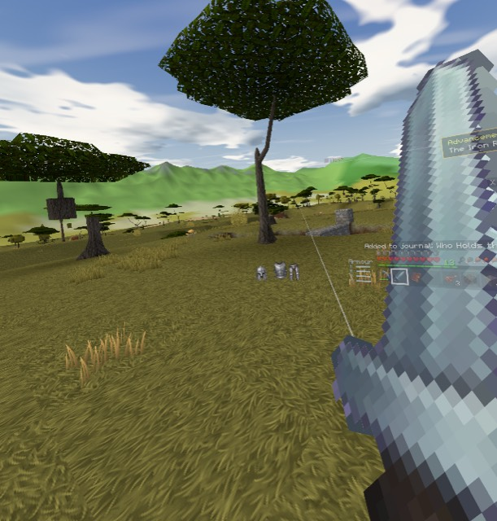

## 16:09:34 - Um, which

- **Transcript:** Um, which
- **Status:** open
- **Build:** 0.129 (77871062, M1-M4 (device-tested; ship riding, chests, comfort options, weapon wheel))
- **World:** New World (11) (seed 13480747113613945685)
- **Dimension:** Surface
- **Biome:** Savanna
- **Position:** 4205.6 107.6 3602.5
- **Facing:** north-west (yaw 297, pitch -35)
- **Held:** Titanium Sword x1
- **Mount:** on foot
- **Looking at:** nothing
- **Mode:** Survival, health 20/20, screen FurnaceMenu
- **Time:** day 4 08:45, clear
- **Fps:** 59
- **Levels:** mic -34 dBFS, game sound -36 dBFS
- **Length:** 2.5 s (voice 0.8 s)
- **Just before:** -24s closed FurnaceMenu; -23s opened InventoryMenu; -21s closed InventoryMenu; -19s opened FurnaceMenu; -15s closed FurnaceMenu; -13s opened InventoryMenu; -8s message: Added to journal: Who Holds the Frontier; -5s closed InventoryMenu; -0s opened FurnaceMenu
- **Repro (Mac):** `./snap.sh note --seed 13480747113613945685 --x 4205.6 --z 3602.5 --yaw 63 --pitch -35 --time 0.115`
- **Audio (this Mac):** /Users/darthvadar/Documents/Blocksmith/QuestVoiceNotes/raw/vn-20261017-160934-840.aac

## 16:09:37 - Not pebbles, but actual fucking ingots

- **Transcript:** Not pebbles, but actual fucking ingots
- **Status:** open
- **Build:** 0.129 (77871062, M1-M4 (device-tested; ship riding, chests, comfort options, weapon wheel))
- **World:** New World (11) (seed 13480747113613945685)
- **Dimension:** Surface
- **Biome:** Savanna
- **Position:** 4205.6 107.6 3602.5
- **Facing:** north-west (yaw 297, pitch -35)
- **Held:** Titanium Sword x1
- **Mount:** on foot
- **Looking at:** nothing
- **Mode:** Survival, health 20/20, screen FurnaceMenu
- **Time:** day 4 08:48, clear
- **Fps:** 65
- **Levels:** mic -26 dBFS, game sound -34 dBFS
- **Length:** 3.3 s (voice 1.6 s)
- **Just before:** -27s closed FurnaceMenu; -25s opened InventoryMenu; -23s closed InventoryMenu; -21s opened FurnaceMenu; -17s closed FurnaceMenu; -15s opened InventoryMenu; -10s message: Added to journal: Who Holds the Frontier; -8s closed InventoryMenu; -3s opened FurnaceMenu
- **Repro (Mac):** `./snap.sh note --seed 13480747113613945685 --x 4205.6 --z 3602.5 --yaw 63 --pitch -35 --time 0.117`
- **Audio (this Mac):** /Users/darthvadar/Documents/Blocksmith/QuestVoiceNotes/raw/vn-20261017-160937-579.aac

## 16:09:42 - Yeah, not, or yeah, not nuggets

- **Transcript:** Yeah, not, or yeah, not nuggets
- **Status:** open
- **Build:** 0.129 (77871062, M1-M4 (device-tested; ship riding, chests, comfort options, weapon wheel))
- **World:** New World (11) (seed 13480747113613945685)
- **Dimension:** Surface
- **Biome:** Savanna
- **Position:** 4204.9 107.7 3603.1
- **Facing:** north-west (yaw 294, pitch -11)
- **Held:** Titanium Sword x1
- **Mount:** on foot
- **Looking at:** nothing
- **Mode:** Survival, health 20/20
- **Time:** day 4 08:53, clear
- **Fps:** 64
- **Levels:** mic -36 dBFS, game sound -31 dBFS
- **Length:** 2.7 s (voice 1.1 s)
- **Just before:** -28s closed InventoryMenu; -26s opened FurnaceMenu; -22s closed FurnaceMenu; -20s opened InventoryMenu; -15s message: Added to journal: Who Holds the Frontier; -12s closed InventoryMenu; -7s opened FurnaceMenu; -0s closed FurnaceMenu
- **Repro (Mac):** `./snap.sh note --seed 13480747113613945685 --x 4204.9 --z 3603.1 --yaw 66 --pitch -11 --time 0.121`
- **Audio (this Mac):** /Users/darthvadar/Documents/Blocksmith/QuestVoiceNotes/raw/vn-20261017-160942-800.aac

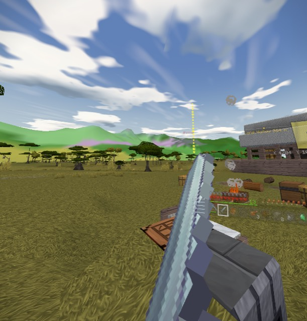

## 16:09:46 - Smoke shit looks ridiculous

- **Transcript:** Smoke shit looks ridiculous
- **Status:** open
- **Build:** 0.129 (77871062, M1-M4 (device-tested; ship riding, chests, comfort options, weapon wheel))
- **World:** New World (11) (seed 13480747113613945685)
- **Dimension:** Surface
- **Biome:** Savanna
- **Position:** 4190.6 107.0 3589.3
- **Facing:** north-west (yaw 311, pitch 11)
- **Held:** Titanium Sword x1
- **Mount:** on foot
- **Looking at:** nothing
- **Mode:** Survival, health 20/20
- **Time:** day 4 08:57, clear
- **Fps:** 64
- **Levels:** mic -22 dBFS, game sound -34 dBFS
- **Length:** 3.1 s (voice 1.4 s)
- **Just before:** -29s opened FurnaceMenu; -25s closed FurnaceMenu; -23s opened InventoryMenu; -17s message: Added to journal: Who Holds the Frontier; -15s closed InventoryMenu; -10s opened FurnaceMenu; -3s closed FurnaceMenu
- **Repro (Mac):** `./snap.sh note --seed 13480747113613945685 --x 4190.6 --z 3589.3 --yaw 49 --pitch 11 --time 0.123`
- **Audio (this Mac):** /Users/darthvadar/Documents/Blocksmith/QuestVoiceNotes/raw/vn-20261017-160946-020.aac

## 16:09:49 - That smoke, like holy smokes. That's, uh, that's not great. No. Why ye

- **Transcript:** That smoke, like holy smokes. That's, uh, that's not great. No. Why yellow? Why do you make the smoke yellow?
- **Status:** open
- **Build:** 0.129 (77871062, M1-M4 (device-tested; ship riding, chests, comfort options, weapon wheel))
- **World:** New World (11) (seed 13480747113613945685)
- **Dimension:** Surface
- **Biome:** Savanna
- **Position:** 4187.1 107.4 3579.4
- **Facing:** north-west (yaw 307, pitch 5)
- **Held:** Titanium Sword x1
- **Mount:** on foot
- **Looking at:** nothing
- **Mode:** Survival, health 20/20
- **Time:** day 4 09:00, clear
- **Fps:** 63
- **Levels:** mic -45 dBFS, game sound -65 dBFS
- **Length:** 8.4 s (voice 4.9 s)
- **Just before:** -27s closed FurnaceMenu; -26s opened InventoryMenu; -20s message: Added to journal: Who Holds the Frontier; -18s closed InventoryMenu; -13s opened FurnaceMenu; -6s closed FurnaceMenu
- **Position at the end:** 4193.9 107.0 3598.6
- **Repro (Mac):** `./snap.sh note --seed 13480747113613945685 --x 4187.1 --z 3579.4 --yaw 53 --pitch 5 --time 0.125`
- **Audio (this Mac):** /Users/darthvadar/Documents/Blocksmith/QuestVoiceNotes/raw/vn-20261017-160949-479.aac

## 16:10:01 - Should be a realistic looking smoke

- **Transcript:** Should be a realistic looking smoke
- **Status:** open
- **Build:** 0.129 (77871062, M1-M4 (device-tested; ship riding, chests, comfort options, weapon wheel))
- **World:** New World (11) (seed 13480747113613945685)
- **Dimension:** Surface
- **Biome:** Savanna
- **Position:** 4205.8 107.6 3602.6
- **Facing:** north-west (yaw 307, pitch -33)
- **Held:** Titanium Sword x1
- **Mount:** on foot
- **Looking at:** nothing
- **Mode:** Survival, health 20/20, screen FurnaceMenu
- **Time:** day 4 09:13, clear
- **Fps:** 69
- **Levels:** mic -39 dBFS, game sound -39 dBFS
- **Length:** 3.6 s (voice 1.6 s)
- **Just before:** -29s closed InventoryMenu; -24s opened FurnaceMenu; -17s closed FurnaceMenu; -3s opened FurnaceMenu
- **Repro (Mac):** `./snap.sh note --seed 13480747113613945685 --x 4205.8 --z 3602.6 --yaw 53 --pitch -33 --time 0.134`
- **Audio (this Mac):** /Users/darthvadar/Documents/Blocksmith/QuestVoiceNotes/raw/vn-20261017-161001-199.aac

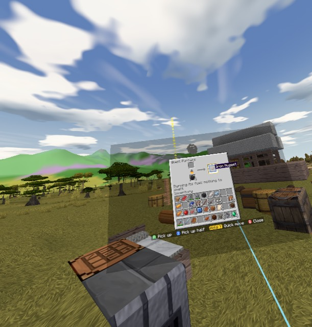

## 16:10:42 - Replace a block right here. Can't seem to be able to do it

- **Transcript:** Replace a block right here. Can't seem to be able to do it
- **Status:** open
- **Build:** 0.129 (77871062, M1-M4 (device-tested; ship riding, chests, comfort options, weapon wheel))
- **World:** New World (11) (seed 13480747113613945685)
- **Dimension:** Surface
- **Biome:** Savanna
- **Position:** 4168.6 104.9 3561.8
- **Facing:** west (yaw 253, pitch -76)
- **Held:** Cobblestone x63
- **Mount:** on foot
- **Looking at:** Grass Block at 4168 104 3561
- **Mode:** Survival, health 20/20
- **Time:** day 4 09:57, clear
- **Fps:** 69
- **Levels:** mic -40 dBFS, game sound -100 dBFS
- **Length:** 3.6 s (voice 1.9 s)
- **Just before:** -30s closed FurnaceMenu; -29s holding Raw Beef; -29s message: Raw Beef; -27s holding Titanium Sword; -27s message: Titanium Sword; -26s opened FurnaceMenu; -25s closed FurnaceMenu; -16s holding Raw Beef; -16s message: Raw Beef; -15s holding Iron Nugget; -15s message: Iron Nugget; -15s holding Cooked Mutton; -15s message: Cooked Mutton; -15s holding Magma Block; -15s message: Magma Block; -15s opened InventoryMenu; -13s closed InventoryMenu; -13s holding Cobblestone; -13s message: Cobblestone
- **Repro (Mac):** `./snap.sh note --seed 13480747113613945685 --x 4168.6 --z 3561.8 --yaw 107 --pitch -76 --time 0.165`
- **Audio (this Mac):** /Users/darthvadar/Documents/Blocksmith/QuestVoiceNotes/raw/vn-20261017-161042-819.aac

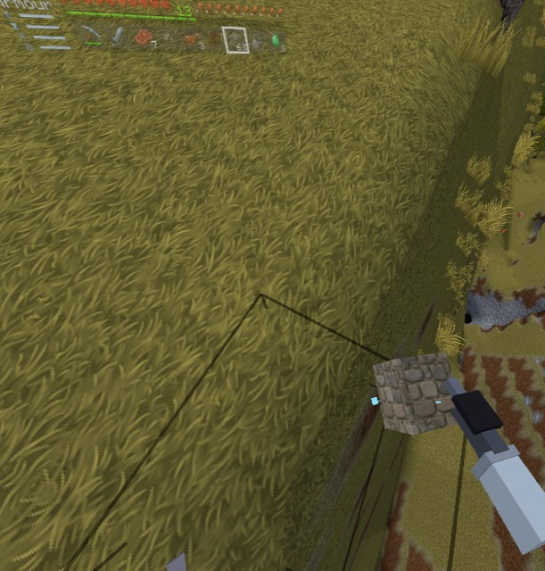

## 16:10:52 - Very good. Now

- **Transcript:** Very good. Now
- **Status:** open
- **Build:** 0.129 (77871062, M1-M4 (device-tested; ship riding, chests, comfort options, weapon wheel))
- **World:** New World (11) (seed 13480747113613945685)
- **Dimension:** Surface
- **Biome:** Savanna
- **Position:** 4162.7 103.0 3561.6
- **Facing:** south (yaw 200, pitch -81)
- **Held:** Cobblestone x57
- **Mount:** on foot
- **Looking at:** Cobblestone at 4162 102 3561
- **Mode:** Survival, health 20/20
- **Time:** day 4 10:09, clear
- **Fps:** 72
- **Levels:** mic -35 dBFS, game sound -42 dBFS
- **Length:** 2.1 s (voice 0.7 s)
- **Just before:** -25s holding Raw Beef; -25s message: Raw Beef; -25s holding Iron Nugget; -25s message: Iron Nugget; -25s holding Cooked Mutton; -25s message: Cooked Mutton; -25s holding Magma Block; -25s message: Magma Block; -24s opened InventoryMenu; -23s closed InventoryMenu; -22s holding Cobblestone; -22s message: Cobblestone
- **Repro (Mac):** `./snap.sh note --seed 13480747113613945685 --x 4162.7 --z 3561.6 --yaw 160 --pitch -81 --time 0.173`
- **Audio (this Mac):** /Users/darthvadar/Documents/Blocksmith/QuestVoiceNotes/raw/vn-20261017-161052-440.aac

## 16:12:34 - Yeah, this is just lazy. What is this? Holy shit

- **Transcript:** Yeah, this is just lazy. What is this? Holy shit
- **Status:** open
- **Build:** 0.129 (77871062, M1-M4 (device-tested; ship riding, chests, comfort options, weapon wheel))
- **World:** New World (11) (seed 13480747113613945685)
- **Dimension:** Surface
- **Biome:** Plains
- **Position:** 3957.0 107.0 3384.1
- **Facing:** north-west (yaw 319, pitch 3)
- **Held:** empty hand
- **Mount:** on foot
- **Looking at:** nothing
- **Mode:** Survival, health 19/20
- **Time:** day 4 11:57, clear
- **Fps:** 52
- **Levels:** mic -31 dBFS, game sound -18 dBFS
- **Length:** 4.9 s (voice 2.4 s)
- **Just before:** -29s message: The sky is clouding over: fog is coming; -22s holding empty hand; -21s opened InventoryMenu; -17s closed InventoryMenu; -15s took 4 damage (health 16/20); -12s walked into Plains; -7s message: Lone Hollow marked on the map; -2s message: Render distance 12 for now, to keep the frame rate
- **Repro (Mac):** `./snap.sh note --seed 13480747113613945685 --x 3957.0 --z 3384.1 --yaw 41 --pitch 3 --time 0.248`
- **Audio (this Mac):** /Users/darthvadar/Documents/Blocksmith/QuestVoiceNotes/raw/vn-20261017-161234-499.aac

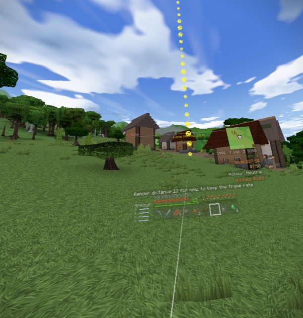

## 16:12:39 - Just figured, yeah, we put a bunch of yellow circles coming out of the

- **Transcript:** Just figured, yeah, we put a bunch of yellow circles coming out of the random ground. No, there's a fucking campfire? Make it smoke
- **Status:** open
- **Build:** 0.129 (77871062, M1-M4 (device-tested; ship riding, chests, comfort options, weapon wheel))
- **World:** New World (11) (seed 13480747113613945685)
- **Dimension:** Surface
- **Biome:** Plains
- **Position:** 3936.9 108.8 3361.8
- **Facing:** north-west (yaw 323, pitch 12)
- **Held:** empty hand
- **Mount:** on foot
- **Looking at:** nothing
- **Mode:** Survival, health 19/20
- **Time:** day 4 12:02, clear
- **Fps:** 60
- **Levels:** mic -31 dBFS, game sound -27 dBFS
- **Length:** 9.0 s (voice 5.2 s)
- **Just before:** -26s holding empty hand; -25s opened InventoryMenu; -21s closed InventoryMenu; -19s took 4 damage (health 16/20); -16s walked into Plains; -11s message: Lone Hollow marked on the map; -6s message: Render distance 12 for now, to keep the frame rate; -3s message: A stranger in town: Ezra Quill; -0s message: You've reached Lone Hollow
- **While talking:** -5s message: You've reached Lone Hollow; -3s message: Calvin Fenwick: This is your one warning.; -0s message: Wanted in Lone Hollow: $5.00
- **Position at the end:** 3924.1 111.4 3355.9
- **Repro (Mac):** `./snap.sh note --seed 13480747113613945685 --x 3936.9 --z 3361.8 --yaw 37 --pitch 12 --time 0.251`
- **Audio (this Mac):** /Users/darthvadar/Documents/Blocksmith/QuestVoiceNotes/raw/vn-20261017-161239-160.aac

## 16:13:00 - Where's the sheriff?

- **Transcript:** Where's the sheriff?
- **Status:** open
- **Build:** 0.129 (77871062, M1-M4 (device-tested; ship riding, chests, comfort options, weapon wheel))
- **World:** New World (11) (seed 13480747113613945685)
- **Dimension:** Surface
- **Biome:** Plains
- **Position:** 3933.3 108.6 3347.5
- **Facing:** north-west (yaw 302, pitch -4)
- **Held:** empty hand
- **Mount:** on foot
- **Looking at:** nothing
- **Mode:** Survival, health 19/20
- **Time:** day 4 12:24, clear
- **Fps:** 67
- **Levels:** mic -32 dBFS, game sound -16 dBFS
- **Length:** 2.1 s (voice 0.5 s)
- **Just before:** -30s message: Lone Hollow marked on the map; -25s message: Render distance 12 for now, to keep the frame rate; -22s message: A stranger in town: Ezra Quill; -19s message: You've reached Lone Hollow; -17s message: Calvin Fenwick: This is your one warning.; -15s message: Wanted in Lone Hollow: $5.00; -13s message: Render distance 11 for now, to keep the frame rate; -9s message: Isaiah Whitlock: Not while there's a price on your head. Square it with the sheriff.
- **Repro (Mac):** `./snap.sh note --seed 13480747113613945685 --x 3933.3 --z 3347.5 --yaw 58 --pitch -4 --time 0.267`
- **Audio (this Mac):** /Users/darthvadar/Documents/Blocksmith/QuestVoiceNotes/raw/vn-20261017-161300-800.aac

## 16:13:14 - Six stolen. [laughs] I should be able to sell stolen stuff. Come on

- **Transcript:** Six stolen. [laughs] I should be able to sell stolen stuff. Come on
- **Status:** open
- **Build:** 0.129 (77871062, M1-M4 (device-tested; ship riding, chests, comfort options, weapon wheel))
- **World:** New World (11) (seed 13480747113613945685)
- **Dimension:** Surface
- **Biome:** Plains
- **Position:** 3946.5 106.0 3346.3
- **Facing:** north (yaw 7, pitch -19)
- **Held:** empty hand
- **Mount:** on foot
- **Looking at:** nothing
- **Mode:** Survival, health 19/20, screen ShopMenu
- **Time:** day 4 12:39, clear
- **Fps:** 63
- **Levels:** mic -40 dBFS, game sound -27 dBFS
- **Length:** 4.9 s (voice 2.4 s)
- **Just before:** -30s message: Calvin Fenwick: This is your one warning.; -27s message: Wanted in Lone Hollow: $5.00; -25s message: Render distance 11 for now, to keep the frame rate; -21s message: Isaiah Whitlock: Not while there's a price on your head. Square it with the sheriff.; -10s message: Calvin Fenwick: That settles it. Keep your nose clean in Lone Hollow.; -7s message: Bounty of $5.00 paid to Calvin Fenwick; -5s message: Honour raised (you paid your bounty); -4s opened ShopMenu; -2s message: Isaiah Whitlock: You're covered in blood. Is any of it yours?
- **Repro (Mac):** `./snap.sh note --seed 13480747113613945685 --x 3946.5 --z 3346.3 --yaw -7 --pitch -19 --time 0.278`
- **Audio (this Mac):** /Users/darthvadar/Documents/Blocksmith/QuestVoiceNotes/raw/vn-20261017-161314-200.aac

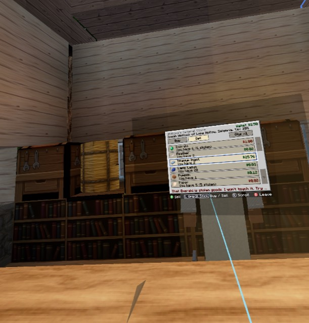

## 16:13:19 - Gee, titanium ingots could sell for a lot, huh, Frank?

- **Transcript:** Gee, titanium ingots could sell for a lot, huh, Frank?
- **Status:** open
- **Build:** 0.129 (77871062, M1-M4 (device-tested; ship riding, chests, comfort options, weapon wheel))
- **World:** New World (11) (seed 13480747113613945685)
- **Dimension:** Surface
- **Biome:** Plains
- **Position:** 3946.5 106.0 3346.3
- **Facing:** north (yaw 7, pitch -19)
- **Held:** empty hand
- **Mount:** on foot
- **Looking at:** nothing
- **Mode:** Survival, health 19/20, screen ShopMenu
- **Time:** day 4 12:44, clear
- **Fps:** 61
- **Levels:** mic -35 dBFS, game sound -100 dBFS
- **Length:** 4.0 s (voice 2.0 s)
- **Just before:** -29s message: Render distance 11 for now, to keep the frame rate; -26s message: Isaiah Whitlock: Not while there's a price on your head. Square it with the sheriff.; -14s message: Calvin Fenwick: That settles it. Keep your nose clean in Lone Hollow.; -11s message: Bounty of $5.00 paid to Calvin Fenwick; -9s message: Honour raised (you paid your bounty); -9s opened ShopMenu; -6s message: Isaiah Whitlock: You're covered in blood. Is any of it yours?
- **Repro (Mac):** `./snap.sh note --seed 13480747113613945685 --x 3946.5 --z 3346.3 --yaw -7 --pitch -19 --time 0.281`
- **Audio (this Mac):** /Users/darthvadar/Documents/Blocksmith/QuestVoiceNotes/raw/vn-20261017-161319-199.aac

## 16:13:29 - What are you guys jumping for? Guys

- **Transcript:** What are you guys jumping for? Guys
- **Status:** open
- **Build:** 0.129 (77871062, M1-M4 (device-tested; ship riding, chests, comfort options, weapon wheel))
- **World:** New World (11) (seed 13480747113613945685)
- **Dimension:** Surface
- **Biome:** Plains
- **Position:** 3946.3 106.0 3355.7
- **Facing:** south (yaw 179, pitch -17)
- **Held:** empty hand
- **Mount:** on foot
- **Looking at:** Crafting Table at 3946 106 3360
- **Mode:** Survival, health 19/20
- **Time:** day 4 12:55, clear
- **Fps:** 65
- **Levels:** mic -31 dBFS, game sound -28 dBFS
- **Length:** 3.7 s (voice 1.2 s)
- **Just before:** -23s message: Calvin Fenwick: That settles it. Keep your nose clean in Lone Hollow.; -20s message: Bounty of $5.00 paid to Calvin Fenwick; -18s message: Honour raised (you paid your bounty); -18s opened ShopMenu; -15s message: Isaiah Whitlock: You're covered in blood. Is any of it yours?; -4s closed ShopMenu; -4s message: Isaiah Whitlock: Come again!
- **Repro (Mac):** `./snap.sh note --seed 13480747113613945685 --x 3946.3 --z 3355.7 --yaw -179 --pitch -17 --time 0.289`
- **Audio (this Mac):** /Users/darthvadar/Documents/Blocksmith/QuestVoiceNotes/raw/vn-20261017-161329-000.aac

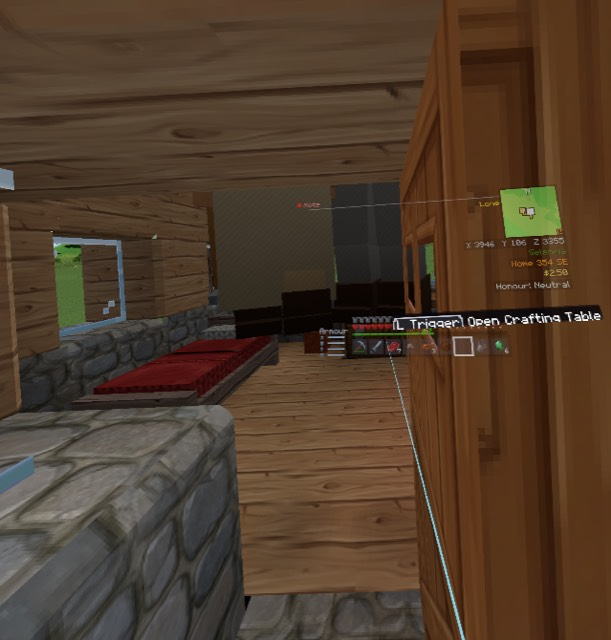

## 16:13:45 - So it's just the general store, that's it

- **Transcript:** So it's just the general store, that's it
- **Status:** open
- **Build:** 0.129 (77871062, M1-M4 (device-tested; ship riding, chests, comfort options, weapon wheel))
- **World:** New World (11) (seed 13480747113613945685)
- **Dimension:** Surface
- **Biome:** Plains
- **Position:** 3926.0 110.0 3350.5
- **Facing:** east (yaw 69, pitch -28)
- **Held:** empty hand
- **Mount:** on foot
- **Looking at:** Coarse Dirt at 3928 109 3349
- **Mode:** Survival, health 19/20
- **Time:** day 4 13:14, clear
- **Fps:** 69
- **Levels:** mic -38 dBFS, game sound -31 dBFS
- **Length:** 2.7 s (voice 1.0 s)
- **Just before:** -20s closed ShopMenu; -20s message: Isaiah Whitlock: Come again!
- **Repro (Mac):** `./snap.sh note --seed 13480747113613945685 --x 3926.0 --z 3350.5 --yaw -69 --pitch -28 --time 0.302`
- **Audio (this Mac):** /Users/darthvadar/Documents/Blocksmith/QuestVoiceNotes/raw/vn-20261017-161345-500.aac

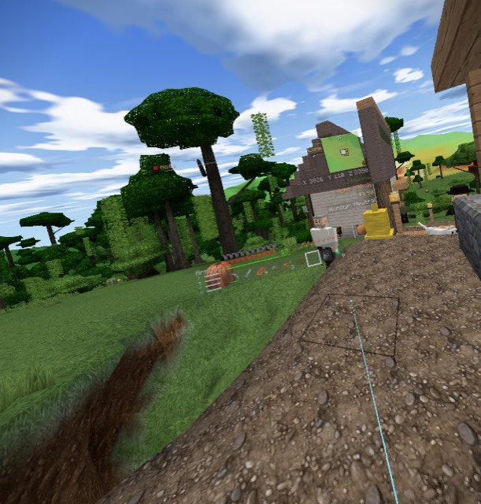

## 16:14:00 - Fuel can should look more like a fucking fuel can

- **Transcript:** Fuel can should look more like a fucking fuel can
- **Status:** open
- **Build:** 0.129 (77871062, M1-M4 (device-tested; ship riding, chests, comfort options, weapon wheel))
- **World:** New World (11) (seed 13480747113613945685)
- **Dimension:** Surface
- **Biome:** Plains
- **Position:** 3946.5 106.0 3346.4
- **Facing:** north-east (yaw 28, pitch -8)
- **Held:** empty hand
- **Mount:** on foot
- **Looking at:** nothing
- **Mode:** Survival, health 19/20, screen ShopMenu
- **Time:** day 4 13:30, clear
- **Fps:** 61
- **Levels:** mic -31 dBFS, game sound -50 dBFS
- **Length:** 3.5 s (voice 1.5 s)
- **Just before:** -13s message: Rufus Dawes: Lord, look at the state of you.; -8s opened ShopMenu; -8s message: Isaiah Whitlock: If I haven't got it, you don't need it.
- **Repro (Mac):** `./snap.sh note --seed 13480747113613945685 --x 3946.5 --z 3346.4 --yaw -28 --pitch -8 --time 0.313`
- **Audio (this Mac):** /Users/darthvadar/Documents/Blocksmith/QuestVoiceNotes/raw/vn-20261017-161400-879.aac

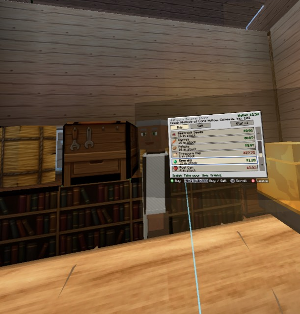

## 16:14:49 - All these "hmm" sounds are ridiculous

- **Transcript:** All these "hmm" sounds are ridiculous
- **Status:** open
- **Build:** 0.129 (77871062, M1-M4 (device-tested; ship riding, chests, comfort options, weapon wheel))
- **World:** New World (11) (seed 13480747113613945685)
- **Dimension:** Surface
- **Biome:** Plains
- **Position:** 3946.5 106.0 3346.4
- **Facing:** north (yaw 358, pitch -7)
- **Held:** empty hand
- **Mount:** on foot
- **Looking at:** nothing
- **Mode:** Survival, health 19/20, screen ShopMenu
- **Time:** day 4 14:22, clear
- **Fps:** 63
- **Levels:** mic -31 dBFS, game sound -52 dBFS
- **Length:** 5.7 s (voice 2.7 s)
- **Just before:** -27s opened CatalogMenu; -27s message: Isaiah Whitlock: There you go. Good choice.; -9s closed CatalogMenu; -8s opened ShopMenu; -8s message: Isaiah Whitlock: Been butchering, have you?
- **Position at the end:** 3946.5 106.0 3346.4
- **Repro (Mac):** `./snap.sh note --seed 13480747113613945685 --x 3946.5 --z 3346.4 --yaw 2 --pitch -7 --time 0.349`
- **Audio (this Mac):** /Users/darthvadar/Documents/Blocksmith/QuestVoiceNotes/raw/vn-20261017-161449-979.aac

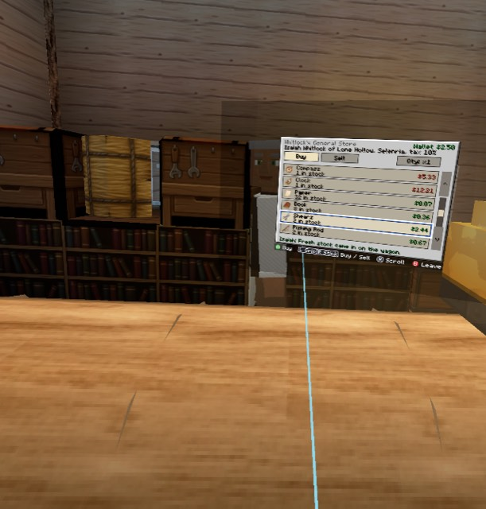

## 16:15:13 - Something weird happens when I

- **Transcript:** Something weird happens when I
- **Status:** open
- **Build:** 0.129 (77871062, M1-M4 (device-tested; ship riding, chests, comfort options, weapon wheel))
- **World:** New World (11) (seed 13480747113613945685)
- **Dimension:** Surface
- **Biome:** Plains
- **Position:** 3946.5 106.0 3346.5
- **Facing:** north-east (yaw 24, pitch -8)
- **Held:** Treasure Map x1
- **Mount:** on foot
- **Looking at:** Crafting Table at 3947 107 3343
- **Mode:** Survival, health 19/20
- **Time:** day 4 14:47, clear
- **Fps:** 62
- **Levels:** mic -56 dBFS, game sound -27 dBFS
- **Length:** 3.0 s (voice 1.5 s)
- **Just before:** -30s closed CatalogMenu; -29s opened ShopMenu; -29s message: Isaiah Whitlock: Been butchering, have you?; -10s message: Honour raised (a fair trade); -8s message: Isaiah Whitlock: Much obliged, friend.; -2s holding Treasure Map; -2s message: Honour raised (a fair trade); -1s closed ShopMenu; -0s message: Isaiah Whitlock: Spread the word!
- **Repro (Mac):** `./snap.sh note --seed 13480747113613945685 --x 3946.5 --z 3346.5 --yaw -24 --pitch -8 --time 0.366`
- **Audio (this Mac):** /Users/darthvadar/Documents/Blocksmith/QuestVoiceNotes/raw/vn-20261017-161513-980.aac

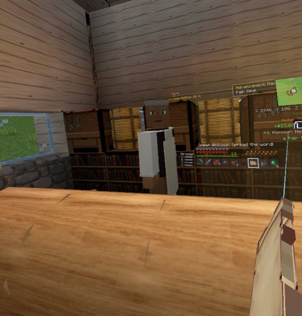

## 16:15:17 - buys or sells something, it makes a really weird sound

- **Transcript:** buys or sells something, it makes a really weird sound
- **Status:** open
- **Build:** 0.129 (77871062, M1-M4 (device-tested; ship riding, chests, comfort options, weapon wheel))
- **World:** New World (11) (seed 13480747113613945685)
- **Dimension:** Surface
- **Biome:** Plains
- **Position:** 3948.2 105.9 3354.6
- **Facing:** east (yaw 74, pitch -71)
- **Held:** Treasure Map x1
- **Mount:** on foot
- **Looking at:** Coarse Dirt at 3948 105 3354
- **Mode:** Survival, health 19/20
- **Time:** day 4 14:51, clear
- **Fps:** 62
- **Levels:** mic -29 dBFS, game sound -31 dBFS
- **Length:** 4.3 s (voice 2.7 s)
- **Just before:** -14s message: Honour raised (a fair trade); -12s message: Isaiah Whitlock: Much obliged, friend.; -5s holding Treasure Map; -5s message: Honour raised (a fair trade); -4s closed ShopMenu; -3s message: Isaiah Whitlock: Spread the word!
- **Repro (Mac):** `./snap.sh note --seed 13480747113613945685 --x 3948.2 --z 3354.6 --yaw -74 --pitch -71 --time 0.369`
- **Audio (this Mac):** /Users/darthvadar/Documents/Blocksmith/QuestVoiceNotes/raw/vn-20261017-161517-360.aac

## 16:15:29 - Okay, so I bought a treasure map and, uh, I can't even fucking read it

- **Transcript:** Okay, so I bought a treasure map and, uh, I can't even fucking read it
- **Status:** open
- **Build:** 0.129 (77871062, M1-M4 (device-tested; ship riding, chests, comfort options, weapon wheel))
- **World:** New World (11) (seed 13480747113613945685)
- **Dimension:** Surface
- **Biome:** Plains
- **Position:** 3965.7 105.0 3374.5
- **Facing:** east (yaw 101, pitch 16)
- **Held:** Treasure Map x1
- **Mount:** on foot
- **Looking at:** nothing
- **Mode:** Survival, health 19/20
- **Time:** day 4 15:04, clear
- **Fps:** 60
- **Levels:** mic -25 dBFS, game sound -30 dBFS
- **Length:** 5.0 s (voice 3.2 s)
- **Just before:** -25s message: Honour raised (a fair trade); -23s message: Isaiah Whitlock: Much obliged, friend.; -17s holding Treasure Map; -17s message: Honour raised (a fair trade); -15s closed ShopMenu; -14s message: Isaiah Whitlock: Spread the word!; -7s opened InventoryMenu; -4s closed InventoryMenu; -3s message: The map shows nothing nearby
- **Repro (Mac):** `./snap.sh note --seed 13480747113613945685 --x 3965.7 --z 3374.5 --yaw -101 --pitch 16 --time 0.378`
- **Audio (this Mac):** /Users/darthvadar/Documents/Blocksmith/QuestVoiceNotes/raw/vn-20261017-161529-620.aac

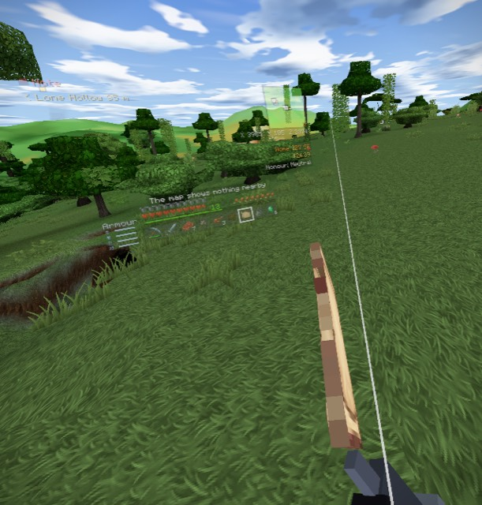

## 16:15:36 - That's nice

- **Transcript:** That's nice
- **Status:** open
- **Build:** 0.129 (77871062, M1-M4 (device-tested; ship riding, chests, comfort options, weapon wheel))
- **World:** New World (11) (seed 13480747113613945685)
- **Dimension:** Surface
- **Biome:** Sparse Jungle
- **Position:** 3992.9 105.0 3377.3
- **Facing:** north-east (yaw 62, pitch -26)
- **Held:** Treasure Map x1
- **Mount:** on foot
- **Looking at:** Grass Block at 3995 104 3375
- **Mode:** Survival, health 19/20
- **Time:** day 4 15:12, clear
- **Fps:** 69
- **Levels:** mic -36 dBFS, game sound -28 dBFS
- **Length:** 1.8 s (voice 0.4 s)
- **Just before:** -29s message: Isaiah Whitlock: Much obliged, friend.; -23s holding Treasure Map; -23s message: Honour raised (a fair trade); -22s closed ShopMenu; -21s message: Isaiah Whitlock: Spread the word!; -13s opened InventoryMenu; -11s closed InventoryMenu; -10s message: The map shows nothing nearby; -4s walked into Sparse Jungle
- **Repro (Mac):** `./snap.sh note --seed 13480747113613945685 --x 3992.9 --z 3377.3 --yaw -62 --pitch -26 --time 0.384`
- **Audio (this Mac):** /Users/darthvadar/Documents/Blocksmith/QuestVoiceNotes/raw/vn-20261017-161536-640.aac

## 16:15:38 - Map shows nothing nearby. Wow. Yeah. Okay

- **Transcript:** Map shows nothing nearby. Wow. Yeah. Okay
- **Status:** open
- **Build:** 0.129 (77871062, M1-M4 (device-tested; ship riding, chests, comfort options, weapon wheel))
- **World:** New World (11) (seed 13480747113613945685)
- **Dimension:** Surface
- **Biome:** Plains
- **Position:** 4004.3 105.0 3374.7
- **Facing:** east (yaw 69, pitch -17)
- **Held:** Treasure Map x1
- **Mount:** on foot
- **Looking at:** nothing
- **Mode:** Survival, health 19/20
- **Time:** day 4 15:14, clear
- **Fps:** 70
- **Levels:** mic -34 dBFS, game sound -30 dBFS
- **Length:** 4.3 s (voice 2.3 s)
- **Just before:** -25s holding Treasure Map; -25s message: Honour raised (a fair trade); -24s closed ShopMenu; -23s message: Isaiah Whitlock: Spread the word!; -15s opened InventoryMenu; -13s closed InventoryMenu; -12s message: The map shows nothing nearby; -6s walked into Sparse Jungle; -1s holding Bucket; -1s holding Treasure Map
- **Repro (Mac):** `./snap.sh note --seed 13480747113613945685 --x 4004.3 --z 3374.7 --yaw -69 --pitch -17 --time 0.385`
- **Audio (this Mac):** /Users/darthvadar/Documents/Blocksmith/QuestVoiceNotes/raw/vn-20261017-161538-640.aac

## 16:17:26 - This is weird

- **Transcript:** This is weird
- **Status:** open
- **Build:** 0.129 (77871062, M1-M4 (device-tested; ship riding, chests, comfort options, weapon wheel))
- **World:** New World (11) (seed 13480747113613945685)
- **Dimension:** Surface
- **Biome:** Savanna
- **Position:** 4217.2 105.5 3576.0
- **Facing:** north (yaw 7, pitch 2)
- **Held:** Bucket x1
- **Mount:** on foot
- **Looking at:** Acacia Log at 4217 107 3572
- **Mode:** Survival, health 19/20
- **Time:** day 4 17:22, clear
- **Fps:** 72
- **Levels:** mic -35 dBFS, game sound -19 dBFS
- **Length:** 2.2 s (voice 0.8 s)
- **Just before:** -30s closed InventoryMenu; -25s holding Bucket; -25s opened FurnaceMenu; -20s closed FurnaceMenu
- **Repro (Mac):** `./snap.sh note --seed 13480747113613945685 --x 4217.2 --z 3576.0 --yaw -7 --pitch 2 --time 0.474`
- **Audio (this Mac):** /Users/darthvadar/Documents/Blocksmith/QuestVoiceNotes/raw/vn-20261017-161726-540.aac

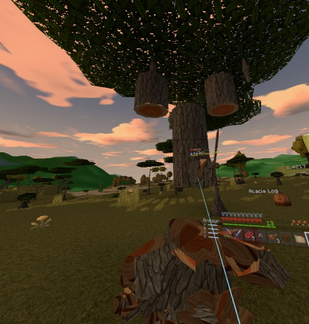

## 16:18:53 - Oh, wow. Okay

- **Transcript:** Oh, wow. Okay
- **Status:** open
- **Build:** 0.129 (77871062, M1-M4 (device-tested; ship riding, chests, comfort options, weapon wheel))
- **World:** New World (11) (seed 13480747113613945685)
- **Dimension:** Surface
- **Biome:** Desert
- **Position:** 4185.7 103.9 3512.9
- **Facing:** north-east (yaw 30, pitch -65)
- **Held:** Titanium Sword x1
- **Mount:** on foot
- **Looking at:** Sand at 4186 103 3512
- **Mode:** Survival, health 20/20
- **Time:** day 5 07:32, clear
- **Fps:** 72
- **Levels:** mic -27 dBFS, game sound -32 dBFS
- **Length:** 2.5 s (voice 1.0 s)
- **Just before:** -28s closed FurnaceMenu; -20s opened InventoryMenu; -19s closed InventoryMenu; -15s holding Emerald; -15s message: Emerald; -15s holding Titanium Pickaxe; -15s message: Titanium Pickaxe; -14s holding Titanium Sword; -14s message: Titanium Sword; -10s walked into Desert
- **Repro (Mac):** `./snap.sh note --seed 13480747113613945685 --x 4185.7 --z 3512.9 --yaw -30 --pitch -65 --time 0.064`
- **Audio (this Mac):** /Users/darthvadar/Documents/Blocksmith/QuestVoiceNotes/raw/vn-20261017-161853-260.aac

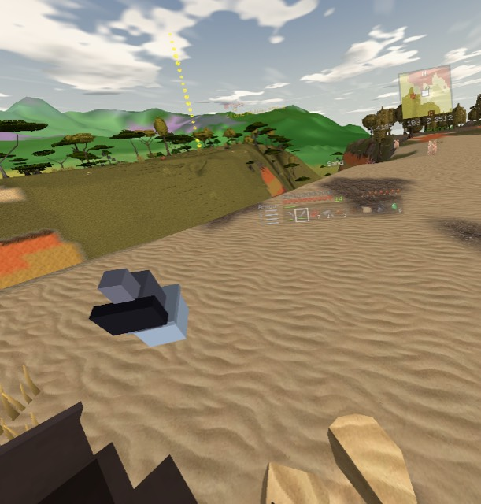

## 16:18:57 - Um, so picking things up is pretty buggy also

- **Transcript:** Um, so picking things up is pretty buggy also
- **Status:** open
- **Build:** 0.129 (77871062, M1-M4 (device-tested; ship riding, chests, comfort options, weapon wheel))
- **World:** New World (11) (seed 13480747113613945685)
- **Dimension:** Surface
- **Biome:** Desert
- **Position:** 4190.5 103.7 3509.0
- **Facing:** east (yaw 73, pitch -62)
- **Held:** Titanium Sword x1
- **Mount:** on foot
- **Looking at:** Sand at 4191 103 3508
- **Mode:** Survival, health 20/20
- **Time:** day 5 07:37, clear
- **Fps:** 72
- **Levels:** mic -27 dBFS, game sound -22 dBFS
- **Length:** 4.7 s (voice 2.5 s)
- **Just before:** -24s opened InventoryMenu; -23s closed InventoryMenu; -19s holding Emerald; -19s message: Emerald; -19s holding Titanium Pickaxe; -19s message: Titanium Pickaxe; -19s holding Titanium Sword; -19s message: Titanium Sword; -14s walked into Desert
- **Repro (Mac):** `./snap.sh note --seed 13480747113613945685 --x 4190.5 --z 3509.0 --yaw -73 --pitch -62 --time 0.068`
- **Audio (this Mac):** /Users/darthvadar/Documents/Blocksmith/QuestVoiceNotes/raw/vn-20261017-161857-580.aac

## 16:19:02 - The way the animal hits the ground should correspond to the direction 

- **Transcript:** The way the animal hits the ground should correspond to the direction which I hit it with the sword
- **Status:** open
- **Build:** 0.129 (77871062, M1-M4 (device-tested; ship riding, chests, comfort options, weapon wheel))
- **World:** New World (11) (seed 13480747113613945685)
- **Dimension:** Surface
- **Biome:** Wooded Badlands
- **Position:** 4199.3 104.5 3478.2
- **Facing:** east (yaw 72, pitch -66)
- **Held:** Titanium Sword x1
- **Mount:** on foot
- **Looking at:** Sand at 4199 104 3477
- **Mode:** Survival, health 20/20
- **Time:** day 5 07:43, clear
- **Fps:** 72
- **Levels:** mic -30 dBFS, game sound -12 dBFS
- **Length:** 8.1 s (voice 4.3 s)
- **Just before:** -29s opened InventoryMenu; -28s closed InventoryMenu; -25s holding Emerald; -25s message: Emerald; -25s holding Titanium Pickaxe; -25s message: Titanium Pickaxe; -24s holding Titanium Sword; -24s message: Titanium Sword; -19s walked into Desert; -1s walked into Wooded Badlands
- **Position at the end:** 4188.3 102.8 3437.0
- **Repro (Mac):** `./snap.sh note --seed 13480747113613945685 --x 4199.3 --z 3478.2 --yaw -72 --pitch -66 --time 0.072`
- **Audio (this Mac):** /Users/darthvadar/Documents/Blocksmith/QuestVoiceNotes/raw/vn-20261017-161902-880.aac

## 16:19:10 - Ja, så er det så

- **Transcript:** Ja, så er det så
- **Status:** open
- **Build:** 0.129 (77871062, M1-M4 (device-tested; ship riding, chests, comfort options, weapon wheel))
- **World:** New World (11) (seed 13480747113613945685)
- **Dimension:** Surface
- **Biome:** Wooded Badlands
- **Position:** 4184.6 102.0 3429.4
- **Facing:** north (yaw 342, pitch -61)
- **Held:** Titanium Sword x1
- **Mount:** on foot
- **Looking at:** Coarse Dirt at 4184 101 3428
- **Mode:** Survival, health 20/20
- **Time:** day 5 07:53, clear
- **Fps:** 72
- **Levels:** mic -26 dBFS, game sound -30 dBFS
- **Length:** 2.3 s (voice 0.9 s)
- **Just before:** -27s walked into Desert; -9s walked into Wooded Badlands
- **Repro (Mac):** `./snap.sh note --seed 13480747113613945685 --x 4184.6 --z 3429.4 --yaw 18 --pitch -61 --time 0.079`
- **Audio (this Mac):** /Users/darthvadar/Documents/Blocksmith/QuestVoiceNotes/raw/vn-20261017-161910-920.aac

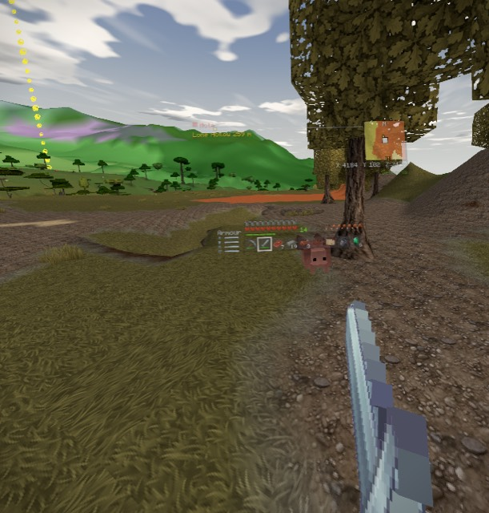

## 16:19:13 - Thing that curls up to in a ball or whatever

- **Transcript:** Thing that curls up to in a ball or whatever
- **Status:** open
- **Build:** 0.129 (77871062, M1-M4 (device-tested; ship riding, chests, comfort options, weapon wheel))
- **World:** New World (11) (seed 13480747113613945685)
- **Dimension:** Surface
- **Biome:** Wooded Badlands
- **Position:** 4182.7 102.2 3426.3
- **Facing:** north (yaw 355, pitch -76)
- **Held:** Titanium Sword x1
- **Mount:** on foot
- **Looking at:** Coarse Dirt at 4182 101 3425
- **Mode:** Survival, health 20/20
- **Time:** day 5 07:56, clear
- **Fps:** 72
- **Levels:** mic -27 dBFS, game sound -17 dBFS
- **Length:** 3.3 s (voice 1.8 s)
- **Just before:** -29s walked into Desert; -11s walked into Wooded Badlands
- **Repro (Mac):** `./snap.sh note --seed 13480747113613945685 --x 4182.7 --z 3426.3 --yaw 5 --pitch -76 --time 0.081`
- **Audio (this Mac):** /Users/darthvadar/Documents/Blocksmith/QuestVoiceNotes/raw/vn-20261017-161913-140.aac

## 16:19:16 - Unless that thing exists in real life, we should probably remove it

- **Transcript:** Unless that thing exists in real life, we should probably remove it
- **Status:** open
- **Build:** 0.129 (77871062, M1-M4 (device-tested; ship riding, chests, comfort options, weapon wheel))
- **World:** New World (11) (seed 13480747113613945685)
- **Dimension:** Surface
- **Biome:** Wooded Badlands
- **Position:** 4166.5 101.9 3416.9
- **Facing:** north (yaw 348, pitch -46)
- **Held:** Titanium Sword x1
- **Mount:** on foot
- **Looking at:** Coarse Dirt at 4165 99 3413
- **Mode:** Survival, health 20/20
- **Time:** day 5 07:59, clear
- **Fps:** 72
- **Levels:** mic -39 dBFS, game sound -27 dBFS
- **Length:** 3.7 s (voice 2.3 s)
- **Just before:** -14s walked into Wooded Badlands
- **Repro (Mac):** `./snap.sh note --seed 13480747113613945685 --x 4166.5 --z 3416.9 --yaw 12 --pitch -46 --time 0.083`
- **Audio (this Mac):** /Users/darthvadar/Documents/Blocksmith/QuestVoiceNotes/raw/vn-20261017-161916-279.aac

## 16:20:32 - We need another location to get slime without actual fucking slimes, I

- **Transcript:** We need another location to get slime without actual fucking slimes, I think
- **Status:** open
- **Build:** 0.129 (77871062, M1-M4 (device-tested; ship riding, chests, comfort options, weapon wheel))
- **World:** New World (11) (seed 13480747113613945685)
- **Dimension:** Surface
- **Biome:** Savanna
- **Position:** 4203.8 107.0 3599.7
- **Facing:** south-west (yaw 217, pitch -20)
- **Held:** Titanium Sword x1
- **Mount:** on foot
- **Looking at:** nothing
- **Mode:** Survival, health 20/20, screen CraftingBookMenu
- **Time:** day 5 09:31, clear
- **Fps:** 72
- **Levels:** mic -34 dBFS, game sound -100 dBFS
- **Length:** 5.4 s (voice 3.1 s)
- **Just before:** -29s closed FurnaceMenu; -28s opened CraftingBookMenu
- **Repro (Mac):** `./snap.sh note --seed 13480747113613945685 --x 4203.8 --z 3599.7 --yaw 143 --pitch -20 --time 0.147`
- **Audio (this Mac):** /Users/darthvadar/Documents/Blocksmith/QuestVoiceNotes/raw/vn-20261017-162032-679.aac

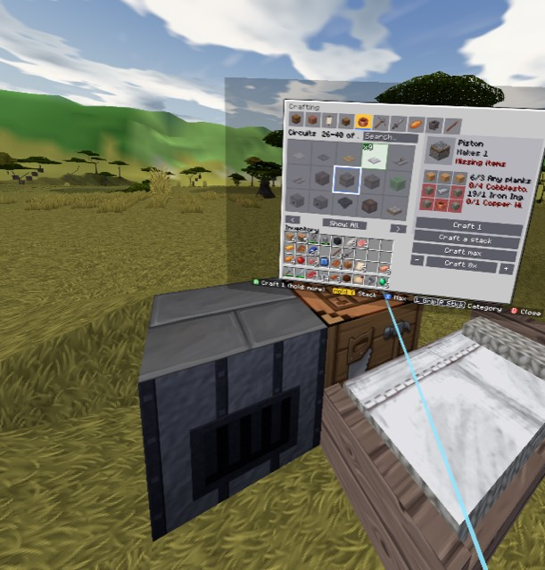

## 20:18:17 - All right, so we're getting out of here. Where's the camp?

- **Transcript:** All right, so we're getting out of here. Where's the camp?
- **Status:** open
- **Build:** 0.129 (77871062, M1-M4 (device-tested; ship riding, chests, comfort options, weapon wheel))
- **World:** New World (11) (seed 13480747113613945685)
- **Dimension:** Surface
- **Biome:** Savanna
- **Position:** 4189.8 107.8 3600.0
- **Facing:** south-west (yaw 237, pitch -76)
- **Held:** Raw Beef x7
- **Mount:** on foot
- **Looking at:** Short Grass at 4189 108 3600
- **Mode:** Survival, health 20/20
- **Time:** day 5 10:05, clear
- **Fps:** 34
- **Levels:** mic -28 dBFS, game sound -26 dBFS
- **Length:** 3.4 s (voice 1.6 s)
- **Just before:** -14s closed CraftingBookMenu; -6s opened PauseMenu; -4s message: View recentred; -1s closed PauseMenu; -0s holding Raw Beef
- **Repro (Mac):** `./snap.sh note --seed 13480747113613945685 --x 4189.8 --z 3600.0 --yaw 123 --pitch -76 --time 0.170`
- **Audio (this Mac):** /Users/darthvadar/Documents/Blocksmith/QuestVoiceNotes/raw/vn-20261017-201817-194.aac

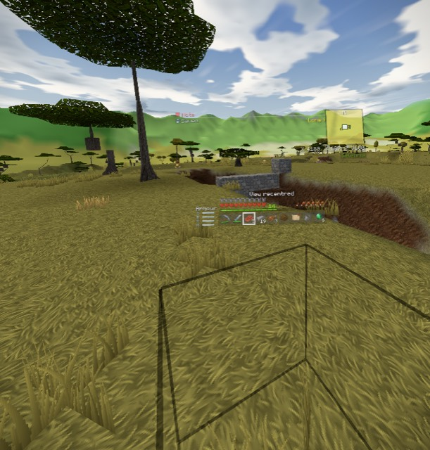

## 20:18:21 - All right, so let's drop some shit first of all

- **Transcript:** All right, so let's drop some shit first of all
- **Status:** open
- **Build:** 0.129 (77871062, M1-M4 (device-tested; ship riding, chests, comfort options, weapon wheel))
- **World:** New World (11) (seed 13480747113613945685)
- **Dimension:** Surface
- **Biome:** Savanna
- **Position:** 4201.5 107.8 3606.3
- **Facing:** south (yaw 185, pitch -37)
- **Held:** Raw Beef x7
- **Mount:** on foot
- **Looking at:** Grass Block at 4201 107 3608
- **Mode:** Survival, health 20/20
- **Time:** day 5 10:09, clear
- **Fps:** 63
- **Levels:** mic -30 dBFS, game sound -12 dBFS
- **Length:** 4.3 s (voice 2.2 s)
- **Just before:** -17s closed CraftingBookMenu; -9s opened PauseMenu; -7s message: View recentred; -4s closed PauseMenu; -3s holding Raw Beef
- **Repro (Mac):** `./snap.sh note --seed 13480747113613945685 --x 4201.5 --z 3606.3 --yaw 175 --pitch -37 --time 0.173`
- **Audio (this Mac):** /Users/darthvadar/Documents/Blocksmith/QuestVoiceNotes/raw/vn-20261017-201821-534.aac

## 20:18:32 - The throw sounds good

- **Transcript:** The throw sounds good
- **Status:** open
- **Build:** 0.129 (77871062, M1-M4 (device-tested; ship riding, chests, comfort options, weapon wheel))
- **World:** New World (11) (seed 13480747113613945685)
- **Dimension:** Surface
- **Biome:** Savanna
- **Position:** 4202.0 107.9 3607.6
- **Facing:** south-east (yaw 113, pitch 7)
- **Held:** Raw Beef x7
- **Mount:** on foot
- **Looking at:** nothing
- **Mode:** Survival, health 20/20, screen InventoryMenu
- **Time:** day 5 10:17, clear
- **Fps:** 53
- **Levels:** mic -32 dBFS, game sound -100 dBFS
- **Length:** 2.3 s (voice 0.9 s)
- **Just before:** -23s closed CraftingBookMenu; -16s opened PauseMenu; -14s message: View recentred; -11s closed PauseMenu; -10s holding Raw Beef; -6s opened InventoryMenu
- **Repro (Mac):** `./snap.sh note --seed 13480747113613945685 --x 4202.0 --z 3607.6 --yaw -113 --pitch 7 --time 0.179`
- **Audio (this Mac):** /Users/darthvadar/Documents/Blocksmith/QuestVoiceNotes/raw/vn-20261017-201832-913.aac

## 20:18:35 - Whatever that sound is. Don't know what that sound was

- **Transcript:** Whatever that sound is. Don't know what that sound was
- **Status:** open
- **Build:** 0.129 (77871062, M1-M4 (device-tested; ship riding, chests, comfort options, weapon wheel))
- **World:** New World (11) (seed 13480747113613945685)
- **Dimension:** Surface
- **Biome:** Savanna
- **Position:** 4201.9 107.9 3607.6
- **Facing:** south (yaw 186, pitch -38)
- **Held:** Raw Beef x7
- **Mount:** on foot
- **Looking at:** Short Grass at 4201 108 3609
- **Mode:** Survival, health 20/20
- **Time:** day 5 10:19, clear
- **Fps:** 54
- **Levels:** mic -27 dBFS, game sound -26 dBFS
- **Length:** 4.6 s (voice 2.2 s)
- **Just before:** -25s closed CraftingBookMenu; -18s opened PauseMenu; -16s message: View recentred; -13s closed PauseMenu; -12s holding Raw Beef; -7s opened InventoryMenu; -0s closed InventoryMenu
- **Repro (Mac):** `./snap.sh note --seed 13480747113613945685 --x 4201.9 --z 3607.6 --yaw 174 --pitch -38 --time 0.180`
- **Audio (this Mac):** /Users/darthvadar/Documents/Blocksmith/QuestVoiceNotes/raw/vn-20261017-201835-894.aac

## 20:18:40 - It wasn't a good sound or it was

- **Transcript:** It wasn't a good sound or it was
- **Status:** open
- **Build:** 0.129 (77871062, M1-M4 (device-tested; ship riding, chests, comfort options, weapon wheel))
- **World:** New World (11) (seed 13480747113613945685)
- **Dimension:** Surface
- **Biome:** Savanna
- **Position:** 4202.7 108.0 3602.2
- **Facing:** north-east (yaw 51, pitch -64)
- **Held:** Raw Beef x7
- **Mount:** on foot
- **Looking at:** nothing
- **Mode:** Survival, health 20/20, screen FurnaceMenu
- **Time:** day 5 10:23, clear
- **Fps:** 53
- **Levels:** mic -37 dBFS, game sound -83 dBFS
- **Length:** 2.8 s (voice 1.1 s)
- **Just before:** -29s closed CraftingBookMenu; -21s opened PauseMenu; -19s message: View recentred; -16s closed PauseMenu; -15s holding Raw Beef; -11s opened InventoryMenu; -4s closed InventoryMenu; -1s message: 72 Hz to keep the frame rate (VR Comfort & Controls); -1s opened FurnaceMenu
- **Repro (Mac):** `./snap.sh note --seed 13480747113613945685 --x 4202.7 --z 3602.2 --yaw -51 --pitch -64 --time 0.183`
- **Audio (this Mac):** /Users/darthvadar/Documents/Blocksmith/QuestVoiceNotes/raw/vn-20261017-201840-893.aac

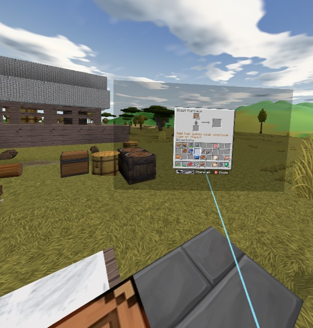

## 20:18:45 - Okay, so I don't think I can make a cell yet, can I? Not yet. I need o

- **Transcript:** Okay, so I don't think I can make a cell yet, can I? Not yet. I need one more
- **Status:** open
- **Build:** 0.129 (77871062, M1-M4 (device-tested; ship riding, chests, comfort options, weapon wheel))
- **World:** New World (11) (seed 13480747113613945685)
- **Dimension:** Surface
- **Biome:** Savanna
- **Position:** 4202.8 108.0 3601.9
- **Facing:** north-west (yaw 329, pitch -69)
- **Held:** Raw Beef x7
- **Mount:** on foot
- **Looking at:** nothing
- **Mode:** Survival, health 20/20, screen CraftingBookMenu
- **Time:** day 5 10:28, clear
- **Fps:** 63
- **Levels:** mic -39 dBFS, game sound -26 dBFS
- **Length:** 8.0 s (voice 3.5 s)
- **Just before:** -25s opened PauseMenu; -23s message: View recentred; -20s closed PauseMenu; -19s holding Raw Beef; -14s opened InventoryMenu; -8s closed InventoryMenu; -5s message: 72 Hz to keep the frame rate (VR Comfort & Controls); -4s opened FurnaceMenu; -2s closed FurnaceMenu; -1s opened CraftingBookMenu
- **While talking:** -5s opened CraftingBookMenu
- **Position at the end:** 4202.8 108.0 3601.9
- **Repro (Mac):** `./snap.sh note --seed 13480747113613945685 --x 4202.8 --z 3601.9 --yaw 31 --pitch -69 --time 0.186`
- **Audio (this Mac):** /Users/darthvadar/Documents/Blocksmith/QuestVoiceNotes/raw/vn-20261017-201845-394.aac

## 20:18:54 - More poor little cows I gotta find

- **Transcript:** More poor little cows I gotta find
- **Status:** open
- **Build:** 0.129 (77871062, M1-M4 (device-tested; ship riding, chests, comfort options, weapon wheel))
- **World:** New World (11) (seed 13480747113613945685)
- **Dimension:** Surface
- **Biome:** Savanna
- **Position:** 4196.2 109.1 3613.5
- **Facing:** south (yaw 181, pitch -36)
- **Held:** Titanium Sword x1
- **Mount:** on foot
- **Looking at:** Grass Block at 4195 107 3617
- **Mode:** Survival, health 20/20
- **Time:** day 5 10:35, clear
- **Fps:** 50
- **Levels:** mic -38 dBFS, game sound -100 dBFS
- **Length:** 3.6 s (voice 1.6 s)
- **Just before:** -29s message: View recentred; -26s closed PauseMenu; -25s holding Raw Beef; -21s opened InventoryMenu; -14s closed InventoryMenu; -11s message: 72 Hz to keep the frame rate (VR Comfort & Controls); -10s opened FurnaceMenu; -8s closed FurnaceMenu; -7s opened CraftingBookMenu; -2s closed CraftingBookMenu; -1s holding Titanium Sword; -1s message: Titanium Sword
- **Repro (Mac):** `./snap.sh note --seed 13480747113613945685 --x 4196.2 --z 3613.5 --yaw 179 --pitch -36 --time 0.191`
- **Audio (this Mac):** /Users/darthvadar/Documents/Blocksmith/QuestVoiceNotes/raw/vn-20261017-201854-353.aac

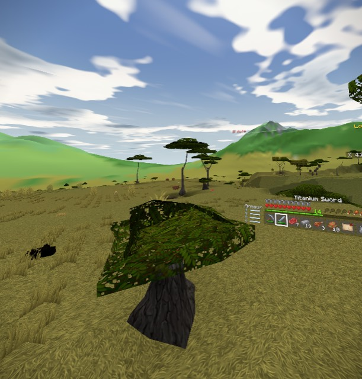

## 20:19:03 - Yeah, so the little friction on the ground's a little low. Um

- **Transcript:** Yeah, so the little friction on the ground's a little low. Um
- **Status:** open
- **Build:** 0.129 (77871062, M1-M4 (device-tested; ship riding, chests, comfort options, weapon wheel))
- **World:** New World (11) (seed 13480747113613945685)
- **Dimension:** Surface
- **Biome:** Savanna
- **Position:** 4239.1 104.8 3631.5
- **Facing:** south (yaw 163, pitch -75)
- **Held:** Titanium Sword x1
- **Mount:** on foot
- **Looking at:** Grass Block at 4239 104 3631
- **Mode:** Survival, health 20/20
- **Time:** day 5 10:43, clear
- **Fps:** 56
- **Levels:** mic -32 dBFS, game sound -29 dBFS
- **Length:** 5.0 s (voice 2.8 s)
- **Just before:** -28s opened InventoryMenu; -21s closed InventoryMenu; -18s message: 72 Hz to keep the frame rate (VR Comfort & Controls); -17s opened FurnaceMenu; -15s closed FurnaceMenu; -14s opened CraftingBookMenu; -9s closed CraftingBookMenu; -9s holding Titanium Sword; -9s message: Titanium Sword
- **Repro (Mac):** `./snap.sh note --seed 13480747113613945685 --x 4239.1 --z 3631.5 --yaw -163 --pitch -75 --time 0.197`
- **Audio (this Mac):** /Users/darthvadar/Documents/Blocksmith/QuestVoiceNotes/raw/vn-20261017-201903-494.aac

## 20:19:08 - Poor pig shouldn't be able to slide that much when I kill him

- **Transcript:** Poor pig shouldn't be able to slide that much when I kill him
- **Status:** open
- **Build:** 0.129 (77871062, M1-M4 (device-tested; ship riding, chests, comfort options, weapon wheel))
- **World:** New World (11) (seed 13480747113613945685)
- **Dimension:** Surface
- **Biome:** Savanna
- **Position:** 4253.0 105.0 3634.5
- **Facing:** south-east (yaw 135, pitch -69)
- **Held:** Titanium Sword x1
- **Mount:** on foot
- **Looking at:** Grass Block at 4253 103 3635
- **Mode:** Survival, health 20/20
- **Time:** day 5 10:48, clear
- **Fps:** 56
- **Levels:** mic -29 dBFS, game sound -35 dBFS
- **Length:** 3.4 s (voice 2.0 s)
- **Just before:** -25s closed InventoryMenu; -22s message: 72 Hz to keep the frame rate (VR Comfort & Controls); -22s opened FurnaceMenu; -19s closed FurnaceMenu; -19s opened CraftingBookMenu; -14s closed CraftingBookMenu; -13s holding Titanium Sword; -13s message: Titanium Sword; -3s message: Render distance 15 for now, to keep the frame rate
- **Repro (Mac):** `./snap.sh note --seed 13480747113613945685 --x 4253.0 --z 3634.5 --yaw -135 --pitch -69 --time 0.201`
- **Audio (this Mac):** /Users/darthvadar/Documents/Blocksmith/QuestVoiceNotes/raw/vn-20261017-201908-114.aac

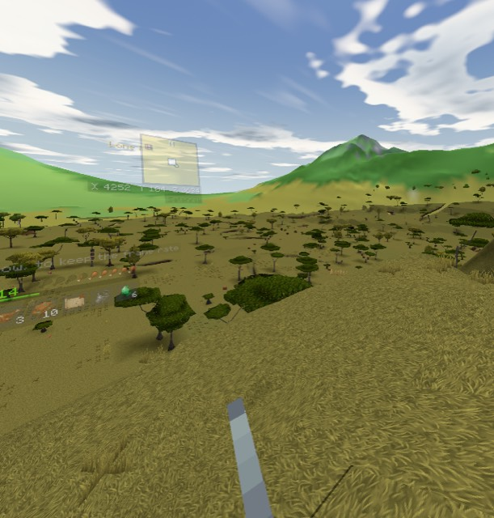

## 20:20:02 - Something with the horses. People don't know what the hell is going on

- **Transcript:** Something with the horses. People don't know what the hell is going on when you're trying to tame them
- **Status:** open
- **Build:** 0.129 (77871062, M1-M4 (device-tested; ship riding, chests, comfort options, weapon wheel))
- **World:** New World (11) (seed 13480747113613945685)
- **Dimension:** Surface
- **Biome:** Savanna
- **Position:** 4323.8 78.0 3710.5
- **Facing:** east (yaw 103, pitch -39)
- **Held:** empty hand
- **Mount:** on foot
- **Looking at:** Short Grass at 4325 78 3711
- **Mode:** Survival, health 18/20
- **Time:** day 5 11:41, clear
- **Fps:** 58
- **Levels:** mic -39 dBFS, game sound -19 dBFS
- **Length:** 5.1 s (voice 3.2 s)
- **Just before:** -28s mounted Donkey; -26s holding Raw Beef; -26s message: Raw Beef; -25s opened InventoryMenu; -24s holding empty hand; -24s closed InventoryMenu; -24s holding Iron Ingot; -24s message: Iron Ingot; -23s holding empty hand; -23s message: Render distance 14 for now, to keep the frame rate; -3s message: Tamed!; -2s dismounted Donkey; -2s message: Clover is your horse now
- **Repro (Mac):** `./snap.sh note --seed 13480747113613945685 --x 4323.8 --z 3710.5 --yaw -103 --pitch -39 --time 0.237`
- **Audio (this Mac):** /Users/darthvadar/Documents/Blocksmith/QuestVoiceNotes/raw/vn-20261017-202002-534.aac

## 20:20:07 - Well, I mean, like

- **Transcript:** Well, I mean, like
- **Status:** open
- **Build:** 0.129 (77871062, M1-M4 (device-tested; ship riding, chests, comfort options, weapon wheel))
- **World:** New World (11) (seed 13480747113613945685)
- **Dimension:** Surface
- **Biome:** Savanna
- **Position:** 4358.4 80.5 3717.4
- **Facing:** east (yaw 106, pitch -55)
- **Held:** Titanium Sword x1
- **Mount:** on foot
- **Looking at:** Grass Block at 4359 80 3717
- **Mode:** Survival, health 18/20
- **Time:** day 5 11:46, clear
- **Fps:** 66
- **Levels:** mic -36 dBFS, game sound -87 dBFS
- **Length:** 2.1 s (voice 0.8 s)
- **Just before:** -30s holding Raw Beef; -30s message: Raw Beef; -29s opened InventoryMenu; -28s holding empty hand; -28s closed InventoryMenu; -28s holding Iron Ingot; -28s message: Iron Ingot; -28s holding empty hand; -28s message: Render distance 14 for now, to keep the frame rate; -8s message: Tamed!; -7s dismounted Donkey; -6s message: Clover is your horse now; -4s holding Titanium Sword; -4s message: Titanium Sword
- **Repro (Mac):** `./snap.sh note --seed 13480747113613945685 --x 4358.4 --z 3717.4 --yaw -106 --pitch -55 --time 0.241`
- **Audio (this Mac):** /Users/darthvadar/Documents/Blocksmith/QuestVoiceNotes/raw/vn-20261017-202007-513.aac

## 20:20:10 - How is someone supposed to know you're actually petting them? Like, it

- **Transcript:** How is someone supposed to know you're actually petting them? Like, it doesn't even make sense
- **Status:** open
- **Build:** 0.129 (77871062, M1-M4 (device-tested; ship riding, chests, comfort options, weapon wheel))
- **World:** New World (11) (seed 13480747113613945685)
- **Dimension:** Surface
- **Biome:** Savanna
- **Position:** 4372.5 81.0 3723.3
- **Facing:** east (yaw 111, pitch -67)
- **Held:** Titanium Sword x1
- **Mount:** on foot
- **Looking at:** Grass Block at 4372 80 3723
- **Mode:** Survival, health 18/20
- **Time:** day 5 11:48, clear
- **Fps:** 59
- **Levels:** mic -22 dBFS, game sound -38 dBFS
- **Length:** 4.9 s (voice 3.0 s)
- **Just before:** -30s holding empty hand; -30s message: Render distance 14 for now, to keep the frame rate; -10s message: Tamed!; -9s dismounted Donkey; -9s message: Clover is your horse now; -6s holding Titanium Sword; -6s message: Titanium Sword
- **Repro (Mac):** `./snap.sh note --seed 13480747113613945685 --x 4372.5 --z 3723.3 --yaw -111 --pitch -67 --time 0.242`
- **Audio (this Mac):** /Users/darthvadar/Documents/Blocksmith/QuestVoiceNotes/raw/vn-20261017-202010-294.aac

## 20:20:29 - I can't let the swords never been far

- **Transcript:** I can't let the swords never been far
- **Status:** open
- **Build:** 0.129 (77871062, M1-M4 (device-tested; ship riding, chests, comfort options, weapon wheel))
- **World:** New World (11) (seed 13480747113613945685)
- **Dimension:** Surface
- **Biome:** Savanna
- **Position:** 4379.5 80.7 3746.2
- **Facing:** north-east (yaw 52, pitch -72)
- **Held:** Titanium Sword x1
- **Mount:** on foot
- **Looking at:** Short Grass at 4379 81 3746
- **Mode:** Survival, health 18/20
- **Time:** day 5 12:07, clear
- **Fps:** 57
- **Levels:** mic -37 dBFS, game sound -16 dBFS
- **Length:** 2.9 s (voice 1.2 s)
- **Just before:** -26s message: Tamed!; -24s dismounted Donkey; -24s message: Clover is your horse now; -22s holding Titanium Sword; -22s message: Titanium Sword; -4s message: Render distance 13 for now, to keep the frame rate
- **Repro (Mac):** `./snap.sh note --seed 13480747113613945685 --x 4379.5 --z 3746.2 --yaw -52 --pitch -72 --time 0.255`
- **Audio (this Mac):** /Users/darthvadar/Documents/Blocksmith/QuestVoiceNotes/raw/vn-20261017-202029-354.aac

## 20:20:43 - Fuck does make

- **Transcript:** Fuck does make
- **Status:** open
- **Build:** 0.129 (77871062, M1-M4 (device-tested; ship riding, chests, comfort options, weapon wheel))
- **World:** New World (11) (seed 13480747113613945685)
- **Dimension:** Surface
- **Biome:** Savanna
- **Position:** 4357.1 80.0 3717.6
- **Facing:** west (yaw 264, pitch 14)
- **Held:** Titanium Sword x1
- **Mount:** on foot
- **Looking at:** nothing
- **Mode:** Survival, health 18/20, screen InventoryMenu
- **Time:** day 5 12:22, clear
- **Fps:** 58
- **Levels:** mic -30 dBFS, game sound -75 dBFS
- **Length:** 1.9 s (voice 0.5 s)
- **Just before:** -16s message: Render distance 13 for now, to keep the frame rate; -7s opened InventoryMenu; -6s closed InventoryMenu; -6s opened InventoryMenu; -5s opened JournalMenu; -4s closed JournalMenu; -4s opened InventoryMenu; -3s opened CraftingBookMenu; -3s closed CraftingBookMenu; -2s opened InventoryMenu; -1s closed InventoryMenu; -0s opened InventoryMenu
- **Repro (Mac):** `./snap.sh note --seed 13480747113613945685 --x 4357.1 --z 3717.6 --yaw 96 --pitch 14 --time 0.265`
- **Audio (this Mac):** /Users/darthvadar/Documents/Blocksmith/QuestVoiceNotes/raw/vn-20261017-202043-434.aac

## 20:20:51 - Okay, um

- **Transcript:** Okay, um
- **Status:** open
- **Build:** 0.129 (77871062, M1-M4 (device-tested; ship riding, chests, comfort options, weapon wheel))
- **World:** New World (11) (seed 13480747113613945685)
- **Dimension:** Surface
- **Biome:** Savanna
- **Position:** 4353.8 80.0 3714.5
- **Facing:** north-west (yaw 307, pitch -28)
- **Held:** empty hand
- **Mount:** on foot
- **Looking at:** nothing
- **Mode:** Survival, health 18/20, screen CraftingBookMenu
- **Time:** day 5 12:30, clear
- **Fps:** 63
- **Levels:** mic -37 dBFS, game sound -23 dBFS
- **Length:** 2.3 s (voice 0.9 s)
- **Just before:** -24s message: Render distance 13 for now, to keep the frame rate; -15s opened InventoryMenu; -13s closed InventoryMenu; -13s opened InventoryMenu; -12s opened JournalMenu; -12s closed JournalMenu; -11s opened InventoryMenu; -11s opened CraftingBookMenu; -10s closed CraftingBookMenu; -10s opened InventoryMenu; -8s closed InventoryMenu; -8s opened InventoryMenu; -7s opened CraftingBookMenu; -6s closed CraftingBookMenu; -5s opened InventoryMenu; -4s closed InventoryMenu; -4s holding Gamey Meat; -4s message: Gamey Meat; -4s holding Iron Ingot; -4s message: Iron Ingot; -3s holding Cooked Mutton; -3s message: Cooked Mutton; -3s holding Raw Copper; -3s message: Raw Copper; -3s holding Treasure Map; -3s message: Treasure Map; -3s holding Crafting Table; -3s message: Crafting Table; -2s holding empty hand; -2s opened CraftingBookMenu
- **Repro (Mac):** `./snap.sh note --seed 13480747113613945685 --x 4353.8 --z 3714.5 --yaw 53 --pitch -28 --time 0.271`
- **Audio (this Mac):** /Users/darthvadar/Documents/Blocksmith/QuestVoiceNotes/raw/vn-20261017-202051-874.aac

## 20:21:05 - Pretty sure that horse armor is a thing, so

- **Transcript:** Pretty sure that horse armor is a thing, so
- **Status:** open
- **Build:** 0.129 (77871062, M1-M4 (device-tested; ship riding, chests, comfort options, weapon wheel))
- **World:** New World (11) (seed 13480747113613945685)
- **Dimension:** Surface
- **Biome:** Savanna
- **Position:** 4306.3 79.1 3711.4
- **Facing:** north-west (yaw 298, pitch -12)
- **Held:** Titanium Sword x1
- **Mount:** riding Donkey
- **Looking at:** nothing
- **Mode:** Survival, health 18/20
- **Time:** day 5 12:44, clear
- **Fps:** 63
- **Levels:** mic -38 dBFS, game sound -18 dBFS
- **Length:** 3.8 s (voice 2.0 s)
- **Just before:** -26s opened InventoryMenu; -25s closed InventoryMenu; -25s opened InventoryMenu; -24s opened JournalMenu; -23s closed JournalMenu; -23s opened InventoryMenu; -22s opened CraftingBookMenu; -21s closed CraftingBookMenu; -21s opened InventoryMenu; -20s closed InventoryMenu; -19s opened InventoryMenu; -18s opened CraftingBookMenu; -17s closed CraftingBookMenu; -17s opened InventoryMenu; -16s closed InventoryMenu; -15s holding Gamey Meat; -15s message: Gamey Meat; -15s holding Iron Ingot; -15s message: Iron Ingot; -15s holding Cooked Mutton; -15s message: Cooked Mutton; -15s holding Raw Copper; -15s message: Raw Copper; -15s holding Treasure Map; -15s message: Treasure Map; -14s holding Crafting Table; -14s message: Crafting Table; -14s holding empty hand; -14s opened CraftingBookMenu; -10s holding Saddle; -10s closed CraftingBookMenu; -7s holding Emerald; -7s message: Emerald; -7s holding Titanium Pickaxe; -7s message: Titanium Pickaxe; -7s holding Titanium Sword; -7s message: Titanium Sword; -4s mounted Donkey; -4s opened MountMenu; -1s closed MountMenu
- **Repro (Mac):** `./snap.sh note --seed 13480747113613945685 --x 4306.3 --z 3711.4 --yaw 62 --pitch -12 --time 0.281`
- **Audio (this Mac):** /Users/darthvadar/Documents/Blocksmith/QuestVoiceNotes/raw/vn-20261017-202105-214.aac

## 20:21:14 - This horse is slow as fuck

- **Transcript:** This horse is slow as fuck
- **Status:** open
- **Build:** 0.129 (77871062, M1-M4 (device-tested; ship riding, chests, comfort options, weapon wheel))
- **World:** New World (11) (seed 13480747113613945685)
- **Dimension:** Surface
- **Biome:** Savanna
- **Position:** 4269.8 85.2 3675.0
- **Facing:** north-west (yaw 317, pitch -44)
- **Held:** Titanium Sword x1
- **Mount:** riding Donkey
- **Looking at:** Grass Block at 4268 85 3674
- **Mode:** Survival, health 18/20
- **Time:** day 5 12:55, clear
- **Fps:** 66
- **Levels:** mic -38 dBFS, game sound -30 dBFS
- **Length:** 3.3 s (voice 1.3 s)
- **Just before:** -30s opened InventoryMenu; -28s closed InventoryMenu; -28s opened InventoryMenu; -27s opened CraftingBookMenu; -26s closed CraftingBookMenu; -26s opened InventoryMenu; -24s closed InventoryMenu; -24s holding Gamey Meat; -24s message: Gamey Meat; -24s holding Iron Ingot; -24s message: Iron Ingot; -24s holding Cooked Mutton; -24s message: Cooked Mutton; -24s holding Raw Copper; -24s message: Raw Copper; -23s holding Treasure Map; -23s message: Treasure Map; -23s holding Crafting Table; -23s message: Crafting Table; -23s holding empty hand; -23s opened CraftingBookMenu; -19s holding Saddle; -19s closed CraftingBookMenu; -16s holding Emerald; -16s message: Emerald; -16s holding Titanium Pickaxe; -16s message: Titanium Pickaxe; -16s holding Titanium Sword; -16s message: Titanium Sword; -13s mounted Donkey; -13s opened MountMenu; -9s closed MountMenu
- **Repro (Mac):** `./snap.sh note --seed 13480747113613945685 --x 4269.8 --z 3675.0 --yaw 43 --pitch -44 --time 0.288`
- **Audio (this Mac):** /Users/darthvadar/Documents/Blocksmith/QuestVoiceNotes/raw/vn-20261017-202114-354.aac

## 20:21:52 - This thing sucks

- **Transcript:** This thing sucks
- **Status:** open
- **Build:** 0.129 (77871062, M1-M4 (device-tested; ship riding, chests, comfort options, weapon wheel))
- **World:** New World (11) (seed 13480747113613945685)
- **Dimension:** Surface
- **Biome:** Savanna
- **Position:** 4298.1 83.1 3525.6
- **Facing:** south-west (yaw 241, pitch -28)
- **Held:** Titanium Sword x1
- **Mount:** riding Donkey
- **Looking at:** Grass Block at 4294 81 3527
- **Mode:** Survival, health 18/20
- **Time:** day 5 13:40, clear
- **Fps:** 68
- **Levels:** mic -29 dBFS, game sound -38 dBFS
- **Length:** 4.0 s (voice 0.7 s)
- **Repro (Mac):** `./snap.sh note --seed 13480747113613945685 --x 4298.1 --z 3525.6 --yaw 119 --pitch -28 --time 0.319`
- **Audio (this Mac):** /Users/darthvadar/Documents/Blocksmith/QuestVoiceNotes/raw/vn-20261017-202152-294.aac

## 20:22:15 - Yeah, so I don't see a place for horse armor

- **Transcript:** Yeah, so I don't see a place for horse armor
- **Status:** open
- **Build:** 0.129 (77871062, M1-M4 (device-tested; ship riding, chests, comfort options, weapon wheel))
- **World:** New World (11) (seed 13480747113613945685)
- **Dimension:** Surface
- **Biome:** Savanna
- **Position:** 4195.1 107.0 3592.3
- **Facing:** south (yaw 195, pitch -35)
- **Held:** Titanium Sword x1
- **Mount:** on foot
- **Looking at:** Grass Block at 4194 106 3594
- **Mode:** Survival, health 18/20
- **Time:** day 5 14:05, clear
- **Fps:** 61
- **Levels:** mic -29 dBFS, game sound -24 dBFS
- **Length:** 3.3 s (voice 1.7 s)
- **Just before:** -2s message: Your horse is blown; -2s opened MountMenu; -1s closed MountMenu; -1s dismounted Donkey; -1s message: Saddle off
- **Repro (Mac):** `./snap.sh note --seed 13480747113613945685 --x 4195.1 --z 3592.3 --yaw 165 --pitch -35 --time 0.337`
- **Audio (this Mac):** /Users/darthvadar/Documents/Blocksmith/QuestVoiceNotes/raw/vn-20261017-202215-794.aac

## 20:22:19 - With the horse, so it's not good

- **Transcript:** With the horse, so it's not good
- **Status:** open
- **Build:** 0.129 (77871062, M1-M4 (device-tested; ship riding, chests, comfort options, weapon wheel))
- **World:** New World (11) (seed 13480747113613945685)
- **Dimension:** Surface
- **Biome:** Savanna
- **Position:** 4199.7 107.0 3594.4
- **Facing:** east (yaw 92, pitch -19)
- **Held:** Titanium Sword x1
- **Mount:** on foot
- **Looking at:** nothing
- **Mode:** Survival, health 18/20, screen ChestMenu
- **Time:** day 5 14:10, clear
- **Fps:** 61
- **Levels:** mic -29 dBFS, game sound -32 dBFS
- **Length:** 2.9 s (voice 1.1 s)
- **Just before:** -6s message: Your horse is blown; -6s opened MountMenu; -5s closed MountMenu; -5s dismounted Donkey; -5s message: Saddle off; -2s opened ChestMenu
- **Repro (Mac):** `./snap.sh note --seed 13480747113613945685 --x 4199.7 --z 3594.4 --yaw -92 --pitch -19 --time 0.340`
- **Audio (this Mac):** /Users/darthvadar/Documents/Blocksmith/QuestVoiceNotes/raw/vn-20261017-202219-874.aac

## 20:22:28 - Lepid orders. Hmm

- **Transcript:** Lepid orders. Hmm
- **Status:** open
- **Build:** 0.129 (77871062, M1-M4 (device-tested; ship riding, chests, comfort options, weapon wheel))
- **World:** New World (11) (seed 13480747113613945685)
- **Dimension:** Surface
- **Biome:** Savanna
- **Position:** 4199.7 107.0 3594.4
- **Facing:** east (yaw 92, pitch -19)
- **Held:** Titanium Sword x1
- **Mount:** on foot
- **Looking at:** nothing
- **Mode:** Survival, health 18/20, screen ChestMenu
- **Time:** day 5 14:20, clear
- **Fps:** 72
- **Levels:** mic -39 dBFS, game sound -65 dBFS
- **Length:** 2.7 s (voice 0.4 s)
- **Just before:** -15s message: Your horse is blown; -15s opened MountMenu; -13s closed MountMenu; -13s dismounted Donkey; -13s message: Saddle off; -10s opened ChestMenu
- **Repro (Mac):** `./snap.sh note --seed 13480747113613945685 --x 4199.7 --z 3594.4 --yaw -92 --pitch -19 --time 0.347`
- **Audio (this Mac):** /Users/darthvadar/Documents/Blocksmith/QuestVoiceNotes/raw/vn-20261017-202228-193.aac

## 20:22:32 - When you read this

- **Transcript:** When you read this
- **Status:** open
- **Build:** 0.129 (77871062, M1-M4 (device-tested; ship riding, chests, comfort options, weapon wheel))
- **World:** New World (11) (seed 13480747113613945685)
- **Dimension:** Surface
- **Biome:** Savanna
- **Position:** 4198.6 107.0 3597.9
- **Facing:** south (yaw 159, pitch -18)
- **Held:** Written Book x1
- **Mount:** on foot
- **Looking at:** Grass Block at 4200 106 3602
- **Mode:** Survival, health 18/20
- **Time:** day 5 14:25, clear
- **Fps:** 72
- **Levels:** mic -38 dBFS, game sound -16 dBFS
- **Length:** 2.0 s (voice 0.6 s)
- **Just before:** -19s message: Your horse is blown; -19s opened MountMenu; -18s closed MountMenu; -18s dismounted Donkey; -18s message: Saddle off; -15s opened ChestMenu; -2s closed ChestMenu; -1s holding Written Book; -1s message: Written Book
- **Repro (Mac):** `./snap.sh note --seed 13480747113613945685 --x 4198.6 --z 3597.9 --yaw -159 --pitch -18 --time 0.351`
- **Audio (this Mac):** /Users/darthvadar/Documents/Blocksmith/QuestVoiceNotes/raw/vn-20261017-202232-974.aac

## 20:23:06 - Ah, it's Bobby

- **Transcript:** Ah, it's Bobby
- **Status:** open
- **Build:** 0.129 (77871062, M1-M4 (device-tested; ship riding, chests, comfort options, weapon wheel))
- **World:** New World (11) (seed 13480747113613945685)
- **Dimension:** Surface
- **Biome:** Savanna
- **Position:** 4205.4 106.7 3588.7
- **Facing:** north-west (yaw 331, pitch -31)
- **Held:** Emerald x6
- **Mount:** on foot
- **Looking at:** Grass Block at 4204 106 3587
- **Mode:** Survival, health 18/20
- **Time:** day 5 15:03, clear
- **Fps:** 70
- **Levels:** mic -27 dBFS, game sound -14 dBFS
- **Length:** 2.2 s (voice 0.7 s)
- **Just before:** -17s closed BookMenu; -14s holding Iron Ingot; -14s message: Iron Ingot; -14s holding Written Book; -14s message: Written Book; -14s holding Titanium Sword; -14s message: Titanium Sword; -14s holding Titanium Pickaxe; -14s message: Titanium Pickaxe; -11s holding Titanium Sword; -11s message: Titanium Sword; -11s holding Titanium Pickaxe; -11s message: Titanium Pickaxe; -11s holding Emerald; -11s message: Emerald; -10s opened InventoryMenu; -9s closed InventoryMenu
- **Repro (Mac):** `./snap.sh note --seed 13480747113613945685 --x 4205.4 --z 3588.7 --yaw 29 --pitch -31 --time 0.377`
- **Audio (this Mac):** /Users/darthvadar/Documents/Blocksmith/QuestVoiceNotes/raw/vn-20261017-202306-394.aac

## 20:24:06 - Here's an area where you can see through the ground, so that's gotta b

- **Transcript:** Here's an area where you can see through the ground, so that's gotta be fixed
- **Status:** open
- **Build:** 0.129 (77871062, M1-M4 (device-tested; ship riding, chests, comfort options, weapon wheel))
- **World:** New World (11) (seed 13480747113613945685)
- **Dimension:** Surface
- **Biome:** Savanna
- **Position:** 3953.4 112.0 3537.6
- **Facing:** north-west (yaw 319, pitch -34)
- **Held:** Titanium Sword x1
- **Mount:** on foot
- **Looking at:** Grass Block at 3952 112 3535
- **Mode:** Survival, health 18/20
- **Time:** day 5 16:04, clear
- **Fps:** 55
- **Levels:** mic -38 dBFS, game sound -17 dBFS
- **Length:** 5.1 s (voice 2.5 s)
- **Just before:** -27s holding Titanium Pickaxe; -27s message: Titanium Pickaxe; -27s holding Titanium Sword; -27s message: Titanium Sword; -9s walked into Savanna Plateau; -3s walked into Savanna
- **Repro (Mac):** `./snap.sh note --seed 13480747113613945685 --x 3953.4 --z 3537.6 --yaw 41 --pitch -34 --time 0.420`
- **Audio (this Mac):** /Users/darthvadar/Documents/Blocksmith/QuestVoiceNotes/raw/vn-20261017-202406-954.aac

## 20:24:39 - Sure the render distance is dropping

- **Transcript:** Sure the render distance is dropping
- **Status:** open
- **Build:** 0.129 (77871062, M1-M4 (device-tested; ship riding, chests, comfort options, weapon wheel))
- **World:** New World (11) (seed 13480747113613945685)
- **Dimension:** Surface
- **Biome:** Plains
- **Position:** 3939.2 111.0 3390.5
- **Facing:** north-west (yaw 329, pitch -32)
- **Held:** empty hand
- **Mount:** on foot
- **Looking at:** Grass Block at 3937 110 3388
- **Mode:** Survival, health 20/20
- **Time:** day 5 16:36, clear
- **Fps:** 52
- **Levels:** mic -39 dBFS, game sound -41 dBFS
- **Length:** 3.2 s (voice 1.3 s)
- **Just before:** -30s walked into Savanna; -24s message: Render distance 12 for now, to keep the frame rate; -24s walked into Savanna Plateau; -22s walked into Forest; -13s holding Written Book; -13s message: Written Book; -13s holding Titanium Sword; -13s message: Titanium Sword; -13s holding Titanium Pickaxe; -13s message: Titanium Pickaxe; -11s message: Too hungry to sprint; -9s holding Titanium Sword; -9s holding Written Book; -9s holding Iron Ingot; -9s message: Iron Ingot; -9s holding Cooked Mutton; -9s message: Cooked Mutton; -8s walked into Plains; -4s holding empty hand; -4s message: Render distance 11 for now, to keep the frame rate
- **Repro (Mac):** `./snap.sh note --seed 13480747113613945685 --x 3939.2 --z 3390.5 --yaw 31 --pitch -32 --time 0.442`
- **Audio (this Mac):** /Users/darthvadar/Documents/Blocksmith/QuestVoiceNotes/raw/vn-20261017-202439-814.aac

## 20:25:13 - Something really, really weird sound when you buy something

- **Transcript:** Something really, really weird sound when you buy something
- **Status:** open
- **Build:** 0.129 (77871062, M1-M4 (device-tested; ship riding, chests, comfort options, weapon wheel))
- **World:** New World (11) (seed 13480747113613945685)
- **Dimension:** Surface
- **Biome:** Plains
- **Position:** 3954.0 104.0 3344.9
- **Facing:** north (yaw 1, pitch -19)
- **Held:** Apple x1
- **Mount:** on foot
- **Looking at:** nothing
- **Mode:** Survival, health 20/20
- **Time:** day 5 17:12, clear
- **Fps:** 63
- **Levels:** mic -34 dBFS, game sound -22 dBFS
- **Length:** 4.7 s (voice 2.5 s)
- **Just before:** -29s message: A stranger in town: Ezra Quill; -27s message: Ezra Quill: Wash up before you come in here.; -24s message: You've reached Lone Hollow; -24s opened ShopMenu; -22s message: Isaiah Whitlock: Don't come near me like that.; -10s holding Apple; -10s message: Honour raised (a fair trade); -8s message: Isaiah Whitlock: Much obliged, friend.; -3s closed ShopMenu; -3s message: Isaiah Whitlock: Spread the word!
- **Repro (Mac):** `./snap.sh note --seed 13480747113613945685 --x 3954.0 --z 3344.9 --yaw -1 --pitch -19 --time 0.467`
- **Audio (this Mac):** /Users/darthvadar/Documents/Blocksmith/QuestVoiceNotes/raw/vn-20261017-202513-774.aac

## 20:25:18 - Sounds like a person talking almost

- **Transcript:** Sounds like a person talking almost
- **Status:** open
- **Build:** 0.129 (77871062, M1-M4 (device-tested; ship riding, chests, comfort options, weapon wheel))
- **World:** New World (11) (seed 13480747113613945685)
- **Dimension:** Surface
- **Biome:** Plains
- **Position:** 3953.6 101.0 3320.9
- **Facing:** north (yaw 10, pitch -30)
- **Held:** Apple x1
- **Mount:** on foot
- **Looking at:** Grass Block at 3954 99 3316
- **Mode:** Survival, health 20/20
- **Time:** day 5 17:16, clear
- **Fps:** 60
- **Levels:** mic -31 dBFS, game sound -27 dBFS
- **Length:** 3.8 s (voice 1.7 s)
- **Just before:** -28s message: You've reached Lone Hollow; -27s opened ShopMenu; -26s message: Isaiah Whitlock: Don't come near me like that.; -13s holding Apple; -13s message: Honour raised (a fair trade); -11s message: Isaiah Whitlock: Much obliged, friend.; -7s closed ShopMenu; -7s message: Isaiah Whitlock: Spread the word!
- **Repro (Mac):** `./snap.sh note --seed 13480747113613945685 --x 3953.6 --z 3320.9 --yaw -10 --pitch -30 --time 0.470`
- **Audio (this Mac):** /Users/darthvadar/Documents/Blocksmith/QuestVoiceNotes/raw/vn-20261017-202518-414.aac

## 20:25:34 - Person shouting more accurately

- **Transcript:** Person shouting more accurately
- **Status:** open
- **Build:** 0.129 (77871062, M1-M4 (device-tested; ship riding, chests, comfort options, weapon wheel))
- **World:** New World (11) (seed 13480747113613945685)
- **Dimension:** Surface
- **Biome:** Jungle
- **Position:** 3958.5 89.8 3259.1
- **Facing:** north (yaw 351, pitch -30)
- **Held:** Apple x1
- **Mount:** on foot
- **Looking at:** Grass Block at 3958 89 3257
- **Mode:** Survival, health 20/20
- **Time:** day 5 17:29, clear
- **Fps:** 47
- **Levels:** mic -45 dBFS, game sound -37 dBFS
- **Length:** 2.8 s (voice 1.2 s)
- **Just before:** -24s holding Apple; -24s message: Honour raised (a fair trade); -22s message: Isaiah Whitlock: Much obliged, friend.; -18s closed ShopMenu; -18s message: Isaiah Whitlock: Spread the word!; -10s message: Render distance 10 for now, to keep the frame rate; -9s walked into Jungle; -7s took 1 damage (health 20/20); -7s message: The sky is clouding over: fog is coming
- **Repro (Mac):** `./snap.sh note --seed 13480747113613945685 --x 3958.5 --z 3259.1 --yaw 9 --pitch -30 --time 0.479`
- **Audio (this Mac):** /Users/darthvadar/Documents/Blocksmith/QuestVoiceNotes/raw/vn-20261017-202534-374.aac

## 20:25:55 - Oh, wow. Render distance down to eight. That's great. Love that

- **Transcript:** Oh, wow. Render distance down to eight. That's great. Love that
- **Status:** open
- **Build:** 0.129 (77871062, M1-M4 (device-tested; ship riding, chests, comfort options, weapon wheel))
- **World:** New World (11) (seed 13480747113613945685)
- **Dimension:** Surface
- **Biome:** Jungle
- **Position:** 3981.3 71.5 3170.3
- **Facing:** north (yaw 346, pitch -27)
- **Held:** Apple x1
- **Mount:** on foot
- **Looking at:** Grass Block at 3980 71 3168
- **Mode:** Survival, health 20/20
- **Time:** day 5 17:47, clear
- **Fps:** 51
- **Levels:** mic -30 dBFS, game sound -25 dBFS
- **Length:** 5.3 s (voice 2.5 s)
- **Just before:** -25s message: Render distance 10 for now, to keep the frame rate; -25s walked into Jungle; -22s took 1 damage (health 20/20); -22s message: The sky is clouding over: fog is coming; -15s message: Render distance 9 for now, to keep the frame rate; -4s message: Render distance 8 for now, to keep the frame rate; -1s took 1 damage (health 20/20)
- **Repro (Mac):** `./snap.sh note --seed 13480747113613945685 --x 3981.3 --z 3170.3 --yaw 14 --pitch -27 --time 0.492`
- **Audio (this Mac):** /Users/darthvadar/Documents/Blocksmith/QuestVoiceNotes/raw/vn-20261017-202555-194.aac

## 20:26:34 - There's one. The boats aren't fast enough

- **Transcript:** There's one. The boats aren't fast enough
- **Status:** open
- **Build:** 0.129 (77871062, M1-M4 (device-tested; ship riding, chests, comfort options, weapon wheel))
- **World:** New World (11) (seed 13480747113613945685)
- **Dimension:** Surface
- **Biome:** River
- **Position:** 4028.5 66.9 3162.9
- **Facing:** north-east (yaw 54, pitch -17)
- **Held:** empty hand
- **Mount:** riding Boat
- **Looking at:** nothing
- **Mode:** Survival, health 20/20
- **Time:** day 5 18:27, clear
- **Fps:** 59
- **Levels:** mic -25 dBFS, game sound -32 dBFS
- **Length:** 3.0 s (voice 1.4 s)
- **Just before:** -29s walked into Jungle; -29s opened InventoryMenu; -28s holding Crafting Table; -28s closed InventoryMenu; -27s holding empty hand; -26s opened CraftingBookMenu; -21s holding Acacia Planks; -17s closed CraftingBookMenu; -16s opened InventoryMenu; -16s closed InventoryMenu; -15s opened InventoryMenu; -14s closed InventoryMenu; -8s holding Iron Ingot; -8s message: Iron Ingot; -8s holding Acacia Boat; -8s message: Acacia Boat; -7s holding empty hand; -6s mounted Boat; -5s walked into River
- **Repro (Mac):** `./snap.sh note --seed 13480747113613945685 --x 4028.5 --z 3162.9 --yaw -54 --pitch -17 --time 0.519`
- **Audio (this Mac):** /Users/darthvadar/Documents/Blocksmith/QuestVoiceNotes/raw/vn-20261017-202634-214.aac

## 20:26:42 - This thing is slow as fuck

- **Transcript:** This thing is slow as fuck
- **Status:** open
- **Build:** 0.129 (77871062, M1-M4 (device-tested; ship riding, chests, comfort options, weapon wheel))
- **World:** New World (11) (seed 13480747113613945685)
- **Dimension:** Surface
- **Biome:** River
- **Position:** 4061.3 64.9 3157.2
- **Facing:** north-east (yaw 60, pitch -14)
- **Held:** empty hand
- **Mount:** riding Boat
- **Looking at:** nothing
- **Mode:** Survival, health 20/20
- **Time:** day 5 18:34, clear
- **Fps:** 53
- **Levels:** mic -32 dBFS, game sound -34 dBFS
- **Length:** 2.9 s (voice 1.3 s)
- **Just before:** -27s holding Acacia Planks; -23s closed CraftingBookMenu; -22s opened InventoryMenu; -22s closed InventoryMenu; -21s opened InventoryMenu; -19s closed InventoryMenu; -14s holding Iron Ingot; -14s message: Iron Ingot; -14s holding Acacia Boat; -14s message: Acacia Boat; -12s holding empty hand; -12s mounted Boat; -11s walked into River; -1s message: Render distance 7 for now, to keep the frame rate
- **Repro (Mac):** `./snap.sh note --seed 13480747113613945685 --x 4061.3 --z 3157.2 --yaw -60 --pitch -14 --time 0.524`
- **Audio (this Mac):** /Users/darthvadar/Documents/Blocksmith/QuestVoiceNotes/raw/vn-20261017-202642-214.aac

## 20:26:51 - I don't know, maybe like 3% faster

- **Transcript:** I don't know, maybe like 3% faster
- **Status:** open
- **Build:** 0.129 (77871062, M1-M4 (device-tested; ship riding, chests, comfort options, weapon wheel))
- **World:** New World (11) (seed 13480747113613945685)
- **Dimension:** Surface
- **Biome:** Jungle
- **Position:** 4074.2 64.5 3139.0
- **Facing:** north-west (yaw 320, pitch -33)
- **Held:** empty hand
- **Mount:** on foot
- **Looking at:** Short Grass at 4073 65 3137
- **Mode:** Survival, health 20/20
- **Time:** day 5 18:43, clear
- **Fps:** 55
- **Levels:** mic -26 dBFS, game sound -33 dBFS
- **Length:** 2.9 s (voice 1.1 s)
- **Just before:** -30s opened InventoryMenu; -30s closed InventoryMenu; -29s opened InventoryMenu; -27s closed InventoryMenu; -21s holding Iron Ingot; -21s message: Iron Ingot; -21s holding Acacia Boat; -21s message: Acacia Boat; -20s holding empty hand; -19s mounted Boat; -18s walked into River; -9s message: Render distance 7 for now, to keep the frame rate; -2s dismounted Boat; -0s walked into Jungle
- **Repro (Mac):** `./snap.sh note --seed 13480747113613945685 --x 4074.2 --z 3139.0 --yaw 40 --pitch -33 --time 0.530`
- **Audio (this Mac):** /Users/darthvadar/Documents/Blocksmith/QuestVoiceNotes/raw/vn-20261017-202651-714.aac

## 20:27:50 - The sound of walking through ferns isn't quite right. Or, well, it's r

- **Transcript:** The sound of walking through ferns isn't quite right. Or, well, it's right, but it's too repetitive. I'm thinking that we need more, a bigger variety of sounds
- **Status:** open
- **Build:** 0.129 (77871062, M1-M4 (device-tested; ship riding, chests, comfort options, weapon wheel))
- **World:** New World (11) (seed 13480747113613945685)
- **Dimension:** Surface
- **Biome:** Jungle
- **Position:** 4155.1 72.3 2997.0
- **Facing:** north (yaw 16, pitch -25)
- **Held:** Shears x1
- **Mount:** on foot
- **Looking at:** nothing
- **Mode:** Survival, health 20/20
- **Time:** day 5 19:48, clear
- **Fps:** 72
- **Levels:** mic -27 dBFS, game sound -13 dBFS
- **Length:** 10.6 s (voice 6.1 s)
- **While talking:** -1s walked into Sparse Jungle
- **Position at the end:** 4170.9 65.8 2916.7
- **Repro (Mac):** `./snap.sh note --seed 13480747113613945685 --x 4155.1 --z 2997.0 --yaw -16 --pitch -25 --time 0.576`
- **Audio (this Mac):** /Users/darthvadar/Documents/Blocksmith/QuestVoiceNotes/raw/vn-20261017-202750-194.aac

## 20:28:13 - This water is not settling onto the beach correctly

- **Transcript:** This water is not settling onto the beach correctly
- **Status:** open
- **Build:** 0.129 (77871062, M1-M4 (device-tested; ship riding, chests, comfort options, weapon wheel))
- **World:** New World (11) (seed 13480747113613945685)
- **Dimension:** Surface
- **Biome:** Beach
- **Position:** 4149.1 63.0 2814.4
- **Facing:** north-west (yaw 322, pitch -23)
- **Held:** Acacia Boat x1
- **Mount:** on foot
- **Looking at:** Sand at 4146 62 2811
- **Mode:** Survival, health 20/20
- **Time:** day 5 20:17, clear
- **Fps:** 72
- **Levels:** mic -43 dBFS, game sound -23 dBFS
- **Length:** 4.1 s (voice 2.0 s)
- **Just before:** -20s walked into Sparse Jungle; -10s walked into Bamboo Jungle; -8s walked into Sparse Jungle; -6s walked into Beach; -3s holding Emerald; -3s message: Emerald; -3s holding Titanium Pickaxe; -3s message: Titanium Pickaxe; -3s holding Titanium Sword; -3s message: Titanium Sword; -2s holding Acacia Boat; -2s message: Acacia Boat
- **Repro (Mac):** `./snap.sh note --seed 13480747113613945685 --x 4149.1 --z 2814.4 --yaw 38 --pitch -23 --time 0.595`
- **Audio (this Mac):** /Users/darthvadar/Documents/Blocksmith/QuestVoiceNotes/raw/vn-20261017-202813-919.aac

## 20:28:19 - Not that it really matters because

- **Transcript:** Not that it really matters because
- **Status:** open
- **Build:** 0.129 (77871062, M1-M4 (device-tested; ship riding, chests, comfort options, weapon wheel))
- **World:** New World (11) (seed 13480747113613945685)
- **Dimension:** Surface
- **Biome:** Warm Ocean
- **Position:** 4139.0 62.9 2789.7
- **Facing:** north-west (yaw 314, pitch -19)
- **Held:** empty hand
- **Mount:** riding Boat
- **Looking at:** nothing
- **Mode:** Survival, health 20/20
- **Time:** day 5 20:24, clear
- **Fps:** 72
- **Levels:** mic -27 dBFS, game sound -16 dBFS
- **Length:** 3.4 s (voice 1.7 s)
- **Just before:** -26s walked into Sparse Jungle; -16s walked into Bamboo Jungle; -14s walked into Sparse Jungle; -12s walked into Beach; -9s holding Emerald; -9s message: Emerald; -9s holding Titanium Pickaxe; -9s message: Titanium Pickaxe; -9s holding Titanium Sword; -9s message: Titanium Sword; -8s holding Acacia Boat; -8s message: Acacia Boat; -3s holding empty hand; -3s mounted Boat; -2s walked into Warm Ocean
- **Repro (Mac):** `./snap.sh note --seed 13480747113613945685 --x 4139.0 --z 2789.7 --yaw 46 --pitch -19 --time 0.600`
- **Audio (this Mac):** /Users/darthvadar/Documents/Blocksmith/QuestVoiceNotes/raw/vn-20261017-202819-814.aac

## 20:28:23 - I don't know. I'm hoping when we change the whole block thing, everyth

- **Transcript:** I don't know. I'm hoping when we change the whole block thing, everything kind of fits into place. So it should be a whole physics engine that's modeled after
- **Status:** open
- **Build:** 0.129 (77871062, M1-M4 (device-tested; ship riding, chests, comfort options, weapon wheel))
- **World:** New World (11) (seed 13480747113613945685)
- **Dimension:** Surface
- **Biome:** Warm Ocean
- **Position:** 4137.0 62.9 2762.4
- **Facing:** north-west (yaw 322, pitch -14)
- **Held:** empty hand
- **Mount:** riding Boat
- **Looking at:** nothing
- **Mode:** Survival, health 20/20
- **Time:** day 5 20:28, clear
- **Fps:** 72
- **Levels:** mic -26 dBFS, game sound -18 dBFS
- **Length:** 9.2 s (voice 5.7 s)
- **Just before:** -30s walked into Sparse Jungle; -20s walked into Bamboo Jungle; -18s walked into Sparse Jungle; -16s walked into Beach; -13s holding Emerald; -13s message: Emerald; -12s holding Titanium Pickaxe; -12s message: Titanium Pickaxe; -12s holding Titanium Sword; -12s message: Titanium Sword; -12s holding Acacia Boat; -12s message: Acacia Boat; -7s holding empty hand; -7s mounted Boat; -6s walked into Warm Ocean
- **Position at the end:** 4127.6 62.9 2726.7
- **Repro (Mac):** `./snap.sh note --seed 13480747113613945685 --x 4137.0 --z 2762.4 --yaw 38 --pitch -14 --time 0.603`
- **Audio (this Mac):** /Users/darthvadar/Documents/Blocksmith/QuestVoiceNotes/raw/vn-20261017-202823-494.aac

## 20:28:32 - In the real world, that kind of fixes all these errors

- **Transcript:** In the real world, that kind of fixes all these errors
- **Status:** open
- **Build:** 0.129 (77871062, M1-M4 (device-tested; ship riding, chests, comfort options, weapon wheel))
- **World:** New World (11) (seed 13480747113613945685)
- **Dimension:** Surface
- **Biome:** Warm Ocean
- **Position:** 4120.2 62.9 2699.1
- **Facing:** west (yaw 292, pitch -13)
- **Held:** empty hand
- **Mount:** riding Boat
- **Looking at:** nothing
- **Mode:** Survival, health 20/20
- **Time:** day 5 20:39, clear
- **Fps:** 69
- **Levels:** mic -26 dBFS, game sound -14 dBFS
- **Length:** 4.4 s (voice 2.0 s)
- **Just before:** -28s walked into Bamboo Jungle; -26s walked into Sparse Jungle; -24s walked into Beach; -21s holding Emerald; -21s message: Emerald; -21s holding Titanium Pickaxe; -21s message: Titanium Pickaxe; -21s holding Titanium Sword; -21s message: Titanium Sword; -20s holding Acacia Boat; -20s message: Acacia Boat; -16s holding empty hand; -15s mounted Boat; -14s walked into Warm Ocean
- **Repro (Mac):** `./snap.sh note --seed 13480747113613945685 --x 4120.2 --z 2699.1 --yaw 68 --pitch -13 --time 0.611`
- **Audio (this Mac):** /Users/darthvadar/Documents/Blocksmith/QuestVoiceNotes/raw/vn-20261017-202832-494.aac

## 20:28:37 - I don't just f-fix the air specifically, fix the physics behind it so 

- **Transcript:** I don't just f-fix the air specifically, fix the physics behind it so the air doesn't happen
- **Status:** open
- **Build:** 0.129 (77871062, M1-M4 (device-tested; ship riding, chests, comfort options, weapon wheel))
- **World:** New World (11) (seed 13480747113613945685)
- **Dimension:** Surface
- **Biome:** Warm Ocean
- **Position:** 4110.9 62.8 2664.5
- **Facing:** north (yaw 338, pitch -17)
- **Held:** empty hand
- **Mount:** riding Boat
- **Looking at:** nothing
- **Mode:** Survival, health 20/20
- **Time:** day 5 20:44, clear
- **Fps:** 71
- **Levels:** mic -33 dBFS, game sound -18 dBFS
- **Length:** 6.7 s (voice 3.3 s)
- **Just before:** -29s walked into Beach; -26s holding Emerald; -26s message: Emerald; -26s holding Titanium Pickaxe; -26s message: Titanium Pickaxe; -26s holding Titanium Sword; -26s message: Titanium Sword; -25s holding Acacia Boat; -25s message: Acacia Boat; -21s holding empty hand; -20s mounted Boat; -19s walked into Warm Ocean
- **Position at the end:** 4101.4 62.7 2628.7
- **Repro (Mac):** `./snap.sh note --seed 13480747113613945685 --x 4110.9 --z 2664.5 --yaw 22 --pitch -17 --time 0.615`
- **Audio (this Mac):** /Users/darthvadar/Documents/Blocksmith/QuestVoiceNotes/raw/vn-20261017-202837-334.aac

## 20:28:45 - Also, when I equip my sword when riding the boat and I see myself in t

- **Transcript:** Also, when I equip my sword when riding the boat and I see myself in third person, guess what? I'm still holding the sword
- **Status:** open
- **Build:** 0.129 (77871062, M1-M4 (device-tested; ship riding, chests, comfort options, weapon wheel))
- **World:** New World (11) (seed 13480747113613945685)
- **Dimension:** Surface
- **Biome:** Warm Ocean
- **Position:** 4096.1 62.9 2609.1
- **Facing:** north (yaw 346, pitch 1)
- **Held:** Titanium Sword x1
- **Mount:** riding Boat
- **Looking at:** nothing
- **Mode:** Survival, health 20/20
- **Time:** day 5 20:54, clear
- **Fps:** 71
- **Levels:** mic -23 dBFS, game sound -15 dBFS
- **Length:** 7.9 s (voice 5.0 s)
- **Just before:** -28s holding empty hand; -28s mounted Boat; -27s walked into Warm Ocean; -2s holding Titanium Sword; -2s message: Titanium Sword
- **Position at the end:** 4086.5 62.9 2573.0
- **Repro (Mac):** `./snap.sh note --seed 13480747113613945685 --x 4096.1 --z 2609.1 --yaw 14 --pitch 1 --time 0.621`
- **Audio (this Mac):** /Users/darthvadar/Documents/Blocksmith/QuestVoiceNotes/raw/vn-20261017-202845-074.aac

## 20:28:53 - Maybe that was an old, old error that was never fixed

- **Transcript:** Maybe that was an old, old error that was never fixed
- **Status:** open
- **Build:** 0.129 (77871062, M1-M4 (device-tested; ship riding, chests, comfort options, weapon wheel))
- **World:** New World (11) (seed 13480747113613945685)
- **Dimension:** Surface
- **Biome:** Warm Ocean
- **Position:** 4080.8 62.8 2551.2
- **Facing:** north (yaw 1, pitch -45)
- **Held:** empty hand
- **Mount:** riding Boat
- **Looking at:** nothing
- **Mode:** Survival, health 20/20
- **Time:** day 5 21:03, clear
- **Fps:** 72
- **Levels:** mic -32 dBFS, game sound -17 dBFS
- **Length:** 3.8 s (voice 1.9 s)
- **Just before:** -10s holding Titanium Sword; -10s message: Titanium Sword; -2s holding empty hand
- **Repro (Mac):** `./snap.sh note --seed 13480747113613945685 --x 4080.8 --z 2551.2 --yaw -1 --pitch -45 --time 0.628`
- **Audio (this Mac):** /Users/darthvadar/Documents/Blocksmith/QuestVoiceNotes/raw/vn-20261017-202853-074.aac

## 20:29:53 - Whole hunger bar and all that, I think we might need our own version. 

- **Transcript:** Whole hunger bar and all that, I think we might need our own version. That way it's, doesn't look just like Minecraft
- **Status:** open
- **Build:** 0.129 (77871062, M1-M4 (device-tested; ship riding, chests, comfort options, weapon wheel))
- **World:** New World (11) (seed 13480747113613945685)
- **Dimension:** Surface
- **Biome:** Warm Ocean
- **Position:** 4054.9 62.8 2284.0
- **Facing:** north-west (yaw 322, pitch -16)
- **Held:** empty hand
- **Mount:** riding Boat
- **Looking at:** nothing
- **Mode:** Survival, health 20/20
- **Time:** day 5 22:11, clear
- **Fps:** 69
- **Levels:** mic -26 dBFS, game sound -14 dBFS
- **Length:** 6.5 s (voice 4.2 s)
- **Just before:** -27s dismounted Boat; -26s opened PauseMenu; -25s closed PauseMenu; -23s holding Raw Copper; -23s message: Raw Copper; -22s mounted Boat; -21s opened InventoryMenu; -20s closed InventoryMenu; -19s opened PauseMenu; -18s opened MapMenu; -16s closed MapMenu; -15s holding Map; -15s message: Map; -14s dismounted Boat; -12s holding Raw Copper; -12s message: Raw Copper; -12s holding Map; -12s message: Map; -10s holding Raw Copper; -10s message: Raw Copper; -8s holding Acacia Planks; -8s message: Acacia Planks; -8s holding Iron Ingot; -8s message: Iron Ingot; -8s holding empty hand; -5s mounted Boat
- **While talking:** -2s message: Sky isle marked on the map
- **Position at the end:** 4054.5 62.9 2246.7
- **Repro (Mac):** `./snap.sh note --seed 13480747113613945685 --x 4054.9 --z 2284.0 --yaw 38 --pitch -16 --time 0.675`
- **Audio (this Mac):** /Users/darthvadar/Documents/Blocksmith/QuestVoiceNotes/raw/vn-20261017-202953-534.aac

## 20:30:07 - Same thing with experience

- **Transcript:** Same thing with experience
- **Status:** open
- **Build:** 0.129 (77871062, M1-M4 (device-tested; ship riding, chests, comfort options, weapon wheel))
- **World:** New World (11) (seed 13480747113613945685)
- **Dimension:** Surface
- **Biome:** Deep Lukewarm Ocean
- **Position:** 4042.3 62.8 2182.3
- **Facing:** north-west (yaw 332, pitch -7)
- **Held:** empty hand
- **Mount:** riding Boat
- **Looking at:** nothing
- **Mode:** Survival, health 20/20
- **Time:** day 5 22:28, clear
- **Fps:** 72
- **Levels:** mic -30 dBFS, game sound -12 dBFS
- **Length:** 2.5 s (voice 0.9 s)
- **Just before:** -29s closed MapMenu; -29s holding Map; -29s message: Map; -28s dismounted Boat; -26s holding Raw Copper; -26s message: Raw Copper; -26s holding Map; -26s message: Map; -24s holding Raw Copper; -24s message: Raw Copper; -22s holding Acacia Planks; -22s message: Acacia Planks; -22s holding Iron Ingot; -22s message: Iron Ingot; -21s holding empty hand; -19s mounted Boat; -11s message: Sky isle marked on the map; -9s walked into Deep Lukewarm Ocean; -7s message: Entering Quelisesh
- **Repro (Mac):** `./snap.sh note --seed 13480747113613945685 --x 4042.3 --z 2182.3 --yaw 28 --pitch -7 --time 0.686`
- **Audio (this Mac):** /Users/darthvadar/Documents/Blocksmith/QuestVoiceNotes/raw/vn-20261017-203007-374.aac

## 20:30:09 - Something more minimal perhaps

- **Transcript:** Something more minimal perhaps
- **Status:** open
- **Build:** 0.129 (77871062, M1-M4 (device-tested; ship riding, chests, comfort options, weapon wheel))
- **World:** New World (11) (seed 13480747113613945685)
- **Dimension:** Surface
- **Biome:** Deep Lukewarm Ocean
- **Position:** 4040.2 62.9 2163.1
- **Facing:** north-west (yaw 337, pitch -9)
- **Held:** empty hand
- **Mount:** riding Boat
- **Looking at:** nothing
- **Mode:** Survival, health 20/20
- **Time:** day 5 22:31, clear
- **Fps:** 72
- **Levels:** mic -27 dBFS, game sound -12 dBFS
- **Length:** 3.8 s (voice 1.6 s)
- **Just before:** -29s holding Raw Copper; -29s message: Raw Copper; -28s holding Map; -28s message: Map; -27s holding Raw Copper; -27s message: Raw Copper; -24s holding Acacia Planks; -24s message: Acacia Planks; -24s holding Iron Ingot; -24s message: Iron Ingot; -24s holding empty hand; -21s mounted Boat; -13s message: Sky isle marked on the map; -11s walked into Deep Lukewarm Ocean; -10s message: Entering Quelisesh
- **Repro (Mac):** `./snap.sh note --seed 13480747113613945685 --x 4040.2 --z 2163.1 --yaw 23 --pitch -9 --time 0.688`
- **Audio (this Mac):** /Users/darthvadar/Documents/Blocksmith/QuestVoiceNotes/raw/vn-20261017-203009-974.aac

## 20:30:55 - I can see if the error with the sugar cane where there's appears to be

- **Transcript:** I can see if the error with the sugar cane where there's appears to be a gap between the second and third one
- **Status:** open
- **Build:** 0.129 (77871062, M1-M4 (device-tested; ship riding, chests, comfort options, weapon wheel))
- **World:** New World (11) (seed 13480747113613945685)
- **Dimension:** Surface
- **Biome:** Warm Ocean
- **Position:** 4017.4 62.9 1830.8
- **Facing:** north (yaw 346, pitch -3)
- **Held:** empty hand
- **Mount:** riding Boat
- **Looking at:** nothing
- **Mode:** Survival, health 20/20
- **Time:** day 5 23:24, clear
- **Fps:** 72
- **Levels:** mic -33 dBFS, game sound -28 dBFS
- **Length:** 6.7 s (voice 3.2 s)
- **Just before:** -5s message: Entering Quelmere
- **While talking:** -0s walked into Lukewarm Ocean
- **Position at the end:** 4010.6 62.8 1794.3
- **Repro (Mac):** `./snap.sh note --seed 13480747113613945685 --x 4017.4 --z 1830.8 --yaw 14 --pitch -3 --time 0.726`
- **Audio (this Mac):** /Users/darthvadar/Documents/Blocksmith/QuestVoiceNotes/raw/vn-20261017-203055-694.aac

## 20:31:29 - The case of... Oh, yeah. Okay

- **Transcript:** The case of... Oh, yeah. Okay
- **Status:** open
- **Build:** 0.129 (77871062, M1-M4 (device-tested; ship riding, chests, comfort options, weapon wheel))
- **World:** New World (11) (seed 13480747113613945685)
- **Dimension:** Surface
- **Biome:** Beach
- **Position:** 4079.7 65.0 1693.5
- **Facing:** north-east (yaw 37, pitch -37)
- **Held:** Titanium Sword x1
- **Mount:** on foot
- **Looking at:** Sand at 4080 64 1691
- **Mode:** Survival, health 20/20
- **Time:** day 5 23:58, clear
- **Fps:** 59
- **Levels:** mic -32 dBFS, game sound -36 dBFS
- **Length:** 3.2 s (voice 0.9 s)
- **Just before:** -28s walked into Lukewarm Ocean; -25s dismounted Boat; -23s walked into Beach; -22s holding Titanium Sword; -22s message: Titanium Sword; -22s holding Titanium Pickaxe; -22s message: Titanium Pickaxe; -21s holding Titanium Sword; -21s message: Titanium Sword; -15s opened PauseMenu; -10s closed PauseMenu
- **Repro (Mac):** `./snap.sh note --seed 13480747113613945685 --x 4079.7 --z 1693.5 --yaw -37 --pitch -37 --time 0.749`
- **Audio (this Mac):** /Users/darthvadar/Documents/Blocksmith/QuestVoiceNotes/raw/vn-20261017-203129-914.aac

## 20:31:32 - Water looks correct here actually

- **Transcript:** Water looks correct here actually
- **Status:** open
- **Build:** 0.129 (77871062, M1-M4 (device-tested; ship riding, chests, comfort options, weapon wheel))
- **World:** New World (11) (seed 13480747113613945685)
- **Dimension:** Surface
- **Biome:** Beach
- **Position:** 4079.6 65.0 1689.2
- **Facing:** north-east (yaw 57, pitch -23)
- **Held:** Titanium Sword x1
- **Mount:** on foot
- **Looking at:** Mud at 4082 65 1687
- **Mode:** Survival, health 20/20
- **Time:** day 5 00:00, clear
- **Fps:** 50
- **Levels:** mic -31 dBFS, game sound -33 dBFS
- **Length:** 2.4 s (voice 0.8 s)
- **Just before:** -29s walked into Lukewarm Ocean; -27s dismounted Boat; -25s walked into Beach; -24s holding Titanium Sword; -24s message: Titanium Sword; -24s holding Titanium Pickaxe; -24s message: Titanium Pickaxe; -23s holding Titanium Sword; -23s message: Titanium Sword; -17s opened PauseMenu; -12s closed PauseMenu
- **Repro (Mac):** `./snap.sh note --seed 13480747113613945685 --x 4079.6 --z 1689.2 --yaw -57 --pitch -23 --time 0.750`
- **Audio (this Mac):** /Users/darthvadar/Documents/Blocksmith/QuestVoiceNotes/raw/vn-20261017-203132-794.aac

## 20:31:37 - A swampy area. Hmm

- **Transcript:** A swampy area. Hmm
- **Status:** open
- **Build:** 0.129 (77871062, M1-M4 (device-tested; ship riding, chests, comfort options, weapon wheel))
- **World:** New World (11) (seed 13480747113613945685)
- **Dimension:** Surface
- **Biome:** Beach
- **Position:** 4069.8 64.6 1666.2
- **Facing:** north (yaw 22, pitch -46)
- **Held:** Titanium Sword x1
- **Mount:** on foot
- **Looking at:** Sand at 4070 64 1665
- **Mode:** Survival, health 20/20
- **Time:** day 5 00:04, clear
- **Fps:** 49
- **Levels:** mic -34 dBFS, game sound -34 dBFS
- **Length:** 2.9 s (voice 0.7 s)
- **Just before:** -30s dismounted Boat; -28s walked into Beach; -27s holding Titanium Sword; -27s message: Titanium Sword; -27s holding Titanium Pickaxe; -27s message: Titanium Pickaxe; -26s holding Titanium Sword; -26s message: Titanium Sword; -20s opened PauseMenu; -15s closed PauseMenu; -1s message: Render distance 9 for now, to keep the frame rate
- **Repro (Mac):** `./snap.sh note --seed 13480747113613945685 --x 4069.8 --z 1666.2 --yaw -22 --pitch -46 --time 0.753`
- **Audio (this Mac):** /Users/darthvadar/Documents/Blocksmith/QuestVoiceNotes/raw/vn-20261017-203137-114.aac

## 20:32:04 - Maybe a little bit of a glow at night to show the presence of a villag

- **Transcript:** Maybe a little bit of a glow at night to show the presence of a village. That could be nice
- **Status:** open
- **Build:** 0.129 (77871062, M1-M4 (device-tested; ship riding, chests, comfort options, weapon wheel))
- **World:** New World (11) (seed 13480747113613945685)
- **Dimension:** Surface
- **Biome:** Beach
- **Position:** 4007.0 64.0 1493.8
- **Facing:** north (yaw 4, pitch -53)
- **Held:** Titanium Sword x1
- **Mount:** on foot
- **Looking at:** Sand at 4007 63 1492
- **Mode:** Survival, health 20/20
- **Time:** day 5 00:36, clear
- **Fps:** 71
- **Levels:** mic -41 dBFS, game sound -29 dBFS
- **Length:** 6.1 s (voice 3.3 s)
- **Just before:** -28s message: Render distance 9 for now, to keep the frame rate
- **Position at the end:** 4016.6 64.0 1454.5
- **Repro (Mac):** `./snap.sh note --seed 13480747113613945685 --x 4007.0 --z 1493.8 --yaw -4 --pitch -53 --time 0.775`
- **Audio (this Mac):** /Users/darthvadar/Documents/Blocksmith/QuestVoiceNotes/raw/vn-20261017-203204-474.aac

## 20:33:13 - Another thing, make it so all the glass can only be panes. There's no 

- **Transcript:** Another thing, make it so all the glass can only be panes. There's no blocks of glass. Those are ridiculous
- **Status:** open
- **Build:** 0.129 (77871062, M1-M4 (device-tested; ship riding, chests, comfort options, weapon wheel))
- **World:** New World (11) (seed 13480747113613945685)
- **Dimension:** Surface
- **Biome:** Forest
- **Position:** 4195.7 65.9 1117.6
- **Facing:** north-east (yaw 63, pitch -68)
- **Held:** Titanium Sword x1
- **Mount:** on foot
- **Looking at:** Grass Block at 4196 65 1117
- **Mode:** Survival, health 20/20
- **Time:** day 5 01:55, clear
- **Fps:** 65
- **Levels:** mic -30 dBFS, game sound -28 dBFS
- **Length:** 6.6 s (voice 3.4 s)
- **Just before:** -17s walked into Ocean; -5s walked into Beach
- **While talking:** -4s walked into Forest; -3s message: Homestead marked on the map
- **Position at the end:** 4221.0 68.0 1084.7
- **Repro (Mac):** `./snap.sh note --seed 13480747113613945685 --x 4195.7 --z 1117.6 --yaw -63 --pitch -68 --time 0.830`
- **Audio (this Mac):** /Users/darthvadar/Documents/Blocksmith/QuestVoiceNotes/raw/vn-20261017-203313-354.aac

## 20:33:31 - Hvorfor er hun så der?

- **Transcript:** Hvorfor er hun så der?
- **Status:** open
- **Build:** 0.129 (77871062, M1-M4 (device-tested; ship riding, chests, comfort options, weapon wheel))
- **World:** New World (11) (seed 13480747113613945685)
- **Dimension:** Surface
- **Biome:** Forest
- **Position:** 4243.7 70.0 1063.5
- **Facing:** north-east (yaw 41, pitch -46)
- **Held:** Titanium Pickaxe x1
- **Mount:** on foot
- **Looking at:** Grass Block at 4244 69 1062
- **Mode:** Survival, health 20/20
- **Time:** day 5 02:17, clear
- **Fps:** 72
- **Levels:** mic -34 dBFS, game sound -28 dBFS
- **Length:** 2.2 s (voice 0.7 s)
- **Just before:** -23s walked into Beach; -17s walked into Forest; -16s message: Homestead marked on the map; -9s message: A homestead, fenced against the wild. Someone's home.; -5s holding Titanium Pickaxe; -5s message: Titanium Pickaxe; -1s message: Levi Wainwright: Things howl out there after dark.
- **Repro (Mac):** `./snap.sh note --seed 13480747113613945685 --x 4243.7 --z 1063.5 --yaw -41 --pitch -46 --time 0.846`
- **Audio (this Mac):** /Users/darthvadar/Documents/Blocksmith/QuestVoiceNotes/raw/vn-20261017-203331-434.aac

## 20:33:38 - Okay, so that weird audio

- **Transcript:** Okay, so that weird audio
- **Status:** open
- **Build:** 0.129 (77871062, M1-M4 (device-tested; ship riding, chests, comfort options, weapon wheel))
- **World:** New World (11) (seed 13480747113613945685)
- **Dimension:** Surface
- **Biome:** Forest
- **Position:** 4247.9 70.0 1056.3
- **Facing:** north-east (yaw 33, pitch -63)
- **Held:** Titanium Pickaxe x1
- **Mount:** on foot
- **Looking at:** Grass Block at 4248 69 1055
- **Mode:** Survival, health 20/20
- **Time:** day 5 02:25, clear
- **Fps:** 72
- **Levels:** mic -29 dBFS, game sound -25 dBFS
- **Length:** 3.2 s (voice 1.6 s)
- **Just before:** -30s walked into Beach; -24s walked into Forest; -23s message: Homestead marked on the map; -16s message: A homestead, fenced against the wild. Someone's home.; -12s holding Titanium Pickaxe; -12s message: Titanium Pickaxe; -8s message: Levi Wainwright: Things howl out there after dark.; -5s message: Levi Wainwright: The cow's been generous.
- **Repro (Mac):** `./snap.sh note --seed 13480747113613945685 --x 4247.9 --z 1056.3 --yaw -33 --pitch -63 --time 0.851`
- **Audio (this Mac):** /Users/darthvadar/Documents/Blocksmith/QuestVoiceNotes/raw/vn-20261017-203338-234.aac

## 20:33:41 - There's the guy talking, but he also hums. Both sound weird

- **Transcript:** There's the guy talking, but he also hums. Both sound weird
- **Status:** open
- **Build:** 0.129 (77871062, M1-M4 (device-tested; ship riding, chests, comfort options, weapon wheel))
- **World:** New World (11) (seed 13480747113613945685)
- **Dimension:** Surface
- **Biome:** Forest
- **Position:** 4248.6 70.0 1055.2
- **Facing:** north-east (yaw 51, pitch -73)
- **Held:** Titanium Pickaxe x1
- **Mount:** on foot
- **Looking at:** Grass Block at 4248 69 1054
- **Mode:** Survival, health 20/20
- **Time:** day 5 02:29, clear
- **Fps:** 72
- **Levels:** mic -30 dBFS, game sound -36 dBFS
- **Length:** 5.8 s (voice 3.0 s)
- **Just before:** -27s walked into Forest; -26s message: Homestead marked on the map; -19s message: A homestead, fenced against the wild. Someone's home.; -15s holding Titanium Pickaxe; -15s message: Titanium Pickaxe; -11s message: Levi Wainwright: Things howl out there after dark.; -8s message: Levi Wainwright: The cow's been generous.
- **While talking:** -4s message: Your pack is full: the Milk Bucket stays on the ground
- **Position at the end:** 4250.1 70.0 1054.9
- **Repro (Mac):** `./snap.sh note --seed 13480747113613945685 --x 4248.6 --z 1055.2 --yaw -51 --pitch -73 --time 0.854`
- **Audio (this Mac):** /Users/darthvadar/Documents/Blocksmith/QuestVoiceNotes/raw/vn-20261017-203341-434.aac

## 20:33:50 - Uh, very good. I'll take it

- **Transcript:** Uh, very good. I'll take it
- **Status:** open
- **Build:** 0.129 (77871062, M1-M4 (device-tested; ship riding, chests, comfort options, weapon wheel))
- **World:** New World (11) (seed 13480747113613945685)
- **Dimension:** Surface
- **Biome:** Forest
- **Position:** 4244.8 70.0 1055.3
- **Facing:** north (yaw 349, pitch -35)
- **Held:** Titanium Pickaxe x1
- **Mount:** on foot
- **Looking at:** nothing
- **Mode:** Survival, health 20/20, screen ChestMenu
- **Time:** day 5 02:39, clear
- **Fps:** 68
- **Levels:** mic -34 dBFS, game sound -37 dBFS
- **Length:** 3.1 s (voice 1.4 s)
- **Just before:** -28s message: A homestead, fenced against the wild. Someone's home.; -24s holding Titanium Pickaxe; -24s message: Titanium Pickaxe; -20s message: Levi Wainwright: Things howl out there after dark.; -17s message: Levi Wainwright: The cow's been generous.; -8s message: Your pack is full: the Milk Bucket stays on the ground; -2s opened ChestMenu
- **Repro (Mac):** `./snap.sh note --seed 13480747113613945685 --x 4244.8 --z 1055.3 --yaw 11 --pitch -35 --time 0.861`
- **Audio (this Mac):** /Users/darthvadar/Documents/Blocksmith/QuestVoiceNotes/raw/vn-20261017-203350-674.aac

## 20:34:05 - You guys should be hostile when you rob him

- **Transcript:** You guys should be hostile when you rob him
- **Status:** open
- **Build:** 0.129 (77871062, M1-M4 (device-tested; ship riding, chests, comfort options, weapon wheel))
- **World:** New World (11) (seed 13480747113613945685)
- **Dimension:** Surface
- **Biome:** Forest
- **Position:** 4243.3 70.0 1051.2
- **Facing:** west (yaw 268, pitch -15)
- **Held:** Titanium Pickaxe x1
- **Mount:** on foot
- **Looking at:** nothing
- **Mode:** Survival, health 20/20
- **Time:** day 5 02:57, clear
- **Fps:** 72
- **Levels:** mic -29 dBFS, game sound -35 dBFS
- **Length:** 3.2 s (voice 1.7 s)
- **Just before:** -23s message: Your pack is full: the Milk Bucket stays on the ground; -16s opened ChestMenu; -12s closed ChestMenu; -8s opened FurnaceMenu; -7s closed FurnaceMenu; -5s message: Levi Wainwright: That's a lot of blood on one coat.
- **Repro (Mac):** `./snap.sh note --seed 13480747113613945685 --x 4243.3 --z 1051.2 --yaw 92 --pitch -15 --time 0.873`
- **Audio (this Mac):** /Users/darthvadar/Documents/Blocksmith/QuestVoiceNotes/raw/vn-20261017-203405-574.aac

## 20:34:12 - Should also be able to threaten him with a weapon

- **Transcript:** Should also be able to threaten him with a weapon
- **Status:** open
- **Build:** 0.129 (77871062, M1-M4 (device-tested; ship riding, chests, comfort options, weapon wheel))
- **World:** New World (11) (seed 13480747113613945685)
- **Dimension:** Surface
- **Biome:** Forest
- **Position:** 4248.1 70.0 1057.7
- **Facing:** north (yaw 14, pitch -25)
- **Held:** Titanium Sword x1
- **Mount:** on foot
- **Looking at:** Grass Block at 4248 69 1054
- **Mode:** Survival, health 20/20
- **Time:** day 5 03:05, clear
- **Fps:** 71
- **Levels:** mic -26 dBFS, game sound -15 dBFS
- **Length:** 3.7 s (voice 2.0 s)
- **Just before:** -29s message: Your pack is full: the Milk Bucket stays on the ground; -23s opened ChestMenu; -19s closed ChestMenu; -15s opened FurnaceMenu; -14s closed FurnaceMenu; -12s message: Levi Wainwright: That's a lot of blood on one coat.; -2s holding Titanium Sword; -2s message: Titanium Sword
- **Repro (Mac):** `./snap.sh note --seed 13480747113613945685 --x 4248.1 --z 1057.7 --yaw -14 --pitch -25 --time 0.879`
- **Audio (this Mac):** /Users/darthvadar/Documents/Blocksmith/QuestVoiceNotes/raw/vn-20261017-203412-574.aac

## 20:34:19 - Oh, never mind. I can rob him. Huh

- **Transcript:** Oh, never mind. I can rob him. Huh
- **Status:** open
- **Build:** 0.129 (77871062, M1-M4 (device-tested; ship riding, chests, comfort options, weapon wheel))
- **World:** New World (11) (seed 13480747113613945685)
- **Dimension:** Surface
- **Biome:** Forest
- **Position:** 4248.8 70.0 1056.3
- **Facing:** north (yaw 16, pitch -7)
- **Held:** Titanium Sword x1
- **Mount:** on foot
- **Looking at:** nothing
- **Mode:** Survival, health 20/20
- **Time:** day 5 03:14, clear
- **Fps:** 71
- **Levels:** mic -24 dBFS, game sound -36 dBFS
- **Length:** 3.9 s (voice 1.5 s)
- **Just before:** -26s closed ChestMenu; -22s opened FurnaceMenu; -21s closed FurnaceMenu; -19s message: Levi Wainwright: That's a lot of blood on one coat.; -10s holding Titanium Sword; -10s message: Titanium Sword; -6s message: Your pack is full: the Milk Bucket stays on the ground; -3s message: Levi Wainwright: Take it, it's a long way to town.
- **Repro (Mac):** `./snap.sh note --seed 13480747113613945685 --x 4248.8 --z 1056.3 --yaw -16 --pitch -7 --time 0.885`
- **Audio (this Mac):** /Users/darthvadar/Documents/Blocksmith/QuestVoiceNotes/raw/vn-20261017-203419-754.aac

## 20:34:26 - He shouldn't be able to respond if I absolutely kill him

- **Transcript:** He shouldn't be able to respond if I absolutely kill him
- **Status:** open
- **Build:** 0.129 (77871062, M1-M4 (device-tested; ship riding, chests, comfort options, weapon wheel))
- **World:** New World (11) (seed 13480747113613945685)
- **Dimension:** Surface
- **Biome:** Forest
- **Position:** 4248.6 70.0 1056.4
- **Facing:** north (yaw 2, pitch -55)
- **Held:** Titanium Sword x1
- **Mount:** on foot
- **Looking at:** Grass Block at 4248 69 1055
- **Mode:** Survival, health 20/20
- **Time:** day 5 03:22, clear
- **Fps:** 71
- **Levels:** mic -30 dBFS, game sound -37 dBFS
- **Length:** 4.2 s (voice 1.9 s)
- **Just before:** -29s opened FurnaceMenu; -27s closed FurnaceMenu; -25s message: Levi Wainwright: That's a lot of blood on one coat.; -16s holding Titanium Sword; -16s message: Titanium Sword; -12s message: Your pack is full: the Milk Bucket stays on the ground; -9s message: Levi Wainwright: Take it, it's a long way to town.; -3s message: Levi Wainwright: Ow! What was that for?; -1s message: Honour lowered (assault)
- **Repro (Mac):** `./snap.sh note --seed 13480747113613945685 --x 4248.6 --z 1056.4 --yaw -2 --pitch -55 --time 0.890`
- **Audio (this Mac):** /Users/darthvadar/Documents/Blocksmith/QuestVoiceNotes/raw/vn-20261017-203426-334.aac

## 20:34:36 - So the dragging animation is

- **Transcript:** So the dragging animation is
- **Status:** open
- **Build:** 0.129 (77871062, M1-M4 (device-tested; ship riding, chests, comfort options, weapon wheel))
- **World:** New World (11) (seed 13480747113613945685)
- **Dimension:** Surface
- **Biome:** Forest
- **Position:** 4251.0 70.0 1056.6
- **Facing:** north-east (yaw 38, pitch -71)
- **Held:** Titanium Sword x1
- **Mount:** on foot
- **Looking at:** Grass Block at 4251 69 1056
- **Mode:** Survival, health 20/20
- **Time:** day 5 03:33, clear
- **Fps:** 67
- **Levels:** mic -32 dBFS, game sound -22 dBFS
- **Length:** 3.3 s (voice 1.8 s)
- **Just before:** -26s holding Titanium Sword; -26s message: Titanium Sword; -22s message: Your pack is full: the Milk Bucket stays on the ground; -19s message: Levi Wainwright: Take it, it's a long way to town.; -13s message: Levi Wainwright: Ow! What was that for?; -11s message: Honour lowered (assault)
- **Repro (Mac):** `./snap.sh note --seed 13480747113613945685 --x 4251.0 --z 1056.6 --yaw -38 --pitch -71 --time 0.899`
- **Audio (this Mac):** /Users/darthvadar/Documents/Blocksmith/QuestVoiceNotes/raw/vn-20261017-203436-555.aac

## 20:34:53 - It's, uh, certainly not perfect

- **Transcript:** It's, uh, certainly not perfect
- **Status:** open
- **Build:** 0.129 (77871062, M1-M4 (device-tested; ship riding, chests, comfort options, weapon wheel))
- **World:** New World (11) (seed 13480747113613945685)
- **Dimension:** Surface
- **Biome:** Forest
- **Position:** 4245.0 70.0 1060.9
- **Facing:** north-east (yaw 66, pitch -72)
- **Held:** Emerald x6
- **Mount:** on foot
- **Looking at:** Grass Block at 4245 69 1060
- **Mode:** Survival, health 20/20
- **Time:** day 5 03:53, clear
- **Fps:** 69
- **Levels:** mic -32 dBFS, game sound -23 dBFS
- **Length:** 3.3 s (voice 1.3 s)
- **Just before:** -29s message: Levi Wainwright: Ow! What was that for?; -27s message: Honour lowered (assault); -7s holding Titanium Pickaxe; -7s message: Titanium Pickaxe; -3s holding Emerald; -3s message: Emerald
- **Repro (Mac):** `./snap.sh note --seed 13480747113613945685 --x 4245.0 --z 1060.9 --yaw -66 --pitch -72 --time 0.912`
- **Audio (this Mac):** /Users/darthvadar/Documents/Blocksmith/QuestVoiceNotes/raw/vn-20261017-203453-455.aac

## 20:34:59 - Physics is not quite right

- **Transcript:** Physics is not quite right
- **Status:** open
- **Build:** 0.129 (77871062, M1-M4 (device-tested; ship riding, chests, comfort options, weapon wheel))
- **World:** New World (11) (seed 13480747113613945685)
- **Dimension:** Surface
- **Biome:** Forest
- **Position:** 4238.2 70.3 1061.4
- **Facing:** north-east (yaw 55, pitch -48)
- **Held:** Emerald x6
- **Mount:** on foot
- **Looking at:** Grass Block at 4239 69 1060
- **Mode:** Survival, health 20/20
- **Time:** day 5 04:00, clear
- **Fps:** 68
- **Levels:** mic -33 dBFS, game sound -18 dBFS
- **Length:** 2.8 s (voice 1.3 s)
- **Just before:** -13s holding Titanium Pickaxe; -13s message: Titanium Pickaxe; -9s holding Emerald; -9s message: Emerald
- **Repro (Mac):** `./snap.sh note --seed 13480747113613945685 --x 4238.2 --z 1061.4 --yaw -55 --pitch -48 --time 0.917`
- **Audio (this Mac):** /Users/darthvadar/Documents/Blocksmith/QuestVoiceNotes/raw/vn-20261017-203459-374.aac

## 20:35:20 - These flowers are nice. This is cool

- **Transcript:** These flowers are nice. This is cool
- **Status:** open
- **Build:** 0.129 (77871062, M1-M4 (device-tested; ship riding, chests, comfort options, weapon wheel))
- **World:** New World (11) (seed 13480747113613945685)
- **Dimension:** Surface
- **Biome:** Flower Forest
- **Position:** 4310.3 74.7 1126.3
- **Facing:** south (yaw 166, pitch -63)
- **Held:** Titanium Pickaxe x1
- **Mount:** on foot
- **Looking at:** Grass Block at 4310 74 1126
- **Mode:** Survival, health 20/20
- **Time:** day 5 04:25, clear
- **Fps:** 71
- **Levels:** mic -32 dBFS, game sound -19 dBFS
- **Length:** 2.9 s (voice 0.8 s)
- **Just before:** -30s holding Emerald; -30s message: Emerald; -20s holding Titanium Pickaxe; -20s message: Titanium Pickaxe; -11s walked into Beach; -8s walked into Forest; -4s walked into Flower Forest
- **Repro (Mac):** `./snap.sh note --seed 13480747113613945685 --x 4310.3 --z 1126.3 --yaw -166 --pitch -63 --time 0.934`
- **Audio (this Mac):** /Users/darthvadar/Documents/Blocksmith/QuestVoiceNotes/raw/vn-20261017-203520-414.aac

## 20:36:17 - Abandoned village. This is cool

- **Transcript:** Abandoned village. This is cool
- **Status:** open
- **Build:** 0.129 (77871062, M1-M4 (device-tested; ship riding, chests, comfort options, weapon wheel))
- **World:** New World (11) (seed 13480747113613945685)
- **Dimension:** Surface
- **Biome:** Desert
- **Position:** 4596.8 69.0 1063.0
- **Facing:** north-east (yaw 45, pitch -50)
- **Held:** Shears x1
- **Mount:** on foot
- **Looking at:** Coarse Dirt at 4597 68 1062
- **Mode:** Survival, health 20/20
- **Time:** day 5 05:33, clear
- **Fps:** 72
- **Levels:** mic -28 dBFS, game sound -15 dBFS
- **Length:** 2.8 s (voice 1.1 s)
- **Just before:** -23s closed InventoryMenu; -23s holding Shears; -23s message: Shears; -23s holding Written Book; -23s message: Written Book; -22s opened BookMenu; -19s closed BookMenu; -11s message: Quelmere and Rhoevaal soldiers are fighting on the front nearby; -7s message: Ghost town marked on the map; -2s message: The street is empty and the well is dry.; -0s holding Shears
- **Repro (Mac):** `./snap.sh note --seed 13480747113613945685 --x 4596.8 --z 1063.0 --yaw -45 --pitch -50 --time 0.982`
- **Audio (this Mac):** /Users/darthvadar/Documents/Blocksmith/QuestVoiceNotes/raw/vn-20261017-203617-335.aac

## 20:36:26 - Rotten flesh and bone. Very nice

- **Transcript:** Rotten flesh and bone. Very nice
- **Status:** open
- **Build:** 0.129 (77871062, M1-M4 (device-tested; ship riding, chests, comfort options, weapon wheel))
- **World:** New World (11) (seed 13480747113613945685)
- **Dimension:** Surface
- **Biome:** Desert
- **Position:** 4595.7 69.0 1057.3
- **Facing:** north-east (yaw 52, pitch -61)
- **Held:** Titanium Sword x1
- **Mount:** on foot
- **Looking at:** Dark Oak Planks at 4596 70 1057
- **Mode:** Survival, health 20/20
- **Time:** day 5 05:44, clear
- **Fps:** 72
- **Levels:** mic -32 dBFS, game sound -33 dBFS
- **Length:** 3.6 s (voice 1.9 s)
- **Just before:** -28s closed BookMenu; -21s message: Quelmere and Rhoevaal soldiers are fighting on the front nearby; -17s message: Ghost town marked on the map; -12s message: The street is empty and the well is dry.; -10s holding Shears; -9s holding Emerald; -9s holding Titanium Pickaxe; -9s holding Titanium Sword; -9s message: Titanium Sword; -3s opened ChestMenu; -2s closed ChestMenu
- **Repro (Mac):** `./snap.sh note --seed 13480747113613945685 --x 4595.7 --z 1057.3 --yaw -52 --pitch -61 --time 0.989`
- **Audio (this Mac):** /Users/darthvadar/Documents/Blocksmith/QuestVoiceNotes/raw/vn-20261017-203626-734.aac

## 20:36:34 - Oh yeah, look at that. Looks

- **Transcript:** Oh yeah, look at that. Looks
- **Status:** open
- **Build:** 0.129 (77871062, M1-M4 (device-tested; ship riding, chests, comfort options, weapon wheel))
- **World:** New World (11) (seed 13480747113613945685)
- **Dimension:** Surface
- **Biome:** Desert
- **Position:** 4607.6 70.0 1054.8
- **Facing:** east (yaw 70, pitch -58)
- **Held:** Titanium Sword x1
- **Mount:** on foot
- **Looking at:** nothing
- **Mode:** Survival, health 20/20, screen ChestMenu
- **Time:** day 5 05:53, clear
- **Fps:** 72
- **Levels:** mic -34 dBFS, game sound -33 dBFS
- **Length:** 2.4 s (voice 0.5 s)
- **Just before:** -28s message: Quelmere and Rhoevaal soldiers are fighting on the front nearby; -24s message: Ghost town marked on the map; -19s message: The street is empty and the well is dry.; -17s holding Shears; -17s holding Emerald; -17s holding Titanium Pickaxe; -16s holding Titanium Sword; -16s message: Titanium Sword; -11s opened ChestMenu; -9s closed ChestMenu; -2s opened ChestMenu
- **Repro (Mac):** `./snap.sh note --seed 13480747113613945685 --x 4607.6 --z 1054.8 --yaw -70 --pitch -58 --time 0.996`
- **Audio (this Mac):** /Users/darthvadar/Documents/Blocksmith/QuestVoiceNotes/raw/vn-20261017-203634-434.aac

## 20:36:38 - Where do I get all these milk buckets? The fuck

- **Transcript:** Where do I get all these milk buckets? The fuck
- **Status:** open
- **Build:** 0.129 (77871062, M1-M4 (device-tested; ship riding, chests, comfort options, weapon wheel))
- **World:** New World (11) (seed 13480747113613945685)
- **Dimension:** Surface
- **Biome:** Desert
- **Position:** 4607.6 70.0 1054.8
- **Facing:** east (yaw 70, pitch -58)
- **Held:** Titanium Sword x1
- **Mount:** on foot
- **Looking at:** nothing
- **Mode:** Survival, health 20/20, screen ChestMenu
- **Time:** day 5 05:58, clear
- **Fps:** 72
- **Levels:** mic -32 dBFS, game sound -27 dBFS
- **Length:** 4.2 s (voice 1.4 s)
- **Just before:** -28s message: Ghost town marked on the map; -23s message: The street is empty and the well is dry.; -21s holding Shears; -21s holding Emerald; -21s holding Titanium Pickaxe; -20s holding Titanium Sword; -20s message: Titanium Sword; -15s opened ChestMenu; -13s closed ChestMenu; -5s opened ChestMenu
- **Repro (Mac):** `./snap.sh note --seed 13480747113613945685 --x 4607.6 --z 1054.8 --yaw -70 --pitch -58 --time 0.999`
- **Audio (this Mac):** /Users/darthvadar/Documents/Blocksmith/QuestVoiceNotes/raw/vn-20261017-203638-214.aac

## 20:36:49 - This is cool. I like this

- **Transcript:** This is cool. I like this
- **Status:** open
- **Build:** 0.129 (77871062, M1-M4 (device-tested; ship riding, chests, comfort options, weapon wheel))
- **World:** New World (11) (seed 13480747113613945685)
- **Dimension:** Surface
- **Biome:** Desert
- **Position:** 4601.0 69.0 1072.7
- **Facing:** south (yaw 200, pitch -34)
- **Held:** Titanium Sword x1
- **Mount:** on foot
- **Looking at:** Coarse Dirt at 4600 68 1074
- **Mode:** Survival, health 20/20
- **Time:** day 6 06:12, clear
- **Fps:** 72
- **Levels:** mic -35 dBFS, game sound -13 dBFS
- **Length:** 2.7 s (voice 0.9 s)
- **Just before:** -26s opened ChestMenu; -25s closed ChestMenu; -17s opened ChestMenu; -9s message: Battle on the Rhoevaal-Quelmere front: Rhoevaal advances 103 blocks; -9s closed ChestMenu; -6s message: Quelmere has gone to war with Quelisesh; -4s message: Wenenria and Gormark have made peace; -3s opened ChestMenu; -2s closed ChestMenu
- **Repro (Mac):** `./snap.sh note --seed 13480747113613945685 --x 4601.0 --z 1072.7 --yaw 160 --pitch -34 --time 0.009`
- **Audio (this Mac):** /Users/darthvadar/Documents/Blocksmith/QuestVoiceNotes/raw/vn-20261017-203649-794.aac

## 20:36:52 - Oh, a watchtower. Very nice

- **Transcript:** Oh, a watchtower. Very nice
- **Status:** open
- **Build:** 0.129 (77871062, M1-M4 (device-tested; ship riding, chests, comfort options, weapon wheel))
- **World:** New World (11) (seed 13480747113613945685)
- **Dimension:** Surface
- **Biome:** Desert
- **Position:** 4616.7 72.7 1073.9
- **Facing:** east (yaw 85, pitch -32)
- **Held:** Titanium Sword x1
- **Mount:** on foot
- **Looking at:** Sand at 4620 71 1073
- **Mode:** Survival, health 20/20
- **Time:** day 6 06:15, clear
- **Fps:** 72
- **Levels:** mic -25 dBFS, game sound -31 dBFS
- **Length:** 2.8 s (voice 1.3 s)
- **Just before:** -29s opened ChestMenu; -27s closed ChestMenu; -19s opened ChestMenu; -12s message: Battle on the Rhoevaal-Quelmere front: Rhoevaal advances 103 blocks; -11s closed ChestMenu; -8s message: Quelmere has gone to war with Quelisesh; -6s message: Wenenria and Gormark have made peace; -6s opened ChestMenu; -5s closed ChestMenu
- **Repro (Mac):** `./snap.sh note --seed 13480747113613945685 --x 4616.7 --z 1073.9 --yaw -85 --pitch -32 --time 0.011`
- **Audio (this Mac):** /Users/darthvadar/Documents/Blocksmith/QuestVoiceNotes/raw/vn-20261017-203652-135.aac

## 20:36:55 - See what's in the watchtower

- **Transcript:** See what's in the watchtower
- **Status:** open
- **Build:** 0.129 (77871062, M1-M4 (device-tested; ship riding, chests, comfort options, weapon wheel))
- **World:** New World (11) (seed 13480747113613945685)
- **Dimension:** Surface
- **Biome:** Desert
- **Position:** 4643.1 73.6 1064.7
- **Facing:** north-east (yaw 62, pitch -78)
- **Held:** Titanium Sword x1
- **Mount:** on foot
- **Looking at:** Dead Bush at 4643 74 1064
- **Mode:** Survival, health 20/20
- **Time:** day 6 06:19, clear
- **Fps:** 72
- **Levels:** mic -32 dBFS, game sound -33 dBFS
- **Length:** 2.3 s (voice 0.6 s)
- **Just before:** -23s opened ChestMenu; -15s message: Battle on the Rhoevaal-Quelmere front: Rhoevaal advances 103 blocks; -15s closed ChestMenu; -12s message: Quelmere has gone to war with Quelisesh; -10s message: Wenenria and Gormark have made peace; -9s opened ChestMenu; -8s closed ChestMenu
- **Repro (Mac):** `./snap.sh note --seed 13480747113613945685 --x 4643.1 --z 1064.7 --yaw -62 --pitch -78 --time 0.014`
- **Audio (this Mac):** /Users/darthvadar/Documents/Blocksmith/QuestVoiceNotes/raw/vn-20261017-203655-734.aac

## 20:37:25 - These guys are not very well developed

- **Transcript:** These guys are not very well developed
- **Status:** open
- **Build:** 0.129 (77871062, M1-M4 (device-tested; ship riding, chests, comfort options, weapon wheel))
- **World:** New World (11) (seed 13480747113613945685)
- **Dimension:** Surface
- **Biome:** Plains
- **Position:** 4739.1 92.0 1042.3
- **Facing:** south-west (yaw 219, pitch -49)
- **Held:** Titanium Sword x1
- **Mount:** on foot
- **Looking at:** Grass Block at 4738 91 1043
- **Mode:** Survival, health 20/20
- **Time:** day 6 06:55, clear
- **Fps:** 72
- **Levels:** mic -34 dBFS, game sound -19 dBFS
- **Length:** 3.7 s (voice 2.0 s)
- **Just before:** -29s walked into Plains; -20s message: A stranger in town: Ezra Quill; -18s message: Ezra Quill: Stay back. I heard the shots.; -17s message: Ezra Quill: Stay back. I heard the shots. Added to journal: Ezra Quill: chapter 1; -13s message: Ezra Quill: Name's Quill. I make pictures. My plates cracked on the trail: four panes of glass and two sheets of paper would see me right.; -10s message: Honour lowered (assault); -8s message: The sky is clouding over: fog is coming; -5s message: Honour raised (you protected the town); -0s took 1 damage (health 20/20)
- **Repro (Mac):** `./snap.sh note --seed 13480747113613945685 --x 4739.1 --z 1042.3 --yaw 141 --pitch -49 --time 0.039`
- **Audio (this Mac):** /Users/darthvadar/Documents/Blocksmith/QuestVoiceNotes/raw/vn-20261017-203725-914.aac

## 20:37:29 - The AI isn't good and they look like shit. So yeah, that's gotta be fi

- **Transcript:** The AI isn't good and they look like shit. So yeah, that's gotta be fixed
- **Status:** open
- **Build:** 0.129 (77871062, M1-M4 (device-tested; ship riding, chests, comfort options, weapon wheel))
- **World:** New World (11) (seed 13480747113613945685)
- **Dimension:** Surface
- **Biome:** Plains
- **Position:** 4740.6 97.0 1045.3
- **Facing:** north-east (yaw 41, pitch -51)
- **Held:** Titanium Sword x1
- **Mount:** on foot
- **Looking at:** Cobblestone at 4741 96 1044
- **Mode:** Survival, health 20/20
- **Time:** day 6 06:59, clear
- **Fps:** 72
- **Levels:** mic -23 dBFS, game sound -17 dBFS
- **Length:** 6.1 s (voice 3.1 s)
- **Just before:** -24s message: A stranger in town: Ezra Quill; -21s message: Ezra Quill: Stay back. I heard the shots.; -20s message: Ezra Quill: Stay back. I heard the shots. Added to journal: Ezra Quill: chapter 1; -17s message: Ezra Quill: Name's Quill. I make pictures. My plates cracked on the trail: four panes of glass and two sheets of paper would see me right.; -13s message: Honour lowered (assault); -11s message: The sky is clouding over: fog is coming; -9s message: Honour raised (you protected the town); -4s took 1 damage (health 20/20)
- **Position at the end:** 4744.2 98.0 1047.9
- **Repro (Mac):** `./snap.sh note --seed 13480747113613945685 --x 4740.6 --z 1045.3 --yaw -41 --pitch -51 --time 0.042`
- **Audio (this Mac):** /Users/darthvadar/Documents/Blocksmith/QuestVoiceNotes/raw/vn-20261017-203729-455.aac

## 20:37:44 - A chest here? Hmm, where are the chests?

- **Transcript:** A chest here? Hmm, where are the chests?
- **Status:** open
- **Build:** 0.129 (77871062, M1-M4 (device-tested; ship riding, chests, comfort options, weapon wheel))
- **World:** New World (11) (seed 13480747113613945685)
- **Dimension:** Surface
- **Biome:** Plains
- **Position:** 4746.5 112.2 1050.7
- **Facing:** north-east (yaw 23, pitch -66)
- **Held:** Titanium Sword x1
- **Mount:** on foot
- **Looking at:** Dark Oak Planks at 4746 112 1049
- **Mode:** Survival, health 20/20
- **Time:** day 6 07:17, clear
- **Fps:** 72
- **Levels:** mic -40 dBFS, game sound -16 dBFS
- **Length:** 3.4 s (voice 0.9 s)
- **Just before:** -28s message: Honour lowered (assault); -26s message: The sky is clouding over: fog is coming; -24s message: Honour raised (you protected the town); -19s took 1 damage (health 20/20)
- **Repro (Mac):** `./snap.sh note --seed 13480747113613945685 --x 4746.5 --z 1050.7 --yaw -23 --pitch -66 --time 0.054`
- **Audio (this Mac):** /Users/darthvadar/Documents/Blocksmith/QuestVoiceNotes/raw/vn-20261017-203744-355.aac

## 20:38:05 - I like that. Ace up your sleeve. That's a good one

- **Transcript:** I like that. Ace up your sleeve. That's a good one
- **Status:** open
- **Build:** 0.129 (77871062, M1-M4 (device-tested; ship riding, chests, comfort options, weapon wheel))
- **World:** New World (11) (seed 13480747113613945685)
- **Dimension:** Surface
- **Biome:** Plains
- **Position:** 4751.9 97.0 1044.9
- **Facing:** north-east (yaw 58, pitch -33)
- **Held:** Titanium Sword x1
- **Mount:** on foot
- **Looking at:** Dark Oak Fence at 4753 98 1043
- **Mode:** Survival, health 20/20
- **Time:** day 6 07:43, clear
- **Fps:** 72
- **Levels:** mic -26 dBFS, game sound -18 dBFS
- **Length:** 4.3 s (voice 1.5 s)
- **Just before:** -19s message: Render distance back to 10; -17s message: Honour raised (you protected the town); -3s message: Isaiah Quill: There's a man's blood on your sleeve.
- **Repro (Mac):** `./snap.sh note --seed 13480747113613945685 --x 4751.9 --z 1044.9 --yaw -58 --pitch -33 --time 0.072`
- **Audio (this Mac):** /Users/darthvadar/Documents/Blocksmith/QuestVoiceNotes/raw/vn-20261017-203805-534.aac

## 20:38:19 - Pumpkins l-- pumpkins still don't mesh into the land very well

- **Transcript:** Pumpkins l-- pumpkins still don't mesh into the land very well
- **Status:** open
- **Build:** 0.129 (77871062, M1-M4 (device-tested; ship riding, chests, comfort options, weapon wheel))
- **World:** New World (11) (seed 13480747113613945685)
- **Dimension:** Surface
- **Biome:** Plains
- **Position:** 4786.7 70.0 962.7
- **Facing:** north-east (yaw 67, pitch -68)
- **Held:** Titanium Sword x1
- **Mount:** on foot
- **Looking at:** Pumpkin at 4787 70 962
- **Mode:** Survival, health 20/20
- **Time:** day 6 07:59, clear
- **Fps:** 71
- **Levels:** mic -45 dBFS, game sound -18 dBFS
- **Length:** 5.9 s (voice 2.2 s)
- **Just before:** -17s message: Isaiah Quill: There's a man's blood on your sleeve.; -4s walked into Desert; -2s walked into Plains
- **While talking:** -1s walked into Beach
- **Position at the end:** 4803.1 65.0 926.9
- **Repro (Mac):** `./snap.sh note --seed 13480747113613945685 --x 4786.7 --z 962.7 --yaw -67 --pitch -68 --time 0.083`
- **Audio (this Mac):** /Users/darthvadar/Documents/Blocksmith/QuestVoiceNotes/raw/vn-20261017-203819-214.aac

## 20:38:26 - Uh, once again, this problem with the

- **Transcript:** Uh, once again, this problem with the
- **Status:** open
- **Build:** 0.129 (77871062, M1-M4 (device-tested; ship riding, chests, comfort options, weapon wheel))
- **World:** New World (11) (seed 13480747113613945685)
- **Dimension:** Surface
- **Biome:** Beach
- **Position:** 4812.8 64.0 908.7
- **Facing:** north-east (yaw 34, pitch -37)
- **Held:** Titanium Sword x1
- **Mount:** on foot
- **Looking at:** Sand at 4813 63 907
- **Mode:** Survival, health 20/20
- **Time:** day 6 08:08, clear
- **Fps:** 71
- **Levels:** mic -36 dBFS, game sound -16 dBFS
- **Length:** 3.7 s (voice 1.6 s)
- **Just before:** -24s message: Isaiah Quill: There's a man's blood on your sleeve.; -11s walked into Desert; -9s walked into Plains; -3s walked into Beach
- **Repro (Mac):** `./snap.sh note --seed 13480747113613945685 --x 4812.8 --z 908.7 --yaw -34 --pitch -37 --time 0.089`
- **Audio (this Mac):** /Users/darthvadar/Documents/Blocksmith/QuestVoiceNotes/raw/vn-20261017-203826-694.aac

## 20:38:30 - World generation. World generation needs to be more

- **Transcript:** World generation. World generation needs to be more
- **Status:** open
- **Build:** 0.129 (77871062, M1-M4 (device-tested; ship riding, chests, comfort options, weapon wheel))
- **World:** New World (11) (seed 13480747113613945685)
- **Dimension:** Surface
- **Biome:** Beach
- **Position:** 4828.0 64.0 880.8
- **Facing:** north-east (yaw 30, pitch -50)
- **Held:** Titanium Sword x1
- **Mount:** on foot
- **Looking at:** Sand at 4828 63 879
- **Mode:** Survival, health 20/20
- **Time:** day 6 08:12, clear
- **Fps:** 71
- **Levels:** mic -26 dBFS, game sound -17 dBFS
- **Length:** 4.6 s (voice 2.4 s)
- **Just before:** -28s message: Isaiah Quill: There's a man's blood on your sleeve.; -15s walked into Desert; -13s walked into Plains; -7s walked into Beach
- **Repro (Mac):** `./snap.sh note --seed 13480747113613945685 --x 4828.0 --z 880.8 --yaw -30 --pitch -50 --time 0.092`
- **Audio (this Mac):** /Users/darthvadar/Documents/Blocksmith/QuestVoiceNotes/raw/vn-20261017-203830-494.aac

## 20:38:37 - All these issues you're having, all coming from the same issue

- **Transcript:** All these issues you're having, all coming from the same issue
- **Status:** open
- **Build:** 0.129 (77871062, M1-M4 (device-tested; ship riding, chests, comfort options, weapon wheel))
- **World:** New World (11) (seed 13480747113613945685)
- **Dimension:** Surface
- **Biome:** Plains
- **Position:** 4850.5 64.7 833.5
- **Facing:** east (yaw 80, pitch -75)
- **Held:** Titanium Sword x1
- **Mount:** on foot
- **Looking at:** Short Grass at 4850 65 833
- **Mode:** Survival, health 20/20
- **Time:** day 6 08:20, clear
- **Fps:** 69
- **Levels:** mic -29 dBFS, game sound -19 dBFS
- **Length:** 4.8 s (voice 2.5 s)
- **Just before:** -21s walked into Desert; -19s walked into Plains; -13s walked into Beach
- **Repro (Mac):** `./snap.sh note --seed 13480747113613945685 --x 4850.5 --z 833.5 --yaw -80 --pitch -75 --time 0.098`
- **Audio (this Mac):** /Users/darthvadar/Documents/Blocksmith/QuestVoiceNotes/raw/vn-20261017-203837-075.aac

## 20:38:45 - Skies clouding and fogging over.

- **Transcript:** Skies clouding and fogging over.
- **Status:** open
- **Build:** 0.129 (77871062, M1-M4 (device-tested; ship riding, chests, comfort options, weapon wheel))
- **World:** New World (11) (seed 13480747113613945685)
- **Dimension:** Surface
- **Biome:** Beach
- **Position:** 4891.4 65.4 786.0
- **Facing:** north-east (yaw 44, pitch -7)
- **Held:** Titanium Sword x1
- **Mount:** on foot
- **Looking at:** nothing
- **Mode:** Survival, health 20/20
- **Time:** day 6 08:30, clear
- **Fps:** 72
- **Levels:** mic -28 dBFS, game sound -16 dBFS
- **Length:** 3.3 s (voice 1.6 s)
- **Just before:** -29s walked into Desert; -27s walked into Plains; -21s walked into Beach; -7s walked into Plains; -6s message: The sky is clouding over: fog is coming; -3s walked into Beach
- **Repro (Mac):** `./snap.sh note --seed 13480747113613945685 --x 4891.4 --z 786.0 --yaw -44 --pitch -7 --time 0.104`
- **Audio (this Mac):** /Users/darthvadar/Documents/Blocksmith/QuestVoiceNotes/raw/vn-20261017-203845-218.aac

## 20:38:52 - Yeah, I don't know. It wasn't very good 'cause I just got fogged over 

- **Transcript:** Yeah, I don't know. It wasn't very good 'cause I just got fogged over and then the fog disappeared right away
- **Status:** open
- **Build:** 0.129 (77871062, M1-M4 (device-tested; ship riding, chests, comfort options, weapon wheel))
- **World:** New World (11) (seed 13480747113613945685)
- **Dimension:** Surface
- **Biome:** Beach
- **Position:** 4932.5 63.7 752.7
- **Facing:** north-east (yaw 47, pitch -50)
- **Held:** Titanium Sword x1
- **Mount:** on foot
- **Looking at:** Sand at 4933 62 751
- **Mode:** Survival, health 20/20
- **Time:** day 6 08:38, clear
- **Fps:** 69
- **Levels:** mic -30 dBFS, game sound -15 dBFS
- **Length:** 6.2 s (voice 3.9 s)
- **Just before:** -28s walked into Beach; -14s walked into Plains; -13s message: The sky is clouding over: fog is coming; -10s walked into Beach
- **Position at the end:** 4962.6 63.8 727.0
- **Repro (Mac):** `./snap.sh note --seed 13480747113613945685 --x 4932.5 --z 752.7 --yaw -47 --pitch -50 --time 0.110`
- **Audio (this Mac):** /Users/darthvadar/Documents/Blocksmith/QuestVoiceNotes/raw/vn-20261017-203852-176.aac

## 20:38:58 - And the weather didn't look like the kind of weather that would be fog

- **Transcript:** And the weather didn't look like the kind of weather that would be foggy
- **Status:** open
- **Build:** 0.129 (77871062, M1-M4 (device-tested; ship riding, chests, comfort options, weapon wheel))
- **World:** New World (11) (seed 13480747113613945685)
- **Dimension:** Surface
- **Biome:** Beach
- **Position:** 4967.6 63.7 722.0
- **Facing:** south-west (yaw 229, pitch -64)
- **Held:** Titanium Sword x1
- **Mount:** on foot
- **Looking at:** Sand at 4967 63 722
- **Mode:** Survival, health 20/20
- **Time:** day 6 08:45, clear
- **Fps:** 72
- **Levels:** mic -31 dBFS, game sound -15 dBFS
- **Length:** 3.6 s (voice 2.2 s)
- **Just before:** -20s walked into Plains; -18s message: The sky is clouding over: fog is coming; -16s walked into Beach
- **Repro (Mac):** `./snap.sh note --seed 13480747113613945685 --x 4967.6 --z 722.0 --yaw 131 --pitch -64 --time 0.115`
- **Audio (this Mac):** /Users/darthvadar/Documents/Blocksmith/QuestVoiceNotes/raw/vn-20261017-203858-074.aac

## 20:40:04 - So the nav bar is kind of glitching out as I walk

- **Transcript:** So the nav bar is kind of glitching out as I walk
- **Status:** open
- **Build:** 0.129 (77871062, M1-M4 (device-tested; ship riding, chests, comfort options, weapon wheel))
- **World:** New World (11) (seed 13480747113613945685)
- **Dimension:** Surface
- **Biome:** Snowy Slopes
- **Position:** 5079.6 182.8 842.2
- **Facing:** south (yaw 171, pitch -60)
- **Held:** Titanium Sword x1
- **Mount:** on foot
- **Looking at:** Snow Block at 5079 182 842
- **Mode:** Survival, health 20/20
- **Time:** day 6 09:58, clear
- **Fps:** 72
- **Levels:** mic -35 dBFS, game sound -15 dBFS
- **Length:** 3.7 s (voice 2.0 s)
- **Just before:** -27s walked into Plains; -8s walked into Snowy Slopes
- **Repro (Mac):** `./snap.sh note --seed 13480747113613945685 --x 5079.6 --z 842.2 --yaw -171 --pitch -60 --time 0.166`
- **Audio (this Mac):** /Users/darthvadar/Documents/Blocksmith/QuestVoiceNotes/raw/vn-20261017-204004-414.aac

## 20:40:08 - Doesn't look very clean

- **Transcript:** Doesn't look very clean
- **Status:** open
- **Build:** 0.129 (77871062, M1-M4 (device-tested; ship riding, chests, comfort options, weapon wheel))
- **World:** New World (11) (seed 13480747113613945685)
- **Dimension:** Surface
- **Biome:** Snowy Slopes
- **Position:** 5098.0 183.5 857.7
- **Facing:** south (yaw 194, pitch -73)
- **Held:** Titanium Sword x1
- **Mount:** on foot
- **Looking at:** Snow Block at 5097 183 858
- **Mode:** Survival, health 20/20
- **Time:** day 6 10:03, clear
- **Fps:** 72
- **Levels:** mic -37 dBFS, game sound -19 dBFS
- **Length:** 2.3 s (voice 0.7 s)
- **Just before:** -12s walked into Snowy Slopes
- **Repro (Mac):** `./snap.sh note --seed 13480747113613945685 --x 5098.0 --z 857.7 --yaw 166 --pitch -73 --time 0.169`
- **Audio (this Mac):** /Users/darthvadar/Documents/Blocksmith/QuestVoiceNotes/raw/vn-20261017-204008-174.aac
