# Voice bug notes 2026-10-18 (Quest)

Spoken while playing; transcribed by elevenlabs/scribe-v2. Written by `tools/quest-bugnotes.py` (rewritten each run; edit Status lines in a copy). 117 notes.

## 07:54:16 - [sneezes] Oh, geez. Okay. [sniffs]

- **Transcript:** [sneezes] Oh, geez. Okay. [sniffs]
- **Status:** open
- **Build:** 0.129 (36269755, M1-M4 (device-tested; ship riding, chests, comfort options, weapon wheel))
- **World:** New World (11) (seed 13480747113613945685)
- **Dimension:** Surface
- **Biome:** Plains
- **Position:** 5109.5 156.0 1070.5
- **Facing:** north (yaw 359, pitch -26)
- **Held:** Titanium Sword x1
- **Mount:** on foot
- **Looking at:** Grass Block at 5109 156 1067
- **Mode:** Survival, health 20/20
- **Time:** day 6 10:49, clear
- **Fps:** 53
- **Levels:** mic -13 dBFS, game sound -24 dBFS
- **Length:** 4.3 s (voice 1.8 s)
- **Just before:** -13s opened PauseMenu; -11s closed PauseMenu; -11s message: Playtest build: voice bug notes ON, your speech is saved (Options > Interface); -7s message: Walking; -5s walked into Savanna; -3s walked into Forest; --21s walked into Beach; --25s walked into Forest; --27s walked into Savanna; --27s message: Homestead marked on the map; --33s walked into Forest; --33s message: Flying; --37s walked into Beach; --39s walked into Savanna; --43s walked into Sparse Jungle; --45s walked into Jungle; --47s message: Entering Valisstad; --49s opened PauseMenu; -13s closed PauseMenu; -13s holding Titanium Sword; -11s opened PauseMenu; -4s closed PauseMenu; -0s message: 72 Hz to keep the frame rate (VR Comfort & Controls)
- **Repro (Mac):** `./snap.sh note --seed 13480747113613945685 --x 5109.5 --z 1070.5 --yaw 1 --pitch -26 --time 0.201`
- **Audio (this Mac):** /Users/darthvadar/Documents/Blocksmith/QuestVoiceNotes/raw/vn-20261018-075416-210.aac

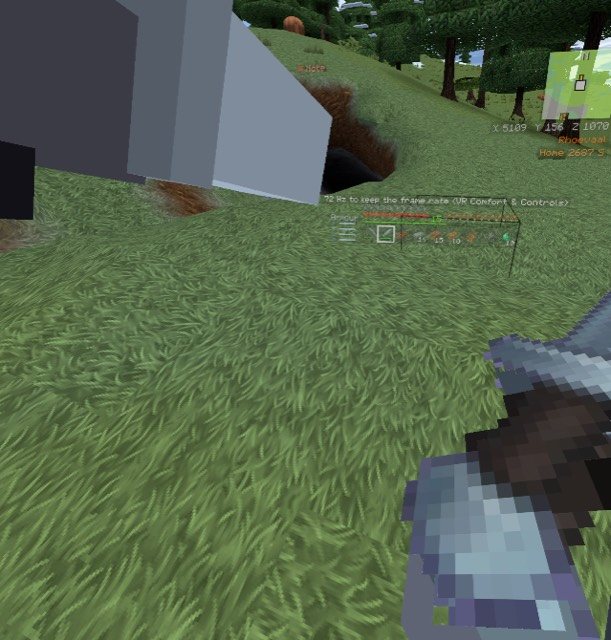

## 07:54:33 - Bitch ass fool

- **Transcript:** Bitch ass fool
- **Status:** open
- **Build:** 0.129 (36269755, M1-M4 (device-tested; ship riding, chests, comfort options, weapon wheel))
- **World:** New World (11) (seed 13480747113613945685)
- **Dimension:** Surface
- **Biome:** Plains
- **Position:** 5127.0 153.8 1050.3
- **Facing:** north (yaw 355, pitch -66)
- **Held:** Titanium Sword x1
- **Mount:** on foot
- **Looking at:** Grass Block at 5126 153 1049
- **Mode:** Survival, health 20/20
- **Time:** day 6 11:04, clear
- **Fps:** 45
- **Levels:** mic -37 dBFS, game sound -22 dBFS
- **Length:** 2.3 s (voice 0.7 s)
- **Just before:** -25s opened PauseMenu; -23s closed PauseMenu; -23s message: Playtest build: voice bug notes ON, your speech is saved (Options > Interface); -19s message: Walking; -17s walked into Savanna; -15s walked into Forest; --9s walked into Beach; --13s walked into Forest; --15s walked into Savanna; --15s message: Homestead marked on the map; --21s walked into Forest; --21s message: Flying; --25s walked into Beach; --27s walked into Savanna; --31s walked into Sparse Jungle; --33s walked into Jungle; --35s message: Entering Valisstad; --37s opened PauseMenu; -25s closed PauseMenu; -25s holding Titanium Sword; -23s opened PauseMenu; -16s closed PauseMenu; -12s message: 72 Hz to keep the frame rate (VR Comfort & Controls); -9s holding Titanium Pickaxe; -2s holding Titanium Sword; -2s message: Titanium Sword; -2s message: Render distance 15 for now, to keep the frame rate
- **Repro (Mac):** `./snap.sh note --seed 13480747113613945685 --x 5127.0 --z 1050.3 --yaw 5 --pitch -66 --time 0.211`
- **Audio (this Mac):** /Users/darthvadar/Documents/Blocksmith/QuestVoiceNotes/raw/vn-20261018-075433-910.aac

## 07:54:54 - Yeah, so physically and right, like if I like hold on to an item and s

- **Transcript:** Yeah, so physically and right, like if I like hold on to an item and swing my arm, that thing should go fucking flying. Should be able to hit shit too. Like I'm talking full on ragdoll physics
- **Status:** open
- **Build:** 0.129 (36269755, M1-M4 (device-tested; ship riding, chests, comfort options, weapon wheel))
- **World:** New World (11) (seed 13480747113613945685)
- **Dimension:** Surface
- **Biome:** Plains
- **Position:** 5109.3 159.6 1050.1
- **Facing:** east (yaw 80, pitch -72)
- **Held:** Titanium Sword x1
- **Mount:** on foot
- **Looking at:** Grass Block at 5109 159 1049
- **Mode:** Survival, health 20/20
- **Time:** day 6 11:24, clear
- **Fps:** 54
- **Levels:** mic -31 dBFS, game sound -15 dBFS
- **Length:** 11.6 s (voice 6.8 s)
- **Just before:** -8s walked into Beach; -4s walked into Forest; -2s walked into Savanna; -2s message: Homestead marked on the map; --4s walked into Forest; --4s message: Flying; --8s walked into Beach; --10s walked into Savanna; --14s walked into Sparse Jungle; --16s walked into Jungle; --18s message: Entering Valisstad; --20s opened PauseMenu; -29s message: 72 Hz to keep the frame rate (VR Comfort & Controls); -26s holding Titanium Pickaxe; -20s holding Titanium Sword; -20s message: Titanium Sword; -19s message: Render distance 15 for now, to keep the frame rate; -17s holding Acacia Boat; -14s holding Titanium Sword; -14s message: Titanium Sword; -3s message: Render distance 14 for now, to keep the frame rate
- **While talking:** -0s walked into Forest; --0s message: Flying; --4s walked into Beach; --6s walked into Savanna; --10s walked into Sparse Jungle; --12s walked into Jungle; --14s message: Entering Valisstad; --16s opened PauseMenu; -4s walked into Forest; -4s message: Flying; -0s walked into Beach; --2s walked into Savanna; --6s walked into Sparse Jungle; --8s walked into Jungle; --10s message: Entering Valisstad; --12s opened PauseMenu
- **Position at the end:** 5119.1 166.0 1012.7
- **Repro (Mac):** `./snap.sh note --seed 13480747113613945685 --x 5109.3 --z 1050.1 --yaw -80 --pitch -72 --time 0.225`
- **Audio (this Mac):** /Users/darthvadar/Documents/Blocksmith/QuestVoiceNotes/raw/vn-20261018-075454-890.aac

## 07:55:17 - I tell you, they made video games back in the '90s that were, you know

- **Transcript:** I tell you, they made video games back in the '90s that were, you know, fairly decent, and they ran on hundreds of megabytes or very low compute and
- **Status:** open
- **Build:** 0.129 (36269755, M1-M4 (device-tested; ship riding, chests, comfort options, weapon wheel))
- **World:** New World (11) (seed 13480747113613945685)
- **Dimension:** Surface
- **Biome:** Plains
- **Position:** 5080.0 180.3 946.6
- **Facing:** north-west (yaw 295, pitch -46)
- **Held:** Titanium Sword x1
- **Mount:** on foot
- **Looking at:** Snow at 5079 180 946
- **Mode:** Survival, health 20/20
- **Time:** day 6 11:48, clear
- **Fps:** 68
- **Levels:** mic -33 dBFS, game sound -15 dBFS
- **Length:** 10.7 s (voice 5.8 s)
- **Just before:** -28s walked into Beach; -24s walked into Forest; -22s walked into Savanna; -22s message: Homestead marked on the map; -16s walked into Forest; -16s message: Flying; -12s walked into Beach; -10s walked into Savanna; -6s walked into Sparse Jungle; -4s walked into Jungle; -2s message: Entering Valisstad; -0s opened PauseMenu; -23s message: Render distance 14 for now, to keep the frame rate
- **While talking:** -5s opened PauseMenu; -1s walked into Plains; -4s walked into Snowy Slopes; -1s holding Acacia Boat; -1s message: Acacia Boat
- **Position at the end:** 5009.5 183.0 918.4
- **Repro (Mac):** `./snap.sh note --seed 13480747113613945685 --x 5080.0 --z 946.6 --yaw 65 --pitch -46 --time 0.242`
- **Audio (this Mac):** /Users/darthvadar/Documents/Blocksmith/QuestVoiceNotes/raw/vn-20261018-075517-470.aac

## 07:55:28 - There's no reason why we can't make this game more efficient. No reaso

- **Transcript:** There's no reason why we can't make this game more efficient. No reason at all
- **Status:** open
- **Build:** 0.129 (36269755, M1-M4 (device-tested; ship riding, chests, comfort options, weapon wheel))
- **World:** New World (11) (seed 13480747113613945685)
- **Dimension:** Surface
- **Biome:** Snowy Slopes
- **Position:** 5004.1 182.4 915.2
- **Facing:** west (yaw 284, pitch -58)
- **Held:** Acacia Boat x1
- **Mount:** on foot
- **Looking at:** Snow Block at 5003 181 915
- **Mode:** Survival, health 20/20
- **Time:** day 6 12:00, clear
- **Fps:** 70
- **Levels:** mic -23 dBFS, game sound -16 dBFS
- **Length:** 5.2 s (voice 2.3 s)
- **Just before:** -26s walked into Forest; -26s message: Flying; -22s walked into Beach; -20s walked into Savanna; -16s walked into Sparse Jungle; -14s walked into Jungle; -12s message: Entering Valisstad; -11s opened PauseMenu; -6s walked into Plains; -4s walked into Snowy Slopes; -2s holding Acacia Boat; -2s message: Acacia Boat
- **Repro (Mac):** `./snap.sh note --seed 13480747113613945685 --x 5004.1 --z 915.2 --yaw 76 --pitch -58 --time 0.250`
- **Audio (this Mac):** /Users/darthvadar/Documents/Blocksmith/QuestVoiceNotes/raw/vn-20261018-075528-330.aac

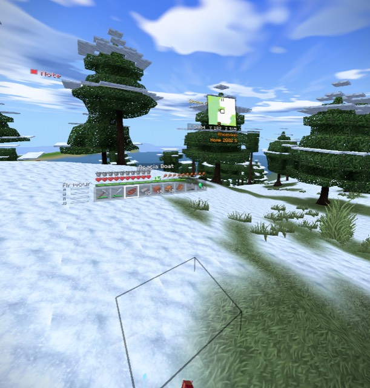

## 07:55:41 - Stone Gulch. Hmm

- **Transcript:** Stone Gulch. Hmm
- **Status:** open
- **Build:** 0.129 (36269755, M1-M4 (device-tested; ship riding, chests, comfort options, weapon wheel))
- **World:** New World (11) (seed 13480747113613945685)
- **Dimension:** Surface
- **Biome:** Taiga
- **Position:** 4975.0 174.0 904.9
- **Facing:** south-east (yaw 132, pitch -71)
- **Held:** Titanium Sword x1
- **Mount:** on foot
- **Looking at:** Snow at 4975 174 905
- **Mode:** Survival, health 20/20
- **Time:** day 6 12:13, clear
- **Fps:** 68
- **Levels:** mic -32 dBFS, game sound -20 dBFS
- **Length:** 3.4 s (voice 0.9 s)
- **Just before:** -29s walked into Sparse Jungle; -27s walked into Jungle; -25s message: Entering Valisstad; -23s opened PauseMenu; -19s walked into Plains; -17s walked into Snowy Slopes; -14s holding Acacia Boat; -14s message: Acacia Boat; -11s walked into Taiga; -9s holding Iron Ingot; -9s message: Iron Ingot; -9s holding Acacia Boat; -9s message: Acacia Boat; -9s holding Titanium Sword; -9s message: Titanium Sword; -8s took 1 damage (health 19/20); -5s opened PauseMenu; -3s closed PauseMenu
- **Repro (Mac):** `./snap.sh note --seed 13480747113613945685 --x 4975.0 --z 904.9 --yaw -132 --pitch -71 --time 0.260`
- **Audio (this Mac):** /Users/darthvadar/Documents/Blocksmith/QuestVoiceNotes/raw/vn-20261018-075541-550.aac

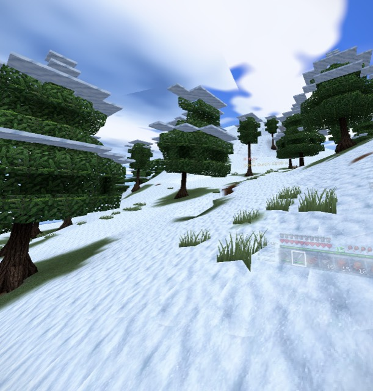

## 07:55:47 - Uh, fire's still fucked

- **Transcript:** Uh, fire's still fucked
- **Status:** open
- **Build:** 0.129 (36269755, M1-M4 (device-tested; ship riding, chests, comfort options, weapon wheel))
- **World:** New World (11) (seed 13480747113613945685)
- **Dimension:** Surface
- **Biome:** Snowy Slopes
- **Position:** 4998.9 179.9 871.7
- **Facing:** east (yaw 108, pitch -83)
- **Held:** Titanium Sword x1
- **Mount:** on foot
- **Looking at:** Snow Block at 4999 179 871
- **Mode:** Survival, health 20/20
- **Time:** day 6 12:21, clear
- **Fps:** 71
- **Levels:** mic -36 dBFS, game sound -13 dBFS
- **Length:** 2.4 s (voice 0.7 s)
- **Just before:** -29s opened PauseMenu; -25s walked into Plains; -23s walked into Snowy Slopes; -20s holding Acacia Boat; -20s message: Acacia Boat; -17s walked into Taiga; -15s holding Iron Ingot; -15s message: Iron Ingot; -15s holding Acacia Boat; -15s message: Acacia Boat; -15s holding Titanium Sword; -15s message: Titanium Sword; -14s took 1 damage (health 19/20); -11s opened PauseMenu; -9s closed PauseMenu; -1s walked into Snowy Slopes
- **Repro (Mac):** `./snap.sh note --seed 13480747113613945685 --x 4998.9 --z 871.7 --yaw -108 --pitch -83 --time 0.265`
- **Audio (this Mac):** /Users/darthvadar/Documents/Blocksmith/QuestVoiceNotes/raw/vn-20261018-075547-550.aac

## 07:57:56 - I love that. [laughs]

- **Transcript:** I love that. [laughs]
- **Status:** open
- **Build:** 0.129 (36269755, M1-M4 (device-tested; ship riding, chests, comfort options, weapon wheel))
- **World:** New World (11) (seed 13480747113613945685)
- **Dimension:** Surface
- **Biome:** Sunflower Plains
- **Position:** 5760.7 76.0 615.4
- **Facing:** south-east (yaw 115, pitch -70)
- **Held:** Titanium Sword x1
- **Mount:** on foot
- **Looking at:** Grass Block at 5761 75 615
- **Mode:** Survival, health 20/20
- **Time:** day 6 14:46, clear
- **Fps:** 70
- **Levels:** mic -34 dBFS, game sound -20 dBFS
- **Length:** 3.4 s (voice 0.6 s)
- **Just before:** -25s walked into Plains; -23s walked into Sunflower Plains; -15s walked into River; -11s walked into Sunflower Plains; -4s message: Your pack is full: the Sunflower stays on the ground
- **Repro (Mac):** `./snap.sh note --seed 13480747113613945685 --x 5760.7 --z 615.4 --yaw -115 --pitch -70 --time 0.366`
- **Audio (this Mac):** /Users/darthvadar/Documents/Blocksmith/QuestVoiceNotes/raw/vn-20261018-075756-810.aac

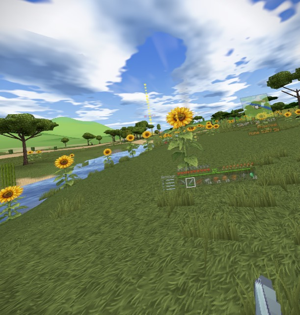

## 07:58:00 - Oh, geez, that was great, man

- **Transcript:** Oh, geez, that was great, man
- **Status:** open
- **Build:** 0.129 (36269755, M1-M4 (device-tested; ship riding, chests, comfort options, weapon wheel))
- **World:** New World (11) (seed 13480747113613945685)
- **Dimension:** Surface
- **Biome:** Sunflower Plains
- **Position:** 5787.5 77.0 626.5
- **Facing:** south-east (yaw 127, pitch -25)
- **Held:** Titanium Sword x1
- **Mount:** on foot
- **Looking at:** Grass Block at 5790 76 628
- **Mode:** Survival, health 20/20
- **Time:** day 6 14:50, clear
- **Fps:** 70
- **Levels:** mic -40 dBFS, game sound -18 dBFS
- **Length:** 3.3 s (voice 1.2 s)
- **Just before:** -29s walked into Plains; -27s walked into Sunflower Plains; -19s walked into River; -15s walked into Sunflower Plains; -7s message: Your pack is full: the Sunflower stays on the ground
- **Repro (Mac):** `./snap.sh note --seed 13480747113613945685 --x 5787.5 --z 626.5 --yaw -127 --pitch -25 --time 0.369`
- **Audio (this Mac):** /Users/darthvadar/Documents/Blocksmith/QuestVoiceNotes/raw/vn-20261018-075800-450.aac

## 07:58:09 - Water actually meshed all right over here. Not bad

- **Transcript:** Water actually meshed all right over here. Not bad
- **Status:** open
- **Build:** 0.129 (36269755, M1-M4 (device-tested; ship riding, chests, comfort options, weapon wheel))
- **World:** New World (11) (seed 13480747113613945685)
- **Dimension:** Surface
- **Biome:** Plains
- **Position:** 5841.8 78.0 640.8
- **Facing:** south-east (yaw 155, pitch -51)
- **Held:** Titanium Sword x1
- **Mount:** on foot
- **Looking at:** Grass Block at 5842 77 641
- **Mode:** Survival, health 20/20
- **Time:** day 6 15:00, clear
- **Fps:** 68
- **Levels:** mic -32 dBFS, game sound -25 dBFS
- **Length:** 4.2 s (voice 1.6 s)
- **Just before:** -27s walked into River; -23s walked into Sunflower Plains; -16s message: Your pack is full: the Sunflower stays on the ground; -3s walked into River; -1s walked into Desert
- **Repro (Mac):** `./snap.sh note --seed 13480747113613945685 --x 5841.8 --z 640.8 --yaw -155 --pitch -51 --time 0.375`
- **Audio (this Mac):** /Users/darthvadar/Documents/Blocksmith/QuestVoiceNotes/raw/vn-20261018-075809-430.aac

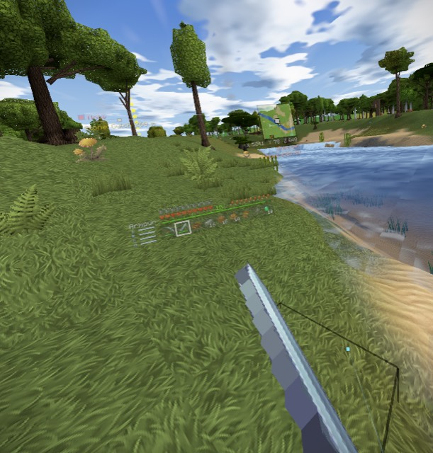

## 07:59:10 - Why are the people sitting down? We should have chairs in the game. Ad

- **Transcript:** Why are the people sitting down? We should have chairs in the game. Add actual fucking chairs
- **Status:** open
- **Build:** 0.129 (36269755, M1-M4 (device-tested; ship riding, chests, comfort options, weapon wheel))
- **World:** New World (11) (seed 13480747113613945685)
- **Dimension:** Surface
- **Biome:** Savanna
- **Position:** 6094.4 88.0 688.6
- **Facing:** south-east (yaw 123, pitch -62)
- **Held:** Acacia Planks x15
- **Mount:** on foot
- **Looking at:** Acacia Planks at 6094 87 689
- **Mode:** Survival, health 17/20
- **Time:** day 6 16:12, clear
- **Fps:** 71
- **Levels:** mic -36 dBFS, game sound -18 dBFS
- **Length:** 5.8 s (voice 3.4 s)
- **Just before:** -23s walked into Forest; -22s took 3 damage (health 17/20); -18s walked into Plains; -18s message: Stone Gulch marked on the map; -16s walked into Forest; -14s walked into Savanna; -11s holding Acacia Boat; -11s message: Acacia Boat; -4s holding Iron Ingot; -4s message: Iron Ingot; -4s holding Acacia Planks; -4s message: Acacia Planks
- **While talking:** -3s message: Otis Pruitt: You're covered in blood. Is any of it yours?; -1s opened ShopMenu
- **Position at the end:** 6098.7 88.0 689.5
- **Repro (Mac):** `./snap.sh note --seed 13480747113613945685 --x 6094.4 --z 688.6 --yaw -123 --pitch -62 --time 0.425`
- **Audio (this Mac):** /Users/darthvadar/Documents/Blocksmith/QuestVoiceNotes/raw/vn-20261018-075910-550.aac

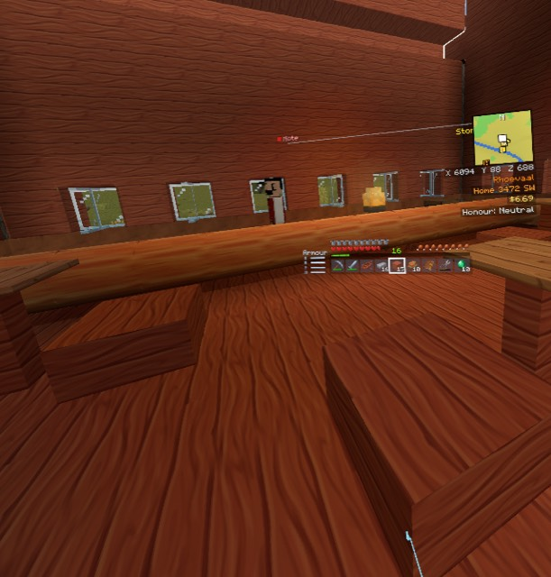

## 07:59:21 - Black coffee. Okay, this should be an actual coffee cup for coffee. Sa

- **Transcript:** Black coffee. Okay, this should be an actual coffee cup for coffee. Same with cold lemonade and
- **Status:** open
- **Build:** 0.129 (36269755, M1-M4 (device-tested; ship riding, chests, comfort options, weapon wheel))
- **World:** New World (11) (seed 13480747113613945685)
- **Dimension:** Surface
- **Biome:** Savanna
- **Position:** 6098.7 88.0 689.5
- **Facing:** east (yaw 93, pitch -12)
- **Held:** Acacia Planks x15
- **Mount:** on foot
- **Looking at:** nothing
- **Mode:** Survival, health 17/20, screen ShopMenu
- **Time:** day 6 16:25, clear
- **Fps:** 72
- **Levels:** mic -38 dBFS, game sound -22 dBFS
- **Length:** 8.0 s (voice 3.5 s)
- **Just before:** -30s walked into Plains; -29s message: Stone Gulch marked on the map; -28s walked into Forest; -26s walked into Savanna; -23s holding Acacia Boat; -23s message: Acacia Boat; -15s holding Iron Ingot; -15s message: Iron Ingot; -15s holding Acacia Planks; -15s message: Acacia Planks; -9s message: Otis Pruitt: You're covered in blood. Is any of it yours?; -8s opened ShopMenu
- **Position at the end:** 6098.7 88.0 689.5
- **Repro (Mac):** `./snap.sh note --seed 13480747113613945685 --x 6098.7 --z 689.5 --yaw -93 --pitch -12 --time 0.435`
- **Audio (this Mac):** /Users/darthvadar/Documents/Blocksmith/QuestVoiceNotes/raw/vn-20261018-075921-790.aac

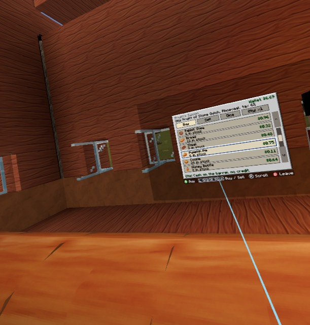

## 07:59:29 - Sars, pariah, whatever the fuck

- **Transcript:** Sars, pariah, whatever the fuck
- **Status:** open
- **Build:** 0.129 (36269755, M1-M4 (device-tested; ship riding, chests, comfort options, weapon wheel))
- **World:** New World (11) (seed 13480747113613945685)
- **Dimension:** Surface
- **Biome:** Savanna
- **Position:** 6098.7 88.0 689.5
- **Facing:** east (yaw 93, pitch -12)
- **Held:** Acacia Planks x15
- **Mount:** on foot
- **Looking at:** nothing
- **Mode:** Survival, health 17/20, screen ShopMenu
- **Time:** day 6 16:35, clear
- **Fps:** 72
- **Levels:** mic -34 dBFS, game sound -19 dBFS
- **Length:** 3.3 s (voice 1.0 s)
- **Just before:** -23s holding Iron Ingot; -23s message: Iron Ingot; -23s holding Acacia Planks; -23s message: Acacia Planks; -17s message: Otis Pruitt: You're covered in blood. Is any of it yours?; -16s opened ShopMenu
- **Repro (Mac):** `./snap.sh note --seed 13480747113613945685 --x 6098.7 --z 689.5 --yaw -93 --pitch -12 --time 0.441`
- **Audio (this Mac):** /Users/darthvadar/Documents/Blocksmith/QuestVoiceNotes/raw/vn-20261018-075929-710.aac

## 07:59:52 - That filled me up, but okay

- **Transcript:** That filled me up, but okay
- **Status:** open
- **Build:** 0.129 (36269755, M1-M4 (device-tested; ship riding, chests, comfort options, weapon wheel))
- **World:** New World (11) (seed 13480747113613945685)
- **Dimension:** Surface
- **Biome:** Savanna
- **Position:** 6093.3 88.0 690.0
- **Facing:** west (yaw 252, pitch -23)
- **Held:** Glass Bottle x1
- **Mount:** on foot
- **Looking at:** Coarse Dirt at 6089 87 691
- **Mode:** Survival, health 18/20
- **Time:** day 6 17:02, clear
- **Fps:** 72
- **Levels:** mic -46 dBFS, game sound -22 dBFS
- **Length:** 3.4 s (voice 1.0 s)
- **Just before:** -15s message: Honour raised (a fair trade); -15s closed ShopMenu; -13s message: Otis Pruitt: Eat up, there's plenty.; -13s opened InventoryMenu; -11s message: Your pack is full: the Black Coffee stays on the ground; -8s closed InventoryMenu; -7s holding Black Coffee; -7s message: Black Coffee; -4s holding Glass Bottle
- **Repro (Mac):** `./snap.sh note --seed 13480747113613945685 --x 6093.3 --z 690.0 --yaw 108 --pitch -23 --time 0.460`
- **Audio (this Mac):** /Users/darthvadar/Documents/Blocksmith/QuestVoiceNotes/raw/vn-20261018-075952-590.aac

## 08:00:12 - Son of a bitch. All right, I'm gonna test something, see if something 

- **Transcript:** Son of a bitch. All right, I'm gonna test something, see if something was fixed from a while back
- **Status:** open
- **Build:** 0.129 (36269755, M1-M4 (device-tested; ship riding, chests, comfort options, weapon wheel))
- **World:** New World (11) (seed 13480747113613945685)
- **Dimension:** Surface
- **Biome:** Savanna
- **Position:** 6083.7 88.0 689.2
- **Facing:** south-west (yaw 222, pitch -6)
- **Held:** Acacia Boat x1
- **Mount:** on foot
- **Looking at:** Hay Bale at 6079 89 692
- **Mode:** Survival, health 19/20
- **Time:** day 6 17:26, clear
- **Fps:** 72
- **Levels:** mic -36 dBFS, game sound -24 dBFS
- **Length:** 7.2 s (voice 3.6 s)
- **Just before:** -27s closed InventoryMenu; -27s holding Black Coffee; -27s message: Black Coffee; -23s holding Glass Bottle; -18s holding Acacia Boat; -18s message: Acacia Boat; -18s holding Titanium Sword; -18s message: Titanium Sword; -15s holding Acacia Boat; -15s message: Acacia Boat; -14s message: Willa Fenwick: A fellow tried to pay me in buttons once.; -10s opened ShopMenu; -10s message: Willa Fenwick: Been butchering, have you?; -2s closed ShopMenu; -2s message: Willa Fenwick: Sorry, we're closed. Come back in the morning.
- **While talking:** -1s opened InventoryMenu; -0s closed InventoryMenu
- **Position at the end:** 6090.0 87.0 701.0
- **Repro (Mac):** `./snap.sh note --seed 13480747113613945685 --x 6083.7 --z 689.2 --yaw 138 --pitch -6 --time 0.477`
- **Audio (this Mac):** /Users/darthvadar/Documents/Blocksmith/QuestVoiceNotes/raw/vn-20261018-080012-150.aac

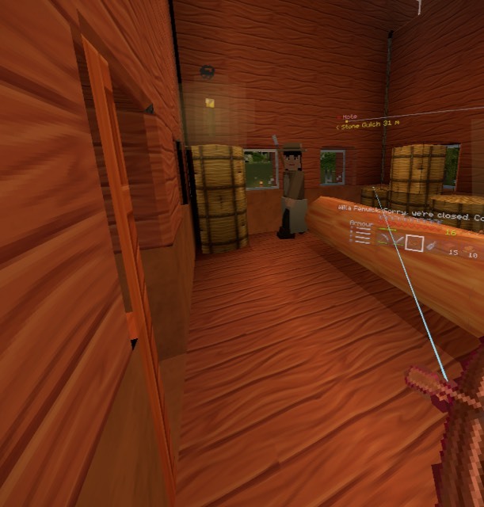

## 08:00:20 - I'm gonna put a bed on the ground, my very own bed, and we're gonna se

- **Transcript:** I'm gonna put a bed on the ground, my very own bed, and we're gonna see
- **Status:** open
- **Build:** 0.129 (36269755, M1-M4 (device-tested; ship riding, chests, comfort options, weapon wheel))
- **World:** New World (11) (seed 13480747113613945685)
- **Dimension:** Surface
- **Biome:** Savanna
- **Position:** 6095.2 87.0 702.2
- **Facing:** east (yaw 103, pitch -29)
- **Held:** White Bed x1
- **Mount:** on foot
- **Looking at:** Grass Block at 6097 86 702
- **Mode:** Survival, health 19/20
- **Time:** day 6 17:36, clear
- **Fps:** 72
- **Levels:** mic -40 dBFS, game sound -22 dBFS
- **Length:** 4.7 s (voice 2.5 s)
- **Just before:** -26s holding Acacia Boat; -26s message: Acacia Boat; -26s holding Titanium Sword; -26s message: Titanium Sword; -23s holding Acacia Boat; -23s message: Acacia Boat; -22s message: Willa Fenwick: A fellow tried to pay me in buttons once.; -19s opened ShopMenu; -19s message: Willa Fenwick: Been butchering, have you?; -10s closed ShopMenu; -10s message: Willa Fenwick: Sorry, we're closed. Come back in the morning.; -5s opened InventoryMenu; -3s closed InventoryMenu; -3s holding Glass Bottle; -3s message: Glass Bottle; -2s holding Acacia Planks; -2s message: Acacia Planks; -2s holding Raw Copper; -2s message: Raw Copper; -1s holding Written Book; -1s message: Written Book; -1s holding Shears; -1s message: Shears; -1s holding White Bed; -1s message: White Bed; -1s holding Titanium Pickaxe; -1s message: Titanium Pickaxe; -0s holding White Bed; -0s message: White Bed
- **Repro (Mac):** `./snap.sh note --seed 13480747113613945685 --x 6095.2 --z 702.2 --yaw -103 --pitch -29 --time 0.484`
- **Audio (this Mac):** /Users/darthvadar/Documents/Blocksmith/QuestVoiceNotes/raw/vn-20261018-080020-550.aac

## 08:00:24 - If I get in trouble for this

- **Transcript:** If I get in trouble for this
- **Status:** open
- **Build:** 0.129 (36269755, M1-M4 (device-tested; ship riding, chests, comfort options, weapon wheel))
- **World:** New World (11) (seed 13480747113613945685)
- **Dimension:** Surface
- **Biome:** Savanna
- **Position:** 6097.4 87.0 702.2
- **Facing:** east (yaw 108, pitch -40)
- **Held:** empty hand
- **Mount:** on foot
- **Looking at:** White Bed at 6098 87 702
- **Mode:** Survival, health 19/20
- **Time:** day 6 17:41, clear
- **Fps:** 72
- **Levels:** mic -25 dBFS, game sound -31 dBFS
- **Length:** 2.5 s (voice 1.1 s)
- **Just before:** -28s holding Acacia Boat; -28s message: Acacia Boat; -27s message: Willa Fenwick: A fellow tried to pay me in buttons once.; -23s opened ShopMenu; -23s message: Willa Fenwick: Been butchering, have you?; -15s closed ShopMenu; -15s message: Willa Fenwick: Sorry, we're closed. Come back in the morning.; -9s opened InventoryMenu; -8s closed InventoryMenu; -7s holding Glass Bottle; -7s message: Glass Bottle; -6s holding Acacia Planks; -6s message: Acacia Planks; -6s holding Raw Copper; -6s message: Raw Copper; -6s holding Written Book; -6s message: Written Book; -5s holding Shears; -5s message: Shears; -5s holding White Bed; -5s message: White Bed; -5s holding Titanium Pickaxe; -5s message: Titanium Pickaxe; -5s holding White Bed; -5s message: White Bed; -4s holding empty hand
- **Repro (Mac):** `./snap.sh note --seed 13480747113613945685 --x 6097.4 --z 702.2 --yaw -108 --pitch -40 --time 0.487`
- **Audio (this Mac):** /Users/darthvadar/Documents/Blocksmith/QuestVoiceNotes/raw/vn-20261018-080024-950.aac

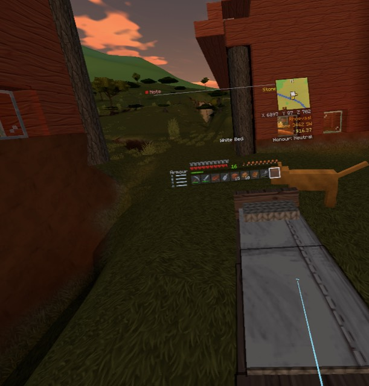

## 08:00:32 - Okay, no one cares

- **Transcript:** Okay, no one cares
- **Status:** open
- **Build:** 0.129 (36269755, M1-M4 (device-tested; ship riding, chests, comfort options, weapon wheel))
- **World:** New World (11) (seed 13480747113613945685)
- **Dimension:** Surface
- **Biome:** Savanna
- **Position:** 6097.0 87.0 702.0
- **Facing:** east (yaw 100, pitch -37)
- **Held:** empty hand
- **Mount:** on foot
- **Looking at:** White Bed at 6098 87 702
- **Mode:** Survival, health 19/20
- **Time:** day 7 06:16, clear
- **Fps:** 71
- **Levels:** mic -28 dBFS, game sound -22 dBFS
- **Length:** 2.3 s (voice 0.7 s)
- **Just before:** -22s closed ShopMenu; -22s message: Willa Fenwick: Sorry, we're closed. Come back in the morning.; -16s opened InventoryMenu; -15s closed InventoryMenu; -14s holding Glass Bottle; -14s message: Glass Bottle; -13s holding Acacia Planks; -13s message: Acacia Planks; -13s holding Raw Copper; -13s message: Raw Copper; -13s holding Written Book; -13s message: Written Book; -13s holding Shears; -13s message: Shears; -12s holding White Bed; -12s message: White Bed; -12s holding Titanium Pickaxe; -12s message: Titanium Pickaxe; -12s holding White Bed; -12s message: White Bed; -11s holding empty hand; -7s message: Respawn point set; -2s message: Good morning; -0s message: A stranger in town: Abigail Hale
- **Repro (Mac):** `./snap.sh note --seed 13480747113613945685 --x 6097.0 --z 702.0 --yaw -100 --pitch -37 --time 0.011`
- **Audio (this Mac):** /Users/darthvadar/Documents/Blocksmith/QuestVoiceNotes/raw/vn-20261018-080032-050.aac

## 08:00:45 - Like that

- **Transcript:** Like that
- **Status:** open
- **Build:** 0.129 (36269755, M1-M4 (device-tested; ship riding, chests, comfort options, weapon wheel))
- **World:** New World (11) (seed 13480747113613945685)
- **Dimension:** Surface
- **Biome:** Savanna
- **Position:** 6093.4 83.7 712.9
- **Facing:** south (yaw 181, pitch -39)
- **Held:** Acacia Boat x1
- **Mount:** on foot
- **Looking at:** Coarse Dirt at 6093 83 714
- **Mode:** Survival, health 19/20
- **Time:** day 7 06:32, clear
- **Fps:** 70
- **Levels:** mic -39 dBFS, game sound -23 dBFS
- **Length:** 2.2 s (voice 0.4 s)
- **Just before:** -29s opened InventoryMenu; -28s closed InventoryMenu; -27s holding Glass Bottle; -27s message: Glass Bottle; -27s holding Acacia Planks; -27s message: Acacia Planks; -26s holding Raw Copper; -26s message: Raw Copper; -26s holding Written Book; -26s message: Written Book; -26s holding Shears; -26s message: Shears; -25s holding White Bed; -25s message: White Bed; -25s holding Titanium Pickaxe; -25s message: Titanium Pickaxe; -25s holding White Bed; -25s message: White Bed; -24s holding empty hand; -20s message: Respawn point set; -15s message: Good morning; -13s message: A stranger in town: Abigail Hale; -11s message: Savismoor has gone to war with Rhoevaal; -11s holding White Bed; -7s holding Titanium Pickaxe; -7s message: Titanium Pickaxe; -7s holding Titanium Sword; -7s message: Titanium Sword; -7s holding Acacia Boat; -7s message: Acacia Boat; -6s message: Flora Kettering: That's a lot of blood on one coat.; -0s message: You've reached Stone Gulch
- **Repro (Mac):** `./snap.sh note --seed 13480747113613945685 --x 6093.4 --z 712.9 --yaw 179 --pitch -39 --time 0.022`
- **Audio (this Mac):** /Users/darthvadar/Documents/Blocksmith/QuestVoiceNotes/raw/vn-20261018-080045-410.aac

## 08:00:49 - Hey, little boy. What you doing?

- **Transcript:** Hey, little boy. What you doing?
- **Status:** open
- **Build:** 0.129 (36269755, M1-M4 (device-tested; ship riding, chests, comfort options, weapon wheel))
- **World:** New World (11) (seed 13480747113613945685)
- **Dimension:** Surface
- **Biome:** Savanna
- **Position:** 6086.0 84.0 725.1
- **Facing:** south-west (yaw 203, pitch -14)
- **Held:** Acacia Boat x1
- **Mount:** on foot
- **Looking at:** Acacia Door at 6084 84 728
- **Mode:** Survival, health 19/20
- **Time:** day 7 06:36, clear
- **Fps:** 70
- **Levels:** mic -37 dBFS, game sound -23 dBFS
- **Length:** 3.7 s (voice 1.5 s)
- **Just before:** -30s holding Written Book; -30s message: Written Book; -29s holding Shears; -29s message: Shears; -29s holding White Bed; -29s message: White Bed; -29s holding Titanium Pickaxe; -29s message: Titanium Pickaxe; -29s holding White Bed; -29s message: White Bed; -28s holding empty hand; -24s message: Respawn point set; -19s message: Good morning; -17s message: A stranger in town: Abigail Hale; -15s message: Savismoor has gone to war with Rhoevaal; -14s holding White Bed; -11s holding Titanium Pickaxe; -11s message: Titanium Pickaxe; -11s holding Titanium Sword; -11s message: Titanium Sword; -10s holding Acacia Boat; -10s message: Acacia Boat; -10s message: Flora Kettering: That's a lot of blood on one coat.; -4s message: You've reached Stone Gulch; -2s walked into River
- **Repro (Mac):** `./snap.sh note --seed 13480747113613945685 --x 6086.0 --z 725.1 --yaw 157 --pitch -14 --time 0.026`
- **Audio (this Mac):** /Users/darthvadar/Documents/Blocksmith/QuestVoiceNotes/raw/vn-20261018-080049-290.aac

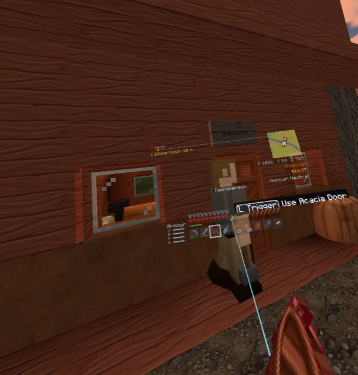

## 08:00:57 - Iron, just iron

- **Transcript:** Iron, just iron
- **Status:** open
- **Build:** 0.129 (36269755, M1-M4 (device-tested; ship riding, chests, comfort options, weapon wheel))
- **World:** New World (11) (seed 13480747113613945685)
- **Dimension:** Surface
- **Biome:** Savanna
- **Position:** 6084.5 84.0 728.8
- **Facing:** south-east (yaw 152, pitch -17)
- **Held:** Acacia Boat x1
- **Mount:** on foot
- **Looking at:** nothing
- **Mode:** Survival, health 19/20, screen ShopMenu
- **Time:** day 7 06:46, clear
- **Fps:** 72
- **Levels:** mic -34 dBFS, game sound -18 dBFS
- **Length:** 3.9 s (voice 1.2 s)
- **Just before:** -26s message: Good morning; -25s message: A stranger in town: Abigail Hale; -23s message: Savismoor has gone to war with Rhoevaal; -22s holding White Bed; -19s holding Titanium Pickaxe; -19s message: Titanium Pickaxe; -19s holding Titanium Sword; -19s message: Titanium Sword; -18s holding Acacia Boat; -18s message: Acacia Boat; -18s message: Flora Kettering: That's a lot of blood on one coat.; -12s message: You've reached Stone Gulch; -10s walked into River; -8s walked into Savanna; -4s opened ShopMenu; -4s message: Rosalie Fairweather: Up with the roosters, are you?
- **Repro (Mac):** `./snap.sh note --seed 13480747113613945685 --x 6084.5 --z 728.8 --yaw -152 --pitch -17 --time 0.032`
- **Audio (this Mac):** /Users/darthvadar/Documents/Blocksmith/QuestVoiceNotes/raw/vn-20261018-080057-070.aac

## 08:01:01 - Um, hmm. I should get myself some platinum. Be laughing then

- **Transcript:** Um, hmm. I should get myself some platinum. Be laughing then
- **Status:** open
- **Build:** 0.129 (36269755, M1-M4 (device-tested; ship riding, chests, comfort options, weapon wheel))
- **World:** New World (11) (seed 13480747113613945685)
- **Dimension:** Surface
- **Biome:** Savanna
- **Position:** 6084.5 84.0 728.8
- **Facing:** south-east (yaw 152, pitch -17)
- **Held:** Acacia Boat x1
- **Mount:** on foot
- **Looking at:** nothing
- **Mode:** Survival, health 19/20, screen ShopMenu
- **Time:** day 7 06:51, clear
- **Fps:** 72
- **Levels:** mic -38 dBFS, game sound -18 dBFS
- **Length:** 6.1 s (voice 2.8 s)
- **Just before:** -30s message: A stranger in town: Abigail Hale; -27s message: Savismoor has gone to war with Rhoevaal; -27s holding White Bed; -23s holding Titanium Pickaxe; -23s message: Titanium Pickaxe; -23s holding Titanium Sword; -23s message: Titanium Sword; -23s holding Acacia Boat; -23s message: Acacia Boat; -23s message: Flora Kettering: That's a lot of blood on one coat.; -17s message: You've reached Stone Gulch; -14s walked into River; -12s walked into Savanna; -8s opened ShopMenu; -8s message: Rosalie Fairweather: Up with the roosters, are you?
- **While talking:** -3s closed ShopMenu; -3s message: Rosalie Fairweather: Come again!
- **Position at the end:** 6093.5 84.0 730.8
- **Repro (Mac):** `./snap.sh note --seed 13480747113613945685 --x 6084.5 --z 728.8 --yaw -152 --pitch -17 --time 0.036`
- **Audio (this Mac):** /Users/darthvadar/Documents/Blocksmith/QuestVoiceNotes/raw/vn-20261018-080101-750.aac

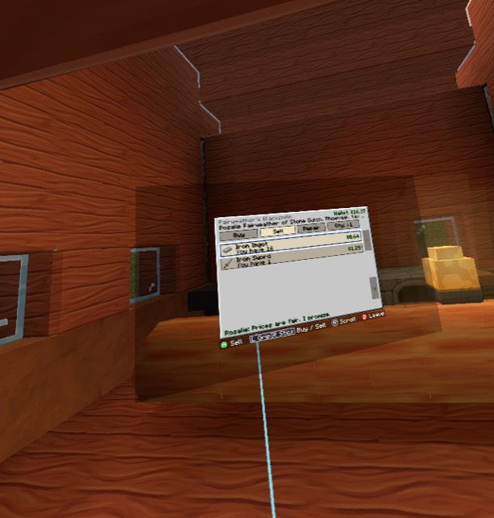

## 08:01:08 - Yeah, yeah. Gunsmith? Oh, hell yeah

- **Transcript:** Yeah, yeah. Gunsmith? Oh, hell yeah
- **Status:** open
- **Build:** 0.129 (36269755, M1-M4 (device-tested; ship riding, chests, comfort options, weapon wheel))
- **World:** New World (11) (seed 13480747113613945685)
- **Dimension:** Surface
- **Biome:** Savanna
- **Position:** 6104.8 84.0 721.0
- **Facing:** south-east (yaw 128, pitch -12)
- **Held:** Acacia Boat x1
- **Mount:** on foot
- **Looking at:** Acacia Slab at 6109 84 723
- **Mode:** Survival, health 19/20
- **Time:** day 7 07:00, clear
- **Fps:** 72
- **Levels:** mic -28 dBFS, game sound -19 dBFS
- **Length:** 4.0 s (voice 1.8 s)
- **Just before:** -30s message: Flora Kettering: That's a lot of blood on one coat.; -24s message: You've reached Stone Gulch; -22s walked into River; -20s walked into Savanna; -16s opened ShopMenu; -16s message: Rosalie Fairweather: Up with the roosters, are you?; -5s closed ShopMenu; -5s message: Rosalie Fairweather: Come again!; -1s walked into River
- **Repro (Mac):** `./snap.sh note --seed 13480747113613945685 --x 6104.8 --z 721.0 --yaw -128 --pitch -12 --time 0.042`
- **Audio (this Mac):** /Users/darthvadar/Documents/Blocksmith/QuestVoiceNotes/raw/vn-20261018-080108-990.aac

## 08:01:17 - Now here's a change I wanna make. Um, gunsmith should only be selling 

- **Transcript:** Now here's a change I wanna make. Um, gunsmith should only be selling older guns, not the modern capital weapons
- **Status:** open
- **Build:** 0.129 (36269755, M1-M4 (device-tested; ship riding, chests, comfort options, weapon wheel))
- **World:** New World (11) (seed 13480747113613945685)
- **Dimension:** Surface
- **Biome:** Savanna
- **Position:** 6109.7 84.0 727.5
- **Facing:** south-west (yaw 205, pitch -10)
- **Held:** Titanium Pickaxe x1
- **Mount:** on foot
- **Looking at:** nothing
- **Mode:** Survival, health 19/20, screen ShopMenu
- **Time:** day 7 07:10, clear
- **Fps:** 71
- **Levels:** mic -28 dBFS, game sound -17 dBFS
- **Length:** 10.1 s (voice 6.6 s)
- **Just before:** -30s walked into River; -28s walked into Savanna; -24s opened ShopMenu; -24s message: Rosalie Fairweather: Up with the roosters, are you?; -13s closed ShopMenu; -13s message: Rosalie Fairweather: Come again!; -10s walked into River; -8s walked into Savanna; -6s holding Titanium Sword; -6s message: Titanium Sword; -5s holding Titanium Pickaxe; -5s message: Titanium Pickaxe; -3s opened ShopMenu; -3s message: Isaiah Rowe: Don't come near me like that.
- **Position at the end:** 6109.7 84.0 727.5
- **Repro (Mac):** `./snap.sh note --seed 13480747113613945685 --x 6109.7 --z 727.5 --yaw 155 --pitch -10 --time 0.049`
- **Audio (this Mac):** /Users/darthvadar/Documents/Blocksmith/QuestVoiceNotes/raw/vn-20261018-080117-170.aac

## 08:01:28 - Uh, so yeah

- **Transcript:** Uh, so yeah
- **Status:** open
- **Build:** 0.129 (36269755, M1-M4 (device-tested; ship riding, chests, comfort options, weapon wheel))
- **World:** New World (11) (seed 13480747113613945685)
- **Dimension:** Surface
- **Biome:** Savanna
- **Position:** 6109.7 84.0 727.5
- **Facing:** south-west (yaw 205, pitch -10)
- **Held:** Titanium Pickaxe x1
- **Mount:** on foot
- **Looking at:** nothing
- **Mode:** Survival, health 19/20, screen ShopMenu
- **Time:** day 7 07:23, clear
- **Fps:** 72
- **Levels:** mic -42 dBFS, game sound -17 dBFS
- **Length:** 2.6 s (voice 0.9 s)
- **Just before:** -25s closed ShopMenu; -25s message: Rosalie Fairweather: Come again!; -21s walked into River; -19s walked into Savanna; -17s holding Titanium Sword; -17s message: Titanium Sword; -17s holding Titanium Pickaxe; -17s message: Titanium Pickaxe; -14s opened ShopMenu; -14s message: Isaiah Rowe: Don't come near me like that.
- **Repro (Mac):** `./snap.sh note --seed 13480747113613945685 --x 6109.7 --z 727.5 --yaw 155 --pitch -10 --time 0.058`
- **Audio (this Mac):** /Users/darthvadar/Documents/Blocksmith/QuestVoiceNotes/raw/vn-20261018-080128-430.aac

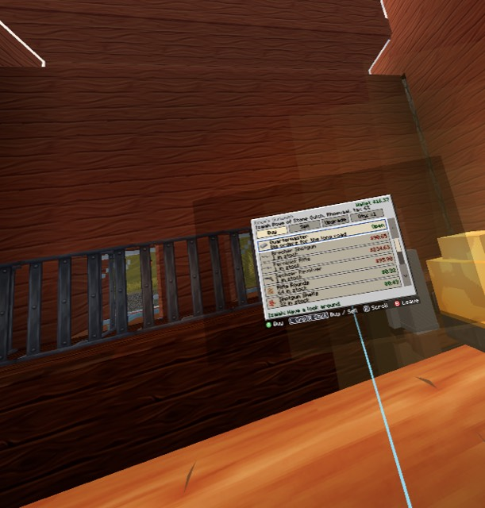

## 08:01:37 - So yeah, like the

- **Transcript:** So yeah, like the
- **Status:** open
- **Build:** 0.129 (36269755, M1-M4 (device-tested; ship riding, chests, comfort options, weapon wheel))
- **World:** New World (11) (seed 13480747113613945685)
- **Dimension:** Surface
- **Biome:** Savanna
- **Position:** 6109.7 84.0 727.5
- **Facing:** south (yaw 185, pitch -7)
- **Held:** Titanium Pickaxe x1
- **Mount:** on foot
- **Looking at:** nothing
- **Mode:** Survival, health 19/20, screen ShopMenu
- **Time:** day 7 07:34, clear
- **Fps:** 71
- **Levels:** mic -28 dBFS, game sound -18 dBFS
- **Length:** 2.3 s (voice 0.8 s)
- **Just before:** -28s walked into Savanna; -26s holding Titanium Sword; -26s message: Titanium Sword; -26s holding Titanium Pickaxe; -26s message: Titanium Pickaxe; -23s opened ShopMenu; -23s message: Isaiah Rowe: Don't come near me like that.; -9s opened GunUpgradeMenu; -9s message: Isaiah Rowe: Tell your friends where you got it.; -4s closed GunUpgradeMenu; -3s opened ShopMenu; -3s message: Isaiah Rowe: Lord, look at the state of you.
- **Repro (Mac):** `./snap.sh note --seed 13480747113613945685 --x 6109.7 --z 727.5 --yaw 175 --pitch -7 --time 0.066`
- **Audio (this Mac):** /Users/darthvadar/Documents/Blocksmith/QuestVoiceNotes/raw/vn-20261018-080137-850.aac

## 08:01:40 - The Sexer revolver, that one's fine

- **Transcript:** The Sexer revolver, that one's fine
- **Status:** open
- **Build:** 0.129 (36269755, M1-M4 (device-tested; ship riding, chests, comfort options, weapon wheel))
- **World:** New World (11) (seed 13480747113613945685)
- **Dimension:** Surface
- **Biome:** Savanna
- **Position:** 6109.7 84.0 727.5
- **Facing:** south (yaw 185, pitch -7)
- **Held:** Titanium Pickaxe x1
- **Mount:** on foot
- **Looking at:** nothing
- **Mode:** Survival, health 19/20, screen ShopMenu
- **Time:** day 7 07:37, clear
- **Fps:** 71
- **Levels:** mic -34 dBFS, game sound -26 dBFS
- **Length:** 4.0 s (voice 2.4 s)
- **Just before:** -29s holding Titanium Sword; -29s message: Titanium Sword; -28s holding Titanium Pickaxe; -28s message: Titanium Pickaxe; -26s opened ShopMenu; -26s message: Isaiah Rowe: Don't come near me like that.; -11s opened GunUpgradeMenu; -11s message: Isaiah Rowe: Tell your friends where you got it.; -6s closed GunUpgradeMenu; -5s opened ShopMenu; -5s message: Isaiah Rowe: Lord, look at the state of you.
- **Repro (Mac):** `./snap.sh note --seed 13480747113613945685 --x 6109.7 --z 727.5 --yaw 175 --pitch -7 --time 0.068`
- **Audio (this Mac):** /Users/darthvadar/Documents/Blocksmith/QuestVoiceNotes/raw/vn-20261018-080140-210.aac

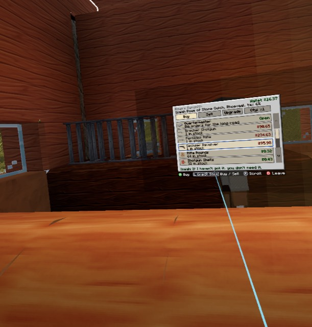

## 08:01:44 - Um, but the tam, the plank and the braja

- **Transcript:** Um, but the tam, the plank and the braja
- **Status:** open
- **Build:** 0.129 (36269755, M1-M4 (device-tested; ship riding, chests, comfort options, weapon wheel))
- **World:** New World (11) (seed 13480747113613945685)
- **Dimension:** Surface
- **Biome:** Savanna
- **Position:** 6109.7 84.0 727.5
- **Facing:** south (yaw 185, pitch -7)
- **Held:** Titanium Pickaxe x1
- **Mount:** on foot
- **Looking at:** nothing
- **Mode:** Survival, health 19/20, screen ShopMenu
- **Time:** day 7 07:42, clear
- **Fps:** 70
- **Levels:** mic -35 dBFS, game sound -32 dBFS
- **Length:** 4.0 s (voice 2.1 s)
- **Just before:** -15s opened GunUpgradeMenu; -15s message: Isaiah Rowe: Tell your friends where you got it.; -11s closed GunUpgradeMenu; -10s opened ShopMenu; -10s message: Isaiah Rowe: Lord, look at the state of you.
- **Repro (Mac):** `./snap.sh note --seed 13480747113613945685 --x 6109.7 --z 727.5 --yaw 175 --pitch -7 --time 0.071`
- **Audio (this Mac):** /Users/darthvadar/Documents/Blocksmith/QuestVoiceNotes/raw/vn-20261018-080144-650.aac

## 08:01:50 - I can't have that. That was-- They're too modern

- **Transcript:** I can't have that. That was-- They're too modern
- **Status:** open
- **Build:** 0.129 (36269755, M1-M4 (device-tested; ship riding, chests, comfort options, weapon wheel))
- **World:** New World (11) (seed 13480747113613945685)
- **Dimension:** Surface
- **Biome:** Savanna
- **Position:** 6109.7 84.0 727.5
- **Facing:** south (yaw 185, pitch -7)
- **Held:** Titanium Pickaxe x1
- **Mount:** on foot
- **Looking at:** nothing
- **Mode:** Survival, health 19/20, screen ShopMenu
- **Time:** day 7 07:49, clear
- **Fps:** 72
- **Levels:** mic -29 dBFS, game sound -35 dBFS
- **Length:** 4.2 s (voice 1.8 s)
- **Just before:** -21s opened GunUpgradeMenu; -21s message: Isaiah Rowe: Tell your friends where you got it.; -17s closed GunUpgradeMenu; -16s opened ShopMenu; -16s message: Isaiah Rowe: Lord, look at the state of you.
- **Repro (Mac):** `./snap.sh note --seed 13480747113613945685 --x 6109.7 --z 727.5 --yaw 175 --pitch -7 --time 0.076`
- **Audio (this Mac):** /Users/darthvadar/Documents/Blocksmith/QuestVoiceNotes/raw/vn-20261018-080150-330.aac

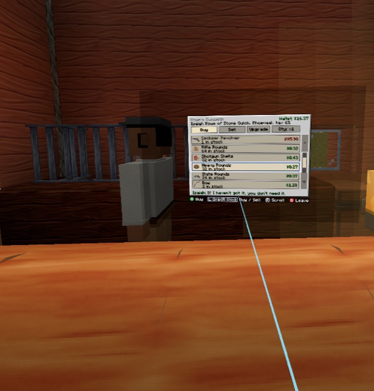

## 08:02:03 - Let's see if the well was fixed

- **Transcript:** Let's see if the well was fixed
- **Status:** open
- **Build:** 0.129 (36269755, M1-M4 (device-tested; ship riding, chests, comfort options, weapon wheel))
- **World:** New World (11) (seed 13480747113613945685)
- **Dimension:** Surface
- **Biome:** Savanna
- **Position:** 6093.1 82.3 718.3
- **Facing:** north-west (yaw 327, pitch -38)
- **Held:** Titanium Pickaxe x1
- **Mount:** on foot
- **Looking at:** Sand at 6092 82 717
- **Mode:** Survival, health 19/20
- **Time:** day 7 08:04, clear
- **Fps:** 67
- **Levels:** mic -42 dBFS, game sound -25 dBFS
- **Length:** 2.6 s (voice 0.7 s)
- **Just before:** -29s closed GunUpgradeMenu; -28s opened ShopMenu; -28s message: Isaiah Rowe: Lord, look at the state of you.; -8s closed ShopMenu; -8s message: Isaiah Rowe: Spread the word!; -1s walked into River
- **Repro (Mac):** `./snap.sh note --seed 13480747113613945685 --x 6093.1 --z 718.3 --yaw 33 --pitch -38 --time 0.087`
- **Audio (this Mac):** /Users/darthvadar/Documents/Blocksmith/QuestVoiceNotes/raw/vn-20261018-080203-290.aac

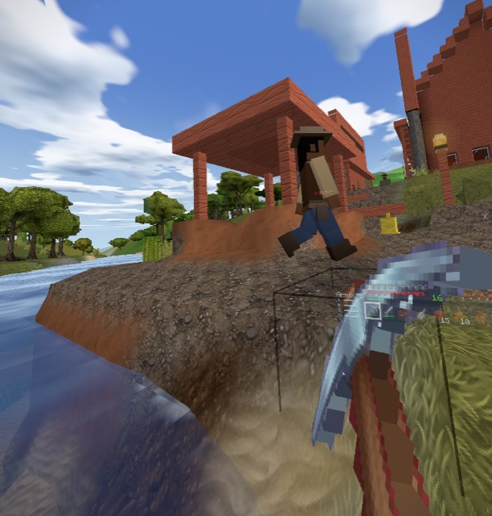

## 08:02:06 - Oh, yeah. [laughs] It was fixed all right

- **Transcript:** Oh, yeah. [laughs] It was fixed all right
- **Status:** open
- **Build:** 0.129 (36269755, M1-M4 (device-tested; ship riding, chests, comfort options, weapon wheel))
- **World:** New World (11) (seed 13480747113613945685)
- **Dimension:** Surface
- **Biome:** Savanna
- **Position:** 6088.9 85.0 714.3
- **Facing:** west (yaw 291, pitch -56)
- **Held:** Titanium Pickaxe x1
- **Mount:** on foot
- **Looking at:** Orange Terracotta at 6087 84 714
- **Mode:** Survival, health 19/20
- **Time:** day 7 08:08, clear
- **Fps:** 67
- **Levels:** mic -28 dBFS, game sound -36 dBFS
- **Length:** 4.0 s (voice 1.4 s)
- **Just before:** -11s closed ShopMenu; -11s message: Isaiah Rowe: Spread the word!; -4s walked into River; -2s walked into Savanna
- **Repro (Mac):** `./snap.sh note --seed 13480747113613945685 --x 6088.9 --z 714.3 --yaw 69 --pitch -56 --time 0.089`
- **Audio (this Mac):** /Users/darthvadar/Documents/Blocksmith/QuestVoiceNotes/raw/vn-20261018-080206-350.aac

## 08:02:10 - Very good

- **Transcript:** Very good
- **Status:** open
- **Build:** 0.129 (36269755, M1-M4 (device-tested; ship riding, chests, comfort options, weapon wheel))
- **World:** New World (11) (seed 13480747113613945685)
- **Dimension:** Surface
- **Biome:** Savanna
- **Position:** 6087.7 87.5 694.9
- **Facing:** north-west (yaw 331, pitch -31)
- **Held:** Titanium Pickaxe x1
- **Mount:** on foot
- **Looking at:** Coarse Dirt at 6086 87 692
- **Mode:** Survival, health 19/20
- **Time:** day 7 08:13, clear
- **Fps:** 72
- **Levels:** mic -35 dBFS, game sound -19 dBFS
- **Length:** 1.9 s (voice 0.5 s)
- **Just before:** -15s closed ShopMenu; -15s message: Isaiah Rowe: Spread the word!; -8s walked into River; -6s walked into Savanna
- **Repro (Mac):** `./snap.sh note --seed 13480747113613945685 --x 6087.7 --z 694.9 --yaw 29 --pitch -31 --time 0.093`
- **Audio (this Mac):** /Users/darthvadar/Documents/Blocksmith/QuestVoiceNotes/raw/vn-20261018-080210-370.aac

## 08:02:14 - How did I talk to you? No, I didn't

- **Transcript:** How did I talk to you? No, I didn't
- **Status:** open
- **Build:** 0.129 (36269755, M1-M4 (device-tested; ship riding, chests, comfort options, weapon wheel))
- **World:** New World (11) (seed 13480747113613945685)
- **Dimension:** Surface
- **Biome:** Savanna
- **Position:** 6084.2 88.0 690.5
- **Facing:** west (yaw 270, pitch 3)
- **Held:** Titanium Pickaxe x1
- **Mount:** on foot
- **Looking at:** Acacia Door at 6084 89 690
- **Mode:** Survival, health 19/20
- **Time:** day 7 08:17, clear
- **Fps:** 72
- **Levels:** mic -35 dBFS, game sound -21 dBFS
- **Length:** 4.0 s (voice 1.4 s)
- **Just before:** -19s closed ShopMenu; -19s message: Isaiah Rowe: Spread the word!; -12s walked into River; -9s walked into Savanna
- **Repro (Mac):** `./snap.sh note --seed 13480747113613945685 --x 6084.2 --z 690.5 --yaw 90 --pitch 3 --time 0.096`
- **Audio (this Mac):** /Users/darthvadar/Documents/Blocksmith/QuestVoiceNotes/raw/vn-20261018-080214-130.aac

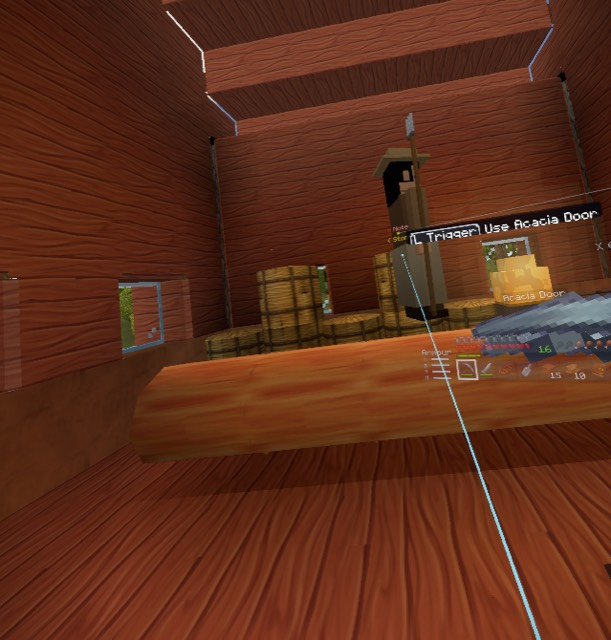

## 08:02:37 - I should be able to rob people, but not just like I hold a sword and u

- **Transcript:** I should be able to rob people, but not just like I hold a sword and use the left trigger. No, it should be like I hold a sword and then I press the left trigger, and then they give me
- **Status:** open
- **Build:** 0.129 (36269755, M1-M4 (device-tested; ship riding, chests, comfort options, weapon wheel))
- **World:** New World (11) (seed 13480747113613945685)
- **Dimension:** Surface
- **Biome:** Savanna
- **Position:** 6076.4 88.0 679.6
- **Facing:** south (yaw 158, pitch -39)
- **Held:** Titanium Pickaxe x1
- **Mount:** on foot
- **Looking at:** Short Grass at 6076 88 680
- **Mode:** Survival, health 19/20
- **Time:** day 7 08:45, clear
- **Fps:** 72
- **Levels:** mic -35 dBFS, game sound -29 dBFS
- **Length:** 12.2 s (voice 7.2 s)
- **Just before:** -23s opened ShopMenu; -23s message: Willa Fenwick: Wash up before you come in here.; -9s closed ShopMenu; -9s message: Willa Fenwick: Don't be a stranger.
- **Position at the end:** 6078.8 89.7 744.4
- **Repro (Mac):** `./snap.sh note --seed 13480747113613945685 --x 6076.4 --z 679.6 --yaw -158 --pitch -39 --time 0.115`
- **Audio (this Mac):** /Users/darthvadar/Documents/Blocksmith/QuestVoiceNotes/raw/vn-20261018-080237-310.aac

## 08:02:54 - I, I don't know. I guess, yeah, press left trigger, but I also get lik

- **Transcript:** I, I don't know. I guess, yeah, press left trigger, but I also get like a random little item, which isn't worth that much, but high variance. It could be worth a quite bit
- **Status:** open
- **Build:** 0.129 (36269755, M1-M4 (device-tested; ship riding, chests, comfort options, weapon wheel))
- **World:** New World (11) (seed 13480747113613945685)
- **Dimension:** Surface
- **Biome:** Savanna
- **Position:** 6122.6 88.0 772.6
- **Facing:** south-east (yaw 141, pitch -62)
- **Held:** Titanium Pickaxe x1
- **Mount:** on foot
- **Looking at:** Grass Block at 6122 87 773
- **Mode:** Survival, health 19/20
- **Time:** day 7 09:06, clear
- **Fps:** 71
- **Levels:** mic -39 dBFS, game sound -15 dBFS
- **Length:** 10.0 s (voice 5.0 s)
- **Just before:** -26s closed ShopMenu; -26s message: Willa Fenwick: Don't be a stranger.
- **Position at the end:** 6153.0 93.1 801.3
- **Repro (Mac):** `./snap.sh note --seed 13480747113613945685 --x 6122.6 --z 772.6 --yaw -141 --pitch -62 --time 0.129`
- **Audio (this Mac):** /Users/darthvadar/Documents/Blocksmith/QuestVoiceNotes/raw/vn-20261018-080254-830.aac

## 08:03:08 - All right, where are the flipping horses? Just, just curious

- **Transcript:** All right, where are the flipping horses? Just, just curious
- **Status:** open
- **Build:** 0.129 (36269755, M1-M4 (device-tested; ship riding, chests, comfort options, weapon wheel))
- **World:** New World (11) (seed 13480747113613945685)
- **Dimension:** Surface
- **Biome:** Savanna
- **Position:** 6133.2 92.0 822.0
- **Facing:** west (yaw 262, pitch -36)
- **Held:** Titanium Pickaxe x1
- **Mount:** on foot
- **Looking at:** Short Grass at 6132 92 821
- **Mode:** Survival, health 19/20
- **Time:** day 7 09:21, clear
- **Fps:** 67
- **Levels:** mic -30 dBFS, game sound -13 dBFS
- **Length:** 4.8 s (voice 1.7 s)
- **Repro (Mac):** `./snap.sh note --seed 13480747113613945685 --x 6133.2 --z 822.0 --yaw 98 --pitch -36 --time 0.140`
- **Audio (this Mac):** /Users/darthvadar/Documents/Blocksmith/QuestVoiceNotes/raw/vn-20261018-080308-230.aac

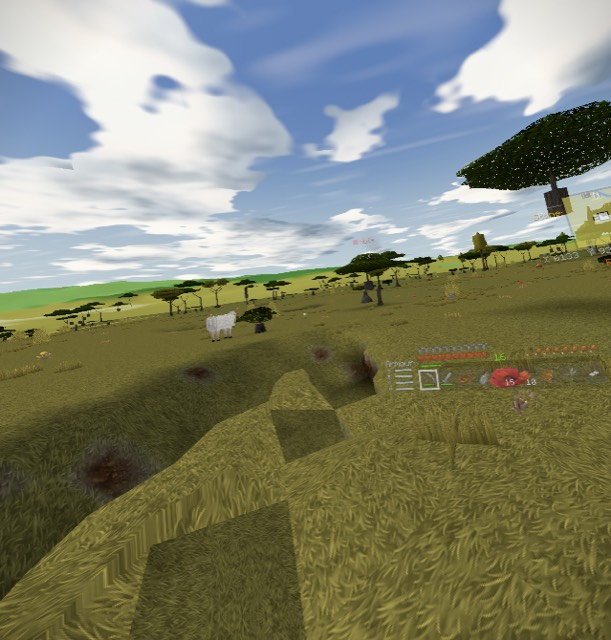

## 08:03:14 - The horse when you need it, when you want one

- **Transcript:** The horse when you need it, when you want one
- **Status:** open
- **Build:** 0.129 (36269755, M1-M4 (device-tested; ship riding, chests, comfort options, weapon wheel))
- **World:** New World (11) (seed 13480747113613945685)
- **Dimension:** Surface
- **Biome:** Savanna
- **Position:** 6117.6 92.9 858.1
- **Facing:** south-west (yaw 214, pitch -68)
- **Held:** Titanium Pickaxe x1
- **Mount:** on foot
- **Looking at:** Grass Block at 6117 92 858
- **Mode:** Survival, health 19/20
- **Time:** day 7 09:27, clear
- **Fps:** 66
- **Levels:** mic -36 dBFS, game sound -32 dBFS
- **Length:** 3.1 s (voice 1.6 s)
- **Repro (Mac):** `./snap.sh note --seed 13480747113613945685 --x 6117.6 --z 858.1 --yaw 146 --pitch -68 --time 0.144`
- **Audio (this Mac):** /Users/darthvadar/Documents/Blocksmith/QuestVoiceNotes/raw/vn-20261018-080314-030.aac

## 08:03:21 - Oh, shittle diddles. Oh, fuck. Okay

- **Transcript:** Oh, shittle diddles. Oh, fuck. Okay
- **Status:** open
- **Build:** 0.129 (36269755, M1-M4 (device-tested; ship riding, chests, comfort options, weapon wheel))
- **World:** New World (11) (seed 13480747113613945685)
- **Dimension:** Surface
- **Biome:** Savanna
- **Position:** 6126.1 72.0 898.5
- **Facing:** south (yaw 164, pitch -58)
- **Held:** Titanium Pickaxe x1
- **Mount:** on foot
- **Looking at:** Stone at 6126 70 900
- **Mode:** Survival, health 7/20
- **Time:** day 7 09:35, clear
- **Fps:** 65
- **Levels:** mic -19 dBFS, game sound -14 dBFS
- **Length:** 5.7 s (voice 2.8 s)
- **While talking:** -4s took 12 damage (health 7/20); -3s holding White Bed; -3s message: White Bed; -2s holding Shears; -2s message: Shears; -0s opened InventoryMenu
- **Position at the end:** 6130.1 74.0 896.4
- **Repro (Mac):** `./snap.sh note --seed 13480747113613945685 --x 6126.1 --z 898.5 --yaw -164 --pitch -58 --time 0.150`
- **Audio (this Mac):** /Users/darthvadar/Documents/Blocksmith/QuestVoiceNotes/raw/vn-20261018-080321-310.aac

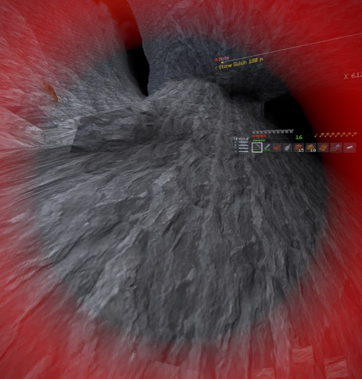

## 08:03:27 - Um, just get that over here

- **Transcript:** Um, just get that over here
- **Status:** open
- **Build:** 0.129 (36269755, M1-M4 (device-tested; ship riding, chests, comfort options, weapon wheel))
- **World:** New World (11) (seed 13480747113613945685)
- **Dimension:** Surface
- **Biome:** Savanna
- **Position:** 6130.1 74.0 896.4
- **Facing:** south-west (yaw 208, pitch -68)
- **Held:** Shears x1
- **Mount:** on foot
- **Looking at:** nothing
- **Mode:** Survival, health 7/20, screen InventoryMenu
- **Time:** day 7 09:42, clear
- **Fps:** 71
- **Levels:** mic -43 dBFS, game sound -27 dBFS
- **Length:** 3.1 s (voice 1.2 s)
- **Just before:** -5s took 12 damage (health 7/20); -4s holding White Bed; -4s message: White Bed; -3s holding Shears; -3s message: Shears; -1s opened InventoryMenu
- **Repro (Mac):** `./snap.sh note --seed 13480747113613945685 --x 6130.1 --z 896.4 --yaw 152 --pitch -68 --time 0.155`
- **Audio (this Mac):** /Users/darthvadar/Documents/Blocksmith/QuestVoiceNotes/raw/vn-20261018-080327-250.aac

## 08:03:33 - That couldn't have gone badly

- **Transcript:** That couldn't have gone badly
- **Status:** open
- **Build:** 0.129 (36269755, M1-M4 (device-tested; ship riding, chests, comfort options, weapon wheel))
- **World:** New World (11) (seed 13480747113613945685)
- **Dimension:** Surface
- **Biome:** Savanna
- **Position:** 6129.4 74.0 896.6
- **Facing:** south-west (yaw 228, pitch -25)
- **Held:** Bread x29
- **Mount:** on foot
- **Looking at:** nothing
- **Mode:** Survival, health 10/20
- **Time:** day 7 09:50, clear
- **Fps:** 71
- **Levels:** mic -47 dBFS, game sound -17 dBFS
- **Length:** 2.5 s (voice 1.0 s)
- **Just before:** -11s took 12 damage (health 7/20); -10s holding White Bed; -10s message: White Bed; -10s holding Shears; -10s message: Shears; -8s opened InventoryMenu; -5s closed InventoryMenu; -5s holding White Bed; -5s message: White Bed; -4s holding Titanium Pickaxe; -4s message: Titanium Pickaxe; -4s holding Titanium Sword; -4s message: Titanium Sword; -4s holding Bread; -4s message: Bread
- **Repro (Mac):** `./snap.sh note --seed 13480747113613945685 --x 6129.4 --z 896.6 --yaw 132 --pitch -25 --time 0.160`
- **Audio (this Mac):** /Users/darthvadar/Documents/Blocksmith/QuestVoiceNotes/raw/vn-20261018-080333-750.aac

## 08:03:42 - Okay, so

- **Transcript:** Okay, so
- **Status:** open
- **Build:** 0.129 (36269755, M1-M4 (device-tested; ship riding, chests, comfort options, weapon wheel))
- **World:** New World (11) (seed 13480747113613945685)
- **Dimension:** Surface
- **Biome:** Savanna
- **Position:** 6151.6 72.8 883.6
- **Facing:** north-east (yaw 67, pitch -33)
- **Held:** Titanium Pickaxe x1
- **Mount:** on foot
- **Looking at:** Coal Ore at 6154 72 882
- **Mode:** Survival, health 14/20
- **Time:** day 7 10:00, clear
- **Fps:** 72
- **Levels:** mic -24 dBFS, game sound -27 dBFS
- **Length:** 2.3 s (voice 0.5 s)
- **Just before:** -20s took 12 damage (health 7/20); -19s holding White Bed; -19s message: White Bed; -18s holding Shears; -18s message: Shears; -16s opened InventoryMenu; -14s closed InventoryMenu; -13s holding White Bed; -13s message: White Bed; -13s holding Titanium Pickaxe; -13s message: Titanium Pickaxe; -13s holding Titanium Sword; -13s message: Titanium Sword; -13s holding Bread; -13s message: Bread; -5s holding Titanium Sword; -5s message: Titanium Sword; -5s holding Titanium Pickaxe; -5s message: Titanium Pickaxe
- **Repro (Mac):** `./snap.sh note --seed 13480747113613945685 --x 6151.6 --z 883.6 --yaw -67 --pitch -33 --time 0.167`
- **Audio (this Mac):** /Users/darthvadar/Documents/Blocksmith/QuestVoiceNotes/raw/vn-20261018-080342-490.aac

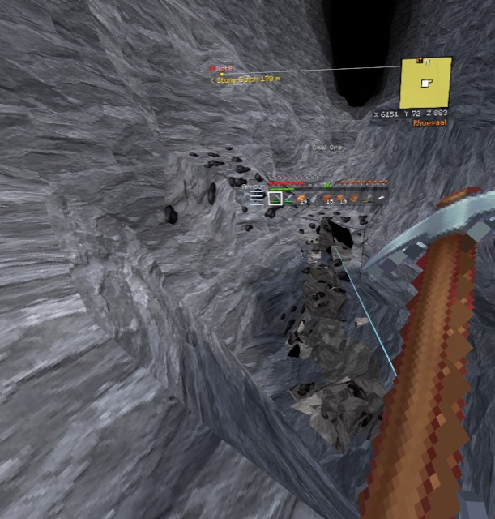

## 08:03:45 - The rubble is a little better now. That's good

- **Transcript:** The rubble is a little better now. That's good
- **Status:** open
- **Build:** 0.129 (36269755, M1-M4 (device-tested; ship riding, chests, comfort options, weapon wheel))
- **World:** New World (11) (seed 13480747113613945685)
- **Dimension:** Surface
- **Biome:** Savanna
- **Position:** 6153.1 72.0 883.0
- **Facing:** north-east (yaw 49, pitch -37)
- **Held:** Titanium Pickaxe x1
- **Mount:** on foot
- **Looking at:** Coal Ore at 6154 72 881
- **Mode:** Survival, health 15/20
- **Time:** day 7 10:04, clear
- **Fps:** 72
- **Levels:** mic -20 dBFS, game sound -19 dBFS
- **Length:** 3.7 s (voice 1.8 s)
- **Just before:** -23s took 12 damage (health 7/20); -22s holding White Bed; -22s message: White Bed; -22s holding Shears; -22s message: Shears; -20s opened InventoryMenu; -17s closed InventoryMenu; -17s holding White Bed; -17s message: White Bed; -16s holding Titanium Pickaxe; -16s message: Titanium Pickaxe; -16s holding Titanium Sword; -16s message: Titanium Sword; -16s holding Bread; -16s message: Bread; -9s holding Titanium Sword; -9s message: Titanium Sword; -8s holding Titanium Pickaxe; -8s message: Titanium Pickaxe; -0s message: Your pack is full: the Cobblestone stays on the ground
- **Repro (Mac):** `./snap.sh note --seed 13480747113613945685 --x 6153.1 --z 883.0 --yaw -49 --pitch -37 --time 0.170`
- **Audio (this Mac):** /Users/darthvadar/Documents/Blocksmith/QuestVoiceNotes/raw/vn-20261018-080345-990.aac

## 08:03:49 - Few less polygons

- **Transcript:** Few less polygons
- **Status:** open
- **Build:** 0.129 (36269755, M1-M4 (device-tested; ship riding, chests, comfort options, weapon wheel))
- **World:** New World (11) (seed 13480747113613945685)
- **Dimension:** Surface
- **Biome:** Savanna
- **Position:** 6152.9 72.0 882.6
- **Facing:** north (yaw 7, pitch -56)
- **Held:** Titanium Pickaxe x1
- **Mount:** on foot
- **Looking at:** Stone at 6152 72 881
- **Mode:** Survival, health 15/20
- **Time:** day 7 10:08, clear
- **Fps:** 69
- **Levels:** mic -28 dBFS, game sound -17 dBFS
- **Length:** 2.4 s (voice 1.1 s)
- **Just before:** -27s took 12 damage (health 7/20); -25s holding White Bed; -25s message: White Bed; -25s holding Shears; -25s message: Shears; -23s opened InventoryMenu; -21s closed InventoryMenu; -20s holding White Bed; -20s message: White Bed; -20s holding Titanium Pickaxe; -20s message: Titanium Pickaxe; -19s holding Titanium Sword; -19s message: Titanium Sword; -19s holding Bread; -19s message: Bread; -12s holding Titanium Sword; -12s message: Titanium Sword; -12s holding Titanium Pickaxe; -12s message: Titanium Pickaxe; -4s message: Your pack is full: the Cobblestone stays on the ground
- **Repro (Mac):** `./snap.sh note --seed 13480747113613945685 --x 6152.9 --z 882.6 --yaw -7 --pitch -56 --time 0.173`
- **Audio (this Mac):** /Users/darthvadar/Documents/Blocksmith/QuestVoiceNotes/raw/vn-20261018-080349-390.aac

## 08:05:12 - All right, I'll continue my pursuit for a horse

- **Transcript:** All right, I'll continue my pursuit for a horse
- **Status:** open
- **Build:** 0.129 (36269755, M1-M4 (device-tested; ship riding, chests, comfort options, weapon wheel))
- **World:** New World (11) (seed 13480747113613945685)
- **Dimension:** Surface
- **Biome:** Savanna
- **Position:** 6138.7 95.0 905.1
- **Facing:** south-west (yaw 228, pitch -47)
- **Held:** Cobblestone x35
- **Mount:** on foot
- **Looking at:** Grass Block at 6137 94 905
- **Mode:** Survival, health 15/20
- **Time:** day 7 11:45, clear
- **Fps:** 67
- **Levels:** mic -29 dBFS, game sound -18 dBFS
- **Length:** 5.2 s (voice 2.7 s)
- **Just before:** -20s message: Your pack is full: the Dirt stays on the ground; -16s opened InventoryMenu; -14s closed InventoryMenu; -13s holding Titanium Sword; -13s message: Titanium Sword; -13s holding Bread; -13s message: Bread; -13s holding Glass Bottle; -13s message: Glass Bottle; -12s holding Cobblestone; -12s message: Cobblestone
- **Repro (Mac):** `./snap.sh note --seed 13480747113613945685 --x 6138.7 --z 905.1 --yaw 132 --pitch -47 --time 0.240`
- **Audio (this Mac):** /Users/darthvadar/Documents/Blocksmith/QuestVoiceNotes/raw/vn-20261018-080512-150.aac

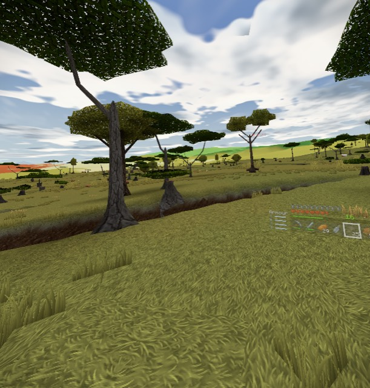

## 08:05:22 - Um, yeah, that's

- **Transcript:** Um, yeah, that's
- **Status:** open
- **Build:** 0.129 (36269755, M1-M4 (device-tested; ship riding, chests, comfort options, weapon wheel))
- **World:** New World (11) (seed 13480747113613945685)
- **Dimension:** Surface
- **Biome:** Savanna
- **Position:** 6087.6 97.9 960.3
- **Facing:** south (yaw 199, pitch -63)
- **Held:** Titanium Sword x1
- **Mount:** on foot
- **Looking at:** Grass Block at 6087 97 960
- **Mode:** Survival, health 15/20
- **Time:** day 7 11:58, clear
- **Fps:** 72
- **Levels:** mic -41 dBFS, game sound -16 dBFS
- **Length:** 3.1 s (voice 1.1 s)
- **Just before:** -27s opened InventoryMenu; -24s closed InventoryMenu; -24s holding Titanium Sword; -24s message: Titanium Sword; -23s holding Bread; -23s message: Bread; -23s holding Glass Bottle; -23s message: Glass Bottle; -23s holding Cobblestone; -23s message: Cobblestone; -9s holding Glass Bottle; -9s message: Glass Bottle; -9s holding Bread; -9s message: Bread; -9s holding Titanium Sword; -9s message: Titanium Sword
- **Repro (Mac):** `./snap.sh note --seed 13480747113613945685 --x 6087.6 --z 960.3 --yaw 161 --pitch -63 --time 0.249`
- **Audio (this Mac):** /Users/darthvadar/Documents/Blocksmith/QuestVoiceNotes/raw/vn-20261018-080522-710.aac

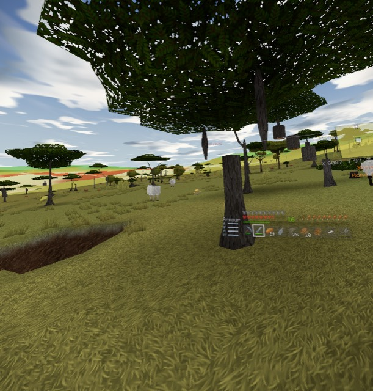

## 08:05:28 - No visto nada

- **Transcript:** No visto nada
- **Status:** open
- **Build:** 0.129 (36269755, M1-M4 (device-tested; ship riding, chests, comfort options, weapon wheel))
- **World:** New World (11) (seed 13480747113613945685)
- **Dimension:** Surface
- **Biome:** Savanna
- **Position:** 6068.0 101.0 988.0
- **Facing:** south-west (yaw 228, pitch -58)
- **Held:** Titanium Sword x1
- **Mount:** on foot
- **Looking at:** Grass Block at 6067 100 988
- **Mode:** Survival, health 15/20
- **Time:** day 7 12:04, clear
- **Fps:** 68
- **Levels:** mic -34 dBFS, game sound -14 dBFS
- **Length:** 2.5 s (voice 1.0 s)
- **Just before:** -29s closed InventoryMenu; -29s holding Titanium Sword; -29s message: Titanium Sword; -29s holding Bread; -29s message: Bread; -29s holding Glass Bottle; -29s message: Glass Bottle; -28s holding Cobblestone; -28s message: Cobblestone; -15s holding Glass Bottle; -15s message: Glass Bottle; -14s holding Bread; -14s message: Bread; -14s holding Titanium Sword; -14s message: Titanium Sword; -4s message: Your pack is full: the White Wool stays on the ground
- **Repro (Mac):** `./snap.sh note --seed 13480747113613945685 --x 6068.0 --z 988.0 --yaw 132 --pitch -58 --time 0.253`
- **Audio (this Mac):** /Users/darthvadar/Documents/Blocksmith/QuestVoiceNotes/raw/vn-20261018-080528-350.aac

## 08:05:37 - I hope the villages still have a stable option that's possible to spaw

- **Transcript:** I hope the villages still have a stable option that's possible to spawn
- **Status:** open
- **Build:** 0.129 (36269755, M1-M4 (device-tested; ship riding, chests, comfort options, weapon wheel))
- **World:** New World (11) (seed 13480747113613945685)
- **Dimension:** Surface
- **Biome:** Savanna
- **Position:** 6067.5 102.4 1002.0
- **Facing:** north (yaw 359, pitch -36)
- **Held:** Titanium Sword x1
- **Mount:** on foot
- **Looking at:** Grass Block at 6067 101 999
- **Mode:** Survival, health 15/20
- **Time:** day 7 12:15, clear
- **Fps:** 72
- **Levels:** mic -25 dBFS, game sound -53 dBFS
- **Length:** 5.9 s (voice 3.5 s)
- **Just before:** -23s holding Glass Bottle; -23s message: Glass Bottle; -23s holding Bread; -23s message: Bread; -23s holding Titanium Sword; -23s message: Titanium Sword; -12s message: Your pack is full: the White Wool stays on the ground
- **Position at the end:** 6050.3 100.2 966.4
- **Repro (Mac):** `./snap.sh note --seed 13480747113613945685 --x 6067.5 --z 1002.0 --yaw 1 --pitch -36 --time 0.261`
- **Audio (this Mac):** /Users/darthvadar/Documents/Blocksmith/QuestVoiceNotes/raw/vn-20261018-080537-110.aac

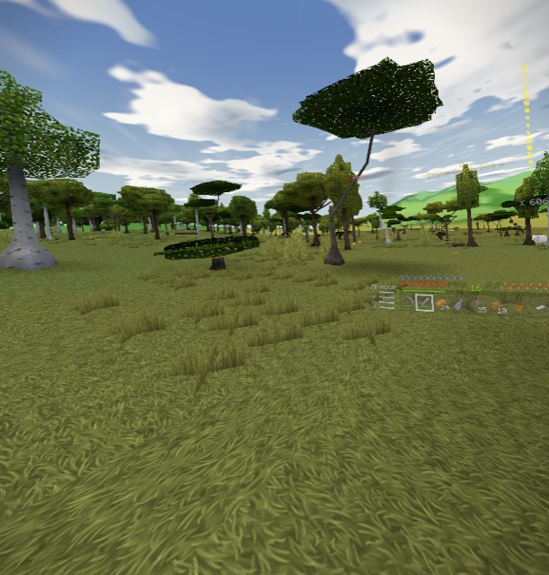

## 08:05:42 - I mean, I haven't gone to too many villages to find out, but

- **Transcript:** I mean, I haven't gone to too many villages to find out, but
- **Status:** open
- **Build:** 0.129 (36269755, M1-M4 (device-tested; ship riding, chests, comfort options, weapon wheel))
- **World:** New World (11) (seed 13480747113613945685)
- **Dimension:** Surface
- **Biome:** Savanna
- **Position:** 6048.3 100.0 963.2
- **Facing:** north (yaw 342, pitch -60)
- **Held:** Titanium Sword x1
- **Mount:** on foot
- **Looking at:** Short Grass at 6048 100 963
- **Mode:** Survival, health 15/20
- **Time:** day 7 12:21, clear
- **Fps:** 70
- **Levels:** mic -30 dBFS, game sound -19 dBFS
- **Length:** 3.5 s (voice 1.9 s)
- **Just before:** -29s holding Glass Bottle; -29s message: Glass Bottle; -28s holding Bread; -28s message: Bread; -28s holding Titanium Sword; -28s message: Titanium Sword; -18s message: Your pack is full: the White Wool stays on the ground
- **Repro (Mac):** `./snap.sh note --seed 13480747113613945685 --x 6048.3 --z 963.2 --yaw 18 --pitch -60 --time 0.265`
- **Audio (this Mac):** /Users/darthvadar/Documents/Blocksmith/QuestVoiceNotes/raw/vn-20261018-080542-686.aac

## 08:05:47 - Well, hold on. There was a stable

- **Transcript:** Well, hold on. There was a stable
- **Status:** open
- **Build:** 0.129 (36269755, M1-M4 (device-tested; ship riding, chests, comfort options, weapon wheel))
- **World:** New World (11) (seed 13480747113613945685)
- **Dimension:** Surface
- **Biome:** Savanna
- **Position:** 6033.6 97.8 928.4
- **Facing:** north (yaw 351, pitch -78)
- **Held:** Titanium Sword x1
- **Mount:** on foot
- **Looking at:** Grass Block at 6033 97 928
- **Mode:** Survival, health 15/20
- **Time:** day 7 12:27, clear
- **Fps:** 65
- **Levels:** mic -33 dBFS, game sound -29 dBFS
- **Length:** 3.5 s (voice 1.4 s)
- **Just before:** -22s message: Your pack is full: the White Wool stays on the ground
- **Repro (Mac):** `./snap.sh note --seed 13480747113613945685 --x 6033.6 --z 928.4 --yaw 9 --pitch -78 --time 0.269`
- **Audio (this Mac):** /Users/darthvadar/Documents/Blocksmith/QuestVoiceNotes/raw/vn-20261018-080547-770.aac

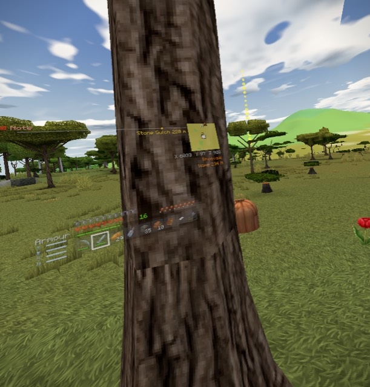

## 08:05:56 - But I don't recall seeing any horses to buy

- **Transcript:** But I don't recall seeing any horses to buy
- **Status:** open
- **Build:** 0.129 (36269755, M1-M4 (device-tested; ship riding, chests, comfort options, weapon wheel))
- **World:** New World (11) (seed 13480747113613945685)
- **Dimension:** Surface
- **Biome:** Savanna
- **Position:** 6049.6 95.1 860.7
- **Facing:** north-west (yaw 317, pitch -58)
- **Held:** Titanium Sword x1
- **Mount:** on foot
- **Looking at:** Dandelion at 6049 95 860
- **Mode:** Survival, health 15/20
- **Time:** day 7 12:37, clear
- **Fps:** 69
- **Levels:** mic -30 dBFS, game sound -24 dBFS
- **Length:** 3.0 s (voice 1.3 s)
- **Repro (Mac):** `./snap.sh note --seed 13480747113613945685 --x 6049.6 --z 860.7 --yaw 43 --pitch -58 --time 0.276`
- **Audio (this Mac):** /Users/darthvadar/Documents/Blocksmith/QuestVoiceNotes/raw/vn-20261018-080556-649.aac

## 08:06:01 - I have my gun too

- **Transcript:** I have my gun too
- **Status:** open
- **Build:** 0.129 (36269755, M1-M4 (device-tested; ship riding, chests, comfort options, weapon wheel))
- **World:** New World (11) (seed 13480747113613945685)
- **Dimension:** Surface
- **Biome:** Savanna
- **Position:** 6060.4 92.4 820.7
- **Facing:** north-west (yaw 297, pitch -65)
- **Held:** Titanium Sword x1
- **Mount:** on foot
- **Looking at:** Short Grass at 6059 92 820
- **Mode:** Survival, health 15/20
- **Time:** day 7 12:43, clear
- **Fps:** 71
- **Levels:** mic -38 dBFS, game sound -32 dBFS
- **Length:** 2.0 s (voice 0.4 s)
- **Repro (Mac):** `./snap.sh note --seed 13480747113613945685 --x 6060.4 --z 820.7 --yaw 63 --pitch -65 --time 0.280`
- **Audio (this Mac):** /Users/darthvadar/Documents/Blocksmith/QuestVoiceNotes/raw/vn-20261018-080601-689.aac

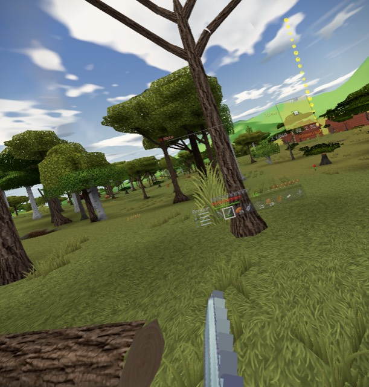

## 08:06:04 - Just to have. Hmm, a ship right there. Hmm

- **Transcript:** Just to have. Hmm, a ship right there. Hmm
- **Status:** open
- **Build:** 0.129 (36269755, M1-M4 (device-tested; ship riding, chests, comfort options, weapon wheel))
- **World:** New World (11) (seed 13480747113613945685)
- **Dimension:** Surface
- **Biome:** Savanna
- **Position:** 6059.9 89.7 798.2
- **Facing:** north-west (yaw 302, pitch -59)
- **Held:** Titanium Sword x1
- **Mount:** on foot
- **Looking at:** Grass Block at 6059 89 797
- **Mode:** Survival, health 15/20
- **Time:** day 7 12:46, clear
- **Fps:** 71
- **Levels:** mic -40 dBFS, game sound -14 dBFS
- **Length:** 3.6 s (voice 1.1 s)
- **Repro (Mac):** `./snap.sh note --seed 13480747113613945685 --x 6059.9 --z 798.2 --yaw 58 --pitch -59 --time 0.282`
- **Audio (this Mac):** /Users/darthvadar/Documents/Blocksmith/QuestVoiceNotes/raw/vn-20261018-080604-409.aac

## 08:06:08 - Now let's go see what's going on

- **Transcript:** Now let's go see what's going on
- **Status:** open
- **Build:** 0.129 (36269755, M1-M4 (device-tested; ship riding, chests, comfort options, weapon wheel))
- **World:** New World (11) (seed 13480747113613945685)
- **Dimension:** Surface
- **Biome:** Savanna
- **Position:** 6061.1 89.5 772.4
- **Facing:** west (yaw 279, pitch -62)
- **Held:** Titanium Sword x1
- **Mount:** on foot
- **Looking at:** Grass Block at 6060 89 772
- **Mode:** Survival, health 15/20
- **Time:** day 7 12:51, clear
- **Fps:** 70
- **Levels:** mic -37 dBFS, game sound -20 dBFS
- **Length:** 2.7 s (voice 1.0 s)
- **Repro (Mac):** `./snap.sh note --seed 13480747113613945685 --x 6061.1 --z 772.4 --yaw 81 --pitch -62 --time 0.286`
- **Audio (this Mac):** /Users/darthvadar/Documents/Blocksmith/QuestVoiceNotes/raw/vn-20261018-080608-670.aac

## 08:06:13 - What's up?

- **Transcript:** What's up?
- **Status:** open
- **Build:** 0.129 (36269755, M1-M4 (device-tested; ship riding, chests, comfort options, weapon wheel))
- **World:** New World (11) (seed 13480747113613945685)
- **Dimension:** Surface
- **Biome:** Forest
- **Position:** 6026.8 91.4 761.8
- **Facing:** west (yaw 248, pitch -45)
- **Held:** Titanium Sword x1
- **Mount:** on foot
- **Looking at:** Grass Block at 6024 89 763
- **Mode:** Survival, health 15/20
- **Time:** day 7 12:56, clear
- **Fps:** 69
- **Levels:** mic -37 dBFS, game sound -31 dBFS
- **Length:** 2.4 s (voice 1.0 s)
- **Repro (Mac):** `./snap.sh note --seed 13480747113613945685 --x 6026.8 --z 761.8 --yaw 112 --pitch -45 --time 0.289`
- **Audio (this Mac):** /Users/darthvadar/Documents/Blocksmith/QuestVoiceNotes/raw/vn-20261018-080613-070.aac

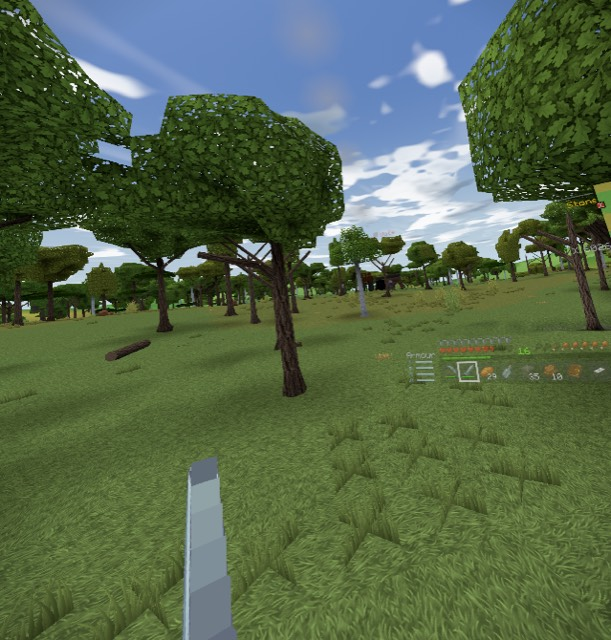

## 08:06:18 - These guys are not detailed enough

- **Transcript:** These guys are not detailed enough
- **Status:** open
- **Build:** 0.129 (36269755, M1-M4 (device-tested; ship riding, chests, comfort options, weapon wheel))
- **World:** New World (11) (seed 13480747113613945685)
- **Dimension:** Surface
- **Biome:** Savanna
- **Position:** 5982.7 91.7 754.0
- **Facing:** west (yaw 269, pitch -51)
- **Held:** Titanium Sword x1
- **Mount:** on foot
- **Looking at:** Grass Block at 5981 91 754
- **Mode:** Survival, health 15/20
- **Time:** day 7 13:03, clear
- **Fps:** 71
- **Levels:** mic -42 dBFS, game sound -10 dBFS
- **Length:** 2.4 s (voice 0.7 s)
- **Just before:** -4s walked into Forest; -2s walked into Savanna
- **Repro (Mac):** `./snap.sh note --seed 13480747113613945685 --x 5982.7 --z 754.0 --yaw 91 --pitch -51 --time 0.294`
- **Audio (this Mac):** /Users/darthvadar/Documents/Blocksmith/QuestVoiceNotes/raw/vn-20261018-080618-370.aac

## 08:06:25 - Rapper outlaw. Okay, very good

- **Transcript:** Rapper outlaw. Okay, very good
- **Status:** open
- **Build:** 0.129 (36269755, M1-M4 (device-tested; ship riding, chests, comfort options, weapon wheel))
- **World:** New World (11) (seed 13480747113613945685)
- **Dimension:** Surface
- **Biome:** Forest
- **Position:** 5974.5 91.8 753.1
- **Facing:** west (yaw 269, pitch -61)
- **Held:** Titanium Sword x1
- **Mount:** on foot
- **Looking at:** Grass Block at 5973 91 752
- **Mode:** Survival, health 15/20
- **Time:** day 7 13:11, clear
- **Fps:** 69
- **Levels:** mic -43 dBFS, game sound -21 dBFS
- **Length:** 4.5 s (voice 1.3 s)
- **Just before:** -11s walked into Forest; -9s walked into Savanna; -7s walked into Forest; -6s message: Honour raised (outlaw killed); -4s message: Your pack is full: the Emerald stays on the ground; -1s message: Freed camp marked on the map
- **Repro (Mac):** `./snap.sh note --seed 13480747113613945685 --x 5974.5 --z 753.1 --yaw 91 --pitch -61 --time 0.300`
- **Audio (this Mac):** /Users/darthvadar/Documents/Blocksmith/QuestVoiceNotes/raw/vn-20261018-080625-470.aac

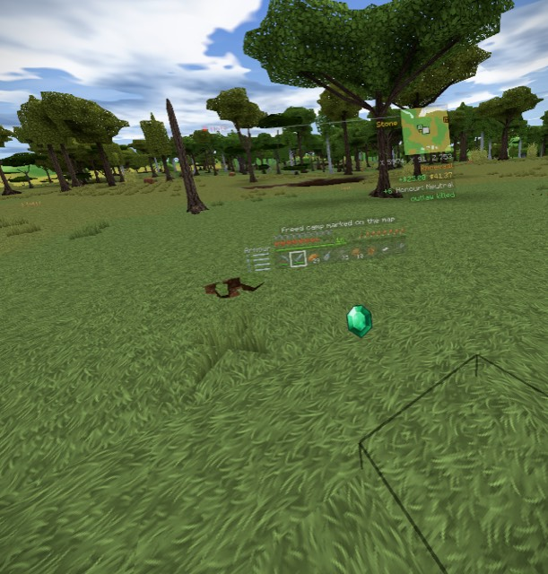

## 08:06:34 - Intercepted orders? Hmm. All right

- **Transcript:** Intercepted orders? Hmm. All right
- **Status:** open
- **Build:** 0.129 (36269755, M1-M4 (device-tested; ship riding, chests, comfort options, weapon wheel))
- **World:** New World (11) (seed 13480747113613945685)
- **Dimension:** Surface
- **Biome:** Forest
- **Position:** 5964.1 91.0 747.5
- **Facing:** south-west (yaw 220, pitch -23)
- **Held:** Titanium Sword x1
- **Mount:** on foot
- **Looking at:** nothing
- **Mode:** Survival, health 15/20, screen ChestMenu
- **Time:** day 7 13:21, clear
- **Fps:** 70
- **Levels:** mic -41 dBFS, game sound -24 dBFS
- **Length:** 4.2 s (voice 1.3 s)
- **Just before:** -19s walked into Forest; -17s walked into Savanna; -15s walked into Forest; -14s message: Honour raised (outlaw killed); -12s message: Your pack is full: the Emerald stays on the ground; -10s message: Freed camp marked on the map; -8s opened InventoryMenu; -8s message: Camp freed! +$25.00; -6s closed InventoryMenu; -2s opened ChestMenu
- **Repro (Mac):** `./snap.sh note --seed 13480747113613945685 --x 5964.1 --z 747.5 --yaw 140 --pitch -23 --time 0.307`
- **Audio (this Mac):** /Users/darthvadar/Documents/Blocksmith/QuestVoiceNotes/raw/vn-20261018-080634-150.aac

## 08:06:45 - Careful sizzle

- **Transcript:** Careful sizzle
- **Status:** open
- **Build:** 0.129 (36269755, M1-M4 (device-tested; ship riding, chests, comfort options, weapon wheel))
- **World:** New World (11) (seed 13480747113613945685)
- **Dimension:** Surface
- **Biome:** Forest
- **Position:** 5964.7 91.0 746.2
- **Facing:** west (yaw 253, pitch -55)
- **Held:** Written Book x1
- **Mount:** on foot
- **Looking at:** nothing
- **Mode:** Survival, health 15/20, screen BookMenu
- **Time:** day 7 13:34, clear
- **Fps:** 69
- **Levels:** mic -46 dBFS, game sound -27 dBFS
- **Length:** 2.5 s (voice 0.8 s)
- **Just before:** -30s walked into Forest; -28s walked into Savanna; -26s walked into Forest; -25s message: Honour raised (outlaw killed); -23s message: Your pack is full: the Emerald stays on the ground; -20s message: Freed camp marked on the map; -19s opened InventoryMenu; -18s message: Camp freed! +$25.00; -17s closed InventoryMenu; -12s opened ChestMenu; -6s closed ChestMenu; -5s holding Bread; -5s message: Bread; -5s holding Emerald; -5s message: Emerald; -5s holding Intercepted Orders; -5s message: Intercepted Orders; -5s opened ChestMenu; -4s closed ChestMenu; -3s opened BookMenu; -3s holding Written Book; -3s message: Capital citadel (the enemy) marked on the map. Added to journal: Intercepted Orders
- **Repro (Mac):** `./snap.sh note --seed 13480747113613945685 --x 5964.7 --z 746.2 --yaw 107 --pitch -55 --time 0.315`
- **Audio (this Mac):** /Users/darthvadar/Documents/Blocksmith/QuestVoiceNotes/raw/vn-20261018-080645-271.aac

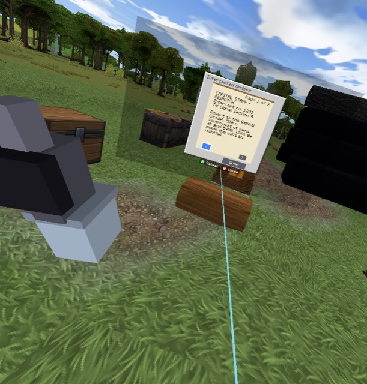

## 08:06:49 - Yeah, okay. I'm gonna just put that back in there

- **Transcript:** Yeah, okay. I'm gonna just put that back in there
- **Status:** open
- **Build:** 0.129 (36269755, M1-M4 (device-tested; ship riding, chests, comfort options, weapon wheel))
- **World:** New World (11) (seed 13480747113613945685)
- **Dimension:** Surface
- **Biome:** Forest
- **Position:** 5964.6 91.0 746.7
- **Facing:** south-west (yaw 221, pitch -20)
- **Held:** Written Book x1
- **Mount:** on foot
- **Looking at:** nothing
- **Mode:** Survival, health 15/20, screen ChestMenu
- **Time:** day 7 13:39, clear
- **Fps:** 68
- **Levels:** mic -34 dBFS, game sound -17 dBFS
- **Length:** 3.3 s (voice 0.7 s)
- **Just before:** -30s walked into Forest; -29s message: Honour raised (outlaw killed); -27s message: Your pack is full: the Emerald stays on the ground; -24s message: Freed camp marked on the map; -23s opened InventoryMenu; -22s message: Camp freed! +$25.00; -21s closed InventoryMenu; -16s opened ChestMenu; -10s closed ChestMenu; -9s holding Bread; -9s message: Bread; -9s holding Emerald; -9s message: Emerald; -9s holding Intercepted Orders; -9s message: Intercepted Orders; -9s opened ChestMenu; -8s closed ChestMenu; -7s opened BookMenu; -7s holding Written Book; -7s message: Capital citadel (the enemy) marked on the map. Added to journal: Intercepted Orders; -3s message: Capital patrol routes lead to a Capital Citadel: 566 m SW, ahead. Marked on your map.; -2s closed BookMenu; -0s opened ChestMenu
- **Repro (Mac):** `./snap.sh note --seed 13480747113613945685 --x 5964.6 --z 746.7 --yaw 139 --pitch -20 --time 0.319`
- **Audio (this Mac):** /Users/darthvadar/Documents/Blocksmith/QuestVoiceNotes/raw/vn-20261018-080649-470.aac

## 08:06:52 - Compass, crossbow, iron. Take the iron

- **Transcript:** Compass, crossbow, iron. Take the iron
- **Status:** open
- **Build:** 0.129 (36269755, M1-M4 (device-tested; ship riding, chests, comfort options, weapon wheel))
- **World:** New World (11) (seed 13480747113613945685)
- **Dimension:** Surface
- **Biome:** Forest
- **Position:** 5964.6 91.0 746.7
- **Facing:** south-west (yaw 221, pitch -20)
- **Held:** Written Book x1
- **Mount:** on foot
- **Looking at:** nothing
- **Mode:** Survival, health 15/20, screen ChestMenu
- **Time:** day 7 13:42, clear
- **Fps:** 69
- **Levels:** mic -32 dBFS, game sound -18 dBFS
- **Length:** 3.4 s (voice 1.1 s)
- **Just before:** -27s message: Freed camp marked on the map; -26s opened InventoryMenu; -25s message: Camp freed! +$25.00; -24s closed InventoryMenu; -19s opened ChestMenu; -13s closed ChestMenu; -12s holding Bread; -12s message: Bread; -12s holding Emerald; -12s message: Emerald; -12s holding Intercepted Orders; -12s message: Intercepted Orders; -12s opened ChestMenu; -11s closed ChestMenu; -10s opened BookMenu; -10s holding Written Book; -10s message: Capital citadel (the enemy) marked on the map. Added to journal: Intercepted Orders; -7s message: Capital patrol routes lead to a Capital Citadel: 566 m SW, ahead. Marked on your map.; -5s closed BookMenu; -3s opened ChestMenu
- **Repro (Mac):** `./snap.sh note --seed 13480747113613945685 --x 5964.6 --z 746.7 --yaw 139 --pitch -20 --time 0.321`
- **Audio (this Mac):** /Users/darthvadar/Documents/Blocksmith/QuestVoiceNotes/raw/vn-20261018-080652-730.aac

## 08:07:43 - Okay, ähm, hm, was soll ich machen?

- **Transcript:** Okay, ähm, hm, was soll ich machen?
- **Status:** open
- **Build:** 0.129 (36269755, M1-M4 (device-tested; ship riding, chests, comfort options, weapon wheel))
- **World:** New World (11) (seed 13480747113613945685)
- **Dimension:** Surface
- **Biome:** Savanna
- **Position:** 6089.1 87.0 702.2
- **Facing:** east (yaw 110, pitch -50)
- **Held:** Written Book x1
- **Mount:** on foot
- **Looking at:** Coarse Dirt at 6090 86 702
- **Mode:** Survival, health 15/20
- **Time:** day 7 14:43, clear
- **Fps:** 72
- **Levels:** mic -35 dBFS, game sound -32 dBFS
- **Length:** 6.4 s (voice 2.5 s)
- **Just before:** -29s walked into Plains; -27s walked into Forest; -25s walked into Savanna; -21s walked into River; -19s walked into Savanna
- **While talking:** -4s message: Harlan Fenwick: Folks saw what you did.
- **Position at the end:** 6100.6 87.0 704.1
- **Repro (Mac):** `./snap.sh note --seed 13480747113613945685 --x 6089.1 --z 702.2 --yaw -110 --pitch -50 --time 0.363`
- **Audio (this Mac):** /Users/darthvadar/Documents/Blocksmith/QuestVoiceNotes/raw/vn-20261018-080743-770.aac

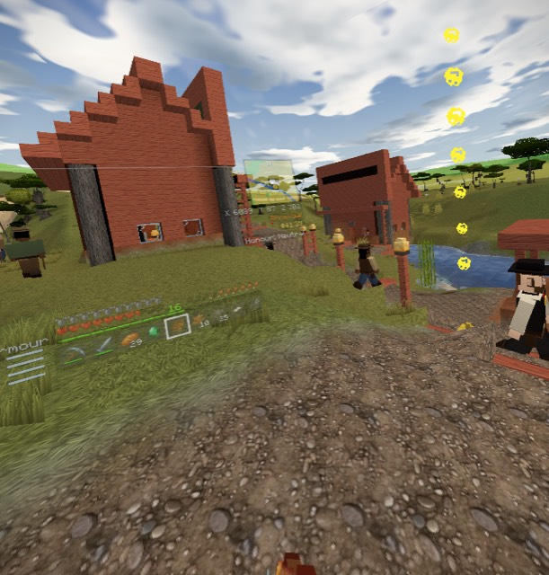

## 08:07:55 - Ah, they do sell horses. Good. Okay

- **Transcript:** Ah, they do sell horses. Good. Okay
- **Status:** open
- **Build:** 0.129 (36269755, M1-M4 (device-tested; ship riding, chests, comfort options, weapon wheel))
- **World:** New World (11) (seed 13480747113613945685)
- **Dimension:** Surface
- **Biome:** Savanna
- **Position:** 6082.3 88.0 690.7
- **Facing:** west (yaw 278, pitch -14)
- **Held:** Written Book x1
- **Mount:** on foot
- **Looking at:** nothing
- **Mode:** Survival, health 15/20, screen StableMenu
- **Time:** day 7 14:57, clear
- **Fps:** 72
- **Levels:** mic -23 dBFS, game sound -28 dBFS
- **Length:** 4.3 s (voice 1.5 s)
- **Just before:** -11s message: Harlan Fenwick: Folks saw what you did.; -3s opened ShopMenu; -3s message: Willa Fenwick: Murderer. Everyone knows.; -0s opened StableMenu
- **Repro (Mac):** `./snap.sh note --seed 13480747113613945685 --x 6082.3 --z 690.7 --yaw 82 --pitch -14 --time 0.373`
- **Audio (this Mac):** /Users/darthvadar/Documents/Blocksmith/QuestVoiceNotes/raw/vn-20261018-080755-850.aac

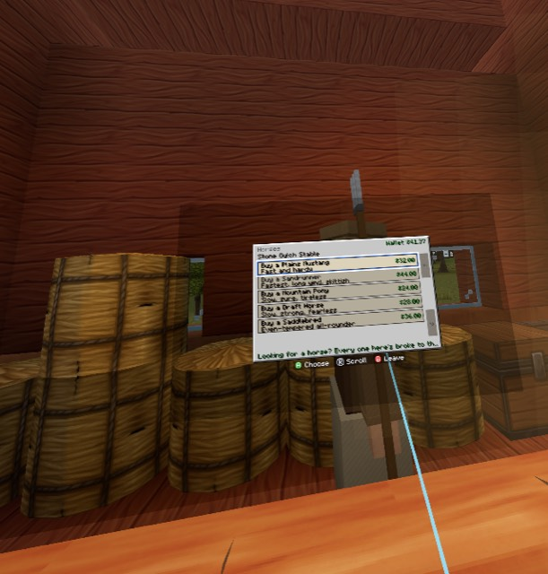

## 08:08:18 - Juniper, where are we at, my boy? Where the fuck is he?

- **Transcript:** Juniper, where are we at, my boy? Where the fuck is he?
- **Status:** open
- **Build:** 0.129 (36269755, M1-M4 (device-tested; ship riding, chests, comfort options, weapon wheel))
- **World:** New World (11) (seed 13480747113613945685)
- **Dimension:** Surface
- **Biome:** Savanna
- **Position:** 6085.9 88.0 690.7
- **Facing:** east (yaw 89, pitch -40)
- **Held:** Written Book x1
- **Mount:** on foot
- **Looking at:** Coarse Dirt at 6087 87 690
- **Mode:** Survival, health 15/20
- **Time:** day 7 15:24, clear
- **Fps:** 72
- **Levels:** mic -30 dBFS, game sound -22 dBFS
- **Length:** 4.6 s (voice 2.8 s)
- **Just before:** -25s opened ShopMenu; -25s message: Willa Fenwick: Murderer. Everyone knows.; -22s opened StableMenu; -11s message: Juniper is your horse now; -3s closed StableMenu; -2s message: Willa Fenwick: Stay back. I heard the shots.
- **Repro (Mac):** `./snap.sh note --seed 13480747113613945685 --x 6085.9 --z 690.7 --yaw -89 --pitch -40 --time 0.392`
- **Audio (this Mac):** /Users/darthvadar/Documents/Blocksmith/QuestVoiceNotes/raw/vn-20261018-080818-191.aac

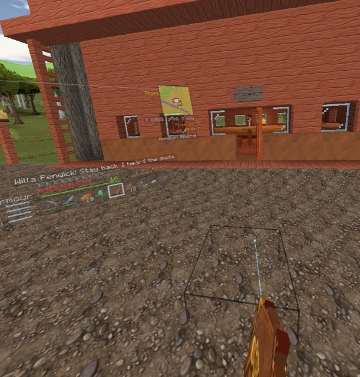

## 08:08:23 - Oh, here we go

- **Transcript:** Oh, here we go
- **Status:** open
- **Build:** 0.129 (36269755, M1-M4 (device-tested; ship riding, chests, comfort options, weapon wheel))
- **World:** New World (11) (seed 13480747113613945685)
- **Dimension:** Surface
- **Biome:** Savanna
- **Position:** 6075.6 89.2 690.6
- **Facing:** north-west (yaw 337, pitch 3)
- **Held:** Written Book x1
- **Mount:** riding Horse
- **Looking at:** nothing
- **Mode:** Survival, health 15/20
- **Time:** day 7 15:30, clear
- **Fps:** 72
- **Levels:** mic -28 dBFS, game sound -13 dBFS
- **Length:** 1.9 s (voice 0.5 s)
- **Just before:** -28s opened StableMenu; -16s message: Juniper is your horse now; -9s closed StableMenu; -8s message: Willa Fenwick: Stay back. I heard the shots.; -0s mounted Horse
- **Repro (Mac):** `./snap.sh note --seed 13480747113613945685 --x 6075.6 --z 690.6 --yaw 23 --pitch 3 --time 0.396`
- **Audio (this Mac):** /Users/darthvadar/Documents/Blocksmith/QuestVoiceNotes/raw/vn-20261018-080823-670.aac

## 08:08:26 - Okay, so there's a stable. Very good. Oh, yeah. This guy zips around. 

- **Transcript:** Okay, so there's a stable. Very good. Oh, yeah. This guy zips around. I'm impressed
- **Status:** open
- **Build:** 0.129 (36269755, M1-M4 (device-tested; ship riding, chests, comfort options, weapon wheel))
- **World:** New World (11) (seed 13480747113613945685)
- **Dimension:** Surface
- **Biome:** Savanna
- **Position:** 6059.1 90.9 667.5
- **Facing:** north-west (yaw 316, pitch -30)
- **Held:** Written Book x1
- **Mount:** riding Horse
- **Looking at:** Short Grass at 6056 90 664
- **Mode:** Survival, health 15/20
- **Time:** day 7 15:34, clear
- **Fps:** 72
- **Levels:** mic -38 dBFS, game sound -21 dBFS
- **Length:** 6.5 s (voice 3.7 s)
- **Just before:** -19s message: Juniper is your horse now; -12s closed StableMenu; -11s message: Willa Fenwick: Stay back. I heard the shots.; -3s mounted Horse
- **While talking:** -4s walked into Forest; -2s walked into Savanna
- **Position at the end:** 5996.8 94.2 627.1
- **Repro (Mac):** `./snap.sh note --seed 13480747113613945685 --x 6059.1 --z 667.5 --yaw 44 --pitch -30 --time 0.399`
- **Audio (this Mac):** /Users/darthvadar/Documents/Blocksmith/QuestVoiceNotes/raw/vn-20261018-080826-630.aac

## 08:08:34 - Oh, no

- **Transcript:** Oh, no
- **Status:** open
- **Build:** 0.129 (36269755, M1-M4 (device-tested; ship riding, chests, comfort options, weapon wheel))
- **World:** New World (11) (seed 13480747113613945685)
- **Dimension:** Surface
- **Biome:** Forest
- **Position:** 5982.1 75.2 637.5
- **Facing:** north-west (yaw 319, pitch -2)
- **Held:** Written Book x1
- **Mount:** riding Horse
- **Looking at:** nothing
- **Mode:** Survival, health 15/20
- **Time:** day 7 15:43, clear
- **Fps:** 71
- **Levels:** mic -24 dBFS, game sound -27 dBFS
- **Length:** 2.4 s (voice 1.0 s)
- **Just before:** -27s message: Juniper is your horse now; -19s closed StableMenu; -18s message: Willa Fenwick: Stay back. I heard the shots.; -10s mounted Horse; -6s walked into Forest; -4s walked into Savanna; -2s walked into Forest
- **Repro (Mac):** `./snap.sh note --seed 13480747113613945685 --x 5982.1 --z 637.5 --yaw 41 --pitch -2 --time 0.405`
- **Audio (this Mac):** /Users/darthvadar/Documents/Blocksmith/QuestVoiceNotes/raw/vn-20261018-080834-070.aac

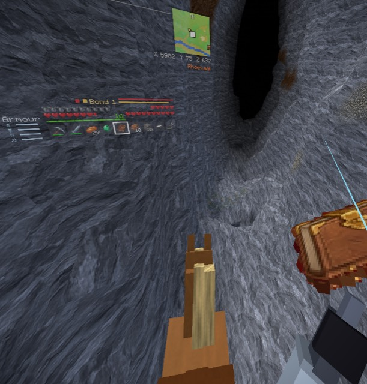

## 08:08:39 - Oh, hell no

- **Transcript:** Oh, hell no
- **Status:** open
- **Build:** 0.129 (36269755, M1-M4 (device-tested; ship riding, chests, comfort options, weapon wheel))
- **World:** New World (11) (seed 13480747113613945685)
- **Dimension:** Surface
- **Biome:** Forest
- **Position:** 5992.2 75.2 640.7
- **Facing:** north-east (yaw 51, pitch -18)
- **Held:** Written Book x1
- **Mount:** riding Horse
- **Looking at:** nothing
- **Mode:** Survival, health 15/20
- **Time:** day 7 15:49, clear
- **Fps:** 71
- **Levels:** mic -34 dBFS, game sound -25 dBFS
- **Length:** 3.4 s (voice 1.8 s)
- **Just before:** -24s closed StableMenu; -23s message: Willa Fenwick: Stay back. I heard the shots.; -15s mounted Horse; -11s walked into Forest; -9s walked into Savanna; -7s walked into Forest
- **Repro (Mac):** `./snap.sh note --seed 13480747113613945685 --x 5992.2 --z 640.7 --yaw -51 --pitch -18 --time 0.409`
- **Audio (this Mac):** /Users/darthvadar/Documents/Blocksmith/QuestVoiceNotes/raw/vn-20261018-080839-210.aac

## 08:08:43 - All right, we'll figure this out. Juniper, we're gonna, we're gonna ge

- **Transcript:** All right, we'll figure this out. Juniper, we're gonna, we're gonna get the hell out of here
- **Status:** open
- **Build:** 0.129 (36269755, M1-M4 (device-tested; ship riding, chests, comfort options, weapon wheel))
- **World:** New World (11) (seed 13480747113613945685)
- **Dimension:** Surface
- **Biome:** Forest
- **Position:** 5985.4 79.2 640.6
- **Facing:** west (yaw 289, pitch -29)
- **Held:** Raw Copper x10
- **Mount:** riding Horse
- **Looking at:** Stone at 5984 79 640
- **Mode:** Survival, health 15/20
- **Time:** day 7 15:54, clear
- **Fps:** 72
- **Levels:** mic -38 dBFS, game sound -23 dBFS
- **Length:** 5.1 s (voice 2.4 s)
- **Just before:** -28s closed StableMenu; -27s message: Willa Fenwick: Stay back. I heard the shots.; -19s mounted Horse; -15s walked into Forest; -13s walked into Savanna; -11s walked into Forest; -0s holding Raw Copper; -0s message: Raw Copper
- **Repro (Mac):** `./snap.sh note --seed 13480747113613945685 --x 5985.4 --z 640.6 --yaw 71 --pitch -29 --time 0.413`
- **Audio (this Mac):** /Users/darthvadar/Documents/Blocksmith/QuestVoiceNotes/raw/vn-20261018-080843-230.aac

## 08:10:03 - No, no, do not go in there. Okay

- **Transcript:** No, no, do not go in there. Okay
- **Status:** open
- **Build:** 0.129 (36269755, M1-M4 (device-tested; ship riding, chests, comfort options, weapon wheel))
- **World:** New World (11) (seed 13480747113613945685)
- **Dimension:** Surface
- **Biome:** Forest
- **Position:** 5972.8 89.2 640.3
- **Facing:** west (yaw 272, pitch -46)
- **Held:** Titanium Pickaxe x1
- **Mount:** riding Horse
- **Looking at:** nothing
- **Mode:** Survival, health 15/20
- **Time:** day 7 17:29, clear
- **Fps:** 71
- **Levels:** mic -28 dBFS, game sound -18 dBFS
- **Length:** 4.1 s (voice 2.1 s)
- **Just before:** -23s holding White Bed; -23s message: White Bed; -23s holding Shears; -23s message: Shears; -23s holding Titanium Pickaxe; -23s message: Titanium Pickaxe; -17s message: Your pack is full: the Dirt stays on the ground
- **Repro (Mac):** `./snap.sh note --seed 13480747113613945685 --x 5972.8 --z 640.3 --yaw 88 --pitch -46 --time 0.479`
- **Audio (this Mac):** /Users/darthvadar/Documents/Blocksmith/QuestVoiceNotes/raw/vn-20261018-081003-250.aac

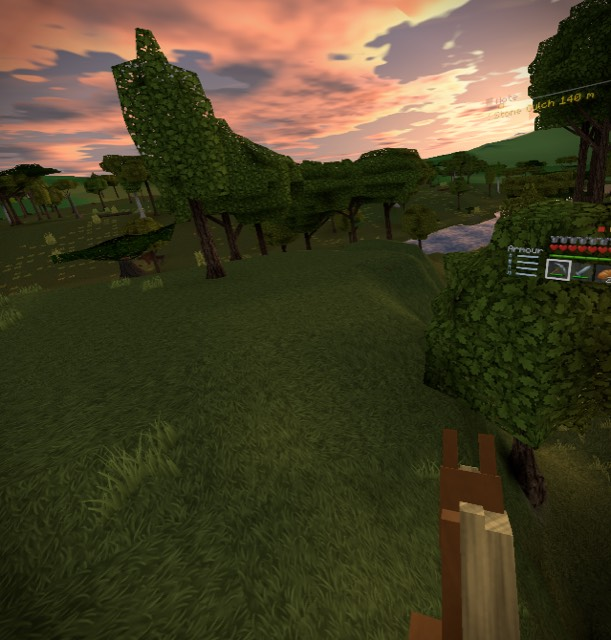

## 08:10:11 - Very good. Okay

- **Transcript:** Very good. Okay
- **Status:** open
- **Build:** 0.129 (36269755, M1-M4 (device-tested; ship riding, chests, comfort options, weapon wheel))
- **World:** New World (11) (seed 13480747113613945685)
- **Dimension:** Surface
- **Biome:** Savanna
- **Position:** 5998.8 91.2 723.5
- **Facing:** south-east (yaw 151, pitch -41)
- **Held:** Titanium Pickaxe x1
- **Mount:** riding Horse
- **Looking at:** Grass Block at 6000 89 726
- **Mode:** Survival, health 15/20
- **Time:** day 7 17:39, clear
- **Fps:** 69
- **Levels:** mic -39 dBFS, game sound -18 dBFS
- **Length:** 3.1 s (voice 1.1 s)
- **Just before:** -25s message: Your pack is full: the Dirt stays on the ground; -4s walked into River; -2s walked into Savanna
- **Repro (Mac):** `./snap.sh note --seed 13480747113613945685 --x 5998.8 --z 723.5 --yaw -151 --pitch -41 --time 0.485`
- **Audio (this Mac):** /Users/darthvadar/Documents/Blocksmith/QuestVoiceNotes/raw/vn-20261018-081011-790.aac

## 08:10:43 - Now we're gonna go back, back to the village. There's a bed

- **Transcript:** Now we're gonna go back, back to the village. There's a bed
- **Status:** open
- **Build:** 0.129 (36269755, M1-M4 (device-tested; ship riding, chests, comfort options, weapon wheel))
- **World:** New World (11) (seed 13480747113613945685)
- **Dimension:** Surface
- **Biome:** Forest
- **Position:** 5923.9 101.2 869.7
- **Facing:** south-east (yaw 115, pitch -28)
- **Held:** Titanium Pickaxe x1
- **Mount:** riding Horse
- **Looking at:** Oak Log at 5926 100 871
- **Mode:** Survival, health 15/20
- **Time:** day 7 18:16, clear
- **Fps:** 70
- **Levels:** mic -33 dBFS, game sound -34 dBFS
- **Length:** 5.5 s (voice 2.1 s)
- **Just before:** -23s walked into Forest; -21s walked into Savanna; -20s dismounted Horse; -20s message: Thrown!; -17s walked into Forest; -15s walked into Savanna; -14s mounted Horse; -5s walked into Forest; -4s dismounted Horse; -3s mounted Horse
- **While talking:** -1s walked into Savanna
- **Position at the end:** 5920.0 85.2 833.8
- **Repro (Mac):** `./snap.sh note --seed 13480747113613945685 --x 5923.9 --z 869.7 --yaw -115 --pitch -28 --time 0.511`
- **Audio (this Mac):** /Users/darthvadar/Documents/Blocksmith/QuestVoiceNotes/raw/vn-20261018-081043-070.aac

## 08:11:03 - Here's another thing. Too many caves all out in the open at least

- **Transcript:** Here's another thing. Too many caves all out in the open at least
- **Status:** open
- **Build:** 0.129 (36269755, M1-M4 (device-tested; ship riding, chests, comfort options, weapon wheel))
- **World:** New World (11) (seed 13480747113613945685)
- **Dimension:** Surface
- **Biome:** Forest
- **Position:** 5951.4 95.0 805.6
- **Facing:** north (yaw 344, pitch -30)
- **Held:** Titanium Pickaxe x1
- **Mount:** riding Horse
- **Looking at:** Grass Block at 5950 93 801
- **Mode:** Survival, health 15/20
- **Time:** day 7 18:39, clear
- **Fps:** 70
- **Levels:** mic -31 dBFS, game sound -24 dBFS
- **Length:** 5.1 s (voice 2.5 s)
- **Just before:** -24s walked into Forest; -24s dismounted Horse; -22s mounted Horse; -16s walked into Savanna; -10s walked into Plains; -8s walked into Forest; -8s message: Your horse won't take that drop
- **Repro (Mac):** `./snap.sh note --seed 13480747113613945685 --x 5951.4 --z 805.6 --yaw 16 --pitch -30 --time 0.528`
- **Audio (this Mac):** /Users/darthvadar/Documents/Blocksmith/QuestVoiceNotes/raw/vn-20261018-081103-570.aac

## 08:11:30 - Where did I put my bed?

- **Transcript:** Where did I put my bed?
- **Status:** open
- **Build:** 0.129 (36269755, M1-M4 (device-tested; ship riding, chests, comfort options, weapon wheel))
- **World:** New World (11) (seed 13480747113613945685)
- **Dimension:** Surface
- **Biome:** Savanna
- **Position:** 6090.1 88.1 699.6
- **Facing:** south-east (yaw 140, pitch -32)
- **Held:** Titanium Pickaxe x1
- **Mount:** on foot
- **Looking at:** Short Grass at 6092 87 701
- **Mode:** Survival, health 15/20
- **Time:** day 7 19:11, clear
- **Fps:** 71
- **Levels:** mic -39 dBFS, game sound -26 dBFS
- **Length:** 2.3 s (voice 0.7 s)
- **Just before:** -25s walked into Savanna; -21s walked into Forest; -19s walked into Savanna; -17s walked into Plains; -15s walked into Savanna; -10s message: You've reached Stone Gulch; -8s message: Flora Kettering: I've got nothing you want. Please.; -3s dismounted Horse
- **Repro (Mac):** `./snap.sh note --seed 13480747113613945685 --x 6090.1 --z 699.6 --yaw -140 --pitch -32 --time 0.550`
- **Audio (this Mac):** /Users/darthvadar/Documents/Blocksmith/QuestVoiceNotes/raw/vn-20261018-081130-950.aac

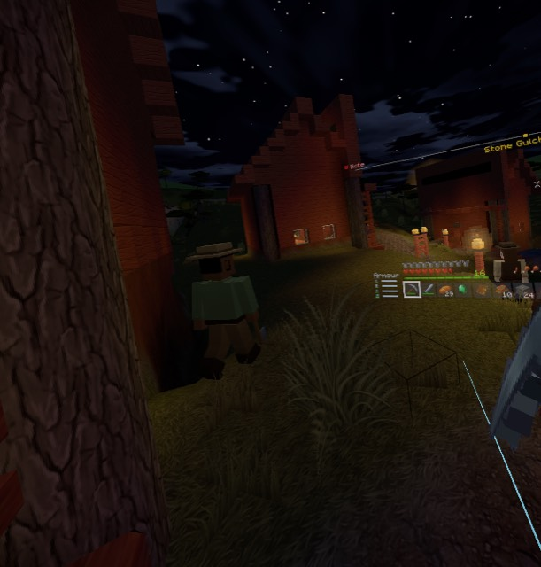

## 08:11:40 - It's not in inventory

- **Transcript:** It's not in inventory
- **Status:** open
- **Build:** 0.129 (36269755, M1-M4 (device-tested; ship riding, chests, comfort options, weapon wheel))
- **World:** New World (11) (seed 13480747113613945685)
- **Dimension:** Surface
- **Biome:** Savanna
- **Position:** 6116.9 87.8 713.2
- **Facing:** north-east (yaw 30, pitch -49)
- **Held:** Titanium Pickaxe x1
- **Mount:** on foot
- **Looking at:** Coarse Dirt at 6117 87 711
- **Mode:** Survival, health 14/20
- **Time:** day 7 19:22, clear
- **Fps:** 72
- **Levels:** mic -33 dBFS, game sound -30 dBFS
- **Length:** 2.2 s (voice 0.8 s)
- **Just before:** -28s walked into Savanna; -26s walked into Plains; -24s walked into Savanna; -19s message: You've reached Stone Gulch; -17s message: Flora Kettering: I've got nothing you want. Please.; -12s dismounted Horse; -6s took 1 damage (health 14/20); -3s opened InventoryMenu; -1s closed InventoryMenu
- **Repro (Mac):** `./snap.sh note --seed 13480747113613945685 --x 6116.9 --z 713.2 --yaw -30 --pitch -49 --time 0.558`
- **Audio (this Mac):** /Users/darthvadar/Documents/Blocksmith/QuestVoiceNotes/raw/vn-20261018-081140-330.aac

## 08:12:05 - Where did I put down stupid dead?

- **Transcript:** Where did I put down stupid dead?
- **Status:** open
- **Build:** 0.129 (36269755, M1-M4 (device-tested; ship riding, chests, comfort options, weapon wheel))
- **World:** New World (11) (seed 13480747113613945685)
- **Dimension:** Surface
- **Biome:** Savanna
- **Position:** 6104.8 88.3 711.5
- **Facing:** west (yaw 283, pitch -51)
- **Held:** Titanium Pickaxe x1
- **Mount:** on foot
- **Looking at:** nothing
- **Mode:** Survival, health 14/20
- **Time:** day 7 19:53, clear
- **Fps:** 71
- **Levels:** mic -35 dBFS, game sound -24 dBFS
- **Length:** 3.2 s (voice 1.2 s)
- **Just before:** -28s opened InventoryMenu; -26s closed InventoryMenu; -22s message: Etta Kettering: There's a man's blood on your sleeve.; -1s message: Ada Wainwright: You killed a man out there. I can see it on you.
- **Repro (Mac):** `./snap.sh note --seed 13480747113613945685 --x 6104.8 --z 711.5 --yaw 77 --pitch -51 --time 0.579`
- **Audio (this Mac):** /Users/darthvadar/Documents/Blocksmith/QuestVoiceNotes/raw/vn-20261018-081205-910.aac

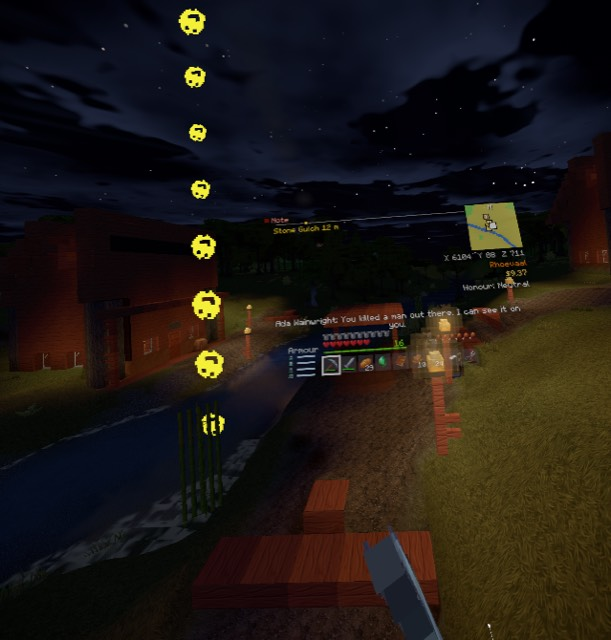

## 08:12:29 - So really no bid

- **Transcript:** So really no bid
- **Status:** open
- **Build:** 0.129 (36269755, M1-M4 (device-tested; ship riding, chests, comfort options, weapon wheel))
- **World:** New World (11) (seed 13480747113613945685)
- **Dimension:** Surface
- **Biome:** Savanna
- **Position:** 6108.3 88.3 690.6
- **Facing:** north (yaw 353, pitch -51)
- **Held:** Titanium Pickaxe x1
- **Mount:** on foot
- **Looking at:** Short Grass at 6108 88 689
- **Mode:** Survival, health 14/20
- **Time:** day 7 20:21, clear
- **Fps:** 71
- **Levels:** mic -30 dBFS, game sound -26 dBFS
- **Length:** 2.2 s (voice 0.8 s)
- **Just before:** -24s message: Ada Wainwright: You killed a man out there. I can see it on you.; -16s message: You've reached Stone Gulch; -10s walked into River; -8s walked into Savanna
- **Repro (Mac):** `./snap.sh note --seed 13480747113613945685 --x 6108.3 --z 690.6 --yaw 7 --pitch -51 --time 0.598`
- **Audio (this Mac):** /Users/darthvadar/Documents/Blocksmith/QuestVoiceNotes/raw/vn-20261018-081229-310.aac

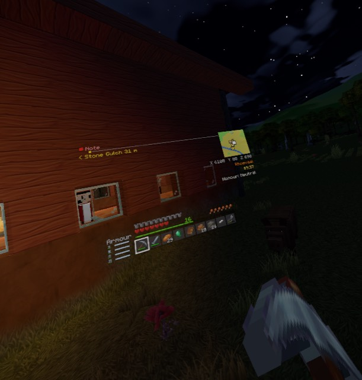

## 08:12:32 - Where, where did I put the freaking bed?

- **Transcript:** Where, where did I put the freaking bed?
- **Status:** open
- **Build:** 0.129 (36269755, M1-M4 (device-tested; ship riding, chests, comfort options, weapon wheel))
- **World:** New World (11) (seed 13480747113613945685)
- **Dimension:** Surface
- **Biome:** Savanna
- **Position:** 6089.9 87.9 685.4
- **Facing:** south (yaw 196, pitch -43)
- **Held:** Titanium Pickaxe x1
- **Mount:** on foot
- **Looking at:** Coarse Dirt at 6089 87 686
- **Mode:** Survival, health 14/20
- **Time:** day 7 20:25, clear
- **Fps:** 72
- **Levels:** mic -41 dBFS, game sound -19 dBFS
- **Length:** 3.5 s (voice 1.6 s)
- **Just before:** -28s message: Ada Wainwright: You killed a man out there. I can see it on you.; -19s message: You've reached Stone Gulch; -14s walked into River; -12s walked into Savanna
- **Repro (Mac):** `./snap.sh note --seed 13480747113613945685 --x 6089.9 --z 685.4 --yaw 164 --pitch -43 --time 0.601`
- **Audio (this Mac):** /Users/darthvadar/Documents/Blocksmith/QuestVoiceNotes/raw/vn-20261018-081232-850.aac

## 08:12:36 - Oh fuck, I'm gonna be dishonorable

- **Transcript:** Oh fuck, I'm gonna be dishonorable
- **Status:** open
- **Build:** 0.129 (36269755, M1-M4 (device-tested; ship riding, chests, comfort options, weapon wheel))
- **World:** New World (11) (seed 13480747113613945685)
- **Dimension:** Surface
- **Biome:** Savanna
- **Position:** 6083.3 87.7 697.1
- **Facing:** east (yaw 101, pitch -70)
- **Held:** Titanium Pickaxe x1
- **Mount:** on foot
- **Looking at:** Grass Block at 6083 87 697
- **Mode:** Survival, health 14/20
- **Time:** day 7 20:29, clear
- **Fps:** 72
- **Levels:** mic -37 dBFS, game sound -26 dBFS
- **Length:** 3.3 s (voice 1.5 s)
- **Just before:** -23s message: You've reached Stone Gulch; -18s walked into River; -16s walked into Savanna
- **Repro (Mac):** `./snap.sh note --seed 13480747113613945685 --x 6083.3 --z 697.1 --yaw -101 --pitch -70 --time 0.604`
- **Audio (this Mac):** /Users/darthvadar/Documents/Blocksmith/QuestVoiceNotes/raw/vn-20261018-081236-650.aac

## 08:13:00 - Let me out of here

- **Transcript:** Let me out of here
- **Status:** open
- **Build:** 0.129 (36269755, M1-M4 (device-tested; ship riding, chests, comfort options, weapon wheel))
- **World:** New World (11) (seed 13480747113613945685)
- **Dimension:** Surface
- **Biome:** Savanna
- **Position:** 6087.5 89.2 683.8
- **Facing:** west (yaw 285, pitch -17)
- **Held:** Titanium Pickaxe x1
- **Mount:** riding Horse
- **Looking at:** nothing
- **Mode:** Survival, health 14/20
- **Time:** day 8 06:31, clear
- **Fps:** 72
- **Levels:** mic -34 dBFS, game sound -22 dBFS
- **Length:** 2.2 s (voice 0.8 s)
- **Just before:** -22s message: Otis Pruitt: Last call, folks.; -19s message: Respawn point set; -17s message: Honour lowered (you slept in someone else's bed); -14s message: Good morning; -12s message: Summer: the crops grow fastest; -10s message: A stranger in town: Abigail Hale; -8s message: Battle on the Rhoevaal-Savismoor front: Rhoevaal advances 70 blocks; -5s message: Quelmere and Quelisesh have made peace; -2s message: Otis Pruitt: Pull up a stool.; -1s mounted Horse
- **Repro (Mac):** `./snap.sh note --seed 13480747113613945685 --x 6087.5 --z 683.8 --yaw 75 --pitch -17 --time 0.022`
- **Audio (this Mac):** /Users/darthvadar/Documents/Blocksmith/QuestVoiceNotes/raw/vn-20261018-081300-110.aac

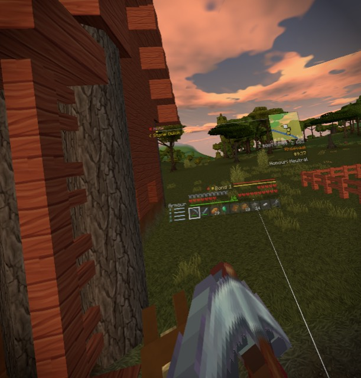

## 08:13:07 - Son of a whore

- **Transcript:** Son of a whore
- **Status:** open
- **Build:** 0.129 (36269755, M1-M4 (device-tested; ship riding, chests, comfort options, weapon wheel))
- **World:** New World (11) (seed 13480747113613945685)
- **Dimension:** Surface
- **Biome:** Savanna
- **Position:** 6011.7 89.8 715.3
- **Facing:** north-west (yaw 333, pitch -38)
- **Held:** Titanium Pickaxe x1
- **Mount:** on foot
- **Looking at:** Grass Block at 6010 88 712
- **Mode:** Survival, health 14/20
- **Time:** day 8 06:40, clear
- **Fps:** 71
- **Levels:** mic -30 dBFS, game sound -26 dBFS
- **Length:** 2.3 s (voice 0.7 s)
- **Just before:** -30s message: Otis Pruitt: Last call, folks.; -26s message: Respawn point set; -25s message: Honour lowered (you slept in someone else's bed); -22s message: Good morning; -20s message: Summer: the crops grow fastest; -18s message: A stranger in town: Abigail Hale; -16s message: Battle on the Rhoevaal-Savismoor front: Rhoevaal advances 70 blocks; -12s message: Quelmere and Quelisesh have made peace; -10s message: Otis Pruitt: Pull up a stool.; -8s mounted Horse; -2s dismounted Horse; -2s message: Thrown!
- **Repro (Mac):** `./snap.sh note --seed 13480747113613945685 --x 6011.7 --z 715.3 --yaw 27 --pitch -38 --time 0.028`
- **Audio (this Mac):** /Users/darthvadar/Documents/Blocksmith/QuestVoiceNotes/raw/vn-20261018-081307-830.aac

## 08:13:24 - Oh, yeah. Right. And just when I get a horse, look what I see

- **Transcript:** Oh, yeah. Right. And just when I get a horse, look what I see
- **Status:** open
- **Build:** 0.129 (36269755, M1-M4 (device-tested; ship riding, chests, comfort options, weapon wheel))
- **World:** New World (11) (seed 13480747113613945685)
- **Dimension:** Surface
- **Biome:** Forest
- **Position:** 5842.3 84.2 725.3
- **Facing:** south-west (yaw 247, pitch -35)
- **Held:** Titanium Pickaxe x1
- **Mount:** riding Horse
- **Looking at:** Grass Block at 5839 82 726
- **Mode:** Survival, health 14/20
- **Time:** day 8 07:00, clear
- **Fps:** 71
- **Levels:** mic -24 dBFS, game sound -16 dBFS
- **Length:** 4.9 s (voice 2.9 s)
- **Just before:** -29s message: Quelmere and Quelisesh have made peace; -26s message: Otis Pruitt: Pull up a stool.; -25s mounted Horse; -18s dismounted Horse; -18s message: Thrown!; -16s mounted Horse; -11s walked into Forest; -5s walked into Savanna; -3s walked into Forest
- **Repro (Mac):** `./snap.sh note --seed 13480747113613945685 --x 5842.3 --z 725.3 --yaw 113 --pitch -35 --time 0.042`
- **Audio (this Mac):** /Users/darthvadar/Documents/Blocksmith/QuestVoiceNotes/raw/vn-20261018-081324-890.aac

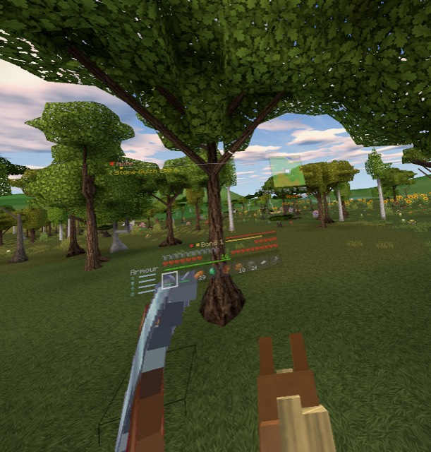

## 08:13:29 - Spawn fucking horses

- **Transcript:** Spawn fucking horses
- **Status:** open
- **Build:** 0.129 (36269755, M1-M4 (device-tested; ship riding, chests, comfort options, weapon wheel))
- **World:** New World (11) (seed 13480747113613945685)
- **Dimension:** Surface
- **Biome:** Flower Forest
- **Position:** 5785.8 80.2 720.3
- **Facing:** west (yaw 277, pitch -28)
- **Held:** Titanium Pickaxe x1
- **Mount:** riding Horse
- **Looking at:** Short Grass at 5782 79 719
- **Mode:** Survival, health 14/20
- **Time:** day 8 07:05, clear
- **Fps:** 72
- **Levels:** mic -28 dBFS, game sound -24 dBFS
- **Length:** 2.4 s (voice 0.7 s)
- **Just before:** -30s mounted Horse; -23s dismounted Horse; -23s message: Thrown!; -21s mounted Horse; -15s walked into Forest; -9s walked into Savanna; -7s walked into Forest; -1s walked into Plains
- **Repro (Mac):** `./snap.sh note --seed 13480747113613945685 --x 5785.8 --z 720.3 --yaw 83 --pitch -28 --time 0.046`
- **Audio (this Mac):** /Users/darthvadar/Documents/Blocksmith/QuestVoiceNotes/raw/vn-20261018-081329-690.aac

## 08:13:42 - Of course, I probably should try to get armored, shouldn't I?

- **Transcript:** Of course, I probably should try to get armored, shouldn't I?
- **Status:** open
- **Build:** 0.129 (36269755, M1-M4 (device-tested; ship riding, chests, comfort options, weapon wheel))
- **World:** New World (11) (seed 13480747113613945685)
- **Dimension:** Surface
- **Biome:** Forest
- **Position:** 5636.3 75.3 719.8
- **Facing:** west (yaw 269, pitch -38)
- **Held:** Titanium Pickaxe x1
- **Mount:** riding Horse
- **Looking at:** Grass Block at 5633 73 720
- **Mode:** Survival, health 14/20
- **Time:** day 8 07:20, clear
- **Fps:** 70
- **Levels:** mic -36 dBFS, game sound -17 dBFS
- **Length:** 5.5 s (voice 2.8 s)
- **Just before:** -28s walked into Forest; -22s walked into Savanna; -20s walked into Forest; -14s walked into Plains; -12s walked into Flower Forest; -10s walked into Sunflower Plains; -8s walked into Flower Forest; -6s walked into Sunflower Plains; -4s walked into Flower Forest; -2s walked into Plains
- **Repro (Mac):** `./snap.sh note --seed 13480747113613945685 --x 5636.3 --z 719.8 --yaw 91 --pitch -38 --time 0.056`
- **Audio (this Mac):** /Users/darthvadar/Documents/Blocksmith/QuestVoiceNotes/raw/vn-20261018-081342-410.aac

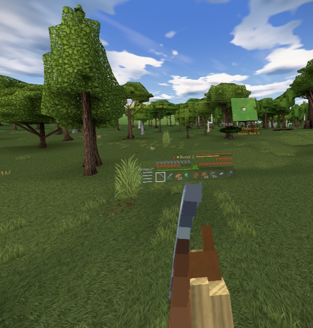

## 08:13:53 - All right, well, let's see those orders. Where are they?

- **Transcript:** All right, well, let's see those orders. Where are they?
- **Status:** open
- **Build:** 0.129 (36269755, M1-M4 (device-tested; ship riding, chests, comfort options, weapon wheel))
- **World:** New World (11) (seed 13480747113613945685)
- **Dimension:** Surface
- **Biome:** Plains
- **Position:** 5507.6 80.0 742.5
- **Facing:** south-west (yaw 224, pitch -34)
- **Held:** Titanium Pickaxe x1
- **Mount:** riding Horse
- **Looking at:** Short Grass at 5505 79 744
- **Mode:** Survival, health 14/20
- **Time:** day 8 07:33, clear
- **Fps:** 71
- **Levels:** mic -34 dBFS, game sound -24 dBFS
- **Length:** 3.3 s (voice 1.5 s)
- **Just before:** -25s walked into Plains; -23s walked into Flower Forest; -21s walked into Sunflower Plains; -19s walked into Flower Forest; -17s walked into Sunflower Plains; -15s walked into Flower Forest; -13s walked into Plains; -11s walked into Forest; -3s walked into Plains
- **Repro (Mac):** `./snap.sh note --seed 13480747113613945685 --x 5507.6 --z 742.5 --yaw 136 --pitch -34 --time 0.065`
- **Audio (this Mac):** /Users/darthvadar/Documents/Blocksmith/QuestVoiceNotes/raw/vn-20261018-081353-670.aac

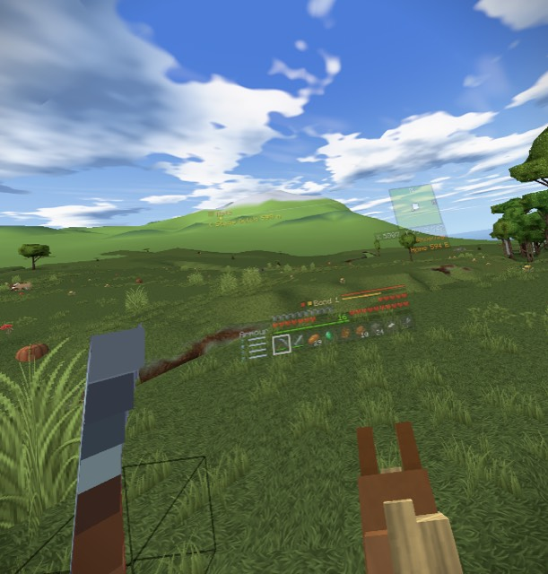

## 08:13:58 - 54:10. It's not-- Oh, shit, we're close

- **Transcript:** 54:10. It's not-- Oh, shit, we're close
- **Status:** open
- **Build:** 0.129 (36269755, M1-M4 (device-tested; ship riding, chests, comfort options, weapon wheel))
- **World:** New World (11) (seed 13480747113613945685)
- **Dimension:** Surface
- **Biome:** Plains
- **Position:** 5503.9 80.0 742.7
- **Facing:** south-west (yaw 228, pitch -24)
- **Held:** Written Book x1
- **Mount:** riding Horse
- **Looking at:** Short Grass at 5500 79 745
- **Mode:** Survival, health 14/20
- **Time:** day 8 07:39, clear
- **Fps:** 70
- **Levels:** mic -30 dBFS, game sound -32 dBFS
- **Length:** 4.0 s (voice 1.3 s)
- **Just before:** -29s walked into Plains; -27s walked into Flower Forest; -25s walked into Sunflower Plains; -23s walked into Flower Forest; -21s walked into Sunflower Plains; -19s walked into Flower Forest; -17s walked into Plains; -15s walked into Forest; -7s walked into Plains; -4s holding Titanium Sword; -4s message: Titanium Sword; -4s holding Bread; -4s message: Bread; -4s holding Emerald; -4s message: Emerald; -4s holding Written Book; -4s message: Written Book; -3s opened BookMenu; -0s closed BookMenu
- **Repro (Mac):** `./snap.sh note --seed 13480747113613945685 --x 5503.9 --z 742.7 --yaw 132 --pitch -24 --time 0.069`
- **Audio (this Mac):** /Users/darthvadar/Documents/Blocksmith/QuestVoiceNotes/raw/vn-20261018-081358-510.aac

## 08:14:03 - Really close

- **Transcript:** Really close
- **Status:** open
- **Build:** 0.129 (36269755, M1-M4 (device-tested; ship riding, chests, comfort options, weapon wheel))
- **World:** New World (11) (seed 13480747113613945685)
- **Dimension:** Surface
- **Biome:** Plains
- **Position:** 5517.9 80.3 755.3
- **Facing:** south-east (yaw 127, pitch -43)
- **Held:** Written Book x1
- **Mount:** riding Horse
- **Looking at:** Grass Block at 5519 78 756
- **Mode:** Survival, health 14/20
- **Time:** day 8 07:45, clear
- **Fps:** 70
- **Levels:** mic -25 dBFS, game sound -14 dBFS
- **Length:** 1.9 s (voice 0.4 s)
- **Just before:** -29s walked into Flower Forest; -27s walked into Sunflower Plains; -25s walked into Flower Forest; -23s walked into Plains; -21s walked into Forest; -13s walked into Plains; -10s holding Titanium Sword; -10s message: Titanium Sword; -10s holding Bread; -10s message: Bread; -9s holding Emerald; -9s message: Emerald; -9s holding Written Book; -9s message: Written Book; -8s opened BookMenu; -6s closed BookMenu
- **Repro (Mac):** `./snap.sh note --seed 13480747113613945685 --x 5517.9 --z 755.3 --yaw -127 --pitch -43 --time 0.073`
- **Audio (this Mac):** /Users/darthvadar/Documents/Blocksmith/QuestVoiceNotes/raw/vn-20261018-081403-890.aac

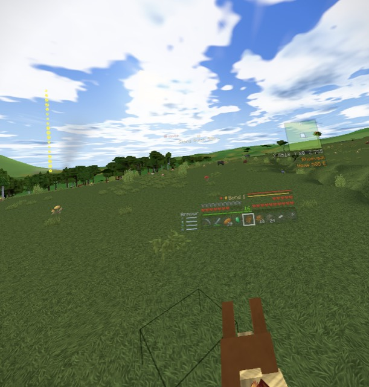

## 08:14:39 - Okay, here we are

- **Transcript:** Okay, here we are
- **Status:** open
- **Build:** 0.129 (36269755, M1-M4 (device-tested; ship riding, chests, comfort options, weapon wheel))
- **World:** New World (11) (seed 13480747113613945685)
- **Dimension:** Surface
- **Biome:** Plains
- **Position:** 5348.3 124.2 983.3
- **Facing:** south-east (yaw 136, pitch -10)
- **Held:** Written Book x1
- **Mount:** riding Horse
- **Looking at:** nothing
- **Mode:** Survival, health 14/20
- **Time:** day 8 08:27, clear
- **Fps:** 72
- **Levels:** mic -25 dBFS, game sound -18 dBFS
- **Length:** 2.3 s (voice 0.8 s)
- **Just before:** -29s message: The sky is clouding over: fog is coming; -4s dismounted Horse; -4s message: Thrown!; -3s mounted Horse
- **Repro (Mac):** `./snap.sh note --seed 13480747113613945685 --x 5348.3 --z 983.3 --yaw -136 --pitch -10 --time 0.102`
- **Audio (this Mac):** /Users/darthvadar/Documents/Blocksmith/QuestVoiceNotes/raw/vn-20261018-081439-530.aac

## 08:14:43 - Now this could go really poorly

- **Transcript:** Now this could go really poorly
- **Status:** open
- **Build:** 0.129 (36269755, M1-M4 (device-tested; ship riding, chests, comfort options, weapon wheel))
- **World:** New World (11) (seed 13480747113613945685)
- **Dimension:** Surface
- **Biome:** Plains
- **Position:** 5358.6 122.0 995.5
- **Facing:** east (yaw 111, pitch -35)
- **Held:** Written Book x1
- **Mount:** on foot
- **Looking at:** Spruce Log at 5360 122 996
- **Mode:** Survival, health 14/20
- **Time:** day 8 08:32, clear
- **Fps:** 72
- **Levels:** mic -27 dBFS, game sound -19 dBFS
- **Length:** 3.8 s (voice 2.1 s)
- **Just before:** -8s dismounted Horse; -8s message: Thrown!; -7s mounted Horse; -4s dismounted Horse
- **Repro (Mac):** `./snap.sh note --seed 13480747113613945685 --x 5358.6 --z 995.5 --yaw -111 --pitch -35 --time 0.106`
- **Audio (this Mac):** /Users/darthvadar/Documents/Blocksmith/QuestVoiceNotes/raw/vn-20261018-081443-530.aac

## 08:15:10 - Oh yeah, come here. Come here. Let's go. He's got a fucking shotgun

- **Transcript:** Oh yeah, come here. Come here. Let's go. He's got a fucking shotgun
- **Status:** open
- **Build:** 0.129 (36269755, M1-M4 (device-tested; ship riding, chests, comfort options, weapon wheel))
- **World:** New World (11) (seed 13480747113613945685)
- **Dimension:** Surface
- **Biome:** Forest
- **Position:** 5397.2 124.0 1090.2
- **Facing:** east (yaw 104, pitch -42)
- **Held:** Titanium Pickaxe x1
- **Mount:** on foot
- **Looking at:** Grass Block at 5399 123 1090
- **Mode:** Survival, health 20/20
- **Time:** day 8 09:03, clear
- **Fps:** 72
- **Levels:** mic -26 dBFS, game sound -14 dBFS
- **Length:** 5.4 s (voice 2.0 s)
- **Just before:** -26s holding Emerald; -26s message: Emerald; -26s holding Bread; -26s message: Bread; -21s holding Titanium Sword; -21s message: Titanium Sword; -18s mounted Horse; -11s walked into Forest; -10s holding Titanium Pickaxe; -10s message: Titanium Pickaxe; -10s dismounted Horse; -10s message: Thrown!
- **Repro (Mac):** `./snap.sh note --seed 13480747113613945685 --x 5397.2 --z 1090.2 --yaw -104 --pitch -42 --time 0.128`
- **Audio (this Mac):** /Users/darthvadar/Documents/Blocksmith/QuestVoiceNotes/raw/vn-20261018-081510-230.aac

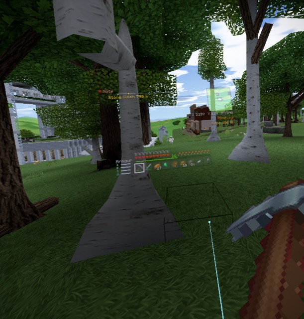

## 08:15:15 - Right. So, okay, let's go. Bring it

- **Transcript:** Right. So, okay, let's go. Bring it
- **Status:** open
- **Build:** 0.129 (36269755, M1-M4 (device-tested; ship riding, chests, comfort options, weapon wheel))
- **World:** New World (11) (seed 13480747113613945685)
- **Dimension:** Surface
- **Biome:** Forest
- **Position:** 5386.7 125.0 1089.8
- **Facing:** east (yaw 99, pitch -15)
- **Held:** Titanium Sword x1
- **Mount:** on foot
- **Looking at:** Oak Log at 5391 125 1090
- **Mode:** Survival, health 20/20
- **Time:** day 8 09:10, clear
- **Fps:** 72
- **Levels:** mic -39 dBFS, game sound -24 dBFS
- **Length:** 2.8 s (voice 0.9 s)
- **Just before:** -26s holding Titanium Sword; -26s message: Titanium Sword; -23s mounted Horse; -17s walked into Forest; -16s holding Titanium Pickaxe; -16s message: Titanium Pickaxe; -15s dismounted Horse; -15s message: Thrown!; -3s holding Titanium Sword; -3s message: Titanium Sword
- **Repro (Mac):** `./snap.sh note --seed 13480747113613945685 --x 5386.7 --z 1089.8 --yaw -99 --pitch -15 --time 0.132`
- **Audio (this Mac):** /Users/darthvadar/Documents/Blocksmith/QuestVoiceNotes/raw/vn-20261018-081515-690.aac

## 08:15:21 - Drop anything? Drop shotgun shells

- **Transcript:** Drop anything? Drop shotgun shells
- **Status:** open
- **Build:** 0.129 (36269755, M1-M4 (device-tested; ship riding, chests, comfort options, weapon wheel))
- **World:** New World (11) (seed 13480747113613945685)
- **Dimension:** Surface
- **Biome:** Forest
- **Position:** 5396.5 123.7 1086.7
- **Facing:** south-east (yaw 128, pitch -58)
- **Held:** Titanium Sword x1
- **Mount:** on foot
- **Looking at:** Oak Log at 5396 124 1087
- **Mode:** Survival, health 20/20
- **Time:** day 8 09:16, clear
- **Fps:** 72
- **Levels:** mic -28 dBFS, game sound -20 dBFS
- **Length:** 3.8 s (voice 1.2 s)
- **Just before:** -28s mounted Horse; -22s walked into Forest; -21s holding Titanium Pickaxe; -21s message: Titanium Pickaxe; -20s dismounted Horse; -20s message: Thrown!; -8s holding Titanium Sword; -8s message: Titanium Sword; -2s message: Your pack is full: the Shotgun Shells stays on the ground
- **Repro (Mac):** `./snap.sh note --seed 13480747113613945685 --x 5396.5 --z 1086.7 --yaw -128 --pitch -58 --time 0.137`
- **Audio (this Mac):** /Users/darthvadar/Documents/Blocksmith/QuestVoiceNotes/raw/vn-20261018-081521-010.aac

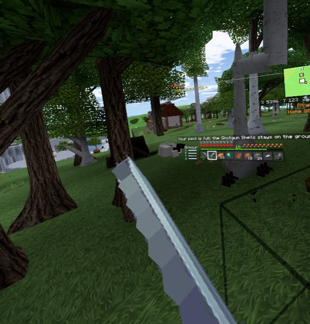

## 08:15:40 - Oh shit!

- **Transcript:** Oh shit!
- **Status:** open
- **Build:** 0.129 (36269755, M1-M4 (device-tested; ship riding, chests, comfort options, weapon wheel))
- **World:** New World (11) (seed 13480747113613945685)
- **Dimension:** Surface
- **Biome:** Forest
- **Position:** 5440.5 107.0 1086.6
- **Facing:** north-west (yaw 336, pitch -12)
- **Held:** Titanium Sword x1
- **Mount:** on foot
- **Looking at:** nothing
- **Mode:** Survival, health 16/20
- **Time:** day 8 09:39, clear
- **Fps:** 72
- **Levels:** mic -42 dBFS, game sound -18 dBFS
- **Length:** 2.0 s (voice 0.6 s)
- **Just before:** -27s holding Titanium Sword; -27s message: Titanium Sword; -21s message: Your pack is full: the Shotgun Shells stays on the ground; -18s opened InventoryMenu; -16s closed InventoryMenu; -2s message: Alarm! Intruder in the citadel
- **Repro (Mac):** `./snap.sh note --seed 13480747113613945685 --x 5440.5 --z 1086.6 --yaw 24 --pitch -12 --time 0.153`
- **Audio (this Mac):** /Users/darthvadar/Documents/Blocksmith/QuestVoiceNotes/raw/vn-20261018-081540-270.aac

## 08:15:44 - Okay, let's get over here

- **Transcript:** Okay, let's get over here
- **Status:** open
- **Build:** 0.129 (36269755, M1-M4 (device-tested; ship riding, chests, comfort options, weapon wheel))
- **World:** New World (11) (seed 13480747113613945685)
- **Dimension:** Surface
- **Biome:** Forest
- **Position:** 5425.9 107.0 1088.0
- **Facing:** south-west (yaw 247, pitch -80)
- **Held:** Titanium Sword x1
- **Mount:** on foot
- **Looking at:** Grass Block at 5425 106 1088
- **Mode:** Survival, health 20/20
- **Time:** day 8 09:44, clear
- **Fps:** 72
- **Levels:** mic -38 dBFS, game sound -16 dBFS
- **Length:** 3.1 s (voice 1.3 s)
- **Just before:** -26s message: Your pack is full: the Shotgun Shells stays on the ground; -22s opened InventoryMenu; -20s closed InventoryMenu; -6s message: Alarm! Intruder in the citadel; -4s message: The citadel is on lockdown!; -4s took 4 damage (health 18/20); -2s message: Twin 42 cm Turret tracking you; -0s message: Honour raised (you protected the town)
- **Repro (Mac):** `./snap.sh note --seed 13480747113613945685 --x 5425.9 --z 1088.0 --yaw 113 --pitch -80 --time 0.156`
- **Audio (this Mac):** /Users/darthvadar/Documents/Blocksmith/QuestVoiceNotes/raw/vn-20261018-081544-650.aac

## 08:15:59 - Why is this not getting damaged? Oh my God

- **Transcript:** Why is this not getting damaged? Oh my God
- **Status:** open
- **Build:** 0.129 (36269755, M1-M4 (device-tested; ship riding, chests, comfort options, weapon wheel))
- **World:** New World (11) (seed 13480747113613945685)
- **Dimension:** Surface
- **Biome:** Forest
- **Position:** 5428.5 107.0 1083.5
- **Facing:** south-east (yaw 127, pitch -68)
- **Held:** Titanium Sword x1
- **Mount:** on foot
- **Looking at:** Grass Block at 5429 106 1084
- **Mode:** Survival, health 20/20
- **Time:** day 8 10:02, clear
- **Fps:** 72
- **Levels:** mic -29 dBFS, game sound -24 dBFS
- **Length:** 3.4 s (voice 1.6 s)
- **Just before:** -21s message: Alarm! Intruder in the citadel; -19s message: The citadel is on lockdown!; -18s took 4 damage (health 18/20); -17s message: Twin 42 cm Turret tracking you; -14s message: Honour raised (you protected the town); -6s message: Your pack is full: the Capital Rounds stays on the ground
- **Repro (Mac):** `./snap.sh note --seed 13480747113613945685 --x 5428.5 --z 1083.5 --yaw -127 --pitch -68 --time 0.168`
- **Audio (this Mac):** /Users/darthvadar/Documents/Blocksmith/QuestVoiceNotes/raw/vn-20261018-081559-091.aac

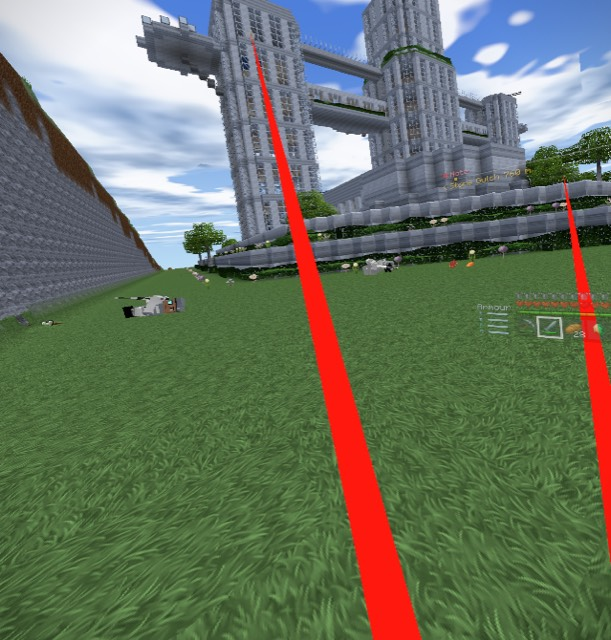

## 08:16:10 - I should be able to change the fucking difficulty. Right? Right? Wrong

- **Transcript:** I should be able to change the fucking difficulty. Right? Right? Wrong? Yes? Maybe?
- **Status:** open
- **Build:** 0.129 (36269755, M1-M4 (device-tested; ship riding, chests, comfort options, weapon wheel))
- **World:** New World (11) (seed 13480747113613945685)
- **Dimension:** Surface
- **Biome:** Forest
- **Position:** 5428.0 107.0 1079.4
- **Facing:** south-east (yaw 146, pitch -5)
- **Held:** Titanium Sword x1
- **Mount:** on foot
- **Looking at:** nothing
- **Mode:** Survival, health 20/20
- **Time:** day 8 10:08, clear
- **Fps:** 72
- **Levels:** mic -28 dBFS, game sound -10 dBFS
- **Length:** 5.2 s (voice 2.6 s)
- **Just before:** -30s took 4 damage (health 18/20); -28s message: Twin 42 cm Turret tracking you; -26s message: Honour raised (you protected the town); -18s message: Your pack is full: the Capital Rounds stays on the ground; -12s message: A Capital Dropship is landing troops!; -11s opened PauseMenu; -5s opened CommandMenu; -2s closed CommandMenu
- **While talking:** -0s opened InventoryMenu
- **Position at the end:** 5432.8 107.0 1087.1
- **Repro (Mac):** `./snap.sh note --seed 13480747113613945685 --x 5428.0 --z 1079.4 --yaw -146 --pitch -5 --time 0.173`
- **Audio (this Mac):** /Users/darthvadar/Documents/Blocksmith/QuestVoiceNotes/raw/vn-20261018-081610-810.aac

## 08:16:16 - Or something, 'cause I, I'm not taking any damage

- **Transcript:** Or something, 'cause I, I'm not taking any damage
- **Status:** open
- **Build:** 0.129 (36269755, M1-M4 (device-tested; ship riding, chests, comfort options, weapon wheel))
- **World:** New World (11) (seed 13480747113613945685)
- **Dimension:** Surface
- **Biome:** Forest
- **Position:** 5432.8 107.0 1087.1
- **Facing:** east (yaw 77, pitch -6)
- **Held:** Titanium Sword x1
- **Mount:** on foot
- **Looking at:** nothing
- **Mode:** Survival, health 20/20, screen InventoryMenu
- **Time:** day 8 10:15, clear
- **Fps:** 72
- **Levels:** mic -35 dBFS, game sound -16 dBFS
- **Length:** 3.5 s (voice 1.4 s)
- **Just before:** -24s message: Your pack is full: the Capital Rounds stays on the ground; -18s message: A Capital Dropship is landing troops!; -17s opened PauseMenu; -11s opened CommandMenu; -8s closed CommandMenu; -1s opened InventoryMenu
- **Repro (Mac):** `./snap.sh note --seed 13480747113613945685 --x 5432.8 --z 1087.1 --yaw -77 --pitch -6 --time 0.178`
- **Audio (this Mac):** /Users/darthvadar/Documents/Blocksmith/QuestVoiceNotes/raw/vn-20261018-081616-890.aac

## 08:16:23 - Sounds like I am

- **Transcript:** Sounds like I am
- **Status:** open
- **Build:** 0.129 (36269755, M1-M4 (device-tested; ship riding, chests, comfort options, weapon wheel))
- **World:** New World (11) (seed 13480747113613945685)
- **Dimension:** Surface
- **Biome:** Forest
- **Position:** 5439.9 109.0 1070.0
- **Facing:** east (yaw 87, pitch -42)
- **Held:** Titanium Sword x1
- **Mount:** on foot
- **Looking at:** Oak Leaves at 5441 109 1069
- **Mode:** Survival, health 20/20
- **Time:** day 8 10:23, clear
- **Fps:** 72
- **Levels:** mic -45 dBFS, game sound -14 dBFS
- **Length:** 2.1 s (voice 0.6 s)
- **Just before:** -24s message: A Capital Dropship is landing troops!; -24s opened PauseMenu; -17s opened CommandMenu; -15s closed CommandMenu; -8s opened InventoryMenu; -5s closed InventoryMenu
- **Repro (Mac):** `./snap.sh note --seed 13480747113613945685 --x 5439.9 --z 1070.0 --yaw -87 --pitch -42 --time 0.183`
- **Audio (this Mac):** /Users/darthvadar/Documents/Blocksmith/QuestVoiceNotes/raw/vn-20261018-081623-430.aac

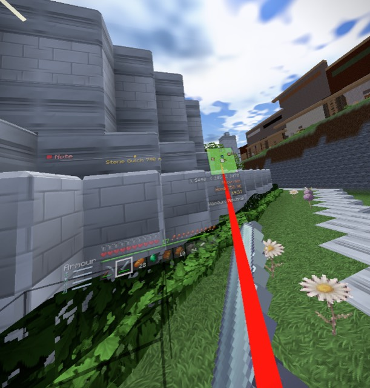

## 08:16:49 - So they're just not hitting me or something, right?

- **Transcript:** So they're just not hitting me or something, right?
- **Status:** open
- **Build:** 0.129 (36269755, M1-M4 (device-tested; ship riding, chests, comfort options, weapon wheel))
- **World:** New World (11) (seed 13480747113613945685)
- **Dimension:** Surface
- **Biome:** Forest
- **Position:** 5439.2 111.0 1047.4
- **Facing:** north-east (yaw 23, pitch -53)
- **Held:** Titanium Sword x1
- **Mount:** on foot
- **Looking at:** Capital Stone at 5439 110 1046
- **Mode:** Survival, health 20/20
- **Time:** day 8 10:54, clear
- **Fps:** 72
- **Levels:** mic -24 dBFS, game sound -17 dBFS
- **Length:** 3.2 s (voice 1.7 s)
- **Repro (Mac):** `./snap.sh note --seed 13480747113613945685 --x 5439.2 --z 1047.4 --yaw -23 --pitch -53 --time 0.205`
- **Audio (this Mac):** /Users/darthvadar/Documents/Blocksmith/QuestVoiceNotes/raw/vn-20261018-081649-190.aac

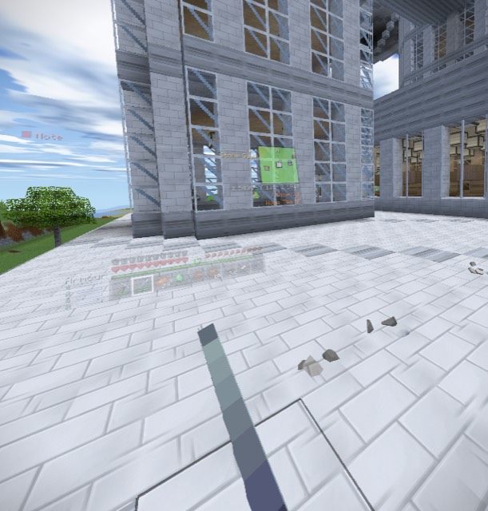

## 08:17:13 - This is nice

- **Transcript:** This is nice
- **Status:** open
- **Build:** 0.129 (36269755, M1-M4 (device-tested; ship riding, chests, comfort options, weapon wheel))
- **World:** New World (11) (seed 13480747113613945685)
- **Dimension:** Surface
- **Biome:** Forest
- **Position:** 5478.0 111.0 1055.9
- **Facing:** north (yaw 12, pitch -42)
- **Held:** Titanium Sword x1
- **Mount:** on foot
- **Looking at:** Capital Grey Stone at 5478 110 1054
- **Mode:** Survival, health 20/20
- **Time:** day 8 11:23, clear
- **Fps:** 72
- **Levels:** mic -43 dBFS, game sound -17 dBFS
- **Length:** 2.1 s (voice 0.6 s)
- **Just before:** -15s message: Honour raised (you protected the town)
- **Repro (Mac):** `./snap.sh note --seed 13480747113613945685 --x 5478.0 --z 1055.9 --yaw -12 --pitch -42 --time 0.224`
- **Audio (this Mac):** /Users/darthvadar/Documents/Blocksmith/QuestVoiceNotes/raw/vn-20261018-081713-030.aac

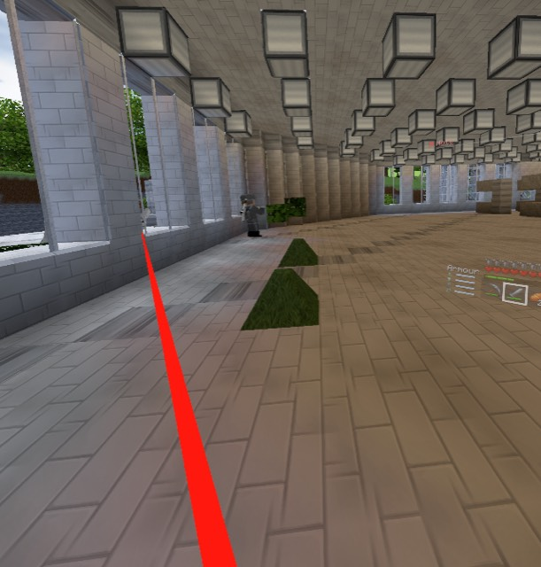

## 08:17:35 - I'd like to change the world settings

- **Transcript:** I'd like to change the world settings
- **Status:** open
- **Build:** 0.129 (36269755, M1-M4 (device-tested; ship riding, chests, comfort options, weapon wheel))
- **World:** New World (11) (seed 13480747113613945685)
- **Dimension:** Surface
- **Biome:** Forest
- **Position:** 5507.3 109.0 1079.7
- **Facing:** east (yaw 112, pitch -13)
- **Held:** Titanium Sword x1
- **Mount:** on foot
- **Looking at:** nothing
- **Mode:** Survival, health 20/20, screen InventoryMenu
- **Time:** day 8 11:49, clear
- **Fps:** 70
- **Levels:** mic -45 dBFS, game sound -19 dBFS
- **Length:** 4.1 s (voice 1.5 s)
- **Just before:** -14s message: A Capital Dropship is landing troops!; -0s opened InventoryMenu
- **Repro (Mac):** `./snap.sh note --seed 13480747113613945685 --x 5507.3 --z 1079.7 --yaw -112 --pitch -13 --time 0.243`
- **Audio (this Mac):** /Users/darthvadar/Documents/Blocksmith/QuestVoiceNotes/raw/vn-20261018-081735-290.aac

## 08:17:51 - Uh, okay. I should be able to change the fucking world settings, okay?

- **Transcript:** Uh, okay. I should be able to change the fucking world settings, okay? I want to change from peaceful to easy, okay?
- **Status:** open
- **Build:** 0.129 (36269755, M1-M4 (device-tested; ship riding, chests, comfort options, weapon wheel))
- **World:** New World (11) (seed 13480747113613945685)
- **Dimension:** Surface
- **Biome:** Forest
- **Position:** 5510.3 109.0 1079.3
- **Facing:** east (yaw 101, pitch -5)
- **Held:** Titanium Sword x1
- **Mount:** on foot
- **Looking at:** nothing
- **Mode:** Survival, health 20/20
- **Time:** day 8 11:51, clear
- **Fps:** 72
- **Levels:** mic -40 dBFS, game sound -16 dBFS
- **Length:** 7.1 s (voice 4.0 s)
- **Just before:** -16s opened InventoryMenu; -16s closed InventoryMenu; -15s opened PauseMenu; -1s closed PauseMenu
- **Position at the end:** 5536.7 107.0 1054.7
- **Repro (Mac):** `./snap.sh note --seed 13480747113613945685 --x 5510.3 --z 1079.3 --yaw -101 --pitch -5 --time 0.244`
- **Audio (this Mac):** /Users/darthvadar/Documents/Blocksmith/QuestVoiceNotes/raw/vn-20261018-081751-830.aac

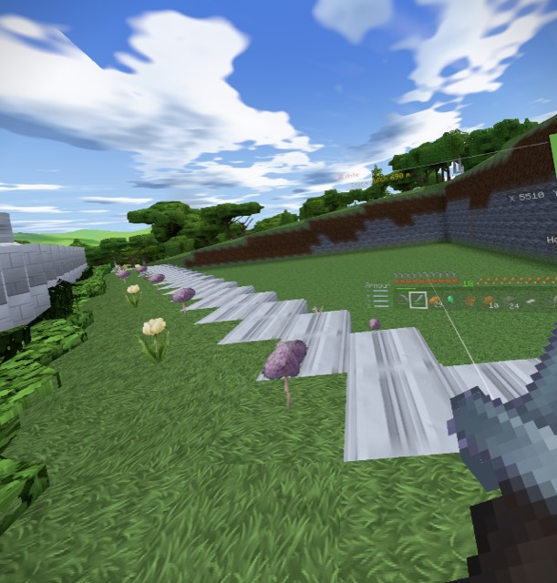

## 08:17:59 - Undo the previous change or whatever they made so I couldn't do that

- **Transcript:** Undo the previous change or whatever they made so I couldn't do that
- **Status:** open
- **Build:** 0.129 (36269755, M1-M4 (device-tested; ship riding, chests, comfort options, weapon wheel))
- **World:** New World (11) (seed 13480747113613945685)
- **Dimension:** Surface
- **Biome:** Forest
- **Position:** 5540.5 110.0 1065.3
- **Facing:** south (yaw 196, pitch -28)
- **Held:** Titanium Sword x1
- **Mount:** on foot
- **Looking at:** Oak Log at 5539 110 1067
- **Mode:** Survival, health 20/20
- **Time:** day 8 12:00, clear
- **Fps:** 70
- **Levels:** mic -26 dBFS, game sound -19 dBFS
- **Length:** 4.5 s (voice 2.7 s)
- **Just before:** -23s opened InventoryMenu; -23s closed InventoryMenu; -22s opened PauseMenu; -8s closed PauseMenu
- **Repro (Mac):** `./snap.sh note --seed 13480747113613945685 --x 5540.5 --z 1065.3 --yaw 164 --pitch -28 --time 0.250`
- **Audio (this Mac):** /Users/darthvadar/Documents/Blocksmith/QuestVoiceNotes/raw/vn-20261018-081759-110.aac

## 08:18:06 - [laughs] Oh, shit

- **Transcript:** [laughs] Oh, shit
- **Status:** open
- **Build:** 0.129 (36269755, M1-M4 (device-tested; ship riding, chests, comfort options, weapon wheel))
- **World:** New World (11) (seed 13480747113613945685)
- **Dimension:** Surface
- **Biome:** Forest
- **Position:** 5523.6 114.9 1091.3
- **Facing:** west (yaw 274, pitch -37)
- **Held:** Titanium Sword x1
- **Mount:** on foot
- **Looking at:** Grass Block at 5521 114 1091
- **Mode:** Survival, health 20/20
- **Time:** day 8 12:08, clear
- **Fps:** 66
- **Levels:** mic -28 dBFS, game sound -12 dBFS
- **Length:** 3.3 s (voice 1.1 s)
- **Just before:** -30s closed InventoryMenu; -29s opened PauseMenu; -14s closed PauseMenu
- **Repro (Mac):** `./snap.sh note --seed 13480747113613945685 --x 5523.6 --z 1091.3 --yaw 86 --pitch -37 --time 0.256`
- **Audio (this Mac):** /Users/darthvadar/Documents/Blocksmith/QuestVoiceNotes/raw/vn-20261018-081806-190.aac

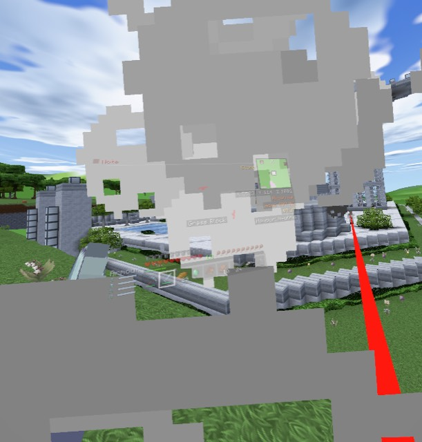

## 08:18:09 - I would've been like near death

- **Transcript:** I would've been like near death
- **Status:** open
- **Build:** 0.129 (36269755, M1-M4 (device-tested; ship riding, chests, comfort options, weapon wheel))
- **World:** New World (11) (seed 13480747113613945685)
- **Dimension:** Surface
- **Biome:** Forest
- **Position:** 5505.9 110.1 1078.3
- **Facing:** west (yaw 286, pitch -31)
- **Held:** Titanium Sword x1
- **Mount:** on foot
- **Looking at:** Oak Leaves at 5503 109 1077
- **Mode:** Survival, health 17/20
- **Time:** day 8 12:12, clear
- **Fps:** 71
- **Levels:** mic -24 dBFS, game sound -16 dBFS
- **Length:** 3.4 s (voice 1.1 s)
- **Just before:** -18s closed PauseMenu; -0s took 3 damage (health 17/20)
- **Repro (Mac):** `./snap.sh note --seed 13480747113613945685 --x 5505.9 --z 1078.3 --yaw 74 --pitch -31 --time 0.258`
- **Audio (this Mac):** /Users/darthvadar/Documents/Blocksmith/QuestVoiceNotes/raw/vn-20261018-081809-510.aac

## 08:18:13 - Okay. Whoa, whoa, whoa, whoa. Okay. Oh, okay. All right. Oh, oh

- **Transcript:** Okay. Whoa, whoa, whoa, whoa. Okay. Oh, okay. All right. Oh, oh
- **Status:** open
- **Build:** 0.129 (36269755, M1-M4 (device-tested; ship riding, chests, comfort options, weapon wheel))
- **World:** New World (11) (seed 13480747113613945685)
- **Dimension:** Surface
- **Biome:** Forest
- **Position:** 5504.3 115.0 1065.0
- **Facing:** east (yaw 100, pitch -64)
- **Held:** Titanium Sword x1
- **Mount:** on foot
- **Looking at:** Capital Grey Stone at 5504 114 1064
- **Mode:** Survival, health 19/20
- **Time:** day 8 12:17, clear
- **Fps:** 70
- **Levels:** mic -35 dBFS, game sound -16 dBFS
- **Length:** 6.2 s (voice 2.9 s)
- **Just before:** -22s closed PauseMenu; -5s took 3 damage (health 17/20)
- **While talking:** -4s holding Titanium Pickaxe; -4s message: Titanium Pickaxe; -3s holding Titanium Sword; -3s message: Titanium Sword; -3s holding Bread; -3s message: Bread; -2s message: The gunner holds this gun
- **Position at the end:** 5499.3 113.8 1065.7
- **Repro (Mac):** `./snap.sh note --seed 13480747113613945685 --x 5504.3 --z 1065.0 --yaw -100 --pitch -64 --time 0.262`
- **Audio (this Mac):** /Users/darthvadar/Documents/Blocksmith/QuestVoiceNotes/raw/vn-20261018-081813-730.aac

## 08:18:34 - Yeah, man

- **Transcript:** Yeah, man
- **Status:** open
- **Build:** 0.129 (36269755, M1-M4 (device-tested; ship riding, chests, comfort options, weapon wheel))
- **World:** New World (11) (seed 13480747113613945685)
- **Dimension:** Surface
- **Biome:** Forest
- **Position:** 5517.0 111.0 1062.5
- **Facing:** south-west (yaw 219, pitch -11)
- **Held:** Titanium Pickaxe x1
- **Mount:** on foot
- **Looking at:** Capital Grey Stone at 5515 112 1064
- **Mode:** Survival, health 20/20
- **Time:** day 8 12:40, clear
- **Fps:** 65
- **Levels:** mic -36 dBFS, game sound -16 dBFS
- **Length:** 1.6 s (voice 0.5 s)
- **Just before:** -24s took 3 damage (health 17/20); -18s holding Titanium Pickaxe; -18s message: Titanium Pickaxe; -18s holding Titanium Sword; -18s message: Titanium Sword; -18s holding Bread; -18s message: Bread; -17s message: The gunner holds this gun; -10s holding Titanium Sword; -10s message: Titanium Sword; -10s holding Titanium Pickaxe; -10s message: Titanium Pickaxe; -7s message: Your pack is full: the Capital Grey Stone stays on the ground; -1s message: Render distance 8 for now, to keep the frame rate
- **Repro (Mac):** `./snap.sh note --seed 13480747113613945685 --x 5517.0 --z 1062.5 --yaw 141 --pitch -11 --time 0.278`
- **Audio (this Mac):** /Users/darthvadar/Documents/Blocksmith/QuestVoiceNotes/raw/vn-20261018-081834-250.aac

## 08:18:36 - How the hell do I get in the gun?

- **Transcript:** How the hell do I get in the gun?
- **Status:** open
- **Build:** 0.129 (36269755, M1-M4 (device-tested; ship riding, chests, comfort options, weapon wheel))
- **World:** New World (11) (seed 13480747113613945685)
- **Dimension:** Surface
- **Biome:** Forest
- **Position:** 5516.3 111.0 1063.2
- **Facing:** south-west (yaw 219, pitch -24)
- **Held:** Titanium Pickaxe x1
- **Mount:** on foot
- **Looking at:** Capital Grey Stone at 5514 111 1064
- **Mode:** Survival, health 20/20
- **Time:** day 8 12:42, clear
- **Fps:** 65
- **Levels:** mic -28 dBFS, game sound -20 dBFS
- **Length:** 2.8 s (voice 1.3 s)
- **Just before:** -26s took 3 damage (health 17/20); -20s holding Titanium Pickaxe; -20s message: Titanium Pickaxe; -20s holding Titanium Sword; -20s message: Titanium Sword; -20s holding Bread; -20s message: Bread; -19s message: The gunner holds this gun; -12s holding Titanium Sword; -12s message: Titanium Sword; -12s holding Titanium Pickaxe; -12s message: Titanium Pickaxe; -9s message: Your pack is full: the Capital Grey Stone stays on the ground; -3s message: Render distance 8 for now, to keep the frame rate
- **Repro (Mac):** `./snap.sh note --seed 13480747113613945685 --x 5516.3 --z 1063.2 --yaw 141 --pitch -24 --time 0.279`
- **Audio (this Mac):** /Users/darthvadar/Documents/Blocksmith/QuestVoiceNotes/raw/vn-20261018-081836-350.aac

## 08:18:49 - Don't mind using this thing

- **Transcript:** Don't mind using this thing
- **Status:** open
- **Build:** 0.129 (36269755, M1-M4 (device-tested; ship riding, chests, comfort options, weapon wheel))
- **World:** New World (11) (seed 13480747113613945685)
- **Dimension:** Surface
- **Biome:** Forest
- **Position:** 5510.0 115.0 1064.9
- **Facing:** east (yaw 109, pitch -76)
- **Held:** Bread x29
- **Mount:** on foot
- **Looking at:** Capital Grey Stone at 5510 114 1064
- **Mode:** Survival, health 20/20
- **Time:** day 8 12:58, clear
- **Fps:** 72
- **Levels:** mic -30 dBFS, game sound -19 dBFS
- **Length:** 2.5 s (voice 0.9 s)
- **Just before:** -25s holding Titanium Sword; -25s message: Titanium Sword; -25s holding Titanium Pickaxe; -25s message: Titanium Pickaxe; -22s message: Your pack is full: the Capital Grey Stone stays on the ground; -16s message: Render distance 8 for now, to keep the frame rate; -3s holding Titanium Sword; -3s message: Titanium Sword; -3s holding Bread; -3s message: Bread; -1s message: The gunner holds this gun
- **Repro (Mac):** `./snap.sh note --seed 13480747113613945685 --x 5510.0 --z 1064.9 --yaw -109 --pitch -76 --time 0.290`
- **Audio (this Mac):** /Users/darthvadar/Documents/Blocksmith/QuestVoiceNotes/raw/vn-20261018-081849-771.aac

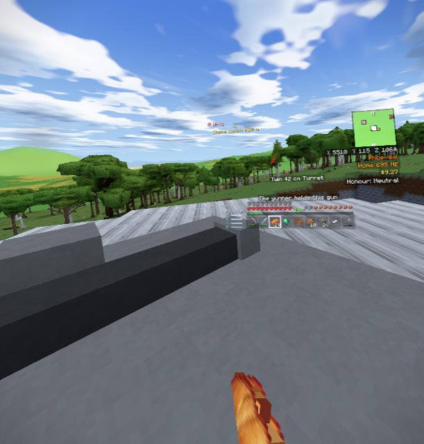

## 08:18:52 - I should be able to control that gun somehow. Like, from where do I co

- **Transcript:** I should be able to control that gun somehow. Like, from where do I control it?
- **Status:** open
- **Build:** 0.129 (36269755, M1-M4 (device-tested; ship riding, chests, comfort options, weapon wheel))
- **World:** New World (11) (seed 13480747113613945685)
- **Dimension:** Surface
- **Biome:** Forest
- **Position:** 5499.0 114.0 1067.4
- **Facing:** south-east (yaw 122, pitch -12)
- **Held:** Bread x29
- **Mount:** on foot
- **Looking at:** nothing
- **Mode:** Survival, health 20/20
- **Time:** day 8 13:00, clear
- **Fps:** 72
- **Levels:** mic -36 dBFS, game sound -18 dBFS
- **Length:** 4.6 s (voice 2.8 s)
- **Just before:** -27s holding Titanium Sword; -27s message: Titanium Sword; -27s holding Titanium Pickaxe; -27s message: Titanium Pickaxe; -25s message: Your pack is full: the Capital Grey Stone stays on the ground; -18s message: Render distance 8 for now, to keep the frame rate; -5s holding Titanium Sword; -5s message: Titanium Sword; -5s holding Bread; -5s message: Bread; -3s message: The gunner holds this gun
- **Repro (Mac):** `./snap.sh note --seed 13480747113613945685 --x 5499.0 --z 1067.4 --yaw -122 --pitch -12 --time 0.292`
- **Audio (this Mac):** /Users/darthvadar/Documents/Blocksmith/QuestVoiceNotes/raw/vn-20261018-081852-230.aac

## 08:19:03 - So the guy got hurt somehow

- **Transcript:** So the guy got hurt somehow
- **Status:** open
- **Build:** 0.129 (36269755, M1-M4 (device-tested; ship riding, chests, comfort options, weapon wheel))
- **World:** New World (11) (seed 13480747113613945685)
- **Dimension:** Surface
- **Biome:** Forest
- **Position:** 5503.2 111.0 1059.1
- **Facing:** north-east (yaw 62, pitch -39)
- **Held:** Titanium Sword x1
- **Mount:** on foot
- **Looking at:** Capital Stone at 5504 110 1058
- **Mode:** Survival, health 19/20
- **Time:** day 8 13:14, clear
- **Fps:** 71
- **Levels:** mic -32 dBFS, game sound -23 dBFS
- **Length:** 2.6 s (voice 1.1 s)
- **Just before:** -29s message: Render distance 8 for now, to keep the frame rate; -17s holding Titanium Sword; -17s message: Titanium Sword; -16s holding Bread; -16s message: Bread; -14s message: The gunner holds this gun; -10s took 1 damage (health 19/20); -3s holding Titanium Sword; -3s message: Titanium Sword; -3s message: Your pack is full: the Capital Window stays on the ground
- **Repro (Mac):** `./snap.sh note --seed 13480747113613945685 --x 5503.2 --z 1059.1 --yaw -62 --pitch -39 --time 0.302`
- **Audio (this Mac):** /Users/darthvadar/Documents/Blocksmith/QuestVoiceNotes/raw/vn-20261018-081903-630.aac

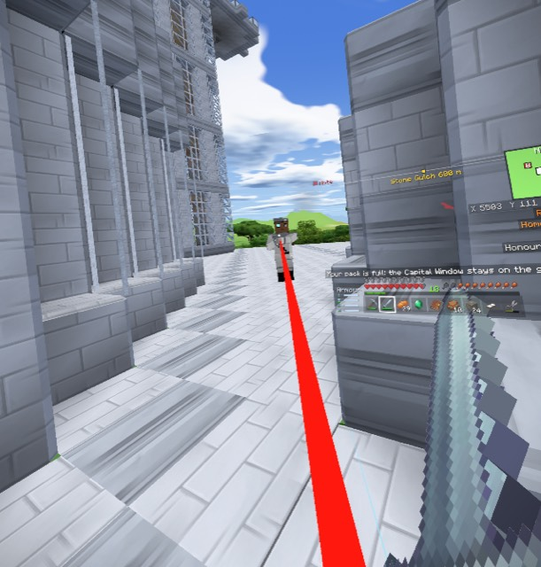

## 08:19:14 - I wouldn't mind knowing

- **Transcript:** I wouldn't mind knowing
- **Status:** open
- **Build:** 0.129 (36269755, M1-M4 (device-tested; ship riding, chests, comfort options, weapon wheel))
- **World:** New World (11) (seed 13480747113613945685)
- **Dimension:** Surface
- **Biome:** Forest
- **Position:** 5518.5 111.5 1066.3
- **Facing:** north-west (yaw 320, pitch -56)
- **Held:** Titanium Sword x1
- **Mount:** on foot
- **Looking at:** Capital Grey Stone at 5517 112 1065
- **Mode:** Survival, health 19/20
- **Time:** day 8 13:27, clear
- **Fps:** 72
- **Levels:** mic -36 dBFS, game sound -19 dBFS
- **Length:** 2.9 s (voice 1.4 s)
- **Just before:** -28s holding Titanium Sword; -28s message: Titanium Sword; -27s holding Bread; -27s message: Bread; -26s message: The gunner holds this gun; -21s took 1 damage (health 19/20); -15s holding Titanium Sword; -15s message: Titanium Sword; -14s message: Your pack is full: the Capital Window stays on the ground; -1s holding Bread; -1s message: Bread; -0s holding Titanium Sword; -0s message: Titanium Sword
- **Repro (Mac):** `./snap.sh note --seed 13480747113613945685 --x 5518.5 --z 1066.3 --yaw 40 --pitch -56 --time 0.311`
- **Audio (this Mac):** /Users/darthvadar/Documents/Blocksmith/QuestVoiceNotes/raw/vn-20261018-081914-850.aac

## 08:19:49 - All right, those guns need some work. Should be made of blocks somehow

- **Transcript:** All right, those guns need some work. Should be made of blocks somehow
- **Status:** open
- **Build:** 0.129 (36269755, M1-M4 (device-tested; ship riding, chests, comfort options, weapon wheel))
- **World:** New World (11) (seed 13480747113613945685)
- **Dimension:** Surface
- **Biome:** Forest
- **Position:** 5500.4 111.0 1063.0
- **Facing:** west (yaw 289, pitch -63)
- **Held:** Titanium Sword x1
- **Mount:** on foot
- **Looking at:** Capital Stone at 5499 110 1062
- **Mode:** Survival, health 19/20
- **Time:** day 8 14:07, clear
- **Fps:** 69
- **Levels:** mic -27 dBFS, game sound -22 dBFS
- **Length:** 6.0 s (voice 3.2 s)
- **Just before:** -20s holding Shears; -20s message: Shears; -20s holding Titanium Pickaxe; -20s message: Titanium Pickaxe; -19s holding Titanium Sword; -19s message: Titanium Sword; -14s message: Your pack is full: the Steel Plating stays on the ground
- **Position at the end:** 5466.2 111.0 1050.6
- **Repro (Mac):** `./snap.sh note --seed 13480747113613945685 --x 5500.4 --z 1063.0 --yaw 71 --pitch -63 --time 0.339`
- **Audio (this Mac):** /Users/darthvadar/Documents/Blocksmith/QuestVoiceNotes/raw/vn-20261018-081949-370.aac

## 08:19:58 - Still like components or something, I don't know

- **Transcript:** Still like components or something, I don't know
- **Status:** open
- **Build:** 0.129 (36269755, M1-M4 (device-tested; ship riding, chests, comfort options, weapon wheel))
- **World:** New World (11) (seed 13480747113613945685)
- **Dimension:** Surface
- **Biome:** Forest
- **Position:** 5449.0 111.0 1032.8
- **Facing:** north-west (yaw 331, pitch -54)
- **Held:** Titanium Sword x1
- **Mount:** on foot
- **Looking at:** Capital Stone at 5448 110 1031
- **Mode:** Survival, health 19/20
- **Time:** day 8 14:18, clear
- **Fps:** 72
- **Levels:** mic -23 dBFS, game sound -17 dBFS
- **Length:** 3.6 s (voice 1.6 s)
- **Just before:** -29s holding Shears; -29s message: Shears; -29s holding Titanium Pickaxe; -29s message: Titanium Pickaxe; -28s holding Titanium Sword; -28s message: Titanium Sword; -23s message: Your pack is full: the Steel Plating stays on the ground
- **Repro (Mac):** `./snap.sh note --seed 13480747113613945685 --x 5449.0 --z 1032.8 --yaw 29 --pitch -54 --time 0.346`
- **Audio (this Mac):** /Users/darthvadar/Documents/Blocksmith/QuestVoiceNotes/raw/vn-20261018-081958-410.aac

## 08:20:05 - Something I can physically break

- **Transcript:** Something I can physically break
- **Status:** open
- **Build:** 0.129 (36269755, M1-M4 (device-tested; ship riding, chests, comfort options, weapon wheel))
- **World:** New World (11) (seed 13480747113613945685)
- **Dimension:** Surface
- **Biome:** Forest
- **Position:** 5449.5 111.0 1015.4
- **Facing:** south-west (yaw 212, pitch -58)
- **Held:** Titanium Pickaxe x1
- **Mount:** on foot
- **Looking at:** Capital Stone at 5449 110 1016
- **Mode:** Survival, health 19/20
- **Time:** day 8 14:26, clear
- **Fps:** 71
- **Levels:** mic -24 dBFS, game sound -14 dBFS
- **Length:** 2.8 s (voice 1.2 s)
- **Just before:** -30s message: Your pack is full: the Steel Plating stays on the ground; -5s holding Titanium Pickaxe; -5s message: Titanium Pickaxe
- **Repro (Mac):** `./snap.sh note --seed 13480747113613945685 --x 5449.5 --z 1015.4 --yaw 148 --pitch -58 --time 0.352`
- **Audio (this Mac):** /Users/darthvadar/Documents/Blocksmith/QuestVoiceNotes/raw/vn-20261018-082005-370.aac

## 08:20:15 - Now we're talking. [chuckles]

- **Transcript:** Now we're talking. [chuckles]
- **Status:** open
- **Build:** 0.129 (36269755, M1-M4 (device-tested; ship riding, chests, comfort options, weapon wheel))
- **World:** New World (11) (seed 13480747113613945685)
- **Dimension:** Surface
- **Biome:** Forest
- **Position:** 5448.2 120.5 1063.6
- **Facing:** south-east (yaw 121, pitch -18)
- **Held:** empty hand
- **Mount:** on foot
- **Looking at:** nothing
- **Mode:** Survival, health 19/20
- **Time:** day 8 14:39, clear
- **Fps:** 71
- **Levels:** mic -29 dBFS, game sound -10 dBFS
- **Length:** 2.8 s (voice 0.7 s)
- **Just before:** -15s holding Titanium Pickaxe; -15s message: Titanium Pickaxe; -5s holding Titanium Sword; -5s message: Titanium Sword; -5s holding Bread; -5s message: Bread; -5s holding Emerald; -5s message: Emerald; -4s holding Written Book; -4s message: Written Book; -4s holding Raw Copper; -4s message: Raw Copper; -4s holding Cobblestone; -4s message: Cobblestone; -2s holding Raw Copper; -2s message: Raw Copper; -2s holding Written Book; -2s message: Written Book; -2s holding Emerald; -2s message: Emerald; -2s holding Bread; -2s message: Bread; -1s holding Titanium Sword; -1s message: Titanium Sword; -1s holding empty hand; -1s message: Manning the deck gun
- **Repro (Mac):** `./snap.sh note --seed 13480747113613945685 --x 5448.2 --z 1063.6 --yaw -121 --pitch -18 --time 0.360`
- **Audio (this Mac):** /Users/darthvadar/Documents/Blocksmith/QuestVoiceNotes/raw/vn-20261018-082015-810.aac

## 08:20:18 - Okay. Yeah, stupid horses, you know, take that. [chuckles]

- **Transcript:** Okay. Yeah, stupid horses, you know, take that. [chuckles]
- **Status:** open
- **Build:** 0.129 (36269755, M1-M4 (device-tested; ship riding, chests, comfort options, weapon wheel))
- **World:** New World (11) (seed 13480747113613945685)
- **Dimension:** Surface
- **Biome:** Forest
- **Position:** 5452.1 120.5 1066.5
- **Facing:** north-west (yaw 322, pitch -2)
- **Held:** empty hand
- **Mount:** on foot
- **Looking at:** nothing
- **Mode:** Survival, health 19/20
- **Time:** day 8 14:42, clear
- **Fps:** 72
- **Levels:** mic -32 dBFS, game sound -14 dBFS
- **Length:** 6.0 s (voice 2.6 s)
- **Just before:** -18s holding Titanium Pickaxe; -18s message: Titanium Pickaxe; -8s holding Titanium Sword; -8s message: Titanium Sword; -8s holding Bread; -8s message: Bread; -7s holding Emerald; -7s message: Emerald; -7s holding Written Book; -7s message: Written Book; -7s holding Raw Copper; -7s message: Raw Copper; -7s holding Cobblestone; -7s message: Cobblestone; -5s holding Raw Copper; -5s message: Raw Copper; -5s holding Written Book; -5s message: Written Book; -5s holding Emerald; -5s message: Emerald; -5s holding Bread; -5s message: Bread; -4s holding Titanium Sword; -4s message: Titanium Sword; -4s holding empty hand; -4s message: Manning the deck gun
- **While talking:** -2s message: A Capital patrol sets out to investigate
- **Position at the end:** 5450.9 120.5 1067.0
- **Repro (Mac):** `./snap.sh note --seed 13480747113613945685 --x 5452.1 --z 1066.5 --yaw 38 --pitch -2 --time 0.363`
- **Audio (this Mac):** /Users/darthvadar/Documents/Blocksmith/QuestVoiceNotes/raw/vn-20261018-082018-550.aac

## 08:22:36 - Oh, well, I'll just quit for now

- **Transcript:** Oh, well, I'll just quit for now
- **Status:** open
- **Build:** 0.129 (36269755, M1-M4 (device-tested; ship riding, chests, comfort options, weapon wheel))
- **World:** New World (11) (seed 13480747113613945685)
- **Dimension:** Surface
- **Biome:** Forest
- **Position:** 5499.4 111.0 1077.3
- **Facing:** south-west (yaw 233, pitch -46)
- **Held:** Titanium Sword x1
- **Mount:** on foot
- **Looking at:** Grass Block at 5496 108 1078
- **Mode:** Survival, health 18/20, screen PauseMenu
- **Time:** day 8 17:22, clear
- **Fps:** 69
- **Levels:** mic -38 dBFS, game sound -31 dBFS
- **Length:** 2.8 s (voice 0.5 s)
- **Just before:** -26s opened ChestMenu; -25s closed ChestMenu; -24s opened ChestMenu; -23s closed ChestMenu; -23s opened ChestMenu; -22s closed ChestMenu; -21s opened ChestMenu; -21s closed ChestMenu; -20s opened ChestMenu; -19s closed ChestMenu; -17s opened ChestMenu; -16s closed ChestMenu; -11s message: Your pack is full: the Regular Armour Set stays on the ground; -1s opened PauseMenu
- **Repro (Mac):** `./snap.sh note --seed 13480747113613945685 --x 5499.4 --z 1077.3 --yaw 127 --pitch -46 --time 0.474`
- **Audio (this Mac):** /Users/darthvadar/Documents/Blocksmith/QuestVoiceNotes/raw/vn-20261018-082236-530.aac

