# Voice bug notes 2026-10-22 (Quest)

Spoken while playing; transcribed by elevenlabs/scribe-v2. Written by `tools/quest-bugnotes.py` (rewritten each run; edit Status lines in a copy). 147 notes.

## 22:04:47 - All right, what are we looking at here? Cows, um, okay, the cows aren'

- **Transcript:** All right, what are we looking at here? Cows, um, okay, the cows aren't fixed
- **Status:** open
- **Build:** 0.129 (6c3dfeea, M1-M4 (device-tested; ship riding, chests, comfort options, weapon wheel))
- **World:** Quest World (seed 5663059916303033239)
- **Dimension:** Surface
- **Biome:** Sparse Jungle
- **Position:** -4844.3 113.6 2559.3
- **Facing:** north (yaw 16, pitch -57)
- **Held:** Copper Wire x64
- **Mount:** on foot, flying
- **Looking at:** nothing
- **Mode:** Creative, health 20/20
- **Time:** day 1 23:02, clear
- **Fps:** 68
- **Levels:** mic -27 dBFS, game sound -24 dBFS
- **Length:** 6.5 s (voice 4.1 s)
- **Just before:** -5s opened PauseMenu; -2s closed PauseMenu; -2s message: Playtest build: voice bug notes ON, your speech is saved (Options > Interface)
- **While talking:** -5s closed PauseMenu; -5s message: Playtest build: voice bug notes ON, your speech is saved (Options > Interface); -1s message: Flying
- **Position at the end:** -4839.7 100.0 2548.2
- **Repro (Mac):** `./snap.sh note --seed 5663059916303033239 --x -4844.3 --z 2559.3 --yaw -16 --pitch -57 --time 0.710`
- **Audio (this Mac):** /Users/darthvadar/Documents/Blocksmith/QuestVoiceNotes/raw/vn-20261022-220447-662.aac

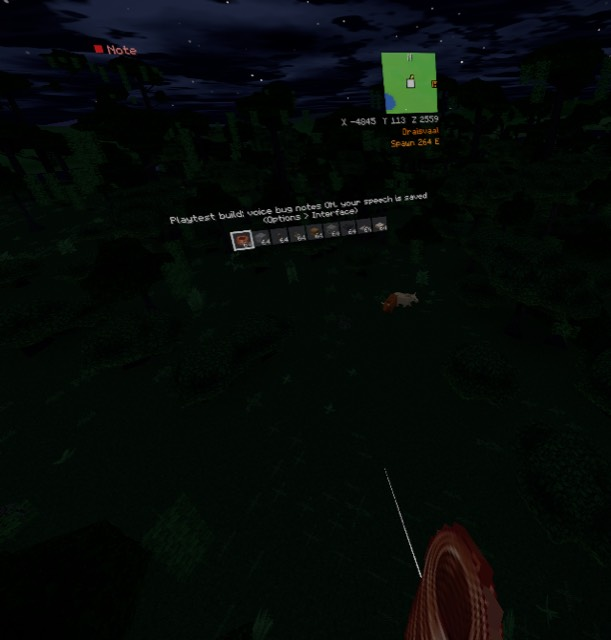

## 22:04:53 - I asked for the cows to go back to their old cow look they had like a 

- **Transcript:** I asked for the cows to go back to their old cow look they had like a week ago, week or two ago
- **Status:** open
- **Build:** 0.129 (6c3dfeea, M1-M4 (device-tested; ship riding, chests, comfort options, weapon wheel))
- **World:** Quest World (seed 5663059916303033239)
- **Dimension:** Surface
- **Biome:** Sparse Jungle
- **Position:** -4839.1 100.0 2547.6
- **Facing:** south-east (yaw 122, pitch -65)
- **Held:** Chest x64
- **Mount:** on foot
- **Looking at:** Grass Block at -4839 99 2547
- **Mode:** Creative, health 20/20
- **Time:** day 1 23:07, clear
- **Fps:** 49
- **Levels:** mic -25 dBFS, game sound -28 dBFS
- **Length:** 8.3 s (voice 4.9 s)
- **Just before:** -9s opened PauseMenu; -6s closed PauseMenu; -6s message: Playtest build: voice bug notes ON, your speech is saved (Options > Interface); -2s message: Flying; -1s message: Walking; -0s holding Stone; -0s holding Copper Signal Torch; -0s holding Lever; -0s holding Chest
- **While talking:** -4s message: Walking; -3s holding Stone; -3s holding Copper Signal Torch; -3s holding Lever; -3s holding Chest; -2s message: 72 Hz to keep the frame rate (VR Comfort & Controls)
- **Position at the end:** -4848.7 112.1 2525.3
- **Repro (Mac):** `./snap.sh note --seed 5663059916303033239 --x -4839.1 --z 2547.6 --yaw -122 --pitch -65 --time 0.714`
- **Audio (this Mac):** /Users/darthvadar/Documents/Blocksmith/QuestVoiceNotes/raw/vn-20261022-220453-782.aac

## 22:05:02 - Wasn't fixed

- **Transcript:** Wasn't fixed
- **Status:** open
- **Build:** 0.129 (6c3dfeea, M1-M4 (device-tested; ship riding, chests, comfort options, weapon wheel))
- **World:** Quest World (seed 5663059916303033239)
- **Dimension:** Surface
- **Biome:** Old Growth Birch Forest
- **Position:** -4854.9 142.8 2370.6
- **Facing:** north (yaw 355, pitch -48)
- **Held:** Chest x64
- **Mount:** on foot, flying
- **Looking at:** nothing
- **Mode:** Creative, health 20/20
- **Time:** day 1 23:14, clear
- **Fps:** 44
- **Levels:** mic -30 dBFS, game sound -19 dBFS
- **Length:** 2.0 s (voice 0.6 s)
- **Just before:** -15s opened PauseMenu; -11s closed PauseMenu; -11s message: Playtest build: voice bug notes ON, your speech is saved (Options > Interface); -8s message: Flying; -7s message: Walking; -6s holding Stone; -6s holding Copper Signal Torch; -6s holding Lever; -6s holding Chest; -5s message: 72 Hz to keep the frame rate (VR Comfort & Controls); -3s walked into Jungle; -2s message: Flying; -1s walked into Old Growth Birch Forest
- **Repro (Mac):** `./snap.sh note --seed 5663059916303033239 --x -4854.9 --z 2370.6 --yaw 5 --pitch -48 --time 0.719`
- **Audio (this Mac):** /Users/darthvadar/Documents/Blocksmith/QuestVoiceNotes/raw/vn-20261022-220502-202.aac

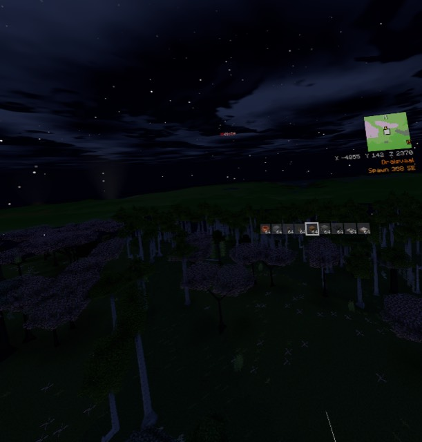

## 22:05:04 - All right. Active? No. Fuck it. Fuck it. Fuck

- **Transcript:** All right. Active? No. Fuck it. Fuck it. Fuck
- **Status:** open
- **Build:** 0.129 (6c3dfeea, M1-M4 (device-tested; ship riding, chests, comfort options, weapon wheel))
- **World:** Quest World (seed 5663059916303033239)
- **Dimension:** Surface
- **Biome:** Old Growth Birch Forest
- **Position:** -4854.9 142.8 2370.6
- **Facing:** north (yaw 350, pitch -32)
- **Held:** Chest x64
- **Mount:** on foot, flying
- **Looking at:** nothing
- **Mode:** Creative, health 20/20, screen PauseMenu
- **Time:** day 1 23:15, clear
- **Fps:** 44
- **Levels:** mic -27 dBFS, game sound -29 dBFS
- **Length:** 4.0 s (voice 1.4 s)
- **Just before:** -16s opened PauseMenu; -13s closed PauseMenu; -13s message: Playtest build: voice bug notes ON, your speech is saved (Options > Interface); -9s message: Flying; -8s message: Walking; -8s holding Stone; -8s holding Copper Signal Torch; -8s holding Lever; -7s holding Chest; -7s message: 72 Hz to keep the frame rate (VR Comfort & Controls); -4s walked into Jungle; -4s message: Flying; -2s walked into Old Growth Birch Forest; -1s opened PauseMenu
- **Repro (Mac):** `./snap.sh note --seed 5663059916303033239 --x -4854.9 --z 2370.6 --yaw 10 --pitch -32 --time 0.719`
- **Audio (this Mac):** /Users/darthvadar/Documents/Blocksmith/QuestVoiceNotes/raw/vn-20261022-220504-122.aac

## 22:05:09 - All right. Active distance is six. Let's see what we got going on here

- **Transcript:** All right. Active distance is six. Let's see what we got going on here
- **Status:** open
- **Build:** 0.129 (6c3dfeea, M1-M4 (device-tested; ship riding, chests, comfort options, weapon wheel))
- **World:** Quest World (seed 5663059916303033239)
- **Dimension:** Surface
- **Biome:** Old Growth Birch Forest
- **Position:** -4858.0 142.8 2364.5
- **Facing:** north-east (yaw 24, pitch -45)
- **Held:** Chest x64
- **Mount:** on foot, flying
- **Looking at:** nothing
- **Mode:** Creative, health 20/20
- **Time:** day 1 23:16, clear
- **Fps:** 60
- **Levels:** mic -33 dBFS, game sound -21 dBFS
- **Length:** 4.0 s (voice 2.1 s)
- **Just before:** -19s opened PauseMenu; -16s closed PauseMenu; -16s message: Playtest build: voice bug notes ON, your speech is saved (Options > Interface); -12s message: Flying; -11s message: Walking; -11s holding Stone; -11s holding Copper Signal Torch; -11s holding Lever; -10s holding Chest; -10s message: 72 Hz to keep the frame rate (VR Comfort & Controls); -7s walked into Jungle; -7s message: Flying; -5s walked into Old Growth Birch Forest; -4s opened PauseMenu; -2s opened AdvancementMenu; -2s closed AdvancementMenu; -1s opened PauseMenu; -0s closed PauseMenu; -0s message: Sky isle marked on the map
- **Repro (Mac):** `./snap.sh note --seed 5663059916303033239 --x -4858.0 --z 2364.5 --yaw -24 --pitch -45 --time 0.720`
- **Audio (this Mac):** /Users/darthvadar/Documents/Blocksmith/QuestVoiceNotes/raw/vn-20261022-220509-662.aac

## 22:05:19 - Now this fucking tree right here looks like shit. What we got going on

- **Transcript:** Now this fucking tree right here looks like shit. What we got going on here? Also, frame rate's dropping at active distance six, so clearly that's not sorted out yet
- **Status:** open
- **Build:** 0.129 (6c3dfeea, M1-M4 (device-tested; ship riding, chests, comfort options, weapon wheel))
- **World:** Quest World (seed 5663059916303033239)
- **Dimension:** Surface
- **Biome:** Old Growth Birch Forest
- **Position:** -4889.6 116.9 2316.7
- **Facing:** north-west (yaw 335, pitch 14)
- **Held:** Chest x64
- **Mount:** on foot
- **Looking at:** nothing
- **Mode:** Creative, health 20/20
- **Time:** day 1 23:21, clear
- **Fps:** 30
- **Levels:** mic -22 dBFS, game sound -12 dBFS
- **Length:** 11.9 s (voice 8.1 s)
- **Just before:** -23s opened PauseMenu; -20s closed PauseMenu; -20s message: Playtest build: voice bug notes ON, your speech is saved (Options > Interface); -16s message: Flying; -15s message: Walking; -15s holding Stone; -14s holding Copper Signal Torch; -14s holding Lever; -14s holding Chest; -13s message: 72 Hz to keep the frame rate (VR Comfort & Controls); -11s walked into Jungle; -11s message: Flying; -9s walked into Old Growth Birch Forest; -8s opened PauseMenu; -6s opened AdvancementMenu; -5s closed AdvancementMenu; -5s opened PauseMenu; -4s closed PauseMenu; -4s message: Sky isle marked on the map; -2s message: Walking
- **While talking:** -3s message: Walking; -5s message: Walking
- **Position at the end:** -4898.7 114.0 2300.0
- **Repro (Mac):** `./snap.sh note --seed 5663059916303033239 --x -4889.6 --z 2316.7 --yaw 25 --pitch 14 --time 0.723`
- **Audio (this Mac):** /Users/darthvadar/Documents/Blocksmith/QuestVoiceNotes/raw/vn-20261022-220519-702.aac

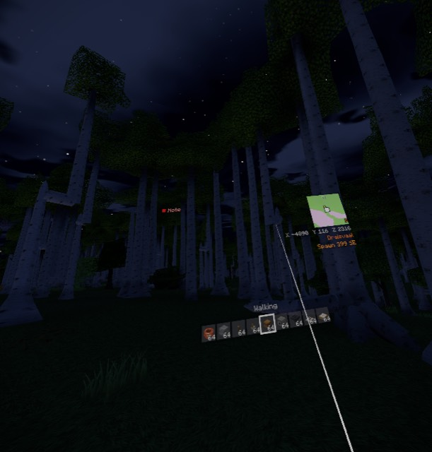

## 22:05:31 - So, um

- **Transcript:** So, um
- **Status:** open
- **Build:** 0.129 (6c3dfeea, M1-M4 (device-tested; ship riding, chests, comfort options, weapon wheel))
- **World:** Quest World (seed 5663059916303033239)
- **Dimension:** Surface
- **Biome:** Old Growth Birch Forest
- **Position:** -4896.7 113.0 2297.7
- **Facing:** north-west (yaw 319, pitch -27)
- **Held:** Chest x64
- **Mount:** on foot
- **Looking at:** Grass Block at -4899 112 2295
- **Mode:** Creative, health 20/20
- **Time:** day 1 23:25, clear
- **Fps:** 19
- **Levels:** mic -36 dBFS, game sound -19 dBFS
- **Length:** 2.2 s (voice 1.2 s)
- **Just before:** -26s opened PauseMenu; -23s closed PauseMenu; -23s message: Playtest build: voice bug notes ON, your speech is saved (Options > Interface); -19s message: Flying; -18s message: Walking; -18s holding Stone; -18s holding Copper Signal Torch; -18s holding Lever; -18s holding Chest; -17s message: 72 Hz to keep the frame rate (VR Comfort & Controls); -14s walked into Jungle; -14s message: Flying; -12s walked into Old Growth Birch Forest; -11s opened PauseMenu; -9s opened AdvancementMenu; -9s closed AdvancementMenu; -8s opened PauseMenu; -7s closed PauseMenu; -7s message: Sky isle marked on the map; -5s message: Walking
- **Repro (Mac):** `./snap.sh note --seed 5663059916303033239 --x -4896.7 --z 2297.7 --yaw 41 --pitch -27 --time 0.726`
- **Audio (this Mac):** /Users/darthvadar/Documents/Blocksmith/QuestVoiceNotes/raw/vn-20261022-220531-202.aac

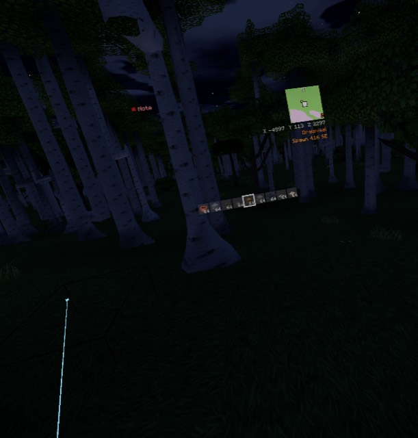

## 22:05:35 - Might need to try their efficiency a little better

- **Transcript:** Might need to try their efficiency a little better
- **Status:** open
- **Build:** 0.129 (6c3dfeea, M1-M4 (device-tested; ship riding, chests, comfort options, weapon wheel))
- **World:** Quest World (seed 5663059916303033239)
- **Dimension:** Surface
- **Biome:** Old Growth Birch Forest
- **Position:** -4895.7 110.7 2289.9
- **Facing:** north (yaw 354, pitch -20)
- **Held:** Chest x64
- **Mount:** on foot
- **Looking at:** nothing
- **Mode:** Creative, health 20/20
- **Time:** day 1 23:26, clear
- **Fps:** 18
- **Levels:** mic -22 dBFS, game sound -18 dBFS
- **Length:** 4.2 s (voice 2.5 s)
- **Just before:** -27s opened PauseMenu; -24s closed PauseMenu; -24s message: Playtest build: voice bug notes ON, your speech is saved (Options > Interface); -20s message: Flying; -19s message: Walking; -19s holding Stone; -19s holding Copper Signal Torch; -19s holding Lever; -19s holding Chest; -18s message: 72 Hz to keep the frame rate (VR Comfort & Controls); -15s walked into Jungle; -15s message: Flying; -13s walked into Old Growth Birch Forest; -12s opened PauseMenu; -10s opened AdvancementMenu; -10s closed AdvancementMenu; -9s opened PauseMenu; -8s closed PauseMenu; -8s message: Sky isle marked on the map; -6s message: Walking
- **Repro (Mac):** `./snap.sh note --seed 5663059916303033239 --x -4895.7 --z 2289.9 --yaw 6 --pitch -20 --time 0.727`
- **Audio (this Mac):** /Users/darthvadar/Documents/Blocksmith/QuestVoiceNotes/raw/vn-20261022-220535-082.aac

## 22:05:39 - If we can't, well then that's gonna be an issue

- **Transcript:** If we can't, well then that's gonna be an issue
- **Status:** open
- **Build:** 0.129 (6c3dfeea, M1-M4 (device-tested; ship riding, chests, comfort options, weapon wheel))
- **World:** Quest World (seed 5663059916303033239)
- **Dimension:** Surface
- **Biome:** Old Growth Birch Forest
- **Position:** -4898.0 108.5 2281.6
- **Facing:** north (yaw 342, pitch -59)
- **Held:** Chest x64
- **Mount:** on foot
- **Looking at:** Grass Block at -4899 107 2280
- **Mode:** Creative, health 20/20
- **Time:** day 1 23:28, clear
- **Fps:** 18
- **Levels:** mic -26 dBFS, game sound -18 dBFS
- **Length:** 3.2 s (voice 1.7 s)
- **Just before:** -29s opened PauseMenu; -25s closed PauseMenu; -25s message: Playtest build: voice bug notes ON, your speech is saved (Options > Interface); -22s message: Flying; -20s message: Walking; -20s holding Stone; -20s holding Copper Signal Torch; -20s holding Lever; -20s holding Chest; -19s message: 72 Hz to keep the frame rate (VR Comfort & Controls); -17s walked into Jungle; -16s message: Flying; -15s walked into Old Growth Birch Forest; -14s opened PauseMenu; -12s opened AdvancementMenu; -11s closed AdvancementMenu; -11s opened PauseMenu; -10s closed PauseMenu; -10s message: Sky isle marked on the map; -8s message: Walking
- **Repro (Mac):** `./snap.sh note --seed 5663059916303033239 --x -4898.0 --z 2281.6 --yaw 18 --pitch -59 --time 0.728`
- **Audio (this Mac):** /Users/darthvadar/Documents/Blocksmith/QuestVoiceNotes/raw/vn-20261022-220539-822.aac

## 22:05:50 - Okay, so with the wire, we got an issue where I can't fucking see the 

- **Transcript:** Okay, so with the wire, we got an issue where I can't fucking see the wire. It's, like, going underneath the blocks or hovering over it. So it's still conforming to some sort of block shape, which is not okay
- **Status:** open
- **Build:** 0.129 (6c3dfeea, M1-M4 (device-tested; ship riding, chests, comfort options, weapon wheel))
- **World:** Quest World (seed 5663059916303033239)
- **Dimension:** Surface
- **Biome:** Old Growth Birch Forest
- **Position:** -4895.9 107.9 2276.6
- **Facing:** west (yaw 255, pitch -40)
- **Held:** Copper Wire x64
- **Mount:** on foot
- **Looking at:** Grass Block at -4898 107 2277
- **Mode:** Creative, health 20/20
- **Time:** day 1 23:32, clear
- **Fps:** 24
- **Levels:** mic -56 dBFS, game sound -21 dBFS
- **Length:** 15.9 s (voice 9.5 s)
- **Just before:** -29s closed PauseMenu; -29s message: Playtest build: voice bug notes ON, your speech is saved (Options > Interface); -25s message: Flying; -24s message: Walking; -24s holding Stone; -23s holding Copper Signal Torch; -23s holding Lever; -23s holding Chest; -22s message: 72 Hz to keep the frame rate (VR Comfort & Controls); -20s walked into Jungle; -20s message: Flying; -18s walked into Old Growth Birch Forest; -17s opened PauseMenu; -15s opened AdvancementMenu; -15s closed AdvancementMenu; -14s opened PauseMenu; -13s closed PauseMenu; -13s message: Sky isle marked on the map; -11s message: Walking; -3s holding Lever; -3s message: Lever; -3s holding Copper Signal Torch; -3s message: Copper Signal Torch; -3s holding Stone; -3s message: Stone; -3s holding Copper Wire; -3s message: Copper Wire
- **Position at the end:** -4900.6 108.0 2276.5
- **Repro (Mac):** `./snap.sh note --seed 5663059916303033239 --x -4895.9 --z 2276.6 --yaw 105 --pitch -40 --time 0.731`
- **Audio (this Mac):** /Users/darthvadar/Documents/Blocksmith/QuestVoiceNotes/raw/vn-20261022-220550-922.aac

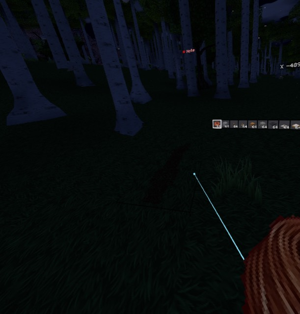

## 22:06:07 - I don't know what it's doing. I don't know if it's gonna form into a b

- **Transcript:** I don't know what it's doing. I don't know if it's gonna form into a block shape or what's going on, but
- **Status:** open
- **Build:** 0.129 (6c3dfeea, M1-M4 (device-tested; ship riding, chests, comfort options, weapon wheel))
- **World:** Quest World (seed 5663059916303033239)
- **Dimension:** Surface
- **Biome:** Old Growth Birch Forest
- **Position:** -4900.5 108.0 2277.0
- **Facing:** south-east (yaw 124, pitch -58)
- **Held:** Copper Wire x64
- **Mount:** on foot
- **Looking at:** Copper Wire at -4901 108 2277
- **Mode:** Creative, health 20/20
- **Time:** day 1 23:43, clear
- **Fps:** 45
- **Levels:** mic -29 dBFS, game sound -29 dBFS
- **Length:** 5.2 s (voice 3.3 s)
- **Just before:** -30s walked into Jungle; -30s message: Flying; -28s walked into Old Growth Birch Forest; -27s opened PauseMenu; -25s opened AdvancementMenu; -24s closed AdvancementMenu; -24s opened PauseMenu; -23s closed PauseMenu; -23s message: Sky isle marked on the map; -21s message: Walking; -13s holding Lever; -13s message: Lever; -13s holding Copper Signal Torch; -13s message: Copper Signal Torch; -13s holding Stone; -13s message: Stone; -13s holding Copper Wire; -13s message: Copper Wire
- **Repro (Mac):** `./snap.sh note --seed 5663059916303033239 --x -4900.5 --z 2277.0 --yaw -124 --pitch -58 --time 0.739`
- **Audio (this Mac):** /Users/darthvadar/Documents/Blocksmith/QuestVoiceNotes/raw/vn-20261022-220607-302.aac

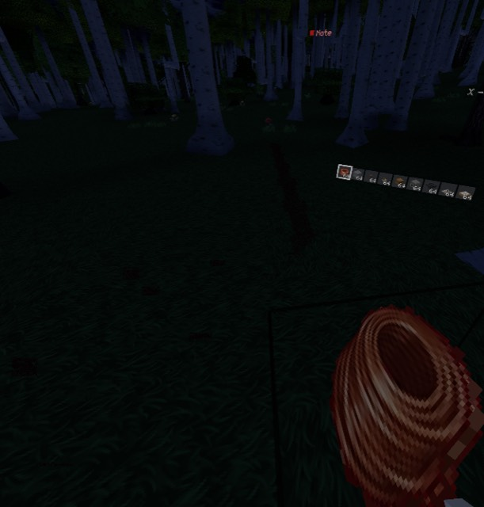

## 22:06:12 - I'm placing wire and it seems like it's going underneath the texture o

- **Transcript:** I'm placing wire and it seems like it's going underneath the texture of the grass
- **Status:** open
- **Build:** 0.129 (6c3dfeea, M1-M4 (device-tested; ship riding, chests, comfort options, weapon wheel))
- **World:** Quest World (seed 5663059916303033239)
- **Dimension:** Surface
- **Biome:** Old Growth Birch Forest
- **Position:** -4903.9 108.0 2278.3
- **Facing:** north-east (yaw 55, pitch -45)
- **Held:** Copper Wire x64
- **Mount:** on foot
- **Looking at:** Copper Wire at -4903 108 2277
- **Mode:** Creative, health 20/20
- **Time:** day 1 23:45, clear
- **Fps:** 25
- **Levels:** mic -22 dBFS, game sound -26 dBFS
- **Length:** 5.9 s (voice 3.6 s)
- **Just before:** -29s walked into Old Growth Birch Forest; -28s opened PauseMenu; -26s opened AdvancementMenu; -26s closed AdvancementMenu; -25s opened PauseMenu; -25s closed PauseMenu; -24s message: Sky isle marked on the map; -22s message: Walking; -15s holding Lever; -15s message: Lever; -15s holding Copper Signal Torch; -15s message: Copper Signal Torch; -14s holding Stone; -14s message: Stone; -14s holding Copper Wire; -14s message: Copper Wire
- **Position at the end:** -4902.1 108.0 2273.9
- **Repro (Mac):** `./snap.sh note --seed 5663059916303033239 --x -4903.9 --z 2278.3 --yaw -55 --pitch -45 --time 0.740`
- **Audio (this Mac):** /Users/darthvadar/Documents/Blocksmith/QuestVoiceNotes/raw/vn-20261022-220612-322.aac

## 22:06:18 - Flowers look fine

- **Transcript:** Flowers look fine
- **Status:** open
- **Build:** 0.129 (6c3dfeea, M1-M4 (device-tested; ship riding, chests, comfort options, weapon wheel))
- **World:** Quest World (seed 5663059916303033239)
- **Dimension:** Surface
- **Biome:** Old Growth Birch Forest
- **Position:** -4902.7 108.0 2272.6
- **Facing:** north-west (yaw 334, pitch -50)
- **Held:** Copper Wire x64
- **Mount:** on foot
- **Looking at:** Grass Block at -4904 107 2271
- **Mode:** Creative, health 20/20
- **Time:** day 1 23:47, clear
- **Fps:** 19
- **Levels:** mic -35 dBFS, game sound -20 dBFS
- **Length:** 2.3 s (voice 0.7 s)
- **Just before:** -30s opened PauseMenu; -28s opened AdvancementMenu; -27s closed AdvancementMenu; -27s opened PauseMenu; -26s closed PauseMenu; -26s message: Sky isle marked on the map; -24s message: Walking; -16s holding Lever; -16s message: Lever; -16s holding Copper Signal Torch; -16s message: Copper Signal Torch; -16s holding Stone; -16s message: Stone; -16s holding Copper Wire; -16s message: Copper Wire
- **Repro (Mac):** `./snap.sh note --seed 5663059916303033239 --x -4902.7 --z 2272.6 --yaw 26 --pitch -50 --time 0.741`
- **Audio (this Mac):** /Users/darthvadar/Documents/Blocksmith/QuestVoiceNotes/raw/vn-20261022-220618-402.aac

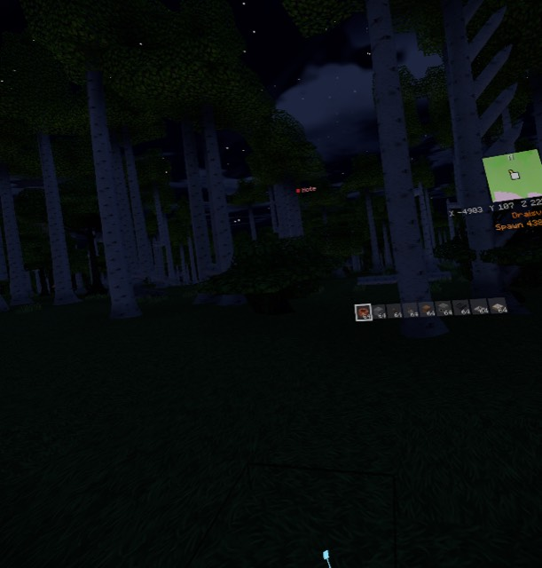

## 22:06:21 - Uh, a lot of these trees are really fucked up

- **Transcript:** Uh, a lot of these trees are really fucked up
- **Status:** open
- **Build:** 0.129 (6c3dfeea, M1-M4 (device-tested; ship riding, chests, comfort options, weapon wheel))
- **World:** Quest World (seed 5663059916303033239)
- **Dimension:** Surface
- **Biome:** Old Growth Birch Forest
- **Position:** -4908.3 107.8 2268.9
- **Facing:** north-west (yaw 326, pitch -76)
- **Held:** Copper Wire x64
- **Mount:** on foot
- **Looking at:** Grass Block at -4909 107 2268
- **Mode:** Creative, health 20/20
- **Time:** day 1 23:48, clear
- **Fps:** 19
- **Levels:** mic -26 dBFS, game sound -12 dBFS
- **Length:** 3.4 s (voice 1.7 s)
- **Just before:** -29s opened AdvancementMenu; -28s closed AdvancementMenu; -28s opened PauseMenu; -27s closed PauseMenu; -27s message: Sky isle marked on the map; -25s message: Walking; -17s holding Lever; -17s message: Lever; -17s holding Copper Signal Torch; -17s message: Copper Signal Torch; -17s holding Stone; -17s message: Stone; -17s holding Copper Wire; -17s message: Copper Wire
- **Repro (Mac):** `./snap.sh note --seed 5663059916303033239 --x -4908.3 --z 2268.9 --yaw 34 --pitch -76 --time 0.742`
- **Audio (this Mac):** /Users/darthvadar/Documents/Blocksmith/QuestVoiceNotes/raw/vn-20261022-220621-522.aac

## 22:06:25 - And we should still have gravity here too, right? Like

- **Transcript:** And we should still have gravity here too, right? Like
- **Status:** open
- **Build:** 0.129 (6c3dfeea, M1-M4 (device-tested; ship riding, chests, comfort options, weapon wheel))
- **World:** Quest World (seed 5663059916303033239)
- **Dimension:** Surface
- **Biome:** Old Growth Birch Forest
- **Position:** -4915.4 107.0 2263.5
- **Facing:** north-west (yaw 323, pitch -57)
- **Held:** Copper Wire x64
- **Mount:** on foot
- **Looking at:** Short Grass at -4916 107 2262
- **Mode:** Creative, health 20/20
- **Time:** day 1 23:49, clear
- **Fps:** 20
- **Levels:** mic -23 dBFS, game sound -22 dBFS
- **Length:** 3.6 s (voice 2.0 s)
- **Just before:** -30s opened AdvancementMenu; -29s closed AdvancementMenu; -29s opened PauseMenu; -28s closed PauseMenu; -28s message: Sky isle marked on the map; -26s message: Walking; -18s holding Lever; -18s message: Lever; -18s holding Copper Signal Torch; -18s message: Copper Signal Torch; -18s holding Stone; -18s message: Stone; -18s holding Copper Wire; -18s message: Copper Wire
- **Repro (Mac):** `./snap.sh note --seed 5663059916303033239 --x -4915.4 --z 2263.5 --yaw 37 --pitch -57 --time 0.743`
- **Audio (this Mac):** /Users/darthvadar/Documents/Blocksmith/QuestVoiceNotes/raw/vn-20261022-220625-742.aac

## 22:06:30 - If a tree's fucked up, it should fall over. Like this, this right here

- **Transcript:** If a tree's fucked up, it should fall over. Like this, this right here is not physically possible
- **Status:** open
- **Build:** 0.129 (6c3dfeea, M1-M4 (device-tested; ship riding, chests, comfort options, weapon wheel))
- **World:** Quest World (seed 5663059916303033239)
- **Dimension:** Surface
- **Biome:** Old Growth Birch Forest
- **Position:** -4921.4 107.0 2260.3
- **Facing:** north (yaw 0, pitch -14)
- **Held:** Copper Wire x64
- **Mount:** on foot
- **Looking at:** nothing
- **Mode:** Creative, health 20/20
- **Time:** day 1 23:51, clear
- **Fps:** 20
- **Levels:** mic -26 dBFS, game sound -21 dBFS
- **Length:** 5.3 s (voice 2.9 s)
- **Just before:** -29s closed PauseMenu; -29s message: Sky isle marked on the map; -27s message: Walking; -20s holding Lever; -20s message: Lever; -19s holding Copper Signal Torch; -19s message: Copper Signal Torch; -19s holding Stone; -19s message: Stone; -19s holding Copper Wire; -19s message: Copper Wire
- **Repro (Mac):** `./snap.sh note --seed 5663059916303033239 --x -4921.4 --z 2260.3 --yaw -0 --pitch -14 --time 0.744`
- **Audio (this Mac):** /Users/darthvadar/Documents/Blocksmith/QuestVoiceNotes/raw/vn-20261022-220630-462.aac

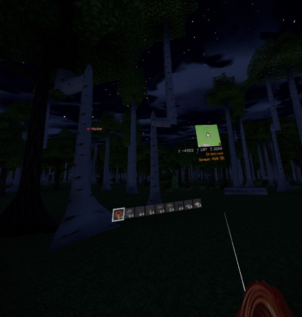

## 22:06:37 - Yeah, I mean, it's good at least it does fall, but still

- **Transcript:** Yeah, I mean, it's good at least it does fall, but still
- **Status:** open
- **Build:** 0.129 (6c3dfeea, M1-M4 (device-tested; ship riding, chests, comfort options, weapon wheel))
- **World:** Quest World (seed 5663059916303033239)
- **Dimension:** Surface
- **Biome:** Old Growth Birch Forest
- **Position:** -4921.7 106.7 2258.2
- **Facing:** north (yaw 346, pitch -19)
- **Held:** Copper Wire x64
- **Mount:** on foot
- **Looking at:** nothing
- **Mode:** Creative, health 20/20
- **Time:** day 1 23:53, clear
- **Fps:** 20
- **Levels:** mic -32 dBFS, game sound -20 dBFS
- **Length:** 4.2 s (voice 2.1 s)
- **Just before:** -29s message: Walking; -21s holding Lever; -21s message: Lever; -21s holding Copper Signal Torch; -21s message: Copper Signal Torch; -21s holding Stone; -21s message: Stone; -21s holding Copper Wire; -21s message: Copper Wire
- **Repro (Mac):** `./snap.sh note --seed 5663059916303033239 --x -4921.7 --z 2258.2 --yaw 14 --pitch -19 --time 0.746`
- **Audio (this Mac):** /Users/darthvadar/Documents/Blocksmith/QuestVoiceNotes/raw/vn-20261022-220637-362.aac

## 22:06:42 - Okay, that right there, what just happened? It turned into square bloc

- **Transcript:** Okay, that right there, what just happened? It turned into square blocks there when I broke it, and it fell, and then it turned back into a normal tree. That shouldn't happen
- **Status:** open
- **Build:** 0.129 (6c3dfeea, M1-M4 (device-tested; ship riding, chests, comfort options, weapon wheel))
- **World:** Quest World (seed 5663059916303033239)
- **Dimension:** Surface
- **Biome:** Old Growth Birch Forest
- **Position:** -4923.4 106.5 2255.7
- **Facing:** north-west (yaw 333, pitch -42)
- **Held:** Copper Wire x64
- **Mount:** on foot
- **Looking at:** Birch Log at -4925 107 2253
- **Mode:** Creative, health 20/20
- **Time:** day 1 23:55, clear
- **Fps:** 20
- **Levels:** mic -49 dBFS, game sound -25 dBFS
- **Length:** 9.3 s (voice 5.8 s)
- **Just before:** -23s holding Lever; -23s message: Lever; -23s holding Copper Signal Torch; -23s message: Copper Signal Torch; -23s holding Stone; -23s message: Stone; -23s holding Copper Wire; -23s message: Copper Wire
- **Position at the end:** -4922.3 106.0 2256.3
- **Repro (Mac):** `./snap.sh note --seed 5663059916303033239 --x -4923.4 --z 2255.7 --yaw 27 --pitch -42 --time 0.747`
- **Audio (this Mac):** /Users/darthvadar/Documents/Blocksmith/QuestVoiceNotes/raw/vn-20261022-220642-642.aac

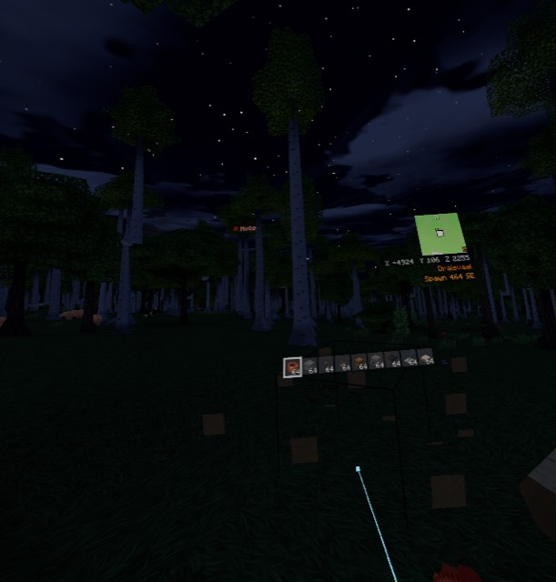

## 22:06:53 - Everything is still goddamn slow

- **Transcript:** Everything is still goddamn slow
- **Status:** open
- **Build:** 0.129 (6c3dfeea, M1-M4 (device-tested; ship riding, chests, comfort options, weapon wheel))
- **World:** Quest World (seed 5663059916303033239)
- **Dimension:** Surface
- **Biome:** Old Growth Birch Forest
- **Position:** -4931.0 106.0 2253.3
- **Facing:** north-west (yaw 335, pitch -7)
- **Held:** Copper Wire x64
- **Mount:** on foot
- **Looking at:** nothing
- **Mode:** Creative, health 20/20, screen PauseMenu
- **Time:** day 1 23:59, clear
- **Fps:** 20
- **Levels:** mic -27 dBFS, game sound -30 dBFS
- **Length:** 4.0 s (voice 2.0 s)
- **Just before:** -26s holding Lever; -26s message: Lever; -26s holding Copper Signal Torch; -26s message: Copper Signal Torch; -26s holding Stone; -26s message: Stone; -26s holding Copper Wire; -26s message: Copper Wire; -0s opened PauseMenu
- **Repro (Mac):** `./snap.sh note --seed 5663059916303033239 --x -4931.0 --z 2253.3 --yaw 25 --pitch -7 --time 0.749`
- **Audio (this Mac):** /Users/darthvadar/Documents/Blocksmith/QuestVoiceNotes/raw/vn-20261022-220653-801.aac

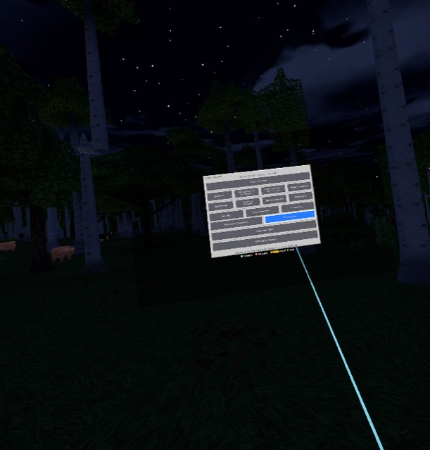

## 22:06:58 - And another thing, the main menu still looks compressed or something. 

- **Transcript:** And another thing, the main menu still looks compressed or something. Something happened to the main menu. It doesn't look good. I can't hardly read what's in the main menu
- **Status:** open
- **Build:** 0.129 (6c3dfeea, M1-M4 (device-tested; ship riding, chests, comfort options, weapon wheel))
- **World:** Quest World (seed 5663059916303033239)
- **Dimension:** Surface
- **Biome:** Old Growth Birch Forest
- **Position:** -4931.7 106.0 2252.7
- **Facing:** north-west (yaw 335, pitch -46)
- **Held:** Copper Wire x64
- **Mount:** on foot
- **Looking at:** Leaf Litter at -4933 106 2251
- **Mode:** Creative, health 20/20
- **Time:** day 1 23:59, clear
- **Fps:** 20
- **Levels:** mic -24 dBFS, game sound -26 dBFS
- **Length:** 10.5 s (voice 7.2 s)
- **Just before:** -27s holding Lever; -27s message: Lever; -27s holding Copper Signal Torch; -27s message: Copper Signal Torch; -27s holding Stone; -27s message: Stone; -27s holding Copper Wire; -27s message: Copper Wire; -1s opened PauseMenu; -0s closed PauseMenu
- **While talking:** -3s opened PauseMenu; -2s closed PauseMenu; -1s opened PauseMenu; -1s closed PauseMenu
- **Position at the end:** -4939.3 105.4 2247.9
- **Repro (Mac):** `./snap.sh note --seed 5663059916303033239 --x -4931.7 --z 2252.7 --yaw 25 --pitch -46 --time 0.750`
- **Audio (this Mac):** /Users/darthvadar/Documents/Blocksmith/QuestVoiceNotes/raw/vn-20261022-220658-142.aac

## 22:07:09 - Pigs that go back to the old animal types. Like they look so good. Now

- **Transcript:** Pigs that go back to the old animal types. Like they look so good. Now I don't know what this thing is. It's got a fucking tabletop set sitting on it
- **Status:** open
- **Build:** 0.129 (6c3dfeea, M1-M4 (device-tested; ship riding, chests, comfort options, weapon wheel))
- **World:** Quest World (seed 5663059916303033239)
- **Dimension:** Surface
- **Biome:** Old Growth Birch Forest
- **Position:** -4954.3 105.0 2247.1
- **Facing:** south-west (yaw 246, pitch -29)
- **Held:** Copper Wire x64
- **Mount:** on foot
- **Looking at:** Grass Block at -4957 104 2247
- **Mode:** Creative, health 20/20
- **Time:** day 1 00:03, clear
- **Fps:** 21
- **Levels:** mic -23 dBFS, game sound -23 dBFS
- **Length:** 10.3 s (voice 6.0 s)
- **Just before:** -4s opened PauseMenu; -3s closed PauseMenu; -3s opened PauseMenu; -3s closed PauseMenu
- **While talking:** -5s closed PauseMenu; -5s opened PauseMenu; -4s closed PauseMenu
- **Position at the end:** -4957.7 104.5 2239.1
- **Repro (Mac):** `./snap.sh note --seed 5663059916303033239 --x -4954.3 --z 2247.1 --yaw 114 --pitch -29 --time 0.752`
- **Audio (this Mac):** /Users/darthvadar/Documents/Blocksmith/QuestVoiceNotes/raw/vn-20261022-220709-442.aac

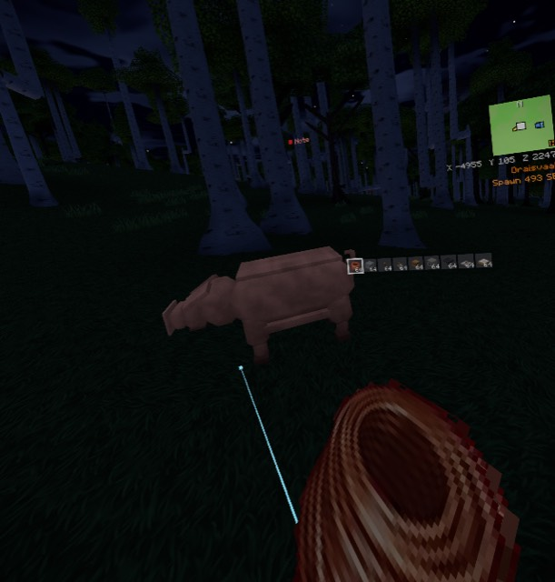

## 22:07:19 - Just don't redesign. Let's go back to the old ones. The old ones were 

- **Transcript:** Just don't redesign. Let's go back to the old ones. The old ones were perfect
- **Status:** open
- **Build:** 0.129 (6c3dfeea, M1-M4 (device-tested; ship riding, chests, comfort options, weapon wheel))
- **World:** Quest World (seed 5663059916303033239)
- **Dimension:** Surface
- **Biome:** Old Growth Birch Forest
- **Position:** -4966.4 104.0 2238.1
- **Facing:** west (yaw 279, pitch -23)
- **Held:** Copper Wire x64
- **Mount:** on foot
- **Looking at:** Grass Block at -4970 103 2237
- **Mode:** Creative, health 20/20
- **Time:** day 1 00:06, clear
- **Fps:** 19
- **Levels:** mic -33 dBFS, game sound -19 dBFS
- **Length:** 4.6 s (voice 2.9 s)
- **Just before:** -7s opened PauseMenu; -6s closed PauseMenu; -6s opened PauseMenu; -6s closed PauseMenu
- **Repro (Mac):** `./snap.sh note --seed 5663059916303033239 --x -4966.4 --z 2238.1 --yaw 81 --pitch -23 --time 0.755`
- **Audio (this Mac):** /Users/darthvadar/Documents/Blocksmith/QuestVoiceNotes/raw/vn-20261022-220719-502.aac

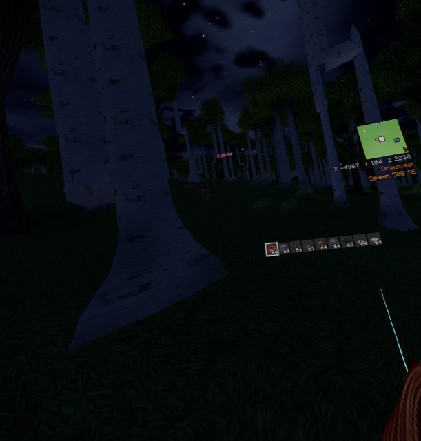

## 22:07:32 - Okay, so looks like, um

- **Transcript:** Okay, so looks like, um
- **Status:** open
- **Build:** 0.129 (6c3dfeea, M1-M4 (device-tested; ship riding, chests, comfort options, weapon wheel))
- **World:** Quest World (seed 5663059916303033239)
- **Dimension:** Surface
- **Biome:** Birch Forest
- **Position:** -5007.9 112.6 2287.2
- **Facing:** south-west (yaw 217, pitch -43)
- **Held:** Copper Wire x64
- **Mount:** on foot
- **Looking at:** Short Grass at -5008 113 2287
- **Mode:** Creative, health 20/20
- **Time:** day 1 00:13, clear
- **Fps:** 33
- **Levels:** mic -32 dBFS, game sound -16 dBFS
- **Length:** 4.0 s (voice 1.7 s)
- **Just before:** -13s opened PauseMenu; -12s closed PauseMenu; -11s opened PauseMenu; -11s closed PauseMenu; -4s message: Flying; -3s message: Walking; -1s walked into Birch Forest
- **Repro (Mac):** `./snap.sh note --seed 5663059916303033239 --x -5007.9 --z 2287.2 --yaw 143 --pitch -43 --time 0.759`
- **Audio (this Mac):** /Users/darthvadar/Documents/Blocksmith/QuestVoiceNotes/raw/vn-20261022-220732-122.aac

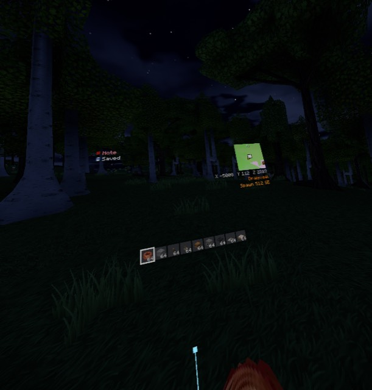

## 22:07:35 - All these shit where we've got like a... I think it's supposed to be a

- **Transcript:** All these shit where we've got like a... I think it's supposed to be a branch. I don't know what that's supposed to be, but too many trees like this, they look like shit. I don't know what that is
- **Status:** open
- **Build:** 0.129 (6c3dfeea, M1-M4 (device-tested; ship riding, chests, comfort options, weapon wheel))
- **World:** Quest World (seed 5663059916303033239)
- **Dimension:** Surface
- **Biome:** Birch Forest
- **Position:** -5013.4 114.0 2298.8
- **Facing:** east (yaw 108, pitch -3)
- **Held:** Copper Wire x64
- **Mount:** on foot
- **Looking at:** Birch Log at -5011 115 2299
- **Mode:** Creative, health 20/20
- **Time:** day 1 00:15, clear
- **Fps:** 33
- **Levels:** mic -27 dBFS, game sound -24 dBFS
- **Length:** 9.3 s (voice 6.0 s)
- **Just before:** -15s opened PauseMenu; -14s closed PauseMenu; -13s opened PauseMenu; -13s closed PauseMenu; -6s message: Flying; -4s message: Walking; -3s walked into Birch Forest
- **While talking:** -5s walked into Birch Forest
- **Position at the end:** -5009.7 115.5 2306.1
- **Repro (Mac):** `./snap.sh note --seed 5663059916303033239 --x -5013.4 --z 2298.8 --yaw -108 --pitch -3 --time 0.761`
- **Audio (this Mac):** /Users/darthvadar/Documents/Blocksmith/QuestVoiceNotes/raw/vn-20261022-220735-882.aac

## 22:07:49 - Yeah, the trees, we need some work on these trees

- **Transcript:** Yeah, the trees, we need some work on these trees
- **Status:** open
- **Build:** 0.129 (6c3dfeea, M1-M4 (device-tested; ship riding, chests, comfort options, weapon wheel))
- **World:** Quest World (seed 5663059916303033239)
- **Dimension:** Surface
- **Biome:** Meadow
- **Position:** -5019.3 117.0 2324.6
- **Facing:** south (yaw 192, pitch -4)
- **Held:** Copper Wire x64
- **Mount:** on foot
- **Looking at:** Short Grass at -5020 118 2326
- **Mode:** Creative, health 20/20
- **Time:** day 1 00:22, clear
- **Fps:** 35
- **Levels:** mic -29 dBFS, game sound -18 dBFS
- **Length:** 3.7 s (voice 2.1 s)
- **Just before:** -21s opened PauseMenu; -20s closed PauseMenu; -19s opened PauseMenu; -19s closed PauseMenu; -12s message: Flying; -10s message: Walking; -9s walked into Birch Forest; -1s walked into Meadow
- **Repro (Mac):** `./snap.sh note --seed 5663059916303033239 --x -5019.3 --z 2324.6 --yaw 168 --pitch -4 --time 0.766`
- **Audio (this Mac):** /Users/darthvadar/Documents/Blocksmith/QuestVoiceNotes/raw/vn-20261022-220749-402.aac

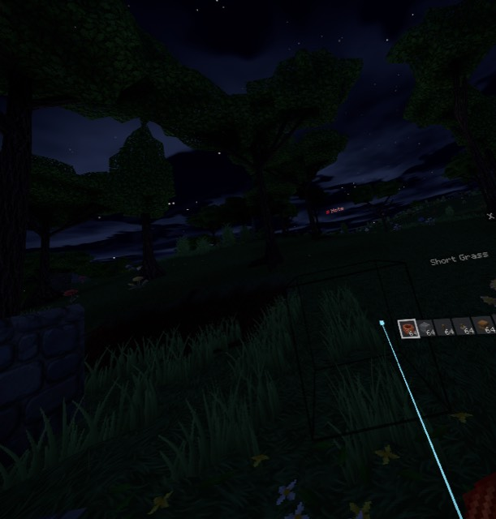

## 22:07:55 - Uh, some of these flowers look to be floating, which, uh

- **Transcript:** Uh, some of these flowers look to be floating, which, uh
- **Status:** open
- **Build:** 0.129 (6c3dfeea, M1-M4 (device-tested; ship riding, chests, comfort options, weapon wheel))
- **World:** Quest World (seed 5663059916303033239)
- **Dimension:** Surface
- **Biome:** Meadow
- **Position:** -5030.8 119.7 2362.2
- **Facing:** south (yaw 172, pitch -32)
- **Held:** Copper Wire x64
- **Mount:** on foot
- **Looking at:** Wildflowers at -5031 120 2364
- **Mode:** Creative, health 20/20
- **Time:** day 1 00:26, clear
- **Fps:** 35
- **Levels:** mic -31 dBFS, game sound -14 dBFS
- **Length:** 4.2 s (voice 2.2 s)
- **Just before:** -24s opened PauseMenu; -23s closed PauseMenu; -23s opened PauseMenu; -22s closed PauseMenu; -15s message: Flying; -14s message: Walking; -12s walked into Birch Forest; -4s walked into Meadow; -2s message: Flying; -1s message: Walking
- **Repro (Mac):** `./snap.sh note --seed 5663059916303033239 --x -5030.8 --z 2362.2 --yaw -172 --pitch -32 --time 0.768`
- **Audio (this Mac):** /Users/darthvadar/Documents/Blocksmith/QuestVoiceNotes/raw/vn-20261022-220755-502.aac

## 22:07:59 - Isn't right

- **Transcript:** Isn't right
- **Status:** open
- **Build:** 0.129 (6c3dfeea, M1-M4 (device-tested; ship riding, chests, comfort options, weapon wheel))
- **World:** Quest World (seed 5663059916303033239)
- **Dimension:** Surface
- **Biome:** Meadow
- **Position:** -5028.6 119.7 2360.2
- **Facing:** south (yaw 195, pitch -22)
- **Held:** Copper Wire x64
- **Mount:** on foot
- **Looking at:** Wildflowers at -5030 120 2363
- **Mode:** Creative, health 20/20
- **Time:** day 1 00:29, clear
- **Fps:** 38
- **Levels:** mic -29 dBFS, game sound -25 dBFS
- **Length:** 1.9 s (voice 0.7 s)
- **Just before:** -26s opened PauseMenu; -25s closed PauseMenu; -25s opened PauseMenu; -25s closed PauseMenu; -17s message: Flying; -16s message: Walking; -14s walked into Birch Forest; -6s walked into Meadow; -5s message: Flying; -3s message: Walking
- **Repro (Mac):** `./snap.sh note --seed 5663059916303033239 --x -5028.6 --z 2360.2 --yaw 165 --pitch -22 --time 0.770`
- **Audio (this Mac):** /Users/darthvadar/Documents/Blocksmith/QuestVoiceNotes/raw/vn-20261022-220759-402.aac

## 22:08:01 - And it looked to be conforming to

- **Transcript:** And it looked to be conforming to
- **Status:** open
- **Build:** 0.129 (6c3dfeea, M1-M4 (device-tested; ship riding, chests, comfort options, weapon wheel))
- **World:** Quest World (seed 5663059916303033239)
- **Dimension:** Surface
- **Biome:** Meadow
- **Position:** -5029.0 119.8 2362.6
- **Facing:** south-west (yaw 219, pitch -33)
- **Held:** Copper Wire x64
- **Mount:** on foot
- **Looking at:** Wildflowers at -5030 120 2363
- **Mode:** Creative, health 20/20
- **Time:** day 1 00:30, clear
- **Fps:** 38
- **Levels:** mic -32 dBFS, game sound -15 dBFS
- **Length:** 2.8 s (voice 1.4 s)
- **Just before:** -27s opened PauseMenu; -26s closed PauseMenu; -26s opened PauseMenu; -25s closed PauseMenu; -18s message: Flying; -17s message: Walking; -15s walked into Birch Forest; -7s walked into Meadow; -5s message: Flying; -4s message: Walking
- **Repro (Mac):** `./snap.sh note --seed 5663059916303033239 --x -5029.0 --z 2362.6 --yaw 141 --pitch -33 --time 0.771`
- **Audio (this Mac):** /Users/darthvadar/Documents/Blocksmith/QuestVoiceNotes/raw/vn-20261022-220801-322.aac

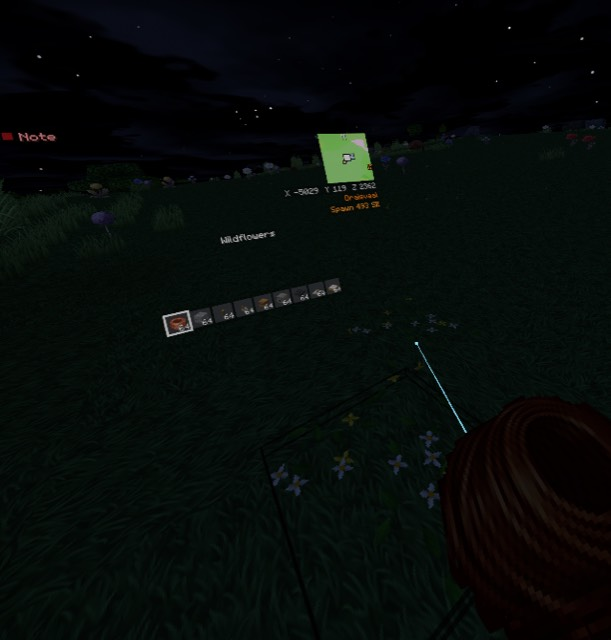

## 22:08:06 - Ja, okay

- **Transcript:** Ja, okay
- **Status:** open
- **Build:** 0.129 (6c3dfeea, M1-M4 (device-tested; ship riding, chests, comfort options, weapon wheel))
- **World:** Quest World (seed 5663059916303033239)
- **Dimension:** Surface
- **Biome:** Meadow
- **Position:** -5031.5 119.8 2363.2
- **Facing:** east (yaw 109, pitch -57)
- **Held:** Copper Wire x64
- **Mount:** on foot
- **Looking at:** Dirt at -5030 118 2363
- **Mode:** Creative, health 20/20
- **Time:** day 1 00:32, clear
- **Fps:** 28
- **Levels:** mic -39 dBFS, game sound -20 dBFS
- **Length:** 2.0 s (voice 0.5 s)
- **Just before:** -29s opened PauseMenu; -28s closed PauseMenu; -27s opened PauseMenu; -27s closed PauseMenu; -20s message: Flying; -18s message: Walking; -17s walked into Birch Forest; -9s walked into Meadow; -7s message: Flying; -6s message: Walking
- **Repro (Mac):** `./snap.sh note --seed 5663059916303033239 --x -5031.5 --z 2363.2 --yaw -109 --pitch -57 --time 0.772`
- **Audio (this Mac):** /Users/darthvadar/Documents/Blocksmith/QuestVoiceNotes/raw/vn-20261022-220806-242.aac

## 22:08:13 - Well, I will say the render distance has improved significantly

- **Transcript:** Well, I will say the render distance has improved significantly
- **Status:** open
- **Build:** 0.129 (6c3dfeea, M1-M4 (device-tested; ship riding, chests, comfort options, weapon wheel))
- **World:** Quest World (seed 5663059916303033239)
- **Dimension:** Surface
- **Biome:** Meadow
- **Position:** -5038.6 131.8 2417.9
- **Facing:** south-west (yaw 208, pitch -33)
- **Held:** Copper Wire x64
- **Mount:** on foot, flying
- **Looking at:** nothing
- **Mode:** Creative, health 20/20
- **Time:** day 1 00:35, clear
- **Fps:** 28
- **Levels:** mic -27 dBFS, game sound -26 dBFS
- **Length:** 4.5 s (voice 2.7 s)
- **Just before:** -30s opened PauseMenu; -30s closed PauseMenu; -22s message: Flying; -21s message: Walking; -20s walked into Birch Forest; -12s walked into Meadow; -10s message: Flying; -9s message: Walking; -2s message: Flying
- **Repro (Mac):** `./snap.sh note --seed 5663059916303033239 --x -5038.6 --z 2417.9 --yaw 152 --pitch -33 --time 0.775`
- **Audio (this Mac):** /Users/darthvadar/Documents/Blocksmith/QuestVoiceNotes/raw/vn-20261022-220813-362.aac

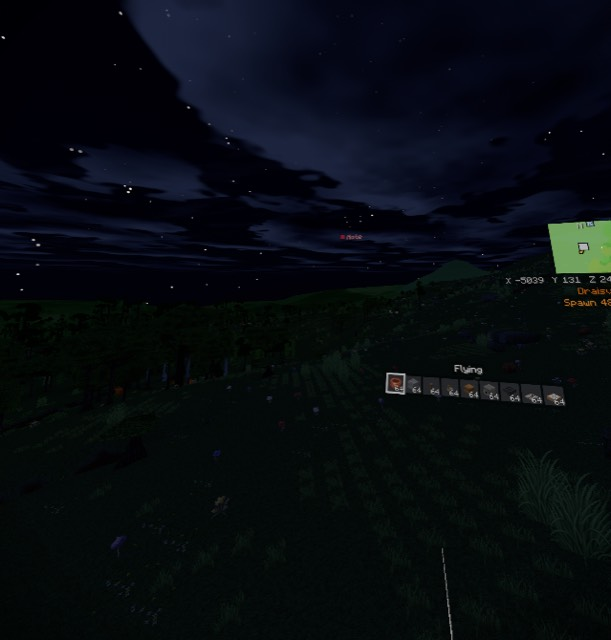

## 22:08:17 - Like this is better. This is what I'm talking about with render distan

- **Transcript:** Like this is better. This is what I'm talking about with render distance. This actually ain't bad
- **Status:** open
- **Build:** 0.129 (6c3dfeea, M1-M4 (device-tested; ship riding, chests, comfort options, weapon wheel))
- **World:** Quest World (seed 5663059916303033239)
- **Dimension:** Surface
- **Biome:** Meadow
- **Position:** -5059.1 136.7 2412.7
- **Facing:** south-west (yaw 231, pitch -27)
- **Held:** Copper Wire x64
- **Mount:** on foot, flying
- **Looking at:** nothing
- **Mode:** Creative, health 20/20
- **Time:** day 1 00:37, clear
- **Fps:** 21
- **Levels:** mic -38 dBFS, game sound -31 dBFS
- **Length:** 4.7 s (voice 2.9 s)
- **Just before:** -24s message: Flying; -22s message: Walking; -21s walked into Birch Forest; -13s walked into Meadow; -11s message: Flying; -10s message: Walking; -3s message: Flying; -1s message: Walking
- **Repro (Mac):** `./snap.sh note --seed 5663059916303033239 --x -5059.1 --z 2412.7 --yaw 129 --pitch -27 --time 0.776`
- **Audio (this Mac):** /Users/darthvadar/Documents/Blocksmith/QuestVoiceNotes/raw/vn-20261022-220817-542.aac

## 22:08:22 - I don't know where it's at right now, but we could, we ought to work w

- **Transcript:** I don't know where it's at right now, but we could, we ought to work with this
- **Status:** open
- **Build:** 0.129 (6c3dfeea, M1-M4 (device-tested; ship riding, chests, comfort options, weapon wheel))
- **World:** Quest World (seed 5663059916303033239)
- **Dimension:** Surface
- **Biome:** Meadow
- **Position:** -5058.2 137.3 2412.5
- **Facing:** south-east (yaw 131, pitch -4)
- **Held:** Copper Wire x64
- **Mount:** on foot, flying
- **Looking at:** nothing
- **Mode:** Creative, health 20/20
- **Time:** day 1 00:38, clear
- **Fps:** 23
- **Levels:** mic -22 dBFS, game sound -20 dBFS
- **Length:** 3.9 s (voice 2.3 s)
- **Just before:** -25s message: Flying; -24s message: Walking; -22s walked into Birch Forest; -14s walked into Meadow; -12s message: Flying; -11s message: Walking; -5s message: Flying; -2s message: Walking; -1s message: Flying
- **Repro (Mac):** `./snap.sh note --seed 5663059916303033239 --x -5058.2 --z 2412.5 --yaw -131 --pitch -4 --time 0.777`
- **Audio (this Mac):** /Users/darthvadar/Documents/Blocksmith/QuestVoiceNotes/raw/vn-20261022-220822-202.aac

## 22:08:26 - I still wanted to try for performance, but still not bad

- **Transcript:** I still wanted to try for performance, but still not bad
- **Status:** open
- **Build:** 0.129 (6c3dfeea, M1-M4 (device-tested; ship riding, chests, comfort options, weapon wheel))
- **World:** Quest World (seed 5663059916303033239)
- **Dimension:** Surface
- **Biome:** Meadow
- **Position:** -5072.2 137.3 2459.4
- **Facing:** south-east (yaw 146, pitch -11)
- **Held:** Copper Wire x64
- **Mount:** on foot, flying
- **Looking at:** nothing
- **Mode:** Creative, health 20/20
- **Time:** day 1 00:40, clear
- **Fps:** 22
- **Levels:** mic -22 dBFS, game sound -25 dBFS
- **Length:** 4.0 s (voice 1.8 s)
- **Just before:** -26s message: Flying; -25s message: Walking; -24s walked into Birch Forest; -16s walked into Meadow; -14s message: Flying; -13s message: Walking; -6s message: Flying; -4s message: Walking; -2s message: Flying
- **Repro (Mac):** `./snap.sh note --seed 5663059916303033239 --x -5072.2 --z 2459.4 --yaw -146 --pitch -11 --time 0.778`
- **Audio (this Mac):** /Users/darthvadar/Documents/Blocksmith/QuestVoiceNotes/raw/vn-20261022-220826-702.aac

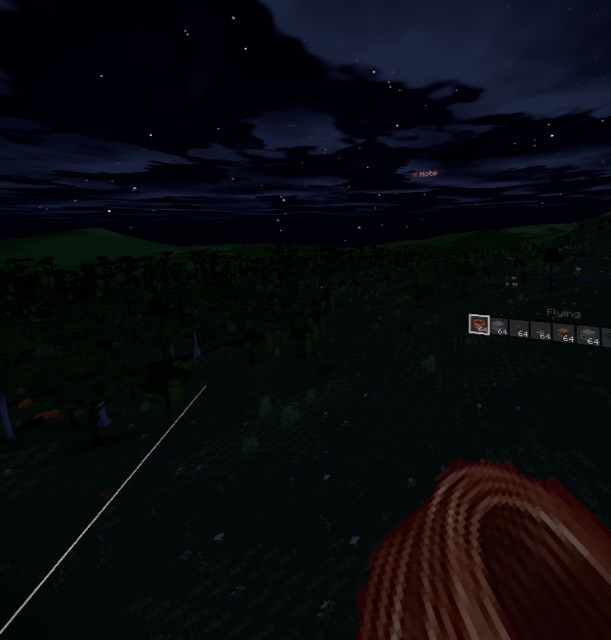

## 22:08:35 - All right, well, I'm gonna go find something

- **Transcript:** All right, well, I'm gonna go find something
- **Status:** open
- **Build:** 0.129 (6c3dfeea, M1-M4 (device-tested; ship riding, chests, comfort options, weapon wheel))
- **World:** Quest World (seed 5663059916303033239)
- **Dimension:** Surface
- **Biome:** Plains
- **Position:** -5038.5 137.3 2648.0
- **Facing:** east (yaw 76, pitch -1)
- **Held:** Copper Wire x64
- **Mount:** on foot, flying
- **Looking at:** nothing
- **Mode:** Creative, health 20/20, screen PauseMenu
- **Time:** day 1 00:43, clear
- **Fps:** 23
- **Levels:** mic -31 dBFS, game sound -33 dBFS
- **Length:** 3.8 s (voice 1.7 s)
- **Just before:** -29s message: Flying; -28s message: Walking; -26s walked into Birch Forest; -18s walked into Meadow; -17s message: Flying; -15s message: Walking; -9s message: Flying; -7s message: Walking; -5s message: Flying; -0s opened PauseMenu; -0s walked into Plains
- **Repro (Mac):** `./snap.sh note --seed 5663059916303033239 --x -5038.5 --z 2648.0 --yaw -76 --pitch -1 --time 0.780`
- **Audio (this Mac):** /Users/darthvadar/Documents/Blocksmith/QuestVoiceNotes/raw/vn-20261022-220835-502.aac

## 22:08:47 - Mega7152. Orbital station under me

- **Transcript:** Mega7152. Orbital station under me
- **Status:** open
- **Build:** 0.129 (6c3dfeea, M1-M4 (device-tested; ship riding, chests, comfort options, weapon wheel))
- **World:** Quest World (seed 5663059916303033239)
- **Dimension:** Surface
- **Biome:** Plains
- **Position:** -5038.5 137.3 2648.1
- **Facing:** north-east (yaw 52, pitch 9)
- **Held:** Copper Wire x64
- **Mount:** on foot, flying
- **Looking at:** nothing
- **Mode:** Creative, health 20/20
- **Time:** day 1 00:45, clear
- **Fps:** 16
- **Levels:** mic -38 dBFS, game sound -32 dBFS
- **Length:** 5.0 s (voice 2.3 s)
- **Just before:** -29s walked into Birch Forest; -21s walked into Meadow; -19s message: Flying; -18s message: Walking; -11s message: Flying; -9s message: Walking; -8s message: Flying; -3s opened PauseMenu; -3s walked into Plains; -2s opened CommandMenu; -1s message: Boreal Station: -7149 ~ 5208 (3317 blocks); -0s closed CommandMenu
- **Repro (Mac):** `./snap.sh note --seed 5663059916303033239 --x -5038.5 --z 2648.1 --yaw -52 --pitch 9 --time 0.782`
- **Audio (this Mac):** /Users/darthvadar/Documents/Blocksmith/QuestVoiceNotes/raw/vn-20261022-220847-702.aac

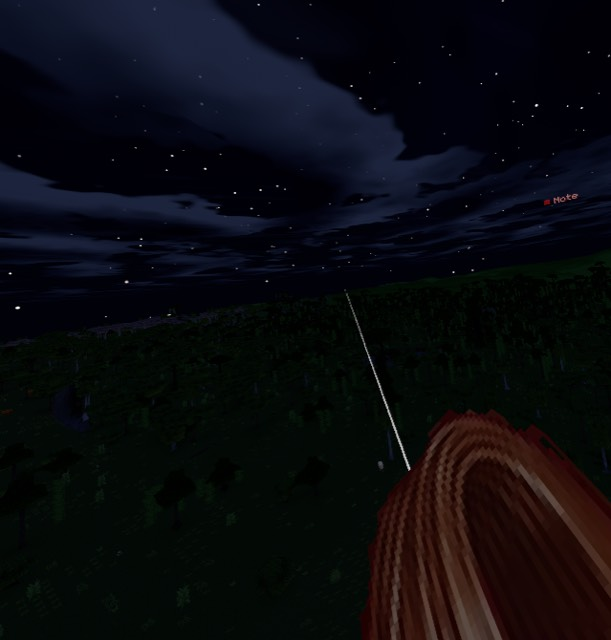

## 22:08:56 - I don't see anything

- **Transcript:** I don't see anything
- **Status:** open
- **Build:** 0.129 (6c3dfeea, M1-M4 (device-tested; ship riding, chests, comfort options, weapon wheel))
- **World:** Quest World (seed 5663059916303033239)
- **Dimension:** Surface
- **Biome:** Plains
- **Position:** -5040.2 134.5 2640.4
- **Facing:** west (yaw 259, pitch -68)
- **Held:** Copper Wire x64
- **Mount:** on foot
- **Looking at:** nothing
- **Mode:** Creative, health 20/20
- **Time:** day 1 00:49, clear
- **Fps:** 29
- **Levels:** mic -51 dBFS, game sound -23 dBFS
- **Length:** 2.2 s (voice 0.6 s)
- **Just before:** -24s walked into Meadow; -22s message: Flying; -21s message: Walking; -14s message: Flying; -12s message: Walking; -11s message: Flying; -6s opened PauseMenu; -6s walked into Plains; -5s opened CommandMenu; -4s message: Boreal Station: -7149 ~ 5208 (3317 blocks); -3s closed CommandMenu; -1s message: Walking
- **Repro (Mac):** `./snap.sh note --seed 5663059916303033239 --x -5040.2 --z 2640.4 --yaw 101 --pitch -68 --time 0.784`
- **Audio (this Mac):** /Users/darthvadar/Documents/Blocksmith/QuestVoiceNotes/raw/vn-20261022-220856-702.aac

## 22:09:03 - Four nine. No

- **Transcript:** Four nine. No
- **Status:** open
- **Build:** 0.129 (6c3dfeea, M1-M4 (device-tested; ship riding, chests, comfort options, weapon wheel))
- **World:** Quest World (seed 5663059916303033239)
- **Dimension:** Surface
- **Biome:** Plains
- **Position:** -5040.3 109.0 2642.2
- **Facing:** east (yaw 81, pitch -28)
- **Held:** Copper Wire x64
- **Mount:** on foot
- **Looking at:** Grass Block at -5038 108 2641
- **Mode:** Creative, health 20/20
- **Time:** day 1 00:50, clear
- **Fps:** 17
- **Levels:** mic -32 dBFS, game sound -28 dBFS
- **Length:** 3.3 s (voice 0.8 s)
- **Just before:** -25s walked into Meadow; -24s message: Flying; -22s message: Walking; -16s message: Flying; -14s message: Walking; -12s message: Flying; -7s opened PauseMenu; -7s walked into Plains; -6s opened CommandMenu; -5s message: Boreal Station: -7149 ~ 5208 (3317 blocks); -4s closed CommandMenu; -2s message: Walking; -1s opened PauseMenu; -1s opened CommandMenu; -0s closed CommandMenu
- **Repro (Mac):** `./snap.sh note --seed 5663059916303033239 --x -5040.3 --z 2642.2 --yaw -81 --pitch -28 --time 0.785`
- **Audio (this Mac):** /Users/darthvadar/Documents/Blocksmith/QuestVoiceNotes/raw/vn-20261022-220903-042.aac

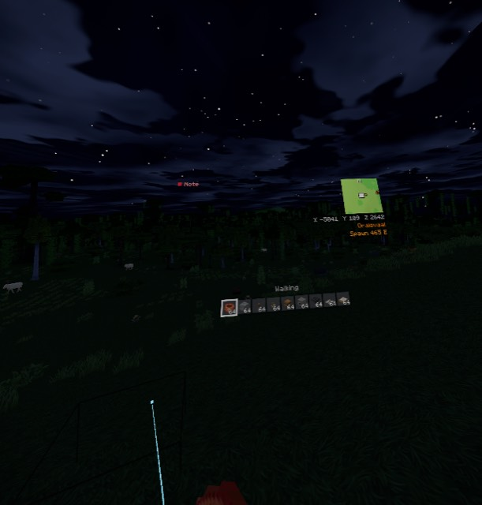

## 22:09:09 - I mean, the frame rate's obviously, it's, it's pretty bad

- **Transcript:** I mean, the frame rate's obviously, it's, it's pretty bad
- **Status:** open
- **Build:** 0.129 (6c3dfeea, M1-M4 (device-tested; ship riding, chests, comfort options, weapon wheel))
- **World:** Quest World (seed 5663059916303033239)
- **Dimension:** Surface
- **Biome:** Plains
- **Position:** -5026.2 113.5 2653.4
- **Facing:** south (yaw 185, pitch -22)
- **Held:** Copper Wire x64
- **Mount:** on foot, flying
- **Looking at:** nothing
- **Mode:** Creative, health 20/20
- **Time:** day 1 00:52, clear
- **Fps:** 16
- **Levels:** mic -35 dBFS, game sound -28 dBFS
- **Length:** 3.9 s (voice 2.0 s)
- **Just before:** -27s walked into Meadow; -25s message: Flying; -24s message: Walking; -17s message: Flying; -15s message: Walking; -13s message: Flying; -9s opened PauseMenu; -9s walked into Plains; -8s opened CommandMenu; -6s message: Boreal Station: -7149 ~ 5208 (3317 blocks); -6s closed CommandMenu; -3s message: Walking; -2s opened PauseMenu; -2s opened CommandMenu; -2s closed CommandMenu; -1s message: Flying
- **Repro (Mac):** `./snap.sh note --seed 5663059916303033239 --x -5026.2 --z 2653.4 --yaw 175 --pitch -22 --time 0.786`
- **Audio (this Mac):** /Users/darthvadar/Documents/Blocksmith/QuestVoiceNotes/raw/vn-20261022-220909-442.aac

## 22:09:13 - Well, that's okay

- **Transcript:** Well, that's okay
- **Status:** open
- **Build:** 0.129 (6c3dfeea, M1-M4 (device-tested; ship riding, chests, comfort options, weapon wheel))
- **World:** Quest World (seed 5663059916303033239)
- **Dimension:** Surface
- **Biome:** Plains
- **Position:** -5054.9 121.8 2733.9
- **Facing:** south-west (yaw 225, pitch -15)
- **Held:** Copper Wire x64
- **Mount:** on foot, flying
- **Looking at:** nothing
- **Mode:** Creative, health 20/20
- **Time:** day 1 00:53, clear
- **Fps:** 17
- **Levels:** mic -27 dBFS, game sound -28 dBFS
- **Length:** 2.3 s (voice 0.7 s)
- **Just before:** -28s walked into Meadow; -26s message: Flying; -25s message: Walking; -18s message: Flying; -16s message: Walking; -15s message: Flying; -10s opened PauseMenu; -10s walked into Plains; -9s opened CommandMenu; -8s message: Boreal Station: -7149 ~ 5208 (3317 blocks); -7s closed CommandMenu; -4s message: Walking; -3s opened PauseMenu; -3s opened CommandMenu; -3s closed CommandMenu; -2s message: Flying
- **Repro (Mac):** `./snap.sh note --seed 5663059916303033239 --x -5054.9 --z 2733.9 --yaw 135 --pitch -15 --time 0.787`
- **Audio (this Mac):** /Users/darthvadar/Documents/Blocksmith/QuestVoiceNotes/raw/vn-20261022-220913-722.aac

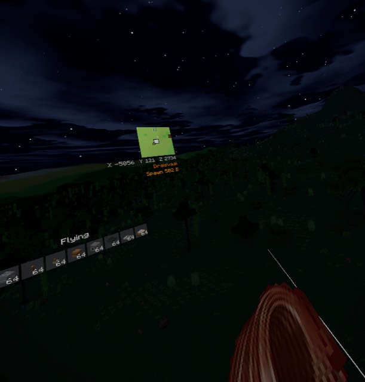

## 22:09:16 - See this mountain? I love how I, I used Zelda generate. That's excelle

- **Transcript:** See this mountain? I love how I, I used Zelda generate. That's excellent
- **Status:** open
- **Build:** 0.129 (6c3dfeea, M1-M4 (device-tested; ship riding, chests, comfort options, weapon wheel))
- **World:** Quest World (seed 5663059916303033239)
- **Dimension:** Surface
- **Biome:** Sparse Jungle
- **Position:** -5130.0 151.3 2756.6
- **Facing:** west (yaw 259, pitch -4)
- **Held:** Copper Wire x64
- **Mount:** on foot, flying
- **Looking at:** nothing
- **Mode:** Creative, health 20/20
- **Time:** day 1 00:54, clear
- **Fps:** 23
- **Levels:** mic -32 dBFS, game sound -20 dBFS
- **Length:** 4.9 s (voice 2.8 s)
- **Just before:** -29s walked into Meadow; -27s message: Flying; -26s message: Walking; -19s message: Flying; -17s message: Walking; -16s message: Flying; -11s opened PauseMenu; -11s walked into Plains; -10s opened CommandMenu; -9s message: Boreal Station: -7149 ~ 5208 (3317 blocks); -8s closed CommandMenu; -5s message: Walking; -4s opened PauseMenu; -4s opened CommandMenu; -4s closed CommandMenu; -3s message: Flying; -1s message: Walking
- **Repro (Mac):** `./snap.sh note --seed 5663059916303033239 --x -5130.0 --z 2756.6 --yaw 101 --pitch -4 --time 0.788`
- **Audio (this Mac):** /Users/darthvadar/Documents/Blocksmith/QuestVoiceNotes/raw/vn-20261022-220916-202.aac

## 22:09:20 - See, everything just looks so much better

- **Transcript:** See, everything just looks so much better
- **Status:** open
- **Build:** 0.129 (6c3dfeea, M1-M4 (device-tested; ship riding, chests, comfort options, weapon wheel))
- **World:** Quest World (seed 5663059916303033239)
- **Dimension:** Surface
- **Biome:** Meadow
- **Position:** -5295.2 192.4 2762.8
- **Facing:** north-west (yaw 304, pitch -31)
- **Held:** Copper Wire x64
- **Mount:** on foot, flying
- **Looking at:** nothing
- **Mode:** Creative, health 20/20
- **Time:** day 1 00:57, clear
- **Fps:** 23
- **Levels:** mic -33 dBFS, game sound -23 dBFS
- **Length:** 2.6 s (voice 1.2 s)
- **Just before:** -29s message: Flying; -28s message: Walking; -22s message: Flying; -19s message: Walking; -18s message: Flying; -13s opened PauseMenu; -13s walked into Plains; -12s opened CommandMenu; -11s message: Boreal Station: -7149 ~ 5208 (3317 blocks); -10s closed CommandMenu; -8s message: Walking; -7s opened PauseMenu; -6s opened CommandMenu; -6s closed CommandMenu; -5s message: Flying; -3s message: Walking; -1s walked into Meadow
- **Repro (Mac):** `./snap.sh note --seed 5663059916303033239 --x -5295.2 --z 2762.8 --yaw 56 --pitch -31 --time 0.790`
- **Audio (this Mac):** /Users/darthvadar/Documents/Blocksmith/QuestVoiceNotes/raw/vn-20261022-220920-862.aac

## 22:09:24 - This ain't-- Like, it is doing better at generating stuff

- **Transcript:** This ain't-- Like, it is doing better at generating stuff
- **Status:** open
- **Build:** 0.129 (6c3dfeea, M1-M4 (device-tested; ship riding, chests, comfort options, weapon wheel))
- **World:** Quest World (seed 5663059916303033239)
- **Dimension:** Surface
- **Biome:** Plains
- **Position:** -5464.6 192.4 2781.9
- **Facing:** west (yaw 253, pitch -30)
- **Held:** Copper Wire x64
- **Mount:** on foot, flying
- **Looking at:** nothing
- **Mode:** Creative, health 20/20
- **Time:** day 1 00:59, clear
- **Fps:** 33
- **Levels:** mic -36 dBFS, game sound -24 dBFS
- **Length:** 4.4 s (voice 2.3 s)
- **Just before:** -24s message: Flying; -21s message: Walking; -20s message: Flying; -15s opened PauseMenu; -15s walked into Plains; -14s opened CommandMenu; -13s message: Boreal Station: -7149 ~ 5208 (3317 blocks); -12s closed CommandMenu; -10s message: Walking; -9s opened PauseMenu; -8s opened CommandMenu; -8s closed CommandMenu; -7s message: Flying; -5s message: Walking; -3s walked into Meadow; -1s walked into Plains; -0s message: Entering Marenwick
- **Repro (Mac):** `./snap.sh note --seed 5663059916303033239 --x -5464.6 --z 2781.9 --yaw 107 --pitch -30 --time 0.791`
- **Audio (this Mac):** /Users/darthvadar/Documents/Blocksmith/QuestVoiceNotes/raw/vn-20261022-220924-422.aac

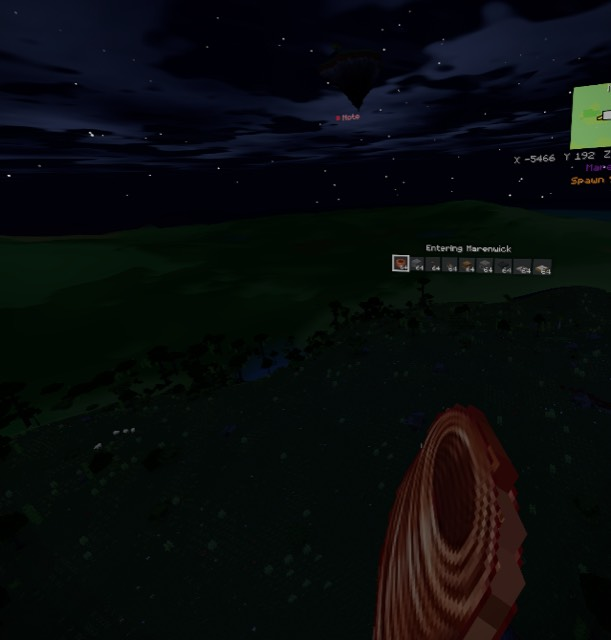

## 22:09:30 - Not as good as I like it, but I still-- it's definitely doing better. 

- **Transcript:** Not as good as I like it, but I still-- it's definitely doing better. Mm.
- **Status:** open
- **Build:** 0.129 (6c3dfeea, M1-M4 (device-tested; ship riding, chests, comfort options, weapon wheel))
- **World:** Quest World (seed 5663059916303033239)
- **Dimension:** Surface
- **Biome:** Plains
- **Position:** -5685.8 192.4 2833.2
- **Facing:** west (yaw 255, pitch -60)
- **Held:** Copper Wire x64
- **Mount:** on foot, flying
- **Looking at:** nothing
- **Mode:** Creative, health 20/20
- **Time:** day 1 01:04, clear
- **Fps:** 47
- **Levels:** mic -27 dBFS, game sound -22 dBFS
- **Length:** 5.8 s (voice 2.5 s)
- **Just before:** -28s message: Flying; -26s message: Walking; -24s message: Flying; -20s opened PauseMenu; -20s walked into Plains; -19s opened CommandMenu; -17s message: Boreal Station: -7149 ~ 5208 (3317 blocks); -17s closed CommandMenu; -14s message: Walking; -13s opened PauseMenu; -13s opened CommandMenu; -13s closed CommandMenu; -12s message: Flying; -10s message: Walking; -8s walked into Meadow; -6s walked into Plains; -5s message: Entering Marenwick; -4s walked into Meadow; -3s message: Sky isle marked on the map; -2s walked into Plains; -1s opened PauseMenu; -0s closed PauseMenu
- **While talking:** -3s walked into Plains; -3s opened PauseMenu; -2s closed PauseMenu; -1s walked into Jungle; -0s opened PauseMenu
- **Position at the end:** -5727.7 192.4 2864.0
- **Repro (Mac):** `./snap.sh note --seed 5663059916303033239 --x -5685.8 --z 2833.2 --yaw 105 --pitch -60 --time 0.795`
- **Audio (this Mac):** /Users/darthvadar/Documents/Blocksmith/QuestVoiceNotes/raw/vn-20261022-220930-162.aac

## 22:09:44 - All right, now let's check this out. Check the w- see how the water's 

- **Transcript:** All right, now let's check this out. Check the w- see how the water's doing here
- **Status:** open
- **Build:** 0.129 (6c3dfeea, M1-M4 (device-tested; ship riding, chests, comfort options, weapon wheel))
- **World:** Quest World (seed 5663059916303033239)
- **Dimension:** Surface
- **Biome:** Jungle
- **Position:** -5839.8 192.4 2893.3
- **Facing:** north-west (yaw 302, pitch 18)
- **Held:** Copper Wire x64
- **Mount:** on foot, flying
- **Looking at:** nothing
- **Mode:** Creative, health 20/20
- **Time:** day 1 01:09, clear
- **Fps:** 32
- **Levels:** mic -27 dBFS, game sound -21 dBFS
- **Length:** 4.6 s (voice 2.9 s)
- **Just before:** -25s opened PauseMenu; -25s walked into Plains; -24s opened CommandMenu; -23s message: Boreal Station: -7149 ~ 5208 (3317 blocks); -23s closed CommandMenu; -20s message: Walking; -19s opened PauseMenu; -19s opened CommandMenu; -18s closed CommandMenu; -18s message: Flying; -15s message: Walking; -13s walked into Meadow; -11s walked into Plains; -11s message: Entering Marenwick; -9s walked into Meadow; -9s message: Sky isle marked on the map; -7s walked into Plains; -7s opened PauseMenu; -6s closed PauseMenu; -5s walked into Jungle; -4s opened PauseMenu; -3s walked into Sparse Jungle; -3s opened CommandMenu; -3s closed CommandMenu; -2s opened PauseMenu; -2s opened CommandMenu; -2s closed CommandMenu
- **Repro (Mac):** `./snap.sh note --seed 5663059916303033239 --x -5839.8 --z 2893.3 --yaw 58 --pitch 18 --time 0.798`
- **Audio (this Mac):** /Users/darthvadar/Documents/Blocksmith/QuestVoiceNotes/raw/vn-20261022-220944-302.aac

## 22:10:05 - All right, taking a look at the water

- **Transcript:** All right, taking a look at the water
- **Status:** open
- **Build:** 0.129 (6c3dfeea, M1-M4 (device-tested; ship riding, chests, comfort options, weapon wheel))
- **World:** Quest World (seed 5663059916303033239)
- **Dimension:** Surface
- **Biome:** Jungle
- **Position:** -5952.6 64.6 2897.2
- **Facing:** north-west (yaw 325, pitch -71)
- **Held:** Copper Wire x64
- **Mount:** on foot
- **Looking at:** Short Grass at -5953 65 2896
- **Mode:** Creative, health 20/20
- **Time:** day 1 01:16, clear
- **Fps:** 16
- **Levels:** mic -21 dBFS, game sound -26 dBFS
- **Length:** 3.3 s (voice 1.8 s)
- **Just before:** -30s opened CommandMenu; -29s message: Boreal Station: -7149 ~ 5208 (3317 blocks); -28s closed CommandMenu; -25s message: Walking; -24s opened PauseMenu; -24s opened CommandMenu; -24s closed CommandMenu; -23s message: Flying; -21s message: Walking; -19s walked into Meadow; -17s walked into Plains; -16s message: Entering Marenwick; -15s walked into Meadow; -14s message: Sky isle marked on the map; -13s walked into Plains; -12s opened PauseMenu; -12s closed PauseMenu; -11s walked into Jungle; -9s opened PauseMenu; -9s walked into Sparse Jungle; -8s opened CommandMenu; -8s closed CommandMenu; -8s opened PauseMenu; -7s opened CommandMenu; -7s closed CommandMenu; -5s message: Walking; -5s walked into Jungle; -2s message: Flying; -1s message: Walking
- **Repro (Mac):** `./snap.sh note --seed 5663059916303033239 --x -5952.6 --z 2897.2 --yaw 35 --pitch -71 --time 0.803`
- **Audio (this Mac):** /Users/darthvadar/Documents/Blocksmith/QuestVoiceNotes/raw/vn-20261022-221005-702.aac

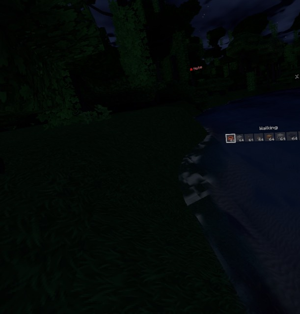

## 22:10:09 - Looks good. I don't see anything too bad, but I still feel as though w

- **Transcript:** Looks good. I don't see anything too bad, but I still feel as though we have the-- we still have the same
- **Status:** open
- **Build:** 0.129 (6c3dfeea, M1-M4 (device-tested; ship riding, chests, comfort options, weapon wheel))
- **World:** Quest World (seed 5663059916303033239)
- **Dimension:** Surface
- **Biome:** Jungle
- **Position:** -5953.1 65.0 2901.6
- **Facing:** west (yaw 288, pitch -74)
- **Held:** Copper Wire x64
- **Mount:** on foot
- **Looking at:** Grass Block at -5954 63 2901
- **Mode:** Creative, health 20/20
- **Time:** day 1 01:17, clear
- **Fps:** 17
- **Levels:** mic -34 dBFS, game sound -25 dBFS
- **Length:** 7.4 s (voice 3.9 s)
- **Just before:** -29s message: Boreal Station: -7149 ~ 5208 (3317 blocks); -29s closed CommandMenu; -26s message: Walking; -25s opened PauseMenu; -25s opened CommandMenu; -25s closed CommandMenu; -24s message: Flying; -21s message: Walking; -20s walked into Meadow; -18s walked into Plains; -17s message: Entering Marenwick; -16s walked into Meadow; -15s message: Sky isle marked on the map; -13s walked into Plains; -13s opened PauseMenu; -12s closed PauseMenu; -11s walked into Jungle; -10s opened PauseMenu; -9s walked into Sparse Jungle; -9s opened CommandMenu; -9s closed CommandMenu; -9s opened PauseMenu; -8s opened CommandMenu; -8s closed CommandMenu; -6s message: Walking; -5s walked into Jungle; -3s message: Flying; -2s message: Walking
- **While talking:** -4s message: Flying; -3s message: Walking
- **Position at the end:** -5956.0 65.8 2906.7
- **Repro (Mac):** `./snap.sh note --seed 5663059916303033239 --x -5953.1 --z 2901.6 --yaw 72 --pitch -74 --time 0.804`
- **Audio (this Mac):** /Users/darthvadar/Documents/Blocksmith/QuestVoiceNotes/raw/vn-20261022-221009-282.aac

## 22:10:16 - Block thing underneath, which is clear, but you know what? We haven't 

- **Transcript:** Block thing underneath, which is clear, but you know what? We haven't gotten anywhere with it. Fuck it. You know?
- **Status:** open
- **Build:** 0.129 (6c3dfeea, M1-M4 (device-tested; ship riding, chests, comfort options, weapon wheel))
- **World:** Quest World (seed 5663059916303033239)
- **Dimension:** Surface
- **Biome:** Jungle
- **Position:** -5956.8 64.8 2907.6
- **Facing:** south-west (yaw 226, pitch -51)
- **Held:** Copper Wire x64
- **Mount:** on foot, flying
- **Looking at:** Sand at -5959 62 2909
- **Mode:** Creative, health 20/20
- **Time:** day 1 01:18, clear
- **Fps:** 15
- **Levels:** mic -24 dBFS, game sound -20 dBFS
- **Length:** 7.6 s (voice 3.9 s)
- **Just before:** -28s message: Walking; -27s opened PauseMenu; -26s opened CommandMenu; -26s closed CommandMenu; -25s message: Flying; -23s message: Walking; -21s walked into Meadow; -19s walked into Plains; -18s message: Entering Marenwick; -17s walked into Meadow; -17s message: Sky isle marked on the map; -15s walked into Plains; -15s opened PauseMenu; -14s closed PauseMenu; -13s walked into Jungle; -12s opened PauseMenu; -11s walked into Sparse Jungle; -11s opened CommandMenu; -10s closed CommandMenu; -10s opened PauseMenu; -10s opened CommandMenu; -9s closed CommandMenu; -7s message: Walking; -7s walked into Jungle; -5s message: Flying; -3s message: Walking; -0s message: Flying
- **While talking:** -4s message: Walking; -1s message: Flying
- **Position at the end:** -5975.9 76.1 2913.9
- **Repro (Mac):** `./snap.sh note --seed 5663059916303033239 --x -5956.8 --z 2907.6 --yaw 134 --pitch -51 --time 0.805`
- **Audio (this Mac):** /Users/darthvadar/Documents/Blocksmith/QuestVoiceNotes/raw/vn-20261022-221016-682.aac

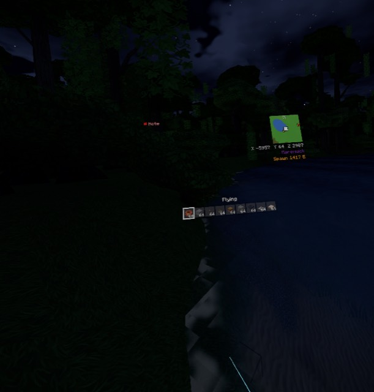

## 22:10:24 - We've gone and done that so many turns now, it's not really perfect

- **Transcript:** We've gone and done that so many turns now, it's not really perfect
- **Status:** open
- **Build:** 0.129 (6c3dfeea, M1-M4 (device-tested; ship riding, chests, comfort options, weapon wheel))
- **World:** Quest World (seed 5663059916303033239)
- **Dimension:** Surface
- **Biome:** Jungle
- **Position:** -6012.5 92.3 2927.8
- **Facing:** west (yaw 263, pitch -31)
- **Held:** Copper Wire x64
- **Mount:** on foot, flying
- **Looking at:** nothing
- **Mode:** Creative, health 20/20
- **Time:** day 1 01:20, clear
- **Fps:** 14
- **Levels:** mic -26 dBFS, game sound -19 dBFS
- **Length:** 4.1 s (voice 2.5 s)
- **Just before:** -29s message: Walking; -28s opened PauseMenu; -28s opened CommandMenu; -27s closed CommandMenu; -27s message: Flying; -24s message: Walking; -22s walked into Meadow; -20s walked into Plains; -20s message: Entering Marenwick; -18s walked into Meadow; -18s message: Sky isle marked on the map; -16s walked into Plains; -16s opened PauseMenu; -15s closed PauseMenu; -14s walked into Jungle; -13s opened PauseMenu; -12s walked into Sparse Jungle; -12s opened CommandMenu; -12s closed CommandMenu; -12s opened PauseMenu; -11s opened CommandMenu; -11s closed CommandMenu; -9s message: Walking; -8s walked into Jungle; -6s message: Flying; -5s message: Walking; -1s message: Flying; -0s walked into River
- **Repro (Mac):** `./snap.sh note --seed 5663059916303033239 --x -6012.5 --z 2927.8 --yaw 97 --pitch -31 --time 0.806`
- **Audio (this Mac):** /Users/darthvadar/Documents/Blocksmith/QuestVoiceNotes/raw/vn-20261022-221024-142.aac

## 22:10:28 - Frame rate's obviously doing pretty bad, but whatever. I don't

- **Transcript:** Frame rate's obviously doing pretty bad, but whatever. I don't
- **Status:** open
- **Build:** 0.129 (6c3dfeea, M1-M4 (device-tested; ship riding, chests, comfort options, weapon wheel))
- **World:** Quest World (seed 5663059916303033239)
- **Dimension:** Surface
- **Biome:** Jungle
- **Position:** -6071.3 102.3 2954.8
- **Facing:** west (yaw 259, pitch -23)
- **Held:** Copper Wire x64
- **Mount:** on foot, flying
- **Looking at:** nothing
- **Mode:** Creative, health 20/20
- **Time:** day 1 01:21, clear
- **Fps:** 13
- **Levels:** mic -23 dBFS, game sound -16 dBFS
- **Length:** 4.4 s (voice 2.5 s)
- **Just before:** -30s message: Walking; -29s opened PauseMenu; -29s opened CommandMenu; -28s closed CommandMenu; -27s message: Flying; -25s message: Walking; -23s walked into Meadow; -21s walked into Plains; -21s message: Entering Marenwick; -19s walked into Meadow; -19s message: Sky isle marked on the map; -17s walked into Plains; -17s opened PauseMenu; -16s closed PauseMenu; -15s walked into Jungle; -14s opened PauseMenu; -13s walked into Sparse Jungle; -13s opened CommandMenu; -13s closed CommandMenu; -12s opened PauseMenu; -12s opened CommandMenu; -11s closed CommandMenu; -9s message: Walking; -9s walked into Jungle; -7s message: Flying; -5s message: Walking; -2s message: Flying; -1s walked into River; -0s message: Walking
- **Repro (Mac):** `./snap.sh note --seed 5663059916303033239 --x -6071.3 --z 2954.8 --yaw 101 --pitch -23 --time 0.807`
- **Audio (this Mac):** /Users/darthvadar/Documents/Blocksmith/QuestVoiceNotes/raw/vn-20261022-221028-322.aac

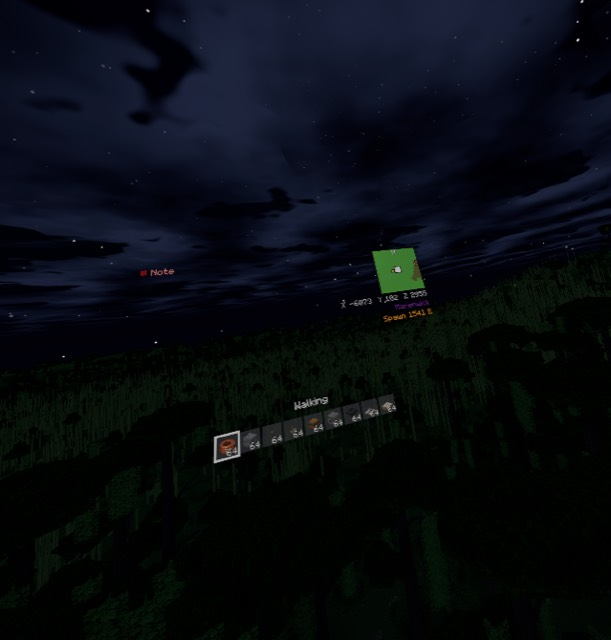

## 22:10:33 - Who really care

- **Transcript:** Who really care
- **Status:** open
- **Build:** 0.129 (6c3dfeea, M1-M4 (device-tested; ship riding, chests, comfort options, weapon wheel))
- **World:** Quest World (seed 5663059916303033239)
- **Dimension:** Surface
- **Biome:** Bamboo Jungle
- **Position:** -6152.3 102.9 2980.6
- **Facing:** west (yaw 266, pitch -3)
- **Held:** Copper Wire x64
- **Mount:** on foot, flying
- **Looking at:** nothing
- **Mode:** Creative, health 20/20
- **Time:** day 1 01:22, clear
- **Fps:** 14
- **Levels:** mic -32 dBFS, game sound -21 dBFS
- **Length:** 2.8 s (voice 1.3 s)
- **Just before:** -30s opened PauseMenu; -29s opened CommandMenu; -29s closed CommandMenu; -28s message: Flying; -26s message: Walking; -24s walked into Meadow; -22s walked into Plains; -22s message: Entering Marenwick; -20s walked into Meadow; -20s message: Sky isle marked on the map; -18s walked into Plains; -18s opened PauseMenu; -17s closed PauseMenu; -16s walked into Jungle; -15s opened PauseMenu; -14s walked into Sparse Jungle; -14s opened CommandMenu; -14s closed CommandMenu; -13s opened PauseMenu; -13s opened CommandMenu; -12s closed CommandMenu; -10s message: Walking; -10s walked into Jungle; -8s message: Flying; -6s message: Walking; -3s message: Flying; -2s walked into River; -1s message: Walking; -0s walked into Bamboo Jungle
- **Repro (Mac):** `./snap.sh note --seed 5663059916303033239 --x -6152.3 --z 2980.6 --yaw 94 --pitch -3 --time 0.807`
- **Audio (this Mac):** /Users/darthvadar/Documents/Blocksmith/QuestVoiceNotes/raw/vn-20261022-221033-322.aac

## 22:10:44 - Oh yeah, like the FPS right now is probably like 15

- **Transcript:** Oh yeah, like the FPS right now is probably like 15
- **Status:** open
- **Build:** 0.129 (6c3dfeea, M1-M4 (device-tested; ship riding, chests, comfort options, weapon wheel))
- **World:** Quest World (seed 5663059916303033239)
- **Dimension:** Surface
- **Biome:** Jungle
- **Position:** -6300.1 102.9 3066.8
- **Facing:** south-west (yaw 234, pitch -9)
- **Held:** Copper Wire x64
- **Mount:** on foot, flying
- **Looking at:** nothing
- **Mode:** Creative, health 20/20
- **Time:** day 1 01:25, clear
- **Fps:** 13
- **Levels:** mic -29 dBFS, game sound -19 dBFS
- **Length:** 5.2 s (voice 3.0 s)
- **Just before:** -28s message: Walking; -26s walked into Meadow; -24s walked into Plains; -24s message: Entering Marenwick; -22s walked into Meadow; -22s message: Sky isle marked on the map; -20s walked into Plains; -20s opened PauseMenu; -19s closed PauseMenu; -18s walked into Jungle; -17s opened PauseMenu; -16s walked into Sparse Jungle; -16s opened CommandMenu; -16s closed CommandMenu; -15s opened PauseMenu; -15s opened CommandMenu; -15s closed CommandMenu; -13s message: Walking; -12s walked into Jungle; -10s message: Flying; -8s message: Walking; -5s message: Flying; -4s walked into River; -3s message: Walking; -2s walked into Bamboo Jungle
- **Repro (Mac):** `./snap.sh note --seed 5663059916303033239 --x -6300.1 --z 3066.8 --yaw 126 --pitch -9 --time 0.809`
- **Audio (this Mac):** /Users/darthvadar/Documents/Blocksmith/QuestVoiceNotes/raw/vn-20261022-221044-402.aac

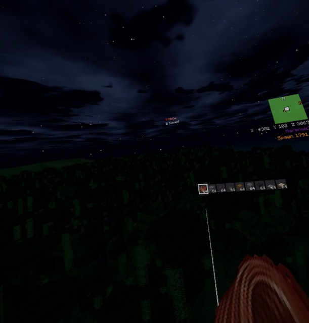

## 22:10:49 - So we're, yeah, we're pretty far from the target. I think it's 72

- **Transcript:** So we're, yeah, we're pretty far from the target. I think it's 72
- **Status:** open
- **Build:** 0.129 (6c3dfeea, M1-M4 (device-tested; ship riding, chests, comfort options, weapon wheel))
- **World:** Quest World (seed 5663059916303033239)
- **Dimension:** Surface
- **Biome:** Jungle
- **Position:** -6386.6 102.9 3120.0
- **Facing:** south-west (yaw 235, pitch -6)
- **Held:** Copper Wire x64
- **Mount:** on foot, flying
- **Looking at:** nothing
- **Mode:** Creative, health 20/20
- **Time:** day 1 01:26, clear
- **Fps:** 15
- **Levels:** mic -35 dBFS, game sound -20 dBFS
- **Length:** 5.1 s (voice 3.1 s)
- **Just before:** -30s message: Walking; -28s walked into Meadow; -26s walked into Plains; -25s message: Entering Marenwick; -24s walked into Meadow; -23s message: Sky isle marked on the map; -22s walked into Plains; -21s opened PauseMenu; -20s closed PauseMenu; -20s walked into Jungle; -18s opened PauseMenu; -18s walked into Sparse Jungle; -17s opened CommandMenu; -17s closed CommandMenu; -17s opened PauseMenu; -16s opened CommandMenu; -16s closed CommandMenu; -14s message: Walking; -14s walked into Jungle; -11s message: Flying; -10s message: Walking; -7s message: Flying; -5s walked into River; -5s message: Walking; -3s walked into Bamboo Jungle
- **Repro (Mac):** `./snap.sh note --seed 5663059916303033239 --x -6386.6 --z 3120.0 --yaw 125 --pitch -6 --time 0.810`
- **Audio (this Mac):** /Users/darthvadar/Documents/Blocksmith/QuestVoiceNotes/raw/vn-20261022-221049-702.aac

## 22:10:55 - Not sufficient

- **Transcript:** Not sufficient
- **Status:** open
- **Build:** 0.129 (6c3dfeea, M1-M4 (device-tested; ship riding, chests, comfort options, weapon wheel))
- **World:** Quest World (seed 5663059916303033239)
- **Dimension:** Surface
- **Biome:** Jungle
- **Position:** -6463.5 102.9 3174.7
- **Facing:** south-west (yaw 231, pitch -19)
- **Held:** Copper Wire x64
- **Mount:** on foot, flying
- **Looking at:** nothing
- **Mode:** Creative, health 20/20
- **Time:** day 1 01:28, clear
- **Fps:** 16
- **Levels:** mic -31 dBFS, game sound -29 dBFS
- **Length:** 2.3 s (voice 0.7 s)
- **Just before:** -29s walked into Meadow; -27s walked into Plains; -26s message: Entering Marenwick; -25s walked into Meadow; -24s message: Sky isle marked on the map; -23s walked into Plains; -23s opened PauseMenu; -22s closed PauseMenu; -21s walked into Jungle; -19s opened PauseMenu; -19s walked into Sparse Jungle; -18s opened CommandMenu; -18s closed CommandMenu; -18s opened PauseMenu; -18s opened CommandMenu; -17s closed CommandMenu; -15s message: Walking; -15s walked into Jungle; -12s message: Flying; -11s message: Walking; -8s message: Flying; -7s walked into River; -6s message: Walking; -5s walked into Bamboo Jungle; -1s walked into Jungle
- **Repro (Mac):** `./snap.sh note --seed 5663059916303033239 --x -6463.5 --z 3174.7 --yaw 129 --pitch -19 --time 0.811`
- **Audio (this Mac):** /Users/darthvadar/Documents/Blocksmith/QuestVoiceNotes/raw/vn-20261022-221055-422.aac

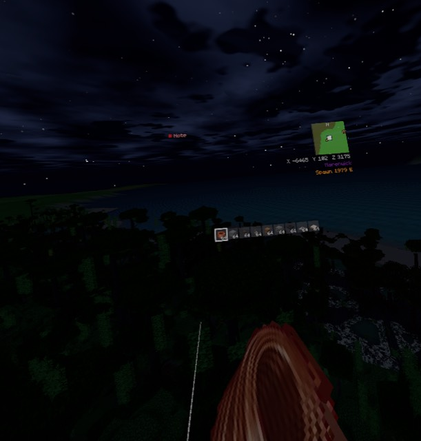

## 22:10:57 - So I am open to in the future, if we still can't get things done

- **Transcript:** So I am open to in the future, if we still can't get things done
- **Status:** open
- **Build:** 0.129 (6c3dfeea, M1-M4 (device-tested; ship riding, chests, comfort options, weapon wheel))
- **World:** Quest World (seed 5663059916303033239)
- **Dimension:** Surface
- **Biome:** Jungle
- **Position:** -6506.5 102.9 3209.9
- **Facing:** south-west (yaw 227, pitch -11)
- **Held:** Copper Wire x64
- **Mount:** on foot, flying
- **Looking at:** nothing
- **Mode:** Creative, health 20/20
- **Time:** day 1 01:29, clear
- **Fps:** 17
- **Levels:** mic -25 dBFS, game sound -28 dBFS
- **Length:** 5.9 s (voice 3.1 s)
- **Just before:** -30s walked into Meadow; -28s walked into Plains; -27s message: Entering Marenwick; -26s walked into Meadow; -25s message: Sky isle marked on the map; -23s walked into Plains; -23s opened PauseMenu; -22s closed PauseMenu; -21s walked into Jungle; -20s opened PauseMenu; -19s walked into Sparse Jungle; -19s opened CommandMenu; -19s closed CommandMenu; -19s opened PauseMenu; -18s opened CommandMenu; -18s closed CommandMenu; -16s message: Walking; -15s walked into Jungle; -13s message: Flying; -12s message: Walking; -9s message: Flying; -7s walked into River; -7s message: Walking; -5s walked into Bamboo Jungle; -1s walked into Jungle
- **While talking:** -2s walked into Jungle; -0s walked into Mangrove Swamp
- **Position at the end:** -6551.9 102.9 3253.2
- **Repro (Mac):** `./snap.sh note --seed 5663059916303033239 --x -6506.5 --z 3209.9 --yaw 133 --pitch -11 --time 0.812`
- **Audio (this Mac):** /Users/darthvadar/Documents/Blocksmith/QuestVoiceNotes/raw/vn-20261022-221057-922.aac

## 22:11:03 - And I am open to, uh

- **Transcript:** And I am open to, uh
- **Status:** open
- **Build:** 0.129 (6c3dfeea, M1-M4 (device-tested; ship riding, chests, comfort options, weapon wheel))
- **World:** Quest World (seed 5663059916303033239)
- **Dimension:** Surface
- **Biome:** Mangrove Swamp
- **Position:** -6552.0 102.9 3253.2
- **Facing:** south-east (yaw 123, pitch -62)
- **Held:** Copper Wire x64
- **Mount:** on foot, flying
- **Looking at:** nothing
- **Mode:** Creative, health 20/20
- **Time:** day 1 01:30, clear
- **Fps:** 17
- **Levels:** mic -31 dBFS, game sound -27 dBFS
- **Length:** 3.1 s (voice 1.9 s)
- **Just before:** -29s walked into Plains; -28s message: Entering Marenwick; -27s walked into Meadow; -26s message: Sky isle marked on the map; -25s walked into Plains; -24s opened PauseMenu; -23s closed PauseMenu; -23s walked into Jungle; -21s opened PauseMenu; -21s walked into Sparse Jungle; -20s opened CommandMenu; -20s closed CommandMenu; -20s opened PauseMenu; -19s opened CommandMenu; -19s closed CommandMenu; -17s message: Walking; -17s walked into Jungle; -14s message: Flying; -13s message: Walking; -10s message: Flying; -9s walked into River; -8s message: Walking; -7s walked into Bamboo Jungle; -2s walked into Jungle; -0s walked into Mangrove Swamp
- **Repro (Mac):** `./snap.sh note --seed 5663059916303033239 --x -6552.0 --z 3253.2 --yaw -123 --pitch -62 --time 0.813`
- **Audio (this Mac):** /Users/darthvadar/Documents/Blocksmith/QuestVoiceNotes/raw/vn-20261022-221103-462.aac

## 22:11:06 - Limiting the render distance to a degree, but

- **Transcript:** Limiting the render distance to a degree, but
- **Status:** open
- **Build:** 0.129 (6c3dfeea, M1-M4 (device-tested; ship riding, chests, comfort options, weapon wheel))
- **World:** Quest World (seed 5663059916303033239)
- **Dimension:** Surface
- **Biome:** Warm Ocean
- **Position:** -6564.0 102.9 3287.6
- **Facing:** south-west (yaw 204, pitch -34)
- **Held:** Copper Wire x64
- **Mount:** on foot, flying
- **Looking at:** nothing
- **Mode:** Creative, health 20/20
- **Time:** day 1 01:31, clear
- **Fps:** 14
- **Levels:** mic -26 dBFS, game sound -18 dBFS
- **Length:** 3.9 s (voice 1.7 s)
- **Just before:** -29s walked into Plains; -29s message: Entering Marenwick; -27s walked into Meadow; -27s message: Sky isle marked on the map; -25s walked into Plains; -25s opened PauseMenu; -24s closed PauseMenu; -23s walked into Jungle; -22s opened PauseMenu; -21s walked into Sparse Jungle; -21s opened CommandMenu; -21s closed CommandMenu; -20s opened PauseMenu; -20s opened CommandMenu; -20s closed CommandMenu; -18s message: Walking; -17s walked into Jungle; -15s message: Flying; -13s message: Walking; -10s message: Flying; -9s walked into River; -8s message: Walking; -7s walked into Bamboo Jungle; -3s walked into Jungle; -1s walked into Mangrove Swamp
- **Repro (Mac):** `./snap.sh note --seed 5663059916303033239 --x -6564.0 --z 3287.6 --yaw 156 --pitch -34 --time 0.813`
- **Audio (this Mac):** /Users/darthvadar/Documents/Blocksmith/QuestVoiceNotes/raw/vn-20261022-221106-862.aac

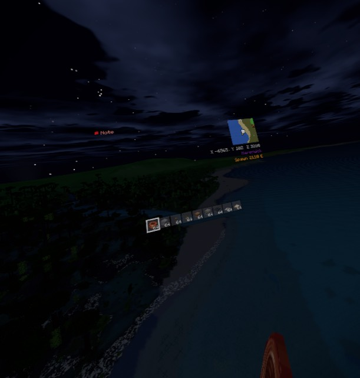

## 22:11:11 - That's why

- **Transcript:** That's why
- **Status:** open
- **Build:** 0.129 (6c3dfeea, M1-M4 (device-tested; ship riding, chests, comfort options, weapon wheel))
- **World:** Quest World (seed 5663059916303033239)
- **Dimension:** Surface
- **Biome:** Lukewarm Ocean
- **Position:** -6578.0 102.9 3364.9
- **Facing:** south (yaw 197, pitch -38)
- **Held:** Copper Wire x64
- **Mount:** on foot, flying
- **Looking at:** nothing
- **Mode:** Creative, health 20/20
- **Time:** day 1 01:32, clear
- **Fps:** 14
- **Levels:** mic -53 dBFS, game sound -14 dBFS
- **Length:** 2.6 s (voice 1.2 s)
- **Just before:** -30s message: Entering Marenwick; -28s walked into Meadow; -28s message: Sky isle marked on the map; -26s walked into Plains; -26s opened PauseMenu; -25s closed PauseMenu; -24s walked into Jungle; -23s opened PauseMenu; -22s walked into Sparse Jungle; -22s opened CommandMenu; -22s closed CommandMenu; -21s opened PauseMenu; -21s opened CommandMenu; -21s closed CommandMenu; -18s message: Walking; -18s walked into Jungle; -16s message: Flying; -14s message: Walking; -11s message: Flying; -10s walked into River; -9s message: Walking; -8s walked into Bamboo Jungle; -4s walked into Jungle; -2s walked into Mangrove Swamp; -0s walked into Lukewarm Ocean
- **Repro (Mac):** `./snap.sh note --seed 5663059916303033239 --x -6578.0 --z 3364.9 --yaw 163 --pitch -38 --time 0.814`
- **Audio (this Mac):** /Users/darthvadar/Documents/Blocksmith/QuestVoiceNotes/raw/vn-20261022-221111-222.aac

## 22:11:15 - There's literally nothing we can do

- **Transcript:** There's literally nothing we can do
- **Status:** open
- **Build:** 0.129 (6c3dfeea, M1-M4 (device-tested; ship riding, chests, comfort options, weapon wheel))
- **World:** Quest World (seed 5663059916303033239)
- **Dimension:** Surface
- **Biome:** Lukewarm Ocean
- **Position:** -6603.0 102.9 3439.7
- **Facing:** south (yaw 201, pitch -29)
- **Held:** Copper Wire x64
- **Mount:** on foot, flying
- **Looking at:** nothing
- **Mode:** Creative, health 20/20
- **Time:** day 1 01:33, clear
- **Fps:** 15
- **Levels:** mic -24 dBFS, game sound -25 dBFS
- **Length:** 2.6 s (voice 1.2 s)
- **Just before:** -29s walked into Meadow; -29s message: Sky isle marked on the map; -27s walked into Plains; -27s opened PauseMenu; -26s closed PauseMenu; -25s walked into Jungle; -24s opened PauseMenu; -23s walked into Sparse Jungle; -23s opened CommandMenu; -23s closed CommandMenu; -22s opened PauseMenu; -22s opened CommandMenu; -21s closed CommandMenu; -19s message: Walking; -19s walked into Jungle; -17s message: Flying; -15s message: Walking; -12s message: Flying; -11s walked into River; -10s message: Walking; -9s walked into Bamboo Jungle; -5s walked into Jungle; -3s walked into Mangrove Swamp; -1s walked into Lukewarm Ocean
- **Repro (Mac):** `./snap.sh note --seed 5663059916303033239 --x -6603.0 --z 3439.7 --yaw 159 --pitch -29 --time 0.815`
- **Audio (this Mac):** /Users/darthvadar/Documents/Blocksmith/QuestVoiceNotes/raw/vn-20261022-221115-662.aac

## 22:11:27 - There's an idea. Um, the water, that little white stuff, that's probab

- **Transcript:** There's an idea. Um, the water, that little white stuff, that's probably taking up some of the GPU, so we can just make that not happen instead. That doesn't really add that much. Doesn't really look that good. So get rid of that white sheen
- **Status:** open
- **Build:** 0.129 (6c3dfeea, M1-M4 (device-tested; ship riding, chests, comfort options, weapon wheel))
- **World:** Quest World (seed 5663059916303033239)
- **Dimension:** Surface
- **Biome:** Lukewarm Ocean
- **Position:** -6666.4 102.9 3616.3
- **Facing:** south (yaw 188, pitch -46)
- **Held:** Copper Wire x64
- **Mount:** on foot, flying
- **Looking at:** nothing
- **Mode:** Creative, health 20/20
- **Time:** day 1 01:36, clear
- **Fps:** 16
- **Levels:** mic -22 dBFS, game sound -19 dBFS
- **Length:** 16.2 s (voice 10.6 s)
- **Just before:** -30s walked into Plains; -29s opened PauseMenu; -29s closed PauseMenu; -28s walked into Jungle; -26s opened PauseMenu; -26s walked into Sparse Jungle; -25s opened CommandMenu; -25s closed CommandMenu; -25s opened PauseMenu; -24s opened CommandMenu; -24s closed CommandMenu; -22s message: Walking; -22s walked into Jungle; -19s message: Flying; -18s message: Walking; -15s message: Flying; -14s walked into River; -13s message: Walking; -12s walked into Bamboo Jungle; -8s walked into Jungle; -6s walked into Mangrove Swamp; -4s walked into Lukewarm Ocean; -2s walked into Beach
- **While talking:** -5s walked into Lukewarm Ocean; -3s walked into Beach; -1s walked into Lukewarm Ocean; -4s walked into Beach; -2s walked into Lukewarm Ocean; -3s walked into Lukewarm Ocean; -1s walked into Beach
- **Position at the end:** -6863.4 102.9 3832.9
- **Repro (Mac):** `./snap.sh note --seed 5663059916303033239 --x -6666.4 --z 3616.3 --yaw 172 --pitch -46 --time 0.817`
- **Audio (this Mac):** /Users/darthvadar/Documents/Blocksmith/QuestVoiceNotes/raw/vn-20261022-221127-462.aac

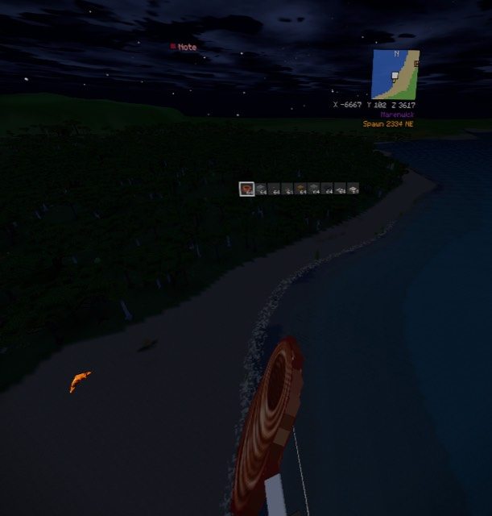

## 22:11:52 - Oh yeah, this is, uh, really not bad

- **Transcript:** Oh yeah, this is, uh, really not bad
- **Status:** open
- **Build:** 0.129 (6c3dfeea, M1-M4 (device-tested; ship riding, chests, comfort options, weapon wheel))
- **World:** Quest World (seed 5663059916303033239)
- **Dimension:** Surface
- **Biome:** Plains
- **Position:** -6933.3 102.9 3983.1
- **Facing:** south (yaw 201, pitch -20)
- **Held:** Copper Wire x64
- **Mount:** on foot, flying
- **Looking at:** nothing
- **Mode:** Creative, health 20/20
- **Time:** day 1 01:43, clear
- **Fps:** 18
- **Levels:** mic -38 dBFS, game sound -23 dBFS
- **Length:** 3.7 s (voice 1.2 s)
- **Just before:** -28s message: Walking; -28s walked into Jungle; -25s message: Flying; -24s message: Walking; -21s message: Flying; -20s walked into River; -19s message: Walking; -18s walked into Bamboo Jungle; -14s walked into Jungle; -12s walked into Mangrove Swamp; -10s walked into Lukewarm Ocean; -8s walked into Beach; -6s walked into Lukewarm Ocean; -4s walked into Beach; -2s walked into Lukewarm Ocean
- **Repro (Mac):** `./snap.sh note --seed 5663059916303033239 --x -6933.3 --z 3983.1 --yaw 159 --pitch -20 --time 0.822`
- **Audio (this Mac):** /Users/darthvadar/Documents/Blocksmith/QuestVoiceNotes/raw/vn-20261022-221152-702.aac

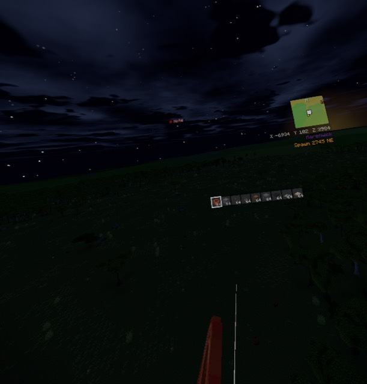

## 22:11:59 - Let's draw distance. I don't know what, how many, like, chunks I'm get

- **Transcript:** Let's draw distance. I don't know what, how many, like, chunks I'm getting right now, but it ain't bad
- **Status:** open
- **Build:** 0.129 (6c3dfeea, M1-M4 (device-tested; ship riding, chests, comfort options, weapon wheel))
- **World:** Quest World (seed 5663059916303033239)
- **Dimension:** Surface
- **Biome:** Plains
- **Position:** -7011.7 102.9 4128.5
- **Facing:** south-west (yaw 210, pitch -18)
- **Held:** Copper Wire x64
- **Mount:** on foot, flying
- **Looking at:** nothing
- **Mode:** Creative, health 20/20
- **Time:** day 1 01:46, clear
- **Fps:** 18
- **Levels:** mic -23 dBFS, game sound -19 dBFS
- **Length:** 5.2 s (voice 3.1 s)
- **Just before:** -30s message: Walking; -30s walked into Jungle; -27s message: Flying; -26s message: Walking; -23s message: Flying; -22s walked into River; -21s message: Walking; -20s walked into Bamboo Jungle; -16s walked into Jungle; -14s walked into Mangrove Swamp; -12s walked into Lukewarm Ocean; -10s walked into Beach; -8s walked into Lukewarm Ocean; -6s walked into Beach; -4s walked into Lukewarm Ocean; -1s walked into Plains
- **Repro (Mac):** `./snap.sh note --seed 5663059916303033239 --x -7011.7 --z 4128.5 --yaw 150 --pitch -18 --time 0.824`
- **Audio (this Mac):** /Users/darthvadar/Documents/Blocksmith/QuestVoiceNotes/raw/vn-20261022-221159-542.aac

## 22:12:25 - All right. Commands. Let's set Oreville Station somewhere around here

- **Transcript:** All right. Commands. Let's set Oreville Station somewhere around here
- **Status:** open
- **Build:** 0.129 (6c3dfeea, M1-M4 (device-tested; ship riding, chests, comfort options, weapon wheel))
- **World:** Quest World (seed 5663059916303033239)
- **Dimension:** Surface
- **Biome:** Taiga
- **Position:** -7391.0 142.3 5174.5
- **Facing:** south (yaw 201, pitch -16)
- **Held:** Copper Wire x64
- **Mount:** on foot, flying
- **Looking at:** nothing
- **Mode:** Creative, health 20/20, screen PauseMenu
- **Time:** day 1 02:05, clear
- **Fps:** 72
- **Levels:** mic -32 dBFS, game sound -32 dBFS
- **Length:** 5.9 s (voice 3.2 s)
- **Just before:** -29s walked into Lukewarm Ocean; -27s walked into Beach; -25s walked into Lukewarm Ocean; -23s walked into Beach; -21s walked into Lukewarm Ocean; -19s walked into Plains; -13s message: Entering Gorevania; -11s walked into Forest; -9s walked into Birch Forest; -7s walked into Taiga; -2s opened PauseMenu
- **While talking:** -5s opened PauseMenu; -2s opened CommandMenu; -1s closed CommandMenu
- **Position at the end:** -7389.8 142.3 5173.6
- **Repro (Mac):** `./snap.sh note --seed 5663059916303033239 --x -7391.0 --z 5174.5 --yaw 159 --pitch -16 --time 0.837`
- **Audio (this Mac):** /Users/darthvadar/Documents/Blocksmith/QuestVoiceNotes/raw/vn-20261022-221225-882.aac

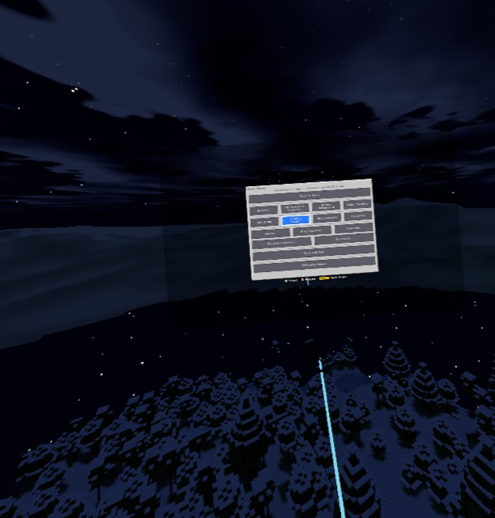

## 22:12:32 - A little bit over here

- **Transcript:** A little bit over here
- **Status:** open
- **Build:** 0.129 (6c3dfeea, M1-M4 (device-tested; ship riding, chests, comfort options, weapon wheel))
- **World:** Quest World (seed 5663059916303033239)
- **Dimension:** Surface
- **Biome:** Taiga
- **Position:** -7387.3 142.3 5171.8
- **Facing:** north-east (yaw 66, pitch -53)
- **Held:** Copper Wire x64
- **Mount:** on foot, flying
- **Looking at:** nothing
- **Mode:** Creative, health 20/20
- **Time:** day 1 02:07, clear
- **Fps:** 29
- **Levels:** mic -34 dBFS, game sound -20 dBFS
- **Length:** 2.8 s (voice 1.4 s)
- **Just before:** -28s walked into Lukewarm Ocean; -26s walked into Beach; -24s walked into Lukewarm Ocean; -22s walked into Plains; -16s message: Entering Gorevania; -14s walked into Forest; -12s walked into Birch Forest; -10s walked into Taiga; -5s opened PauseMenu; -2s opened CommandMenu; -2s closed CommandMenu
- **Repro (Mac):** `./snap.sh note --seed 5663059916303033239 --x -7387.3 --z 5171.8 --yaw -66 --pitch -53 --time 0.839`
- **Audio (this Mac):** /Users/darthvadar/Documents/Blocksmith/QuestVoiceNotes/raw/vn-20261022-221232-182.aac

## 22:12:35 - Oh yeah, look at this. What is this?

- **Transcript:** Oh yeah, look at this. What is this?
- **Status:** open
- **Build:** 0.129 (6c3dfeea, M1-M4 (device-tested; ship riding, chests, comfort options, weapon wheel))
- **World:** Quest World (seed 5663059916303033239)
- **Dimension:** Surface
- **Biome:** Taiga
- **Position:** -7284.7 142.3 5169.0
- **Facing:** east (yaw 97, pitch -15)
- **Held:** Copper Wire x64
- **Mount:** on foot, flying
- **Looking at:** nothing
- **Mode:** Creative, health 20/20
- **Time:** day 1 02:09, clear
- **Fps:** 29
- **Levels:** mic -22 dBFS, game sound -29 dBFS
- **Length:** 2.7 s (voice 1.0 s)
- **Just before:** -30s walked into Lukewarm Ocean; -28s walked into Beach; -26s walked into Lukewarm Ocean; -24s walked into Plains; -18s message: Entering Gorevania; -16s walked into Forest; -14s walked into Birch Forest; -12s walked into Taiga; -6s opened PauseMenu; -4s opened CommandMenu; -3s closed CommandMenu
- **Repro (Mac):** `./snap.sh note --seed 5663059916303033239 --x -7284.7 --z 5169.0 --yaw -97 --pitch -15 --time 0.840`
- **Audio (this Mac):** /Users/darthvadar/Documents/Blocksmith/QuestVoiceNotes/raw/vn-20261022-221235-682.aac

## 22:12:38 - Very nice. Okay, so one thing

- **Transcript:** Very nice. Okay, so one thing
- **Status:** open
- **Build:** 0.129 (6c3dfeea, M1-M4 (device-tested; ship riding, chests, comfort options, weapon wheel))
- **World:** Quest World (seed 5663059916303033239)
- **Dimension:** Surface
- **Biome:** Snowy Taiga
- **Position:** -7183.4 142.3 5186.8
- **Facing:** east (yaw 106, pitch -58)
- **Held:** Copper Wire x64
- **Mount:** on foot
- **Looking at:** nothing
- **Mode:** Creative, health 20/20
- **Time:** day 1 02:12, clear
- **Fps:** 33
- **Levels:** mic -27 dBFS, game sound -21 dBFS
- **Length:** 3.1 s (voice 1.6 s)
- **Just before:** -28s walked into Lukewarm Ocean; -26s walked into Plains; -20s message: Entering Gorevania; -18s walked into Forest; -16s walked into Birch Forest; -14s walked into Taiga; -9s opened PauseMenu; -6s opened CommandMenu; -6s closed CommandMenu; -2s walked into Snowy Taiga; -1s message: Boreal Station marked on the map
- **Repro (Mac):** `./snap.sh note --seed 5663059916303033239 --x -7183.4 --z 5186.8 --yaw -106 --pitch -58 --time 0.842`
- **Audio (this Mac):** /Users/darthvadar/Documents/Blocksmith/QuestVoiceNotes/raw/vn-20261022-221238-702.aac

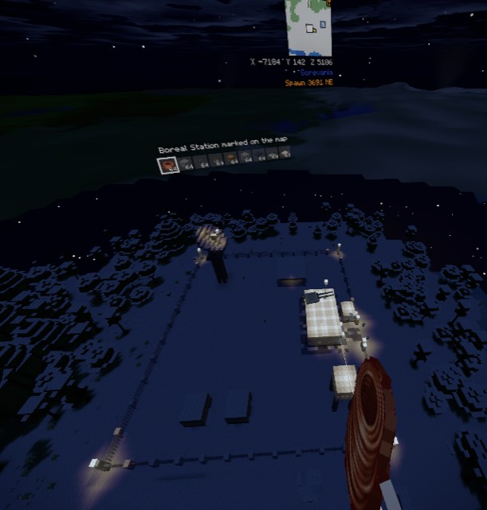

## 22:12:41 - The big naval gun looks like a really big one from far away. When you 

- **Transcript:** The big naval gun looks like a really big one from far away. When you get close, it turns into the little one
- **Status:** open
- **Build:** 0.129 (6c3dfeea, M1-M4 (device-tested; ship riding, chests, comfort options, weapon wheel))
- **World:** Quest World (seed 5663059916303033239)
- **Dimension:** Surface
- **Biome:** Snowy Taiga
- **Position:** -7174.8 109.1 5189.9
- **Facing:** east (yaw 97, pitch -46)
- **Held:** Copper Wire x64
- **Mount:** on foot, flying
- **Looking at:** nothing
- **Mode:** Creative, health 20/20
- **Time:** day 1 02:15, clear
- **Fps:** 33
- **Levels:** mic -32 dBFS, game sound -21 dBFS
- **Length:** 6.5 s (voice 4.4 s)
- **Just before:** -29s walked into Plains; -23s message: Entering Gorevania; -20s walked into Forest; -18s walked into Birch Forest; -16s walked into Taiga; -11s opened PauseMenu; -9s opened CommandMenu; -8s closed CommandMenu; -4s walked into Snowy Taiga; -3s message: Boreal Station marked on the map; -1s message: Walking
- **While talking:** -4s message: Walking; -3s message: Flying; -1s message: Walking
- **Position at the end:** -7149.4 87.1 5194.0
- **Repro (Mac):** `./snap.sh note --seed 5663059916303033239 --x -7174.8 --z 5189.9 --yaw -97 --pitch -46 --time 0.844`
- **Audio (this Mac):** /Users/darthvadar/Documents/Blocksmith/QuestVoiceNotes/raw/vn-20261022-221241-582.aac

## 22:12:48 - Which is good 'cause I like the little one. Well, I mean, well, I mean

- **Transcript:** Which is good 'cause I like the little one. Well, I mean, well, I mean, it's not good, but
- **Status:** open
- **Build:** 0.129 (6c3dfeea, M1-M4 (device-tested; ship riding, chests, comfort options, weapon wheel))
- **World:** Quest World (seed 5663059916303033239)
- **Dimension:** Surface
- **Biome:** Snowy Taiga
- **Position:** -7143.8 80.5 5193.2
- **Facing:** south-east (yaw 134, pitch -76)
- **Held:** Copper Wire x64
- **Mount:** on foot
- **Looking at:** Snow at -7144 77 5194
- **Mode:** Creative, health 20/20
- **Time:** day 1 02:19, clear
- **Fps:** 39
- **Levels:** mic -49 dBFS, game sound -22 dBFS
- **Length:** 5.2 s (voice 2.7 s)
- **Just before:** -26s message: Entering Gorevania; -24s walked into Forest; -22s walked into Birch Forest; -20s walked into Taiga; -15s opened PauseMenu; -12s opened CommandMenu; -12s closed CommandMenu; -8s walked into Snowy Taiga; -7s message: Boreal Station marked on the map; -5s message: Walking; -3s message: Flying; -2s message: Walking
- **Repro (Mac):** `./snap.sh note --seed 5663059916303033239 --x -7143.8 --z 5193.2 --yaw -134 --pitch -76 --time 0.847`
- **Audio (this Mac):** /Users/darthvadar/Documents/Blocksmith/QuestVoiceNotes/raw/vn-20261022-221248-422.aac

## 22:12:53 - Also, this, uh, naval gun in the boreal station, it should be

- **Transcript:** Also, this, uh, naval gun in the boreal station, it should be
- **Status:** open
- **Build:** 0.129 (6c3dfeea, M1-M4 (device-tested; ship riding, chests, comfort options, weapon wheel))
- **World:** Quest World (seed 5663059916303033239)
- **Dimension:** Surface
- **Biome:** Snowy Taiga
- **Position:** -7141.5 82.5 5194.0
- **Facing:** north-east (yaw 29, pitch -16)
- **Held:** empty hand
- **Mount:** on foot
- **Looking at:** nothing
- **Mode:** Creative, health 20/20
- **Time:** day 1 02:21, clear
- **Fps:** 27
- **Levels:** mic -33 dBFS, game sound -21 dBFS
- **Length:** 5.5 s (voice 3.2 s)
- **Just before:** -28s message: Entering Gorevania; -26s walked into Forest; -24s walked into Birch Forest; -22s walked into Taiga; -17s opened PauseMenu; -14s opened CommandMenu; -13s closed CommandMenu; -10s walked into Snowy Taiga; -9s message: Boreal Station marked on the map; -7s message: Walking; -5s message: Flying; -4s message: Walking; -1s holding empty hand; -1s message: Flying
- **While talking:** -2s holding empty hand; -2s message: Flying; -1s message: Manning the deck gun
- **Position at the end:** -7140.5 82.5 5194.8
- **Repro (Mac):** `./snap.sh note --seed 5663059916303033239 --x -7141.5 --z 5194.0 --yaw -29 --pitch -16 --time 0.849`
- **Audio (this Mac):** /Users/darthvadar/Documents/Blocksmith/QuestVoiceNotes/raw/vn-20261022-221253-562.aac

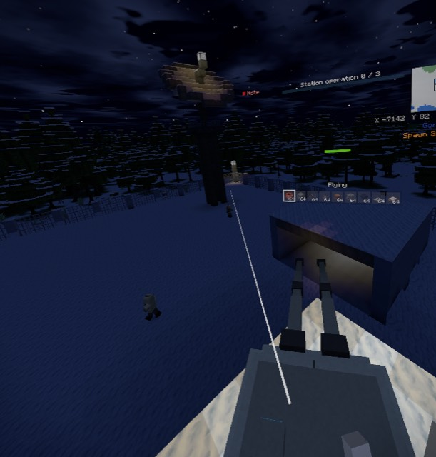

## 22:13:00 - Hmm. I'm seeing a problem right here. See that giant tower thing? That

- **Transcript:** Hmm. I'm seeing a problem right here. See that giant tower thing? That should fall 'cause I just destroyed the structure for it. It didn't fall
- **Status:** open
- **Build:** 0.129 (6c3dfeea, M1-M4 (device-tested; ship riding, chests, comfort options, weapon wheel))
- **World:** Quest World (seed 5663059916303033239)
- **Dimension:** Surface
- **Biome:** Snowy Taiga
- **Position:** -7140.6 82.5 5194.7
- **Facing:** north-east (yaw 27, pitch -12)
- **Held:** empty hand
- **Mount:** on foot
- **Looking at:** nothing
- **Mode:** Creative, health 20/20
- **Time:** day 1 02:23, clear
- **Fps:** 20
- **Levels:** mic -27 dBFS, game sound -22 dBFS
- **Length:** 10.5 s (voice 6.1 s)
- **Just before:** -30s message: Entering Gorevania; -28s walked into Forest; -26s walked into Birch Forest; -24s walked into Taiga; -18s opened PauseMenu; -16s opened CommandMenu; -15s closed CommandMenu; -12s walked into Snowy Taiga; -10s message: Boreal Station marked on the map; -8s message: Walking; -7s message: Flying; -6s message: Walking; -3s holding empty hand; -3s message: Flying; -2s message: Manning the deck gun
- **While talking:** -4s holding empty hand; -4s message: Flying; -3s message: Manning the deck gun; -1s message: The station alarm is sounding!
- **Position at the end:** -7140.5 82.5 5194.8
- **Repro (Mac):** `./snap.sh note --seed 5663059916303033239 --x -7140.6 --z 5194.7 --yaw -27 --pitch -12 --time 0.850`
- **Audio (this Mac):** /Users/darthvadar/Documents/Blocksmith/QuestVoiceNotes/raw/vn-20261022-221300-482.aac

## 22:13:10 - That's not good

- **Transcript:** That's not good
- **Status:** open
- **Build:** 0.129 (6c3dfeea, M1-M4 (device-tested; ship riding, chests, comfort options, weapon wheel))
- **World:** Quest World (seed 5663059916303033239)
- **Dimension:** Surface
- **Biome:** Snowy Taiga
- **Position:** -7138.4 82.5 5194.7
- **Facing:** north-west (yaw 320, pitch -12)
- **Held:** empty hand
- **Mount:** on foot
- **Looking at:** nothing
- **Mode:** Creative, health 20/20
- **Time:** day 1 02:26, clear
- **Fps:** 15
- **Levels:** mic -45 dBFS, game sound -15 dBFS
- **Length:** 1.8 s (voice 0.5 s)
- **Just before:** -30s walked into Forest; -28s walked into Birch Forest; -26s walked into Taiga; -21s opened PauseMenu; -18s opened CommandMenu; -17s closed CommandMenu; -14s walked into Snowy Taiga; -13s message: Boreal Station marked on the map; -10s message: Walking; -9s message: Flying; -8s message: Walking; -5s holding empty hand; -5s message: Flying; -4s message: Manning the deck gun; -2s message: The station alarm is sounding!
- **Repro (Mac):** `./snap.sh note --seed 5663059916303033239 --x -7138.4 --z 5194.7 --yaw 40 --pitch -12 --time 0.852`
- **Audio (this Mac):** /Users/darthvadar/Documents/Blocksmith/QuestVoiceNotes/raw/vn-20261022-221310-722.aac

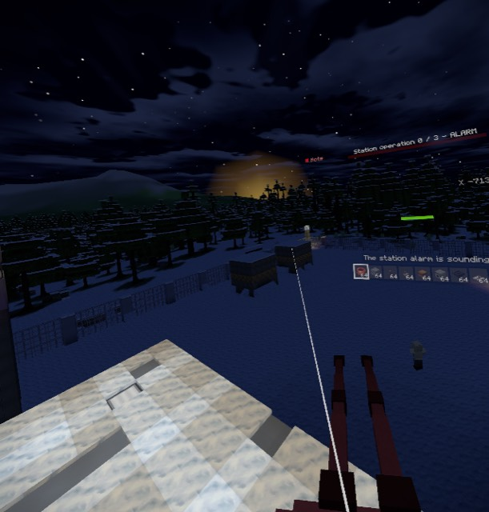

## 22:13:16 - I do like the amount of damage this thing does though. This thing's aw

- **Transcript:** I do like the amount of damage this thing does though. This thing's awesome
- **Status:** open
- **Build:** 0.129 (6c3dfeea, M1-M4 (device-tested; ship riding, chests, comfort options, weapon wheel))
- **World:** Quest World (seed 5663059916303033239)
- **Dimension:** Surface
- **Biome:** Snowy Taiga
- **Position:** -7137.6 82.5 5194.1
- **Facing:** north-west (yaw 309, pitch -17)
- **Held:** empty hand
- **Mount:** on foot
- **Looking at:** nothing
- **Mode:** Creative, health 20/20
- **Time:** day 1 02:27, clear
- **Fps:** 13
- **Levels:** mic -24 dBFS, game sound -20 dBFS
- **Length:** 4.0 s (voice 2.4 s)
- **Just before:** -29s walked into Birch Forest; -27s walked into Taiga; -22s opened PauseMenu; -19s opened CommandMenu; -18s closed CommandMenu; -15s walked into Snowy Taiga; -14s message: Boreal Station marked on the map; -11s message: Walking; -10s message: Flying; -9s message: Walking; -6s holding empty hand; -6s message: Flying; -5s message: Manning the deck gun; -3s message: The station alarm is sounding!; -1s message: Alarm! The garrison is coming through the bulkheads
- **Repro (Mac):** `./snap.sh note --seed 5663059916303033239 --x -7137.6 --z 5194.1 --yaw 51 --pitch -17 --time 0.853`
- **Audio (this Mac):** /Users/darthvadar/Documents/Blocksmith/QuestVoiceNotes/raw/vn-20261022-221316-242.aac

## 22:13:20 - Though it's getting real buggy out and bugged out now

- **Transcript:** Though it's getting real buggy out and bugged out now
- **Status:** open
- **Build:** 0.129 (6c3dfeea, M1-M4 (device-tested; ship riding, chests, comfort options, weapon wheel))
- **World:** Quest World (seed 5663059916303033239)
- **Dimension:** Surface
- **Biome:** Snowy Taiga
- **Position:** -7137.8 82.5 5194.3
- **Facing:** north-west (yaw 324, pitch -25)
- **Held:** empty hand
- **Mount:** on foot
- **Looking at:** nothing
- **Mode:** Creative, health 20/20
- **Time:** day 1 02:28, clear
- **Fps:** 13
- **Levels:** mic -29 dBFS, game sound -20 dBFS
- **Length:** 4.5 s (voice 2.5 s)
- **Just before:** -30s walked into Birch Forest; -28s walked into Taiga; -22s opened PauseMenu; -20s opened CommandMenu; -19s closed CommandMenu; -15s walked into Snowy Taiga; -14s message: Boreal Station marked on the map; -12s message: Walking; -11s message: Flying; -9s message: Walking; -7s holding empty hand; -7s message: Flying; -5s message: Manning the deck gun; -4s message: The station alarm is sounding!; -1s message: Alarm! The garrison is coming through the bulkheads
- **Repro (Mac):** `./snap.sh note --seed 5663059916303033239 --x -7137.8 --z 5194.3 --yaw 36 --pitch -25 --time 0.853`
- **Audio (this Mac):** /Users/darthvadar/Documents/Blocksmith/QuestVoiceNotes/raw/vn-20261022-221320-642.aac

## 22:13:39 - Yeah, this is pretty, uh

- **Transcript:** Yeah, this is pretty, uh
- **Status:** open
- **Build:** 0.129 (6c3dfeea, M1-M4 (device-tested; ship riding, chests, comfort options, weapon wheel))
- **World:** Quest World (seed 5663059916303033239)
- **Dimension:** Surface
- **Biome:** Snowy Taiga
- **Position:** -7129.8 71.0 5182.7
- **Facing:** east (yaw 91, pitch -14)
- **Held:** Copper Wire x64
- **Mount:** on foot
- **Looking at:** nothing
- **Mode:** Creative, health 20/20
- **Time:** day 1 02:33, clear
- **Fps:** 14
- **Levels:** mic -30 dBFS, game sound -18 dBFS
- **Length:** 2.8 s (voice 1.2 s)
- **Just before:** -26s opened PauseMenu; -23s opened CommandMenu; -23s closed CommandMenu; -19s walked into Snowy Taiga; -18s message: Boreal Station marked on the map; -16s message: Walking; -14s message: Flying; -13s message: Walking; -10s holding empty hand; -10s message: Flying; -9s message: Manning the deck gun; -7s message: The station alarm is sounding!; -5s message: Alarm! The garrison is coming through the bulkheads; -3s holding Copper Wire; -2s message: Flying; -1s message: Walking
- **Repro (Mac):** `./snap.sh note --seed 5663059916303033239 --x -7129.8 --z 5182.7 --yaw -91 --pitch -14 --time 0.856`
- **Audio (this Mac):** /Users/darthvadar/Documents/Blocksmith/QuestVoiceNotes/raw/vn-20261022-221339-522.aac

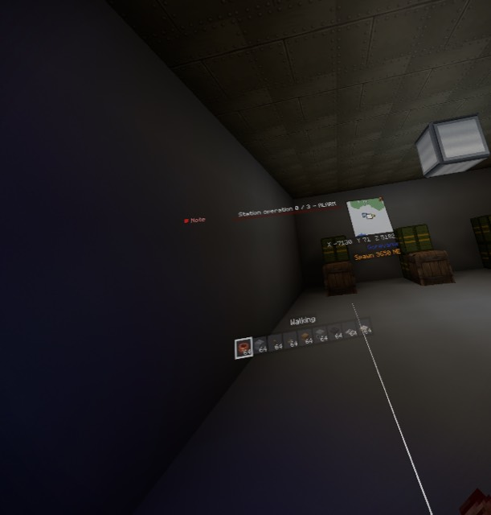

## 22:14:01 - I like the look of this. This is nice

- **Transcript:** I like the look of this. This is nice
- **Status:** open
- **Build:** 0.129 (6c3dfeea, M1-M4 (device-tested; ship riding, chests, comfort options, weapon wheel))
- **World:** Quest World (seed 5663059916303033239)
- **Dimension:** Surface
- **Biome:** Snowy Taiga
- **Position:** -7139.6 69.2 5192.8
- **Facing:** west (yaw 279, pitch -45)
- **Held:** Copper Wire x64
- **Mount:** on foot
- **Looking at:** Station Concrete at -7144 66 5191
- **Mode:** Creative, health 20/20
- **Time:** day 1 02:38, clear
- **Fps:** 16
- **Levels:** mic -33 dBFS, game sound -17 dBFS
- **Length:** 3.0 s (voice 1.1 s)
- **Just before:** -28s opened CommandMenu; -28s closed CommandMenu; -24s walked into Snowy Taiga; -23s message: Boreal Station marked on the map; -21s message: Walking; -19s message: Flying; -18s message: Walking; -15s holding empty hand; -15s message: Flying; -14s message: Manning the deck gun; -12s message: The station alarm is sounding!; -10s message: Alarm! The garrison is coming through the bulkheads; -8s holding Copper Wire; -7s message: Flying; -6s message: Walking; -4s opened ChestMenu; -4s closed ChestMenu; -4s opened ChestMenu; -4s closed ChestMenu; -4s opened ChestMenu; -4s closed ChestMenu; -4s opened ChestMenu; -3s closed ChestMenu; -3s opened ChestMenu; -3s closed ChestMenu
- **Repro (Mac):** `./snap.sh note --seed 5663059916303033239 --x -7139.6 --z 5192.8 --yaw 81 --pitch -45 --time 0.860`
- **Audio (this Mac):** /Users/darthvadar/Documents/Blocksmith/QuestVoiceNotes/raw/vn-20261022-221401-282.aac

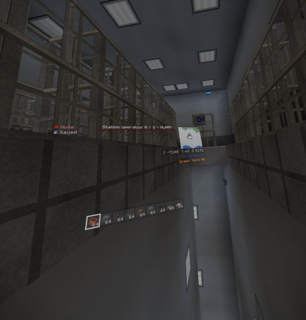

## 22:14:04 - Oh, there we go

- **Transcript:** Oh, there we go
- **Status:** open
- **Build:** 0.129 (6c3dfeea, M1-M4 (device-tested; ship riding, chests, comfort options, weapon wheel))
- **World:** Quest World (seed 5663059916303033239)
- **Dimension:** Surface
- **Biome:** Snowy Taiga
- **Position:** -7149.2 55.0 5194.9
- **Facing:** south (yaw 189, pitch -41)
- **Held:** Copper Wire x64
- **Mount:** on foot
- **Looking at:** Station Floor Tiles at -7150 54 5196
- **Mode:** Creative, health 20/20
- **Time:** day 1 02:42, clear
- **Fps:** 20
- **Levels:** mic -28 dBFS, game sound -21 dBFS
- **Length:** 1.9 s (voice 0.5 s)
- **Just before:** -27s walked into Snowy Taiga; -26s message: Boreal Station marked on the map; -24s message: Walking; -22s message: Flying; -21s message: Walking; -18s holding empty hand; -18s message: Flying; -17s message: Manning the deck gun; -15s message: The station alarm is sounding!; -13s message: Alarm! The garrison is coming through the bulkheads; -11s holding Copper Wire; -10s message: Flying; -9s message: Walking; -7s opened ChestMenu; -7s closed ChestMenu; -7s opened ChestMenu; -7s closed ChestMenu; -7s opened ChestMenu; -7s closed ChestMenu; -6s opened ChestMenu; -6s closed ChestMenu; -6s opened ChestMenu; -6s closed ChestMenu
- **Repro (Mac):** `./snap.sh note --seed 5663059916303033239 --x -7149.2 --z 5194.9 --yaw 171 --pitch -41 --time 0.863`
- **Audio (this Mac):** /Users/darthvadar/Documents/Blocksmith/QuestVoiceNotes/raw/vn-20261022-221404-882.aac

## 22:14:08 - Everything got better now that I'm underground, so nice to see that

- **Transcript:** Everything got better now that I'm underground, so nice to see that
- **Status:** open
- **Build:** 0.129 (6c3dfeea, M1-M4 (device-tested; ship riding, chests, comfort options, weapon wheel))
- **World:** Quest World (seed 5663059916303033239)
- **Dimension:** Surface
- **Biome:** Snowy Taiga
- **Position:** -7151.6 55.0 5188.4
- **Facing:** north-west (yaw 300, pitch -13)
- **Held:** Copper Wire x64
- **Mount:** on foot
- **Looking at:** nothing
- **Mode:** Creative, health 20/20
- **Time:** day 1 02:46, clear
- **Fps:** 70
- **Levels:** mic -29 dBFS, game sound -22 dBFS
- **Length:** 4.2 s (voice 2.7 s)
- **Just before:** -30s walked into Snowy Taiga; -29s message: Boreal Station marked on the map; -27s message: Walking; -25s message: Flying; -24s message: Walking; -21s holding empty hand; -21s message: Flying; -20s message: Manning the deck gun; -18s message: The station alarm is sounding!; -16s message: Alarm! The garrison is coming through the bulkheads; -14s holding Copper Wire; -13s message: Flying; -12s message: Walking; -10s opened ChestMenu; -10s closed ChestMenu; -10s opened ChestMenu; -10s closed ChestMenu; -10s opened ChestMenu; -10s closed ChestMenu; -10s opened ChestMenu; -9s closed ChestMenu; -9s opened ChestMenu; -9s closed ChestMenu
- **Repro (Mac):** `./snap.sh note --seed 5663059916303033239 --x -7151.6 --z 5188.4 --yaw 60 --pitch -13 --time 0.865`
- **Audio (this Mac):** /Users/darthvadar/Documents/Blocksmith/QuestVoiceNotes/raw/vn-20261022-221408-082.aac

## 22:14:12 - Made things more efficient

- **Transcript:** Made things more efficient
- **Status:** open
- **Build:** 0.129 (6c3dfeea, M1-M4 (device-tested; ship riding, chests, comfort options, weapon wheel))
- **World:** Quest World (seed 5663059916303033239)
- **Dimension:** Surface
- **Biome:** Snowy Taiga
- **Position:** -7159.3 55.3 5193.0
- **Facing:** south (yaw 182, pitch -13)
- **Held:** Copper Wire x64
- **Mount:** on foot
- **Looking at:** nothing
- **Mode:** Creative, health 20/20
- **Time:** day 1 02:51, clear
- **Fps:** 71
- **Levels:** mic -29 dBFS, game sound -23 dBFS
- **Length:** 2.4 s (voice 0.8 s)
- **Just before:** -30s message: Flying; -29s message: Walking; -26s holding empty hand; -26s message: Flying; -25s message: Manning the deck gun; -23s message: The station alarm is sounding!; -21s message: Alarm! The garrison is coming through the bulkheads; -18s holding Copper Wire; -18s message: Flying; -16s message: Walking; -15s opened ChestMenu; -15s closed ChestMenu; -15s opened ChestMenu; -15s closed ChestMenu; -14s opened ChestMenu; -14s closed ChestMenu; -14s opened ChestMenu; -14s closed ChestMenu; -14s opened ChestMenu; -14s closed ChestMenu; -0s message: Reinforcements coming down the stairwell
- **Repro (Mac):** `./snap.sh note --seed 5663059916303033239 --x -7159.3 --z 5193.0 --yaw 178 --pitch -13 --time 0.869`
- **Audio (this Mac):** /Users/darthvadar/Documents/Blocksmith/QuestVoiceNotes/raw/vn-20261022-221412-782.aac

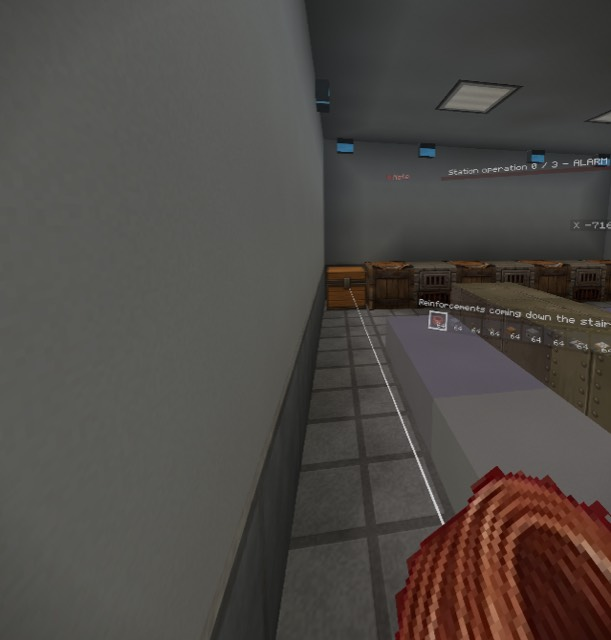

## 22:14:16 - You know, I would like to try just to

- **Transcript:** You know, I would like to try just to
- **Status:** open
- **Build:** 0.129 (6c3dfeea, M1-M4 (device-tested; ship riding, chests, comfort options, weapon wheel))
- **World:** Quest World (seed 5663059916303033239)
- **Dimension:** Surface
- **Biome:** Snowy Taiga
- **Position:** -7159.3 55.0 5195.2
- **Facing:** north (yaw 347, pitch -27)
- **Held:** Copper Wire x64
- **Mount:** on foot
- **Looking at:** Station Concrete Slab at -7161 55 5192
- **Mode:** Creative, health 20/20
- **Time:** day 1 02:55, clear
- **Fps:** 71
- **Levels:** mic -29 dBFS, game sound -24 dBFS
- **Length:** 3.4 s (voice 1.6 s)
- **Just before:** -29s holding empty hand; -29s message: Flying; -28s message: Manning the deck gun; -26s message: The station alarm is sounding!; -24s message: Alarm! The garrison is coming through the bulkheads; -22s holding Copper Wire; -21s message: Flying; -20s message: Walking; -18s opened ChestMenu; -18s closed ChestMenu; -18s opened ChestMenu; -18s closed ChestMenu; -18s opened ChestMenu; -18s closed ChestMenu; -18s opened ChestMenu; -17s closed ChestMenu; -17s opened ChestMenu; -17s closed ChestMenu; -4s message: Reinforcements coming down the stairwell; -3s opened ChestMenu; -2s closed ChestMenu
- **Repro (Mac):** `./snap.sh note --seed 5663059916303033239 --x -7159.3 --z 5195.2 --yaw 13 --pitch -27 --time 0.872`
- **Audio (this Mac):** /Users/darthvadar/Documents/Blocksmith/QuestVoiceNotes/raw/vn-20261022-221416-262.aac

## 22:14:22 - All right, we're gonna switch to survival in a minute

- **Transcript:** All right, we're gonna switch to survival in a minute
- **Status:** open
- **Build:** 0.129 (6c3dfeea, M1-M4 (device-tested; ship riding, chests, comfort options, weapon wheel))
- **World:** Quest World (seed 5663059916303033239)
- **Dimension:** Surface
- **Biome:** Snowy Taiga
- **Position:** -7159.3 55.0 5191.5
- **Facing:** north-west (yaw 335, pitch -33)
- **Held:** Stone x64
- **Mount:** on foot
- **Looking at:** Station Concrete Slab at -7161 55 5189
- **Mode:** Creative, health 20/20
- **Time:** day 1 03:01, clear
- **Fps:** 53
- **Levels:** mic -31 dBFS, game sound -18 dBFS
- **Length:** 4.4 s (voice 1.8 s)
- **Just before:** -29s message: Alarm! The garrison is coming through the bulkheads; -27s holding Copper Wire; -26s message: Flying; -25s message: Walking; -23s opened ChestMenu; -23s closed ChestMenu; -23s opened ChestMenu; -23s closed ChestMenu; -23s opened ChestMenu; -23s closed ChestMenu; -23s opened ChestMenu; -22s closed ChestMenu; -22s opened ChestMenu; -22s closed ChestMenu; -9s message: Reinforcements coming down the stairwell; -8s opened ChestMenu; -7s closed ChestMenu; -4s holding Stone; -4s message: Stone
- **Repro (Mac):** `./snap.sh note --seed 5663059916303033239 --x -7159.3 --z 5191.5 --yaw 25 --pitch -33 --time 0.876`
- **Audio (this Mac):** /Users/darthvadar/Documents/Blocksmith/QuestVoiceNotes/raw/vn-20261022-221422-582.aac

## 22:14:28 - Okay, so

- **Transcript:** Okay, so
- **Status:** open
- **Build:** 0.129 (6c3dfeea, M1-M4 (device-tested; ship riding, chests, comfort options, weapon wheel))
- **World:** Quest World (seed 5663059916303033239)
- **Dimension:** Surface
- **Biome:** Snowy Taiga
- **Position:** -7159.3 55.0 5191.7
- **Facing:** north-west (yaw 309, pitch -16)
- **Held:** Stone x64
- **Mount:** on foot
- **Looking at:** nothing
- **Mode:** Creative, health 20/20, screen CreativeMenu
- **Time:** day 1 03:07, clear
- **Fps:** 70
- **Levels:** mic -32 dBFS, game sound -19 dBFS
- **Length:** 2.6 s (voice 0.8 s)
- **Just before:** -29s opened ChestMenu; -29s closed ChestMenu; -29s opened ChestMenu; -29s closed ChestMenu; -28s opened ChestMenu; -28s closed ChestMenu; -28s opened ChestMenu; -28s closed ChestMenu; -28s opened ChestMenu; -28s closed ChestMenu; -14s message: Reinforcements coming down the stairwell; -14s opened ChestMenu; -12s closed ChestMenu; -10s holding Stone; -10s message: Stone; -5s opened PauseMenu; -5s closed PauseMenu; -4s opened CreativeMenu
- **Repro (Mac):** `./snap.sh note --seed 5663059916303033239 --x -7159.3 --z 5191.7 --yaw 51 --pitch -16 --time 0.880`
- **Audio (this Mac):** /Users/darthvadar/Documents/Blocksmith/QuestVoiceNotes/raw/vn-20261022-221428-242.aac

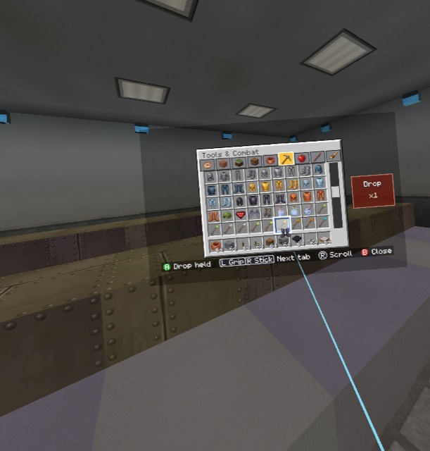

## 22:14:36 - [sighs] What's over... Ooh, a minigun. I gotta try the minigun. It use

- **Transcript:** [sighs] What's over... Ooh, a minigun. I gotta try the minigun. It uses what rounds? Capital rounds? Okay. [smacks lips] No problem. We'll try the capital rounds for a minigun
- **Status:** open
- **Build:** 0.129 (6c3dfeea, M1-M4 (device-tested; ship riding, chests, comfort options, weapon wheel))
- **World:** Quest World (seed 5663059916303033239)
- **Dimension:** Surface
- **Biome:** Snowy Taiga
- **Position:** -7159.3 55.0 5191.7
- **Facing:** north-west (yaw 309, pitch -16)
- **Held:** Stone x64
- **Mount:** on foot
- **Looking at:** nothing
- **Mode:** Creative, health 20/20, screen CreativeMenu
- **Time:** day 1 03:17, clear
- **Fps:** 72
- **Levels:** mic -43 dBFS, game sound -19 dBFS
- **Length:** 12.5 s (voice 7.3 s)
- **Just before:** -22s message: Reinforcements coming down the stairwell; -22s opened ChestMenu; -21s closed ChestMenu; -18s holding Stone; -18s message: Stone; -13s opened PauseMenu; -13s closed PauseMenu; -12s opened CreativeMenu; -8s into the pack: Duskium Boots; -6s into the pack: Duskium Leggings; -4s into the pack: Duskium Chestplate; -3s into the pack: Duskium Helmet
- **While talking:** -3s holding Mahlwerk Rotary Gun; -2s into the pack: Mahlwerk Rotary Gun; -2s message: Reinforcements coming down the stairwell
- **Position at the end:** -7159.3 55.0 5191.7
- **Repro (Mac):** `./snap.sh note --seed 5663059916303033239 --x -7159.3 --z 5191.7 --yaw 51 --pitch -16 --time 0.887`
- **Audio (this Mac):** /Users/darthvadar/Documents/Blocksmith/QuestVoiceNotes/raw/vn-20261022-221436-482.aac

## 22:15:08 - Where is the ammo?

- **Transcript:** Where is the ammo?
- **Status:** open
- **Build:** 0.129 (6c3dfeea, M1-M4 (device-tested; ship riding, chests, comfort options, weapon wheel))
- **World:** Quest World (seed 5663059916303033239)
- **Dimension:** Surface
- **Biome:** Snowy Taiga
- **Position:** -7159.3 55.0 5191.7
- **Facing:** north-west (yaw 309, pitch -16)
- **Held:** Mahlwerk Rotary Gun x1
- **Mount:** on foot
- **Looking at:** nothing
- **Mode:** Creative, health 20/20, screen CreativeMenu
- **Time:** day 1 03:56, clear
- **Fps:** 71
- **Levels:** mic -39 dBFS, game sound -23 dBFS
- **Length:** 3.1 s (voice 1.4 s)
- **Just before:** -30s holding Mahlwerk Rotary Gun; -29s into the pack: Mahlwerk Rotary Gun; -29s message: Reinforcements coming down the stairwell
- **Repro (Mac):** `./snap.sh note --seed 5663059916303033239 --x -7159.3 --z 5191.7 --yaw 51 --pitch -16 --time 0.914`
- **Audio (this Mac):** /Users/darthvadar/Documents/Blocksmith/QuestVoiceNotes/raw/vn-20261022-221508-742.aac

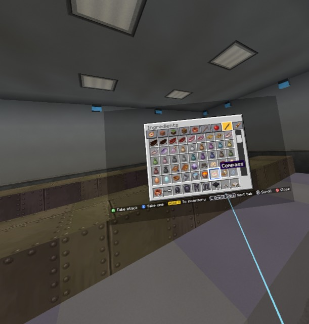

## 22:15:13 - Eclipse here somewhere? Whoa, where's the rifle rounds? Capital rounds

- **Transcript:** Eclipse here somewhere? Whoa, where's the rifle rounds? Capital rounds
- **Status:** open
- **Build:** 0.129 (6c3dfeea, M1-M4 (device-tested; ship riding, chests, comfort options, weapon wheel))
- **World:** Quest World (seed 5663059916303033239)
- **Dimension:** Surface
- **Biome:** Snowy Taiga
- **Position:** -7159.3 55.0 5191.7
- **Facing:** north-west (yaw 309, pitch -16)
- **Held:** Mahlwerk Rotary Gun x1
- **Mount:** on foot
- **Looking at:** nothing
- **Mode:** Creative, health 20/20, screen CreativeMenu
- **Time:** day 1 04:02, clear
- **Fps:** 71
- **Levels:** mic -42 dBFS, game sound -18 dBFS
- **Length:** 4.3 s (voice 2.2 s)
- **Repro (Mac):** `./snap.sh note --seed 5663059916303033239 --x -7159.3 --z 5191.7 --yaw 51 --pitch -16 --time 0.918`
- **Audio (this Mac):** /Users/darthvadar/Documents/Blocksmith/QuestVoiceNotes/raw/vn-20261022-221513-802.aac

## 22:15:22 - Okay, and there's some of this

- **Transcript:** Okay, and there's some of this
- **Status:** open
- **Build:** 0.129 (6c3dfeea, M1-M4 (device-tested; ship riding, chests, comfort options, weapon wheel))
- **World:** Quest World (seed 5663059916303033239)
- **Dimension:** Surface
- **Biome:** Snowy Taiga
- **Position:** -7159.3 55.0 5191.7
- **Facing:** north-west (yaw 309, pitch -16)
- **Held:** Mahlwerk Rotary Gun x1
- **Mount:** on foot
- **Looking at:** nothing
- **Mode:** Creative, health 20/20, screen CreativeMenu
- **Time:** day 1 04:12, clear
- **Fps:** 72
- **Levels:** mic -34 dBFS, game sound -18 dBFS
- **Length:** 2.9 s (voice 1.3 s)
- **Repro (Mac):** `./snap.sh note --seed 5663059916303033239 --x -7159.3 --z 5191.7 --yaw 51 --pitch -16 --time 0.925`
- **Audio (this Mac):** /Users/darthvadar/Documents/Blocksmith/QuestVoiceNotes/raw/vn-20261022-221522-222.aac

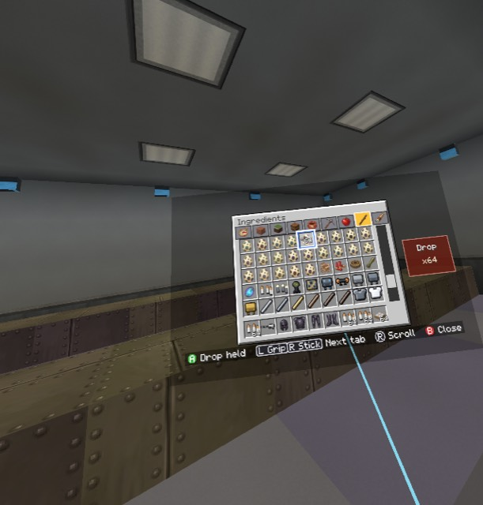

## 22:16:05 - Whoa. Okay, how am I getting shot? Oh, shit. Man, they're shooting thr

- **Transcript:** Whoa. Okay, how am I getting shot? Oh, shit. Man, they're shooting through the door. Hell yeah
- **Status:** open
- **Build:** 0.129 (6c3dfeea, M1-M4 (device-tested; ship riding, chests, comfort options, weapon wheel))
- **World:** Quest World (seed 5663059916303033239)
- **Dimension:** Surface
- **Biome:** Snowy Taiga
- **Position:** -7159.4 55.3 5192.7
- **Facing:** north (yaw 18, pitch -33)
- **Held:** Titanium Pickaxe x1
- **Mount:** on foot
- **Looking at:** Station Concrete at -7159 56 5191
- **Mode:** Survival, health 18/20
- **Time:** day 1 04:43, clear
- **Fps:** 51
- **Levels:** mic -22 dBFS, game sound -19 dBFS
- **Length:** 6.0 s (voice 4.1 s)
- **Just before:** -24s opened InventoryMenu; -24s left the pack: Duskium Helmet (InventoryMenu open); -23s left the pack: Duskium Leggings (InventoryMenu open); -23s left the pack: Duskium Chestplate (InventoryMenu open); -23s left the pack: Duskium Boots (InventoryMenu open); -22s closed InventoryMenu; -21s holding Capital Rounds; -21s message: Capital Rounds; -20s holding Mahlwerk Rotary Gun; -20s message: Mahlwerk Rotary Gun; -20s holding Capital Rounds; -20s message: Capital Rounds; -19s holding Mahlwerk Rotary Gun; -19s message: Mahlwerk Rotary Gun; -19s holding Capital Rounds; -19s message: Capital Rounds; -19s holding Mahlwerk Rotary Gun; -19s message: Mahlwerk Rotary Gun; -19s holding Capital Rounds; -19s message: Capital Rounds; -18s holding Mahlwerk Rotary Gun; -18s message: Mahlwerk Rotary Gun; -18s message: Loaded: 192 / 200; -16s holding empty hand; -14s opened PauseMenu; -11s message: Creative mode; -11s closed PauseMenu; -11s opened PauseMenu; -10s closed PauseMenu; -10s message: Flying; -10s opened CreativeMenu; -6s closed CreativeMenu; -6s into the pack: Titanium Pickaxe; -6s opened PauseMenu; -5s message: Survival mode; -5s closed PauseMenu; -4s opened InventoryMenu; -3s closed InventoryMenu; -2s holding Titanium Pickaxe; -2s message: Titanium Pickaxe
- **While talking:** -5s holding Titanium Pickaxe; -5s message: Titanium Pickaxe; -3s took 3 damage (health 18/20); -2s holding empty hand; -1s holding Mahlwerk Rotary Gun; -1s message: Mahlwerk Rotary Gun
- **Position at the end:** -7161.5 56.0 5193.7
- **Repro (Mac):** `./snap.sh note --seed 5663059916303033239 --x -7159.4 --z 5192.7 --yaw -18 --pitch -33 --time 0.947`
- **Audio (this Mac):** /Users/darthvadar/Documents/Blocksmith/QuestVoiceNotes/raw/vn-20261022-221605-982.aac

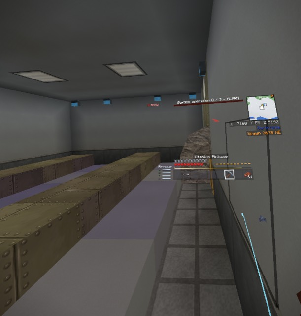

## 22:16:17 - I need some recoil with these guns

- **Transcript:** I need some recoil with these guns
- **Status:** open
- **Build:** 0.129 (6c3dfeea, M1-M4 (device-tested; ship riding, chests, comfort options, weapon wheel))
- **World:** Quest World (seed 5663059916303033239)
- **Dimension:** Surface
- **Biome:** Snowy Taiga
- **Position:** -7162.5 55.5 5188.1
- **Facing:** east (yaw 94, pitch -21)
- **Held:** Mahlwerk Rotary Gun x1
- **Mount:** on foot
- **Looking at:** Hazard Plating at -7159 55 5188
- **Mode:** Survival, health 18/20
- **Time:** day 1 04:50, clear
- **Fps:** 42
- **Levels:** mic -41 dBFS, game sound -20 dBFS
- **Length:** 3.1 s (voice 1.6 s)
- **Just before:** -29s closed InventoryMenu; -27s holding Capital Rounds; -27s message: Capital Rounds; -27s holding Mahlwerk Rotary Gun; -27s message: Mahlwerk Rotary Gun; -26s holding Capital Rounds; -26s message: Capital Rounds; -26s holding Mahlwerk Rotary Gun; -26s message: Mahlwerk Rotary Gun; -26s holding Capital Rounds; -26s message: Capital Rounds; -25s holding Mahlwerk Rotary Gun; -25s message: Mahlwerk Rotary Gun; -25s holding Capital Rounds; -25s message: Capital Rounds; -25s holding Mahlwerk Rotary Gun; -25s message: Mahlwerk Rotary Gun; -24s message: Loaded: 192 / 200; -22s holding empty hand; -20s opened PauseMenu; -18s message: Creative mode; -18s closed PauseMenu; -17s opened PauseMenu; -17s closed PauseMenu; -16s message: Flying; -16s opened CreativeMenu; -13s closed CreativeMenu; -13s into the pack: Titanium Pickaxe; -12s opened PauseMenu; -12s message: Survival mode; -12s closed PauseMenu; -11s opened InventoryMenu; -9s closed InventoryMenu; -8s holding Titanium Pickaxe; -8s message: Titanium Pickaxe; -6s took 3 damage (health 18/20); -5s holding empty hand; -5s holding Mahlwerk Rotary Gun; -5s message: Mahlwerk Rotary Gun; -0s message: Greywall Command now counts you hunted.
- **Repro (Mac):** `./snap.sh note --seed 5663059916303033239 --x -7162.5 --z 5188.1 --yaw -94 --pitch -21 --time 0.952`
- **Audio (this Mac):** /Users/darthvadar/Documents/Blocksmith/QuestVoiceNotes/raw/vn-20261022-221617-202.aac

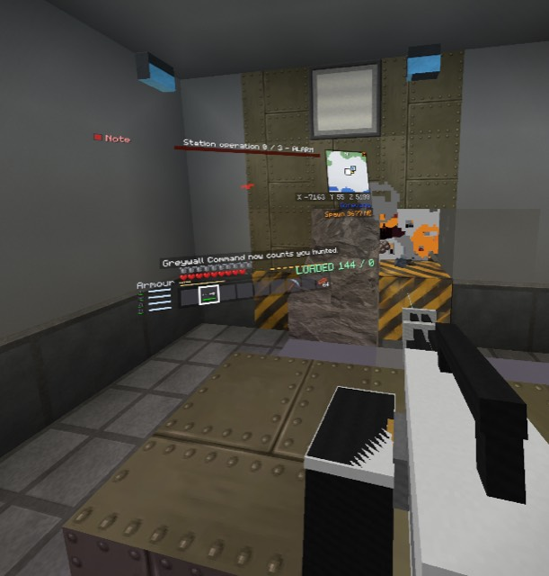

## 22:16:21 - Um, okay. What difficulty is this anyway?

- **Transcript:** Um, okay. What difficulty is this anyway?
- **Status:** open
- **Build:** 0.129 (6c3dfeea, M1-M4 (device-tested; ship riding, chests, comfort options, weapon wheel))
- **World:** Quest World (seed 5663059916303033239)
- **Dimension:** Surface
- **Biome:** Snowy Taiga
- **Position:** -7162.3 55.0 5185.9
- **Facing:** east (yaw 98, pitch -13)
- **Held:** Mahlwerk Rotary Gun x1
- **Mount:** on foot
- **Looking at:** Hazard Plating at -7159 55 5186
- **Mode:** Survival, health 19/20, screen PauseMenu
- **Time:** day 1 04:52, clear
- **Fps:** 39
- **Levels:** mic -28 dBFS, game sound -29 dBFS
- **Length:** 4.8 s (voice 2.2 s)
- **Just before:** -30s message: Capital Rounds; -29s holding Mahlwerk Rotary Gun; -29s message: Mahlwerk Rotary Gun; -29s holding Capital Rounds; -29s message: Capital Rounds; -28s holding Mahlwerk Rotary Gun; -28s message: Mahlwerk Rotary Gun; -28s holding Capital Rounds; -28s message: Capital Rounds; -28s holding Mahlwerk Rotary Gun; -28s message: Mahlwerk Rotary Gun; -28s holding Capital Rounds; -28s message: Capital Rounds; -27s holding Mahlwerk Rotary Gun; -27s message: Mahlwerk Rotary Gun; -27s message: Loaded: 192 / 200; -25s holding empty hand; -22s opened PauseMenu; -20s message: Creative mode; -20s closed PauseMenu; -20s opened PauseMenu; -19s closed PauseMenu; -19s message: Flying; -18s opened CreativeMenu; -15s closed CreativeMenu; -15s into the pack: Titanium Pickaxe; -15s opened PauseMenu; -14s message: Survival mode; -14s closed PauseMenu; -13s opened InventoryMenu; -11s closed InventoryMenu; -11s holding Titanium Pickaxe; -11s message: Titanium Pickaxe; -9s took 3 damage (health 18/20); -7s holding empty hand; -7s holding Mahlwerk Rotary Gun; -7s message: Mahlwerk Rotary Gun; -3s message: Greywall Command now counts you hunted.; -2s took 2 damage (health 18/20); -1s opened PauseMenu
- **Repro (Mac):** `./snap.sh note --seed 5663059916303033239 --x -7162.3 --z 5185.9 --yaw -98 --pitch -13 --time 0.953`
- **Audio (this Mac):** /Users/darthvadar/Documents/Blocksmith/QuestVoiceNotes/raw/vn-20261022-221621-122.aac

## 22:16:30 - Listen, I can't even... I don't think I can even change the difficulty

- **Transcript:** Listen, I can't even... I don't think I can even change the difficulty right now. That is something that is supposed to be changed, right?
- **Status:** open
- **Build:** 0.129 (6c3dfeea, M1-M4 (device-tested; ship riding, chests, comfort options, weapon wheel))
- **World:** Quest World (seed 5663059916303033239)
- **Dimension:** Surface
- **Biome:** Snowy Taiga
- **Position:** -7162.3 55.0 5185.9
- **Facing:** east (yaw 98, pitch -13)
- **Held:** Mahlwerk Rotary Gun x1
- **Mount:** on foot
- **Looking at:** Hazard Plating at -7159 55 5186
- **Mode:** Survival, health 19/20, screen PauseMenu
- **Time:** day 1 04:52, clear
- **Fps:** 41
- **Levels:** mic -44 dBFS, game sound -28 dBFS
- **Length:** 6.8 s (voice 4.5 s)
- **Just before:** -30s holding empty hand; -28s opened PauseMenu; -25s message: Creative mode; -25s closed PauseMenu; -25s opened PauseMenu; -25s closed PauseMenu; -24s message: Flying; -24s opened CreativeMenu; -20s closed CreativeMenu; -20s into the pack: Titanium Pickaxe; -20s opened PauseMenu; -19s message: Survival mode; -19s closed PauseMenu; -18s opened InventoryMenu; -17s closed InventoryMenu; -16s holding Titanium Pickaxe; -16s message: Titanium Pickaxe; -14s took 3 damage (health 18/20); -13s holding empty hand; -12s holding Mahlwerk Rotary Gun; -12s message: Mahlwerk Rotary Gun; -8s message: Greywall Command now counts you hunted.; -7s took 2 damage (health 18/20); -6s opened PauseMenu
- **Position at the end:** -7162.3 55.0 5185.9
- **Repro (Mac):** `./snap.sh note --seed 5663059916303033239 --x -7162.3 --z 5185.9 --yaw -98 --pitch -13 --time 0.953`
- **Audio (this Mac):** /Users/darthvadar/Documents/Blocksmith/QuestVoiceNotes/raw/vn-20261022-221630-302.aac

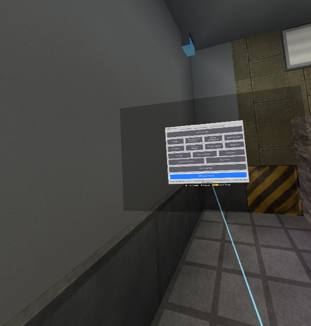

## 22:16:46 - Oh, what the fuck?

- **Transcript:** Oh, what the fuck?
- **Status:** open
- **Build:** 0.129 (6c3dfeea, M1-M4 (device-tested; ship riding, chests, comfort options, weapon wheel))
- **World:** Quest World (seed 5663059916303033239)
- **Dimension:** Surface
- **Biome:** Snowy Taiga
- **Position:** -7163.5 55.5 5188.7
- **Facing:** east (yaw 80, pitch -6)
- **Held:** empty hand
- **Mount:** on foot
- **Looking at:** nothing
- **Mode:** Survival, health -1/20, screen DeathMenu
- **Time:** day 1 04:56, clear
- **Fps:** 45
- **Levels:** mic -20 dBFS, game sound -23 dBFS
- **Length:** 2.4 s (voice 0.7 s)
- **Just before:** -30s closed CreativeMenu; -30s into the pack: Titanium Pickaxe; -29s opened PauseMenu; -29s message: Survival mode; -29s closed PauseMenu; -28s opened InventoryMenu; -26s closed InventoryMenu; -25s holding Titanium Pickaxe; -25s message: Titanium Pickaxe; -23s took 3 damage (health 18/20); -22s holding empty hand; -22s holding Mahlwerk Rotary Gun; -22s message: Mahlwerk Rotary Gun; -18s message: Greywall Command now counts you hunted.; -17s took 2 damage (health 18/20); -15s opened PauseMenu; -3s closed PauseMenu; -1s died; -1s opened DeathMenu; -1s holding empty hand; -0s left the pack: Mahlwerk Rotary Gun (DeathMenu open); -0s left the pack: Titanium Pickaxe (DeathMenu open)
- **Repro (Mac):** `./snap.sh note --seed 5663059916303033239 --x -7163.5 --z 5188.7 --yaw -80 --pitch -6 --time 0.956`
- **Audio (this Mac):** /Users/darthvadar/Documents/Blocksmith/QuestVoiceNotes/raw/vn-20261022-221646-022.aac

## 22:16:48 - Could I die?

- **Transcript:** Could I die?
- **Status:** open
- **Build:** 0.129 (6c3dfeea, M1-M4 (device-tested; ship riding, chests, comfort options, weapon wheel))
- **World:** Quest World (seed 5663059916303033239)
- **Dimension:** Surface
- **Biome:** Snowy Taiga
- **Position:** -7163.5 55.5 5188.7
- **Facing:** east (yaw 80, pitch -6)
- **Held:** empty hand
- **Mount:** on foot
- **Looking at:** nothing
- **Mode:** Survival, health -1/20, screen DeathMenu
- **Time:** day 1 04:58, clear
- **Fps:** 42
- **Levels:** mic -21 dBFS, game sound -22 dBFS
- **Length:** 2.0 s (voice 0.7 s)
- **Just before:** -30s opened InventoryMenu; -28s closed InventoryMenu; -27s holding Titanium Pickaxe; -27s message: Titanium Pickaxe; -25s took 3 damage (health 18/20); -24s holding empty hand; -23s holding Mahlwerk Rotary Gun; -23s message: Mahlwerk Rotary Gun; -19s message: Greywall Command now counts you hunted.; -18s took 2 damage (health 18/20); -17s opened PauseMenu; -5s closed PauseMenu; -3s died; -3s opened DeathMenu; -3s holding empty hand; -2s left the pack: Mahlwerk Rotary Gun (DeathMenu open); -2s left the pack: Titanium Pickaxe (DeathMenu open); -2s took 21 damage (health -1/20)
- **Repro (Mac):** `./snap.sh note --seed 5663059916303033239 --x -7163.5 --z 5188.7 --yaw -80 --pitch -6 --time 0.957`
- **Audio (this Mac):** /Users/darthvadar/Documents/Blocksmith/QuestVoiceNotes/raw/vn-20261022-221648-882.aac

## 22:16:54 - I don't know what shot me, but holy smokes, that whatever hit me fucki

- **Transcript:** I don't know what shot me, but holy smokes, that whatever hit me fucking near well killed me. I better have been on hardcore mode, otherwise that, uh, that was overpowered. It has to be like on very hard mode or it was too much
- **Status:** open
- **Build:** 0.129 (6c3dfeea, M1-M4 (device-tested; ship riding, chests, comfort options, weapon wheel))
- **World:** Quest World (seed 5663059916303033239)
- **Dimension:** Surface
- **Biome:** Jungle
- **Position:** -4577.2 104.0 2573.2
- **Facing:** east (yaw 85, pitch -12)
- **Held:** empty hand
- **Mount:** on foot
- **Looking at:** Jungle Log at -4574 104 2572
- **Mode:** Survival, health 20/20, screen PauseMenu
- **Time:** day 1 05:02, clear
- **Fps:** 65
- **Levels:** mic -23 dBFS, game sound -36 dBFS
- **Length:** 17.2 s (voice 10.2 s)
- **Just before:** -29s holding empty hand; -29s holding Mahlwerk Rotary Gun; -29s message: Mahlwerk Rotary Gun; -25s message: Greywall Command now counts you hunted.; -24s took 2 damage (health 18/20); -22s opened PauseMenu; -10s closed PauseMenu; -8s died; -8s opened DeathMenu; -8s holding empty hand; -7s left the pack: Mahlwerk Rotary Gun (DeathMenu open); -7s left the pack: Titanium Pickaxe (DeathMenu open); -7s took 21 damage (health -1/20); -5s respawned; -5s closed DeathMenu; -5s message: Your things are 3679 blocks south-west; -3s walked into Jungle; -3s message: Entering Draisvaal; -2s opened PauseMenu
- **While talking:** -2s closed PauseMenu; -1s opened PauseMenu; -5s opened PauseMenu; -4s message: Creative mode; -3s closed PauseMenu; -2s message: Flying; -2s walked into Sparse Jungle; -0s walked into Jungle; -5s message: Flying; -5s walked into Sparse Jungle; -3s walked into Jungle; -0s opened PauseMenu
- **Position at the end:** -4525.6 157.0 2487.4
- **Repro (Mac):** `./snap.sh note --seed 5663059916303033239 --x -4577.2 --z 2573.2 --yaw -85 --pitch -12 --time 0.960`
- **Audio (this Mac):** /Users/darthvadar/Documents/Blocksmith/QuestVoiceNotes/raw/vn-20261022-221654-342.aac

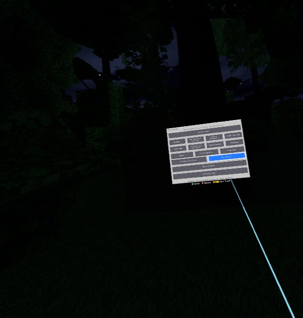

## 22:17:11 - One of the two

- **Transcript:** One of the two
- **Status:** open
- **Build:** 0.129 (6c3dfeea, M1-M4 (device-tested; ship riding, chests, comfort options, weapon wheel))
- **World:** Quest World (seed 5663059916303033239)
- **Dimension:** Surface
- **Biome:** Jungle
- **Position:** -4525.6 157.0 2487.4
- **Facing:** north-west (yaw 293, pitch -27)
- **Held:** empty hand
- **Mount:** on foot, flying
- **Looking at:** nothing
- **Mode:** Creative, health 20/20, screen PauseMenu
- **Time:** day 1 05:10, clear
- **Fps:** 47
- **Levels:** mic -25 dBFS, game sound -26 dBFS
- **Length:** 1.7 s (voice 0.6 s)
- **Just before:** -22s closed PauseMenu; -20s died; -20s opened DeathMenu; -20s holding empty hand; -20s left the pack: Mahlwerk Rotary Gun (DeathMenu open); -20s left the pack: Titanium Pickaxe (DeathMenu open); -19s took 21 damage (health -1/20); -17s respawned; -17s closed DeathMenu; -17s message: Your things are 3679 blocks south-west; -16s walked into Jungle; -15s message: Entering Draisvaal; -14s opened PauseMenu; -9s closed PauseMenu; -8s opened PauseMenu; -7s message: Creative mode; -7s closed PauseMenu; -5s message: Flying; -5s walked into Sparse Jungle; -3s walked into Jungle; -1s opened PauseMenu
- **Repro (Mac):** `./snap.sh note --seed 5663059916303033239 --x -4525.6 --z 2487.4 --yaw 67 --pitch -27 --time 0.965`
- **Audio (this Mac):** /Users/darthvadar/Documents/Blocksmith/QuestVoiceNotes/raw/vn-20261022-221711-222.aac

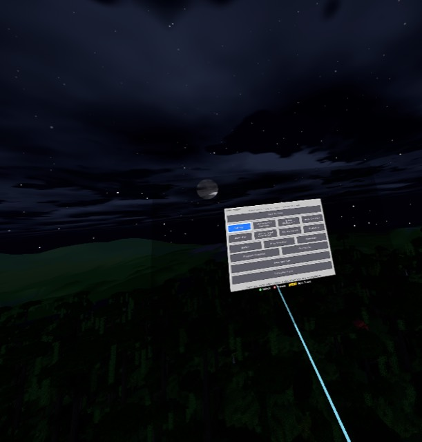

## 22:17:14 - That was just, yeah, wow

- **Transcript:** That was just, yeah, wow
- **Status:** open
- **Build:** 0.129 (6c3dfeea, M1-M4 (device-tested; ship riding, chests, comfort options, weapon wheel))
- **World:** Quest World (seed 5663059916303033239)
- **Dimension:** Surface
- **Biome:** Jungle
- **Position:** -4529.5 157.0 2482.8
- **Facing:** north-west (yaw 300, pitch -1)
- **Held:** empty hand
- **Mount:** on foot, flying
- **Looking at:** nothing
- **Mode:** Creative, health 20/20
- **Time:** day 1 05:10, clear
- **Fps:** 33
- **Levels:** mic -29 dBFS, game sound -19 dBFS
- **Length:** 2.8 s (voice 1.3 s)
- **Just before:** -24s closed PauseMenu; -21s died; -21s opened DeathMenu; -21s holding empty hand; -21s left the pack: Mahlwerk Rotary Gun (DeathMenu open); -21s left the pack: Titanium Pickaxe (DeathMenu open); -20s took 21 damage (health -1/20); -18s respawned; -18s closed DeathMenu; -18s message: Your things are 3679 blocks south-west; -17s walked into Jungle; -16s message: Entering Draisvaal; -15s opened PauseMenu; -10s closed PauseMenu; -9s opened PauseMenu; -8s message: Creative mode; -8s closed PauseMenu; -7s message: Flying; -7s walked into Sparse Jungle; -5s walked into Jungle; -2s opened PauseMenu; -0s closed PauseMenu
- **Repro (Mac):** `./snap.sh note --seed 5663059916303033239 --x -4529.5 --z 2482.8 --yaw 60 --pitch -1 --time 0.966`
- **Audio (this Mac):** /Users/darthvadar/Documents/Blocksmith/QuestVoiceNotes/raw/vn-20261022-221714-062.aac

## 22:17:29 - Oh, very nice. Like a little starting camp, huh? Nice. Interesting

- **Transcript:** Oh, very nice. Like a little starting camp, huh? Nice. Interesting
- **Status:** open
- **Build:** 0.129 (6c3dfeea, M1-M4 (device-tested; ship riding, chests, comfort options, weapon wheel))
- **World:** New World (2) (seed 984459503243281715)
- **Dimension:** Surface
- **Biome:** Plains
- **Position:** 631.3 88.5 278.7
- **Facing:** north (yaw 339, pitch 19)
- **Held:** Grass Block x64
- **Mount:** on foot
- **Looking at:** nothing
- **Mode:** Survival, health 20/20
- **Time:** day 1 07:29, clear
- **Fps:** 71
- **Levels:** mic -31 dBFS, game sound -41 dBFS
- **Length:** 6.8 s (voice 2.9 s)
- **Just before:** --299s message: Survival mode; --299s closed PauseMenu; --300s opened InventoryMenu; --302s closed InventoryMenu; --303s holding Titanium Pickaxe; --303s message: Titanium Pickaxe; --305s took 3 damage (health 18/20); --306s holding empty hand; --306s holding Mahlwerk Rotary Gun; --306s message: Mahlwerk Rotary Gun; --310s message: Greywall Command now counts you hunted.; --311s took 2 damage (health 18/20); --313s opened PauseMenu; --325s closed PauseMenu; --327s died; --327s opened DeathMenu; --327s holding empty hand; --328s left the pack: Mahlwerk Rotary Gun (DeathMenu open); --328s left the pack: Titanium Pickaxe (DeathMenu open); --328s took 21 damage (health -1/20); --330s respawned; --330s closed DeathMenu; --330s message: Your things are 3679 blocks south-west; --332s walked into Jungle; --332s message: Entering Draisvaal; --333s opened PauseMenu; --338s closed PauseMenu; --339s opened PauseMenu; --340s message: Creative mode; --340s closed PauseMenu; --342s message: Flying; --342s walked into Sparse Jungle; --344s walked into Jungle; --346s opened PauseMenu; --348s closed PauseMenu; --349s opened PauseMenu; -2s closed PauseMenu; -2s holding Grass Block; -1s opened ChestMenu; -0s closed ChestMenu
- **While talking:** --294s message: Survival mode; --294s closed PauseMenu; --295s opened InventoryMenu; --297s closed InventoryMenu; --298s holding Titanium Pickaxe; --298s message: Titanium Pickaxe; --300s took 3 damage (health 18/20); --301s holding empty hand; --301s holding Mahlwerk Rotary Gun; --301s message: Mahlwerk Rotary Gun; --305s message: Greywall Command now counts you hunted.; --306s took 2 damage (health 18/20); --308s opened PauseMenu; --320s closed PauseMenu; --322s died; --322s opened DeathMenu; --322s holding empty hand; --323s left the pack: Mahlwerk Rotary Gun (DeathMenu open); --323s left the pack: Titanium Pickaxe (DeathMenu open); --323s took 21 damage (health -1/20); --325s respawned; --325s closed DeathMenu; --325s message: Your things are 3679 blocks south-west; --327s walked into Jungle; --327s message: Entering Draisvaal; --328s opened PauseMenu; --333s closed PauseMenu; --334s opened PauseMenu; --335s message: Creative mode; --335s closed PauseMenu; --337s message: Flying; --337s walked into Sparse Jungle; --339s walked into Jungle; --341s opened PauseMenu; --343s closed PauseMenu; --344s opened PauseMenu
- **Position at the end:** 624.0 90.5 277.1
- **Repro (Mac):** `./snap.sh note --seed 984459503243281715 --x 631.3 --z 278.7 --yaw 21 --pitch 19 --time 0.062`
- **Audio (this Mac):** /Users/darthvadar/Documents/Blocksmith/QuestVoiceNotes/raw/vn-20261022-221729-322.aac

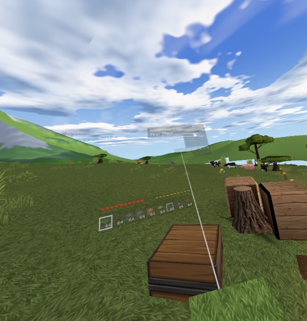

## 22:17:36 - Or is this... No, this is a little starting camp thing. Okay

- **Transcript:** Or is this... No, this is a little starting camp thing. Okay
- **Status:** open
- **Build:** 0.129 (6c3dfeea, M1-M4 (device-tested; ship riding, chests, comfort options, weapon wheel))
- **World:** New World (2) (seed 984459503243281715)
- **Dimension:** Surface
- **Biome:** Plains
- **Position:** 628.3 88.7 276.7
- **Facing:** east (yaw 93, pitch -33)
- **Held:** Grass Block x64
- **Mount:** on foot
- **Looking at:** nothing
- **Mode:** Survival, health 20/20, screen ChestMenu
- **Time:** day 1 07:38, clear
- **Fps:** 72
- **Levels:** mic -25 dBFS, game sound -28 dBFS
- **Length:** 4.8 s (voice 2.3 s)
- **Just before:** --292s closed PauseMenu; --293s opened InventoryMenu; --294s closed InventoryMenu; --295s holding Titanium Pickaxe; --295s message: Titanium Pickaxe; --297s took 3 damage (health 18/20); --298s holding empty hand; --299s holding Mahlwerk Rotary Gun; --299s message: Mahlwerk Rotary Gun; --303s message: Greywall Command now counts you hunted.; --304s took 2 damage (health 18/20); --305s opened PauseMenu; --317s closed PauseMenu; --320s died; --320s opened DeathMenu; --320s holding empty hand; --320s left the pack: Mahlwerk Rotary Gun (DeathMenu open); --320s left the pack: Titanium Pickaxe (DeathMenu open); --321s took 21 damage (health -1/20); --323s respawned; --323s closed DeathMenu; --323s message: Your things are 3679 blocks south-west; --324s walked into Jungle; --325s message: Entering Draisvaal; --326s opened PauseMenu; --331s closed PauseMenu; --332s opened PauseMenu; --333s message: Creative mode; --333s closed PauseMenu; --334s message: Flying; --334s walked into Sparse Jungle; --336s walked into Jungle; --339s opened PauseMenu; --341s closed PauseMenu; --342s opened PauseMenu; -10s closed PauseMenu; -10s holding Grass Block; -8s opened ChestMenu; -7s closed ChestMenu; -0s opened ChestMenu
- **Repro (Mac):** `./snap.sh note --seed 984459503243281715 --x 628.3 --z 276.7 --yaw -93 --pitch -33 --time 0.068`
- **Audio (this Mac):** /Users/darthvadar/Documents/Blocksmith/QuestVoiceNotes/raw/vn-20261022-221736-742.aac

## 22:17:41 - I didn't ask for that, but all right

- **Transcript:** I didn't ask for that, but all right
- **Status:** open
- **Build:** 0.129 (6c3dfeea, M1-M4 (device-tested; ship riding, chests, comfort options, weapon wheel))
- **World:** New World (2) (seed 984459503243281715)
- **Dimension:** Surface
- **Biome:** Plains
- **Position:** 645.7 87.9 286.6
- **Facing:** east (yaw 72, pitch -24)
- **Held:** Grass Block x64
- **Mount:** on foot
- **Looking at:** nothing
- **Mode:** Survival, health 20/20
- **Time:** day 1 07:43, clear
- **Fps:** 72
- **Levels:** mic -31 dBFS, game sound -24 dBFS
- **Length:** 2.4 s (voice 1.2 s)
- **Just before:** --290s closed InventoryMenu; --291s holding Titanium Pickaxe; --291s message: Titanium Pickaxe; --293s took 3 damage (health 18/20); --294s holding empty hand; --294s holding Mahlwerk Rotary Gun; --294s message: Mahlwerk Rotary Gun; --299s message: Greywall Command now counts you hunted.; --299s took 2 damage (health 18/20); --301s opened PauseMenu; --313s closed PauseMenu; --315s died; --315s opened DeathMenu; --315s holding empty hand; --316s left the pack: Mahlwerk Rotary Gun (DeathMenu open); --316s left the pack: Titanium Pickaxe (DeathMenu open); --316s took 21 damage (health -1/20); --318s respawned; --318s closed DeathMenu; --318s message: Your things are 3679 blocks south-west; --320s walked into Jungle; --320s message: Entering Draisvaal; --321s opened PauseMenu; --326s closed PauseMenu; --327s opened PauseMenu; --328s message: Creative mode; --329s closed PauseMenu; --330s message: Flying; --330s walked into Sparse Jungle; --332s walked into Jungle; --334s opened PauseMenu; --336s closed PauseMenu; --337s opened PauseMenu; -14s closed PauseMenu; -14s holding Grass Block; -13s opened ChestMenu; -12s closed ChestMenu; -5s opened ChestMenu; -4s closed ChestMenu; -2s message: The sky is clouding over: fog is coming
- **Repro (Mac):** `./snap.sh note --seed 984459503243281715 --x 645.7 --z 286.6 --yaw -72 --pitch -24 --time 0.072`
- **Audio (this Mac):** /Users/darthvadar/Documents/Blocksmith/QuestVoiceNotes/raw/vn-20261022-221741-222.aac

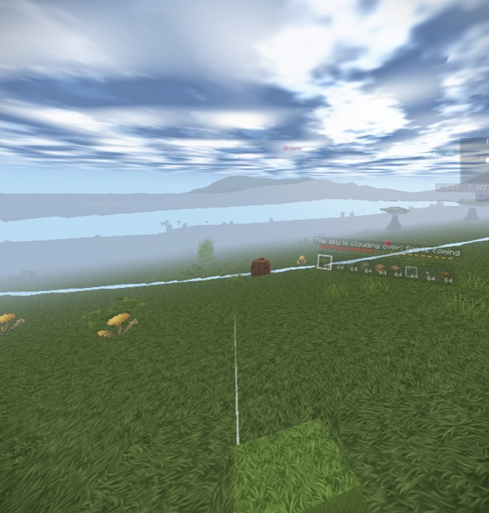

## 22:17:43 - Uh, I'm looking at a little hole in the-- little line in the ground he

- **Transcript:** Uh, I'm looking at a little hole in the-- little line in the ground here. Like, what the hell is
- **Status:** open
- **Build:** 0.129 (6c3dfeea, M1-M4 (device-tested; ship riding, chests, comfort options, weapon wheel))
- **World:** New World (2) (seed 984459503243281715)
- **Dimension:** Surface
- **Biome:** Plains
- **Position:** 657.4 84.8 283.5
- **Facing:** north (yaw 8, pitch -47)
- **Held:** Grass Block x64
- **Mount:** on foot
- **Looking at:** Short Grass at 657 85 282
- **Mode:** Survival, health 20/20
- **Time:** day 1 07:46, clear
- **Fps:** 72
- **Levels:** mic -30 dBFS, game sound -20 dBFS
- **Length:** 5.1 s (voice 3.4 s)
- **Just before:** --288s closed InventoryMenu; --289s holding Titanium Pickaxe; --289s message: Titanium Pickaxe; --290s took 3 damage (health 18/20); --292s holding empty hand; --292s holding Mahlwerk Rotary Gun; --292s message: Mahlwerk Rotary Gun; --296s message: Greywall Command now counts you hunted.; --297s took 2 damage (health 18/20); --298s opened PauseMenu; --311s closed PauseMenu; --313s died; --313s opened DeathMenu; --313s holding empty hand; --313s left the pack: Mahlwerk Rotary Gun (DeathMenu open); --313s left the pack: Titanium Pickaxe (DeathMenu open); --314s took 21 damage (health -1/20); --316s respawned; --316s closed DeathMenu; --316s message: Your things are 3679 blocks south-west; --318s walked into Jungle; --318s message: Entering Draisvaal; --319s opened PauseMenu; --324s closed PauseMenu; --325s opened PauseMenu; --326s message: Creative mode; --326s closed PauseMenu; --328s message: Flying; --328s walked into Sparse Jungle; --330s walked into Jungle; --332s opened PauseMenu; --334s closed PauseMenu; --335s opened PauseMenu; -17s closed PauseMenu; -17s holding Grass Block; -15s opened ChestMenu; -14s closed ChestMenu; -7s opened ChestMenu; -6s closed ChestMenu; -5s message: The sky is clouding over: fog is coming
- **Repro (Mac):** `./snap.sh note --seed 984459503243281715 --x 657.4 --z 283.5 --yaw -8 --pitch -47 --time 0.074`
- **Audio (this Mac):** /Users/darthvadar/Documents/Blocksmith/QuestVoiceNotes/raw/vn-20261022-221743-522.aac

## 22:17:49 - Okay, what the heck's with these lines? You see these lines here? What

- **Transcript:** Okay, what the heck's with these lines? You see these lines here? What's going on? That's not good
- **Status:** open
- **Build:** 0.129 (6c3dfeea, M1-M4 (device-tested; ship riding, chests, comfort options, weapon wheel))
- **World:** New World (2) (seed 984459503243281715)
- **Dimension:** Surface
- **Biome:** Plains
- **Position:** 662.3 84.3 284.8
- **Facing:** west (yaw 260, pitch -11)
- **Held:** Grass Block x64
- **Mount:** on foot
- **Looking at:** Short Grass at 659 85 285
- **Mode:** Survival, health 20/20
- **Time:** day 1 07:52, clear
- **Fps:** 72
- **Levels:** mic -28 dBFS, game sound -24 dBFS
- **Length:** 6.8 s (voice 4.1 s)
- **Just before:** --282s closed InventoryMenu; --283s holding Titanium Pickaxe; --283s message: Titanium Pickaxe; --285s took 3 damage (health 18/20); --286s holding empty hand; --287s holding Mahlwerk Rotary Gun; --287s message: Mahlwerk Rotary Gun; --291s message: Greywall Command now counts you hunted.; --292s took 2 damage (health 18/20); --293s opened PauseMenu; --305s closed PauseMenu; --308s died; --308s opened DeathMenu; --308s holding empty hand; --308s left the pack: Mahlwerk Rotary Gun (DeathMenu open); --308s left the pack: Titanium Pickaxe (DeathMenu open); --309s took 21 damage (health -1/20); --310s respawned; --310s closed DeathMenu; --310s message: Your things are 3679 blocks south-west; --312s walked into Jungle; --313s message: Entering Draisvaal; --313s opened PauseMenu; --319s closed PauseMenu; --319s opened PauseMenu; --321s message: Creative mode; --321s closed PauseMenu; --322s message: Flying; --322s walked into Sparse Jungle; --324s walked into Jungle; --326s opened PauseMenu; --329s closed PauseMenu; --329s opened PauseMenu; -22s closed PauseMenu; -22s holding Grass Block; -21s opened ChestMenu; -20s closed ChestMenu; -13s opened ChestMenu; -12s closed ChestMenu; -10s message: The sky is clouding over: fog is coming
- **While talking:** --277s closed InventoryMenu; --278s holding Titanium Pickaxe; --278s message: Titanium Pickaxe; --280s took 3 damage (health 18/20); --281s holding empty hand; --282s holding Mahlwerk Rotary Gun; --282s message: Mahlwerk Rotary Gun; --286s message: Greywall Command now counts you hunted.; --287s took 2 damage (health 18/20); --288s opened PauseMenu; --300s closed PauseMenu; --303s died; --303s opened DeathMenu; --303s holding empty hand; --303s left the pack: Mahlwerk Rotary Gun (DeathMenu open); --303s left the pack: Titanium Pickaxe (DeathMenu open); --304s took 21 damage (health -1/20); --305s respawned; --305s closed DeathMenu; --305s message: Your things are 3679 blocks south-west; --307s walked into Jungle; --308s message: Entering Draisvaal; --308s opened PauseMenu; --314s closed PauseMenu; --314s opened PauseMenu; --316s message: Creative mode; --316s closed PauseMenu; --317s message: Flying; --317s walked into Sparse Jungle; --319s walked into Jungle; --321s opened PauseMenu; --324s closed PauseMenu; --324s opened PauseMenu
- **Position at the end:** 655.2 83.6 266.3
- **Repro (Mac):** `./snap.sh note --seed 984459503243281715 --x 662.3 --z 284.8 --yaw 100 --pitch -11 --time 0.078`
- **Audio (this Mac):** /Users/darthvadar/Documents/Blocksmith/QuestVoiceNotes/raw/vn-20261022-221749-002.aac

## 22:17:55 - Cow's still shit. What the heck?

- **Transcript:** Cow's still shit. What the heck?
- **Status:** open
- **Build:** 0.129 (6c3dfeea, M1-M4 (device-tested; ship riding, chests, comfort options, weapon wheel))
- **World:** New World (2) (seed 984459503243281715)
- **Dimension:** Surface
- **Biome:** Plains
- **Position:** 658.3 84.1 254.4
- **Facing:** north (yaw 359, pitch -21)
- **Held:** Grass Block x64
- **Mount:** on foot
- **Looking at:** Oak Leaves at 658 83 248
- **Mode:** Survival, health 20/20
- **Time:** day 1 08:00, clear
- **Fps:** 72
- **Levels:** mic -26 dBFS, game sound -23 dBFS
- **Length:** 3.0 s (voice 1.4 s)
- **Just before:** --276s closed InventoryMenu; --277s holding Titanium Pickaxe; --277s message: Titanium Pickaxe; --278s took 3 damage (health 18/20); --280s holding empty hand; --280s holding Mahlwerk Rotary Gun; --280s message: Mahlwerk Rotary Gun; --284s message: Greywall Command now counts you hunted.; --285s took 2 damage (health 18/20); --286s opened PauseMenu; --299s closed PauseMenu; --301s died; --301s opened DeathMenu; --301s holding empty hand; --301s left the pack: Mahlwerk Rotary Gun (DeathMenu open); --301s left the pack: Titanium Pickaxe (DeathMenu open); --302s took 21 damage (health -1/20); --304s respawned; --304s closed DeathMenu; --304s message: Your things are 3679 blocks south-west; --306s walked into Jungle; --306s message: Entering Draisvaal; --307s opened PauseMenu; --312s closed PauseMenu; --313s opened PauseMenu; --314s message: Creative mode; --314s closed PauseMenu; --316s message: Flying; --316s walked into Sparse Jungle; --318s walked into Jungle; --320s opened PauseMenu; --322s closed PauseMenu; --323s opened PauseMenu; -29s closed PauseMenu; -29s holding Grass Block; -27s opened ChestMenu; -26s closed ChestMenu; -19s opened ChestMenu; -18s closed ChestMenu; -17s message: The sky is clouding over: fog is coming
- **Repro (Mac):** `./snap.sh note --seed 984459503243281715 --x 658.3 --z 254.4 --yaw 1 --pitch -21 --time 0.084`
- **Audio (this Mac):** /Users/darthvadar/Documents/Blocksmith/QuestVoiceNotes/raw/vn-20261022-221755-522.aac

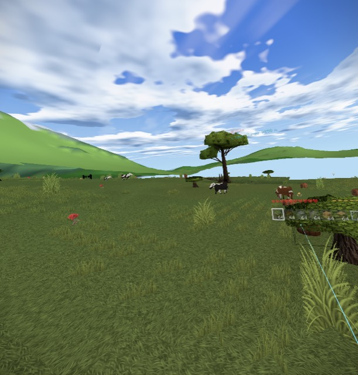

## 22:18:02 - Ouais, bon

- **Transcript:** Ouais, bon
- **Status:** open
- **Build:** 0.129 (6c3dfeea, M1-M4 (device-tested; ship riding, chests, comfort options, weapon wheel))
- **World:** New World (2) (seed 984459503243281715)
- **Dimension:** Surface
- **Biome:** Plains
- **Position:** 640.2 83.2 237.8
- **Facing:** west (yaw 286, pitch 4)
- **Held:** Grass Block x64
- **Mount:** on foot
- **Looking at:** nothing
- **Mode:** Creative, health 20/20, screen PauseMenu
- **Time:** day 1 08:07, clear
- **Fps:** 72
- **Levels:** mic -29 dBFS, game sound -25 dBFS
- **Length:** 2.3 s (voice 0.7 s)
- **Just before:** --270s message: Titanium Pickaxe; --272s took 3 damage (health 18/20); --273s holding empty hand; --274s holding Mahlwerk Rotary Gun; --274s message: Mahlwerk Rotary Gun; --278s message: Greywall Command now counts you hunted.; --279s took 2 damage (health 18/20); --280s opened PauseMenu; --292s closed PauseMenu; --295s died; --295s opened DeathMenu; --295s holding empty hand; --295s left the pack: Mahlwerk Rotary Gun (DeathMenu open); --295s left the pack: Titanium Pickaxe (DeathMenu open); --296s took 21 damage (health -1/20); --297s respawned; --297s closed DeathMenu; --297s message: Your things are 3679 blocks south-west; --299s walked into Jungle; --300s message: Entering Draisvaal; --300s opened PauseMenu; --306s closed PauseMenu; --306s opened PauseMenu; --308s message: Creative mode; --308s closed PauseMenu; --309s message: Flying; --309s walked into Sparse Jungle; --311s walked into Jungle; --313s opened PauseMenu; --316s closed PauseMenu; --316s opened PauseMenu; -26s opened ChestMenu; -25s closed ChestMenu; -23s message: The sky is clouding over: fog is coming; -1s opened PauseMenu; -0s message: Creative mode
- **Repro (Mac):** `./snap.sh note --seed 984459503243281715 --x 640.2 --z 237.8 --yaw 74 --pitch 4 --time 0.088`
- **Audio (this Mac):** /Users/darthvadar/Documents/Blocksmith/QuestVoiceNotes/raw/vn-20261022-221802-082.aac

## 22:18:06 - That is pretty cool. Ravine, yeah, ravines are nice

- **Transcript:** That is pretty cool. Ravine, yeah, ravines are nice
- **Status:** open
- **Build:** 0.129 (6c3dfeea, M1-M4 (device-tested; ship riding, chests, comfort options, weapon wheel))
- **World:** New World (2) (seed 984459503243281715)
- **Dimension:** Surface
- **Biome:** Plains
- **Position:** 640.4 63.4 209.4
- **Facing:** north-east (yaw 31, pitch -61)
- **Held:** Grass Block x64
- **Mount:** on foot, flying
- **Looking at:** nothing
- **Mode:** Creative, health 20/20
- **Time:** day 1 08:12, clear
- **Fps:** 72
- **Levels:** mic -38 dBFS, game sound -28 dBFS
- **Length:** 4.1 s (voice 2.3 s)
- **Just before:** --269s holding Mahlwerk Rotary Gun; --269s message: Mahlwerk Rotary Gun; --273s message: Greywall Command now counts you hunted.; --274s took 2 damage (health 18/20); --276s opened PauseMenu; --288s closed PauseMenu; --290s died; --290s opened DeathMenu; --290s holding empty hand; --291s left the pack: Mahlwerk Rotary Gun (DeathMenu open); --291s left the pack: Titanium Pickaxe (DeathMenu open); --291s took 21 damage (health -1/20); --293s respawned; --293s closed DeathMenu; --293s message: Your things are 3679 blocks south-west; --295s walked into Jungle; --295s message: Entering Draisvaal; --296s opened PauseMenu; --301s closed PauseMenu; --302s opened PauseMenu; --303s message: Creative mode; --303s closed PauseMenu; --305s message: Flying; --305s walked into Sparse Jungle; --307s walked into Jungle; --309s opened PauseMenu; --311s closed PauseMenu; --312s opened PauseMenu; -29s closed ChestMenu; -27s message: The sky is clouding over: fog is coming; -5s opened PauseMenu; -4s message: Creative mode; -4s closed PauseMenu; -3s message: Flying; -1s message: Walking
- **Repro (Mac):** `./snap.sh note --seed 984459503243281715 --x 640.4 --z 209.4 --yaw -31 --pitch -61 --time 0.092`
- **Audio (this Mac):** /Users/darthvadar/Documents/Blocksmith/QuestVoiceNotes/raw/vn-20261022-221806-342.aac

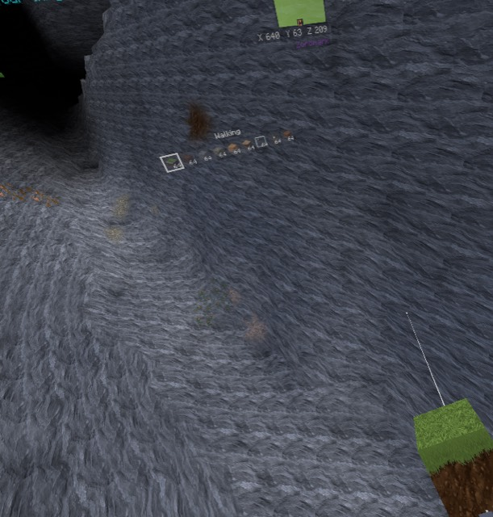

## 22:18:23 - All right, now it's taking, uh, quite a while to draw this in

- **Transcript:** All right, now it's taking, uh, quite a while to draw this in
- **Status:** open
- **Build:** 0.129 (6c3dfeea, M1-M4 (device-tested; ship riding, chests, comfort options, weapon wheel))
- **World:** New World (2) (seed 984459503243281715)
- **Dimension:** Surface
- **Biome:** Plains
- **Position:** 632.7 102.6 184.8
- **Facing:** south (yaw 190, pitch -46)
- **Held:** Grass Block x64
- **Mount:** on foot, flying
- **Looking at:** nothing
- **Mode:** Creative, health 20/20
- **Time:** day 1 08:32, clear
- **Fps:** 71
- **Levels:** mic -30 dBFS, game sound -16 dBFS
- **Length:** 4.3 s (voice 2.4 s)
- **Just before:** --271s closed PauseMenu; --274s died; --274s opened DeathMenu; --274s holding empty hand; --274s left the pack: Mahlwerk Rotary Gun (DeathMenu open); --274s left the pack: Titanium Pickaxe (DeathMenu open); --275s took 21 damage (health -1/20); --276s respawned; --276s closed DeathMenu; --276s message: Your things are 3679 blocks south-west; --278s walked into Jungle; --279s message: Entering Draisvaal; --279s opened PauseMenu; --285s closed PauseMenu; --285s opened PauseMenu; --287s message: Creative mode; --287s closed PauseMenu; --288s message: Flying; --288s walked into Sparse Jungle; --290s walked into Jungle; --292s opened PauseMenu; --295s closed PauseMenu; --295s opened PauseMenu; -22s opened PauseMenu; -21s message: Creative mode; -21s closed PauseMenu; -19s message: Flying; -18s message: Walking; -17s message: Flying; -15s message: Walking; -11s message: Flying; -9s message: Walking; -7s message: Flying
- **Repro (Mac):** `./snap.sh note --seed 984459503243281715 --x 632.7 --z 184.8 --yaw 170 --pitch -46 --time 0.106`
- **Audio (this Mac):** /Users/darthvadar/Documents/Blocksmith/QuestVoiceNotes/raw/vn-20261022-221823-262.aac

## 22:18:30 - I should go check out the lava, shouldn't I? That looks like... That l

- **Transcript:** I should go check out the lava, shouldn't I? That looks like... That looks new
- **Status:** open
- **Build:** 0.129 (6c3dfeea, M1-M4 (device-tested; ship riding, chests, comfort options, weapon wheel))
- **World:** New World (2) (seed 984459503243281715)
- **Dimension:** Surface
- **Biome:** Plains
- **Position:** 577.0 148.6 45.7
- **Facing:** south-east (yaw 127, pitch -70)
- **Held:** Grass Block x64
- **Mount:** on foot, flying
- **Looking at:** nothing
- **Mode:** Creative, health 20/20
- **Time:** day 1 08:39, clear
- **Fps:** 70
- **Levels:** mic -41 dBFS, game sound -23 dBFS
- **Length:** 4.7 s (voice 2.7 s)
- **Just before:** --265s closed PauseMenu; --267s died; --267s opened DeathMenu; --267s holding empty hand; --268s left the pack: Mahlwerk Rotary Gun (DeathMenu open); --268s left the pack: Titanium Pickaxe (DeathMenu open); --268s took 21 damage (health -1/20); --270s respawned; --270s closed DeathMenu; --270s message: Your things are 3679 blocks south-west; --272s walked into Jungle; --272s message: Entering Draisvaal; --273s opened PauseMenu; --278s closed PauseMenu; --279s opened PauseMenu; --280s message: Creative mode; --280s closed PauseMenu; --282s message: Flying; --282s walked into Sparse Jungle; --284s walked into Jungle; --286s opened PauseMenu; --288s closed PauseMenu; --289s opened PauseMenu; -28s opened PauseMenu; -27s message: Creative mode; -27s closed PauseMenu; -26s message: Flying; -24s message: Walking; -23s message: Flying; -22s message: Walking; -18s message: Flying; -15s message: Walking; -14s message: Flying
- **Repro (Mac):** `./snap.sh note --seed 984459503243281715 --x 577.0 --z 45.7 --yaw -127 --pitch -70 --time 0.111`
- **Audio (this Mac):** /Users/darthvadar/Documents/Blocksmith/QuestVoiceNotes/raw/vn-20261022-221830-562.aac

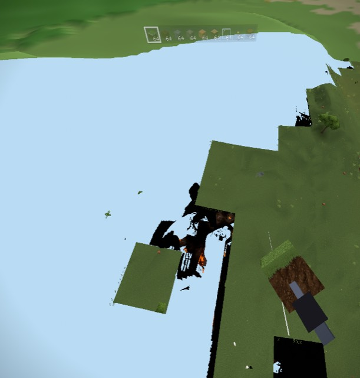

## 22:18:35 - Man, it's having a lot of trouble drawing in the environment here. Hol

- **Transcript:** Man, it's having a lot of trouble drawing in the environment here. Holy cow. Not sure what the problem is
- **Status:** open
- **Build:** 0.129 (6c3dfeea, M1-M4 (device-tested; ship riding, chests, comfort options, weapon wheel))
- **World:** New World (2) (seed 984459503243281715)
- **Dimension:** Surface
- **Biome:** Plains
- **Position:** 588.0 148.6 16.8
- **Facing:** south-east (yaw 144, pitch -45)
- **Held:** Grass Block x64
- **Mount:** on foot, flying
- **Looking at:** nothing
- **Mode:** Creative, health 20/20
- **Time:** day 1 08:45, clear
- **Fps:** 57
- **Levels:** mic -28 dBFS, game sound -19 dBFS
- **Length:** 6.0 s (voice 3.9 s)
- **Just before:** --260s closed PauseMenu; --263s died; --263s opened DeathMenu; --263s holding empty hand; --263s left the pack: Mahlwerk Rotary Gun (DeathMenu open); --263s left the pack: Titanium Pickaxe (DeathMenu open); --264s took 21 damage (health -1/20); --265s respawned; --265s closed DeathMenu; --265s message: Your things are 3679 blocks south-west; --267s walked into Jungle; --268s message: Entering Draisvaal; --269s opened PauseMenu; --274s closed PauseMenu; --274s opened PauseMenu; --276s message: Creative mode; --276s closed PauseMenu; --277s message: Flying; --277s walked into Sparse Jungle; --279s walked into Jungle; --281s opened PauseMenu; --284s closed PauseMenu; --284s opened PauseMenu; -29s message: Walking; -28s message: Flying; -26s message: Walking; -22s message: Flying; -20s message: Walking; -18s message: Flying
- **While talking:** --256s closed PauseMenu; --258s died; --258s opened DeathMenu; --258s holding empty hand; --259s left the pack: Mahlwerk Rotary Gun (DeathMenu open); --259s left the pack: Titanium Pickaxe (DeathMenu open); --259s took 21 damage (health -1/20); --261s respawned; --261s closed DeathMenu; --261s message: Your things are 3679 blocks south-west; --263s walked into Jungle; --263s message: Entering Draisvaal; --264s opened PauseMenu; --269s closed PauseMenu; --270s opened PauseMenu; --271s message: Creative mode; --271s closed PauseMenu; --273s message: Flying; --273s walked into Sparse Jungle; --275s walked into Jungle; --277s opened PauseMenu; --279s closed PauseMenu; --280s opened PauseMenu
- **Position at the end:** 675.7 148.6 91.0
- **Repro (Mac):** `./snap.sh note --seed 984459503243281715 --x 588.0 --z 16.8 --yaw -144 --pitch -45 --time 0.115`
- **Audio (this Mac):** /Users/darthvadar/Documents/Blocksmith/QuestVoiceNotes/raw/vn-20261022-221835-562.aac

## 22:18:41 - It is drawing slowly

- **Transcript:** It is drawing slowly
- **Status:** open
- **Build:** 0.129 (6c3dfeea, M1-M4 (device-tested; ship riding, chests, comfort options, weapon wheel))
- **World:** New World (2) (seed 984459503243281715)
- **Dimension:** Surface
- **Biome:** Plains
- **Position:** 679.5 148.6 82.7
- **Facing:** north (yaw 8, pitch -55)
- **Held:** Grass Block x64
- **Mount:** on foot, flying
- **Looking at:** nothing
- **Mode:** Creative, health 20/20
- **Time:** day 1 08:51, clear
- **Fps:** 61
- **Levels:** mic -28 dBFS, game sound -20 dBFS
- **Length:** 2.3 s (voice 1.2 s)
- **Just before:** --255s closed PauseMenu; --258s died; --258s opened DeathMenu; --258s holding empty hand; --258s left the pack: Mahlwerk Rotary Gun (DeathMenu open); --258s left the pack: Titanium Pickaxe (DeathMenu open); --259s took 21 damage (health -1/20); --260s respawned; --260s closed DeathMenu; --260s message: Your things are 3679 blocks south-west; --262s walked into Jungle; --263s message: Entering Draisvaal; --263s opened PauseMenu; --269s closed PauseMenu; --269s opened PauseMenu; --271s message: Creative mode; --271s closed PauseMenu; --272s message: Flying; --272s walked into Sparse Jungle; --274s walked into Jungle; --276s opened PauseMenu; --279s closed PauseMenu; --279s opened PauseMenu; -27s message: Flying; -25s message: Walking; -23s message: Flying
- **Repro (Mac):** `./snap.sh note --seed 984459503243281715 --x 679.5 --z 82.7 --yaw -8 --pitch -55 --time 0.119`
- **Audio (this Mac):** /Users/darthvadar/Documents/Blocksmith/QuestVoiceNotes/raw/vn-20261022-221841-282.aac

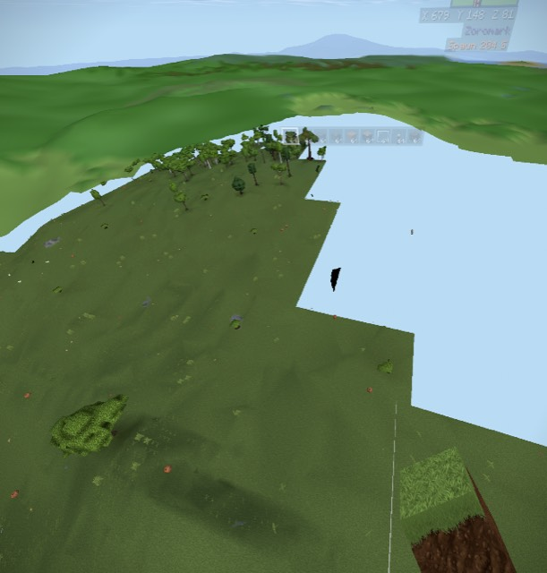

## 22:18:45 - What the fuck is this?

- **Transcript:** What the fuck is this?
- **Status:** open
- **Build:** 0.129 (6c3dfeea, M1-M4 (device-tested; ship riding, chests, comfort options, weapon wheel))
- **World:** New World (2) (seed 984459503243281715)
- **Dimension:** Surface
- **Biome:** Plains
- **Position:** 714.1 142.5 30.9
- **Facing:** north (yaw 16, pitch -85)
- **Held:** Grass Block x64
- **Mount:** on foot
- **Looking at:** nothing
- **Mode:** Creative, health 20/20
- **Time:** day 1 08:56, clear
- **Fps:** 71
- **Levels:** mic -43 dBFS, game sound -20 dBFS
- **Length:** 2.5 s (voice 0.8 s)
- **Just before:** --253s died; --253s opened DeathMenu; --253s holding empty hand; --254s left the pack: Mahlwerk Rotary Gun (DeathMenu open); --254s left the pack: Titanium Pickaxe (DeathMenu open); --254s took 21 damage (health -1/20); --256s respawned; --256s closed DeathMenu; --256s message: Your things are 3679 blocks south-west; --258s walked into Jungle; --258s message: Entering Draisvaal; --259s opened PauseMenu; --264s closed PauseMenu; --265s opened PauseMenu; --266s message: Creative mode; --266s closed PauseMenu; --268s message: Flying; --268s walked into Sparse Jungle; --270s walked into Jungle; --272s opened PauseMenu; --274s closed PauseMenu; --275s opened PauseMenu; -29s message: Walking; -28s message: Flying; -1s message: Walking
- **Repro (Mac):** `./snap.sh note --seed 984459503243281715 --x 714.1 --z 30.9 --yaw -16 --pitch -85 --time 0.123`
- **Audio (this Mac):** /Users/darthvadar/Documents/Blocksmith/QuestVoiceNotes/raw/vn-20261022-221845-602.aac

## 22:18:50 - Okay, sure. All right then

- **Transcript:** Okay, sure. All right then
- **Status:** open
- **Build:** 0.129 (6c3dfeea, M1-M4 (device-tested; ship riding, chests, comfort options, weapon wheel))
- **World:** New World (2) (seed 984459503243281715)
- **Dimension:** Surface
- **Biome:** Plains
- **Position:** 716.6 42.3 27.9
- **Facing:** north-west (yaw 329, pitch -32)
- **Held:** Grass Block x64
- **Mount:** on foot
- **Looking at:** Stone at 715 41 25
- **Mode:** Creative, health 20/20
- **Time:** day 1 09:01, clear
- **Fps:** 72
- **Levels:** mic -31 dBFS, game sound -18 dBFS
- **Length:** 3.8 s (voice 1.8 s)
- **Just before:** --249s holding empty hand; --249s left the pack: Mahlwerk Rotary Gun (DeathMenu open); --249s left the pack: Titanium Pickaxe (DeathMenu open); --250s took 21 damage (health -1/20); --252s respawned; --252s closed DeathMenu; --252s message: Your things are 3679 blocks south-west; --253s walked into Jungle; --254s message: Entering Draisvaal; --255s opened PauseMenu; --260s closed PauseMenu; --261s opened PauseMenu; --262s message: Creative mode; --262s closed PauseMenu; --263s message: Flying; --263s walked into Sparse Jungle; --265s walked into Jungle; --268s opened PauseMenu; --270s closed PauseMenu; --271s opened PauseMenu; -5s message: Walking; -3s message: Flying; -1s message: Walking
- **Repro (Mac):** `./snap.sh note --seed 984459503243281715 --x 716.6 --z 27.9 --yaw 31 --pitch -32 --time 0.126`
- **Audio (this Mac):** /Users/darthvadar/Documents/Blocksmith/QuestVoiceNotes/raw/vn-20261022-221850-062.aac

## 22:18:53 - Oh, very nice. Okay

- **Transcript:** Oh, very nice. Okay
- **Status:** open
- **Build:** 0.129 (6c3dfeea, M1-M4 (device-tested; ship riding, chests, comfort options, weapon wheel))
- **World:** New World (2) (seed 984459503243281715)
- **Dimension:** Surface
- **Biome:** Plains
- **Position:** 717.1 53.2 25.2
- **Facing:** north-west (yaw 319, pitch -49)
- **Held:** Grass Block x64
- **Mount:** on foot, flying
- **Looking at:** nothing
- **Mode:** Creative, health 20/20
- **Time:** day 1 09:06, clear
- **Fps:** 72
- **Levels:** mic -33 dBFS, game sound -17 dBFS
- **Length:** 2.7 s (voice 1.2 s)
- **Just before:** --246s left the pack: Mahlwerk Rotary Gun (DeathMenu open); --246s left the pack: Titanium Pickaxe (DeathMenu open); --246s took 21 damage (health -1/20); --248s respawned; --248s closed DeathMenu; --248s message: Your things are 3679 blocks south-west; --250s walked into Jungle; --250s message: Entering Draisvaal; --251s opened PauseMenu; --256s closed PauseMenu; --257s opened PauseMenu; --258s message: Creative mode; --258s closed PauseMenu; --260s message: Flying; --260s walked into Sparse Jungle; --262s walked into Jungle; --264s opened PauseMenu; --266s closed PauseMenu; --267s opened PauseMenu; -9s message: Walking; -6s message: Flying; -5s message: Walking; -1s message: Flying
- **Repro (Mac):** `./snap.sh note --seed 984459503243281715 --x 717.1 --z 25.2 --yaw 41 --pitch -49 --time 0.129`
- **Audio (this Mac):** /Users/darthvadar/Documents/Blocksmith/QuestVoiceNotes/raw/vn-20261022-221853-602.aac

## 22:18:59 - Yeah, this is not drawing very quick

- **Transcript:** Yeah, this is not drawing very quick
- **Status:** open
- **Build:** 0.129 (6c3dfeea, M1-M4 (device-tested; ship riding, chests, comfort options, weapon wheel))
- **World:** New World (2) (seed 984459503243281715)
- **Dimension:** Surface
- **Biome:** Plains
- **Position:** 743.6 98.3 -54.6
- **Facing:** north-east (yaw 46, pitch -28)
- **Held:** Grass Block x64
- **Mount:** on foot, flying
- **Looking at:** nothing
- **Mode:** Creative, health 20/20
- **Time:** day 1 09:12, clear
- **Fps:** 72
- **Levels:** mic -23 dBFS, game sound -21 dBFS
- **Length:** 2.8 s (voice 1.3 s)
- **Just before:** --240s left the pack: Mahlwerk Rotary Gun (DeathMenu open); --240s left the pack: Titanium Pickaxe (DeathMenu open); --241s took 21 damage (health -1/20); --242s respawned; --242s closed DeathMenu; --242s message: Your things are 3679 blocks south-west; --244s walked into Jungle; --245s message: Entering Draisvaal; --245s opened PauseMenu; --251s closed PauseMenu; --251s opened PauseMenu; --253s message: Creative mode; --253s closed PauseMenu; --254s message: Flying; --254s walked into Sparse Jungle; --256s walked into Jungle; --258s opened PauseMenu; --261s closed PauseMenu; --261s opened PauseMenu; -14s message: Walking; -12s message: Flying; -10s message: Walking; -7s message: Flying
- **Repro (Mac):** `./snap.sh note --seed 984459503243281715 --x 743.6 --z -54.6 --yaw -46 --pitch -28 --time 0.134`
- **Audio (this Mac):** /Users/darthvadar/Documents/Blocksmith/QuestVoiceNotes/raw/vn-20261022-221859-282.aac

## 22:19:03 - Yeah, it's having a tough time right now. I don't know why it is. It w

- **Transcript:** Yeah, it's having a tough time right now. I don't know why it is. It was doing so well before. Maybe it's 'cause the headset got all heated up and now it's having trouble
- **Status:** open
- **Build:** 0.129 (6c3dfeea, M1-M4 (device-tested; ship riding, chests, comfort options, weapon wheel))
- **World:** New World (2) (seed 984459503243281715)
- **Dimension:** Surface
- **Biome:** Plains
- **Position:** 717.8 98.4 -39.6
- **Facing:** west (yaw 255, pitch -34)
- **Held:** Grass Block x64
- **Mount:** on foot, flying
- **Looking at:** nothing
- **Mode:** Creative, health 20/20
- **Time:** day 1 09:16, clear
- **Fps:** 49
- **Levels:** mic -49 dBFS, game sound -18 dBFS
- **Length:** 8.4 s (voice 5.4 s)
- **Just before:** --237s left the pack: Mahlwerk Rotary Gun (DeathMenu open); --237s left the pack: Titanium Pickaxe (DeathMenu open); --238s took 21 damage (health -1/20); --240s respawned; --240s closed DeathMenu; --240s message: Your things are 3679 blocks south-west; --242s walked into Jungle; --242s message: Entering Draisvaal; --243s opened PauseMenu; --248s closed PauseMenu; --249s opened PauseMenu; --250s message: Creative mode; --250s closed PauseMenu; --252s message: Flying; --252s walked into Sparse Jungle; --254s walked into Jungle; --256s opened PauseMenu; --258s closed PauseMenu; --259s opened PauseMenu; -17s message: Walking; -14s message: Flying; -13s message: Walking; -10s message: Flying
- **While talking:** --233s left the pack: Mahlwerk Rotary Gun (DeathMenu open); --233s left the pack: Titanium Pickaxe (DeathMenu open); --233s took 21 damage (health -1/20); --235s respawned; --235s closed DeathMenu; --235s message: Your things are 3679 blocks south-west; --237s walked into Jungle; --237s message: Entering Draisvaal; --238s opened PauseMenu; --243s closed PauseMenu; --244s opened PauseMenu; --245s message: Creative mode; --246s closed PauseMenu; --247s message: Flying; --247s walked into Sparse Jungle; --249s walked into Jungle; --251s opened PauseMenu; --253s closed PauseMenu; --254s opened PauseMenu
- **Position at the end:** 584.4 131.6 15.2
- **Repro (Mac):** `./snap.sh note --seed 984459503243281715 --x 717.8 --z -39.6 --yaw 105 --pitch -34 --time 0.136`
- **Audio (this Mac):** /Users/darthvadar/Documents/Blocksmith/QuestVoiceNotes/raw/vn-20261022-221903-602.aac

## 22:19:13 - And survival should theoretically be able to load in time, I guess, if

- **Transcript:** And survival should theoretically be able to load in time, I guess, if I'm just walking around
- **Status:** open
- **Build:** 0.129 (6c3dfeea, M1-M4 (device-tested; ship riding, chests, comfort options, weapon wheel))
- **World:** New World (2) (seed 984459503243281715)
- **Dimension:** Surface
- **Biome:** Plains
- **Position:** 682.5 131.6 96.1
- **Facing:** south-east (yaw 156, pitch -44)
- **Held:** Grass Block x64
- **Mount:** on foot, flying
- **Looking at:** nothing
- **Mode:** Creative, health 20/20
- **Time:** day 1 09:25, clear
- **Fps:** 58
- **Levels:** mic -25 dBFS, game sound -13 dBFS
- **Length:** 5.8 s (voice 3.5 s)
- **Just before:** --229s left the pack: Mahlwerk Rotary Gun (DeathMenu open); --229s left the pack: Titanium Pickaxe (DeathMenu open); --230s took 21 damage (health -1/20); --232s respawned; --232s closed DeathMenu; --232s message: Your things are 3679 blocks south-west; --233s walked into Jungle; --234s message: Entering Draisvaal; --235s opened PauseMenu; --240s closed PauseMenu; --241s opened PauseMenu; --242s message: Creative mode; --242s closed PauseMenu; --244s message: Flying; --244s walked into Sparse Jungle; --246s walked into Jungle; --248s opened PauseMenu; --250s closed PauseMenu; --251s opened PauseMenu; -25s message: Walking; -22s message: Flying; -21s message: Walking; -18s message: Flying
- **While talking:** --225s left the pack: Mahlwerk Rotary Gun (DeathMenu open); --225s left the pack: Titanium Pickaxe (DeathMenu open); --225s took 21 damage (health -1/20); --227s respawned; --227s closed DeathMenu; --227s message: Your things are 3679 blocks south-west; --229s walked into Jungle; --229s message: Entering Draisvaal; --230s opened PauseMenu; --235s closed PauseMenu; --236s opened PauseMenu; --237s message: Creative mode; --238s closed PauseMenu; --239s message: Flying; --239s walked into Sparse Jungle; --241s walked into Jungle; --243s opened PauseMenu; --245s closed PauseMenu; --246s opened PauseMenu
- **Position at the end:** 617.1 131.6 254.6
- **Repro (Mac):** `./snap.sh note --seed 984459503243281715 --x 682.5 --z 96.1 --yaw -156 --pitch -44 --time 0.143`
- **Audio (this Mac):** /Users/darthvadar/Documents/Blocksmith/QuestVoiceNotes/raw/vn-20261022-221913-062.aac

## 22:19:19 - 'Cause yeah, this is not working very well

- **Transcript:** 'Cause yeah, this is not working very well
- **Status:** open
- **Build:** 0.129 (6c3dfeea, M1-M4 (device-tested; ship riding, chests, comfort options, weapon wheel))
- **World:** New World (2) (seed 984459503243281715)
- **Dimension:** Surface
- **Biome:** Plains
- **Position:** 554.5 135.5 296.3
- **Facing:** south-west (yaw 232, pitch -48)
- **Held:** Grass Block x64
- **Mount:** on foot, flying
- **Looking at:** nothing
- **Mode:** Creative, health 20/20
- **Time:** day 1 09:32, clear
- **Fps:** 66
- **Levels:** mic -35 dBFS, game sound -14 dBFS
- **Length:** 3.2 s (voice 1.6 s)
- **Just before:** --223s left the pack: Mahlwerk Rotary Gun (DeathMenu open); --223s left the pack: Titanium Pickaxe (DeathMenu open); --224s took 21 damage (health -1/20); --226s respawned; --226s closed DeathMenu; --226s message: Your things are 3679 blocks south-west; --228s walked into Jungle; --228s message: Entering Draisvaal; --229s opened PauseMenu; --234s closed PauseMenu; --235s opened PauseMenu; --236s message: Creative mode; --236s closed PauseMenu; --238s message: Flying; --238s walked into Sparse Jungle; --240s walked into Jungle; --242s opened PauseMenu; --244s closed PauseMenu; --245s opened PauseMenu; -28s message: Flying; -27s message: Walking; -24s message: Flying
- **Repro (Mac):** `./snap.sh note --seed 984459503243281715 --x 554.5 --z 296.3 --yaw 128 --pitch -48 --time 0.148`
- **Audio (this Mac):** /Users/darthvadar/Documents/Blocksmith/QuestVoiceNotes/raw/vn-20261022-221919-402.aac

## 22:19:22 - Yeah, active distance four. Yeah, I don't know what the issue is

- **Transcript:** Yeah, active distance four. Yeah, I don't know what the issue is
- **Status:** open
- **Build:** 0.129 (6c3dfeea, M1-M4 (device-tested; ship riding, chests, comfort options, weapon wheel))
- **World:** New World (2) (seed 984459503243281715)
- **Dimension:** Surface
- **Biome:** Plains
- **Position:** 526.7 154.5 305.5
- **Facing:** north-east (yaw 56, pitch -31)
- **Held:** Grass Block x64
- **Mount:** on foot, flying
- **Looking at:** nothing
- **Mode:** Creative, health 20/20
- **Time:** day 1 09:34, clear
- **Fps:** 66
- **Levels:** mic -29 dBFS, game sound -22 dBFS
- **Length:** 4.5 s (voice 2.3 s)
- **Just before:** --224s respawned; --224s closed DeathMenu; --224s message: Your things are 3679 blocks south-west; --226s walked into Jungle; --226s message: Entering Draisvaal; --227s opened PauseMenu; --232s closed PauseMenu; --233s opened PauseMenu; --234s message: Creative mode; --235s closed PauseMenu; --236s message: Flying; --236s walked into Sparse Jungle; --238s walked into Jungle; --240s opened PauseMenu; --242s closed PauseMenu; --243s opened PauseMenu; -30s message: Flying; -29s message: Walking; -25s message: Flying; -1s message: Entering Draenmoor; -1s opened PauseMenu; -0s closed PauseMenu
- **Repro (Mac):** `./snap.sh note --seed 984459503243281715 --x 526.7 --z 305.5 --yaw -56 --pitch -31 --time 0.149`
- **Audio (this Mac):** /Users/darthvadar/Documents/Blocksmith/QuestVoiceNotes/raw/vn-20261022-221922-402.aac

## 22:19:27 - It's kind of neat though. It's a nice long plane

- **Transcript:** It's kind of neat though. It's a nice long plane
- **Status:** open
- **Build:** 0.129 (6c3dfeea, M1-M4 (device-tested; ship riding, chests, comfort options, weapon wheel))
- **World:** New World (2) (seed 984459503243281715)
- **Dimension:** Surface
- **Biome:** Plains
- **Position:** 562.5 154.5 123.9
- **Facing:** east (yaw 104, pitch -29)
- **Held:** Grass Block x64
- **Mount:** on foot, flying
- **Looking at:** nothing
- **Mode:** Creative, health 20/20
- **Time:** day 1 09:36, clear
- **Fps:** 46
- **Levels:** mic -82 dBFS, game sound -24 dBFS
- **Length:** 3.4 s (voice 1.5 s)
- **Just before:** --222s closed DeathMenu; --222s message: Your things are 3679 blocks south-west; --224s walked into Jungle; --224s message: Entering Draisvaal; --225s opened PauseMenu; --230s closed PauseMenu; --231s opened PauseMenu; --232s message: Creative mode; --232s closed PauseMenu; --234s message: Flying; --234s walked into Sparse Jungle; --236s walked into Jungle; --238s opened PauseMenu; --240s closed PauseMenu; --241s opened PauseMenu; -28s message: Flying; -3s message: Entering Draenmoor; -3s opened PauseMenu; -2s closed PauseMenu; -0s message: Entering Zoromark
- **Repro (Mac):** `./snap.sh note --seed 984459503243281715 --x 562.5 --z 123.9 --yaw -104 --pitch -29 --time 0.151`
- **Audio (this Mac):** /Users/darthvadar/Documents/Blocksmith/QuestVoiceNotes/raw/vn-20261022-221927-062.aac

## 22:19:31 - Oh yeah, that level looks, I think it looks good. I'm not going down, 

- **Transcript:** Oh yeah, that level looks, I think it looks good. I'm not going down, it's not enough time, but
- **Status:** open
- **Build:** 0.129 (6c3dfeea, M1-M4 (device-tested; ship riding, chests, comfort options, weapon wheel))
- **World:** New World (2) (seed 984459503243281715)
- **Dimension:** Surface
- **Biome:** Forest
- **Position:** 604.0 154.5 -99.2
- **Facing:** south-east (yaw 130, pitch -58)
- **Held:** Grass Block x64
- **Mount:** on foot, flying
- **Looking at:** nothing
- **Mode:** Creative, health 20/20
- **Time:** day 1 09:40, clear
- **Fps:** 41
- **Levels:** mic -24 dBFS, game sound -20 dBFS
- **Length:** 5.7 s (voice 3.5 s)
- **Just before:** --219s closed DeathMenu; --219s message: Your things are 3679 blocks south-west; --221s walked into Jungle; --221s message: Entering Draisvaal; --222s opened PauseMenu; --227s closed PauseMenu; --228s opened PauseMenu; --229s message: Creative mode; --229s closed PauseMenu; --231s message: Flying; --231s walked into Sparse Jungle; --233s walked into Jungle; --235s opened PauseMenu; --237s closed PauseMenu; --238s opened PauseMenu; -6s message: Entering Draenmoor; -6s opened PauseMenu; -5s closed PauseMenu; -3s message: Entering Zoromark
- **While talking:** --216s message: Your things are 3679 blocks south-west; --218s walked into Jungle; --218s message: Entering Draisvaal; --219s opened PauseMenu; --224s closed PauseMenu; --225s opened PauseMenu; --226s message: Creative mode; --226s closed PauseMenu; --228s message: Flying; --228s walked into Sparse Jungle; --230s walked into Jungle; --232s opened PauseMenu; --234s closed PauseMenu; --235s opened PauseMenu; -1s message: Entering Hariheim
- **Position at the end:** 587.8 154.5 -316.9
- **Repro (Mac):** `./snap.sh note --seed 984459503243281715 --x 604.0 --z -99.2 --yaw -130 --pitch -58 --time 0.153`
- **Audio (this Mac):** /Users/darthvadar/Documents/Blocksmith/QuestVoiceNotes/raw/vn-20261022-221931-282.aac

## 22:19:36 - I feel like it looks good

- **Transcript:** I feel like it looks good
- **Status:** open
- **Build:** 0.129 (6c3dfeea, M1-M4 (device-tested; ship riding, chests, comfort options, weapon wheel))
- **World:** New World (2) (seed 984459503243281715)
- **Dimension:** Surface
- **Biome:** Forest
- **Position:** 592.2 154.5 -338.0
- **Facing:** south (yaw 175, pitch -41)
- **Held:** Grass Block x64
- **Mount:** on foot, flying
- **Looking at:** nothing
- **Mode:** Creative, health 20/20
- **Time:** day 1 09:44, clear
- **Fps:** 38
- **Levels:** mic -24 dBFS, game sound -19 dBFS
- **Length:** 2.1 s (voice 0.7 s)
- **Just before:** --216s message: Your things are 3679 blocks south-west; --217s walked into Jungle; --218s message: Entering Draisvaal; --219s opened PauseMenu; --224s closed PauseMenu; --225s opened PauseMenu; --226s message: Creative mode; --226s closed PauseMenu; --227s message: Flying; --227s walked into Sparse Jungle; --230s walked into Jungle; --232s opened PauseMenu; --234s closed PauseMenu; --235s opened PauseMenu; -9s message: Entering Draenmoor; -9s opened PauseMenu; -9s closed PauseMenu; -6s message: Entering Zoromark; -1s message: Entering Hariheim
- **Repro (Mac):** `./snap.sh note --seed 984459503243281715 --x 592.2 --z -338.0 --yaw -175 --pitch -41 --time 0.156`
- **Audio (this Mac):** /Users/darthvadar/Documents/Blocksmith/QuestVoiceNotes/raw/vn-20261022-221936-882.aac

## 22:19:40 - All right. The terrain is actually generating as I'm moving, which is 

- **Transcript:** All right. The terrain is actually generating as I'm moving, which is also what I like to see
- **Status:** open
- **Build:** 0.129 (6c3dfeea, M1-M4 (device-tested; ship riding, chests, comfort options, weapon wheel))
- **World:** New World (2) (seed 984459503243281715)
- **Dimension:** Surface
- **Biome:** Forest
- **Position:** 556.0 154.5 -471.8
- **Facing:** south (yaw 162, pitch -55)
- **Held:** Grass Block x64
- **Mount:** on foot, flying
- **Looking at:** nothing
- **Mode:** Creative, health 20/20
- **Time:** day 1 09:46, clear
- **Fps:** 47
- **Levels:** mic -34 dBFS, game sound -20 dBFS
- **Length:** 6.6 s (voice 3.7 s)
- **Just before:** --214s message: Your things are 3679 blocks south-west; --216s walked into Jungle; --216s message: Entering Draisvaal; --217s opened PauseMenu; --222s closed PauseMenu; --223s opened PauseMenu; --224s message: Creative mode; --224s closed PauseMenu; --226s message: Flying; --226s walked into Sparse Jungle; --228s walked into Jungle; --230s opened PauseMenu; --232s closed PauseMenu; --233s opened PauseMenu; -11s message: Entering Draenmoor; -11s opened PauseMenu; -10s closed PauseMenu; -8s message: Entering Zoromark; -3s message: Entering Hariheim
- **While talking:** --211s message: Your things are 3679 blocks south-west; --212s walked into Jungle; --213s message: Entering Draisvaal; --214s opened PauseMenu; --219s closed PauseMenu; --220s opened PauseMenu; --221s message: Creative mode; --221s closed PauseMenu; --222s message: Flying; --222s walked into Sparse Jungle; --224s walked into Jungle; --227s opened PauseMenu; --229s closed PauseMenu; --230s opened PauseMenu
- **Position at the end:** 553.2 154.5 -486.2
- **Repro (Mac):** `./snap.sh note --seed 984459503243281715 --x 556.0 --z -471.8 --yaw -162 --pitch -55 --time 0.157`
- **Audio (this Mac):** /Users/darthvadar/Documents/Blocksmith/QuestVoiceNotes/raw/vn-20261022-221940-162.aac

## 22:19:51 - Not bad. Not bad at all

- **Transcript:** Not bad. Not bad at all
- **Status:** open
- **Build:** 0.129 (6c3dfeea, M1-M4 (device-tested; ship riding, chests, comfort options, weapon wheel))
- **World:** New World (2) (seed 984459503243281715)
- **Dimension:** Surface
- **Biome:** Forest
- **Position:** 553.2 154.5 -434.3
- **Facing:** south-east (yaw 155, pitch -42)
- **Held:** Grass Block x64
- **Mount:** on foot, flying
- **Looking at:** nothing
- **Mode:** Creative, health 20/20
- **Time:** day 1 09:56, clear
- **Fps:** 66
- **Levels:** mic -68 dBFS, game sound -24 dBFS
- **Length:** 3.2 s (voice 1.1 s)
- **Just before:** --205s message: Your things are 3679 blocks south-west; --207s walked into Jungle; --208s message: Entering Draisvaal; --208s opened PauseMenu; --214s closed PauseMenu; --214s opened PauseMenu; --216s message: Creative mode; --216s closed PauseMenu; --217s message: Flying; --217s walked into Sparse Jungle; --219s walked into Jungle; --221s opened PauseMenu; --224s closed PauseMenu; --224s opened PauseMenu; -20s message: Entering Draenmoor; -20s opened PauseMenu; -19s closed PauseMenu; -17s message: Entering Zoromark; -12s message: Entering Hariheim
- **Repro (Mac):** `./snap.sh note --seed 984459503243281715 --x 553.2 --z -434.3 --yaw -155 --pitch -42 --time 0.164`
- **Audio (this Mac):** /Users/darthvadar/Documents/Blocksmith/QuestVoiceNotes/raw/vn-20261022-221951-582.aac

## 22:20:01 - What are these little red trees doing here anyway? What is this, mushr

- **Transcript:** What are these little red trees doing here anyway? What is this, mushroom? We can't have any mushroom shit, right?
- **Status:** open
- **Build:** 0.129 (6c3dfeea, M1-M4 (device-tested; ship riding, chests, comfort options, weapon wheel))
- **World:** New World (2) (seed 984459503243281715)
- **Dimension:** Surface
- **Biome:** Forest
- **Position:** 572.6 78.1 -549.0
- **Facing:** north-east (yaw 65, pitch -58)
- **Held:** Grass Block x64
- **Mount:** on foot
- **Looking at:** nothing
- **Mode:** Creative, health 20/20
- **Time:** day 1 10:07, clear
- **Fps:** 65
- **Levels:** mic -27 dBFS, game sound -28 dBFS
- **Length:** 6.7 s (voice 4.1 s)
- **Just before:** --199s opened PauseMenu; --204s closed PauseMenu; --205s opened PauseMenu; --206s message: Creative mode; --207s closed PauseMenu; --208s message: Flying; --208s walked into Sparse Jungle; --210s walked into Jungle; --212s opened PauseMenu; --214s closed PauseMenu; --215s opened PauseMenu; -29s message: Entering Draenmoor; -29s opened PauseMenu; -28s closed PauseMenu; -26s message: Entering Zoromark; -21s message: Entering Hariheim; -5s message: Walking; -3s message: Flying; -1s message: Walking
- **While talking:** --196s opened PauseMenu; --201s closed PauseMenu; --202s opened PauseMenu; --203s message: Creative mode; --203s closed PauseMenu; --204s message: Flying; --204s walked into Sparse Jungle; --206s walked into Jungle; --209s opened PauseMenu; --211s closed PauseMenu; --212s opened PauseMenu; -4s message: Walking
- **Position at the end:** 575.6 66.8 -552.8
- **Repro (Mac):** `./snap.sh note --seed 984459503243281715 --x 572.6 --z -549.0 --yaw -65 --pitch -58 --time 0.172`
- **Audio (this Mac):** /Users/darthvadar/Documents/Blocksmith/QuestVoiceNotes/raw/vn-20261022-222001-902.aac

## 22:20:13 - And Trisha Fawn

- **Transcript:** And Trisha Fawn
- **Status:** open
- **Build:** 0.129 (6c3dfeea, M1-M4 (device-tested; ship riding, chests, comfort options, weapon wheel))
- **World:** New World (2) (seed 984459503243281715)
- **Dimension:** Surface
- **Biome:** Forest
- **Position:** 575.9 66.8 -552.0
- **Facing:** north-east (yaw 45, pitch -1)
- **Held:** Grass Block x64
- **Mount:** on foot
- **Looking at:** Oak Log at 579 68 -556
- **Mode:** Creative, health 20/20
- **Time:** day 1 10:19, clear
- **Fps:** 62
- **Levels:** mic -37 dBFS, game sound -21 dBFS
- **Length:** 2.2 s (voice 0.7 s)
- **Just before:** --190s opened PauseMenu; --195s closed PauseMenu; --196s opened PauseMenu; --197s message: Creative mode; --197s closed PauseMenu; --198s message: Flying; --198s walked into Sparse Jungle; --200s walked into Jungle; --203s opened PauseMenu; --205s closed PauseMenu; --206s opened PauseMenu; -14s message: Walking; -12s message: Flying; -10s message: Walking
- **Repro (Mac):** `./snap.sh note --seed 984459503243281715 --x 575.9 --z -552.0 --yaw -45 --pitch -1 --time 0.180`
- **Audio (this Mac):** /Users/darthvadar/Documents/Blocksmith/QuestVoiceNotes/raw/vn-20261022-222013-722.aac

## 22:20:17 - Why is the type of tree changing based on

- **Transcript:** Why is the type of tree changing based on
- **Status:** open
- **Build:** 0.129 (6c3dfeea, M1-M4 (device-tested; ship riding, chests, comfort options, weapon wheel))
- **World:** New World (2) (seed 984459503243281715)
- **Dimension:** Surface
- **Biome:** Forest
- **Position:** 575.4 66.8 -555.7
- **Facing:** north (yaw 0, pitch 8)
- **Held:** Grass Block x64
- **Mount:** on foot
- **Looking at:** Oak Log at 575 68 -562
- **Mode:** Creative, health 20/20
- **Time:** day 1 10:23, clear
- **Fps:** 62
- **Levels:** mic -24 dBFS, game sound -24 dBFS
- **Length:** 3.8 s (voice 2.2 s)
- **Just before:** --186s opened PauseMenu; --191s closed PauseMenu; --192s opened PauseMenu; --193s message: Creative mode; --194s closed PauseMenu; --195s message: Flying; --195s walked into Sparse Jungle; --197s walked into Jungle; --199s opened PauseMenu; --202s closed PauseMenu; --202s opened PauseMenu; -18s message: Walking; -15s message: Flying; -14s message: Walking
- **Repro (Mac):** `./snap.sh note --seed 984459503243281715 --x 575.4 --z -555.7 --yaw -0 --pitch 8 --time 0.183`
- **Audio (this Mac):** /Users/darthvadar/Documents/Blocksmith/QuestVoiceNotes/raw/vn-20261022-222017-822.aac

## 22:20:21 - Okay, I see. Algorithmically, right? You algorithmically made the chun

- **Transcript:** Okay, I see. Algorithmically, right? You algorithmically made the chunks. Okay. I see how the trees are designed. I don't like it. The trees should have their own types, I guess. You can paste the same type over and over again, but there should be their different shapes of tree types that are not algorithmically generated, but are just all like, what the f- turning into three logs each. Like, look at this shit. Like, that is not realistic at all
- **Status:** open
- **Build:** 0.129 (6c3dfeea, M1-M4 (device-tested; ship riding, chests, comfort options, weapon wheel))
- **World:** New World (2) (seed 984459503243281715)
- **Dimension:** Surface
- **Biome:** Forest
- **Position:** 574.2 66.8 -557.2
- **Facing:** north (yaw 3, pitch -6)
- **Held:** Grass Block x64
- **Mount:** on foot
- **Looking at:** Oak Log at 574 68 -561
- **Mode:** Creative, health 20/20
- **Time:** day 1 10:27, clear
- **Fps:** 61
- **Levels:** mic -29 dBFS, game sound -24 dBFS
- **Length:** 27.3 s (voice 17.6 s)
- **Just before:** --183s opened PauseMenu; --188s closed PauseMenu; --189s opened PauseMenu; --190s message: Creative mode; --190s closed PauseMenu; --192s message: Flying; --192s walked into Sparse Jungle; --194s walked into Jungle; --196s opened PauseMenu; --198s closed PauseMenu; --199s opened PauseMenu; -21s message: Walking; -19s message: Flying; -17s message: Walking
- **While talking:** --179s opened PauseMenu; --184s closed PauseMenu; --185s opened PauseMenu; --186s message: Creative mode; --186s closed PauseMenu; --188s message: Flying; --188s walked into Sparse Jungle; --190s walked into Jungle; --192s opened PauseMenu; --194s closed PauseMenu; --195s opened PauseMenu; --174s opened PauseMenu; --179s closed PauseMenu; --180s opened PauseMenu; --181s message: Creative mode; --181s closed PauseMenu; --183s message: Flying; --183s walked into Sparse Jungle; --185s walked into Jungle; --187s opened PauseMenu; --189s closed PauseMenu; --190s opened PauseMenu; --169s opened PauseMenu; --174s closed PauseMenu; --175s opened PauseMenu; --176s message: Creative mode; --177s closed PauseMenu; --178s message: Flying; --178s walked into Sparse Jungle; --180s walked into Jungle; --182s opened PauseMenu; --184s closed PauseMenu; --185s opened PauseMenu; --164s opened PauseMenu; --169s closed PauseMenu; --170s opened PauseMenu; --171s message: Creative mode; --172s closed PauseMenu; --173s message: Flying; --173s walked into Sparse Jungle; --175s walked into Jungle; --177s opened PauseMenu; --179s closed PauseMenu; --180s opened PauseMenu; --159s opened PauseMenu; --164s closed PauseMenu; --165s opened PauseMenu; --166s message: Creative mode; --167s closed PauseMenu; --168s message: Flying; --168s walked into Sparse Jungle; --170s walked into Jungle; --172s opened PauseMenu; --174s closed PauseMenu; --175s opened PauseMenu
- **Position at the end:** 586.6 67.2 -624.1
- **Repro (Mac):** `./snap.sh note --seed 984459503243281715 --x 574.2 --z -557.2 --yaw -3 --pitch -6 --time 0.185`
- **Audio (this Mac):** /Users/darthvadar/Documents/Blocksmith/QuestVoiceNotes/raw/vn-20261022-222021-582.aac

## 22:20:52 - Otherwise, though, things look okay

- **Transcript:** Otherwise, though, things look okay
- **Status:** open
- **Build:** 0.129 (6c3dfeea, M1-M4 (device-tested; ship riding, chests, comfort options, weapon wheel))
- **World:** New World (2) (seed 984459503243281715)
- **Dimension:** Surface
- **Biome:** Taiga
- **Position:** 591.7 95.3 -657.7
- **Facing:** south-west (yaw 208, pitch -31)
- **Held:** Grass Block x64
- **Mount:** on foot, flying
- **Looking at:** nothing
- **Mode:** Creative, health 20/20
- **Time:** day 1 11:02, clear
- **Fps:** 72
- **Levels:** mic -24 dBFS, game sound -35 dBFS
- **Length:** 3.3 s (voice 1.6 s)
- **Just before:** --159s closed PauseMenu; --160s opened PauseMenu; --161s message: Creative mode; --161s closed PauseMenu; --163s message: Flying; --163s walked into Sparse Jungle; --165s walked into Jungle; --167s opened PauseMenu; --169s closed PauseMenu; --170s opened PauseMenu; -3s message: Flying
- **Repro (Mac):** `./snap.sh note --seed 984459503243281715 --x 591.7 --z -657.7 --yaw 152 --pitch -31 --time 0.210`
- **Audio (this Mac):** /Users/darthvadar/Documents/Blocksmith/QuestVoiceNotes/raw/vn-20261022-222052-381.aac

## 22:20:56 - Forest from above. Pretty, pretty fucking cool

- **Transcript:** Forest from above. Pretty, pretty fucking cool
- **Status:** open
- **Build:** 0.129 (6c3dfeea, M1-M4 (device-tested; ship riding, chests, comfort options, weapon wheel))
- **World:** New World (2) (seed 984459503243281715)
- **Dimension:** Surface
- **Biome:** Forest
- **Position:** 566.7 118.6 -471.9
- **Facing:** south (yaw 166, pitch -31)
- **Held:** Grass Block x64
- **Mount:** on foot, flying
- **Looking at:** nothing
- **Mode:** Creative, health 20/20
- **Time:** day 1 11:05, clear
- **Fps:** 60
- **Levels:** mic -23 dBFS, game sound -27 dBFS
- **Length:** 4.4 s (voice 1.6 s)
- **Just before:** --157s closed PauseMenu; --157s opened PauseMenu; --159s message: Creative mode; --159s closed PauseMenu; --160s message: Flying; --160s walked into Sparse Jungle; --162s walked into Jungle; --164s opened PauseMenu; --167s closed PauseMenu; --167s opened PauseMenu; -6s message: Flying
- **Repro (Mac):** `./snap.sh note --seed 984459503243281715 --x 566.7 --z -471.9 --yaw -166 --pitch -31 --time 0.212`
- **Audio (this Mac):** /Users/darthvadar/Documents/Blocksmith/QuestVoiceNotes/raw/vn-20261022-222056-222.aac

## 22:21:01 - You know, the cave openings, there's a little less numerous, which is 

- **Transcript:** You know, the cave openings, there's a little less numerous, which is what I like to see. Very good. I guess I will go down one, see what's going on here
- **Status:** open
- **Build:** 0.129 (6c3dfeea, M1-M4 (device-tested; ship riding, chests, comfort options, weapon wheel))
- **World:** New World (2) (seed 984459503243281715)
- **Dimension:** Surface
- **Biome:** Forest
- **Position:** 594.4 95.6 -321.8
- **Facing:** south-west (yaw 215, pitch -63)
- **Held:** Grass Block x64
- **Mount:** on foot
- **Looking at:** nothing
- **Mode:** Creative, health 20/20
- **Time:** day 1 11:11, clear
- **Fps:** 56
- **Levels:** mic -27 dBFS, game sound -45 dBFS
- **Length:** 8.9 s (voice 5.7 s)
- **Just before:** --154s closed PauseMenu; --155s message: Flying; --155s walked into Sparse Jungle; --157s walked into Jungle; --159s opened PauseMenu; --161s closed PauseMenu; --162s opened PauseMenu; -11s message: Flying; -4s message: Walking; -2s message: Flying; -1s message: Walking
- **While talking:** --149s closed PauseMenu; --150s message: Flying; --150s walked into Sparse Jungle; --152s walked into Jungle; --154s opened PauseMenu; --156s closed PauseMenu; --157s opened PauseMenu
- **Position at the end:** 577.8 47.9 -306.0
- **Repro (Mac):** `./snap.sh note --seed 984459503243281715 --x 594.4 --z -321.8 --yaw 145 --pitch -63 --time 0.216`
- **Audio (this Mac):** /Users/darthvadar/Documents/Blocksmith/QuestVoiceNotes/raw/vn-20261022-222101-642.aac

## 22:21:26 - I think it's always a player, yeah. Oh, this is actually not, not bad.

- **Transcript:** I think it's always a player, yeah. Oh, this is actually not, not bad. Really easy to dig down here. This is good. Better than before. Used to be really hard to dig down like that
- **Status:** open
- **Build:** 0.129 (6c3dfeea, M1-M4 (device-tested; ship riding, chests, comfort options, weapon wheel))
- **World:** New World (2) (seed 984459503243281715)
- **Dimension:** Surface
- **Biome:** Forest
- **Position:** 641.5 42.8 -313.5
- **Facing:** east (yaw 96, pitch -87)
- **Held:** Grass Block x64
- **Mount:** on foot
- **Looking at:** Air at 641 42 -314
- **Mode:** Creative, health 20/20
- **Time:** day 1 11:39, clear
- **Fps:** 62
- **Levels:** mic -44 dBFS, game sound -23 dBFS
- **Length:** 10.2 s (voice 6.0 s)
- **Just before:** --131s walked into Sparse Jungle; --133s walked into Jungle; --136s opened PauseMenu; --138s closed PauseMenu; --138s opened PauseMenu; -28s message: Walking; -26s message: Flying; -24s message: Walking; -7s message: Flying; -6s message: Walking
- **While talking:** --127s walked into Sparse Jungle; --129s walked into Jungle; --132s opened PauseMenu; --134s closed PauseMenu; --134s opened PauseMenu
- **Position at the end:** 641.4 29.8 -313.6
- **Repro (Mac):** `./snap.sh note --seed 984459503243281715 --x 641.5 --z -313.5 --yaw -96 --pitch -87 --time 0.236`
- **Audio (this Mac):** /Users/darthvadar/Documents/Blocksmith/QuestVoiceNotes/raw/vn-20261022-222126-642.aac

## 22:22:05 - Yeah, no, there's another little example. Where, where, where was it?

- **Transcript:** Yeah, no, there's another little example. Where, where, where was it?
- **Status:** open
- **Build:** 0.129 (6c3dfeea, M1-M4 (device-tested; ship riding, chests, comfort options, weapon wheel))
- **World:** New World (2) (seed 984459503243281715)
- **Dimension:** Surface
- **Biome:** Forest
- **Position:** 568.5 -16.1 -327.3
- **Facing:** north-east (yaw 41, pitch -59)
- **Held:** Grass Block x64
- **Mount:** on foot
- **Looking at:** Deeprock at 569 -17 -329
- **Mode:** Creative, health 20/20
- **Time:** day 1 12:23, clear
- **Fps:** 72
- **Levels:** mic -28 dBFS, game sound -16 dBFS
- **Length:** 4.6 s (voice 2.4 s)
- **Just before:** --95s walked into Sparse Jungle; --97s walked into Jungle; --99s opened PauseMenu; --101s closed PauseMenu; --102s opened PauseMenu
- **Repro (Mac):** `./snap.sh note --seed 984459503243281715 --x 568.5 --z -327.3 --yaw -41 --pitch -59 --time 0.266`
- **Audio (this Mac):** /Users/darthvadar/Documents/Blocksmith/QuestVoiceNotes/raw/vn-20261022-222205-523.aac

## 22:22:09 - Another example, a little crack in the ground

- **Transcript:** Another example, a little crack in the ground
- **Status:** open
- **Build:** 0.129 (6c3dfeea, M1-M4 (device-tested; ship riding, chests, comfort options, weapon wheel))
- **World:** New World (2) (seed 984459503243281715)
- **Dimension:** Surface
- **Biome:** Forest
- **Position:** 567.0 -17.6 -331.1
- **Facing:** north-east (yaw 44, pitch 47)
- **Held:** Grass Block x64
- **Mount:** on foot
- **Looking at:** Deeprock at 568 -15 -332
- **Mode:** Creative, health 20/20
- **Time:** day 1 12:28, clear
- **Fps:** 72
- **Levels:** mic -25 dBFS, game sound -16 dBFS
- **Length:** 3.0 s (voice 1.7 s)
- **Just before:** --91s walked into Sparse Jungle; --93s walked into Jungle; --95s opened PauseMenu; --97s closed PauseMenu; --98s opened PauseMenu
- **Repro (Mac):** `./snap.sh note --seed 984459503243281715 --x 567.0 --z -331.1 --yaw -44 --pitch 47 --time 0.270`
- **Audio (this Mac):** /Users/darthvadar/Documents/Blocksmith/QuestVoiceNotes/raw/vn-20261022-222209-842.aac

## 22:22:13 - I can see shit. Just makes it look unpolished

- **Transcript:** I can see shit. Just makes it look unpolished
- **Status:** open
- **Build:** 0.129 (6c3dfeea, M1-M4 (device-tested; ship riding, chests, comfort options, weapon wheel))
- **World:** New World (2) (seed 984459503243281715)
- **Dimension:** Surface
- **Biome:** Forest
- **Position:** 563.6 -21.8 -341.4
- **Facing:** north-east (yaw 49, pitch -64)
- **Held:** Grass Block x64
- **Mount:** on foot
- **Looking at:** Deeprock at 564 -24 -343
- **Mode:** Creative, health 20/20
- **Time:** day 1 12:32, clear
- **Fps:** 72
- **Levels:** mic -30 dBFS, game sound -9 dBFS
- **Length:** 3.4 s (voice 1.5 s)
- **Just before:** --87s walked into Sparse Jungle; --89s walked into Jungle; --92s opened PauseMenu; --94s closed PauseMenu; --95s opened PauseMenu
- **Repro (Mac):** `./snap.sh note --seed 984459503243281715 --x 563.6 --z -341.4 --yaw -49 --pitch -64 --time 0.272`
- **Audio (this Mac):** /Users/darthvadar/Documents/Blocksmith/QuestVoiceNotes/raw/vn-20261022-222213-262.aac

## 22:22:17 - Not what I like to see

- **Transcript:** Not what I like to see
- **Status:** open
- **Build:** 0.129 (6c3dfeea, M1-M4 (device-tested; ship riding, chests, comfort options, weapon wheel))
- **World:** New World (2) (seed 984459503243281715)
- **Dimension:** Surface
- **Biome:** Forest
- **Position:** 579.3 -34.7 -332.3
- **Facing:** south-east (yaw 125, pitch 20)
- **Held:** Grass Block x64
- **Mount:** on foot
- **Looking at:** Deeprock at 581 -33 -332
- **Mode:** Creative, health 20/20
- **Time:** day 1 12:36, clear
- **Fps:** 67
- **Levels:** mic -35 dBFS, game sound -16 dBFS
- **Length:** 2.6 s (voice 1.0 s)
- **Just before:** --84s walked into Sparse Jungle; --86s walked into Jungle; --89s opened PauseMenu; --91s closed PauseMenu; --92s opened PauseMenu
- **Repro (Mac):** `./snap.sh note --seed 984459503243281715 --x 579.3 --z -332.3 --yaw -125 --pitch 20 --time 0.275`
- **Audio (this Mac):** /Users/darthvadar/Documents/Blocksmith/QuestVoiceNotes/raw/vn-20261022-222217-422.aac

## 22:22:21 - Okay, I got to see lab over here, right?

- **Transcript:** Okay, I got to see lab over here, right?
- **Status:** open
- **Build:** 0.129 (6c3dfeea, M1-M4 (device-tested; ship riding, chests, comfort options, weapon wheel))
- **World:** New World (2) (seed 984459503243281715)
- **Dimension:** Surface
- **Biome:** Forest
- **Position:** 592.2 -40.8 -328.3
- **Facing:** north-east (yaw 28, pitch -39)
- **Held:** Grass Block x64
- **Mount:** on foot
- **Looking at:** Deeprock at 592 -41 -331
- **Mode:** Creative, health 20/20
- **Time:** day 1 12:40, clear
- **Fps:** 53
- **Levels:** mic -34 dBFS, game sound -14 dBFS
- **Length:** 3.5 s (voice 1.8 s)
- **Just before:** --80s walked into Sparse Jungle; --82s walked into Jungle; --85s opened PauseMenu; --87s closed PauseMenu; --87s opened PauseMenu
- **Repro (Mac):** `./snap.sh note --seed 984459503243281715 --x 592.2 --z -328.3 --yaw -28 --pitch -39 --time 0.278`
- **Audio (this Mac):** /Users/darthvadar/Documents/Blocksmith/QuestVoiceNotes/raw/vn-20261022-222221-842.aac

## 22:22:26 - Did I see? I see something. Yep

- **Transcript:** Did I see? I see something. Yep
- **Status:** open
- **Build:** 0.129 (6c3dfeea, M1-M4 (device-tested; ship riding, chests, comfort options, weapon wheel))
- **World:** New World (2) (seed 984459503243281715)
- **Dimension:** Surface
- **Biome:** Forest
- **Position:** 597.8 -38.9 -331.0
- **Facing:** north-east (yaw 58, pitch 63)
- **Held:** Grass Block x64
- **Mount:** on foot
- **Looking at:** Deeprock at 598 -36 -332
- **Mode:** Creative, health 20/20
- **Time:** day 1 12:46, clear
- **Fps:** 69
- **Levels:** mic -34 dBFS, game sound -17 dBFS
- **Length:** 3.3 s (voice 1.5 s)
- **Just before:** --76s walked into Sparse Jungle; --78s walked into Jungle; --80s opened PauseMenu; --83s closed PauseMenu; --83s opened PauseMenu
- **Repro (Mac):** `./snap.sh note --seed 984459503243281715 --x 597.8 --z -331.0 --yaw -58 --pitch 63 --time 0.282`
- **Audio (this Mac):** /Users/darthvadar/Documents/Blocksmith/QuestVoiceNotes/raw/vn-20261022-222226-242.aac

## 22:22:35 - Okay, see this looks be-- this looks really good, you know? Not bad at

- **Transcript:** Okay, see this looks be-- this looks really good, you know? Not bad at all. Not bad. Lava was... Yeah. This right here, we got lava and water crossing over. Something, something should happen there, turn into whatever you call it, obsidian or whatever the hell it is
- **Status:** open
- **Build:** 0.129 (6c3dfeea, M1-M4 (device-tested; ship riding, chests, comfort options, weapon wheel))
- **World:** New World (2) (seed 984459503243281715)
- **Dimension:** Surface
- **Biome:** Forest
- **Position:** 613.1 -38.3 -343.3
- **Facing:** south-east (yaw 128, pitch -14)
- **Held:** Grass Block x64
- **Mount:** on foot
- **Looking at:** Emberslate at 614 -38 -342
- **Mode:** Creative, health 20/20
- **Time:** day 1 12:55, clear
- **Fps:** 62
- **Levels:** mic -32 dBFS, game sound -4 dBFS
- **Length:** 16.5 s (voice 9.8 s)
- **Just before:** --68s walked into Sparse Jungle; --70s walked into Jungle; --72s opened PauseMenu; --75s closed PauseMenu; --75s opened PauseMenu
- **While talking:** --63s walked into Sparse Jungle; --65s walked into Jungle; --67s opened PauseMenu; --70s closed PauseMenu; --70s opened PauseMenu; --58s walked into Sparse Jungle; --60s walked into Jungle; --62s opened PauseMenu; --65s closed PauseMenu; --65s opened PauseMenu; --54s walked into Sparse Jungle; --56s walked into Jungle; --58s opened PauseMenu; --60s closed PauseMenu; --61s opened PauseMenu
- **Position at the end:** 604.8 -41.4 -353.2
- **Repro (Mac):** `./snap.sh note --seed 984459503243281715 --x 613.1 --z -343.3 --yaw -128 --pitch -14 --time 0.289`
- **Audio (this Mac):** /Users/darthvadar/Documents/Blocksmith/QuestVoiceNotes/raw/vn-20261022-222235-262.aac

## 22:23:00 - Yeah, I should be able to fit under stuff a little better. Oh, yeah, l

- **Transcript:** Yeah, I should be able to fit under stuff a little better. Oh, yeah, look at this lava. Hell yeah. [laughs] Love how the lava looks. This is wonderful. Yes. Oh, this looks terrific
- **Status:** open
- **Build:** 0.129 (6c3dfeea, M1-M4 (device-tested; ship riding, chests, comfort options, weapon wheel))
- **World:** New World (2) (seed 984459503243281715)
- **Dimension:** Surface
- **Biome:** Forest
- **Position:** 588.8 -50.4 -385.1
- **Facing:** north-west (yaw 329, pitch 56)
- **Held:** Grass Block x64
- **Mount:** on foot
- **Looking at:** Deeprock at 588 -48 -387
- **Mode:** Creative, health 20/20
- **Time:** day 1 13:20, clear
- **Fps:** 39
- **Levels:** mic -29 dBFS, game sound -16 dBFS
- **Length:** 12.4 s (voice 7.9 s)
- **Just before:** --47s walked into Sparse Jungle; --49s walked into Jungle; --51s opened PauseMenu; --54s closed PauseMenu; --54s opened PauseMenu
- **While talking:** --45s walked into Jungle; --48s opened PauseMenu; --50s closed PauseMenu; --51s opened PauseMenu; -1s message: Flying; --41s walked into Jungle; --44s opened PauseMenu; --46s closed PauseMenu; --47s opened PauseMenu
- **Position at the end:** 535.3 -48.6 -457.7
- **Repro (Mac):** `./snap.sh note --seed 984459503243281715 --x 588.8 --z -385.1 --yaw 31 --pitch 56 --time 0.306`
- **Audio (this Mac):** /Users/darthvadar/Documents/Blocksmith/QuestVoiceNotes/raw/vn-20261022-222300-522.aac

## 22:23:12 - Very good. Very well done, the lava. Another line right here. See that

- **Transcript:** Very good. Very well done, the lava. Another line right here. See that? That's bad. Don't want the big line there. Looks like the chunk's having trouble loading again. Like this, we're underground, this should be easy for it 'cause it shouldn't have to, uh
- **Status:** open
- **Build:** 0.129 (6c3dfeea, M1-M4 (device-tested; ship riding, chests, comfort options, weapon wheel))
- **World:** New World (2) (seed 984459503243281715)
- **Dimension:** Surface
- **Biome:** Forest
- **Position:** 531.4 -24.9 -492.4
- **Facing:** north-west (yaw 335, pitch 8)
- **Held:** Grass Block x64
- **Mount:** on foot, flying
- **Looking at:** nothing
- **Mode:** Creative, health 20/20
- **Time:** day 1 13:32, clear
- **Fps:** 56
- **Levels:** mic -23 dBFS, game sound -17 dBFS
- **Length:** 16.6 s (voice 10.7 s)
- **Just before:** --40s walked into Jungle; --42s opened PauseMenu; --44s closed PauseMenu; --45s opened PauseMenu; -7s message: Flying
- **While talking:** --35s walked into Jungle; --37s opened PauseMenu; --39s closed PauseMenu; --40s opened PauseMenu; --31s walked into Jungle; --33s opened PauseMenu; --35s closed PauseMenu; --36s opened PauseMenu; --28s opened PauseMenu; --30s closed PauseMenu; --31s opened PauseMenu; -2s message: Walking
- **Position at the end:** 486.2 5.8 -519.2
- **Repro (Mac):** `./snap.sh note --seed 984459503243281715 --x 531.4 --z -492.4 --yaw 25 --pitch 8 --time 0.314`
- **Audio (this Mac):** /Users/darthvadar/Documents/Blocksmith/QuestVoiceNotes/raw/vn-20261022-222312-742.aac

## 22:23:29 - You shouldn't have to generate anything beside the caves

- **Transcript:** You shouldn't have to generate anything beside the caves
- **Status:** open
- **Build:** 0.129 (6c3dfeea, M1-M4 (device-tested; ship riding, chests, comfort options, weapon wheel))
- **World:** New World (2) (seed 984459503243281715)
- **Dimension:** Surface
- **Biome:** Forest
- **Position:** 482.9 5.6 -521.0
- **Facing:** west (yaw 266, pitch -71)
- **Held:** Grass Block x64
- **Mount:** on foot
- **Looking at:** Deeprock at 482 4 -522
- **Mode:** Creative, health 20/20
- **Time:** day 1 13:50, clear
- **Fps:** 71
- **Levels:** mic -26 dBFS, game sound -17 dBFS
- **Length:** 3.5 s (voice 1.8 s)
- **Just before:** --26s opened PauseMenu; --29s closed PauseMenu; --29s opened PauseMenu; -23s message: Flying; -4s message: Walking
- **Repro (Mac):** `./snap.sh note --seed 984459503243281715 --x 482.9 --z -521.0 --yaw 94 --pitch -71 --time 0.327`
- **Audio (this Mac):** /Users/darthvadar/Documents/Blocksmith/QuestVoiceNotes/raw/vn-20261022-222329-462.aac

## 22:23:33 - Even that when you're in caves, like it should only be what you see

- **Transcript:** Even that when you're in caves, like it should only be what you see
- **Status:** open
- **Build:** 0.129 (6c3dfeea, M1-M4 (device-tested; ship riding, chests, comfort options, weapon wheel))
- **World:** New World (2) (seed 984459503243281715)
- **Dimension:** Surface
- **Biome:** Dark Forest
- **Position:** 474.1 11.7 -531.4
- **Facing:** west (yaw 283, pitch -33)
- **Held:** Grass Block x64
- **Mount:** on foot, flying
- **Looking at:** nothing
- **Mode:** Creative, health 20/20
- **Time:** day 1 13:55, clear
- **Fps:** 70
- **Levels:** mic -25 dBFS, game sound -18 dBFS
- **Length:** 3.8 s (voice 2.3 s)
- **Just before:** --24s closed PauseMenu; --25s opened PauseMenu; -27s message: Flying; -8s message: Walking; -3s message: Flying
- **Repro (Mac):** `./snap.sh note --seed 984459503243281715 --x 474.1 --z -531.4 --yaw 77 --pitch -33 --time 0.331`
- **Audio (this Mac):** /Users/darthvadar/Documents/Blocksmith/QuestVoiceNotes/raw/vn-20261022-222333-802.aac

## 22:23:40 - You know, another thing we could try is make it so only the stuff in y

- **Transcript:** You know, another thing we could try is make it so only the stuff in your field of view is generated, maybe
- **Status:** open
- **Build:** 0.129 (6c3dfeea, M1-M4 (device-tested; ship riding, chests, comfort options, weapon wheel))
- **World:** New World (2) (seed 984459503243281715)
- **Dimension:** Surface
- **Biome:** Swamp
- **Position:** 463.5 45.6 -543.1
- **Facing:** north-west (yaw 310, pitch -53)
- **Held:** Grass Block x64
- **Mount:** on foot, flying
- **Looking at:** nothing
- **Mode:** Creative, health 20/20
- **Time:** day 1 14:04, clear
- **Fps:** 72
- **Levels:** mic -22 dBFS, game sound -19 dBFS
- **Length:** 6.2 s (voice 4.0 s)
- **Just before:** --17s closed PauseMenu; --18s opened PauseMenu; -15s message: Walking; -10s message: Flying
- **While talking:** --13s closed PauseMenu; --14s opened PauseMenu
- **Position at the end:** 468.2 45.6 -542.6
- **Repro (Mac):** `./snap.sh note --seed 984459503243281715 --x 463.5 --z -543.1 --yaw 50 --pitch -53 --time 0.336`
- **Audio (this Mac):** /Users/darthvadar/Documents/Blocksmith/QuestVoiceNotes/raw/vn-20261022-222340-802.aac

## 22:23:49 - I don't know if that could... It would have to be, like, done immediat

- **Transcript:** I don't know if that could... It would have to be, like, done immediately. Like, there'd be no, like... It'd be annoying if it wasn't done immediately, but could be an option
- **Status:** open
- **Build:** 0.129 (6c3dfeea, M1-M4 (device-tested; ship riding, chests, comfort options, weapon wheel))
- **World:** New World (2) (seed 984459503243281715)
- **Dimension:** Surface
- **Biome:** Swamp
- **Position:** 463.8 37.3 -545.8
- **Facing:** north (yaw 10, pitch -58)
- **Held:** Grass Block x64
- **Mount:** on foot, flying
- **Looking at:** nothing
- **Mode:** Creative, health 20/20
- **Time:** day 1 14:12, clear
- **Fps:** 47
- **Levels:** mic -25 dBFS, game sound -18 dBFS
- **Length:** 9.7 s (voice 5.8 s)
- **Just before:** --11s opened PauseMenu; -22s message: Walking; -17s message: Flying; -1s message: Walking
- **While talking:** -4s message: Walking; -3s message: Flying; -1s message: Walking
- **Position at the end:** 499.5 38.7 -524.4
- **Repro (Mac):** `./snap.sh note --seed 984459503243281715 --x 463.8 --z -545.8 --yaw -10 --pitch -58 --time 0.342`
- **Audio (this Mac):** /Users/darthvadar/Documents/Blocksmith/QuestVoiceNotes/raw/vn-20261022-222349-262.aac

## 22:23:58 - But yeah, do whatever performance fixes you can and fix this weird stu

- **Transcript:** But yeah, do whatever performance fixes you can and fix this weird stuff where the freaking rest of the cave wouldn't generate because that should be just really easy for it. And then maybe make all the fixes there and then
- **Status:** open
- **Build:** 0.129 (6c3dfeea, M1-M4 (device-tested; ship riding, chests, comfort options, weapon wheel))
- **World:** New World (2) (seed 984459503243281715)
- **Dimension:** Surface
- **Biome:** Forest
- **Position:** 548.0 29.7 -514.7
- **Facing:** south (yaw 165, pitch -46)
- **Held:** Grass Block x64
- **Mount:** on foot
- **Looking at:** nothing
- **Mode:** Creative, health 20/20
- **Time:** day 1 14:18, clear
- **Fps:** 38
- **Levels:** mic -29 dBFS, game sound -34 dBFS
- **Length:** 12.6 s (voice 8.4 s)
- **Just before:** -27s message: Walking; -22s message: Flying; -7s message: Walking; -5s message: Flying; -4s message: Walking; -1s message: Flying
- **While talking:** -5s message: Flying; -2s message: Walking
- **Position at the end:** 486.5 39.4 -514.2
- **Repro (Mac):** `./snap.sh note --seed 984459503243281715 --x 548.0 --z -514.7 --yaw -165 --pitch -46 --time 0.347`
- **Audio (this Mac):** /Users/darthvadar/Documents/Blocksmith/QuestVoiceNotes/raw/vn-20261022-222358-942.aac

## 22:24:11 - Can't do anything more, then we'll make it so the render distance is l

- **Transcript:** Can't do anything more, then we'll make it so the render distance is less than twenty-four so it can kinda just catch its breath
- **Status:** open
- **Build:** 0.129 (6c3dfeea, M1-M4 (device-tested; ship riding, chests, comfort options, weapon wheel))
- **World:** New World (2) (seed 984459503243281715)
- **Dimension:** Surface
- **Biome:** Forest
- **Position:** 486.7 46.2 -513.6
- **Facing:** west (yaw 262, pitch 83)
- **Held:** Grass Block x64
- **Mount:** on foot, flying
- **Looking at:** Air at 486 48 -514
- **Mode:** Creative, health 20/20
- **Time:** day 1 14:29, clear
- **Fps:** 52
- **Levels:** mic -24 dBFS, game sound -31 dBFS
- **Length:** 7.9 s (voice 4.6 s)
- **Just before:** -16s message: Walking; -15s message: Flying; -13s message: Walking; -10s message: Flying; -8s message: Walking; -0s walked into Forest
- **While talking:** -5s walked into Forest
- **Position at the end:** 490.7 54.5 -514.5
- **Repro (Mac):** `./snap.sh note --seed 984459503243281715 --x 486.7 --z -513.6 --yaw 98 --pitch 83 --time 0.354`
- **Audio (this Mac):** /Users/darthvadar/Documents/Blocksmith/QuestVoiceNotes/raw/vn-20261022-222411-341.aac

## 22:24:24 - Man, those little mushroom trees have got to go because they don't exi

- **Transcript:** Man, those little mushroom trees have got to go because they don't exist in real life
- **Status:** open
- **Build:** 0.129 (6c3dfeea, M1-M4 (device-tested; ship riding, chests, comfort options, weapon wheel))
- **World:** New World (2) (seed 984459503243281715)
- **Dimension:** Surface
- **Biome:** Forest
- **Position:** 489.1 66.2 -523.7
- **Facing:** north (yaw 14, pitch -59)
- **Held:** Grass Block x64
- **Mount:** on foot, flying
- **Looking at:** Birch Log at 489 67 -525
- **Mode:** Creative, health 20/20
- **Time:** day 1 14:41, clear
- **Fps:** 48
- **Levels:** mic -29 dBFS, game sound -33 dBFS
- **Length:** 4.4 s (voice 2.6 s)
- **Just before:** -26s message: Walking; -25s message: Flying; -23s message: Walking; -20s message: Flying; -18s message: Walking; -10s walked into Forest
- **Repro (Mac):** `./snap.sh note --seed 984459503243281715 --x 489.1 --z -523.7 --yaw -14 --pitch -59 --time 0.362`
- **Audio (this Mac):** /Users/darthvadar/Documents/Blocksmith/QuestVoiceNotes/raw/vn-20261022-222424-202.aac

## 22:24:36 - [sighs] It's having trouble here, eh? I feel like... You know, the mar

- **Transcript:** [sighs] It's having trouble here, eh? I feel like... You know, the marshland. Okay, this water right here looks weird. Like, what is going on here? Especially where it should be flattening out. Like, how is it, like, above the
- **Status:** open
- **Build:** 0.129 (6c3dfeea, M1-M4 (device-tested; ship riding, chests, comfort options, weapon wheel))
- **World:** New World (2) (seed 984459503243281715)
- **Dimension:** Surface
- **Biome:** Ocean
- **Position:** 393.2 96.0 -807.3
- **Facing:** north-west (yaw 337, pitch -57)
- **Held:** Grass Block x64
- **Mount:** on foot, flying
- **Looking at:** nothing
- **Mode:** Creative, health 20/20
- **Time:** day 1 14:51, clear
- **Fps:** 48
- **Levels:** mic -29 dBFS, game sound -19 dBFS
- **Length:** 13.7 s (voice 8.7 s)
- **Just before:** -28s message: Flying; -25s message: Walking; -18s walked into Forest; -6s walked into Dark Forest; -4s message: Flying; -4s walked into Old Growth Pine Taiga; -2s walked into Taiga; -0s walked into Beach
- **While talking:** -0s message: Walking; -4s message: Flying; -0s walked into Taiga
- **Position at the end:** 365.8 65.2 -783.8
- **Repro (Mac):** `./snap.sh note --seed 984459503243281715 --x 393.2 --z -807.3 --yaw 23 --pitch -57 --time 0.369`
- **Audio (this Mac):** /Users/darthvadar/Documents/Blocksmith/QuestVoiceNotes/raw/vn-20261022-222436-142.aac

## 22:24:49 - Yeah, weird

- **Transcript:** Yeah, weird
- **Status:** open
- **Build:** 0.129 (6c3dfeea, M1-M4 (device-tested; ship riding, chests, comfort options, weapon wheel))
- **World:** New World (2) (seed 984459503243281715)
- **Dimension:** Surface
- **Biome:** Cold Ocean
- **Position:** 301.0 90.9 -874.1
- **Facing:** north-west (yaw 311, pitch -42)
- **Held:** Grass Block x64
- **Mount:** on foot, flying
- **Looking at:** nothing
- **Mode:** Creative, health 20/20
- **Time:** day 1 15:07, clear
- **Fps:** 69
- **Levels:** mic -27 dBFS, game sound -30 dBFS
- **Length:** 2.0 s (voice 0.7 s)
- **Just before:** -20s walked into Dark Forest; -18s message: Flying; -18s walked into Old Growth Pine Taiga; -16s walked into Taiga; -14s walked into Beach; -9s message: Walking; -7s message: Flying; -4s walked into Taiga; -2s walked into Beach
- **Repro (Mac):** `./snap.sh note --seed 984459503243281715 --x 301.0 --z -874.1 --yaw 49 --pitch -42 --time 0.380`
- **Audio (this Mac):** /Users/darthvadar/Documents/Blocksmith/QuestVoiceNotes/raw/vn-20261022-222449-882.aac

## 22:24:51 - Shouldn't be like that

- **Transcript:** Shouldn't be like that
- **Status:** open
- **Build:** 0.129 (6c3dfeea, M1-M4 (device-tested; ship riding, chests, comfort options, weapon wheel))
- **World:** New World (2) (seed 984459503243281715)
- **Dimension:** Surface
- **Biome:** Cold Ocean
- **Position:** 316.6 96.5 -894.4
- **Facing:** west (yaw 285, pitch -19)
- **Held:** Grass Block x64
- **Mount:** on foot, flying
- **Looking at:** nothing
- **Mode:** Creative, health 20/20
- **Time:** day 1 15:09, clear
- **Fps:** 69
- **Levels:** mic -37 dBFS, game sound -18 dBFS
- **Length:** 2.1 s (voice 0.7 s)
- **Just before:** -22s walked into Dark Forest; -20s message: Flying; -20s walked into Old Growth Pine Taiga; -18s walked into Taiga; -16s walked into Beach; -11s message: Walking; -9s message: Flying; -6s walked into Taiga; -4s walked into Beach; -2s walked into Cold Ocean
- **Repro (Mac):** `./snap.sh note --seed 984459503243281715 --x 316.6 --z -894.4 --yaw 75 --pitch -19 --time 0.382`
- **Audio (this Mac):** /Users/darthvadar/Documents/Blocksmith/QuestVoiceNotes/raw/vn-20261022-222451-902.aac

## 22:24:58 - This is, yeah, okay

- **Transcript:** This is, yeah, okay
- **Status:** open
- **Build:** 0.129 (6c3dfeea, M1-M4 (device-tested; ship riding, chests, comfort options, weapon wheel))
- **World:** New World (2) (seed 984459503243281715)
- **Dimension:** Surface
- **Biome:** Cold Ocean
- **Position:** -46.9 122.5 -1014.0
- **Facing:** north (yaw 357, pitch -47)
- **Held:** Grass Block x64
- **Mount:** on foot, flying
- **Looking at:** nothing
- **Mode:** Creative, health 20/20
- **Time:** day 1 15:18, clear
- **Fps:** 72
- **Levels:** mic -31 dBFS, game sound -18 dBFS
- **Length:** 2.8 s (voice 1.2 s)
- **Just before:** -29s walked into Dark Forest; -27s message: Flying; -27s walked into Old Growth Pine Taiga; -25s walked into Taiga; -23s walked into Beach; -18s message: Walking; -16s message: Flying; -12s walked into Taiga; -10s walked into Beach; -8s walked into Cold Ocean; -4s walked into Taiga; -3s message: Entering Zorimoor; -2s walked into Cold Ocean
- **Repro (Mac):** `./snap.sh note --seed 984459503243281715 --x -46.9 --z -1014.0 --yaw 3 --pitch -47 --time 0.388`
- **Audio (this Mac):** /Users/darthvadar/Documents/Blocksmith/QuestVoiceNotes/raw/vn-20261022-222458-802.aac

## 22:25:06 - All right. Well, that's enough for now. [smacks lips]

- **Transcript:** All right. Well, that's enough for now. [smacks lips]
- **Status:** open
- **Build:** 0.129 (6c3dfeea, M1-M4 (device-tested; ship riding, chests, comfort options, weapon wheel))
- **World:** New World (2) (seed 984459503243281715)
- **Dimension:** Surface
- **Biome:** Ocean
- **Position:** -161.6 122.5 -1085.8
- **Facing:** north (yaw 4, pitch -47)
- **Held:** Grass Block x64
- **Mount:** on foot, flying
- **Looking at:** nothing
- **Mode:** Creative, health 20/20
- **Time:** day 1 15:26, clear
- **Fps:** 66
- **Levels:** mic -27 dBFS, game sound -23 dBFS
- **Just before:** -30s walked into Beach; -25s message: Walking; -23s message: Flying; -20s walked into Taiga; -18s walked into Beach; -16s walked into Cold Ocean; -12s walked into Taiga; -10s message: Entering Zorimoor; -10s walked into Cold Ocean; -2s walked into Ocean
- **Repro (Mac):** `./snap.sh note --seed 984459503243281715 --x -161.6 --z -1085.8 --yaw -4 --pitch -47 --time 0.394`
- **Audio (this Mac):** /Users/darthvadar/Documents/Blocksmith/QuestVoiceNotes/raw/vn-20261022-222506-462.aac

