# Voice bug notes 2026-10-30 (Quest)

Spoken while playing; transcribed by elevenlabs/scribe-v2. Written by `tools/quest-bugnotes.py` (rewritten each run; edit Status lines in a copy). 291 notes.

## 14:53:05 - Well, I'm... Hmm

- **Transcript:** Well, I'm... Hmm
- **Status:** open
- **Build:** 0.129 (9d6cbeeb, M1-M4 (device-tested; ship riding, chests, comfort options, weapon wheel))
- **World:** New World (10) (seed 4256271160485884755)
- **Dimension:** Surface
- **Biome:** Taiga
- **Position:** -3318.3 66.0 -3324.6
- **Facing:** north-east (yaw 52, pitch -51)
- **Held:** Written Book x1
- **Mount:** on foot
- **Looking at:** nothing
- **Mode:** Survival, health 20/20, screen BookMenu
- **Time:** day 1 07:33, clear
- **Fps:** 63
- **Levels:** mic -33 dBFS, game sound -28 dBFS
- **Length:** 2.9 s (voice 0.6 s)
- **Just before:** -6s opened PauseMenu; -4s closed PauseMenu; -4s message: Playtest build: voice bug notes ON, your speech is saved (Options > Interface); -1s message: The Chancellor, over the loudspeakers: "Seal the bunker! Nobody opens the blast door in the command post!"; -0s holding Spruce Log; -0s holding Track Spares; -0s holding Aero Engine Spares; --2s holding Track Spares; --2s holding Spruce Log; --2s piloting Salvaged Fighter; --2s holding empty hand; --3s message: Walking; --4s message: Steering Salvaged Fighter; --33s stopped piloting Salvaged Fighter; --33s holding Spruce Log; --34s holding Track Spares; --34s message: Track Spares; --35s holding Aero Engine Spares; --35s message: Aero Engine Spares; --43s opened PauseMenu; -6s entered Surface; -6s closed PauseMenu; -6s holding Greywall Dispatch; -6s message: In Clear Ford's jail safe: a Greywall Dispatch; -5s message: In Clear Ford's jail safe: a Greywall Dispatch. Added to journal: Who Holds the Frontier; -3s holding empty hand; -2s holding Greywall Dispatch; -2s message: Spring: the snow melts and the young are born; -1s opened BookMenu; -1s holding Written Book; -1s message: Spring: the snow melts and the young are born. Added to journal: Greywall Dispatch; -1s took 3 damage (health 19/20)
- **Repro (Mac):** `./snap.sh note --seed 4256271160485884755 --x -3318.3 --z -3324.6 --yaw -52 --pitch -51 --time 0.065`
- **Audio (this Mac):** /Users/darthvadar/Documents/Blocksmith/QuestVoiceNotes/raw/vn-20261030-145305-680.aac

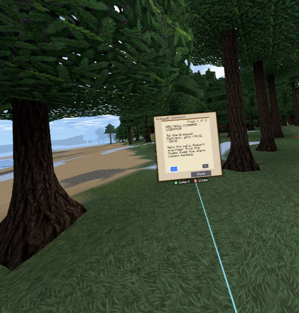

## 14:53:15 - Why am I unable to move so fast? Okay

- **Transcript:** Why am I unable to move so fast? Okay
- **Status:** open
- **Build:** 0.129 (9d6cbeeb, M1-M4 (device-tested; ship riding, chests, comfort options, weapon wheel))
- **World:** New World (10) (seed 4256271160485884755)
- **Dimension:** Surface
- **Biome:** Taiga
- **Position:** -3314.9 65.9 -3327.5
- **Facing:** south (yaw 171, pitch -30)
- **Held:** Written Book x1
- **Mount:** on foot
- **Looking at:** Grass Block at -3315 65 -3325
- **Mode:** Survival, health 20/20
- **Time:** day 1 07:42, clear
- **Fps:** 56
- **Levels:** mic -31 dBFS, game sound -16 dBFS
- **Length:** 4.0 s (voice 1.8 s)
- **Just before:** -14s opened PauseMenu; -12s closed PauseMenu; -12s message: Playtest build: voice bug notes ON, your speech is saved (Options > Interface); -9s message: The Chancellor, over the loudspeakers: "Seal the bunker! Nobody opens the blast door in the command post!"; -8s holding Spruce Log; -8s holding Track Spares; -8s holding Aero Engine Spares; -6s holding Track Spares; -6s holding Spruce Log; -6s piloting Salvaged Fighter; -6s holding empty hand; -5s message: Walking; -4s message: Steering Salvaged Fighter; --25s stopped piloting Salvaged Fighter; --25s holding Spruce Log; --26s holding Track Spares; --26s message: Track Spares; --27s holding Aero Engine Spares; --27s message: Aero Engine Spares; --35s opened PauseMenu; -14s entered Surface; -14s closed PauseMenu; -14s holding Greywall Dispatch; -14s message: In Clear Ford's jail safe: a Greywall Dispatch; -13s message: In Clear Ford's jail safe: a Greywall Dispatch. Added to journal: Who Holds the Frontier; -11s holding empty hand; -10s holding Greywall Dispatch; -10s message: Spring: the snow melts and the young are born; -9s opened BookMenu; -9s holding Written Book; -9s message: Spring: the snow melts and the young are born. Added to journal: Greywall Dispatch; -9s took 3 damage (health 19/20); -6s message: Greywall Garrison marked on the map; -5s closed BookMenu; -5s opened BookMenu; -4s closed BookMenu; -3s message: Greywall Dispatch: the Greywall Garrison, 481 m S, behind right. Marked on your map.; -3s opened ChestMenu; -2s closed ChestMenu
- **Repro (Mac):** `./snap.sh note --seed 4256271160485884755 --x -3314.9 --z -3327.5 --yaw -171 --pitch -30 --time 0.071`
- **Audio (this Mac):** /Users/darthvadar/Documents/Blocksmith/QuestVoiceNotes/raw/vn-20261030-145315-860.aac

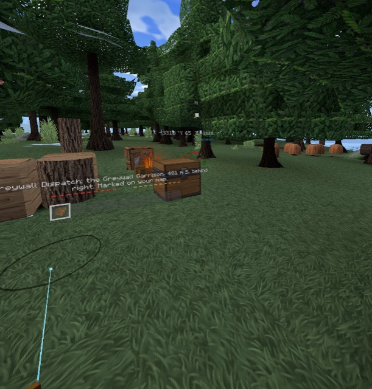

## 14:53:21 - Okay, these branches, they slow down my movement too much

- **Transcript:** Okay, these branches, they slow down my movement too much
- **Status:** open
- **Build:** 0.129 (9d6cbeeb, M1-M4 (device-tested; ship riding, chests, comfort options, weapon wheel))
- **World:** New World (10) (seed 4256271160485884755)
- **Dimension:** Surface
- **Biome:** Taiga
- **Position:** -3316.6 66.3 -3316.4
- **Facing:** north-west (yaw 310, pitch 28)
- **Held:** Written Book x1
- **Mount:** on foot
- **Looking at:** Spruce Leaves at -3319 68 -3318
- **Mode:** Survival, health 20/20
- **Time:** day 1 07:49, clear
- **Fps:** 67
- **Levels:** mic -28 dBFS, game sound -24 dBFS
- **Length:** 4.6 s (voice 2.5 s)
- **Just before:** -19s opened PauseMenu; -18s closed PauseMenu; -18s message: Playtest build: voice bug notes ON, your speech is saved (Options > Interface); -14s message: The Chancellor, over the loudspeakers: "Seal the bunker! Nobody opens the blast door in the command post!"; -14s holding Spruce Log; -14s holding Track Spares; -14s holding Aero Engine Spares; -12s holding Track Spares; -12s holding Spruce Log; -11s piloting Salvaged Fighter; -11s holding empty hand; -11s message: Walking; -9s message: Steering Salvaged Fighter; --20s stopped piloting Salvaged Fighter; --20s holding Spruce Log; --20s holding Track Spares; --20s message: Track Spares; --21s holding Aero Engine Spares; --21s message: Aero Engine Spares; --29s opened PauseMenu; -19s entered Surface; -19s closed PauseMenu; -19s holding Greywall Dispatch; -19s message: In Clear Ford's jail safe: a Greywall Dispatch; -19s message: In Clear Ford's jail safe: a Greywall Dispatch. Added to journal: Who Holds the Frontier; -17s holding empty hand; -16s holding Greywall Dispatch; -15s message: Spring: the snow melts and the young are born; -15s opened BookMenu; -15s holding Written Book; -15s message: Spring: the snow melts and the young are born. Added to journal: Greywall Dispatch; -15s took 3 damage (health 19/20); -11s message: Greywall Garrison marked on the map; -11s closed BookMenu; -10s opened BookMenu; -10s closed BookMenu; -9s message: Greywall Dispatch: the Greywall Garrison, 481 m S, behind right. Marked on your map.; -9s opened ChestMenu; -8s closed ChestMenu
- **Repro (Mac):** `./snap.sh note --seed 4256271160485884755 --x -3316.6 --z -3316.4 --yaw 50 --pitch 28 --time 0.076`
- **Audio (this Mac):** /Users/darthvadar/Documents/Blocksmith/QuestVoiceNotes/raw/vn-20261030-145321-600.aac

## 14:53:26 - There's annoying

- **Transcript:** There's annoying
- **Status:** open
- **Build:** 0.129 (9d6cbeeb, M1-M4 (device-tested; ship riding, chests, comfort options, weapon wheel))
- **World:** New World (10) (seed 4256271160485884755)
- **Dimension:** Surface
- **Biome:** Taiga
- **Position:** -3318.2 66.1 -3322.3
- **Facing:** north (yaw 359, pitch 76)
- **Held:** Written Book x1
- **Mount:** on foot
- **Looking at:** Spruce Leaves at -3319 67 -3323
- **Mode:** Survival, health 20/20
- **Time:** day 1 07:54, clear
- **Fps:** 70
- **Levels:** mic -36 dBFS, game sound -28 dBFS
- **Length:** 2.1 s (voice 0.7 s)
- **Just before:** -24s opened PauseMenu; -22s closed PauseMenu; -22s message: Playtest build: voice bug notes ON, your speech is saved (Options > Interface); -19s message: The Chancellor, over the loudspeakers: "Seal the bunker! Nobody opens the blast door in the command post!"; -18s holding Spruce Log; -18s holding Track Spares; -18s holding Aero Engine Spares; -16s holding Track Spares; -16s holding Spruce Log; -16s piloting Salvaged Fighter; -16s holding empty hand; -15s message: Walking; -14s message: Steering Salvaged Fighter; --15s stopped piloting Salvaged Fighter; --15s holding Spruce Log; --16s holding Track Spares; --16s message: Track Spares; --17s holding Aero Engine Spares; --17s message: Aero Engine Spares; --25s opened PauseMenu; -24s entered Surface; -24s closed PauseMenu; -24s holding Greywall Dispatch; -24s message: In Clear Ford's jail safe: a Greywall Dispatch; -23s message: In Clear Ford's jail safe: a Greywall Dispatch. Added to journal: Who Holds the Frontier; -21s holding empty hand; -20s holding Greywall Dispatch; -20s message: Spring: the snow melts and the young are born; -19s opened BookMenu; -19s holding Written Book; -19s message: Spring: the snow melts and the young are born. Added to journal: Greywall Dispatch; -19s took 3 damage (health 19/20); -16s message: Greywall Garrison marked on the map; -15s closed BookMenu; -15s opened BookMenu; -14s closed BookMenu; -13s message: Greywall Dispatch: the Greywall Garrison, 481 m S, behind right. Marked on your map.; -13s opened ChestMenu; -12s closed ChestMenu
- **Repro (Mac):** `./snap.sh note --seed 4256271160485884755 --x -3318.2 --z -3322.3 --yaw 1 --pitch 76 --time 0.080`
- **Audio (this Mac):** /Users/darthvadar/Documents/Blocksmith/QuestVoiceNotes/raw/vn-20261030-145326-300.aac

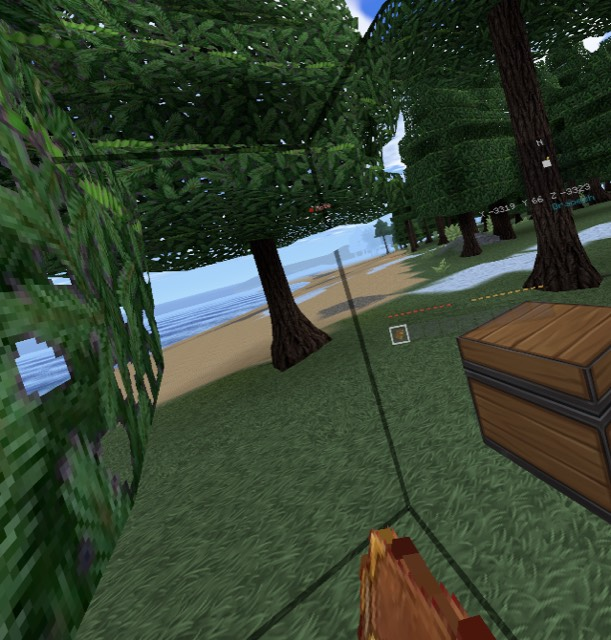

## 14:53:33 - I should be able to squeeze between them too

- **Transcript:** I should be able to squeeze between them too
- **Status:** open
- **Build:** 0.129 (9d6cbeeb, M1-M4 (device-tested; ship riding, chests, comfort options, weapon wheel))
- **World:** New World (10) (seed 4256271160485884755)
- **Dimension:** Surface
- **Biome:** Beach
- **Position:** -3300.5 80.5 -3382.5
- **Facing:** north-east (yaw 36, pitch -34)
- **Held:** Written Book x1
- **Mount:** on foot, flying
- **Looking at:** nothing
- **Mode:** Creative, health 20/20
- **Time:** day 1 07:59, clear
- **Fps:** 58
- **Levels:** mic -28 dBFS, game sound -21 dBFS
- **Length:** 3.2 s (voice 1.5 s)
- **Just before:** -24s holding Track Spares; -23s holding Aero Engine Spares; -22s holding Track Spares; -22s holding Spruce Log; -21s piloting Salvaged Fighter; -21s holding empty hand; -21s message: Walking; -19s message: Steering Salvaged Fighter; --10s stopped piloting Salvaged Fighter; --10s holding Spruce Log; --11s holding Track Spares; --11s message: Track Spares; --11s holding Aero Engine Spares; --11s message: Aero Engine Spares; --19s opened PauseMenu; -29s entered Surface; -29s closed PauseMenu; -29s holding Greywall Dispatch; -29s message: In Clear Ford's jail safe: a Greywall Dispatch; -28s message: In Clear Ford's jail safe: a Greywall Dispatch. Added to journal: Who Holds the Frontier; -26s holding empty hand; -25s holding Greywall Dispatch; -25s message: Spring: the snow melts and the young are born; -25s opened BookMenu; -25s holding Written Book; -25s message: Spring: the snow melts and the young are born. Added to journal: Greywall Dispatch; -24s took 3 damage (health 19/20); -21s message: Greywall Garrison marked on the map; -21s closed BookMenu; -20s opened BookMenu; -20s closed BookMenu; -19s message: Greywall Dispatch: the Greywall Garrison, 481 m S, behind right. Marked on your map.; -19s opened ChestMenu; -18s closed ChestMenu; -4s opened ChestMenu; -4s closed ChestMenu; -3s opened PauseMenu; -3s message: The sky is clouding over: fog is coming; -2s closed PauseMenu; -0s message: Creative mode
- **Repro (Mac):** `./snap.sh note --seed 4256271160485884755 --x -3300.5 --z -3382.5 --yaw -36 --pitch -34 --time 0.083`
- **Audio (this Mac):** /Users/darthvadar/Documents/Blocksmith/QuestVoiceNotes/raw/vn-20261030-145333-900.aac

## 14:53:40 - Uh, I see what you did

- **Transcript:** Uh, I see what you did
- **Status:** open
- **Build:** 0.129 (9d6cbeeb, M1-M4 (device-tested; ship riding, chests, comfort options, weapon wheel))
- **World:** New World (10) (seed 4256271160485884755)
- **Dimension:** Surface
- **Biome:** Plains
- **Position:** -3201.6 121.5 -3151.7
- **Facing:** south-east (yaw 130, pitch -24)
- **Held:** Written Book x1
- **Mount:** on foot, flying
- **Looking at:** nothing
- **Mode:** Creative, health 20/20
- **Time:** day 1 08:07, clear
- **Fps:** 65
- **Levels:** mic -27 dBFS, game sound -20 dBFS
- **Length:** 2.6 s (voice 1.1 s)
- **Just before:** -29s holding Aero Engine Spares; -28s holding Track Spares; -27s holding Spruce Log; -27s piloting Salvaged Fighter; -27s holding empty hand; -26s message: Walking; -25s message: Steering Salvaged Fighter; --4s stopped piloting Salvaged Fighter; --4s holding Spruce Log; --5s holding Track Spares; --5s message: Track Spares; --5s holding Aero Engine Spares; --5s message: Aero Engine Spares; --13s opened PauseMenu; -27s message: Greywall Garrison marked on the map; -27s closed BookMenu; -26s opened BookMenu; -26s closed BookMenu; -25s message: Greywall Dispatch: the Greywall Garrison, 481 m S, behind right. Marked on your map.; -25s opened ChestMenu; -24s closed ChestMenu; -10s opened ChestMenu; -10s closed ChestMenu; -9s opened PauseMenu; -9s message: The sky is clouding over: fog is coming; -8s closed PauseMenu; -6s message: Creative mode; -5s message: Flying
- **Repro (Mac):** `./snap.sh note --seed 4256271160485884755 --x -3201.6 --z -3151.7 --yaw -130 --pitch -24 --time 0.088`
- **Audio (this Mac):** /Users/darthvadar/Documents/Blocksmith/QuestVoiceNotes/raw/vn-20261030-145340-580.aac

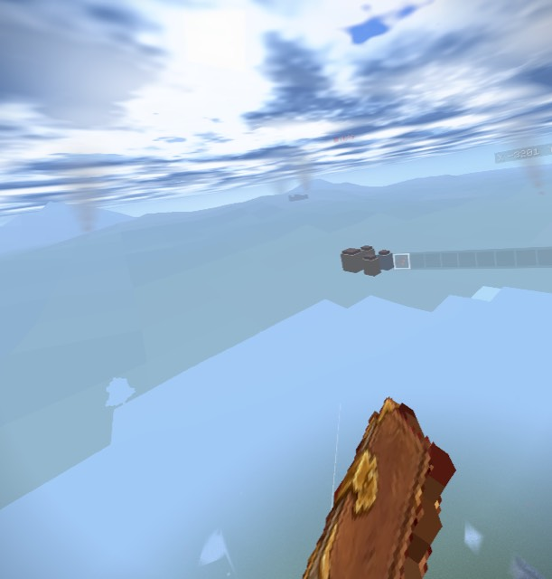

## 14:53:42 - Yeah, I don't like it. Um, let me find a better way to do compressions

- **Transcript:** Yeah, I don't like it. Um, let me find a better way to do compressions that don't involve
- **Status:** open
- **Build:** 0.129 (9d6cbeeb, M1-M4 (device-tested; ship riding, chests, comfort options, weapon wheel))
- **World:** New World (10) (seed 4256271160485884755)
- **Dimension:** Surface
- **Biome:** Plains
- **Position:** -3133.4 121.3 -3066.9
- **Facing:** south-east (yaw 123, pitch -45)
- **Held:** Written Book x1
- **Mount:** on foot
- **Looking at:** nothing
- **Mode:** Creative, health 20/20
- **Time:** day 1 08:09, clear
- **Fps:** 65
- **Levels:** mic -23 dBFS, game sound -19 dBFS
- **Length:** 7.6 s (voice 4.2 s)
- **Just before:** -30s holding Spruce Log; -30s piloting Salvaged Fighter; -30s holding empty hand; -29s message: Walking; -27s message: Steering Salvaged Fighter; --2s stopped piloting Salvaged Fighter; --2s holding Spruce Log; --2s holding Track Spares; --2s message: Track Spares; --3s holding Aero Engine Spares; --3s message: Aero Engine Spares; --11s opened PauseMenu; -29s message: Greywall Garrison marked on the map; -29s closed BookMenu; -28s opened BookMenu; -28s closed BookMenu; -27s message: Greywall Dispatch: the Greywall Garrison, 481 m S, behind right. Marked on your map.; -27s opened ChestMenu; -26s closed ChestMenu; -13s opened ChestMenu; -12s closed ChestMenu; -12s opened PauseMenu; -11s message: The sky is clouding over: fog is coming; -11s closed PauseMenu; -9s message: Creative mode; -7s message: Flying; -1s message: Rook Creek marked on the map
- **While talking:** -3s stopped piloting Salvaged Fighter; -3s holding Spruce Log; -3s holding Track Spares; -3s message: Track Spares; -2s holding Aero Engine Spares; -2s message: Aero Engine Spares; --6s opened PauseMenu; -4s message: Walking; -2s message: A stranger in town: Ezra Quill
- **Position at the end:** -3108.6 67.6 -3043.2
- **Repro (Mac):** `./snap.sh note --seed 4256271160485884755 --x -3133.4 --z -3066.9 --yaw -123 --pitch -45 --time 0.090`
- **Audio (this Mac):** /Users/darthvadar/Documents/Blocksmith/QuestVoiceNotes/raw/vn-20261030-145342-980.aac

## 14:53:51 - The fuck's going on?

- **Transcript:** The fuck's going on?
- **Status:** open
- **Build:** 0.129 (9d6cbeeb, M1-M4 (device-tested; ship riding, chests, comfort options, weapon wheel))
- **World:** New World (10) (seed 4256271160485884755)
- **Dimension:** Surface
- **Biome:** Plains
- **Position:** -3094.8 67.8 -3033.1
- **Facing:** south-east (yaw 132, pitch -30)
- **Held:** Written Book x1
- **Mount:** on foot
- **Looking at:** Coarse Dirt at -3094 67 -3032
- **Mode:** Creative, health 20/20
- **Time:** day 1 08:18, clear
- **Fps:** 65
- **Levels:** mic -53 dBFS, game sound -9 dBFS
- **Length:** 2.1 s (voice 0.7 s)
- **Just before:** -5s stopped piloting Salvaged Fighter; -5s holding Spruce Log; -5s holding Track Spares; -5s message: Track Spares; -4s holding Aero Engine Spares; -4s message: Aero Engine Spares; --4s opened PauseMenu; -20s opened ChestMenu; -19s closed ChestMenu; -19s opened PauseMenu; -18s message: The sky is clouding over: fog is coming; -18s closed PauseMenu; -16s message: Creative mode; -14s message: Flying; -8s message: Rook Creek marked on the map; -6s message: Walking; -4s message: A stranger in town: Ezra Quill
- **Repro (Mac):** `./snap.sh note --seed 4256271160485884755 --x -3094.8 --z -3033.1 --yaw -132 --pitch -30 --time 0.096`
- **Audio (this Mac):** /Users/darthvadar/Documents/Blocksmith/QuestVoiceNotes/raw/vn-20261030-145351-640.aac

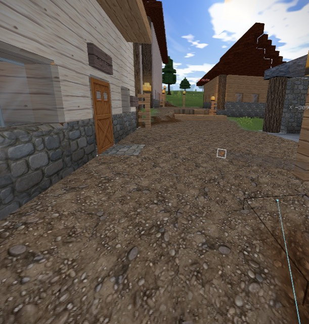

## 14:53:57 - The hell

- **Transcript:** The hell
- **Status:** open
- **Build:** 0.129 (9d6cbeeb, M1-M4 (device-tested; ship riding, chests, comfort options, weapon wheel))
- **World:** New World (10) (seed 4256271160485884755)
- **Dimension:** Surface
- **Biome:** Plains
- **Position:** -3083.2 67.9 -3023.5
- **Facing:** east (yaw 69, pitch -45)
- **Held:** Written Book x1
- **Mount:** on foot
- **Looking at:** Grass Block at -3082 67 -3024
- **Mode:** Creative, health 20/20
- **Time:** day 1 08:23, clear
- **Fps:** 40
- **Levels:** mic -37 dBFS, game sound -16 dBFS
- **Length:** 1.8 s (voice 0.4 s)
- **Just before:** -10s stopped piloting Salvaged Fighter; -10s holding Spruce Log; -9s holding Track Spares; -9s message: Track Spares; -8s holding Aero Engine Spares; -8s message: Aero Engine Spares; -1s opened PauseMenu; -24s opened ChestMenu; -24s closed ChestMenu; -23s opened PauseMenu; -23s message: The sky is clouding over: fog is coming; -22s closed PauseMenu; -20s message: Creative mode; -19s message: Flying; -12s message: Rook Creek marked on the map; -10s message: Walking; -9s message: A stranger in town: Ezra Quill; -4s message: Nathaniel Merriman: My neighbour's goat ate my washing.
- **Repro (Mac):** `./snap.sh note --seed 4256271160485884755 --x -3083.2 --z -3023.5 --yaw -69 --pitch -45 --time 0.100`
- **Audio (this Mac):** /Users/darthvadar/Documents/Blocksmith/QuestVoiceNotes/raw/vn-20261030-145357-020.aac

## 14:53:59 - Some sort of jittering problem going on

- **Transcript:** Some sort of jittering problem going on
- **Status:** open
- **Build:** 0.129 (9d6cbeeb, M1-M4 (device-tested; ship riding, chests, comfort options, weapon wheel))
- **World:** New World (10) (seed 4256271160485884755)
- **Dimension:** Surface
- **Biome:** Plains
- **Position:** -3084.5 68.0 -3030.2
- **Facing:** north-east (yaw 26, pitch -74)
- **Held:** Written Book x1
- **Mount:** on foot
- **Looking at:** Coarse Dirt at -3085 67 -3031
- **Mode:** Creative, health 20/20
- **Time:** day 1 08:25, clear
- **Fps:** 40
- **Levels:** mic -25 dBFS, game sound -20 dBFS
- **Length:** 3.5 s (voice 2.0 s)
- **Just before:** -11s stopped piloting Salvaged Fighter; -11s holding Spruce Log; -11s holding Track Spares; -11s message: Track Spares; -10s holding Aero Engine Spares; -10s message: Aero Engine Spares; -2s opened PauseMenu; -26s opened ChestMenu; -26s closed ChestMenu; -25s opened PauseMenu; -24s message: The sky is clouding over: fog is coming; -24s closed PauseMenu; -22s message: Creative mode; -20s message: Flying; -14s message: Rook Creek marked on the map; -12s message: Walking; -11s message: A stranger in town: Ezra Quill; -6s message: Nathaniel Merriman: My neighbour's goat ate my washing.
- **Repro (Mac):** `./snap.sh note --seed 4256271160485884755 --x -3084.5 --z -3030.2 --yaw -26 --pitch -74 --time 0.101`
- **Audio (this Mac):** /Users/darthvadar/Documents/Blocksmith/QuestVoiceNotes/raw/vn-20261030-145359-640.aac

## 14:54:03 - I'm walking along here, some sort of jittering problem

- **Transcript:** I'm walking along here, some sort of jittering problem
- **Status:** open
- **Build:** 0.129 (9d6cbeeb, M1-M4 (device-tested; ship riding, chests, comfort options, weapon wheel))
- **World:** New World (10) (seed 4256271160485884755)
- **Dimension:** Surface
- **Biome:** Plains
- **Position:** -3083.2 68.1 -3027.1
- **Facing:** north-west (yaw 331, pitch -59)
- **Held:** empty hand
- **Mount:** on foot
- **Looking at:** Coarse Dirt at -3084 67 -3029
- **Mode:** Creative, health 20/20
- **Time:** day 1 08:29, clear
- **Fps:** 60
- **Levels:** mic -29 dBFS, game sound -23 dBFS
- **Length:** 4.2 s (voice 2.5 s)
- **Just before:** -15s stopped piloting Salvaged Fighter; -15s holding Spruce Log; -14s holding Track Spares; -14s message: Track Spares; -13s holding Aero Engine Spares; -13s message: Aero Engine Spares; -6s opened PauseMenu; -29s opened ChestMenu; -29s closed ChestMenu; -28s opened PauseMenu; -28s message: The sky is clouding over: fog is coming; -27s closed PauseMenu; -25s message: Creative mode; -24s message: Flying; -17s message: Rook Creek marked on the map; -15s message: Walking; -14s message: A stranger in town: Ezra Quill; -9s message: Nathaniel Merriman: My neighbour's goat ate my washing.; -2s holding empty hand
- **Repro (Mac):** `./snap.sh note --seed 4256271160485884755 --x -3083.2 --z -3027.1 --yaw 29 --pitch -59 --time 0.104`
- **Audio (this Mac):** /Users/darthvadar/Documents/Blocksmith/QuestVoiceNotes/raw/vn-20261030-145403-240.aac

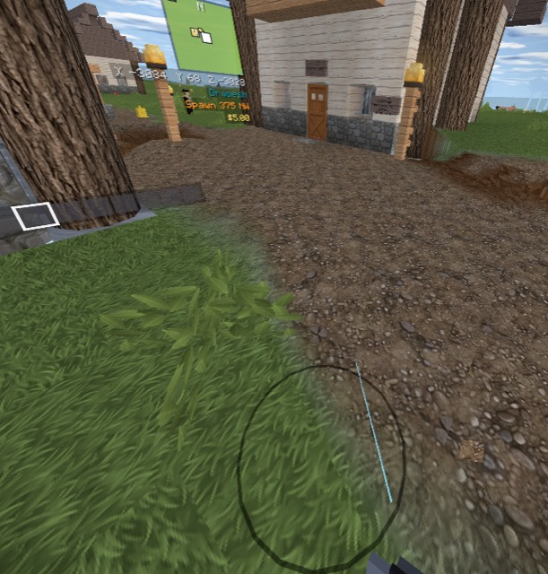

## 14:54:24 - Something's wrong

- **Transcript:** Something's wrong
- **Status:** open
- **Build:** 0.129 (9d6cbeeb, M1-M4 (device-tested; ship riding, chests, comfort options, weapon wheel))
- **World:** New World (10) (seed 4256271160485884755)
- **Dimension:** Surface
- **Biome:** Beach
- **Position:** -3351.1 85.9 -2895.7
- **Facing:** west (yaw 251, pitch -12)
- **Held:** empty hand
- **Mount:** on foot, flying
- **Looking at:** nothing
- **Mode:** Creative, health 20/20
- **Time:** day 1 08:50, clear
- **Fps:** 57
- **Levels:** mic -36 dBFS, game sound -26 dBFS
- **Length:** 2.5 s (voice 1.1 s)
- **Just before:** -26s message: Nathaniel Merriman: My neighbour's goat ate my washing.; -19s holding empty hand; -13s left the pack: Mahlwerk Rotary Gun (at -3095 67 -3035); -13s left the pack: Rocket x4 (at -3095 67 -3035); -13s left the pack: Titanium Pickaxe (at -3095 67 -3035); -13s left the pack: Duskium Chestplate (at -3095 67 -3035); -13s left the pack: Track Spares x16 (at -3095 67 -3035); -13s left the pack: Falke Pistol x2 (at -3095 67 -3035); -13s left the pack: Field Journal of an Ashguard Rifleman (at -3095 67 -3035); -13s left the pack: Donnerkeil Service Rifle x3 (at -3095 67 -3035); -13s left the pack: Aero Engine Spares x18 (at -3095 67 -3035); -13s left the pack: Jetpack x2 (at -3095 67 -3035); -13s left the pack: Faustrohr Warhead x3 (at -3095 67 -3035); -13s left the pack: Greywall Dispatch (at -3095 67 -3035); -13s left the pack: Regular Armour Set (at -3095 67 -3035); -13s left the pack: Fernblick Rifle (at -3095 67 -3035); -13s left the pack: Himmelsturm Launcher (at -3095 67 -3035); -13s left the pack: Faustrohr (at -3095 67 -3035); -13s into the pack: Written Book; -12s walked into Plains; -11s message: Elias Thorne: Coffee in the office tastes like gun oil. Still drink it.; -3s message: Flying; -0s walked into Beach
- **Repro (Mac):** `./snap.sh note --seed 4256271160485884755 --x -3351.1 --z -2895.7 --yaw 109 --pitch -12 --time 0.118`
- **Audio (this Mac):** /Users/darthvadar/Documents/Blocksmith/QuestVoiceNotes/raw/vn-20261030-145424-160.aac

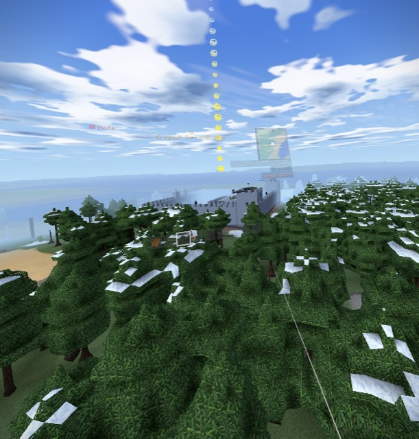

## 14:54:27 - S- I don't know if something's wrong. Getting like double vision jitte

- **Transcript:** S- I don't know if something's wrong. Getting like double vision jitteriness when I'm moving around
- **Status:** open
- **Build:** 0.129 (9d6cbeeb, M1-M4 (device-tested; ship riding, chests, comfort options, weapon wheel))
- **World:** New World (10) (seed 4256271160485884755)
- **Dimension:** Surface
- **Biome:** Taiga
- **Position:** -3416.1 91.9 -2799.5
- **Facing:** north-west (yaw 318, pitch -15)
- **Held:** empty hand
- **Mount:** on foot, flying
- **Looking at:** nothing
- **Mode:** Creative, health 20/20
- **Time:** day 1 08:53, clear
- **Fps:** 58
- **Levels:** mic -22 dBFS, game sound -22 dBFS
- **Length:** 9.4 s (voice 4.8 s)
- **Just before:** -29s message: Nathaniel Merriman: My neighbour's goat ate my washing.; -22s holding empty hand; -15s left the pack: Mahlwerk Rotary Gun (at -3095 67 -3035); -15s left the pack: Rocket x4 (at -3095 67 -3035); -15s left the pack: Titanium Pickaxe (at -3095 67 -3035); -15s left the pack: Duskium Chestplate (at -3095 67 -3035); -15s left the pack: Track Spares x16 (at -3095 67 -3035); -15s left the pack: Falke Pistol x2 (at -3095 67 -3035); -15s left the pack: Field Journal of an Ashguard Rifleman (at -3095 67 -3035); -15s left the pack: Donnerkeil Service Rifle x3 (at -3095 67 -3035); -15s left the pack: Aero Engine Spares x18 (at -3095 67 -3035); -15s left the pack: Jetpack x2 (at -3095 67 -3035); -15s left the pack: Faustrohr Warhead x3 (at -3095 67 -3035); -15s left the pack: Greywall Dispatch (at -3095 67 -3035); -15s left the pack: Regular Armour Set (at -3095 67 -3035); -15s left the pack: Fernblick Rifle (at -3095 67 -3035); -15s left the pack: Himmelsturm Launcher (at -3095 67 -3035); -15s left the pack: Faustrohr (at -3095 67 -3035); -15s into the pack: Written Book; -15s walked into Plains; -13s message: Elias Thorne: Coffee in the office tastes like gun oil. Still drink it.; -6s message: Flying; -3s walked into Beach; -1s message: Intel: this base is an Armoury; -1s walked into Taiga
- **While talking:** -5s message: Intel: this base is an Armoury; -4s walked into Taiga; -0s walked into Beach
- **Position at the end:** -3445.0 91.9 -2810.4
- **Repro (Mac):** `./snap.sh note --seed 4256271160485884755 --x -3416.1 --z -2799.5 --yaw 42 --pitch -15 --time 0.120`
- **Audio (this Mac):** /Users/darthvadar/Documents/Blocksmith/QuestVoiceNotes/raw/vn-20261030-145427-600.aac

## 14:55:30 - CPU or something's maxing out

- **Transcript:** CPU or something's maxing out
- **Status:** open
- **Build:** 0.129 (9d6cbeeb, M1-M4 (device-tested; ship riding, chests, comfort options, weapon wheel))
- **World:** New World (10) (seed 4256271160485884755)
- **Dimension:** Surface
- **Biome:** Taiga
- **Position:** -3428.5 65.3 -2822.9
- **Facing:** north-west (yaw 316, pitch 28)
- **Held:** Sturmwind Carbine x1
- **Mount:** on foot
- **Looking at:** nothing
- **Mode:** Survival, health 4/20
- **Time:** day 1 09:37, clear
- **Fps:** 39
- **Levels:** mic -23 dBFS, game sound -16 dBFS
- **Length:** 2.8 s (voice 1.3 s)
- **Just before:** -29s holding Steel Helmet; -29s into the pack: Steel Helmet; -29s into the pack: Steel Chestplate; -28s into the pack: Steel Leggings; -28s into the pack: Steel Boots; -25s into the pack: Rifle Magazine; -22s into the pack: Sturmwind Carbine; -21s closed CreativeMenu; -21s opened PauseMenu; -18s message: Survival mode; -18s closed PauseMenu; -18s opened InventoryMenu; -18s holding empty hand; -17s left the pack: Steel Leggings (InventoryMenu open); -17s left the pack: Steel Helmet (InventoryMenu open); -17s left the pack: Steel Chestplate (InventoryMenu open); -17s closed InventoryMenu; -17s left the pack: Steel Boots; -16s opened PauseMenu; -15s closed PauseMenu; -15s holding Golden Apple; -15s message: Golden Apple; -15s holding Rifle Magazine; -15s message: Rifle Magazine; -15s holding Sturmwind Carbine; -15s message: Sturmwind Carbine; -14s message: Loaded: 30 / 30; -14s left the pack: Rifle Magazine x2; -11s message: The Greywall Garrison is sounding the alarm!; -8s took 4 damage (health 16/20); -5s took 4 damage (health 13/20); -4s took 6 damage (health 7/20); -4s message: Loaded: 30 / 30; -3s left the pack: Rifle Magazine; -2s message: Honour raised (you protected the town); -0s took 4 damage (health 4/20)
- **Repro (Mac):** `./snap.sh note --seed 4256271160485884755 --x -3428.5 --z -2822.9 --yaw 44 --pitch 28 --time 0.151`
- **Audio (this Mac):** /Users/darthvadar/Documents/Blocksmith/QuestVoiceNotes/raw/vn-20261030-145530-300.aac

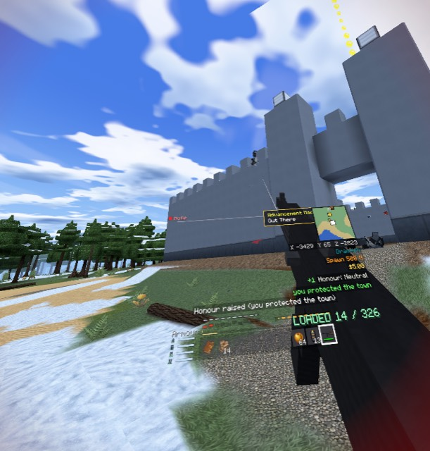

## 14:55:51 - Something's, something's having trouble. I don't know what

- **Transcript:** Something's, something's having trouble. I don't know what
- **Status:** open
- **Build:** 0.129 (9d6cbeeb, M1-M4 (device-tested; ship riding, chests, comfort options, weapon wheel))
- **World:** New World (10) (seed 4256271160485884755)
- **Dimension:** Surface
- **Biome:** Taiga
- **Position:** -3431.3 66.8 -2832.1
- **Facing:** north (yaw 356, pitch 8)
- **Held:** Sturmwind Carbine x1
- **Mount:** on foot
- **Looking at:** nothing
- **Mode:** Survival, health 20/20
- **Time:** day 1 09:52, clear
- **Fps:** 46
- **Levels:** mic -45 dBFS, game sound -21 dBFS
- **Length:** 4.3 s (voice 2.3 s)
- **Just before:** -30s closed InventoryMenu; -30s left the pack: Steel Boots; -29s opened PauseMenu; -28s closed PauseMenu; -28s holding Golden Apple; -28s message: Golden Apple; -28s holding Rifle Magazine; -28s message: Rifle Magazine; -28s holding Sturmwind Carbine; -28s message: Sturmwind Carbine; -27s message: Loaded: 30 / 30; -27s left the pack: Rifle Magazine x2; -24s message: The Greywall Garrison is sounding the alarm!; -21s took 4 damage (health 16/20); -19s took 4 damage (health 13/20); -17s took 6 damage (health 7/20); -17s message: Loaded: 30 / 30; -16s left the pack: Rifle Magazine; -15s message: Honour raised (you protected the town); -13s took 4 damage (health 4/20); -12s message: Loaded: 30 / 30; -12s opened PauseMenu; -12s left the pack: Rifle Magazine (PauseMenu open); -11s closed PauseMenu; -11s holding Rifle Magazine; -11s holding Golden Apple; -4s holding empty hand; -4s holding Golden Apple; -4s message: Golden Apple; -4s holding Rifle Magazine; -4s message: Rifle Magazine; -4s holding Sturmwind Carbine; -4s message: Sturmwind Carbine; -1s message: Honour raised (you protected the town)
- **Repro (Mac):** `./snap.sh note --seed 4256271160485884755 --x -3431.3 --z -2832.1 --yaw 4 --pitch 8 --time 0.161`
- **Audio (this Mac):** /Users/darthvadar/Documents/Blocksmith/QuestVoiceNotes/raw/vn-20261030-145551-300.aac

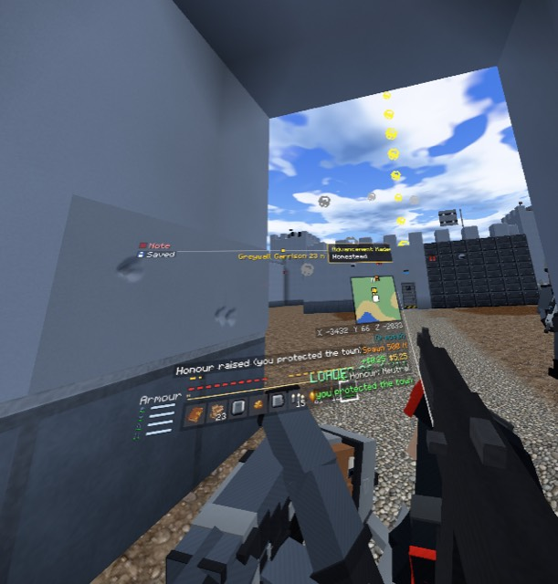

## 14:55:56 - I don't know what the problem is, but something's having trouble

- **Transcript:** I don't know what the problem is, but something's having trouble
- **Status:** open
- **Build:** 0.129 (9d6cbeeb, M1-M4 (device-tested; ship riding, chests, comfort options, weapon wheel))
- **World:** New World (10) (seed 4256271160485884755)
- **Dimension:** Surface
- **Biome:** Taiga
- **Position:** -3436.9 65.2 -2827.4
- **Facing:** north-east (yaw 46, pitch 4)
- **Held:** Sturmwind Carbine x1
- **Mount:** on foot
- **Looking at:** nothing
- **Mode:** Survival, health 14/20
- **Time:** day 1 09:56, clear
- **Fps:** 48
- **Levels:** mic -25 dBFS, game sound -13 dBFS
- **Length:** 3.7 s (voice 1.6 s)
- **Just before:** -27s message: The Greywall Garrison is sounding the alarm!; -25s took 4 damage (health 16/20); -22s took 4 damage (health 13/20); -20s took 6 damage (health 7/20); -20s message: Loaded: 30 / 30; -20s left the pack: Rifle Magazine; -18s message: Honour raised (you protected the town); -17s took 4 damage (health 4/20); -16s message: Loaded: 30 / 30; -15s opened PauseMenu; -15s left the pack: Rifle Magazine (PauseMenu open); -15s closed PauseMenu; -14s holding Rifle Magazine; -14s holding Golden Apple; -8s holding empty hand; -8s holding Golden Apple; -8s message: Golden Apple; -7s holding Rifle Magazine; -7s message: Rifle Magazine; -7s holding Sturmwind Carbine; -7s message: Sturmwind Carbine; -5s message: Honour raised (you protected the town); -3s into the pack: Greywall Keycard; -3s into the pack: Greywall Code Book; -3s into the pack: Regular Armour Set; -2s took 2 damage (health 19/20)
- **Repro (Mac):** `./snap.sh note --seed 4256271160485884755 --x -3436.9 --z -2827.4 --yaw -46 --pitch 4 --time 0.164`
- **Audio (this Mac):** /Users/darthvadar/Documents/Blocksmith/QuestVoiceNotes/raw/vn-20261030-145556-060.aac

## 14:56:05 - Okay, why is half the base armored? Like the, like why does it look li

- **Transcript:** Okay, why is half the base armored? Like the, like why does it look like that?
- **Status:** open
- **Build:** 0.129 (9d6cbeeb, M1-M4 (device-tested; ship riding, chests, comfort options, weapon wheel))
- **World:** New World (10) (seed 4256271160485884755)
- **Dimension:** Surface
- **Biome:** Taiga
- **Position:** -3431.1 67.1 -2833.0
- **Facing:** north (yaw 13, pitch 3)
- **Held:** Sturmwind Carbine x1
- **Mount:** on foot
- **Looking at:** nothing
- **Mode:** Survival, health 20/20
- **Time:** day 1 10:03, clear
- **Fps:** 44
- **Levels:** mic -29 dBFS, game sound -14 dBFS
- **Length:** 4.9 s (voice 2.6 s)
- **Just before:** -28s took 4 damage (health 13/20); -27s took 6 damage (health 7/20); -26s message: Loaded: 30 / 30; -26s left the pack: Rifle Magazine; -25s message: Honour raised (you protected the town); -23s took 4 damage (health 4/20); -22s message: Loaded: 30 / 30; -21s opened PauseMenu; -21s left the pack: Rifle Magazine (PauseMenu open); -21s closed PauseMenu; -21s holding Rifle Magazine; -20s holding Golden Apple; -14s holding empty hand; -14s holding Golden Apple; -14s message: Golden Apple; -14s holding Rifle Magazine; -14s message: Rifle Magazine; -13s holding Sturmwind Carbine; -13s message: Sturmwind Carbine; -11s message: Honour raised (you protected the town); -10s into the pack: Greywall Keycard; -10s into the pack: Greywall Code Book; -9s into the pack: Regular Armour Set; -8s took 2 damage (health 19/20); -5s message: Loaded: 30 / 30; -5s took 11 damage (health 13/20)
- **Repro (Mac):** `./snap.sh note --seed 4256271160485884755 --x -3431.1 --z -2833.0 --yaw -13 --pitch 3 --time 0.169`
- **Audio (this Mac):** /Users/darthvadar/Documents/Blocksmith/QuestVoiceNotes/raw/vn-20261030-145605-620.aac

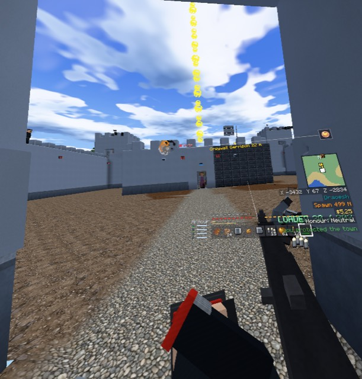

## 14:56:22 - Still having trouble getting through doors

- **Transcript:** Still having trouble getting through doors
- **Status:** open
- **Build:** 0.129 (9d6cbeeb, M1-M4 (device-tested; ship riding, chests, comfort options, weapon wheel))
- **World:** New World (10) (seed 4256271160485884755)
- **Dimension:** Surface
- **Biome:** Taiga
- **Position:** -3412.5 67.0 -2876.3
- **Facing:** north-east (yaw 62, pitch -34)
- **Held:** Sturmwind Carbine x1
- **Mount:** on foot
- **Looking at:** Station Floor Tiles at -3411 66 -2878
- **Mode:** Survival, health 8/20
- **Time:** day 1 10:21, clear
- **Fps:** 64
- **Levels:** mic -23 dBFS, game sound -17 dBFS
- **Length:** 3.7 s (voice 1.7 s)
- **Just before:** -29s holding empty hand; -29s holding Golden Apple; -29s message: Golden Apple; -29s holding Rifle Magazine; -29s message: Rifle Magazine; -28s holding Sturmwind Carbine; -28s message: Sturmwind Carbine; -26s message: Honour raised (you protected the town); -25s into the pack: Greywall Keycard; -25s into the pack: Greywall Code Book; -24s into the pack: Regular Armour Set; -23s took 2 damage (health 19/20); -20s message: Loaded: 30 / 30; -20s took 11 damage (health 13/20); -13s message: Honour raised (you protected the town); -11s message: Greywall Command now counts you tolerated.
- **Repro (Mac):** `./snap.sh note --seed 4256271160485884755 --x -3412.5 --z -2876.3 --yaw -62 --pitch -34 --time 0.182`
- **Audio (this Mac):** /Users/darthvadar/Documents/Blocksmith/QuestVoiceNotes/raw/vn-20261030-145622-660.aac

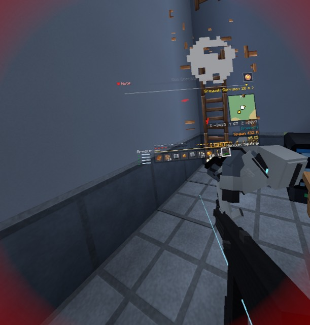

## 14:56:28 - Like just make the box like for the character, make it smaller. Okay. 

- **Transcript:** Like just make the box like for the character, make it smaller. Okay. That way I can get through branches easier and quicker for that matter. And so I can get through doors with no problems. Make the hitbox or whatever, whatever mesh box, mesh collider, whatever, make it smaller for the fucking player.
- **Status:** open
- **Build:** 0.129 (9d6cbeeb, M1-M4 (device-tested; ship riding, chests, comfort options, weapon wheel))
- **World:** New World (10) (seed 4256271160485884755)
- **Dimension:** Surface
- **Biome:** Taiga
- **Position:** -3412.1 67.0 -2877.5
- **Facing:** east (yaw 108, pitch 52)
- **Held:** Golden Apple x61
- **Mount:** on foot
- **Looking at:** Station Concrete at -3409 72 -2877
- **Mode:** Survival, health 10/20
- **Time:** day 1 10:28, clear
- **Fps:** 72
- **Levels:** mic -42 dBFS, game sound -23 dBFS
- **Length:** 19.4 s (voice 10.6 s)
- **Just before:** -30s into the pack: Greywall Keycard; -30s into the pack: Greywall Code Book; -29s into the pack: Regular Armour Set; -29s took 2 damage (health 19/20); -25s message: Loaded: 30 / 30; -25s took 11 damage (health 13/20); -18s message: Honour raised (you protected the town); -16s message: Greywall Command now counts you tolerated.; -5s took 13 damage (health 8/20); -3s message: Loaded: 30 / 30; -3s left the pack: Rifle Magazine (at -3411 67 -2876); -3s holding Written Book; -2s holding Sturmwind Carbine; -2s holding Rifle Magazine; -2s holding Golden Apple
- **While talking:** -3s holding Rifle Magazine; -3s message: Rifle Magazine; -3s holding Sturmwind Carbine; -3s message: Sturmwind Carbine; -3s holding Written Book; -3s message: Written Book; -2s holding Sturmwind Carbine; -2s message: Sturmwind Carbine
- **Position at the end:** -3415.4 66.9 -2874.6
- **Repro (Mac):** `./snap.sh note --seed 4256271160485884755 --x -3412.1 --z -2877.5 --yaw -108 --pitch 52 --time 0.186`
- **Audio (this Mac):** /Users/darthvadar/Documents/Blocksmith/QuestVoiceNotes/raw/vn-20261030-145628-000.aac

## 14:56:47 - I shouldn't have a problem getting through this door right now. I can.

- **Transcript:** I shouldn't have a problem getting through this door right now. I can. I can get through this
- **Status:** open
- **Build:** 0.129 (9d6cbeeb, M1-M4 (device-tested; ship riding, chests, comfort options, weapon wheel))
- **World:** New World (10) (seed 4256271160485884755)
- **Dimension:** Surface
- **Biome:** Taiga
- **Position:** -3415.9 66.8 -2875.1
- **Facing:** east (yaw 109, pitch -57)
- **Held:** Sturmwind Carbine x1
- **Mount:** on foot
- **Looking at:** Station Floor Tiles at -3415 66 -2875
- **Mode:** Survival, health 20/20
- **Time:** day 1 10:50, clear
- **Fps:** 64
- **Levels:** mic -30 dBFS, game sound -21 dBFS
- **Length:** 5.4 s (voice 2.7 s)
- **Just before:** -23s took 13 damage (health 8/20); -21s message: Loaded: 30 / 30; -21s left the pack: Rifle Magazine (at -3411 67 -2876); -21s holding Written Book; -21s holding Sturmwind Carbine; -20s holding Rifle Magazine; -20s holding Golden Apple; -6s holding Rifle Magazine; -6s message: Rifle Magazine; -6s holding Sturmwind Carbine; -6s message: Sturmwind Carbine; -6s holding Written Book; -6s message: Written Book; -6s holding Sturmwind Carbine; -6s message: Sturmwind Carbine; -3s message: The Capital now counts you wary of you.
- **Position at the end:** -3415.3 66.9 -2874.5
- **Repro (Mac):** `./snap.sh note --seed 4256271160485884755 --x -3415.9 --z -2875.1 --yaw -109 --pitch -57 --time 0.202`
- **Audio (this Mac):** /Users/darthvadar/Documents/Blocksmith/QuestVoiceNotes/raw/vn-20261030-145647-060.aac

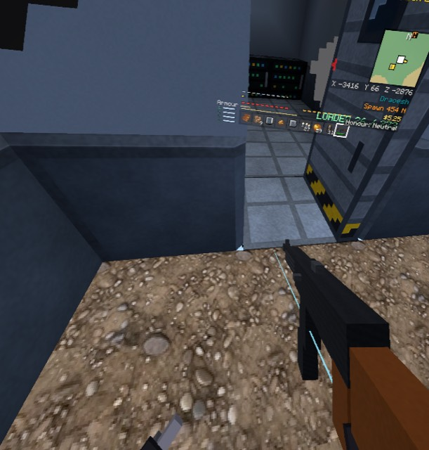

## 14:56:52 - I'm-- I have to jump, meaning there's a lip right here that I'm not ju

- **Transcript:** I'm-- I have to jump, meaning there's a lip right here that I'm not just au-automatically walking up
- **Status:** open
- **Build:** 0.129 (9d6cbeeb, M1-M4 (device-tested; ship riding, chests, comfort options, weapon wheel))
- **World:** New World (10) (seed 4256271160485884755)
- **Dimension:** Surface
- **Biome:** Taiga
- **Position:** -3415.3 66.9 -2874.5
- **Facing:** east (yaw 89, pitch -10)
- **Held:** Sturmwind Carbine x1
- **Mount:** on foot
- **Looking at:** Server Rack at -3410 67 -2875
- **Mode:** Survival, health 20/20
- **Time:** day 1 10:57, clear
- **Fps:** 71
- **Levels:** mic -26 dBFS, game sound -22 dBFS
- **Length:** 6.6 s (voice 3.6 s)
- **Just before:** -29s took 13 damage (health 8/20); -27s message: Loaded: 30 / 30; -27s left the pack: Rifle Magazine (at -3411 67 -2876); -27s holding Written Book; -26s holding Sturmwind Carbine; -26s holding Rifle Magazine; -26s holding Golden Apple; -12s holding Rifle Magazine; -12s message: Rifle Magazine; -12s holding Sturmwind Carbine; -12s message: Sturmwind Carbine; -12s holding Written Book; -12s message: Written Book; -11s holding Sturmwind Carbine; -11s message: Sturmwind Carbine; -9s message: The Capital now counts you wary of you.
- **While talking:** -0s holding empty hand; -0s message: Manning the deck gun
- **Position at the end:** -3409.7 84.5 -2873.7
- **Repro (Mac):** `./snap.sh note --seed 4256271160485884755 --x -3415.3 --z -2874.5 --yaw -89 --pitch -10 --time 0.206`
- **Audio (this Mac):** /Users/darthvadar/Documents/Blocksmith/QuestVoiceNotes/raw/vn-20261030-145652-740.aac

## 14:57:00 - The, um, gun seat though, that's, that's certainly working

- **Transcript:** The, um, gun seat though, that's, that's certainly working
- **Status:** open
- **Build:** 0.129 (9d6cbeeb, M1-M4 (device-tested; ship riding, chests, comfort options, weapon wheel))
- **World:** New World (10) (seed 4256271160485884755)
- **Dimension:** Surface
- **Biome:** Taiga
- **Position:** -3413.7 84.5 -2876.6
- **Facing:** south (yaw 163, pitch -18)
- **Held:** empty hand
- **Mount:** on foot
- **Looking at:** nothing
- **Mode:** Survival, health 20/20
- **Time:** day 1 11:04, clear
- **Fps:** 60
- **Levels:** mic -29 dBFS, game sound -19 dBFS
- **Length:** 4.8 s (voice 2.6 s)
- **Just before:** -19s holding Rifle Magazine; -19s message: Rifle Magazine; -18s holding Sturmwind Carbine; -18s message: Sturmwind Carbine; -18s holding Written Book; -18s message: Written Book; -18s holding Sturmwind Carbine; -18s message: Sturmwind Carbine; -15s message: The Capital now counts you wary of you.; -2s holding empty hand; -2s message: Manning the deck gun
- **Repro (Mac):** `./snap.sh note --seed 4256271160485884755 --x -3413.7 --z -2876.6 --yaw -163 --pitch -18 --time 0.212`
- **Audio (this Mac):** /Users/darthvadar/Documents/Blocksmith/QuestVoiceNotes/raw/vn-20261030-145700-100.aac

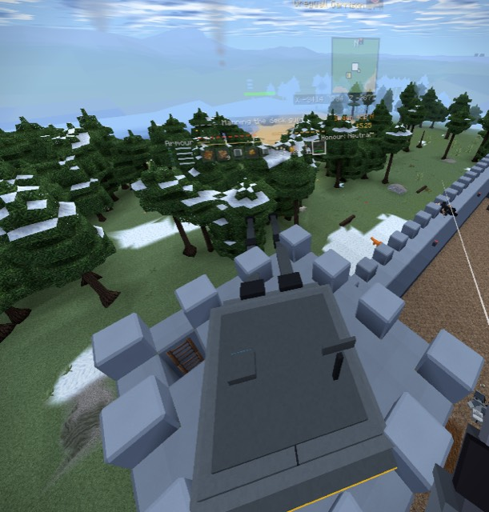

## 14:57:11 - For some reason when the enemy fires rounds at me

- **Transcript:** For some reason when the enemy fires rounds at me
- **Status:** open
- **Build:** 0.129 (9d6cbeeb, M1-M4 (device-tested; ship riding, chests, comfort options, weapon wheel))
- **World:** New World (10) (seed 4256271160485884755)
- **Dimension:** Surface
- **Biome:** Taiga
- **Position:** -3409.4 84.5 -2876.9
- **Facing:** south-west (yaw 236, pitch -24)
- **Held:** empty hand
- **Mount:** on foot
- **Looking at:** nothing
- **Mode:** Survival, health 20/20
- **Time:** day 1 11:13, clear
- **Fps:** 42
- **Levels:** mic -22 dBFS, game sound -20 dBFS
- **Length:** 5.5 s (voice 2.9 s)
- **Just before:** -25s holding Rifle Magazine; -25s message: Rifle Magazine; -25s holding Sturmwind Carbine; -25s message: Sturmwind Carbine; -25s holding Written Book; -25s message: Written Book; -25s holding Sturmwind Carbine; -25s message: Sturmwind Carbine; -22s message: The Capital now counts you wary of you.; -9s holding empty hand; -9s message: Manning the deck gun; -7s message: Gun Control: the gun overhead, worked from this computer; -3s message: The turret is wrecked
- **Repro (Mac):** `./snap.sh note --seed 4256271160485884755 --x -3409.4 --z -2876.9 --yaw 124 --pitch -24 --time 0.217`
- **Audio (this Mac):** /Users/darthvadar/Documents/Blocksmith/QuestVoiceNotes/raw/vn-20261030-145711-940.aac

## 14:57:17 - It doesn't damage me. It doesn't damage the gun

- **Transcript:** It doesn't damage me. It doesn't damage the gun
- **Status:** open
- **Build:** 0.129 (9d6cbeeb, M1-M4 (device-tested; ship riding, chests, comfort options, weapon wheel))
- **World:** New World (10) (seed 4256271160485884755)
- **Dimension:** Surface
- **Biome:** Taiga
- **Position:** -3409.4 84.5 -2876.9
- **Facing:** south-west (yaw 235, pitch -33)
- **Held:** empty hand
- **Mount:** on foot
- **Looking at:** nothing
- **Mode:** Survival, health 20/20
- **Time:** day 1 11:17, clear
- **Fps:** 44
- **Levels:** mic -23 dBFS, game sound -21 dBFS
- **Length:** 3.5 s (voice 1.9 s)
- **Just before:** -29s holding Rifle Magazine; -29s message: Rifle Magazine; -29s holding Sturmwind Carbine; -29s message: Sturmwind Carbine; -28s holding Written Book; -28s message: Written Book; -28s holding Sturmwind Carbine; -28s message: Sturmwind Carbine; -26s message: The Capital now counts you wary of you.; -12s holding empty hand; -12s message: Manning the deck gun; -10s message: Gun Control: the gun overhead, worked from this computer; -6s message: The turret is wrecked
- **Repro (Mac):** `./snap.sh note --seed 4256271160485884755 --x -3409.4 --z -2876.9 --yaw 125 --pitch -33 --time 0.220`
- **Audio (this Mac):** /Users/darthvadar/Documents/Blocksmith/QuestVoiceNotes/raw/vn-20261030-145717-500.aac

## 14:57:21 - Uh, I mean, sh-that shouldn't damage me, but it should... This guy has

- **Transcript:** Uh, I mean, sh-that shouldn't damage me, but it should... This guy has fired the flak cannon at me like 10 times, and nothing has happened
- **Status:** open
- **Build:** 0.129 (9d6cbeeb, M1-M4 (device-tested; ship riding, chests, comfort options, weapon wheel))
- **World:** New World (10) (seed 4256271160485884755)
- **Dimension:** Surface
- **Biome:** Taiga
- **Position:** -3409.8 84.5 -2877.3
- **Facing:** south-west (yaw 224, pitch -23)
- **Held:** empty hand
- **Mount:** on foot
- **Looking at:** nothing
- **Mode:** Survival, health 20/20
- **Time:** day 1 11:20, clear
- **Fps:** 43
- **Levels:** mic -29 dBFS, game sound -19 dBFS
- **Length:** 9.6 s (voice 5.6 s)
- **Just before:** -28s message: The Capital now counts you wary of you.; -14s holding empty hand; -14s message: Manning the deck gun; -12s message: Gun Control: the gun overhead, worked from this computer; -8s message: The turret is wrecked
- **Position at the end:** -3409.3 84.5 -2876.6
- **Repro (Mac):** `./snap.sh note --seed 4256271160485884755 --x -3409.8 --z -2877.3 --yaw 136 --pitch -23 --time 0.222`
- **Audio (this Mac):** /Users/darthvadar/Documents/Blocksmith/QuestVoiceNotes/raw/vn-20261030-145721-360.aac

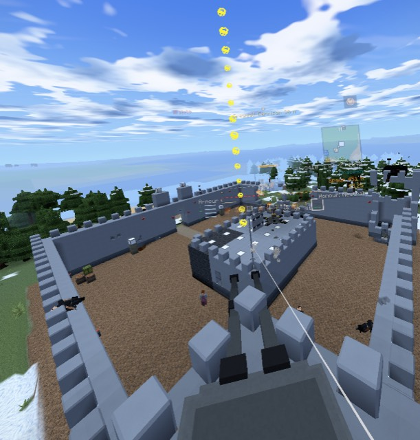

## 14:57:30 - To my gun, which it should have. No damage at all I can see

- **Transcript:** To my gun, which it should have. No damage at all I can see
- **Status:** open
- **Build:** 0.129 (9d6cbeeb, M1-M4 (device-tested; ship riding, chests, comfort options, weapon wheel))
- **World:** New World (10) (seed 4256271160485884755)
- **Dimension:** Surface
- **Biome:** Taiga
- **Position:** -3409.6 84.5 -2877.1
- **Facing:** south-west (yaw 231, pitch -28)
- **Held:** empty hand
- **Mount:** on foot
- **Looking at:** nothing
- **Mode:** Survival, health 20/20
- **Time:** day 1 11:27, clear
- **Fps:** 44
- **Levels:** mic -39 dBFS, game sound -23 dBFS
- **Length:** 4.4 s (voice 2.0 s)
- **Just before:** -20s holding empty hand; -20s message: Manning the deck gun; -18s message: Gun Control: the gun overhead, worked from this computer; -14s message: The turret is wrecked
- **Repro (Mac):** `./snap.sh note --seed 4256271160485884755 --x -3409.6 --z -2877.1 --yaw 129 --pitch -28 --time 0.227`
- **Audio (this Mac):** /Users/darthvadar/Documents/Blocksmith/QuestVoiceNotes/raw/vn-20261030-145730-940.aac

## 14:58:05 - Um, this, what is this called?

- **Transcript:** Um, this, what is this called?
- **Status:** open
- **Build:** 0.129 (9d6cbeeb, M1-M4 (device-tested; ship riding, chests, comfort options, weapon wheel))
- **World:** New World (10) (seed 4256271160485884755)
- **Dimension:** Surface
- **Biome:** Taiga
- **Position:** -3427.6 67.0 -2862.2
- **Facing:** south (yaw 178, pitch -5)
- **Held:** Slatefall Carbine x1
- **Mount:** on foot
- **Looking at:** Station Concrete at -3428 68 -2860
- **Mode:** Survival, health 20/20
- **Time:** day 1 12:04, clear
- **Fps:** 71
- **Levels:** mic -22 dBFS, game sound -24 dBFS
- **Length:** 3.5 s (voice 1.5 s)
- **Just before:** -28s holding Sturmwind Carbine; -26s message: Viola Nash: Bar the doors! They're coming!; -22s message: You've reached Greywall Garrison; -20s took 5 damage (health 17/20); -18s into the pack: Slatefall Carbine; -14s opened ChestMenu; -13s closed ChestMenu; -13s opened ChestMenu; -12s closed ChestMenu; -12s opened ChestMenu; -11s closed ChestMenu; -11s into the pack: Slatefall Carbine; -10s opened ChestMenu; -8s holding Slatefall Carbine; -8s left the pack: Sturmwind Carbine (ChestMenu open); -8s closed ChestMenu; -8s into the pack: Sturmwind Carbine; -7s opened ChestMenu; -6s closed ChestMenu; -6s opened ChestMenu; -4s closed ChestMenu; -4s message: Loaded: 30 / 30
- **Repro (Mac):** `./snap.sh note --seed 4256271160485884755 --x -3427.6 --z -2862.2 --yaw -178 --pitch -5 --time 0.253`
- **Audio (this Mac):** /Users/darthvadar/Documents/Blocksmith/QuestVoiceNotes/raw/vn-20261030-145805-300.aac

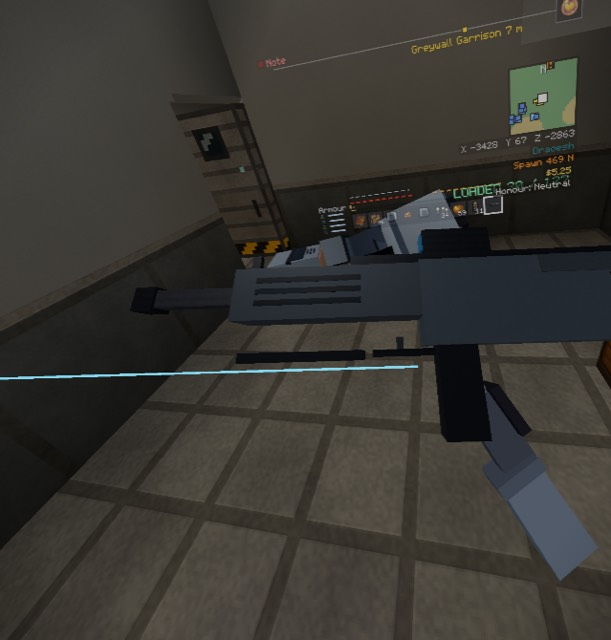

## 14:58:10 - The slate full of carbine has little blocks that are floating off of i

- **Transcript:** The slate full of carbine has little blocks that are floating off of it. Looks sloppy
- **Status:** open
- **Build:** 0.129 (9d6cbeeb, M1-M4 (device-tested; ship riding, chests, comfort options, weapon wheel))
- **World:** New World (10) (seed 4256271160485884755)
- **Dimension:** Surface
- **Biome:** Taiga
- **Position:** -3425.5 67.0 -2861.9
- **Facing:** south-west (yaw 226, pitch -13)
- **Held:** Slatefall Carbine x1
- **Mount:** on foot
- **Looking at:** Dark Station Concrete at -3428 67 -2860
- **Mode:** Survival, health 20/20
- **Time:** day 1 12:09, clear
- **Fps:** 71
- **Levels:** mic -25 dBFS, game sound -24 dBFS
- **Length:** 6.3 s (voice 3.0 s)
- **Just before:** -27s message: You've reached Greywall Garrison; -24s took 5 damage (health 17/20); -23s into the pack: Slatefall Carbine; -19s opened ChestMenu; -18s closed ChestMenu; -18s opened ChestMenu; -17s closed ChestMenu; -17s opened ChestMenu; -15s closed ChestMenu; -15s into the pack: Slatefall Carbine; -15s opened ChestMenu; -13s holding Slatefall Carbine; -13s left the pack: Sturmwind Carbine (ChestMenu open); -13s closed ChestMenu; -12s into the pack: Sturmwind Carbine; -12s opened ChestMenu; -11s closed ChestMenu; -10s opened ChestMenu; -9s closed ChestMenu; -8s message: Loaded: 30 / 30; -3s opened PauseMenu; -2s closed PauseMenu; -2s opened InventoryMenu; -1s closed InventoryMenu
- **Position at the end:** -3430.4 67.4 -2860.3
- **Repro (Mac):** `./snap.sh note --seed 4256271160485884755 --x -3425.5 --z -2861.9 --yaw 134 --pitch -13 --time 0.256`
- **Audio (this Mac):** /Users/darthvadar/Documents/Blocksmith/QuestVoiceNotes/raw/vn-20261030-145810-020.aac

## 14:59:17 - I've got another triangle right here that I can see into the void with

- **Transcript:** I've got another triangle right here that I can see into the void with. That's not good
- **Status:** open
- **Build:** 0.129 (9d6cbeeb, M1-M4 (device-tested; ship riding, chests, comfort options, weapon wheel))
- **World:** New World (10) (seed 4256271160485884755)
- **Dimension:** Surface
- **Biome:** Taiga
- **Position:** -3391.2 65.8 -2800.9
- **Facing:** south (yaw 198, pitch -56)
- **Held:** Slatefall Carbine x1
- **Mount:** on foot
- **Looking at:** Grass Block at -3392 65 -2800
- **Mode:** Survival, health 20/20
- **Time:** day 1 12:57, clear
- **Fps:** 66
- **Levels:** mic -34 dBFS, game sound -14 dBFS
- **Length:** 7.1 s (voice 4.2 s)
- **Just before:** -28s opened PauseMenu; -5s closed PauseMenu
- **Position at the end:** -3393.1 65.8 -2798.7
- **Repro (Mac):** `./snap.sh note --seed 4256271160485884755 --x -3391.2 --z -2800.9 --yaw 162 --pitch -56 --time 0.290`
- **Audio (this Mac):** /Users/darthvadar/Documents/Blocksmith/QuestVoiceNotes/raw/vn-20261030-145917-700.aac

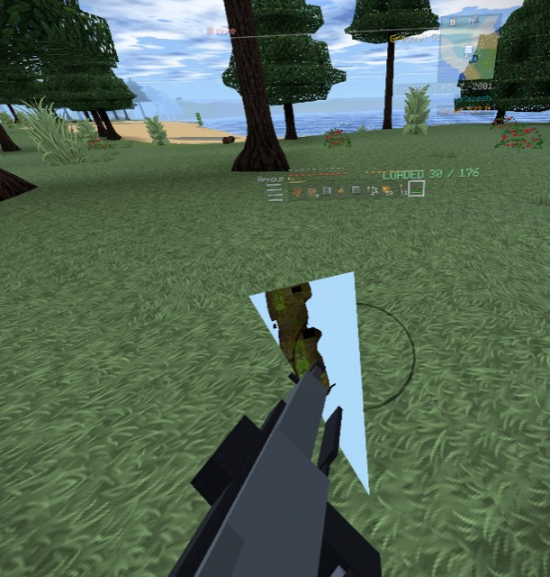

## 14:59:28 - So find some sort of compression, whatever the, whatever way GTA V did

- **Transcript:** So find some sort of compression, whatever the, whatever way GTA V did, try to find something like that. So they compressed everything. They did a great job compressing stuff
- **Status:** open
- **Build:** 0.129 (9d6cbeeb, M1-M4 (device-tested; ship riding, chests, comfort options, weapon wheel))
- **World:** New World (10) (seed 4256271160485884755)
- **Dimension:** Surface
- **Biome:** Taiga
- **Position:** -3381.7 65.3 -2806.4
- **Facing:** north-east (yaw 49, pitch -7)
- **Held:** Slatefall Carbine x1
- **Mount:** on foot
- **Looking at:** nothing
- **Mode:** Survival, health 20/20
- **Time:** day 1 13:05, clear
- **Fps:** 58
- **Levels:** mic -31 dBFS, game sound -19 dBFS
- **Length:** 10.6 s (voice 6.3 s)
- **Just before:** -14s closed PauseMenu; -2s opened PauseMenu; -0s closed PauseMenu
- **While talking:** -5s opened PauseMenu; -3s closed PauseMenu; -3s walked into Beach
- **Position at the end:** -3332.7 63.3 -2823.7
- **Repro (Mac):** `./snap.sh note --seed 4256271160485884755 --x -3381.7 --z -2806.4 --yaw -49 --pitch -7 --time 0.296`
- **Audio (this Mac):** /Users/darthvadar/Documents/Blocksmith/QuestVoiceNotes/raw/vn-20261030-145928-760.aac

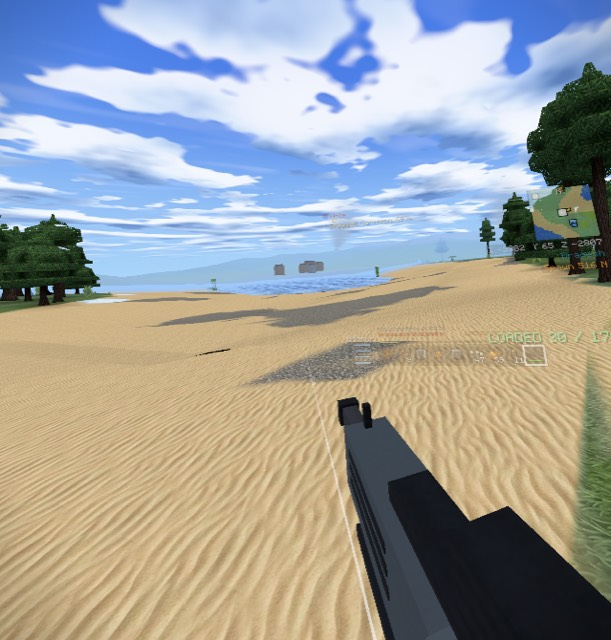

## 14:59:39 - And it seemed to work for it

- **Transcript:** And it seemed to work for it
- **Status:** open
- **Build:** 0.129 (9d6cbeeb, M1-M4 (device-tested; ship riding, chests, comfort options, weapon wheel))
- **World:** New World (10) (seed 4256271160485884755)
- **Dimension:** Surface
- **Biome:** Beach
- **Position:** -3327.1 63.4 -2822.2
- **Facing:** north-east (yaw 63, pitch -18)
- **Held:** Slatefall Carbine x1
- **Mount:** on foot
- **Looking at:** Sand at -3323 62 -2825
- **Mode:** Survival, health 20/20
- **Time:** day 1 13:14, clear
- **Fps:** 44
- **Levels:** mic -37 dBFS, game sound -19 dBFS
- **Length:** 2.7 s (voice 0.9 s)
- **Just before:** -21s closed PauseMenu; -9s opened PauseMenu; -8s closed PauseMenu; -7s walked into Beach
- **Repro (Mac):** `./snap.sh note --seed 4256271160485884755 --x -3327.1 --z -2822.2 --yaw -63 --pitch -18 --time 0.301`
- **Audio (this Mac):** /Users/darthvadar/Documents/Blocksmith/QuestVoiceNotes/raw/vn-20261030-145939-720.aac

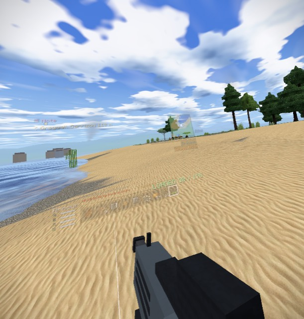

## 14:59:43 - This little stuff with seeing the buildings like this in a frigate, li

- **Transcript:** This little stuff with seeing the buildings like this in a frigate, like that's kind of the point. But really, this jitteriness, this is bad
- **Status:** open
- **Build:** 0.129 (9d6cbeeb, M1-M4 (device-tested; ship riding, chests, comfort options, weapon wheel))
- **World:** New World (10) (seed 4256271160485884755)
- **Dimension:** Surface
- **Biome:** Beach
- **Position:** -3294.3 65.5 -2822.1
- **Facing:** north-east (yaw 46, pitch 2)
- **Held:** Slatefall Carbine x1
- **Mount:** on foot
- **Looking at:** nothing
- **Mode:** Survival, health 20/20
- **Time:** day 1 13:18, clear
- **Fps:** 53
- **Levels:** mic -39 dBFS, game sound -19 dBFS
- **Length:** 8.1 s (voice 4.4 s)
- **Just before:** -25s closed PauseMenu; -13s opened PauseMenu; -11s closed PauseMenu; -11s walked into Beach
- **Position at the end:** -3275.7 65.7 -2835.3
- **Repro (Mac):** `./snap.sh note --seed 4256271160485884755 --x -3294.3 --z -2822.1 --yaw -46 --pitch 2 --time 0.305`
- **Audio (this Mac):** /Users/darthvadar/Documents/Blocksmith/QuestVoiceNotes/raw/vn-20261030-145943-580.aac

## 14:59:51 - Like, I don't know what is going on here

- **Transcript:** Like, I don't know what is going on here
- **Status:** open
- **Build:** 0.129 (9d6cbeeb, M1-M4 (device-tested; ship riding, chests, comfort options, weapon wheel))
- **World:** New World (10) (seed 4256271160485884755)
- **Dimension:** Surface
- **Biome:** Beach
- **Position:** -3272.3 65.6 -2837.7
- **Facing:** south-east (yaw 119, pitch -74)
- **Held:** Slatefall Carbine x1
- **Mount:** on foot
- **Looking at:** Sand at -3273 65 -2838
- **Mode:** Survival, health 20/20
- **Time:** day 1 13:24, clear
- **Fps:** 39
- **Levels:** mic -24 dBFS, game sound -29 dBFS
- **Length:** 2.9 s (voice 1.5 s)
- **Just before:** -30s closed PauseMenu; -18s opened PauseMenu; -16s closed PauseMenu; -15s walked into Beach
- **Repro (Mac):** `./snap.sh note --seed 4256271160485884755 --x -3272.3 --z -2837.7 --yaw -119 --pitch -74 --time 0.308`
- **Audio (this Mac):** /Users/darthvadar/Documents/Blocksmith/QuestVoiceNotes/raw/vn-20261030-145951-640.aac

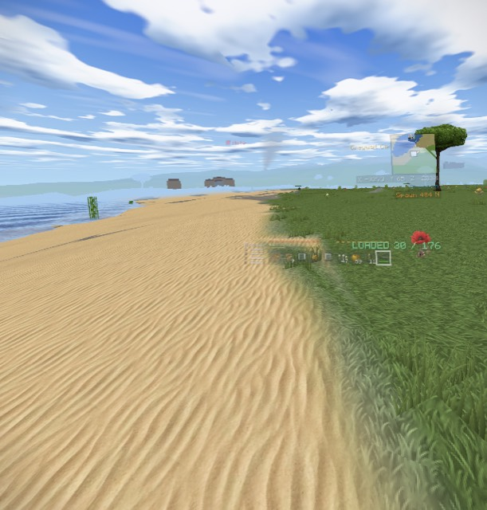

## 15:00:32 - This right here is causing a bunch of the problem, bunch of the jitter

- **Transcript:** This right here is causing a bunch of the problem, bunch of the jittering issue. Walking along with this rock right now is causing it
- **Status:** open
- **Build:** 0.129 (9d6cbeeb, M1-M4 (device-tested; ship riding, chests, comfort options, weapon wheel))
- **World:** New World (10) (seed 4256271160485884755)
- **Dimension:** Surface
- **Biome:** Plains
- **Position:** -3242.8 66.0 -2840.8
- **Facing:** west (yaw 265, pitch -59)
- **Held:** Slatefall Carbine x1
- **Mount:** on foot
- **Looking at:** Tuff at -3244 65 -2841
- **Mode:** Survival, health 20/20
- **Time:** day 1 13:50, clear
- **Fps:** 25
- **Levels:** mic -27 dBFS, game sound -20 dBFS
- **Length:** 9.9 s (voice 5.9 s)
- **Just before:** -30s opened PauseMenu; -27s closed PauseMenu; -16s opened PauseMenu; -13s closed PauseMenu; -6s opened PauseMenu; -4s closed PauseMenu
- **Position at the end:** -3242.8 66.1 -2840.8
- **Repro (Mac):** `./snap.sh note --seed 4256271160485884755 --x -3242.8 --z -2840.8 --yaw 95 --pitch -59 --time 0.327`
- **Audio (this Mac):** /Users/darthvadar/Documents/Blocksmith/QuestVoiceNotes/raw/vn-20261030-150032-840.aac

## 15:00:46 - This is causing a lot of jitter

- **Transcript:** This is causing a lot of jitter
- **Status:** open
- **Build:** 0.129 (9d6cbeeb, M1-M4 (device-tested; ship riding, chests, comfort options, weapon wheel))
- **World:** New World (10) (seed 4256271160485884755)
- **Dimension:** Surface
- **Biome:** Plains
- **Position:** -3244.0 66.3 -2840.5
- **Facing:** north-west (yaw 323, pitch -72)
- **Held:** Slatefall Carbine x1
- **Mount:** on foot
- **Looking at:** Stone at -3245 66 -2841
- **Mode:** Survival, health 20/20
- **Time:** day 1 13:55, clear
- **Fps:** 29
- **Levels:** mic -45 dBFS, game sound -9 dBFS
- **Length:** 3.2 s (voice 1.7 s)
- **Just before:** -20s opened PauseMenu; -17s closed PauseMenu; -10s opened PauseMenu; -8s closed PauseMenu
- **Repro (Mac):** `./snap.sh note --seed 4256271160485884755 --x -3244.0 --z -2840.5 --yaw 37 --pitch -72 --time 0.330`
- **Audio (this Mac):** /Users/darthvadar/Documents/Blocksmith/QuestVoiceNotes/raw/vn-20261030-150046-580.aac

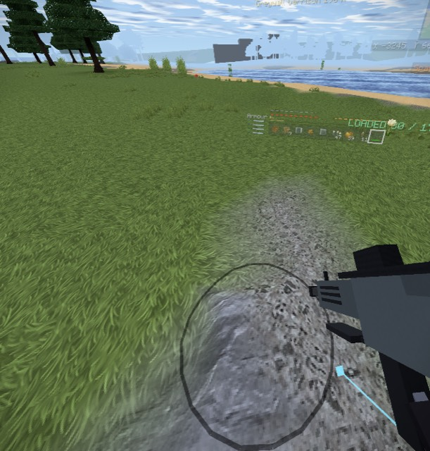

## 15:00:50 - And when I get off of it, it's okay. No problem walking around this li

- **Transcript:** And when I get off of it, it's okay. No problem walking around this little rock thing
- **Status:** open
- **Build:** 0.129 (9d6cbeeb, M1-M4 (device-tested; ship riding, chests, comfort options, weapon wheel))
- **World:** New World (10) (seed 4256271160485884755)
- **Dimension:** Surface
- **Biome:** Plains
- **Position:** -3244.2 65.9 -2845.2
- **Facing:** south (yaw 194, pitch -31)
- **Held:** Slatefall Carbine x1
- **Mount:** on foot
- **Looking at:** Grass Block at -3245 65 -2843
- **Mode:** Survival, health 20/20
- **Time:** day 1 13:57, clear
- **Fps:** 29
- **Levels:** mic -26 dBFS, game sound -19 dBFS
- **Length:** 5.5 s (voice 3.3 s)
- **Just before:** -22s opened PauseMenu; -18s closed PauseMenu; -11s opened PauseMenu; -9s closed PauseMenu
- **Position at the end:** -3239.0 65.9 -2840.1
- **Repro (Mac):** `./snap.sh note --seed 4256271160485884755 --x -3244.2 --z -2845.2 --yaw 166 --pitch -31 --time 0.331`
- **Audio (this Mac):** /Users/darthvadar/Documents/Blocksmith/QuestVoiceNotes/raw/vn-20261030-150050-021.aac

## 15:00:56 - A little bit. It's a little bit of issue. But when walking over it, oh

- **Transcript:** A little bit. It's a little bit of issue. But when walking over it, oh, big problem
- **Status:** open
- **Build:** 0.129 (9d6cbeeb, M1-M4 (device-tested; ship riding, chests, comfort options, weapon wheel))
- **World:** New World (10) (seed 4256271160485884755)
- **Dimension:** Surface
- **Biome:** Plains
- **Position:** -3242.8 65.9 -2844.6
- **Facing:** south-west (yaw 206, pitch -26)
- **Held:** Slatefall Carbine x1
- **Mount:** on foot
- **Looking at:** Short Grass at -3244 66 -2843
- **Mode:** Survival, health 20/20
- **Time:** day 1 14:03, clear
- **Fps:** 63
- **Levels:** mic -32 dBFS, game sound -14 dBFS
- **Length:** 6.8 s (voice 3.2 s)
- **Just before:** -27s opened PauseMenu; -23s closed PauseMenu; -17s opened PauseMenu; -15s closed PauseMenu
- **Position at the end:** -3241.5 65.9 -2835.7
- **Repro (Mac):** `./snap.sh note --seed 4256271160485884755 --x -3242.8 --z -2844.6 --yaw 154 --pitch -26 --time 0.336`
- **Audio (this Mac):** /Users/darthvadar/Documents/Blocksmith/QuestVoiceNotes/raw/vn-20261030-150056-040.aac

## 15:01:09 - Yeah, not good

- **Transcript:** Yeah, not good
- **Status:** open
- **Build:** 0.129 (9d6cbeeb, M1-M4 (device-tested; ship riding, chests, comfort options, weapon wheel))
- **World:** New World (10) (seed 4256271160485884755)
- **Dimension:** Surface
- **Biome:** Plains
- **Position:** -3241.9 66.0 -2840.8
- **Facing:** north-east (yaw 35, pitch -31)
- **Held:** Slatefall Carbine x1
- **Mount:** on foot
- **Looking at:** Short Grass at -3242 66 -2843
- **Mode:** Survival, health 20/20
- **Time:** day 1 14:09, clear
- **Fps:** 65
- **Levels:** mic -27 dBFS, game sound -23 dBFS
- **Length:** 2.1 s (voice 0.6 s)
- **Just before:** -27s opened PauseMenu; -25s closed PauseMenu; -6s opened PauseMenu; -1s closed PauseMenu
- **Repro (Mac):** `./snap.sh note --seed 4256271160485884755 --x -3241.9 --z -2840.8 --yaw -35 --pitch -31 --time 0.340`
- **Audio (this Mac):** /Users/darthvadar/Documents/Blocksmith/QuestVoiceNotes/raw/vn-20261030-150109-180.aac

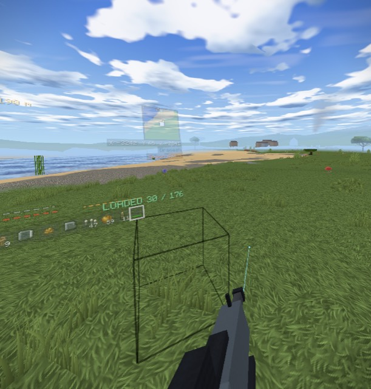

## 15:01:15 - But even when like flying around creative, I still get a little bit of

- **Transcript:** But even when like flying around creative, I still get a little bit of it
- **Status:** open
- **Build:** 0.129 (9d6cbeeb, M1-M4 (device-tested; ship riding, chests, comfort options, weapon wheel))
- **World:** New World (10) (seed 4256271160485884755)
- **Dimension:** Surface
- **Biome:** Plains
- **Position:** -3141.5 94.1 -2941.9
- **Facing:** north-east (yaw 49, pitch -18)
- **Held:** Slatefall Carbine x1
- **Mount:** on foot, flying
- **Looking at:** nothing
- **Mode:** Creative, health 20/20
- **Time:** day 1 14:14, clear
- **Fps:** 55
- **Levels:** mic -23 dBFS, game sound -24 dBFS
- **Length:** 4.3 s (voice 2.4 s)
- **Just before:** -12s opened PauseMenu; -7s closed PauseMenu; -4s opened PauseMenu; -3s message: Creative mode; -3s closed PauseMenu; -2s walked into Beach; -1s message: Flying
- **Repro (Mac):** `./snap.sh note --seed 4256271160485884755 --x -3141.5 --z -2941.9 --yaw -49 --pitch -18 --time 0.344`
- **Audio (this Mac):** /Users/darthvadar/Documents/Blocksmith/QuestVoiceNotes/raw/vn-20261030-150115-000.aac

## 15:01:19 - So it's not just that

- **Transcript:** So it's not just that
- **Status:** open
- **Build:** 0.129 (9d6cbeeb, M1-M4 (device-tested; ship riding, chests, comfort options, weapon wheel))
- **World:** New World (10) (seed 4256271160485884755)
- **Dimension:** Surface
- **Biome:** Plains
- **Position:** -3106.1 72.6 -3025.2
- **Facing:** south-east (yaw 117, pitch -31)
- **Held:** Slatefall Carbine x1
- **Mount:** on foot
- **Looking at:** nothing
- **Mode:** Creative, health 20/20
- **Time:** day 1 14:19, clear
- **Fps:** 70
- **Levels:** mic -30 dBFS, game sound -17 dBFS
- **Length:** 2.4 s (voice 0.9 s)
- **Just before:** -16s opened PauseMenu; -11s closed PauseMenu; -8s opened PauseMenu; -7s message: Creative mode; -7s closed PauseMenu; -6s walked into Beach; -6s message: Flying; -4s walked into Plains; -2s message: Walking
- **Repro (Mac):** `./snap.sh note --seed 4256271160485884755 --x -3106.1 --z -3025.2 --yaw -117 --pitch -31 --time 0.347`
- **Audio (this Mac):** /Users/darthvadar/Documents/Blocksmith/QuestVoiceNotes/raw/vn-20261030-150119-580.aac

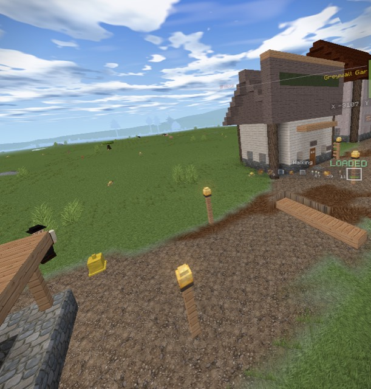

## 15:01:22 - Especially walking on the, uh, the dirt in the village is causing big 

- **Transcript:** Especially walking on the, uh, the dirt in the village is causing big jitter problems
- **Status:** open
- **Build:** 0.129 (9d6cbeeb, M1-M4 (device-tested; ship riding, chests, comfort options, weapon wheel))
- **World:** New World (10) (seed 4256271160485884755)
- **Dimension:** Surface
- **Biome:** Plains
- **Position:** -3106.0 67.0 -3033.1
- **Facing:** west (yaw 277, pitch -54)
- **Held:** Slatefall Carbine x1
- **Mount:** on foot
- **Looking at:** Coarse Dirt at -3108 66 -3034
- **Mode:** Creative, health 20/20
- **Time:** day 1 14:21, clear
- **Fps:** 58
- **Levels:** mic -29 dBFS, game sound -16 dBFS
- **Length:** 5.4 s (voice 3.4 s)
- **Just before:** -18s opened PauseMenu; -13s closed PauseMenu; -10s opened PauseMenu; -9s message: Creative mode; -9s closed PauseMenu; -8s walked into Beach; -8s message: Flying; -6s walked into Plains; -3s message: Walking; -0s message: Elias Thorne: Peaceful town. Let's keep it that way.
- **Repro (Mac):** `./snap.sh note --seed 4256271160485884755 --x -3106.0 --z -3033.1 --yaw 83 --pitch -54 --time 0.349`
- **Audio (this Mac):** /Users/darthvadar/Documents/Blocksmith/QuestVoiceNotes/raw/vn-20261030-150122-820.aac

## 15:01:35 - Oh, look at that. The CPU is, uh

- **Transcript:** Oh, look at that. The CPU is, uh
- **Status:** open
- **Build:** 0.129 (9d6cbeeb, M1-M4 (device-tested; ship riding, chests, comfort options, weapon wheel))
- **World:** New World (10) (seed 4256271160485884755)
- **Dimension:** Surface
- **Biome:** Plains
- **Position:** -3097.2 68.6 -3030.7
- **Facing:** east (yaw 77, pitch -1)
- **Held:** Slatefall Carbine x1
- **Mount:** on foot
- **Looking at:** nothing
- **Mode:** Creative, health 20/20
- **Time:** day 1 14:32, clear
- **Fps:** 60
- **Levels:** mic -24 dBFS, game sound -25 dBFS
- **Length:** 3.2 s (voice 1.7 s)
- **Just before:** -27s opened PauseMenu; -21s closed PauseMenu; -18s opened PauseMenu; -18s message: Creative mode; -17s closed PauseMenu; -16s walked into Beach; -16s message: Flying; -14s walked into Plains; -12s message: Walking; -9s message: Elias Thorne: Peaceful town. Let's keep it that way.; -5s message: Elias Thorne: Lower it. Slowly.; -2s message: Elias Thorne: Now you've done it.
- **Repro (Mac):** `./snap.sh note --seed 4256271160485884755 --x -3097.2 --z -3030.7 --yaw -77 --pitch -1 --time 0.356`
- **Audio (this Mac):** /Users/darthvadar/Documents/Blocksmith/QuestVoiceNotes/raw/vn-20261030-150135-161.aac

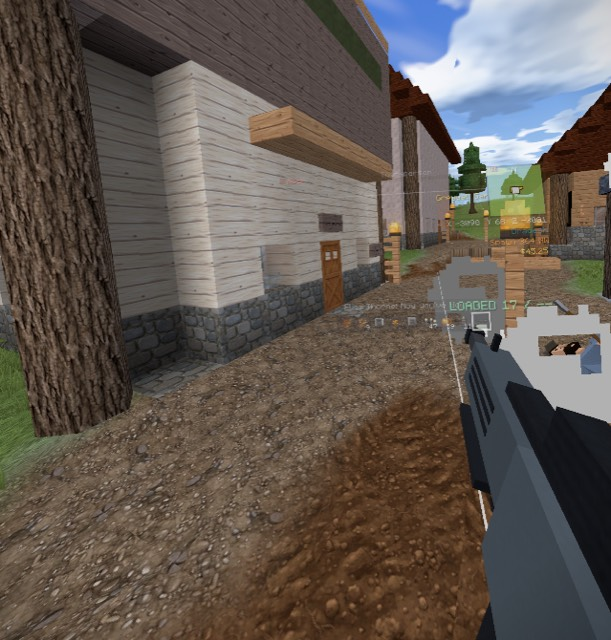

## 15:01:38 - I think the CPU or something, something's

- **Transcript:** I think the CPU or something, something's
- **Status:** open
- **Build:** 0.129 (9d6cbeeb, M1-M4 (device-tested; ship riding, chests, comfort options, weapon wheel))
- **World:** New World (10) (seed 4256271160485884755)
- **Dimension:** Surface
- **Biome:** Plains
- **Position:** -3089.4 68.0 -3031.8
- **Facing:** north-east (yaw 32, pitch -11)
- **Held:** Slatefall Carbine x1
- **Mount:** on foot
- **Looking at:** Cobblestone at -3088 68 -3036
- **Mode:** Creative, health 20/20
- **Time:** day 1 14:35, clear
- **Fps:** 37
- **Levels:** mic -33 dBFS, game sound -13 dBFS
- **Length:** 3.5 s (voice 1.7 s)
- **Just before:** -29s opened PauseMenu; -24s closed PauseMenu; -21s opened PauseMenu; -20s message: Creative mode; -20s closed PauseMenu; -19s walked into Beach; -19s message: Flying; -17s walked into Plains; -15s message: Walking; -12s message: Elias Thorne: Peaceful town. Let's keep it that way.; -8s message: Elias Thorne: Lower it. Slowly.; -5s message: Elias Thorne: Now you've done it.; -1s message: Nathaniel Pruitt: Help! Sheriff!
- **Repro (Mac):** `./snap.sh note --seed 4256271160485884755 --x -3089.4 --z -3031.8 --yaw -32 --pitch -11 --time 0.358`
- **Audio (this Mac):** /Users/darthvadar/Documents/Blocksmith/QuestVoiceNotes/raw/vn-20261030-150138-560.aac

## 15:01:41 - Having issues

- **Transcript:** Having issues
- **Status:** open
- **Build:** 0.129 (9d6cbeeb, M1-M4 (device-tested; ship riding, chests, comfort options, weapon wheel))
- **World:** New World (10) (seed 4256271160485884755)
- **Dimension:** Surface
- **Biome:** Plains
- **Position:** -3077.2 68.8 -3032.4
- **Facing:** north-east (yaw 53, pitch -12)
- **Held:** Slatefall Carbine x1
- **Mount:** on foot
- **Looking at:** Cobblestone at -3074 69 -3036
- **Mode:** Creative, health 20/20
- **Time:** day 1 14:37, clear
- **Fps:** 54
- **Levels:** mic -29 dBFS, game sound -18 dBFS
- **Length:** 1.8 s (voice 0.8 s)
- **Just before:** -26s closed PauseMenu; -23s opened PauseMenu; -22s message: Creative mode; -22s closed PauseMenu; -21s walked into Beach; -21s message: Flying; -19s walked into Plains; -17s message: Walking; -14s message: Elias Thorne: Peaceful town. Let's keep it that way.; -9s message: Elias Thorne: Lower it. Slowly.; -7s message: Elias Thorne: Now you've done it.; -3s message: Nathaniel Pruitt: Help! Sheriff!; -1s message: Calvin Rowe: Stop it! Help!
- **Repro (Mac):** `./snap.sh note --seed 4256271160485884755 --x -3077.2 --z -3032.4 --yaw -53 --pitch -12 --time 0.360`
- **Audio (this Mac):** /Users/darthvadar/Documents/Blocksmith/QuestVoiceNotes/raw/vn-20261030-150141-660.aac

## 15:02:04 - Yeah, I shouldn't be able to see a base from here. So it's just this i

- **Transcript:** Yeah, I shouldn't be able to see a base from here. So it's just this idea where you just build this simple block thing in the distance. That's just, that's just weak. Also, like
- **Status:** open
- **Build:** 0.129 (9d6cbeeb, M1-M4 (device-tested; ship riding, chests, comfort options, weapon wheel))
- **World:** New World (10) (seed 4256271160485884755)
- **Dimension:** Surface
- **Biome:** Taiga
- **Position:** -2887.3 110.5 -2796.5
- **Facing:** south-east (yaw 128, pitch -19)
- **Held:** Slatefall Carbine x1
- **Mount:** on foot, flying
- **Looking at:** nothing
- **Mode:** Creative, health 20/20
- **Time:** day 1 14:58, clear
- **Fps:** 57
- **Levels:** mic -31 dBFS, game sound -21 dBFS
- **Length:** 12.1 s (voice 7.1 s)
- **Just before:** -27s message: Elias Thorne: Lower it. Slowly.; -25s message: Elias Thorne: Now you've done it.; -21s message: Nathaniel Pruitt: Help! Sheriff!; -19s message: Calvin Rowe: Stop it! Help!; -17s message: Etta Vance: I'm too old for this.; -14s message: Loaded: 30 / 30; -14s opened PauseMenu; -14s closed PauseMenu; -13s message: Flying; -11s walked into Beach; -9s walked into Taiga; -5s walked into Cold Ocean; -3s walked into Plains; -1s walked into Taiga
- **While talking:** -3s walked into Taiga; -1s walked into Snowy Taiga; -4s walked into Snowy Taiga; -1s message: Intel: this base is an Ammo Depot
- **Position at the end:** -2529.6 142.5 -2726.4
- **Repro (Mac):** `./snap.sh note --seed 4256271160485884755 --x -2887.3 --z -2796.5 --yaw -128 --pitch -19 --time 0.374`
- **Audio (this Mac):** /Users/darthvadar/Documents/Blocksmith/QuestVoiceNotes/raw/vn-20261030-150204-580.aac

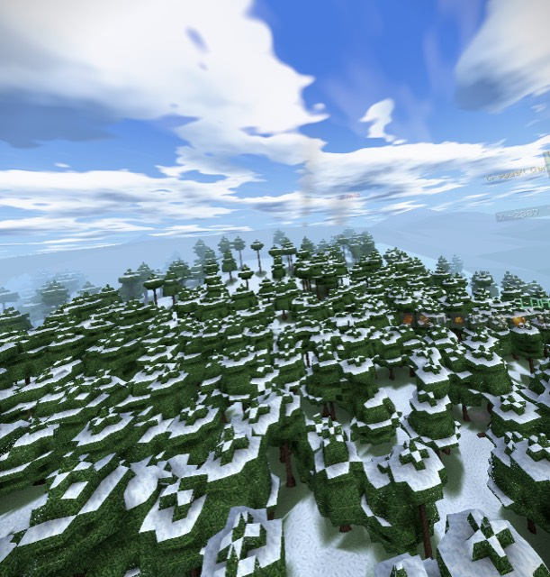

## 15:02:16 - Haven't seen many big bases. Oh, this one's attached to the fuel s- de

- **Transcript:** Haven't seen many big bases. Oh, this one's attached to the fuel s- depot. Hmm, hold on
- **Status:** open
- **Build:** 0.129 (9d6cbeeb, M1-M4 (device-tested; ship riding, chests, comfort options, weapon wheel))
- **World:** New World (10) (seed 4256271160485884755)
- **Dimension:** Surface
- **Biome:** Snowy Taiga
- **Position:** -2508.4 142.5 -2753.4
- **Facing:** south-east (yaw 152, pitch -39)
- **Held:** Slatefall Carbine x1
- **Mount:** on foot, flying
- **Looking at:** nothing
- **Mode:** Creative, health 20/20
- **Time:** day 1 15:07, clear
- **Fps:** 44
- **Levels:** mic -24 dBFS, game sound -20 dBFS
- **Length:** 6.1 s (voice 2.7 s)
- **Just before:** -28s message: Nathaniel Pruitt: Help! Sheriff!; -25s message: Calvin Rowe: Stop it! Help!; -23s message: Etta Vance: I'm too old for this.; -21s message: Loaded: 30 / 30; -21s opened PauseMenu; -20s closed PauseMenu; -20s message: Flying; -18s walked into Beach; -16s walked into Taiga; -12s walked into Cold Ocean; -10s walked into Plains; -8s walked into Taiga; -6s walked into Snowy Taiga; -2s message: Intel: this base is an Ammo Depot
- **While talking:** -5s message: Intel: this base is an Ammo Depot; -1s message: Walking
- **Position at the end:** -2458.0 128.5 -2687.8
- **Repro (Mac):** `./snap.sh note --seed 4256271160485884755 --x -2508.4 --z -2753.4 --yaw -152 --pitch -39 --time 0.380`
- **Audio (this Mac):** /Users/darthvadar/Documents/Blocksmith/QuestVoiceNotes/raw/vn-20261030-150216-381.aac

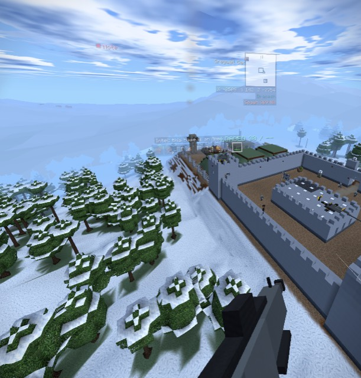

## 15:02:32 - It's having a real hard time right now with FPS

- **Transcript:** It's having a real hard time right now with FPS
- **Status:** open
- **Build:** 0.129 (9d6cbeeb, M1-M4 (device-tested; ship riding, chests, comfort options, weapon wheel))
- **World:** New World (10) (seed 4256271160485884755)
- **Dimension:** Surface
- **Biome:** Snowy Taiga
- **Position:** -2446.5 112.6 -2687.2
- **Facing:** north (yaw 17, pitch -8)
- **Held:** Slatefall Carbine x1
- **Mount:** on foot
- **Looking at:** nothing
- **Mode:** Survival, health 20/20
- **Time:** day 1 15:14, clear
- **Fps:** 29
- **Levels:** mic -26 dBFS, game sound -19 dBFS
- **Length:** 3.8 s (voice 2.0 s)
- **Just before:** -29s message: Loaded: 30 / 30; -28s opened PauseMenu; -28s closed PauseMenu; -27s message: Flying; -25s walked into Beach; -23s walked into Taiga; -19s walked into Cold Ocean; -17s walked into Plains; -15s walked into Taiga; -13s walked into Snowy Taiga; -9s message: Intel: this base is an Ammo Depot; -5s message: Walking; -4s opened PauseMenu; -3s closed PauseMenu; -3s opened PauseMenu; -3s message: Survival mode; -2s closed PauseMenu
- **Repro (Mac):** `./snap.sh note --seed 4256271160485884755 --x -2446.5 --z -2687.2 --yaw -17 --pitch -8 --time 0.385`
- **Audio (this Mac):** /Users/darthvadar/Documents/Blocksmith/QuestVoiceNotes/raw/vn-20261030-150232-800.aac

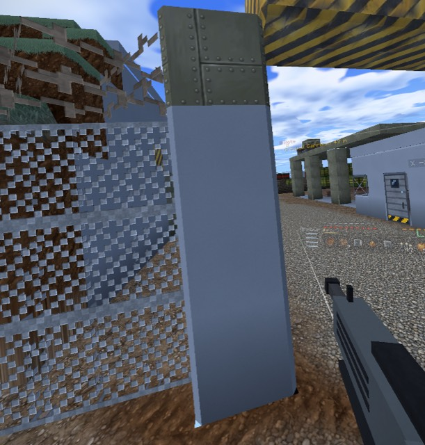

## 15:02:46 - What is this?

- **Transcript:** What is this?
- **Status:** open
- **Build:** 0.129 (9d6cbeeb, M1-M4 (device-tested; ship riding, chests, comfort options, weapon wheel))
- **World:** New World (10) (seed 4256271160485884755)
- **Dimension:** Surface
- **Biome:** Snowy Taiga
- **Position:** -2437.2 113.0 -2713.4
- **Facing:** north (yaw 9, pitch -19)
- **Held:** Slatefall Carbine x1
- **Mount:** on foot
- **Looking at:** Supply Crate at -2437 113 -2717
- **Mode:** Survival, health 14/20
- **Time:** day 1 15:24, clear
- **Fps:** 59
- **Levels:** mic -28 dBFS, game sound -23 dBFS
- **Length:** 2.1 s (voice 0.7 s)
- **Just before:** -28s walked into Cold Ocean; -26s walked into Plains; -24s walked into Taiga; -22s walked into Snowy Taiga; -18s message: Intel: this base is an Ammo Depot; -14s message: Walking; -12s opened PauseMenu; -12s closed PauseMenu; -12s opened PauseMenu; -11s message: Survival mode; -11s closed PauseMenu; -7s took 4 damage (health 16/20); -6s message: The Greywall Garrison is sounding the alarm!; -5s took 3 damage (health 13/20); -2s into the pack: Regular Armour Set
- **Repro (Mac):** `./snap.sh note --seed 4256271160485884755 --x -2437.2 --z -2713.4 --yaw -9 --pitch -19 --time 0.392`
- **Audio (this Mac):** /Users/darthvadar/Documents/Blocksmith/QuestVoiceNotes/raw/vn-20261030-150246-560.aac

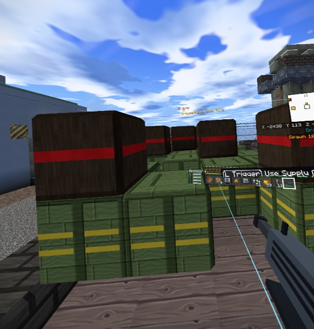

## 15:02:51 - Okay, there's too many supplies here

- **Transcript:** Okay, there's too many supplies here
- **Status:** open
- **Build:** 0.129 (9d6cbeeb, M1-M4 (device-tested; ship riding, chests, comfort options, weapon wheel))
- **World:** New World (10) (seed 4256271160485884755)
- **Dimension:** Surface
- **Biome:** Snowy Taiga
- **Position:** -2435.5 115.6 -2719.5
- **Facing:** north (yaw 360, pitch -54)
- **Held:** Slatefall Carbine x1
- **Mount:** on foot
- **Looking at:** Ashguard Crate at -2436 114 -2722
- **Mode:** Survival, health 14/20
- **Time:** day 1 15:30, clear
- **Fps:** 68
- **Levels:** mic -26 dBFS, game sound -20 dBFS
- **Length:** 3.1 s (voice 1.4 s)
- **Just before:** -29s walked into Taiga; -27s walked into Snowy Taiga; -23s message: Intel: this base is an Ammo Depot; -19s message: Walking; -17s opened PauseMenu; -17s closed PauseMenu; -16s opened PauseMenu; -16s message: Survival mode; -16s closed PauseMenu; -12s took 4 damage (health 16/20); -11s message: The Greywall Garrison is sounding the alarm!; -10s took 3 damage (health 13/20); -7s into the pack: Regular Armour Set; -4s opened ChestMenu; -3s closed ChestMenu; -3s opened ChestMenu; -3s closed ChestMenu; -2s opened ChestMenu; -1s closed ChestMenu; -1s opened ChestMenu; -0s closed ChestMenu
- **Repro (Mac):** `./snap.sh note --seed 4256271160485884755 --x -2435.5 --z -2719.5 --yaw 0 --pitch -54 --time 0.396`
- **Audio (this Mac):** /Users/darthvadar/Documents/Blocksmith/QuestVoiceNotes/raw/vn-20261030-150251-880.aac

## 15:03:10 - Too, way too many supplies. It's just too much. Like, no one would eve

- **Transcript:** Too, way too many supplies. It's just too much. Like, no one would ever have to search again for stuff
- **Status:** open
- **Build:** 0.129 (9d6cbeeb, M1-M4 (device-tested; ship riding, chests, comfort options, weapon wheel))
- **World:** New World (10) (seed 4256271160485884755)
- **Dimension:** Surface
- **Biome:** Snowy Taiga
- **Position:** -2451.3 112.0 -2697.1
- **Facing:** south-west (yaw 235, pitch -9)
- **Held:** Slatefall Carbine x1
- **Mount:** on foot
- **Looking at:** Ashguard Crate at -2454 112 -2695
- **Mode:** Survival, health 14/20
- **Time:** day 1 15:49, clear
- **Fps:** 51
- **Levels:** mic -25 dBFS, game sound -18 dBFS
- **Length:** 6.8 s (voice 3.5 s)
- **Just before:** -27s took 4 damage (health 16/20); -26s message: The Greywall Garrison is sounding the alarm!; -25s took 3 damage (health 13/20); -22s into the pack: Regular Armour Set; -20s opened ChestMenu; -19s closed ChestMenu; -18s opened ChestMenu; -18s closed ChestMenu; -17s opened ChestMenu; -17s closed ChestMenu; -17s opened ChestMenu; -16s closed ChestMenu; -9s opened ChestMenu; -8s closed ChestMenu; -8s opened ChestMenu; -8s closed ChestMenu; -1s opened ChestMenu; -1s closed ChestMenu
- **While talking:** -5s opened ChestMenu; -4s closed ChestMenu; -3s opened ChestMenu; -1s closed ChestMenu; -1s opened ChestMenu; -0s closed ChestMenu
- **Position at the end:** -2456.7 112.0 -2697.0
- **Repro (Mac):** `./snap.sh note --seed 4256271160485884755 --x -2451.3 --z -2697.1 --yaw 125 --pitch -9 --time 0.409`
- **Audio (this Mac):** /Users/darthvadar/Documents/Blocksmith/QuestVoiceNotes/raw/vn-20261030-150310-660.aac

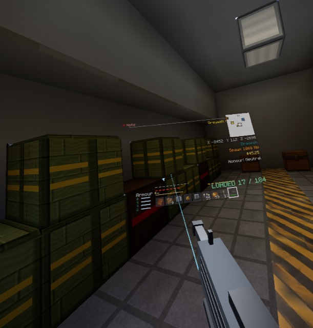

## 15:03:20 - This doesn't look, uh, this doesn't look like the depot. It's not an a

- **Transcript:** This doesn't look, uh, this doesn't look like the depot. It's not an ammo cache. I don't know what this... This is supposed to be an ammo cache. It's not
- **Status:** open
- **Build:** 0.129 (9d6cbeeb, M1-M4 (device-tested; ship riding, chests, comfort options, weapon wheel))
- **World:** New World (10) (seed 4256271160485884755)
- **Dimension:** Surface
- **Biome:** Snowy Taiga
- **Position:** -2441.1 111.8 -2704.3
- **Facing:** north-west (yaw 310, pitch -15)
- **Held:** Slatefall Carbine x1
- **Mount:** on foot
- **Looking at:** nothing
- **Mode:** Survival, health 14/20
- **Time:** day 1 15:59, clear
- **Fps:** 71
- **Levels:** mic -26 dBFS, game sound -18 dBFS
- **Length:** 8.6 s (voice 5.0 s)
- **Just before:** -28s opened ChestMenu; -27s closed ChestMenu; -27s opened ChestMenu; -27s closed ChestMenu; -26s opened ChestMenu; -25s closed ChestMenu; -25s opened ChestMenu; -24s closed ChestMenu; -17s opened ChestMenu; -17s closed ChestMenu; -17s opened ChestMenu; -16s closed ChestMenu; -10s opened ChestMenu; -9s closed ChestMenu; -8s opened ChestMenu; -8s closed ChestMenu; -6s opened ChestMenu; -5s closed ChestMenu; -4s opened ChestMenu; -4s closed ChestMenu
- **Position at the end:** -2443.8 111.8 -2710.4
- **Repro (Mac):** `./snap.sh note --seed 4256271160485884755 --x -2441.1 --z -2704.3 --yaw 50 --pitch -15 --time 0.416`
- **Audio (this Mac):** /Users/darthvadar/Documents/Blocksmith/QuestVoiceNotes/raw/vn-20261030-150320-160.aac

## 15:03:28 - There's no ammo

- **Transcript:** There's no ammo
- **Status:** open
- **Build:** 0.129 (9d6cbeeb, M1-M4 (device-tested; ship riding, chests, comfort options, weapon wheel))
- **World:** New World (10) (seed 4256271160485884755)
- **Dimension:** Surface
- **Biome:** Snowy Taiga
- **Position:** -2448.6 112.0 -2725.7
- **Facing:** west (yaw 279, pitch -29)
- **Held:** Slatefall Carbine x1
- **Mount:** on foot
- **Looking at:** Bulkhead Door at -2450 113 -2726
- **Mode:** Survival, health 14/20
- **Time:** day 1 16:06, clear
- **Fps:** 48
- **Levels:** mic -25 dBFS, game sound -20 dBFS
- **Length:** 1.9 s (voice 0.6 s)
- **Just before:** -23s opened ChestMenu; -23s closed ChestMenu; -22s opened ChestMenu; -22s closed ChestMenu; -15s opened ChestMenu; -15s closed ChestMenu; -14s opened ChestMenu; -14s closed ChestMenu; -12s opened ChestMenu; -10s closed ChestMenu; -10s opened ChestMenu; -9s closed ChestMenu
- **Repro (Mac):** `./snap.sh note --seed 4256271160485884755 --x -2448.6 --z -2725.7 --yaw 81 --pitch -29 --time 0.421`
- **Audio (this Mac):** /Users/darthvadar/Documents/Blocksmith/QuestVoiceNotes/raw/vn-20261030-150328-920.aac

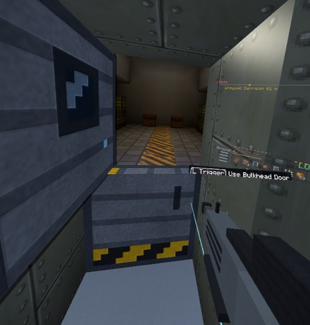

## 15:03:31 - It's not supposed to have blocks. Okay, well, there is ammo, but

- **Transcript:** It's not supposed to have blocks. Okay, well, there is ammo, but
- **Status:** open
- **Build:** 0.129 (9d6cbeeb, M1-M4 (device-tested; ship riding, chests, comfort options, weapon wheel))
- **World:** New World (10) (seed 4256271160485884755)
- **Dimension:** Surface
- **Biome:** Snowy Taiga
- **Position:** -2455.1 112.0 -2724.9
- **Facing:** west (yaw 264, pitch -16)
- **Held:** Slatefall Carbine x1
- **Mount:** on foot
- **Looking at:** Chest at -2460 112 -2725
- **Mode:** Survival, health 14/20
- **Time:** day 1 16:08, clear
- **Fps:** 51
- **Levels:** mic -40 dBFS, game sound -23 dBFS
- **Length:** 4.2 s (voice 2.1 s)
- **Just before:** -25s opened ChestMenu; -25s closed ChestMenu; -24s opened ChestMenu; -24s closed ChestMenu; -17s opened ChestMenu; -17s closed ChestMenu; -16s opened ChestMenu; -15s closed ChestMenu; -14s opened ChestMenu; -12s closed ChestMenu; -12s opened ChestMenu; -11s closed ChestMenu
- **Repro (Mac):** `./snap.sh note --seed 4256271160485884755 --x -2455.1 --z -2724.9 --yaw 96 --pitch -16 --time 0.423`
- **Audio (this Mac):** /Users/darthvadar/Documents/Blocksmith/QuestVoiceNotes/raw/vn-20261030-150331-220.aac

## 15:03:35 - What's all this block shit in the side?

- **Transcript:** What's all this block shit in the side?
- **Status:** open
- **Build:** 0.129 (9d6cbeeb, M1-M4 (device-tested; ship riding, chests, comfort options, weapon wheel))
- **World:** New World (10) (seed 4256271160485884755)
- **Dimension:** Surface
- **Biome:** Snowy Taiga
- **Position:** -2457.2 112.0 -2725.8
- **Facing:** north (yaw 14, pitch -2)
- **Held:** Slatefall Carbine x1
- **Mount:** on foot
- **Looking at:** Supply Crate at -2457 113 -2729
- **Mode:** Survival, health 14/20
- **Time:** day 1 16:14, clear
- **Fps:** 71
- **Levels:** mic -22 dBFS, game sound -14 dBFS
- **Length:** 2.6 s (voice 1.1 s)
- **Just before:** -30s opened ChestMenu; -29s closed ChestMenu; -29s opened ChestMenu; -28s closed ChestMenu; -22s opened ChestMenu; -21s closed ChestMenu; -20s opened ChestMenu; -20s closed ChestMenu; -18s opened ChestMenu; -17s closed ChestMenu; -17s opened ChestMenu; -16s closed ChestMenu; -4s opened ChestMenu; -3s closed ChestMenu; -3s opened ChestMenu; -2s closed ChestMenu; -2s opened ChestMenu; -1s closed ChestMenu
- **Repro (Mac):** `./snap.sh note --seed 4256271160485884755 --x -2457.2 --z -2725.8 --yaw -14 --pitch -2 --time 0.427`
- **Audio (this Mac):** /Users/darthvadar/Documents/Blocksmith/QuestVoiceNotes/raw/vn-20261030-150335-900.aac

## 15:03:46 - Look at all these triangles

- **Transcript:** Look at all these triangles
- **Status:** open
- **Build:** 0.129 (9d6cbeeb, M1-M4 (device-tested; ship riding, chests, comfort options, weapon wheel))
- **World:** New World (10) (seed 4256271160485884755)
- **Dimension:** Surface
- **Biome:** Snowy Taiga
- **Position:** -2446.0 112.6 -2686.8
- **Facing:** north-west (yaw 313, pitch -53)
- **Held:** Slatefall Carbine x1
- **Mount:** on foot
- **Looking at:** Coarse Dirt at -2448 111 -2689
- **Mode:** Survival, health 14/20
- **Time:** day 1 16:22, clear
- **Fps:** 44
- **Levels:** mic -24 dBFS, game sound -20 dBFS
- **Length:** 2.7 s (voice 1.2 s)
- **Just before:** -29s opened ChestMenu; -28s closed ChestMenu; -27s opened ChestMenu; -27s closed ChestMenu; -25s opened ChestMenu; -24s closed ChestMenu; -23s opened ChestMenu; -23s closed ChestMenu; -11s opened ChestMenu; -10s closed ChestMenu; -10s opened ChestMenu; -9s closed ChestMenu; -9s opened ChestMenu; -8s closed ChestMenu; -7s opened ChestMenu; -6s closed ChestMenu
- **Repro (Mac):** `./snap.sh note --seed 4256271160485884755 --x -2446.0 --z -2686.8 --yaw 47 --pitch -53 --time 0.432`
- **Audio (this Mac):** /Users/darthvadar/Documents/Blocksmith/QuestVoiceNotes/raw/vn-20261030-150346-560.aac

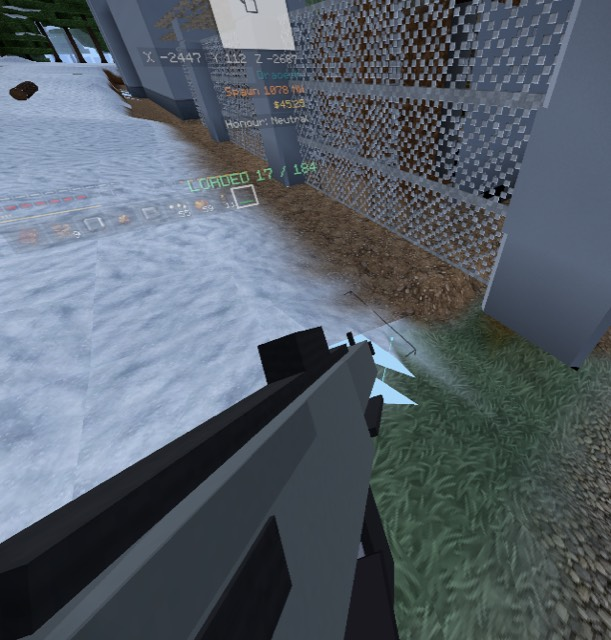

## 15:03:59 - Yeah, like I said, the game is definitely struggling right now

- **Transcript:** Yeah, like I said, the game is definitely struggling right now
- **Status:** open
- **Build:** 0.129 (9d6cbeeb, M1-M4 (device-tested; ship riding, chests, comfort options, weapon wheel))
- **World:** New World (10) (seed 4256271160485884755)
- **Dimension:** Surface
- **Biome:** Snowy Taiga
- **Position:** -2468.2 112.4 -2687.1
- **Facing:** south-west (yaw 234, pitch 47)
- **Held:** Golden Apple x58
- **Mount:** on foot
- **Looking at:** nothing
- **Mode:** Survival, health 11/20
- **Time:** day 1 16:33, clear
- **Fps:** 60
- **Levels:** mic -27 dBFS, game sound -15 dBFS
- **Length:** 3.8 s (voice 2.2 s)
- **Just before:** -20s opened ChestMenu; -19s closed ChestMenu; -18s opened ChestMenu; -18s closed ChestMenu; -17s opened ChestMenu; -17s closed ChestMenu; -16s opened ChestMenu; -15s closed ChestMenu; -5s message: Greywall Command now counts you hunted.; -5s took 4 damage (health 10/20); -3s holding Rifle Magazine; -2s message: Loaded: 30 / 30; -2s holding Golden Apple
- **Repro (Mac):** `./snap.sh note --seed 4256271160485884755 --x -2468.2 --z -2687.1 --yaw 126 --pitch 47 --time 0.440`
- **Audio (this Mac):** /Users/darthvadar/Documents/Blocksmith/QuestVoiceNotes/raw/vn-20261030-150359-160.aac

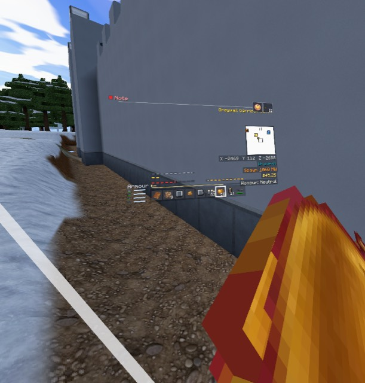

## 15:04:11 - It's really struggling

- **Transcript:** It's really struggling
- **Status:** open
- **Build:** 0.129 (9d6cbeeb, M1-M4 (device-tested; ship riding, chests, comfort options, weapon wheel))
- **World:** New World (10) (seed 4256271160485884755)
- **Dimension:** Surface
- **Biome:** Snowy Taiga
- **Position:** -2482.8 113.9 -2684.5
- **Facing:** north-west (yaw 325, pitch -41)
- **Held:** Slatefall Carbine x1
- **Mount:** on foot
- **Looking at:** Snow at -2484 114 -2686
- **Mode:** Survival, health 20/20
- **Time:** day 1 16:39, clear
- **Fps:** 72
- **Levels:** mic -25 dBFS, game sound -18 dBFS
- **Length:** 2.2 s (voice 0.8 s)
- **Just before:** -30s opened ChestMenu; -29s closed ChestMenu; -29s opened ChestMenu; -28s closed ChestMenu; -27s opened ChestMenu; -27s closed ChestMenu; -16s message: Greywall Command now counts you hunted.; -16s took 4 damage (health 10/20); -14s holding Rifle Magazine; -14s message: Loaded: 30 / 30; -14s holding Golden Apple; -7s holding Rifle Magazine; -7s message: Rifle Magazine; -7s holding Slatefall Carbine; -7s message: Slatefall Carbine; -6s opened PauseMenu; -1s closed PauseMenu
- **Repro (Mac):** `./snap.sh note --seed 4256271160485884755 --x -2482.8 --z -2684.5 --yaw 35 --pitch -41 --time 0.444`
- **Audio (this Mac):** /Users/darthvadar/Documents/Blocksmith/QuestVoiceNotes/raw/vn-20261030-150411-380.aac

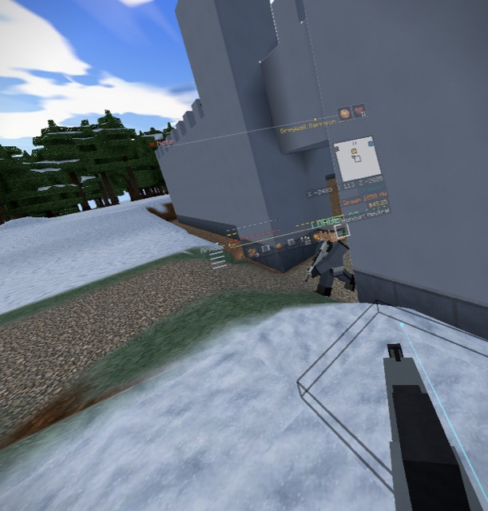

## 15:05:05 - Okay, the turrets can't hit me from here, so they should, shouldn't be

- **Transcript:** Okay, the turrets can't hit me from here, so they should, shouldn't be trying to shoot me
- **Status:** open
- **Build:** 0.129 (9d6cbeeb, M1-M4 (device-tested; ship riding, chests, comfort options, weapon wheel))
- **World:** New World (10) (seed 4256271160485884755)
- **Dimension:** Surface
- **Biome:** Snowy Taiga
- **Position:** -2469.7 111.8 -2707.0
- **Facing:** north (yaw 10, pitch 20)
- **Held:** Slatefall Carbine x1
- **Mount:** on foot
- **Looking at:** nothing
- **Mode:** Survival, health 20/20
- **Time:** day 1 17:23, clear
- **Fps:** 44
- **Levels:** mic -23 dBFS, game sound -19 dBFS
- **Length:** 5.3 s (voice 3.2 s)
- **Just before:** -29s took 3 damage (health 13/20); -28s holding Rifle Magazine; -28s message: Rifle Magazine; -28s holding Golden Apple; -28s message: Golden Apple; -26s holding Rifle Magazine; -26s message: Rifle Magazine; -26s holding Slatefall Carbine; -26s message: Slatefall Carbine; -25s message: Loaded: 30 / 30; -21s holding Rifle Magazine; -21s took 17 damage (health 5/20); -20s holding Golden Apple; -17s holding Rifle Magazine; -17s message: Rifle Magazine; -17s holding Slatefall Carbine; -17s message: Slatefall Carbine; -16s message: Loaded: 30 / 30; -15s took 4 damage (health 13/20); -15s holding Rifle Magazine; -15s holding Golden Apple; -13s holding Rifle Magazine; -13s message: Rifle Magazine; -13s holding Slatefall Carbine; -13s message: Slatefall Carbine; -12s into the pack: Sechser Revolver; -9s took 1 damage (health 20/20); -8s took 5 damage (health 16/20); -6s message: Loaded: 30 / 30
- **Repro (Mac):** `./snap.sh note --seed 4256271160485884755 --x -2469.7 --z -2707.0 --yaw -10 --pitch 20 --time 0.475`
- **Audio (this Mac):** /Users/darthvadar/Documents/Blocksmith/QuestVoiceNotes/raw/vn-20261030-150505-200.aac

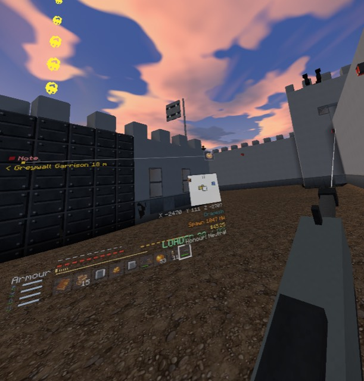

## 15:05:11 - Also, the enemies need to be tougher proportionally to the difficulty 

- **Transcript:** Also, the enemies need to be tougher proportionally to the difficulty being played.
- **Status:** open
- **Build:** 0.129 (9d6cbeeb, M1-M4 (device-tested; ship riding, chests, comfort options, weapon wheel))
- **World:** New World (10) (seed 4256271160485884755)
- **Dimension:** Surface
- **Biome:** Snowy Taiga
- **Position:** -2473.8 111.8 -2722.0
- **Facing:** west (yaw 269, pitch -15)
- **Held:** Slatefall Carbine x1
- **Mount:** on foot
- **Looking at:** nothing
- **Mode:** Survival, health 14/20
- **Time:** day 1 17:29, clear
- **Fps:** 63
- **Levels:** mic -30 dBFS, game sound -16 dBFS
- **Length:** 5.3 s (voice 3.0 s)
- **Just before:** -26s holding Rifle Magazine; -26s took 17 damage (health 5/20); -26s holding Golden Apple; -22s holding Rifle Magazine; -22s message: Rifle Magazine; -22s holding Slatefall Carbine; -22s message: Slatefall Carbine; -21s message: Loaded: 30 / 30; -21s took 4 damage (health 13/20); -21s holding Rifle Magazine; -20s holding Golden Apple; -19s holding Rifle Magazine; -19s message: Rifle Magazine; -18s holding Slatefall Carbine; -18s message: Slatefall Carbine; -17s into the pack: Sechser Revolver; -15s took 1 damage (health 20/20); -13s took 5 damage (health 16/20); -12s message: Loaded: 30 / 30; -1s took 8 damage (health 13/20)
- **Repro (Mac):** `./snap.sh note --seed 4256271160485884755 --x -2473.8 --z -2722.0 --yaw 91 --pitch -15 --time 0.479`
- **Audio (this Mac):** /Users/darthvadar/Documents/Blocksmith/QuestVoiceNotes/raw/vn-20261030-150511-360.aac

## 15:05:23 - So the ground troops, they're fine, but the spec ops seem to be toughe

- **Transcript:** So the ground troops, they're fine, but the spec ops seem to be tougher and especially the
- **Status:** open
- **Build:** 0.129 (9d6cbeeb, M1-M4 (device-tested; ship riding, chests, comfort options, weapon wheel))
- **World:** New World (10) (seed 4256271160485884755)
- **Dimension:** Surface
- **Biome:** Snowy Taiga
- **Position:** -2498.2 112.2 -2702.9
- **Facing:** south-east (yaw 128, pitch -6)
- **Held:** Slatefall Carbine x1
- **Mount:** on foot
- **Looking at:** nothing
- **Mode:** Survival, health 20/20
- **Time:** day 1 17:43, clear
- **Fps:** 65
- **Levels:** mic -33 dBFS, game sound -14 dBFS
- **Length:** 6.8 s (voice 4.0 s)
- **Just before:** -30s holding Rifle Magazine; -30s message: Rifle Magazine; -29s holding Slatefall Carbine; -29s message: Slatefall Carbine; -28s into the pack: Sechser Revolver; -26s took 1 damage (health 20/20); -24s took 5 damage (health 16/20); -23s message: Loaded: 30 / 30; -12s took 8 damage (health 13/20); -5s into the pack: Kessel Bolt Rifle; -5s into the pack: Spec Ops Armour Set; -1s into the pack: Slatefall Carbine
- **While talking:** -5s into the pack: Slatefall Carbine
- **Position at the end:** -2495.9 112.0 -2698.1
- **Repro (Mac):** `./snap.sh note --seed 4256271160485884755 --x -2498.2 --z -2702.9 --yaw -128 --pitch -6 --time 0.488`
- **Audio (this Mac):** /Users/darthvadar/Documents/Blocksmith/QuestVoiceNotes/raw/vn-20261030-150523-640.aac

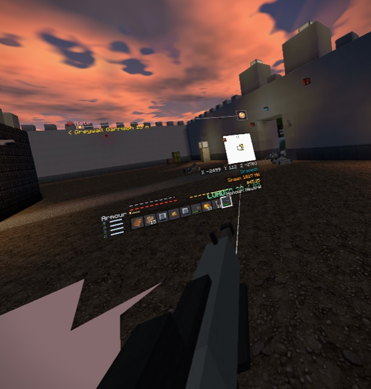

## 15:05:30 - The level of claustrophobia above them

- **Transcript:** The level of claustrophobia above them
- **Status:** open
- **Build:** 0.129 (9d6cbeeb, M1-M4 (device-tested; ship riding, chests, comfort options, weapon wheel))
- **World:** New World (10) (seed 4256271160485884755)
- **Dimension:** Surface
- **Biome:** Snowy Taiga
- **Position:** -2490.4 112.0 -2702.9
- **Facing:** north-east (yaw 31, pitch -9)
- **Held:** Slatefall Carbine x1
- **Mount:** on foot
- **Looking at:** nothing
- **Mode:** Survival, health 20/20
- **Time:** day 1 17:49, clear
- **Fps:** 59
- **Levels:** mic -36 dBFS, game sound -14 dBFS
- **Length:** 2.9 s (voice 1.2 s)
- **Just before:** -30s took 5 damage (health 16/20); -28s message: Loaded: 30 / 30; -17s took 8 damage (health 13/20); -10s into the pack: Kessel Bolt Rifle; -10s into the pack: Spec Ops Armour Set; -6s into the pack: Slatefall Carbine; -0s message: Hattie Wainwright: Hello there. Watch the mud by the trough.
- **Repro (Mac):** `./snap.sh note --seed 4256271160485884755 --x -2490.4 --z -2702.9 --yaw -31 --pitch -9 --time 0.493`
- **Audio (this Mac):** /Users/darthvadar/Documents/Blocksmith/QuestVoiceNotes/raw/vn-20261030-150530-540.aac

## 15:05:59 - This guy is trying to shoot me through the door earlier

- **Transcript:** This guy is trying to shoot me through the door earlier
- **Status:** open
- **Build:** 0.129 (9d6cbeeb, M1-M4 (device-tested; ship riding, chests, comfort options, weapon wheel))
- **World:** New World (10) (seed 4256271160485884755)
- **Dimension:** Surface
- **Biome:** Snowy Taiga
- **Position:** -2487.7 112.0 -2713.8
- **Facing:** west (yaw 254, pitch -11)
- **Held:** Slatefall Carbine x1
- **Mount:** on foot
- **Looking at:** Bulkhead Door at -2491 112 -2713
- **Mode:** Survival, health 16/20
- **Time:** day 1 18:19, clear
- **Fps:** 67
- **Levels:** mic -20 dBFS, game sound -15 dBFS
- **Length:** 3.4 s (voice 1.9 s)
- **Just before:** -25s message: Hattie Wainwright: Hello there. Watch the mud by the trough.; -22s message: You've reached Greywall Garrison; -20s message: Hattie Wainwright: Get inside! They're coming!; -17s message: Honour lowered (assault); -11s took 8 damage (health 13/20); -9s message: Loaded: 30 / 30; -8s took 8 damage (health 5/20); -6s holding Rifle Magazine; -6s message: Rifle Magazine; -6s holding Golden Apple; -6s message: Golden Apple; -2s holding Rifle Magazine; -2s message: Rifle Magazine; -2s holding Slatefall Carbine; -2s message: Slatefall Carbine
- **Repro (Mac):** `./snap.sh note --seed 4256271160485884755 --x -2487.7 --z -2713.8 --yaw 106 --pitch -11 --time 0.514`
- **Audio (this Mac):** /Users/darthvadar/Documents/Blocksmith/QuestVoiceNotes/raw/vn-20261030-150559-880.aac

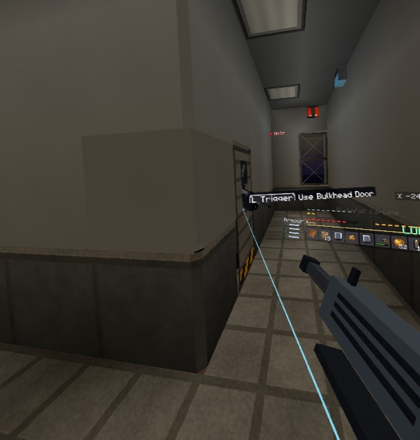

## 15:06:04 - Also, the door didn't quite open in a good time.

- **Transcript:** Also, the door didn't quite open in a good time.
- **Status:** open
- **Build:** 0.129 (9d6cbeeb, M1-M4 (device-tested; ship riding, chests, comfort options, weapon wheel))
- **World:** New World (10) (seed 4256271160485884755)
- **Dimension:** Surface
- **Biome:** Snowy Taiga
- **Position:** -2490.7 112.0 -2714.7
- **Facing:** south (yaw 189, pitch -17)
- **Held:** Slatefall Carbine x1
- **Mount:** on foot
- **Looking at:** Bulkhead Door at -2491 112 -2713
- **Mode:** Survival, health 9/20
- **Time:** day 1 18:24, clear
- **Fps:** 68
- **Levels:** mic -30 dBFS, game sound -18 dBFS
- **Length:** 4.0 s (voice 2.1 s)
- **Just before:** -29s message: Hattie Wainwright: Hello there. Watch the mud by the trough.; -26s message: You've reached Greywall Garrison; -24s message: Hattie Wainwright: Get inside! They're coming!; -22s message: Honour lowered (assault); -15s took 8 damage (health 13/20); -13s message: Loaded: 30 / 30; -13s took 8 damage (health 5/20); -10s holding Rifle Magazine; -10s message: Rifle Magazine; -10s holding Golden Apple; -10s message: Golden Apple; -7s holding Rifle Magazine; -7s message: Rifle Magazine; -7s holding Slatefall Carbine; -7s message: Slatefall Carbine; -1s took 10 damage (health 9/20); -0s into the pack: Regular Armour Set
- **Repro (Mac):** `./snap.sh note --seed 4256271160485884755 --x -2490.7 --z -2714.7 --yaw 171 --pitch -17 --time 0.517`
- **Audio (this Mac):** /Users/darthvadar/Documents/Blocksmith/QuestVoiceNotes/raw/vn-20261030-150604-580.aac

## 15:06:14 - Oh, I see, I see why it's like this. Okay, with... Ugh

- **Transcript:** Oh, I see, I see why it's like this. Okay, with... Ugh
- **Status:** open
- **Build:** 0.129 (9d6cbeeb, M1-M4 (device-tested; ship riding, chests, comfort options, weapon wheel))
- **World:** New World (10) (seed 4256271160485884755)
- **Dimension:** Surface
- **Biome:** Snowy Taiga
- **Position:** -2484.2 112.0 -2710.5
- **Facing:** north-east (yaw 38, pitch -18)
- **Held:** Slatefall Carbine x1
- **Mount:** on foot
- **Looking at:** Armour Plate at -2483 112 -2713
- **Mode:** Survival, health 6/20
- **Time:** day 1 18:36, clear
- **Fps:** 68
- **Levels:** mic -21 dBFS, game sound -20 dBFS
- **Length:** 5.7 s (voice 2.6 s)
- **Just before:** -25s took 8 damage (health 13/20); -23s message: Loaded: 30 / 30; -22s took 8 damage (health 5/20); -20s holding Rifle Magazine; -20s message: Rifle Magazine; -20s holding Golden Apple; -20s message: Golden Apple; -16s holding Rifle Magazine; -16s message: Rifle Magazine; -16s holding Slatefall Carbine; -16s message: Slatefall Carbine; -10s took 10 damage (health 9/20); -10s into the pack: Regular Armour Set; -9s message: Loaded: 30 / 30; -8s into the pack: Slatefall Carbine; -8s opened ChestMenu; -5s closed ChestMenu; -2s took 5 damage (health 5/20)
- **While talking:** -4s into the pack: Greywall Dispatch
- **Position at the end:** -2485.2 112.0 -2713.7
- **Repro (Mac):** `./snap.sh note --seed 4256271160485884755 --x -2484.2 --z -2710.5 --yaw -38 --pitch -18 --time 0.525`
- **Audio (this Mac):** /Users/darthvadar/Documents/Blocksmith/QuestVoiceNotes/raw/vn-20261030-150614-740.aac

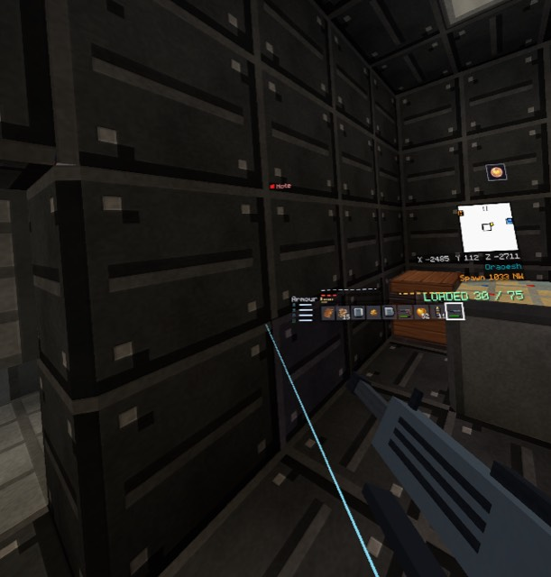

## 15:06:21 - Let's make it so that the base hall to begin with

- **Transcript:** Let's make it so that the base hall to begin with
- **Status:** open
- **Build:** 0.129 (9d6cbeeb, M1-M4 (device-tested; ship riding, chests, comfort options, weapon wheel))
- **World:** New World (10) (seed 4256271160485884755)
- **Dimension:** Surface
- **Biome:** Snowy Taiga
- **Position:** -2485.9 112.0 -2714.0
- **Facing:** south-west (yaw 241, pitch -2)
- **Held:** Slatefall Carbine x1
- **Mount:** on foot
- **Looking at:** Station Concrete at -2490 113 -2713
- **Mode:** Survival, health 7/20
- **Time:** day 1 18:43, clear
- **Fps:** 64
- **Levels:** mic -33 dBFS, game sound -19 dBFS
- **Length:** 4.7 s (voice 2.0 s)
- **Just before:** -29s message: Loaded: 30 / 30; -29s took 8 damage (health 5/20); -26s holding Rifle Magazine; -26s message: Rifle Magazine; -26s holding Golden Apple; -26s message: Golden Apple; -23s holding Rifle Magazine; -23s message: Rifle Magazine; -22s holding Slatefall Carbine; -22s message: Slatefall Carbine; -16s took 10 damage (health 9/20); -16s into the pack: Regular Armour Set; -15s message: Loaded: 30 / 30; -14s into the pack: Slatefall Carbine; -14s opened ChestMenu; -11s closed ChestMenu; -8s took 5 damage (health 5/20); -5s into the pack: Greywall Dispatch
- **Repro (Mac):** `./snap.sh note --seed 4256271160485884755 --x -2485.9 --z -2714.0 --yaw 119 --pitch -2 --time 0.530`
- **Audio (this Mac):** /Users/darthvadar/Documents/Blocksmith/QuestVoiceNotes/raw/vn-20261030-150621-460.aac

## 15:06:27 - considered armor

- **Transcript:** considered armor
- **Status:** open
- **Build:** 0.129 (9d6cbeeb, M1-M4 (device-tested; ship riding, chests, comfort options, weapon wheel))
- **World:** New World (10) (seed 4256271160485884755)
- **Dimension:** Surface
- **Biome:** Snowy Taiga
- **Position:** -2489.8 112.0 -2714.4
- **Facing:** east (yaw 89, pitch -26)
- **Held:** Greywall Code Book x1
- **Mount:** on foot
- **Looking at:** Station Floor Tiles at -2487 111 -2715
- **Mode:** Survival, health 8/20
- **Time:** day 1 18:50, clear
- **Fps:** 67
- **Levels:** mic -21 dBFS, game sound -19 dBFS
- **Length:** 2.2 s (voice 0.8 s)
- **Just before:** -28s holding Rifle Magazine; -28s message: Rifle Magazine; -28s holding Slatefall Carbine; -28s message: Slatefall Carbine; -22s took 10 damage (health 9/20); -22s into the pack: Regular Armour Set; -21s message: Loaded: 30 / 30; -20s into the pack: Slatefall Carbine; -20s opened ChestMenu; -17s closed ChestMenu; -14s took 5 damage (health 5/20); -11s into the pack: Greywall Dispatch; -5s into the pack: Greywall Keycard; -5s into the pack: Greywall Code Book; -1s holding Written Book; -1s message: Written Book; -1s holding Rifle Rounds; -1s message: Rifle Rounds; -0s holding Greywall Code Book; -0s message: Greywall Code Book
- **Repro (Mac):** `./snap.sh note --seed 4256271160485884755 --x -2489.8 --z -2714.4 --yaw -89 --pitch -26 --time 0.535`
- **Audio (this Mac):** /Users/darthvadar/Documents/Blocksmith/QuestVoiceNotes/raw/vn-20261030-150627-640.aac

## 15:06:30 - So the paniastic breakthrough, we don't need an armor block

- **Transcript:** So the paniastic breakthrough, we don't need an armor block
- **Status:** open
- **Build:** 0.129 (9d6cbeeb, M1-M4 (device-tested; ship riding, chests, comfort options, weapon wheel))
- **World:** New World (10) (seed 4256271160485884755)
- **Dimension:** Surface
- **Biome:** Snowy Taiga
- **Position:** -2490.1 112.0 -2713.7
- **Facing:** north (yaw 11, pitch 47)
- **Held:** Golden Apple x52
- **Mount:** on foot
- **Looking at:** Station Concrete at -2490 114 -2716
- **Mode:** Survival, health 8/20
- **Time:** day 1 18:53, clear
- **Fps:** 67
- **Levels:** mic -27 dBFS, game sound -20 dBFS
- **Length:** 4.4 s (voice 2.3 s)
- **Just before:** -25s took 10 damage (health 9/20); -25s into the pack: Regular Armour Set; -24s message: Loaded: 30 / 30; -22s into the pack: Slatefall Carbine; -22s opened ChestMenu; -19s closed ChestMenu; -16s took 5 damage (health 5/20); -14s into the pack: Greywall Dispatch; -8s into the pack: Greywall Keycard; -8s into the pack: Greywall Code Book; -3s holding Written Book; -3s message: Written Book; -3s holding Rifle Rounds; -3s message: Rifle Rounds; -3s holding Greywall Code Book; -3s message: Greywall Code Book; -2s holding Gold Nugget; -2s message: Gold Nugget; -2s holding Greywall Keycard; -2s message: Greywall Keycard; -2s holding Sechser Revolver; -2s message: Sechser Revolver; -2s holding Golden Apple; -2s message: Golden Apple
- **Repro (Mac):** `./snap.sh note --seed 4256271160485884755 --x -2490.1 --z -2713.7 --yaw -11 --pitch 47 --time 0.537`
- **Audio (this Mac):** /Users/darthvadar/Documents/Blocksmith/QuestVoiceNotes/raw/vn-20261030-150630-480.aac

## 15:06:35 - Well, no, just use existing blocks you already have as armor

- **Transcript:** Well, no, just use existing blocks you already have as armor
- **Status:** open
- **Build:** 0.129 (9d6cbeeb, M1-M4 (device-tested; ship riding, chests, comfort options, weapon wheel))
- **World:** New World (10) (seed 4256271160485884755)
- **Dimension:** Surface
- **Biome:** Snowy Taiga
- **Position:** -2490.1 112.0 -2713.7
- **Facing:** north (yaw 17, pitch 40)
- **Held:** Golden Apple x49
- **Mount:** on foot
- **Looking at:** Station Concrete at -2490 114 -2716
- **Mode:** Survival, health 16/20
- **Time:** day 1 18:58, clear
- **Fps:** 64
- **Levels:** mic -22 dBFS, game sound -16 dBFS
- **Length:** 5.1 s (voice 3.0 s)
- **Just before:** -29s took 10 damage (health 9/20); -29s into the pack: Regular Armour Set; -28s message: Loaded: 30 / 30; -27s into the pack: Slatefall Carbine; -26s opened ChestMenu; -23s closed ChestMenu; -20s took 5 damage (health 5/20); -18s into the pack: Greywall Dispatch; -12s into the pack: Greywall Keycard; -12s into the pack: Greywall Code Book; -7s holding Written Book; -7s message: Written Book; -7s holding Rifle Rounds; -7s message: Rifle Rounds; -7s holding Greywall Code Book; -7s message: Greywall Code Book; -7s holding Gold Nugget; -7s message: Gold Nugget; -6s holding Greywall Keycard; -6s message: Greywall Keycard; -6s holding Sechser Revolver; -6s message: Sechser Revolver; -6s holding Golden Apple; -6s message: Golden Apple
- **Repro (Mac):** `./snap.sh note --seed 4256271160485884755 --x -2490.1 --z -2713.7 --yaw -17 --pitch 40 --time 0.541`
- **Audio (this Mac):** /Users/darthvadar/Documents/Blocksmith/QuestVoiceNotes/raw/vn-20261030-150635-300.aac

## 15:06:42 - And where are those, uh, ember charge things? I haven't seen any of th

- **Transcript:** And where are those, uh, ember charge things? I haven't seen any of those
- **Status:** open
- **Build:** 0.129 (9d6cbeeb, M1-M4 (device-tested; ship riding, chests, comfort options, weapon wheel))
- **World:** New World (10) (seed 4256271160485884755)
- **Dimension:** Surface
- **Biome:** Snowy Taiga
- **Position:** -2487.4 112.0 -2714.1
- **Facing:** south (yaw 185, pitch 4)
- **Held:** Slatefall Carbine x1
- **Mount:** on foot
- **Looking at:** Bulkhead Door at -2488 113 -2709
- **Mode:** Survival, health 20/20
- **Time:** day 1 19:06, clear
- **Fps:** 67
- **Levels:** mic -25 dBFS, game sound -18 dBFS
- **Length:** 4.6 s (voice 2.9 s)
- **Just before:** -30s closed ChestMenu; -27s took 5 damage (health 5/20); -24s into the pack: Greywall Dispatch; -18s into the pack: Greywall Keycard; -18s into the pack: Greywall Code Book; -14s holding Written Book; -14s message: Written Book; -14s holding Rifle Rounds; -14s message: Rifle Rounds; -13s holding Greywall Code Book; -13s message: Greywall Code Book; -13s holding Gold Nugget; -13s message: Gold Nugget; -13s holding Greywall Keycard; -13s message: Greywall Keycard; -13s holding Sechser Revolver; -13s message: Sechser Revolver; -13s holding Golden Apple; -13s message: Golden Apple; -6s holding Rifle Magazine; -6s message: Rifle Magazine; -5s holding Slatefall Carbine; -5s message: Slatefall Carbine; -3s opened ChestMenu; -1s closed ChestMenu
- **Repro (Mac):** `./snap.sh note --seed 4256271160485884755 --x -2487.4 --z -2714.1 --yaw 175 --pitch 4 --time 0.546`
- **Audio (this Mac):** /Users/darthvadar/Documents/Blocksmith/QuestVoiceNotes/raw/vn-20261030-150642-460.aac

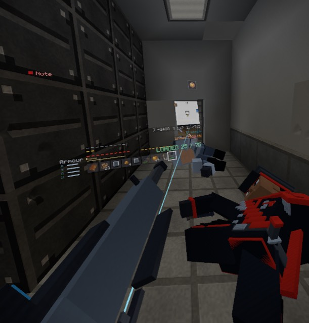

## 15:06:47 - And like, where are the bases with the second floors? I haven't seen a

- **Transcript:** And like, where are the bases with the second floors? I haven't seen any of them either
- **Status:** open
- **Build:** 0.129 (9d6cbeeb, M1-M4 (device-tested; ship riding, chests, comfort options, weapon wheel))
- **World:** New World (10) (seed 4256271160485884755)
- **Dimension:** Surface
- **Biome:** Snowy Taiga
- **Position:** -2479.1 111.8 -2700.2
- **Facing:** west (yaw 285, pitch -2)
- **Held:** Slatefall Carbine x1
- **Mount:** on foot
- **Looking at:** nothing
- **Mode:** Survival, health 20/20
- **Time:** day 1 19:11, clear
- **Fps:** 56
- **Levels:** mic -27 dBFS, game sound -7 dBFS
- **Length:** 5.2 s (voice 2.9 s)
- **Just before:** -29s into the pack: Greywall Dispatch; -22s into the pack: Greywall Keycard; -22s into the pack: Greywall Code Book; -18s holding Written Book; -18s message: Written Book; -18s holding Rifle Rounds; -18s message: Rifle Rounds; -17s holding Greywall Code Book; -17s message: Greywall Code Book; -17s holding Gold Nugget; -17s message: Gold Nugget; -17s holding Greywall Keycard; -17s message: Greywall Keycard; -17s holding Sechser Revolver; -17s message: Sechser Revolver; -17s holding Golden Apple; -17s message: Golden Apple; -10s holding Rifle Magazine; -10s message: Rifle Magazine; -10s holding Slatefall Carbine; -10s message: Slatefall Carbine; -7s opened ChestMenu; -6s closed ChestMenu
- **Repro (Mac):** `./snap.sh note --seed 4256271160485884755 --x -2479.1 --z -2700.2 --yaw 75 --pitch -2 --time 0.550`
- **Audio (this Mac):** /Users/darthvadar/Documents/Blocksmith/QuestVoiceNotes/raw/vn-20261030-150647-960.aac

## 15:08:28 - Something's hogging computer, I think

- **Transcript:** Something's hogging computer, I think
- **Status:** open
- **Build:** 0.129 (9d6cbeeb, M1-M4 (device-tested; ship riding, chests, comfort options, weapon wheel))
- **World:** New World (10) (seed 4256271160485884755)
- **Dimension:** Surface
- **Biome:** Snowy Slopes
- **Position:** -2304.0 176.1 -2600.0
- **Facing:** south-east (yaw 140, pitch -14)
- **Held:** empty hand
- **Mount:** on foot, flying
- **Looking at:** nothing
- **Mode:** Creative, health 20/20
- **Time:** day 1 20:37, clear
- **Fps:** 38
- **Levels:** mic -27 dBFS, game sound -25 dBFS
- **Length:** 2.8 s (voice 1.3 s)
- **Just before:** -29s respawned; -29s closed DeathMenu; -29s message: Your things are 1492 blocks east; -28s walked into Taiga; -25s opened PauseMenu; -23s message: Creative mode; -23s closed PauseMenu; -21s message: Flying; -17s walked into Plains; -15s walked into Taiga; -13s walked into Snowy Taiga; -6s message: Walking; -4s message: Flying; -1s walked into Grove
- **Repro (Mac):** `./snap.sh note --seed 4256271160485884755 --x -2304.0 --z -2600.0 --yaw -140 --pitch -14 --time 0.609`
- **Audio (this Mac):** /Users/darthvadar/Documents/Blocksmith/QuestVoiceNotes/raw/vn-20261030-150828-920.aac

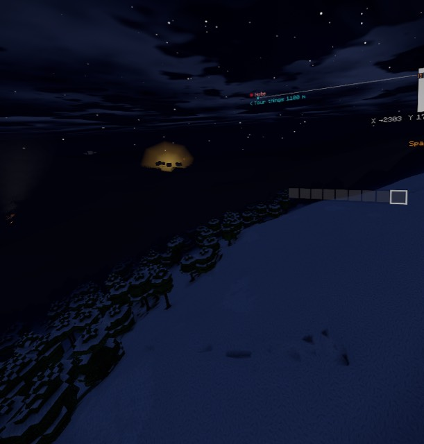

## 15:08:31 - It's rendering no problem. Things are rendering very nicely

- **Transcript:** It's rendering no problem. Things are rendering very nicely
- **Status:** open
- **Build:** 0.129 (9d6cbeeb, M1-M4 (device-tested; ship riding, chests, comfort options, weapon wheel))
- **World:** New World (10) (seed 4256271160485884755)
- **Dimension:** Surface
- **Biome:** Snowy Slopes
- **Position:** -2162.3 176.2 -2538.3
- **Facing:** south-east (yaw 116, pitch -9)
- **Held:** empty hand
- **Mount:** on foot, flying
- **Looking at:** nothing
- **Mode:** Creative, health 20/20
- **Time:** day 1 20:39, clear
- **Fps:** 49
- **Levels:** mic -40 dBFS, game sound -28 dBFS
- **Length:** 4.2 s (voice 2.5 s)
- **Just before:** -29s walked into Taiga; -27s opened PauseMenu; -25s message: Creative mode; -25s closed PauseMenu; -23s message: Flying; -19s walked into Plains; -17s walked into Taiga; -15s walked into Snowy Taiga; -8s message: Walking; -6s message: Flying; -3s walked into Grove; -2s message: Entering Wenionia; -1s walked into Snowy Slopes
- **Repro (Mac):** `./snap.sh note --seed 4256271160485884755 --x -2162.3 --z -2538.3 --yaw -116 --pitch -9 --time 0.611`
- **Audio (this Mac):** /Users/darthvadar/Documents/Blocksmith/QuestVoiceNotes/raw/vn-20261030-150831-780.aac

## 15:08:38 - Well, I mean, it was on eight, but still

- **Transcript:** Well, I mean, it was on eight, but still
- **Status:** open
- **Build:** 0.129 (9d6cbeeb, M1-M4 (device-tested; ship riding, chests, comfort options, weapon wheel))
- **World:** New World (10) (seed 4256271160485884755)
- **Dimension:** Surface
- **Biome:** Grove
- **Position:** -2037.1 176.2 -2496.5
- **Facing:** south (yaw 182, pitch -38)
- **Held:** empty hand
- **Mount:** on foot, flying
- **Looking at:** nothing
- **Mode:** Creative, health 20/20
- **Time:** day 1 20:42, clear
- **Fps:** 43
- **Levels:** mic -25 dBFS, game sound -14 dBFS
- **Length:** 2.7 s (voice 1.1 s)
- **Just before:** -28s message: Creative mode; -28s closed PauseMenu; -27s message: Flying; -23s walked into Plains; -21s walked into Taiga; -19s walked into Snowy Taiga; -11s message: Walking; -9s message: Flying; -7s walked into Grove; -5s message: Entering Wenionia; -5s walked into Snowy Slopes; -3s walked into Grove; -2s opened PauseMenu; -1s walked into Snowy Taiga; -1s closed PauseMenu
- **Repro (Mac):** `./snap.sh note --seed 4256271160485884755 --x -2037.1 --z -2496.5 --yaw 178 --pitch -38 --time 0.613`
- **Audio (this Mac):** /Users/darthvadar/Documents/Blocksmith/QuestVoiceNotes/raw/vn-20261030-150838-220.aac

## 15:08:47 - I think it's CPU or something. Just a hunch

- **Transcript:** I think it's CPU or something. Just a hunch
- **Status:** open
- **Build:** 0.129 (9d6cbeeb, M1-M4 (device-tested; ship riding, chests, comfort options, weapon wheel))
- **World:** New World (10) (seed 4256271160485884755)
- **Dimension:** Surface
- **Biome:** Snowy Taiga
- **Position:** -1879.0 190.6 -2565.7
- **Facing:** south-east (yaw 132, pitch -38)
- **Held:** empty hand
- **Mount:** on foot, flying
- **Looking at:** nothing
- **Mode:** Creative, health 20/20
- **Time:** day 1 20:48, clear
- **Fps:** 28
- **Levels:** mic -23 dBFS, game sound -17 dBFS
- **Length:** 4.3 s (voice 1.9 s)
- **Just before:** -28s walked into Plains; -26s walked into Taiga; -24s walked into Snowy Taiga; -16s message: Walking; -14s message: Flying; -12s walked into Grove; -10s message: Entering Wenionia; -10s walked into Snowy Slopes; -8s walked into Grove; -7s opened PauseMenu; -6s walked into Snowy Taiga; -6s closed PauseMenu; -4s walked into Grove; -3s opened PauseMenu; -3s closed PauseMenu
- **Repro (Mac):** `./snap.sh note --seed 4256271160485884755 --x -1879.0 --z -2565.7 --yaw -132 --pitch -38 --time 0.617`
- **Audio (this Mac):** /Users/darthvadar/Documents/Blocksmith/QuestVoiceNotes/raw/vn-20261030-150847-880.aac

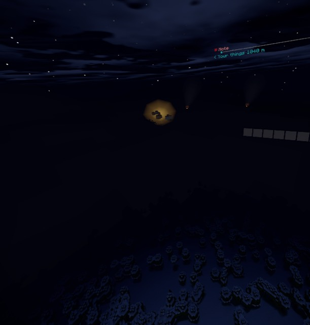

## 15:09:13 - Those are really bad. Like something about walking

- **Transcript:** Those are really bad. Like something about walking
- **Status:** open
- **Build:** 0.129 (9d6cbeeb, M1-M4 (device-tested; ship riding, chests, comfort options, weapon wheel))
- **World:** New World (10) (seed 4256271160485884755)
- **Dimension:** Surface
- **Biome:** Snowy Plains
- **Position:** -655.8 108.6 -2482.3
- **Facing:** south-east (yaw 113, pitch -16)
- **Held:** empty hand
- **Mount:** on foot, flying
- **Looking at:** nothing
- **Mode:** Creative, health 20/20
- **Time:** day 1 21:16, clear
- **Fps:** 56
- **Levels:** mic -21 dBFS, game sound -23 dBFS
- **Length:** 4.1 s (voice 2.2 s)
- **Just before:** -30s walked into Snowy Taiga; -29s closed PauseMenu; -28s walked into Grove; -27s opened PauseMenu; -27s closed PauseMenu; -23s walked into Snowy Taiga; -22s message: Boreal Station marked on the map; -19s walked into Snowy Plains; -15s walked into Plains; -13s walked into Snowy Plains; -13s message: Sky isle marked on the map; -10s message: Walking; -9s message: Dry Crossing marked on the map; -2s message: Flying
- **Repro (Mac):** `./snap.sh note --seed 4256271160485884755 --x -655.8 --z -2482.3 --yaw -113 --pitch -16 --time 0.637`
- **Audio (this Mac):** /Users/darthvadar/Documents/Blocksmith/QuestVoiceNotes/raw/vn-20261030-150913-440.aac

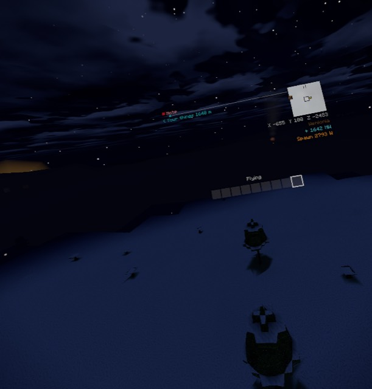

## 15:09:36 - Also, the ultra-fast speed for creative mode was never added

- **Transcript:** Also, the ultra-fast speed for creative mode was never added
- **Status:** open
- **Build:** 0.129 (9d6cbeeb, M1-M4 (device-tested; ship riding, chests, comfort options, weapon wheel))
- **World:** New World (10) (seed 4256271160485884755)
- **Dimension:** Surface
- **Biome:** Plains
- **Position:** 168.0 148.6 -3390.4
- **Facing:** north (yaw 21, pitch -32)
- **Held:** empty hand
- **Mount:** on foot, flying
- **Looking at:** nothing
- **Mode:** Creative, health 20/20
- **Time:** day 1 21:42, clear
- **Fps:** 65
- **Levels:** mic -28 dBFS, game sound -18 dBFS
- **Length:** 4.4 s (voice 2.4 s)
- **Just before:** -23s message: Flying; -18s message: Wenionia - Fenareach border post marked on the map; -15s message: Entering Fenareach; -15s walked into Ice Spikes; -11s walked into Snowy Taiga; -5s walked into Cold Ocean; -3s walked into Beach; -1s walked into Plains
- **Repro (Mac):** `./snap.sh note --seed 4256271160485884755 --x 168.0 --z -3390.4 --yaw -21 --pitch -32 --time 0.655`
- **Audio (this Mac):** /Users/darthvadar/Documents/Blocksmith/QuestVoiceNotes/raw/vn-20261030-150936-240.aac

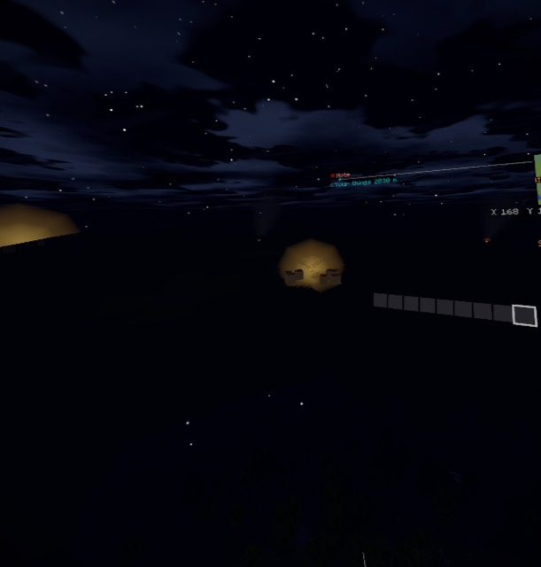

## 15:09:52 - What is this?

- **Transcript:** What is this?
- **Status:** open
- **Build:** 0.129 (9d6cbeeb, M1-M4 (device-tested; ship riding, chests, comfort options, weapon wheel))
- **World:** New World (10) (seed 4256271160485884755)
- **Dimension:** Surface
- **Biome:** Plains
- **Position:** 724.7 217.3 -4573.7
- **Facing:** north-east (yaw 63, pitch -23)
- **Held:** empty hand
- **Mount:** on foot, flying
- **Looking at:** nothing
- **Mode:** Creative, health 20/20
- **Time:** day 1 22:01, clear
- **Fps:** 72
- **Levels:** mic -34 dBFS, game sound -18 dBFS
- **Length:** 2.4 s (voice 0.8 s)
- **Just before:** -27s walked into Snowy Taiga; -21s walked into Cold Ocean; -19s walked into Beach; -17s walked into Plains; -15s walked into Taiga; -15s message: Sky isle marked on the map; -13s walked into Forest; -13s message: Silver Falls marked on the map; -11s message: Entering Vesawick; -9s walked into Taiga; -7s walked into Meadow; -5s walked into Snowy Taiga; -3s walked into Snowy Slopes; -1s walked into Plains
- **Repro (Mac):** `./snap.sh note --seed 4256271160485884755 --x 724.7 --z -4573.7 --yaw -63 --pitch -23 --time 0.668`
- **Audio (this Mac):** /Users/darthvadar/Documents/Blocksmith/QuestVoiceNotes/raw/vn-20261030-150952-101.aac

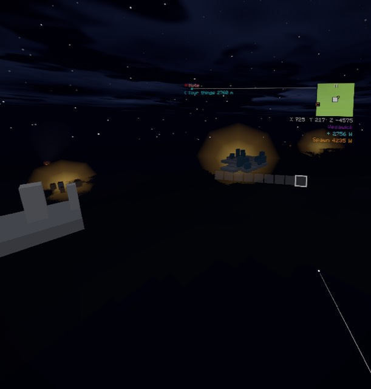

## 15:10:02 - Ja, okay

- **Transcript:** Ja, okay
- **Status:** open
- **Build:** 0.129 (9d6cbeeb, M1-M4 (device-tested; ship riding, chests, comfort options, weapon wheel))
- **World:** New World (10) (seed 4256271160485884755)
- **Dimension:** Surface
- **Biome:** Plains
- **Position:** 1191.1 120.5 -4910.3
- **Facing:** east (yaw 74, pitch -49)
- **Held:** empty hand
- **Mount:** on foot, flying
- **Looking at:** nothing
- **Mode:** Creative, health 20/20
- **Time:** day 1 22:14, clear
- **Fps:** 71
- **Levels:** mic -24 dBFS, game sound -19 dBFS
- **Length:** 1.9 s (voice 0.4 s)
- **Just before:** -29s walked into Beach; -27s walked into Plains; -25s walked into Taiga; -25s message: Sky isle marked on the map; -23s walked into Forest; -23s message: Silver Falls marked on the map; -21s message: Entering Vesawick; -19s walked into Taiga; -17s walked into Meadow; -15s walked into Snowy Taiga; -13s walked into Snowy Slopes; -11s walked into Plains; -7s message: Entering Tamastad; -5s message: Walking; -3s message: Capital city marked on the map; -1s message: Flying
- **Repro (Mac):** `./snap.sh note --seed 4256271160485884755 --x 1191.1 --z -4910.3 --yaw -74 --pitch -49 --time 0.677`
- **Audio (this Mac):** /Users/darthvadar/Documents/Blocksmith/QuestVoiceNotes/raw/vn-20261030-151002-720.aac

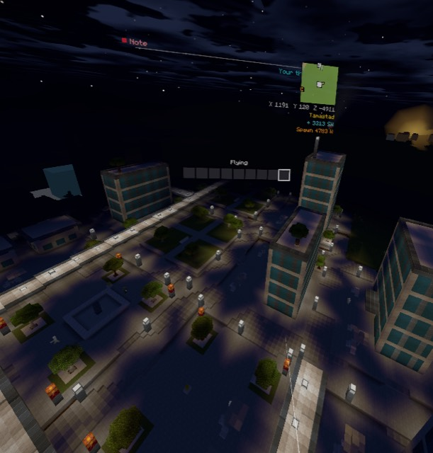

## 15:10:08 - Interesting update. There should be, uh, way more soldiers here

- **Transcript:** Interesting update. There should be, uh, way more soldiers here
- **Status:** open
- **Build:** 0.129 (9d6cbeeb, M1-M4 (device-tested; ship riding, chests, comfort options, weapon wheel))
- **World:** New World (10) (seed 4256271160485884755)
- **Dimension:** Surface
- **Biome:** Plains
- **Position:** 1221.6 82.3 -4996.1
- **Facing:** east (yaw 90, pitch -54)
- **Held:** empty hand
- **Mount:** on foot, flying
- **Looking at:** nothing
- **Mode:** Creative, health 20/20
- **Time:** day 1 22:20, clear
- **Fps:** 66
- **Levels:** mic -48 dBFS, game sound -20 dBFS
- **Length:** 4.1 s (voice 2.5 s)
- **Just before:** -28s walked into Forest; -28s message: Silver Falls marked on the map; -26s message: Entering Vesawick; -24s walked into Taiga; -22s walked into Meadow; -20s walked into Snowy Taiga; -18s walked into Snowy Slopes; -16s walked into Plains; -12s message: Entering Tamastad; -10s message: Walking; -8s message: Capital city marked on the map; -6s message: Flying; -2s message: Walking; -0s message: Flying
- **Repro (Mac):** `./snap.sh note --seed 4256271160485884755 --x 1221.6 --z -4996.1 --yaw -90 --pitch -54 --time 0.681`
- **Audio (this Mac):** /Users/darthvadar/Documents/Blocksmith/QuestVoiceNotes/raw/vn-20261030-151008-780.aac

## 15:10:13 - Okay, the stairwell is, well, is not great for this place, and each of

- **Transcript:** Okay, the stairwell is, well, is not great for this place, and each of the floors are empty
- **Status:** open
- **Build:** 0.129 (9d6cbeeb, M1-M4 (device-tested; ship riding, chests, comfort options, weapon wheel))
- **World:** New World (10) (seed 4256271160485884755)
- **Dimension:** Surface
- **Biome:** Plains
- **Position:** 1243.0 78.6 -4989.3
- **Facing:** north-east (yaw 45, pitch 17)
- **Held:** empty hand
- **Mount:** on foot
- **Looking at:** Capital Steel at 1244 80 -4991
- **Mode:** Creative, health 20/20
- **Time:** day 1 22:26, clear
- **Fps:** 65
- **Levels:** mic -26 dBFS, game sound -24 dBFS
- **Length:** 7.0 s (voice 4.0 s)
- **Just before:** -29s walked into Taiga; -27s walked into Meadow; -25s walked into Snowy Taiga; -23s walked into Snowy Slopes; -21s walked into Plains; -17s message: Entering Tamastad; -15s message: Walking; -13s message: Capital city marked on the map; -11s message: Flying; -7s message: Walking; -5s message: Flying; -3s message: Walking
- **Position at the end:** 1245.7 80.0 -4987.4
- **Repro (Mac):** `./snap.sh note --seed 4256271160485884755 --x 1243.0 --z -4989.3 --yaw -45 --pitch 17 --time 0.685`
- **Audio (this Mac):** /Users/darthvadar/Documents/Blocksmith/QuestVoiceNotes/raw/vn-20261030-151013-340.aac

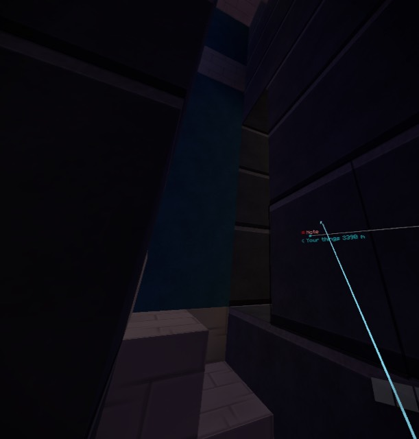

## 15:10:20 - That's just lazy right there. Lazy. And why do we have blue shit? Use 

- **Transcript:** That's just lazy right there. Lazy. And why do we have blue shit? Use glass. Like, we have glass in the game for a reason. There's no reason to s-
- **Status:** open
- **Build:** 0.129 (9d6cbeeb, M1-M4 (device-tested; ship riding, chests, comfort options, weapon wheel))
- **World:** New World (10) (seed 4256271160485884755)
- **Dimension:** Surface
- **Biome:** Plains
- **Position:** 1241.9 77.5 -4989.4
- **Facing:** west (yaw 279, pitch -48)
- **Held:** empty hand
- **Mount:** on foot
- **Looking at:** Capital Steel at 1240 78 -4990
- **Mode:** Creative, health 20/20
- **Time:** day 1 22:35, clear
- **Fps:** 72
- **Levels:** mic -31 dBFS, game sound -25 dBFS
- **Length:** 10.8 s (voice 7.0 s)
- **Just before:** -28s walked into Plains; -24s message: Entering Tamastad; -22s message: Walking; -20s message: Capital city marked on the map; -18s message: Flying; -14s message: Walking; -12s message: Flying; -11s message: Walking
- **While talking:** -3s message: Flying; -2s walked into Desert
- **Position at the end:** 1218.8 79.8 -5062.8
- **Repro (Mac):** `./snap.sh note --seed 4256271160485884755 --x 1241.9 --z -4989.4 --yaw 81 --pitch -48 --time 0.691`
- **Audio (this Mac):** /Users/darthvadar/Documents/Blocksmith/QuestVoiceNotes/raw/vn-20261030-151020-880.aac

## 15:10:31 - Mimic glass. It literally exists in the game

- **Transcript:** Mimic glass. It literally exists in the game
- **Status:** open
- **Build:** 0.129 (9d6cbeeb, M1-M4 (device-tested; ship riding, chests, comfort options, weapon wheel))
- **World:** New World (10) (seed 4256271160485884755)
- **Dimension:** Surface
- **Biome:** Beach
- **Position:** 1207.7 79.8 -5059.2
- **Facing:** south (yaw 184, pitch -19)
- **Held:** empty hand
- **Mount:** on foot, flying
- **Looking at:** nothing
- **Mode:** Creative, health 20/20
- **Time:** day 1 22:47, clear
- **Fps:** 71
- **Levels:** mic -22 dBFS, game sound -22 dBFS
- **Length:** 3.8 s (voice 2.2 s)
- **Just before:** -30s message: Capital city marked on the map; -28s message: Flying; -24s message: Walking; -22s message: Flying; -21s message: Walking; -8s message: Flying; -2s walked into Desert
- **Repro (Mac):** `./snap.sh note --seed 4256271160485884755 --x 1207.7 --z -5059.2 --yaw 176 --pitch -19 --time 0.699`
- **Audio (this Mac):** /Users/darthvadar/Documents/Blocksmith/QuestVoiceNotes/raw/vn-20261030-151031-340.aac

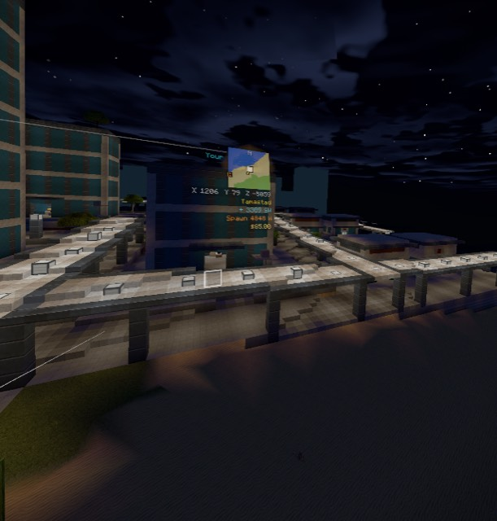

## 15:10:37 - Otherwise, yeah, not bad. Uh, we need way more troops here though. Lik

- **Transcript:** Otherwise, yeah, not bad. Uh, we need way more troops here though. Like, this should be like, there's like what? A total maybe 10, maybe 15 troops total. Not enough. It should be 50
- **Status:** open
- **Build:** 0.129 (9d6cbeeb, M1-M4 (device-tested; ship riding, chests, comfort options, weapon wheel))
- **World:** New World (10) (seed 4256271160485884755)
- **Dimension:** Surface
- **Biome:** Beach
- **Position:** 1141.5 103.8 -5026.4
- **Facing:** south-east (yaw 147, pitch -7)
- **Held:** empty hand
- **Mount:** on foot, flying
- **Looking at:** nothing
- **Mode:** Creative, health 20/20
- **Time:** day 1 22:53, clear
- **Fps:** 66
- **Levels:** mic -24 dBFS, game sound -21 dBFS
- **Length:** 12.3 s (voice 7.0 s)
- **Just before:** -29s message: Walking; -28s message: Flying; -26s message: Walking; -13s message: Flying; -7s walked into Desert; -5s walked into Beach; -1s walked into Lukewarm Ocean
- **While talking:** -4s walked into Beach; -4s walked into Plains
- **Position at the end:** 1202.3 103.8 -4907.2
- **Repro (Mac):** `./snap.sh note --seed 4256271160485884755 --x 1141.5 --z -5026.4 --yaw -147 --pitch -7 --time 0.704`
- **Audio (this Mac):** /Users/darthvadar/Documents/Blocksmith/QuestVoiceNotes/raw/vn-20261030-151037-360.aac

## 15:10:49 - Way more troops

- **Transcript:** Way more troops
- **Status:** open
- **Build:** 0.129 (9d6cbeeb, M1-M4 (device-tested; ship riding, chests, comfort options, weapon wheel))
- **World:** New World (10) (seed 4256271160485884755)
- **Dimension:** Surface
- **Biome:** Plains
- **Position:** 1187.2 103.8 -4997.7
- **Facing:** south-east (yaw 116, pitch -10)
- **Held:** empty hand
- **Mount:** on foot, flying
- **Looking at:** nothing
- **Mode:** Creative, health 20/20
- **Time:** day 1 23:06, clear
- **Fps:** 68
- **Levels:** mic -26 dBFS, game sound -22 dBFS
- **Length:** 1.9 s (voice 0.7 s)
- **Just before:** -24s message: Flying; -18s walked into Desert; -16s walked into Beach; -12s walked into Lukewarm Ocean; -10s walked into Beach; -6s walked into Plains
- **Repro (Mac):** `./snap.sh note --seed 4256271160485884755 --x 1187.2 --z -4997.7 --yaw -116 --pitch -10 --time 0.713`
- **Audio (this Mac):** /Users/darthvadar/Documents/Blocksmith/QuestVoiceNotes/raw/vn-20261030-151049-400.aac

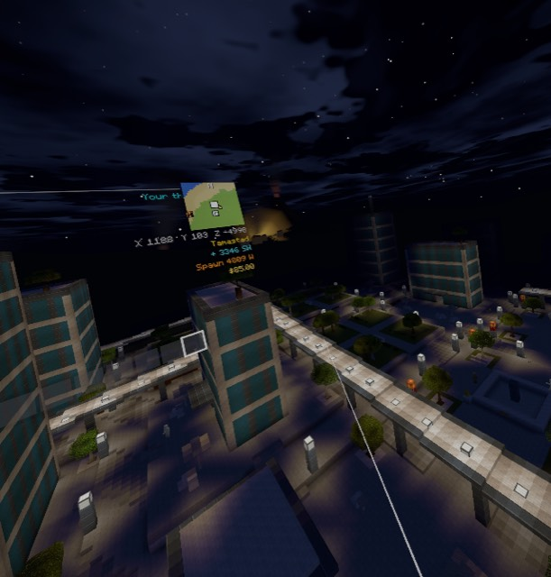

## 15:10:57 - Where's the helicopter? There's still a helicopter here. What the hell

- **Transcript:** Where's the helicopter? There's still a helicopter here. What the hell?
- **Status:** open
- **Build:** 0.129 (9d6cbeeb, M1-M4 (device-tested; ship riding, chests, comfort options, weapon wheel))
- **World:** New World (10) (seed 4256271160485884755)
- **Dimension:** Surface
- **Biome:** Plains
- **Position:** 702.7 137.8 -4931.7
- **Facing:** west (yaw 258, pitch -58)
- **Held:** empty hand
- **Mount:** on foot, flying
- **Looking at:** nothing
- **Mode:** Creative, health 20/20
- **Time:** day 1 23:16, clear
- **Fps:** 71
- **Levels:** mic -21 dBFS, game sound -14 dBFS
- **Length:** 4.3 s (voice 2.1 s)
- **Just before:** -27s walked into Desert; -25s walked into Beach; -21s walked into Lukewarm Ocean; -19s walked into Beach; -15s walked into Plains; -7s walked into Beach; -5s walked into Plains; -3s message: Entering Vesawick; -1s message: Intel: this base is a Field Hospital
- **Repro (Mac):** `./snap.sh note --seed 4256271160485884755 --x 702.7 --z -4931.7 --yaw 102 --pitch -58 --time 0.720`
- **Audio (this Mac):** /Users/darthvadar/Documents/Blocksmith/QuestVoiceNotes/raw/vn-20261030-151057-880.aac

## 15:12:38 - Helicopter room

- **Transcript:** Helicopter room
- **Status:** open
- **Build:** 0.129 (9d6cbeeb, M1-M4 (device-tested; ship riding, chests, comfort options, weapon wheel))
- **World:** New World (10) (seed 4256271160485884755)
- **Dimension:** Surface
- **Biome:** Plains
- **Position:** 661.4 119.5 -4902.8
- **Facing:** south (yaw 163, pitch -16)
- **Held:** empty hand
- **Mount:** on foot
- **Looking at:** nothing
- **Mode:** Survival, health 20/20
- **Time:** day 1 01:07, clear
- **Fps:** 71
- **Levels:** mic -30 dBFS, game sound -14 dBFS
- **Length:** 2.7 s (voice 1.1 s)
- **Just before:** -29s message: No Capital Rounds; -28s holding Himmelsturm Launcher; -27s holding Mahlwerk Rotary Gun; -27s opened PauseMenu; -25s message: Creative mode; -25s closed PauseMenu; -25s opened CreativeMenu; -21s into the pack: Capital Magazine; -20s closed CreativeMenu; -20s opened PauseMenu; -19s message: Survival mode; -19s closed PauseMenu; -18s message: Twin 42 cm Turret tracking you; -16s took 10 damage (health 11/20); -10s holding Himmelsturm Launcher; -10s message: Himmelsturm Launcher; -10s message: Loaded: 2 / 2; -10s left the pack: Rocket (at 700 112 -4905); -9s holding Mahlwerk Rotary Gun; -8s message: Loaded: 200 / 200; -8s left the pack: Capital Magazine x7 (at 698 112 -4906); -2s message: Missile launch: take cover!; -1s holding empty hand; -0s message: Manning the deck gun
- **Repro (Mac):** `./snap.sh note --seed 4256271160485884755 --x 661.4 --z -4902.8 --yaw -163 --pitch -16 --time 0.797`
- **Audio (this Mac):** /Users/darthvadar/Documents/Blocksmith/QuestVoiceNotes/raw/vn-20261030-151238-880.aac

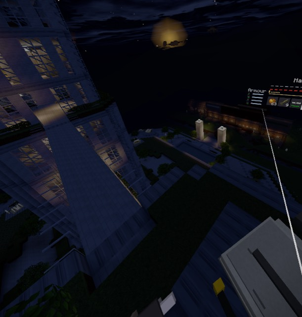

## 15:12:52 - Holy cow. [laughs] Oh, that's excellent. That guy shooting rockets, th

- **Transcript:** Holy cow. [laughs] Oh, that's excellent. That guy shooting rockets, that was awesome. Oh, that was terrific
- **Status:** open
- **Build:** 0.129 (9d6cbeeb, M1-M4 (device-tested; ship riding, chests, comfort options, weapon wheel))
- **World:** New World (10) (seed 4256271160485884755)
- **Dimension:** Surface
- **Biome:** Plains
- **Position:** 680.5 113.0 -4903.6
- **Facing:** east (yaw 96, pitch -17)
- **Held:** empty hand
- **Mount:** on foot
- **Looking at:** nothing
- **Mode:** Survival, health -5/20, screen DeathMenu
- **Time:** day 1 01:22, clear
- **Fps:** 62
- **Levels:** mic -25 dBFS, game sound -15 dBFS
- **Length:** 9.1 s (voice 4.4 s)
- **Just before:** -28s took 10 damage (health 11/20); -23s holding Himmelsturm Launcher; -23s message: Himmelsturm Launcher; -22s message: Loaded: 2 / 2; -22s left the pack: Rocket (at 700 112 -4905); -22s holding Mahlwerk Rotary Gun; -21s message: Loaded: 200 / 200; -21s left the pack: Capital Magazine x7 (at 698 112 -4906); -15s message: Missile launch: take cover!; -14s holding empty hand; -13s message: Manning the deck gun; -10s took 4 damage (health 16/20); -8s took 4 damage (health 12/20); -7s message: Missile launch: take cover!; -4s holding Mahlwerk Rotary Gun; -3s took 5 damage (health 7/20); -1s holding Himmelsturm Launcher; -1s message: Himmelsturm Launcher; -1s holding Rocket; -1s message: Rocket; -0s died; -0s opened DeathMenu; -0s holding empty hand
- **While talking:** -5s left the pack: Rocket x9 (DeathMenu open); -5s left the pack: Capital Magazine x9 (DeathMenu open); -5s left the pack: Mahlwerk Rotary Gun (DeathMenu open); -5s left the pack: Himmelsturm Launcher (DeathMenu open); -4s message: Target gone from the list. Back to the story's objective; -4s took 12 damage (health -5/20)
- **Position at the end:** 680.6 113.0 -4903.6
- **Repro (Mac):** `./snap.sh note --seed 4256271160485884755 --x 680.5 --z -4903.6 --yaw -96 --pitch -17 --time 0.807`
- **Audio (this Mac):** /Users/darthvadar/Documents/Blocksmith/QuestVoiceNotes/raw/vn-20261030-151252-840.aac

## 15:13:52 - I'm thinking instead of, uh, golden apples, tra- change them to, to so

- **Transcript:** I'm thinking instead of, uh, golden apples, tra- change them to, to some sort of medication or something that only exists at, uh, bases, something high-tech
- **Status:** open
- **Build:** 0.129 (9d6cbeeb, M1-M4 (device-tested; ship riding, chests, comfort options, weapon wheel))
- **World:** New World (10) (seed 4256271160485884755)
- **Dimension:** Surface
- **Biome:** Snowy Taiga
- **Position:** -1866.5 172.0 -3653.5
- **Facing:** north (yaw 15, pitch 7)
- **Held:** Titanium Helmet x1
- **Mount:** on foot
- **Looking at:** nothing
- **Mode:** Creative, health 20/20, screen CreativeMenu
- **Time:** day 1 02:24, clear
- **Fps:** 72
- **Levels:** mic -27 dBFS, game sound -17 dBFS
- **Length:** 10.1 s (voice 6.8 s)
- **Just before:** -29s walked into Snowy Taiga; -23s message: Walking; -21s opened PauseMenu; -19s message: Next track; -19s closed PauseMenu; -19s opened CreativeMenu; -15s into the pack: Titanium Boots; -15s into the pack: Titanium Leggings; -14s into the pack: Titanium Chestplate; -14s holding Bandana; -14s into the pack: Bandana; -13s holding Titanium Helmet; -13s left the pack: Bandana (CreativeMenu open); -13s into the pack: Titanium Helmet
- **Position at the end:** -1866.5 172.0 -3653.5
- **Repro (Mac):** `./snap.sh note --seed 4256271160485884755 --x -1866.5 --z -3653.5 --yaw -15 --pitch 7 --time 0.851`
- **Audio (this Mac):** /Users/darthvadar/Documents/Blocksmith/QuestVoiceNotes/raw/vn-20261030-151352-000.aac

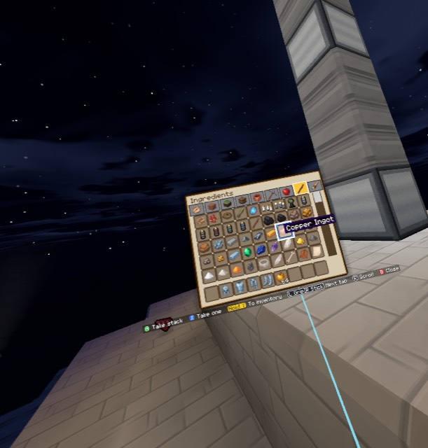

## 15:14:06 - Also, we shouldn't have void pearls

- **Transcript:** Also, we shouldn't have void pearls
- **Status:** open
- **Build:** 0.129 (9d6cbeeb, M1-M4 (device-tested; ship riding, chests, comfort options, weapon wheel))
- **World:** New World (10) (seed 4256271160485884755)
- **Dimension:** Surface
- **Biome:** Snowy Taiga
- **Position:** -1866.5 172.0 -3653.5
- **Facing:** north (yaw 15, pitch 7)
- **Held:** Titanium Helmet x1
- **Mount:** on foot
- **Looking at:** nothing
- **Mode:** Creative, health 20/20, screen CreativeMenu
- **Time:** day 1 02:41, clear
- **Fps:** 72
- **Levels:** mic -25 dBFS, game sound -18 dBFS
- **Length:** 2.8 s (voice 1.3 s)
- **Just before:** -29s into the pack: Titanium Boots; -29s into the pack: Titanium Leggings; -28s into the pack: Titanium Chestplate; -28s holding Bandana; -28s into the pack: Bandana; -27s holding Titanium Helmet; -27s left the pack: Bandana (CreativeMenu open); -27s into the pack: Titanium Helmet
- **Repro (Mac):** `./snap.sh note --seed 4256271160485884755 --x -1866.5 --z -3653.5 --yaw -15 --pitch 7 --time 0.862`
- **Audio (this Mac):** /Users/darthvadar/Documents/Blocksmith/QuestVoiceNotes/raw/vn-20261030-151406-220.aac

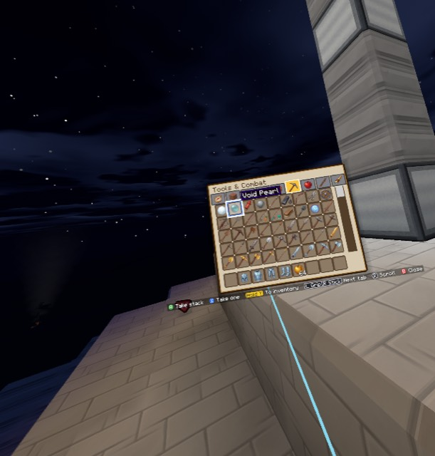

## 15:14:08 - No reason for those to exist

- **Transcript:** No reason for those to exist
- **Status:** open
- **Build:** 0.129 (9d6cbeeb, M1-M4 (device-tested; ship riding, chests, comfort options, weapon wheel))
- **World:** New World (10) (seed 4256271160485884755)
- **Dimension:** Surface
- **Biome:** Snowy Taiga
- **Position:** -1866.5 172.0 -3653.5
- **Facing:** north (yaw 15, pitch 7)
- **Held:** Titanium Helmet x1
- **Mount:** on foot
- **Looking at:** nothing
- **Mode:** Creative, health 20/20, screen CreativeMenu
- **Time:** day 1 02:44, clear
- **Fps:** 71
- **Levels:** mic -31 dBFS, game sound -15 dBFS
- **Length:** 2.1 s (voice 0.9 s)
- **Just before:** -29s holding Titanium Helmet; -29s left the pack: Bandana (CreativeMenu open); -29s into the pack: Titanium Helmet
- **Repro (Mac):** `./snap.sh note --seed 4256271160485884755 --x -1866.5 --z -3653.5 --yaw -15 --pitch 7 --time 0.864`
- **Audio (this Mac):** /Users/darthvadar/Documents/Blocksmith/QuestVoiceNotes/raw/vn-20261030-151408-720.aac

## 15:14:25 - Make a, uh, auto sh- or a, uh, assault shotgun. Make that one of the, 

- **Transcript:** Make a, uh, auto sh- or a, uh, assault shotgun. Make that one of the, uh
- **Status:** open
- **Build:** 0.129 (9d6cbeeb, M1-M4 (device-tested; ship riding, chests, comfort options, weapon wheel))
- **World:** New World (10) (seed 4256271160485884755)
- **Dimension:** Surface
- **Biome:** Snowy Taiga
- **Position:** -1866.5 172.0 -3653.5
- **Facing:** north (yaw 15, pitch 7)
- **Held:** Titanium Helmet x1
- **Mount:** on foot
- **Looking at:** nothing
- **Mode:** Creative, health 20/20, screen CreativeMenu
- **Time:** day 1 03:04, clear
- **Fps:** 72
- **Levels:** mic -43 dBFS, game sound -12 dBFS
- **Length:** 5.4 s (voice 3.7 s)
- **Just before:** -3s into the pack: Slate Magazine
- **Repro (Mac):** `./snap.sh note --seed 4256271160485884755 --x -1866.5 --z -3653.5 --yaw -15 --pitch 7 --time 0.878`
- **Audio (this Mac):** /Users/darthvadar/Documents/Blocksmith/QuestVoiceNotes/raw/vn-20261030-151425-520.aac

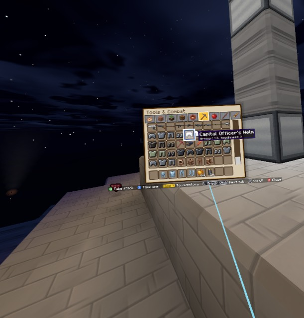

## 15:14:30 - Top level troops guns. So just rapid fire shotguns, shotgun shells

- **Transcript:** Top level troops guns. So just rapid fire shotguns, shotgun shells
- **Status:** open
- **Build:** 0.129 (9d6cbeeb, M1-M4 (device-tested; ship riding, chests, comfort options, weapon wheel))
- **World:** New World (10) (seed 4256271160485884755)
- **Dimension:** Surface
- **Biome:** Snowy Taiga
- **Position:** -1866.5 172.0 -3653.5
- **Facing:** north (yaw 15, pitch 7)
- **Held:** Titanium Helmet x1
- **Mount:** on foot
- **Looking at:** nothing
- **Mode:** Creative, health 20/20, screen CreativeMenu
- **Time:** day 1 03:11, clear
- **Fps:** 72
- **Levels:** mic -33 dBFS, game sound -15 dBFS
- **Length:** 5.5 s (voice 3.0 s)
- **Just before:** -8s into the pack: Slate Magazine
- **Repro (Mac):** `./snap.sh note --seed 4256271160485884755 --x -1866.5 --z -3653.5 --yaw -15 --pitch 7 --time 0.883`
- **Audio (this Mac):** /Users/darthvadar/Documents/Blocksmith/QuestVoiceNotes/raw/vn-20261030-151430-960.aac

## 15:15:26 - Her is pretty hard

- **Transcript:** Her is pretty hard
- **Status:** open
- **Build:** 0.129 (9d6cbeeb, M1-M4 (device-tested; ship riding, chests, comfort options, weapon wheel))
- **World:** New World (10) (seed 4256271160485884755)
- **Dimension:** Surface
- **Biome:** Beach
- **Position:** -3338.7 65.3 -3324.1
- **Facing:** west (yaw 276, pitch -52)
- **Held:** empty hand
- **Mount:** on foot
- **Looking at:** Sand at -3340 64 -3325
- **Mode:** Survival, health 20/20
- **Time:** day 1 04:04, clear
- **Fps:** 67
- **Levels:** mic -24 dBFS, game sound -17 dBFS
- **Length:** 2.9 s (voice 1.3 s)
- **Just before:** -28s left the pack: Titanium Chestplate (InventoryMenu open); -27s left the pack: Titanium Leggings (InventoryMenu open); -27s holding empty hand; -27s left the pack: Titanium Boots (InventoryMenu open); -27s closed InventoryMenu; -26s holding Golden Apple; -26s message: Golden Apple; -26s holding Slate Magazine; -26s message: Slate Magazine; -26s holding Slatefall Carbine; -26s message: Slatefall Carbine; -26s message: Loaded: 30 / 30; -25s left the pack: Slate Magazine x2 (at -1867 171 -3657); -24s opened PauseMenu; -24s message: The citadel is on lockdown!; -21s closed PauseMenu; -14s message: Loaded: 30 / 30; -14s left the pack: Slate Magazine (at -1858 170 -3659); -12s walked into Grove; -11s holding Slate Magazine; -11s message: Slate Magazine; -11s holding Golden Apple; -11s message: Golden Apple; -11s holding Slate Magazine; -11s message: Slate Magazine; -11s holding Slatefall Carbine; -11s message: Slatefall Carbine; -10s message: Twin 42 cm Turret tracking you; -8s died; -8s opened DeathMenu; -8s holding empty hand; -7s left the pack: Slatefall Carbine (DeathMenu open); -7s left the pack: Slate Magazine x13 (DeathMenu open); -7s message: Target gone from the list. Back to the story's objective; -7s respawned; -7s closed DeathMenu; -7s took 26 damage (health 20/20); -6s walked into Taiga; -4s message: Your things are 1503 blocks east; -0s walked into Beach
- **Repro (Mac):** `./snap.sh note --seed 4256271160485884755 --x -3338.7 --z -3324.1 --yaw 84 --pitch -52 --time 0.920`
- **Audio (this Mac):** /Users/darthvadar/Documents/Blocksmith/QuestVoiceNotes/raw/vn-20261030-151526-940.aac

## 19:52:48 - About right here

- **Transcript:** About right here
- **Status:** open
- **Build:** 0.129 (16892351, M1-M4 (device-tested; ship riding, chests, comfort options, weapon wheel))
- **World:** Quest World (seed 5663059916303033239)
- **Dimension:** Hell
- **Biome:** Ash Vault
- **Position:** 2312.3 -24.5 -3087.3
- **Facing:** east (yaw 76, pitch -12)
- **Held:** Aero Engine Spares x13
- **Mount:** on foot
- **Looking at:** nothing
- **Mode:** Creative, health 11/20, screen ReportMenu
- **Time:** day 7 10:33, clear
- **Fps:** 72
- **Levels:** mic -42 dBFS, game sound -23 dBFS
- **Length:** 2.6 s (voice 0.6 s)
- **Just before:** -14s opened PauseMenu; -13s closed PauseMenu; -13s message: Playtest build: voice bug notes ON, your speech is saved (Options > Interface); -9s message: Flying; -8s message: The Chancellor, over the loudspeakers: "Seal the bunker! Nobody opens the blast door in the command post!"; -4s message: Walking; -4s opened PauseMenu; -3s message: Flying; -0s opened ReportMenu
- **Repro (Mac):** `./snap.sh note --seed 5663059916303033239 --x 2312.3 --z -3087.3 --yaw -76 --pitch -12 --time 0.190 --dim deep`
- **Audio (this Mac):** /Users/darthvadar/Documents/Blocksmith/QuestVoiceNotes/raw/vn-20261030-195248-781.aac

## 19:52:56 - Using the compute

- **Transcript:** Using the compute
- **Status:** open
- **Build:** 0.129 (16892351, M1-M4 (device-tested; ship riding, chests, comfort options, weapon wheel))
- **World:** Quest World (seed 5663059916303033239)
- **Dimension:** Hell
- **Biome:** Ash Vault
- **Position:** 2313.1 -32.0 -3087.6
- **Facing:** north-east (yaw 67, pitch 9)
- **Held:** Aero Engine Spares x13
- **Mount:** on foot
- **Looking at:** nothing
- **Mode:** Creative, health 11/20, screen PauseMenu
- **Time:** day 7 10:36, clear
- **Fps:** 72
- **Levels:** mic -41 dBFS, game sound -28 dBFS
- **Length:** 2.3 s (voice 0.7 s)
- **Just before:** -21s opened PauseMenu; -20s closed PauseMenu; -20s message: Playtest build: voice bug notes ON, your speech is saved (Options > Interface); -17s message: Flying; -15s message: The Chancellor, over the loudspeakers: "Seal the bunker! Nobody opens the blast door in the command post!"; -12s message: Walking; -12s opened PauseMenu; -11s message: Flying; -8s opened ReportMenu; -6s closed ReportMenu; -5s opened PauseMenu
- **Repro (Mac):** `./snap.sh note --seed 5663059916303033239 --x 2313.1 --z -3087.6 --yaw -67 --pitch 9 --time 0.192 --dim deep`
- **Audio (this Mac):** /Users/darthvadar/Documents/Blocksmith/QuestVoiceNotes/raw/vn-20261030-195256-481.aac

## 19:53:24 - Okay, ähm, was mach ich jetzt? Ähm, World, very new world, I guess. He

- **Transcript:** Okay, ähm, was mach ich jetzt? Ähm, World, very new world, I guess. Here we go
- **Status:** open
- **Build:** 0.129 (16892351, M1-M4 (device-tested; ship riding, chests, comfort options, weapon wheel))
- **World:** Quest World (seed 5663059916303033239)
- **Dimension:** Hell
- **Biome:** Ash Vault
- **Position:** 2313.1 -32.0 -3087.6
- **Facing:** north-east (yaw 67, pitch 9)
- **Held:** Aero Engine Spares x13
- **Mount:** on foot
- **Looking at:** nothing
- **Mode:** Creative, health 11/20, screen PauseMenu
- **Time:** day 7 10:36, clear
- **Fps:** 72
- **Levels:** mic -29 dBFS, game sound -33 dBFS
- **Length:** 8.9 s (voice 5.2 s)
- **Position at the end:** 2313.1 -32.0 -3087.6
- **Repro (Mac):** `./snap.sh note --seed 5663059916303033239 --x 2313.1 --z -3087.6 --yaw -67 --pitch 9 --time 0.192 --dim deep`
- **Audio (this Mac):** /Users/darthvadar/Documents/Blocksmith/QuestVoiceNotes/raw/vn-20261030-195324-961.aac

## 19:53:43 - Oh, this is nice. Very good

- **Transcript:** Oh, this is nice. Very good
- **Status:** open
- **Build:** 0.129 (16892351, M1-M4 (device-tested; ship riding, chests, comfort options, weapon wheel))
- **World:** New World (11) (seed 8581085287973377474)
- **Dimension:** Surface
- **Biome:** Forest
- **Position:** -4441.3 107.6 3384.1
- **Facing:** north-west (yaw 300, pitch -38)
- **Held:** Grass Block x64
- **Mount:** on foot, flying
- **Looking at:** nothing
- **Mode:** Creative, health 20/20
- **Time:** day 1 07:31, clear
- **Fps:** 68
- **Levels:** mic -35 dBFS, game sound -30 dBFS
- **Length:** 3.2 s (voice 1.6 s)
- **Just before:** -4s opened PauseMenu; -3s closed PauseMenu; -3s message: Playtest build: voice bug notes ON, your speech is saved (Options > Interface); --1s message: Flying; --2s message: The Chancellor, over the loudspeakers: "Seal the bunker! Nobody opens the blast door in the command post!"; --6s message: Walking; --6s opened PauseMenu; --7s message: Flying; --10s opened ReportMenu; --11s closed ReportMenu; --12s opened PauseMenu; -4s entered Surface; -4s closed PauseMenu; -4s holding Grass Block; -4s message: Spring: the snow melts and the young are born; -1s message: Flying; -0s message: Copper Rock marked on the map
- **Repro (Mac):** `./snap.sh note --seed 8581085287973377474 --x -4441.3 --z 3384.1 --yaw 60 --pitch -38 --time 0.063`
- **Audio (this Mac):** /Users/darthvadar/Documents/Blocksmith/QuestVoiceNotes/raw/vn-20261030-195343-621.aac

## 19:53:46 - Okay, there is no jitter problems anymore. Very good

- **Transcript:** Okay, there is no jitter problems anymore. Very good
- **Status:** open
- **Build:** 0.129 (16892351, M1-M4 (device-tested; ship riding, chests, comfort options, weapon wheel))
- **World:** New World (11) (seed 8581085287973377474)
- **Dimension:** Surface
- **Biome:** Savanna
- **Position:** -4512.6 93.6 3382.5
- **Facing:** north-west (yaw 304, pitch -49)
- **Held:** Grass Block x64
- **Mount:** on foot
- **Looking at:** Coarse Dirt at -4515 92 3381
- **Mode:** Creative, health 20/20
- **Time:** day 1 07:34, clear
- **Fps:** 71
- **Levels:** mic -24 dBFS, game sound -28 dBFS
- **Length:** 4.2 s (voice 2.7 s)
- **Just before:** -7s opened PauseMenu; -6s closed PauseMenu; -6s message: Playtest build: voice bug notes ON, your speech is saved (Options > Interface); -2s message: Flying; -1s message: The Chancellor, over the loudspeakers: "Seal the bunker! Nobody opens the blast door in the command post!"; --2s message: Walking; --3s opened PauseMenu; --4s message: Flying; --7s opened ReportMenu; --8s closed ReportMenu; --9s opened PauseMenu; -7s entered Surface; -7s closed PauseMenu; -7s holding Grass Block; -7s message: Spring: the snow melts and the young are born; -4s message: Flying; -3s message: Copper Rock marked on the map; -1s message: A stranger in town: Ezra Quill
- **Repro (Mac):** `./snap.sh note --seed 8581085287973377474 --x -4512.6 --z 3382.5 --yaw 56 --pitch -49 --time 0.066`
- **Audio (this Mac):** /Users/darthvadar/Documents/Blocksmith/QuestVoiceNotes/raw/vn-20261030-195346-724.aac

## 19:53:51 - Yes. Excellent. Okay

- **Transcript:** Yes. Excellent. Okay
- **Status:** open
- **Build:** 0.129 (16892351, M1-M4 (device-tested; ship riding, chests, comfort options, weapon wheel))
- **World:** New World (11) (seed 8581085287973377474)
- **Dimension:** Surface
- **Biome:** Savanna
- **Position:** -4538.0 97.0 3386.4
- **Facing:** south-west (yaw 215, pitch -33)
- **Held:** Grass Block x64
- **Mount:** on foot
- **Looking at:** Acacia Door at -4539 97 3388
- **Mode:** Creative, health 20/20
- **Time:** day 1 07:40, clear
- **Fps:** 70
- **Levels:** mic -26 dBFS, game sound -25 dBFS
- **Length:** 3.8 s (voice 1.7 s)
- **Just before:** -11s opened PauseMenu; -10s closed PauseMenu; -10s message: Playtest build: voice bug notes ON, your speech is saved (Options > Interface); -7s message: Flying; -5s message: The Chancellor, over the loudspeakers: "Seal the bunker! Nobody opens the blast door in the command post!"; -2s message: Walking; -2s opened PauseMenu; -1s message: Flying; --2s opened ReportMenu; --4s closed ReportMenu; --5s opened PauseMenu; -11s entered Surface; -11s closed PauseMenu; -11s holding Grass Block; -11s message: Spring: the snow melts and the young are born; -9s message: Flying; -8s message: Copper Rock marked on the map; -5s message: A stranger in town: Ezra Quill; -3s message: Walking; -2s message: Minnie Dunmore: Arrested a goat this morning. Long story.
- **Repro (Mac):** `./snap.sh note --seed 8581085287973377474 --x -4538.0 --z 3386.4 --yaw 145 --pitch -33 --time 0.070`
- **Audio (this Mac):** /Users/darthvadar/Documents/Blocksmith/QuestVoiceNotes/raw/vn-20261030-195351-281.aac

## 19:53:55 - All righty. Um, guns. [imitates guns shooting] I'll take that. Let's t

- **Transcript:** All righty. Um, guns. [imitates guns shooting] I'll take that. Let's take rifle rounds. Okay
- **Status:** open
- **Build:** 0.129 (16892351, M1-M4 (device-tested; ship riding, chests, comfort options, weapon wheel))
- **World:** New World (11) (seed 8581085287973377474)
- **Dimension:** Surface
- **Biome:** Savanna
- **Position:** -4551.1 98.9 3384.4
- **Facing:** west (yaw 281, pitch -0)
- **Held:** Grass Block x64
- **Mount:** on foot
- **Looking at:** nothing
- **Mode:** Creative, health 20/20, screen CreativeMenu
- **Time:** day 1 07:43, clear
- **Fps:** 66
- **Levels:** mic -31 dBFS, game sound -29 dBFS
- **Length:** 8.4 s (voice 5.0 s)
- **Just before:** -15s opened PauseMenu; -14s closed PauseMenu; -14s message: Playtest build: voice bug notes ON, your speech is saved (Options > Interface); -10s message: Flying; -9s message: The Chancellor, over the loudspeakers: "Seal the bunker! Nobody opens the blast door in the command post!"; -5s message: Walking; -5s opened PauseMenu; -4s message: Flying; -1s opened ReportMenu; --1s closed ReportMenu; --1s opened PauseMenu; -15s entered Surface; -15s closed PauseMenu; -15s holding Grass Block; -15s message: Spring: the snow melts and the young are born; -12s message: Flying; -11s message: Copper Rock marked on the map; -9s message: A stranger in town: Ezra Quill; -7s message: Walking; -5s message: Minnie Dunmore: Arrested a goat this morning. Long story.; -1s opened PauseMenu; -1s closed PauseMenu; -1s opened CreativeMenu
- **While talking:** -4s closed ReportMenu; -3s opened PauseMenu
- **Position at the end:** -4551.1 98.9 3384.4
- **Repro (Mac):** `./snap.sh note --seed 8581085287973377474 --x -4551.1 --z 3384.4 --yaw 79 --pitch -0 --time 0.072`
- **Audio (this Mac):** /Users/darthvadar/Documents/Blocksmith/QuestVoiceNotes/raw/vn-20261030-195355-041.aac

## 19:55:32 - Yeah, this is, this is pretty good

- **Transcript:** Yeah, this is, this is pretty good
- **Status:** open
- **Build:** 0.129 (16892351, M1-M4 (device-tested; ship riding, chests, comfort options, weapon wheel))
- **World:** New World (11) (seed 8581085287973377474)
- **Dimension:** Surface
- **Biome:** Savanna
- **Position:** -4549.1 98.5 3401.1
- **Facing:** north-east (yaw 23, pitch -20)
- **Held:** Sechser Revolver x1
- **Mount:** on foot
- **Looking at:** Grass Block at -4548 97 3396
- **Mode:** Survival, health 20/20
- **Time:** day 1 09:29, clear
- **Fps:** 72
- **Levels:** mic -21 dBFS, game sound -17 dBFS
- **Length:** 3.4 s (voice 1.8 s)
- **Just before:** -28s message: Matthias Burke: You're barred! Out!; -26s holding Sechser Revolver; -25s message: Loaded: 6 / 6; -25s left the pack: Rifle Magazine; -22s opened PauseMenu; -21s closed PauseMenu; -21s walked into Plains; -17s message: Honour lowered (murder); -15s walked into Savanna; -15s message: Loaded: 6 / 6; -13s message: Honour: Disreputable; -11s message: Willa Kettering: Don't shoot, I've got kids!; -9s message: Honour: Outlaw; -7s walked into Plains; -7s message: Willa Kettering: It's that outlaw! Somebody fetch the sheriff!; -4s message: You're an outlaw: Copper Rock will fight you on sight; -1s walked into Savanna; -1s message: Loaded: 6 / 6
- **Repro (Mac):** `./snap.sh note --seed 8581085287973377474 --x -4549.1 --z 3401.1 --yaw -23 --pitch -20 --time 0.146`
- **Audio (this Mac):** /Users/darthvadar/Documents/Blocksmith/QuestVoiceNotes/raw/vn-20261030-195532-281.aac

## 19:56:04 - The horse needs to run around whenever it's, uh

- **Transcript:** The horse needs to run around whenever it's, uh
- **Status:** open
- **Build:** 0.129 (16892351, M1-M4 (device-tested; ship riding, chests, comfort options, weapon wheel))
- **World:** New World (11) (seed 8581085287973377474)
- **Dimension:** Surface
- **Biome:** Savanna
- **Position:** -4542.8 99.4 3427.1
- **Facing:** south (yaw 176, pitch -77)
- **Held:** empty hand
- **Mount:** riding Horse
- **Looking at:** Grass Block at -4543 97 3427
- **Mode:** Survival, health 20/20
- **Time:** day 1 10:06, clear
- **Fps:** 72
- **Levels:** mic -26 dBFS, game sound -22 dBFS
- **Length:** 4.9 s (voice 3.2 s)
- **Just before:** -27s mounted Horse; -22s holding Cobblestone; -22s message: Cobblestone; -21s holding Sechser Revolver; -21s message: Sechser Revolver; -21s holding Grass Block; -21s message: Grass Block; -19s dismounted Horse; -19s message: Thrown!; -19s mounted Horse; -13s opened PauseMenu; -13s closed PauseMenu; -12s opened InventoryMenu; -11s holding empty hand; -11s closed InventoryMenu
- **Repro (Mac):** `./snap.sh note --seed 8581085287973377474 --x -4542.8 --z 3427.1 --yaw -176 --pitch -77 --time 0.171`
- **Audio (this Mac):** /Users/darthvadar/Documents/Blocksmith/QuestVoiceNotes/raw/vn-20261030-195604-281.aac

## 19:56:09 - Yeah, the horse needs to run around

- **Transcript:** Yeah, the horse needs to run around
- **Status:** open
- **Build:** 0.129 (16892351, M1-M4 (device-tested; ship riding, chests, comfort options, weapon wheel))
- **World:** New World (11) (seed 8581085287973377474)
- **Dimension:** Surface
- **Biome:** Savanna
- **Position:** -4542.8 99.4 3427.1
- **Facing:** south (yaw 158, pitch -79)
- **Held:** empty hand
- **Mount:** riding Horse
- **Looking at:** Grass Block at -4543 97 3427
- **Mode:** Survival, health 20/20
- **Time:** day 1 10:13, clear
- **Fps:** 72
- **Levels:** mic -37 dBFS, game sound -21 dBFS
- **Length:** 2.9 s (voice 1.5 s)
- **Just before:** -27s holding Cobblestone; -27s message: Cobblestone; -27s holding Sechser Revolver; -27s message: Sechser Revolver; -26s holding Grass Block; -26s message: Grass Block; -25s dismounted Horse; -25s message: Thrown!; -24s mounted Horse; -19s opened PauseMenu; -18s closed PauseMenu; -18s opened InventoryMenu; -17s holding empty hand; -16s closed InventoryMenu
- **Repro (Mac):** `./snap.sh note --seed 8581085287973377474 --x -4542.8 --z 3427.1 --yaw -158 --pitch -79 --time 0.176`
- **Audio (this Mac):** /Users/darthvadar/Documents/Blocksmith/QuestVoiceNotes/raw/vn-20261030-195609-722.aac

## 19:56:13 - At any point that I'm trying to tame it, it needs to be running, it ne

- **Transcript:** At any point that I'm trying to tame it, it needs to be running, it needs to buck me off and shit, just like a real horse would
- **Status:** open
- **Build:** 0.129 (16892351, M1-M4 (device-tested; ship riding, chests, comfort options, weapon wheel))
- **World:** New World (11) (seed 8581085287973377474)
- **Dimension:** Surface
- **Biome:** Savanna
- **Position:** -4542.8 99.4 3427.1
- **Facing:** south-east (yaw 116, pitch -15)
- **Held:** empty hand
- **Mount:** riding Horse
- **Looking at:** nothing
- **Mode:** Survival, health 20/20
- **Time:** day 1 10:17, clear
- **Fps:** 72
- **Levels:** mic -33 dBFS, game sound -20 dBFS
- **Length:** 8.5 s (voice 5.2 s)
- **Just before:** -29s dismounted Horse; -29s message: Thrown!; -28s mounted Horse; -23s opened PauseMenu; -22s closed PauseMenu; -22s opened InventoryMenu; -21s holding empty hand; -20s closed InventoryMenu; -2s message: Tamed!; -1s message: Sage is your horse now
- **Position at the end:** -4542.8 99.4 3427.1
- **Repro (Mac):** `./snap.sh note --seed 8581085287973377474 --x -4542.8 --z 3427.1 --yaw -116 --pitch -15 --time 0.179`
- **Audio (this Mac):** /Users/darthvadar/Documents/Blocksmith/QuestVoiceNotes/raw/vn-20261030-195613-662.aac

## 19:57:19 - The horse isn't galloping, uh, proportionally to the sound it makes

- **Transcript:** The horse isn't galloping, uh, proportionally to the sound it makes
- **Status:** open
- **Build:** 0.129 (16892351, M1-M4 (device-tested; ship riding, chests, comfort options, weapon wheel))
- **World:** New World (11) (seed 8581085287973377474)
- **Dimension:** Surface
- **Biome:** Savanna
- **Position:** -4537.9 86.7 3554.0
- **Facing:** south (yaw 163, pitch -52)
- **Held:** Torch x64
- **Mount:** riding Horse
- **Looking at:** Grass Block at -4538 84 3556
- **Mode:** Survival, health 20/20
- **Time:** day 1 11:33, clear
- **Fps:** 72
- **Levels:** mic -27 dBFS, game sound -19 dBFS
- **Length:** 5.5 s (voice 3.2 s)
- **Just before:** -15s into the pack: Saddle; -15s closed CreativeMenu; -14s opened PauseMenu; -13s message: Survival mode; -13s closed PauseMenu; -12s mounted Horse; -12s opened MountMenu; -11s closed MountMenu; -11s left the pack: Saddle; -10s holding Torch; -6s dismounted Horse; -6s message: Thrown!; -5s took 2 damage (health 18/20); -4s mounted Horse
- **Repro (Mac):** `./snap.sh note --seed 8581085287973377474 --x -4537.9 --z 3554.0 --yaw -163 --pitch -52 --time 0.232`
- **Audio (this Mac):** /Users/darthvadar/Documents/Blocksmith/QuestVoiceNotes/raw/vn-20261030-195719-601.aac

## 19:57:48 - Yeah, so like it needs to, we need to change it so that it physically 

- **Transcript:** Yeah, so like it needs to, we need to change it so that it physically lunges and shit
- **Status:** open
- **Build:** 0.129 (16892351, M1-M4 (device-tested; ship riding, chests, comfort options, weapon wheel))
- **World:** New World (11) (seed 8581085287973377474)
- **Dimension:** Surface
- **Biome:** Plains
- **Position:** -4692.7 73.1 3810.5
- **Facing:** west (yaw 252, pitch -81)
- **Held:** Torch x64
- **Mount:** riding Horse
- **Looking at:** Grass Block at -4693 71 3810
- **Mode:** Survival, health 20/20
- **Time:** day 1 12:07, clear
- **Fps:** 72
- **Levels:** mic -28 dBFS, game sound -26 dBFS
- **Length:** 6.1 s (voice 4.1 s)
- **Just before:** -26s walked into Forest; -24s walked into Windswept Hills; -21s walked into Flower Forest; -15s walked into Forest; -1s walked into Plains
- **While talking:** -4s dismounted Horse; -3s took 2 damage (health 18/20); -3s mounted Horse
- **Position at the end:** -4711.9 74.2 3806.5
- **Repro (Mac):** `./snap.sh note --seed 8581085287973377474 --x -4692.7 --z 3810.5 --yaw 108 --pitch -81 --time 0.255`
- **Audio (this Mac):** /Users/darthvadar/Documents/Blocksmith/QuestVoiceNotes/raw/vn-20261030-195748-621.aac

## 19:57:54 - Um, to the same rhythm of its-- the sound of its footsteps

- **Transcript:** Um, to the same rhythm of its-- the sound of its footsteps
- **Status:** open
- **Build:** 0.129 (16892351, M1-M4 (device-tested; ship riding, chests, comfort options, weapon wheel))
- **World:** New World (11) (seed 8581085287973377474)
- **Dimension:** Surface
- **Biome:** Plains
- **Position:** -4723.2 73.0 3805.1
- **Facing:** west (yaw 262, pitch -17)
- **Held:** Sechser Revolver x1
- **Mount:** riding Horse
- **Looking at:** nothing
- **Mode:** Survival, health 20/20
- **Time:** day 1 12:15, clear
- **Fps:** 72
- **Levels:** mic -29 dBFS, game sound -23 dBFS
- **Length:** 5.1 s (voice 3.1 s)
- **Just before:** -30s walked into Windswept Hills; -28s walked into Flower Forest; -22s walked into Forest; -8s walked into Plains; -5s dismounted Horse; -4s took 2 damage (health 18/20); -4s mounted Horse; -1s holding Rifle Magazine; -1s message: Rifle Magazine; -1s holding Sechser Revolver; -1s message: Sechser Revolver
- **Repro (Mac):** `./snap.sh note --seed 8581085287973377474 --x -4723.2 --z 3805.1 --yaw 98 --pitch -17 --time 0.260`
- **Audio (this Mac):** /Users/darthvadar/Documents/Blocksmith/QuestVoiceNotes/raw/vn-20261030-195754-881.aac

## 19:58:00 - So we lunge, lunge, lunge, lunge, lunge

- **Transcript:** So we lunge, lunge, lunge, lunge, lunge
- **Status:** open
- **Build:** 0.129 (16892351, M1-M4 (device-tested; ship riding, chests, comfort options, weapon wheel))
- **World:** New World (11) (seed 8581085287973377474)
- **Dimension:** Surface
- **Biome:** Plains
- **Position:** -4765.4 72.5 3814.7
- **Facing:** west (yaw 282, pitch -82)
- **Held:** Sechser Revolver x1
- **Mount:** riding Horse
- **Looking at:** Grass Block at -4766 70 3814
- **Mode:** Survival, health 20/20
- **Time:** day 1 12:21, clear
- **Fps:** 72
- **Levels:** mic -24 dBFS, game sound -20 dBFS
- **Length:** 3.7 s (voice 2.2 s)
- **Just before:** -27s walked into Forest; -13s walked into Plains; -11s dismounted Horse; -10s took 2 damage (health 18/20); -10s mounted Horse; -7s holding Rifle Magazine; -7s message: Rifle Magazine; -6s holding Sechser Revolver; -6s message: Sechser Revolver
- **Repro (Mac):** `./snap.sh note --seed 8581085287973377474 --x -4765.4 --z 3814.7 --yaw 78 --pitch -82 --time 0.265`
- **Audio (this Mac):** /Users/darthvadar/Documents/Blocksmith/QuestVoiceNotes/raw/vn-20261030-195800-661.aac

## 19:58:36 - Yeah, uh, I'd say half as many villages

- **Transcript:** Yeah, uh, I'd say half as many villages
- **Status:** open
- **Build:** 0.129 (16892351, M1-M4 (device-tested; ship riding, chests, comfort options, weapon wheel))
- **World:** New World (11) (seed 8581085287973377474)
- **Dimension:** Surface
- **Biome:** Sparse Jungle
- **Position:** -5272.1 139.6 3018.5
- **Facing:** south-east (yaw 128, pitch -31)
- **Held:** Sechser Revolver x1
- **Mount:** on foot, flying
- **Looking at:** nothing
- **Mode:** Creative, health 18/20
- **Time:** day 1 13:03, clear
- **Fps:** 72
- **Levels:** mic -23 dBFS, game sound -18 dBFS
- **Length:** 3.7 s (voice 2.3 s)
- **Just before:** -29s message: Flying; -26s message: Juniper Gulch marked on the map; -21s message: Willow Rock marked on the map; -14s message: Sky isle marked on the map; -13s walked into Forest; -7s walked into Sparse Jungle; -5s walked into Beach; -1s walked into Sparse Jungle
- **Repro (Mac):** `./snap.sh note --seed 8581085287973377474 --x -5272.1 --z 3018.5 --yaw -128 --pitch -31 --time 0.294`
- **Audio (this Mac):** /Users/darthvadar/Documents/Blocksmith/QuestVoiceNotes/raw/vn-20261030-195836-621.aac

## 19:58:40 - Oh, all these fucking trees have got to go. This looks freaky, okay? L

- **Transcript:** Oh, all these fucking trees have got to go. This looks freaky, okay? Looks like a bunch of spider trees. Gotta get rid of these. Just get rid of the roots. Make them look like normal ass trees
- **Status:** open
- **Build:** 0.129 (16892351, M1-M4 (device-tested; ship riding, chests, comfort options, weapon wheel))
- **World:** New World (11) (seed 8581085287973377474)
- **Dimension:** Surface
- **Biome:** Mangrove Swamp
- **Position:** -5155.1 113.6 2851.1
- **Facing:** north-east (yaw 66, pitch -64)
- **Held:** Sechser Revolver x1
- **Mount:** on foot
- **Looking at:** nothing
- **Mode:** Creative, health 18/20
- **Time:** day 1 13:08, clear
- **Fps:** 71
- **Levels:** mic -22 dBFS, game sound -20 dBFS
- **Length:** 11.7 s (voice 7.7 s)
- **Just before:** -25s message: Willow Rock marked on the map; -18s message: Sky isle marked on the map; -17s walked into Forest; -11s walked into Sparse Jungle; -9s walked into Beach; -5s walked into Sparse Jungle; -1s message: Walking; -1s walked into Mangrove Swamp
- **While talking:** -4s message: Flying; -2s message: Walking; -1s message: Flying
- **Position at the end:** -5137.2 73.1 2852.7
- **Repro (Mac):** `./snap.sh note --seed 8581085287973377474 --x -5155.1 --z 2851.1 --yaw -66 --pitch -64 --time 0.298`
- **Audio (this Mac):** /Users/darthvadar/Documents/Blocksmith/QuestVoiceNotes/raw/vn-20261030-195840-701.aac

## 19:59:08 - Okay, um, well...

- **Transcript:** Okay, um, well...
- **Status:** open
- **Build:** 0.129 (16892351, M1-M4 (device-tested; ship riding, chests, comfort options, weapon wheel))
- **World:** New World (11) (seed 8581085287973377474)
- **Dimension:** Surface
- **Biome:** Jungle
- **Position:** -4127.2 139.8 2451.5
- **Facing:** north-east (yaw 39, pitch -4)
- **Held:** Sechser Revolver x1
- **Mount:** on foot, flying
- **Looking at:** nothing
- **Mode:** Creative, health 18/20, screen PauseMenu
- **Time:** day 1 13:37, clear
- **Fps:** 72
- **Levels:** mic -29 dBFS, game sound -31 dBFS
- **Length:** 3.8 s (voice 2.4 s)
- **Just before:** -28s message: Walking; -27s walked into Mangrove Swamp; -26s message: Flying; -24s message: Walking; -22s message: Flying; -15s walked into Jungle; -13s walked into Beach; -13s message: Entering Rhoimark; -11s message: Rhoimark - Rhoarhold border post marked on the map; -9s walked into Jungle; -6s message: Loaded: 6 / 6; -2s opened PauseMenu; -1s closed PauseMenu; -0s opened PauseMenu
- **Repro (Mac):** `./snap.sh note --seed 8581085287973377474 --x -4127.2 --z 2451.5 --yaw -39 --pitch -4 --time 0.318`
- **Audio (this Mac):** /Users/darthvadar/Documents/Blocksmith/QuestVoiceNotes/raw/vn-20261030-195908-201.aac

## 19:59:16 - How about that?

- **Transcript:** How about that?
- **Status:** open
- **Build:** 0.129 (16892351, M1-M4 (device-tested; ship riding, chests, comfort options, weapon wheel))
- **World:** New World (11) (seed 8581085287973377474)
- **Dimension:** Surface
- **Biome:** Jungle
- **Position:** -4061.9 139.8 2315.1
- **Facing:** north-east (yaw 35, pitch -29)
- **Held:** Sechser Revolver x1
- **Mount:** on foot, flying
- **Looking at:** nothing
- **Mode:** Creative, health 18/20
- **Time:** day 1 13:42, clear
- **Fps:** 51
- **Levels:** mic -38 dBFS, game sound -23 dBFS
- **Length:** 2.0 s (voice 0.5 s)
- **Just before:** -30s message: Walking; -28s message: Flying; -21s walked into Jungle; -19s walked into Beach; -19s message: Entering Rhoimark; -17s message: Rhoimark - Rhoarhold border post marked on the map; -15s walked into Jungle; -12s message: Loaded: 6 / 6; -8s opened PauseMenu; -7s closed PauseMenu; -6s opened PauseMenu; -5s closed PauseMenu; -4s opened PauseMenu; -4s opened CommandMenu; -3s message: Could not find a Boreal Station nearby; -2s closed CommandMenu
- **Repro (Mac):** `./snap.sh note --seed 8581085287973377474 --x -4061.9 --z 2315.1 --yaw -35 --pitch -29 --time 0.321`
- **Audio (this Mac):** /Users/darthvadar/Documents/Blocksmith/QuestVoiceNotes/raw/vn-20261030-195916-381.aac

## 19:59:31 - I don't think the view distance ever rises again. Right now it's stuck

- **Transcript:** I don't think the view distance ever rises again. Right now it's stuck at eight. It's not rendering more even though it easily could
- **Status:** open
- **Build:** 0.129 (16892351, M1-M4 (device-tested; ship riding, chests, comfort options, weapon wheel))
- **World:** New World (11) (seed 8581085287973377474)
- **Dimension:** Surface
- **Biome:** Jungle
- **Position:** -3824.3 139.8 1900.1
- **Facing:** north (yaw 20, pitch -52)
- **Held:** Sechser Revolver x1
- **Mount:** on foot, flying
- **Looking at:** nothing
- **Mode:** Creative, health 18/20
- **Time:** day 1 13:57, clear
- **Fps:** 64
- **Levels:** mic -29 dBFS, game sound -21 dBFS
- **Length:** 7.5 s (voice 4.9 s)
- **Just before:** -29s walked into Jungle; -26s message: Loaded: 6 / 6; -23s opened PauseMenu; -21s closed PauseMenu; -21s opened PauseMenu; -19s closed PauseMenu; -19s opened PauseMenu; -18s opened CommandMenu; -17s message: Could not find a Boreal Station nearby; -16s closed CommandMenu; -8s opened PauseMenu; -7s closed PauseMenu; -4s opened PauseMenu; -4s closed PauseMenu; -1s opened PauseMenu; -1s closed PauseMenu
- **While talking:** -5s closed PauseMenu; -3s opened PauseMenu; -2s closed PauseMenu
- **Position at the end:** -3824.1 139.8 1900.8
- **Repro (Mac):** `./snap.sh note --seed 8581085287973377474 --x -3824.3 --z 1900.1 --yaw -20 --pitch -52 --time 0.332`
- **Audio (this Mac):** /Users/darthvadar/Documents/Blocksmith/QuestVoiceNotes/raw/vn-20261030-195931-921.aac

## 19:59:39 - So the auto renderer needs to spike it upwards sometimes

- **Transcript:** So the auto renderer needs to spike it upwards sometimes
- **Status:** open
- **Build:** 0.129 (16892351, M1-M4 (device-tested; ship riding, chests, comfort options, weapon wheel))
- **World:** New World (11) (seed 8581085287973377474)
- **Dimension:** Surface
- **Biome:** Jungle
- **Position:** -3838.7 139.8 1769.1
- **Facing:** north (yaw 351, pitch -39)
- **Held:** Sechser Revolver x1
- **Mount:** on foot, flying
- **Looking at:** nothing
- **Mode:** Creative, health 18/20
- **Time:** day 1 14:03, clear
- **Fps:** 60
- **Levels:** mic -27 dBFS, game sound -22 dBFS
- **Length:** 5.0 s (voice 2.9 s)
- **Just before:** -28s opened PauseMenu; -27s closed PauseMenu; -27s opened PauseMenu; -25s closed PauseMenu; -24s opened PauseMenu; -24s opened CommandMenu; -23s message: Could not find a Boreal Station nearby; -22s closed CommandMenu; -14s opened PauseMenu; -13s closed PauseMenu; -10s opened PauseMenu; -10s closed PauseMenu; -7s opened PauseMenu; -7s closed PauseMenu; -5s opened PauseMenu; -4s closed PauseMenu
- **Repro (Mac):** `./snap.sh note --seed 8581085287973377474 --x -3838.7 --z 1769.1 --yaw 9 --pitch -39 --time 0.336`
- **Audio (this Mac):** /Users/darthvadar/Documents/Blocksmith/QuestVoiceNotes/raw/vn-20261030-195939-401.aac

## 19:59:48 - The coral on the ground shouldn't be... There's a lot of blocky coral 

- **Transcript:** The coral on the ground shouldn't be... There's a lot of blocky coral stuff on the ground, which shouldn't be
- **Status:** open
- **Build:** 0.129 (16892351, M1-M4 (device-tested; ship riding, chests, comfort options, weapon wheel))
- **World:** New World (11) (seed 8581085287973377474)
- **Dimension:** Surface
- **Biome:** Warm Ocean
- **Position:** -3828.4 71.1 1411.3
- **Facing:** north (yaw 7, pitch -52)
- **Held:** Sechser Revolver x1
- **Mount:** on foot, flying
- **Looking at:** nothing
- **Mode:** Creative, health 18/20
- **Time:** day 1 14:14, clear
- **Fps:** 71
- **Levels:** mic -19 dBFS, game sound -17 dBFS
- **Length:** 6.9 s (voice 4.0 s)
- **Just before:** -23s opened PauseMenu; -22s closed PauseMenu; -19s opened PauseMenu; -18s closed PauseMenu; -16s opened PauseMenu; -15s closed PauseMenu; -13s opened PauseMenu; -13s closed PauseMenu; -8s walked into Mangrove Swamp; -6s walked into Jungle; -4s walked into Warm Ocean; -2s message: Walking; -0s message: Flying
- **Position at the end:** -3873.4 71.2 1361.4
- **Repro (Mac):** `./snap.sh note --seed 8581085287973377474 --x -3828.4 --z 1411.3 --yaw -7 --pitch -52 --time 0.343`
- **Audio (this Mac):** /Users/darthvadar/Documents/Blocksmith/QuestVoiceNotes/raw/vn-20261030-195948-541.aac

## 19:59:55 - Should be polygonal or whatever

- **Transcript:** Should be polygonal or whatever
- **Status:** open
- **Build:** 0.129 (16892351, M1-M4 (device-tested; ship riding, chests, comfort options, weapon wheel))
- **World:** New World (11) (seed 8581085287973377474)
- **Dimension:** Surface
- **Biome:** Warm Ocean
- **Position:** -4006.3 85.0 1270.2
- **Facing:** north-west (yaw 315, pitch -30)
- **Held:** Sechser Revolver x1
- **Mount:** on foot, flying
- **Looking at:** nothing
- **Mode:** Creative, health 18/20
- **Time:** day 1 14:22, clear
- **Fps:** 71
- **Levels:** mic -31 dBFS, game sound -21 dBFS
- **Length:** 2.8 s (voice 1.3 s)
- **Just before:** -29s opened PauseMenu; -28s closed PauseMenu; -26s opened PauseMenu; -25s closed PauseMenu; -23s opened PauseMenu; -22s closed PauseMenu; -20s opened PauseMenu; -20s closed PauseMenu; -15s walked into Mangrove Swamp; -13s walked into Jungle; -10s walked into Warm Ocean; -9s message: Walking; -7s message: Flying; -0s walked into Beach
- **Repro (Mac):** `./snap.sh note --seed 8581085287973377474 --x -4006.3 --z 1270.2 --yaw 45 --pitch -30 --time 0.349`
- **Audio (this Mac):** /Users/darthvadar/Documents/Blocksmith/QuestVoiceNotes/raw/vn-20261030-195955-441.aac

## 20:00:16 - Well, it's gonna be fun

- **Transcript:** Well, it's gonna be fun
- **Status:** open
- **Build:** 0.129 (16892351, M1-M4 (device-tested; ship riding, chests, comfort options, weapon wheel))
- **World:** New World (11) (seed 8581085287973377474)
- **Dimension:** Surface
- **Biome:** Savanna
- **Position:** -4644.3 122.4 366.7
- **Facing:** north-west (yaw 330, pitch -50)
- **Held:** Sechser Revolver x1
- **Mount:** on foot, flying
- **Looking at:** nothing
- **Mode:** Creative, health 18/20
- **Time:** day 1 14:47, clear
- **Fps:** 71
- **Levels:** mic -34 dBFS, game sound -20 dBFS
- **Length:** 2.2 s (voice 0.7 s)
- **Just before:** -28s message: Flying; -21s walked into Beach; -19s walked into Warm Ocean; -11s walked into Beach; -9s walked into Lukewarm Ocean; -8s message: Walking; -7s walked into Beach; -3s message: Flying; -1s walked into Savanna; -1s message: Flint Valley marked on the map
- **Repro (Mac):** `./snap.sh note --seed 8581085287973377474 --x -4644.3 --z 366.7 --yaw 30 --pitch -50 --time 0.366`
- **Audio (this Mac):** /Users/darthvadar/Documents/Blocksmith/QuestVoiceNotes/raw/vn-20261030-200016-781.aac

## 20:00:22 - Let's turn the glass. No

- **Transcript:** Let's turn the glass. No
- **Status:** open
- **Build:** 0.129 (16892351, M1-M4 (device-tested; ship riding, chests, comfort options, weapon wheel))
- **World:** New World (11) (seed 8581085287973377474)
- **Dimension:** Surface
- **Biome:** Forest
- **Position:** -5086.4 173.4 118.8
- **Facing:** north-west (yaw 325, pitch -54)
- **Held:** Sechser Revolver x1
- **Mount:** on foot, flying
- **Looking at:** nothing
- **Mode:** Creative, health 18/20
- **Time:** day 1 14:54, clear
- **Fps:** 72
- **Levels:** mic -28 dBFS, game sound -24 dBFS
- **Length:** 3.7 s (voice 1.9 s)
- **Just before:** -27s walked into Beach; -25s walked into Warm Ocean; -17s walked into Beach; -15s walked into Lukewarm Ocean; -14s message: Walking; -13s walked into Beach; -9s message: Flying; -7s walked into Savanna; -7s message: Flint Valley marked on the map; -3s walked into Cherry Grove; -1s walked into Flower Forest
- **Repro (Mac):** `./snap.sh note --seed 8581085287973377474 --x -5086.4 --z 118.8 --yaw 35 --pitch -54 --time 0.371`
- **Audio (this Mac):** /Users/darthvadar/Documents/Blocksmith/QuestVoiceNotes/raw/vn-20261030-200022-741.aac

## 20:00:27 - You not get that update yet? This shit's gotta be glass, glass buildin

- **Transcript:** You not get that update yet? This shit's gotta be glass, glass buildings, not whatever the fuck that blue shit is
- **Status:** open
- **Build:** 0.129 (16892351, M1-M4 (device-tested; ship riding, chests, comfort options, weapon wheel))
- **World:** New World (11) (seed 8581085287973377474)
- **Dimension:** Surface
- **Biome:** Forest
- **Position:** -5126.7 128.6 99.7
- **Facing:** west (yaw 287, pitch -54)
- **Held:** Sechser Revolver x1
- **Mount:** on foot, flying
- **Looking at:** nothing
- **Mode:** Creative, health 18/20
- **Time:** day 1 14:59, clear
- **Fps:** 67
- **Levels:** mic -28 dBFS, game sound -21 dBFS
- **Length:** 8.5 s (voice 4.9 s)
- **Just before:** -29s walked into Warm Ocean; -21s walked into Beach; -19s walked into Lukewarm Ocean; -17s message: Walking; -17s walked into Beach; -13s message: Flying; -11s walked into Savanna; -10s message: Flint Valley marked on the map; -7s walked into Cherry Grove; -5s walked into Flower Forest; -3s message: Capital city marked on the map; -3s walked into Forest; -1s message: Entering Zorisesh
- **While talking:** -5s message: Entering Zorisesh; -3s message: Walking; -2s message: Flying; -0s message: Entering Rhoimark
- **Position at the end:** -5130.1 105.6 105.2
- **Repro (Mac):** `./snap.sh note --seed 8581085287973377474 --x -5126.7 --z 99.7 --yaw 73 --pitch -54 --time 0.374`
- **Audio (this Mac):** /Users/darthvadar/Documents/Blocksmith/QuestVoiceNotes/raw/vn-20261030-200027-122.aac

## 20:01:08 - Got a little floating block on the end of the Donner, what is it calle

- **Transcript:** Got a little floating block on the end of the Donner, what is it called? Donner-Keil service rifle. And there's a little block floating at the top. Donner-Keil
- **Status:** open
- **Build:** 0.129 (16892351, M1-M4 (device-tested; ship riding, chests, comfort options, weapon wheel))
- **World:** New World (11) (seed 8581085287973377474)
- **Dimension:** Surface
- **Biome:** Forest
- **Position:** -5130.1 105.6 105.2
- **Facing:** south-west (yaw 218, pitch 32)
- **Held:** Donnerkeil Service Rifle x1
- **Mount:** on foot
- **Looking at:** nothing
- **Mode:** Survival, health 20/20
- **Time:** day 1 15:41, clear
- **Fps:** 72
- **Levels:** mic -23 dBFS, game sound -26 dBFS
- **Length:** 10.8 s (voice 6.5 s)
- **Just before:** -28s into the pack: Steel Boots; -25s into the pack: Steel Leggings; -24s into the pack: Steel Chestplate; -23s holding Steel Helmet; -23s left the pack: Sechser Revolver (CreativeMenu open); -23s into the pack: Steel Helmet; -19s into the pack: Donnerkeil Service Rifle; -16s into the pack: Capital Magazine; -13s closed CreativeMenu; -13s opened PauseMenu; -12s closed PauseMenu; -12s opened PauseMenu; -11s opened AdvancementMenu; -11s opened PauseMenu; -10s message: Survival mode; -10s closed PauseMenu; -9s opened InventoryMenu; -9s holding empty hand; -9s left the pack: Steel Helmet (InventoryMenu open); -8s left the pack: Steel Leggings (InventoryMenu open); -8s left the pack: Steel Chestplate (InventoryMenu open); -8s left the pack: Steel Boots (InventoryMenu open); -8s closed InventoryMenu; -6s holding Donnerkeil Service Rifle; -6s message: Donnerkeil Service Rifle; -6s message: Loaded: 45 / 45; -6s left the pack: Capital Magazine x2 (at -5132 105 106)
- **While talking:** -3s holding Capital Magazine; -3s message: Capital Magazine; -2s holding Donnerkeil Service Rifle; -2s message: Donnerkeil Service Rifle
- **Position at the end:** -5141.8 106.0 106.0
- **Repro (Mac):** `./snap.sh note --seed 8581085287973377474 --x -5130.1 --z 105.2 --yaw 142 --pitch 32 --time 0.404`
- **Audio (this Mac):** /Users/darthvadar/Documents/Blocksmith/QuestVoiceNotes/raw/vn-20261030-200108-001.aac

## 20:01:18 - Uh, yeah

- **Transcript:** Uh, yeah
- **Status:** open
- **Build:** 0.129 (16892351, M1-M4 (device-tested; ship riding, chests, comfort options, weapon wheel))
- **World:** New World (11) (seed 8581085287973377474)
- **Dimension:** Surface
- **Biome:** Plains
- **Position:** -5141.0 106.0 106.0
- **Facing:** west (yaw 270, pitch -15)
- **Held:** Donnerkeil Service Rifle x1
- **Mount:** on foot
- **Looking at:** nothing
- **Mode:** Survival, health 20/20
- **Time:** day 1 15:54, clear
- **Fps:** 72
- **Levels:** mic -25 dBFS, game sound -24 dBFS
- **Length:** 1.8 s (voice 0.7 s)
- **Just before:** -29s into the pack: Donnerkeil Service Rifle; -26s into the pack: Capital Magazine; -24s closed CreativeMenu; -23s opened PauseMenu; -23s closed PauseMenu; -22s opened PauseMenu; -22s opened AdvancementMenu; -21s opened PauseMenu; -21s message: Survival mode; -20s closed PauseMenu; -20s opened InventoryMenu; -19s holding empty hand; -19s left the pack: Steel Helmet (InventoryMenu open); -19s left the pack: Steel Leggings (InventoryMenu open); -19s left the pack: Steel Chestplate (InventoryMenu open); -18s left the pack: Steel Boots (InventoryMenu open); -18s closed InventoryMenu; -17s holding Donnerkeil Service Rifle; -17s message: Donnerkeil Service Rifle; -16s message: Loaded: 45 / 45; -16s left the pack: Capital Magazine x2 (at -5132 105 106); -8s holding Capital Magazine; -8s message: Capital Magazine; -8s holding Donnerkeil Service Rifle; -8s message: Donnerkeil Service Rifle
- **Repro (Mac):** `./snap.sh note --seed 8581085287973377474 --x -5141.0 --z 106.0 --yaw 90 --pitch -15 --time 0.413`
- **Audio (this Mac):** /Users/darthvadar/Documents/Blocksmith/QuestVoiceNotes/raw/vn-20261030-200118-581.aac

## 20:01:22 - So I'm just checking out my stealth ability. So if I just kind of walk

- **Transcript:** So I'm just checking out my stealth ability. So if I just kind of walk around... No, they immediately come after me even if I'm just walking around. Now, it should be if I pull a weapon out and they see me with a weapon, then they are mad at me
- **Status:** open
- **Build:** 0.129 (16892351, M1-M4 (device-tested; ship riding, chests, comfort options, weapon wheel))
- **World:** New World (11) (seed 8581085287973377474)
- **Dimension:** Surface
- **Biome:** Forest
- **Position:** -5145.7 104.6 101.5
- **Facing:** north (yaw 6, pitch -71)
- **Held:** empty hand
- **Mount:** on foot
- **Looking at:** Short Grass at -5146 105 101
- **Mode:** Survival, health 20/20
- **Time:** day 1 15:59, clear
- **Fps:** 72
- **Levels:** mic -23 dBFS, game sound -19 dBFS
- **Length:** 13.5 s (voice 8.8 s)
- **Just before:** -28s closed CreativeMenu; -28s opened PauseMenu; -27s closed PauseMenu; -27s opened PauseMenu; -26s opened AdvancementMenu; -26s opened PauseMenu; -25s message: Survival mode; -25s closed PauseMenu; -24s opened InventoryMenu; -24s holding empty hand; -24s left the pack: Steel Helmet (InventoryMenu open); -23s left the pack: Steel Leggings (InventoryMenu open); -23s left the pack: Steel Chestplate (InventoryMenu open); -23s left the pack: Steel Boots (InventoryMenu open); -22s closed InventoryMenu; -21s holding Donnerkeil Service Rifle; -21s message: Donnerkeil Service Rifle; -21s message: Loaded: 45 / 45; -20s left the pack: Capital Magazine x2 (at -5132 105 106); -13s holding Capital Magazine; -13s message: Capital Magazine; -12s holding Donnerkeil Service Rifle; -12s message: Donnerkeil Service Rifle; -4s walked into Plains; -2s walked into Forest; -2s message: Entering Zorisesh; -1s holding empty hand
- **While talking:** -3s took 1 damage (health 19/20); -1s walked into Savanna; -4s walked into Forest; -2s holding Donnerkeil Service Rifle; -2s message: Donnerkeil Service Rifle
- **Position at the end:** -5160.1 97.0 100.2
- **Repro (Mac):** `./snap.sh note --seed 8581085287973377474 --x -5145.7 --z 101.5 --yaw -6 --pitch -71 --time 0.416`
- **Audio (this Mac):** /Users/darthvadar/Documents/Blocksmith/QuestVoiceNotes/raw/vn-20261030-200122-941.aac

## 20:01:53 - Here's another one. Make the weapon far less accurate if you're only o

- **Transcript:** Here's another one. Make the weapon far less accurate if you're only one-handing it
- **Status:** open
- **Build:** 0.129 (16892351, M1-M4 (device-tested; ship riding, chests, comfort options, weapon wheel))
- **World:** New World (11) (seed 8581085287973377474)
- **Dimension:** Surface
- **Biome:** Savanna
- **Position:** -5234.5 96.0 119.5
- **Facing:** north (yaw 2, pitch 1)
- **Held:** Donnerkeil Service Rifle x1
- **Mount:** on foot
- **Looking at:** nothing
- **Mode:** Survival, health 20/20
- **Time:** day 1 16:35, clear
- **Fps:** 71
- **Levels:** mic -26 dBFS, game sound -20 dBFS
- **Length:** 5.6 s (voice 3.6 s)
- **Just before:** -28s took 1 damage (health 19/20); -26s walked into Savanna; -24s walked into Forest; -23s holding Donnerkeil Service Rifle; -23s message: Donnerkeil Service Rifle; -18s walked into Savanna; -18s message: Ruth Tillman: We don't want your kind of trouble here.; -15s message: Entering Rhoimark; -14s message: Honour raised (you protected the town); -11s message: Entering Zorisesh; -9s message: Honour raised (you protected the town); -7s left the pack: Capital Magazine (at -5202 98 113); -7s message: Loaded: 45 / 45; -1s message: Entering Rhoimark
- **While talking:** -4s message: Entering Zorisesh
- **Position at the end:** -5260.3 99.5 135.6
- **Repro (Mac):** `./snap.sh note --seed 8581085287973377474 --x -5234.5 --z 119.5 --yaw -2 --pitch 1 --time 0.441`
- **Audio (this Mac):** /Users/darthvadar/Documents/Blocksmith/QuestVoiceNotes/raw/vn-20261030-200153-061.aac

## 20:02:10 - If only the troops aren't aggressive enough

- **Transcript:** If only the troops aren't aggressive enough
- **Status:** open
- **Build:** 0.129 (16892351, M1-M4 (device-tested; ship riding, chests, comfort options, weapon wheel))
- **World:** New World (11) (seed 8581085287973377474)
- **Dimension:** Surface
- **Biome:** Savanna
- **Position:** -5288.4 103.0 139.4
- **Facing:** west (yaw 255, pitch -7)
- **Held:** Donnerkeil Service Rifle x1
- **Mount:** on foot
- **Looking at:** nothing
- **Mode:** Survival, health 20/20
- **Time:** day 1 16:56, clear
- **Fps:** 72
- **Levels:** mic -24 dBFS, game sound -29 dBFS
- **Length:** 2.9 s (voice 1.5 s)
- **Just before:** -29s message: Entering Zorisesh; -27s message: Honour raised (you protected the town); -25s left the pack: Capital Magazine (at -5202 98 113); -24s message: Loaded: 45 / 45; -18s message: Entering Rhoimark; -17s message: Entering Zorisesh; -12s message: Luther Ingram: Put that away, please!; -10s message: Entering Rhoimark; -9s walked into Desert; -8s message: Loaded: 45 / 45; -7s walked into Savanna; -5s message: Honour raised (you protected the town); -1s walked into Plains
- **Repro (Mac):** `./snap.sh note --seed 8581085287973377474 --x -5288.4 --z 139.4 --yaw 105 --pitch -7 --time 0.456`
- **Audio (this Mac):** /Users/darthvadar/Documents/Blocksmith/QuestVoiceNotes/raw/vn-20261030-200210-541.aac

## 20:02:17 - Oh, this is good though. This is pretty similar to New Alexandria

- **Transcript:** Oh, this is good though. This is pretty similar to New Alexandria
- **Status:** open
- **Build:** 0.129 (16892351, M1-M4 (device-tested; ship riding, chests, comfort options, weapon wheel))
- **World:** New World (11) (seed 8581085287973377474)
- **Dimension:** Surface
- **Biome:** Plains
- **Position:** -5327.5 107.0 150.2
- **Facing:** west (yaw 257, pitch 18)
- **Held:** Donnerkeil Service Rifle x1
- **Mount:** on foot
- **Looking at:** nothing
- **Mode:** Survival, health 20/20
- **Time:** day 1 17:05, clear
- **Fps:** 72
- **Levels:** mic -29 dBFS, game sound -20 dBFS
- **Length:** 4.7 s (voice 3.1 s)
- **Just before:** -26s message: Entering Rhoimark; -24s message: Entering Zorisesh; -20s message: Luther Ingram: Put that away, please!; -17s message: Entering Rhoimark; -17s walked into Desert; -16s message: Loaded: 45 / 45; -15s walked into Savanna; -12s message: Honour raised (you protected the town); -9s walked into Plains; -7s walked into Savanna; -6s message: Entering Zorisesh; -5s walked into Plains; -3s message: Entering Rhoimark
- **Repro (Mac):** `./snap.sh note --seed 8581085287973377474 --x -5327.5 --z 150.2 --yaw 103 --pitch 18 --time 0.462`
- **Audio (this Mac):** /Users/darthvadar/Documents/Blocksmith/QuestVoiceNotes/raw/vn-20261030-200217-881.aac

## 20:02:28 - Although New Alexandra would have gray, dark tinted windows, not this 

- **Transcript:** Although New Alexandra would have gray, dark tinted windows, not this blue shit
- **Status:** open
- **Build:** 0.129 (16892351, M1-M4 (device-tested; ship riding, chests, comfort options, weapon wheel))
- **World:** New World (11) (seed 8581085287973377474)
- **Dimension:** Surface
- **Biome:** Plains
- **Position:** -5338.8 100.0 96.2
- **Facing:** east (yaw 69, pitch -4)
- **Held:** Donnerkeil Service Rifle x1
- **Mount:** on foot
- **Looking at:** nothing
- **Mode:** Survival, health 20/20
- **Time:** day 1 17:18, clear
- **Fps:** 72
- **Levels:** mic -25 dBFS, game sound -26 dBFS
- **Length:** 6.2 s (voice 3.7 s)
- **Just before:** -28s message: Entering Rhoimark; -28s walked into Desert; -26s message: Loaded: 45 / 45; -26s walked into Savanna; -23s message: Honour raised (you protected the town); -20s walked into Plains; -18s walked into Savanna; -17s message: Entering Zorisesh; -16s walked into Plains; -14s message: Entering Rhoimark; -8s message: Entering Zorisesh; -3s walked into Savanna; -1s walked into Plains
- **While talking:** -2s walked into Savanna; -0s message: Honour raised (you protected the town)
- **Position at the end:** -5326.7 99.0 82.3
- **Repro (Mac):** `./snap.sh note --seed 8581085287973377474 --x -5338.8 --z 96.2 --yaw -69 --pitch -4 --time 0.471`
- **Audio (this Mac):** /Users/darthvadar/Documents/Blocksmith/QuestVoiceNotes/raw/vn-20261030-200228-761.aac

## 20:02:42 - This is way too easy

- **Transcript:** This is way too easy
- **Status:** open
- **Build:** 0.129 (16892351, M1-M4 (device-tested; ship riding, chests, comfort options, weapon wheel))
- **World:** New World (11) (seed 8581085287973377474)
- **Dimension:** Surface
- **Biome:** Savanna
- **Position:** -5292.8 94.3 69.2
- **Facing:** north-east (yaw 24, pitch -12)
- **Held:** Donnerkeil Service Rifle x1
- **Mount:** on foot
- **Looking at:** nothing
- **Mode:** Survival, health 20/20
- **Time:** day 1 17:33, clear
- **Fps:** 72
- **Levels:** mic -25 dBFS, game sound -25 dBFS
- **Length:** 2.8 s (voice 1.4 s)
- **Just before:** -29s walked into Plains; -27s message: Entering Rhoimark; -21s message: Entering Zorisesh; -17s walked into Savanna; -15s walked into Plains; -11s walked into Savanna; -8s message: Honour raised (you protected the town); -7s walked into Plains; -5s walked into Savanna; -2s opened PauseMenu; -1s closed PauseMenu; -0s message: Loaded: 45 / 45
- **Repro (Mac):** `./snap.sh note --seed 8581085287973377474 --x -5292.8 --z 69.2 --yaw -24 --pitch -12 --time 0.482`
- **Audio (this Mac):** /Users/darthvadar/Documents/Blocksmith/QuestVoiceNotes/raw/vn-20261030-200242-181.aac

## 20:02:47 - Oh, there's another thing. The, um

- **Transcript:** Oh, there's another thing. The, um
- **Status:** open
- **Build:** 0.129 (16892351, M1-M4 (device-tested; ship riding, chests, comfort options, weapon wheel))
- **World:** New World (11) (seed 8581085287973377474)
- **Dimension:** Surface
- **Biome:** Savanna
- **Position:** -5263.0 92.0 72.5
- **Facing:** south (yaw 163, pitch -6)
- **Held:** Donnerkeil Service Rifle x1
- **Mount:** on foot
- **Looking at:** nothing
- **Mode:** Survival, health 20/20
- **Time:** day 1 17:40, clear
- **Fps:** 71
- **Levels:** mic -24 dBFS, game sound -23 dBFS
- **Length:** 2.9 s (voice 1.5 s)
- **Just before:** -27s message: Entering Zorisesh; -22s walked into Savanna; -20s walked into Plains; -16s walked into Savanna; -14s message: Honour raised (you protected the town); -12s walked into Plains; -10s walked into Savanna; -7s opened PauseMenu; -7s closed PauseMenu; -6s message: Loaded: 45 / 45; -2s message: Iris Dunmore: I know what you are. Keep your hands where I can see them.
- **Repro (Mac):** `./snap.sh note --seed 8581085287973377474 --x -5263.0 --z 72.5 --yaw -163 --pitch -6 --time 0.486`
- **Audio (this Mac):** /Users/darthvadar/Documents/Blocksmith/QuestVoiceNotes/raw/vn-20261030-200247-681.aac

## 20:02:56 - Uh, another thing is their laser goes through blocks, which shouldn't 

- **Transcript:** Uh, another thing is their laser goes through blocks, which shouldn't happen. Not realistic
- **Status:** open
- **Build:** 0.129 (16892351, M1-M4 (device-tested; ship riding, chests, comfort options, weapon wheel))
- **World:** New World (11) (seed 8581085287973377474)
- **Dimension:** Surface
- **Biome:** Savanna
- **Position:** -5276.5 88.4 39.0
- **Facing:** east (yaw 86, pitch -3)
- **Held:** Donnerkeil Service Rifle x1
- **Mount:** on foot
- **Looking at:** nothing
- **Mode:** Survival, health 14/20
- **Time:** day 1 17:51, clear
- **Fps:** 72
- **Levels:** mic -22 dBFS, game sound -23 dBFS
- **Length:** 7.7 s (voice 4.7 s)
- **Just before:** -29s walked into Plains; -25s walked into Savanna; -23s message: Honour raised (you protected the town); -21s walked into Plains; -19s walked into Savanna; -16s opened PauseMenu; -16s closed PauseMenu; -15s message: Loaded: 45 / 45; -11s message: Iris Dunmore: I know what you are. Keep your hands where I can see them.; -8s message: Honour raised (you protected the town); -7s took 3 damage (health 17/20); -5s took 3 damage (health 14/20)
- **While talking:** -5s message: Tobias Calloway: Don't shoot! Please!
- **Position at the end:** -5288.4 88.5 35.2
- **Repro (Mac):** `./snap.sh note --seed 8581085287973377474 --x -5276.5 --z 39.0 --yaw -86 --pitch -3 --time 0.494`
- **Audio (this Mac):** /Users/darthvadar/Documents/Blocksmith/QuestVoiceNotes/raw/vn-20261030-200256-901.aac

## 20:03:35 - Oh, a skeleton here still? Okay

- **Transcript:** Oh, a skeleton here still? Okay
- **Status:** open
- **Build:** 0.129 (16892351, M1-M4 (device-tested; ship riding, chests, comfort options, weapon wheel))
- **World:** New World (11) (seed 8581085287973377474)
- **Dimension:** Surface
- **Biome:** Forest
- **Position:** -5332.7 84.3 -36.9
- **Facing:** south (yaw 190, pitch 4)
- **Held:** Donnerkeil Service Rifle x1
- **Mount:** on foot
- **Looking at:** nothing
- **Mode:** Survival, health 11/20
- **Time:** day 1 18:37, clear
- **Fps:** 72
- **Levels:** mic -34 dBFS, game sound -28 dBFS
- **Length:** 3.3 s (voice 1.3 s)
- **Just before:** -28s message: Loaded: 45 / 45; -28s left the pack: Capital Magazine x2 (at -5323 92 38); -28s walked into Savanna; -26s walked into Plains; -16s message: Something is moving out there in the dark; -16s walked into Forest; -14s left the pack: Capital Magazine; -14s message: Loaded: 45 / 45; -8s walked into Plains; -7s took 3 damage (health 11/20); -6s left the pack: Capital Magazine; -6s walked into Forest
- **Repro (Mac):** `./snap.sh note --seed 8581085287973377474 --x -5332.7 --z -36.9 --yaw 170 --pitch 4 --time 0.526`
- **Audio (this Mac):** /Users/darthvadar/Documents/Blocksmith/QuestVoiceNotes/raw/vn-20261030-200335-861.aac

## 20:04:36 - Oh, you can go to jail. [laughs]

- **Transcript:** Oh, you can go to jail. [laughs]
- **Status:** open
- **Build:** 0.129 (16892351, M1-M4 (device-tested; ship riding, chests, comfort options, weapon wheel))
- **World:** New World (11) (seed 8581085287973377474)
- **Dimension:** Surface
- **Biome:** Savanna
- **Position:** -5892.6 71.0 93.0
- **Facing:** south (yaw 188, pitch -28)
- **Held:** empty hand
- **Mount:** on foot
- **Looking at:** Iron Bars at -5894 71 95
- **Mode:** Survival, health 20/20
- **Time:** day 1 19:47, clear
- **Fps:** 72
- **Levels:** mic -20 dBFS, game sound -22 dBFS
- **Length:** 4.1 s (voice 1.9 s)
- **Just before:** -30s holding Donnerkeil Service Rifle; -30s message: Donnerkeil Service Rifle; -22s holding empty hand; -17s message: Sophronia Bramwell: I know what you are. Keep your hands where I can see them.; -17s opened JailMenu; -17s left the pack: Donnerkeil Service Rifle (JailMenu open); -14s message: Honour: Disreputable; -12s message: Harlan Burke: In you go. I'll hold your irons in the strongbox till you're done.; -9s message: Jailed in Flint Valley: 1:10, or pay $10.00 to walk free. Your weapons (3) are in the jail's strongbox.; -4s closed JailMenu
- **Repro (Mac):** `./snap.sh note --seed 8581085287973377474 --x -5892.6 --z 93.0 --yaw 172 --pitch -28 --time 0.575`
- **Audio (this Mac):** /Users/darthvadar/Documents/Blocksmith/QuestVoiceNotes/raw/vn-20261030-200436-601.aac

## 20:04:40 - Oh, that's funny. Oh, wow. Okay

- **Transcript:** Oh, that's funny. Oh, wow. Okay
- **Status:** open
- **Build:** 0.129 (16892351, M1-M4 (device-tested; ship riding, chests, comfort options, weapon wheel))
- **World:** New World (11) (seed 8581085287973377474)
- **Dimension:** Surface
- **Biome:** Savanna
- **Position:** -5892.4 71.0 93.4
- **Facing:** south (yaw 166, pitch -45)
- **Held:** empty hand
- **Mount:** on foot
- **Looking at:** Cauldron at -5892 71 94
- **Mode:** Survival, health 20/20
- **Time:** day 1 19:52, clear
- **Fps:** 72
- **Levels:** mic -24 dBFS, game sound -20 dBFS
- **Length:** 4.8 s (voice 2.3 s)
- **Just before:** -26s holding empty hand; -21s message: Sophronia Bramwell: I know what you are. Keep your hands where I can see them.; -21s opened JailMenu; -21s left the pack: Donnerkeil Service Rifle (JailMenu open); -18s message: Honour: Disreputable; -16s message: Harlan Burke: In you go. I'll hold your irons in the strongbox till you're done.; -13s message: Jailed in Flint Valley: 1:10, or pay $10.00 to walk free. Your weapons (3) are in the jail's strongbox.; -8s closed JailMenu
- **Repro (Mac):** `./snap.sh note --seed 8581085287973377474 --x -5892.4 --z 93.4 --yaw -166 --pitch -45 --time 0.578`
- **Audio (this Mac):** /Users/darthvadar/Documents/Blocksmith/QuestVoiceNotes/raw/vn-20261030-200440-661.aac

## 20:04:53 - Uh, one thing I will say though is the jail bars do not reach the door

- **Transcript:** Uh, one thing I will say though is the jail bars do not reach the door. So yeah, that has to be fixed. Water basin though, that's neat
- **Status:** open
- **Build:** 0.129 (16892351, M1-M4 (device-tested; ship riding, chests, comfort options, weapon wheel))
- **World:** New World (11) (seed 8581085287973377474)
- **Dimension:** Surface
- **Biome:** Savanna
- **Position:** -5893.2 71.0 93.5
- **Facing:** south (yaw 169, pitch -53)
- **Held:** empty hand
- **Mount:** on foot
- **Looking at:** Cobblestone at -5893 70 94
- **Mode:** Survival, health 20/20
- **Time:** day 1 20:07, clear
- **Fps:** 70
- **Levels:** mic -22 dBFS, game sound -23 dBFS
- **Length:** 11.3 s (voice 6.8 s)
- **Just before:** -29s message: Harlan Burke: In you go. I'll hold your irons in the strongbox till you're done.; -26s message: Jailed in Flint Valley: 1:10, or pay $10.00 to walk free. Your weapons (3) are in the jail's strongbox.; -21s closed JailMenu
- **Position at the end:** -5893.3 71.0 93.8
- **Repro (Mac):** `./snap.sh note --seed 8581085287973377474 --x -5893.2 --z 93.5 --yaw -169 --pitch -53 --time 0.589`
- **Audio (this Mac):** /Users/darthvadar/Documents/Blocksmith/QuestVoiceNotes/raw/vn-20261030-200453-761.aac

## 20:05:43 - This chick didn't say anything

- **Transcript:** This chick didn't say anything
- **Status:** open
- **Build:** 0.129 (16892351, M1-M4 (device-tested; ship riding, chests, comfort options, weapon wheel))
- **World:** New World (11) (seed 8581085287973377474)
- **Dimension:** Surface
- **Biome:** Savanna
- **Position:** -5869.3 69.0 94.8
- **Facing:** north-east (yaw 41, pitch -24)
- **Held:** empty hand
- **Mount:** on foot
- **Looking at:** Orange Terracotta at -5868 69 93
- **Mode:** Survival, health 20/20
- **Time:** day 1 21:07, clear
- **Fps:** 72
- **Levels:** mic -39 dBFS, game sound -25 dBFS
- **Length:** 2.8 s (voice 1.3 s)
- **Just before:** -14s message: Honour raised (you served your time); -14s into the pack: Donnerkeil Service Rifle; -11s message: You've served your time in Flint Valley. Your things are handed back.; -2s message: Viola Bramwell: We don't want your kind of trouble here.
- **Repro (Mac):** `./snap.sh note --seed 8581085287973377474 --x -5869.3 --z 94.8 --yaw -41 --pitch -24 --time 0.630`
- **Audio (this Mac):** /Users/darthvadar/Documents/Blocksmith/QuestVoiceNotes/raw/vn-20261030-200543-641.aac

## 20:05:46 - Just has lines, doesn't sound... Not saying anything. It should be spe

- **Transcript:** Just has lines, doesn't sound... Not saying anything. It should be speaking. It should have voice lines
- **Status:** open
- **Build:** 0.129 (16892351, M1-M4 (device-tested; ship riding, chests, comfort options, weapon wheel))
- **World:** New World (11) (seed 8581085287973377474)
- **Dimension:** Surface
- **Biome:** Savanna
- **Position:** -5870.4 69.0 95.7
- **Facing:** north-east (yaw 41, pitch -24)
- **Held:** empty hand
- **Mount:** on foot
- **Looking at:** Orange Terracotta at -5868 69 93
- **Mode:** Survival, health 20/20
- **Time:** day 1 21:10, clear
- **Fps:** 71
- **Levels:** mic -38 dBFS, game sound -22 dBFS
- **Length:** 7.1 s (voice 3.8 s)
- **Just before:** -16s message: Honour raised (you served your time); -16s into the pack: Donnerkeil Service Rifle; -14s message: You've served your time in Flint Valley. Your things are handed back.; -5s message: Viola Bramwell: We don't want your kind of trouble here.; -2s message: Viola Bramwell: Folks say you're no good. Move along.
- **While talking:** -4s message: Zeke Bramwell: I know what you are. Keep your hands where I can see them.; -0s message: Viola Bramwell: Folks say you're no good. Move along.
- **Position at the end:** -5869.2 69.0 92.8
- **Repro (Mac):** `./snap.sh note --seed 8581085287973377474 --x -5870.4 --z 95.7 --yaw -41 --pitch -24 --time 0.632`
- **Audio (this Mac):** /Users/darthvadar/Documents/Blocksmith/QuestVoiceNotes/raw/vn-20261030-200546-381.aac

## 20:05:53 - Why aren't they talking?

- **Transcript:** Why aren't they talking?
- **Status:** open
- **Build:** 0.129 (16892351, M1-M4 (device-tested; ship riding, chests, comfort options, weapon wheel))
- **World:** New World (11) (seed 8581085287973377474)
- **Dimension:** Surface
- **Biome:** Savanna
- **Position:** -5868.6 69.0 87.2
- **Facing:** north (yaw 9, pitch -30)
- **Held:** empty hand
- **Mount:** on foot
- **Looking at:** Orange Terracotta at -5868 69 85
- **Mode:** Survival, health 20/20
- **Time:** day 1 21:19, clear
- **Fps:** 72
- **Levels:** mic -25 dBFS, game sound -37 dBFS
- **Length:** 2.2 s (voice 0.6 s)
- **Just before:** -24s message: Honour raised (you served your time); -24s into the pack: Donnerkeil Service Rifle; -21s message: You've served your time in Flint Valley. Your things are handed back.; -13s message: Viola Bramwell: We don't want your kind of trouble here.; -9s message: Viola Bramwell: Folks say you're no good. Move along.; -6s message: Zeke Bramwell: I know what you are. Keep your hands where I can see them.; -3s message: Viola Bramwell: Folks say you're no good. Move along.
- **Repro (Mac):** `./snap.sh note --seed 8581085287973377474 --x -5868.6 --z 87.2 --yaw -9 --pitch -30 --time 0.639`
- **Audio (this Mac):** /Users/darthvadar/Documents/Blocksmith/QuestVoiceNotes/raw/vn-20261030-200553-801.aac

## 20:05:59 - Finally, she talked

- **Transcript:** Finally, she talked
- **Status:** open
- **Build:** 0.129 (16892351, M1-M4 (device-tested; ship riding, chests, comfort options, weapon wheel))
- **World:** New World (11) (seed 8581085287973377474)
- **Dimension:** Surface
- **Biome:** Savanna
- **Position:** -5861.3 69.0 87.0
- **Facing:** east (yaw 107, pitch -13)
- **Held:** empty hand
- **Mount:** on foot
- **Looking at:** nothing
- **Mode:** Survival, health 20/20, screen ShopMenu
- **Time:** day 1 21:26, clear
- **Fps:** 72
- **Levels:** mic -18 dBFS, game sound -40 dBFS
- **Length:** 2.5 s (voice 0.9 s)
- **Just before:** -29s message: Honour raised (you served your time); -29s into the pack: Donnerkeil Service Rifle; -27s message: You've served your time in Flint Valley. Your things are handed back.; -18s message: Viola Bramwell: We don't want your kind of trouble here.; -14s message: Viola Bramwell: Folks say you're no good. Move along.; -11s message: Zeke Bramwell: I know what you are. Keep your hands where I can see them.; -8s message: Viola Bramwell: Folks say you're no good. Move along.; -5s message: Lottie Ellery: I know what you are. Keep your hands where I can see them.; -2s opened ShopMenu; -2s message: Cora Hale: Plenty of room at the bar.
- **Repro (Mac):** `./snap.sh note --seed 8581085287973377474 --x -5861.3 --z 87.0 --yaw -107 --pitch -13 --time 0.643`
- **Audio (this Mac):** /Users/darthvadar/Documents/Blocksmith/QuestVoiceNotes/raw/vn-20261030-200559-241.aac

## 20:06:15 - The horse you rode in on

- **Transcript:** The horse you rode in on
- **Status:** open
- **Build:** 0.129 (16892351, M1-M4 (device-tested; ship riding, chests, comfort options, weapon wheel))
- **World:** New World (11) (seed 8581085287973377474)
- **Dimension:** Surface
- **Biome:** Savanna
- **Position:** -5854.3 68.7 97.9
- **Facing:** east (yaw 83, pitch -29)
- **Held:** empty hand
- **Mount:** on foot
- **Looking at:** Short Grass at -5854 69 97
- **Mode:** Survival, health 20/20
- **Time:** day 1 21:45, clear
- **Fps:** 72
- **Levels:** mic -32 dBFS, game sound -16 dBFS
- **Length:** 2.6 s (voice 1.2 s)
- **Just before:** -28s message: Zeke Bramwell: I know what you are. Keep your hands where I can see them.; -24s message: Viola Bramwell: Folks say you're no good. Move along.; -21s message: Lottie Ellery: I know what you are. Keep your hands where I can see them.; -18s opened ShopMenu; -18s message: Cora Hale: Plenty of room at the bar.; -6s closed ShopMenu; -6s message: Cora Hale: Don't let the door hit you.
- **Repro (Mac):** `./snap.sh note --seed 8581085287973377474 --x -5854.3 --z 97.9 --yaw -83 --pitch -29 --time 0.657`
- **Audio (this Mac):** /Users/darthvadar/Documents/Blocksmith/QuestVoiceNotes/raw/vn-20261030-200615-301.aac

## 20:07:23 - We're at seven kill, huh?

- **Transcript:** We're at seven kill, huh?
- **Status:** open
- **Build:** 0.129 (16892351, M1-M4 (device-tested; ship riding, chests, comfort options, weapon wheel))
- **World:** New World (11) (seed 8581085287973377474)
- **Dimension:** Surface
- **Biome:** Savanna
- **Position:** -5801.1 68.2 149.8
- **Facing:** west (yaw 278, pitch -7)
- **Held:** empty hand
- **Mount:** on foot
- **Looking at:** nothing
- **Mode:** Survival, health 20/20
- **Time:** day 1 23:07, clear
- **Fps:** 72
- **Levels:** mic -31 dBFS, game sound -25 dBFS
- **Length:** 2.6 s (voice 1.2 s)
- **Just before:** -16s holding Rifle Rounds; -16s message: Rifle Rounds; -16s holding empty hand; -8s message: Harlan Burke: Folks say you're no good. Move along.; -7s opened NoticeBoardMenu; -6s message: Harlan Burke: Looking for work? Here's what's posted.; -5s closed NoticeBoardMenu; -4s opened NoticeBoardMenu; -2s closed NoticeBoardMenu
- **Repro (Mac):** `./snap.sh note --seed 8581085287973377474 --x -5801.1 --z 149.8 --yaw 82 --pitch -7 --time 0.714`
- **Audio (this Mac):** /Users/darthvadar/Documents/Blocksmith/QuestVoiceNotes/raw/vn-20261030-200723-941.aac

## 20:07:44 - Job done. Okay

- **Transcript:** Job done. Okay
- **Status:** open
- **Build:** 0.129 (16892351, M1-M4 (device-tested; ship riding, chests, comfort options, weapon wheel))
- **World:** New World (11) (seed 8581085287973377474)
- **Dimension:** Surface
- **Biome:** Savanna
- **Position:** -5867.6 69.7 143.8
- **Facing:** south-east (yaw 114, pitch -17)
- **Held:** empty hand
- **Mount:** on foot
- **Looking at:** Short Grass at -5864 70 145
- **Mode:** Survival, health 20/20
- **Time:** day 1 23:31, clear
- **Fps:** 72
- **Levels:** mic -25 dBFS, game sound -14 dBFS
- **Length:** 2.6 s (voice 1.1 s)
- **Just before:** -29s message: Harlan Burke: Folks say you're no good. Move along.; -27s opened NoticeBoardMenu; -26s message: Harlan Burke: Looking for work? Here's what's posted.; -25s closed NoticeBoardMenu; -24s opened NoticeBoardMenu; -23s closed NoticeBoardMenu; -20s holding Rifle Rounds; -20s message: Rifle Rounds; -20s holding Donnerkeil Service Rifle; -20s message: Donnerkeil Service Rifle; -15s message: Loaded: 45 / 45; -14s left the pack: Capital Magazine; -2s message: Job done; -2s holding Rifle Rounds; -1s holding empty hand
- **Repro (Mac):** `./snap.sh note --seed 8581085287973377474 --x -5867.6 --z 143.8 --yaw -114 --pitch -17 --time 0.730`
- **Audio (this Mac):** /Users/darthvadar/Documents/Blocksmith/QuestVoiceNotes/raw/vn-20261030-200744-021.aac

## 20:07:50 - I get money from you or what?

- **Transcript:** I get money from you or what?
- **Status:** open
- **Build:** 0.129 (16892351, M1-M4 (device-tested; ship riding, chests, comfort options, weapon wheel))
- **World:** New World (11) (seed 8581085287973377474)
- **Dimension:** Surface
- **Biome:** Savanna
- **Position:** -5846.8 67.9 144.7
- **Facing:** north-west (yaw 336, pitch -34)
- **Held:** empty hand
- **Mount:** on foot
- **Looking at:** Dirt at -5849 66 141
- **Mode:** Survival, health 20/20
- **Time:** day 1 23:39, clear
- **Fps:** 72
- **Levels:** mic -34 dBFS, game sound -23 dBFS
- **Length:** 2.6 s (voice 1.1 s)
- **Just before:** -29s closed NoticeBoardMenu; -26s holding Rifle Rounds; -26s message: Rifle Rounds; -26s holding Donnerkeil Service Rifle; -26s message: Donnerkeil Service Rifle; -21s message: Loaded: 45 / 45; -21s left the pack: Capital Magazine; -9s message: Job done; -8s holding Rifle Rounds; -7s holding empty hand
- **Repro (Mac):** `./snap.sh note --seed 8581085287973377474 --x -5846.8 --z 144.7 --yaw 24 --pitch -34 --time 0.736`
- **Audio (this Mac):** /Users/darthvadar/Documents/Blocksmith/QuestVoiceNotes/raw/vn-20261030-200750-522.aac

## 20:07:58 - Oh, there we go

- **Transcript:** Oh, there we go
- **Status:** open
- **Build:** 0.129 (16892351, M1-M4 (device-tested; ship riding, chests, comfort options, weapon wheel))
- **World:** New World (11) (seed 8581085287973377474)
- **Dimension:** Surface
- **Biome:** Savanna
- **Position:** -5846.9 67.9 144.8
- **Facing:** north-west (yaw 322, pitch -28)
- **Held:** empty hand
- **Mount:** on foot
- **Looking at:** nothing
- **Mode:** Survival, health 20/20, screen NoticeBoardMenu
- **Time:** day 1 23:48, clear
- **Fps:** 72
- **Levels:** mic -27 dBFS, game sound -16 dBFS
- **Length:** 2.0 s (voice 0.6 s)
- **Just before:** -29s message: Loaded: 45 / 45; -29s left the pack: Capital Magazine; -17s message: Job done; -16s holding Rifle Rounds; -15s holding empty hand; -8s opened NoticeBoardMenu; -8s message: Harlan Burke: Looking for work? Here's what's posted.; -1s message: Honour raised (a job for Flint Valley)
- **Repro (Mac):** `./snap.sh note --seed 8581085287973377474 --x -5846.9 --z 144.8 --yaw 38 --pitch -28 --time 0.742`
- **Audio (this Mac):** /Users/darthvadar/Documents/Blocksmith/QuestVoiceNotes/raw/vn-20261030-200758-422.aac

## 20:08:25 - 100 drug blocks

- **Transcript:** 100 drug blocks
- **Status:** open
- **Build:** 0.129 (16892351, M1-M4 (device-tested; ship riding, chests, comfort options, weapon wheel))
- **World:** New World (11) (seed 8581085287973377474)
- **Dimension:** Surface
- **Biome:** Savanna
- **Position:** -5853.8 69.8 128.7
- **Facing:** south (yaw 201, pitch -27)
- **Held:** empty hand
- **Mount:** riding Horse
- **Looking at:** Short Grass at -5856 69 131
- **Mode:** Survival, health 20/20, screen PauseMenu
- **Time:** day 1 00:20, clear
- **Fps:** 71
- **Levels:** mic -42 dBFS, game sound -17 dBFS
- **Length:** 2.3 s (voice 0.6 s)
- **Just before:** -28s message: Honour raised (a job for Flint Valley); -23s holding Paper; -23s message: Added to journal: Contract: Parcel to Flint Valley; -20s message: Tracking Contract: Parcel to Flint Valley; -19s closed NoticeBoardMenu; -9s message: Sophronia Bramwell: Night patrol. Keep your doors locked.; -6s message: You call Sage (it was 3850 blocks south, it's catching up); -4s mounted Horse; -4s message: You call Sage (13 blocks, behind you); -3s opened MountMenu; -2s holding empty hand; -2s closed MountMenu; -1s message: You call Sage; -0s opened PauseMenu
- **Repro (Mac):** `./snap.sh note --seed 8581085287973377474 --x -5853.8 --z 128.7 --yaw 159 --pitch -27 --time 0.764`
- **Audio (this Mac):** /Users/darthvadar/Documents/Blocksmith/QuestVoiceNotes/raw/vn-20261030-200825-081.aac

## 20:08:35 - Das war's erst

- **Transcript:** Das war's erst
- **Status:** open
- **Build:** 0.129 (16892351, M1-M4 (device-tested; ship riding, chests, comfort options, weapon wheel))
- **World:** New World (11) (seed 8581085287973377474)
- **Dimension:** Surface
- **Biome:** Savanna
- **Position:** -5856.3 69.9 128.6
- **Facing:** west (yaw 267, pitch -21)
- **Held:** empty hand
- **Mount:** riding Horse
- **Looking at:** nothing
- **Mode:** Survival, health 20/20
- **Time:** day 1 00:29, clear
- **Fps:** 72
- **Levels:** mic -35 dBFS, game sound -26 dBFS
- **Length:** 1.9 s (voice 0.5 s)
- **Just before:** -30s message: Tracking Contract: Parcel to Flint Valley; -29s closed NoticeBoardMenu; -19s message: Sophronia Bramwell: Night patrol. Keep your doors locked.; -16s message: You call Sage (it was 3850 blocks south, it's catching up); -14s mounted Horse; -13s message: You call Sage (13 blocks, behind you); -13s opened MountMenu; -12s holding empty hand; -12s closed MountMenu; -11s message: You call Sage; -10s opened PauseMenu; -9s closed PauseMenu; -8s opened PauseMenu; -6s opened MapMenu; -1s closed MapMenu
- **Repro (Mac):** `./snap.sh note --seed 8581085287973377474 --x -5856.3 --z 128.6 --yaw 93 --pitch -21 --time 0.770`
- **Audio (this Mac):** /Users/darthvadar/Documents/Blocksmith/QuestVoiceNotes/raw/vn-20261030-200835-001.aac

## 20:08:37 - Okay, 7,000. Let's see if we can get there

- **Transcript:** Okay, 7,000. Let's see if we can get there
- **Status:** open
- **Build:** 0.129 (16892351, M1-M4 (device-tested; ship riding, chests, comfort options, weapon wheel))
- **World:** New World (11) (seed 8581085287973377474)
- **Dimension:** Surface
- **Biome:** Savanna
- **Position:** -5873.9 70.7 133.9
- **Facing:** south-west (yaw 241, pitch -14)
- **Held:** empty hand
- **Mount:** riding Horse
- **Looking at:** nothing
- **Mode:** Survival, health 20/20
- **Time:** day 1 00:31, clear
- **Fps:** 72
- **Levels:** mic -29 dBFS, game sound -17 dBFS
- **Length:** 3.7 s (voice 2.0 s)
- **Just before:** -21s message: Sophronia Bramwell: Night patrol. Keep your doors locked.; -18s message: You call Sage (it was 3850 blocks south, it's catching up); -16s mounted Horse; -16s message: You call Sage (13 blocks, behind you); -15s opened MountMenu; -14s holding empty hand; -14s closed MountMenu; -13s message: You call Sage; -12s opened PauseMenu; -11s closed PauseMenu; -10s opened PauseMenu; -8s opened MapMenu; -3s closed MapMenu
- **Repro (Mac):** `./snap.sh note --seed 8581085287973377474 --x -5873.9 --z 133.9 --yaw 119 --pitch -14 --time 0.772`
- **Audio (this Mac):** /Users/darthvadar/Documents/Blocksmith/QuestVoiceNotes/raw/vn-20261030-200837-081.aac

## 20:09:49 - The horse sometimes glitches through, uh, the hill if it, the hill's t

- **Transcript:** The horse sometimes glitches through, uh, the hill if it, the hill's too steep
- **Status:** open
- **Build:** 0.129 (16892351, M1-M4 (device-tested; ship riding, chests, comfort options, weapon wheel))
- **World:** New World (11) (seed 8581085287973377474)
- **Dimension:** Surface
- **Biome:** Badlands
- **Position:** -5809.4 76.3 431.1
- **Facing:** east (yaw 90, pitch -84)
- **Held:** Golden Apple x58
- **Mount:** riding Horse
- **Looking at:** Terracotta at -5810 74 431
- **Mode:** Survival, health 20/20
- **Time:** day 1 01:59, clear
- **Fps:** 72
- **Levels:** mic -25 dBFS, game sound -23 dBFS
- **Length:** 5.4 s (voice 3.3 s)
- **Just before:** -30s dismounted Horse; -29s took 1 damage (health 20/20); -28s mounted Horse; -24s walked into Beach; -20s message: Your horse is blown; -17s message: Your horse is spent; -14s holding Capital Magazine; -14s message: Capital Magazine; -14s message: The sky is clouding over: fog is coming; -14s holding Golden Apple; -14s holding Torch; -13s holding Golden Apple; -11s message: Entering Rhoimark; -4s walked into Desert; -0s walked into Badlands
- **Repro (Mac):** `./snap.sh note --seed 8581085287973377474 --x -5809.4 --z 431.1 --yaw -90 --pitch -84 --time 0.833`
- **Audio (this Mac):** /Users/darthvadar/Documents/Blocksmith/QuestVoiceNotes/raw/vn-20261030-200949-901.aac

## 20:09:55 - It tries to climb it

- **Transcript:** It tries to climb it
- **Status:** open
- **Build:** 0.129 (16892351, M1-M4 (device-tested; ship riding, chests, comfort options, weapon wheel))
- **World:** New World (11) (seed 8581085287973377474)
- **Dimension:** Surface
- **Biome:** Desert
- **Position:** -5712.8 67.2 480.5
- **Facing:** east (yaw 102, pitch -46)
- **Held:** Golden Apple x58
- **Mount:** riding Horse
- **Looking at:** Sand at -5711 65 480
- **Mode:** Survival, health 20/20
- **Time:** day 1 02:05, clear
- **Fps:** 72
- **Levels:** mic -30 dBFS, game sound -28 dBFS
- **Length:** 2.1 s (voice 0.6 s)
- **Just before:** -26s message: Your horse is blown; -22s message: Your horse is spent; -20s holding Capital Magazine; -20s message: Capital Magazine; -19s message: The sky is clouding over: fog is coming; -19s holding Golden Apple; -19s holding Torch; -19s holding Golden Apple; -16s message: Entering Rhoimark; -10s walked into Desert; -6s walked into Badlands; -4s walked into Desert
- **Repro (Mac):** `./snap.sh note --seed 8581085287973377474 --x -5712.8 --z 480.5 --yaw -102 --pitch -46 --time 0.837`
- **Audio (this Mac):** /Users/darthvadar/Documents/Blocksmith/QuestVoiceNotes/raw/vn-20261030-200955-501.aac

## 20:10:16 - [lip smacks] Um, let's get rid of the, uh, sound of waves since there 

- **Transcript:** [lip smacks] Um, let's get rid of the, uh, sound of waves since there are no waves
- **Status:** open
- **Build:** 0.129 (16892351, M1-M4 (device-tested; ship riding, chests, comfort options, weapon wheel))
- **World:** New World (11) (seed 8581085287973377474)
- **Dimension:** Surface
- **Biome:** Beach
- **Position:** -5350.3 64.4 631.0
- **Facing:** east (yaw 81, pitch -63)
- **Held:** Golden Apple x58
- **Mount:** on foot
- **Looking at:** Oak Leaves at -5350 65 630
- **Mode:** Survival, health 19/20
- **Time:** day 1 02:30, clear
- **Fps:** 72
- **Levels:** mic -25 dBFS, game sound -12 dBFS
- **Length:** 6.0 s (voice 4.0 s)
- **Just before:** -26s walked into Badlands; -24s walked into Desert; -16s walked into Savanna; -10s walked into Beach; -0s dismounted Horse; -0s message: Thrown!
- **While talking:** -5s dismounted Horse; -5s message: Thrown!; -4s took 1 damage (health 20/20); -1s holding Capital Magazine; -1s message: Capital Magazine; -1s holding empty hand; -1s mounted Horse
- **Position at the end:** -5348.7 64.0 632.5
- **Repro (Mac):** `./snap.sh note --seed 8581085287973377474 --x -5350.3 --z 631.0 --yaw -81 --pitch -63 --time 0.854`
- **Audio (this Mac):** /Users/darthvadar/Documents/Blocksmith/QuestVoiceNotes/raw/vn-20261030-201016-121.aac

## 20:10:26 - Crashing into branches can cause the horse to boot you

- **Transcript:** Crashing into branches can cause the horse to boot you
- **Status:** open
- **Build:** 0.129 (16892351, M1-M4 (device-tested; ship riding, chests, comfort options, weapon wheel))
- **World:** New World (11) (seed 8581085287973377474)
- **Dimension:** Surface
- **Biome:** Beach
- **Position:** -5339.4 64.2 632.3
- **Facing:** east (yaw 84, pitch -30)
- **Held:** empty hand
- **Mount:** riding Horse
- **Looking at:** Oak Leaves at -5339 65 631
- **Mode:** Survival, health 20/20
- **Time:** day 1 02:42, clear
- **Fps:** 71
- **Levels:** mic -23 dBFS, game sound -18 dBFS
- **Length:** 4.7 s (voice 2.5 s)
- **Just before:** -27s walked into Savanna; -20s walked into Beach; -10s dismounted Horse; -10s message: Thrown!; -9s took 1 damage (health 20/20); -6s holding Capital Magazine; -6s message: Capital Magazine; -6s holding empty hand; -6s mounted Horse; -5s message: The sky is clouding over: fog is coming; -4s dismounted Horse; -3s took 1 damage (health 20/20); -3s message: Thrown!; -2s mounted Horse
- **Repro (Mac):** `./snap.sh note --seed 8581085287973377474 --x -5339.4 --z 632.3 --yaw -84 --pitch -30 --time 0.863`
- **Audio (this Mac):** /Users/darthvadar/Documents/Blocksmith/QuestVoiceNotes/raw/vn-20261030-201026-481.aac

## 20:10:33 - Crashing into a stump? Yeah. A tree? Yeah. Branches? No

- **Transcript:** Crashing into a stump? Yeah. A tree? Yeah. Branches? No
- **Status:** open
- **Build:** 0.129 (16892351, M1-M4 (device-tested; ship riding, chests, comfort options, weapon wheel))
- **World:** New World (11) (seed 8581085287973377474)
- **Dimension:** Surface
- **Biome:** Beach
- **Position:** -5249.7 64.9 641.2
- **Facing:** east (yaw 83, pitch -25)
- **Held:** empty hand
- **Mount:** riding Horse
- **Looking at:** nothing
- **Mode:** Survival, health 20/20
- **Time:** day 1 02:50, clear
- **Fps:** 71
- **Levels:** mic -29 dBFS, game sound -17 dBFS
- **Length:** 5.8 s (voice 3.0 s)
- **Just before:** -27s walked into Beach; -17s dismounted Horse; -17s message: Thrown!; -16s took 1 damage (health 20/20); -13s holding Capital Magazine; -13s message: Capital Magazine; -13s holding empty hand; -13s mounted Horse; -12s message: The sky is clouding over: fog is coming; -11s dismounted Horse; -10s took 1 damage (health 20/20); -10s message: Thrown!; -9s mounted Horse
- **Position at the end:** -5155.5 65.7 620.2
- **Repro (Mac):** `./snap.sh note --seed 8581085287973377474 --x -5249.7 --z 641.2 --yaw -83 --pitch -25 --time 0.869`
- **Audio (this Mac):** /Users/darthvadar/Documents/Blocksmith/QuestVoiceNotes/raw/vn-20261030-201033-521.aac

## 20:10:52 - Horse should also get damaged by hitting stuff

- **Transcript:** Horse should also get damaged by hitting stuff
- **Status:** open
- **Build:** 0.129 (16892351, M1-M4 (device-tested; ship riding, chests, comfort options, weapon wheel))
- **World:** New World (11) (seed 8581085287973377474)
- **Dimension:** Surface
- **Biome:** Sparse Jungle
- **Position:** -4959.1 68.1 611.7
- **Facing:** east (yaw 91, pitch -28)
- **Held:** empty hand
- **Mount:** riding Horse
- **Looking at:** Grass Block at -4955 66 612
- **Mode:** Survival, health 20/20
- **Time:** day 1 03:13, clear
- **Fps:** 72
- **Levels:** mic -22 dBFS, game sound -20 dBFS
- **Length:** 4.1 s (voice 2.2 s)
- **Just before:** -29s took 1 damage (health 20/20); -28s message: Thrown!; -28s mounted Horse; -4s walked into Sparse Jungle; -3s dismounted Horse; -2s took 1 damage (health 20/20); -2s mounted Horse
- **Repro (Mac):** `./snap.sh note --seed 8581085287973377474 --x -4959.1 --z 611.7 --yaw -91 --pitch -28 --time 0.884`
- **Audio (this Mac):** /Users/darthvadar/Documents/Blocksmith/QuestVoiceNotes/raw/vn-20261030-201052-201.aac

## 20:10:56 - If he hits a stomp and falls off, then well

- **Transcript:** If he hits a stomp and falls off, then well
- **Status:** open
- **Build:** 0.129 (16892351, M1-M4 (device-tested; ship riding, chests, comfort options, weapon wheel))
- **World:** New World (11) (seed 8581085287973377474)
- **Dimension:** Surface
- **Biome:** Savanna
- **Position:** -4894.1 71.4 591.9
- **Facing:** east (yaw 69, pitch -38)
- **Held:** empty hand
- **Mount:** riding Horse
- **Looking at:** Grass Block at -4892 69 590
- **Mode:** Survival, health 20/20
- **Time:** day 1 03:18, clear
- **Fps:** 72
- **Levels:** mic -44 dBFS, game sound -32 dBFS
- **Length:** 4.8 s (voice 2.2 s)
- **Just before:** -8s walked into Sparse Jungle; -7s dismounted Horse; -6s took 1 damage (health 20/20); -6s mounted Horse; -3s message: Sky isle marked on the map
- **Repro (Mac):** `./snap.sh note --seed 8581085287973377474 --x -4894.1 --z 591.9 --yaw -69 --pitch -38 --time 0.888`
- **Audio (this Mac):** /Users/darthvadar/Documents/Blocksmith/QuestVoiceNotes/raw/vn-20261030-201056-224.aac

## 20:11:04 - You ought to get damaged by it, from it

- **Transcript:** You ought to get damaged by it, from it
- **Status:** open
- **Build:** 0.129 (16892351, M1-M4 (device-tested; ship riding, chests, comfort options, weapon wheel))
- **World:** New World (11) (seed 8581085287973377474)
- **Dimension:** Surface
- **Biome:** Savanna
- **Position:** -4770.1 69.0 513.9
- **Facing:** north-east (yaw 34, pitch -37)
- **Held:** empty hand
- **Mount:** riding Horse
- **Looking at:** Short Grass at -4769 68 511
- **Mode:** Survival, health 20/20
- **Time:** day 1 03:28, clear
- **Fps:** 71
- **Levels:** mic -32 dBFS, game sound -18 dBFS
- **Length:** 3.7 s (voice 1.5 s)
- **Just before:** -16s walked into Sparse Jungle; -16s dismounted Horse; -15s took 1 damage (health 20/20); -14s mounted Horse; -11s message: Sky isle marked on the map; -8s walked into Savanna; -7s message: Your horse rears!
- **Repro (Mac):** `./snap.sh note --seed 8581085287973377474 --x -4770.1 --z 513.9 --yaw -34 --pitch -37 --time 0.895`
- **Audio (this Mac):** /Users/darthvadar/Documents/Blocksmith/QuestVoiceNotes/raw/vn-20261030-201104-881.aac

## 20:11:30 - Now what?

- **Transcript:** Now what?
- **Status:** open
- **Build:** 0.129 (16892351, M1-M4 (device-tested; ship riding, chests, comfort options, weapon wheel))
- **World:** New World (11) (seed 8581085287973377474)
- **Dimension:** Surface
- **Biome:** Savanna
- **Position:** -4627.3 80.4 334.0
- **Facing:** north (yaw 2, pitch -28)
- **Held:** empty hand
- **Mount:** on foot
- **Looking at:** Coarse Dirt at -4628 81 332
- **Mode:** Survival, health 20/20
- **Time:** day 1 03:59, clear
- **Fps:** 70
- **Levels:** mic -29 dBFS, game sound -16 dBFS
- **Length:** 1.9 s (voice 0.5 s)
- **Just before:** -24s message: Your horse is blown; -22s message: Your horse is spent; -20s holding Capital Magazine; -20s message: Capital Magazine; -19s holding Golden Apple; -19s message: Golden Apple; -18s holding Capital Magazine; -18s message: Capital Magazine; -17s holding empty hand; -8s dismounted Horse; -6s message: You've reached Courier to Flint Valley
- **Repro (Mac):** `./snap.sh note --seed 8581085287973377474 --x -4627.3 --z 334.0 --yaw -2 --pitch -28 --time 0.916`
- **Audio (this Mac):** /Users/darthvadar/Documents/Blocksmith/QuestVoiceNotes/raw/vn-20261030-201130-721.aac

## 20:11:43 - I already handed my parcel

- **Transcript:** I already handed my parcel
- **Status:** open
- **Build:** 0.129 (16892351, M1-M4 (device-tested; ship riding, chests, comfort options, weapon wheel))
- **World:** New World (11) (seed 8581085287973377474)
- **Dimension:** Surface
- **Biome:** Savanna
- **Position:** -4625.1 82.1 326.1
- **Facing:** north-west (yaw 307, pitch -15)
- **Held:** empty hand
- **Mount:** on foot
- **Looking at:** Short Grass at -4627 83 324
- **Mode:** Survival, health 20/20
- **Time:** day 1 04:14, clear
- **Fps:** 72
- **Levels:** mic -25 dBFS, game sound -26 dBFS
- **Length:** 2.9 s (voice 1.5 s)
- **Just before:** -20s dismounted Horse; -18s message: You've reached Courier to Flint Valley; -12s message: Amos Bramwell: I know what you are. Keep your hands where I can see them.; -9s opened NoticeBoardMenu; -9s message: Amos Bramwell: Looking for work? Here's what's posted.; -3s closed NoticeBoardMenu; -1s opened InventoryMenu; -0s closed InventoryMenu
- **Repro (Mac):** `./snap.sh note --seed 8581085287973377474 --x -4625.1 --z 326.1 --yaw 53 --pitch -15 --time 0.927`
- **Audio (this Mac):** /Users/darthvadar/Documents/Blocksmith/QuestVoiceNotes/raw/vn-20261030-201143-501.aac

## 20:11:49 - But it's not letting me collect the pay

- **Transcript:** But it's not letting me collect the pay
- **Status:** open
- **Build:** 0.129 (16892351, M1-M4 (device-tested; ship riding, chests, comfort options, weapon wheel))
- **World:** New World (11) (seed 8581085287973377474)
- **Dimension:** Surface
- **Biome:** Savanna
- **Position:** -4630.1 79.8 338.5
- **Facing:** south-west (yaw 208, pitch -36)
- **Held:** empty hand
- **Mount:** on foot
- **Looking at:** Acacia Slab at -4632 79 340
- **Mode:** Survival, health 20/20
- **Time:** day 1 04:21, clear
- **Fps:** 72
- **Levels:** mic -26 dBFS, game sound -27 dBFS
- **Length:** 2.9 s (voice 1.3 s)
- **Just before:** -26s dismounted Horse; -24s message: You've reached Courier to Flint Valley; -18s message: Amos Bramwell: I know what you are. Keep your hands where I can see them.; -15s opened NoticeBoardMenu; -14s message: Amos Bramwell: Looking for work? Here's what's posted.; -9s closed NoticeBoardMenu; -7s opened InventoryMenu; -6s closed InventoryMenu; -5s opened NoticeBoardMenu; -5s message: Isaiah Ingram: Looking for work? Here's what's posted.; -3s closed NoticeBoardMenu
- **Repro (Mac):** `./snap.sh note --seed 8581085287973377474 --x -4630.1 --z 338.5 --yaw 152 --pitch -36 --time 0.932`
- **Audio (this Mac):** /Users/darthvadar/Documents/Blocksmith/QuestVoiceNotes/raw/vn-20261030-201149-301.aac

## 20:12:02 - So I delivered the parcel, but yeah, I can't... It's not letting me co

- **Transcript:** So I delivered the parcel, but yeah, I can't... It's not letting me collect pay
- **Status:** open
- **Build:** 0.129 (16892351, M1-M4 (device-tested; ship riding, chests, comfort options, weapon wheel))
- **World:** New World (11) (seed 8581085287973377474)
- **Dimension:** Surface
- **Biome:** Savanna
- **Position:** -4624.5 80.0 336.7
- **Facing:** north (yaw 358, pitch -41)
- **Held:** empty hand
- **Mount:** on foot
- **Looking at:** Grass Block at -4625 79 334
- **Mode:** Survival, health 20/20
- **Time:** day 1 04:37, clear
- **Fps:** 72
- **Levels:** mic -36 dBFS, game sound -22 dBFS
- **Length:** 4.9 s (voice 2.8 s)
- **Just before:** -29s opened NoticeBoardMenu; -28s message: Amos Bramwell: Looking for work? Here's what's posted.; -22s closed NoticeBoardMenu; -21s opened InventoryMenu; -20s closed InventoryMenu; -19s opened NoticeBoardMenu; -19s message: Isaiah Ingram: Looking for work? Here's what's posted.; -17s closed NoticeBoardMenu; -2s opened InventoryMenu; -1s closed InventoryMenu
- **Repro (Mac):** `./snap.sh note --seed 8581085287973377474 --x -4624.5 --z 336.7 --yaw 2 --pitch -41 --time 0.943`
- **Audio (this Mac):** /Users/darthvadar/Documents/Blocksmith/QuestVoiceNotes/raw/vn-20261030-201202-961.aac

## 20:12:07 - In fact, uh, like the waypoint stays up and everything

- **Transcript:** In fact, uh, like the waypoint stays up and everything
- **Status:** open
- **Build:** 0.129 (16892351, M1-M4 (device-tested; ship riding, chests, comfort options, weapon wheel))
- **World:** New World (11) (seed 8581085287973377474)
- **Dimension:** Surface
- **Biome:** Savanna
- **Position:** -4622.8 83.5 320.5
- **Facing:** south-west (yaw 214, pitch -28)
- **Held:** empty hand
- **Mount:** on foot
- **Looking at:** Grass Block at -4626 82 324
- **Mode:** Survival, health 20/20
- **Time:** day 1 04:43, clear
- **Fps:** 72
- **Levels:** mic -21 dBFS, game sound -21 dBFS
- **Length:** 3.7 s (voice 2.1 s)
- **Just before:** -27s closed NoticeBoardMenu; -25s opened InventoryMenu; -24s closed InventoryMenu; -24s opened NoticeBoardMenu; -24s message: Isaiah Ingram: Looking for work? Here's what's posted.; -22s closed NoticeBoardMenu; -6s opened InventoryMenu; -6s closed InventoryMenu; -4s opened InventoryMenu; -4s closed InventoryMenu; -1s message: Isaiah Ingram: We don't want your kind of trouble here.
- **Repro (Mac):** `./snap.sh note --seed 8581085287973377474 --x -4622.8 --z 320.5 --yaw 146 --pitch -28 --time 0.947`
- **Audio (this Mac):** /Users/darthvadar/Documents/Blocksmith/QuestVoiceNotes/raw/vn-20261030-201207-681.aac

## 20:12:13 - It's all these lines. Yeah, they, they have to be spoken lines

- **Transcript:** It's all these lines. Yeah, they, they have to be spoken lines
- **Status:** open
- **Build:** 0.129 (16892351, M1-M4 (device-tested; ship riding, chests, comfort options, weapon wheel))
- **World:** New World (11) (seed 8581085287973377474)
- **Dimension:** Surface
- **Biome:** Savanna
- **Position:** -4628.4 82.0 326.7
- **Facing:** north-west (yaw 299, pitch -9)
- **Held:** empty hand
- **Mount:** on foot
- **Looking at:** nothing
- **Mode:** Survival, health 20/20, screen NoticeBoardMenu
- **Time:** day 1 04:49, clear
- **Fps:** 72
- **Levels:** mic -21 dBFS, game sound -25 dBFS
- **Length:** 4.2 s (voice 2.5 s)
- **Just before:** -30s closed InventoryMenu; -29s opened NoticeBoardMenu; -29s message: Isaiah Ingram: Looking for work? Here's what's posted.; -27s closed NoticeBoardMenu; -12s opened InventoryMenu; -11s closed InventoryMenu; -10s opened InventoryMenu; -9s closed InventoryMenu; -6s message: Isaiah Ingram: We don't want your kind of trouble here.; -0s opened NoticeBoardMenu; -0s message: Isaiah Ingram: Looking for work? Here's what's posted.
- **Repro (Mac):** `./snap.sh note --seed 8581085287973377474 --x -4628.4 --z 326.7 --yaw 61 --pitch -9 --time 0.951`
- **Audio (this Mac):** /Users/darthvadar/Documents/Blocksmith/QuestVoiceNotes/raw/vn-20261030-201213-021.aac

## 20:12:35 - Land office thing isn't clickable. Doesn't do anything when I press it

- **Transcript:** Land office thing isn't clickable. Doesn't do anything when I press it
- **Status:** open
- **Build:** 0.129 (16892351, M1-M4 (device-tested; ship riding, chests, comfort options, weapon wheel))
- **World:** New World (11) (seed 8581085287973377474)
- **Dimension:** Surface
- **Biome:** Savanna
- **Position:** -4626.5 82.1 326.2
- **Facing:** west (yaw 287, pitch -1)
- **Held:** empty hand
- **Mount:** on foot
- **Looking at:** nothing
- **Mode:** Survival, health 20/20
- **Time:** day 1 05:16, clear
- **Fps:** 72
- **Levels:** mic -31 dBFS, game sound -22 dBFS
- **Length:** 5.2 s (voice 3.3 s)
- **Just before:** -28s message: Isaiah Ingram: We don't want your kind of trouble here.; -22s opened NoticeBoardMenu; -22s message: Isaiah Ingram: Looking for work? Here's what's posted.; -1s closed NoticeBoardMenu
- **Repro (Mac):** `./snap.sh note --seed 8581085287973377474 --x -4626.5 --z 326.2 --yaw 73 --pitch -1 --time 0.970`
- **Audio (this Mac):** /Users/darthvadar/Documents/Blocksmith/QuestVoiceNotes/raw/vn-20261030-201235-041.aac

## 20:12:55 - Right. Okay

- **Transcript:** Right. Okay
- **Status:** open
- **Build:** 0.129 (16892351, M1-M4 (device-tested; ship riding, chests, comfort options, weapon wheel))
- **World:** New World (11) (seed 8581085287973377474)
- **Dimension:** Surface
- **Biome:** Savanna
- **Position:** -4644.8 77.4 350.6
- **Facing:** south (yaw 189, pitch -22)
- **Held:** empty hand
- **Mount:** on foot
- **Looking at:** nothing
- **Mode:** Survival, health 20/20
- **Time:** day 1 05:40, clear
- **Fps:** 71
- **Levels:** mic -26 dBFS, game sound -19 dBFS
- **Length:** 2.3 s (voice 0.7 s)
- **Just before:** -22s closed NoticeBoardMenu; -7s message: Amos Thorne: I know what you are. Keep your hands where I can see them.; -3s message: Amos Thorne: Shop's shut for now. Come back a little later.; -2s opened InventoryMenu; -1s closed InventoryMenu
- **Repro (Mac):** `./snap.sh note --seed 8581085287973377474 --x -4644.8 --z 350.6 --yaw 171 --pitch -22 --time 0.987`
- **Audio (this Mac):** /Users/darthvadar/Documents/Blocksmith/QuestVoiceNotes/raw/vn-20261030-201255-861.aac

## 20:13:12 - I have 28 and I have 15

- **Transcript:** I have 28 and I have 15
- **Status:** open
- **Build:** 0.129 (16892351, M1-M4 (device-tested; ship riding, chests, comfort options, weapon wheel))
- **World:** New World (11) (seed 8581085287973377474)
- **Dimension:** Surface
- **Biome:** Warm Ocean
- **Position:** -4436.6 98.5 876.4
- **Facing:** south-west (yaw 205, pitch 6)
- **Held:** empty hand
- **Mount:** on foot, flying
- **Looking at:** nothing
- **Mode:** Creative, health 20/20
- **Time:** day 1 05:58, clear
- **Fps:** 71
- **Levels:** mic -26 dBFS, game sound -18 dBFS
- **Length:** 3.0 s (voice 1.2 s)
- **Just before:** -23s message: Amos Thorne: I know what you are. Keep your hands where I can see them.; -19s message: Amos Thorne: Shop's shut for now. Come back a little later.; -18s opened InventoryMenu; -17s closed InventoryMenu; -15s opened PauseMenu; -14s message: Creative mode; -14s closed PauseMenu; -13s message: Flying; -10s walked into Warm Ocean; -4s opened PauseMenu; -4s opened CommandMenu; -2s message: Boreal Station: -2861 ~ -1560 (2901 blocks), marked on your map; -0s closed CommandMenu
- **Repro (Mac):** `./snap.sh note --seed 8581085287973377474 --x -4436.6 --z 876.4 --yaw 155 --pitch 6 --time 0.999`
- **Audio (this Mac):** /Users/darthvadar/Documents/Blocksmith/QuestVoiceNotes/raw/vn-20261030-201312-201.aac

## 20:13:55 - I'm just boring. There we go

- **Transcript:** I'm just boring. There we go
- **Status:** open
- **Build:** 0.129 (16892351, M1-M4 (device-tested; ship riding, chests, comfort options, weapon wheel))
- **World:** New World (11) (seed 8581085287973377474)
- **Dimension:** Surface
- **Biome:** Snowy Plains
- **Position:** -2803.0 164.1 -1549.4
- **Facing:** north-east (yaw 26, pitch -52)
- **Held:** empty hand
- **Mount:** on foot, flying
- **Looking at:** nothing
- **Mode:** Creative, health 20/20
- **Time:** day 2 06:49, clear
- **Fps:** 72
- **Levels:** mic -31 dBFS, game sound -13 dBFS
- **Length:** 2.6 s (voice 1.1 s)
- **Just before:** -29s walked into Deep Ocean; -27s walked into Ocean; -25s walked into Forest; -23s walked into Taiga; -19s walked into Old Growth Spruce Taiga; -17s walked into Taiga; -16s message: Entering Rhoodor; -13s walked into Grove; -11s walked into Snowy Taiga; -9s walked into Snowy Plains; -1s message: Boreal Station marked on the map
- **Repro (Mac):** `./snap.sh note --seed 8581085287973377474 --x -2803.0 --z -1549.4 --yaw -26 --pitch -52 --time 0.035`
- **Audio (this Mac):** /Users/darthvadar/Documents/Blocksmith/QuestVoiceNotes/raw/vn-20261030-201355-662.aac

## 20:14:06 - Okay, that should have killed me, like nearly killed me right there

- **Transcript:** Okay, that should have killed me, like nearly killed me right there
- **Status:** open
- **Build:** 0.129 (16892351, M1-M4 (device-tested; ship riding, chests, comfort options, weapon wheel))
- **World:** New World (11) (seed 8581085287973377474)
- **Dimension:** Surface
- **Biome:** Snowy Plains
- **Position:** -2824.9 87.6 -1536.9
- **Facing:** north-west (yaw 304, pitch -13)
- **Held:** Donnerkeil Service Rifle x1
- **Mount:** on foot
- **Looking at:** Snow at -2829 88 -1540
- **Mode:** Survival, health 18/20
- **Time:** day 2 07:01, clear
- **Fps:** 72
- **Levels:** mic -27 dBFS, game sound -21 dBFS
- **Length:** 4.9 s (voice 2.9 s)
- **Just before:** -28s walked into Taiga; -27s message: Entering Rhoodor; -24s walked into Grove; -22s walked into Snowy Taiga; -20s walked into Snowy Plains; -12s message: Boreal Station marked on the map; -9s message: Walking; -7s opened CreativeMenu; -6s closed CreativeMenu; -6s opened PauseMenu; -6s closed PauseMenu; -5s opened PauseMenu; -4s message: Survival mode; -4s closed PauseMenu; -3s holding Rifle Rounds; -2s holding Donnerkeil Service Rifle; -2s message: Loaded: 45 / 45
- **Repro (Mac):** `./snap.sh note --seed 8581085287973377474 --x -2824.9 --z -1536.9 --yaw 56 --pitch -13 --time 0.042`
- **Audio (this Mac):** /Users/darthvadar/Documents/Blocksmith/QuestVoiceNotes/raw/vn-20261030-201406-901.aac

## 20:14:13 - Where are these guys? Okay

- **Transcript:** Where are these guys? Okay
- **Status:** open
- **Build:** 0.129 (16892351, M1-M4 (device-tested; ship riding, chests, comfort options, weapon wheel))
- **World:** New World (11) (seed 8581085287973377474)
- **Dimension:** Surface
- **Biome:** Snowy Plains
- **Position:** -2855.7 89.1 -1547.3
- **Facing:** north (yaw 348, pitch 2)
- **Held:** Donnerkeil Service Rifle x1
- **Mount:** on foot
- **Looking at:** nothing
- **Mode:** Survival, health 18/20
- **Time:** day 2 07:08, clear
- **Fps:** 72
- **Levels:** mic -28 dBFS, game sound -17 dBFS
- **Length:** 3.1 s (voice 1.1 s)
- **Just before:** -28s walked into Snowy Taiga; -26s walked into Snowy Plains; -18s message: Boreal Station marked on the map; -16s message: Walking; -13s opened CreativeMenu; -13s closed CreativeMenu; -12s opened PauseMenu; -12s closed PauseMenu; -11s opened PauseMenu; -10s message: Survival mode; -10s closed PauseMenu; -9s holding Rifle Rounds; -9s holding Donnerkeil Service Rifle; -8s message: Loaded: 45 / 45; -6s took 3 damage (health 18/20); -4s message: The station alarm is sounding!
- **Repro (Mac):** `./snap.sh note --seed 8581085287973377474 --x -2855.7 --z -1547.3 --yaw 12 --pitch 2 --time 0.048`
- **Audio (this Mac):** /Users/darthvadar/Documents/Blocksmith/QuestVoiceNotes/raw/vn-20261030-201413-141.aac

## 20:14:29 - Doors don't take too long to open

- **Transcript:** Doors don't take too long to open
- **Status:** open
- **Build:** 0.129 (16892351, M1-M4 (device-tested; ship riding, chests, comfort options, weapon wheel))
- **World:** New World (11) (seed 8581085287973377474)
- **Dimension:** Surface
- **Biome:** Snowy Plains
- **Position:** -2860.6 89.0 -1566.9
- **Facing:** north (yaw 345, pitch -12)
- **Held:** Donnerkeil Service Rifle x1
- **Mount:** on foot
- **Looking at:** Bulkhead Door at -2862 89 -1569
- **Mode:** Survival, health 15/20
- **Time:** day 2 07:27, clear
- **Fps:** 71
- **Levels:** mic -21 dBFS, game sound -20 dBFS
- **Length:** 2.8 s (voice 1.2 s)
- **Just before:** -29s opened CreativeMenu; -29s closed CreativeMenu; -28s opened PauseMenu; -28s closed PauseMenu; -27s opened PauseMenu; -26s message: Survival mode; -26s closed PauseMenu; -25s holding Rifle Rounds; -24s holding Donnerkeil Service Rifle; -24s message: Loaded: 45 / 45; -22s took 3 damage (health 18/20); -20s message: The station alarm is sounding!; -15s took 2 damage (health 18/20); -14s message: Alarm! The garrison is coming through the bulkheads; -14s took 6 damage (health 12/20); -13s left the pack: Capital Magazine (at -2869 89 -1566); -13s into the pack: Regular Armour Set; -11s message: Loaded: 45 / 45; -4s left the pack: Capital Magazine (at -2853 89 -1566)
- **Repro (Mac):** `./snap.sh note --seed 8581085287973377474 --x -2860.6 --z -1566.9 --yaw 15 --pitch -12 --time 0.061`
- **Audio (this Mac):** /Users/darthvadar/Documents/Blocksmith/QuestVoiceNotes/raw/vn-20261030-201429-082.aac

## 20:14:32 - This guy? Yeah, okay

- **Transcript:** This guy? Yeah, okay
- **Status:** open
- **Build:** 0.129 (16892351, M1-M4 (device-tested; ship riding, chests, comfort options, weapon wheel))
- **World:** New World (11) (seed 8581085287973377474)
- **Dimension:** Surface
- **Biome:** Snowy Plains
- **Position:** -2857.1 89.0 -1574.1
- **Facing:** east (yaw 77, pitch 7)
- **Held:** Donnerkeil Service Rifle x1
- **Mount:** on foot
- **Looking at:** nothing
- **Mode:** Survival, health 15/20
- **Time:** day 2 07:31, clear
- **Fps:** 71
- **Levels:** mic -38 dBFS, game sound -20 dBFS
- **Length:** 2.2 s (voice 0.7 s)
- **Just before:** -30s opened PauseMenu; -29s message: Survival mode; -29s closed PauseMenu; -28s holding Rifle Rounds; -27s holding Donnerkeil Service Rifle; -27s message: Loaded: 45 / 45; -25s took 3 damage (health 18/20); -23s message: The station alarm is sounding!; -18s took 2 damage (health 18/20); -17s message: Alarm! The garrison is coming through the bulkheads; -17s took 6 damage (health 12/20); -16s left the pack: Capital Magazine (at -2869 89 -1566); -16s into the pack: Regular Armour Set; -14s message: Loaded: 45 / 45; -6s left the pack: Capital Magazine (at -2853 89 -1566)
- **Repro (Mac):** `./snap.sh note --seed 8581085287973377474 --x -2857.1 --z -1574.1 --yaw -77 --pitch 7 --time 0.063`
- **Audio (this Mac):** /Users/darthvadar/Documents/Blocksmith/QuestVoiceNotes/raw/vn-20261030-201432-021.aac

## 20:14:37 - Gunner holds

- **Transcript:** Gunner holds
- **Status:** open
- **Build:** 0.129 (16892351, M1-M4 (device-tested; ship riding, chests, comfort options, weapon wheel))
- **World:** New World (11) (seed 8581085287973377474)
- **Dimension:** Surface
- **Biome:** Snowy Plains
- **Position:** -2851.9 89.0 -1574.5
- **Facing:** north (yaw 339, pitch -49)
- **Held:** Donnerkeil Service Rifle x1
- **Mount:** on foot
- **Looking at:** Oak Chair at -2853 89 -1576
- **Mode:** Survival, health 15/20
- **Time:** day 2 07:37, clear
- **Fps:** 72
- **Levels:** mic -22 dBFS, game sound -14 dBFS
- **Length:** 2.1 s (voice 0.7 s)
- **Just before:** -28s message: The station alarm is sounding!; -24s took 2 damage (health 18/20); -22s message: Alarm! The garrison is coming through the bulkheads; -22s took 6 damage (health 12/20); -22s left the pack: Capital Magazine (at -2869 89 -1566); -22s into the pack: Regular Armour Set; -19s message: Loaded: 45 / 45; -12s left the pack: Capital Magazine (at -2853 89 -1566); -3s message: Gun Control: the gunner holds the gun
- **Repro (Mac):** `./snap.sh note --seed 8581085287973377474 --x -2851.9 --z -1574.5 --yaw 21 --pitch -49 --time 0.068`
- **Audio (this Mac):** /Users/darthvadar/Documents/Blocksmith/QuestVoiceNotes/raw/vn-20261030-201437-321.aac

## 20:14:39 - The gunner holds the gun.

- **Transcript:** The gunner holds the gun.
- **Status:** open
- **Build:** 0.129 (16892351, M1-M4 (device-tested; ship riding, chests, comfort options, weapon wheel))
- **World:** New World (11) (seed 8581085287973377474)
- **Dimension:** Surface
- **Biome:** Snowy Plains
- **Position:** -2851.6 89.0 -1575.0
- **Facing:** north-west (yaw 294, pitch -48)
- **Held:** Donnerkeil Service Rifle x1
- **Mount:** on foot
- **Looking at:** Oak Chair at -2853 89 -1576
- **Mode:** Survival, health 15/20
- **Time:** day 2 07:40, clear
- **Fps:** 72
- **Levels:** mic -24 dBFS, game sound -19 dBFS
- **Length:** 3.2 s (voice 1.5 s)
- **Just before:** -26s took 2 damage (health 18/20); -25s message: Alarm! The garrison is coming through the bulkheads; -24s took 6 damage (health 12/20); -24s left the pack: Capital Magazine (at -2869 89 -1566); -24s into the pack: Regular Armour Set; -22s message: Loaded: 45 / 45; -14s left the pack: Capital Magazine (at -2853 89 -1566); -5s message: Gun Control: the gunner holds the gun; -2s into the pack: Greywall Keycard
- **Repro (Mac):** `./snap.sh note --seed 8581085287973377474 --x -2851.6 --z -1575.0 --yaw 66 --pitch -48 --time 0.070`
- **Audio (this Mac):** /Users/darthvadar/Documents/Blocksmith/QuestVoiceNotes/raw/vn-20261030-201439-742.aac

## 20:14:43 - But there is no gun or I kill them

- **Transcript:** But there is no gun or I kill them
- **Status:** open
- **Build:** 0.129 (16892351, M1-M4 (device-tested; ship riding, chests, comfort options, weapon wheel))
- **World:** New World (11) (seed 8581085287973377474)
- **Dimension:** Surface
- **Biome:** Snowy Plains
- **Position:** -2855.3 89.0 -1574.3
- **Facing:** west (yaw 259, pitch -18)
- **Held:** Capital Rounds x26
- **Mount:** on foot
- **Looking at:** Station Floor Tiles at -2861 88 -1574
- **Mode:** Survival, health 15/20
- **Time:** day 2 07:44, clear
- **Fps:** 72
- **Levels:** mic -21 dBFS, game sound -20 dBFS
- **Length:** 2.9 s (voice 1.3 s)
- **Just before:** -30s took 2 damage (health 18/20); -28s message: Alarm! The garrison is coming through the bulkheads; -28s took 6 damage (health 12/20); -28s left the pack: Capital Magazine (at -2869 89 -1566); -28s into the pack: Regular Armour Set; -26s message: Loaded: 45 / 45; -18s left the pack: Capital Magazine (at -2853 89 -1566); -9s message: Gun Control: the gunner holds the gun; -6s into the pack: Greywall Keycard; -2s holding Capital Rounds; -1s into the pack: Regular Armour Set
- **Repro (Mac):** `./snap.sh note --seed 8581085287973377474 --x -2855.3 --z -1574.3 --yaw 101 --pitch -18 --time 0.073`
- **Audio (this Mac):** /Users/darthvadar/Documents/Blocksmith/QuestVoiceNotes/raw/vn-20261030-201443-462.aac

## 20:14:52 - It's not letting me control the gun. I think someone's on it, but I ki

- **Transcript:** It's not letting me control the gun. I think someone's on it, but I killed the person, so they're not
- **Status:** open
- **Build:** 0.129 (16892351, M1-M4 (device-tested; ship riding, chests, comfort options, weapon wheel))
- **World:** New World (11) (seed 8581085287973377474)
- **Dimension:** Surface
- **Biome:** Snowy Plains
- **Position:** -2853.8 89.0 -1575.5
- **Facing:** north-east (yaw 42, pitch -44)
- **Held:** empty hand
- **Mount:** on foot
- **Looking at:** Command Console at -2854 89 -1577
- **Mode:** Survival, health 15/20
- **Time:** day 2 07:55, clear
- **Fps:** 72
- **Levels:** mic -25 dBFS, game sound -18 dBFS
- **Length:** 5.6 s (voice 3.6 s)
- **Just before:** -27s left the pack: Capital Magazine (at -2853 89 -1566); -18s message: Gun Control: the gunner holds the gun; -15s into the pack: Greywall Keycard; -11s holding Capital Rounds; -10s into the pack: Regular Armour Set; -9s holding Donnerkeil Service Rifle; -8s message: Reinforcements coming down the stairwell; -5s opened InventoryMenu; -3s closed InventoryMenu; -3s holding Rifle Rounds; -3s message: Rifle Rounds; -3s holding Slate Rounds; -3s message: Slate Rounds; -2s holding Iron Nugget; -2s message: Iron Nugget; -2s holding empty hand; -1s message: Gun Control: the gunner holds the gun
- **While talking:** -3s holding Iron Nugget; -3s holding Slate Rounds; -3s holding Rifle Rounds; -2s holding Donnerkeil Service Rifle; -2s holding Capital Rounds; -2s message: The sky is clouding over: fog is coming; -2s holding Donnerkeil Service Rifle
- **Position at the end:** -2860.3 89.0 -1570.7
- **Repro (Mac):** `./snap.sh note --seed 8581085287973377474 --x -2853.8 --z -1575.5 --yaw -42 --pitch -44 --time 0.080`
- **Audio (this Mac):** /Users/darthvadar/Documents/Blocksmith/QuestVoiceNotes/raw/vn-20261030-201452-201.aac

## 20:15:10 - Oh, shit, shit, shit, shit, shit, shit, shit, shit, shit, shit

- **Transcript:** Oh, shit, shit, shit, shit, shit, shit, shit, shit, shit, shit
- **Status:** open
- **Build:** 0.129 (16892351, M1-M4 (device-tested; ship riding, chests, comfort options, weapon wheel))
- **World:** New World (11) (seed 8581085287973377474)
- **Dimension:** Surface
- **Biome:** Snowy Plains
- **Position:** -2854.5 84.0 -1570.4
- **Facing:** west (yaw 251, pitch -15)
- **Held:** Golden Apple x56
- **Mount:** on foot
- **Looking at:** Station Concrete at -2856 85 -1570
- **Mode:** Survival, health 4/20
- **Time:** day 2 08:16, clear
- **Fps:** 69
- **Levels:** mic -34 dBFS, game sound -18 dBFS
- **Length:** 4.1 s (voice 1.8 s)
- **Just before:** -28s holding Capital Rounds; -28s into the pack: Regular Armour Set; -26s holding Donnerkeil Service Rifle; -25s message: Reinforcements coming down the stairwell; -22s opened InventoryMenu; -21s closed InventoryMenu; -20s holding Rifle Rounds; -20s message: Rifle Rounds; -20s holding Slate Rounds; -20s message: Slate Rounds; -20s holding Iron Nugget; -20s message: Iron Nugget; -19s holding empty hand; -19s message: Gun Control: the gunner holds the gun; -16s holding Iron Nugget; -15s holding Slate Rounds; -15s holding Rifle Rounds; -15s holding Donnerkeil Service Rifle; -14s holding Capital Rounds; -14s message: The sky is clouding over: fog is coming; -14s holding Donnerkeil Service Rifle; -8s message: Greywall Command now counts you tolerated.; -8s took 1 damage (health 14/20); -7s holding Capital Rounds; -6s holding Rifle Magazine; -6s holding Capital Rounds; -5s took 2 damage (health 12/20); -5s message: Reinforcements coming down the stairwell; -5s holding Donnerkeil Service Rifle; -3s message: Loaded: 45 / 45; -2s took 6 damage (health 6/20); -2s holding Rifle Rounds; -2s holding Slate Rounds; -2s holding Iron Nugget; -2s holding empty hand; -1s holding Golden Apple
- **Repro (Mac):** `./snap.sh note --seed 8581085287973377474 --x -2854.5 --z -1570.4 --yaw 109 --pitch -15 --time 0.095`
- **Audio (this Mac):** /Users/darthvadar/Documents/Blocksmith/QuestVoiceNotes/raw/vn-20261030-201510-021.aac

## 20:15:41 - [laughs] Terrific. That was good. That was good

- **Transcript:** [laughs] Terrific. That was good. That was good
- **Status:** open
- **Build:** 0.129 (16892351, M1-M4 (device-tested; ship riding, chests, comfort options, weapon wheel))
- **World:** New World (11) (seed 8581085287973377474)
- **Dimension:** Surface
- **Biome:** Snowy Plains
- **Position:** -2868.3 73.0 -1591.3
- **Facing:** north (yaw 347, pitch -12)
- **Held:** empty hand
- **Mount:** on foot
- **Looking at:** nothing
- **Mode:** Survival, health 0/20, screen DeathMenu
- **Time:** day 2 08:52, clear
- **Fps:** 72
- **Levels:** mic -51 dBFS, game sound -18 dBFS
- **Length:** 5.3 s (voice 2.4 s)
- **Just before:** -30s took 2 damage (health 4/20); -26s holding empty hand; -25s holding Golden Apple; -25s message: Golden Apple; -20s holding empty hand; -20s holding Iron Nugget; -20s message: Iron Nugget; -20s holding Slate Rounds; -20s message: Slate Rounds; -20s holding Rifle Rounds; -20s message: Rifle Rounds; -19s holding Donnerkeil Service Rifle; -19s message: Donnerkeil Service Rifle; -19s holding empty hand; -18s holding Donnerkeil Service Rifle; -17s message: The Capital now counts you wary of you.; -13s took 1 damage (health 20/20); -11s took 3 damage (health 18/20); -10s into the pack: Sechser Revolver; -9s into the pack: Regular Armour Set; -9s into the pack: Greywall Keycard; -8s message: Loaded: 45 / 45; -8s left the pack: Capital Magazine (at -2863 74 -1576); -7s took 6 damage (health 15/20); -6s into the pack: Greywall Keycard; -2s message: Reinforcements coming down the stairwell; -1s took 8 damage (health 10/20); -1s died; -1s opened DeathMenu; -1s holding empty hand; -0s left the pack: Capital Magazine x2 (DeathMenu open); -0s left the pack: Greywall Keycard x3 (DeathMenu open); -0s left the pack: Sechser Revolver (DeathMenu open); -0s left the pack: Rifle Magazine x15 (DeathMenu open); -0s left the pack: Donnerkeil Service Rifle (DeathMenu open); -0s left the pack: Regular Armour Set x3 (DeathMenu open)
- **While talking:** -4s took 10 damage (health 0/20); -2s respawned; -2s closed DeathMenu; -2s message: Your things are 5243 blocks north; -1s walked into Forest; -0s message: Entering Rhoarhold
- **Position at the end:** -4424.4 88.6 3413.6
- **Repro (Mac):** `./snap.sh note --seed 8581085287973377474 --x -2868.3 --z -1591.3 --yaw 13 --pitch -12 --time 0.120`
- **Audio (this Mac):** /Users/darthvadar/Documents/Blocksmith/QuestVoiceNotes/raw/vn-20261030-201541-762.aac

## 20:15:59 - So after I die, the music for the bass should immediately cease

- **Transcript:** So after I die, the music for the bass should immediately cease
- **Status:** open
- **Build:** 0.129 (16892351, M1-M4 (device-tested; ship riding, chests, comfort options, weapon wheel))
- **World:** New World (11) (seed 8581085287973377474)
- **Dimension:** Surface
- **Biome:** Plains
- **Position:** -4493.0 90.8 3390.4
- **Facing:** north-west (yaw 295, pitch -32)
- **Held:** empty hand
- **Mount:** on foot
- **Looking at:** Coarse Dirt at -4495 90 3389
- **Mode:** Survival, health 20/20
- **Time:** day 2 09:12, clear
- **Fps:** 71
- **Levels:** mic -21 dBFS, game sound -15 dBFS
- **Length:** 5.5 s (voice 3.3 s)
- **Just before:** -28s took 3 damage (health 18/20); -27s into the pack: Sechser Revolver; -26s into the pack: Regular Armour Set; -26s into the pack: Greywall Keycard; -26s message: Loaded: 45 / 45; -25s left the pack: Capital Magazine (at -2863 74 -1576); -24s took 6 damage (health 15/20); -23s into the pack: Greywall Keycard; -19s message: Reinforcements coming down the stairwell; -18s took 8 damage (health 10/20); -18s died; -18s opened DeathMenu; -18s holding empty hand; -18s left the pack: Capital Magazine x2 (DeathMenu open); -18s left the pack: Greywall Keycard x3 (DeathMenu open); -18s left the pack: Sechser Revolver (DeathMenu open); -18s left the pack: Rifle Magazine x15 (DeathMenu open); -18s left the pack: Donnerkeil Service Rifle (DeathMenu open); -18s left the pack: Regular Armour Set x3 (DeathMenu open); -17s took 10 damage (health 0/20); -15s respawned; -15s closed DeathMenu; -15s message: Your things are 5243 blocks north; -14s walked into Forest; -13s message: Entering Rhoarhold; -12s opened PauseMenu; -12s closed PauseMenu; -9s message: A stranger in town: Ezra Quill; -6s message: Ezra Quill: Folks say you're no good. Move along.; -1s walked into Plains
- **Repro (Mac):** `./snap.sh note --seed 8581085287973377474 --x -4493.0 --z 3390.4 --yaw 65 --pitch -32 --time 0.134`
- **Audio (this Mac):** /Users/darthvadar/Documents/Blocksmith/QuestVoiceNotes/raw/vn-20261030-201559-521.aac

## 20:16:07 - Uh-oh

- **Transcript:** Uh-oh
- **Status:** open
- **Build:** 0.129 (16892351, M1-M4 (device-tested; ship riding, chests, comfort options, weapon wheel))
- **World:** New World (11) (seed 8581085287973377474)
- **Dimension:** Surface
- **Biome:** Savanna
- **Position:** -4545.1 94.4 3361.9
- **Facing:** west (yaw 268, pitch -29)
- **Held:** empty hand
- **Mount:** on foot
- **Looking at:** Dirt at -4550 94 3362
- **Mode:** Survival, health 20/20
- **Time:** day 2 09:22, clear
- **Fps:** 72
- **Levels:** mic -28 dBFS, game sound -14 dBFS
- **Length:** 2.0 s (voice 0.6 s)
- **Just before:** -27s message: Reinforcements coming down the stairwell; -26s took 8 damage (health 10/20); -26s died; -26s opened DeathMenu; -26s holding empty hand; -26s left the pack: Capital Magazine x2 (DeathMenu open); -26s left the pack: Greywall Keycard x3 (DeathMenu open); -26s left the pack: Sechser Revolver (DeathMenu open); -26s left the pack: Rifle Magazine x15 (DeathMenu open); -26s left the pack: Donnerkeil Service Rifle (DeathMenu open); -26s left the pack: Regular Armour Set x3 (DeathMenu open); -25s took 10 damage (health 0/20); -23s respawned; -23s closed DeathMenu; -23s message: Your things are 5243 blocks north; -22s walked into Forest; -21s message: Entering Rhoarhold; -20s opened PauseMenu; -20s closed PauseMenu; -17s message: A stranger in town: Ezra Quill; -15s message: Ezra Quill: Folks say you're no good. Move along.; -10s walked into Plains; -5s walked into Savanna; -3s walked into Plains
- **Repro (Mac):** `./snap.sh note --seed 8581085287973377474 --x -4545.1 --z 3361.9 --yaw 92 --pitch -29 --time 0.141`
- **Audio (this Mac):** /Users/darthvadar/Documents/Blocksmith/QuestVoiceNotes/raw/vn-20261030-201607-662.aac

## 20:16:10 - I see something I shouldn't

- **Transcript:** I see something I shouldn't
- **Status:** open
- **Build:** 0.129 (16892351, M1-M4 (device-tested; ship riding, chests, comfort options, weapon wheel))
- **World:** New World (11) (seed 8581085287973377474)
- **Dimension:** Surface
- **Biome:** Savanna
- **Position:** -4543.3 88.8 3366.1
- **Facing:** west (yaw 261, pitch -5)
- **Held:** empty hand
- **Mount:** on foot, flying
- **Looking at:** nothing
- **Mode:** Creative, health 20/20
- **Time:** day 2 09:24, clear
- **Fps:** 72
- **Levels:** mic -26 dBFS, game sound -26 dBFS
- **Length:** 3.4 s (voice 1.8 s)
- **Just before:** -29s took 8 damage (health 10/20); -29s died; -29s opened DeathMenu; -29s holding empty hand; -29s left the pack: Capital Magazine x2 (DeathMenu open); -29s left the pack: Greywall Keycard x3 (DeathMenu open); -29s left the pack: Sechser Revolver (DeathMenu open); -29s left the pack: Rifle Magazine x15 (DeathMenu open); -29s left the pack: Donnerkeil Service Rifle (DeathMenu open); -29s left the pack: Regular Armour Set x3 (DeathMenu open); -28s took 10 damage (health 0/20); -26s respawned; -26s closed DeathMenu; -26s message: Your things are 5243 blocks north; -25s walked into Forest; -24s message: Entering Rhoarhold; -23s opened PauseMenu; -23s closed PauseMenu; -20s message: A stranger in town: Ezra Quill; -18s message: Ezra Quill: Folks say you're no good. Move along.; -13s walked into Plains; -9s walked into Savanna; -7s walked into Plains; -3s opened PauseMenu; -3s walked into Savanna; -1s message: Creative mode; -1s closed PauseMenu
- **Repro (Mac):** `./snap.sh note --seed 8581085287973377474 --x -4543.3 --z 3366.1 --yaw 99 --pitch -5 --time 0.142`
- **Audio (this Mac):** /Users/darthvadar/Documents/Blocksmith/QuestVoiceNotes/raw/vn-20261030-201610-741.aac

## 20:16:14 - This looks like shit. This bush, bushes don't have stumps under them

- **Transcript:** This looks like shit. This bush, bushes don't have stumps under them
- **Status:** open
- **Build:** 0.129 (16892351, M1-M4 (device-tested; ship riding, chests, comfort options, weapon wheel))
- **World:** New World (11) (seed 8581085287973377474)
- **Dimension:** Surface
- **Biome:** Savanna
- **Position:** -4598.3 102.4 3359.3
- **Facing:** north-west (yaw 331, pitch -11)
- **Held:** empty hand
- **Mount:** on foot
- **Looking at:** Acacia Leaves at -4601 103 3354
- **Mode:** Creative, health 20/20
- **Time:** day 2 09:29, clear
- **Fps:** 71
- **Levels:** mic -22 dBFS, game sound -19 dBFS
- **Length:** 6.0 s (voice 3.3 s)
- **Just before:** -30s respawned; -30s closed DeathMenu; -30s message: Your things are 5243 blocks north; -29s walked into Forest; -28s message: Entering Rhoarhold; -27s opened PauseMenu; -27s closed PauseMenu; -24s message: A stranger in town: Ezra Quill; -22s message: Ezra Quill: Folks say you're no good. Move along.; -16s walked into Plains; -12s walked into Savanna; -10s walked into Plains; -7s opened PauseMenu; -6s walked into Savanna; -5s message: Creative mode; -5s closed PauseMenu; -4s message: Flying; -2s walked into Forest; -1s message: Walking; -0s walked into Savanna
- **Position at the end:** -4599.2 102.5 3357.8
- **Repro (Mac):** `./snap.sh note --seed 8581085287973377474 --x -4598.3 --z 3359.3 --yaw 29 --pitch -11 --time 0.145`
- **Audio (this Mac):** /Users/darthvadar/Documents/Blocksmith/QuestVoiceNotes/raw/vn-20261030-201614-642.aac

## 20:16:22 - [clears throat] This, the bush is floating too

- **Transcript:** [clears throat] This, the bush is floating too
- **Status:** open
- **Build:** 0.129 (16892351, M1-M4 (device-tested; ship riding, chests, comfort options, weapon wheel))
- **World:** New World (11) (seed 8581085287973377474)
- **Dimension:** Surface
- **Biome:** Windswept Savanna
- **Position:** -4753.1 108.8 3409.0
- **Facing:** west (yaw 249, pitch -51)
- **Held:** empty hand
- **Mount:** on foot, flying
- **Looking at:** nothing
- **Mode:** Creative, health 20/20
- **Time:** day 2 09:38, clear
- **Fps:** 71
- **Levels:** mic -39 dBFS, game sound -22 dBFS
- **Length:** 4.3 s (voice 2.0 s)
- **Just before:** -29s message: Ezra Quill: Folks say you're no good. Move along.; -24s walked into Plains; -20s walked into Savanna; -18s walked into Plains; -14s opened PauseMenu; -14s walked into Savanna; -13s message: Creative mode; -13s closed PauseMenu; -12s message: Flying; -10s walked into Forest; -9s message: Walking; -8s walked into Savanna; -2s message: Flying; -0s walked into Windswept Savanna
- **Repro (Mac):** `./snap.sh note --seed 8581085287973377474 --x -4753.1 --z 3409.0 --yaw 111 --pitch -51 --time 0.152`
- **Audio (this Mac):** /Users/darthvadar/Documents/Blocksmith/QuestVoiceNotes/raw/vn-20261030-201622-664.aac

## 20:16:26 - I don't like that

- **Transcript:** I don't like that
- **Status:** open
- **Build:** 0.129 (16892351, M1-M4 (device-tested; ship riding, chests, comfort options, weapon wheel))
- **World:** New World (11) (seed 8581085287973377474)
- **Dimension:** Surface
- **Biome:** Forest
- **Position:** -5086.0 133.3 3516.5
- **Facing:** south-west (yaw 237, pitch -21)
- **Held:** empty hand
- **Mount:** on foot, flying
- **Looking at:** nothing
- **Mode:** Creative, health 20/20
- **Time:** day 2 09:43, clear
- **Fps:** 72
- **Levels:** mic -27 dBFS, game sound -24 dBFS
- **Length:** 2.0 s (voice 0.5 s)
- **Just before:** -29s walked into Plains; -25s walked into Savanna; -23s walked into Plains; -19s opened PauseMenu; -19s walked into Savanna; -18s message: Creative mode; -17s closed PauseMenu; -16s message: Flying; -15s walked into Forest; -14s message: Walking; -13s walked into Savanna; -6s message: Flying; -5s walked into Windswept Savanna; -3s walked into Savanna; -1s walked into Forest
- **Repro (Mac):** `./snap.sh note --seed 8581085287973377474 --x -5086.0 --z 3516.5 --yaw 123 --pitch -21 --time 0.156`
- **Audio (this Mac):** /Users/darthvadar/Documents/Blocksmith/QuestVoiceNotes/raw/vn-20261030-201626-961.aac

## 20:16:49 - 48/11, Jesus

- **Transcript:** 48/11, Jesus
- **Status:** open
- **Build:** 0.129 (16892351, M1-M4 (device-tested; ship riding, chests, comfort options, weapon wheel))
- **World:** New World (11) (seed 8581085287973377474)
- **Dimension:** Surface
- **Biome:** Forest
- **Position:** -5094.1 139.5 3524.7
- **Facing:** south-west (yaw 239, pitch 9)
- **Held:** empty hand
- **Mount:** on foot, flying
- **Looking at:** nothing
- **Mode:** Creative, health 20/20
- **Time:** day 2 10:07, clear
- **Fps:** 72
- **Levels:** mic -29 dBFS, game sound -17 dBFS
- **Length:** 3.2 s (voice 1.3 s)
- **Just before:** -28s message: Flying; -27s walked into Windswept Savanna; -25s walked into Savanna; -23s walked into Forest; -22s opened PauseMenu; -19s opened CommandMenu; -18s opened KeyboardMenu; -4s message: Ironback Crawler: -4859 ~ 11045 (7523 blocks, patrols); -3s opened CommandMenu; -0s closed CommandMenu
- **Repro (Mac):** `./snap.sh note --seed 8581085287973377474 --x -5094.1 --z 3524.7 --yaw 121 --pitch 9 --time 0.172`
- **Audio (this Mac):** /Users/darthvadar/Documents/Blocksmith/QuestVoiceNotes/raw/vn-20261030-201649-762.aac

## 20:17:33 - See, this is easily able to render more. It just doesn't

- **Transcript:** See, this is easily able to render more. It just doesn't
- **Status:** open
- **Build:** 0.129 (16892351, M1-M4 (device-tested; ship riding, chests, comfort options, weapon wheel))
- **World:** New World (11) (seed 8581085287973377474)
- **Dimension:** Surface
- **Biome:** Deep Frozen Ocean
- **Position:** -4795.7 139.5 6203.7
- **Facing:** south-west (yaw 221, pitch -51)
- **Held:** empty hand
- **Mount:** on foot, flying
- **Looking at:** nothing
- **Mode:** Creative, health 20/20
- **Time:** day 2 10:56, clear
- **Fps:** 71
- **Levels:** mic -24 dBFS, game sound -18 dBFS
- **Length:** 4.2 s (voice 2.3 s)
- **Just before:** -30s closed CommandMenu; -26s message: Rook Springs marked on the map; -25s walked into Sunflower Plains; -23s walked into Flower Forest; -22s message: Entering Harvania; -21s walked into Forest; -19s walked into Ocean; -17s walked into Beach; -13s walked into Ocean; -13s message: Sky isle marked on the map; -11s walked into Deep Ocean; -7s walked into Deep Cold Ocean; -5s walked into Deep Frozen Ocean; -4s opened PauseMenu; -2s closed PauseMenu; -1s message: Entering Tamenesh
- **Repro (Mac):** `./snap.sh note --seed 8581085287973377474 --x -4795.7 --z 6203.7 --yaw 139 --pitch -51 --time 0.206`
- **Audio (this Mac):** /Users/darthvadar/Documents/Blocksmith/QuestVoiceNotes/raw/vn-20261030-201733-081.aac

## 20:17:38 - I feel like it is anyway

- **Transcript:** I feel like it is anyway
- **Status:** open
- **Build:** 0.129 (16892351, M1-M4 (device-tested; ship riding, chests, comfort options, weapon wheel))
- **World:** New World (11) (seed 8581085287973377474)
- **Dimension:** Surface
- **Biome:** Deep Frozen Ocean
- **Position:** -4806.3 139.5 6549.1
- **Facing:** south-west (yaw 214, pitch -26)
- **Held:** empty hand
- **Mount:** on foot, flying
- **Looking at:** nothing
- **Mode:** Creative, health 20/20
- **Time:** day 2 11:01, clear
- **Fps:** 72
- **Levels:** mic -25 dBFS, game sound -19 dBFS
- **Length:** 2.3 s (voice 0.8 s)
- **Just before:** -28s walked into Flower Forest; -27s message: Entering Harvania; -26s walked into Forest; -24s walked into Ocean; -22s walked into Beach; -18s walked into Ocean; -18s message: Sky isle marked on the map; -16s walked into Deep Ocean; -12s walked into Deep Cold Ocean; -10s walked into Deep Frozen Ocean; -9s opened PauseMenu; -7s closed PauseMenu; -6s message: Entering Tamenesh; -4s opened PauseMenu; -3s closed PauseMenu
- **Repro (Mac):** `./snap.sh note --seed 8581085287973377474 --x -4806.3 --z 6549.1 --yaw 146 --pitch -26 --time 0.209`
- **Audio (this Mac):** /Users/darthvadar/Documents/Blocksmith/QuestVoiceNotes/raw/vn-20261030-201738-201.aac

## 20:17:40 - Keeps locking at eight and doesn't go higher when it can, especially i

- **Transcript:** Keeps locking at eight and doesn't go higher when it can, especially if I'm s- in the same place for a while
- **Status:** open
- **Build:** 0.129 (16892351, M1-M4 (device-tested; ship riding, chests, comfort options, weapon wheel))
- **World:** New World (11) (seed 8581085287973377474)
- **Dimension:** Surface
- **Biome:** Deep Frozen Ocean
- **Position:** -4820.2 139.5 6763.3
- **Facing:** south (yaw 180, pitch -33)
- **Held:** empty hand
- **Mount:** on foot, flying
- **Looking at:** nothing
- **Mode:** Creative, health 20/20
- **Time:** day 2 11:04, clear
- **Fps:** 72
- **Levels:** mic -27 dBFS, game sound -22 dBFS
- **Length:** 7.0 s (voice 4.1 s)
- **Just before:** -29s message: Entering Harvania; -29s walked into Forest; -27s walked into Ocean; -25s walked into Beach; -21s walked into Ocean; -20s message: Sky isle marked on the map; -19s walked into Deep Ocean; -15s walked into Deep Cold Ocean; -13s walked into Deep Frozen Ocean; -11s opened PauseMenu; -9s closed PauseMenu; -8s message: Entering Tamenesh; -6s opened PauseMenu; -6s closed PauseMenu; -1s walked into Frozen Ocean
- **Position at the end:** -4809.1 139.5 7191.6
- **Repro (Mac):** `./snap.sh note --seed 8581085287973377474 --x -4820.2 --z 6763.3 --yaw 180 --pitch -33 --time 0.211`
- **Audio (this Mac):** /Users/darthvadar/Documents/Blocksmith/QuestVoiceNotes/raw/vn-20261030-201740-701.aac

## 20:17:47 - There's no reason why I couldn't

- **Transcript:** There's no reason why I couldn't
- **Status:** open
- **Build:** 0.129 (16892351, M1-M4 (device-tested; ship riding, chests, comfort options, weapon wheel))
- **World:** New World (11) (seed 8581085287973377474)
- **Dimension:** Surface
- **Biome:** Snowy Taiga
- **Position:** -4808.5 139.5 7354.5
- **Facing:** south (yaw 174, pitch -30)
- **Held:** empty hand
- **Mount:** on foot, flying
- **Looking at:** nothing
- **Mode:** Creative, health 20/20
- **Time:** day 2 11:12, clear
- **Fps:** 72
- **Levels:** mic -28 dBFS, game sound -18 dBFS
- **Length:** 2.3 s (voice 0.9 s)
- **Just before:** -28s walked into Ocean; -27s message: Sky isle marked on the map; -26s walked into Deep Ocean; -22s walked into Deep Cold Ocean; -20s walked into Deep Frozen Ocean; -18s opened PauseMenu; -16s closed PauseMenu; -15s message: Entering Tamenesh; -13s opened PauseMenu; -12s closed PauseMenu; -8s walked into Frozen Ocean; -2s walked into Snowy Beach
- **Repro (Mac):** `./snap.sh note --seed 8581085287973377474 --x -4808.5 --z 7354.5 --yaw -174 --pitch -30 --time 0.217`
- **Audio (this Mac):** /Users/darthvadar/Documents/Blocksmith/QuestVoiceNotes/raw/vn-20261030-201747-601.aac

## 20:18:00 - Well, just cut to eight. Yeah

- **Transcript:** Well, just cut to eight. Yeah
- **Status:** open
- **Build:** 0.129 (16892351, M1-M4 (device-tested; ship riding, chests, comfort options, weapon wheel))
- **World:** New World (11) (seed 8581085287973377474)
- **Dimension:** Surface
- **Biome:** Snowy Taiga
- **Position:** -4808.0 139.5 7377.5
- **Facing:** south (yaw 182, pitch -24)
- **Held:** empty hand
- **Mount:** on foot, flying
- **Looking at:** nothing
- **Mode:** Creative, health 20/20
- **Time:** day 2 11:20, clear
- **Fps:** 32
- **Levels:** mic -22 dBFS, game sound -18 dBFS
- **Length:** 3.4 s (voice 1.4 s)
- **Just before:** -30s walked into Deep Cold Ocean; -28s walked into Deep Frozen Ocean; -26s opened PauseMenu; -24s closed PauseMenu; -23s message: Entering Tamenesh; -21s opened PauseMenu; -20s closed PauseMenu; -15s walked into Frozen Ocean; -9s walked into Snowy Beach; -7s walked into Snowy Taiga; -7s opened PauseMenu; -7s closed PauseMenu; -1s opened PauseMenu; -0s closed PauseMenu
- **Repro (Mac):** `./snap.sh note --seed 8581085287973377474 --x -4808.0 --z 7377.5 --yaw 178 --pitch -24 --time 0.223`
- **Audio (this Mac):** /Users/darthvadar/Documents/Blocksmith/QuestVoiceNotes/raw/vn-20261030-201800-481.aac

## 20:18:07 - When I cut, it just deleted all the stuff it rendered too. It just lik

- **Transcript:** When I cut, it just deleted all the stuff it rendered too. It just like, just all disappeared
- **Status:** open
- **Build:** 0.129 (16892351, M1-M4 (device-tested; ship riding, chests, comfort options, weapon wheel))
- **World:** New World (11) (seed 8581085287973377474)
- **Dimension:** Surface
- **Biome:** Taiga
- **Position:** -4808.3 139.5 7832.7
- **Facing:** south (yaw 169, pitch -26)
- **Held:** empty hand
- **Mount:** on foot, flying
- **Looking at:** nothing
- **Mode:** Creative, health 20/20
- **Time:** day 2 11:27, clear
- **Fps:** 65
- **Levels:** mic -27 dBFS, game sound -17 dBFS
- **Length:** 5.5 s (voice 3.1 s)
- **Just before:** -30s closed PauseMenu; -29s message: Entering Tamenesh; -27s opened PauseMenu; -26s closed PauseMenu; -21s walked into Frozen Ocean; -15s walked into Snowy Beach; -13s walked into Snowy Taiga; -13s opened PauseMenu; -12s closed PauseMenu; -7s opened PauseMenu; -6s closed PauseMenu; -2s message: Entering Tormoor; -1s walked into Taiga
- **Repro (Mac):** `./snap.sh note --seed 8581085287973377474 --x -4808.3 --z 7832.7 --yaw -169 --pitch -26 --time 0.227`
- **Audio (this Mac):** /Users/darthvadar/Documents/Blocksmith/QuestVoiceNotes/raw/vn-20261030-201807-121.aac

## 20:18:17 - Yeah, so we all, like, just like I said last playthrough, we gotta fin

- **Transcript:** Yeah, so we all, like, just like I said last playthrough, we gotta find a way to compress the background
- **Status:** open
- **Build:** 0.129 (16892351, M1-M4 (device-tested; ship riding, chests, comfort options, weapon wheel))
- **World:** New World (11) (seed 8581085287973377474)
- **Dimension:** Surface
- **Biome:** Taiga
- **Position:** -4789.7 139.5 8711.7
- **Facing:** south-east (yaw 153, pitch -24)
- **Held:** empty hand
- **Mount:** on foot, flying
- **Looking at:** nothing
- **Mode:** Creative, health 20/20
- **Time:** day 2 11:39, clear
- **Fps:** 72
- **Levels:** mic -25 dBFS, game sound -18 dBFS
- **Length:** 7.1 s (voice 4.6 s)
- **Just before:** -25s walked into Snowy Beach; -23s walked into Snowy Taiga; -23s opened PauseMenu; -23s closed PauseMenu; -17s opened PauseMenu; -16s closed PauseMenu; -13s message: Entering Tormoor; -11s walked into Taiga; -5s message: Entering Quelenvania; -4s message: Quelenvania - Tormoor border post marked on the map
- **While talking:** -4s walked into Forest; -2s walked into Plains; -1s message: Sky isle marked on the map
- **Position at the end:** -4794.9 139.5 9136.3
- **Repro (Mac):** `./snap.sh note --seed 8581085287973377474 --x -4789.7 --z 8711.7 --yaw -153 --pitch -24 --time 0.236`
- **Audio (this Mac):** /Users/darthvadar/Documents/Blocksmith/QuestVoiceNotes/raw/vn-20261030-201817-385.aac

## 20:18:24 - We need to find a way. I don't know how GTA V does it, but I think we 

- **Transcript:** We need to find a way. I don't know how GTA V does it, but I think we should figure out how they do it 'cause they, they were able to compress the city pretty damn well
- **Status:** open
- **Build:** 0.129 (16892351, M1-M4 (device-tested; ship riding, chests, comfort options, weapon wheel))
- **World:** New World (11) (seed 8581085287973377474)
- **Dimension:** Surface
- **Biome:** Plains
- **Position:** -4834.4 139.5 9284.0
- **Facing:** south (yaw 165, pitch -27)
- **Held:** empty hand
- **Mount:** on foot, flying
- **Looking at:** nothing
- **Mode:** Creative, health 20/20
- **Time:** day 2 11:47, clear
- **Fps:** 72
- **Levels:** mic -28 dBFS, game sound -20 dBFS
- **Length:** 9.1 s (voice 6.0 s)
- **Just before:** -29s closed PauseMenu; -24s opened PauseMenu; -23s closed PauseMenu; -19s message: Entering Tormoor; -18s walked into Taiga; -12s message: Entering Quelenvania; -10s message: Quelenvania - Tormoor border post marked on the map; -6s walked into Forest; -4s walked into Plains; -3s message: Sky isle marked on the map
- **While talking:** -4s message: Siege Carriage patrol marked on the map; -1s walked into Stony Peaks
- **Position at the end:** -4904.9 150.1 9704.5
- **Repro (Mac):** `./snap.sh note --seed 8581085287973377474 --x -4834.4 --z 9284.0 --yaw -165 --pitch -27 --time 0.242`
- **Audio (this Mac):** /Users/darthvadar/Documents/Blocksmith/QuestVoiceNotes/raw/vn-20261030-201824-221.aac

## 20:18:33 - Okay? And an Xbox 360 is able to play GTA V

- **Transcript:** Okay? And an Xbox 360 is able to play GTA V
- **Status:** open
- **Build:** 0.129 (16892351, M1-M4 (device-tested; ship riding, chests, comfort options, weapon wheel))
- **World:** New World (11) (seed 8581085287973377474)
- **Dimension:** Surface
- **Biome:** Plains
- **Position:** -4893.4 150.1 10072.4
- **Facing:** south (yaw 182, pitch -17)
- **Held:** empty hand
- **Mount:** on foot, flying
- **Looking at:** nothing
- **Mode:** Creative, health 20/20
- **Time:** day 2 11:58, clear
- **Fps:** 72
- **Levels:** mic -22 dBFS, game sound -23 dBFS
- **Length:** 3.9 s (voice 2.2 s)
- **Just before:** -28s message: Entering Tormoor; -27s walked into Taiga; -21s message: Entering Quelenvania; -20s message: Quelenvania - Tormoor border post marked on the map; -15s walked into Forest; -13s walked into Plains; -12s message: Sky isle marked on the map; -8s message: Siege Carriage patrol marked on the map; -5s walked into Stony Peaks; -3s walked into Plains
- **Repro (Mac):** `./snap.sh note --seed 8581085287973377474 --x -4893.4 --z 10072.4 --yaw 178 --pitch -17 --time 0.249`
- **Audio (this Mac):** /Users/darthvadar/Documents/Blocksmith/QuestVoiceNotes/raw/vn-20261030-201833-461.aac

## 20:18:38 - This Quest is probably similar or better in performance

- **Transcript:** This Quest is probably similar or better in performance
- **Status:** open
- **Build:** 0.129 (16892351, M1-M4 (device-tested; ship riding, chests, comfort options, weapon wheel))
- **World:** New World (11) (seed 8581085287973377474)
- **Dimension:** Surface
- **Biome:** Forest
- **Position:** -4874.0 150.1 10483.8
- **Facing:** south (yaw 171, pitch -38)
- **Held:** empty hand
- **Mount:** on foot, flying
- **Looking at:** nothing
- **Mode:** Creative, health 20/20
- **Time:** day 2 12:04, clear
- **Fps:** 72
- **Levels:** mic -27 dBFS, game sound -17 dBFS
- **Length:** 4.9 s (voice 2.7 s)
- **Just before:** -26s message: Entering Quelenvania; -24s message: Quelenvania - Tormoor border post marked on the map; -20s walked into Forest; -18s walked into Plains; -17s message: Sky isle marked on the map; -13s message: Siege Carriage patrol marked on the map; -10s walked into Stony Peaks; -8s walked into Plains; -4s walked into Forest; -3s message: Entering Fenenheim; -2s walked into Flower Forest
- **Repro (Mac):** `./snap.sh note --seed 8581085287973377474 --x -4874.0 --z 10483.8 --yaw -171 --pitch -38 --time 0.253`
- **Audio (this Mac):** /Users/darthvadar/Documents/Blocksmith/QuestVoiceNotes/raw/vn-20261030-201838-242.aac

## 20:18:54 - So crawler is not destroying trees as it travels, which is not what we

- **Transcript:** So crawler is not destroying trees as it travels, which is not what we wanna see. We want to see it-- we want it to be destroying trees
- **Status:** open
- **Build:** 0.129 (16892351, M1-M4 (device-tested; ship riding, chests, comfort options, weapon wheel))
- **World:** New World (11) (seed 8581085287973377474)
- **Dimension:** Surface
- **Biome:** Sparse Jungle
- **Position:** -4904.1 104.5 11025.8
- **Facing:** south (yaw 162, pitch -64)
- **Held:** empty hand
- **Mount:** on foot, flying
- **Looking at:** nothing
- **Mode:** Creative, health 20/20
- **Time:** day 2 12:22, clear
- **Fps:** 57
- **Levels:** mic -39 dBFS, game sound -16 dBFS
- **Length:** 11.7 s (voice 7.1 s)
- **Just before:** -28s message: Siege Carriage patrol marked on the map; -25s walked into Stony Peaks; -23s walked into Plains; -19s walked into Forest; -18s message: Entering Fenenheim; -17s walked into Flower Forest; -15s walked into Birch Forest; -13s walked into Jungle; -11s walked into Sparse Jungle; -10s message: Ironback crawler patrol marked on the map; -9s walked into Plains; -7s message: The ground shakes: an Ironback Crawler is near; -5s message: Walking; -5s walked into Sparse Jungle; -3s message: Flying
- **While talking:** -4s walked into Jungle; -3s message: Walking
- **Position at the end:** -4830.6 86.6 11085.4
- **Repro (Mac):** `./snap.sh note --seed 8581085287973377474 --x -4904.1 --z 11025.8 --yaw -162 --pitch -64 --time 0.266`
- **Audio (this Mac):** /Users/darthvadar/Documents/Blocksmith/QuestVoiceNotes/raw/vn-20261030-201854-942.aac

## 20:19:37 - Like render distance, especially with the ironback crawler

- **Transcript:** Like render distance, especially with the ironback crawler
- **Status:** open
- **Build:** 0.129 (16892351, M1-M4 (device-tested; ship riding, chests, comfort options, weapon wheel))
- **World:** New World (11) (seed 8581085287973377474)
- **Dimension:** Surface
- **Biome:** Beach
- **Position:** -4830.4 85.1 11148.6
- **Facing:** north-west (yaw 335, pitch 5)
- **Held:** empty hand
- **Mount:** piloting Ironback Crawler
- **Looking at:** nothing
- **Mode:** Creative, health 20/20
- **Time:** day 2 13:11, clear
- **Fps:** 69
- **Levels:** mic -28 dBFS, game sound -22 dBFS
- **Length:** 4.0 s (voice 2.2 s)
- **Just before:** -30s walked into Beach; -17s opened PauseMenu; -17s closed PauseMenu; -16s opened CreativeMenu; -15s into the pack: Titanium Sword; -15s closed CreativeMenu; -14s holding Titanium Sword; -14s message: Titanium Sword; -11s holding empty hand; -11s piloting Ironback Crawler; -11s message: Steering Ironback Crawler; -9s message: You have taken command of the Ironback Crawler!; -6s message: Capital city marked on the map
- **Repro (Mac):** `./snap.sh note --seed 8581085287973377474 --x -4830.4 --z 11148.6 --yaw 25 --pitch 5 --time 0.299`
- **Audio (this Mac):** /Users/darthvadar/Documents/Blocksmith/QuestVoiceNotes/raw/vn-20261030-201937-521.aac

## 20:19:41 - This thing ain't turning for some reason

- **Transcript:** This thing ain't turning for some reason
- **Status:** open
- **Build:** 0.129 (16892351, M1-M4 (device-tested; ship riding, chests, comfort options, weapon wheel))
- **World:** New World (11) (seed 8581085287973377474)
- **Dimension:** Surface
- **Biome:** Beach
- **Position:** -4834.3 84.7 11158.6
- **Facing:** north-west (yaw 337, pitch 3)
- **Held:** empty hand
- **Mount:** piloting Ironback Crawler
- **Looking at:** nothing
- **Mode:** Creative, health 20/20
- **Time:** day 2 13:15, clear
- **Fps:** 69
- **Levels:** mic -42 dBFS, game sound -27 dBFS
- **Length:** 2.8 s (voice 1.4 s)
- **Just before:** -21s opened PauseMenu; -21s closed PauseMenu; -20s opened CreativeMenu; -19s into the pack: Titanium Sword; -18s closed CreativeMenu; -18s holding Titanium Sword; -18s message: Titanium Sword; -15s holding empty hand; -15s piloting Ironback Crawler; -15s message: Steering Ironback Crawler; -13s message: You have taken command of the Ironback Crawler!; -10s message: Capital city marked on the map
- **Repro (Mac):** `./snap.sh note --seed 8581085287973377474 --x -4834.3 --z 11158.6 --yaw 23 --pitch 3 --time 0.303`
- **Audio (this Mac):** /Users/darthvadar/Documents/Blocksmith/QuestVoiceNotes/raw/vn-20261030-201941-461.aac

## 20:19:44 - Oh, shit. It's, uh

- **Transcript:** Oh, shit. It's, uh
- **Status:** open
- **Build:** 0.129 (16892351, M1-M4 (device-tested; ship riding, chests, comfort options, weapon wheel))
- **World:** New World (11) (seed 8581085287973377474)
- **Dimension:** Surface
- **Biome:** Beach
- **Position:** -4835.6 84.8 11162.9
- **Facing:** north-west (yaw 337, pitch 0)
- **Held:** empty hand
- **Mount:** piloting Ironback Crawler
- **Looking at:** nothing
- **Mode:** Creative, health 20/20
- **Time:** day 2 13:19, clear
- **Fps:** 72
- **Levels:** mic -18 dBFS, game sound -20 dBFS
- **Length:** 3.2 s (voice 1.2 s)
- **Just before:** -24s opened PauseMenu; -24s closed PauseMenu; -23s opened CreativeMenu; -22s into the pack: Titanium Sword; -22s closed CreativeMenu; -21s holding Titanium Sword; -21s message: Titanium Sword; -18s holding empty hand; -18s piloting Ironback Crawler; -18s message: Steering Ironback Crawler; -16s message: You have taken command of the Ironback Crawler!; -13s message: Capital city marked on the map
- **Repro (Mac):** `./snap.sh note --seed 8581085287973377474 --x -4835.6 --z 11162.9 --yaw 23 --pitch 0 --time 0.305`
- **Audio (this Mac):** /Users/darthvadar/Documents/Blocksmith/QuestVoiceNotes/raw/vn-20261030-201944-481.aac

## 20:19:49 - In there here

- **Transcript:** In there here
- **Status:** open
- **Build:** 0.129 (16892351, M1-M4 (device-tested; ship riding, chests, comfort options, weapon wheel))
- **World:** New World (11) (seed 8581085287973377474)
- **Dimension:** Surface
- **Biome:** Beach
- **Position:** -4839.8 84.8 11171.2
- **Facing:** north (yaw 12, pitch -17)
- **Held:** empty hand
- **Mount:** piloting Ironback Crawler
- **Looking at:** nothing
- **Mode:** Creative, health 20/20
- **Time:** day 2 13:25, clear
- **Fps:** 72
- **Levels:** mic -26 dBFS, game sound -21 dBFS
- **Length:** 2.0 s (voice 0.6 s)
- **Just before:** -29s opened PauseMenu; -28s closed PauseMenu; -28s opened CreativeMenu; -26s into the pack: Titanium Sword; -26s closed CreativeMenu; -26s holding Titanium Sword; -26s message: Titanium Sword; -23s holding empty hand; -22s piloting Ironback Crawler; -22s message: Steering Ironback Crawler; -21s message: You have taken command of the Ironback Crawler!; -18s message: Capital city marked on the map
- **Repro (Mac):** `./snap.sh note --seed 8581085287973377474 --x -4839.8 --z 11171.2 --yaw -12 --pitch -17 --time 0.309`
- **Audio (this Mac):** /Users/darthvadar/Documents/Blocksmith/QuestVoiceNotes/raw/vn-20261030-201949-281.aac

## 20:19:55 - Yeah, its Turing is inverted

- **Transcript:** Yeah, its Turing is inverted
- **Status:** open
- **Build:** 0.129 (16892351, M1-M4 (device-tested; ship riding, chests, comfort options, weapon wheel))
- **World:** New World (11) (seed 8581085287973377474)
- **Dimension:** Surface
- **Biome:** Beach
- **Position:** -4844.5 84.9 11172.7
- **Facing:** north (yaw 7, pitch 8)
- **Held:** empty hand
- **Mount:** piloting Ironback Crawler
- **Looking at:** nothing
- **Mode:** Creative, health 20/20
- **Time:** day 2 13:32, clear
- **Fps:** 71
- **Levels:** mic -22 dBFS, game sound -17 dBFS
- **Length:** 3.0 s (voice 1.4 s)
- **Just before:** -29s holding empty hand; -29s piloting Ironback Crawler; -29s message: Steering Ironback Crawler; -27s message: You have taken command of the Ironback Crawler!; -24s message: Capital city marked on the map
- **Repro (Mac):** `./snap.sh note --seed 8581085287973377474 --x -4844.5 --z 11172.7 --yaw -7 --pitch 8 --time 0.314`
- **Audio (this Mac):** /Users/darthvadar/Documents/Blocksmith/QuestVoiceNotes/raw/vn-20261030-201955-421.aac

## 20:20:01 - Yeah, so that's not good

- **Transcript:** Yeah, so that's not good
- **Status:** open
- **Build:** 0.129 (16892351, M1-M4 (device-tested; ship riding, chests, comfort options, weapon wheel))
- **World:** New World (11) (seed 8581085287973377474)
- **Dimension:** Surface
- **Biome:** Beach
- **Position:** -4840.7 84.6 11159.2
- **Facing:** south-east (yaw 124, pitch 35)
- **Held:** empty hand
- **Mount:** piloting Ironback Crawler
- **Looking at:** nothing
- **Mode:** Creative, health 20/20
- **Time:** day 2 13:39, clear
- **Fps:** 72
- **Levels:** mic -25 dBFS, game sound -17 dBFS
- **Length:** 2.9 s (voice 1.4 s)
- **Just before:** -30s message: Capital city marked on the map
- **Repro (Mac):** `./snap.sh note --seed 8581085287973377474 --x -4840.7 --z 11159.2 --yaw -124 --pitch 35 --time 0.319`
- **Audio (this Mac):** /Users/darthvadar/Documents/Blocksmith/QuestVoiceNotes/raw/vn-20261030-202001-181.aac

## 20:20:07 - Also, his main cannon should be more of a railgun, not whatever the he

- **Transcript:** Also, his main cannon should be more of a railgun, not whatever the hell it currently is
- **Status:** open
- **Build:** 0.129 (16892351, M1-M4 (device-tested; ship riding, chests, comfort options, weapon wheel))
- **World:** New World (11) (seed 8581085287973377474)
- **Dimension:** Surface
- **Biome:** Beach
- **Position:** -4843.2 85.3 11140.8
- **Facing:** south-east (yaw 145, pitch 49)
- **Held:** empty hand
- **Mount:** piloting Ironback Crawler
- **Looking at:** nothing
- **Mode:** Creative, health 20/20
- **Time:** day 2 13:47, clear
- **Fps:** 72
- **Levels:** mic -25 dBFS, game sound -19 dBFS
- **Length:** 6.4 s (voice 4.5 s)
- **Position at the end:** -4844.6 85.6 11140.7
- **Repro (Mac):** `./snap.sh note --seed 8581085287973377474 --x -4843.2 --z 11140.8 --yaw -145 --pitch 49 --time 0.324`
- **Audio (this Mac):** /Users/darthvadar/Documents/Blocksmith/QuestVoiceNotes/raw/vn-20261030-202007-621.aac

## 20:20:14 - And the guns are not pointing where they should be

- **Transcript:** And the guns are not pointing where they should be
- **Status:** open
- **Build:** 0.129 (16892351, M1-M4 (device-tested; ship riding, chests, comfort options, weapon wheel))
- **World:** New World (11) (seed 8581085287973377474)
- **Dimension:** Surface
- **Biome:** Beach
- **Position:** -4844.5 85.6 11140.7
- **Facing:** south (yaw 186, pitch 20)
- **Held:** empty hand
- **Mount:** piloting Ironback Crawler
- **Looking at:** nothing
- **Mode:** Creative, health 20/20
- **Time:** day 2 13:55, clear
- **Fps:** 71
- **Levels:** mic -28 dBFS, game sound -19 dBFS
- **Length:** 4.4 s (voice 2.7 s)
- **Repro (Mac):** `./snap.sh note --seed 8581085287973377474 --x -4844.5 --z 11140.7 --yaw 174 --pitch 20 --time 0.330`
- **Audio (this Mac):** /Users/darthvadar/Documents/Blocksmith/QuestVoiceNotes/raw/vn-20261030-202014-741.aac

## 20:20:18 - When like they do not hit what I'm aiming at

- **Transcript:** When like they do not hit what I'm aiming at
- **Status:** open
- **Build:** 0.129 (16892351, M1-M4 (device-tested; ship riding, chests, comfort options, weapon wheel))
- **World:** New World (11) (seed 8581085287973377474)
- **Dimension:** Surface
- **Biome:** Beach
- **Position:** -4845.8 85.6 11136.3
- **Facing:** east (yaw 101, pitch 3)
- **Held:** empty hand
- **Mount:** piloting Ironback Crawler
- **Looking at:** nothing
- **Mode:** Creative, health 20/20
- **Time:** day 2 14:00, clear
- **Fps:** 72
- **Levels:** mic -27 dBFS, game sound -15 dBFS
- **Length:** 4.0 s (voice 2.2 s)
- **Repro (Mac):** `./snap.sh note --seed 8581085287973377474 --x -4845.8 --z 11136.3 --yaw -101 --pitch 3 --time 0.334`
- **Audio (this Mac):** /Users/darthvadar/Documents/Blocksmith/QuestVoiceNotes/raw/vn-20261030-202018-881.aac

## 20:20:23 - It's almost like

- **Transcript:** It's almost like
- **Status:** open
- **Build:** 0.129 (16892351, M1-M4 (device-tested; ship riding, chests, comfort options, weapon wheel))
- **World:** New World (11) (seed 8581085287973377474)
- **Dimension:** Surface
- **Biome:** Beach
- **Position:** -4847.6 86.4 11127.9
- **Facing:** south (yaw 186, pitch -4)
- **Held:** empty hand
- **Mount:** piloting Ironback Crawler
- **Looking at:** nothing
- **Mode:** Creative, health 20/20
- **Time:** day 2 14:06, clear
- **Fps:** 71
- **Levels:** mic -21 dBFS, game sound -20 dBFS
- **Length:** 2.2 s (voice 0.7 s)
- **Repro (Mac):** `./snap.sh note --seed 8581085287973377474 --x -4847.6 --z 11127.9 --yaw 174 --pitch -4 --time 0.338`
- **Audio (this Mac):** /Users/darthvadar/Documents/Blocksmith/QuestVoiceNotes/raw/vn-20261030-202023-841.aac

## 20:20:25 - You know what?

- **Transcript:** You know what?
- **Status:** open
- **Build:** 0.129 (16892351, M1-M4 (device-tested; ship riding, chests, comfort options, weapon wheel))
- **World:** New World (11) (seed 8581085287973377474)
- **Dimension:** Surface
- **Biome:** Beach
- **Position:** -4847.6 86.5 11128.3
- **Facing:** south-west (yaw 216, pitch 11)
- **Held:** empty hand
- **Mount:** piloting Ironback Crawler
- **Looking at:** nothing
- **Mode:** Creative, health 20/20
- **Time:** day 2 14:08, clear
- **Fps:** 71
- **Levels:** mic -23 dBFS, game sound -18 dBFS
- **Length:** 2.0 s (voice 0.5 s)
- **Repro (Mac):** `./snap.sh note --seed 8581085287973377474 --x -4847.6 --z 11128.3 --yaw 144 --pitch 11 --time 0.340`
- **Audio (this Mac):** /Users/darthvadar/Documents/Blocksmith/QuestVoiceNotes/raw/vn-20261030-202025-901.aac

## 20:20:28 - I think I know what it is

- **Transcript:** I think I know what it is
- **Status:** open
- **Build:** 0.129 (16892351, M1-M4 (device-tested; ship riding, chests, comfort options, weapon wheel))
- **World:** New World (11) (seed 8581085287973377474)
- **Dimension:** Surface
- **Biome:** Beach
- **Position:** -4847.5 86.5 11128.3
- **Facing:** south (yaw 177, pitch 55)
- **Held:** empty hand
- **Mount:** piloting Ironback Crawler
- **Looking at:** nothing
- **Mode:** Creative, health 20/20
- **Time:** day 2 14:12, clear
- **Fps:** 72
- **Levels:** mic -24 dBFS, game sound -18 dBFS
- **Length:** 2.7 s (voice 1.2 s)
- **Repro (Mac):** `./snap.sh note --seed 8581085287973377474 --x -4847.5 --z 11128.3 --yaw -177 --pitch 55 --time 0.342`
- **Audio (this Mac):** /Users/darthvadar/Documents/Blocksmith/QuestVoiceNotes/raw/vn-20261030-202028-721.aac

## 20:20:31 - It's, they-- It's as if I'm facing the other way

- **Transcript:** It's, they-- It's as if I'm facing the other way
- **Status:** open
- **Build:** 0.129 (16892351, M1-M4 (device-tested; ship riding, chests, comfort options, weapon wheel))
- **World:** New World (11) (seed 8581085287973377474)
- **Dimension:** Surface
- **Biome:** Beach
- **Position:** -4847.5 86.5 11128.3
- **Facing:** south (yaw 184, pitch 54)
- **Held:** empty hand
- **Mount:** piloting Ironback Crawler
- **Looking at:** nothing
- **Mode:** Creative, health 20/20
- **Time:** day 2 14:15, clear
- **Fps:** 72
- **Levels:** mic -43 dBFS, game sound -22 dBFS
- **Length:** 7.5 s (voice 3.1 s)
- **While talking:** -2s message: The sky is clouding over: fog is coming
- **Position at the end:** -4847.5 86.5 11128.3
- **Repro (Mac):** `./snap.sh note --seed 8581085287973377474 --x -4847.5 --z 11128.3 --yaw 176 --pitch 54 --time 0.344`
- **Audio (this Mac):** /Users/darthvadar/Documents/Blocksmith/QuestVoiceNotes/raw/vn-20261030-202031-281.aac

## 20:20:38 - It's driving and its guns are turning as if I'm facing the other direc

- **Transcript:** It's driving and its guns are turning as if I'm facing the other direction
- **Status:** open
- **Build:** 0.129 (16892351, M1-M4 (device-tested; ship riding, chests, comfort options, weapon wheel))
- **World:** New World (11) (seed 8581085287973377474)
- **Dimension:** Surface
- **Biome:** Beach
- **Position:** -4847.2 86.5 11126.6
- **Facing:** south (yaw 193, pitch 49)
- **Held:** empty hand
- **Mount:** piloting Ironback Crawler
- **Looking at:** nothing
- **Mode:** Creative, health 20/20
- **Time:** day 2 14:24, clear
- **Fps:** 72
- **Levels:** mic -42 dBFS, game sound -20 dBFS
- **Length:** 5.4 s (voice 3.3 s)
- **Just before:** -4s message: The sky is clouding over: fog is coming
- **Repro (Mac):** `./snap.sh note --seed 8581085287973377474 --x -4847.2 --z 11126.6 --yaw 167 --pitch 49 --time 0.350`
- **Audio (this Mac):** /Users/darthvadar/Documents/Blocksmith/QuestVoiceNotes/raw/vn-20261030-202038-981.aac

## 20:20:44 - So it's like if I turned around backwards right now and pointed the wa

- **Transcript:** So it's like if I turned around backwards right now and pointed the way I'm pointing, the guns would be pointed where they should be
- **Status:** open
- **Build:** 0.129 (16892351, M1-M4 (device-tested; ship riding, chests, comfort options, weapon wheel))
- **World:** New World (11) (seed 8581085287973377474)
- **Dimension:** Surface
- **Biome:** Beach
- **Position:** -4853.7 86.4 11118.0
- **Facing:** south-east (yaw 154, pitch 43)
- **Held:** empty hand
- **Mount:** piloting Ironback Crawler
- **Looking at:** nothing
- **Mode:** Creative, health 20/20
- **Time:** day 2 14:31, clear
- **Fps:** 72
- **Levels:** mic -38 dBFS, game sound -17 dBFS
- **Length:** 7.6 s (voice 4.7 s)
- **Just before:** -10s message: The sky is clouding over: fog is coming
- **Position at the end:** -4855.6 86.6 11119.6
- **Repro (Mac):** `./snap.sh note --seed 8581085287973377474 --x -4853.7 --z 11118.0 --yaw -154 --pitch 43 --time 0.355`
- **Audio (this Mac):** /Users/darthvadar/Documents/Blocksmith/QuestVoiceNotes/raw/vn-20261030-202044-701.aac

## 20:21:04 - Anyway, that being said

- **Transcript:** Anyway, that being said
- **Status:** open
- **Build:** 0.129 (16892351, M1-M4 (device-tested; ship riding, chests, comfort options, weapon wheel))
- **World:** New World (11) (seed 8581085287973377474)
- **Dimension:** Surface
- **Biome:** Beach
- **Position:** -4867.9 86.8 11111.6
- **Facing:** east (yaw 90, pitch -8)
- **Held:** empty hand
- **Mount:** piloting Ironback Crawler
- **Looking at:** nothing
- **Mode:** Creative, health 20/20
- **Time:** day 2 14:55, clear
- **Fps:** 72
- **Levels:** mic -28 dBFS, game sound -23 dBFS
- **Length:** 3.0 s (voice 1.3 s)
- **Just before:** -30s message: The sky is clouding over: fog is coming
- **Repro (Mac):** `./snap.sh note --seed 8581085287973377474 --x -4867.9 --z 11111.6 --yaw -90 --pitch -8 --time 0.372`
- **Audio (this Mac):** /Users/darthvadar/Documents/Blocksmith/QuestVoiceNotes/raw/vn-20261030-202104-621.aac

## 20:21:09 - This is... Okay, I guess it

- **Transcript:** This is... Okay, I guess it
- **Status:** open
- **Build:** 0.129 (16892351, M1-M4 (device-tested; ship riding, chests, comfort options, weapon wheel))
- **World:** New World (11) (seed 8581085287973377474)
- **Dimension:** Surface
- **Biome:** Sparse Jungle
- **Position:** -4880.6 88.5 11084.7
- **Facing:** south-east (yaw 129, pitch -17)
- **Held:** empty hand
- **Mount:** piloting Ironback Crawler
- **Looking at:** nothing
- **Mode:** Creative, health 20/20
- **Time:** day 2 15:01, clear
- **Fps:** 70
- **Levels:** mic -35 dBFS, game sound -22 dBFS
- **Length:** 2.6 s (voice 0.9 s)
- **Just before:** -1s walked into Sparse Jungle
- **Repro (Mac):** `./snap.sh note --seed 8581085287973377474 --x -4880.6 --z 11084.7 --yaw -129 --pitch -17 --time 0.376`
- **Audio (this Mac):** /Users/darthvadar/Documents/Blocksmith/QuestVoiceNotes/raw/vn-20261030-202109-621.aac

## 20:21:12 - Is it destroying trees?

- **Transcript:** Is it destroying trees?
- **Status:** open
- **Build:** 0.129 (16892351, M1-M4 (device-tested; ship riding, chests, comfort options, weapon wheel))
- **World:** New World (11) (seed 8581085287973377474)
- **Dimension:** Surface
- **Biome:** Sparse Jungle
- **Position:** -4891.8 89.4 11069.0
- **Facing:** south (yaw 158, pitch -17)
- **Held:** empty hand
- **Mount:** piloting Ironback Crawler
- **Looking at:** nothing
- **Mode:** Creative, health 20/20
- **Time:** day 2 15:03, clear
- **Fps:** 70
- **Levels:** mic -28 dBFS, game sound -22 dBFS
- **Length:** 2.3 s (voice 1.1 s)
- **Just before:** -3s walked into Sparse Jungle
- **Repro (Mac):** `./snap.sh note --seed 8581085287973377474 --x -4891.8 --z 11069.0 --yaw -158 --pitch -17 --time 0.378`
- **Audio (this Mac):** /Users/darthvadar/Documents/Blocksmith/QuestVoiceNotes/raw/vn-20261030-202112-021.aac

## 20:21:14 - Okay, like, whatever it's doing, the trees are bullying the crawler. T

- **Transcript:** Okay, like, whatever it's doing, the trees are bullying the crawler. The crawler shouldn't be moving side to side or anything like that, and there should be no floating tree parts. They should be falling to the ground 'cause of gravity, which is a physics thing that we have added a long time ago. Should also be making, like, a trail behind it 'cause of the damage it does to the dirt
- **Status:** open
- **Build:** 0.129 (16892351, M1-M4 (device-tested; ship riding, chests, comfort options, weapon wheel))
- **World:** New World (11) (seed 8581085287973377474)
- **Dimension:** Surface
- **Biome:** Sparse Jungle
- **Position:** -4897.0 88.7 11055.9
- **Facing:** south (yaw 166, pitch -14)
- **Held:** empty hand
- **Mount:** piloting Ironback Crawler
- **Looking at:** nothing
- **Mode:** Creative, health 20/20
- **Time:** day 2 15:06, clear
- **Fps:** 69
- **Levels:** mic -26 dBFS, game sound -19 dBFS
- **Length:** 25.9 s (voice 16.0 s)
- **Just before:** -5s walked into Sparse Jungle; -1s walked into Jungle
- **While talking:** -4s walked into Sparse Jungle
- **Position at the end:** -4880.9 97.7 10875.8
- **Repro (Mac):** `./snap.sh note --seed 8581085287973377474 --x -4897.0 --z 11055.9 --yaw -166 --pitch -14 --time 0.380`
- **Audio (this Mac):** /Users/darthvadar/Documents/Blocksmith/QuestVoiceNotes/raw/vn-20261030-202114-382.aac

## 20:21:49 - This is definitely cutting down trees. It's just

- **Transcript:** This is definitely cutting down trees. It's just
- **Status:** open
- **Build:** 0.129 (16892351, M1-M4 (device-tested; ship riding, chests, comfort options, weapon wheel))
- **World:** New World (11) (seed 8581085287973377474)
- **Dimension:** Surface
- **Biome:** Sparse Jungle
- **Position:** -4875.0 99.8 10804.1
- **Facing:** south (yaw 193, pitch -30)
- **Held:** empty hand
- **Mount:** piloting Ironback Crawler
- **Looking at:** nothing
- **Mode:** Creative, health 20/20
- **Time:** day 2 15:47, clear
- **Fps:** 69
- **Levels:** mic -31 dBFS, game sound -21 dBFS
- **Length:** 3.8 s (voice 2.2 s)
- **Repro (Mac):** `./snap.sh note --seed 8581085287973377474 --x -4875.0 --z 10804.1 --yaw 167 --pitch -30 --time 0.408`
- **Audio (this Mac):** /Users/darthvadar/Documents/Blocksmith/QuestVoiceNotes/raw/vn-20261030-202149-021.aac

## 20:21:52 - There's a bunch of trees it's also just morphing through

- **Transcript:** There's a bunch of trees it's also just morphing through
- **Status:** open
- **Build:** 0.129 (16892351, M1-M4 (device-tested; ship riding, chests, comfort options, weapon wheel))
- **World:** New World (11) (seed 8581085287973377474)
- **Dimension:** Surface
- **Biome:** Sparse Jungle
- **Position:** -4875.6 102.5 10774.8
- **Facing:** south (yaw 194, pitch -32)
- **Held:** empty hand
- **Mount:** piloting Ironback Crawler
- **Looking at:** nothing
- **Mode:** Creative, health 20/20
- **Time:** day 2 15:51, clear
- **Fps:** 61
- **Levels:** mic -35 dBFS, game sound -22 dBFS
- **Length:** 3.2 s (voice 1.5 s)
- **Repro (Mac):** `./snap.sh note --seed 8581085287973377474 --x -4875.6 --z 10774.8 --yaw 166 --pitch -32 --time 0.411`
- **Audio (this Mac):** /Users/darthvadar/Documents/Blocksmith/QuestVoiceNotes/raw/vn-20261030-202152-981.aac

## 20:22:05 - Somehow the crawler got destroyed. I don't know how

- **Transcript:** Somehow the crawler got destroyed. I don't know how
- **Status:** open
- **Build:** 0.129 (16892351, M1-M4 (device-tested; ship riding, chests, comfort options, weapon wheel))
- **World:** New World (11) (seed 8581085287973377474)
- **Dimension:** Surface
- **Biome:** Jungle
- **Position:** -4866.5 101.5 10731.4
- **Facing:** north (yaw 350, pitch -28)
- **Held:** empty hand
- **Mount:** on foot
- **Looking at:** nothing
- **Mode:** Creative, health 20/20
- **Time:** day 2 16:05, clear
- **Fps:** 67
- **Levels:** mic -22 dBFS, game sound -16 dBFS
- **Length:** 4.0 s (voice 2.5 s)
- **Just before:** -10s walked into Jungle; -2s stopped piloting Ironback Crawler
- **Repro (Mac):** `./snap.sh note --seed 8581085287973377474 --x -4866.5 --z 10731.4 --yaw 10 --pitch -28 --time 0.420`
- **Audio (this Mac):** /Users/darthvadar/Documents/Blocksmith/QuestVoiceNotes/raw/vn-20261030-202205-901.aac

## 20:22:12 - I don't know how it got broken. Something broke it

- **Transcript:** I don't know how it got broken. Something broke it
- **Status:** open
- **Build:** 0.129 (16892351, M1-M4 (device-tested; ship riding, chests, comfort options, weapon wheel))
- **World:** New World (11) (seed 8581085287973377474)
- **Dimension:** Surface
- **Biome:** Sparse Jungle
- **Position:** -4930.4 117.1 10743.1
- **Facing:** south-east (yaw 113, pitch -36)
- **Held:** empty hand
- **Mount:** on foot, flying
- **Looking at:** nothing
- **Mode:** Creative, health 20/20
- **Time:** day 2 16:13, clear
- **Fps:** 69
- **Levels:** mic -25 dBFS, game sound -13 dBFS
- **Length:** 4.4 s (voice 1.9 s)
- **Just before:** -17s walked into Jungle; -9s stopped piloting Ironback Crawler; -3s message: Flying
- **Repro (Mac):** `./snap.sh note --seed 8581085287973377474 --x -4930.4 --z 10743.1 --yaw -113 --pitch -36 --time 0.426`
- **Audio (this Mac):** /Users/darthvadar/Documents/Blocksmith/QuestVoiceNotes/raw/vn-20261030-202212-881.aac

## 20:22:17 - Whatever. Frig it

- **Transcript:** Whatever. Frig it
- **Status:** open
- **Build:** 0.129 (16892351, M1-M4 (device-tested; ship riding, chests, comfort options, weapon wheel))
- **World:** New World (11) (seed 8581085287973377474)
- **Dimension:** Surface
- **Biome:** Jungle
- **Position:** -4805.5 117.7 10740.9
- **Facing:** north-west (yaw 336, pitch -33)
- **Held:** empty hand
- **Mount:** on foot, flying
- **Looking at:** nothing
- **Mode:** Creative, health 20/20
- **Time:** day 2 16:17, clear
- **Fps:** 61
- **Levels:** mic -24 dBFS, game sound -17 dBFS
- **Length:** 3.2 s (voice 0.9 s)
- **Just before:** -20s walked into Jungle; -13s stopped piloting Ironback Crawler; -6s message: Flying; -2s walked into Sparse Jungle; -0s walked into Jungle
- **Repro (Mac):** `./snap.sh note --seed 8581085287973377474 --x -4805.5 --z 10740.9 --yaw 24 --pitch -33 --time 0.429`
- **Audio (this Mac):** /Users/darthvadar/Documents/Blocksmith/QuestVoiceNotes/raw/vn-20261030-202217-262.aac

## 20:22:34 - I have ninety-one, I have ninety-nine

- **Transcript:** I have ninety-one, I have ninety-nine
- **Status:** open
- **Build:** 0.129 (16892351, M1-M4 (device-tested; ship riding, chests, comfort options, weapon wheel))
- **World:** New World (11) (seed 8581085287973377474)
- **Dimension:** Surface
- **Biome:** Jungle
- **Position:** -4800.6 119.5 10733.1
- **Facing:** north-west (yaw 332, pitch 2)
- **Held:** empty hand
- **Mount:** on foot, flying
- **Looking at:** nothing
- **Mode:** Creative, health 20/20
- **Time:** day 2 16:34, clear
- **Fps:** 68
- **Levels:** mic -27 dBFS, game sound -17 dBFS
- **Length:** 3.1 s (voice 1.7 s)
- **Just before:** -29s stopped piloting Ironback Crawler; -22s message: Flying; -18s walked into Sparse Jungle; -16s walked into Jungle; -15s opened PauseMenu; -14s opened CommandMenu; -11s opened KeyboardMenu; -2s message: Meridian Frigate: -9187 ~ 9949 (4456 blocks, patrols); -2s opened CommandMenu; -1s closed CommandMenu
- **Repro (Mac):** `./snap.sh note --seed 8581085287973377474 --x -4800.6 --z 10733.1 --yaw 28 --pitch 2 --time 0.441`
- **Audio (this Mac):** /Users/darthvadar/Documents/Blocksmith/QuestVoiceNotes/raw/vn-20261030-202234-061.aac

## 20:24:49 - Okay, so it looks like there's a building

- **Transcript:** Okay, so it looks like there's a building
- **Status:** open
- **Build:** 0.129 (16892351, M1-M4 (device-tested; ship riding, chests, comfort options, weapon wheel))
- **World:** New World (11) (seed 8581085287973377474)
- **Dimension:** Surface
- **Biome:** Desert
- **Position:** -8939.1 150.1 9773.5
- **Facing:** south (yaw 185, pitch 10)
- **Held:** empty hand
- **Mount:** piloting Meridian Frigate
- **Looking at:** nothing
- **Mode:** Creative, health 20/20
- **Time:** day 2 19:12, clear
- **Fps:** 72
- **Levels:** mic -32 dBFS, game sound -19 dBFS
- **Length:** 4.5 s (voice 2.6 s)
- **Just before:** -26s message: Entering Calastad; -21s message: Entering Goromere; -11s walked into Savanna; -10s stopped piloting Meridian Frigate; -9s walked into Desert; -8s piloting Meridian Frigate; -8s message: Steering Meridian Frigate
- **Repro (Mac):** `./snap.sh note --seed 8581085287973377474 --x -8939.1 --z 9773.5 --yaw 175 --pitch 10 --time 0.550`
- **Audio (this Mac):** /Users/darthvadar/Documents/Blocksmith/QuestVoiceNotes/raw/vn-20261030-202449-501.aac

## 20:24:54 - Yeah, okay, whatever

- **Transcript:** Yeah, okay, whatever
- **Status:** open
- **Build:** 0.129 (16892351, M1-M4 (device-tested; ship riding, chests, comfort options, weapon wheel))
- **World:** New World (11) (seed 8581085287973377474)
- **Dimension:** Surface
- **Biome:** Beach
- **Position:** -8855.9 137.8 9638.9
- **Facing:** south-west (yaw 208, pitch 9)
- **Held:** empty hand
- **Mount:** piloting Meridian Frigate
- **Looking at:** nothing
- **Mode:** Creative, health 20/20
- **Time:** day 2 19:18, clear
- **Fps:** 70
- **Levels:** mic -21 dBFS, game sound -17 dBFS
- **Length:** 2.5 s (voice 1.1 s)
- **Just before:** -26s message: Entering Goromere; -16s walked into Savanna; -15s stopped piloting Meridian Frigate; -14s walked into Desert; -13s piloting Meridian Frigate; -13s message: Steering Meridian Frigate; -2s walked into Savanna
- **Repro (Mac):** `./snap.sh note --seed 8581085287973377474 --x -8855.9 --z 9638.9 --yaw 152 --pitch 9 --time 0.554`
- **Audio (this Mac):** /Users/darthvadar/Documents/Blocksmith/QuestVoiceNotes/raw/vn-20261030-202454-401.aac

## 20:25:08 - Okay, it did not hit where it was pointed.

- **Transcript:** Okay, it did not hit where it was pointed.
- **Status:** open
- **Build:** 0.129 (16892351, M1-M4 (device-tested; ship riding, chests, comfort options, weapon wheel))
- **World:** New World (11) (seed 8581085287973377474)
- **Dimension:** Surface
- **Biome:** Lukewarm Ocean
- **Position:** -8742.4 135.2 9562.8
- **Facing:** east (yaw 110, pitch 11)
- **Held:** empty hand
- **Mount:** piloting Meridian Frigate
- **Looking at:** nothing
- **Mode:** Creative, health 20/20
- **Time:** day 2 19:35, clear
- **Fps:** 71
- **Levels:** mic -21 dBFS, game sound -20 dBFS
- **Length:** 5.1 s (voice 2.3 s)
- **Just before:** -29s stopped piloting Meridian Frigate; -28s walked into Desert; -27s piloting Meridian Frigate; -27s message: Steering Meridian Frigate; -16s walked into Savanna; -14s walked into Beach; -12s walked into Lukewarm Ocean
- **Repro (Mac):** `./snap.sh note --seed 8581085287973377474 --x -8742.4 --z 9562.8 --yaw -110 --pitch 11 --time 0.566`
- **Audio (this Mac):** /Users/darthvadar/Documents/Blocksmith/QuestVoiceNotes/raw/vn-20261030-202508-841.aac

## 20:25:14 - and above where it was pointed.

- **Transcript:** and above where it was pointed.
- **Status:** open
- **Build:** 0.129 (16892351, M1-M4 (device-tested; ship riding, chests, comfort options, weapon wheel))
- **World:** New World (11) (seed 8581085287973377474)
- **Dimension:** Surface
- **Biome:** Savanna
- **Position:** -8701.6 138.3 9573.8
- **Facing:** south-east (yaw 118, pitch 19)
- **Held:** empty hand
- **Mount:** piloting Meridian Frigate
- **Looking at:** nothing
- **Mode:** Creative, health 20/20
- **Time:** day 2 19:41, clear
- **Fps:** 70
- **Levels:** mic -32 dBFS, game sound -17 dBFS
- **Length:** 2.5 s (voice 0.9 s)
- **Just before:** -21s walked into Savanna; -19s walked into Beach; -17s walked into Lukewarm Ocean; -3s walked into Beach; -1s walked into Savanna
- **Repro (Mac):** `./snap.sh note --seed 8581085287973377474 --x -8701.6 --z 9573.8 --yaw -118 --pitch 19 --time 0.571`
- **Audio (this Mac):** /Users/darthvadar/Documents/Blocksmith/QuestVoiceNotes/raw/vn-20261030-202514-221.aac

## 20:25:35 - The hole shouldn't just be straight down either. It should reflect the

- **Transcript:** The hole shouldn't just be straight down either. It should reflect the angle of shot
- **Status:** open
- **Build:** 0.129 (16892351, M1-M4 (device-tested; ship riding, chests, comfort options, weapon wheel))
- **World:** New World (11) (seed 8581085287973377474)
- **Dimension:** Surface
- **Biome:** Plains
- **Position:** -9335.6 197.6 9476.5
- **Facing:** south-east (yaw 114, pitch -3)
- **Held:** empty hand
- **Mount:** piloting Meridian Frigate
- **Looking at:** nothing
- **Mode:** Creative, health 20/20
- **Time:** day 2 20:06, clear
- **Fps:** 69
- **Levels:** mic -29 dBFS, game sound -15 dBFS
- **Length:** 5.2 s (voice 3.5 s)
- **Just before:** -24s walked into Beach; -22s walked into Savanna; -20s walked into Beach; -16s walked into Lukewarm Ocean; -10s walked into Savanna; -8s walked into Desert; -6s message: Willow Point marked on the map; -6s walked into Savanna; -2s walked into Desert; -0s message: Capital city marked on the map
- **Repro (Mac):** `./snap.sh note --seed 8581085287973377474 --x -9335.6 --z 9476.5 --yaw -114 --pitch -3 --time 0.588`
- **Audio (this Mac):** /Users/darthvadar/Documents/Blocksmith/QuestVoiceNotes/raw/vn-20261030-202535-661.aac

## 20:26:04 - Now we're talking

- **Transcript:** Now we're talking
- **Status:** open
- **Build:** 0.129 (16892351, M1-M4 (device-tested; ship riding, chests, comfort options, weapon wheel))
- **World:** New World (11) (seed 8581085287973377474)
- **Dimension:** Surface
- **Biome:** Plains
- **Position:** -10029.1 223.6 9815.0
- **Facing:** east (yaw 75, pitch 9)
- **Held:** empty hand
- **Mount:** piloting Meridian Frigate
- **Looking at:** nothing
- **Mode:** Creative, health 20/20
- **Time:** day 2 20:40, clear
- **Fps:** 69
- **Levels:** mic -36 dBFS, game sound -22 dBFS
- **Length:** 2.3 s (voice 0.8 s)
- **Just before:** -29s message: Capital city marked on the map; -28s walked into Plains
- **Repro (Mac):** `./snap.sh note --seed 8581085287973377474 --x -10029.1 --z 9815.0 --yaw -75 --pitch 9 --time 0.612`
- **Audio (this Mac):** /Users/darthvadar/Documents/Blocksmith/QuestVoiceNotes/raw/vn-20261030-202604-701.aac

## 20:26:14 - I somehow go through buildings. This makes sense

- **Transcript:** I somehow go through buildings. This makes sense
- **Status:** open
- **Build:** 0.129 (16892351, M1-M4 (device-tested; ship riding, chests, comfort options, weapon wheel))
- **World:** New World (11) (seed 8581085287973377474)
- **Dimension:** Surface
- **Biome:** Forest
- **Position:** -10395.8 172.4 9923.0
- **Facing:** east (yaw 86, pitch 30)
- **Held:** empty hand
- **Mount:** piloting Meridian Frigate
- **Looking at:** nothing
- **Mode:** Creative, health 20/20
- **Time:** day 2 20:52, clear
- **Fps:** 71
- **Levels:** mic -41 dBFS, game sound -18 dBFS
- **Length:** 4.0 s (voice 2.3 s)
- **Just before:** -8s message: Sky isle marked on the map; -4s walked into Forest; -2s message: Tidebreaker hit on Highmere: 0 of the garrison down
- **Repro (Mac):** `./snap.sh note --seed 8581085287973377474 --x -10395.8 --z 9923.0 --yaw -86 --pitch 30 --time 0.620`
- **Audio (this Mac):** /Users/darthvadar/Documents/Blocksmith/QuestVoiceNotes/raw/vn-20261030-202614-661.aac

## 20:26:48 - Interesting. So the frigate has the same problem as the crawler

- **Transcript:** Interesting. So the frigate has the same problem as the crawler
- **Status:** open
- **Build:** 0.129 (16892351, M1-M4 (device-tested; ship riding, chests, comfort options, weapon wheel))
- **World:** New World (11) (seed 8581085287973377474)
- **Dimension:** Surface
- **Biome:** Forest
- **Position:** -10254.3 221.4 9890.7
- **Facing:** north-east (yaw 42, pitch 16)
- **Held:** empty hand
- **Mount:** piloting Meridian Frigate
- **Looking at:** nothing
- **Mode:** Creative, health 20/20
- **Time:** day 2 21:30, clear
- **Fps:** 72
- **Levels:** mic -45 dBFS, game sound -15 dBFS
- **Length:** 4.2 s (voice 2.6 s)
- **Just before:** -25s stopped piloting Meridian Frigate; -24s piloting Meridian Frigate; -24s message: Steering Meridian Frigate; -9s message: Tidebreaker hit on Highmere: 0 of the garrison down
- **Repro (Mac):** `./snap.sh note --seed 8581085287973377474 --x -10254.3 --z 9890.7 --yaw -42 --pitch 16 --time 0.646`
- **Audio (this Mac):** /Users/darthvadar/Documents/Blocksmith/QuestVoiceNotes/raw/vn-20261030-202648-761.aac

## 20:26:52 - The guns are shooting

- **Transcript:** The guns are shooting
- **Status:** open
- **Build:** 0.129 (16892351, M1-M4 (device-tested; ship riding, chests, comfort options, weapon wheel))
- **World:** New World (11) (seed 8581085287973377474)
- **Dimension:** Surface
- **Biome:** Forest
- **Position:** -10340.5 219.7 9956.5
- **Facing:** north-east (yaw 37, pitch 18)
- **Held:** empty hand
- **Mount:** piloting Meridian Frigate
- **Looking at:** nothing
- **Mode:** Creative, health 20/20
- **Time:** day 2 21:34, clear
- **Fps:** 72
- **Levels:** mic -25 dBFS, game sound -16 dBFS
- **Length:** 2.7 s (voice 1.4 s)
- **Just before:** -29s stopped piloting Meridian Frigate; -28s piloting Meridian Frigate; -28s message: Steering Meridian Frigate; -13s message: Tidebreaker hit on Highmere: 0 of the garrison down
- **Repro (Mac):** `./snap.sh note --seed 8581085287973377474 --x -10340.5 --z 9956.5 --yaw -37 --pitch 18 --time 0.649`
- **Audio (this Mac):** /Users/darthvadar/Documents/Blocksmith/QuestVoiceNotes/raw/vn-20261030-202652-641.aac

## 20:26:55 - mirrored backwards to where I'm pointing

- **Transcript:** mirrored backwards to where I'm pointing
- **Status:** open
- **Build:** 0.129 (16892351, M1-M4 (device-tested; ship riding, chests, comfort options, weapon wheel))
- **World:** New World (11) (seed 8581085287973377474)
- **Dimension:** Surface
- **Biome:** Forest
- **Position:** -10412.2 218.4 10013.1
- **Facing:** north-east (yaw 39, pitch 14)
- **Held:** empty hand
- **Mount:** piloting Meridian Frigate
- **Looking at:** nothing
- **Mode:** Creative, health 20/20
- **Time:** day 2 21:37, clear
- **Fps:** 72
- **Levels:** mic -21 dBFS, game sound -13 dBFS
- **Length:** 3.8 s (voice 1.7 s)
- **Just before:** -16s message: Tidebreaker hit on Highmere: 0 of the garrison down
- **Repro (Mac):** `./snap.sh note --seed 8581085287973377474 --x -10412.2 --z 10013.1 --yaw -39 --pitch 14 --time 0.651`
- **Audio (this Mac):** /Users/darthvadar/Documents/Blocksmith/QuestVoiceNotes/raw/vn-20261030-202655-282.aac

## 20:26:59 - It's as if I'm turned around

- **Transcript:** It's as if I'm turned around
- **Status:** open
- **Build:** 0.129 (16892351, M1-M4 (device-tested; ship riding, chests, comfort options, weapon wheel))
- **World:** New World (11) (seed 8581085287973377474)
- **Dimension:** Surface
- **Biome:** Forest
- **Position:** -10462.1 217.4 10053.4
- **Facing:** north-east (yaw 31, pitch 7)
- **Held:** empty hand
- **Mount:** piloting Meridian Frigate
- **Looking at:** nothing
- **Mode:** Creative, health 20/20
- **Time:** day 2 21:42, clear
- **Fps:** 71
- **Levels:** mic -22 dBFS, game sound -17 dBFS
- **Length:** 2.6 s (voice 1.3 s)
- **Just before:** -20s message: Tidebreaker hit on Highmere: 0 of the garrison down
- **Repro (Mac):** `./snap.sh note --seed 8581085287973377474 --x -10462.1 --z 10053.4 --yaw -31 --pitch 7 --time 0.655`
- **Audio (this Mac):** /Users/darthvadar/Documents/Blocksmith/QuestVoiceNotes/raw/vn-20261030-202659-341.aac

## 20:27:58 - Let's make it so the frigate goes like, I don't know

- **Transcript:** Let's make it so the frigate goes like, I don't know
- **Status:** open
- **Build:** 0.129 (16892351, M1-M4 (device-tested; ship riding, chests, comfort options, weapon wheel))
- **World:** New World (11) (seed 8581085287973377474)
- **Dimension:** Surface
- **Biome:** Forest
- **Position:** -10585.2 127.7 10124.1
- **Facing:** east (yaw 82, pitch 2)
- **Held:** empty hand
- **Mount:** piloting Meridian Frigate
- **Looking at:** nothing
- **Mode:** Creative, health 20/20
- **Time:** day 2 22:51, clear
- **Fps:** 68
- **Levels:** mic -23 dBFS, game sound -27 dBFS
- **Length:** 3.9 s (voice 2.0 s)
- **Repro (Mac):** `./snap.sh note --seed 8581085287973377474 --x -10585.2 --z 10124.1 --yaw -82 --pitch 2 --time 0.703`
- **Audio (this Mac):** /Users/darthvadar/Documents/Blocksmith/QuestVoiceNotes/raw/vn-20261030-202758-601.aac

## 20:28:03 - A thousand kilometers per hour

- **Transcript:** A thousand kilometers per hour
- **Status:** open
- **Build:** 0.129 (16892351, M1-M4 (device-tested; ship riding, chests, comfort options, weapon wheel))
- **World:** New World (11) (seed 8581085287973377474)
- **Dimension:** Surface
- **Biome:** Forest
- **Position:** -10585.2 124.2 10124.1
- **Facing:** east (yaw 85, pitch 4)
- **Held:** empty hand
- **Mount:** piloting Meridian Frigate
- **Looking at:** nothing
- **Mode:** Creative, health 20/20
- **Time:** day 2 22:57, clear
- **Fps:** 72
- **Levels:** mic -21 dBFS, game sound -19 dBFS
- **Length:** 3.1 s (voice 1.5 s)
- **Repro (Mac):** `./snap.sh note --seed 8581085287973377474 --x -10585.2 --z 10124.1 --yaw -85 --pitch 4 --time 0.706`
- **Audio (this Mac):** /Users/darthvadar/Documents/Blocksmith/QuestVoiceNotes/raw/vn-20261030-202803-261.aac

## 20:28:06 - I think that'd be reasonable

- **Transcript:** I think that'd be reasonable
- **Status:** open
- **Build:** 0.129 (16892351, M1-M4 (device-tested; ship riding, chests, comfort options, weapon wheel))
- **World:** New World (11) (seed 8581085287973377474)
- **Dimension:** Surface
- **Biome:** Forest
- **Position:** -10585.2 121.9 10124.1
- **Facing:** east (yaw 85, pitch 4)
- **Held:** empty hand
- **Mount:** piloting Meridian Frigate
- **Looking at:** nothing
- **Mode:** Creative, health 20/20
- **Time:** day 2 23:01, clear
- **Fps:** 72
- **Levels:** mic -23 dBFS, game sound -21 dBFS
- **Length:** 2.3 s (voice 0.8 s)
- **Repro (Mac):** `./snap.sh note --seed 8581085287973377474 --x -10585.2 --z 10124.1 --yaw -85 --pitch 4 --time 0.709`
- **Audio (this Mac):** /Users/darthvadar/Documents/Blocksmith/QuestVoiceNotes/raw/vn-20261030-202806-402.aac

## 20:28:22 - Okay, so the frigate was able to land successfully without breaking it

- **Transcript:** Okay, so the frigate was able to land successfully without breaking it. However, its back lights should not be fired up like that
- **Status:** open
- **Build:** 0.129 (16892351, M1-M4 (device-tested; ship riding, chests, comfort options, weapon wheel))
- **World:** New World (11) (seed 8581085287973377474)
- **Dimension:** Surface
- **Biome:** Forest
- **Position:** -10631.9 118.2 10064.2
- **Facing:** south (yaw 159, pitch -42)
- **Held:** empty hand
- **Mount:** on foot, flying
- **Looking at:** nothing
- **Mode:** Creative, health 20/20
- **Time:** day 2 23:19, clear
- **Fps:** 72
- **Levels:** mic -25 dBFS, game sound -23 dBFS
- **Length:** 7.4 s (voice 4.8 s)
- **Just before:** -5s stopped piloting Meridian Frigate; -2s message: Flying
- **While talking:** -0s walked into Plains
- **Position at the end:** -10480.3 118.2 10083.2
- **Repro (Mac):** `./snap.sh note --seed 8581085287973377474 --x -10631.9 --z 10064.2 --yaw -159 --pitch -42 --time 0.722`
- **Audio (this Mac):** /Users/darthvadar/Documents/Blocksmith/QuestVoiceNotes/raw/vn-20261030-202822-462.aac

## 20:28:31 - Okay, so the hole happens. It's just the thing, the hole can't seem to

- **Transcript:** Okay, so the hole happens. It's just the thing, the hole can't seem to hit buildings. It just
- **Status:** open
- **Build:** 0.129 (16892351, M1-M4 (device-tested; ship riding, chests, comfort options, weapon wheel))
- **World:** New World (11) (seed 8581085287973377474)
- **Dimension:** Surface
- **Biome:** Forest
- **Position:** -10687.4 118.2 10023.9
- **Facing:** west (yaw 262, pitch -56)
- **Held:** empty hand
- **Mount:** on foot, flying
- **Looking at:** nothing
- **Mode:** Creative, health 20/20
- **Time:** day 2 23:30, clear
- **Fps:** 69
- **Levels:** mic -19 dBFS, game sound -20 dBFS
- **Length:** 7.8 s (voice 4.4 s)
- **Just before:** -14s stopped piloting Meridian Frigate; -11s message: Flying; -4s walked into Plains; -2s walked into Forest
- **Position at the end:** -10681.1 118.2 9985.3
- **Repro (Mac):** `./snap.sh note --seed 8581085287973377474 --x -10687.4 --z 10023.9 --yaw 98 --pitch -56 --time 0.729`
- **Audio (this Mac):** /Users/darthvadar/Documents/Blocksmith/QuestVoiceNotes/raw/vn-20261030-202831-442.aac

## 20:28:39 - hits the ground. Like I literally shot through a building and made a c

- **Transcript:** hits the ground. Like I literally shot through a building and made a crater in the ground as if I was shooting vertically downwards at the ground, which isn't how that's supposed to work
- **Status:** open
- **Build:** 0.129 (16892351, M1-M4 (device-tested; ship riding, chests, comfort options, weapon wheel))
- **World:** New World (11) (seed 8581085287973377474)
- **Dimension:** Surface
- **Biome:** Forest
- **Position:** -10710.5 118.2 9994.2
- **Facing:** south (yaw 163, pitch -54)
- **Held:** empty hand
- **Mount:** on foot, flying
- **Looking at:** nothing
- **Mode:** Creative, health 20/20
- **Time:** day 2 23:37, clear
- **Fps:** 53
- **Levels:** mic -19 dBFS, game sound -19 dBFS
- **Length:** 11.8 s (voice 7.6 s)
- **Just before:** -20s stopped piloting Meridian Frigate; -17s message: Flying; -10s walked into Plains; -8s walked into Forest
- **While talking:** -2s walked into Plains; -0s walked into Forest
- **Position at the end:** -10862.9 118.2 9912.0
- **Repro (Mac):** `./snap.sh note --seed 8581085287973377474 --x -10710.5 --z 9994.2 --yaw -163 --pitch -54 --time 0.734`
- **Audio (this Mac):** /Users/darthvadar/Documents/Blocksmith/QuestVoiceNotes/raw/vn-20261030-202839-421.aac

## 20:28:51 - Like if I found a capital citadel and I shot the frigate at it, I shou

- **Transcript:** Like if I found a capital citadel and I shot the frigate at it, I should be able to blow that thing to smithereens. Whole thing should just fall too because of physics. Speaking of which
- **Status:** open
- **Build:** 0.129 (16892351, M1-M4 (device-tested; ship riding, chests, comfort options, weapon wheel))
- **World:** New World (11) (seed 8581085287973377474)
- **Dimension:** Surface
- **Biome:** Plains
- **Position:** -10789.4 118.2 9966.7
- **Facing:** south (yaw 165, pitch -47)
- **Held:** empty hand
- **Mount:** on foot, flying
- **Looking at:** nothing
- **Mode:** Creative, health 20/20
- **Time:** day 2 23:48, clear
- **Fps:** 58
- **Levels:** mic -37 dBFS, game sound -18 dBFS
- **Length:** 13.0 s (voice 6.8 s)
- **Just before:** -30s stopped piloting Meridian Frigate; -26s message: Flying; -20s walked into Plains; -18s walked into Forest; -4s walked into Plains; -2s walked into Forest
- **While talking:** -4s walked into Plains; -2s walked into Forest; -2s walked into Sparse Jungle; -0s walked into Forest; -0s message: Walking
- **Position at the end:** -10744.9 118.4 10053.0
- **Repro (Mac):** `./snap.sh note --seed 8581085287973377474 --x -10789.4 --z 9966.7 --yaw -165 --pitch -47 --time 0.742`
- **Audio (this Mac):** /Users/darthvadar/Documents/Blocksmith/QuestVoiceNotes/raw/vn-20261030-202851-201.aac

## 20:29:05 - See if gravity works. Ah, gravity does work. Look at this. Okay. So th

- **Transcript:** See if gravity works. Ah, gravity does work. Look at this. Okay. So there is a gravity system, just doesn't work all the time
- **Status:** open
- **Build:** 0.129 (16892351, M1-M4 (device-tested; ship riding, chests, comfort options, weapon wheel))
- **World:** New World (11) (seed 8581085287973377474)
- **Dimension:** Surface
- **Biome:** Forest
- **Position:** -10749.5 99.8 10061.4
- **Facing:** south-west (yaw 203, pitch -1)
- **Held:** empty hand
- **Mount:** on foot, flying
- **Looking at:** Capital Steel at -10752 101 10066
- **Mode:** Creative, health 20/20
- **Time:** day 2 00:04, clear
- **Fps:** 60
- **Levels:** mic -43 dBFS, game sound -22 dBFS
- **Length:** 9.2 s (voice 5.1 s)
- **Just before:** -16s walked into Plains; -14s walked into Forest; -12s walked into Plains; -10s walked into Forest; -6s walked into Sparse Jungle; -4s walked into Forest; -4s message: Walking; -3s message: Flying; -1s message: Walking
- **While talking:** -5s message: Flying
- **Position at the end:** -10673.3 99.8 10060.1
- **Repro (Mac):** `./snap.sh note --seed 8581085287973377474 --x -10749.5 --z 10061.4 --yaw 157 --pitch -1 --time 0.753`
- **Audio (this Mac):** /Users/darthvadar/Documents/Blocksmith/QuestVoiceNotes/raw/vn-20261030-202905-141.aac

## 20:29:16 - And if I saw a building in half, what happens?

- **Transcript:** And if I saw a building in half, what happens?
- **Status:** open
- **Build:** 0.129 (16892351, M1-M4 (device-tested; ship riding, chests, comfort options, weapon wheel))
- **World:** New World (11) (seed 8581085287973377474)
- **Dimension:** Surface
- **Biome:** Forest
- **Position:** -10674.9 99.8 10057.6
- **Facing:** north (yaw 354, pitch -24)
- **Held:** empty hand
- **Mount:** on foot, flying
- **Looking at:** nothing
- **Mode:** Creative, health 20/20
- **Time:** day 2 00:17, clear
- **Fps:** 70
- **Levels:** mic -25 dBFS, game sound -21 dBFS
- **Length:** 3.0 s (voice 1.4 s)
- **Just before:** -27s walked into Plains; -25s walked into Forest; -23s walked into Plains; -21s walked into Forest; -17s walked into Sparse Jungle; -15s walked into Forest; -15s message: Walking; -13s message: Flying; -12s message: Walking; -11s message: Flying
- **Repro (Mac):** `./snap.sh note --seed 8581085287973377474 --x -10674.9 --z 10057.6 --yaw 6 --pitch -24 --time 0.762`
- **Audio (this Mac):** /Users/darthvadar/Documents/Blocksmith/QuestVoiceNotes/raw/vn-20261030-202916-141.aac

## 20:29:19 - Hmm, questions that have to be asked

- **Transcript:** Hmm, questions that have to be asked
- **Status:** open
- **Build:** 0.129 (16892351, M1-M4 (device-tested; ship riding, chests, comfort options, weapon wheel))
- **World:** New World (11) (seed 8581085287973377474)
- **Dimension:** Surface
- **Biome:** Forest
- **Position:** -10677.7 99.8 10043.1
- **Facing:** north-east (yaw 32, pitch -16)
- **Held:** empty hand
- **Mount:** on foot, flying
- **Looking at:** nothing
- **Mode:** Creative, health 20/20, screen CreativeMenu
- **Time:** day 2 00:20, clear
- **Fps:** 71
- **Levels:** mic -31 dBFS, game sound -23 dBFS
- **Length:** 3.0 s (voice 1.4 s)
- **Just before:** -28s walked into Forest; -26s walked into Plains; -24s walked into Forest; -20s walked into Sparse Jungle; -18s walked into Forest; -18s message: Walking; -16s message: Flying; -15s message: Walking; -14s message: Flying; -1s opened CreativeMenu
- **Repro (Mac):** `./snap.sh note --seed 8581085287973377474 --x -10677.7 --z 10043.1 --yaw -32 --pitch -16 --time 0.764`
- **Audio (this Mac):** /Users/darthvadar/Documents/Blocksmith/QuestVoiceNotes/raw/vn-20261030-202919-141.aac

## 20:29:51 - Lava cream. I don't know why that would exist

- **Transcript:** Lava cream. I don't know why that would exist
- **Status:** open
- **Build:** 0.129 (16892351, M1-M4 (device-tested; ship riding, chests, comfort options, weapon wheel))
- **World:** New World (11) (seed 8581085287973377474)
- **Dimension:** Surface
- **Biome:** Forest
- **Position:** -10677.7 99.8 10043.1
- **Facing:** north-east (yaw 32, pitch -16)
- **Held:** empty hand
- **Mount:** on foot, flying
- **Looking at:** nothing
- **Mode:** Creative, health 20/20, screen CreativeMenu
- **Time:** day 2 00:59, clear
- **Fps:** 72
- **Levels:** mic -29 dBFS, game sound -17 dBFS
- **Length:** 3.2 s (voice 1.8 s)
- **Repro (Mac):** `./snap.sh note --seed 8581085287973377474 --x -10677.7 --z 10043.1 --yaw -32 --pitch -16 --time 0.791`
- **Audio (this Mac):** /Users/darthvadar/Documents/Blocksmith/QuestVoiceNotes/raw/vn-20261030-202951-261.aac

## 20:30:11 - How do I

- **Transcript:** How do I
- **Status:** open
- **Build:** 0.129 (16892351, M1-M4 (device-tested; ship riding, chests, comfort options, weapon wheel))
- **World:** New World (11) (seed 8581085287973377474)
- **Dimension:** Surface
- **Biome:** Forest
- **Position:** -10677.7 99.8 10043.1
- **Facing:** north-east (yaw 32, pitch -16)
- **Held:** empty hand
- **Mount:** on foot, flying
- **Looking at:** nothing
- **Mode:** Creative, health 20/20, screen CreativeMenu
- **Time:** day 2 01:23, clear
- **Fps:** 72
- **Levels:** mic -25 dBFS, game sound -16 dBFS
- **Length:** 1.9 s (voice 0.5 s)
- **Repro (Mac):** `./snap.sh note --seed 8581085287973377474 --x -10677.7 --z 10043.1 --yaw -32 --pitch -16 --time 0.808`
- **Audio (this Mac):** /Users/darthvadar/Documents/Blocksmith/QuestVoiceNotes/raw/vn-20261030-203011-781.aac

## 20:30:15 - Oh, here we go. Okay

- **Transcript:** Oh, here we go. Okay
- **Status:** open
- **Build:** 0.129 (16892351, M1-M4 (device-tested; ship riding, chests, comfort options, weapon wheel))
- **World:** New World (11) (seed 8581085287973377474)
- **Dimension:** Surface
- **Biome:** Forest
- **Position:** -10677.7 99.8 10043.1
- **Facing:** north-east (yaw 32, pitch -16)
- **Held:** empty hand
- **Mount:** on foot, flying
- **Looking at:** nothing
- **Mode:** Creative, health 20/20, screen CreativeMenu
- **Time:** day 2 01:27, clear
- **Fps:** 72
- **Levels:** mic -28 dBFS, game sound -18 dBFS
- **Length:** 2.6 s (voice 0.8 s)
- **Repro (Mac):** `./snap.sh note --seed 8581085287973377474 --x -10677.7 --z 10043.1 --yaw -32 --pitch -16 --time 0.811`
- **Audio (this Mac):** /Users/darthvadar/Documents/Blocksmith/QuestVoiceNotes/raw/vn-20261030-203015-021.aac

## 20:30:18 - Let's see what happens here

- **Transcript:** Let's see what happens here
- **Status:** open
- **Build:** 0.129 (16892351, M1-M4 (device-tested; ship riding, chests, comfort options, weapon wheel))
- **World:** New World (11) (seed 8581085287973377474)
- **Dimension:** Surface
- **Biome:** Forest
- **Position:** -10674.3 99.8 10042.2
- **Facing:** east (yaw 76, pitch -29)
- **Held:** TNT x64
- **Mount:** on foot, flying
- **Looking at:** nothing
- **Mode:** Creative, health 20/20
- **Time:** day 2 01:31, clear
- **Fps:** 72
- **Levels:** mic -30 dBFS, game sound -19 dBFS
- **Length:** 2.3 s (voice 0.7 s)
- **Just before:** -2s closed CreativeMenu; -2s into the pack: Flint and Steel; -1s holding Titanium Sword; -1s message: Titanium Sword; -1s holding Flint and Steel; -1s message: Flint and Steel; -0s holding empty hand; -0s holding TNT; -0s message: TNT
- **Repro (Mac):** `./snap.sh note --seed 8581085287973377474 --x -10674.3 --z 10042.2 --yaw -76 --pitch -29 --time 0.814`
- **Audio (this Mac):** /Users/darthvadar/Documents/Blocksmith/QuestVoiceNotes/raw/vn-20261030-203018-221.aac

## 20:30:22 - Okay, interesting. I placed TNT and a bunch of dirt fell under it. Wha

- **Transcript:** Okay, interesting. I placed TNT and a bunch of dirt fell under it. What the heck?
- **Status:** open
- **Build:** 0.129 (16892351, M1-M4 (device-tested; ship riding, chests, comfort options, weapon wheel))
- **World:** New World (11) (seed 8581085287973377474)
- **Dimension:** Surface
- **Biome:** Forest
- **Position:** -10669.5 99.8 10046.1
- **Facing:** north-east (yaw 60, pitch -39)
- **Held:** TNT x64
- **Mount:** on foot, flying
- **Looking at:** nothing
- **Mode:** Creative, health 20/20
- **Time:** day 2 01:35, clear
- **Fps:** 72
- **Levels:** mic -44 dBFS, game sound -18 dBFS
- **Length:** 5.0 s (voice 3.0 s)
- **Just before:** -6s closed CreativeMenu; -6s into the pack: Flint and Steel; -5s holding Titanium Sword; -5s message: Titanium Sword; -5s holding Flint and Steel; -5s message: Flint and Steel; -4s holding empty hand; -4s holding TNT; -4s message: TNT
- **Repro (Mac):** `./snap.sh note --seed 8581085287973377474 --x -10669.5 --z 10046.1 --yaw -60 --pitch -39 --time 0.817`
- **Audio (this Mac):** /Users/darthvadar/Documents/Blocksmith/QuestVoiceNotes/raw/vn-20261030-203022-001.aac

## 20:30:35 - Yeah, this is a very empty office building

- **Transcript:** Yeah, this is a very empty office building
- **Status:** open
- **Build:** 0.129 (16892351, M1-M4 (device-tested; ship riding, chests, comfort options, weapon wheel))
- **World:** New World (11) (seed 8581085287973377474)
- **Dimension:** Surface
- **Biome:** Forest
- **Position:** -10658.3 96.8 10038.2
- **Facing:** north (yaw 354, pitch -23)
- **Held:** TNT x64
- **Mount:** on foot, flying
- **Looking at:** Capital Curtain Glass at -10659 96 10033
- **Mode:** Creative, health 20/20
- **Time:** day 2 01:51, clear
- **Fps:** 67
- **Levels:** mic -26 dBFS, game sound -15 dBFS
- **Length:** 3.7 s (voice 1.9 s)
- **Just before:** -18s closed CreativeMenu; -18s into the pack: Flint and Steel; -17s holding Titanium Sword; -17s message: Titanium Sword; -17s holding Flint and Steel; -17s message: Flint and Steel; -17s holding empty hand; -16s holding TNT; -16s message: TNT; -10s holding empty hand; -10s holding Flint and Steel; -10s message: Flint and Steel; -4s holding empty hand; -4s holding TNT; -4s message: TNT; -3s message: Walking; -1s message: Flying
- **Repro (Mac):** `./snap.sh note --seed 8581085287973377474 --x -10658.3 --z 10038.2 --yaw 6 --pitch -23 --time 0.827`
- **Audio (this Mac):** /Users/darthvadar/Documents/Blocksmith/QuestVoiceNotes/raw/vn-20261030-203035-041.aac

## 20:30:39 - See how it handles a shitload of TNT. Never really done this before

- **Transcript:** See how it handles a shitload of TNT. Never really done this before
- **Status:** open
- **Build:** 0.129 (16892351, M1-M4 (device-tested; ship riding, chests, comfort options, weapon wheel))
- **World:** New World (11) (seed 8581085287973377474)
- **Dimension:** Surface
- **Biome:** Forest
- **Position:** -10650.7 96.8 10041.5
- **Facing:** south-east (yaw 141, pitch -33)
- **Held:** TNT x64
- **Mount:** on foot, flying
- **Looking at:** TNT at -10649 96 10043
- **Mode:** Creative, health 20/20
- **Time:** day 2 01:55, clear
- **Fps:** 70
- **Levels:** mic -27 dBFS, game sound -17 dBFS
- **Length:** 5.2 s (voice 3.0 s)
- **Just before:** -22s closed CreativeMenu; -22s into the pack: Flint and Steel; -21s holding Titanium Sword; -21s message: Titanium Sword; -21s holding Flint and Steel; -21s message: Flint and Steel; -21s holding empty hand; -21s holding TNT; -21s message: TNT; -14s holding empty hand; -14s holding Flint and Steel; -14s message: Flint and Steel; -8s holding empty hand; -8s holding TNT; -8s message: TNT; -7s message: Walking; -5s message: Flying
- **Repro (Mac):** `./snap.sh note --seed 8581085287973377474 --x -10650.7 --z 10041.5 --yaw -141 --pitch -33 --time 0.830`
- **Audio (this Mac):** /Users/darthvadar/Documents/Blocksmith/QuestVoiceNotes/raw/vn-20261030-203039-202.aac

## 20:30:56 - Okay, there's a bunch of TNT that somehow didn't... Now it got ignited

- **Transcript:** Okay, there's a bunch of TNT that somehow didn't... Now it got ignited, but it's just left over. Still there, even after it got ignited. And a lot less damage than I would expect
- **Status:** open
- **Build:** 0.129 (16892351, M1-M4 (device-tested; ship riding, chests, comfort options, weapon wheel))
- **World:** New World (11) (seed 8581085287973377474)
- **Dimension:** Surface
- **Biome:** Forest
- **Position:** -10667.9 96.8 10035.5
- **Facing:** east (yaw 86, pitch -17)
- **Held:** Flint and Steel x1
- **Mount:** on foot, flying
- **Looking at:** nothing
- **Mode:** Creative, health 20/20
- **Time:** day 2 02:15, clear
- **Fps:** 68
- **Levels:** mic -20 dBFS, game sound -23 dBFS
- **Length:** 12.7 s (voice 7.8 s)
- **Just before:** -25s holding empty hand; -24s holding TNT; -24s message: TNT; -23s message: Walking; -21s message: Flying; -11s holding empty hand; -11s holding Flint and Steel; -11s message: Flint and Steel
- **Position at the end:** -10648.7 96.8 10041.5
- **Repro (Mac):** `./snap.sh note --seed 8581085287973377474 --x -10667.9 --z 10035.5 --yaw -86 --pitch -17 --time 0.844`
- **Audio (this Mac):** /Users/darthvadar/Documents/Blocksmith/QuestVoiceNotes/raw/vn-20261030-203056-581.aac

## 20:31:09 - I'm wondering if the blocks that are left over just never fired

- **Transcript:** I'm wondering if the blocks that are left over just never fired
- **Status:** open
- **Build:** 0.129 (16892351, M1-M4 (device-tested; ship riding, chests, comfort options, weapon wheel))
- **World:** New World (11) (seed 8581085287973377474)
- **Dimension:** Surface
- **Biome:** Forest
- **Position:** -10649.0 96.8 10040.8
- **Facing:** north-east (yaw 42, pitch -26)
- **Held:** TNT x64
- **Mount:** on foot, flying
- **Looking at:** TNT at -10646 95 10037
- **Mode:** Creative, health 20/20
- **Time:** day 2 02:29, clear
- **Fps:** 66
- **Levels:** mic -28 dBFS, game sound -18 dBFS
- **Length:** 4.5 s (voice 2.7 s)
- **Just before:** -23s holding empty hand; -22s holding Flint and Steel; -22s message: Flint and Steel; -1s holding empty hand; -1s holding TNT; -1s message: TNT
- **Repro (Mac):** `./snap.sh note --seed 8581085287973377474 --x -10649.0 --z 10040.8 --yaw -42 --pitch -26 --time 0.854`
- **Audio (this Mac):** /Users/darthvadar/Documents/Blocksmith/QuestVoiceNotes/raw/vn-20261030-203109-301.aac

## 20:31:13 - Oh, never mind it. Okay, it took too long for the damage to show up. T

- **Transcript:** Oh, never mind it. Okay, it took too long for the damage to show up. That was the problem
- **Status:** open
- **Build:** 0.129 (16892351, M1-M4 (device-tested; ship riding, chests, comfort options, weapon wheel))
- **World:** New World (11) (seed 8581085287973377474)
- **Dimension:** Surface
- **Biome:** Forest
- **Position:** -10662.0 96.8 10040.4
- **Facing:** east (yaw 87, pitch -18)
- **Held:** Flint and Steel x1
- **Mount:** on foot, flying
- **Looking at:** nothing
- **Mode:** Creative, health 20/20
- **Time:** day 2 02:34, clear
- **Fps:** 67
- **Levels:** mic -20 dBFS, game sound -23 dBFS
- **Length:** 5.4 s (voice 3.1 s)
- **Just before:** -27s holding empty hand; -26s holding Flint and Steel; -26s message: Flint and Steel; -5s holding empty hand; -5s holding TNT; -5s message: TNT; -1s holding empty hand; -1s holding Flint and Steel; -1s message: Flint and Steel
- **Repro (Mac):** `./snap.sh note --seed 8581085287973377474 --x -10662.0 --z 10040.4 --yaw -87 --pitch -18 --time 0.857`
- **Audio (this Mac):** /Users/darthvadar/Documents/Blocksmith/QuestVoiceNotes/raw/vn-20261030-203113-861.aac

## 20:31:22 - Now, my next question is, is everything gonna drop? Which it doesn't a

- **Transcript:** Now, my next question is, is everything gonna drop? Which it doesn't appear to be. I've got a bunch of floating half blocks that have like sides of them that I can only see
- **Status:** open
- **Build:** 0.129 (16892351, M1-M4 (device-tested; ship riding, chests, comfort options, weapon wheel))
- **World:** New World (11) (seed 8581085287973377474)
- **Dimension:** Surface
- **Biome:** Forest
- **Position:** -10652.8 96.8 10058.4
- **Facing:** north (yaw 4, pitch -8)
- **Held:** empty hand
- **Mount:** on foot, flying
- **Looking at:** nothing
- **Mode:** Creative, health 20/20
- **Time:** day 2 02:41, clear
- **Fps:** 49
- **Levels:** mic -24 dBFS, game sound -19 dBFS
- **Length:** 13.1 s (voice 7.9 s)
- **Just before:** -11s holding empty hand; -11s holding TNT; -11s message: TNT; -7s holding empty hand; -7s holding Flint and Steel; -7s message: Flint and Steel; -2s holding Titanium Sword; -2s message: Titanium Sword; -2s holding empty hand
- **While talking:** -2s message: Walking; -1s message: Flying
- **Position at the end:** -10654.3 99.2 10042.0
- **Repro (Mac):** `./snap.sh note --seed 8581085287973377474 --x -10652.8 --z 10058.4 --yaw -4 --pitch -8 --time 0.862`
- **Audio (this Mac):** /Users/darthvadar/Documents/Blocksmith/QuestVoiceNotes/raw/vn-20261030-203122-942.aac

## 20:31:36 - Uh, well

- **Transcript:** Uh, well
- **Status:** open
- **Build:** 0.129 (16892351, M1-M4 (device-tested; ship riding, chests, comfort options, weapon wheel))
- **World:** New World (11) (seed 8581085287973377474)
- **Dimension:** Surface
- **Biome:** Forest
- **Position:** -10650.6 92.2 10046.2
- **Facing:** east (yaw 96, pitch -25)
- **Held:** empty hand
- **Mount:** on foot, flying
- **Looking at:** nothing
- **Mode:** Creative, health 20/20
- **Time:** day 2 02:53, clear
- **Fps:** 54
- **Levels:** mic -24 dBFS, game sound -19 dBFS
- **Length:** 2.4 s (voice 0.7 s)
- **Just before:** -22s holding empty hand; -21s holding TNT; -21s message: TNT; -17s holding empty hand; -17s holding Flint and Steel; -17s message: Flint and Steel; -12s holding Titanium Sword; -12s message: Titanium Sword; -12s holding empty hand; -5s message: Walking; -4s message: Flying; -2s message: Walking; -1s message: Flying
- **Repro (Mac):** `./snap.sh note --seed 8581085287973377474 --x -10650.6 --z 10046.2 --yaw -96 --pitch -25 --time 0.871`
- **Audio (this Mac):** /Users/darthvadar/Documents/Blocksmith/QuestVoiceNotes/raw/vn-20261030-203136-362.aac

## 20:31:42 - Okay, it's taking a long time to render the damage

- **Transcript:** Okay, it's taking a long time to render the damage
- **Status:** open
- **Build:** 0.129 (16892351, M1-M4 (device-tested; ship riding, chests, comfort options, weapon wheel))
- **World:** New World (11) (seed 8581085287973377474)
- **Dimension:** Surface
- **Biome:** Forest
- **Position:** -10653.6 100.1 10050.7
- **Facing:** north (yaw 10, pitch -30)
- **Held:** empty hand
- **Mount:** on foot, flying
- **Looking at:** nothing
- **Mode:** Creative, health 20/20
- **Time:** day 2 02:58, clear
- **Fps:** 60
- **Levels:** mic -26 dBFS, game sound -22 dBFS
- **Length:** 4.4 s (voice 2.7 s)
- **Just before:** -26s holding empty hand; -26s holding TNT; -26s message: TNT; -21s holding empty hand; -21s holding Flint and Steel; -21s message: Flint and Steel; -16s holding Titanium Sword; -16s message: Titanium Sword; -16s holding empty hand; -10s message: Walking; -8s message: Flying; -6s message: Walking; -5s message: Flying; -1s message: Walking
- **Repro (Mac):** `./snap.sh note --seed 8581085287973377474 --x -10653.6 --z 10050.7 --yaw -10 --pitch -30 --time 0.874`
- **Audio (this Mac):** /Users/darthvadar/Documents/Blocksmith/QuestVoiceNotes/raw/vn-20261030-203142-341.aac

## 20:31:46 - It's just, yeah, it's really having a tough time with that

- **Transcript:** It's just, yeah, it's really having a tough time with that
- **Status:** open
- **Build:** 0.129 (16892351, M1-M4 (device-tested; ship riding, chests, comfort options, weapon wheel))
- **World:** New World (11) (seed 8581085287973377474)
- **Dimension:** Surface
- **Biome:** Forest
- **Position:** -10639.2 100.3 10039.4
- **Facing:** north-west (yaw 299, pitch -24)
- **Held:** empty hand
- **Mount:** on foot, flying
- **Looking at:** Capital Stone at -10644 100 10037
- **Mode:** Creative, health 20/20
- **Time:** day 2 03:02, clear
- **Fps:** 48
- **Levels:** mic -36 dBFS, game sound -18 dBFS
- **Length:** 3.9 s (voice 2.1 s)
- **Just before:** -28s holding empty hand; -28s holding TNT; -28s message: TNT; -24s holding empty hand; -24s holding Flint and Steel; -24s message: Flint and Steel; -19s holding Titanium Sword; -19s message: Titanium Sword; -19s holding empty hand; -12s message: Walking; -11s message: Flying; -9s message: Walking; -8s message: Flying; -3s message: Walking; -2s message: Flying
- **Repro (Mac):** `./snap.sh note --seed 8581085287973377474 --x -10639.2 --z 10039.4 --yaw 61 --pitch -24 --time 0.876`
- **Audio (this Mac):** /Users/darthvadar/Documents/Blocksmith/QuestVoiceNotes/raw/vn-20261030-203146-741.aac

## 20:31:51 - So a lot of blocks just in some sort of half state

- **Transcript:** So a lot of blocks just in some sort of half state
- **Status:** open
- **Build:** 0.129 (16892351, M1-M4 (device-tested; ship riding, chests, comfort options, weapon wheel))
- **World:** New World (11) (seed 8581085287973377474)
- **Dimension:** Surface
- **Biome:** Forest
- **Position:** -10646.3 98.8 10031.0
- **Facing:** south-west (yaw 222, pitch -13)
- **Held:** empty hand
- **Mount:** on foot, flying
- **Looking at:** nothing
- **Mode:** Creative, health 20/20
- **Time:** day 2 03:05, clear
- **Fps:** 44
- **Levels:** mic -34 dBFS, game sound -17 dBFS
- **Length:** 3.9 s (voice 2.3 s)
- **Just before:** -27s holding empty hand; -27s holding Flint and Steel; -27s message: Flint and Steel; -22s holding Titanium Sword; -22s message: Titanium Sword; -22s holding empty hand; -15s message: Walking; -14s message: Flying; -12s message: Walking; -11s message: Flying; -6s message: Walking; -5s message: Flying; -3s message: Walking; -1s message: Flying
- **Repro (Mac):** `./snap.sh note --seed 8581085287973377474 --x -10646.3 --z 10031.0 --yaw 138 --pitch -13 --time 0.879`
- **Audio (this Mac):** /Users/darthvadar/Documents/Blocksmith/QuestVoiceNotes/raw/vn-20261030-203151-241.aac

## 20:31:56 - Looks like things are trying... Oh, there we go. Oh, shit, yes. Okay, 

- **Transcript:** Looks like things are trying... Oh, there we go. Oh, shit, yes. Okay, so the building is trying to fall, but the problem is there's a duplicate that it leaves behind, uh, while it's falling
- **Status:** open
- **Build:** 0.129 (16892351, M1-M4 (device-tested; ship riding, chests, comfort options, weapon wheel))
- **World:** New World (11) (seed 8581085287973377474)
- **Dimension:** Surface
- **Biome:** Forest
- **Position:** -10638.7 98.8 10032.5
- **Facing:** south-west (yaw 240, pitch -15)
- **Held:** empty hand
- **Mount:** on foot, flying
- **Looking at:** nothing
- **Mode:** Creative, health 20/20
- **Time:** day 2 03:09, clear
- **Fps:** 46
- **Levels:** mic -33 dBFS, game sound -19 dBFS
- **Length:** 12.2 s (voice 8.3 s)
- **Just before:** -25s holding Titanium Sword; -25s message: Titanium Sword; -25s holding empty hand; -19s message: Walking; -17s message: Flying; -15s message: Walking; -14s message: Flying; -10s message: Walking; -8s message: Flying; -6s message: Walking; -5s message: Flying
- **Position at the end:** -10657.8 110.0 10025.5
- **Repro (Mac):** `./snap.sh note --seed 8581085287973377474 --x -10638.7 --z 10032.5 --yaw 120 --pitch -15 --time 0.882`
- **Audio (this Mac):** /Users/darthvadar/Documents/Blocksmith/QuestVoiceNotes/raw/vn-20261030-203156-841.aac

## 20:32:08 - So there's like two building tops right now. One's trying to fall, but

- **Transcript:** So there's like two building tops right now. One's trying to fall, but can't quite, and the other side's still there. See right here? Screenshot, boom. Right there
- **Status:** open
- **Build:** 0.129 (16892351, M1-M4 (device-tested; ship riding, chests, comfort options, weapon wheel))
- **World:** New World (11) (seed 8581085287973377474)
- **Dimension:** Surface
- **Biome:** Forest
- **Position:** -10652.1 110.0 10023.8
- **Facing:** south (yaw 168, pitch -31)
- **Held:** empty hand
- **Mount:** on foot, flying
- **Looking at:** nothing
- **Mode:** Creative, health 20/20
- **Time:** day 2 03:19, clear
- **Fps:** 50
- **Levels:** mic -31 dBFS, game sound -20 dBFS
- **Length:** 11.5 s (voice 7.0 s)
- **Just before:** -27s message: Walking; -25s message: Flying; -23s message: Walking; -22s message: Flying; -17s message: Walking; -16s message: Flying; -14s message: Walking; -12s message: Flying
- **While talking:** -3s message: Walking; -2s message: Flying; -0s message: Walking; -3s message: Walking; -2s message: Flying
- **Position at the end:** -10653.6 102.4 10022.8
- **Repro (Mac):** `./snap.sh note --seed 8581085287973377474 --x -10652.1 --z 10023.8 --yaw -168 --pitch -31 --time 0.888`
- **Audio (this Mac):** /Users/darthvadar/Documents/Blocksmith/QuestVoiceNotes/raw/vn-20261030-203208-702.aac

## 20:32:21 - But I'm glad to see that the physics was implemented, and that's good

- **Transcript:** But I'm glad to see that the physics was implemented, and that's good
- **Status:** open
- **Build:** 0.129 (16892351, M1-M4 (device-tested; ship riding, chests, comfort options, weapon wheel))
- **World:** New World (11) (seed 8581085287973377474)
- **Dimension:** Surface
- **Biome:** Forest
- **Position:** -10694.1 102.4 10002.9
- **Facing:** south-east (yaw 139, pitch -6)
- **Held:** empty hand
- **Mount:** on foot, flying
- **Looking at:** nothing
- **Mode:** Creative, health 20/20
- **Time:** day 2 03:30, clear
- **Fps:** 47
- **Levels:** mic -26 dBFS, game sound -21 dBFS
- **Length:** 5.2 s (voice 3.1 s)
- **Just before:** -27s message: Walking; -25s message: Flying; -23s message: Walking; -22s message: Flying; -9s message: Walking; -8s message: Flying; -6s message: Walking; -4s message: Flying
- **Repro (Mac):** `./snap.sh note --seed 8581085287973377474 --x -10694.1 --z 10002.9 --yaw -139 --pitch -6 --time 0.896`
- **Audio (this Mac):** /Users/darthvadar/Documents/Blocksmith/QuestVoiceNotes/raw/vn-20261030-203221-901.aac

## 20:32:27 - Now if I go back into my frigate, let's see what happens here

- **Transcript:** Now if I go back into my frigate, let's see what happens here
- **Status:** open
- **Build:** 0.129 (16892351, M1-M4 (device-tested; ship riding, chests, comfort options, weapon wheel))
- **World:** New World (11) (seed 8581085287973377474)
- **Dimension:** Surface
- **Biome:** Forest
- **Position:** -10591.1 118.8 10120.1
- **Facing:** south-east (yaw 152, pitch -31)
- **Held:** empty hand
- **Mount:** on foot
- **Looking at:** nothing
- **Mode:** Creative, health 20/20
- **Time:** day 2 03:36, clear
- **Fps:** 56
- **Levels:** mic -34 dBFS, game sound -12 dBFS
- **Length:** 4.9 s (voice 2.3 s)
- **Just before:** -28s message: Walking; -27s message: Flying; -14s message: Walking; -13s message: Flying; -11s message: Walking; -10s message: Flying; -0s message: Walking
- **Repro (Mac):** `./snap.sh note --seed 8581085287973377474 --x -10591.1 --z 10120.1 --yaw -152 --pitch -31 --time 0.900`
- **Audio (this Mac):** /Users/darthvadar/Documents/Blocksmith/QuestVoiceNotes/raw/vn-20261030-203227-701.aac

## 20:32:49 - It's probably very difficult to get off the ground right now with the 

- **Transcript:** It's probably very difficult to get off the ground right now with the frigate because the thing that makes it go forward is just
- **Status:** open
- **Build:** 0.129 (16892351, M1-M4 (device-tested; ship riding, chests, comfort options, weapon wheel))
- **World:** New World (11) (seed 8581085287973377474)
- **Dimension:** Surface
- **Biome:** Forest
- **Position:** -10590.3 109.2 10119.6
- **Facing:** east (yaw 106, pitch 38)
- **Held:** empty hand
- **Mount:** piloting Meridian Frigate
- **Looking at:** nothing
- **Mode:** Creative, health 20/20
- **Time:** day 2 03:58, clear
- **Fps:** 69
- **Levels:** mic -25 dBFS, game sound -21 dBFS
- **Length:** 8.4 s (voice 5.0 s)
- **Just before:** -30s message: Walking; -28s message: Flying; -19s message: Walking; -17s holding Titanium Sword; -17s holding Flint and Steel; -17s holding empty hand; -16s holding TNT; -16s message: TNT; -16s holding empty hand; -15s holding Flint and Steel; -15s message: Flint and Steel; -15s holding Titanium Sword; -15s message: Titanium Sword; -15s holding empty hand; -15s piloting Meridian Frigate; -15s message: Steering Meridian Frigate
- **Position at the end:** -10589.8 108.4 10118.6
- **Repro (Mac):** `./snap.sh note --seed 8581085287973377474 --x -10590.3 --z 10119.6 --yaw -106 --pitch 38 --time 0.916`
- **Audio (this Mac):** /Users/darthvadar/Documents/Blocksmith/QuestVoiceNotes/raw/vn-20261030-203249-901.aac

## 20:32:58 - I don't know how to climb

- **Transcript:** I don't know how to climb
- **Status:** open
- **Build:** 0.129 (16892351, M1-M4 (device-tested; ship riding, chests, comfort options, weapon wheel))
- **World:** New World (11) (seed 8581085287973377474)
- **Dimension:** Surface
- **Biome:** Forest
- **Position:** -10582.4 105.1 10118.4
- **Facing:** south-east (yaw 131, pitch 31)
- **Held:** empty hand
- **Mount:** piloting Meridian Frigate
- **Looking at:** nothing
- **Mode:** Creative, health 20/20
- **Time:** day 2 04:09, clear
- **Fps:** 71
- **Levels:** mic -24 dBFS, game sound -20 dBFS
- **Length:** 2.5 s (voice 0.9 s)
- **Just before:** -27s message: Walking; -25s holding Titanium Sword; -25s holding Flint and Steel; -25s holding empty hand; -25s holding TNT; -25s message: TNT; -24s holding empty hand; -24s holding Flint and Steel; -24s message: Flint and Steel; -24s holding Titanium Sword; -24s message: Titanium Sword; -24s holding empty hand; -23s piloting Meridian Frigate; -23s message: Steering Meridian Frigate
- **Repro (Mac):** `./snap.sh note --seed 8581085287973377474 --x -10582.4 --z 10118.4 --yaw -131 --pitch 31 --time 0.923`
- **Audio (this Mac):** /Users/darthvadar/Documents/Blocksmith/QuestVoiceNotes/raw/vn-20261030-203258-561.aac

## 20:33:09 - Okay, well, I figured it out, I guess

- **Transcript:** Okay, well, I figured it out, I guess
- **Status:** open
- **Build:** 0.129 (16892351, M1-M4 (device-tested; ship riding, chests, comfort options, weapon wheel))
- **World:** New World (11) (seed 8581085287973377474)
- **Dimension:** Surface
- **Biome:** Forest
- **Position:** -10450.0 150.8 10154.4
- **Facing:** south-east (yaw 117, pitch 41)
- **Held:** empty hand
- **Mount:** piloting Meridian Frigate
- **Looking at:** nothing
- **Mode:** Creative, health 20/20
- **Time:** day 2 04:21, clear
- **Fps:** 72
- **Levels:** mic -19 dBFS, game sound -18 dBFS
- **Length:** 3.6 s (voice 1.8 s)
- **Repro (Mac):** `./snap.sh note --seed 8581085287973377474 --x -10450.0 --z 10154.4 --yaw -117 --pitch 41 --time 0.932`
- **Audio (this Mac):** /Users/darthvadar/Documents/Blocksmith/QuestVoiceNotes/raw/vn-20261030-203309-201.aac

## 20:33:15 - All good now, but I don't know, it's still a little difficult to climb

- **Transcript:** All good now, but I don't know, it's still a little difficult to climb, but yeah
- **Status:** open
- **Build:** 0.129 (16892351, M1-M4 (device-tested; ship riding, chests, comfort options, weapon wheel))
- **World:** New World (11) (seed 8581085287973377474)
- **Dimension:** Surface
- **Biome:** Forest
- **Position:** -10404.6 169.2 10169.2
- **Facing:** east (yaw 87, pitch -12)
- **Held:** empty hand
- **Mount:** piloting Meridian Frigate
- **Looking at:** nothing
- **Mode:** Creative, health 20/20
- **Time:** day 2 04:28, clear
- **Fps:** 70
- **Levels:** mic -24 dBFS, game sound -17 dBFS
- **Length:** 5.7 s (voice 3.1 s)
- **Just before:** -3s message: Mill Springs marked on the map
- **Position at the end:** -10486.5 196.8 10200.7
- **Repro (Mac):** `./snap.sh note --seed 8581085287973377474 --x -10404.6 --z 10169.2 --yaw -87 --pitch -12 --time 0.937`
- **Audio (this Mac):** /Users/darthvadar/Documents/Blocksmith/QuestVoiceNotes/raw/vn-20261030-203315-341.aac

## 20:33:20 - All good now, I guess

- **Transcript:** All good now, I guess
- **Status:** open
- **Build:** 0.129 (16892351, M1-M4 (device-tested; ship riding, chests, comfort options, weapon wheel))
- **World:** New World (11) (seed 8581085287973377474)
- **Dimension:** Surface
- **Biome:** Forest
- **Position:** -10500.3 202.6 10206.1
- **Facing:** east (yaw 76, pitch -12)
- **Held:** empty hand
- **Mount:** piloting Meridian Frigate
- **Looking at:** nothing
- **Mode:** Creative, health 20/20
- **Time:** day 2 04:35, clear
- **Fps:** 71
- **Levels:** mic -25 dBFS, game sound -19 dBFS
- **Length:** 2.5 s (voice 1.2 s)
- **Just before:** -8s message: Mill Springs marked on the map
- **Repro (Mac):** `./snap.sh note --seed 8581085287973377474 --x -10500.3 --z 10206.1 --yaw -76 --pitch -12 --time 0.941`
- **Audio (this Mac):** /Users/darthvadar/Documents/Blocksmith/QuestVoiceNotes/raw/vn-20261030-203320-881.aac

## 20:33:48 - Should go the climb to like 400

- **Transcript:** Should go the climb to like 400
- **Status:** open
- **Build:** 0.129 (16892351, M1-M4 (device-tested; ship riding, chests, comfort options, weapon wheel))
- **World:** New World (11) (seed 8581085287973377474)
- **Dimension:** Surface
- **Biome:** Jungle
- **Position:** -11492.3 273.6 10600.9
- **Facing:** east (yaw 92, pitch 9)
- **Held:** empty hand
- **Mount:** piloting Meridian Frigate
- **Looking at:** nothing
- **Mode:** Creative, health 20/20
- **Time:** day 2 05:09, clear
- **Fps:** 72
- **Levels:** mic -20 dBFS, game sound -15 dBFS
- **Length:** 3.0 s (voice 1.4 s)
- **Just before:** -25s walked into Sparse Jungle; -24s message: Entering Goravania; -21s walked into Jungle
- **Repro (Mac):** `./snap.sh note --seed 8581085287973377474 --x -11492.3 --z 10600.9 --yaw -92 --pitch 9 --time 0.965`
- **Audio (this Mac):** /Users/darthvadar/Documents/Blocksmith/QuestVoiceNotes/raw/vn-20261030-203348-921.aac

## 20:33:54 - See the curb? Yeah

- **Transcript:** See the curb? Yeah
- **Status:** open
- **Build:** 0.129 (16892351, M1-M4 (device-tested; ship riding, chests, comfort options, weapon wheel))
- **World:** New World (11) (seed 8581085287973377474)
- **Dimension:** Surface
- **Biome:** Jungle
- **Position:** -11704.8 286.9 10647.6
- **Facing:** east (yaw 79, pitch -1)
- **Held:** empty hand
- **Mount:** piloting Meridian Frigate
- **Looking at:** nothing
- **Mode:** Creative, health 20/20
- **Time:** day 2 05:15, clear
- **Fps:** 72
- **Levels:** mic -29 dBFS, game sound -14 dBFS
- **Length:** 2.4 s (voice 0.9 s)
- **Just before:** -29s message: Entering Goravania; -26s walked into Jungle; -0s message: Capital citadel (the enemy) marked on the map
- **Repro (Mac):** `./snap.sh note --seed 8581085287973377474 --x -11704.8 --z 10647.6 --yaw -79 --pitch -1 --time 0.969`
- **Audio (this Mac):** /Users/darthvadar/Documents/Blocksmith/QuestVoiceNotes/raw/vn-20261030-203354-182.aac

## 20:33:57 - The current compression of the ground is actually really good

- **Transcript:** The current compression of the ground is actually really good
- **Status:** open
- **Build:** 0.129 (16892351, M1-M4 (device-tested; ship riding, chests, comfort options, weapon wheel))
- **World:** New World (11) (seed 8581085287973377474)
- **Dimension:** Surface
- **Biome:** Jungle
- **Position:** -11825.9 294.6 10683.7
- **Facing:** north-east (yaw 63, pitch -4)
- **Held:** empty hand
- **Mount:** piloting Meridian Frigate
- **Looking at:** nothing
- **Mode:** Creative, health 20/20
- **Time:** day 2 05:18, clear
- **Fps:** 72
- **Levels:** mic -20 dBFS, game sound -22 dBFS
- **Length:** 3.6 s (voice 2.2 s)
- **Just before:** -29s walked into Jungle; -4s message: Capital citadel (the enemy) marked on the map
- **Repro (Mac):** `./snap.sh note --seed 8581085287973377474 --x -11825.9 --z 10683.7 --yaw -63 --pitch -4 --time 0.971`
- **Audio (this Mac):** /Users/darthvadar/Documents/Blocksmith/QuestVoiceNotes/raw/vn-20261030-203357-221.aac

## 20:34:02 - I'll just make it slightly more detailed and just include the building

- **Transcript:** I'll just make it slightly more detailed and just include the buildings in the compression opposed to the, the block placeholder for them
- **Status:** open
- **Build:** 0.129 (16892351, M1-M4 (device-tested; ship riding, chests, comfort options, weapon wheel))
- **World:** New World (11) (seed 8581085287973377474)
- **Dimension:** Surface
- **Biome:** Jungle
- **Position:** -11992.9 297.4 10731.7
- **Facing:** north-east (yaw 47, pitch 2)
- **Held:** empty hand
- **Mount:** piloting Meridian Frigate
- **Looking at:** nothing
- **Mode:** Creative, health 20/20
- **Time:** day 2 05:23, clear
- **Fps:** 70
- **Levels:** mic -33 dBFS, game sound -21 dBFS
- **Length:** 9.0 s (voice 5.4 s)
- **Just before:** -8s message: Capital citadel (the enemy) marked on the map
- **While talking:** -1s message: Entering Toriswick
- **Position at the end:** -12191.4 297.4 10794.2
- **Repro (Mac):** `./snap.sh note --seed 8581085287973377474 --x -11992.9 --z 10731.7 --yaw -47 --pitch 2 --time 0.975`
- **Audio (this Mac):** /Users/darthvadar/Documents/Blocksmith/QuestVoiceNotes/raw/vn-20261030-203402-101.aac

## 20:34:11 - And we, we'd be great. We'd be laughing

- **Transcript:** And we, we'd be great. We'd be laughing
- **Status:** open
- **Build:** 0.129 (16892351, M1-M4 (device-tested; ship riding, chests, comfort options, weapon wheel))
- **World:** New World (11) (seed 8581085287973377474)
- **Dimension:** Surface
- **Biome:** Sparse Jungle
- **Position:** -12345.2 297.5 10838.1
- **Facing:** north-east (yaw 56, pitch -1)
- **Held:** empty hand
- **Mount:** piloting Meridian Frigate
- **Looking at:** nothing
- **Mode:** Creative, health 20/20
- **Time:** day 2 05:34, clear
- **Fps:** 71
- **Levels:** mic -21 dBFS, game sound -19 dBFS
- **Length:** 2.9 s (voice 1.4 s)
- **Just before:** -16s message: Capital citadel (the enemy) marked on the map; -5s message: Entering Toriswick; -2s walked into Sparse Jungle
- **Repro (Mac):** `./snap.sh note --seed 8581085287973377474 --x -12345.2 --z 10838.1 --yaw -56 --pitch -1 --time 0.982`
- **Audio (this Mac):** /Users/darthvadar/Documents/Blocksmith/QuestVoiceNotes/raw/vn-20261030-203411-021.aac

## 20:34:21 - Uh, overshot and it shot through the fucking Capital Citadel. I don't 

- **Transcript:** Uh, overshot and it shot through the fucking Capital Citadel. I don't like that
- **Status:** open
- **Build:** 0.129 (16892351, M1-M4 (device-tested; ship riding, chests, comfort options, weapon wheel))
- **World:** New World (11) (seed 8581085287973377474)
- **Dimension:** Surface
- **Biome:** Plains
- **Position:** -12605.9 264.3 10868.6
- **Facing:** east (yaw 85, pitch 22)
- **Held:** empty hand
- **Mount:** piloting Meridian Frigate
- **Looking at:** nothing
- **Mode:** Creative, health 20/20
- **Time:** day 2 05:47, clear
- **Fps:** 72
- **Levels:** mic -27 dBFS, game sound -18 dBFS
- **Length:** 6.3 s (voice 4.0 s)
- **Just before:** -27s message: Capital citadel (the enemy) marked on the map; -16s message: Entering Toriswick; -12s walked into Sparse Jungle; -2s walked into Plains
- **While talking:** -1s walked into Forest
- **Position at the end:** -12702.1 242.9 10871.2
- **Repro (Mac):** `./snap.sh note --seed 8581085287973377474 --x -12605.9 --z 10868.6 --yaw -85 --pitch 22 --time 0.991`
- **Audio (this Mac):** /Users/darthvadar/Documents/Blocksmith/QuestVoiceNotes/raw/vn-20261030-203421-761.aac

## 20:35:02 - Oh, that was some serious damage right there

- **Transcript:** Oh, that was some serious damage right there
- **Status:** open
- **Build:** 0.129 (16892351, M1-M4 (device-tested; ship riding, chests, comfort options, weapon wheel))
- **World:** New World (11) (seed 8581085287973377474)
- **Dimension:** Surface
- **Biome:** Cherry Grove
- **Position:** -12869.7 189.8 10888.1
- **Facing:** east (yaw 85, pitch 37)
- **Held:** empty hand
- **Mount:** piloting Meridian Frigate
- **Looking at:** nothing
- **Mode:** Survival, health 20/20
- **Time:** day 3 06:25, clear
- **Fps:** 66
- **Levels:** mic -34 dBFS, game sound -20 dBFS
- **Length:** 3.4 s (voice 1.8 s)
- **Just before:** -26s walked into Meadow; -24s walked into Cherry Grove; -23s message: Today is the Spring Fair: the towns gather at their bells; -20s walked into Birch Forest; -20s opened PauseMenu; -19s opened AdvancementMenu; -18s closed AdvancementMenu; -18s opened PauseMenu; -17s message: Survival mode; -16s closed PauseMenu; -1s message: Tidebreaker hit on the Capital citadel: 0 of the garrison down (hit 1 of 3 to break it); -0s walked into Cherry Grove
- **Repro (Mac):** `./snap.sh note --seed 8581085287973377474 --x -12869.7 --z 10888.1 --yaw -85 --pitch 37 --time 0.018`
- **Audio (this Mac):** /Users/darthvadar/Documents/Blocksmith/QuestVoiceNotes/raw/vn-20261030-203502-361.aac

## 20:35:21 - Where's the hole it made? The hell. The hole it made was literally und

- **Transcript:** Where's the hole it made? The hell. The hole it made was literally under the whole citadel
- **Status:** open
- **Build:** 0.129 (16892351, M1-M4 (device-tested; ship riding, chests, comfort options, weapon wheel))
- **World:** New World (11) (seed 8581085287973377474)
- **Dimension:** Surface
- **Biome:** Taiga
- **Position:** -13221.7 169.1 10828.6
- **Facing:** east (yaw 81, pitch 14)
- **Held:** empty hand
- **Mount:** piloting Meridian Frigate
- **Looking at:** nothing
- **Mode:** Survival, health 20/20
- **Time:** day 3 06:47, clear
- **Fps:** 70
- **Levels:** mic -24 dBFS, game sound -19 dBFS
- **Length:** 7.4 s (voice 4.9 s)
- **Just before:** -20s message: Tidebreaker hit on the Capital citadel: 0 of the garrison down (hit 1 of 3 to break it); -19s walked into Cherry Grove; -3s walked into Taiga
- **Position at the end:** -13222.7 166.5 10842.8
- **Repro (Mac):** `./snap.sh note --seed 8581085287973377474 --x -13221.7 --z 10828.6 --yaw -81 --pitch 14 --time 0.033`
- **Audio (this Mac):** /Users/darthvadar/Documents/Blocksmith/QuestVoiceNotes/raw/vn-20261030-203521-501.aac

## 20:35:52 - Drop ship just flew through one of its own buildings. Shouldn't be pos

- **Transcript:** Drop ship just flew through one of its own buildings. Shouldn't be possible. In fact, the drop ship should chase, chase my ship and just start firing at me relentlessly
- **Status:** open
- **Build:** 0.129 (16892351, M1-M4 (device-tested; ship riding, chests, comfort options, weapon wheel))
- **World:** New World (11) (seed 8581085287973377474)
- **Dimension:** Surface
- **Biome:** Flower Forest
- **Position:** -13140.5 163.1 10818.3
- **Facing:** north-west (yaw 299, pitch 16)
- **Held:** empty hand
- **Mount:** piloting Meridian Frigate
- **Looking at:** nothing
- **Mode:** Survival, health 20/20
- **Time:** day 3 07:22, clear
- **Fps:** 66
- **Levels:** mic -19 dBFS, game sound -15 dBFS
- **Length:** 12.4 s (voice 6.9 s)
- **Just before:** -24s message: A Capital patrol sets out to investigate; -21s walked into Meadow; -17s walked into Taiga; -16s message: Intel: this base is a Field Hospital; -15s walked into Flower Forest; -9s walked into Old Growth Birch Forest; -9s message: The citadel is on lockdown!; -7s walked into Flower Forest; -7s message: Missile launch: take cover!
- **While talking:** -4s walked into Taiga; -3s message: Engines hit: going down; -0s walked into Meadow; -5s walked into Meadow
- **Position at the end:** -13248.1 172.3 10794.7
- **Repro (Mac):** `./snap.sh note --seed 8581085287973377474 --x -13140.5 --z 10818.3 --yaw 61 --pitch 16 --time 0.057`
- **Audio (this Mac):** /Users/darthvadar/Documents/Blocksmith/QuestVoiceNotes/raw/vn-20261030-203552-461.aac

## 20:36:06 - Also, the capital's naval guns should be doing a number on the ship, w

- **Transcript:** Also, the capital's naval guns should be doing a number on the ship, which I don't think they are
- **Status:** open
- **Build:** 0.129 (16892351, M1-M4 (device-tested; ship riding, chests, comfort options, weapon wheel))
- **World:** New World (11) (seed 8581085287973377474)
- **Dimension:** Surface
- **Biome:** Meadow
- **Position:** -13195.5 184.5 10766.8
- **Facing:** west (yaw 261, pitch -12)
- **Held:** empty hand
- **Mount:** piloting Meridian Frigate
- **Looking at:** nothing
- **Mode:** Survival, health 20/20
- **Time:** day 3 07:39, clear
- **Fps:** 70
- **Levels:** mic -26 dBFS, game sound -19 dBFS
- **Length:** 7.9 s (voice 4.7 s)
- **Just before:** -30s message: Intel: this base is a Field Hospital; -29s walked into Flower Forest; -23s walked into Old Growth Birch Forest; -23s message: The citadel is on lockdown!; -21s walked into Flower Forest; -21s message: Missile launch: take cover!; -13s walked into Taiga; -12s message: Engines hit: going down; -9s walked into Meadow
- **While talking:** -1s took 2 damage (health 19/20)
- **Position at the end:** -13045.6 227.7 10710.1
- **Repro (Mac):** `./snap.sh note --seed 8581085287973377474 --x -13195.5 --z 10766.8 --yaw 99 --pitch -12 --time 0.069`
- **Audio (this Mac):** /Users/darthvadar/Documents/Blocksmith/QuestVoiceNotes/raw/vn-20261030-203606-981.aac

## 20:36:15 - Oh, shit

- **Transcript:** Oh, shit
- **Status:** open
- **Build:** 0.129 (16892351, M1-M4 (device-tested; ship riding, chests, comfort options, weapon wheel))
- **World:** New World (11) (seed 8581085287973377474)
- **Dimension:** Surface
- **Biome:** Meadow
- **Position:** -12920.6 241.7 10688.6
- **Facing:** west (yaw 272, pitch 5)
- **Held:** empty hand
- **Mount:** piloting Meridian Frigate
- **Looking at:** nothing
- **Mode:** Survival, health 7/20, screen PauseMenu
- **Time:** day 3 07:48, clear
- **Fps:** 72
- **Levels:** mic -41 dBFS, game sound -28 dBFS
- **Length:** 1.9 s (voice 0.5 s)
- **Just before:** -29s message: Missile launch: take cover!; -22s walked into Taiga; -20s message: Engines hit: going down; -18s walked into Meadow; -4s took 2 damage (health 19/20); -2s took 4 damage (health 16/20); -1s opened PauseMenu
- **Repro (Mac):** `./snap.sh note --seed 8581085287973377474 --x -12920.6 --z 10688.6 --yaw 88 --pitch 5 --time 0.076`
- **Audio (this Mac):** /Users/darthvadar/Documents/Blocksmith/QuestVoiceNotes/raw/vn-20261030-203615-661.aac

## 20:36:24 - See the damage here

- **Transcript:** See the damage here
- **Status:** open
- **Build:** 0.129 (16892351, M1-M4 (device-tested; ship riding, chests, comfort options, weapon wheel))
- **World:** New World (11) (seed 8581085287973377474)
- **Dimension:** Surface
- **Biome:** Birch Forest
- **Position:** -12731.1 251.0 10755.8
- **Facing:** east (yaw 72, pitch -34)
- **Held:** empty hand
- **Mount:** on foot, flying
- **Looking at:** nothing
- **Mode:** Creative, health 7/20
- **Time:** day 3 07:57, clear
- **Fps:** 71
- **Levels:** mic -25 dBFS, game sound -15 dBFS
- **Length:** 2.5 s (voice 1.1 s)
- **Just before:** -29s message: Engines hit: going down; -26s walked into Meadow; -12s took 2 damage (health 19/20); -10s took 4 damage (health 16/20); -9s opened PauseMenu; -8s took 9 damage (health 7/20); -8s message: Creative mode; -7s closed PauseMenu; -6s walked into Cherry Grove; -4s walked into Old Growth Birch Forest; -3s stopped piloting Meridian Frigate; -2s walked into Birch Forest; -1s message: Flying
- **Repro (Mac):** `./snap.sh note --seed 8581085287973377474 --x -12731.1 --z 10755.8 --yaw -72 --pitch -34 --time 0.082`
- **Audio (this Mac):** /Users/darthvadar/Documents/Blocksmith/QuestVoiceNotes/raw/vn-20261030-203624-001.aac

## 20:36:26 - Okay, so I'm not really seeing a whole lot of damage being done to the

- **Transcript:** Okay, so I'm not really seeing a whole lot of damage being done to the ship here. Looks unfazed. This, this thing should be in real bad shape after the pounding it just took at the Capitol
- **Status:** open
- **Build:** 0.129 (16892351, M1-M4 (device-tested; ship riding, chests, comfort options, weapon wheel))
- **World:** New World (11) (seed 8581085287973377474)
- **Dimension:** Surface
- **Biome:** Birch Forest
- **Position:** -12733.6 227.5 10777.1
- **Facing:** north-east (yaw 27, pitch -13)
- **Held:** empty hand
- **Mount:** on foot, flying
- **Looking at:** nothing
- **Mode:** Creative, health 7/20
- **Time:** day 3 08:00, clear
- **Fps:** 71
- **Levels:** mic -21 dBFS, game sound -13 dBFS
- **Length:** 12.0 s (voice 7.9 s)
- **Just before:** -28s walked into Meadow; -15s took 2 damage (health 19/20); -12s took 4 damage (health 16/20); -11s opened PauseMenu; -10s took 9 damage (health 7/20); -10s message: Creative mode; -9s closed PauseMenu; -8s walked into Cherry Grove; -6s walked into Old Growth Birch Forest; -6s stopped piloting Meridian Frigate; -4s walked into Birch Forest; -3s message: Flying; -2s message: Walking; -0s message: Flying
- **While talking:** -3s walked into Forest; -0s walked into Birch Forest
- **Position at the end:** -12726.9 227.5 10747.5
- **Repro (Mac):** `./snap.sh note --seed 8581085287973377474 --x -12733.6 --z 10777.1 --yaw -27 --pitch -13 --time 0.084`
- **Audio (this Mac):** /Users/darthvadar/Documents/Blocksmith/QuestVoiceNotes/raw/vn-20261030-203626-341.aac

## 20:37:22 - All right, I see

- **Transcript:** All right, I see
- **Status:** open
- **Build:** 0.129 (16892351, M1-M4 (device-tested; ship riding, chests, comfort options, weapon wheel))
- **World:** New World (11) (seed 8581085287973377474)
- **Dimension:** Surface
- **Biome:** Birch Forest
- **Position:** -12965.1 160.7 10903.3
- **Facing:** north-east (yaw 49, pitch 19)
- **Held:** empty hand
- **Mount:** piloting Capital Dropship
- **Looking at:** nothing
- **Mode:** Creative, health 7/20
- **Time:** day 3 09:02, rain
- **Fps:** 71
- **Levels:** mic -28 dBFS, game sound -14 dBFS
- **Length:** 2.1 s (voice 0.7 s)
- **Just before:** -27s message: Walking; -26s walked into Birch Forest; -24s message: Flying; -22s message: A Capital Dropship is landing troops!; -20s message: Walking; -19s message: Flying; -16s message: Walking; -16s walked into Flower Forest; -12s holding Titanium Sword; -12s message: Titanium Sword; -12s walked into Birch Forest; -9s holding empty hand; -9s message: The Capital Dropship's helm is locked; -7s holding Titanium Sword; -5s holding empty hand; -5s piloting Capital Dropship; -5s message: Steering Capital Dropship; -4s walked into Forest; -3s message: You have taken command of the Capital Dropship!
- **Repro (Mac):** `./snap.sh note --seed 8581085287973377474 --x -12965.1 --z 10903.3 --yaw -49 --pitch 19 --time 0.127`
- **Audio (this Mac):** /Users/darthvadar/Documents/Blocksmith/QuestVoiceNotes/raw/vn-20261030-203722-601.aac

## 20:37:24 - See this puppy does

- **Transcript:** See this puppy does
- **Status:** open
- **Build:** 0.129 (16892351, M1-M4 (device-tested; ship riding, chests, comfort options, weapon wheel))
- **World:** New World (11) (seed 8581085287973377474)
- **Dimension:** Surface
- **Biome:** Birch Forest
- **Position:** -12923.4 179.3 10876.1
- **Facing:** north-east (yaw 47, pitch 15)
- **Held:** empty hand
- **Mount:** piloting Capital Dropship
- **Looking at:** nothing
- **Mode:** Creative, health 7/20
- **Time:** day 3 09:04, rain
- **Fps:** 71
- **Levels:** mic -25 dBFS, game sound -15 dBFS
- **Length:** 2.3 s (voice 0.8 s)
- **Just before:** -29s message: Walking; -28s walked into Birch Forest; -26s message: Flying; -24s message: A Capital Dropship is landing troops!; -22s message: Walking; -21s message: Flying; -18s message: Walking; -18s walked into Flower Forest; -14s holding Titanium Sword; -14s message: Titanium Sword; -14s walked into Birch Forest; -11s holding empty hand; -11s message: The Capital Dropship's helm is locked; -9s holding Titanium Sword; -8s holding empty hand; -7s piloting Capital Dropship; -7s message: Steering Capital Dropship; -6s walked into Forest; -5s message: You have taken command of the Capital Dropship!; -2s walked into Birch Forest
- **Repro (Mac):** `./snap.sh note --seed 8581085287973377474 --x -12923.4 --z 10876.1 --yaw -47 --pitch 15 --time 0.128`
- **Audio (this Mac):** /Users/darthvadar/Documents/Blocksmith/QuestVoiceNotes/raw/vn-20261030-203724-681.aac

## 20:37:27 - Shots are going higher than where I'm pointing

- **Transcript:** Shots are going higher than where I'm pointing
- **Status:** open
- **Build:** 0.129 (16892351, M1-M4 (device-tested; ship riding, chests, comfort options, weapon wheel))
- **World:** New World (11) (seed 8581085287973377474)
- **Dimension:** Surface
- **Biome:** Cherry Grove
- **Position:** -12882.0 186.5 10842.2
- **Facing:** north-east (yaw 43, pitch 16)
- **Held:** empty hand
- **Mount:** piloting Capital Dropship
- **Looking at:** nothing
- **Mode:** Creative, health 7/20
- **Time:** day 3 09:08, rain
- **Fps:** 71
- **Levels:** mic -23 dBFS, game sound -16 dBFS
- **Length:** 3.5 s (voice 2.0 s)
- **Just before:** -28s message: Flying; -27s message: A Capital Dropship is landing troops!; -25s message: Walking; -23s message: Flying; -21s message: Walking; -21s walked into Flower Forest; -17s holding Titanium Sword; -17s message: Titanium Sword; -17s walked into Birch Forest; -14s holding empty hand; -13s message: The Capital Dropship's helm is locked; -12s holding Titanium Sword; -10s holding empty hand; -10s piloting Capital Dropship; -10s message: Steering Capital Dropship; -8s walked into Forest; -8s message: You have taken command of the Capital Dropship!; -4s walked into Birch Forest; -2s walked into Cherry Grove
- **Repro (Mac):** `./snap.sh note --seed 8581085287973377474 --x -12882.0 --z 10842.2 --yaw -43 --pitch 16 --time 0.131`
- **Audio (this Mac):** /Users/darthvadar/Documents/Blocksmith/QuestVoiceNotes/raw/vn-20261030-203727-481.aac

## 20:37:31 - I think I'm seeing a part of the issue. Uh, the shots aren't doing any

- **Transcript:** I think I'm seeing a part of the issue. Uh, the shots aren't doing anything
- **Status:** open
- **Build:** 0.129 (16892351, M1-M4 (device-tested; ship riding, chests, comfort options, weapon wheel))
- **World:** New World (11) (seed 8581085287973377474)
- **Dimension:** Surface
- **Biome:** Cherry Grove
- **Position:** -12799.9 194.5 10792.6
- **Facing:** north-east (yaw 36, pitch 25)
- **Held:** empty hand
- **Mount:** piloting Capital Dropship
- **Looking at:** nothing
- **Mode:** Creative, health 7/20
- **Time:** day 3 09:13, rain
- **Fps:** 71
- **Levels:** mic -26 dBFS, game sound -12 dBFS
- **Length:** 5.4 s (voice 3.4 s)
- **Just before:** -29s message: Walking; -28s message: Flying; -25s message: Walking; -25s walked into Flower Forest; -21s holding Titanium Sword; -21s message: Titanium Sword; -21s walked into Birch Forest; -18s holding empty hand; -18s message: The Capital Dropship's helm is locked; -16s holding Titanium Sword; -15s holding empty hand; -14s piloting Capital Dropship; -14s message: Steering Capital Dropship; -13s walked into Forest; -12s message: You have taken command of the Capital Dropship!; -9s walked into Birch Forest; -7s walked into Cherry Grove
- **Repro (Mac):** `./snap.sh note --seed 8581085287973377474 --x -12799.9 --z 10792.6 --yaw -36 --pitch 25 --time 0.134`
- **Audio (this Mac):** /Users/darthvadar/Documents/Blocksmith/QuestVoiceNotes/raw/vn-20261030-203731-741.aac

## 20:37:40 - Interesting. I think what's happening is you took the armor thing a li

- **Transcript:** Interesting. I think what's happening is you took the armor thing a little too literally. So make sure the explosions do the exact same kind of damage they did before. It's just if I'm trying to hit the armor with a pickaxe, it's re- it's like obsidian. Otherwise, the durability of the armor stays the fucking same
- **Status:** open
- **Build:** 0.129 (16892351, M1-M4 (device-tested; ship riding, chests, comfort options, weapon wheel))
- **World:** New World (11) (seed 8581085287973377474)
- **Dimension:** Surface
- **Biome:** Birch Forest
- **Position:** -12731.4 215.7 10750.5
- **Facing:** north-east (yaw 44, pitch 8)
- **Held:** empty hand
- **Mount:** piloting Capital Dropship
- **Looking at:** nothing
- **Mode:** Creative, health 7/20
- **Time:** day 3 09:23, rain
- **Fps:** 70
- **Levels:** mic -42 dBFS, game sound -10 dBFS
- **Length:** 18.8 s (voice 13.0 s)
- **Just before:** -30s holding Titanium Sword; -30s message: Titanium Sword; -30s walked into Birch Forest; -27s holding empty hand; -26s message: The Capital Dropship's helm is locked; -25s holding Titanium Sword; -23s holding empty hand; -23s piloting Capital Dropship; -23s message: Steering Capital Dropship; -21s walked into Forest; -21s message: You have taken command of the Capital Dropship!; -17s walked into Birch Forest; -15s walked into Cherry Grove; -7s walked into Old Growth Birch Forest; -5s walked into Birch Forest
- **Position at the end:** -12730.8 215.7 10750.3
- **Repro (Mac):** `./snap.sh note --seed 8581085287973377474 --x -12731.4 --z 10750.5 --yaw -44 --pitch 8 --time 0.142`
- **Audio (this Mac):** /Users/darthvadar/Documents/Blocksmith/QuestVoiceNotes/raw/vn-20261030-203740-761.aac

## 20:38:07 - Why isn't that guy dying? He should be very dead right now

- **Transcript:** Why isn't that guy dying? He should be very dead right now
- **Status:** open
- **Build:** 0.129 (16892351, M1-M4 (device-tested; ship riding, chests, comfort options, weapon wheel))
- **World:** New World (11) (seed 8581085287973377474)
- **Dimension:** Surface
- **Biome:** Forest
- **Position:** -12671.2 234.1 10766.6
- **Facing:** north-east (yaw 52, pitch -6)
- **Held:** empty hand
- **Mount:** piloting Capital Dropship
- **Looking at:** nothing
- **Mode:** Creative, health 7/20
- **Time:** day 3 09:54, rain
- **Fps:** 67
- **Levels:** mic -22 dBFS, game sound -11 dBFS
- **Length:** 5.2 s (voice 2.8 s)
- **Just before:** -6s walked into Forest
- **Repro (Mac):** `./snap.sh note --seed 8581085287973377474 --x -12671.2 --z 10766.6 --yaw -52 --pitch -6 --time 0.163`
- **Audio (this Mac):** /Users/darthvadar/Documents/Blocksmith/QuestVoiceNotes/raw/vn-20261030-203807-141.aac

## 20:38:24 - Nothing's getting damaged. Oh, the gun's barrel got broken, but not it

- **Transcript:** Nothing's getting damaged. Oh, the gun's barrel got broken, but not its armor, I guess
- **Status:** open
- **Build:** 0.129 (16892351, M1-M4 (device-tested; ship riding, chests, comfort options, weapon wheel))
- **World:** New World (11) (seed 8581085287973377474)
- **Dimension:** Surface
- **Biome:** Birch Forest
- **Position:** -12750.0 257.5 10752.3
- **Facing:** north-east (yaw 23, pitch -17)
- **Held:** empty hand
- **Mount:** piloting Capital Dropship
- **Looking at:** nothing
- **Mode:** Creative, health 7/20
- **Time:** day 3 10:13, rain
- **Fps:** 69
- **Levels:** mic -32 dBFS, game sound -11 dBFS
- **Length:** 7.4 s (voice 4.2 s)
- **Just before:** -23s walked into Forest; -3s walked into Birch Forest
- **Position at the end:** -12721.0 257.4 10751.0
- **Repro (Mac):** `./snap.sh note --seed 8581085287973377474 --x -12750.0 --z 10752.3 --yaw -23 --pitch -17 --time 0.176`
- **Audio (this Mac):** /Users/darthvadar/Documents/Blocksmith/QuestVoiceNotes/raw/vn-20261030-203824-201.aac

## 20:38:40 - Also, this, this drop ship should go two hundred

- **Transcript:** Also, this, this drop ship should go two hundred
- **Status:** open
- **Build:** 0.129 (16892351, M1-M4 (device-tested; ship riding, chests, comfort options, weapon wheel))
- **World:** New World (11) (seed 8581085287973377474)
- **Dimension:** Surface
- **Biome:** Forest
- **Position:** -12714.7 267.5 10851.6
- **Facing:** south-west (yaw 235, pitch -33)
- **Held:** empty hand
- **Mount:** piloting Capital Dropship
- **Looking at:** nothing
- **Mode:** Creative, health 7/20
- **Time:** day 3 10:32, rain
- **Fps:** 70
- **Levels:** mic -19 dBFS, game sound -15 dBFS
- **Length:** 4.9 s (voice 2.6 s)
- **Just before:** -19s walked into Birch Forest; -10s walked into Forest; -2s walked into Plains; -0s walked into Forest
- **Repro (Mac):** `./snap.sh note --seed 8581085287973377474 --x -12714.7 --z 10851.6 --yaw 125 --pitch -33 --time 0.189`
- **Audio (this Mac):** /Users/darthvadar/Documents/Blocksmith/QuestVoiceNotes/raw/vn-20261030-203840-702.aac

## 20:38:45 - Maybe 300 kilometers per hour, we'll say, when you do the whole boost 

- **Transcript:** Maybe 300 kilometers per hour, we'll say, when you do the whole boost thing. Same thing you do with sprint as if running
- **Status:** open
- **Build:** 0.129 (16892351, M1-M4 (device-tested; ship riding, chests, comfort options, weapon wheel))
- **World:** New World (11) (seed 8581085287973377474)
- **Dimension:** Surface
- **Biome:** Forest
- **Position:** -12807.1 266.7 10937.4
- **Facing:** south (yaw 187, pitch -36)
- **Held:** empty hand
- **Mount:** piloting Capital Dropship
- **Looking at:** nothing
- **Mode:** Creative, health 7/20
- **Time:** day 3 10:38, rain
- **Fps:** 72
- **Levels:** mic -23 dBFS, game sound -10 dBFS
- **Length:** 8.4 s (voice 5.6 s)
- **Just before:** -23s walked into Birch Forest; -15s walked into Forest; -7s walked into Plains; -5s walked into Forest
- **While talking:** -4s walked into Plains; -1s message: Copper Creek marked on the map
- **Position at the end:** -12814.6 241.3 11065.4
- **Repro (Mac):** `./snap.sh note --seed 8581085287973377474 --x -12807.1 --z 10937.4 --yaw 173 --pitch -36 --time 0.193`
- **Audio (this Mac):** /Users/darthvadar/Documents/Blocksmith/QuestVoiceNotes/raw/vn-20261030-203845-341.aac

## 20:38:59 - Why can't I see more?

- **Transcript:** Why can't I see more?
- **Status:** open
- **Build:** 0.129 (16892351, M1-M4 (device-tested; ship riding, chests, comfort options, weapon wheel))
- **World:** New World (11) (seed 8581085287973377474)
- **Dimension:** Surface
- **Biome:** Plains
- **Position:** -12721.6 205.4 11241.1
- **Facing:** south (yaw 189, pitch 4)
- **Held:** empty hand
- **Mount:** piloting Capital Dropship
- **Looking at:** nothing
- **Mode:** Creative, health 7/20, screen PauseMenu
- **Time:** day 3 10:53, rain
- **Fps:** 68
- **Levels:** mic -29 dBFS, game sound -26 dBFS
- **Length:** 3.4 s (voice 1.8 s)
- **Just before:** -29s walked into Forest; -21s walked into Plains; -19s walked into Forest; -13s walked into Plains; -10s message: Copper Creek marked on the map; -2s opened PauseMenu
- **Repro (Mac):** `./snap.sh note --seed 8581085287973377474 --x -12721.6 --z 11241.1 --yaw 171 --pitch 4 --time 0.204`
- **Audio (this Mac):** /Users/darthvadar/Documents/Blocksmith/QuestVoiceNotes/raw/vn-20261030-203859-821.aac

## 20:39:06 - That's what I'm talking about

- **Transcript:** That's what I'm talking about
- **Status:** open
- **Build:** 0.129 (16892351, M1-M4 (device-tested; ship riding, chests, comfort options, weapon wheel))
- **World:** New World (11) (seed 8581085287973377474)
- **Dimension:** Surface
- **Biome:** Plains
- **Position:** -12723.2 203.4 11246.4
- **Facing:** west (yaw 261, pitch -24)
- **Held:** empty hand
- **Mount:** piloting Capital Dropship
- **Looking at:** nothing
- **Mode:** Creative, health 7/20
- **Time:** day 3 10:58, rain
- **Fps:** 70
- **Levels:** mic -31 dBFS, game sound -16 dBFS
- **Length:** 2.5 s (voice 1.0 s)
- **Just before:** -27s walked into Plains; -25s walked into Forest; -19s walked into Plains; -16s message: Copper Creek marked on the map; -7s opened PauseMenu; -4s closed PauseMenu
- **Repro (Mac):** `./snap.sh note --seed 8581085287973377474 --x -12723.2 --z 11246.4 --yaw 99 --pitch -24 --time 0.207`
- **Audio (this Mac):** /Users/darthvadar/Documents/Blocksmith/QuestVoiceNotes/raw/vn-20261030-203906-341.aac

## 20:39:13 - It's having trouble rendering, I know, but still

- **Transcript:** It's having trouble rendering, I know, but still
- **Status:** open
- **Build:** 0.129 (16892351, M1-M4 (device-tested; ship riding, chests, comfort options, weapon wheel))
- **World:** New World (11) (seed 8581085287973377474)
- **Dimension:** Surface
- **Biome:** Plains
- **Position:** -12723.2 203.4 11246.4
- **Facing:** south-west (yaw 211, pitch -28)
- **Held:** empty hand
- **Mount:** piloting Capital Dropship
- **Looking at:** nothing
- **Mode:** Creative, health 7/20
- **Time:** day 3 11:03, rain
- **Fps:** 53
- **Levels:** mic -24 dBFS, game sound -14 dBFS
- **Length:** 4.0 s (voice 2.5 s)
- **Just before:** -29s walked into Forest; -23s walked into Plains; -21s message: Copper Creek marked on the map; -12s opened PauseMenu; -8s closed PauseMenu
- **Repro (Mac):** `./snap.sh note --seed 8581085287973377474 --x -12723.2 --z 11246.4 --yaw 149 --pitch -28 --time 0.211`
- **Audio (this Mac):** /Users/darthvadar/Documents/Blocksmith/QuestVoiceNotes/raw/vn-20261030-203913-382.aac

## 20:39:29 - Like this thing sh-- like the auto render should be perfectly in tune.

- **Transcript:** Like this thing sh-- like the auto render should be perfectly in tune. As soon as compute comes available, it just fits that gap while maintaining however for many frames per second
- **Status:** open
- **Build:** 0.129 (16892351, M1-M4 (device-tested; ship riding, chests, comfort options, weapon wheel))
- **World:** New World (11) (seed 8581085287973377474)
- **Dimension:** Surface
- **Biome:** Plains
- **Position:** -12739.2 190.5 11184.0
- **Facing:** south (yaw 188, pitch -40)
- **Held:** empty hand
- **Mount:** piloting Capital Dropship
- **Looking at:** nothing
- **Mode:** Creative, health 7/20
- **Time:** day 3 11:19, rain
- **Fps:** 69
- **Levels:** mic -27 dBFS, game sound -16 dBFS
- **Length:** 12.1 s (voice 7.8 s)
- **Just before:** -25s opened PauseMenu; -22s closed PauseMenu
- **Position at the end:** -12736.9 200.8 11162.0
- **Repro (Mac):** `./snap.sh note --seed 8581085287973377474 --x -12739.2 --z 11184.0 --yaw 172 --pitch -40 --time 0.222`
- **Audio (this Mac):** /Users/darthvadar/Documents/Blocksmith/QuestVoiceNotes/raw/vn-20261030-203929-061.aac

## 20:40:04 - This thing's having some glitch when landing

- **Transcript:** This thing's having some glitch when landing
- **Status:** open
- **Build:** 0.129 (16892351, M1-M4 (device-tested; ship riding, chests, comfort options, weapon wheel))
- **World:** New World (11) (seed 8581085287973377474)
- **Dimension:** Surface
- **Biome:** Plains
- **Position:** -12699.6 99.6 11328.8
- **Facing:** east (yaw 103, pitch -15)
- **Held:** empty hand
- **Mount:** on foot
- **Looking at:** nothing
- **Mode:** Creative, health 7/20
- **Time:** day 3 11:58, rain
- **Fps:** 72
- **Levels:** mic -24 dBFS, game sound -15 dBFS
- **Length:** 3.4 s (voice 1.9 s)
- **Just before:** -7s walked into Savanna; -5s stopped piloting Capital Dropship; -3s walked into Plains
- **Repro (Mac):** `./snap.sh note --seed 8581085287973377474 --x -12699.6 --z 11328.8 --yaw -103 --pitch -15 --time 0.249`
- **Audio (this Mac):** /Users/darthvadar/Documents/Blocksmith/QuestVoiceNotes/raw/vn-20261030-204004-081.aac

## 20:40:07 - Keeps shaking up and down after I landed it

- **Transcript:** Keeps shaking up and down after I landed it
- **Status:** open
- **Build:** 0.129 (16892351, M1-M4 (device-tested; ship riding, chests, comfort options, weapon wheel))
- **World:** New World (11) (seed 8581085287973377474)
- **Dimension:** Surface
- **Biome:** Plains
- **Position:** -12707.9 98.9 11335.4
- **Facing:** north-east (yaw 58, pitch -9)
- **Held:** empty hand
- **Mount:** on foot
- **Looking at:** nothing
- **Mode:** Creative, health 7/20
- **Time:** day 3 12:02, rain
- **Fps:** 72
- **Levels:** mic -33 dBFS, game sound -15 dBFS
- **Length:** 4.5 s (voice 2.0 s)
- **Just before:** -10s walked into Savanna; -8s stopped piloting Capital Dropship; -6s walked into Plains
- **Repro (Mac):** `./snap.sh note --seed 8581085287973377474 --x -12707.9 --z 11335.4 --yaw -58 --pitch -9 --time 0.252`
- **Audio (this Mac):** /Users/darthvadar/Documents/Blocksmith/QuestVoiceNotes/raw/vn-20261030-204007-721.aac

## 20:40:36 - All right, whatever. Hold on

- **Transcript:** All right, whatever. Hold on
- **Status:** open
- **Build:** 0.129 (16892351, M1-M4 (device-tested; ship riding, chests, comfort options, weapon wheel))
- **World:** New World (11) (seed 8581085287973377474)
- **Dimension:** Surface
- **Biome:** Plains
- **Position:** -12492.3 76.8 11409.2
- **Facing:** south-east (yaw 118, pitch -44)
- **Held:** empty hand
- **Mount:** on foot, flying
- **Looking at:** nothing
- **Mode:** Creative, health 7/20, screen PauseMenu
- **Time:** day 3 12:36, rain
- **Fps:** 72
- **Levels:** mic -28 dBFS, game sound -21 dBFS
- **Length:** 2.7 s (voice 1.3 s)
- **Just before:** -26s message: Flying; -22s message: Walking; -19s holding Titanium Sword; -19s message: Titanium Sword; -19s holding Flint and Steel; -19s message: Flint and Steel; -18s holding empty hand; -18s holding TNT; -18s message: TNT; -16s holding empty hand; -16s holding Flint and Steel; -16s message: Flint and Steel; -15s holding Titanium Sword; -15s message: Titanium Sword; -15s holding empty hand; -3s message: Flying; -0s opened PauseMenu
- **Repro (Mac):** `./snap.sh note --seed 8581085287973377474 --x -12492.3 --z 11409.2 --yaw -118 --pitch -44 --time 0.275`
- **Audio (this Mac):** /Users/darthvadar/Documents/Blocksmith/QuestVoiceNotes/raw/vn-20261030-204036-921.aac

## 22:48:04 - I'm sorry, do what?

- **Transcript:** I'm sorry, do what?
- **Status:** open
- **Build:** 0.129 (16892351, M1-M4 (device-tested; ship riding, chests, comfort options, weapon wheel))
- **World:** New World (11) (seed 8581085287973377474)
- **Dimension:** Surface
- **Biome:** Plains
- **Position:** -12655.6 121.2 11180.1
- **Facing:** north-east (yaw 30, pitch 24)
- **Held:** empty hand
- **Mount:** piloting Capital Dropship
- **Looking at:** nothing
- **Mode:** Creative, health 7/20, screen PauseMenu
- **Time:** day 3 13:18, rain
- **Fps:** 61
- **Levels:** mic -35 dBFS, game sound -27 dBFS
- **Length:** 2.2 s (voice 0.7 s)
- **Just before:** -28s walked into Plains; -24s message: Walking; -22s walked into Savanna; -20s piloting Capital Dropship; -20s message: Steering Capital Dropship; -16s walked into Plains; -2s opened PauseMenu
- **Repro (Mac):** `./snap.sh note --seed 8581085287973377474 --x -12655.6 --z 11180.1 --yaw -30 --pitch 24 --time 0.304`
- **Audio (this Mac):** /Users/darthvadar/Documents/Blocksmith/QuestVoiceNotes/raw/vn-20261030-224804-422.aac

