# Voice bug notes 2026-10-31 (Quest)

Spoken while playing; transcribed by elevenlabs/scribe-v2. Written by `tools/quest-bugnotes.py` (rewritten each run; edit Status lines in a copy). 59 notes.

## 09:37:01 - It's finally here again, innit?

- **Transcript:** It's finally here again, innit?
- **Status:** open
- **Build:** 0.129 (80238cd9, M1-M4 (device-tested; ship riding, chests, comfort options, weapon wheel))
- **World:** Quest World (seed 5663059916303033239)
- **Dimension:** Hell
- **Biome:** Ash Vault
- **Position:** 2384.8 -26.4 -3085.8
- **Facing:** east (yaw 95, pitch -47)
- **Held:** Aero Engine Spares x13
- **Mount:** on foot, flying
- **Looking at:** nothing
- **Mode:** Creative, health 11/20
- **Time:** day 7 10:38, clear
- **Fps:** 8
- **Levels:** mic -28 dBFS, game sound -18 dBFS
- **Length:** 2.4 s (voice 1.0 s)
- **Just before:** -3s opened PauseMenu; -2s closed PauseMenu; -2s message: Playtest build: voice bug notes ON, your speech is saved (Options > Interface)
- **Repro (Mac):** `./snap.sh note --seed 5663059916303033239 --x 2384.8 --z -3085.8 --yaw -95 --pitch -47 --time 0.193 --dim deep`
- **Audio (this Mac):** /Users/darthvadar/Documents/Blocksmith/QuestVoiceNotes/raw/vn-20261031-093701-003.aac

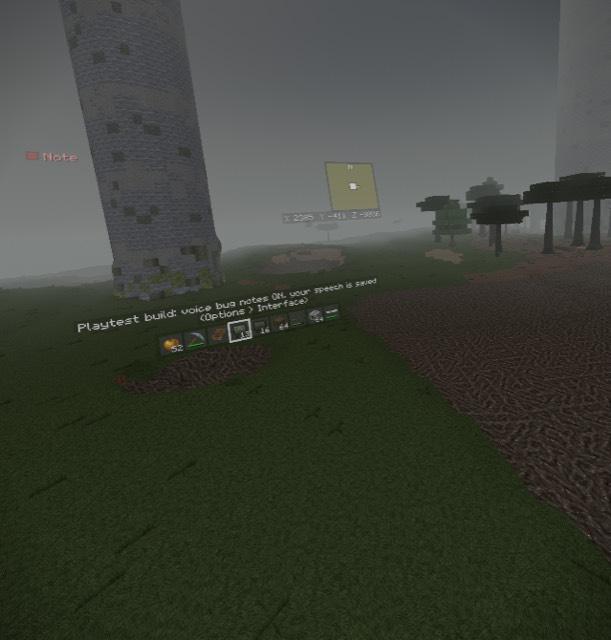

## 09:37:13 - Here we are

- **Transcript:** Here we are
- **Status:** open
- **Build:** 0.129 (80238cd9, M1-M4 (device-tested; ship riding, chests, comfort options, weapon wheel))
- **World:** New World (13) (seed 1340059502856237115)
- **Dimension:** Surface
- **Biome:** Snowy Plains
- **Position:** -652.3 66.3 -2812.5
- **Facing:** east (yaw 89, pitch -66)
- **Held:** Greywall Dispatch x1
- **Mount:** on foot
- **Looking at:** Snowy Grass Block at -652 65 -2813
- **Mode:** Survival, health 20/20
- **Time:** day 1 07:29, clear
- **Fps:** 69
- **Levels:** mic -29 dBFS, game sound -23 dBFS
- **Length:** 2.4 s (voice 1.0 s)
- **Just before:** -2s opened PauseMenu; -1s closed PauseMenu; -1s message: Playtest build: voice bug notes ON, your speech is saved (Options > Interface); --2s opened PauseMenu; --3s message: Flying; --4s message: The Chancellor, over the loudspeakers: "Seal the bunker! Nobody opens the blast door in the command post!"; -2s entered Surface; -2s closed PauseMenu; -2s holding Greywall Dispatch; -2s message: In Clear Ford's jail safe: a Greywall Dispatch; -2s message: In Clear Ford's jail safe: a Greywall Dispatch. Added to journal: Who Holds the Frontier
- **Repro (Mac):** `./snap.sh note --seed 1340059502856237115 --x -652.3 --z -2812.5 --yaw -89 --pitch -66 --time 0.062`
- **Audio (this Mac):** /Users/darthvadar/Documents/Blocksmith/QuestVoiceNotes/raw/vn-20261031-093713-182.aac

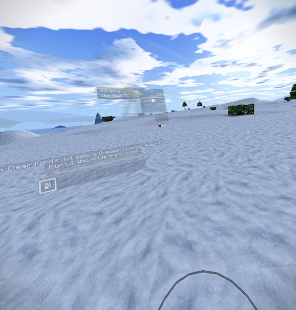

## 09:37:19 - Okay, that's better for Bush

- **Transcript:** Okay, that's better for Bush
- **Status:** open
- **Build:** 0.129 (80238cd9, M1-M4 (device-tested; ship riding, chests, comfort options, weapon wheel))
- **World:** New World (13) (seed 1340059502856237115)
- **Dimension:** Surface
- **Biome:** Snowy Plains
- **Position:** -639.0 67.3 -2808.8
- **Facing:** south-east (yaw 137, pitch -12)
- **Held:** Greywall Dispatch x1
- **Mount:** on foot
- **Looking at:** Spruce Leaves at -638 68 -2807
- **Mode:** Creative, health 20/20
- **Time:** day 1 07:35, clear
- **Fps:** 70
- **Levels:** mic -30 dBFS, game sound -28 dBFS
- **Length:** 3.0 s (voice 1.0 s)
- **Just before:** -9s opened PauseMenu; -7s closed PauseMenu; -7s message: Playtest build: voice bug notes ON, your speech is saved (Options > Interface); -4s opened PauseMenu; -4s message: Flying; -2s message: The Chancellor, over the loudspeakers: "Seal the bunker! Nobody opens the blast door in the command post!"; -9s entered Surface; -9s closed PauseMenu; -9s holding Greywall Dispatch; -9s message: In Clear Ford's jail safe: a Greywall Dispatch; -8s message: In Clear Ford's jail safe: a Greywall Dispatch. Added to journal: Who Holds the Frontier; -4s message: Spring: the snow melts and the young are born; -4s opened PauseMenu; -2s closed PauseMenu; -2s message: Creative mode
- **Repro (Mac):** `./snap.sh note --seed 1340059502856237115 --x -639.0 --z -2808.8 --yaw -137 --pitch -12 --time 0.066`
- **Audio (this Mac):** /Users/darthvadar/Documents/Blocksmith/QuestVoiceNotes/raw/vn-20261031-093719-682.aac

## 09:39:36 - This gun sucks

- **Transcript:** This gun sucks
- **Status:** open
- **Build:** 0.129 (80238cd9, M1-M4 (device-tested; ship riding, chests, comfort options, weapon wheel))
- **World:** New World (13) (seed 1340059502856237115)
- **Dimension:** Surface
- **Biome:** Snowy Taiga
- **Position:** 2185.8 100.1 -2960.6
- **Facing:** south-west (yaw 217, pitch 27)
- **Held:** Golden Apple x64
- **Mount:** on foot
- **Looking at:** Snow at 2184 103 -2959
- **Mode:** Survival, health 11/20
- **Time:** day 1 10:01, clear
- **Fps:** 72
- **Levels:** mic -34 dBFS, game sound -21 dBFS
- **Length:** 2.1 s (voice 0.5 s)
- **Just before:** -18s message: The Greywall Garrison is sounding the alarm!; -13s took 4 damage (health 17/20); -10s took 4 damage (health 14/20); -3s took 6 damage (health 10/20); -2s holding empty hand; -1s holding Golden Apple; -1s message: Golden Apple
- **Repro (Mac):** `./snap.sh note --seed 1340059502856237115 --x 2185.8 --z -2960.6 --yaw 143 --pitch 27 --time 0.168`
- **Audio (this Mac):** /Users/darthvadar/Documents/Blocksmith/QuestVoiceNotes/raw/vn-20261031-093936-682.aac

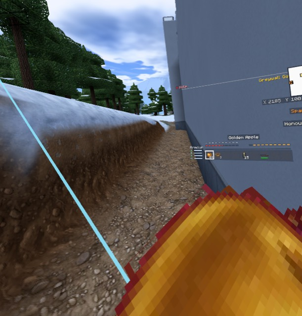

## 09:40:22 - This thing should be doing a lot more damage. The Castle bolt rifle sh

- **Transcript:** This thing should be doing a lot more damage. The Castle bolt rifle should do way more damage to those machine guns
- **Status:** open
- **Build:** 0.129 (80238cd9, M1-M4 (device-tested; ship riding, chests, comfort options, weapon wheel))
- **World:** New World (13) (seed 1340059502856237115)
- **Dimension:** Surface
- **Biome:** Snowy Taiga
- **Position:** 2186.4 102.8 -2958.0
- **Facing:** west (yaw 275, pitch -37)
- **Held:** empty hand
- **Mount:** on foot
- **Looking at:** Snow at 2184 103 -2959
- **Mode:** Survival, health 7/20
- **Time:** day 1 10:56, clear
- **Fps:** 72
- **Levels:** mic -41 dBFS, game sound -19 dBFS
- **Length:** 7.1 s (voice 4.5 s)
- **Just before:** -29s took 6 damage (health 13/20); -26s took 6 damage (health 8/20); -24s holding empty hand; -24s holding Golden Apple; -23s holding Heavy Rounds; -23s holding empty hand; -23s holding Heavy Rounds; -23s holding Golden Apple; -18s holding empty hand; -18s holding Kessel Bolt Rifle; -18s message: Kessel Bolt Rifle; -14s message: Loaded: 5 / 5; -13s took 5 damage (health 18/20); -11s took 6 damage (health 16/20); -9s took 6 damage (health 13/20); -4s took 6 damage (health 9/20); -1s took 2 damage (health 7/20); -0s holding empty hand
- **While talking:** -4s holding Kessel Bolt Rifle; -4s message: Kessel Bolt Rifle; -2s holding empty hand; -1s holding Golden Apple; -1s message: Golden Apple
- **Position at the end:** 2186.4 102.3 -2958.8
- **Repro (Mac):** `./snap.sh note --seed 1340059502856237115 --x 2186.4 --z -2958.0 --yaw 85 --pitch -37 --time 0.206`
- **Audio (this Mac):** /Users/darthvadar/Documents/Blocksmith/QuestVoiceNotes/raw/vn-20261031-094022-322.aac

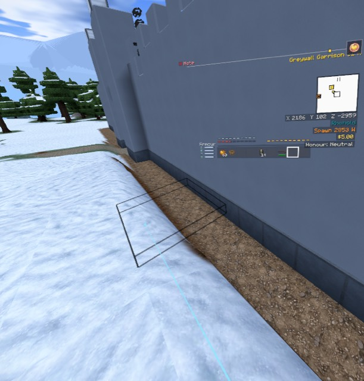

## 09:40:30 - It's almost like the machine guns are tracking how many bullets hit th

- **Transcript:** It's almost like the machine guns are tracking how many bullets hit them
- **Status:** open
- **Build:** 0.129 (80238cd9, M1-M4 (device-tested; ship riding, chests, comfort options, weapon wheel))
- **World:** New World (13) (seed 1340059502856237115)
- **Dimension:** Surface
- **Biome:** Snowy Taiga
- **Position:** 2186.4 102.2 -2958.9
- **Facing:** west (yaw 250, pitch 13)
- **Held:** Golden Apple x58
- **Mount:** on foot
- **Looking at:** Snow at 2186 103 -2959
- **Mode:** Survival, health 14/20
- **Time:** day 1 11:06, clear
- **Fps:** 72
- **Levels:** mic -20 dBFS, game sound -19 dBFS
- **Length:** 3.9 s (voice 2.2 s)
- **Just before:** -26s holding empty hand; -25s holding Kessel Bolt Rifle; -25s message: Kessel Bolt Rifle; -22s message: Loaded: 5 / 5; -21s took 5 damage (health 18/20); -19s took 6 damage (health 16/20); -16s took 6 damage (health 13/20); -12s took 6 damage (health 9/20); -9s took 2 damage (health 7/20); -8s holding empty hand; -6s holding Kessel Bolt Rifle; -6s message: Kessel Bolt Rifle; -4s holding empty hand; -4s holding Golden Apple; -4s message: Golden Apple
- **Repro (Mac):** `./snap.sh note --seed 1340059502856237115 --x 2186.4 --z -2958.9 --yaw 110 --pitch 13 --time 0.213`
- **Audio (this Mac):** /Users/darthvadar/Documents/Blocksmith/QuestVoiceNotes/raw/vn-20261031-094030-142.aac

## 09:41:31 - These guys need to be more aggressive

- **Transcript:** These guys need to be more aggressive
- **Status:** open
- **Build:** 0.129 (80238cd9, M1-M4 (device-tested; ship riding, chests, comfort options, weapon wheel))
- **World:** New World (13) (seed 1340059502856237115)
- **Dimension:** Surface
- **Biome:** Snowy Taiga
- **Position:** 2164.3 100.1 -2963.8
- **Facing:** north-east (yaw 35, pitch -38)
- **Held:** Falke Pistol x1
- **Mount:** on foot
- **Looking at:** Coarse Dirt at 2165 99 -2967
- **Mode:** Survival, health 20/20
- **Time:** day 1 12:16, clear
- **Fps:** 72
- **Levels:** mic -32 dBFS, game sound -17 dBFS
- **Length:** 2.8 s (voice 1.3 s)
- **Just before:** -30s holding Falke Pistol; -30s message: Falke Pistol; -27s message: Loaded: 18 / 18; -27s left the pack: Capital Magazine (at 2158 101 -2962); -27s took 13 damage (health 10/20); -24s message: Honour raised (you protected the town); -24s took 5 damage (health 11/20); -23s holding Kessel Bolt Rifle; -23s holding Capital Magazine; -23s holding empty hand; -23s holding Golden Apple; -20s holding empty hand; -20s holding Capital Magazine; -20s message: Capital Magazine; -20s holding Kessel Bolt Rifle; -20s message: Kessel Bolt Rifle; -20s holding Falke Pistol; -20s message: Falke Pistol; -19s message: Loaded: 18 / 18; -8s message: Honour raised (you protected the town); -4s message: Loaded: 18 / 18; -4s left the pack: Capital Magazine (at 2170 101 -2963)
- **Repro (Mac):** `./snap.sh note --seed 1340059502856237115 --x 2164.3 --z -2963.8 --yaw -35 --pitch -38 --time 0.262`
- **Audio (this Mac):** /Users/darthvadar/Documents/Blocksmith/QuestVoiceNotes/raw/vn-20261031-094131-302.aac

## 09:41:34 - I'd say higher range in which they fire at you

- **Transcript:** I'd say higher range in which they fire at you
- **Status:** open
- **Build:** 0.129 (80238cd9, M1-M4 (device-tested; ship riding, chests, comfort options, weapon wheel))
- **World:** New World (13) (seed 1340059502856237115)
- **Dimension:** Surface
- **Biome:** Snowy Taiga
- **Position:** 2158.3 100.1 -2967.0
- **Facing:** north-west (yaw 332, pitch -20)
- **Held:** Falke Pistol x1
- **Mount:** on foot
- **Looking at:** Coarse Dirt at 2155 99 -2971
- **Mode:** Survival, health 20/20
- **Time:** day 1 12:20, clear
- **Fps:** 72
- **Levels:** mic -22 dBFS, game sound -9 dBFS
- **Length:** 3.6 s (voice 2.0 s)
- **Just before:** -30s left the pack: Capital Magazine (at 2158 101 -2962); -30s took 13 damage (health 10/20); -27s message: Honour raised (you protected the town); -27s took 5 damage (health 11/20); -26s holding Kessel Bolt Rifle; -26s holding Capital Magazine; -26s holding empty hand; -26s holding Golden Apple; -23s holding empty hand; -23s holding Capital Magazine; -23s message: Capital Magazine; -23s holding Kessel Bolt Rifle; -23s message: Kessel Bolt Rifle; -23s holding Falke Pistol; -23s message: Falke Pistol; -22s message: Loaded: 18 / 18; -11s message: Honour raised (you protected the town); -7s message: Loaded: 18 / 18; -7s left the pack: Capital Magazine (at 2170 101 -2963)
- **Repro (Mac):** `./snap.sh note --seed 1340059502856237115 --x 2158.3 --z -2967.0 --yaw 28 --pitch -20 --time 0.264`
- **Audio (this Mac):** /Users/darthvadar/Documents/Blocksmith/QuestVoiceNotes/raw/vn-20261031-094134-242.aac

## 09:41:39 - Looks like we got a triangle right here where you can see through. Not

- **Transcript:** Looks like we got a triangle right here where you can see through. Not good
- **Status:** open
- **Build:** 0.129 (80238cd9, M1-M4 (device-tested; ship riding, chests, comfort options, weapon wheel))
- **World:** New World (13) (seed 1340059502856237115)
- **Dimension:** Surface
- **Biome:** Snowy Taiga
- **Position:** 2170.5 100.1 -2973.3
- **Facing:** east (yaw 70, pitch -18)
- **Held:** Falke Pistol x1
- **Mount:** on foot
- **Looking at:** Coarse Dirt at 2175 99 -2976
- **Mode:** Survival, health 20/20
- **Time:** day 1 12:26, clear
- **Fps:** 72
- **Levels:** mic -25 dBFS, game sound -19 dBFS
- **Length:** 4.9 s (voice 2.1 s)
- **Just before:** -28s holding empty hand; -28s holding Capital Magazine; -28s message: Capital Magazine; -28s holding Kessel Bolt Rifle; -28s message: Kessel Bolt Rifle; -27s holding Falke Pistol; -27s message: Falke Pistol; -27s message: Loaded: 18 / 18; -16s message: Honour raised (you protected the town); -12s message: Loaded: 18 / 18; -12s left the pack: Capital Magazine (at 2170 101 -2963); -3s into the pack: Regular Armour Set
- **Repro (Mac):** `./snap.sh note --seed 1340059502856237115 --x 2170.5 --z -2973.3 --yaw -70 --pitch -18 --time 0.268`
- **Audio (this Mac):** /Users/darthvadar/Documents/Blocksmith/QuestVoiceNotes/raw/vn-20261031-094139-123.aac

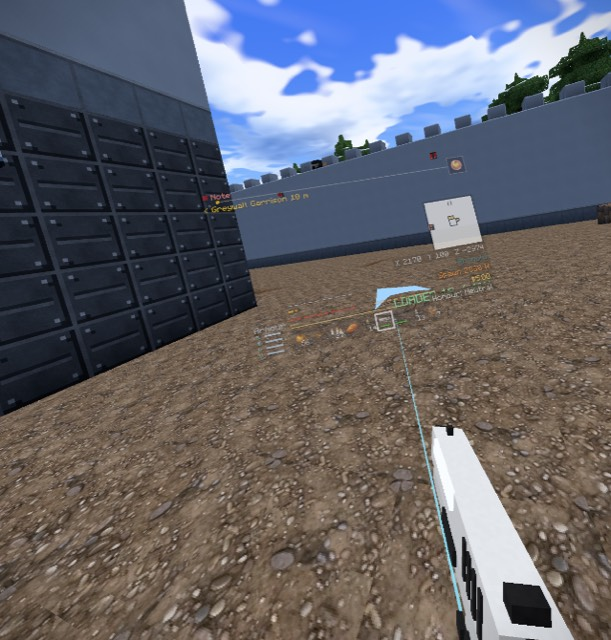

## 09:41:45 - Also, the armor on the base is still here. Get rid of that

- **Transcript:** Also, the armor on the base is still here. Get rid of that
- **Status:** open
- **Build:** 0.129 (80238cd9, M1-M4 (device-tested; ship riding, chests, comfort options, weapon wheel))
- **World:** New World (13) (seed 1340059502856237115)
- **Dimension:** Surface
- **Biome:** Snowy Taiga
- **Position:** 2181.3 100.2 -2976.0
- **Facing:** north-west (yaw 312, pitch -0)
- **Held:** Falke Pistol x1
- **Mount:** on foot
- **Looking at:** nothing
- **Mode:** Survival, health 20/20
- **Time:** day 1 12:33, clear
- **Fps:** 71
- **Levels:** mic -24 dBFS, game sound -18 dBFS
- **Length:** 3.7 s (voice 2.2 s)
- **Just before:** -22s message: Honour raised (you protected the town); -18s message: Loaded: 18 / 18; -18s left the pack: Capital Magazine (at 2170 101 -2963); -9s into the pack: Regular Armour Set
- **Repro (Mac):** `./snap.sh note --seed 1340059502856237115 --x 2181.3 --z -2976.0 --yaw 48 --pitch -0 --time 0.273`
- **Audio (this Mac):** /Users/darthvadar/Documents/Blocksmith/QuestVoiceNotes/raw/vn-20261031-094145-342.aac

## 09:42:08 - Oh, that's perfect. Very good. Now, the guns still aren't doing any da

- **Transcript:** Oh, that's perfect. Very good. Now, the guns still aren't doing any damage to me
- **Status:** open
- **Build:** 0.129 (80238cd9, M1-M4 (device-tested; ship riding, chests, comfort options, weapon wheel))
- **World:** New World (13) (seed 1340059502856237115)
- **Dimension:** Surface
- **Biome:** Snowy Taiga
- **Position:** 2146.0 117.5 -3003.8
- **Facing:** east (yaw 97, pitch -15)
- **Held:** empty hand
- **Mount:** on foot
- **Looking at:** nothing
- **Mode:** Survival, health 17/20
- **Time:** day 1 12:59, clear
- **Fps:** 62
- **Levels:** mic -19 dBFS, game sound -19 dBFS
- **Length:** 8.5 s (voice 4.5 s)
- **Just before:** -20s message: You've reached Greywall Garrison; -14s message: Honour raised (you protected the town); -12s message: Greywall Command now counts you tolerated.; -9s message: Loaded: 18 / 18; -7s holding empty hand; -7s message: Manning the deck gun; -7s took 5 damage (health 17/20); -6s message: Gun Control: the gun overhead, worked from this computer
- **Position at the end:** 2147.1 117.5 -3005.6
- **Repro (Mac):** `./snap.sh note --seed 1340059502856237115 --x 2146.0 --z -3003.8 --yaw -97 --pitch -15 --time 0.291`
- **Audio (this Mac):** /Users/darthvadar/Documents/Blocksmith/QuestVoiceNotes/raw/vn-20261031-094208-442.aac

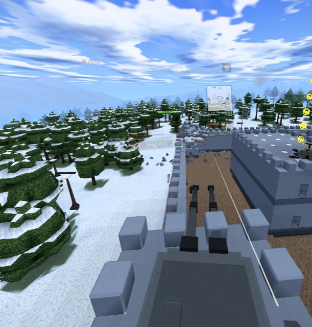

## 09:42:16 - Can't help but notice

- **Transcript:** Can't help but notice
- **Status:** open
- **Build:** 0.129 (80238cd9, M1-M4 (device-tested; ship riding, chests, comfort options, weapon wheel))
- **World:** New World (13) (seed 1340059502856237115)
- **Dimension:** Surface
- **Biome:** Snowy Taiga
- **Position:** 2146.9 117.5 -3005.4
- **Facing:** south-east (yaw 141, pitch -19)
- **Held:** empty hand
- **Mount:** on foot
- **Looking at:** nothing
- **Mode:** Survival, health 17/20
- **Time:** day 1 13:08, clear
- **Fps:** 66
- **Levels:** mic -28 dBFS, game sound -12 dBFS
- **Length:** 2.2 s (voice 0.9 s)
- **Just before:** -28s message: You've reached Greywall Garrison; -22s message: Honour raised (you protected the town); -19s message: Greywall Command now counts you tolerated.; -17s message: Loaded: 18 / 18; -15s holding empty hand; -15s message: Manning the deck gun; -15s took 5 damage (health 17/20); -13s message: Gun Control: the gun overhead, worked from this computer; -0s message: The turret is wrecked
- **Repro (Mac):** `./snap.sh note --seed 1340059502856237115 --x 2146.9 --z -3005.4 --yaw -141 --pitch -19 --time 0.298`
- **Audio (this Mac):** /Users/darthvadar/Documents/Blocksmith/QuestVoiceNotes/raw/vn-20261031-094216-882.aac

## 09:42:20 - All right, top floor

- **Transcript:** All right, top floor
- **Status:** open
- **Build:** 0.129 (80238cd9, M1-M4 (device-tested; ship riding, chests, comfort options, weapon wheel))
- **World:** New World (13) (seed 1340059502856237115)
- **Dimension:** Surface
- **Biome:** Snowy Taiga
- **Position:** 2146.8 117.5 -3005.3
- **Facing:** south-east (yaw 137, pitch -9)
- **Held:** empty hand
- **Mount:** on foot
- **Looking at:** nothing
- **Mode:** Survival, health 17/20
- **Time:** day 1 13:13, clear
- **Fps:** 67
- **Levels:** mic -26 dBFS, game sound -18 dBFS
- **Length:** 2.3 s (voice 0.7 s)
- **Just before:** -25s message: Honour raised (you protected the town); -23s message: Greywall Command now counts you tolerated.; -20s message: Loaded: 18 / 18; -19s holding empty hand; -19s message: Manning the deck gun; -19s took 5 damage (health 17/20); -17s message: Gun Control: the gun overhead, worked from this computer; -4s message: The turret is wrecked
- **Repro (Mac):** `./snap.sh note --seed 1340059502856237115 --x 2146.8 --z -3005.3 --yaw -137 --pitch -9 --time 0.301`
- **Audio (this Mac):** /Users/darthvadar/Documents/Blocksmith/QuestVoiceNotes/raw/vn-20261031-094220-882.aac

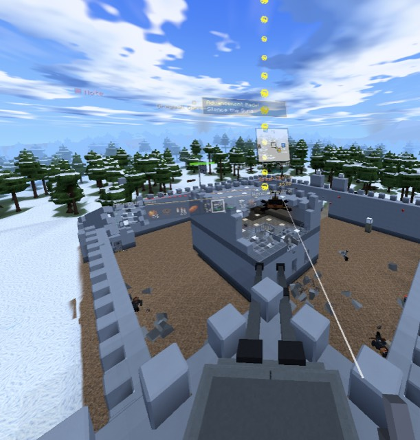

## 09:43:01 - No one up here, huh?

- **Transcript:** No one up here, huh?
- **Status:** open
- **Build:** 0.129 (80238cd9, M1-M4 (device-tested; ship riding, chests, comfort options, weapon wheel))
- **World:** New World (13) (seed 1340059502856237115)
- **Dimension:** Surface
- **Biome:** Snowy Taiga
- **Position:** 2162.3 103.0 -2986.2
- **Facing:** east (yaw 69, pitch -11)
- **Held:** Falke Pistol x1
- **Mount:** on foot
- **Looking at:** Station Floor Tiles at 2163 104 -2988
- **Mode:** Survival, health 20/20
- **Time:** day 1 14:01, clear
- **Fps:** 72
- **Levels:** mic -27 dBFS, game sound -18 dBFS
- **Length:** 2.2 s (voice 0.7 s)
- **Just before:** -29s message: Loaded: 18 / 18; -29s into the pack: Greywall Code Book; -29s into the pack: Spec Ops Armour Set; -29s into the pack: Greywall Keycard; -28s message: The Capital now counts you wary of you.; -27s took 14 damage (health 6/20); -25s message: Loaded: 18 / 18; -24s message: Keycard accepted; -22s took 2 damage (health 5/20); -22s holding Kessel Bolt Rifle; -21s holding Capital Magazine; -21s holding Rifle Rounds; -21s message: Rifle Rounds; -21s holding Golden Apple; -21s message: Golden Apple; -21s holding Heavy Rounds; -21s message: Heavy Rounds; -21s holding Golden Apple; -21s message: Golden Apple; -20s into the pack: Greywall Dispatch; -16s holding Rifle Rounds; -16s message: Rifle Rounds; -16s holding Capital Magazine; -16s message: Capital Magazine; -16s holding Kessel Bolt Rifle; -16s message: Kessel Bolt Rifle; -15s holding Falke Pistol; -15s message: Falke Pistol; -9s message: Loaded: 18 / 18; -9s took 1 damage (health 20/20); -9s left the pack: Capital Magazine (at 2174 100 -2993)
- **Repro (Mac):** `./snap.sh note --seed 1340059502856237115 --x 2162.3 --z -2986.2 --yaw -69 --pitch -11 --time 0.335`
- **Audio (this Mac):** /Users/darthvadar/Documents/Blocksmith/QuestVoiceNotes/raw/vn-20261031-094301-482.aac

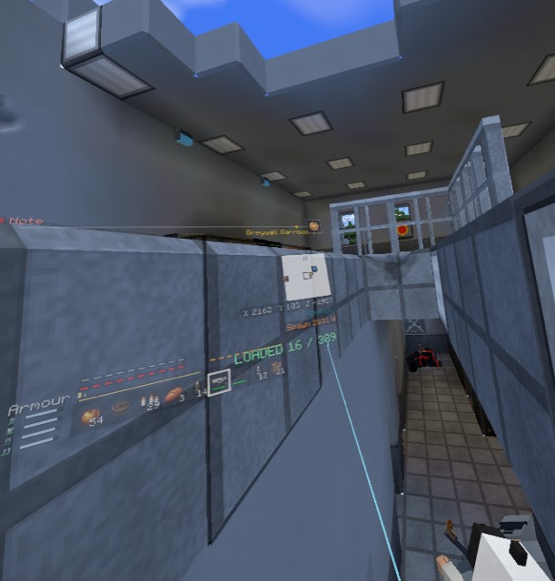

## 09:43:14 - Okay. Question, where is the thing that burns into hell? Like the, the

- **Transcript:** Okay. Question, where is the thing that burns into hell? Like the, the bomb you place to get into hell. I haven't seen them in any of these sites
- **Status:** open
- **Build:** 0.129 (80238cd9, M1-M4 (device-tested; ship riding, chests, comfort options, weapon wheel))
- **World:** New World (13) (seed 1340059502856237115)
- **Dimension:** Surface
- **Biome:** Snowy Taiga
- **Position:** 2170.7 105.0 -2987.6
- **Facing:** north-east (yaw 23, pitch -15)
- **Held:** Falke Pistol x1
- **Mount:** on foot
- **Looking at:** Chest at 2172 105 -2992
- **Mode:** Creative, health 20/20
- **Time:** day 1 14:15, clear
- **Fps:** 71
- **Levels:** mic -24 dBFS, game sound -18 dBFS
- **Length:** 11.6 s (voice 7.2 s)
- **Just before:** -29s holding Rifle Rounds; -29s message: Rifle Rounds; -29s holding Capital Magazine; -29s message: Capital Magazine; -29s holding Kessel Bolt Rifle; -29s message: Kessel Bolt Rifle; -28s holding Falke Pistol; -28s message: Falke Pistol; -22s message: Loaded: 18 / 18; -22s took 1 damage (health 20/20); -22s left the pack: Capital Magazine (at 2174 100 -2993); -8s opened InventoryMenu; -7s closed InventoryMenu; -6s opened PauseMenu; -5s message: Creative mode; -5s closed PauseMenu; -4s message: Flying; -3s opened ChestMenu; -2s closed ChestMenu
- **While talking:** -5s opened ChestMenu; -4s closed ChestMenu; -2s opened ChestMenu; -4s closed ChestMenu; -2s opened ChestMenu; -1s closed ChestMenu
- **Position at the end:** 2171.0 105.0 -2989.5
- **Repro (Mac):** `./snap.sh note --seed 1340059502856237115 --x 2170.7 --z -2987.6 --yaw -23 --pitch -15 --time 0.344`
- **Audio (this Mac):** /Users/darthvadar/Documents/Blocksmith/QuestVoiceNotes/raw/vn-20261031-094314-522.aac

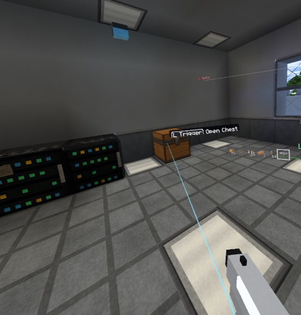

## 09:43:26 - Hell, I don't know where it is

- **Transcript:** Hell, I don't know where it is
- **Status:** open
- **Build:** 0.129 (80238cd9, M1-M4 (device-tested; ship riding, chests, comfort options, weapon wheel))
- **World:** New World (13) (seed 1340059502856237115)
- **Dimension:** Surface
- **Biome:** Snowy Taiga
- **Position:** 2153.3 110.2 -2988.0
- **Facing:** west (yaw 262, pitch -20)
- **Held:** Falke Pistol x1
- **Mount:** on foot, flying
- **Looking at:** nothing
- **Mode:** Creative, health 20/20
- **Time:** day 1 14:29, clear
- **Fps:** 71
- **Levels:** mic -22 dBFS, game sound -19 dBFS
- **Length:** 2.5 s (voice 1.1 s)
- **Just before:** -19s opened InventoryMenu; -18s closed InventoryMenu; -18s opened PauseMenu; -17s message: Creative mode; -17s closed PauseMenu; -15s message: Flying; -14s opened ChestMenu; -13s closed ChestMenu; -11s opened ChestMenu; -11s closed ChestMenu; -8s opened ChestMenu; -6s closed ChestMenu; -4s opened ChestMenu; -2s closed ChestMenu
- **Repro (Mac):** `./snap.sh note --seed 1340059502856237115 --x 2153.3 --z -2988.0 --yaw 98 --pitch -20 --time 0.354`
- **Audio (this Mac):** /Users/darthvadar/Documents/Blocksmith/QuestVoiceNotes/raw/vn-20261031-094326-062.aac

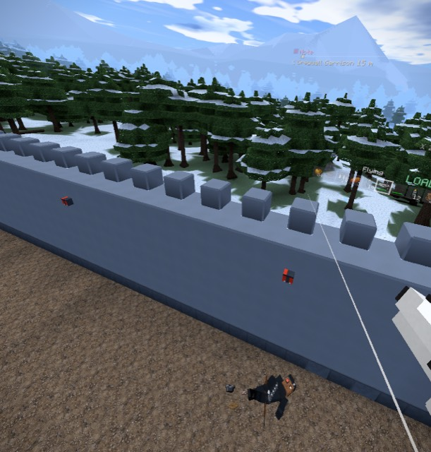

## 09:44:14 - Okay, my hitbox is still too-- it hasn't been fixed. I'm still having 

- **Transcript:** Okay, my hitbox is still too-- it hasn't been fixed. I'm still having trouble getting through doors. I have to line myself up fucking perfectly
- **Status:** open
- **Build:** 0.129 (80238cd9, M1-M4 (device-tested; ship riding, chests, comfort options, weapon wheel))
- **World:** New World (13) (seed 1340059502856237115)
- **Dimension:** Surface
- **Biome:** Snowy Taiga
- **Position:** 2168.8 100.1 -2978.9
- **Facing:** north (yaw 10, pitch -51)
- **Held:** Falke Pistol x1
- **Mount:** on foot
- **Looking at:** Station Concrete at 2169 100 -2981
- **Mode:** Creative, health 20/20
- **Time:** day 1 15:24, clear
- **Fps:** 71
- **Levels:** mic -23 dBFS, game sound -21 dBFS
- **Length:** 8.9 s (voice 4.8 s)
- **Just before:** -19s message: Walking; -5s message: You've reached Greywall Garrison
- **Position at the end:** 2171.7 100.0 -2985.2
- **Repro (Mac):** `./snap.sh note --seed 1340059502856237115 --x 2168.8 --z -2978.9 --yaw -10 --pitch -51 --time 0.392`
- **Audio (this Mac):** /Users/darthvadar/Documents/Blocksmith/QuestVoiceNotes/raw/vn-20261031-094414-082.aac

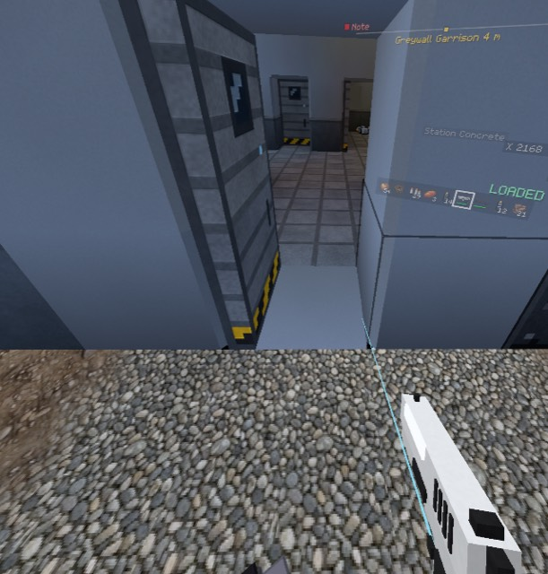

## 09:44:24 - Um, okay, that's good, except we still have, uh, golden apples. So we 

- **Transcript:** Um, okay, that's good, except we still have, uh, golden apples. So we gotta get rid of the golden apples
- **Status:** open
- **Build:** 0.129 (80238cd9, M1-M4 (device-tested; ship riding, chests, comfort options, weapon wheel))
- **World:** New World (13) (seed 1340059502856237115)
- **Dimension:** Surface
- **Biome:** Snowy Taiga
- **Position:** 2172.4 100.0 -2983.4
- **Facing:** east (yaw 88, pitch -21)
- **Held:** Falke Pistol x1
- **Mount:** on foot
- **Looking at:** nothing
- **Mode:** Creative, health 20/20, screen ChestMenu
- **Time:** day 1 15:36, clear
- **Fps:** 72
- **Levels:** mic -46 dBFS, game sound -24 dBFS
- **Length:** 6.9 s (voice 4.2 s)
- **Just before:** -29s message: Walking; -15s message: You've reached Greywall Garrison; -4s opened ChestMenu
- **While talking:** -1s closed ChestMenu
- **Position at the end:** 2174.5 100.0 -2983.7
- **Repro (Mac):** `./snap.sh note --seed 1340059502856237115 --x 2172.4 --z -2983.4 --yaw -88 --pitch -21 --time 0.400`
- **Audio (this Mac):** /Users/darthvadar/Documents/Blocksmith/QuestVoiceNotes/raw/vn-20261031-094424-142.aac

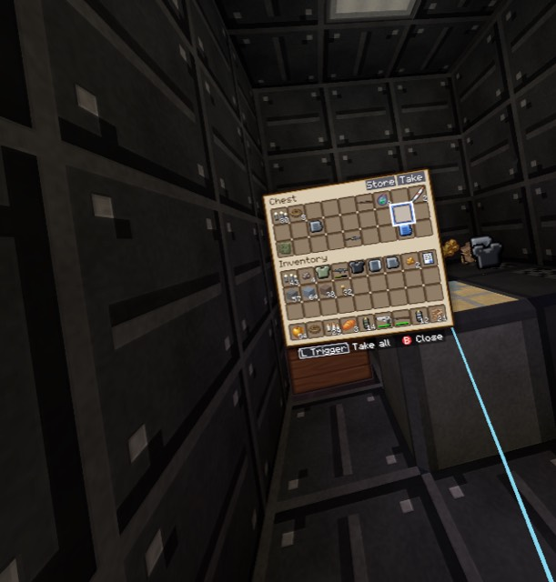

## 09:44:43 - Why am I doing quartermaster contracts at the Grayson whatever?

- **Transcript:** Why am I doing quartermaster contracts at the Grayson whatever?
- **Status:** open
- **Build:** 0.129 (80238cd9, M1-M4 (device-tested; ship riding, chests, comfort options, weapon wheel))
- **World:** New World (13) (seed 1340059502856237115)
- **Dimension:** Surface
- **Biome:** Snowy Taiga
- **Position:** 2173.1 100.0 -2982.6
- **Facing:** south-east (yaw 116, pitch -39)
- **Held:** Falke Pistol x1
- **Mount:** on foot
- **Looking at:** nothing
- **Mode:** Creative, health 20/20, screen BaseContractsMenu
- **Time:** day 1 16:00, clear
- **Fps:** 72
- **Levels:** mic -21 dBFS, game sound -26 dBFS
- **Length:** 6.4 s (voice 3.4 s)
- **Just before:** -24s opened ChestMenu; -16s closed ChestMenu; -14s into the pack: Greywall Code Book; -14s opened BaseContractsMenu; -14s message: Greywall Fortress marked on the map; -12s message: The radar net marks 1 Greywall bases on your map; -8s message: Added to journal: Contract: Parcel to Bitter Ridge; -6s message: Tracking Contract: Parcel to Bitter Ridge; -1s closed BaseContractsMenu; -0s opened BaseContractsMenu; -0s message: The radar net marks 1 Greywall bases on your map
- **While talking:** -3s closed BaseContractsMenu
- **Position at the end:** 2173.5 100.0 -2982.3
- **Repro (Mac):** `./snap.sh note --seed 1340059502856237115 --x 2173.1 --z -2982.6 --yaw -116 --pitch -39 --time 0.417`
- **Audio (this Mac):** /Users/darthvadar/Documents/Blocksmith/QuestVoiceNotes/raw/vn-20261031-094443-842.aac

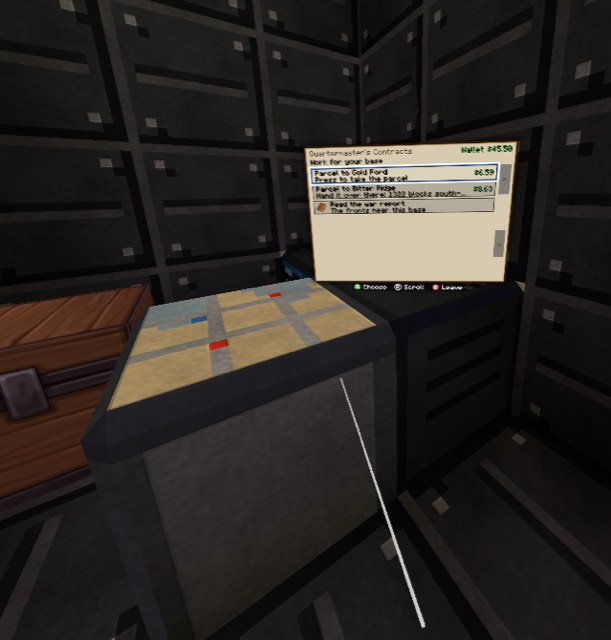

## 09:44:50 - Doesn't make a lick of sense

- **Transcript:** Doesn't make a lick of sense
- **Status:** open
- **Build:** 0.129 (80238cd9, M1-M4 (device-tested; ship riding, chests, comfort options, weapon wheel))
- **World:** New World (13) (seed 1340059502856237115)
- **Dimension:** Surface
- **Biome:** Snowy Taiga
- **Position:** 2173.5 100.0 -2982.9
- **Facing:** east (yaw 100, pitch -45)
- **Held:** Falke Pistol x1
- **Mount:** on foot
- **Looking at:** nothing
- **Mode:** Creative, health 20/20, screen BaseContractsMenu
- **Time:** day 1 16:07, clear
- **Fps:** 72
- **Levels:** mic -25 dBFS, game sound -23 dBFS
- **Length:** 2.5 s (voice 1.0 s)
- **Just before:** -23s closed ChestMenu; -21s into the pack: Greywall Code Book; -20s opened BaseContractsMenu; -20s message: Greywall Fortress marked on the map; -18s message: The radar net marks 1 Greywall bases on your map; -15s message: Added to journal: Contract: Parcel to Bitter Ridge; -12s message: Tracking Contract: Parcel to Bitter Ridge; -8s closed BaseContractsMenu; -7s opened BaseContractsMenu; -7s message: The radar net marks 1 Greywall bases on your map; -4s closed BaseContractsMenu; -0s opened BaseContractsMenu
- **Repro (Mac):** `./snap.sh note --seed 1340059502856237115 --x 2173.5 --z -2982.9 --yaw -100 --pitch -45 --time 0.422`
- **Audio (this Mac):** /Users/darthvadar/Documents/Blocksmith/QuestVoiceNotes/raw/vn-20261031-094450-342.aac

## 09:44:54 - Yeah, whatever

- **Transcript:** Yeah, whatever
- **Status:** open
- **Build:** 0.129 (80238cd9, M1-M4 (device-tested; ship riding, chests, comfort options, weapon wheel))
- **World:** New World (13) (seed 1340059502856237115)
- **Dimension:** Surface
- **Biome:** Snowy Taiga
- **Position:** 2171.5 100.0 -2984.8
- **Facing:** north-east (yaw 37, pitch -20)
- **Held:** Falke Pistol x1
- **Mount:** on foot
- **Looking at:** Dark Station Concrete at 2173 100 -2988
- **Mode:** Creative, health 20/20
- **Time:** day 1 16:13, clear
- **Fps:** 72
- **Levels:** mic -26 dBFS, game sound -22 dBFS
- **Length:** 1.9 s (voice 0.5 s)
- **Just before:** -27s closed ChestMenu; -25s into the pack: Greywall Code Book; -25s opened BaseContractsMenu; -25s message: Greywall Fortress marked on the map; -22s message: The radar net marks 1 Greywall bases on your map; -19s message: Added to journal: Contract: Parcel to Bitter Ridge; -17s message: Tracking Contract: Parcel to Bitter Ridge; -12s closed BaseContractsMenu; -11s opened BaseContractsMenu; -11s message: The radar net marks 1 Greywall bases on your map; -9s closed BaseContractsMenu; -4s opened BaseContractsMenu; -2s closed BaseContractsMenu
- **Repro (Mac):** `./snap.sh note --seed 1340059502856237115 --x 2171.5 --z -2984.8 --yaw -37 --pitch -20 --time 0.426`
- **Audio (this Mac):** /Users/darthvadar/Documents/Blocksmith/QuestVoiceNotes/raw/vn-20261031-094454-682.aac

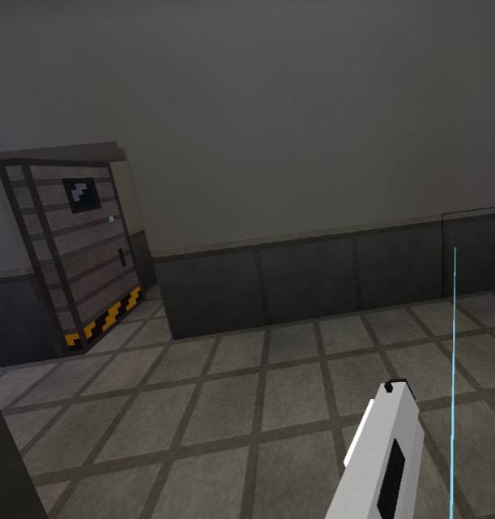

## 09:45:21 - Well, that worked

- **Transcript:** Well, that worked
- **Status:** open
- **Build:** 0.129 (80238cd9, M1-M4 (device-tested; ship riding, chests, comfort options, weapon wheel))
- **World:** New World (13) (seed 1340059502856237115)
- **Dimension:** Surface
- **Biome:** Snowy Plains
- **Position:** 3366.4 69.0 -2475.9
- **Facing:** north-east (yaw 42, pitch -10)
- **Held:** Capital Magazine x12
- **Mount:** on foot
- **Looking at:** nothing
- **Mode:** Creative, health 20/20
- **Time:** day 1 16:44, clear
- **Fps:** 72
- **Levels:** mic -24 dBFS, game sound -18 dBFS
- **Length:** 1.9 s (voice 0.4 s)
- **Just before:** -29s closed BaseContractsMenu; -26s opened PauseMenu; -25s closed PauseMenu; -24s message: The Greywall Garrison is sounding the alarm!; -23s holding Kessel Bolt Rifle; -23s holding Capital Magazine; -21s opened CreativeMenu; -21s closed CreativeMenu; -20s message: Flying; -18s walked into Grove; -14s message: Entering Vesarreach; -14s walked into Snowy Taiga; -12s message: Sky isle marked on the map; -6s walked into Snowy Plains; -4s message: Bitter Ridge marked on the map; -2s message: Walking; -1s message: Contract done: $8.63 from your base's quartermaster.
- **Repro (Mac):** `./snap.sh note --seed 1340059502856237115 --x 3366.4 --z -2475.9 --yaw -42 --pitch -10 --time 0.447`
- **Audio (this Mac):** /Users/darthvadar/Documents/Blocksmith/QuestVoiceNotes/raw/vn-20261031-094521-602.aac

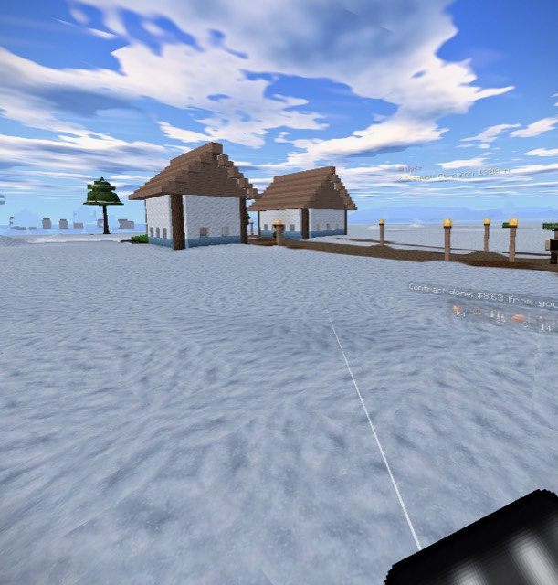

## 09:46:19 - Pistol should still be semi-automatic, but needs to have a higher rate

- **Transcript:** Pistol should still be semi-automatic, but needs to have a higher rate of fire
- **Status:** open
- **Build:** 0.129 (80238cd9, M1-M4 (device-tested; ship riding, chests, comfort options, weapon wheel))
- **World:** New World (13) (seed 1340059502856237115)
- **Dimension:** Surface
- **Biome:** Snowy Plains
- **Position:** 3483.5 74.0 -2287.8
- **Facing:** south (yaw 161, pitch 48)
- **Held:** Golden Apple x54
- **Mount:** on foot
- **Looking at:** nothing
- **Mode:** Survival, health 10/20
- **Time:** day 1 17:49, clear
- **Fps:** 71
- **Levels:** mic -32 dBFS, game sound -19 dBFS
- **Length:** 4.5 s (voice 2.9 s)
- **Just before:** -30s holding Falke Pistol; -30s message: Falke Pistol; -29s message: Alarm! Intruder in the citadel; -27s took 3 damage (health 18/20); -27s message: Missile launch: take cover!; -25s message: The citadel is on lockdown!; -23s message: Loaded: 18 / 18; -22s took 9 damage (health 12/20); -21s message: Missile launch: take cover!; -14s took 1 damage (health 14/20); -12s took 1 damage (health 13/20); -12s holding Heavy Magazine; -12s message: Heavy Magazine; -11s holding Falke Pistol; -11s message: Falke Pistol; -11s holding Kessel Bolt Rifle; -11s message: Kessel Bolt Rifle; -11s holding Falke Pistol; -11s message: Falke Pistol; -10s took 1 damage (health 12/20); -9s message: The Capital now counts you hunted.; -7s message: Loaded: 18 / 18; -7s took 3 damage (health 9/20); -5s message: Missile launch: take cover!; -5s took 1 damage (health 8/20); -3s holding Heavy Magazine; -3s holding Bread; -2s holding Capital Rounds; -2s message: Capital Rounds; -2s holding Heavy Rounds; -2s message: Heavy Rounds; -2s holding Golden Apple; -2s message: Golden Apple
- **Repro (Mac):** `./snap.sh note --seed 1340059502856237115 --x 3483.5 --z -2287.8 --yaw -161 --pitch 48 --time 0.493`
- **Audio (this Mac):** /Users/darthvadar/Documents/Blocksmith/QuestVoiceNotes/raw/vn-20261031-094619-862.aac

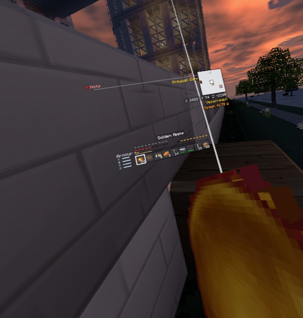

## 09:46:33 - Also, we need those assault shotguns for the highest rank capital and 

- **Transcript:** Also, we need those assault shotguns for the highest rank capital and gray wall troops, and it should be devastating
- **Status:** open
- **Build:** 0.129 (80238cd9, M1-M4 (device-tested; ship riding, chests, comfort options, weapon wheel))
- **World:** New World (13) (seed 1340059502856237115)
- **Dimension:** Surface
- **Biome:** Snowy Plains
- **Position:** 3509.5 76.0 -2286.7
- **Facing:** south (yaw 159, pitch -27)
- **Held:** Falke Pistol x1
- **Mount:** on foot
- **Looking at:** Capital Stone at 3510 75 -2284
- **Mode:** Survival, health 19/20
- **Time:** day 1 18:06, clear
- **Fps:** 72
- **Levels:** mic -21 dBFS, game sound -22 dBFS
- **Length:** 8.1 s (voice 4.8 s)
- **Just before:** -28s took 1 damage (health 14/20); -26s took 1 damage (health 13/20); -26s holding Heavy Magazine; -26s message: Heavy Magazine; -25s holding Falke Pistol; -25s message: Falke Pistol; -25s holding Kessel Bolt Rifle; -25s message: Kessel Bolt Rifle; -25s holding Falke Pistol; -25s message: Falke Pistol; -24s took 1 damage (health 12/20); -23s message: The Capital now counts you hunted.; -21s message: Loaded: 18 / 18; -21s took 3 damage (health 9/20); -19s message: Missile launch: take cover!; -19s took 1 damage (health 8/20); -17s holding Heavy Magazine; -17s holding Bread; -16s holding Capital Rounds; -16s message: Capital Rounds; -16s holding Heavy Rounds; -16s message: Heavy Rounds; -16s holding Golden Apple; -16s message: Golden Apple; -13s holding Heavy Rounds; -13s message: Heavy Rounds; -12s message: Missile launch: take cover!; -12s holding Capital Rounds; -12s holding Bread; -12s holding Heavy Magazine; -12s holding Falke Pistol; -8s message: Loaded: 18 / 18; -3s message: Missile launch: take cover!; -2s took 2 damage (health 18/20)
- **Position at the end:** 3505.8 76.0 -2268.4
- **Repro (Mac):** `./snap.sh note --seed 1340059502856237115 --x 3509.5 --z -2286.7 --yaw -159 --pitch -27 --time 0.505`
- **Audio (this Mac):** /Users/darthvadar/Documents/Blocksmith/QuestVoiceNotes/raw/vn-20261031-094633-942.aac

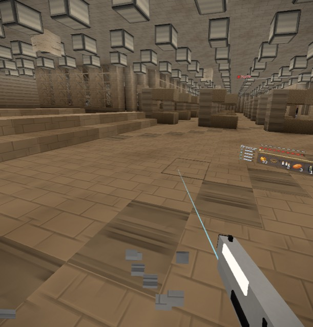

## 09:46:44 - Uh-oh. Oh, there we go

- **Transcript:** Uh-oh. Oh, there we go
- **Status:** open
- **Build:** 0.129 (80238cd9, M1-M4 (device-tested; ship riding, chests, comfort options, weapon wheel))
- **World:** New World (13) (seed 1340059502856237115)
- **Dimension:** Surface
- **Biome:** Snowy Plains
- **Position:** 3517.1 76.0 -2247.8
- **Facing:** east (yaw 108, pitch -3)
- **Held:** Falke Pistol x1
- **Mount:** on foot
- **Looking at:** nothing
- **Mode:** Survival, health 12/20
- **Time:** day 1 18:18, clear
- **Fps:** 70
- **Levels:** mic -27 dBFS, game sound -13 dBFS
- **Length:** 3.0 s (voice 1.1 s)
- **Just before:** -29s message: Missile launch: take cover!; -29s took 1 damage (health 8/20); -28s holding Heavy Magazine; -27s holding Bread; -26s holding Capital Rounds; -26s message: Capital Rounds; -26s holding Heavy Rounds; -26s message: Heavy Rounds; -26s holding Golden Apple; -26s message: Golden Apple; -23s holding Heavy Rounds; -23s message: Heavy Rounds; -23s message: Missile launch: take cover!; -23s holding Capital Rounds; -22s holding Bread; -22s holding Heavy Magazine; -22s holding Falke Pistol; -18s message: Loaded: 18 / 18; -14s message: Missile launch: take cover!; -12s took 2 damage (health 18/20); -5s left the pack: Capital Magazine (at 3505 76 -2268); -4s message: Loaded: 18 / 18; -3s into the pack: Donnerkeil Service Rifle
- **Repro (Mac):** `./snap.sh note --seed 1340059502856237115 --x 3517.1 --z -2247.8 --yaw -108 --pitch -3 --time 0.513`
- **Audio (this Mac):** /Users/darthvadar/Documents/Blocksmith/QuestVoiceNotes/raw/vn-20261031-094644-322.aac

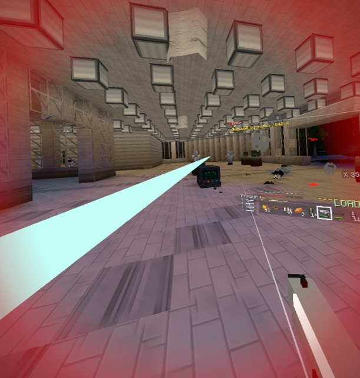

## 09:46:47 - [whistles] [laughs] Very good. Okay, give me a minute

- **Transcript:** [whistles] [laughs] Very good. Okay, give me a minute
- **Status:** open
- **Build:** 0.129 (80238cd9, M1-M4 (device-tested; ship riding, chests, comfort options, weapon wheel))
- **World:** New World (13) (seed 1340059502856237115)
- **Dimension:** Surface
- **Biome:** Snowy Plains
- **Position:** 3523.7 76.0 -2241.2
- **Facing:** east (yaw 99, pitch -7)
- **Held:** Falke Pistol x1
- **Mount:** on foot
- **Looking at:** nothing
- **Mode:** Survival, health 2/20, screen PauseMenu
- **Time:** day 1 18:21, clear
- **Fps:** 70
- **Levels:** mic -26 dBFS, game sound -27 dBFS
- **Length:** 6.2 s (voice 2.7 s)
- **Just before:** -29s holding Capital Rounds; -29s message: Capital Rounds; -29s holding Heavy Rounds; -29s message: Heavy Rounds; -29s holding Golden Apple; -29s message: Golden Apple; -26s holding Heavy Rounds; -26s message: Heavy Rounds; -26s message: Missile launch: take cover!; -26s holding Capital Rounds; -25s holding Bread; -25s holding Heavy Magazine; -25s holding Falke Pistol; -21s message: Loaded: 18 / 18; -17s message: Missile launch: take cover!; -15s took 2 damage (health 18/20); -8s left the pack: Capital Magazine (at 3505 76 -2268); -7s message: Loaded: 18 / 18; -6s into the pack: Donnerkeil Service Rifle; -1s opened PauseMenu; -0s took 18 damage (health 2/20)
- **While talking:** -5s message: Creative mode; -4s closed PauseMenu; -3s message: Flying; -2s message: Walking; -0s message: Flying
- **Position at the end:** 3508.9 86.6 -2221.5
- **Repro (Mac):** `./snap.sh note --seed 1340059502856237115 --x 3523.7 --z -2241.2 --yaw -99 --pitch -7 --time 0.515`
- **Audio (this Mac):** /Users/darthvadar/Documents/Blocksmith/QuestVoiceNotes/raw/vn-20261031-094647-463.aac

## 09:46:54 - Okay, first of all, this gun is still... I don't know what this thing 

- **Transcript:** Okay, first of all, this gun is still... I don't know what this thing is. Is this supposed to be a flat gun or what is this?
- **Status:** open
- **Build:** 0.129 (80238cd9, M1-M4 (device-tested; ship riding, chests, comfort options, weapon wheel))
- **World:** New World (13) (seed 1340059502856237115)
- **Dimension:** Surface
- **Biome:** Snowy Plains
- **Position:** 3490.5 98.4 -2211.8
- **Facing:** north-east (yaw 26, pitch -38)
- **Held:** Falke Pistol x1
- **Mount:** on foot, flying
- **Looking at:** nothing
- **Mode:** Creative, health 2/20
- **Time:** day 1 18:28, clear
- **Fps:** 70
- **Levels:** mic -22 dBFS, game sound -17 dBFS
- **Length:** 7.6 s (voice 4.2 s)
- **Just before:** -28s message: Loaded: 18 / 18; -23s message: Missile launch: take cover!; -21s took 2 damage (health 18/20); -15s left the pack: Capital Magazine (at 3505 76 -2268); -13s message: Loaded: 18 / 18; -13s into the pack: Donnerkeil Service Rifle; -7s opened PauseMenu; -7s took 18 damage (health 2/20); -6s message: Creative mode; -6s closed PauseMenu; -5s message: Flying; -3s message: Walking; -2s message: Flying
- **While talking:** -4s message: Walking; -3s message: Flying
- **Position at the end:** 3492.3 86.0 -2233.3
- **Repro (Mac):** `./snap.sh note --seed 1340059502856237115 --x 3490.5 --z -2211.8 --yaw -26 --pitch -38 --time 0.520`
- **Audio (this Mac):** /Users/darthvadar/Documents/Blocksmith/QuestVoiceNotes/raw/vn-20261031-094654-102.aac

## 09:47:01 - It's a flat gun, fine. But, you know, this-- it looks-- there's parts 

- **Transcript:** It's a flat gun, fine. But, you know, this-- it looks-- there's parts floating in the air and shit. It just doesn't look good
- **Status:** open
- **Build:** 0.129 (80238cd9, M1-M4 (device-tested; ship riding, chests, comfort options, weapon wheel))
- **World:** New World (13) (seed 1340059502856237115)
- **Dimension:** Surface
- **Biome:** Snowy Plains
- **Position:** 3474.3 86.0 -2281.5
- **Facing:** north-east (yaw 60, pitch -39)
- **Held:** Falke Pistol x1
- **Mount:** on foot, flying
- **Looking at:** nothing
- **Mode:** Creative, health 2/20
- **Time:** day 1 18:37, clear
- **Fps:** 68
- **Levels:** mic -19 dBFS, game sound -17 dBFS
- **Length:** 8.0 s (voice 4.4 s)
- **Just before:** -28s took 2 damage (health 18/20); -22s left the pack: Capital Magazine (at 3505 76 -2268); -20s message: Loaded: 18 / 18; -20s into the pack: Donnerkeil Service Rifle; -14s opened PauseMenu; -14s took 18 damage (health 2/20); -13s message: Creative mode; -13s closed PauseMenu; -12s message: Flying; -10s message: Walking; -9s message: Flying; -6s message: Walking; -5s message: Flying
- **While talking:** -2s message: A Capital Dropship is landing troops!
- **Position at the end:** 3505.4 86.0 -2282.3
- **Repro (Mac):** `./snap.sh note --seed 1340059502856237115 --x 3474.3 --z -2281.5 --yaw -60 --pitch -39 --time 0.526`
- **Audio (this Mac):** /Users/darthvadar/Documents/Blocksmith/QuestVoiceNotes/raw/vn-20261031-094701-502.aac

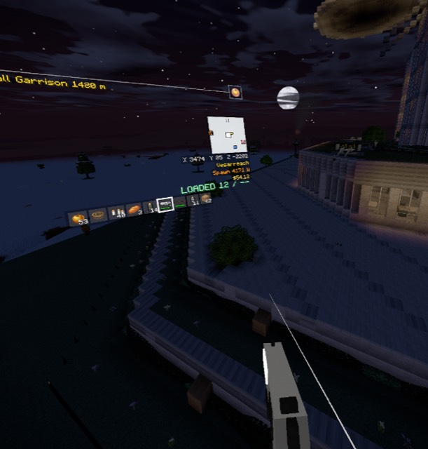

## 09:47:14 - Yeah, okay

- **Transcript:** Yeah, okay
- **Status:** open
- **Build:** 0.129 (80238cd9, M1-M4 (device-tested; ship riding, chests, comfort options, weapon wheel))
- **World:** New World (13) (seed 1340059502856237115)
- **Dimension:** Surface
- **Biome:** Snowy Plains
- **Position:** 3507.5 89.5 -2285.8
- **Facing:** south-east (yaw 157, pitch 8)
- **Held:** empty hand
- **Mount:** on foot
- **Looking at:** nothing
- **Mode:** Creative, health 2/20
- **Time:** day 1 18:52, clear
- **Fps:** 65
- **Levels:** mic -28 dBFS, game sound -15 dBFS
- **Length:** 2.1 s (voice 0.6 s)
- **Just before:** -27s opened PauseMenu; -26s took 18 damage (health 2/20); -26s message: Creative mode; -26s closed PauseMenu; -24s message: Flying; -23s message: Walking; -21s message: Flying; -19s message: Walking; -18s message: Flying; -10s message: A Capital Dropship is landing troops!; -6s message: Walking; -6s holding empty hand; -5s message: Manning the deck gun
- **Repro (Mac):** `./snap.sh note --seed 1340059502856237115 --x 3507.5 --z -2285.8 --yaw -157 --pitch 8 --time 0.536`
- **Audio (this Mac):** /Users/darthvadar/Documents/Blocksmith/QuestVoiceNotes/raw/vn-20261031-094714-642.aac

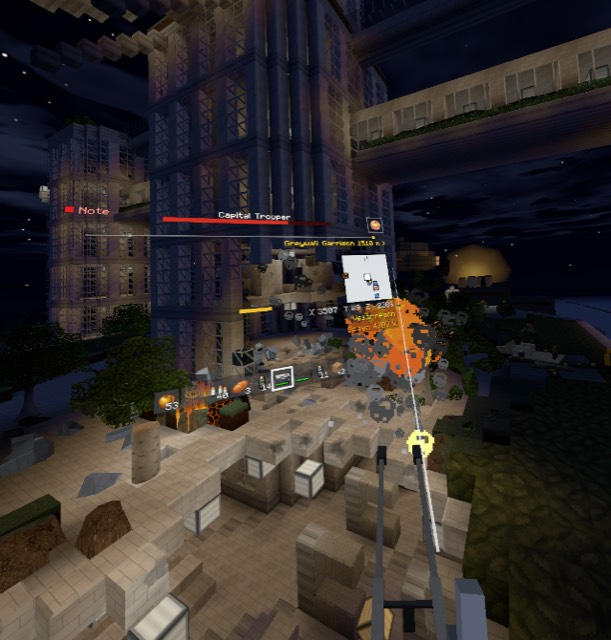

## 09:47:40 - Yeah, troops need to be more aggressive

- **Transcript:** Yeah, troops need to be more aggressive
- **Status:** open
- **Build:** 0.129 (80238cd9, M1-M4 (device-tested; ship riding, chests, comfort options, weapon wheel))
- **World:** New World (13) (seed 1340059502856237115)
- **Dimension:** Surface
- **Biome:** Snowy Plains
- **Position:** 3501.8 76.0 -2266.2
- **Facing:** south-east (yaw 134, pitch -17)
- **Held:** Falke Pistol x1
- **Mount:** on foot
- **Looking at:** White Wool at 3504 76 -2264
- **Mode:** Survival, health 20/20
- **Time:** day 1 19:20, clear
- **Fps:** 72
- **Levels:** mic -22 dBFS, game sound -20 dBFS
- **Length:** 2.9 s (voice 1.5 s)
- **Just before:** -30s message: Manning the deck gun; -22s holding Falke Pistol; -21s opened PauseMenu; -20s message: Survival mode; -20s closed PauseMenu; -19s holding Heavy Magazine; -19s holding Bread; -18s message: Missile launch: take cover!; -18s holding Capital Rounds; -18s holding Heavy Rounds; -17s holding Golden Apple; -16s message: You're full; -12s holding Oak Planks; -12s message: Oak Planks; -12s holding Capital Magazine; -12s message: Capital Magazine; -12s holding Kessel Bolt Rifle; -12s message: Kessel Bolt Rifle; -11s holding Falke Pistol; -11s message: Falke Pistol; -11s message: Loaded: 18 / 18; -7s opened ChestMenu; -6s closed ChestMenu
- **Repro (Mac):** `./snap.sh note --seed 1340059502856237115 --x 3501.8 --z -2266.2 --yaw -134 --pitch -17 --time 0.556`
- **Audio (this Mac):** /Users/darthvadar/Documents/Blocksmith/QuestVoiceNotes/raw/vn-20261031-094740-622.aac

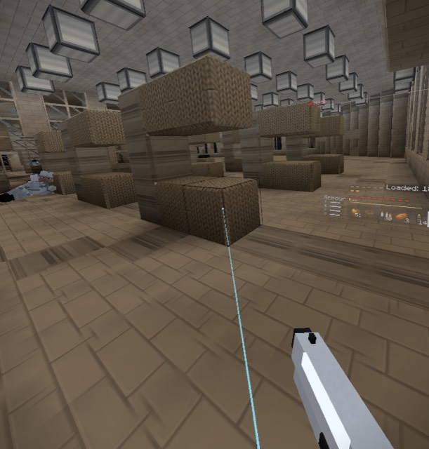

## 09:47:44 - Oh, shit. What the hell? Oh, [chuckles] damn. Capital's tough, man. Wo

- **Transcript:** Oh, shit. What the hell? Oh, [chuckles] damn. Capital's tough, man. Wow, that's not bad
- **Status:** open
- **Build:** 0.129 (80238cd9, M1-M4 (device-tested; ship riding, chests, comfort options, weapon wheel))
- **World:** New World (13) (seed 1340059502856237115)
- **Dimension:** Surface
- **Biome:** Snowy Plains
- **Position:** 3507.5 76.0 -2254.8
- **Facing:** east (yaw 97, pitch -24)
- **Held:** empty hand
- **Mount:** on foot
- **Looking at:** nothing
- **Mode:** Survival, health 0/20, screen DeathMenu
- **Time:** day 1 19:24, clear
- **Fps:** 72
- **Levels:** mic -35 dBFS, game sound -14 dBFS
- **Length:** 7.9 s (voice 3.9 s)
- **Just before:** -26s holding Falke Pistol; -24s opened PauseMenu; -23s message: Survival mode; -23s closed PauseMenu; -22s holding Heavy Magazine; -22s holding Bread; -22s message: Missile launch: take cover!; -21s holding Capital Rounds; -21s holding Heavy Rounds; -21s holding Golden Apple; -20s message: You're full; -16s holding Oak Planks; -16s message: Oak Planks; -15s holding Capital Magazine; -15s message: Capital Magazine; -15s holding Kessel Bolt Rifle; -15s message: Kessel Bolt Rifle; -15s holding Falke Pistol; -15s message: Falke Pistol; -14s message: Loaded: 18 / 18; -10s opened ChestMenu; -9s closed ChestMenu; -0s died; -0s opened DeathMenu; -0s holding empty hand
- **While talking:** -5s left the pack: Falke Pistol (DeathMenu open); -5s left the pack: Greywall Keycard (DeathMenu open); -5s left the pack: Donnerkeil Service Rifle (DeathMenu open); -5s left the pack: Capital Magazine x11 (DeathMenu open); -5s left the pack: Regular Armour Set (DeathMenu open); -5s left the pack: Spec Ops Armour Set (DeathMenu open); -5s left the pack: Slatefall Carbine (DeathMenu open); -5s left the pack: Greywall Code Book x2 (DeathMenu open); -5s left the pack: Greywall Dispatch (DeathMenu open); -5s left the pack: Heavy Magazine x14 (DeathMenu open); -5s left the pack: Kessel Bolt Rifle (DeathMenu open); -4s took 22 damage (health 0/20)
- **Position at the end:** 3507.5 76.0 -2254.8
- **Repro (Mac):** `./snap.sh note --seed 1340059502856237115 --x 3507.5 --z -2254.8 --yaw -97 --pitch -24 --time 0.559`
- **Audio (this Mac):** /Users/darthvadar/Documents/Blocksmith/QuestVoiceNotes/raw/vn-20261031-094744-002.aac

## 09:47:53 - Um, so yeah, I'd say still the NPCs need to be even more aggressive

- **Transcript:** Um, so yeah, I'd say still the NPCs need to be even more aggressive
- **Status:** open
- **Build:** 0.129 (80238cd9, M1-M4 (device-tested; ship riding, chests, comfort options, weapon wheel))
- **World:** New World (13) (seed 1340059502856237115)
- **Dimension:** Surface
- **Biome:** Snowy Plains
- **Position:** -659.4 66.9 -2809.2
- **Facing:** east (yaw 108, pitch -61)
- **Held:** empty hand
- **Mount:** on foot
- **Looking at:** Snowy Grass Block at -659 65 -2809
- **Mode:** Survival, health 20/20
- **Time:** day 1 19:26, clear
- **Fps:** 72
- **Levels:** mic -26 dBFS, game sound -17 dBFS
- **Length:** 6.1 s (voice 3.8 s)
- **Just before:** -30s holding Heavy Rounds; -30s holding Golden Apple; -29s message: You're full; -25s holding Oak Planks; -25s message: Oak Planks; -25s holding Capital Magazine; -25s message: Capital Magazine; -24s holding Kessel Bolt Rifle; -24s message: Kessel Bolt Rifle; -24s holding Falke Pistol; -24s message: Falke Pistol; -23s message: Loaded: 18 / 18; -19s opened ChestMenu; -18s closed ChestMenu; -9s died; -9s opened DeathMenu; -9s holding empty hand; -9s left the pack: Falke Pistol (DeathMenu open); -9s left the pack: Greywall Keycard (DeathMenu open); -9s left the pack: Donnerkeil Service Rifle (DeathMenu open); -9s left the pack: Capital Magazine x11 (DeathMenu open); -9s left the pack: Regular Armour Set (DeathMenu open); -9s left the pack: Spec Ops Armour Set (DeathMenu open); -9s left the pack: Slatefall Carbine (DeathMenu open); -9s left the pack: Greywall Code Book x2 (DeathMenu open); -9s left the pack: Greywall Dispatch (DeathMenu open); -9s left the pack: Heavy Magazine x14 (DeathMenu open); -9s left the pack: Kessel Bolt Rifle (DeathMenu open); -8s took 22 damage (health 0/20); -2s respawned; -2s closed DeathMenu; -2s message: Your things are 4207 blocks east; -2s opened PauseMenu; -1s closed PauseMenu
- **While talking:** -5s message: Entering Kesria; -3s opened PauseMenu; -2s message: Creative mode; -2s closed PauseMenu; -0s message: Flying
- **Position at the end:** -567.6 80.0 -2856.3
- **Repro (Mac):** `./snap.sh note --seed 1340059502856237115 --x -659.4 --z -2809.2 --yaw -108 --pitch -61 --time 0.560`
- **Audio (this Mac):** /Users/darthvadar/Documents/Blocksmith/QuestVoiceNotes/raw/vn-20261031-094753-062.aac

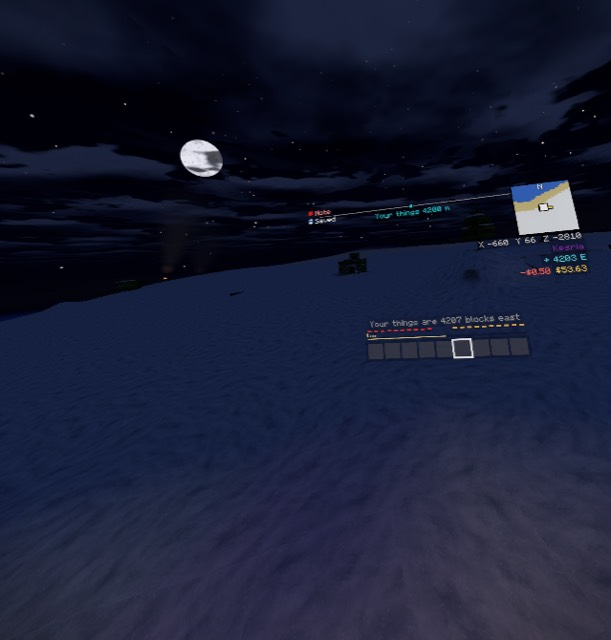

## 09:48:53 - Okay. Oh, shit. All right. So

- **Transcript:** Okay. Oh, shit. All right. So
- **Status:** open
- **Build:** 0.129 (80238cd9, M1-M4 (device-tested; ship riding, chests, comfort options, weapon wheel))
- **World:** New World (13) (seed 1340059502856237115)
- **Dimension:** Surface
- **Biome:** Savanna
- **Position:** 1618.7 71.8 -4968.2
- **Facing:** north (yaw 350, pitch -71)
- **Held:** empty hand
- **Mount:** on foot
- **Looking at:** Grass Block at 1618 71 -4969
- **Mode:** Survival, health 20/20
- **Time:** day 1 20:34, clear
- **Fps:** 69
- **Levels:** mic -55 dBFS, game sound -13 dBFS
- **Length:** 3.9 s (voice 1.8 s)
- **Just before:** -29s walked into Deep Cold Ocean; -27s walked into Cold Ocean; -19s walked into Ocean; -17s message: Entering Marireach; -11s walked into Birch Forest; -9s walked into Forest; -7s walked into Plains; -5s walked into Savanna; -4s message: Walking; -2s opened PauseMenu; -1s message: Survival mode; -1s closed PauseMenu
- **Repro (Mac):** `./snap.sh note --seed 1340059502856237115 --x 1618.7 --z -4968.2 --yaw 10 --pitch -71 --time 0.607`
- **Audio (this Mac):** /Users/darthvadar/Documents/Blocksmith/QuestVoiceNotes/raw/vn-20261031-094853-722.aac

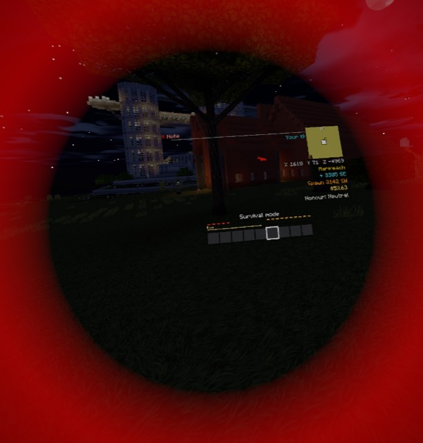

## 09:48:57 - If I go into the little town beside one of these capital citadels, the

- **Transcript:** If I go into the little town beside one of these capital citadels, they shouldn't be automatically hostile to me unless I have a gun in my hand
- **Status:** open
- **Build:** 0.129 (80238cd9, M1-M4 (device-tested; ship riding, chests, comfort options, weapon wheel))
- **World:** New World (13) (seed 1340059502856237115)
- **Dimension:** Surface
- **Biome:** Savanna
- **Position:** 1622.0 71.2 -4980.3
- **Facing:** north-east (yaw 46, pitch -3)
- **Held:** empty hand
- **Mount:** on foot
- **Looking at:** nothing
- **Mode:** Creative, health 11/20
- **Time:** day 1 20:37, clear
- **Fps:** 58
- **Levels:** mic -23 dBFS, game sound -22 dBFS
- **Length:** 7.0 s (voice 4.9 s)
- **Just before:** -23s walked into Ocean; -20s message: Entering Marireach; -15s walked into Birch Forest; -13s walked into Forest; -11s walked into Plains; -9s walked into Savanna; -7s message: Walking; -5s opened PauseMenu; -5s message: Survival mode; -4s closed PauseMenu; -3s message: Capital citadel (the enemy) marked on the map; -3s opened PauseMenu; -3s took 10 damage (health 11/20); -2s closed PauseMenu; -1s message: Creative mode
- **While talking:** -4s message: Intel: this base is an Armoury
- **Position at the end:** 1611.1 70.3 -5002.5
- **Repro (Mac):** `./snap.sh note --seed 1340059502856237115 --x 1622.0 --z -4980.3 --yaw -46 --pitch -3 --time 0.609`
- **Audio (this Mac):** /Users/darthvadar/Documents/Blocksmith/QuestVoiceNotes/raw/vn-20261031-094857-522.aac

## 09:49:10 - Now something else I want to test

- **Transcript:** Now something else I want to test
- **Status:** open
- **Build:** 0.129 (80238cd9, M1-M4 (device-tested; ship riding, chests, comfort options, weapon wheel))
- **World:** New World (13) (seed 1340059502856237115)
- **Dimension:** Surface
- **Biome:** Savanna
- **Position:** 1612.2 69.6 -5200.7
- **Facing:** east (yaw 72, pitch -21)
- **Held:** empty hand
- **Mount:** on foot, flying
- **Looking at:** nothing
- **Mode:** Creative, health 11/20
- **Time:** day 1 20:52, clear
- **Fps:** 70
- **Levels:** mic -26 dBFS, game sound -21 dBFS
- **Length:** 2.8 s (voice 1.2 s)
- **Just before:** -27s walked into Birch Forest; -25s walked into Forest; -23s walked into Plains; -21s walked into Savanna; -20s message: Walking; -18s opened PauseMenu; -17s message: Survival mode; -17s closed PauseMenu; -15s message: Capital citadel (the enemy) marked on the map; -15s opened PauseMenu; -15s took 10 damage (health 11/20); -14s closed PauseMenu; -13s message: Creative mode; -11s message: Intel: this base is an Armoury; -6s message: Flying; -2s message: Walking; -0s message: Flying
- **Repro (Mac):** `./snap.sh note --seed 1340059502856237115 --x 1612.2 --z -5200.7 --yaw -72 --pitch -21 --time 0.620`
- **Audio (this Mac):** /Users/darthvadar/Documents/Blocksmith/QuestVoiceNotes/raw/vn-20261031-094910-222.aac

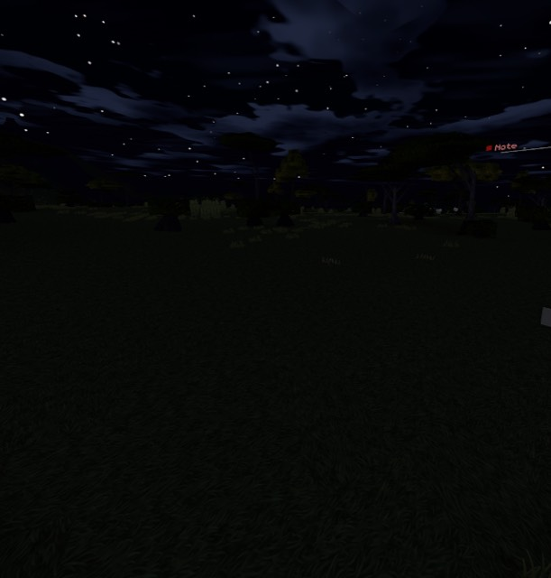

## 09:49:55 - Okay, so I'm far from the capital. When I approach the capital, I shou

- **Transcript:** Okay, so I'm far from the capital. When I approach the capital, I should get e-obliterated
- **Status:** open
- **Build:** 0.129 (80238cd9, M1-M4 (device-tested; ship riding, chests, comfort options, weapon wheel))
- **World:** New World (13) (seed 1340059502856237115)
- **Dimension:** Surface
- **Biome:** Savanna
- **Position:** 1607.7 69.1 -5295.6
- **Facing:** south (yaw 191, pitch -77)
- **Held:** Mahlwerk Rotary Gun x1
- **Mount:** on foot
- **Looking at:** Short Grass at 1607 69 -5296
- **Mode:** Survival, health 16/20
- **Time:** day 1 21:41, rain
- **Fps:** 72
- **Levels:** mic -22 dBFS, game sound -19 dBFS
- **Length:** 8.6 s (voice 4.4 s)
- **Just before:** -26s into the pack: Capital Magazine; -20s into the pack: Mahlwerk Rotary Gun; -17s closed CreativeMenu; -17s into the pack: Field Stim; -16s opened PauseMenu; -15s message: Survival mode; -15s closed PauseMenu; -15s opened InventoryMenu; -14s left the pack: Steel Chestplate (InventoryMenu open); -13s left the pack: Steel Boots (InventoryMenu open); -13s left the pack: Steel Helmet (InventoryMenu open); -11s closed InventoryMenu; -11s opened PauseMenu; -10s message: Creative mode; -10s closed PauseMenu; -10s opened CreativeMenu; -7s closed CreativeMenu; -7s into the pack: Steel Leggings; -7s opened CreativeMenu; -6s closed CreativeMenu; -6s opened PauseMenu; -5s message: Survival mode; -5s closed PauseMenu; -5s opened InventoryMenu; -4s left the pack: Steel Leggings (InventoryMenu open); -4s closed InventoryMenu; -3s holding Capital Magazine; -3s holding Mahlwerk Rotary Gun; -3s message: Loaded: 200 / 200; -3s left the pack: Capital Magazine x7 (at 1607 68 -5302)
- **Position at the end:** 1605.5 69.4 -5267.2
- **Repro (Mac):** `./snap.sh note --seed 1340059502856237115 --x 1607.7 --z -5295.6 --yaw 169 --pitch -77 --time 0.654`
- **Audio (this Mac):** /Users/darthvadar/Documents/Blocksmith/QuestVoiceNotes/raw/vn-20261031-094955-782.aac

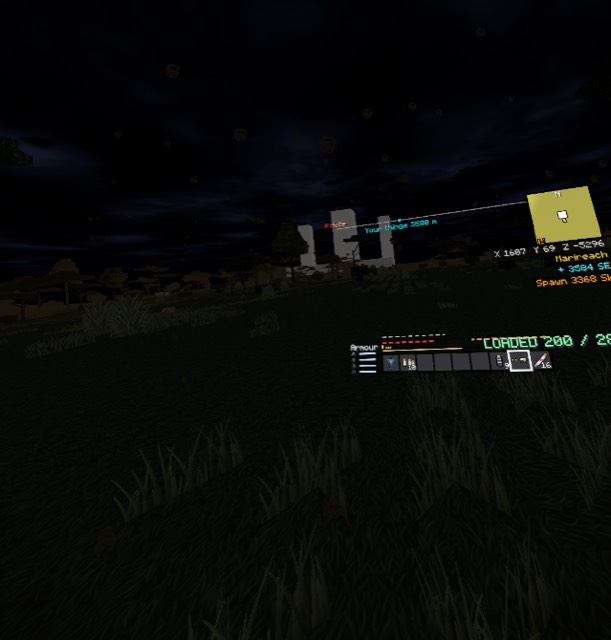

## 09:50:05 - By a, uh, naval gun as soon as I come on the radar

- **Transcript:** By a, uh, naval gun as soon as I come on the radar
- **Status:** open
- **Build:** 0.129 (80238cd9, M1-M4 (device-tested; ship riding, chests, comfort options, weapon wheel))
- **World:** New World (13) (seed 1340059502856237115)
- **Dimension:** Surface
- **Biome:** Savanna
- **Position:** 1604.6 69.8 -5240.4
- **Facing:** south (yaw 170, pitch -2)
- **Held:** Mahlwerk Rotary Gun x1
- **Mount:** on foot
- **Looking at:** nothing
- **Mode:** Survival, health 18/20
- **Time:** day 1 21:53, rain
- **Fps:** 71
- **Levels:** mic -25 dBFS, game sound -19 dBFS
- **Length:** 4.1 s (voice 2.7 s)
- **Just before:** -29s into the pack: Mahlwerk Rotary Gun; -27s closed CreativeMenu; -27s into the pack: Field Stim; -26s opened PauseMenu; -25s message: Survival mode; -25s closed PauseMenu; -25s opened InventoryMenu; -24s left the pack: Steel Chestplate (InventoryMenu open); -23s left the pack: Steel Boots (InventoryMenu open); -23s left the pack: Steel Helmet (InventoryMenu open); -21s closed InventoryMenu; -21s opened PauseMenu; -20s message: Creative mode; -20s closed PauseMenu; -19s opened CreativeMenu; -17s closed CreativeMenu; -17s into the pack: Steel Leggings; -16s opened CreativeMenu; -16s closed CreativeMenu; -16s opened PauseMenu; -15s message: Survival mode; -15s closed PauseMenu; -15s opened InventoryMenu; -14s left the pack: Steel Leggings (InventoryMenu open); -14s closed InventoryMenu; -13s holding Capital Magazine; -13s holding Mahlwerk Rotary Gun; -13s message: Loaded: 200 / 200; -13s left the pack: Capital Magazine x7 (at 1607 68 -5302)
- **Repro (Mac):** `./snap.sh note --seed 1340059502856237115 --x 1604.6 --z -5240.4 --yaw -170 --pitch -2 --time 0.662`
- **Audio (this Mac):** /Users/darthvadar/Documents/Blocksmith/QuestVoiceNotes/raw/vn-20261031-095005-802.aac

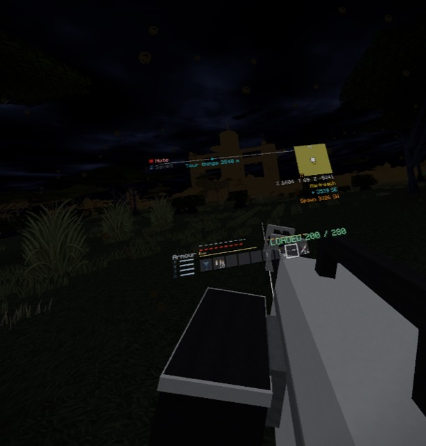

## 09:50:10 - That's what I would expect to see here

- **Transcript:** That's what I would expect to see here
- **Status:** open
- **Build:** 0.129 (80238cd9, M1-M4 (device-tested; ship riding, chests, comfort options, weapon wheel))
- **World:** New World (13) (seed 1340059502856237115)
- **Dimension:** Surface
- **Biome:** Savanna
- **Position:** 1606.3 69.6 -5219.2
- **Facing:** south (yaw 188, pitch -3)
- **Held:** Mahlwerk Rotary Gun x1
- **Mount:** on foot
- **Looking at:** nothing
- **Mode:** Survival, health 18/20
- **Time:** day 1 21:58, rain
- **Fps:** 68
- **Levels:** mic -26 dBFS, game sound -17 dBFS
- **Length:** 2.8 s (voice 1.2 s)
- **Just before:** -30s message: Survival mode; -30s closed PauseMenu; -29s opened InventoryMenu; -29s left the pack: Steel Chestplate (InventoryMenu open); -28s left the pack: Steel Boots (InventoryMenu open); -28s left the pack: Steel Helmet (InventoryMenu open); -26s closed InventoryMenu; -25s opened PauseMenu; -25s message: Creative mode; -24s closed PauseMenu; -24s opened CreativeMenu; -21s closed CreativeMenu; -21s into the pack: Steel Leggings; -21s opened CreativeMenu; -21s closed CreativeMenu; -20s opened PauseMenu; -20s message: Survival mode; -20s closed PauseMenu; -19s opened InventoryMenu; -19s left the pack: Steel Leggings (InventoryMenu open); -19s closed InventoryMenu; -18s holding Capital Magazine; -18s holding Mahlwerk Rotary Gun; -17s message: Loaded: 200 / 200; -17s left the pack: Capital Magazine x7 (at 1607 68 -5302)
- **Repro (Mac):** `./snap.sh note --seed 1340059502856237115 --x 1606.3 --z -5219.2 --yaw 172 --pitch -3 --time 0.666`
- **Audio (this Mac):** /Users/darthvadar/Documents/Blocksmith/QuestVoiceNotes/raw/vn-20261031-095010-762.aac

## 09:50:26 - All right. Now, actually right from here, I'm about like 60, 70 blocks

- **Transcript:** All right. Now, actually right from here, I'm about like 60, 70 blocks from it. They should have seen me and started firing, and I should have died in just a few seconds because there's zero little... like literally zero cover
- **Status:** open
- **Build:** 0.129 (80238cd9, M1-M4 (device-tested; ship riding, chests, comfort options, weapon wheel))
- **World:** New World (13) (seed 1340059502856237115)
- **Dimension:** Surface
- **Biome:** Savanna
- **Position:** 1620.0 67.3 -5163.2
- **Facing:** south (yaw 177, pitch -3)
- **Held:** Mahlwerk Rotary Gun x1
- **Mount:** on foot
- **Looking at:** nothing
- **Mode:** Survival, health 18/20
- **Time:** day 1 22:17, rain
- **Fps:** 72
- **Levels:** mic -25 dBFS, game sound -31 dBFS
- **Length:** 17.1 s (voice 9.9 s)
- **Position at the end:** 1616.2 67.7 -5182.0
- **Repro (Mac):** `./snap.sh note --seed 1340059502856237115 --x 1620.0 --z -5163.2 --yaw -177 --pitch -3 --time 0.679`
- **Audio (this Mac):** /Users/darthvadar/Documents/Blocksmith/QuestVoiceNotes/raw/vn-20261031-095026-422.aac

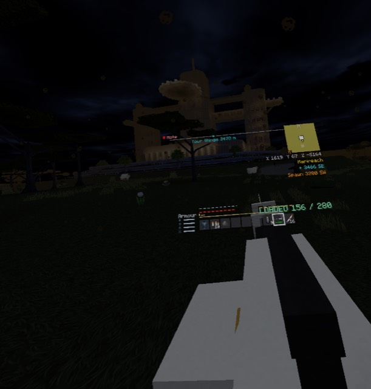

## 09:50:49 - Now approaching Capitol Building will now raise their bells

- **Transcript:** Now approaching Capitol Building will now raise their bells
- **Status:** open
- **Build:** 0.129 (80238cd9, M1-M4 (device-tested; ship riding, chests, comfort options, weapon wheel))
- **World:** New World (13) (seed 1340059502856237115)
- **Dimension:** Surface
- **Biome:** Savanna
- **Position:** 1622.5 67.2 -5154.3
- **Facing:** south-east (yaw 150, pitch -37)
- **Held:** Mahlwerk Rotary Gun x1
- **Mount:** on foot
- **Looking at:** Grass Block at 1623 66 -5153
- **Mode:** Survival, health 17/20
- **Time:** day 1 22:44, rain
- **Fps:** 72
- **Levels:** mic -26 dBFS, game sound -21 dBFS
- **Length:** 5.0 s (voice 2.4 s)
- **Just before:** -7s took 1 damage (health 17/20)
- **Repro (Mac):** `./snap.sh note --seed 1340059502856237115 --x 1622.5 --z -5154.3 --yaw -150 --pitch -37 --time 0.698`
- **Audio (this Mac):** /Users/darthvadar/Documents/Blocksmith/QuestVoiceNotes/raw/vn-20261031-095049-303.aac

## 09:50:54 - And yet nobody, nothing's firing at me

- **Transcript:** And yet nobody, nothing's firing at me
- **Status:** open
- **Build:** 0.129 (80238cd9, M1-M4 (device-tested; ship riding, chests, comfort options, weapon wheel))
- **World:** New World (13) (seed 1340059502856237115)
- **Dimension:** Surface
- **Biome:** Savanna
- **Position:** 1621.7 67.1 -5142.9
- **Facing:** south-east (yaw 145, pitch -28)
- **Held:** Mahlwerk Rotary Gun x1
- **Mount:** on foot
- **Looking at:** Grass Block at 1623 66 -5141
- **Mode:** Survival, health 17/20
- **Time:** day 1 22:51, rain
- **Fps:** 72
- **Levels:** mic -27 dBFS, game sound -30 dBFS
- **Length:** 3.1 s (voice 1.6 s)
- **Just before:** -12s took 1 damage (health 17/20)
- **Repro (Mac):** `./snap.sh note --seed 1340059502856237115 --x 1621.7 --z -5142.9 --yaw -145 --pitch -28 --time 0.702`
- **Audio (this Mac):** /Users/darthvadar/Documents/Blocksmith/QuestVoiceNotes/raw/vn-20261031-095054-682.aac

## 09:51:21 - Oh, okay

- **Transcript:** Oh, okay
- **Status:** open
- **Build:** 0.129 (80238cd9, M1-M4 (device-tested; ship riding, chests, comfort options, weapon wheel))
- **World:** New World (13) (seed 1340059502856237115)
- **Dimension:** Surface
- **Biome:** Savanna
- **Position:** 1634.6 69.0 -5114.2
- **Facing:** south-east (yaw 121, pitch -19)
- **Held:** Birch Log x55
- **Mount:** on foot
- **Looking at:** Birch Log at 1636 70 -5114
- **Mode:** Survival, health 17/20
- **Time:** day 1 23:20, rain
- **Fps:** 72
- **Levels:** mic -30 dBFS, game sound -21 dBFS
- **Length:** 2.6 s (voice 1.0 s)
- **Just before:** -23s walked into Desert; -21s walked into Savanna; -20s message: A Capital patrol sets out to investigate; -18s message: Missile launch: take cover!; -15s opened PauseMenu; -14s message: Creative mode; -14s closed PauseMenu; -14s opened CreativeMenu; -12s closed CreativeMenu; -12s opened PauseMenu; -11s message: Survival mode; -11s closed PauseMenu; -11s holding Capital Magazine; -10s holding empty hand; -10s holding Birch Log; -8s message: Missile launch: take cover!
- **Repro (Mac):** `./snap.sh note --seed 1340059502856237115 --x 1634.6 --z -5114.2 --yaw -121 --pitch -19 --time 0.723`
- **Audio (this Mac):** /Users/darthvadar/Documents/Blocksmith/QuestVoiceNotes/raw/vn-20261031-095121-402.aac

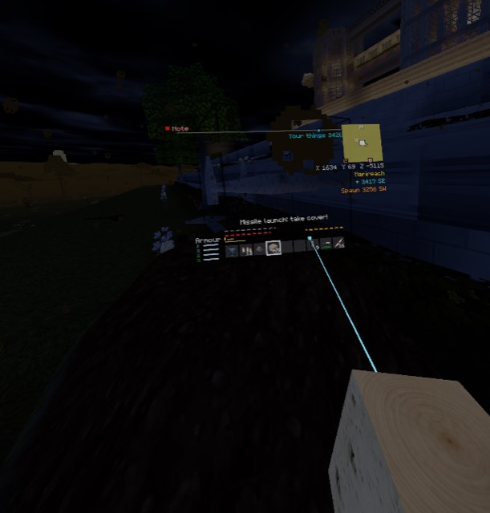

## 09:52:04 - Not bad. I, I mean, yeah, not bad

- **Transcript:** Not bad. I, I mean, yeah, not bad
- **Status:** open
- **Build:** 0.129 (80238cd9, M1-M4 (device-tested; ship riding, chests, comfort options, weapon wheel))
- **World:** New World (13) (seed 1340059502856237115)
- **Dimension:** Surface
- **Biome:** Snowy Plains
- **Position:** -663.5 66.5 -2807.5
- **Facing:** south (yaw 179, pitch -20)
- **Held:** empty hand
- **Mount:** on foot
- **Looking at:** Snowy Grass Block at -664 65 -2803
- **Mode:** Survival, health 20/20
- **Time:** day 1 00:11, rain
- **Fps:** 72
- **Levels:** mic -35 dBFS, game sound -24 dBFS
- **Length:** 3.2 s (voice 1.9 s)
- **Just before:** -29s took 2 damage (health 15/20); -27s message: Missile launch: take cover!; -18s left the pack: Capital Magazine x5 (at 1662 72 -5094); -17s message: Loaded: 200 / 200; -11s message: Missile launch: take cover!; -11s took 3 damage (health 12/20); -9s took 2 damage (health 10/20); -8s holding Field Stim; -8s message: Field Stim; -7s took 7 damage (health 3/20); -7s died; -7s opened DeathMenu; -7s holding empty hand; -7s left the pack: Field Stim x16 (DeathMenu open); -7s left the pack: Steel Chestplate (DeathMenu open); -7s left the pack: Mahlwerk Rotary Gun (DeathMenu open); -7s left the pack: Capital Magazine x4 (DeathMenu open); -6s message: Target gone from the list. Back to the story's objective; -6s took 3 damage (health 0/20); -1s respawned; -1s closed DeathMenu; -1s message: Your things are 3270 blocks north-east; -1s walked into Snowy Plains
- **Repro (Mac):** `./snap.sh note --seed 1340059502856237115 --x -663.5 --z -2807.5 --yaw -179 --pitch -20 --time 0.758`
- **Audio (this Mac):** /Users/darthvadar/Documents/Blocksmith/QuestVoiceNotes/raw/vn-20261031-095204-902.aac

## 09:53:20 - Hey, so

- **Transcript:** Hey, so
- **Status:** open
- **Build:** 0.129 (80238cd9, M1-M4 (device-tested; ship riding, chests, comfort options, weapon wheel))
- **World:** New World (13) (seed 1340059502856237115)
- **Dimension:** Surface
- **Biome:** Snowy Plains
- **Position:** -1592.3 71.7 -2698.2
- **Facing:** south-west (yaw 240, pitch 6)
- **Held:** Donnerkeil Service Rifle x1
- **Mount:** on foot
- **Looking at:** nothing
- **Mode:** Survival, health 20/20
- **Time:** day 1 01:30, rain
- **Fps:** 70
- **Levels:** mic -23 dBFS, game sound -18 dBFS
- **Length:** 2.2 s (voice 0.8 s)
- **Just before:** -25s into the pack: Donnerkeil Service Rifle; -22s into the pack: Capital Magazine; -20s into the pack: Field Stim; -16s closed CreativeMenu; -15s opened PauseMenu; -15s closed PauseMenu; -14s opened CreativeMenu; -12s closed CreativeMenu; -11s opened PauseMenu; -11s closed PauseMenu; -10s opened PauseMenu; -10s message: Survival mode; -9s closed PauseMenu; -9s opened InventoryMenu; -8s left the pack: Titanium Boots (InventoryMenu open); -8s left the pack: Titanium Chestplate (InventoryMenu open); -8s left the pack: Titanium Leggings (InventoryMenu open); -8s left the pack: Titanium Helmet (InventoryMenu open); -7s closed InventoryMenu; -6s holding Donnerkeil Service Rifle; -6s message: Donnerkeil Service Rifle; -5s holding empty hand; -5s holding Donnerkeil Service Rifle; -4s message: Loaded: 45 / 45; -4s left the pack: Capital Magazine x2 (at -1582 71 -2693); -0s message: The station alarm is sounding!
- **Repro (Mac):** `./snap.sh note --seed 1340059502856237115 --x -1592.3 --z -2698.2 --yaw 120 --pitch 6 --time 0.813`
- **Audio (this Mac):** /Users/darthvadar/Documents/Blocksmith/QuestVoiceNotes/raw/vn-20261031-095320-043.aac

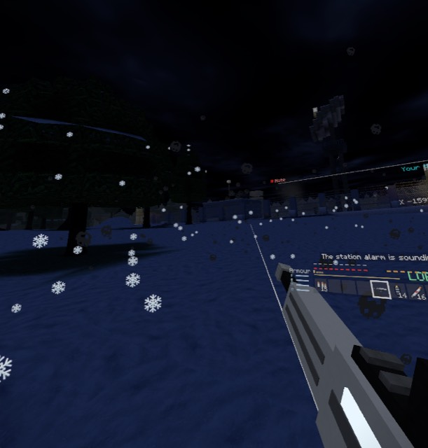

## 09:53:24 - The gun's not really in range. Okay, now it's in range. Here I am

- **Transcript:** The gun's not really in range. Okay, now it's in range. Here I am
- **Status:** open
- **Build:** 0.129 (80238cd9, M1-M4 (device-tested; ship riding, chests, comfort options, weapon wheel))
- **World:** New World (13) (seed 1340059502856237115)
- **Dimension:** Surface
- **Biome:** Snowy Plains
- **Position:** -1586.5 72.9 -2685.8
- **Facing:** west (yaw 251, pitch 2)
- **Held:** Donnerkeil Service Rifle x1
- **Mount:** on foot
- **Looking at:** nothing
- **Mode:** Survival, health 20/20
- **Time:** day 1 01:35, rain
- **Fps:** 72
- **Levels:** mic -24 dBFS, game sound -18 dBFS
- **Length:** 5.4 s (voice 3.0 s)
- **Just before:** -30s into the pack: Donnerkeil Service Rifle; -26s into the pack: Capital Magazine; -24s into the pack: Field Stim; -20s closed CreativeMenu; -20s opened PauseMenu; -19s closed PauseMenu; -19s opened CreativeMenu; -16s closed CreativeMenu; -16s opened PauseMenu; -15s closed PauseMenu; -15s opened PauseMenu; -14s message: Survival mode; -14s closed PauseMenu; -13s opened InventoryMenu; -13s left the pack: Titanium Boots (InventoryMenu open); -13s left the pack: Titanium Chestplate (InventoryMenu open); -12s left the pack: Titanium Leggings (InventoryMenu open); -12s left the pack: Titanium Helmet (InventoryMenu open); -12s closed InventoryMenu; -10s holding Donnerkeil Service Rifle; -10s message: Donnerkeil Service Rifle; -10s holding empty hand; -9s holding Donnerkeil Service Rifle; -9s message: Loaded: 45 / 45; -8s left the pack: Capital Magazine x2 (at -1582 71 -2693); -5s message: The station alarm is sounding!
- **Repro (Mac):** `./snap.sh note --seed 1340059502856237115 --x -1586.5 --z -2685.8 --yaw 109 --pitch 2 --time 0.817`
- **Audio (this Mac):** /Users/darthvadar/Documents/Blocksmith/QuestVoiceNotes/raw/vn-20261031-095324-522.aac

## 09:53:31 - That should have taken me down about six hearts

- **Transcript:** That should have taken me down about six hearts
- **Status:** open
- **Build:** 0.129 (80238cd9, M1-M4 (device-tested; ship riding, chests, comfort options, weapon wheel))
- **World:** New World (13) (seed 1340059502856237115)
- **Dimension:** Surface
- **Biome:** Snowy Taiga
- **Position:** -1593.2 74.2 -2663.7
- **Facing:** south-west (yaw 208, pitch -48)
- **Held:** Donnerkeil Service Rifle x1
- **Mount:** on foot
- **Looking at:** Snowy Grass Block at -1595 73 -2663
- **Mode:** Survival, health 20/20
- **Time:** day 1 01:43, rain
- **Fps:** 72
- **Levels:** mic -36 dBFS, game sound -18 dBFS
- **Length:** 3.9 s (voice 2.0 s)
- **Just before:** -27s closed CreativeMenu; -27s opened PauseMenu; -26s closed PauseMenu; -25s opened CreativeMenu; -23s closed CreativeMenu; -23s opened PauseMenu; -22s closed PauseMenu; -22s opened PauseMenu; -21s message: Survival mode; -21s closed PauseMenu; -20s opened InventoryMenu; -19s left the pack: Titanium Boots (InventoryMenu open); -19s left the pack: Titanium Chestplate (InventoryMenu open); -19s left the pack: Titanium Leggings (InventoryMenu open); -19s left the pack: Titanium Helmet (InventoryMenu open); -18s closed InventoryMenu; -17s holding Donnerkeil Service Rifle; -17s message: Donnerkeil Service Rifle; -17s holding empty hand; -16s holding Donnerkeil Service Rifle; -16s message: Loaded: 45 / 45; -15s left the pack: Capital Magazine x2 (at -1582 71 -2693); -12s message: The station alarm is sounding!; -5s walked into Snowy Taiga; -0s took 1 damage (health 19/20)
- **Repro (Mac):** `./snap.sh note --seed 1340059502856237115 --x -1593.2 --z -2663.7 --yaw 152 --pitch -48 --time 0.822`
- **Audio (this Mac):** /Users/darthvadar/Documents/Blocksmith/QuestVoiceNotes/raw/vn-20261031-095331-302.aac

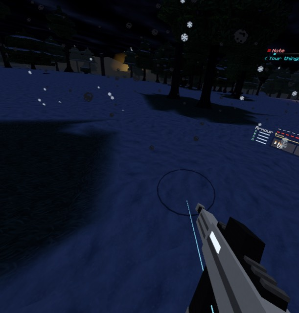

## 09:53:35 - That should have killed me

- **Transcript:** That should have killed me
- **Status:** open
- **Build:** 0.129 (80238cd9, M1-M4 (device-tested; ship riding, chests, comfort options, weapon wheel))
- **World:** New World (13) (seed 1340059502856237115)
- **Dimension:** Surface
- **Biome:** Snowy Plains
- **Position:** -1594.4 74.2 -2662.9
- **Facing:** west (yaw 253, pitch -32)
- **Held:** Donnerkeil Service Rifle x1
- **Mount:** on foot
- **Looking at:** Snowy Grass Block at -1597 73 -2663
- **Mode:** Survival, health 20/20
- **Time:** day 1 01:48, rain
- **Fps:** 71
- **Levels:** mic -24 dBFS, game sound -21 dBFS
- **Length:** 2.1 s (voice 0.8 s)
- **Just before:** -29s closed PauseMenu; -29s opened CreativeMenu; -26s closed CreativeMenu; -26s opened PauseMenu; -26s closed PauseMenu; -25s opened PauseMenu; -24s message: Survival mode; -24s closed PauseMenu; -24s opened InventoryMenu; -23s left the pack: Titanium Boots (InventoryMenu open); -23s left the pack: Titanium Chestplate (InventoryMenu open); -22s left the pack: Titanium Leggings (InventoryMenu open); -22s left the pack: Titanium Helmet (InventoryMenu open); -22s closed InventoryMenu; -21s holding Donnerkeil Service Rifle; -21s message: Donnerkeil Service Rifle; -20s holding empty hand; -20s holding Donnerkeil Service Rifle; -19s message: Loaded: 45 / 45; -19s left the pack: Capital Magazine x2 (at -1582 71 -2693); -15s message: The station alarm is sounding!; -8s walked into Snowy Taiga; -4s took 1 damage (health 19/20); -1s took 2 damage (health 19/20); -0s walked into Snowy Plains
- **Repro (Mac):** `./snap.sh note --seed 1340059502856237115 --x -1594.4 --z -2662.9 --yaw 107 --pitch -32 --time 0.825`
- **Audio (this Mac):** /Users/darthvadar/Documents/Blocksmith/QuestVoiceNotes/raw/vn-20261031-095335-002.aac

## 09:53:42 - Like the, the naval gun is, needs to be way more devastating

- **Transcript:** Like the, the naval gun is, needs to be way more devastating
- **Status:** open
- **Build:** 0.129 (80238cd9, M1-M4 (device-tested; ship riding, chests, comfort options, weapon wheel))
- **World:** New World (13) (seed 1340059502856237115)
- **Dimension:** Surface
- **Biome:** Snowy Plains
- **Position:** -1592.5 74.1 -2652.3
- **Facing:** west (yaw 284, pitch -3)
- **Held:** Donnerkeil Service Rifle x1
- **Mount:** on foot
- **Looking at:** Spruce Log at -1597 75 -2654
- **Mode:** Survival, health 17/20
- **Time:** day 1 01:56, rain
- **Fps:** 71
- **Levels:** mic -22 dBFS, game sound -14 dBFS
- **Length:** 3.9 s (voice 2.4 s)
- **Just before:** -30s left the pack: Titanium Leggings (InventoryMenu open); -30s left the pack: Titanium Helmet (InventoryMenu open); -29s closed InventoryMenu; -28s holding Donnerkeil Service Rifle; -28s message: Donnerkeil Service Rifle; -27s holding empty hand; -27s holding Donnerkeil Service Rifle; -27s message: Loaded: 45 / 45; -26s left the pack: Capital Magazine x2 (at -1582 71 -2693); -22s message: The station alarm is sounding!; -15s walked into Snowy Taiga; -11s took 1 damage (health 19/20); -8s took 2 damage (health 19/20); -7s walked into Snowy Plains; -0s took 3 damage (health 17/20)
- **Repro (Mac):** `./snap.sh note --seed 1340059502856237115 --x -1592.5 --z -2652.3 --yaw 76 --pitch -3 --time 0.831`
- **Audio (this Mac):** /Users/darthvadar/Documents/Blocksmith/QuestVoiceNotes/raw/vn-20261031-095342-722.aac

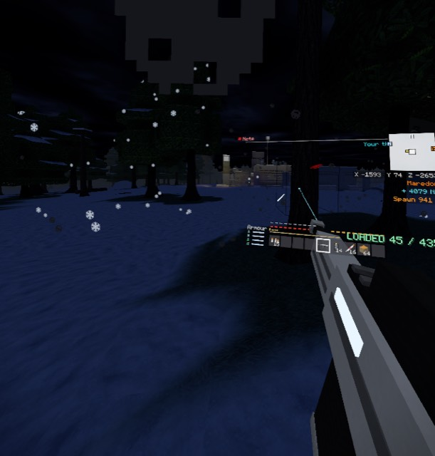

## 09:53:46 - Way more devastating

- **Transcript:** Way more devastating
- **Status:** open
- **Build:** 0.129 (80238cd9, M1-M4 (device-tested; ship riding, chests, comfort options, weapon wheel))
- **World:** New World (13) (seed 1340059502856237115)
- **Dimension:** Surface
- **Biome:** Snowy Plains
- **Position:** -1594.6 73.9 -2637.4
- **Facing:** west (yaw 292, pitch 1)
- **Held:** Donnerkeil Service Rifle x1
- **Mount:** on foot
- **Looking at:** nothing
- **Mode:** Survival, health 15/20
- **Time:** day 1 02:01, rain
- **Fps:** 64
- **Levels:** mic -21 dBFS, game sound -16 dBFS
- **Length:** 2.4 s (voice 1.0 s)
- **Just before:** -30s left the pack: Capital Magazine x2 (at -1582 71 -2693); -26s message: The station alarm is sounding!; -19s walked into Snowy Taiga; -15s took 1 damage (health 19/20); -12s took 2 damage (health 19/20); -11s walked into Snowy Plains; -4s took 3 damage (health 17/20); -2s took 3 damage (health 15/20)
- **Repro (Mac):** `./snap.sh note --seed 1340059502856237115 --x -1594.6 --z -2637.4 --yaw 68 --pitch 1 --time 0.834`
- **Audio (this Mac):** /Users/darthvadar/Documents/Blocksmith/QuestVoiceNotes/raw/vn-20261031-095346-722.aac

## 09:54:24 - There should be a sniper up there that absolutely does, uh

- **Transcript:** There should be a sniper up there that absolutely does, uh
- **Status:** open
- **Build:** 0.129 (80238cd9, M1-M4 (device-tested; ship riding, chests, comfort options, weapon wheel))
- **World:** New World (13) (seed 1340059502856237115)
- **Dimension:** Surface
- **Biome:** Snowy Plains
- **Position:** -1658.2 73.0 -2649.5
- **Facing:** north-west (yaw 302, pitch 32)
- **Held:** Donnerkeil Service Rifle x1
- **Mount:** on foot
- **Looking at:** nothing
- **Mode:** Survival, health 13/20
- **Time:** day 1 02:46, rain
- **Fps:** 71
- **Levels:** mic -34 dBFS, game sound -16 dBFS
- **Length:** 4.3 s (voice 2.6 s)
- **Just before:** -28s message: Loaded: 45 / 45; -26s message: You're getting dangerously cold; -24s message: Alarm! The garrison is coming through the bulkheads; -23s walked into Snowy Taiga; -21s walked into Snowy Plains; -13s took 2 damage (health 14/20); -8s took 1 damage (health 13/20); -5s message: Loaded: 45 / 45; -5s left the pack: Capital Magazine
- **Repro (Mac):** `./snap.sh note --seed 1340059502856237115 --x -1658.2 --z -2649.5 --yaw 58 --pitch 32 --time 0.866`
- **Audio (this Mac):** /Users/darthvadar/Documents/Blocksmith/QuestVoiceNotes/raw/vn-20261031-095424-762.aac

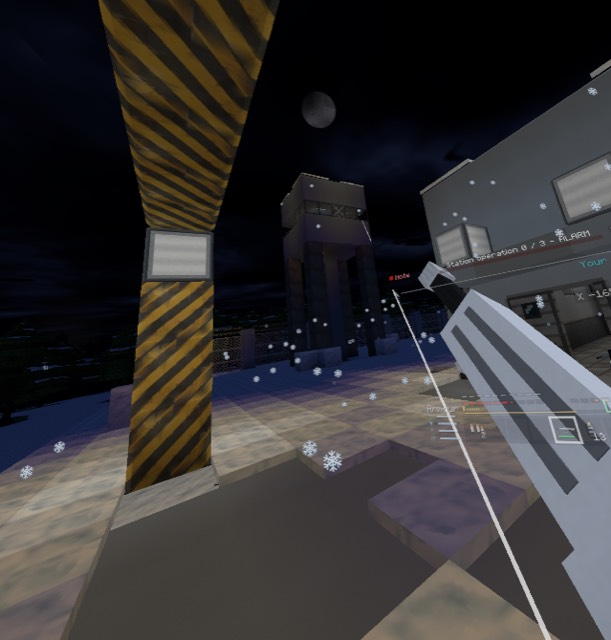

## 09:54:32 - Oh. Ho ho ho.

- **Transcript:** Oh. Ho ho ho.
- **Status:** open
- **Build:** 0.129 (80238cd9, M1-M4 (device-tested; ship riding, chests, comfort options, weapon wheel))
- **World:** New World (13) (seed 1340059502856237115)
- **Dimension:** Surface
- **Biome:** Snowy Plains
- **Position:** -1656.8 73.0 -2654.2
- **Facing:** east (yaw 73, pitch -30)
- **Held:** Field Stim x16
- **Mount:** on foot
- **Looking at:** Snow at -1655 73 -2656
- **Mode:** Survival, health 1/20
- **Time:** day 1 02:56, rain
- **Fps:** 72
- **Levels:** mic -21 dBFS, game sound -16 dBFS
- **Length:** 3.3 s (voice 1.1 s)
- **Just before:** -29s walked into Snowy Plains; -21s took 2 damage (health 14/20); -16s took 1 damage (health 13/20); -13s message: Loaded: 45 / 45; -13s left the pack: Capital Magazine; -4s took 4 damage (health 9/20); -3s holding Capital Magazine; -3s message: Capital Magazine; -2s left the pack: Capital Magazine (at -1656 73 -2657); -2s holding Field Stim; -2s message: Field Stim; -1s into the pack: Capital Magazine
- **Repro (Mac):** `./snap.sh note --seed 1340059502856237115 --x -1656.8 --z -2654.2 --yaw -73 --pitch -30 --time 0.872`
- **Audio (this Mac):** /Users/darthvadar/Documents/Blocksmith/QuestVoiceNotes/raw/vn-20261031-095432-582.aac

## 09:54:47 - Not sure how these field sims work

- **Transcript:** Not sure how these field sims work
- **Status:** open
- **Build:** 0.129 (80238cd9, M1-M4 (device-tested; ship riding, chests, comfort options, weapon wheel))
- **World:** New World (13) (seed 1340059502856237115)
- **Dimension:** Surface
- **Biome:** Snowy Plains
- **Position:** -663.2 66.0 -2807.7
- **Facing:** north-east (yaw 48, pitch -31)
- **Held:** empty hand
- **Mount:** on foot
- **Looking at:** Snow at -662 66 -2809
- **Mode:** Survival, health 20/20
- **Time:** day 1 03:08, rain
- **Fps:** 71
- **Levels:** mic -51 dBFS, game sound -19 dBFS
- **Length:** 2.9 s (voice 1.3 s)
- **Just before:** -28s message: Loaded: 45 / 45; -27s left the pack: Capital Magazine; -19s took 4 damage (health 9/20); -18s holding Capital Magazine; -18s message: Capital Magazine; -17s left the pack: Capital Magazine (at -1656 73 -2657); -17s holding Field Stim; -17s message: Field Stim; -16s into the pack: Capital Magazine; -15s opened PauseMenu; -14s took 8 damage (health 1/20); -14s message: Creative mode; -13s closed PauseMenu; -12s message: Flying; -11s message: Walking; -9s opened PauseMenu; -7s message: Survival mode; -6s closed PauseMenu; -6s holding Sandstone; -5s holding Field Stim; -5s holding Capital Magazine; -4s holding Donnerkeil Service Rifle; -4s message: Donnerkeil Service Rifle; -4s holding Capital Magazine; -4s message: Capital Magazine; -4s holding Field Stim; -4s message: Field Stim; -3s died; -3s opened DeathMenu; -3s holding empty hand; -3s left the pack: Capital Magazine x13 (DeathMenu open); -3s left the pack: Donnerkeil Service Rifle (DeathMenu open); -3s left the pack: Field Stim x16 (DeathMenu open); -3s message: You have your things back; -2s took 2 damage (health -1/20); -1s message: Target gone from the list. Back to the story's objective; -1s respawned; -1s closed DeathMenu
- **Repro (Mac):** `./snap.sh note --seed 1340059502856237115 --x -663.2 --z -2807.7 --yaw -48 --pitch -31 --time 0.881`
- **Audio (this Mac):** /Users/darthvadar/Documents/Blocksmith/QuestVoiceNotes/raw/vn-20261031-095447-602.aac

## 09:54:50 - I'm not here

- **Transcript:** I'm not here
- **Status:** open
- **Build:** 0.129 (80238cd9, M1-M4 (device-tested; ship riding, chests, comfort options, weapon wheel))
- **World:** New World (13) (seed 1340059502856237115)
- **Dimension:** Surface
- **Biome:** Snowy Plains
- **Position:** -661.4 67.5 -2809.9
- **Facing:** north-east (yaw 41, pitch -10)
- **Held:** empty hand
- **Mount:** on foot, flying
- **Looking at:** nothing
- **Mode:** Creative, health 20/20
- **Time:** day 1 03:10, rain
- **Fps:** 71
- **Levels:** mic -27 dBFS, game sound -20 dBFS
- **Length:** 1.9 s (voice 0.5 s)
- **Just before:** -22s took 4 damage (health 9/20); -21s holding Capital Magazine; -21s message: Capital Magazine; -20s left the pack: Capital Magazine (at -1656 73 -2657); -20s holding Field Stim; -20s message: Field Stim; -19s into the pack: Capital Magazine; -18s opened PauseMenu; -17s took 8 damage (health 1/20); -17s message: Creative mode; -16s closed PauseMenu; -15s message: Flying; -14s message: Walking; -12s opened PauseMenu; -10s message: Survival mode; -9s closed PauseMenu; -9s holding Sandstone; -8s holding Field Stim; -8s holding Capital Magazine; -7s holding Donnerkeil Service Rifle; -7s message: Donnerkeil Service Rifle; -7s holding Capital Magazine; -7s message: Capital Magazine; -6s holding Field Stim; -6s message: Field Stim; -6s died; -6s opened DeathMenu; -6s holding empty hand; -6s left the pack: Capital Magazine x13 (DeathMenu open); -6s left the pack: Donnerkeil Service Rifle (DeathMenu open); -6s left the pack: Field Stim x16 (DeathMenu open); -6s message: You have your things back; -5s took 2 damage (health -1/20); -4s message: Target gone from the list. Back to the story's objective; -4s respawned; -4s closed DeathMenu; -2s opened PauseMenu; -1s message: Entering Kesria; -0s closed PauseMenu
- **Repro (Mac):** `./snap.sh note --seed 1340059502856237115 --x -661.4 --z -2809.9 --yaw -41 --pitch -10 --time 0.883`
- **Audio (this Mac):** /Users/darthvadar/Documents/Blocksmith/QuestVoiceNotes/raw/vn-20261031-095450-562.aac

## 09:54:56 - No, that's fair

- **Transcript:** No, that's fair
- **Status:** open
- **Build:** 0.129 (80238cd9, M1-M4 (device-tested; ship riding, chests, comfort options, weapon wheel))
- **World:** New World (13) (seed 1340059502856237115)
- **Dimension:** Surface
- **Biome:** Snowy Plains
- **Position:** -663.5 67.0 -2807.5
- **Facing:** north-east (yaw 44, pitch -9)
- **Held:** empty hand
- **Mount:** on foot
- **Looking at:** nothing
- **Mode:** Survival, health 20/20
- **Time:** day 1 03:17, rain
- **Fps:** 72
- **Levels:** mic -38 dBFS, game sound -20 dBFS
- **Length:** 1.9 s (voice 0.4 s)
- **Just before:** -23s message: Creative mode; -23s closed PauseMenu; -21s message: Flying; -20s message: Walking; -18s opened PauseMenu; -16s message: Survival mode; -16s closed PauseMenu; -15s holding Sandstone; -15s holding Field Stim; -14s holding Capital Magazine; -13s holding Donnerkeil Service Rifle; -13s message: Donnerkeil Service Rifle; -13s holding Capital Magazine; -13s message: Capital Magazine; -13s holding Field Stim; -13s message: Field Stim; -13s died; -13s opened DeathMenu; -13s holding empty hand; -13s left the pack: Capital Magazine x13 (DeathMenu open); -13s left the pack: Donnerkeil Service Rifle (DeathMenu open); -13s left the pack: Field Stim x16 (DeathMenu open); -12s message: You have your things back; -12s took 2 damage (health -1/20); -10s message: Target gone from the list. Back to the story's objective; -10s respawned; -10s closed DeathMenu; -8s opened PauseMenu; -7s message: Entering Kesria; -7s closed PauseMenu; -6s message: Creative mode; -4s message: Flying; -4s opened PauseMenu; -3s closed PauseMenu; -3s message: Survival mode; -1s died; -1s opened DeathMenu; -1s respawned; -1s closed DeathMenu; -0s took 27 damage (health 20/20)
- **Repro (Mac):** `./snap.sh note --seed 1340059502856237115 --x -663.5 --z -2807.5 --yaw -44 --pitch -9 --time 0.887`
- **Audio (this Mac):** /Users/darthvadar/Documents/Blocksmith/QuestVoiceNotes/raw/vn-20261031-095456-862.aac

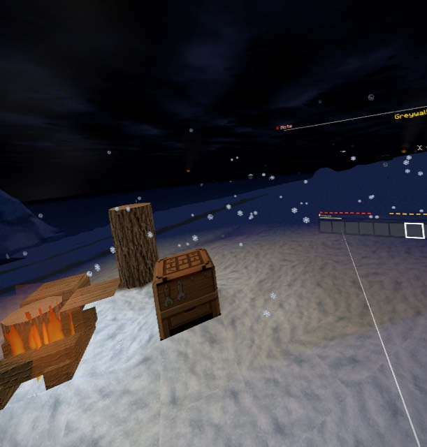

## 09:55:39 - I don't think the field stim or combat stim works

- **Transcript:** I don't think the field stim or combat stim works
- **Status:** open
- **Build:** 0.129 (80238cd9, M1-M4 (device-tested; ship riding, chests, comfort options, weapon wheel))
- **World:** New World (13) (seed 1340059502856237115)
- **Dimension:** Surface
- **Biome:** Snowy Plains
- **Position:** -715.2 67.3 -2788.3
- **Facing:** north-east (yaw 39, pitch -35)
- **Held:** Field Stim x15
- **Mount:** on foot
- **Looking at:** Snowy Grass Block at -714 66 -2791
- **Mode:** Survival, health 17/20
- **Time:** day 1 04:01, rain
- **Fps:** 72
- **Levels:** mic -24 dBFS, game sound -21 dBFS
- **Length:** 4.1 s (voice 2.1 s)
- **Just before:** -30s closed InventoryMenu; -29s holding Field Stim; -27s left the pack: Field Stim (at -689 65 -2796); -25s holding Combat Stim; -25s message: Combat Stim; -23s holding Field Stim; -23s message: Field Stim; -21s holding Combat Stim; -21s message: Combat Stim; -20s opened PauseMenu; -19s message: Creative mode; -19s closed PauseMenu; -18s message: Flying; -18s opened PauseMenu; -17s closed PauseMenu; -16s message: Survival mode; -15s took 6 damage (health 14/20); -10s holding Field Stim; -10s message: Field Stim; -9s holding Combat Stim; -9s message: Combat Stim; -7s holding Field Stim; -7s message: Field Stim; -1s holding Combat Stim; -1s message: Combat Stim; -0s holding Field Stim; -0s message: Field Stim
- **Repro (Mac):** `./snap.sh note --seed 1340059502856237115 --x -715.2 --z -2788.3 --yaw -39 --pitch -35 --time 0.918`
- **Audio (this Mac):** /Users/darthvadar/Documents/Blocksmith/QuestVoiceNotes/raw/vn-20261031-095539-722.aac

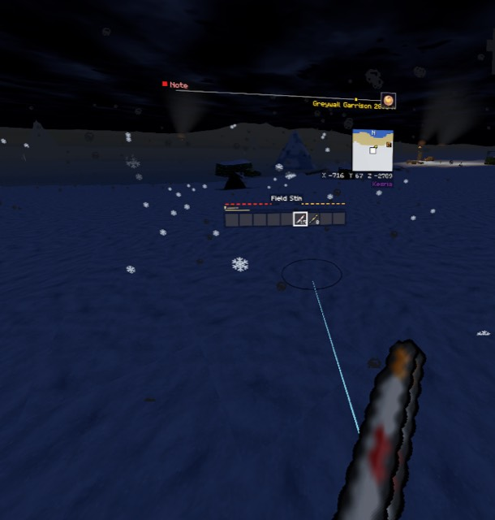

## 09:55:50 - Maybe it does. I can't tell

- **Transcript:** Maybe it does. I can't tell
- **Status:** open
- **Build:** 0.129 (80238cd9, M1-M4 (device-tested; ship riding, chests, comfort options, weapon wheel))
- **World:** New World (13) (seed 1340059502856237115)
- **Dimension:** Surface
- **Biome:** Snowy Plains
- **Position:** -710.5 67.2 -2789.0
- **Facing:** north-east (yaw 30, pitch -8)
- **Held:** Combat Stim x7
- **Mount:** on foot
- **Looking at:** Snow at -709 67 -2793
- **Mode:** Survival, health 20/20, screen PauseMenu
- **Time:** day 1 04:13, rain
- **Fps:** 72
- **Levels:** mic -22 dBFS, game sound -26 dBFS
- **Length:** 3.3 s (voice 1.1 s)
- **Just before:** -30s message: Creative mode; -29s closed PauseMenu; -28s message: Flying; -28s opened PauseMenu; -27s closed PauseMenu; -27s message: Survival mode; -25s took 6 damage (health 14/20); -20s holding Field Stim; -20s message: Field Stim; -20s holding Combat Stim; -20s message: Combat Stim; -17s holding Field Stim; -17s message: Field Stim; -11s holding Combat Stim; -11s message: Combat Stim; -11s holding Field Stim; -11s message: Field Stim; -10s holding Combat Stim; -10s message: Combat Stim; -7s left the pack: Combat Stim; -5s holding empty hand; -4s holding Combat Stim; -0s opened PauseMenu
- **Repro (Mac):** `./snap.sh note --seed 1340059502856237115 --x -710.5 --z -2789.0 --yaw -30 --pitch -8 --time 0.926`
- **Audio (this Mac):** /Users/darthvadar/Documents/Blocksmith/QuestVoiceNotes/raw/vn-20261031-095550-083.aac

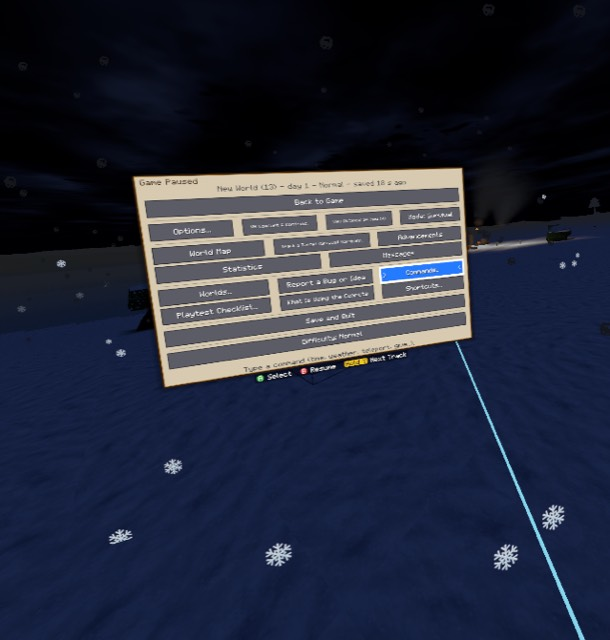

## 09:56:09 - I can't, I can't tell if this thing even works

- **Transcript:** I can't, I can't tell if this thing even works
- **Status:** open
- **Build:** 0.129 (80238cd9, M1-M4 (device-tested; ship riding, chests, comfort options, weapon wheel))
- **World:** New World (13) (seed 1340059502856237115)
- **Dimension:** Surface
- **Biome:** Snowy Plains
- **Position:** -678.8 66.9 -2786.1
- **Facing:** north-east (yaw 45, pitch -24)
- **Held:** Field Stim x15
- **Mount:** on foot
- **Looking at:** Andesite at -677 67 -2789
- **Mode:** Survival, health 20/20
- **Time:** day 1 04:34, rain
- **Fps:** 72
- **Levels:** mic -23 dBFS, game sound -19 dBFS
- **Length:** 3.3 s (voice 1.7 s)
- **Just before:** -30s holding Field Stim; -30s message: Field Stim; -29s holding Combat Stim; -29s message: Combat Stim; -26s left the pack: Combat Stim; -24s holding empty hand; -23s holding Combat Stim; -20s opened PauseMenu; -18s message: Creative mode; -18s closed PauseMenu; -17s message: Flying; -16s opened PauseMenu; -16s message: Survival mode; -15s closed PauseMenu; -13s holding Field Stim; -13s message: Field Stim; -13s took 4 damage (health 17/20); -13s holding Combat Stim; -13s message: Combat Stim; -11s holding Field Stim; -11s message: Field Stim; -7s holding Combat Stim; -7s message: Combat Stim; -0s holding Field Stim; -0s message: Field Stim
- **Repro (Mac):** `./snap.sh note --seed 1340059502856237115 --x -678.8 --z -2786.1 --yaw -45 --pitch -24 --time 0.940`
- **Audio (this Mac):** /Users/darthvadar/Documents/Blocksmith/QuestVoiceNotes/raw/vn-20261031-095609-402.aac

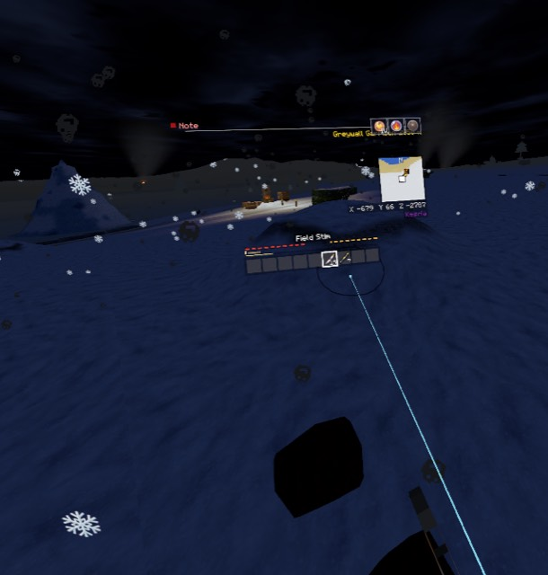

## 09:56:12 - How do I use it? Like what, what

- **Transcript:** How do I use it? Like what, what
- **Status:** open
- **Build:** 0.129 (80238cd9, M1-M4 (device-tested; ship riding, chests, comfort options, weapon wheel))
- **World:** New World (13) (seed 1340059502856237115)
- **Dimension:** Surface
- **Biome:** Snowy Plains
- **Position:** -678.8 66.9 -2786.1
- **Facing:** north (yaw 353, pitch 36)
- **Held:** Field Stim x15
- **Mount:** on foot
- **Looking at:** nothing
- **Mode:** Survival, health 20/20
- **Time:** day 1 04:38, rain
- **Fps:** 72
- **Levels:** mic -24 dBFS, game sound -21 dBFS
- **Length:** 2.7 s (voice 1.1 s)
- **Just before:** -30s left the pack: Combat Stim; -27s holding empty hand; -26s holding Combat Stim; -23s opened PauseMenu; -22s message: Creative mode; -22s closed PauseMenu; -20s message: Flying; -20s opened PauseMenu; -19s message: Survival mode; -19s closed PauseMenu; -16s holding Field Stim; -16s message: Field Stim; -16s took 4 damage (health 17/20); -16s holding Combat Stim; -16s message: Combat Stim; -14s holding Field Stim; -14s message: Field Stim; -10s holding Combat Stim; -10s message: Combat Stim; -4s holding Field Stim; -4s message: Field Stim; -2s holding empty hand; -1s holding Field Stim
- **Repro (Mac):** `./snap.sh note --seed 1340059502856237115 --x -678.8 --z -2786.1 --yaw 7 --pitch 36 --time 0.943`
- **Audio (this Mac):** /Users/darthvadar/Documents/Blocksmith/QuestVoiceNotes/raw/vn-20261031-095612-722.aac

## 09:56:18 - I don't get it

- **Transcript:** I don't get it
- **Status:** open
- **Build:** 0.129 (80238cd9, M1-M4 (device-tested; ship riding, chests, comfort options, weapon wheel))
- **World:** New World (13) (seed 1340059502856237115)
- **Dimension:** Surface
- **Biome:** Snowy Plains
- **Position:** -668.8 65.7 -2806.8
- **Facing:** east (yaw 73, pitch -59)
- **Held:** Combat Stim x7
- **Mount:** on foot
- **Looking at:** Snow at -669 66 -2807
- **Mode:** Survival, health 20/20
- **Time:** day 1 04:44, rain
- **Fps:** 72
- **Levels:** mic -25 dBFS, game sound -13 dBFS
- **Length:** 2.8 s (voice 1.2 s)
- **Just before:** -28s opened PauseMenu; -27s message: Creative mode; -27s closed PauseMenu; -26s message: Flying; -25s opened PauseMenu; -24s message: Survival mode; -24s closed PauseMenu; -22s holding Field Stim; -22s message: Field Stim; -22s took 4 damage (health 17/20); -21s holding Combat Stim; -21s message: Combat Stim; -20s holding Field Stim; -20s message: Field Stim; -16s holding Combat Stim; -16s message: Combat Stim; -9s holding Field Stim; -9s message: Field Stim; -7s holding empty hand; -7s holding Field Stim; -4s holding Combat Stim; -4s message: Combat Stim
- **Repro (Mac):** `./snap.sh note --seed 1340059502856237115 --x -668.8 --z -2806.8 --yaw -73 --pitch -59 --time 0.948`
- **Audio (this Mac):** /Users/darthvadar/Documents/Blocksmith/QuestVoiceNotes/raw/vn-20261031-095618-142.aac
