# Voice bug notes 2026-10-31 (Quest)

Spoken while playing; transcribed by elevenlabs/scribe-v2. Written by `tools/quest-bugnotes.py` (rewritten each run; edit Status lines in a copy). 126 notes.

## 09:37:01 - It's finally here again, innit?

- **Transcript:** It's finally here again, innit?
- **Status:** open
- **Build:** 0.129 (80238cd9, M1-M4 (device-tested; ship riding, chests, comfort options, weapon wheel))
- **World:** Quest World (seed 5663059916303033239)
- **Dimension:** Hell
- **Biome:** Ash Vault
- **Position:** 2384.8 -26.4 -3085.8
- **Facing:** east (yaw 95, pitch -47)
- **Held:** Aero Engine Spares x13
- **Mount:** on foot, flying
- **Looking at:** nothing
- **Mode:** Creative, health 11/20
- **Time:** day 7 10:38, clear
- **Fps:** 8
- **Levels:** mic -28 dBFS, game sound -18 dBFS
- **Length:** 2.4 s (voice 1.0 s)
- **Just before:** -3s opened PauseMenu; -2s closed PauseMenu; -2s message: Playtest build: voice bug notes ON, your speech is saved (Options > Interface)
- **Repro (Mac):** `./snap.sh note --seed 5663059916303033239 --x 2384.8 --z -3085.8 --yaw -95 --pitch -47 --time 0.193 --dim deep`
- **Audio (this Mac):** /Users/darthvadar/Documents/Blocksmith/QuestVoiceNotes/raw/vn-20261031-093701-003.aac

## 09:37:13 - Here we are

- **Transcript:** Here we are
- **Status:** open
- **Build:** 0.129 (80238cd9, M1-M4 (device-tested; ship riding, chests, comfort options, weapon wheel))
- **World:** New World (13) (seed 1340059502856237115)
- **Dimension:** Surface
- **Biome:** Snowy Plains
- **Position:** -652.3 66.3 -2812.5
- **Facing:** east (yaw 89, pitch -66)
- **Held:** Greywall Dispatch x1
- **Mount:** on foot
- **Looking at:** Snowy Grass Block at -652 65 -2813
- **Mode:** Survival, health 20/20
- **Time:** day 1 07:29, clear
- **Fps:** 69
- **Levels:** mic -29 dBFS, game sound -23 dBFS
- **Length:** 2.4 s (voice 1.0 s)
- **Just before:** -2s opened PauseMenu; -1s closed PauseMenu; -1s message: Playtest build: voice bug notes ON, your speech is saved (Options > Interface); --2s opened PauseMenu; --3s message: Flying; --4s message: The Chancellor, over the loudspeakers: "Seal the bunker! Nobody opens the blast door in the command post!"; -2s entered Surface; -2s closed PauseMenu; -2s holding Greywall Dispatch; -2s message: In Clear Ford's jail safe: a Greywall Dispatch; -2s message: In Clear Ford's jail safe: a Greywall Dispatch. Added to journal: Who Holds the Frontier
- **Repro (Mac):** `./snap.sh note --seed 1340059502856237115 --x -652.3 --z -2812.5 --yaw -89 --pitch -66 --time 0.062`
- **Audio (this Mac):** /Users/darthvadar/Documents/Blocksmith/QuestVoiceNotes/raw/vn-20261031-093713-182.aac

## 09:37:19 - Okay, that's better for Bush

- **Transcript:** Okay, that's better for Bush
- **Status:** open
- **Build:** 0.129 (80238cd9, M1-M4 (device-tested; ship riding, chests, comfort options, weapon wheel))
- **World:** New World (13) (seed 1340059502856237115)
- **Dimension:** Surface
- **Biome:** Snowy Plains
- **Position:** -639.0 67.3 -2808.8
- **Facing:** south-east (yaw 137, pitch -12)
- **Held:** Greywall Dispatch x1
- **Mount:** on foot
- **Looking at:** Spruce Leaves at -638 68 -2807
- **Mode:** Creative, health 20/20
- **Time:** day 1 07:35, clear
- **Fps:** 70
- **Levels:** mic -30 dBFS, game sound -28 dBFS
- **Length:** 3.0 s (voice 1.0 s)
- **Just before:** -9s opened PauseMenu; -7s closed PauseMenu; -7s message: Playtest build: voice bug notes ON, your speech is saved (Options > Interface); -4s opened PauseMenu; -4s message: Flying; -2s message: The Chancellor, over the loudspeakers: "Seal the bunker! Nobody opens the blast door in the command post!"; -9s entered Surface; -9s closed PauseMenu; -9s holding Greywall Dispatch; -9s message: In Clear Ford's jail safe: a Greywall Dispatch; -8s message: In Clear Ford's jail safe: a Greywall Dispatch. Added to journal: Who Holds the Frontier; -4s message: Spring: the snow melts and the young are born; -4s opened PauseMenu; -2s closed PauseMenu; -2s message: Creative mode
- **Repro (Mac):** `./snap.sh note --seed 1340059502856237115 --x -639.0 --z -2808.8 --yaw -137 --pitch -12 --time 0.066`
- **Audio (this Mac):** /Users/darthvadar/Documents/Blocksmith/QuestVoiceNotes/raw/vn-20261031-093719-682.aac

## 09:39:36 - This gun sucks

- **Transcript:** This gun sucks
- **Status:** open
- **Build:** 0.129 (80238cd9, M1-M4 (device-tested; ship riding, chests, comfort options, weapon wheel))
- **World:** New World (13) (seed 1340059502856237115)
- **Dimension:** Surface
- **Biome:** Snowy Taiga
- **Position:** 2185.8 100.1 -2960.6
- **Facing:** south-west (yaw 217, pitch 27)
- **Held:** Golden Apple x64
- **Mount:** on foot
- **Looking at:** Snow at 2184 103 -2959
- **Mode:** Survival, health 11/20
- **Time:** day 1 10:01, clear
- **Fps:** 72
- **Levels:** mic -34 dBFS, game sound -21 dBFS
- **Length:** 2.1 s (voice 0.5 s)
- **Just before:** -18s message: The Greywall Garrison is sounding the alarm!; -13s took 4 damage (health 17/20); -10s took 4 damage (health 14/20); -3s took 6 damage (health 10/20); -2s holding empty hand; -1s holding Golden Apple; -1s message: Golden Apple
- **Repro (Mac):** `./snap.sh note --seed 1340059502856237115 --x 2185.8 --z -2960.6 --yaw 143 --pitch 27 --time 0.168`
- **Audio (this Mac):** /Users/darthvadar/Documents/Blocksmith/QuestVoiceNotes/raw/vn-20261031-093936-682.aac

## 09:40:22 - This thing should be doing a lot more damage. The Castle bolt rifle sh

- **Transcript:** This thing should be doing a lot more damage. The Castle bolt rifle should do way more damage to those machine guns
- **Status:** open
- **Build:** 0.129 (80238cd9, M1-M4 (device-tested; ship riding, chests, comfort options, weapon wheel))
- **World:** New World (13) (seed 1340059502856237115)
- **Dimension:** Surface
- **Biome:** Snowy Taiga
- **Position:** 2186.4 102.8 -2958.0
- **Facing:** west (yaw 275, pitch -37)
- **Held:** empty hand
- **Mount:** on foot
- **Looking at:** Snow at 2184 103 -2959
- **Mode:** Survival, health 7/20
- **Time:** day 1 10:56, clear
- **Fps:** 72
- **Levels:** mic -41 dBFS, game sound -19 dBFS
- **Length:** 7.1 s (voice 4.5 s)
- **Just before:** -29s took 6 damage (health 13/20); -26s took 6 damage (health 8/20); -24s holding empty hand; -24s holding Golden Apple; -23s holding Heavy Rounds; -23s holding empty hand; -23s holding Heavy Rounds; -23s holding Golden Apple; -18s holding empty hand; -18s holding Kessel Bolt Rifle; -18s message: Kessel Bolt Rifle; -14s message: Loaded: 5 / 5; -13s took 5 damage (health 18/20); -11s took 6 damage (health 16/20); -9s took 6 damage (health 13/20); -4s took 6 damage (health 9/20); -1s took 2 damage (health 7/20); -0s holding empty hand
- **While talking:** -4s holding Kessel Bolt Rifle; -4s message: Kessel Bolt Rifle; -2s holding empty hand; -1s holding Golden Apple; -1s message: Golden Apple
- **Position at the end:** 2186.4 102.3 -2958.8
- **Repro (Mac):** `./snap.sh note --seed 1340059502856237115 --x 2186.4 --z -2958.0 --yaw 85 --pitch -37 --time 0.206`
- **Audio (this Mac):** /Users/darthvadar/Documents/Blocksmith/QuestVoiceNotes/raw/vn-20261031-094022-322.aac

## 09:40:30 - It's almost like the machine guns are tracking how many bullets hit th

- **Transcript:** It's almost like the machine guns are tracking how many bullets hit them
- **Status:** open
- **Build:** 0.129 (80238cd9, M1-M4 (device-tested; ship riding, chests, comfort options, weapon wheel))
- **World:** New World (13) (seed 1340059502856237115)
- **Dimension:** Surface
- **Biome:** Snowy Taiga
- **Position:** 2186.4 102.2 -2958.9
- **Facing:** west (yaw 250, pitch 13)
- **Held:** Golden Apple x58
- **Mount:** on foot
- **Looking at:** Snow at 2186 103 -2959
- **Mode:** Survival, health 14/20
- **Time:** day 1 11:06, clear
- **Fps:** 72
- **Levels:** mic -20 dBFS, game sound -19 dBFS
- **Length:** 3.9 s (voice 2.2 s)
- **Just before:** -26s holding empty hand; -25s holding Kessel Bolt Rifle; -25s message: Kessel Bolt Rifle; -22s message: Loaded: 5 / 5; -21s took 5 damage (health 18/20); -19s took 6 damage (health 16/20); -16s took 6 damage (health 13/20); -12s took 6 damage (health 9/20); -9s took 2 damage (health 7/20); -8s holding empty hand; -6s holding Kessel Bolt Rifle; -6s message: Kessel Bolt Rifle; -4s holding empty hand; -4s holding Golden Apple; -4s message: Golden Apple
- **Repro (Mac):** `./snap.sh note --seed 1340059502856237115 --x 2186.4 --z -2958.9 --yaw 110 --pitch 13 --time 0.213`
- **Audio (this Mac):** /Users/darthvadar/Documents/Blocksmith/QuestVoiceNotes/raw/vn-20261031-094030-142.aac

## 09:41:31 - These guys need to be more aggressive

- **Transcript:** These guys need to be more aggressive
- **Status:** open
- **Build:** 0.129 (80238cd9, M1-M4 (device-tested; ship riding, chests, comfort options, weapon wheel))
- **World:** New World (13) (seed 1340059502856237115)
- **Dimension:** Surface
- **Biome:** Snowy Taiga
- **Position:** 2164.3 100.1 -2963.8
- **Facing:** north-east (yaw 35, pitch -38)
- **Held:** Falke Pistol x1
- **Mount:** on foot
- **Looking at:** Coarse Dirt at 2165 99 -2967
- **Mode:** Survival, health 20/20
- **Time:** day 1 12:16, clear
- **Fps:** 72
- **Levels:** mic -32 dBFS, game sound -17 dBFS
- **Length:** 2.8 s (voice 1.3 s)
- **Just before:** -30s holding Falke Pistol; -30s message: Falke Pistol; -27s message: Loaded: 18 / 18; -27s left the pack: Capital Magazine (at 2158 101 -2962); -27s took 13 damage (health 10/20); -24s message: Honour raised (you protected the town); -24s took 5 damage (health 11/20); -23s holding Kessel Bolt Rifle; -23s holding Capital Magazine; -23s holding empty hand; -23s holding Golden Apple; -20s holding empty hand; -20s holding Capital Magazine; -20s message: Capital Magazine; -20s holding Kessel Bolt Rifle; -20s message: Kessel Bolt Rifle; -20s holding Falke Pistol; -20s message: Falke Pistol; -19s message: Loaded: 18 / 18; -8s message: Honour raised (you protected the town); -4s message: Loaded: 18 / 18; -4s left the pack: Capital Magazine (at 2170 101 -2963)
- **Repro (Mac):** `./snap.sh note --seed 1340059502856237115 --x 2164.3 --z -2963.8 --yaw -35 --pitch -38 --time 0.262`
- **Audio (this Mac):** /Users/darthvadar/Documents/Blocksmith/QuestVoiceNotes/raw/vn-20261031-094131-302.aac

## 09:41:34 - I'd say higher range in which they fire at you

- **Transcript:** I'd say higher range in which they fire at you
- **Status:** open
- **Build:** 0.129 (80238cd9, M1-M4 (device-tested; ship riding, chests, comfort options, weapon wheel))
- **World:** New World (13) (seed 1340059502856237115)
- **Dimension:** Surface
- **Biome:** Snowy Taiga
- **Position:** 2158.3 100.1 -2967.0
- **Facing:** north-west (yaw 332, pitch -20)
- **Held:** Falke Pistol x1
- **Mount:** on foot
- **Looking at:** Coarse Dirt at 2155 99 -2971
- **Mode:** Survival, health 20/20
- **Time:** day 1 12:20, clear
- **Fps:** 72
- **Levels:** mic -22 dBFS, game sound -9 dBFS
- **Length:** 3.6 s (voice 2.0 s)
- **Just before:** -30s left the pack: Capital Magazine (at 2158 101 -2962); -30s took 13 damage (health 10/20); -27s message: Honour raised (you protected the town); -27s took 5 damage (health 11/20); -26s holding Kessel Bolt Rifle; -26s holding Capital Magazine; -26s holding empty hand; -26s holding Golden Apple; -23s holding empty hand; -23s holding Capital Magazine; -23s message: Capital Magazine; -23s holding Kessel Bolt Rifle; -23s message: Kessel Bolt Rifle; -23s holding Falke Pistol; -23s message: Falke Pistol; -22s message: Loaded: 18 / 18; -11s message: Honour raised (you protected the town); -7s message: Loaded: 18 / 18; -7s left the pack: Capital Magazine (at 2170 101 -2963)
- **Repro (Mac):** `./snap.sh note --seed 1340059502856237115 --x 2158.3 --z -2967.0 --yaw 28 --pitch -20 --time 0.264`
- **Audio (this Mac):** /Users/darthvadar/Documents/Blocksmith/QuestVoiceNotes/raw/vn-20261031-094134-242.aac

## 09:41:39 - Looks like we got a triangle right here where you can see through. Not

- **Transcript:** Looks like we got a triangle right here where you can see through. Not good
- **Status:** open
- **Build:** 0.129 (80238cd9, M1-M4 (device-tested; ship riding, chests, comfort options, weapon wheel))
- **World:** New World (13) (seed 1340059502856237115)
- **Dimension:** Surface
- **Biome:** Snowy Taiga
- **Position:** 2170.5 100.1 -2973.3
- **Facing:** east (yaw 70, pitch -18)
- **Held:** Falke Pistol x1
- **Mount:** on foot
- **Looking at:** Coarse Dirt at 2175 99 -2976
- **Mode:** Survival, health 20/20
- **Time:** day 1 12:26, clear
- **Fps:** 72
- **Levels:** mic -25 dBFS, game sound -19 dBFS
- **Length:** 4.9 s (voice 2.1 s)
- **Just before:** -28s holding empty hand; -28s holding Capital Magazine; -28s message: Capital Magazine; -28s holding Kessel Bolt Rifle; -28s message: Kessel Bolt Rifle; -27s holding Falke Pistol; -27s message: Falke Pistol; -27s message: Loaded: 18 / 18; -16s message: Honour raised (you protected the town); -12s message: Loaded: 18 / 18; -12s left the pack: Capital Magazine (at 2170 101 -2963); -3s into the pack: Regular Armour Set
- **Repro (Mac):** `./snap.sh note --seed 1340059502856237115 --x 2170.5 --z -2973.3 --yaw -70 --pitch -18 --time 0.268`
- **Audio (this Mac):** /Users/darthvadar/Documents/Blocksmith/QuestVoiceNotes/raw/vn-20261031-094139-123.aac

## 09:41:45 - Also, the armor on the base is still here. Get rid of that

- **Transcript:** Also, the armor on the base is still here. Get rid of that
- **Status:** open
- **Build:** 0.129 (80238cd9, M1-M4 (device-tested; ship riding, chests, comfort options, weapon wheel))
- **World:** New World (13) (seed 1340059502856237115)
- **Dimension:** Surface
- **Biome:** Snowy Taiga
- **Position:** 2181.3 100.2 -2976.0
- **Facing:** north-west (yaw 312, pitch -0)
- **Held:** Falke Pistol x1
- **Mount:** on foot
- **Looking at:** nothing
- **Mode:** Survival, health 20/20
- **Time:** day 1 12:33, clear
- **Fps:** 71
- **Levels:** mic -24 dBFS, game sound -18 dBFS
- **Length:** 3.7 s (voice 2.2 s)
- **Just before:** -22s message: Honour raised (you protected the town); -18s message: Loaded: 18 / 18; -18s left the pack: Capital Magazine (at 2170 101 -2963); -9s into the pack: Regular Armour Set
- **Repro (Mac):** `./snap.sh note --seed 1340059502856237115 --x 2181.3 --z -2976.0 --yaw 48 --pitch -0 --time 0.273`
- **Audio (this Mac):** /Users/darthvadar/Documents/Blocksmith/QuestVoiceNotes/raw/vn-20261031-094145-342.aac

## 09:42:08 - Oh, that's perfect. Very good. Now, the guns still aren't doing any da

- **Transcript:** Oh, that's perfect. Very good. Now, the guns still aren't doing any damage to me
- **Status:** open
- **Build:** 0.129 (80238cd9, M1-M4 (device-tested; ship riding, chests, comfort options, weapon wheel))
- **World:** New World (13) (seed 1340059502856237115)
- **Dimension:** Surface
- **Biome:** Snowy Taiga
- **Position:** 2146.0 117.5 -3003.8
- **Facing:** east (yaw 97, pitch -15)
- **Held:** empty hand
- **Mount:** on foot
- **Looking at:** nothing
- **Mode:** Survival, health 17/20
- **Time:** day 1 12:59, clear
- **Fps:** 62
- **Levels:** mic -19 dBFS, game sound -19 dBFS
- **Length:** 8.5 s (voice 4.5 s)
- **Just before:** -20s message: You've reached Greywall Garrison; -14s message: Honour raised (you protected the town); -12s message: Greywall Command now counts you tolerated.; -9s message: Loaded: 18 / 18; -7s holding empty hand; -7s message: Manning the deck gun; -7s took 5 damage (health 17/20); -6s message: Gun Control: the gun overhead, worked from this computer
- **Position at the end:** 2147.1 117.5 -3005.6
- **Repro (Mac):** `./snap.sh note --seed 1340059502856237115 --x 2146.0 --z -3003.8 --yaw -97 --pitch -15 --time 0.291`
- **Audio (this Mac):** /Users/darthvadar/Documents/Blocksmith/QuestVoiceNotes/raw/vn-20261031-094208-442.aac

## 09:42:16 - Can't help but notice

- **Transcript:** Can't help but notice
- **Status:** open
- **Build:** 0.129 (80238cd9, M1-M4 (device-tested; ship riding, chests, comfort options, weapon wheel))
- **World:** New World (13) (seed 1340059502856237115)
- **Dimension:** Surface
- **Biome:** Snowy Taiga
- **Position:** 2146.9 117.5 -3005.4
- **Facing:** south-east (yaw 141, pitch -19)
- **Held:** empty hand
- **Mount:** on foot
- **Looking at:** nothing
- **Mode:** Survival, health 17/20
- **Time:** day 1 13:08, clear
- **Fps:** 66
- **Levels:** mic -28 dBFS, game sound -12 dBFS
- **Length:** 2.2 s (voice 0.9 s)
- **Just before:** -28s message: You've reached Greywall Garrison; -22s message: Honour raised (you protected the town); -19s message: Greywall Command now counts you tolerated.; -17s message: Loaded: 18 / 18; -15s holding empty hand; -15s message: Manning the deck gun; -15s took 5 damage (health 17/20); -13s message: Gun Control: the gun overhead, worked from this computer; -0s message: The turret is wrecked
- **Repro (Mac):** `./snap.sh note --seed 1340059502856237115 --x 2146.9 --z -3005.4 --yaw -141 --pitch -19 --time 0.298`
- **Audio (this Mac):** /Users/darthvadar/Documents/Blocksmith/QuestVoiceNotes/raw/vn-20261031-094216-882.aac

## 09:42:20 - All right, top floor

- **Transcript:** All right, top floor
- **Status:** open
- **Build:** 0.129 (80238cd9, M1-M4 (device-tested; ship riding, chests, comfort options, weapon wheel))
- **World:** New World (13) (seed 1340059502856237115)
- **Dimension:** Surface
- **Biome:** Snowy Taiga
- **Position:** 2146.8 117.5 -3005.3
- **Facing:** south-east (yaw 137, pitch -9)
- **Held:** empty hand
- **Mount:** on foot
- **Looking at:** nothing
- **Mode:** Survival, health 17/20
- **Time:** day 1 13:13, clear
- **Fps:** 67
- **Levels:** mic -26 dBFS, game sound -18 dBFS
- **Length:** 2.3 s (voice 0.7 s)
- **Just before:** -25s message: Honour raised (you protected the town); -23s message: Greywall Command now counts you tolerated.; -20s message: Loaded: 18 / 18; -19s holding empty hand; -19s message: Manning the deck gun; -19s took 5 damage (health 17/20); -17s message: Gun Control: the gun overhead, worked from this computer; -4s message: The turret is wrecked
- **Repro (Mac):** `./snap.sh note --seed 1340059502856237115 --x 2146.8 --z -3005.3 --yaw -137 --pitch -9 --time 0.301`
- **Audio (this Mac):** /Users/darthvadar/Documents/Blocksmith/QuestVoiceNotes/raw/vn-20261031-094220-882.aac

## 09:43:01 - No one up here, huh?

- **Transcript:** No one up here, huh?
- **Status:** open
- **Build:** 0.129 (80238cd9, M1-M4 (device-tested; ship riding, chests, comfort options, weapon wheel))
- **World:** New World (13) (seed 1340059502856237115)
- **Dimension:** Surface
- **Biome:** Snowy Taiga
- **Position:** 2162.3 103.0 -2986.2
- **Facing:** east (yaw 69, pitch -11)
- **Held:** Falke Pistol x1
- **Mount:** on foot
- **Looking at:** Station Floor Tiles at 2163 104 -2988
- **Mode:** Survival, health 20/20
- **Time:** day 1 14:01, clear
- **Fps:** 72
- **Levels:** mic -27 dBFS, game sound -18 dBFS
- **Length:** 2.2 s (voice 0.7 s)
- **Just before:** -29s message: Loaded: 18 / 18; -29s into the pack: Greywall Code Book; -29s into the pack: Spec Ops Armour Set; -29s into the pack: Greywall Keycard; -28s message: The Capital now counts you wary of you.; -27s took 14 damage (health 6/20); -25s message: Loaded: 18 / 18; -24s message: Keycard accepted; -22s took 2 damage (health 5/20); -22s holding Kessel Bolt Rifle; -21s holding Capital Magazine; -21s holding Rifle Rounds; -21s message: Rifle Rounds; -21s holding Golden Apple; -21s message: Golden Apple; -21s holding Heavy Rounds; -21s message: Heavy Rounds; -21s holding Golden Apple; -21s message: Golden Apple; -20s into the pack: Greywall Dispatch; -16s holding Rifle Rounds; -16s message: Rifle Rounds; -16s holding Capital Magazine; -16s message: Capital Magazine; -16s holding Kessel Bolt Rifle; -16s message: Kessel Bolt Rifle; -15s holding Falke Pistol; -15s message: Falke Pistol; -9s message: Loaded: 18 / 18; -9s took 1 damage (health 20/20); -9s left the pack: Capital Magazine (at 2174 100 -2993)
- **Repro (Mac):** `./snap.sh note --seed 1340059502856237115 --x 2162.3 --z -2986.2 --yaw -69 --pitch -11 --time 0.335`
- **Audio (this Mac):** /Users/darthvadar/Documents/Blocksmith/QuestVoiceNotes/raw/vn-20261031-094301-482.aac

## 09:43:14 - Okay. Question, where is the thing that burns into hell? Like the, the

- **Transcript:** Okay. Question, where is the thing that burns into hell? Like the, the bomb you place to get into hell. I haven't seen them in any of these sites
- **Status:** open
- **Build:** 0.129 (80238cd9, M1-M4 (device-tested; ship riding, chests, comfort options, weapon wheel))
- **World:** New World (13) (seed 1340059502856237115)
- **Dimension:** Surface
- **Biome:** Snowy Taiga
- **Position:** 2170.7 105.0 -2987.6
- **Facing:** north-east (yaw 23, pitch -15)
- **Held:** Falke Pistol x1
- **Mount:** on foot
- **Looking at:** Chest at 2172 105 -2992
- **Mode:** Creative, health 20/20
- **Time:** day 1 14:15, clear
- **Fps:** 71
- **Levels:** mic -24 dBFS, game sound -18 dBFS
- **Length:** 11.6 s (voice 7.2 s)
- **Just before:** -29s holding Rifle Rounds; -29s message: Rifle Rounds; -29s holding Capital Magazine; -29s message: Capital Magazine; -29s holding Kessel Bolt Rifle; -29s message: Kessel Bolt Rifle; -28s holding Falke Pistol; -28s message: Falke Pistol; -22s message: Loaded: 18 / 18; -22s took 1 damage (health 20/20); -22s left the pack: Capital Magazine (at 2174 100 -2993); -8s opened InventoryMenu; -7s closed InventoryMenu; -6s opened PauseMenu; -5s message: Creative mode; -5s closed PauseMenu; -4s message: Flying; -3s opened ChestMenu; -2s closed ChestMenu
- **While talking:** -5s opened ChestMenu; -4s closed ChestMenu; -2s opened ChestMenu; -4s closed ChestMenu; -2s opened ChestMenu; -1s closed ChestMenu
- **Position at the end:** 2171.0 105.0 -2989.5
- **Repro (Mac):** `./snap.sh note --seed 1340059502856237115 --x 2170.7 --z -2987.6 --yaw -23 --pitch -15 --time 0.344`
- **Audio (this Mac):** /Users/darthvadar/Documents/Blocksmith/QuestVoiceNotes/raw/vn-20261031-094314-522.aac

## 09:43:26 - Hell, I don't know where it is

- **Transcript:** Hell, I don't know where it is
- **Status:** open
- **Build:** 0.129 (80238cd9, M1-M4 (device-tested; ship riding, chests, comfort options, weapon wheel))
- **World:** New World (13) (seed 1340059502856237115)
- **Dimension:** Surface
- **Biome:** Snowy Taiga
- **Position:** 2153.3 110.2 -2988.0
- **Facing:** west (yaw 262, pitch -20)
- **Held:** Falke Pistol x1
- **Mount:** on foot, flying
- **Looking at:** nothing
- **Mode:** Creative, health 20/20
- **Time:** day 1 14:29, clear
- **Fps:** 71
- **Levels:** mic -22 dBFS, game sound -19 dBFS
- **Length:** 2.5 s (voice 1.1 s)
- **Just before:** -19s opened InventoryMenu; -18s closed InventoryMenu; -18s opened PauseMenu; -17s message: Creative mode; -17s closed PauseMenu; -15s message: Flying; -14s opened ChestMenu; -13s closed ChestMenu; -11s opened ChestMenu; -11s closed ChestMenu; -8s opened ChestMenu; -6s closed ChestMenu; -4s opened ChestMenu; -2s closed ChestMenu
- **Repro (Mac):** `./snap.sh note --seed 1340059502856237115 --x 2153.3 --z -2988.0 --yaw 98 --pitch -20 --time 0.354`
- **Audio (this Mac):** /Users/darthvadar/Documents/Blocksmith/QuestVoiceNotes/raw/vn-20261031-094326-062.aac

## 09:44:14 - Okay, my hitbox is still too-- it hasn't been fixed. I'm still having 

- **Transcript:** Okay, my hitbox is still too-- it hasn't been fixed. I'm still having trouble getting through doors. I have to line myself up fucking perfectly
- **Status:** open
- **Build:** 0.129 (80238cd9, M1-M4 (device-tested; ship riding, chests, comfort options, weapon wheel))
- **World:** New World (13) (seed 1340059502856237115)
- **Dimension:** Surface
- **Biome:** Snowy Taiga
- **Position:** 2168.8 100.1 -2978.9
- **Facing:** north (yaw 10, pitch -51)
- **Held:** Falke Pistol x1
- **Mount:** on foot
- **Looking at:** Station Concrete at 2169 100 -2981
- **Mode:** Creative, health 20/20
- **Time:** day 1 15:24, clear
- **Fps:** 71
- **Levels:** mic -23 dBFS, game sound -21 dBFS
- **Length:** 8.9 s (voice 4.8 s)
- **Just before:** -19s message: Walking; -5s message: You've reached Greywall Garrison
- **Position at the end:** 2171.7 100.0 -2985.2
- **Repro (Mac):** `./snap.sh note --seed 1340059502856237115 --x 2168.8 --z -2978.9 --yaw -10 --pitch -51 --time 0.392`
- **Audio (this Mac):** /Users/darthvadar/Documents/Blocksmith/QuestVoiceNotes/raw/vn-20261031-094414-082.aac

## 09:44:24 - Um, okay, that's good, except we still have, uh, golden apples. So we 

- **Transcript:** Um, okay, that's good, except we still have, uh, golden apples. So we gotta get rid of the golden apples
- **Status:** open
- **Build:** 0.129 (80238cd9, M1-M4 (device-tested; ship riding, chests, comfort options, weapon wheel))
- **World:** New World (13) (seed 1340059502856237115)
- **Dimension:** Surface
- **Biome:** Snowy Taiga
- **Position:** 2172.4 100.0 -2983.4
- **Facing:** east (yaw 88, pitch -21)
- **Held:** Falke Pistol x1
- **Mount:** on foot
- **Looking at:** nothing
- **Mode:** Creative, health 20/20, screen ChestMenu
- **Time:** day 1 15:36, clear
- **Fps:** 72
- **Levels:** mic -46 dBFS, game sound -24 dBFS
- **Length:** 6.9 s (voice 4.2 s)
- **Just before:** -29s message: Walking; -15s message: You've reached Greywall Garrison; -4s opened ChestMenu
- **While talking:** -1s closed ChestMenu
- **Position at the end:** 2174.5 100.0 -2983.7
- **Repro (Mac):** `./snap.sh note --seed 1340059502856237115 --x 2172.4 --z -2983.4 --yaw -88 --pitch -21 --time 0.400`
- **Audio (this Mac):** /Users/darthvadar/Documents/Blocksmith/QuestVoiceNotes/raw/vn-20261031-094424-142.aac

## 09:44:43 - Why am I doing quartermaster contracts at the Grayson whatever?

- **Transcript:** Why am I doing quartermaster contracts at the Grayson whatever?
- **Status:** open
- **Build:** 0.129 (80238cd9, M1-M4 (device-tested; ship riding, chests, comfort options, weapon wheel))
- **World:** New World (13) (seed 1340059502856237115)
- **Dimension:** Surface
- **Biome:** Snowy Taiga
- **Position:** 2173.1 100.0 -2982.6
- **Facing:** south-east (yaw 116, pitch -39)
- **Held:** Falke Pistol x1
- **Mount:** on foot
- **Looking at:** nothing
- **Mode:** Creative, health 20/20, screen BaseContractsMenu
- **Time:** day 1 16:00, clear
- **Fps:** 72
- **Levels:** mic -21 dBFS, game sound -26 dBFS
- **Length:** 6.4 s (voice 3.4 s)
- **Just before:** -24s opened ChestMenu; -16s closed ChestMenu; -14s into the pack: Greywall Code Book; -14s opened BaseContractsMenu; -14s message: Greywall Fortress marked on the map; -12s message: The radar net marks 1 Greywall bases on your map; -8s message: Added to journal: Contract: Parcel to Bitter Ridge; -6s message: Tracking Contract: Parcel to Bitter Ridge; -1s closed BaseContractsMenu; -0s opened BaseContractsMenu; -0s message: The radar net marks 1 Greywall bases on your map
- **While talking:** -3s closed BaseContractsMenu
- **Position at the end:** 2173.5 100.0 -2982.3
- **Repro (Mac):** `./snap.sh note --seed 1340059502856237115 --x 2173.1 --z -2982.6 --yaw -116 --pitch -39 --time 0.417`
- **Audio (this Mac):** /Users/darthvadar/Documents/Blocksmith/QuestVoiceNotes/raw/vn-20261031-094443-842.aac

## 09:44:50 - Doesn't make a lick of sense

- **Transcript:** Doesn't make a lick of sense
- **Status:** open
- **Build:** 0.129 (80238cd9, M1-M4 (device-tested; ship riding, chests, comfort options, weapon wheel))
- **World:** New World (13) (seed 1340059502856237115)
- **Dimension:** Surface
- **Biome:** Snowy Taiga
- **Position:** 2173.5 100.0 -2982.9
- **Facing:** east (yaw 100, pitch -45)
- **Held:** Falke Pistol x1
- **Mount:** on foot
- **Looking at:** nothing
- **Mode:** Creative, health 20/20, screen BaseContractsMenu
- **Time:** day 1 16:07, clear
- **Fps:** 72
- **Levels:** mic -25 dBFS, game sound -23 dBFS
- **Length:** 2.5 s (voice 1.0 s)
- **Just before:** -23s closed ChestMenu; -21s into the pack: Greywall Code Book; -20s opened BaseContractsMenu; -20s message: Greywall Fortress marked on the map; -18s message: The radar net marks 1 Greywall bases on your map; -15s message: Added to journal: Contract: Parcel to Bitter Ridge; -12s message: Tracking Contract: Parcel to Bitter Ridge; -8s closed BaseContractsMenu; -7s opened BaseContractsMenu; -7s message: The radar net marks 1 Greywall bases on your map; -4s closed BaseContractsMenu; -0s opened BaseContractsMenu
- **Repro (Mac):** `./snap.sh note --seed 1340059502856237115 --x 2173.5 --z -2982.9 --yaw -100 --pitch -45 --time 0.422`
- **Audio (this Mac):** /Users/darthvadar/Documents/Blocksmith/QuestVoiceNotes/raw/vn-20261031-094450-342.aac

## 09:44:54 - Yeah, whatever

- **Transcript:** Yeah, whatever
- **Status:** open
- **Build:** 0.129 (80238cd9, M1-M4 (device-tested; ship riding, chests, comfort options, weapon wheel))
- **World:** New World (13) (seed 1340059502856237115)
- **Dimension:** Surface
- **Biome:** Snowy Taiga
- **Position:** 2171.5 100.0 -2984.8
- **Facing:** north-east (yaw 37, pitch -20)
- **Held:** Falke Pistol x1
- **Mount:** on foot
- **Looking at:** Dark Station Concrete at 2173 100 -2988
- **Mode:** Creative, health 20/20
- **Time:** day 1 16:13, clear
- **Fps:** 72
- **Levels:** mic -26 dBFS, game sound -22 dBFS
- **Length:** 1.9 s (voice 0.5 s)
- **Just before:** -27s closed ChestMenu; -25s into the pack: Greywall Code Book; -25s opened BaseContractsMenu; -25s message: Greywall Fortress marked on the map; -22s message: The radar net marks 1 Greywall bases on your map; -19s message: Added to journal: Contract: Parcel to Bitter Ridge; -17s message: Tracking Contract: Parcel to Bitter Ridge; -12s closed BaseContractsMenu; -11s opened BaseContractsMenu; -11s message: The radar net marks 1 Greywall bases on your map; -9s closed BaseContractsMenu; -4s opened BaseContractsMenu; -2s closed BaseContractsMenu
- **Repro (Mac):** `./snap.sh note --seed 1340059502856237115 --x 2171.5 --z -2984.8 --yaw -37 --pitch -20 --time 0.426`
- **Audio (this Mac):** /Users/darthvadar/Documents/Blocksmith/QuestVoiceNotes/raw/vn-20261031-094454-682.aac

## 09:45:21 - Well, that worked

- **Transcript:** Well, that worked
- **Status:** open
- **Build:** 0.129 (80238cd9, M1-M4 (device-tested; ship riding, chests, comfort options, weapon wheel))
- **World:** New World (13) (seed 1340059502856237115)
- **Dimension:** Surface
- **Biome:** Snowy Plains
- **Position:** 3366.4 69.0 -2475.9
- **Facing:** north-east (yaw 42, pitch -10)
- **Held:** Capital Magazine x12
- **Mount:** on foot
- **Looking at:** nothing
- **Mode:** Creative, health 20/20
- **Time:** day 1 16:44, clear
- **Fps:** 72
- **Levels:** mic -24 dBFS, game sound -18 dBFS
- **Length:** 1.9 s (voice 0.4 s)
- **Just before:** -29s closed BaseContractsMenu; -26s opened PauseMenu; -25s closed PauseMenu; -24s message: The Greywall Garrison is sounding the alarm!; -23s holding Kessel Bolt Rifle; -23s holding Capital Magazine; -21s opened CreativeMenu; -21s closed CreativeMenu; -20s message: Flying; -18s walked into Grove; -14s message: Entering Vesarreach; -14s walked into Snowy Taiga; -12s message: Sky isle marked on the map; -6s walked into Snowy Plains; -4s message: Bitter Ridge marked on the map; -2s message: Walking; -1s message: Contract done: $8.63 from your base's quartermaster.
- **Repro (Mac):** `./snap.sh note --seed 1340059502856237115 --x 3366.4 --z -2475.9 --yaw -42 --pitch -10 --time 0.447`
- **Audio (this Mac):** /Users/darthvadar/Documents/Blocksmith/QuestVoiceNotes/raw/vn-20261031-094521-602.aac

## 09:46:19 - Pistol should still be semi-automatic, but needs to have a higher rate

- **Transcript:** Pistol should still be semi-automatic, but needs to have a higher rate of fire
- **Status:** open
- **Build:** 0.129 (80238cd9, M1-M4 (device-tested; ship riding, chests, comfort options, weapon wheel))
- **World:** New World (13) (seed 1340059502856237115)
- **Dimension:** Surface
- **Biome:** Snowy Plains
- **Position:** 3483.5 74.0 -2287.8
- **Facing:** south (yaw 161, pitch 48)
- **Held:** Golden Apple x54
- **Mount:** on foot
- **Looking at:** nothing
- **Mode:** Survival, health 10/20
- **Time:** day 1 17:49, clear
- **Fps:** 71
- **Levels:** mic -32 dBFS, game sound -19 dBFS
- **Length:** 4.5 s (voice 2.9 s)
- **Just before:** -30s holding Falke Pistol; -30s message: Falke Pistol; -29s message: Alarm! Intruder in the citadel; -27s took 3 damage (health 18/20); -27s message: Missile launch: take cover!; -25s message: The citadel is on lockdown!; -23s message: Loaded: 18 / 18; -22s took 9 damage (health 12/20); -21s message: Missile launch: take cover!; -14s took 1 damage (health 14/20); -12s took 1 damage (health 13/20); -12s holding Heavy Magazine; -12s message: Heavy Magazine; -11s holding Falke Pistol; -11s message: Falke Pistol; -11s holding Kessel Bolt Rifle; -11s message: Kessel Bolt Rifle; -11s holding Falke Pistol; -11s message: Falke Pistol; -10s took 1 damage (health 12/20); -9s message: The Capital now counts you hunted.; -7s message: Loaded: 18 / 18; -7s took 3 damage (health 9/20); -5s message: Missile launch: take cover!; -5s took 1 damage (health 8/20); -3s holding Heavy Magazine; -3s holding Bread; -2s holding Capital Rounds; -2s message: Capital Rounds; -2s holding Heavy Rounds; -2s message: Heavy Rounds; -2s holding Golden Apple; -2s message: Golden Apple
- **Repro (Mac):** `./snap.sh note --seed 1340059502856237115 --x 3483.5 --z -2287.8 --yaw -161 --pitch 48 --time 0.493`
- **Audio (this Mac):** /Users/darthvadar/Documents/Blocksmith/QuestVoiceNotes/raw/vn-20261031-094619-862.aac

## 09:46:33 - Also, we need those assault shotguns for the highest rank capital and 

- **Transcript:** Also, we need those assault shotguns for the highest rank capital and gray wall troops, and it should be devastating
- **Status:** open
- **Build:** 0.129 (80238cd9, M1-M4 (device-tested; ship riding, chests, comfort options, weapon wheel))
- **World:** New World (13) (seed 1340059502856237115)
- **Dimension:** Surface
- **Biome:** Snowy Plains
- **Position:** 3509.5 76.0 -2286.7
- **Facing:** south (yaw 159, pitch -27)
- **Held:** Falke Pistol x1
- **Mount:** on foot
- **Looking at:** Capital Stone at 3510 75 -2284
- **Mode:** Survival, health 19/20
- **Time:** day 1 18:06, clear
- **Fps:** 72
- **Levels:** mic -21 dBFS, game sound -22 dBFS
- **Length:** 8.1 s (voice 4.8 s)
- **Just before:** -28s took 1 damage (health 14/20); -26s took 1 damage (health 13/20); -26s holding Heavy Magazine; -26s message: Heavy Magazine; -25s holding Falke Pistol; -25s message: Falke Pistol; -25s holding Kessel Bolt Rifle; -25s message: Kessel Bolt Rifle; -25s holding Falke Pistol; -25s message: Falke Pistol; -24s took 1 damage (health 12/20); -23s message: The Capital now counts you hunted.; -21s message: Loaded: 18 / 18; -21s took 3 damage (health 9/20); -19s message: Missile launch: take cover!; -19s took 1 damage (health 8/20); -17s holding Heavy Magazine; -17s holding Bread; -16s holding Capital Rounds; -16s message: Capital Rounds; -16s holding Heavy Rounds; -16s message: Heavy Rounds; -16s holding Golden Apple; -16s message: Golden Apple; -13s holding Heavy Rounds; -13s message: Heavy Rounds; -12s message: Missile launch: take cover!; -12s holding Capital Rounds; -12s holding Bread; -12s holding Heavy Magazine; -12s holding Falke Pistol; -8s message: Loaded: 18 / 18; -3s message: Missile launch: take cover!; -2s took 2 damage (health 18/20)
- **Position at the end:** 3505.8 76.0 -2268.4
- **Repro (Mac):** `./snap.sh note --seed 1340059502856237115 --x 3509.5 --z -2286.7 --yaw -159 --pitch -27 --time 0.505`
- **Audio (this Mac):** /Users/darthvadar/Documents/Blocksmith/QuestVoiceNotes/raw/vn-20261031-094633-942.aac

## 09:46:44 - Uh-oh. Oh, there we go

- **Transcript:** Uh-oh. Oh, there we go
- **Status:** open
- **Build:** 0.129 (80238cd9, M1-M4 (device-tested; ship riding, chests, comfort options, weapon wheel))
- **World:** New World (13) (seed 1340059502856237115)
- **Dimension:** Surface
- **Biome:** Snowy Plains
- **Position:** 3517.1 76.0 -2247.8
- **Facing:** east (yaw 108, pitch -3)
- **Held:** Falke Pistol x1
- **Mount:** on foot
- **Looking at:** nothing
- **Mode:** Survival, health 12/20
- **Time:** day 1 18:18, clear
- **Fps:** 70
- **Levels:** mic -27 dBFS, game sound -13 dBFS
- **Length:** 3.0 s (voice 1.1 s)
- **Just before:** -29s message: Missile launch: take cover!; -29s took 1 damage (health 8/20); -28s holding Heavy Magazine; -27s holding Bread; -26s holding Capital Rounds; -26s message: Capital Rounds; -26s holding Heavy Rounds; -26s message: Heavy Rounds; -26s holding Golden Apple; -26s message: Golden Apple; -23s holding Heavy Rounds; -23s message: Heavy Rounds; -23s message: Missile launch: take cover!; -23s holding Capital Rounds; -22s holding Bread; -22s holding Heavy Magazine; -22s holding Falke Pistol; -18s message: Loaded: 18 / 18; -14s message: Missile launch: take cover!; -12s took 2 damage (health 18/20); -5s left the pack: Capital Magazine (at 3505 76 -2268); -4s message: Loaded: 18 / 18; -3s into the pack: Donnerkeil Service Rifle
- **Repro (Mac):** `./snap.sh note --seed 1340059502856237115 --x 3517.1 --z -2247.8 --yaw -108 --pitch -3 --time 0.513`
- **Audio (this Mac):** /Users/darthvadar/Documents/Blocksmith/QuestVoiceNotes/raw/vn-20261031-094644-322.aac

## 09:46:47 - [whistles] [laughs] Very good. Okay, give me a minute

- **Transcript:** [whistles] [laughs] Very good. Okay, give me a minute
- **Status:** open
- **Build:** 0.129 (80238cd9, M1-M4 (device-tested; ship riding, chests, comfort options, weapon wheel))
- **World:** New World (13) (seed 1340059502856237115)
- **Dimension:** Surface
- **Biome:** Snowy Plains
- **Position:** 3523.7 76.0 -2241.2
- **Facing:** east (yaw 99, pitch -7)
- **Held:** Falke Pistol x1
- **Mount:** on foot
- **Looking at:** nothing
- **Mode:** Survival, health 2/20, screen PauseMenu
- **Time:** day 1 18:21, clear
- **Fps:** 70
- **Levels:** mic -26 dBFS, game sound -27 dBFS
- **Length:** 6.2 s (voice 2.7 s)
- **Just before:** -29s holding Capital Rounds; -29s message: Capital Rounds; -29s holding Heavy Rounds; -29s message: Heavy Rounds; -29s holding Golden Apple; -29s message: Golden Apple; -26s holding Heavy Rounds; -26s message: Heavy Rounds; -26s message: Missile launch: take cover!; -26s holding Capital Rounds; -25s holding Bread; -25s holding Heavy Magazine; -25s holding Falke Pistol; -21s message: Loaded: 18 / 18; -17s message: Missile launch: take cover!; -15s took 2 damage (health 18/20); -8s left the pack: Capital Magazine (at 3505 76 -2268); -7s message: Loaded: 18 / 18; -6s into the pack: Donnerkeil Service Rifle; -1s opened PauseMenu; -0s took 18 damage (health 2/20)
- **While talking:** -5s message: Creative mode; -4s closed PauseMenu; -3s message: Flying; -2s message: Walking; -0s message: Flying
- **Position at the end:** 3508.9 86.6 -2221.5
- **Repro (Mac):** `./snap.sh note --seed 1340059502856237115 --x 3523.7 --z -2241.2 --yaw -99 --pitch -7 --time 0.515`
- **Audio (this Mac):** /Users/darthvadar/Documents/Blocksmith/QuestVoiceNotes/raw/vn-20261031-094647-463.aac

## 09:46:54 - Okay, first of all, this gun is still... I don't know what this thing 

- **Transcript:** Okay, first of all, this gun is still... I don't know what this thing is. Is this supposed to be a flat gun or what is this?
- **Status:** open
- **Build:** 0.129 (80238cd9, M1-M4 (device-tested; ship riding, chests, comfort options, weapon wheel))
- **World:** New World (13) (seed 1340059502856237115)
- **Dimension:** Surface
- **Biome:** Snowy Plains
- **Position:** 3490.5 98.4 -2211.8
- **Facing:** north-east (yaw 26, pitch -38)
- **Held:** Falke Pistol x1
- **Mount:** on foot, flying
- **Looking at:** nothing
- **Mode:** Creative, health 2/20
- **Time:** day 1 18:28, clear
- **Fps:** 70
- **Levels:** mic -22 dBFS, game sound -17 dBFS
- **Length:** 7.6 s (voice 4.2 s)
- **Just before:** -28s message: Loaded: 18 / 18; -23s message: Missile launch: take cover!; -21s took 2 damage (health 18/20); -15s left the pack: Capital Magazine (at 3505 76 -2268); -13s message: Loaded: 18 / 18; -13s into the pack: Donnerkeil Service Rifle; -7s opened PauseMenu; -7s took 18 damage (health 2/20); -6s message: Creative mode; -6s closed PauseMenu; -5s message: Flying; -3s message: Walking; -2s message: Flying
- **While talking:** -4s message: Walking; -3s message: Flying
- **Position at the end:** 3492.3 86.0 -2233.3
- **Repro (Mac):** `./snap.sh note --seed 1340059502856237115 --x 3490.5 --z -2211.8 --yaw -26 --pitch -38 --time 0.520`
- **Audio (this Mac):** /Users/darthvadar/Documents/Blocksmith/QuestVoiceNotes/raw/vn-20261031-094654-102.aac

## 09:47:01 - It's a flat gun, fine. But, you know, this-- it looks-- there's parts 

- **Transcript:** It's a flat gun, fine. But, you know, this-- it looks-- there's parts floating in the air and shit. It just doesn't look good
- **Status:** open
- **Build:** 0.129 (80238cd9, M1-M4 (device-tested; ship riding, chests, comfort options, weapon wheel))
- **World:** New World (13) (seed 1340059502856237115)
- **Dimension:** Surface
- **Biome:** Snowy Plains
- **Position:** 3474.3 86.0 -2281.5
- **Facing:** north-east (yaw 60, pitch -39)
- **Held:** Falke Pistol x1
- **Mount:** on foot, flying
- **Looking at:** nothing
- **Mode:** Creative, health 2/20
- **Time:** day 1 18:37, clear
- **Fps:** 68
- **Levels:** mic -19 dBFS, game sound -17 dBFS
- **Length:** 8.0 s (voice 4.4 s)
- **Just before:** -28s took 2 damage (health 18/20); -22s left the pack: Capital Magazine (at 3505 76 -2268); -20s message: Loaded: 18 / 18; -20s into the pack: Donnerkeil Service Rifle; -14s opened PauseMenu; -14s took 18 damage (health 2/20); -13s message: Creative mode; -13s closed PauseMenu; -12s message: Flying; -10s message: Walking; -9s message: Flying; -6s message: Walking; -5s message: Flying
- **While talking:** -2s message: A Capital Dropship is landing troops!
- **Position at the end:** 3505.4 86.0 -2282.3
- **Repro (Mac):** `./snap.sh note --seed 1340059502856237115 --x 3474.3 --z -2281.5 --yaw -60 --pitch -39 --time 0.526`
- **Audio (this Mac):** /Users/darthvadar/Documents/Blocksmith/QuestVoiceNotes/raw/vn-20261031-094701-502.aac

## 09:47:14 - Yeah, okay

- **Transcript:** Yeah, okay
- **Status:** open
- **Build:** 0.129 (80238cd9, M1-M4 (device-tested; ship riding, chests, comfort options, weapon wheel))
- **World:** New World (13) (seed 1340059502856237115)
- **Dimension:** Surface
- **Biome:** Snowy Plains
- **Position:** 3507.5 89.5 -2285.8
- **Facing:** south-east (yaw 157, pitch 8)
- **Held:** empty hand
- **Mount:** on foot
- **Looking at:** nothing
- **Mode:** Creative, health 2/20
- **Time:** day 1 18:52, clear
- **Fps:** 65
- **Levels:** mic -28 dBFS, game sound -15 dBFS
- **Length:** 2.1 s (voice 0.6 s)
- **Just before:** -27s opened PauseMenu; -26s took 18 damage (health 2/20); -26s message: Creative mode; -26s closed PauseMenu; -24s message: Flying; -23s message: Walking; -21s message: Flying; -19s message: Walking; -18s message: Flying; -10s message: A Capital Dropship is landing troops!; -6s message: Walking; -6s holding empty hand; -5s message: Manning the deck gun
- **Repro (Mac):** `./snap.sh note --seed 1340059502856237115 --x 3507.5 --z -2285.8 --yaw -157 --pitch 8 --time 0.536`
- **Audio (this Mac):** /Users/darthvadar/Documents/Blocksmith/QuestVoiceNotes/raw/vn-20261031-094714-642.aac

## 09:47:40 - Yeah, troops need to be more aggressive

- **Transcript:** Yeah, troops need to be more aggressive
- **Status:** open
- **Build:** 0.129 (80238cd9, M1-M4 (device-tested; ship riding, chests, comfort options, weapon wheel))
- **World:** New World (13) (seed 1340059502856237115)
- **Dimension:** Surface
- **Biome:** Snowy Plains
- **Position:** 3501.8 76.0 -2266.2
- **Facing:** south-east (yaw 134, pitch -17)
- **Held:** Falke Pistol x1
- **Mount:** on foot
- **Looking at:** White Wool at 3504 76 -2264
- **Mode:** Survival, health 20/20
- **Time:** day 1 19:20, clear
- **Fps:** 72
- **Levels:** mic -22 dBFS, game sound -20 dBFS
- **Length:** 2.9 s (voice 1.5 s)
- **Just before:** -30s message: Manning the deck gun; -22s holding Falke Pistol; -21s opened PauseMenu; -20s message: Survival mode; -20s closed PauseMenu; -19s holding Heavy Magazine; -19s holding Bread; -18s message: Missile launch: take cover!; -18s holding Capital Rounds; -18s holding Heavy Rounds; -17s holding Golden Apple; -16s message: You're full; -12s holding Oak Planks; -12s message: Oak Planks; -12s holding Capital Magazine; -12s message: Capital Magazine; -12s holding Kessel Bolt Rifle; -12s message: Kessel Bolt Rifle; -11s holding Falke Pistol; -11s message: Falke Pistol; -11s message: Loaded: 18 / 18; -7s opened ChestMenu; -6s closed ChestMenu
- **Repro (Mac):** `./snap.sh note --seed 1340059502856237115 --x 3501.8 --z -2266.2 --yaw -134 --pitch -17 --time 0.556`
- **Audio (this Mac):** /Users/darthvadar/Documents/Blocksmith/QuestVoiceNotes/raw/vn-20261031-094740-622.aac

## 09:47:44 - Oh, shit. What the hell? Oh, [chuckles] damn. Capital's tough, man. Wo

- **Transcript:** Oh, shit. What the hell? Oh, [chuckles] damn. Capital's tough, man. Wow, that's not bad
- **Status:** open
- **Build:** 0.129 (80238cd9, M1-M4 (device-tested; ship riding, chests, comfort options, weapon wheel))
- **World:** New World (13) (seed 1340059502856237115)
- **Dimension:** Surface
- **Biome:** Snowy Plains
- **Position:** 3507.5 76.0 -2254.8
- **Facing:** east (yaw 97, pitch -24)
- **Held:** empty hand
- **Mount:** on foot
- **Looking at:** nothing
- **Mode:** Survival, health 0/20, screen DeathMenu
- **Time:** day 1 19:24, clear
- **Fps:** 72
- **Levels:** mic -35 dBFS, game sound -14 dBFS
- **Length:** 7.9 s (voice 3.9 s)
- **Just before:** -26s holding Falke Pistol; -24s opened PauseMenu; -23s message: Survival mode; -23s closed PauseMenu; -22s holding Heavy Magazine; -22s holding Bread; -22s message: Missile launch: take cover!; -21s holding Capital Rounds; -21s holding Heavy Rounds; -21s holding Golden Apple; -20s message: You're full; -16s holding Oak Planks; -16s message: Oak Planks; -15s holding Capital Magazine; -15s message: Capital Magazine; -15s holding Kessel Bolt Rifle; -15s message: Kessel Bolt Rifle; -15s holding Falke Pistol; -15s message: Falke Pistol; -14s message: Loaded: 18 / 18; -10s opened ChestMenu; -9s closed ChestMenu; -0s died; -0s opened DeathMenu; -0s holding empty hand
- **While talking:** -5s left the pack: Falke Pistol (DeathMenu open); -5s left the pack: Greywall Keycard (DeathMenu open); -5s left the pack: Donnerkeil Service Rifle (DeathMenu open); -5s left the pack: Capital Magazine x11 (DeathMenu open); -5s left the pack: Regular Armour Set (DeathMenu open); -5s left the pack: Spec Ops Armour Set (DeathMenu open); -5s left the pack: Slatefall Carbine (DeathMenu open); -5s left the pack: Greywall Code Book x2 (DeathMenu open); -5s left the pack: Greywall Dispatch (DeathMenu open); -5s left the pack: Heavy Magazine x14 (DeathMenu open); -5s left the pack: Kessel Bolt Rifle (DeathMenu open); -4s took 22 damage (health 0/20)
- **Position at the end:** 3507.5 76.0 -2254.8
- **Repro (Mac):** `./snap.sh note --seed 1340059502856237115 --x 3507.5 --z -2254.8 --yaw -97 --pitch -24 --time 0.559`
- **Audio (this Mac):** /Users/darthvadar/Documents/Blocksmith/QuestVoiceNotes/raw/vn-20261031-094744-002.aac

## 09:47:53 - Um, so yeah, I'd say still the NPCs need to be even more aggressive

- **Transcript:** Um, so yeah, I'd say still the NPCs need to be even more aggressive
- **Status:** open
- **Build:** 0.129 (80238cd9, M1-M4 (device-tested; ship riding, chests, comfort options, weapon wheel))
- **World:** New World (13) (seed 1340059502856237115)
- **Dimension:** Surface
- **Biome:** Snowy Plains
- **Position:** -659.4 66.9 -2809.2
- **Facing:** east (yaw 108, pitch -61)
- **Held:** empty hand
- **Mount:** on foot
- **Looking at:** Snowy Grass Block at -659 65 -2809
- **Mode:** Survival, health 20/20
- **Time:** day 1 19:26, clear
- **Fps:** 72
- **Levels:** mic -26 dBFS, game sound -17 dBFS
- **Length:** 6.1 s (voice 3.8 s)
- **Just before:** -30s holding Heavy Rounds; -30s holding Golden Apple; -29s message: You're full; -25s holding Oak Planks; -25s message: Oak Planks; -25s holding Capital Magazine; -25s message: Capital Magazine; -24s holding Kessel Bolt Rifle; -24s message: Kessel Bolt Rifle; -24s holding Falke Pistol; -24s message: Falke Pistol; -23s message: Loaded: 18 / 18; -19s opened ChestMenu; -18s closed ChestMenu; -9s died; -9s opened DeathMenu; -9s holding empty hand; -9s left the pack: Falke Pistol (DeathMenu open); -9s left the pack: Greywall Keycard (DeathMenu open); -9s left the pack: Donnerkeil Service Rifle (DeathMenu open); -9s left the pack: Capital Magazine x11 (DeathMenu open); -9s left the pack: Regular Armour Set (DeathMenu open); -9s left the pack: Spec Ops Armour Set (DeathMenu open); -9s left the pack: Slatefall Carbine (DeathMenu open); -9s left the pack: Greywall Code Book x2 (DeathMenu open); -9s left the pack: Greywall Dispatch (DeathMenu open); -9s left the pack: Heavy Magazine x14 (DeathMenu open); -9s left the pack: Kessel Bolt Rifle (DeathMenu open); -8s took 22 damage (health 0/20); -2s respawned; -2s closed DeathMenu; -2s message: Your things are 4207 blocks east; -2s opened PauseMenu; -1s closed PauseMenu
- **While talking:** -5s message: Entering Kesria; -3s opened PauseMenu; -2s message: Creative mode; -2s closed PauseMenu; -0s message: Flying
- **Position at the end:** -567.6 80.0 -2856.3
- **Repro (Mac):** `./snap.sh note --seed 1340059502856237115 --x -659.4 --z -2809.2 --yaw -108 --pitch -61 --time 0.560`
- **Audio (this Mac):** /Users/darthvadar/Documents/Blocksmith/QuestVoiceNotes/raw/vn-20261031-094753-062.aac

## 09:48:53 - Okay. Oh, shit. All right. So

- **Transcript:** Okay. Oh, shit. All right. So
- **Status:** open
- **Build:** 0.129 (80238cd9, M1-M4 (device-tested; ship riding, chests, comfort options, weapon wheel))
- **World:** New World (13) (seed 1340059502856237115)
- **Dimension:** Surface
- **Biome:** Savanna
- **Position:** 1618.7 71.8 -4968.2
- **Facing:** north (yaw 350, pitch -71)
- **Held:** empty hand
- **Mount:** on foot
- **Looking at:** Grass Block at 1618 71 -4969
- **Mode:** Survival, health 20/20
- **Time:** day 1 20:34, clear
- **Fps:** 69
- **Levels:** mic -55 dBFS, game sound -13 dBFS
- **Length:** 3.9 s (voice 1.8 s)
- **Just before:** -29s walked into Deep Cold Ocean; -27s walked into Cold Ocean; -19s walked into Ocean; -17s message: Entering Marireach; -11s walked into Birch Forest; -9s walked into Forest; -7s walked into Plains; -5s walked into Savanna; -4s message: Walking; -2s opened PauseMenu; -1s message: Survival mode; -1s closed PauseMenu
- **Repro (Mac):** `./snap.sh note --seed 1340059502856237115 --x 1618.7 --z -4968.2 --yaw 10 --pitch -71 --time 0.607`
- **Audio (this Mac):** /Users/darthvadar/Documents/Blocksmith/QuestVoiceNotes/raw/vn-20261031-094853-722.aac

## 09:48:57 - If I go into the little town beside one of these capital citadels, the

- **Transcript:** If I go into the little town beside one of these capital citadels, they shouldn't be automatically hostile to me unless I have a gun in my hand
- **Status:** open
- **Build:** 0.129 (80238cd9, M1-M4 (device-tested; ship riding, chests, comfort options, weapon wheel))
- **World:** New World (13) (seed 1340059502856237115)
- **Dimension:** Surface
- **Biome:** Savanna
- **Position:** 1622.0 71.2 -4980.3
- **Facing:** north-east (yaw 46, pitch -3)
- **Held:** empty hand
- **Mount:** on foot
- **Looking at:** nothing
- **Mode:** Creative, health 11/20
- **Time:** day 1 20:37, clear
- **Fps:** 58
- **Levels:** mic -23 dBFS, game sound -22 dBFS
- **Length:** 7.0 s (voice 4.9 s)
- **Just before:** -23s walked into Ocean; -20s message: Entering Marireach; -15s walked into Birch Forest; -13s walked into Forest; -11s walked into Plains; -9s walked into Savanna; -7s message: Walking; -5s opened PauseMenu; -5s message: Survival mode; -4s closed PauseMenu; -3s message: Capital citadel (the enemy) marked on the map; -3s opened PauseMenu; -3s took 10 damage (health 11/20); -2s closed PauseMenu; -1s message: Creative mode
- **While talking:** -4s message: Intel: this base is an Armoury
- **Position at the end:** 1611.1 70.3 -5002.5
- **Repro (Mac):** `./snap.sh note --seed 1340059502856237115 --x 1622.0 --z -4980.3 --yaw -46 --pitch -3 --time 0.609`
- **Audio (this Mac):** /Users/darthvadar/Documents/Blocksmith/QuestVoiceNotes/raw/vn-20261031-094857-522.aac

## 09:49:10 - Now something else I want to test

- **Transcript:** Now something else I want to test
- **Status:** open
- **Build:** 0.129 (80238cd9, M1-M4 (device-tested; ship riding, chests, comfort options, weapon wheel))
- **World:** New World (13) (seed 1340059502856237115)
- **Dimension:** Surface
- **Biome:** Savanna
- **Position:** 1612.2 69.6 -5200.7
- **Facing:** east (yaw 72, pitch -21)
- **Held:** empty hand
- **Mount:** on foot, flying
- **Looking at:** nothing
- **Mode:** Creative, health 11/20
- **Time:** day 1 20:52, clear
- **Fps:** 70
- **Levels:** mic -26 dBFS, game sound -21 dBFS
- **Length:** 2.8 s (voice 1.2 s)
- **Just before:** -27s walked into Birch Forest; -25s walked into Forest; -23s walked into Plains; -21s walked into Savanna; -20s message: Walking; -18s opened PauseMenu; -17s message: Survival mode; -17s closed PauseMenu; -15s message: Capital citadel (the enemy) marked on the map; -15s opened PauseMenu; -15s took 10 damage (health 11/20); -14s closed PauseMenu; -13s message: Creative mode; -11s message: Intel: this base is an Armoury; -6s message: Flying; -2s message: Walking; -0s message: Flying
- **Repro (Mac):** `./snap.sh note --seed 1340059502856237115 --x 1612.2 --z -5200.7 --yaw -72 --pitch -21 --time 0.620`
- **Audio (this Mac):** /Users/darthvadar/Documents/Blocksmith/QuestVoiceNotes/raw/vn-20261031-094910-222.aac

## 09:49:55 - Okay, so I'm far from the capital. When I approach the capital, I shou

- **Transcript:** Okay, so I'm far from the capital. When I approach the capital, I should get e-obliterated
- **Status:** open
- **Build:** 0.129 (80238cd9, M1-M4 (device-tested; ship riding, chests, comfort options, weapon wheel))
- **World:** New World (13) (seed 1340059502856237115)
- **Dimension:** Surface
- **Biome:** Savanna
- **Position:** 1607.7 69.1 -5295.6
- **Facing:** south (yaw 191, pitch -77)
- **Held:** Mahlwerk Rotary Gun x1
- **Mount:** on foot
- **Looking at:** Short Grass at 1607 69 -5296
- **Mode:** Survival, health 16/20
- **Time:** day 1 21:41, rain
- **Fps:** 72
- **Levels:** mic -22 dBFS, game sound -19 dBFS
- **Length:** 8.6 s (voice 4.4 s)
- **Just before:** -26s into the pack: Capital Magazine; -20s into the pack: Mahlwerk Rotary Gun; -17s closed CreativeMenu; -17s into the pack: Field Stim; -16s opened PauseMenu; -15s message: Survival mode; -15s closed PauseMenu; -15s opened InventoryMenu; -14s left the pack: Steel Chestplate (InventoryMenu open); -13s left the pack: Steel Boots (InventoryMenu open); -13s left the pack: Steel Helmet (InventoryMenu open); -11s closed InventoryMenu; -11s opened PauseMenu; -10s message: Creative mode; -10s closed PauseMenu; -10s opened CreativeMenu; -7s closed CreativeMenu; -7s into the pack: Steel Leggings; -7s opened CreativeMenu; -6s closed CreativeMenu; -6s opened PauseMenu; -5s message: Survival mode; -5s closed PauseMenu; -5s opened InventoryMenu; -4s left the pack: Steel Leggings (InventoryMenu open); -4s closed InventoryMenu; -3s holding Capital Magazine; -3s holding Mahlwerk Rotary Gun; -3s message: Loaded: 200 / 200; -3s left the pack: Capital Magazine x7 (at 1607 68 -5302)
- **Position at the end:** 1605.5 69.4 -5267.2
- **Repro (Mac):** `./snap.sh note --seed 1340059502856237115 --x 1607.7 --z -5295.6 --yaw 169 --pitch -77 --time 0.654`
- **Audio (this Mac):** /Users/darthvadar/Documents/Blocksmith/QuestVoiceNotes/raw/vn-20261031-094955-782.aac

## 09:50:05 - By a, uh, naval gun as soon as I come on the radar

- **Transcript:** By a, uh, naval gun as soon as I come on the radar
- **Status:** open
- **Build:** 0.129 (80238cd9, M1-M4 (device-tested; ship riding, chests, comfort options, weapon wheel))
- **World:** New World (13) (seed 1340059502856237115)
- **Dimension:** Surface
- **Biome:** Savanna
- **Position:** 1604.6 69.8 -5240.4
- **Facing:** south (yaw 170, pitch -2)
- **Held:** Mahlwerk Rotary Gun x1
- **Mount:** on foot
- **Looking at:** nothing
- **Mode:** Survival, health 18/20
- **Time:** day 1 21:53, rain
- **Fps:** 71
- **Levels:** mic -25 dBFS, game sound -19 dBFS
- **Length:** 4.1 s (voice 2.7 s)
- **Just before:** -29s into the pack: Mahlwerk Rotary Gun; -27s closed CreativeMenu; -27s into the pack: Field Stim; -26s opened PauseMenu; -25s message: Survival mode; -25s closed PauseMenu; -25s opened InventoryMenu; -24s left the pack: Steel Chestplate (InventoryMenu open); -23s left the pack: Steel Boots (InventoryMenu open); -23s left the pack: Steel Helmet (InventoryMenu open); -21s closed InventoryMenu; -21s opened PauseMenu; -20s message: Creative mode; -20s closed PauseMenu; -19s opened CreativeMenu; -17s closed CreativeMenu; -17s into the pack: Steel Leggings; -16s opened CreativeMenu; -16s closed CreativeMenu; -16s opened PauseMenu; -15s message: Survival mode; -15s closed PauseMenu; -15s opened InventoryMenu; -14s left the pack: Steel Leggings (InventoryMenu open); -14s closed InventoryMenu; -13s holding Capital Magazine; -13s holding Mahlwerk Rotary Gun; -13s message: Loaded: 200 / 200; -13s left the pack: Capital Magazine x7 (at 1607 68 -5302)
- **Repro (Mac):** `./snap.sh note --seed 1340059502856237115 --x 1604.6 --z -5240.4 --yaw -170 --pitch -2 --time 0.662`
- **Audio (this Mac):** /Users/darthvadar/Documents/Blocksmith/QuestVoiceNotes/raw/vn-20261031-095005-802.aac

## 09:50:10 - That's what I would expect to see here

- **Transcript:** That's what I would expect to see here
- **Status:** open
- **Build:** 0.129 (80238cd9, M1-M4 (device-tested; ship riding, chests, comfort options, weapon wheel))
- **World:** New World (13) (seed 1340059502856237115)
- **Dimension:** Surface
- **Biome:** Savanna
- **Position:** 1606.3 69.6 -5219.2
- **Facing:** south (yaw 188, pitch -3)
- **Held:** Mahlwerk Rotary Gun x1
- **Mount:** on foot
- **Looking at:** nothing
- **Mode:** Survival, health 18/20
- **Time:** day 1 21:58, rain
- **Fps:** 68
- **Levels:** mic -26 dBFS, game sound -17 dBFS
- **Length:** 2.8 s (voice 1.2 s)
- **Just before:** -30s message: Survival mode; -30s closed PauseMenu; -29s opened InventoryMenu; -29s left the pack: Steel Chestplate (InventoryMenu open); -28s left the pack: Steel Boots (InventoryMenu open); -28s left the pack: Steel Helmet (InventoryMenu open); -26s closed InventoryMenu; -25s opened PauseMenu; -25s message: Creative mode; -24s closed PauseMenu; -24s opened CreativeMenu; -21s closed CreativeMenu; -21s into the pack: Steel Leggings; -21s opened CreativeMenu; -21s closed CreativeMenu; -20s opened PauseMenu; -20s message: Survival mode; -20s closed PauseMenu; -19s opened InventoryMenu; -19s left the pack: Steel Leggings (InventoryMenu open); -19s closed InventoryMenu; -18s holding Capital Magazine; -18s holding Mahlwerk Rotary Gun; -17s message: Loaded: 200 / 200; -17s left the pack: Capital Magazine x7 (at 1607 68 -5302)
- **Repro (Mac):** `./snap.sh note --seed 1340059502856237115 --x 1606.3 --z -5219.2 --yaw 172 --pitch -3 --time 0.666`
- **Audio (this Mac):** /Users/darthvadar/Documents/Blocksmith/QuestVoiceNotes/raw/vn-20261031-095010-762.aac

## 09:50:26 - All right. Now, actually right from here, I'm about like 60, 70 blocks

- **Transcript:** All right. Now, actually right from here, I'm about like 60, 70 blocks from it. They should have seen me and started firing, and I should have died in just a few seconds because there's zero little... like literally zero cover
- **Status:** open
- **Build:** 0.129 (80238cd9, M1-M4 (device-tested; ship riding, chests, comfort options, weapon wheel))
- **World:** New World (13) (seed 1340059502856237115)
- **Dimension:** Surface
- **Biome:** Savanna
- **Position:** 1620.0 67.3 -5163.2
- **Facing:** south (yaw 177, pitch -3)
- **Held:** Mahlwerk Rotary Gun x1
- **Mount:** on foot
- **Looking at:** nothing
- **Mode:** Survival, health 18/20
- **Time:** day 1 22:17, rain
- **Fps:** 72
- **Levels:** mic -25 dBFS, game sound -31 dBFS
- **Length:** 17.1 s (voice 9.9 s)
- **Position at the end:** 1616.2 67.7 -5182.0
- **Repro (Mac):** `./snap.sh note --seed 1340059502856237115 --x 1620.0 --z -5163.2 --yaw -177 --pitch -3 --time 0.679`
- **Audio (this Mac):** /Users/darthvadar/Documents/Blocksmith/QuestVoiceNotes/raw/vn-20261031-095026-422.aac

## 09:50:49 - Now approaching Capitol Building will now raise their bells

- **Transcript:** Now approaching Capitol Building will now raise their bells
- **Status:** open
- **Build:** 0.129 (80238cd9, M1-M4 (device-tested; ship riding, chests, comfort options, weapon wheel))
- **World:** New World (13) (seed 1340059502856237115)
- **Dimension:** Surface
- **Biome:** Savanna
- **Position:** 1622.5 67.2 -5154.3
- **Facing:** south-east (yaw 150, pitch -37)
- **Held:** Mahlwerk Rotary Gun x1
- **Mount:** on foot
- **Looking at:** Grass Block at 1623 66 -5153
- **Mode:** Survival, health 17/20
- **Time:** day 1 22:44, rain
- **Fps:** 72
- **Levels:** mic -26 dBFS, game sound -21 dBFS
- **Length:** 5.0 s (voice 2.4 s)
- **Just before:** -7s took 1 damage (health 17/20)
- **Repro (Mac):** `./snap.sh note --seed 1340059502856237115 --x 1622.5 --z -5154.3 --yaw -150 --pitch -37 --time 0.698`
- **Audio (this Mac):** /Users/darthvadar/Documents/Blocksmith/QuestVoiceNotes/raw/vn-20261031-095049-303.aac

## 09:50:54 - And yet nobody, nothing's firing at me

- **Transcript:** And yet nobody, nothing's firing at me
- **Status:** open
- **Build:** 0.129 (80238cd9, M1-M4 (device-tested; ship riding, chests, comfort options, weapon wheel))
- **World:** New World (13) (seed 1340059502856237115)
- **Dimension:** Surface
- **Biome:** Savanna
- **Position:** 1621.7 67.1 -5142.9
- **Facing:** south-east (yaw 145, pitch -28)
- **Held:** Mahlwerk Rotary Gun x1
- **Mount:** on foot
- **Looking at:** Grass Block at 1623 66 -5141
- **Mode:** Survival, health 17/20
- **Time:** day 1 22:51, rain
- **Fps:** 72
- **Levels:** mic -27 dBFS, game sound -30 dBFS
- **Length:** 3.1 s (voice 1.6 s)
- **Just before:** -12s took 1 damage (health 17/20)
- **Repro (Mac):** `./snap.sh note --seed 1340059502856237115 --x 1621.7 --z -5142.9 --yaw -145 --pitch -28 --time 0.702`
- **Audio (this Mac):** /Users/darthvadar/Documents/Blocksmith/QuestVoiceNotes/raw/vn-20261031-095054-682.aac

## 09:51:21 - Oh, okay

- **Transcript:** Oh, okay
- **Status:** open
- **Build:** 0.129 (80238cd9, M1-M4 (device-tested; ship riding, chests, comfort options, weapon wheel))
- **World:** New World (13) (seed 1340059502856237115)
- **Dimension:** Surface
- **Biome:** Savanna
- **Position:** 1634.6 69.0 -5114.2
- **Facing:** south-east (yaw 121, pitch -19)
- **Held:** Birch Log x55
- **Mount:** on foot
- **Looking at:** Birch Log at 1636 70 -5114
- **Mode:** Survival, health 17/20
- **Time:** day 1 23:20, rain
- **Fps:** 72
- **Levels:** mic -30 dBFS, game sound -21 dBFS
- **Length:** 2.6 s (voice 1.0 s)
- **Just before:** -23s walked into Desert; -21s walked into Savanna; -20s message: A Capital patrol sets out to investigate; -18s message: Missile launch: take cover!; -15s opened PauseMenu; -14s message: Creative mode; -14s closed PauseMenu; -14s opened CreativeMenu; -12s closed CreativeMenu; -12s opened PauseMenu; -11s message: Survival mode; -11s closed PauseMenu; -11s holding Capital Magazine; -10s holding empty hand; -10s holding Birch Log; -8s message: Missile launch: take cover!
- **Repro (Mac):** `./snap.sh note --seed 1340059502856237115 --x 1634.6 --z -5114.2 --yaw -121 --pitch -19 --time 0.723`
- **Audio (this Mac):** /Users/darthvadar/Documents/Blocksmith/QuestVoiceNotes/raw/vn-20261031-095121-402.aac

## 09:52:04 - Not bad. I, I mean, yeah, not bad

- **Transcript:** Not bad. I, I mean, yeah, not bad
- **Status:** open
- **Build:** 0.129 (80238cd9, M1-M4 (device-tested; ship riding, chests, comfort options, weapon wheel))
- **World:** New World (13) (seed 1340059502856237115)
- **Dimension:** Surface
- **Biome:** Snowy Plains
- **Position:** -663.5 66.5 -2807.5
- **Facing:** south (yaw 179, pitch -20)
- **Held:** empty hand
- **Mount:** on foot
- **Looking at:** Snowy Grass Block at -664 65 -2803
- **Mode:** Survival, health 20/20
- **Time:** day 1 00:11, rain
- **Fps:** 72
- **Levels:** mic -35 dBFS, game sound -24 dBFS
- **Length:** 3.2 s (voice 1.9 s)
- **Just before:** -29s took 2 damage (health 15/20); -27s message: Missile launch: take cover!; -18s left the pack: Capital Magazine x5 (at 1662 72 -5094); -17s message: Loaded: 200 / 200; -11s message: Missile launch: take cover!; -11s took 3 damage (health 12/20); -9s took 2 damage (health 10/20); -8s holding Field Stim; -8s message: Field Stim; -7s took 7 damage (health 3/20); -7s died; -7s opened DeathMenu; -7s holding empty hand; -7s left the pack: Field Stim x16 (DeathMenu open); -7s left the pack: Steel Chestplate (DeathMenu open); -7s left the pack: Mahlwerk Rotary Gun (DeathMenu open); -7s left the pack: Capital Magazine x4 (DeathMenu open); -6s message: Target gone from the list. Back to the story's objective; -6s took 3 damage (health 0/20); -1s respawned; -1s closed DeathMenu; -1s message: Your things are 3270 blocks north-east; -1s walked into Snowy Plains
- **Repro (Mac):** `./snap.sh note --seed 1340059502856237115 --x -663.5 --z -2807.5 --yaw -179 --pitch -20 --time 0.758`
- **Audio (this Mac):** /Users/darthvadar/Documents/Blocksmith/QuestVoiceNotes/raw/vn-20261031-095204-902.aac

## 09:53:20 - Hey, so

- **Transcript:** Hey, so
- **Status:** open
- **Build:** 0.129 (80238cd9, M1-M4 (device-tested; ship riding, chests, comfort options, weapon wheel))
- **World:** New World (13) (seed 1340059502856237115)
- **Dimension:** Surface
- **Biome:** Snowy Plains
- **Position:** -1592.3 71.7 -2698.2
- **Facing:** south-west (yaw 240, pitch 6)
- **Held:** Donnerkeil Service Rifle x1
- **Mount:** on foot
- **Looking at:** nothing
- **Mode:** Survival, health 20/20
- **Time:** day 1 01:30, rain
- **Fps:** 70
- **Levels:** mic -23 dBFS, game sound -18 dBFS
- **Length:** 2.2 s (voice 0.8 s)
- **Just before:** -25s into the pack: Donnerkeil Service Rifle; -22s into the pack: Capital Magazine; -20s into the pack: Field Stim; -16s closed CreativeMenu; -15s opened PauseMenu; -15s closed PauseMenu; -14s opened CreativeMenu; -12s closed CreativeMenu; -11s opened PauseMenu; -11s closed PauseMenu; -10s opened PauseMenu; -10s message: Survival mode; -9s closed PauseMenu; -9s opened InventoryMenu; -8s left the pack: Titanium Boots (InventoryMenu open); -8s left the pack: Titanium Chestplate (InventoryMenu open); -8s left the pack: Titanium Leggings (InventoryMenu open); -8s left the pack: Titanium Helmet (InventoryMenu open); -7s closed InventoryMenu; -6s holding Donnerkeil Service Rifle; -6s message: Donnerkeil Service Rifle; -5s holding empty hand; -5s holding Donnerkeil Service Rifle; -4s message: Loaded: 45 / 45; -4s left the pack: Capital Magazine x2 (at -1582 71 -2693); -0s message: The station alarm is sounding!
- **Repro (Mac):** `./snap.sh note --seed 1340059502856237115 --x -1592.3 --z -2698.2 --yaw 120 --pitch 6 --time 0.813`
- **Audio (this Mac):** /Users/darthvadar/Documents/Blocksmith/QuestVoiceNotes/raw/vn-20261031-095320-043.aac

## 09:53:24 - The gun's not really in range. Okay, now it's in range. Here I am

- **Transcript:** The gun's not really in range. Okay, now it's in range. Here I am
- **Status:** open
- **Build:** 0.129 (80238cd9, M1-M4 (device-tested; ship riding, chests, comfort options, weapon wheel))
- **World:** New World (13) (seed 1340059502856237115)
- **Dimension:** Surface
- **Biome:** Snowy Plains
- **Position:** -1586.5 72.9 -2685.8
- **Facing:** west (yaw 251, pitch 2)
- **Held:** Donnerkeil Service Rifle x1
- **Mount:** on foot
- **Looking at:** nothing
- **Mode:** Survival, health 20/20
- **Time:** day 1 01:35, rain
- **Fps:** 72
- **Levels:** mic -24 dBFS, game sound -18 dBFS
- **Length:** 5.4 s (voice 3.0 s)
- **Just before:** -30s into the pack: Donnerkeil Service Rifle; -26s into the pack: Capital Magazine; -24s into the pack: Field Stim; -20s closed CreativeMenu; -20s opened PauseMenu; -19s closed PauseMenu; -19s opened CreativeMenu; -16s closed CreativeMenu; -16s opened PauseMenu; -15s closed PauseMenu; -15s opened PauseMenu; -14s message: Survival mode; -14s closed PauseMenu; -13s opened InventoryMenu; -13s left the pack: Titanium Boots (InventoryMenu open); -13s left the pack: Titanium Chestplate (InventoryMenu open); -12s left the pack: Titanium Leggings (InventoryMenu open); -12s left the pack: Titanium Helmet (InventoryMenu open); -12s closed InventoryMenu; -10s holding Donnerkeil Service Rifle; -10s message: Donnerkeil Service Rifle; -10s holding empty hand; -9s holding Donnerkeil Service Rifle; -9s message: Loaded: 45 / 45; -8s left the pack: Capital Magazine x2 (at -1582 71 -2693); -5s message: The station alarm is sounding!
- **Repro (Mac):** `./snap.sh note --seed 1340059502856237115 --x -1586.5 --z -2685.8 --yaw 109 --pitch 2 --time 0.817`
- **Audio (this Mac):** /Users/darthvadar/Documents/Blocksmith/QuestVoiceNotes/raw/vn-20261031-095324-522.aac

## 09:53:31 - That should have taken me down about six hearts

- **Transcript:** That should have taken me down about six hearts
- **Status:** open
- **Build:** 0.129 (80238cd9, M1-M4 (device-tested; ship riding, chests, comfort options, weapon wheel))
- **World:** New World (13) (seed 1340059502856237115)
- **Dimension:** Surface
- **Biome:** Snowy Taiga
- **Position:** -1593.2 74.2 -2663.7
- **Facing:** south-west (yaw 208, pitch -48)
- **Held:** Donnerkeil Service Rifle x1
- **Mount:** on foot
- **Looking at:** Snowy Grass Block at -1595 73 -2663
- **Mode:** Survival, health 20/20
- **Time:** day 1 01:43, rain
- **Fps:** 72
- **Levels:** mic -36 dBFS, game sound -18 dBFS
- **Length:** 3.9 s (voice 2.0 s)
- **Just before:** -27s closed CreativeMenu; -27s opened PauseMenu; -26s closed PauseMenu; -25s opened CreativeMenu; -23s closed CreativeMenu; -23s opened PauseMenu; -22s closed PauseMenu; -22s opened PauseMenu; -21s message: Survival mode; -21s closed PauseMenu; -20s opened InventoryMenu; -19s left the pack: Titanium Boots (InventoryMenu open); -19s left the pack: Titanium Chestplate (InventoryMenu open); -19s left the pack: Titanium Leggings (InventoryMenu open); -19s left the pack: Titanium Helmet (InventoryMenu open); -18s closed InventoryMenu; -17s holding Donnerkeil Service Rifle; -17s message: Donnerkeil Service Rifle; -17s holding empty hand; -16s holding Donnerkeil Service Rifle; -16s message: Loaded: 45 / 45; -15s left the pack: Capital Magazine x2 (at -1582 71 -2693); -12s message: The station alarm is sounding!; -5s walked into Snowy Taiga; -0s took 1 damage (health 19/20)
- **Repro (Mac):** `./snap.sh note --seed 1340059502856237115 --x -1593.2 --z -2663.7 --yaw 152 --pitch -48 --time 0.822`
- **Audio (this Mac):** /Users/darthvadar/Documents/Blocksmith/QuestVoiceNotes/raw/vn-20261031-095331-302.aac

## 09:53:35 - That should have killed me

- **Transcript:** That should have killed me
- **Status:** open
- **Build:** 0.129 (80238cd9, M1-M4 (device-tested; ship riding, chests, comfort options, weapon wheel))
- **World:** New World (13) (seed 1340059502856237115)
- **Dimension:** Surface
- **Biome:** Snowy Plains
- **Position:** -1594.4 74.2 -2662.9
- **Facing:** west (yaw 253, pitch -32)
- **Held:** Donnerkeil Service Rifle x1
- **Mount:** on foot
- **Looking at:** Snowy Grass Block at -1597 73 -2663
- **Mode:** Survival, health 20/20
- **Time:** day 1 01:48, rain
- **Fps:** 71
- **Levels:** mic -24 dBFS, game sound -21 dBFS
- **Length:** 2.1 s (voice 0.8 s)
- **Just before:** -29s closed PauseMenu; -29s opened CreativeMenu; -26s closed CreativeMenu; -26s opened PauseMenu; -26s closed PauseMenu; -25s opened PauseMenu; -24s message: Survival mode; -24s closed PauseMenu; -24s opened InventoryMenu; -23s left the pack: Titanium Boots (InventoryMenu open); -23s left the pack: Titanium Chestplate (InventoryMenu open); -22s left the pack: Titanium Leggings (InventoryMenu open); -22s left the pack: Titanium Helmet (InventoryMenu open); -22s closed InventoryMenu; -21s holding Donnerkeil Service Rifle; -21s message: Donnerkeil Service Rifle; -20s holding empty hand; -20s holding Donnerkeil Service Rifle; -19s message: Loaded: 45 / 45; -19s left the pack: Capital Magazine x2 (at -1582 71 -2693); -15s message: The station alarm is sounding!; -8s walked into Snowy Taiga; -4s took 1 damage (health 19/20); -1s took 2 damage (health 19/20); -0s walked into Snowy Plains
- **Repro (Mac):** `./snap.sh note --seed 1340059502856237115 --x -1594.4 --z -2662.9 --yaw 107 --pitch -32 --time 0.825`
- **Audio (this Mac):** /Users/darthvadar/Documents/Blocksmith/QuestVoiceNotes/raw/vn-20261031-095335-002.aac

## 09:53:42 - Like the, the naval gun is, needs to be way more devastating

- **Transcript:** Like the, the naval gun is, needs to be way more devastating
- **Status:** open
- **Build:** 0.129 (80238cd9, M1-M4 (device-tested; ship riding, chests, comfort options, weapon wheel))
- **World:** New World (13) (seed 1340059502856237115)
- **Dimension:** Surface
- **Biome:** Snowy Plains
- **Position:** -1592.5 74.1 -2652.3
- **Facing:** west (yaw 284, pitch -3)
- **Held:** Donnerkeil Service Rifle x1
- **Mount:** on foot
- **Looking at:** Spruce Log at -1597 75 -2654
- **Mode:** Survival, health 17/20
- **Time:** day 1 01:56, rain
- **Fps:** 71
- **Levels:** mic -22 dBFS, game sound -14 dBFS
- **Length:** 3.9 s (voice 2.4 s)
- **Just before:** -30s left the pack: Titanium Leggings (InventoryMenu open); -30s left the pack: Titanium Helmet (InventoryMenu open); -29s closed InventoryMenu; -28s holding Donnerkeil Service Rifle; -28s message: Donnerkeil Service Rifle; -27s holding empty hand; -27s holding Donnerkeil Service Rifle; -27s message: Loaded: 45 / 45; -26s left the pack: Capital Magazine x2 (at -1582 71 -2693); -22s message: The station alarm is sounding!; -15s walked into Snowy Taiga; -11s took 1 damage (health 19/20); -8s took 2 damage (health 19/20); -7s walked into Snowy Plains; -0s took 3 damage (health 17/20)
- **Repro (Mac):** `./snap.sh note --seed 1340059502856237115 --x -1592.5 --z -2652.3 --yaw 76 --pitch -3 --time 0.831`
- **Audio (this Mac):** /Users/darthvadar/Documents/Blocksmith/QuestVoiceNotes/raw/vn-20261031-095342-722.aac

## 09:53:46 - Way more devastating

- **Transcript:** Way more devastating
- **Status:** open
- **Build:** 0.129 (80238cd9, M1-M4 (device-tested; ship riding, chests, comfort options, weapon wheel))
- **World:** New World (13) (seed 1340059502856237115)
- **Dimension:** Surface
- **Biome:** Snowy Plains
- **Position:** -1594.6 73.9 -2637.4
- **Facing:** west (yaw 292, pitch 1)
- **Held:** Donnerkeil Service Rifle x1
- **Mount:** on foot
- **Looking at:** nothing
- **Mode:** Survival, health 15/20
- **Time:** day 1 02:01, rain
- **Fps:** 64
- **Levels:** mic -21 dBFS, game sound -16 dBFS
- **Length:** 2.4 s (voice 1.0 s)
- **Just before:** -30s left the pack: Capital Magazine x2 (at -1582 71 -2693); -26s message: The station alarm is sounding!; -19s walked into Snowy Taiga; -15s took 1 damage (health 19/20); -12s took 2 damage (health 19/20); -11s walked into Snowy Plains; -4s took 3 damage (health 17/20); -2s took 3 damage (health 15/20)
- **Repro (Mac):** `./snap.sh note --seed 1340059502856237115 --x -1594.6 --z -2637.4 --yaw 68 --pitch 1 --time 0.834`
- **Audio (this Mac):** /Users/darthvadar/Documents/Blocksmith/QuestVoiceNotes/raw/vn-20261031-095346-722.aac

## 09:54:24 - There should be a sniper up there that absolutely does, uh

- **Transcript:** There should be a sniper up there that absolutely does, uh
- **Status:** open
- **Build:** 0.129 (80238cd9, M1-M4 (device-tested; ship riding, chests, comfort options, weapon wheel))
- **World:** New World (13) (seed 1340059502856237115)
- **Dimension:** Surface
- **Biome:** Snowy Plains
- **Position:** -1658.2 73.0 -2649.5
- **Facing:** north-west (yaw 302, pitch 32)
- **Held:** Donnerkeil Service Rifle x1
- **Mount:** on foot
- **Looking at:** nothing
- **Mode:** Survival, health 13/20
- **Time:** day 1 02:46, rain
- **Fps:** 71
- **Levels:** mic -34 dBFS, game sound -16 dBFS
- **Length:** 4.3 s (voice 2.6 s)
- **Just before:** -28s message: Loaded: 45 / 45; -26s message: You're getting dangerously cold; -24s message: Alarm! The garrison is coming through the bulkheads; -23s walked into Snowy Taiga; -21s walked into Snowy Plains; -13s took 2 damage (health 14/20); -8s took 1 damage (health 13/20); -5s message: Loaded: 45 / 45; -5s left the pack: Capital Magazine
- **Repro (Mac):** `./snap.sh note --seed 1340059502856237115 --x -1658.2 --z -2649.5 --yaw 58 --pitch 32 --time 0.866`
- **Audio (this Mac):** /Users/darthvadar/Documents/Blocksmith/QuestVoiceNotes/raw/vn-20261031-095424-762.aac

## 09:54:32 - Oh. Ho ho ho.

- **Transcript:** Oh. Ho ho ho.
- **Status:** open
- **Build:** 0.129 (80238cd9, M1-M4 (device-tested; ship riding, chests, comfort options, weapon wheel))
- **World:** New World (13) (seed 1340059502856237115)
- **Dimension:** Surface
- **Biome:** Snowy Plains
- **Position:** -1656.8 73.0 -2654.2
- **Facing:** east (yaw 73, pitch -30)
- **Held:** Field Stim x16
- **Mount:** on foot
- **Looking at:** Snow at -1655 73 -2656
- **Mode:** Survival, health 1/20
- **Time:** day 1 02:56, rain
- **Fps:** 72
- **Levels:** mic -21 dBFS, game sound -16 dBFS
- **Length:** 3.3 s (voice 1.1 s)
- **Just before:** -29s walked into Snowy Plains; -21s took 2 damage (health 14/20); -16s took 1 damage (health 13/20); -13s message: Loaded: 45 / 45; -13s left the pack: Capital Magazine; -4s took 4 damage (health 9/20); -3s holding Capital Magazine; -3s message: Capital Magazine; -2s left the pack: Capital Magazine (at -1656 73 -2657); -2s holding Field Stim; -2s message: Field Stim; -1s into the pack: Capital Magazine
- **Repro (Mac):** `./snap.sh note --seed 1340059502856237115 --x -1656.8 --z -2654.2 --yaw -73 --pitch -30 --time 0.872`
- **Audio (this Mac):** /Users/darthvadar/Documents/Blocksmith/QuestVoiceNotes/raw/vn-20261031-095432-582.aac

## 09:54:47 - Not sure how these field sims work

- **Transcript:** Not sure how these field sims work
- **Status:** open
- **Build:** 0.129 (80238cd9, M1-M4 (device-tested; ship riding, chests, comfort options, weapon wheel))
- **World:** New World (13) (seed 1340059502856237115)
- **Dimension:** Surface
- **Biome:** Snowy Plains
- **Position:** -663.2 66.0 -2807.7
- **Facing:** north-east (yaw 48, pitch -31)
- **Held:** empty hand
- **Mount:** on foot
- **Looking at:** Snow at -662 66 -2809
- **Mode:** Survival, health 20/20
- **Time:** day 1 03:08, rain
- **Fps:** 71
- **Levels:** mic -51 dBFS, game sound -19 dBFS
- **Length:** 2.9 s (voice 1.3 s)
- **Just before:** -28s message: Loaded: 45 / 45; -27s left the pack: Capital Magazine; -19s took 4 damage (health 9/20); -18s holding Capital Magazine; -18s message: Capital Magazine; -17s left the pack: Capital Magazine (at -1656 73 -2657); -17s holding Field Stim; -17s message: Field Stim; -16s into the pack: Capital Magazine; -15s opened PauseMenu; -14s took 8 damage (health 1/20); -14s message: Creative mode; -13s closed PauseMenu; -12s message: Flying; -11s message: Walking; -9s opened PauseMenu; -7s message: Survival mode; -6s closed PauseMenu; -6s holding Sandstone; -5s holding Field Stim; -5s holding Capital Magazine; -4s holding Donnerkeil Service Rifle; -4s message: Donnerkeil Service Rifle; -4s holding Capital Magazine; -4s message: Capital Magazine; -4s holding Field Stim; -4s message: Field Stim; -3s died; -3s opened DeathMenu; -3s holding empty hand; -3s left the pack: Capital Magazine x13 (DeathMenu open); -3s left the pack: Donnerkeil Service Rifle (DeathMenu open); -3s left the pack: Field Stim x16 (DeathMenu open); -3s message: You have your things back; -2s took 2 damage (health -1/20); -1s message: Target gone from the list. Back to the story's objective; -1s respawned; -1s closed DeathMenu
- **Repro (Mac):** `./snap.sh note --seed 1340059502856237115 --x -663.2 --z -2807.7 --yaw -48 --pitch -31 --time 0.881`
- **Audio (this Mac):** /Users/darthvadar/Documents/Blocksmith/QuestVoiceNotes/raw/vn-20261031-095447-602.aac

## 09:54:50 - I'm not here

- **Transcript:** I'm not here
- **Status:** open
- **Build:** 0.129 (80238cd9, M1-M4 (device-tested; ship riding, chests, comfort options, weapon wheel))
- **World:** New World (13) (seed 1340059502856237115)
- **Dimension:** Surface
- **Biome:** Snowy Plains
- **Position:** -661.4 67.5 -2809.9
- **Facing:** north-east (yaw 41, pitch -10)
- **Held:** empty hand
- **Mount:** on foot, flying
- **Looking at:** nothing
- **Mode:** Creative, health 20/20
- **Time:** day 1 03:10, rain
- **Fps:** 71
- **Levels:** mic -27 dBFS, game sound -20 dBFS
- **Length:** 1.9 s (voice 0.5 s)
- **Just before:** -22s took 4 damage (health 9/20); -21s holding Capital Magazine; -21s message: Capital Magazine; -20s left the pack: Capital Magazine (at -1656 73 -2657); -20s holding Field Stim; -20s message: Field Stim; -19s into the pack: Capital Magazine; -18s opened PauseMenu; -17s took 8 damage (health 1/20); -17s message: Creative mode; -16s closed PauseMenu; -15s message: Flying; -14s message: Walking; -12s opened PauseMenu; -10s message: Survival mode; -9s closed PauseMenu; -9s holding Sandstone; -8s holding Field Stim; -8s holding Capital Magazine; -7s holding Donnerkeil Service Rifle; -7s message: Donnerkeil Service Rifle; -7s holding Capital Magazine; -7s message: Capital Magazine; -6s holding Field Stim; -6s message: Field Stim; -6s died; -6s opened DeathMenu; -6s holding empty hand; -6s left the pack: Capital Magazine x13 (DeathMenu open); -6s left the pack: Donnerkeil Service Rifle (DeathMenu open); -6s left the pack: Field Stim x16 (DeathMenu open); -6s message: You have your things back; -5s took 2 damage (health -1/20); -4s message: Target gone from the list. Back to the story's objective; -4s respawned; -4s closed DeathMenu; -2s opened PauseMenu; -1s message: Entering Kesria; -0s closed PauseMenu
- **Repro (Mac):** `./snap.sh note --seed 1340059502856237115 --x -661.4 --z -2809.9 --yaw -41 --pitch -10 --time 0.883`
- **Audio (this Mac):** /Users/darthvadar/Documents/Blocksmith/QuestVoiceNotes/raw/vn-20261031-095450-562.aac

## 09:54:56 - No, that's fair

- **Transcript:** No, that's fair
- **Status:** open
- **Build:** 0.129 (80238cd9, M1-M4 (device-tested; ship riding, chests, comfort options, weapon wheel))
- **World:** New World (13) (seed 1340059502856237115)
- **Dimension:** Surface
- **Biome:** Snowy Plains
- **Position:** -663.5 67.0 -2807.5
- **Facing:** north-east (yaw 44, pitch -9)
- **Held:** empty hand
- **Mount:** on foot
- **Looking at:** nothing
- **Mode:** Survival, health 20/20
- **Time:** day 1 03:17, rain
- **Fps:** 72
- **Levels:** mic -38 dBFS, game sound -20 dBFS
- **Length:** 1.9 s (voice 0.4 s)
- **Just before:** -23s message: Creative mode; -23s closed PauseMenu; -21s message: Flying; -20s message: Walking; -18s opened PauseMenu; -16s message: Survival mode; -16s closed PauseMenu; -15s holding Sandstone; -15s holding Field Stim; -14s holding Capital Magazine; -13s holding Donnerkeil Service Rifle; -13s message: Donnerkeil Service Rifle; -13s holding Capital Magazine; -13s message: Capital Magazine; -13s holding Field Stim; -13s message: Field Stim; -13s died; -13s opened DeathMenu; -13s holding empty hand; -13s left the pack: Capital Magazine x13 (DeathMenu open); -13s left the pack: Donnerkeil Service Rifle (DeathMenu open); -13s left the pack: Field Stim x16 (DeathMenu open); -12s message: You have your things back; -12s took 2 damage (health -1/20); -10s message: Target gone from the list. Back to the story's objective; -10s respawned; -10s closed DeathMenu; -8s opened PauseMenu; -7s message: Entering Kesria; -7s closed PauseMenu; -6s message: Creative mode; -4s message: Flying; -4s opened PauseMenu; -3s closed PauseMenu; -3s message: Survival mode; -1s died; -1s opened DeathMenu; -1s respawned; -1s closed DeathMenu; -0s took 27 damage (health 20/20)
- **Repro (Mac):** `./snap.sh note --seed 1340059502856237115 --x -663.5 --z -2807.5 --yaw -44 --pitch -9 --time 0.887`
- **Audio (this Mac):** /Users/darthvadar/Documents/Blocksmith/QuestVoiceNotes/raw/vn-20261031-095456-862.aac

## 09:55:39 - I don't think the field stim or combat stim works

- **Transcript:** I don't think the field stim or combat stim works
- **Status:** open
- **Build:** 0.129 (80238cd9, M1-M4 (device-tested; ship riding, chests, comfort options, weapon wheel))
- **World:** New World (13) (seed 1340059502856237115)
- **Dimension:** Surface
- **Biome:** Snowy Plains
- **Position:** -715.2 67.3 -2788.3
- **Facing:** north-east (yaw 39, pitch -35)
- **Held:** Field Stim x15
- **Mount:** on foot
- **Looking at:** Snowy Grass Block at -714 66 -2791
- **Mode:** Survival, health 17/20
- **Time:** day 1 04:01, rain
- **Fps:** 72
- **Levels:** mic -24 dBFS, game sound -21 dBFS
- **Length:** 4.1 s (voice 2.1 s)
- **Just before:** -30s closed InventoryMenu; -29s holding Field Stim; -27s left the pack: Field Stim (at -689 65 -2796); -25s holding Combat Stim; -25s message: Combat Stim; -23s holding Field Stim; -23s message: Field Stim; -21s holding Combat Stim; -21s message: Combat Stim; -20s opened PauseMenu; -19s message: Creative mode; -19s closed PauseMenu; -18s message: Flying; -18s opened PauseMenu; -17s closed PauseMenu; -16s message: Survival mode; -15s took 6 damage (health 14/20); -10s holding Field Stim; -10s message: Field Stim; -9s holding Combat Stim; -9s message: Combat Stim; -7s holding Field Stim; -7s message: Field Stim; -1s holding Combat Stim; -1s message: Combat Stim; -0s holding Field Stim; -0s message: Field Stim
- **Repro (Mac):** `./snap.sh note --seed 1340059502856237115 --x -715.2 --z -2788.3 --yaw -39 --pitch -35 --time 0.918`
- **Audio (this Mac):** /Users/darthvadar/Documents/Blocksmith/QuestVoiceNotes/raw/vn-20261031-095539-722.aac

## 09:55:50 - Maybe it does. I can't tell

- **Transcript:** Maybe it does. I can't tell
- **Status:** open
- **Build:** 0.129 (80238cd9, M1-M4 (device-tested; ship riding, chests, comfort options, weapon wheel))
- **World:** New World (13) (seed 1340059502856237115)
- **Dimension:** Surface
- **Biome:** Snowy Plains
- **Position:** -710.5 67.2 -2789.0
- **Facing:** north-east (yaw 30, pitch -8)
- **Held:** Combat Stim x7
- **Mount:** on foot
- **Looking at:** Snow at -709 67 -2793
- **Mode:** Survival, health 20/20, screen PauseMenu
- **Time:** day 1 04:13, rain
- **Fps:** 72
- **Levels:** mic -22 dBFS, game sound -26 dBFS
- **Length:** 3.3 s (voice 1.1 s)
- **Just before:** -30s message: Creative mode; -29s closed PauseMenu; -28s message: Flying; -28s opened PauseMenu; -27s closed PauseMenu; -27s message: Survival mode; -25s took 6 damage (health 14/20); -20s holding Field Stim; -20s message: Field Stim; -20s holding Combat Stim; -20s message: Combat Stim; -17s holding Field Stim; -17s message: Field Stim; -11s holding Combat Stim; -11s message: Combat Stim; -11s holding Field Stim; -11s message: Field Stim; -10s holding Combat Stim; -10s message: Combat Stim; -7s left the pack: Combat Stim; -5s holding empty hand; -4s holding Combat Stim; -0s opened PauseMenu
- **Repro (Mac):** `./snap.sh note --seed 1340059502856237115 --x -710.5 --z -2789.0 --yaw -30 --pitch -8 --time 0.926`
- **Audio (this Mac):** /Users/darthvadar/Documents/Blocksmith/QuestVoiceNotes/raw/vn-20261031-095550-083.aac

## 09:56:09 - I can't, I can't tell if this thing even works

- **Transcript:** I can't, I can't tell if this thing even works
- **Status:** open
- **Build:** 0.129 (80238cd9, M1-M4 (device-tested; ship riding, chests, comfort options, weapon wheel))
- **World:** New World (13) (seed 1340059502856237115)
- **Dimension:** Surface
- **Biome:** Snowy Plains
- **Position:** -678.8 66.9 -2786.1
- **Facing:** north-east (yaw 45, pitch -24)
- **Held:** Field Stim x15
- **Mount:** on foot
- **Looking at:** Andesite at -677 67 -2789
- **Mode:** Survival, health 20/20
- **Time:** day 1 04:34, rain
- **Fps:** 72
- **Levels:** mic -23 dBFS, game sound -19 dBFS
- **Length:** 3.3 s (voice 1.7 s)
- **Just before:** -30s holding Field Stim; -30s message: Field Stim; -29s holding Combat Stim; -29s message: Combat Stim; -26s left the pack: Combat Stim; -24s holding empty hand; -23s holding Combat Stim; -20s opened PauseMenu; -18s message: Creative mode; -18s closed PauseMenu; -17s message: Flying; -16s opened PauseMenu; -16s message: Survival mode; -15s closed PauseMenu; -13s holding Field Stim; -13s message: Field Stim; -13s took 4 damage (health 17/20); -13s holding Combat Stim; -13s message: Combat Stim; -11s holding Field Stim; -11s message: Field Stim; -7s holding Combat Stim; -7s message: Combat Stim; -0s holding Field Stim; -0s message: Field Stim
- **Repro (Mac):** `./snap.sh note --seed 1340059502856237115 --x -678.8 --z -2786.1 --yaw -45 --pitch -24 --time 0.940`
- **Audio (this Mac):** /Users/darthvadar/Documents/Blocksmith/QuestVoiceNotes/raw/vn-20261031-095609-402.aac

## 09:56:12 - How do I use it? Like what, what

- **Transcript:** How do I use it? Like what, what
- **Status:** open
- **Build:** 0.129 (80238cd9, M1-M4 (device-tested; ship riding, chests, comfort options, weapon wheel))
- **World:** New World (13) (seed 1340059502856237115)
- **Dimension:** Surface
- **Biome:** Snowy Plains
- **Position:** -678.8 66.9 -2786.1
- **Facing:** north (yaw 353, pitch 36)
- **Held:** Field Stim x15
- **Mount:** on foot
- **Looking at:** nothing
- **Mode:** Survival, health 20/20
- **Time:** day 1 04:38, rain
- **Fps:** 72
- **Levels:** mic -24 dBFS, game sound -21 dBFS
- **Length:** 2.7 s (voice 1.1 s)
- **Just before:** -30s left the pack: Combat Stim; -27s holding empty hand; -26s holding Combat Stim; -23s opened PauseMenu; -22s message: Creative mode; -22s closed PauseMenu; -20s message: Flying; -20s opened PauseMenu; -19s message: Survival mode; -19s closed PauseMenu; -16s holding Field Stim; -16s message: Field Stim; -16s took 4 damage (health 17/20); -16s holding Combat Stim; -16s message: Combat Stim; -14s holding Field Stim; -14s message: Field Stim; -10s holding Combat Stim; -10s message: Combat Stim; -4s holding Field Stim; -4s message: Field Stim; -2s holding empty hand; -1s holding Field Stim
- **Repro (Mac):** `./snap.sh note --seed 1340059502856237115 --x -678.8 --z -2786.1 --yaw 7 --pitch 36 --time 0.943`
- **Audio (this Mac):** /Users/darthvadar/Documents/Blocksmith/QuestVoiceNotes/raw/vn-20261031-095612-722.aac

## 09:56:18 - I don't get it

- **Transcript:** I don't get it
- **Status:** open
- **Build:** 0.129 (80238cd9, M1-M4 (device-tested; ship riding, chests, comfort options, weapon wheel))
- **World:** New World (13) (seed 1340059502856237115)
- **Dimension:** Surface
- **Biome:** Snowy Plains
- **Position:** -668.8 65.7 -2806.8
- **Facing:** east (yaw 73, pitch -59)
- **Held:** Combat Stim x7
- **Mount:** on foot
- **Looking at:** Snow at -669 66 -2807
- **Mode:** Survival, health 20/20
- **Time:** day 1 04:44, rain
- **Fps:** 72
- **Levels:** mic -25 dBFS, game sound -13 dBFS
- **Length:** 2.8 s (voice 1.2 s)
- **Just before:** -28s opened PauseMenu; -27s message: Creative mode; -27s closed PauseMenu; -26s message: Flying; -25s opened PauseMenu; -24s message: Survival mode; -24s closed PauseMenu; -22s holding Field Stim; -22s message: Field Stim; -22s took 4 damage (health 17/20); -21s holding Combat Stim; -21s message: Combat Stim; -20s holding Field Stim; -20s message: Field Stim; -16s holding Combat Stim; -16s message: Combat Stim; -9s holding Field Stim; -9s message: Field Stim; -7s holding empty hand; -7s holding Field Stim; -4s holding Combat Stim; -4s message: Combat Stim
- **Repro (Mac):** `./snap.sh note --seed 1340059502856237115 --x -668.8 --z -2806.8 --yaw -73 --pitch -59 --time 0.948`
- **Audio (this Mac):** /Users/darthvadar/Documents/Blocksmith/QuestVoiceNotes/raw/vn-20261031-095618-142.aac

## 16:12:12 - The frame rate might be

- **Transcript:** The frame rate might be
- **Status:** open
- **Build:** 0.129 (b0d800c0, M1-M4 (device-tested; ship riding, chests, comfort options, weapon wheel))
- **World:** New World (14) (seed 8775627479714902329)
- **Dimension:** Surface
- **Biome:** Forest
- **Position:** -23.5 97.7 -115.3
- **Facing:** north (yaw 11, pitch -18)
- **Held:** Greywall Dispatch x1
- **Mount:** on foot, flying
- **Looking at:** nothing
- **Mode:** Creative, health 20/20
- **Time:** day 1 07:32, clear
- **Fps:** 35
- **Levels:** mic -40 dBFS, game sound -61 dBFS
- **Length:** 2.7 s (voice 1.1 s)
- **Just before:** -6s opened PauseMenu; -5s closed PauseMenu; -5s message: Playtest build: voice bug notes ON, your speech is saved (Options > Interface); -4s opened PauseMenu; -1s opened KeyboardMenu; -0s opened PauseMenu; -6s entered Surface; -6s closed PauseMenu; -6s holding Greywall Dispatch; -6s message: In Clear Ford's jail safe: a Greywall Dispatch; -6s message: In Clear Ford's jail safe: a Greywall Dispatch. Added to journal: Who Holds the Frontier; -4s opened PauseMenu; -3s opened AdvancementMenu; -3s closed AdvancementMenu; -2s opened PauseMenu; -2s message: Spring: the snow melts and the young are born; -2s closed PauseMenu
- **Repro (Mac):** `./snap.sh note --seed 8775627479714902329 --x -23.5 --z -115.3 --yaw -11 --pitch -18 --time 0.064`
- **Audio (this Mac):** /Users/darthvadar/Documents/Blocksmith/QuestVoiceNotes/raw/vn-20261031-161212-491.aac

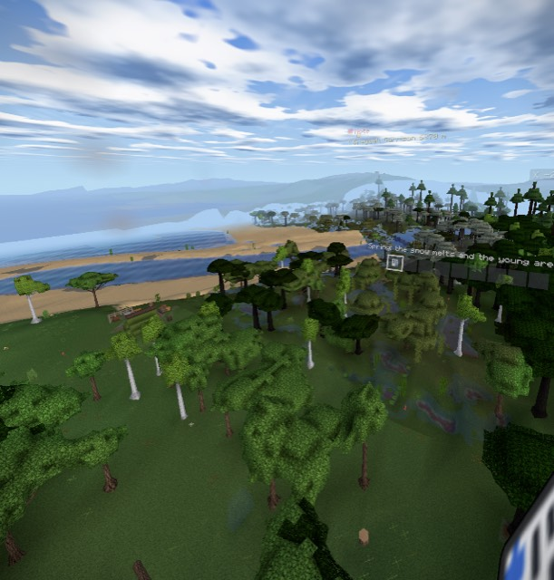

## 16:12:19 - Sure as hell ain't moving fast

- **Transcript:** Sure as hell ain't moving fast
- **Status:** open
- **Build:** 0.129 (b0d800c0, M1-M4 (device-tested; ship riding, chests, comfort options, weapon wheel))
- **World:** New World (14) (seed 8775627479714902329)
- **Dimension:** Surface
- **Biome:** Dark Forest
- **Position:** -4.1 112.4 -196.5
- **Facing:** north (yaw 347, pitch -29)
- **Held:** Greywall Dispatch x1
- **Mount:** on foot, flying
- **Looking at:** nothing
- **Mode:** Creative, health 20/20
- **Time:** day 1 07:35, clear
- **Fps:** 31
- **Levels:** mic -36 dBFS, game sound -25 dBFS
- **Length:** 2.5 s (voice 1.0 s)
- **Just before:** -9s opened PauseMenu; -8s closed PauseMenu; -8s message: Playtest build: voice bug notes ON, your speech is saved (Options > Interface); -6s opened PauseMenu; -4s opened KeyboardMenu; -2s opened PauseMenu; -9s entered Surface; -9s closed PauseMenu; -9s holding Greywall Dispatch; -9s message: In Clear Ford's jail safe: a Greywall Dispatch; -8s message: In Clear Ford's jail safe: a Greywall Dispatch. Added to journal: Who Holds the Frontier; -6s opened PauseMenu; -6s opened AdvancementMenu; -5s closed AdvancementMenu; -5s opened PauseMenu; -5s message: Spring: the snow melts and the young are born; -4s closed PauseMenu; -2s message: Creative mode; -1s left the pack: Field Journal of an Ashguard Rifleman; -1s left the pack: Faustrohr Warhead x3; -1s left the pack: Track Spares x16; -1s left the pack: Falke Pistol x2; -1s left the pack: Faustrohr; -1s left the pack: Titanium Pickaxe; -1s left the pack: Donnerkeil Service Rifle x3; -1s left the pack: Regular Armour Set; -1s left the pack: Duskium Chestplate; -1s left the pack: Jetpack x2; -1s left the pack: Rocket x4; -1s left the pack: Himmelsturm Launcher; -1s left the pack: Mahlwerk Rotary Gun; -1s left the pack: Fernblick Rifle; -1s left the pack: Aero Engine Spares x18; -1s walked into Dark Forest; -1s message: Flying
- **Repro (Mac):** `./snap.sh note --seed 8775627479714902329 --x -4.1 --z -196.5 --yaw 13 --pitch -29 --time 0.066`
- **Audio (this Mac):** /Users/darthvadar/Documents/Blocksmith/QuestVoiceNotes/raw/vn-20261031-161219-011.aac

## 16:12:29 - Things are not very smooth.

- **Transcript:** Things are not very smooth.
- **Status:** open
- **Build:** 0.129 (b0d800c0, M1-M4 (device-tested; ship riding, chests, comfort options, weapon wheel))
- **World:** New World (14) (seed 8775627479714902329)
- **Dimension:** Surface
- **Biome:** Dark Forest
- **Position:** -93.3 68.8 -136.1
- **Facing:** west (yaw 248, pitch -52)
- **Held:** empty hand
- **Mount:** on foot
- **Looking at:** Grass Block at -95 68 -136
- **Mode:** Creative, health 20/20
- **Time:** day 1 07:40, clear
- **Fps:** 32
- **Levels:** mic -27 dBFS, game sound -30 dBFS
- **Length:** 2.7 s (voice 1.1 s)
- **Just before:** -11s opened PauseMenu; -9s opened KeyboardMenu; -7s opened PauseMenu; -14s entered Surface; -14s closed PauseMenu; -14s holding Greywall Dispatch; -14s message: In Clear Ford's jail safe: a Greywall Dispatch; -13s message: In Clear Ford's jail safe: a Greywall Dispatch. Added to journal: Who Holds the Frontier; -11s opened PauseMenu; -11s opened AdvancementMenu; -10s closed AdvancementMenu; -10s opened PauseMenu; -10s message: Spring: the snow melts and the young are born; -9s closed PauseMenu; -7s message: Creative mode; -6s left the pack: Field Journal of an Ashguard Rifleman; -6s left the pack: Faustrohr Warhead x3; -6s left the pack: Track Spares x16; -6s left the pack: Falke Pistol x2; -6s left the pack: Faustrohr; -6s left the pack: Titanium Pickaxe; -6s left the pack: Donnerkeil Service Rifle x3; -6s left the pack: Regular Armour Set; -6s left the pack: Duskium Chestplate; -6s left the pack: Jetpack x2; -6s left the pack: Rocket x4; -6s left the pack: Himmelsturm Launcher; -6s left the pack: Mahlwerk Rotary Gun; -6s left the pack: Fernblick Rifle; -6s left the pack: Aero Engine Spares x18; -6s walked into Dark Forest; -5s message: Flying; -5s opened PauseMenu; -4s closed PauseMenu; -4s message: The sky is clouding over: fog is coming; -4s walked into Swamp; -2s message: Walking; -2s walked into Dark Forest; -1s holding empty hand; -0s message: A stranger in town: Ezra Quill
- **Repro (Mac):** `./snap.sh note --seed 8775627479714902329 --x -93.3 --z -136.1 --yaw 112 --pitch -52 --time 0.070`
- **Audio (this Mac):** /Users/darthvadar/Documents/Blocksmith/QuestVoiceNotes/raw/vn-20261031-161229-771.aac

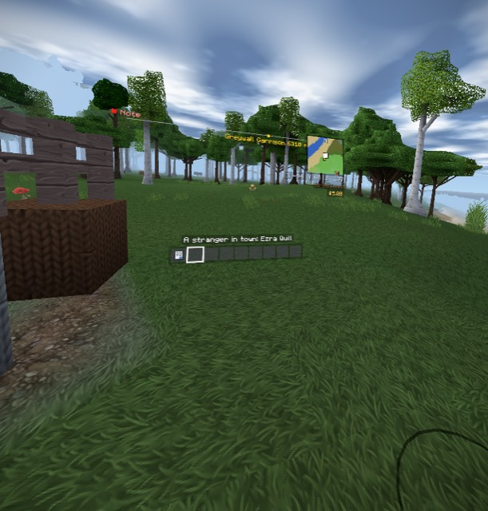

## 16:12:50 - Yeah. So the thing was choking on sixteen. It's at eight now

- **Transcript:** Yeah. So the thing was choking on sixteen. It's at eight now
- **Status:** open
- **Build:** 0.129 (b0d800c0, M1-M4 (device-tested; ship riding, chests, comfort options, weapon wheel))
- **World:** New World (14) (seed 8775627479714902329)
- **Dimension:** Surface
- **Biome:** Taiga
- **Position:** -201.6 142.6 -413.0
- **Facing:** north-west (yaw 335, pitch -23)
- **Held:** empty hand
- **Mount:** on foot, flying
- **Looking at:** nothing
- **Mode:** Creative, health 20/20
- **Time:** day 1 08:01, clear
- **Fps:** 71
- **Levels:** mic -31 dBFS, game sound -19 dBFS
- **Length:** 5.5 s (voice 3.0 s)
- **Just before:** -27s opened PauseMenu; -27s message: Spring: the snow melts and the young are born; -26s closed PauseMenu; -24s message: Creative mode; -23s left the pack: Field Journal of an Ashguard Rifleman; -23s left the pack: Faustrohr Warhead x3; -23s left the pack: Track Spares x16; -23s left the pack: Falke Pistol x2; -23s left the pack: Faustrohr; -23s left the pack: Titanium Pickaxe; -23s left the pack: Donnerkeil Service Rifle x3; -23s left the pack: Regular Armour Set; -23s left the pack: Duskium Chestplate; -23s left the pack: Jetpack x2; -23s left the pack: Rocket x4; -23s left the pack: Himmelsturm Launcher; -23s left the pack: Mahlwerk Rotary Gun; -23s left the pack: Fernblick Rifle; -23s left the pack: Aero Engine Spares x18; -23s walked into Dark Forest; -23s message: Flying; -22s opened PauseMenu; -22s closed PauseMenu; -21s message: The sky is clouding over: fog is coming; -21s walked into Swamp; -19s message: Walking; -19s walked into Dark Forest; -18s holding empty hand; -17s message: A stranger in town: Ezra Quill; -17s walked into Forest; -15s walked into Dark Forest; -14s opened ChestMenu; -14s closed ChestMenu; -13s message: Ezra Quill: Somebody's chickens got loose. The whole street's chasing them.; -5s walked into Beach; -4s message: Flying; -3s walked into Swamp; -2s opened PauseMenu; -1s closed PauseMenu; -1s walked into Old Growth Pine Taiga
- **Repro (Mac):** `./snap.sh note --seed 8775627479714902329 --x -201.6 --z -413.0 --yaw 25 --pitch -23 --time 0.084`
- **Audio (this Mac):** /Users/darthvadar/Documents/Blocksmith/QuestVoiceNotes/raw/vn-20261031-161250-491.aac

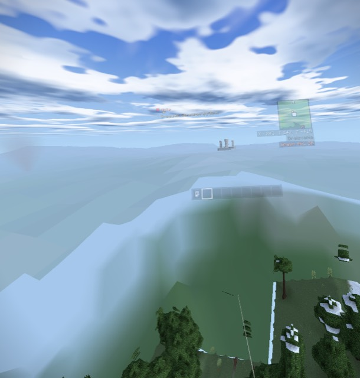

## 16:14:00 - Missiles should do way more damage

- **Transcript:** Missiles should do way more damage
- **Status:** open
- **Build:** 0.129 (b0d800c0, M1-M4 (device-tested; ship riding, chests, comfort options, weapon wheel))
- **World:** New World (14) (seed 8775627479714902329)
- **Dimension:** Surface
- **Biome:** Snowy Plains
- **Position:** -472.6 85.0 -1227.3
- **Facing:** north-west (yaw 324, pitch -5)
- **Held:** Oak Planks x60
- **Mount:** on foot
- **Looking at:** Oak Planks at -475 86 -1231
- **Mode:** Survival, health 19/20
- **Time:** day 1 09:19, clear
- **Fps:** 70
- **Levels:** mic -34 dBFS, game sound -16 dBFS
- **Length:** 2.9 s (voice 1.5 s)
- **Just before:** -28s left the pack: Titanium Chestplate (InventoryMenu open); -28s left the pack: Titanium Helmet (InventoryMenu open); -26s left the pack: Field Stim x16 (InventoryMenu open); -26s closed InventoryMenu; -26s into the pack: Field Stim; -25s holding Field Stim; -25s message: Field Stim; -25s holding empty hand; -25s holding Donnerkeil Service Rifle; -25s message: Donnerkeil Service Rifle; -24s message: Loaded: 45 / 45; -24s left the pack: Capital Magazine x2 (at -481 82 -1154); -22s holding Capital Magazine; -22s holding empty hand; -22s message: Capital citadel (the enemy) marked on the map; -22s holding Capital Magazine; -21s holding Donnerkeil Service Rifle; -20s took 1 damage (health 19/20); -19s message: Intel: this base is a Field Hospital; -18s opened PauseMenu; -17s closed PauseMenu; -17s message: Honour raised (you protected the town); -15s message: A Capital patrol sets out to investigate; -12s message: The garrison opens fire!; -10s took 1 damage (health 20/20); -10s message: Luther Tillman: I'm thinking about growing tomatoes. Big ones.; -9s took 1 damage (health 19/20); -7s message: Missile launch: take cover!; -7s holding Capital Rounds; -5s holding Donnerkeil Service Rifle; -4s holding Capital Rounds; -4s holding Field Stim; -4s message: The citadel is on lockdown!; -4s holding Oak Planks; -2s message: Honour raised (you protected the town); -2s holding Field Stim; -1s left the pack: Field Stim (at -475 85 -1228); -1s took 1 damage (health 19/20); -1s holding Oak Planks; -0s into the pack: Field Stim
- **Repro (Mac):** `./snap.sh note --seed 8775627479714902329 --x -472.6 --z -1227.3 --yaw 36 --pitch -5 --time 0.139`
- **Audio (this Mac):** /Users/darthvadar/Documents/Blocksmith/QuestVoiceNotes/raw/vn-20261031-161400-711.aac

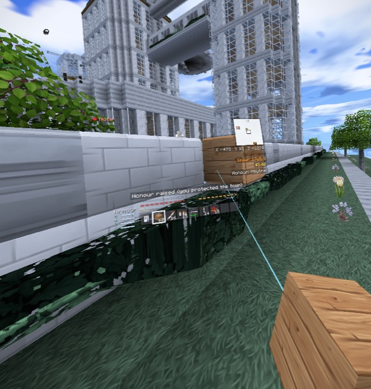

## 16:14:11 - Okay, this gun should be a room that I can go into

- **Transcript:** Okay, this gun should be a room that I can go into
- **Status:** open
- **Build:** 0.129 (b0d800c0, M1-M4 (device-tested; ship riding, chests, comfort options, weapon wheel))
- **World:** New World (14) (seed 8775627479714902329)
- **Dimension:** Surface
- **Biome:** Snowy Plains
- **Position:** -498.0 88.6 -1224.8
- **Facing:** south-east (yaw 113, pitch -14)
- **Held:** Donnerkeil Service Rifle x1
- **Mount:** on foot
- **Looking at:** Capital Grey Stone at -495 89 -1224
- **Mode:** Survival, health 19/20
- **Time:** day 1 09:32, clear
- **Fps:** 71
- **Levels:** mic -21 dBFS, game sound -20 dBFS
- **Length:** 4.0 s (voice 2.6 s)
- **Just before:** -30s message: Intel: this base is a Field Hospital; -28s opened PauseMenu; -28s closed PauseMenu; -28s message: Honour raised (you protected the town); -25s message: A Capital patrol sets out to investigate; -23s message: The garrison opens fire!; -21s took 1 damage (health 20/20); -21s message: Luther Tillman: I'm thinking about growing tomatoes. Big ones.; -20s took 1 damage (health 19/20); -18s message: Missile launch: take cover!; -18s holding Capital Rounds; -16s holding Donnerkeil Service Rifle; -15s holding Capital Rounds; -15s holding Field Stim; -15s message: The citadel is on lockdown!; -15s holding Oak Planks; -13s message: Honour raised (you protected the town); -12s holding Field Stim; -12s left the pack: Field Stim (at -475 85 -1228); -12s took 1 damage (health 19/20); -11s holding Oak Planks; -11s into the pack: Field Stim; -9s holding Field Stim; -9s message: Field Stim; -9s holding Capital Rounds; -9s message: Capital Rounds; -8s holding Donnerkeil Service Rifle; -8s message: Donnerkeil Service Rifle; -8s message: Missile launch: take cover!; -5s message: Honour raised (you protected the town); -3s took 1 damage (health 19/20)
- **Repro (Mac):** `./snap.sh note --seed 8775627479714902329 --x -498.0 --z -1224.8 --yaw -113 --pitch -14 --time 0.147`
- **Audio (this Mac):** /Users/darthvadar/Documents/Blocksmith/QuestVoiceNotes/raw/vn-20261031-161411-531.aac

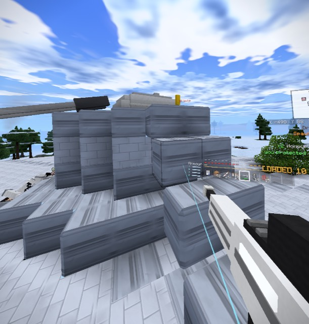

## 16:14:15 - Otherwise, how the gun, how's the gun even working?

- **Transcript:** Otherwise, how the gun, how's the gun even working?
- **Status:** open
- **Build:** 0.129 (b0d800c0, M1-M4 (device-tested; ship riding, chests, comfort options, weapon wheel))
- **World:** New World (14) (seed 8775627479714902329)
- **Dimension:** Surface
- **Biome:** Snowy Plains
- **Position:** -487.7 87.0 -1218.0
- **Facing:** north-west (yaw 327, pitch 6)
- **Held:** Donnerkeil Service Rifle x1
- **Mount:** on foot
- **Looking at:** Capital Grey Stone at -489 88 -1221
- **Mode:** Survival, health 14/20
- **Time:** day 1 09:37, clear
- **Fps:** 71
- **Levels:** mic -25 dBFS, game sound -17 dBFS
- **Length:** 3.4 s (voice 1.9 s)
- **Just before:** -29s message: A Capital patrol sets out to investigate; -27s message: The garrison opens fire!; -25s took 1 damage (health 20/20); -25s message: Luther Tillman: I'm thinking about growing tomatoes. Big ones.; -24s took 1 damage (health 19/20); -22s message: Missile launch: take cover!; -22s holding Capital Rounds; -20s holding Donnerkeil Service Rifle; -19s holding Capital Rounds; -19s holding Field Stim; -19s message: The citadel is on lockdown!; -19s holding Oak Planks; -17s message: Honour raised (you protected the town); -16s holding Field Stim; -16s left the pack: Field Stim (at -475 85 -1228); -16s took 1 damage (health 19/20); -16s holding Oak Planks; -15s into the pack: Field Stim; -13s holding Field Stim; -13s message: Field Stim; -13s holding Capital Rounds; -13s message: Capital Rounds; -12s holding Donnerkeil Service Rifle; -12s message: Donnerkeil Service Rifle; -12s message: Missile launch: take cover!; -9s message: Honour raised (you protected the town); -7s took 1 damage (health 19/20); -4s message: Missile launch: take cover!; -1s message: Loaded: 45 / 45; -1s left the pack: Capital Magazine (at -486 87 -1222); -1s took 6 damage (health 14/20)
- **Repro (Mac):** `./snap.sh note --seed 8775627479714902329 --x -487.7 --z -1218.0 --yaw 33 --pitch 6 --time 0.151`
- **Audio (this Mac):** /Users/darthvadar/Documents/Blocksmith/QuestVoiceNotes/raw/vn-20261031-161415-751.aac

## 16:14:37 - Okay, how does this thing work? Ugh

- **Transcript:** Okay, how does this thing work? Ugh
- **Status:** open
- **Build:** 0.129 (b0d800c0, M1-M4 (device-tested; ship riding, chests, comfort options, weapon wheel))
- **World:** New World (14) (seed 8775627479714902329)
- **Dimension:** Surface
- **Biome:** Snowy Plains
- **Position:** -492.0 80.8 -1179.8
- **Facing:** north-west (yaw 296, pitch -41)
- **Held:** Field Stim x16
- **Mount:** on foot
- **Looking at:** Snow at -497 81 -1184
- **Mode:** Survival, health 5/20
- **Time:** day 1 09:59, clear
- **Fps:** 67
- **Levels:** mic -47 dBFS, game sound -16 dBFS
- **Length:** 4.2 s (voice 1.8 s)
- **Just before:** -30s message: Honour raised (you protected the town); -28s took 1 damage (health 19/20); -24s message: Missile launch: take cover!; -22s message: Loaded: 45 / 45; -22s left the pack: Capital Magazine (at -486 87 -1222); -22s took 6 damage (health 14/20); -20s took 1 damage (health 13/20); -17s holding empty hand; -17s message: Manning the deck gun; -15s message: Missile launch: take cover!; -14s holding Donnerkeil Service Rifle; -13s message: Honour raised (you protected the town); -13s took 7 damage (health 7/20); -12s took 2 damage (health 5/20); -11s holding Capital Rounds; -11s holding Field Stim; -11s message: The turret is wrecked; -11s left the pack: Field Stim (at -488 86 -1248); -10s holding Oak Planks; -10s holding Field Stim; -9s into the pack: Field Stim; -8s message: Missile launch: take cover!; -7s took 1 damage (health 5/20); -7s opened PauseMenu; -6s message: Creative mode; -6s closed PauseMenu; -5s message: Flying; -3s message: Walking; -2s opened PauseMenu; -1s message: Survival mode; -1s closed PauseMenu
- **Repro (Mac):** `./snap.sh note --seed 8775627479714902329 --x -492.0 --z -1179.8 --yaw 64 --pitch -41 --time 0.166`
- **Audio (this Mac):** /Users/darthvadar/Documents/Blocksmith/QuestVoiceNotes/raw/vn-20261031-161437-251.aac

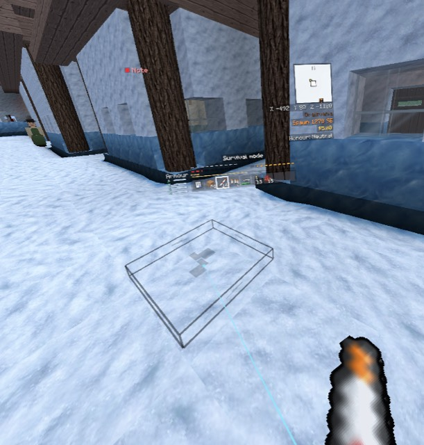

## 16:14:41 - Like, this doesn't do anything

- **Transcript:** Like, this doesn't do anything
- **Status:** open
- **Build:** 0.129 (b0d800c0, M1-M4 (device-tested; ship riding, chests, comfort options, weapon wheel))
- **World:** New World (14) (seed 8775627479714902329)
- **Dimension:** Surface
- **Biome:** Snowy Plains
- **Position:** -492.1 80.8 -1179.8
- **Facing:** north-west (yaw 301, pitch 46)
- **Held:** Field Stim x16
- **Mount:** on foot
- **Looking at:** nothing
- **Mode:** Survival, health 5/20
- **Time:** day 1 10:04, clear
- **Fps:** 69
- **Levels:** mic -25 dBFS, game sound -15 dBFS
- **Length:** 4.0 s (voice 1.6 s)
- **Just before:** -29s message: Missile launch: take cover!; -27s message: Loaded: 45 / 45; -26s left the pack: Capital Magazine (at -486 87 -1222); -26s took 6 damage (health 14/20); -24s took 1 damage (health 13/20); -22s holding empty hand; -22s message: Manning the deck gun; -20s message: Missile launch: take cover!; -18s holding Donnerkeil Service Rifle; -18s message: Honour raised (you protected the town); -17s took 7 damage (health 7/20); -16s took 2 damage (health 5/20); -16s holding Capital Rounds; -16s holding Field Stim; -16s message: The turret is wrecked; -15s left the pack: Field Stim (at -488 86 -1248); -15s holding Oak Planks; -15s holding Field Stim; -14s into the pack: Field Stim; -13s message: Missile launch: take cover!; -12s took 1 damage (health 5/20); -12s opened PauseMenu; -11s message: Creative mode; -11s closed PauseMenu; -9s message: Flying; -8s message: Walking; -7s opened PauseMenu; -6s message: Survival mode; -5s closed PauseMenu; -2s message: Missile launch: take cover!; -2s holding Oak Planks; -1s holding Field Stim
- **Repro (Mac):** `./snap.sh note --seed 8775627479714902329 --x -492.1 --z -1179.8 --yaw 59 --pitch 46 --time 0.170`
- **Audio (this Mac):** /Users/darthvadar/Documents/Blocksmith/QuestVoiceNotes/raw/vn-20261031-161441-931.aac

## 16:14:46 - The field stamp, it doesn't work

- **Transcript:** The field stamp, it doesn't work
- **Status:** open
- **Build:** 0.129 (b0d800c0, M1-M4 (device-tested; ship riding, chests, comfort options, weapon wheel))
- **World:** New World (14) (seed 8775627479714902329)
- **Dimension:** Surface
- **Biome:** Snowy Plains
- **Position:** -491.9 80.8 -1180.1
- **Facing:** north-west (yaw 314, pitch -20)
- **Held:** Field Stim x16
- **Mount:** on foot
- **Looking at:** Snow at -496 81 -1184
- **Mode:** Survival, health 5/20
- **Time:** day 1 10:10, clear
- **Fps:** 71
- **Levels:** mic -22 dBFS, game sound -22 dBFS
- **Length:** 3.6 s (voice 1.2 s)
- **Just before:** -29s took 1 damage (health 13/20); -26s holding empty hand; -26s message: Manning the deck gun; -24s message: Missile launch: take cover!; -23s holding Donnerkeil Service Rifle; -22s message: Honour raised (you protected the town); -22s took 7 damage (health 7/20); -21s took 2 damage (health 5/20); -20s holding Capital Rounds; -20s holding Field Stim; -20s message: The turret is wrecked; -19s left the pack: Field Stim (at -488 86 -1248); -19s holding Oak Planks; -19s holding Field Stim; -18s into the pack: Field Stim; -17s message: Missile launch: take cover!; -16s took 1 damage (health 5/20); -16s opened PauseMenu; -15s message: Creative mode; -15s closed PauseMenu; -14s message: Flying; -12s message: Walking; -11s opened PauseMenu; -10s message: Survival mode; -10s closed PauseMenu; -7s message: Missile launch: take cover!; -6s holding Oak Planks; -6s holding Field Stim; -1s holding Capital Rounds; -1s message: Capital Rounds; -1s holding Field Stim; -1s message: Field Stim
- **Repro (Mac):** `./snap.sh note --seed 8775627479714902329 --x -491.9 --z -1180.1 --yaw 46 --pitch -20 --time 0.174`
- **Audio (this Mac):** /Users/darthvadar/Documents/Blocksmith/QuestVoiceNotes/raw/vn-20261031-161446-411.aac

## 16:14:55 - Golden apples are still in game

- **Transcript:** Golden apples are still in game
- **Status:** open
- **Build:** 0.129 (b0d800c0, M1-M4 (device-tested; ship riding, chests, comfort options, weapon wheel))
- **World:** New World (14) (seed 8775627479714902329)
- **Dimension:** Surface
- **Biome:** Snowy Plains
- **Position:** -493.6 80.8 -1179.3
- **Facing:** west (yaw 290, pitch 12)
- **Held:** Golden Apple x64
- **Mount:** on foot
- **Looking at:** nothing
- **Mode:** Creative, health 5/20
- **Time:** day 1 10:19, clear
- **Fps:** 71
- **Levels:** mic -25 dBFS, game sound -21 dBFS
- **Length:** 2.7 s (voice 1.2 s)
- **Just before:** -30s took 2 damage (health 5/20); -29s holding Capital Rounds; -29s holding Field Stim; -29s message: The turret is wrecked; -28s left the pack: Field Stim (at -488 86 -1248); -28s holding Oak Planks; -28s holding Field Stim; -27s into the pack: Field Stim; -26s message: Missile launch: take cover!; -25s took 1 damage (health 5/20); -25s opened PauseMenu; -24s message: Creative mode; -24s closed PauseMenu; -23s message: Flying; -21s message: Walking; -20s opened PauseMenu; -19s message: Survival mode; -19s closed PauseMenu; -16s message: Missile launch: take cover!; -15s holding Oak Planks; -15s holding Field Stim; -10s holding Capital Rounds; -10s message: Capital Rounds; -10s holding Field Stim; -10s message: Field Stim; -7s message: Ida Stroud: Somebody's chickens got loose. The whole street's chasing them.; -6s opened PauseMenu; -4s closed PauseMenu; -4s message: Missile launch: take cover!; -4s opened CreativeMenu; -2s message: Creative mode; -1s holding Golden Apple; -1s left the pack: Field Stim x16 (CreativeMenu open); -1s closed CreativeMenu; -0s into the pack: Field Stim
- **Repro (Mac):** `./snap.sh note --seed 8775627479714902329 --x -493.6 --z -1179.3 --yaw 70 --pitch 12 --time 0.180`
- **Audio (this Mac):** /Users/darthvadar/Documents/Blocksmith/QuestVoiceNotes/raw/vn-20261031-161455-531.aac

## 16:15:06 - Also, this chick literally just said the same line that another person

- **Transcript:** Also, this chick literally just said the same line that another person said
- **Status:** open
- **Build:** 0.129 (b0d800c0, M1-M4 (device-tested; ship riding, chests, comfort options, weapon wheel))
- **World:** New World (14) (seed 8775627479714902329)
- **Dimension:** Surface
- **Biome:** Snowy Plains
- **Position:** -494.6 80.9 -1176.1
- **Facing:** north-west (yaw 314, pitch -6)
- **Held:** Golden Apple x63
- **Mount:** on foot
- **Looking at:** nothing
- **Mode:** Survival, health 11/20
- **Time:** day 1 10:28, clear
- **Fps:** 67
- **Levels:** mic -20 dBFS, game sound -23 dBFS
- **Length:** 6.1 s (voice 3.7 s)
- **Just before:** -30s opened PauseMenu; -29s message: Survival mode; -29s closed PauseMenu; -25s message: Missile launch: take cover!; -25s holding Oak Planks; -24s holding Field Stim; -20s holding Capital Rounds; -20s message: Capital Rounds; -20s holding Field Stim; -20s message: Field Stim; -17s message: Ida Stroud: Somebody's chickens got loose. The whole street's chasing them.; -15s opened PauseMenu; -14s closed PauseMenu; -14s message: Missile launch: take cover!; -14s opened CreativeMenu; -12s message: Creative mode; -11s holding Golden Apple; -11s left the pack: Field Stim x16 (CreativeMenu open); -11s closed CreativeMenu; -10s into the pack: Field Stim; -7s holding Capital Rounds; -7s message: Capital Rounds; -6s opened PauseMenu; -5s message: Survival mode; -5s closed PauseMenu; -4s holding Golden Apple
- **While talking:** -2s message: Ida Stroud: Saw a man ride through with a rifle as long as he was tall.
- **Position at the end:** -494.4 80.8 -1179.2
- **Repro (Mac):** `./snap.sh note --seed 8775627479714902329 --x -494.6 --z -1176.1 --yaw 46 --pitch -6 --time 0.187`
- **Audio (this Mac):** /Users/darthvadar/Documents/Blocksmith/QuestVoiceNotes/raw/vn-20261031-161506-171.aac

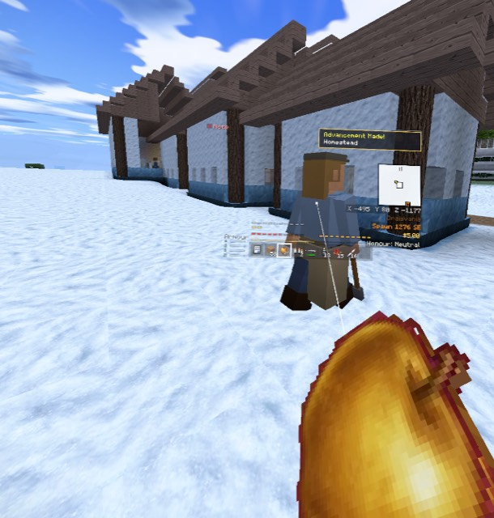

## 16:15:12 - So I don't think it's random

- **Transcript:** So I don't think it's random
- **Status:** open
- **Build:** 0.129 (b0d800c0, M1-M4 (device-tested; ship riding, chests, comfort options, weapon wheel))
- **World:** New World (14) (seed 8775627479714902329)
- **Dimension:** Surface
- **Biome:** Snowy Plains
- **Position:** -494.5 80.8 -1180.4
- **Facing:** north-west (yaw 317, pitch -8)
- **Held:** Golden Apple x63
- **Mount:** on foot
- **Looking at:** Packed Ice at -498 81 -1184
- **Mode:** Survival, health 18/20
- **Time:** day 1 10:35, clear
- **Fps:** 69
- **Levels:** mic -25 dBFS, game sound -19 dBFS
- **Length:** 2.7 s (voice 1.2 s)
- **Just before:** -26s holding Capital Rounds; -26s message: Capital Rounds; -26s holding Field Stim; -26s message: Field Stim; -23s message: Ida Stroud: Somebody's chickens got loose. The whole street's chasing them.; -21s opened PauseMenu; -20s closed PauseMenu; -20s message: Missile launch: take cover!; -20s opened CreativeMenu; -18s message: Creative mode; -17s holding Golden Apple; -16s left the pack: Field Stim x16 (CreativeMenu open); -16s closed CreativeMenu; -16s into the pack: Field Stim; -13s holding Capital Rounds; -13s message: Capital Rounds; -12s opened PauseMenu; -11s message: Survival mode; -11s closed PauseMenu; -10s holding Golden Apple; -3s message: Ida Stroud: Saw a man ride through with a rifle as long as he was tall.
- **Repro (Mac):** `./snap.sh note --seed 8775627479714902329 --x -494.5 --z -1180.4 --yaw 43 --pitch -8 --time 0.192`
- **Audio (this Mac):** /Users/darthvadar/Documents/Blocksmith/QuestVoiceNotes/raw/vn-20261031-161512-331.aac

## 16:15:14 - Statistically, that wouldn't happen

- **Transcript:** Statistically, that wouldn't happen
- **Status:** open
- **Build:** 0.129 (b0d800c0, M1-M4 (device-tested; ship riding, chests, comfort options, weapon wheel))
- **World:** New World (14) (seed 8775627479714902329)
- **Dimension:** Surface
- **Biome:** Snowy Plains
- **Position:** -493.7 80.8 -1180.2
- **Facing:** north-west (yaw 320, pitch -42)
- **Held:** Golden Apple x63
- **Mount:** on foot
- **Looking at:** Snow at -495 81 -1182
- **Mode:** Survival, health 19/20
- **Time:** day 1 10:38, clear
- **Fps:** 69
- **Levels:** mic -37 dBFS, game sound -19 dBFS
- **Length:** 3.2 s (voice 1.8 s)
- **Just before:** -28s holding Capital Rounds; -28s message: Capital Rounds; -28s holding Field Stim; -28s message: Field Stim; -25s message: Ida Stroud: Somebody's chickens got loose. The whole street's chasing them.; -24s opened PauseMenu; -22s closed PauseMenu; -22s message: Missile launch: take cover!; -22s opened CreativeMenu; -20s message: Creative mode; -19s holding Golden Apple; -19s left the pack: Field Stim x16 (CreativeMenu open); -19s closed CreativeMenu; -18s into the pack: Field Stim; -15s holding Capital Rounds; -15s message: Capital Rounds; -15s opened PauseMenu; -13s message: Survival mode; -13s closed PauseMenu; -12s holding Golden Apple; -5s message: Ida Stroud: Saw a man ride through with a rifle as long as he was tall.
- **Repro (Mac):** `./snap.sh note --seed 8775627479714902329 --x -493.7 --z -1180.2 --yaw 40 --pitch -42 --time 0.194`
- **Audio (this Mac):** /Users/darthvadar/Documents/Blocksmith/QuestVoiceNotes/raw/vn-20261031-161514-771.aac

## 16:15:23 - Yeah, soldiers need to shoot more, and the reaction time needs to be q

- **Transcript:** Yeah, soldiers need to shoot more, and the reaction time needs to be quicker
- **Status:** open
- **Build:** 0.129 (b0d800c0, M1-M4 (device-tested; ship riding, chests, comfort options, weapon wheel))
- **World:** New World (14) (seed 8775627479714902329)
- **Dimension:** Surface
- **Biome:** Snowy Plains
- **Position:** -481.0 83.9 -1212.7
- **Facing:** north (yaw 9, pitch -27)
- **Held:** Donnerkeil Service Rifle x1
- **Mount:** on foot
- **Looking at:** Capital Grey Stone at -481 84 -1215
- **Mode:** Survival, health 20/20
- **Time:** day 1 10:46, clear
- **Fps:** 57
- **Levels:** mic -26 dBFS, game sound -23 dBFS
- **Length:** 5.8 s (voice 3.3 s)
- **Just before:** -29s closed PauseMenu; -29s message: Missile launch: take cover!; -29s opened CreativeMenu; -27s message: Creative mode; -26s holding Golden Apple; -25s left the pack: Field Stim x16 (CreativeMenu open); -25s closed CreativeMenu; -25s into the pack: Field Stim; -22s holding Capital Rounds; -22s message: Capital Rounds; -21s opened PauseMenu; -20s message: Survival mode; -20s closed PauseMenu; -19s holding Golden Apple; -12s message: Ida Stroud: Saw a man ride through with a rifle as long as he was tall.; -6s holding Capital Rounds; -6s message: Capital Rounds; -6s holding Donnerkeil Service Rifle; -6s message: Donnerkeil Service Rifle; -4s message: Rufus Gartside: Raiders! Hide, everyone!; -2s message: Honour raised (you protected the town)
- **While talking:** -4s holding Capital Rounds; -3s holding Golden Apple; -3s holding Oak Planks; -1s holding Golden Apple; -1s message: Golden Apple; -0s holding Capital Rounds; -0s message: Capital Rounds
- **Position at the end:** -478.4 85.0 -1215.1
- **Repro (Mac):** `./snap.sh note --seed 8775627479714902329 --x -481.0 --z -1212.7 --yaw -9 --pitch -27 --time 0.199`
- **Audio (this Mac):** /Users/darthvadar/Documents/Blocksmith/QuestVoiceNotes/raw/vn-20261031-161523-031.aac

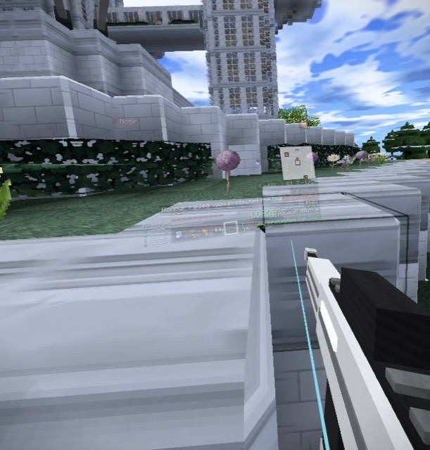

## 16:16:24 - This is way too fucking easy

- **Transcript:** This is way too fucking easy
- **Status:** open
- **Build:** 0.129 (b0d800c0, M1-M4 (device-tested; ship riding, chests, comfort options, weapon wheel))
- **World:** New World (14) (seed 8775627479714902329)
- **Dimension:** Surface
- **Biome:** Snowy Plains
- **Position:** -527.9 87.0 -1243.6
- **Facing:** east (yaw 109, pitch 6)
- **Held:** Donnerkeil Service Rifle x1
- **Mount:** on foot
- **Looking at:** nothing
- **Mode:** Survival, health 20/20
- **Time:** day 1 11:37, clear
- **Fps:** 47
- **Levels:** mic -32 dBFS, game sound -20 dBFS
- **Length:** 2.7 s (voice 1.1 s)
- **Just before:** -24s message: Loaded: 45 / 45; -19s into the pack: Regular Armour Set; -15s opened ChestMenu; -13s closed ChestMenu; -12s opened ChestMenu; -11s closed ChestMenu; -10s opened ChestMenu; -9s closed ChestMenu; -8s took 1 damage (health 19/20); -5s into the pack: Donnerkeil Service Rifle; -1s into the pack: Regular Armour Set
- **Repro (Mac):** `./snap.sh note --seed 8775627479714902329 --x -527.9 --z -1243.6 --yaw -109 --pitch 6 --time 0.234`
- **Audio (this Mac):** /Users/darthvadar/Documents/Blocksmith/QuestVoiceNotes/raw/vn-20261031-161624-831.aac

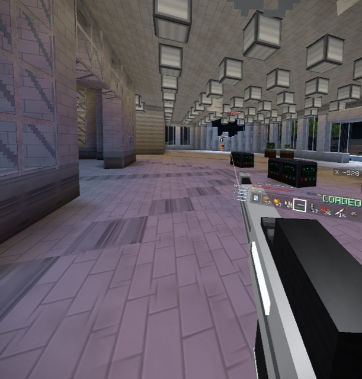

## 16:16:28 - Like, holy cow

- **Transcript:** Like, holy cow
- **Status:** open
- **Build:** 0.129 (b0d800c0, M1-M4 (device-tested; ship riding, chests, comfort options, weapon wheel))
- **World:** New World (14) (seed 8775627479714902329)
- **Dimension:** Surface
- **Biome:** Snowy Plains
- **Position:** -511.2 87.0 -1238.4
- **Facing:** east (yaw 89, pitch 2)
- **Held:** Donnerkeil Service Rifle x1
- **Mount:** on foot
- **Looking at:** nothing
- **Mode:** Survival, health 20/20
- **Time:** day 1 11:40, clear
- **Fps:** 43
- **Levels:** mic -45 dBFS, game sound -10 dBFS
- **Length:** 2.4 s (voice 0.6 s)
- **Just before:** -26s message: Loaded: 45 / 45; -21s into the pack: Regular Armour Set; -17s opened ChestMenu; -15s closed ChestMenu; -14s opened ChestMenu; -13s closed ChestMenu; -12s opened ChestMenu; -11s closed ChestMenu; -10s took 1 damage (health 19/20); -7s into the pack: Donnerkeil Service Rifle; -3s into the pack: Regular Armour Set
- **Repro (Mac):** `./snap.sh note --seed 8775627479714902329 --x -511.2 --z -1238.4 --yaw -89 --pitch 2 --time 0.236`
- **Audio (this Mac):** /Users/darthvadar/Documents/Blocksmith/QuestVoiceNotes/raw/vn-20261031-161628-231.aac

## 16:16:34 - The AI for this guy and his jetpack needs to be improved

- **Transcript:** The AI for this guy and his jetpack needs to be improved
- **Status:** open
- **Build:** 0.129 (b0d800c0, M1-M4 (device-tested; ship riding, chests, comfort options, weapon wheel))
- **World:** New World (14) (seed 8775627479714902329)
- **Dimension:** Surface
- **Biome:** Snowy Plains
- **Position:** -504.1 87.0 -1233.3
- **Facing:** east (yaw 95, pitch 2)
- **Held:** Donnerkeil Service Rifle x1
- **Mount:** on foot
- **Looking at:** Capital Stone at -498 88 -1233
- **Mode:** Survival, health 20/20
- **Time:** day 1 11:44, clear
- **Fps:** 46
- **Levels:** mic -23 dBFS, game sound -19 dBFS
- **Length:** 3.9 s (voice 2.2 s)
- **Just before:** -30s message: Loaded: 45 / 45; -24s into the pack: Regular Armour Set; -21s opened ChestMenu; -19s closed ChestMenu; -18s opened ChestMenu; -17s closed ChestMenu; -16s opened ChestMenu; -14s closed ChestMenu; -14s took 1 damage (health 19/20); -11s into the pack: Donnerkeil Service Rifle; -6s into the pack: Regular Armour Set
- **Repro (Mac):** `./snap.sh note --seed 8775627479714902329 --x -504.1 --z -1233.3 --yaw -95 --pitch 2 --time 0.239`
- **Audio (this Mac):** /Users/darthvadar/Documents/Blocksmith/QuestVoiceNotes/raw/vn-20261031-161634-031.aac

## 16:16:38 - Or God doesn't know what the fuck he's doing

- **Transcript:** Or God doesn't know what the fuck he's doing
- **Status:** open
- **Build:** 0.129 (b0d800c0, M1-M4 (device-tested; ship riding, chests, comfort options, weapon wheel))
- **World:** New World (14) (seed 8775627479714902329)
- **Dimension:** Surface
- **Biome:** Snowy Plains
- **Position:** -505.2 87.0 -1232.7
- **Facing:** south (yaw 165, pitch -15)
- **Held:** Donnerkeil Service Rifle x1
- **Mount:** on foot
- **Looking at:** Capital Stone at -503 87 -1228
- **Mode:** Survival, health 20/20
- **Time:** day 1 11:47, clear
- **Fps:** 46
- **Levels:** mic -44 dBFS, game sound -18 dBFS
- **Length:** 2.9 s (voice 1.2 s)
- **Just before:** -27s into the pack: Regular Armour Set; -23s opened ChestMenu; -22s closed ChestMenu; -21s opened ChestMenu; -19s closed ChestMenu; -19s opened ChestMenu; -17s closed ChestMenu; -16s took 1 damage (health 19/20); -14s into the pack: Donnerkeil Service Rifle; -9s into the pack: Regular Armour Set
- **Repro (Mac):** `./snap.sh note --seed 8775627479714902329 --x -505.2 --z -1232.7 --yaw -165 --pitch -15 --time 0.242`
- **Audio (this Mac):** /Users/darthvadar/Documents/Blocksmith/QuestVoiceNotes/raw/vn-20261031-161638-271.aac

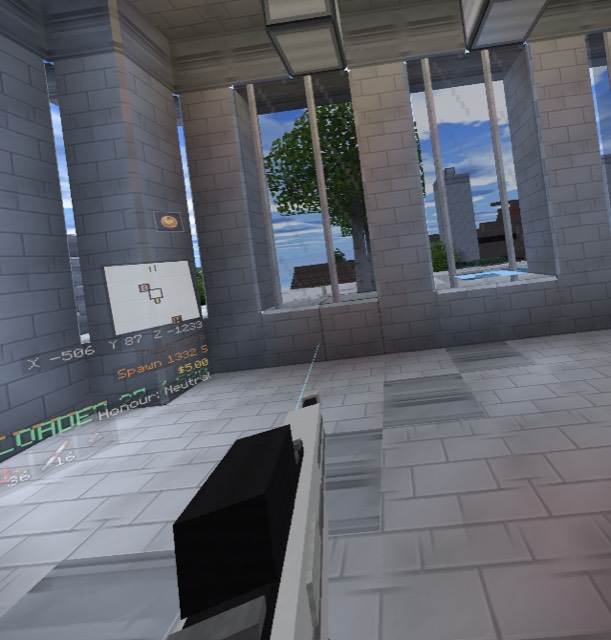

## 16:16:47 - Also, the little buzzer gun used to be able to do a lot more damage. I

- **Transcript:** Also, the little buzzer gun used to be able to do a lot more damage. I'm thinking four hearts
- **Status:** open
- **Build:** 0.129 (b0d800c0, M1-M4 (device-tested; ship riding, chests, comfort options, weapon wheel))
- **World:** New World (14) (seed 8775627479714902329)
- **Dimension:** Surface
- **Biome:** Snowy Plains
- **Position:** -539.3 87.0 -1220.2
- **Facing:** south-west (yaw 238, pitch 1)
- **Held:** Donnerkeil Service Rifle x1
- **Mount:** on foot
- **Looking at:** nothing
- **Mode:** Survival, health 18/20
- **Time:** day 1 11:54, clear
- **Fps:** 47
- **Levels:** mic -22 dBFS, game sound -11 dBFS
- **Length:** 6.6 s (voice 4.1 s)
- **Just before:** -29s opened ChestMenu; -28s closed ChestMenu; -27s opened ChestMenu; -25s closed ChestMenu; -25s opened ChestMenu; -23s closed ChestMenu; -22s took 1 damage (health 19/20); -20s into the pack: Donnerkeil Service Rifle; -15s into the pack: Regular Armour Set
- **While talking:** -3s took 2 damage (health 18/20)
- **Position at the end:** -544.3 87.0 -1227.5
- **Repro (Mac):** `./snap.sh note --seed 8775627479714902329 --x -539.3 --z -1220.2 --yaw 122 --pitch 1 --time 0.246`
- **Audio (this Mac):** /Users/darthvadar/Documents/Blocksmith/QuestVoiceNotes/raw/vn-20261031-161647-191.aac

## 16:17:00 - Oh, I'm on easy difficulty. That makes sense. All right, that's better

- **Transcript:** Oh, I'm on easy difficulty. That makes sense. All right, that's better. All good now. Never mind. Thought I was on normal
- **Status:** open
- **Build:** 0.129 (b0d800c0, M1-M4 (device-tested; ship riding, chests, comfort options, weapon wheel))
- **World:** New World (14) (seed 8775627479714902329)
- **Dimension:** Surface
- **Biome:** Snowy Plains
- **Position:** -548.9 87.0 -1254.9
- **Facing:** north-west (yaw 312, pitch -13)
- **Held:** Donnerkeil Service Rifle x1
- **Mount:** on foot
- **Looking at:** nothing
- **Mode:** Survival, health 16/20
- **Time:** day 1 12:06, clear
- **Fps:** 54
- **Levels:** mic -19 dBFS, game sound -19 dBFS
- **Length:** 8.5 s (voice 4.6 s)
- **Just before:** -29s into the pack: Donnerkeil Service Rifle; -25s into the pack: Regular Armour Set; -10s took 2 damage (health 18/20); -5s took 2 damage (health 16/20); -1s opened PauseMenu; -0s closed PauseMenu
- **While talking:** -5s opened PauseMenu; -4s closed PauseMenu; -3s opened PauseMenu; -2s closed PauseMenu
- **Position at the end:** -547.3 87.0 -1255.2
- **Repro (Mac):** `./snap.sh note --seed 8775627479714902329 --x -548.9 --z -1254.9 --yaw 48 --pitch -13 --time 0.254`
- **Audio (this Mac):** /Users/darthvadar/Documents/Blocksmith/QuestVoiceNotes/raw/vn-20261031-161700-911.aac

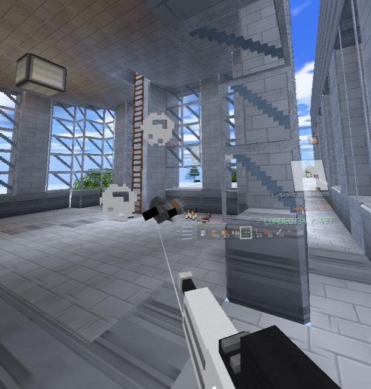

## 16:17:10 - Oh yeah, this is better. Way better. Okay, forget what I said

- **Transcript:** Oh yeah, this is better. Way better. Okay, forget what I said
- **Status:** open
- **Build:** 0.129 (b0d800c0, M1-M4 (device-tested; ship riding, chests, comfort options, weapon wheel))
- **World:** New World (14) (seed 8775627479714902329)
- **Dimension:** Surface
- **Biome:** Snowy Plains
- **Position:** -545.1 87.0 -1267.0
- **Facing:** north-east (yaw 66, pitch 10)
- **Held:** Donnerkeil Service Rifle x1
- **Mount:** on foot
- **Looking at:** White Wool at -544 89 -1268
- **Mode:** Survival, health 11/20
- **Time:** day 1 12:15, clear
- **Fps:** 68
- **Levels:** mic -26 dBFS, game sound -17 dBFS
- **Length:** 5.0 s (voice 2.5 s)
- **Just before:** -18s took 2 damage (health 18/20); -14s took 2 damage (health 16/20); -9s opened PauseMenu; -9s closed PauseMenu; -7s opened PauseMenu; -6s closed PauseMenu
- **Repro (Mac):** `./snap.sh note --seed 8775627479714902329 --x -545.1 --z -1267.0 --yaw -66 --pitch 10 --time 0.260`
- **Audio (this Mac):** /Users/darthvadar/Documents/Blocksmith/QuestVoiceNotes/raw/vn-20261031-161710-851.aac

## 16:17:55 - Yeah, their reaction time to hit me is way too long

- **Transcript:** Yeah, their reaction time to hit me is way too long
- **Status:** open
- **Build:** 0.129 (b0d800c0, M1-M4 (device-tested; ship riding, chests, comfort options, weapon wheel))
- **World:** New World (14) (seed 8775627479714902329)
- **Dimension:** Surface
- **Biome:** Snowy Plains
- **Position:** -533.3 112.0 -1255.8
- **Facing:** east (yaw 78, pitch -8)
- **Held:** Donnerkeil Service Rifle x1
- **Mount:** on foot
- **Looking at:** nothing
- **Mode:** Survival, health 20/20
- **Time:** day 1 13:03, clear
- **Fps:** 58
- **Levels:** mic -23 dBFS, game sound -19 dBFS
- **Length:** 3.7 s (voice 2.2 s)
- **Just before:** -21s message: Twin 42 cm Turret tracking you; -13s message: Loaded: 45 / 45; -5s message: Twin 42 cm Turret tracking you
- **Repro (Mac):** `./snap.sh note --seed 8775627479714902329 --x -533.3 --z -1255.8 --yaw -78 --pitch -8 --time 0.294`
- **Audio (this Mac):** /Users/darthvadar/Documents/Blocksmith/QuestVoiceNotes/raw/vn-20261031-161755-911.aac

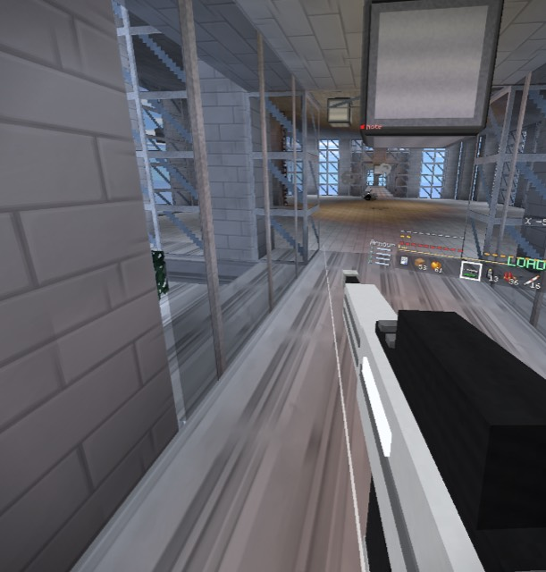

## 16:17:59 - I mean, I guess it should get better with difficulty level, but still

- **Transcript:** I mean, I guess it should get better with difficulty level, but still
- **Status:** open
- **Build:** 0.129 (b0d800c0, M1-M4 (device-tested; ship riding, chests, comfort options, weapon wheel))
- **World:** New World (14) (seed 8775627479714902329)
- **Dimension:** Surface
- **Biome:** Snowy Plains
- **Position:** -511.0 112.0 -1255.4
- **Facing:** east (yaw 80, pitch -9)
- **Held:** Donnerkeil Service Rifle x1
- **Mount:** on foot
- **Looking at:** nothing
- **Mode:** Survival, health 20/20
- **Time:** day 1 13:07, clear
- **Fps:** 58
- **Levels:** mic -20 dBFS, game sound -21 dBFS
- **Length:** 5.1 s (voice 2.2 s)
- **Just before:** -24s message: Twin 42 cm Turret tracking you; -16s message: Loaded: 45 / 45; -8s message: Twin 42 cm Turret tracking you; -0s into the pack: Fernblick Rifle
- **Repro (Mac):** `./snap.sh note --seed 8775627479714902329 --x -511.0 --z -1255.4 --yaw -80 --pitch -9 --time 0.297`
- **Audio (this Mac):** /Users/darthvadar/Documents/Blocksmith/QuestVoiceNotes/raw/vn-20261031-161759-611.aac

## 16:18:24 - Should be a computer or something. Be a room for this gun

- **Transcript:** Should be a computer or something. Be a room for this gun
- **Status:** open
- **Build:** 0.129 (b0d800c0, M1-M4 (device-tested; ship riding, chests, comfort options, weapon wheel))
- **World:** New World (14) (seed 8775627479714902329)
- **Dimension:** Surface
- **Biome:** Snowy Plains
- **Position:** -483.2 126.2 -1259.8
- **Facing:** south (yaw 180, pitch -20)
- **Held:** Donnerkeil Service Rifle x1
- **Mount:** on foot
- **Looking at:** Oak Leaves at -484 125 -1259
- **Mode:** Survival, health 20/20
- **Time:** day 1 13:32, clear
- **Fps:** 71
- **Levels:** mic -25 dBFS, game sound -19 dBFS
- **Length:** 4.6 s (voice 2.8 s)
- **Just before:** -29s message: Twin 42 cm Turret tracking you; -21s into the pack: Fernblick Rifle; -12s opened ChestMenu; -12s closed ChestMenu
- **Repro (Mac):** `./snap.sh note --seed 8775627479714902329 --x -483.2 --z -1259.8 --yaw 180 --pitch -20 --time 0.314`
- **Audio (this Mac):** /Users/darthvadar/Documents/Blocksmith/QuestVoiceNotes/raw/vn-20261031-161824-091.aac

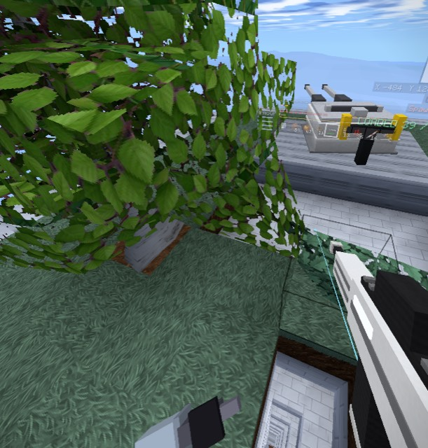

## 16:18:41 - All the blocks falling, that's good

- **Transcript:** All the blocks falling, that's good
- **Status:** open
- **Build:** 0.129 (b0d800c0, M1-M4 (device-tested; ship riding, chests, comfort options, weapon wheel))
- **World:** New World (14) (seed 8775627479714902329)
- **Dimension:** Surface
- **Biome:** Snowy Plains
- **Position:** -481.1 130.5 -1251.8
- **Facing:** west (yaw 286, pitch -7)
- **Held:** empty hand
- **Mount:** on foot
- **Looking at:** nothing
- **Mode:** Survival, health 19/20
- **Time:** day 1 13:45, clear
- **Fps:** 42
- **Levels:** mic -28 dBFS, game sound -14 dBFS
- **Length:** 3.1 s (voice 1.4 s)
- **Just before:** -23s opened ChestMenu; -23s closed ChestMenu; -9s holding empty hand; -9s message: Manning the deck gun; -2s took 1 damage (health 19/20)
- **Repro (Mac):** `./snap.sh note --seed 8775627479714902329 --x -481.1 --z -1251.8 --yaw 74 --pitch -7 --time 0.323`
- **Audio (this Mac):** /Users/darthvadar/Documents/Blocksmith/QuestVoiceNotes/raw/vn-20261031-161841-711.aac

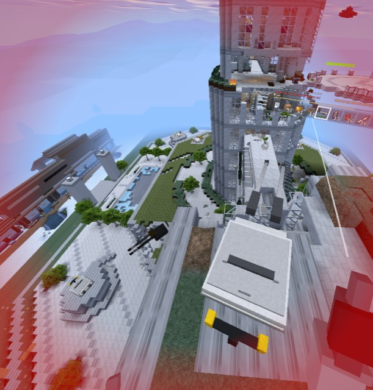

## 16:18:48 - What is hitting me?

- **Transcript:** What is hitting me?
- **Status:** open
- **Build:** 0.129 (b0d800c0, M1-M4 (device-tested; ship riding, chests, comfort options, weapon wheel))
- **World:** New World (14) (seed 8775627479714902329)
- **Dimension:** Surface
- **Biome:** Snowy Plains
- **Position:** -481.2 130.5 -1251.5
- **Facing:** north-west (yaw 294, pitch 14)
- **Held:** empty hand
- **Mount:** on foot
- **Looking at:** nothing
- **Mode:** Survival, health 15/20
- **Time:** day 1 13:51, clear
- **Fps:** 57
- **Levels:** mic -34 dBFS, game sound -20 dBFS
- **Just before:** -29s opened ChestMenu; -28s closed ChestMenu; -14s holding empty hand; -14s message: Manning the deck gun; -7s took 1 damage (health 19/20); -3s took 2 damage (health 17/20); -1s took 2 damage (health 15/20)
- **Repro (Mac):** `./snap.sh note --seed 8775627479714902329 --x -481.2 --z -1251.5 --yaw 66 --pitch 14 --time 0.328`
- **Audio (this Mac):** /Users/darthvadar/Documents/Blocksmith/QuestVoiceNotes/raw/vn-20261031-161848-011.aac

## 16:18:50 - Oh. Uh-oh

- **Transcript:** Oh. Uh-oh
- **Status:** open
- **Audio (this Mac):** /Users/darthvadar/Documents/Blocksmith/QuestVoiceNotes/raw/vn-20261031-161850-211.aac

## 16:18:59 - Well, this is not good

- **Transcript:** Well, this is not good
- **Status:** open
- **Audio (this Mac):** /Users/darthvadar/Documents/Blocksmith/QuestVoiceNotes/raw/vn-20261031-161859-731.aac

## 16:20:14 - Okay, so, uh, something real bad happened. The, um

- **Transcript:** Okay, so, uh, something real bad happened. The, um
- **Status:** open
- **Build:** 0.129 (b0d800c0, M1-M4 (device-tested; ship riding, chests, comfort options, weapon wheel))
- **World:** New World (14) (seed 8775627479714902329)
- **Dimension:** Surface
- **Biome:** Snowy Plains
- **Position:** -483.4 120.8 -1259.6
- **Facing:** north-east (yaw 56, pitch 83)
- **Held:** Donnerkeil Service Rifle x1
- **Mount:** on foot
- **Looking at:** Birch Leaves at -483 127 -1260
- **Mode:** Survival, health 20/20
- **Time:** day 1 13:31, clear
- **Fps:** 70
- **Levels:** mic -27 dBFS, game sound -14 dBFS
- **Length:** 4.3 s (voice 2.9 s)
- **Just before:** -4s opened PauseMenu; -4s entered Surface; -4s closed PauseMenu; -4s holding Donnerkeil Service Rifle; -4s message: Playtest build: voice bug notes ON, your speech is saved (Options > Interface); -1s message: Intel: this base is a Field Hospital
- **Repro (Mac):** `./snap.sh note --seed 8775627479714902329 --x -483.4 --z -1259.6 --yaw -56 --pitch 83 --time 0.314`
- **Audio (this Mac):** /Users/darthvadar/Documents/Blocksmith/QuestVoiceNotes/raw/vn-20261031-162014-966.aac

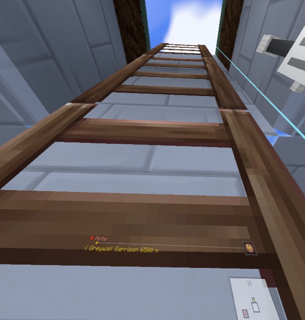

## 16:20:19 - I got in this turret, I shot a bunch of shit, and the shit caused the 

- **Transcript:** I got in this turret, I shot a bunch of shit, and the shit caused the game to crash and eventually actually fail. It was a bad crash. I had to restart the game
- **Status:** open
- **Build:** 0.129 (b0d800c0, M1-M4 (device-tested; ship riding, chests, comfort options, weapon wheel))
- **World:** New World (14) (seed 8775627479714902329)
- **Dimension:** Surface
- **Biome:** Snowy Plains
- **Position:** -487.1 125.0 -1258.7
- **Facing:** south-east (yaw 156, pitch -17)
- **Held:** Donnerkeil Service Rifle x1
- **Mount:** on foot
- **Looking at:** Capital Grey Stone at -485 124 -1254
- **Mode:** Survival, health 20/20
- **Time:** day 1 13:36, clear
- **Fps:** 71
- **Levels:** mic -23 dBFS, game sound -12 dBFS
- **Length:** 9.9 s (voice 6.2 s)
- **Just before:** -8s opened PauseMenu; -8s entered Surface; -8s closed PauseMenu; -8s holding Donnerkeil Service Rifle; -8s message: Playtest build: voice bug notes ON, your speech is saved (Options > Interface); -5s message: Intel: this base is a Field Hospital; -2s message: Spring: the snow melts and the young are born
- **While talking:** -4s message: The last session ended unexpectedly. Pause > Restore Last Backup puts back the last saved copy; -2s walked into Snowy Plains; -2s left the pack: Mahlwerk Rotary Gun; -2s left the pack: Aero Engine Spares x18; -2s left the pack: Himmelsturm Launcher; -2s left the pack: Titanium Pickaxe; -2s left the pack: Track Spares x16; -2s left the pack: Faustrohr Warhead x3; -2s left the pack: Faustrohr; -2s left the pack: Jetpack x2; -2s left the pack: Field Journal of an Ashguard Rifleman; -2s left the pack: Falke Pistol x2; -2s left the pack: Rocket x4; -2s left the pack: Duskium Chestplate; -2s into the pack: Capital Magazine; -2s into the pack: Field Stim; -2s into the pack: Regular Armour Set
- **Position at the end:** -509.3 124.0 -1255.4
- **Repro (Mac):** `./snap.sh note --seed 8775627479714902329 --x -487.1 --z -1258.7 --yaw -156 --pitch -17 --time 0.317`
- **Audio (this Mac):** /Users/darthvadar/Documents/Blocksmith/QuestVoiceNotes/raw/vn-20261031-162019-051.aac

## 16:20:29 - I don't know if it was because it's trying to handle too much at once,

- **Transcript:** I don't know if it was because it's trying to handle too much at once, what the deal was, from all the blocks falling possibly, the physics. So that might need to be a place of optimization. 'Cause I literally like saw the building in half and it was all trying to fall and yeah.
- **Status:** open
- **Build:** 0.129 (b0d800c0, M1-M4 (device-tested; ship riding, chests, comfort options, weapon wheel))
- **World:** New World (14) (seed 8775627479714902329)
- **Dimension:** Surface
- **Biome:** Snowy Plains
- **Position:** -509.8 124.0 -1255.9
- **Facing:** west (yaw 267, pitch 1)
- **Held:** Donnerkeil Service Rifle x1
- **Mount:** on foot
- **Looking at:** nothing
- **Mode:** Survival, health 20/20
- **Time:** day 1 13:45, clear
- **Fps:** 49
- **Levels:** mic -33 dBFS, game sound -13 dBFS
- **Length:** 15.8 s (voice 10.1 s)
- **Just before:** -16s opened PauseMenu; -16s entered Surface; -16s closed PauseMenu; -16s holding Donnerkeil Service Rifle; -16s message: Playtest build: voice bug notes ON, your speech is saved (Options > Interface); -12s message: Intel: this base is a Field Hospital; -10s message: Spring: the snow melts and the young are born; -8s message: The last session ended unexpectedly. Pause > Restore Last Backup puts back the last saved copy; -6s walked into Snowy Plains; -6s left the pack: Mahlwerk Rotary Gun; -6s left the pack: Aero Engine Spares x18; -6s left the pack: Himmelsturm Launcher; -6s left the pack: Titanium Pickaxe; -6s left the pack: Track Spares x16; -6s left the pack: Faustrohr Warhead x3; -6s left the pack: Faustrohr; -6s left the pack: Jetpack x2; -6s left the pack: Field Journal of an Ashguard Rifleman; -6s left the pack: Falke Pistol x2; -6s left the pack: Rocket x4; -6s left the pack: Duskium Chestplate; -6s into the pack: Capital Magazine; -6s into the pack: Field Stim; -6s into the pack: Regular Armour Set
- **While talking:** -3s message: Loaded: 45 / 45; -4s into the pack: Regular Armour Set
- **Position at the end:** -529.8 124.0 -1255.4
- **Repro (Mac):** `./snap.sh note --seed 8775627479714902329 --x -509.8 --z -1255.9 --yaw 93 --pitch 1 --time 0.323`
- **Audio (this Mac):** /Users/darthvadar/Documents/Blocksmith/QuestVoiceNotes/raw/vn-20261031-162029-346.aac

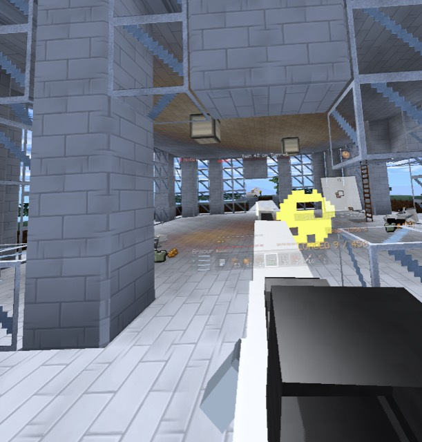

## 16:20:47 - Also, there should be an elevator

- **Transcript:** Also, there should be an elevator
- **Status:** open
- **Build:** 0.129 (b0d800c0, M1-M4 (device-tested; ship riding, chests, comfort options, weapon wheel))
- **World:** New World (14) (seed 8775627479714902329)
- **Dimension:** Surface
- **Biome:** Snowy Plains
- **Position:** -520.8 124.4 -1261.6
- **Facing:** north-east (yaw 26, pitch 49)
- **Held:** Donnerkeil Service Rifle x1
- **Mount:** on foot
- **Looking at:** Capital Smoked Glass at -521 127 -1263
- **Mode:** Survival, health 20/20
- **Time:** day 1 14:03, clear
- **Fps:** 69
- **Levels:** mic -26 dBFS, game sound -17 dBFS
- **Length:** 2.9 s (voice 1.4 s)
- **Just before:** -28s message: Intel: this base is a Field Hospital; -25s message: Spring: the snow melts and the young are born; -23s message: The last session ended unexpectedly. Pause > Restore Last Backup puts back the last saved copy; -21s walked into Snowy Plains; -21s left the pack: Mahlwerk Rotary Gun; -21s left the pack: Aero Engine Spares x18; -21s left the pack: Himmelsturm Launcher; -21s left the pack: Titanium Pickaxe; -21s left the pack: Track Spares x16; -21s left the pack: Faustrohr Warhead x3; -21s left the pack: Faustrohr; -21s left the pack: Jetpack x2; -21s left the pack: Field Journal of an Ashguard Rifleman; -21s left the pack: Falke Pistol x2; -21s left the pack: Rocket x4; -21s left the pack: Duskium Chestplate; -21s into the pack: Capital Magazine; -21s into the pack: Field Stim; -21s into the pack: Regular Armour Set; -14s message: Loaded: 45 / 45; -11s into the pack: Regular Armour Set
- **Repro (Mac):** `./snap.sh note --seed 8775627479714902329 --x -520.8 --z -1261.6 --yaw -26 --pitch 49 --time 0.336`
- **Audio (this Mac):** /Users/darthvadar/Documents/Blocksmith/QuestVoiceNotes/raw/vn-20261031-162047-127.aac

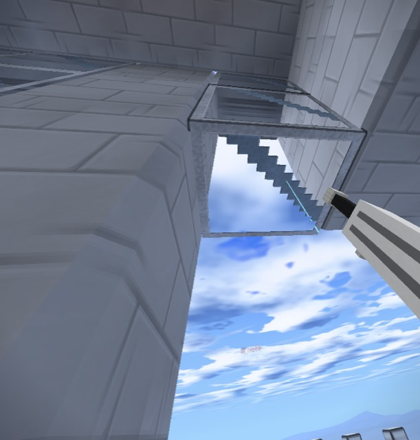

## 16:20:52 - And here instead of

- **Transcript:** And here instead of
- **Status:** open
- **Build:** 0.129 (b0d800c0, M1-M4 (device-tested; ship riding, chests, comfort options, weapon wheel))
- **World:** New World (14) (seed 8775627479714902329)
- **Dimension:** Surface
- **Biome:** Snowy Plains
- **Position:** -521.5 130.0 -1260.2
- **Facing:** south (yaw 170, pitch -13)
- **Held:** Donnerkeil Service Rifle x1
- **Mount:** on foot
- **Looking at:** nothing
- **Mode:** Survival, health 20/20
- **Time:** day 1 14:09, clear
- **Fps:** 66
- **Levels:** mic -29 dBFS, game sound -20 dBFS
- **Length:** 2.7 s (voice 1.2 s)
- **Just before:** -28s message: The last session ended unexpectedly. Pause > Restore Last Backup puts back the last saved copy; -26s walked into Snowy Plains; -26s left the pack: Mahlwerk Rotary Gun; -26s left the pack: Aero Engine Spares x18; -26s left the pack: Himmelsturm Launcher; -26s left the pack: Titanium Pickaxe; -26s left the pack: Track Spares x16; -26s left the pack: Faustrohr Warhead x3; -26s left the pack: Faustrohr; -26s left the pack: Jetpack x2; -26s left the pack: Field Journal of an Ashguard Rifleman; -26s left the pack: Falke Pistol x2; -26s left the pack: Rocket x4; -26s left the pack: Duskium Chestplate; -26s into the pack: Capital Magazine; -26s into the pack: Field Stim; -26s into the pack: Regular Armour Set; -19s message: Loaded: 45 / 45; -16s into the pack: Regular Armour Set
- **Repro (Mac):** `./snap.sh note --seed 8775627479714902329 --x -521.5 --z -1260.2 --yaw -170 --pitch -13 --time 0.340`
- **Audio (this Mac):** /Users/darthvadar/Documents/Blocksmith/QuestVoiceNotes/raw/vn-20261031-162052-086.aac

## 16:21:02 - Seriously? Yeah, this guy still needs to do more damage. Like I'm thin

- **Transcript:** Seriously? Yeah, this guy still needs to do more damage. Like I'm thinking
- **Status:** open
- **Build:** 0.129 (b0d800c0, M1-M4 (device-tested; ship riding, chests, comfort options, weapon wheel))
- **World:** New World (14) (seed 8775627479714902329)
- **Dimension:** Surface
- **Biome:** Snowy Plains
- **Position:** -518.6 136.0 -1260.4
- **Facing:** south (yaw 158, pitch -12)
- **Held:** Donnerkeil Service Rifle x1
- **Mount:** on foot
- **Looking at:** nothing
- **Mode:** Survival, health 15/20, screen PauseMenu
- **Time:** day 1 14:21, clear
- **Fps:** 67
- **Levels:** mic -27 dBFS, game sound -18 dBFS
- **Length:** 5.2 s (voice 2.7 s)
- **Just before:** -29s message: Loaded: 45 / 45; -26s into the pack: Regular Armour Set; -5s into the pack: Rocket; -0s opened PauseMenu
- **Repro (Mac):** `./snap.sh note --seed 8775627479714902329 --x -518.6 --z -1260.4 --yaw -158 --pitch -12 --time 0.348`
- **Audio (this Mac):** /Users/darthvadar/Documents/Blocksmith/QuestVoiceNotes/raw/vn-20261031-162102-727.aac

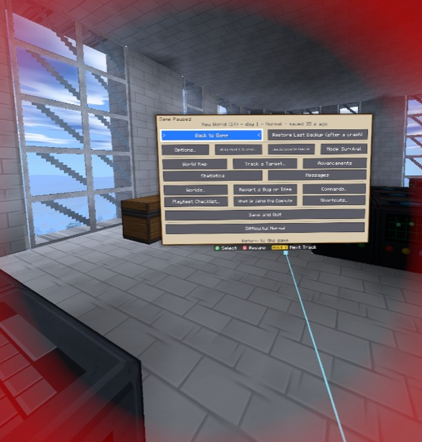

## 16:21:07 - Two or th-- maybe three times as much damage, this arc gun

- **Transcript:** Two or th-- maybe three times as much damage, this arc gun
- **Status:** open
- **Build:** 0.129 (b0d800c0, M1-M4 (device-tested; ship riding, chests, comfort options, weapon wheel))
- **World:** New World (14) (seed 8775627479714902329)
- **Dimension:** Surface
- **Biome:** Snowy Plains
- **Position:** -518.7 136.0 -1260.5
- **Facing:** south (yaw 160, pitch 1)
- **Held:** Donnerkeil Service Rifle x1
- **Mount:** on foot
- **Looking at:** nothing
- **Mode:** Survival, health 11/20
- **Time:** day 1 14:25, clear
- **Fps:** 64
- **Levels:** mic -21 dBFS, game sound -20 dBFS
- **Length:** 4.4 s (voice 2.3 s)
- **Just before:** -30s into the pack: Regular Armour Set; -9s into the pack: Rocket; -4s opened PauseMenu; -4s closed PauseMenu; -3s took 9 damage (health 15/20); -2s took 3 damage (health 15/20); -1s took 3 damage (health 13/20)
- **Repro (Mac):** `./snap.sh note --seed 8775627479714902329 --x -518.7 --z -1260.5 --yaw -160 --pitch 1 --time 0.351`
- **Audio (this Mac):** /Users/darthvadar/Documents/Blocksmith/QuestVoiceNotes/raw/vn-20261031-162107-807.aac

## 16:21:12 - Okay, this thing has an upper charge. That's good

- **Transcript:** Okay, this thing has an upper charge. That's good
- **Status:** open
- **Build:** 0.129 (b0d800c0, M1-M4 (device-tested; ship riding, chests, comfort options, weapon wheel))
- **World:** New World (14) (seed 8775627479714902329)
- **Dimension:** Surface
- **Biome:** Snowy Plains
- **Position:** -522.1 136.0 -1256.7
- **Facing:** south-west (yaw 221, pitch -15)
- **Held:** Donnerkeil Service Rifle x1
- **Mount:** on foot
- **Looking at:** nothing
- **Mode:** Survival, health 11/20, screen ChestMenu
- **Time:** day 1 14:31, clear
- **Fps:** 61
- **Levels:** mic -42 dBFS, game sound -20 dBFS
- **Length:** 3.2 s (voice 1.7 s)
- **Just before:** -14s into the pack: Rocket; -9s opened PauseMenu; -9s closed PauseMenu; -8s took 9 damage (health 15/20); -7s took 3 damage (health 15/20); -6s took 3 damage (health 13/20); -3s took 6 damage (health 10/20); -2s opened ChestMenu
- **Repro (Mac):** `./snap.sh note --seed 8775627479714902329 --x -522.1 --z -1256.7 --yaw 139 --pitch -15 --time 0.355`
- **Audio (this Mac):** /Users/darthvadar/Documents/Blocksmith/QuestVoiceNotes/raw/vn-20261031-162112-806.aac

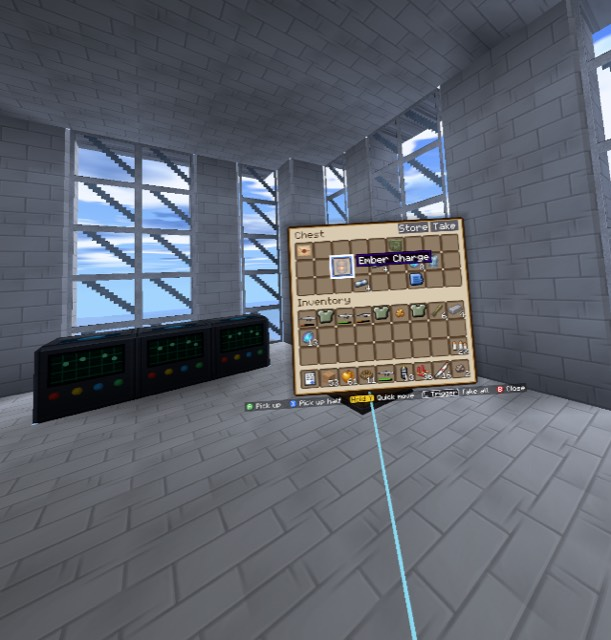

## 16:21:21 - Good. Okay

- **Transcript:** Good. Okay
- **Status:** open
- **Build:** 0.129 (b0d800c0, M1-M4 (device-tested; ship riding, chests, comfort options, weapon wheel))
- **World:** New World (14) (seed 8775627479714902329)
- **Dimension:** Surface
- **Biome:** Snowy Plains
- **Position:** -517.8 136.0 -1258.1
- **Facing:** south-east (yaw 120, pitch -21)
- **Held:** Donnerkeil Service Rifle x1
- **Mount:** on foot
- **Looking at:** Capital Stone at -514 135 -1256
- **Mode:** Survival, health 11/20
- **Time:** day 1 14:41, clear
- **Fps:** 69
- **Levels:** mic -27 dBFS, game sound -21 dBFS
- **Length:** 2.3 s (voice 0.5 s)
- **Just before:** -22s into the pack: Rocket; -17s opened PauseMenu; -17s closed PauseMenu; -16s took 9 damage (health 15/20); -15s took 3 damage (health 15/20); -14s took 3 damage (health 13/20); -11s took 6 damage (health 10/20); -10s opened ChestMenu; -5s closed ChestMenu; -3s opened ChestMenu; -0s closed ChestMenu
- **Repro (Mac):** `./snap.sh note --seed 8775627479714902329 --x -517.8 --z -1258.1 --yaw -120 --pitch -21 --time 0.362`
- **Audio (this Mac):** /Users/darthvadar/Documents/Blocksmith/QuestVoiceNotes/raw/vn-20261031-162121-306.aac

## 16:21:56 - I'm gonna try to recreate the same

- **Transcript:** I'm gonna try to recreate the same
- **Status:** open
- **Build:** 0.129 (b0d800c0, M1-M4 (device-tested; ship riding, chests, comfort options, weapon wheel))
- **World:** New World (14) (seed 8775627479714902329)
- **Dimension:** Surface
- **Biome:** Snowy Plains
- **Position:** -481.0 130.5 -1252.9
- **Facing:** west (yaw 261, pitch -11)
- **Held:** empty hand
- **Mount:** on foot
- **Looking at:** nothing
- **Mode:** Survival, health 10/20
- **Time:** day 1 15:13, clear
- **Fps:** 68
- **Levels:** mic -33 dBFS, game sound -19 dBFS
- **Length:** 3.6 s (voice 1.8 s)
- **Just before:** -27s closed ChestMenu; -21s holding Heavy Rounds; -21s message: Heavy Rounds; -21s holding Golden Apple; -21s message: Golden Apple; -17s holding Heavy Rounds; -17s message: Heavy Rounds; -16s holding Donnerkeil Service Rifle; -16s message: Donnerkeil Service Rifle; -16s took 1 damage (health 20/20); -15s holding empty hand; -15s message: Manning the deck gun; -13s took 2 damage (health 18/20); -10s took 2 damage (health 16/20); -8s took 2 damage (health 14/20); -5s took 2 damage (health 12/20)
- **Repro (Mac):** `./snap.sh note --seed 8775627479714902329 --x -481.0 --z -1252.9 --yaw 99 --pitch -11 --time 0.385`
- **Audio (this Mac):** /Users/darthvadar/Documents/Blocksmith/QuestVoiceNotes/raw/vn-20261031-162156-727.aac

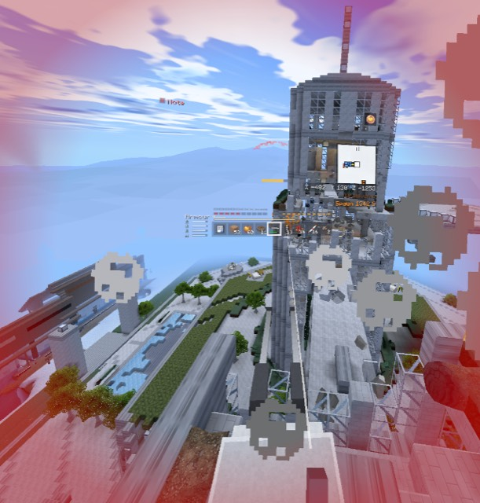

## 16:22:00 - scenario that caused the, uh, thing to crash earlier

- **Transcript:** scenario that caused the, uh, thing to crash earlier
- **Status:** open
- **Build:** 0.129 (b0d800c0, M1-M4 (device-tested; ship riding, chests, comfort options, weapon wheel))
- **World:** New World (14) (seed 8775627479714902329)
- **Dimension:** Surface
- **Biome:** Snowy Plains
- **Position:** -480.9 125.0 -1255.1
- **Facing:** west (yaw 280, pitch 1)
- **Held:** Donnerkeil Service Rifle x1
- **Mount:** on foot
- **Looking at:** nothing
- **Mode:** Creative, health 10/20
- **Time:** day 1 15:15, clear
- **Fps:** 68
- **Levels:** mic -45 dBFS, game sound -27 dBFS
- **Length:** 4.5 s (voice 2.9 s)
- **Just before:** -25s holding Heavy Rounds; -25s message: Heavy Rounds; -24s holding Golden Apple; -24s message: Golden Apple; -20s holding Heavy Rounds; -20s message: Heavy Rounds; -20s holding Donnerkeil Service Rifle; -20s message: Donnerkeil Service Rifle; -19s took 1 damage (health 20/20); -18s holding empty hand; -18s message: Manning the deck gun; -16s took 2 damage (health 18/20); -14s took 2 damage (health 16/20); -11s took 2 damage (health 14/20); -8s took 2 damage (health 12/20); -3s took 2 damage (health 10/20); -3s holding Donnerkeil Service Rifle; -2s message: Loaded: 45 / 45; -2s opened PauseMenu; -0s message: Creative mode; -0s closed PauseMenu
- **Repro (Mac):** `./snap.sh note --seed 8775627479714902329 --x -480.9 --z -1255.1 --yaw 80 --pitch 1 --time 0.386`
- **Audio (this Mac):** /Users/darthvadar/Documents/Blocksmith/QuestVoiceNotes/raw/vn-20261031-162200-066.aac

## 16:22:11 - That was beautiful. That actually worked out no problem

- **Transcript:** That was beautiful. That actually worked out no problem
- **Status:** open
- **Build:** 0.129 (b0d800c0, M1-M4 (device-tested; ship riding, chests, comfort options, weapon wheel))
- **World:** New World (14) (seed 8775627479714902329)
- **Dimension:** Surface
- **Biome:** Snowy Plains
- **Position:** -481.3 130.5 -1251.3
- **Facing:** north-west (yaw 300, pitch -29)
- **Held:** empty hand
- **Mount:** on foot
- **Looking at:** nothing
- **Mode:** Creative, health 10/20
- **Time:** day 1 15:29, clear
- **Fps:** 70
- **Levels:** mic -28 dBFS, game sound -24 dBFS
- **Length:** 4.3 s (voice 1.7 s)
- **Just before:** -29s holding empty hand; -29s message: Manning the deck gun; -27s took 2 damage (health 18/20); -25s took 2 damage (health 16/20); -22s took 2 damage (health 14/20); -19s took 2 damage (health 12/20); -14s took 2 damage (health 10/20); -14s holding Donnerkeil Service Rifle; -13s message: Loaded: 45 / 45; -13s opened PauseMenu; -11s message: Creative mode; -11s closed PauseMenu; -10s holding empty hand; -10s message: Manning the deck gun
- **Repro (Mac):** `./snap.sh note --seed 8775627479714902329 --x -481.3 --z -1251.3 --yaw 60 --pitch -29 --time 0.395`
- **Audio (this Mac):** /Users/darthvadar/Documents/Blocksmith/QuestVoiceNotes/raw/vn-20261031-162211-746.aac

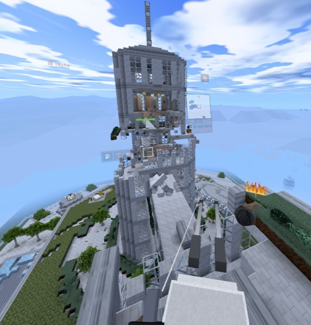

## 16:22:21 - So this building should have fallen because there's not enough structu

- **Transcript:** So this building should have fallen because there's not enough structure under it to keep it going. So even if there's a block connecting it somewhere, the whole thing should have still fallen down because of gravity and block connection physics
- **Status:** open
- **Build:** 0.129 (b0d800c0, M1-M4 (device-tested; ship riding, chests, comfort options, weapon wheel))
- **World:** New World (14) (seed 8775627479714902329)
- **Dimension:** Surface
- **Biome:** Snowy Plains
- **Position:** -481.0 130.5 -1252.5
- **Facing:** west (yaw 271, pitch 13)
- **Held:** empty hand
- **Mount:** on foot
- **Looking at:** nothing
- **Mode:** Creative, health 10/20
- **Time:** day 1 15:40, clear
- **Fps:** 69
- **Levels:** mic -24 dBFS, game sound -21 dBFS
- **Length:** 12.3 s (voice 8.4 s)
- **Just before:** -29s took 2 damage (health 12/20); -24s took 2 damage (health 10/20); -23s holding Donnerkeil Service Rifle; -23s message: Loaded: 45 / 45; -22s opened PauseMenu; -21s message: Creative mode; -21s closed PauseMenu; -20s holding empty hand; -19s message: Manning the deck gun
- **Position at the end:** -481.0 130.5 -1252.1
- **Repro (Mac):** `./snap.sh note --seed 8775627479714902329 --x -481.0 --z -1252.5 --yaw 89 --pitch 13 --time 0.403`
- **Audio (this Mac):** /Users/darthvadar/Documents/Blocksmith/QuestVoiceNotes/raw/vn-20261031-162221-527.aac

## 16:22:34 - But that works too. That wasn't bad

- **Transcript:** But that works too. That wasn't bad
- **Status:** open
- **Build:** 0.129 (b0d800c0, M1-M4 (device-tested; ship riding, chests, comfort options, weapon wheel))
- **World:** New World (14) (seed 8775627479714902329)
- **Dimension:** Surface
- **Biome:** Snowy Plains
- **Position:** -481.0 130.5 -1252.3
- **Facing:** west (yaw 275, pitch -12)
- **Held:** empty hand
- **Mount:** on foot
- **Looking at:** nothing
- **Mode:** Creative, health 10/20
- **Time:** day 1 15:55, clear
- **Fps:** 71
- **Levels:** mic -23 dBFS, game sound -18 dBFS
- **Length:** 3.2 s (voice 1.5 s)
- **Repro (Mac):** `./snap.sh note --seed 8775627479714902329 --x -481.0 --z -1252.3 --yaw 85 --pitch -12 --time 0.414`
- **Audio (this Mac):** /Users/darthvadar/Documents/Blocksmith/QuestVoiceNotes/raw/vn-20261031-162234-487.aac

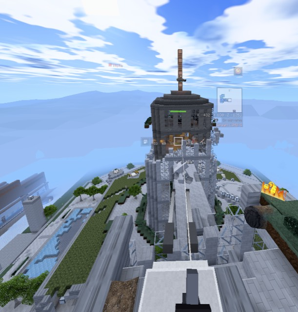

## 16:22:37 - That was, that was actually really good

- **Transcript:** That was, that was actually really good
- **Status:** open
- **Build:** 0.129 (b0d800c0, M1-M4 (device-tested; ship riding, chests, comfort options, weapon wheel))
- **World:** New World (14) (seed 8775627479714902329)
- **Dimension:** Surface
- **Biome:** Snowy Plains
- **Position:** -481.0 130.5 -1252.4
- **Facing:** west (yaw 276, pitch -17)
- **Held:** empty hand
- **Mount:** on foot
- **Looking at:** nothing
- **Mode:** Creative, health 10/20
- **Time:** day 1 15:59, clear
- **Fps:** 71
- **Levels:** mic -20 dBFS, game sound -20 dBFS
- **Length:** 2.6 s (voice 1.3 s)
- **Repro (Mac):** `./snap.sh note --seed 8775627479714902329 --x -481.0 --z -1252.4 --yaw 84 --pitch -17 --time 0.417`
- **Audio (this Mac):** /Users/darthvadar/Documents/Blocksmith/QuestVoiceNotes/raw/vn-20261031-162237-747.aac

## 16:22:52 - So for example, right here, that thing should have collapsed because i

- **Transcript:** So for example, right here, that thing should have collapsed because it doesn't have enough support
- **Status:** open
- **Build:** 0.129 (b0d800c0, M1-M4 (device-tested; ship riding, chests, comfort options, weapon wheel))
- **World:** New World (14) (seed 8775627479714902329)
- **Dimension:** Surface
- **Biome:** Snowy Plains
- **Position:** -481.0 130.5 -1252.3
- **Facing:** west (yaw 274, pitch -6)
- **Held:** empty hand
- **Mount:** on foot
- **Looking at:** nothing
- **Mode:** Creative, health 10/20
- **Time:** day 1 16:16, clear
- **Fps:** 65
- **Levels:** mic -22 dBFS, game sound -17 dBFS
- **Length:** 5.6 s (voice 3.0 s)
- **Position at the end:** -481.0 130.5 -1252.4
- **Repro (Mac):** `./snap.sh note --seed 8775627479714902329 --x -481.0 --z -1252.3 --yaw 86 --pitch -6 --time 0.428`
- **Audio (this Mac):** /Users/darthvadar/Documents/Blocksmith/QuestVoiceNotes/raw/vn-20261031-162252-726.aac

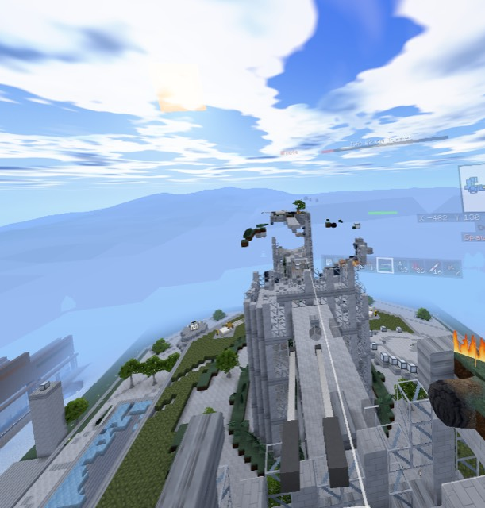

## 16:23:57 - More real estate. Don't mind if I do

- **Transcript:** More real estate. Don't mind if I do
- **Status:** open
- **Build:** 0.129 (b0d800c0, M1-M4 (device-tested; ship riding, chests, comfort options, weapon wheel))
- **World:** New World (14) (seed 8775627479714902329)
- **Dimension:** Surface
- **Biome:** Snowy Plains
- **Position:** -1264.3 124.3 -1550.2
- **Facing:** west (yaw 265, pitch -22)
- **Held:** Donnerkeil Service Rifle x1
- **Mount:** on foot
- **Looking at:** nothing
- **Mode:** Creative, health 10/20
- **Time:** day 1 17:30, clear
- **Fps:** 72
- **Levels:** mic -33 dBFS, game sound -17 dBFS
- **Length:** 3.2 s (voice 1.6 s)
- **Just before:** -21s opened CommandMenu; -19s message: Meridian Frigate: -2517 ~ -7150 (6234 blocks, patrols); -17s closed CommandMenu; -13s walked into Snowy Taiga; -10s message: Homestead marked on the map; -9s walked into Snowy Plains; -3s message: Boreal Station marked on the map; -0s message: Walking
- **Repro (Mac):** `./snap.sh note --seed 8775627479714902329 --x -1264.3 --z -1550.2 --yaw 95 --pitch -22 --time 0.479`
- **Audio (this Mac):** /Users/darthvadar/Documents/Blocksmith/QuestVoiceNotes/raw/vn-20261031-162357-347.aac

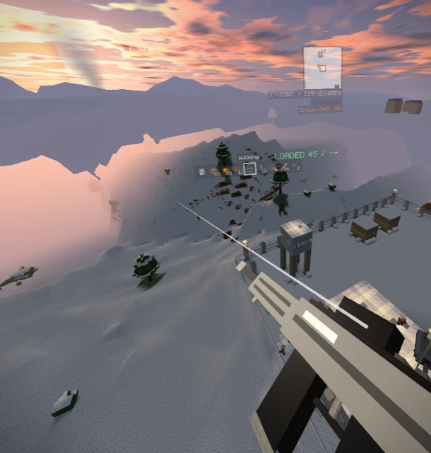

## 16:24:36 - The song, the music that

- **Transcript:** The song, the music that
- **Status:** open
- **Build:** 0.129 (b0d800c0, M1-M4 (device-tested; ship riding, chests, comfort options, weapon wheel))
- **World:** New World (14) (seed 8775627479714902329)
- **Dimension:** Surface
- **Biome:** Forest
- **Position:** -39.9 101.6 -6.8
- **Facing:** west (yaw 274, pitch -29)
- **Held:** empty hand
- **Mount:** on foot, flying
- **Looking at:** nothing
- **Mode:** Creative, health 20/20
- **Time:** day 1 18:14, clear
- **Fps:** 72
- **Levels:** mic -33 dBFS, game sound -24 dBFS
- **Length:** 3.7 s (voice 1.9 s)
- **Just before:** -25s holding Heavy Rounds; -25s message: Heavy Rounds; -25s holding Donnerkeil Service Rifle; -25s message: Donnerkeil Service Rifle; -21s message: Alarm! The garrison is coming through the bulkheads; -17s into the pack: Regular Armour Set; -16s took 1 damage (health 19/20); -14s took 3 damage (health 17/20); -11s took 3 damage (health 15/20); -9s took 6 damage (health 9/20); -6s message: Loaded: 45 / 45; -6s left the pack: Capital Magazine; -6s took 7 damage (health 2/20); -5s died; -5s opened DeathMenu; -5s holding empty hand; -5s left the pack: Greywall Dispatch (DeathMenu open); -5s left the pack: Donnerkeil Service Rifle x3 (DeathMenu open); -5s left the pack: Regular Armour Set x4 (DeathMenu open); -5s left the pack: Capital Magazine x11 (DeathMenu open); -5s left the pack: Fernblick Rifle (DeathMenu open); -5s left the pack: Field Stim x16 (DeathMenu open); -5s left the pack: Rocket x6 (DeathMenu open); -4s respawned; -4s closed DeathMenu; -4s message: Your things are 2030 blocks north-west; -4s took 3 damage (health 20/20); -4s walked into Forest; -2s opened PauseMenu; -1s message: Creative mode; -1s closed PauseMenu
- **Repro (Mac):** `./snap.sh note --seed 8775627479714902329 --x -39.9 --z -6.8 --yaw 86 --pitch -29 --time 0.510`
- **Audio (this Mac):** /Users/darthvadar/Documents/Blocksmith/QuestVoiceNotes/raw/vn-20261031-162436-566.aac

## 16:24:40 - When you die, it shouldn't continue after you respawn

- **Transcript:** When you die, it shouldn't continue after you respawn
- **Status:** open
- **Build:** 0.129 (b0d800c0, M1-M4 (device-tested; ship riding, chests, comfort options, weapon wheel))
- **World:** New World (14) (seed 8775627479714902329)
- **Dimension:** Surface
- **Biome:** Forest
- **Position:** -26.7 169.2 149.4
- **Facing:** south-west (yaw 241, pitch -15)
- **Held:** empty hand
- **Mount:** on foot, flying
- **Looking at:** nothing
- **Mode:** Creative, health 20/20
- **Time:** day 1 18:18, clear
- **Fps:** 72
- **Levels:** mic -25 dBFS, game sound -18 dBFS
- **Length:** 3.8 s (voice 2.1 s)
- **Just before:** -29s holding Heavy Rounds; -29s message: Heavy Rounds; -29s holding Donnerkeil Service Rifle; -29s message: Donnerkeil Service Rifle; -24s message: Alarm! The garrison is coming through the bulkheads; -20s into the pack: Regular Armour Set; -20s took 1 damage (health 19/20); -17s took 3 damage (health 17/20); -15s took 3 damage (health 15/20); -13s took 6 damage (health 9/20); -10s message: Loaded: 45 / 45; -9s left the pack: Capital Magazine; -9s took 7 damage (health 2/20); -9s died; -9s opened DeathMenu; -9s holding empty hand; -8s left the pack: Greywall Dispatch (DeathMenu open); -8s left the pack: Donnerkeil Service Rifle x3 (DeathMenu open); -8s left the pack: Regular Armour Set x4 (DeathMenu open); -8s left the pack: Capital Magazine x11 (DeathMenu open); -8s left the pack: Fernblick Rifle (DeathMenu open); -8s left the pack: Field Stim x16 (DeathMenu open); -8s left the pack: Rocket x6 (DeathMenu open); -8s respawned; -8s closed DeathMenu; -8s message: Your things are 2030 blocks north-west; -8s took 3 damage (health 20/20); -7s walked into Forest; -6s opened PauseMenu; -5s message: Creative mode; -4s closed PauseMenu; -3s walked into Plains; -3s message: Flying; -1s walked into Forest
- **Repro (Mac):** `./snap.sh note --seed 8775627479714902329 --x -26.7 --z 149.4 --yaw 119 --pitch -15 --time 0.513`
- **Audio (this Mac):** /Users/darthvadar/Documents/Blocksmith/QuestVoiceNotes/raw/vn-20261031-162440-147.aac

## 16:24:43 - 'Cause you already respawned. Who cares?

- **Transcript:** 'Cause you already respawned. Who cares?
- **Status:** open
- **Build:** 0.129 (b0d800c0, M1-M4 (device-tested; ship riding, chests, comfort options, weapon wheel))
- **World:** New World (14) (seed 8775627479714902329)
- **Dimension:** Surface
- **Biome:** Desert
- **Position:** -232.3 169.2 98.7
- **Facing:** south-west (yaw 239, pitch -11)
- **Held:** empty hand
- **Mount:** on foot, flying
- **Looking at:** nothing
- **Mode:** Creative, health 20/20
- **Time:** day 1 18:22, clear
- **Fps:** 72
- **Levels:** mic -36 dBFS, game sound -20 dBFS
- **Length:** 2.7 s (voice 1.3 s)
- **Just before:** -28s message: Alarm! The garrison is coming through the bulkheads; -24s into the pack: Regular Armour Set; -23s took 1 damage (health 19/20); -21s took 3 damage (health 17/20); -18s took 3 damage (health 15/20); -17s took 6 damage (health 9/20); -13s message: Loaded: 45 / 45; -13s left the pack: Capital Magazine; -13s took 7 damage (health 2/20); -12s died; -12s opened DeathMenu; -12s holding empty hand; -12s left the pack: Greywall Dispatch (DeathMenu open); -12s left the pack: Donnerkeil Service Rifle x3 (DeathMenu open); -12s left the pack: Regular Armour Set x4 (DeathMenu open); -12s left the pack: Capital Magazine x11 (DeathMenu open); -12s left the pack: Fernblick Rifle (DeathMenu open); -12s left the pack: Field Stim x16 (DeathMenu open); -12s left the pack: Rocket x6 (DeathMenu open); -11s respawned; -11s closed DeathMenu; -11s message: Your things are 2030 blocks north-west; -11s took 3 damage (health 20/20); -11s walked into Forest; -9s opened PauseMenu; -8s message: Creative mode; -8s closed PauseMenu; -7s walked into Plains; -7s message: Flying; -5s walked into Forest; -3s walked into Plains; -1s walked into Savanna
- **Repro (Mac):** `./snap.sh note --seed 8775627479714902329 --x -232.3 --z 98.7 --yaw 121 --pitch -11 --time 0.516`
- **Audio (this Mac):** /Users/darthvadar/Documents/Blocksmith/QuestVoiceNotes/raw/vn-20261031-162443-807.aac

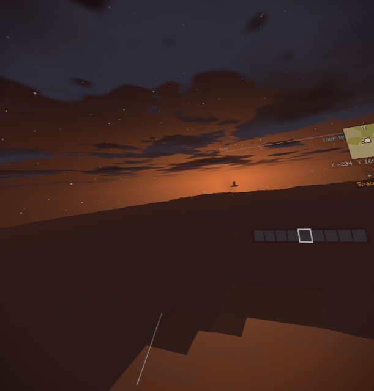

## 16:24:49 - Also that ultra fast moving mode in creative hasn't

- **Transcript:** Also that ultra fast moving mode in creative hasn't
- **Status:** open
- **Build:** 0.129 (b0d800c0, M1-M4 (device-tested; ship riding, chests, comfort options, weapon wheel))
- **World:** New World (14) (seed 8775627479714902329)
- **Dimension:** Surface
- **Biome:** Warm Ocean
- **Position:** -697.8 169.2 259.0
- **Facing:** south-west (yaw 223, pitch -17)
- **Held:** empty hand
- **Mount:** on foot, flying
- **Looking at:** nothing
- **Mode:** Creative, health 20/20
- **Time:** day 1 18:29, clear
- **Fps:** 72
- **Levels:** mic -24 dBFS, game sound -20 dBFS
- **Length:** 4.2 s (voice 2.5 s)
- **Just before:** -30s into the pack: Regular Armour Set; -29s took 1 damage (health 19/20); -27s took 3 damage (health 17/20); -24s took 3 damage (health 15/20); -22s took 6 damage (health 9/20); -19s message: Loaded: 45 / 45; -19s left the pack: Capital Magazine; -19s took 7 damage (health 2/20); -18s died; -18s opened DeathMenu; -18s holding empty hand; -18s left the pack: Greywall Dispatch (DeathMenu open); -18s left the pack: Donnerkeil Service Rifle x3 (DeathMenu open); -18s left the pack: Regular Armour Set x4 (DeathMenu open); -18s left the pack: Capital Magazine x11 (DeathMenu open); -18s left the pack: Fernblick Rifle (DeathMenu open); -18s left the pack: Field Stim x16 (DeathMenu open); -18s left the pack: Rocket x6 (DeathMenu open); -17s respawned; -17s closed DeathMenu; -17s message: Your things are 2030 blocks north-west; -17s took 3 damage (health 20/20); -17s walked into Forest; -15s opened PauseMenu; -14s message: Creative mode; -14s closed PauseMenu; -13s walked into Plains; -13s message: Flying; -11s walked into Forest; -9s walked into Plains; -7s walked into Savanna; -5s walked into Desert; -3s walked into Warm Ocean
- **Repro (Mac):** `./snap.sh note --seed 8775627479714902329 --x -697.8 --z 259.0 --yaw 137 --pitch -17 --time 0.521`
- **Audio (this Mac):** /Users/darthvadar/Documents/Blocksmith/QuestVoiceNotes/raw/vn-20261031-162449-607.aac

## 16:24:53 - Been added. Trying to spring creative and holding down the joystick, n

- **Transcript:** Been added. Trying to spring creative and holding down the joystick, nothing's happening
- **Status:** open
- **Build:** 0.129 (b0d800c0, M1-M4 (device-tested; ship riding, chests, comfort options, weapon wheel))
- **World:** New World (14) (seed 8775627479714902329)
- **Dimension:** Surface
- **Biome:** Warm Ocean
- **Position:** -1025.1 169.2 347.8
- **Facing:** south-west (yaw 223, pitch -18)
- **Held:** empty hand
- **Mount:** on foot, flying
- **Looking at:** nothing
- **Mode:** Creative, health 20/20
- **Time:** day 1 18:34, clear
- **Fps:** 72
- **Levels:** mic -30 dBFS, game sound -18 dBFS
- **Length:** 5.6 s (voice 3.0 s)
- **Just before:** -28s took 3 damage (health 15/20); -26s took 6 damage (health 9/20); -23s message: Loaded: 45 / 45; -23s left the pack: Capital Magazine; -23s took 7 damage (health 2/20); -22s died; -22s opened DeathMenu; -22s holding empty hand; -22s left the pack: Greywall Dispatch (DeathMenu open); -22s left the pack: Donnerkeil Service Rifle x3 (DeathMenu open); -22s left the pack: Regular Armour Set x4 (DeathMenu open); -22s left the pack: Capital Magazine x11 (DeathMenu open); -22s left the pack: Fernblick Rifle (DeathMenu open); -22s left the pack: Field Stim x16 (DeathMenu open); -22s left the pack: Rocket x6 (DeathMenu open); -21s respawned; -21s closed DeathMenu; -21s message: Your things are 2030 blocks north-west; -21s took 3 damage (health 20/20); -21s walked into Forest; -19s opened PauseMenu; -18s message: Creative mode; -18s closed PauseMenu; -17s walked into Plains; -16s message: Flying; -15s walked into Forest; -13s walked into Plains; -11s walked into Savanna; -9s walked into Desert; -7s walked into Warm Ocean; -2s message: Entering Rhoowick
- **While talking:** -4s walked into Beach; -2s walked into Savanna; -1s message: Greywall Garrison marked on the map
- **Position at the end:** -1383.2 166.5 319.2
- **Repro (Mac):** `./snap.sh note --seed 8775627479714902329 --x -1025.1 --z 347.8 --yaw 137 --pitch -18 --time 0.524`
- **Audio (this Mac):** /Users/darthvadar/Documents/Blocksmith/QuestVoiceNotes/raw/vn-20261031-162453-527.aac

## 16:25:00 - Uh, let's test about getting obliterated from afar, see if it works

- **Transcript:** Uh, let's test about getting obliterated from afar, see if it works
- **Status:** open
- **Build:** 0.129 (b0d800c0, M1-M4 (device-tested; ship riding, chests, comfort options, weapon wheel))
- **World:** New World (14) (seed 8775627479714902329)
- **Dimension:** Surface
- **Biome:** Savanna
- **Position:** -1379.5 72.8 318.5
- **Facing:** west (yaw 283, pitch -42)
- **Held:** empty hand
- **Mount:** on foot
- **Looking at:** nothing
- **Mode:** Creative, health 20/20
- **Time:** day 1 18:42, clear
- **Fps:** 72
- **Levels:** mic -22 dBFS, game sound -17 dBFS
- **Length:** 4.6 s (voice 2.8 s)
- **Just before:** -30s left the pack: Capital Magazine; -30s took 7 damage (health 2/20); -29s died; -29s opened DeathMenu; -29s holding empty hand; -29s left the pack: Greywall Dispatch (DeathMenu open); -29s left the pack: Donnerkeil Service Rifle x3 (DeathMenu open); -29s left the pack: Regular Armour Set x4 (DeathMenu open); -29s left the pack: Capital Magazine x11 (DeathMenu open); -29s left the pack: Fernblick Rifle (DeathMenu open); -29s left the pack: Field Stim x16 (DeathMenu open); -29s left the pack: Rocket x6 (DeathMenu open); -28s respawned; -28s closed DeathMenu; -28s message: Your things are 2030 blocks north-west; -28s took 3 damage (health 20/20); -28s walked into Forest; -26s opened PauseMenu; -25s message: Creative mode; -25s closed PauseMenu; -24s walked into Plains; -24s message: Flying; -22s walked into Forest; -20s walked into Plains; -18s walked into Savanna; -16s walked into Desert; -14s walked into Warm Ocean; -9s message: Entering Rhoowick; -6s walked into Beach; -4s walked into Savanna; -3s message: Greywall Garrison marked on the map; -1s message: Walking
- **Repro (Mac):** `./snap.sh note --seed 8775627479714902329 --x -1379.5 --z 318.5 --yaw 77 --pitch -42 --time 0.530`
- **Audio (this Mac):** /Users/darthvadar/Documents/Blocksmith/QuestVoiceNotes/raw/vn-20261031-162500-647.aac

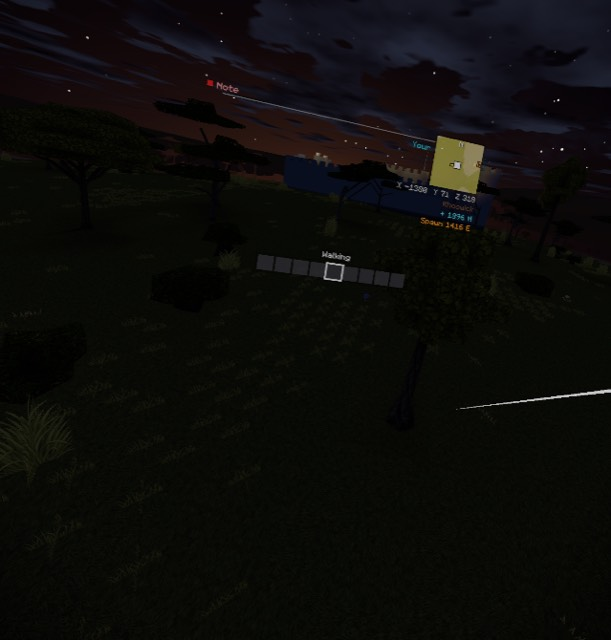

## 16:25:07 - I don't know if that's been added yet, but we will see

- **Transcript:** I don't know if that's been added yet, but we will see
- **Status:** open
- **Build:** 0.129 (b0d800c0, M1-M4 (device-tested; ship riding, chests, comfort options, weapon wheel))
- **World:** New World (14) (seed 8775627479714902329)
- **Dimension:** Surface
- **Biome:** Beach
- **Position:** -1339.1 64.2 331.8
- **Facing:** west (yaw 278, pitch 4)
- **Held:** empty hand
- **Mount:** on foot
- **Looking at:** nothing
- **Mode:** Creative, health 20/20, screen CreativeMenu
- **Time:** day 1 18:50, clear
- **Fps:** 72
- **Levels:** mic -33 dBFS, game sound -21 dBFS
- **Length:** 3.8 s (voice 1.7 s)
- **Just before:** -29s walked into Forest; -27s walked into Plains; -25s walked into Savanna; -23s walked into Desert; -21s walked into Warm Ocean; -16s message: Entering Rhoowick; -13s walked into Beach; -11s walked into Savanna; -10s message: Greywall Garrison marked on the map; -8s message: Walking; -6s message: Flying; -4s message: Walking; -3s opened PauseMenu; -3s walked into Beach; -2s closed PauseMenu; -2s opened CreativeMenu
- **Repro (Mac):** `./snap.sh note --seed 8775627479714902329 --x -1339.1 --z 331.8 --yaw 82 --pitch 4 --time 0.535`
- **Audio (this Mac):** /Users/darthvadar/Documents/Blocksmith/QuestVoiceNotes/raw/vn-20261031-162507-867.aac

## 16:25:46 - All right, so I've got a gun in hand. I'm walking towards the base. So

- **Transcript:** All right, so I've got a gun in hand. I'm walking towards the base. So the base should immediate... Okay, the, uh, the Graywall station should be immediately hostile to me, and, uh, it should catch me on radar as soon as it's spawned in. So everyone constantly knows where I am in the Borehole station. Make that a special ability from its radar. So its old naval cannon should absolutely pick me off within a second of getting near to it.
- **Status:** open
- **Build:** 0.129 (b0d800c0, M1-M4 (device-tested; ship riding, chests, comfort options, weapon wheel))
- **World:** New World (14) (seed 8775627479714902329)
- **Dimension:** Surface
- **Biome:** Beach
- **Position:** -1345.1 63.7 330.2
- **Facing:** west (yaw 279, pitch 15)
- **Held:** Hagel Machine Pistol x1
- **Mount:** on foot
- **Looking at:** nothing
- **Mode:** Survival, health 20/20
- **Time:** day 1 19:33, clear
- **Fps:** 72
- **Levels:** mic -26 dBFS, game sound -21 dBFS
- **Length:** 28.8 s (voice 18.3 s)
- **Just before:** -21s into the pack: Rifle Magazine; -17s into the pack: Hagel Machine Pistol; -13s closed CreativeMenu; -12s holding Golden Apple; -12s message: Golden Apple; -12s holding Hagel Machine Pistol; -12s message: Hagel Machine Pistol; -12s holding Stone; -12s message: Stone; -7s opened PauseMenu; -6s message: Survival mode; -5s closed PauseMenu; -5s opened InventoryMenu; -4s left the pack: Steel Helmet (InventoryMenu open); -4s left the pack: Steel Chestplate (InventoryMenu open); -4s left the pack: Steel Leggings (InventoryMenu open); -3s left the pack: Steel Boots (InventoryMenu open); -3s closed InventoryMenu; -3s holding empty hand; -3s holding Stone; -3s message: Stone; -2s holding Hagel Machine Pistol; -2s message: Hagel Machine Pistol; -2s holding Golden Apple; -2s message: Golden Apple; -1s holding Hagel Machine Pistol; -1s message: Hagel Machine Pistol; -1s message: Loaded: 32 / 32; -1s left the pack: Rifle Magazine x2
- **While talking:** -2s walked into Savanna
- **Position at the end:** -1411.7 68.4 322.2
- **Repro (Mac):** `./snap.sh note --seed 8775627479714902329 --x -1345.1 --z 330.2 --yaw 81 --pitch 15 --time 0.565`
- **Audio (this Mac):** /Users/darthvadar/Documents/Blocksmith/QuestVoiceNotes/raw/vn-20261031-162546-607.aac

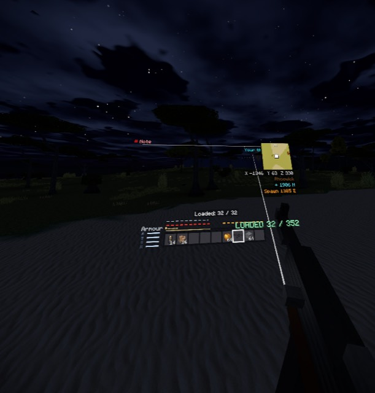

## 16:26:15 - You know, and hard is just instant death if it hits me directly. On no

- **Transcript:** You know, and hard is just instant death if it hits me directly. On normal, it should be crippling and assuming I have like the armor I do right now
- **Status:** open
- **Build:** 0.129 (b0d800c0, M1-M4 (device-tested; ship riding, chests, comfort options, weapon wheel))
- **World:** New World (14) (seed 8775627479714902329)
- **Dimension:** Surface
- **Biome:** Savanna
- **Position:** -1430.5 67.5 304.9
- **Facing:** west (yaw 283, pitch -43)
- **Held:** Hagel Machine Pistol x1
- **Mount:** on foot
- **Looking at:** Grass Block at -1433 66 304
- **Mode:** Survival, health 20/20
- **Time:** day 1 20:08, clear
- **Fps:** 72
- **Levels:** mic -33 dBFS, game sound -17 dBFS
- **Length:** 10.4 s (voice 6.2 s)
- **Just before:** -30s message: Loaded: 32 / 32; -30s left the pack: Rifle Magazine x2; -26s walked into Savanna
- **Position at the end:** -1468.6 67.7 304.7
- **Repro (Mac):** `./snap.sh note --seed 8775627479714902329 --x -1430.5 --z 304.9 --yaw 77 --pitch -43 --time 0.589`
- **Audio (this Mac):** /Users/darthvadar/Documents/Blocksmith/QuestVoiceNotes/raw/vn-20261031-162615-507.aac

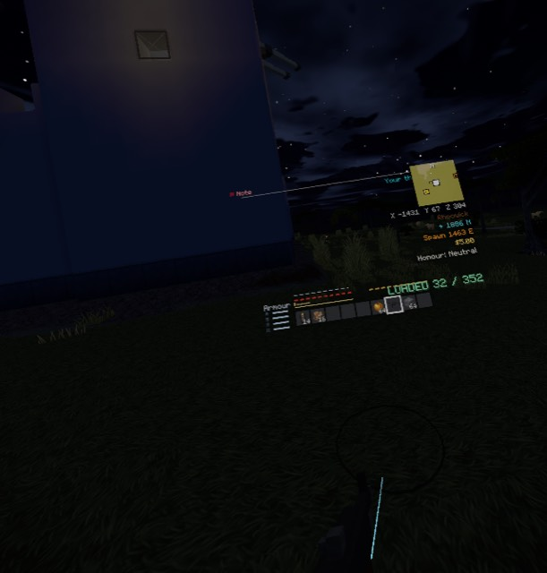

## 16:27:22 - Fuck. Okay, one thing that's becoming annoying

- **Transcript:** Fuck. Okay, one thing that's becoming annoying
- **Status:** open
- **Build:** 0.129 (b0d800c0, M1-M4 (device-tested; ship riding, chests, comfort options, weapon wheel))
- **World:** New World (14) (seed 8775627479714902329)
- **Dimension:** Surface
- **Biome:** Savanna
- **Position:** -1468.2 68.2 352.9
- **Facing:** north-east (yaw 55, pitch -33)
- **Held:** Golden Apple x63
- **Mount:** on foot
- **Looking at:** Dark Station Concrete at -1467 68 351
- **Mode:** Survival, health 7/20
- **Time:** day 1 21:27, clear
- **Fps:** 72
- **Levels:** mic -46 dBFS, game sound -19 dBFS
- **Length:** 4.2 s (voice 1.7 s)
- **Just before:** -22s took 4 damage (health 16/20); -22s left the pack: Rifle Magazine x2; -19s left the pack: Rifle Magazine (at -1460 68 355); -13s took 6 damage (health 12/20); -9s left the pack: Rifle Magazine (at -1468 69 351); -3s message: Greywall Command now counts you tolerated.; -2s took 6 damage (health 7/20); -2s left the pack: Rifle Magazine (at -1468 69 351); -1s message: Loaded: 32 / 32; -0s holding Golden Apple
- **Repro (Mac):** `./snap.sh note --seed 8775627479714902329 --x -1468.2 --z 352.9 --yaw -55 --pitch -33 --time 0.644`
- **Audio (this Mac):** /Users/darthvadar/Documents/Blocksmith/QuestVoiceNotes/raw/vn-20261031-162722-207.aac

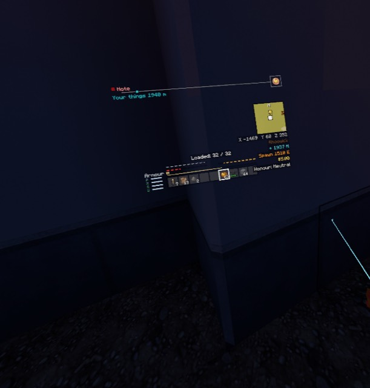

## 16:27:26 - When I try to use left grip to get across my inventory, if I'm holding

- **Transcript:** When I try to use left grip to get across my inventory, if I'm holding a gun, it immediately loads the gun and cocks it instead of scrolling left on the, on the toolbar, which isn't good. We need to make it so that the way to do that isn't so
- **Status:** open
- **Build:** 0.129 (b0d800c0, M1-M4 (device-tested; ship riding, chests, comfort options, weapon wheel))
- **World:** New World (14) (seed 8775627479714902329)
- **Dimension:** Surface
- **Biome:** Savanna
- **Position:** -1468.3 68.2 352.9
- **Facing:** north (yaw 16, pitch 22)
- **Held:** Golden Apple x62
- **Mount:** on foot
- **Looking at:** Station Concrete at -1468 70 351
- **Mode:** Survival, health 10/20
- **Time:** day 1 21:32, clear
- **Fps:** 72
- **Levels:** mic -21 dBFS, game sound -15 dBFS
- **Length:** 17.3 s (voice 11.0 s)
- **Just before:** -26s took 4 damage (health 16/20); -26s left the pack: Rifle Magazine x2; -23s left the pack: Rifle Magazine (at -1460 68 355); -17s took 6 damage (health 12/20); -12s left the pack: Rifle Magazine (at -1468 69 351); -7s message: Greywall Command now counts you tolerated.; -6s took 6 damage (health 7/20); -6s left the pack: Rifle Magazine (at -1468 69 351); -5s message: Loaded: 32 / 32; -4s holding Golden Apple; -4s holding empty hand; -3s holding Golden Apple
- **While talking:** -4s holding Hagel Machine Pistol; -4s message: Hagel Machine Pistol
- **Position at the end:** -1465.1 68.7 353.9
- **Repro (Mac):** `./snap.sh note --seed 8775627479714902329 --x -1468.3 --z 352.9 --yaw -16 --pitch 22 --time 0.648`
- **Audio (this Mac):** /Users/darthvadar/Documents/Blocksmith/QuestVoiceNotes/raw/vn-20261031-162726-167.aac

## 16:27:43 - Like the, the box my army's being

- **Transcript:** Like the, the box my army's being
- **Status:** open
- **Build:** 0.129 (b0d800c0, M1-M4 (device-tested; ship riding, chests, comfort options, weapon wheel))
- **World:** New World (14) (seed 8775627479714902329)
- **Dimension:** Surface
- **Biome:** Savanna
- **Position:** -1463.1 68.1 351.1
- **Facing:** north-east (yaw 25, pitch -1)
- **Held:** Hagel Machine Pistol x1
- **Mount:** on foot
- **Looking at:** Station Concrete at -1462 69 349
- **Mode:** Survival, health 20/20
- **Time:** day 1 21:53, clear
- **Fps:** 72
- **Levels:** mic -32 dBFS, game sound -17 dBFS
- **Length:** 3.1 s (voice 1.6 s)
- **Just before:** -30s left the pack: Rifle Magazine (at -1468 69 351); -24s message: Greywall Command now counts you tolerated.; -23s took 6 damage (health 7/20); -23s left the pack: Rifle Magazine (at -1468 69 351); -22s message: Loaded: 32 / 32; -21s holding Golden Apple; -21s holding empty hand; -20s holding Golden Apple; -12s holding Hagel Machine Pistol; -12s message: Hagel Machine Pistol
- **Repro (Mac):** `./snap.sh note --seed 8775627479714902329 --x -1463.1 --z 351.1 --yaw -25 --pitch -1 --time 0.662`
- **Audio (this Mac):** /Users/darthvadar/Documents/Blocksmith/QuestVoiceNotes/raw/vn-20261031-162743-527.aac

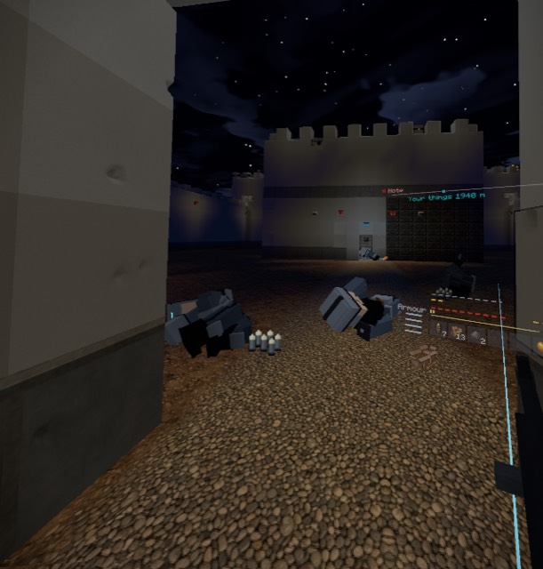

## 16:27:46 - Isn't so big or whatever

- **Transcript:** Isn't so big or whatever
- **Status:** open
- **Build:** 0.129 (b0d800c0, M1-M4 (device-tested; ship riding, chests, comfort options, weapon wheel))
- **World:** New World (14) (seed 8775627479714902329)
- **Dimension:** Surface
- **Biome:** Savanna
- **Position:** -1462.3 68.1 350.9
- **Facing:** north (yaw 9, pitch -16)
- **Held:** Hagel Machine Pistol x1
- **Mount:** on foot
- **Looking at:** Station Concrete at -1462 69 349
- **Mode:** Survival, health 20/20
- **Time:** day 1 21:56, clear
- **Fps:** 71
- **Levels:** mic -32 dBFS, game sound -25 dBFS
- **Length:** 2.1 s (voice 1.0 s)
- **Just before:** -27s message: Greywall Command now counts you tolerated.; -26s took 6 damage (health 7/20); -26s left the pack: Rifle Magazine (at -1468 69 351); -25s message: Loaded: 32 / 32; -24s holding Golden Apple; -24s holding empty hand; -23s holding Golden Apple; -14s holding Hagel Machine Pistol; -14s message: Hagel Machine Pistol
- **Repro (Mac):** `./snap.sh note --seed 8775627479714902329 --x -1462.3 --z 350.9 --yaw -9 --pitch -16 --time 0.664`
- **Audio (this Mac):** /Users/darthvadar/Documents/Blocksmith/QuestVoiceNotes/raw/vn-20261031-162746-387.aac

## 16:27:52 - That way it doesn't just always think I'm hitting it

- **Transcript:** That way it doesn't just always think I'm hitting it
- **Status:** open
- **Build:** 0.129 (b0d800c0, M1-M4 (device-tested; ship riding, chests, comfort options, weapon wheel))
- **World:** New World (14) (seed 8775627479714902329)
- **Dimension:** Surface
- **Biome:** Savanna
- **Position:** -1454.6 68.1 336.7
- **Facing:** north-west (yaw 314, pitch -23)
- **Held:** Hagel Machine Pistol x1
- **Mount:** on foot
- **Looking at:** Coarse Dirt at -1458 67 333
- **Mode:** Survival, health 20/20
- **Time:** day 1 22:03, clear
- **Fps:** 72
- **Levels:** mic -29 dBFS, game sound -18 dBFS
- **Length:** 4.2 s (voice 1.8 s)
- **Just before:** -30s holding Golden Apple; -30s holding empty hand; -29s holding Golden Apple; -20s holding Hagel Machine Pistol; -20s message: Hagel Machine Pistol; -0s message: Loaded: 32 / 32
- **Repro (Mac):** `./snap.sh note --seed 8775627479714902329 --x -1454.6 --z 336.7 --yaw 46 --pitch -23 --time 0.669`
- **Audio (this Mac):** /Users/darthvadar/Documents/Blocksmith/QuestVoiceNotes/raw/vn-20261031-162752-067.aac

## 16:28:01 - I still can't get through the fucking doors easy

- **Transcript:** I still can't get through the fucking doors easy
- **Status:** open
- **Build:** 0.129 (b0d800c0, M1-M4 (device-tested; ship riding, chests, comfort options, weapon wheel))
- **World:** New World (14) (seed 8775627479714902329)
- **Dimension:** Surface
- **Biome:** Savanna
- **Position:** -1463.7 68.0 330.5
- **Facing:** north (yaw 4, pitch -12)
- **Held:** Hagel Machine Pistol x1
- **Mount:** on foot
- **Looking at:** Dark Station Concrete at -1464 68 324
- **Mode:** Survival, health 20/20
- **Time:** day 1 22:15, clear
- **Fps:** 72
- **Levels:** mic -30 dBFS, game sound -16 dBFS
- **Length:** 3.5 s (voice 1.7 s)
- **Just before:** -30s holding Hagel Machine Pistol; -30s message: Hagel Machine Pistol; -10s message: Loaded: 32 / 32; -5s message: The Capital now counts you wary of you.
- **Repro (Mac):** `./snap.sh note --seed 8775627479714902329 --x -1463.7 --z 330.5 --yaw -4 --pitch -12 --time 0.677`
- **Audio (this Mac):** /Users/darthvadar/Documents/Blocksmith/QuestVoiceNotes/raw/vn-20261031-162801-807.aac

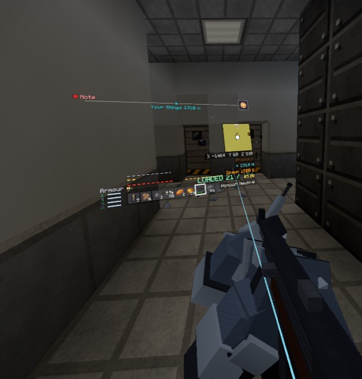

## 16:28:57 - There should be people on the second floor, like a Hannibal troop or s

- **Transcript:** There should be people on the second floor, like a Hannibal troop or something
- **Status:** open
- **Build:** 0.129 (b0d800c0, M1-M4 (device-tested; ship riding, chests, comfort options, weapon wheel))
- **World:** New World (14) (seed 8775627479714902329)
- **Dimension:** Surface
- **Biome:** Savanna
- **Position:** -1470.8 73.0 326.7
- **Facing:** north-east (yaw 59, pitch -4)
- **Held:** Hagel Machine Pistol x1
- **Mount:** on foot
- **Looking at:** Steel Railing at -1467 73 324
- **Mode:** Survival, health 20/20
- **Time:** day 1 23:21, clear
- **Fps:** 72
- **Levels:** mic -32 dBFS, game sound -22 dBFS
- **Length:** 4.6 s (voice 2.4 s)
- **Just before:** -25s took 12 damage (health 10/20); -24s into the pack: Regular Armour Set; -24s message: Ruth Underhill: Dark comes quick this time of year.; -22s holding Golden Apple; -20s holding Hagel Machine Pistol; -20s message: Hagel Machine Pistol; -18s message: Loaded: 32 / 32; -18s left the pack: Rifle Magazine (at -1466 69 328); -9s opened ChestMenu; -7s closed ChestMenu; -4s message: Locked
- **Repro (Mac):** `./snap.sh note --seed 8775627479714902329 --x -1470.8 --z 326.7 --yaw -59 --pitch -4 --time 0.723`
- **Audio (this Mac):** /Users/darthvadar/Documents/Blocksmith/QuestVoiceNotes/raw/vn-20261031-162857-147.aac

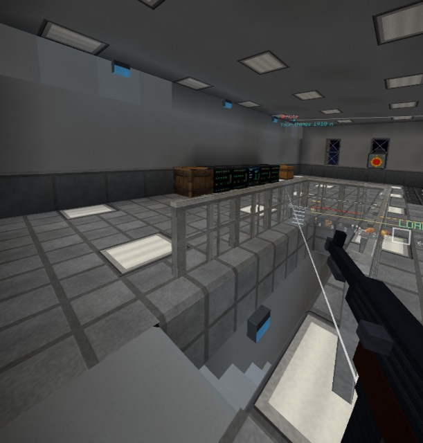

## 16:29:08 - I should be able to turn the alarm off too

- **Transcript:** I should be able to turn the alarm off too
- **Status:** open
- **Build:** 0.129 (b0d800c0, M1-M4 (device-tested; ship riding, chests, comfort options, weapon wheel))
- **World:** New World (14) (seed 8775627479714902329)
- **Dimension:** Surface
- **Biome:** Savanna
- **Position:** -1457.7 73.0 325.5
- **Facing:** east (yaw 107, pitch -37)
- **Held:** Hagel Machine Pistol x1
- **Mount:** on foot
- **Looking at:** Alarm Panel at -1457 74 325
- **Mode:** Survival, health 20/20
- **Time:** day 1 23:35, clear
- **Fps:** 72
- **Levels:** mic -21 dBFS, game sound -21 dBFS
- **Length:** 2.9 s (voice 1.3 s)
- **Just before:** -29s message: Loaded: 32 / 32; -29s left the pack: Rifle Magazine (at -1466 69 328); -21s opened ChestMenu; -18s closed ChestMenu; -15s message: Locked; -10s opened ChestMenu; -7s into the pack: Greywall Dispatch; -7s closed ChestMenu; -6s opened ChestMenu; -5s closed ChestMenu
- **Repro (Mac):** `./snap.sh note --seed 8775627479714902329 --x -1457.7 --z 325.5 --yaw -107 --pitch -37 --time 0.733`
- **Audio (this Mac):** /Users/darthvadar/Documents/Blocksmith/QuestVoiceNotes/raw/vn-20261031-162908-846.aac

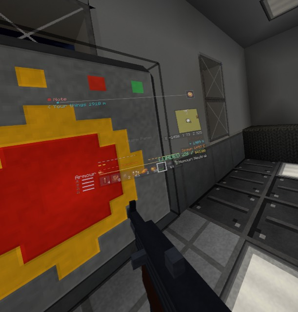

## 16:29:11 - Which I can't seem to

- **Transcript:** Which I can't seem to
- **Status:** open
- **Build:** 0.129 (b0d800c0, M1-M4 (device-tested; ship riding, chests, comfort options, weapon wheel))
- **World:** New World (14) (seed 8775627479714902329)
- **Dimension:** Surface
- **Biome:** Savanna
- **Position:** -1469.4 72.9 325.4
- **Facing:** south-east (yaw 118, pitch -45)
- **Held:** Hagel Machine Pistol x1
- **Mount:** on foot
- **Looking at:** Station Floor Tiles at -1469 72 326
- **Mode:** Survival, health 20/20
- **Time:** day 1 23:38, clear
- **Fps:** 72
- **Levels:** mic -49 dBFS, game sound -18 dBFS
- **Length:** 2.5 s (voice 1.0 s)
- **Just before:** -23s opened ChestMenu; -21s closed ChestMenu; -18s message: Locked; -13s opened ChestMenu; -10s into the pack: Greywall Dispatch; -10s closed ChestMenu; -8s opened ChestMenu; -8s closed ChestMenu
- **Repro (Mac):** `./snap.sh note --seed 8775627479714902329 --x -1469.4 --z 325.4 --yaw -118 --pitch -45 --time 0.735`
- **Audio (this Mac):** /Users/darthvadar/Documents/Blocksmith/QuestVoiceNotes/raw/vn-20261031-162911-507.aac

## 16:29:13 - And there should be a key to unlock this door, which

- **Transcript:** And there should be a key to unlock this door, which
- **Status:** open
- **Build:** 0.129 (b0d800c0, M1-M4 (device-tested; ship riding, chests, comfort options, weapon wheel))
- **World:** New World (14) (seed 8775627479714902329)
- **Dimension:** Surface
- **Biome:** Savanna
- **Position:** -1461.1 68.0 325.2
- **Facing:** south-east (yaw 154, pitch -21)
- **Held:** Hagel Machine Pistol x1
- **Mount:** on foot
- **Looking at:** Bulkhead Door at -1461 68 327
- **Mode:** Survival, health 20/20
- **Time:** day 1 23:41, clear
- **Fps:** 72
- **Levels:** mic -24 dBFS, game sound -17 dBFS
- **Length:** 3.5 s (voice 1.9 s)
- **Just before:** -26s opened ChestMenu; -24s closed ChestMenu; -20s message: Locked; -15s opened ChestMenu; -12s into the pack: Greywall Dispatch; -12s closed ChestMenu; -11s opened ChestMenu; -10s closed ChestMenu
- **Repro (Mac):** `./snap.sh note --seed 8775627479714902329 --x -1461.1 --z 325.2 --yaw -154 --pitch -21 --time 0.737`
- **Audio (this Mac):** /Users/darthvadar/Documents/Blocksmith/QuestVoiceNotes/raw/vn-20261031-162913-967.aac

## 16:29:17 - I don't think there is. If there is, I haven't seen it

- **Transcript:** I don't think there is. If there is, I haven't seen it
- **Status:** open
- **Build:** 0.129 (b0d800c0, M1-M4 (device-tested; ship riding, chests, comfort options, weapon wheel))
- **World:** New World (14) (seed 8775627479714902329)
- **Dimension:** Surface
- **Biome:** Savanna
- **Position:** -1466.7 68.0 329.8
- **Facing:** west (yaw 265, pitch -27)
- **Held:** Hagel Machine Pistol x1
- **Mount:** on foot
- **Looking at:** Steel Plating Slab at -1469 68 329
- **Mode:** Survival, health 20/20
- **Time:** day 1 23:45, clear
- **Fps:** 72
- **Levels:** mic -31 dBFS, game sound -18 dBFS
- **Length:** 3.8 s (voice 1.8 s)
- **Just before:** -29s opened ChestMenu; -27s closed ChestMenu; -24s message: Locked; -19s opened ChestMenu; -16s into the pack: Greywall Dispatch; -16s closed ChestMenu; -15s opened ChestMenu; -14s closed ChestMenu
- **Repro (Mac):** `./snap.sh note --seed 8775627479714902329 --x -1466.7 --z 329.8 --yaw 95 --pitch -27 --time 0.740`
- **Audio (this Mac):** /Users/darthvadar/Documents/Blocksmith/QuestVoiceNotes/raw/vn-20261031-162917-547.aac

## 16:29:49 - Okay, the enemy is still unable to damage the tower I'm on. Still infl

- **Transcript:** Okay, the enemy is still unable to damage the tower I'm on. Still inflicting no damage. I obliterated his tower though
- **Status:** open
- **Build:** 0.129 (b0d800c0, M1-M4 (device-tested; ship riding, chests, comfort options, weapon wheel))
- **World:** New World (14) (seed 8775627479714902329)
- **Dimension:** Surface
- **Biome:** Savanna
- **Position:** -1486.0 85.5 308.6
- **Facing:** east (yaw 88, pitch -10)
- **Held:** empty hand
- **Mount:** on foot
- **Looking at:** nothing
- **Mode:** Survival, health 20/20
- **Time:** day 1 00:20, clear
- **Fps:** 60
- **Levels:** mic -21 dBFS, game sound -24 dBFS
- **Length:** 9.0 s (voice 5.1 s)
- **Just before:** -29s opened ChestMenu; -28s closed ChestMenu; -23s opened ChestMenu; -21s closed ChestMenu; -18s opened ChestMenu; -17s closed ChestMenu; -13s message: Ruth Underhill: Hear the crickets? Loud tonight.; -9s message: The Greywall Garrison is sounding the alarm!; -4s holding empty hand; -4s message: Manning the deck gun; -3s message: Gun Control: the gun overhead, worked from this computer
- **While talking:** -1s message: The turret is wrecked
- **Position at the end:** -1486.0 85.5 308.3
- **Repro (Mac):** `./snap.sh note --seed 8775627479714902329 --x -1486.0 --z 308.6 --yaw -88 --pitch -10 --time 0.764`
- **Audio (this Mac):** /Users/darthvadar/Documents/Blocksmith/QuestVoiceNotes/raw/vn-20261031-162949-267.aac

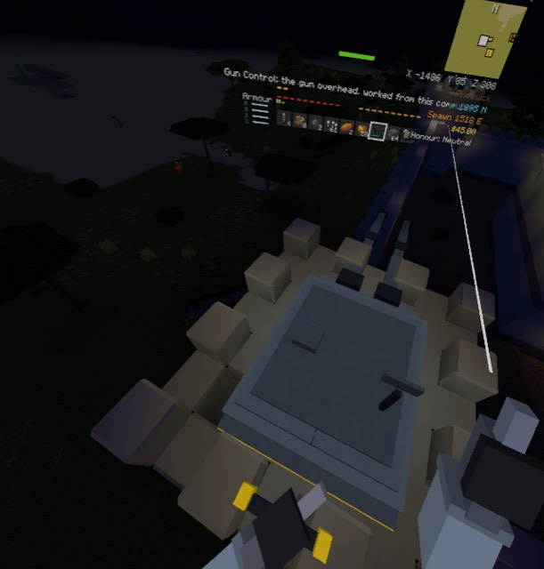
