# Carbon blind review (full resolution, in parts)

## Part 1 of 29

### Recorder Corruption Note
Recorder tiling/freeze artifacts appear starting at **`07:25:16 + 00:00:35.458`** and persist along the right and bottom margins through the end of the clip (**`07:34:49 + 00:00:09.458`**), with occasional brief full-frame tile mosaics (e.g., **`07:25:56 + 00:00:17.250`**). Per instructions, this recorder corruption is excluded from the game bug list below.

---

### Chronological Game Bug Findings

1. **`07:25:16 + 00:00:01.458` – `07:25:16 + 00:00:08.458`** — **Floating felled tree canopy & hollow branch geometry**
   * **What:** Two cut logs lie on the ground (`07:25:16 + 00:00:04.458`), while the entire upper charred canopy and branches float suspended in mid-air. At `07:25:16 + 00:00:02.458`, the severed lower branches have missing/see-through faces.
   * **Severity:** Should fix
   * **Likely cause:** Tree-felling logic only detaches trunk blocks near the cut without propagating structural collapse to upper branch/leaf voxels, and open voxel cross-sections lack cap faces.
    - **Shots:** 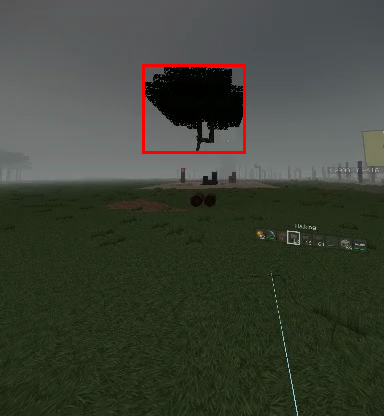 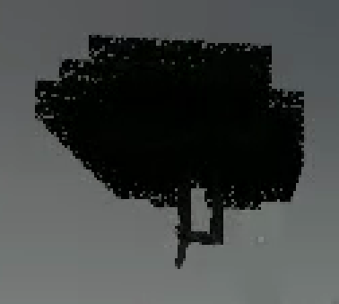 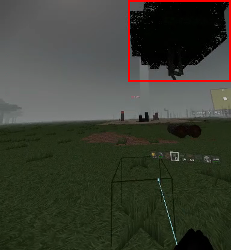 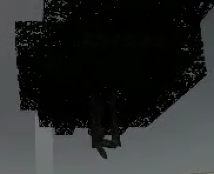

2. **`07:25:16 + 00:00:11.458` – `07:25:16 + 00:00:14.458`** — **Pause menu crash-warning text crowds panel border**
   * **What:** Footer text (*"The game closed unexpectedly..."*) sits cramped right on the bottom edge of the pause menu panel just above the controller button legend.
   * **Severity:** Minor
   * **Likely cause:** Fixed panel height does not expand when the crash-recovery warning string is active.
    - **Shots:** 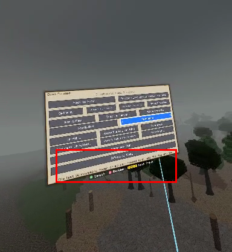 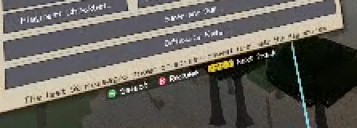 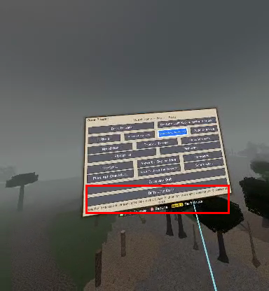 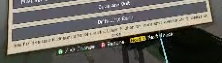

3. **`07:25:16 + 00:00:26.458` – `07:25:16 + 00:00:28.458`** (also on respawn at **`07:28:38 + 00:00:08.000`**, **`07:28:44 + 00:00:01.750`**, **`07:29:52 + 00:00:07.208`**) — **Spawning/respawning into unloaded sky void or bare low-LOD plane**
   * **What:** Loading a new world or clicking Respawn drops the player into an empty green plane or solid light-blue void for 1–3 seconds before terrain chunks, trees, and camp objects pop in around them (`07:25:16 + 00:00:29.458`).
   * **Severity:** Store-blocking
   * **Likely cause:** Loading/fade screen dismisses before spawn-radius chunk meshes finish generating and uploading to the GPU.
    - **Shots:** 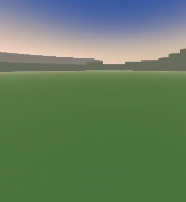 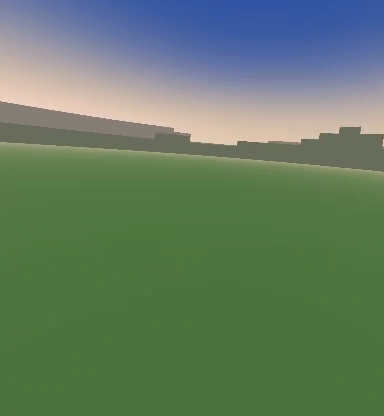

4. **`07:25:16 + 00:00:29.458` – `07:25:16 + 00:00:34.458`** — **Floating lore text clips props & cantilevered camp chest**
   * **What:** World-space narrative text (*"In Clear Ford's..."*) intersects the crafting table mesh, reducing readability; the wooden chest on the snow mound (`07:25:16 + 00:00:34.458`) hangs half-unsupported over the sloped terrain edge.
   * **Severity:** Minor
   * **Likely cause:** Camp prefab places rigid block props on procedural smooth-voxel slopes without terrain flattening, and world-space text lacks depth/collision offset.
    - **Shots:** 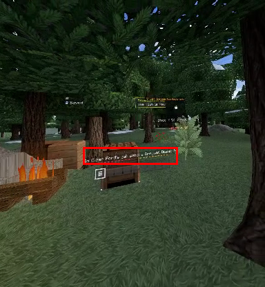 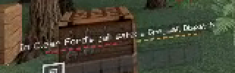 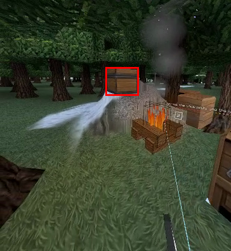 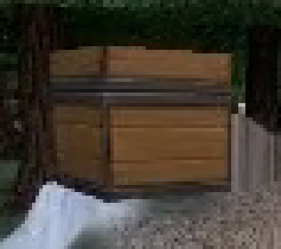

5. **`07:25:16 + 00:00:46.458`**, **`07:25:56 + 00:00:05.250` – `00:00:12.250`**, **`07:28:44 + 00:00:14.750`**, **`07:29:52 + 00:00:16.208`**, **`07:32:10 + 00:00:06.250` – `00:00:10.250`**, **`07:32:19 + 00:00:00.792` – `00:00:01.792`** — **Full-screen darkening / stall dim-outs during fast flight**
   * **What:** While flying across regions, the entire display (including sky and HUD) dims heavily for 1–7 seconds at a time.
   * **Severity:** Store-blocking
   * **Likely cause:** Synchronous chunk generation/serialization stalling the render/main thread and triggering Meta Quest system compositor hang-dimming (violates Meta VRC frame-timing requirements).
    - **Shots:** 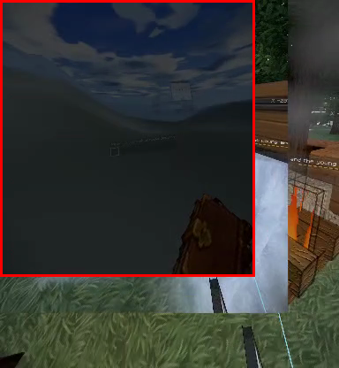 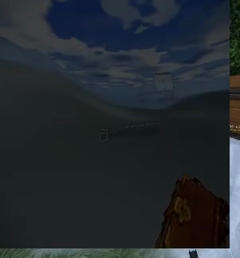 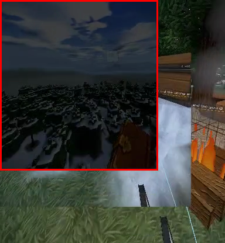 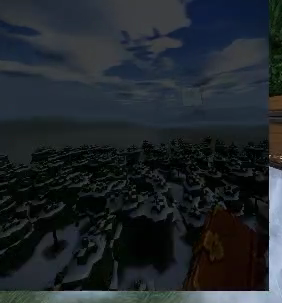

6. **`07:25:56 + 00:00:14.250` – `00:00:16.250`**, **`07:29:52 + 00:00:18.208` – `00:00:21.208`**, **`07:32:10 + 00:00:11.250` – `00:00:13.250`**, **`07:32:19 + 00:00:02.792` – `00:00:05.792`** — **Floating fortress and trees in empty sky before terrain loads**
   * **What:** Trees and the entire Greywall Fortress (`07:32:10 + 00:00:12.250`) render suspended in empty blue fog/sky seconds before the ground chunks beneath them appear.
   * **Severity:** Should fix
   * **Likely cause:** Structure/tree instancing or LOD draw distance exceeds terrain chunk mesh streaming distance, or structures render before their host terrain chunk is ready.
    - **Shots:** 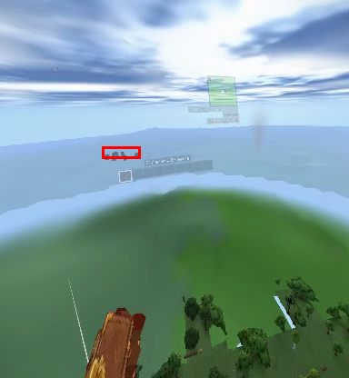 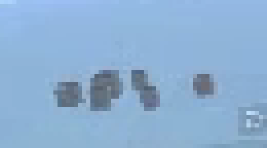 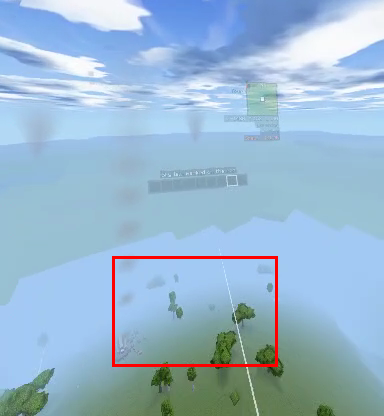 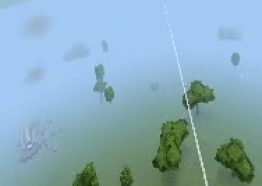

7. **`07:26:39 + 00:00:05.167`** — **Single-frame skybox/weather pop**
   * **What:** Bright blue sky (`07:26:39 + 00:00:04.167`) snaps instantaneously to dark stormy grey (`07:26:39 + 00:00:05.167`) and back to sunny blue (`07:26:39 + 00:00:06.167`) while standing in the forest.
   * **Severity:** Should fix
   * **Likely cause:** Unsmoothed biome sky/weather transition or uninitialized sky state flickering on a boundary voxel.
    - **Shots:** 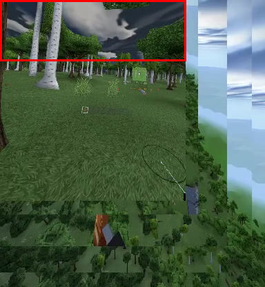 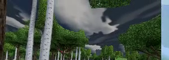

8. **`07:27:33 + 00:00:11.583` – `07:27:33 + 00:00:20.583`** (also **`07:28:26 + 00:00:11.042`**, **`07:29:31 + 00:00:10.250`**, **`07:29:31 + 00:00:24.250`**, **`07:31:32 + 00:00:08.000`**) — **Severe Z-fighting on rotary gun ammo box**
   * **What:** Prominent black-and-white diagonal striping shimmers across the top face of the left side-mounted ammo drum whenever the heavy rotary gun moves.
   * **Severity:** Should fix
   * **Likely cause:** Coplanar/overlapping polygons in the weapon mesh (white outer casing sharing exact depth with black inner box or hand block).
    - **Shots:** 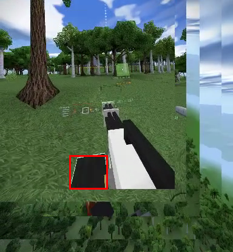 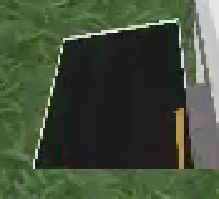 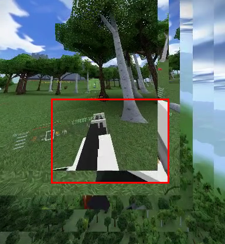 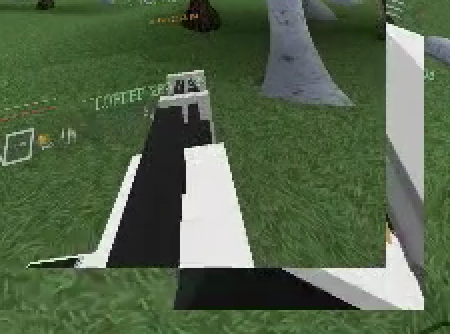

9. **`07:28:26 + 00:00:10.042` – `07:28:26 + 00:00:17.042`** (also **`07:28:38 + 00:00:05.000`**, **`07:30:49 + 00:00:11.333`**) — **Heavy weapon clips into VR camera & wrist HUD draws through gun**
   * **What:** Bringing the rotary gun up blocks most of the player's view and clips the near plane, while the wrist HUD (`Armour`, health, `LOADED`) renders on top of/through the solid gun body.
   * **Severity:** Should fix
   * **Likely cause:** Two-handed weapon grip offset sits too close to the HMD eye position, and the wrist HUD uses `ZTest Always` without occluding or fading when behind held weapons.
    - **Shots:** 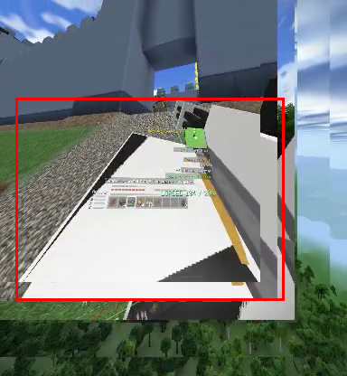 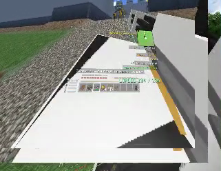 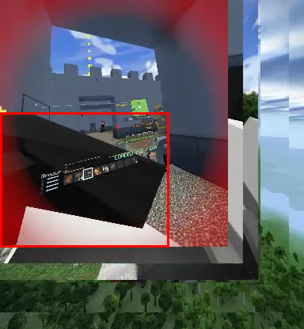 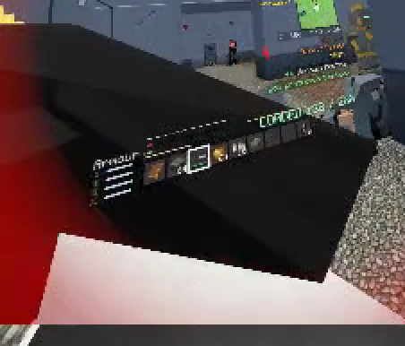

10. **`07:28:38 + 00:00:07.000`**, **`07:29:31 + 00:00:27.250`**, **`07:29:52 + 00:00:06.208`** — **Death chest spawns clipping into camera and "You Died!" UI**
    * **What:** Immediately after dying, the player's loot chest spawns at the death location and slices directly through the floating *"You Died!"* dialog panel.
    * **Severity:** Minor
    * **Likely cause:** Death UI renders in world space without depth priority or clearance check against the newly spawned gravestone chest block.
    - **Shots:** 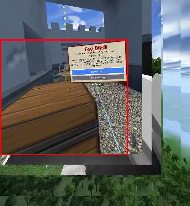 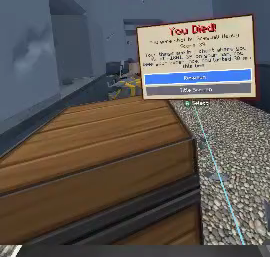 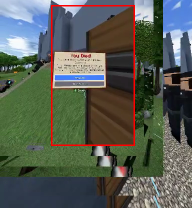 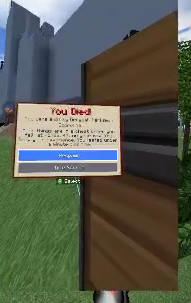

11. **`07:29:01 + 00:00:11.083` – `07:29:01 + 00:00:25.083`** (also **`07:31:32 + 00:00:13.000`**, **`07:31:40 + 00:00:05.500`**) — **Blurry pixelated 2D item mesh & harsh rectangular heal overlay**
    * **What:** The held healing/consumable item renders as an oversized, bilinear-blurred 2D sprite extrusion with jagged alpha stair-stepping; activating it (`07:31:32 + 00:00:13.000`) draws a sharp-edged green box vignette in VR.
    * **Severity:** Minor
    * **Likely cause:** Item icon texture uses linear filtering instead of point filtering when extruded into a held mesh, and screen-space buff vignette isn'tsized/feathered for VR stereo FOV.
    - **Shots:** 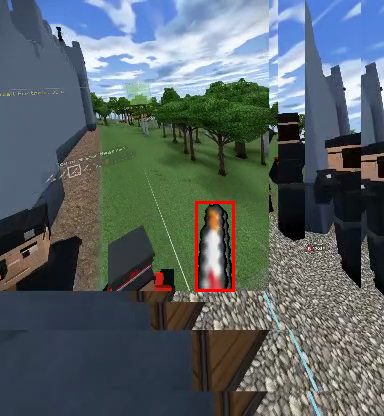 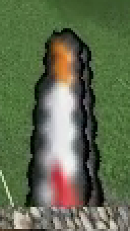 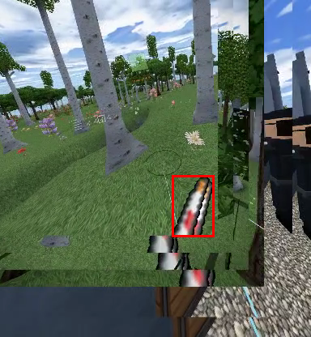 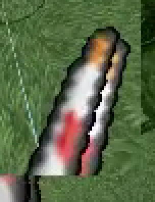

12. **`07:29:31 + 00:00:15.250` – `07:29:31 + 00:00:26.250`** (and **`07:29:52 + 00:00:00.208` – `00:00:05.208`**) — **Enemy corpse/NPC stuck floating at a 45° angle**
    * **What:** A downed black-uniformed soldier hangs frozen mid-air tilted diagonally above the fortress entrance ramp.
    * **Severity:** Should fix
    * **Likely cause:** Death animation/ragdoll collider snags on stepped slope collision bounds or freezes before reaching ground rest.
    - **Shots:** 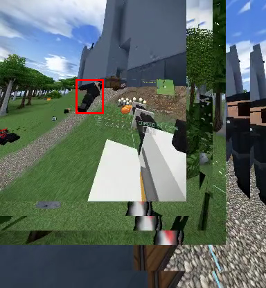 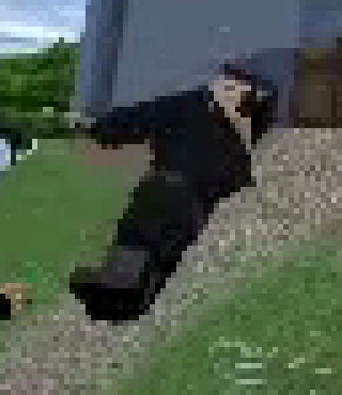 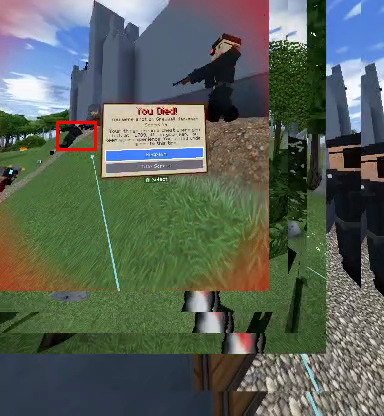 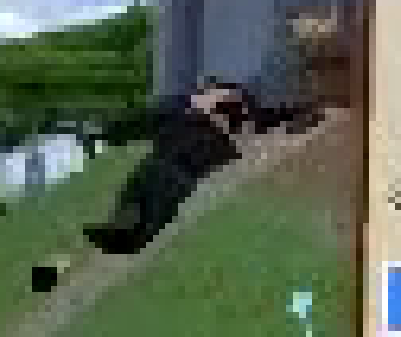

13. **`07:31:12 + 00:00:08.000`** and **`07:31:40 + 00:00:20.500`** — **Pitch-black screen when entering blast craters / breached walls**
    * **What:** Moving into newly blasted craters under the fortress wall turns the entire world pitch black while the HUD remains visible.
    * **Severity:** Store-blocking
    * **Likely cause:** VR head/camera clipping inside solid/unrebuilt voxel collision geometry or triggering an aggressive head-in-wall comfort blackout due to stale physics colliders after explosions.
    - **Shots:** 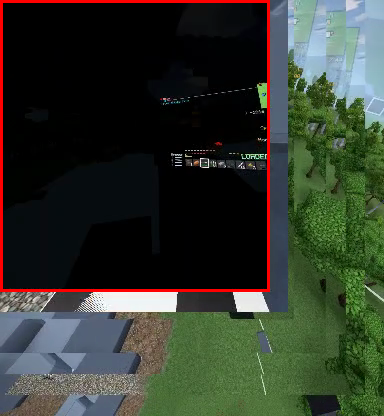 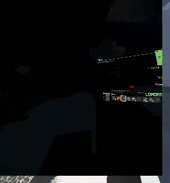 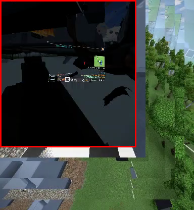 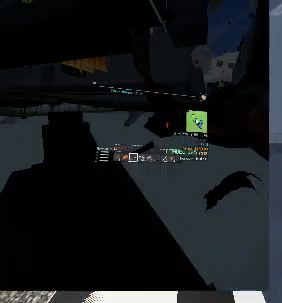

14. **`07:32:19 + 00:00:16.792` – `00:00:17.792`** and **`07:32:32 + 00:00:04.125`** — **Broken L-shaped half-floating double chest**
    * **What:** Outside the blasted fortress corner, a double chest has one of its lower halves missing, leaving an L-shaped wooden chest floating in mid-air.
    * **Severity:** Should fix
    * **Likely cause:** Explosion damage destroyed one block of a multi-block/stacked chest setup without breaking or updating the connected half.
    - **Shots:** 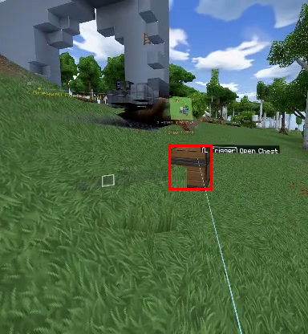 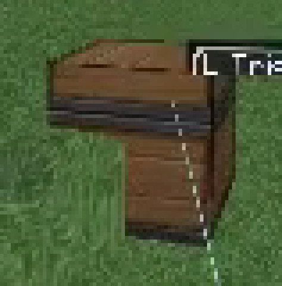  

15. **`07:32:19 + 00:00:16.792`**, **`07:32:32 + 00:00:05.125` – `00:00:11.125`**, **`07:32:43 + 00:00:01.333` – `00:00:02.333`** — **Massive floating fortress walls, turrets, ladders, and trees after explosions**
    * **What:** Blast craters remove the ground beneath Greywall Fortress, leaving huge sections of stone curtain walls, a heavy corner turret (`07:32:32 + 00:00:08.125`), detached ladder rungs (`07:32:32 + 00:00:10.125`), and sheared tree canopies/logs (`07:32:32 + 00:00:11.125`) floating completely unsupported in mid-air.
    * **Severity:** Should fix
    * **Likely cause:** Voxel destruction removes blasted blocks without running structural support checks on attached non-terrain blocks (ladders, turrets, logs, walls).
    - **Shots:**    

16. **`07:32:47 + 00:00:38.667` – `07:32:47 + 00:00:47.667`** — **See-through hole in hillside showing sky under fortress wall**
    * **What:** Approaching the blasted fortress hill from below reveals a bright strip of sky blue shining straight through the terrain/crater seam beneath the floating grey wall (`07:32:47 + 00:00:39.667`, `00:00:40.667`, `00:00:47.667`).
    * **Severity:** Store-blocking
    * **Likely cause:** Missing chunk-boundary skirt geometry or single-sided backface culling on deformed smooth-voxel terrain meshes after explosion modification.
    - **Shots:**    

17. **`07:32:47 + 00:00:52.667` – `00:00:54.667`**, **`07:33:37 + 00:00:03.500` – `00:00:05.500`**, **`07:33:42 + 00:00:06.917`**, **`07:33:42 + 00:00:11.917`**, **`07:33:48 + 00:00:03.667`**, **`07:33:48 + 00:00:07.667`** — **Sniper scope blacks out entire VR screen & draws HUD inside/over scope**
    * **What:** Raising the Fernblick Rifle blacks out 100% of peripheral vision in VR, turning the whole screen solid black whenever the eye is slightly off-axis (`07:32:47 + 00:00:52.667`, `07:33:42 + 00:00:06.917`). Meanwhile, the 3D wrist HUD/minimap still draws brightly over the black mask or gets magnified inside the scope reticle (`07:33:48 + 00:00:03.667`).
    * **Severity:** Store-blocking
    * **Likely cause:** Flat-screen full-screen 2D scope vignette used directly in VR instead of a render-texture lens on the rifle optic, plus UI layer included in the scope camera/depth pass.
    - **Shots:**    

18. **`07:33:48 + 00:00:27.667` – `07:33:48 + 00:00:43.667`** — **Obstructive 2D screen-space fire overlay & pitch-black crater/smoke artifact**
    * **What:** Catching fire plasters giant, flat, pixelated orange flame triangles across the bottom of the VR view, and a solid pitch-black unlit sphere/void (`07:33:48 + 00:00:36.667` – `00:00:42.667`) sits inside the blasted fortress corridor.
    * **Severity:** Should fix
    * **Likely cause:** Screen-locked 2D HUD fire sprites uncomfortable and depth-conflicting in stereo VR; unlit black particle/scorch volume or broken lighting inside deeply carved voxel craters.
    - **Shots:**    

---

### Top 10 Priority Bugs for Meta Horizon Store Release

1. **Full-screen darkening / main-thread stalls during world streaming** (`07:25:56 + 00:00:05.250` – `00:00:12.250`, etc.) — Store-blocking VRC performance/hang issue in VR.
2. **Sniper scope blacks out entire VR FOV & captures/overdraws HUD** (`07:32:47 + 00:00:52.667`, `07:33:48 + 00:00:03.667`) — Store-blocking VR comfort and usability failure during combat.
3. **Spawning and respawning into unloaded void / bare terrain** (`07:25:16 + 00:00:26.458`, `07:28:38 + 00:00:08.000`) — Store-blocking polish/immersion break on every world load and death.
4. **Pitch-black screen blackouts when stepping into blast craters** (`07:31:12 + 00:00:08.000`, `07:31:40 + 00:00:20.500`) — Store-blocking disorientation in active combat zones.
5. **See-through terrain holes showing sky under blasted hillsides** (`07:32:47 + 00:00:39.667` – `00:00:47.667`) — Store-blocking rendering artifact exposing the skybox through the ground.
6. **Heavy weapon Z-fighting & camera/HUD depth clipping** (`07:27:33 + 00:00:11.583`, `07:28:26 + 00:00:10.042`) — Highly visible mesh shimmering and HUD intersection right in the player's face.
7. **Floating ladders, turrets, chests, and walls after explosions** (`07:32:19 + 00:00:16.792`, `07:32:32 + 00:00:08.125` – `00:00:11.125`) — Breaks world believability whenever explosives are used on structures.
8. **Floating tree canopies & hollow branch faces after felling trees** (`07:25:16 + 00:00:01.458` – `00:00:08.458`) — Core sandbox gathering loop leaves broken floating geometry.
9. **Enemy bodies stuck floating mid-air on slopes** (`07:29:31 + 00:00:15.250` – `00:00:25.250`) — Obvious physics/animation glitch during fortress combat.
10. **Fortress & trees popping in suspended in mid-air before terrain chunks load** (`07:32:10 + 00:00:12.250`) + **1-frame skybox weather pop** (`07:26:39 + 00:00:05.167`) — Jarring visual streaming pops during exploration.

## Part 2 of 29

### Recorder Artifacts Noted (Not Counted as Game Bugs)
* **Stale border tiling:** Throughout almost the entire clip (`07:34:49 + 00:00:10.875` to `07:40:23 + 00:00:09.917`, and again from `07:42:41 + 00:00:07.250` to `07:43:59 + 00:00:27.708`), the right and bottom edges outside the top-left VR crop show frozen, repeated strips from earlier frames (castle wall/trees, chest UI, and airship deck).
* **Clip-boundary replay overlap:** Several clip transitions replay the last ~4–10 seconds of the previous clip (e.g., `07:35:04 + 00:00:00.208`–`00:00:04.208` repeats `07:34:49 + 00:00:15.875`–`00:00:19.875`; similar overlaps occur at `07:35:16`, `07:35:25`, `07:38:21`, `07:39:11`, `07:40:23`, `07:42:00`, `07:42:33`, `07:42:41`, and `07:42:55`).

---

### Game Bugs Found

1. **Ship telemetry HUD collides directly with player wrist HUD, health bars, and alerts**
   * **Time:** `07:40:30 + 00:01:16.708`–`00:01:32.708`, `07:42:00 + 00:00:00.750`–`00:00:34.750`, `07:42:33 + 00:00:00.958`–`00:00:06.958`
   * **What you see:** As soon as the player lands on the exterior roof of the enemy *Meridian Frigate*, the full warship helm status block (`Meridian Frigate - Warship`, `Hull`, `Guns ready`, `Drive`, `Pitch +0`, `Tidebreaker READY`) renders in the exact same space as the player's hotbar, health/armour bars, weapon label (`Slatefall Carbine`), and alert text (`The Meridian Frigate's crew has spotted you!`), creating an unreadable jumble.
   * **Severity:** Store-blocking
   * **Likely cause:** Vehicle/ship status UI uses the same wrist/HUD anchor as item tooltips and status toasts without vertical layout stacking, and triggers for anyone standing on the ship bounds rather than only the helm pilot.

2. **Bright cyan/blue see-through cracks and Z-fighting inside moving airship walls**
   * **Time:** `07:42:55 + 00:00:54.250`–`00:00:56.250`, `07:43:59 + 00:00:02.708`–`00:00:06.708`, `07:43:59 + 00:00:23.708`
   * **What you see:** Inside the dark lower engine deck of the moving *Meridian Frigate*, bright cyan/sky-blue rectangular holes and vertical slits flash between solid wall/floor block seams, and dark flickering Z-fighting patches appear on the left tiled wall (`07:43:59 + 00:00:23.708`).
   * **Severity:** Store-blocking
   * **Likely cause:** Floating-point precision / T-junction cracks between sub-meshes on a moving kinematic ship grid letting background clear color bleed through, plus coplanar face overlap on interior wall blocks.

3. **Camera clips into blast crater overhang and plunges VR view into pitch-black / hollow geometry**
   * **Time:** `07:35:47 + 00:00:00.083`–`00:00:06.083`
   * **What you see:** After falling into a blast crater beneath the fortress wall, the player's view goes completely pitch black (`00.083`, `01.083`, `05.083`) and clips into the underside of grey wall blocks (`02.083`, `04.083`), showing hollow/culled block faces and floating fire.
   * **Severity:** Store-blocking
   * **Likely cause:** VR head collider lacks push-out from overhanging crater voxels, allowing the eye camera inside solid/unlit block geometry.

4. **Multi-line event notifications overlap health/armour bars and turret boss/waypoint UI**
   * **Time:** `07:35:47 + 00:00:20.083`–`00:00:36.083`, `07:38:21 + 00:00:53.833`–`00:00:55.833`, `07:39:11 + 00:00:05.083`–`00:00:08.083`, `07:39:11 + 00:00:46.083`–`00:01:03.083`
   * **What you see:** Two to three lines of white combat/fortress notification text draw directly over the player's health bar, armour bar, and `LOADED` ammo readout. When manning the roof cannon (`07:39:11 + 00:00:46.083`–`01:03.083`), boss health bars, target brackets, and the `< Greywall Fortress 43 m` waypoint label also pile directly on top of each other.
   * **Severity:** Should fix
   * **Likely cause:** Toast notifications and 3D world-space boss/waypoint labels lack collision avoidance or a dedicated vertical layout container on the wrist/reticle HUD.

5. **Massive fortress wall sections and cannon tower float unsupported in mid-air after explosions**
   * **Time:** `07:35:16 + 00:00:12.167`–`00:00:13.167`, `07:35:25 + 00:00:03.208`–`00:00:08.208`, `07:39:11 + 00:00:45.083`–`00:01:05.083`
   * **What you see:** Blowing out the lower walls of Greywall Fortress leaves huge stepped battlements and an entire corner tower topped with dual cannons hanging completely disconnected over empty craters.
   * **Severity:** Should fix
   * **Likely cause:** Explosive voxel destruction removes blocks locally without running a connected-component / structural support collapse check.

6. **Close-range explosions and smoke render as giant flat opaque squares filling the VR eye**
   * **Time:** `07:34:49 + 00:00:19.875` (`07:35:04 + 00:00:04.208`–`00:00:05.208`), `07:35:47 + 00:01:06.083`, `07:42:00 + 00:00:08.750`
   * **What you see:** Explosions and smoke puffs near the camera fill 70–90% of the screen with flat, hard-edged grey, black, or solid bright-yellow (`07:42:00 + 00:00:08.750`) pixelated quads.
   * **Severity:** Should fix
   * **Likely cause:** Particle billboards lack near-camera alpha fade / max screen-size clamping in VR.

7. **Enemy soldiers clip through closed doors, sink waist-deep into stairs, and stack upright when dead**
   * **Time:** `07:35:47 + 00:01:33.083`, `07:35:47 + 00:02:00.083`, `07:35:47 + 00:02:16.083`–`00:02:22.083`, `07:38:21 + 00:00:00.833`, `07:38:21 + 00:00:24.833`
   * **What you see:** At `07:35:47 + 00:02:00.083`, an enemy's upper body and gun poke straight through a closed bulkhead door. In the corridor and stairwell, dead soldiers pile up vertically in frozen, tilted standing poses (`02:16.083`–`02:22.083`), and at `07:38:21 + 00:00:00.833` a soldier is embedded waist-deep inside the stair geometry right in front of the player.
   * **Severity:** Should fix
   * **Likely cause:** AI pathing approaches doors closer than weapon/body bounds; corpse colliders retain upright/box bounds that stack on other corpses or snag inside stair step colliders.

8. **Towering vertical pillar of 20+ yellow icon sprites shoots up into the sky**
   * **Time:** `07:34:49 + 00:00:17.875`–`00:00:18.875`, `07:35:04 + 00:00:09.208`, `07:39:11 + 00:00:40.083`–`00:01:14.083`
   * **What you see:** A vertical line of ~20 yellow circular skull/marker icons stretches high into the sky above the fortress (becoming a double vertical column at `07:39:11 + 00:01:06.083` that remains stuck over the right courtyard at `01:08.083`–`01:14.083` even after the turret aims left at the gatehouse).
   * **Severity:** Should fix
   * **Likely cause:** Either enemy alert/waypoint billboards are stacking vertically due to a broken Y-offset loop, or an artillery ballistic arc preview is computing a near-vertical/stale trajectory and using placeholder icon sprites.

9. **Player clips through narrow exterior hull steps directly into the moving airship's interior**
   * **Time:** `07:42:55 + 00:00:49.250`–`00:00:53.250`
   * **What you see:** Flying against the side hull of the moving *Meridian Frigate*, the player passes straight through a narrow 1-block stepped hull gap into the internal engine bay, bypassing exterior doors/hatches.
   * **Severity:** Should fix
   * **Likely cause:** Missing hull block in the ship blueprint or kinematic ship velocity tunneling the player's VR capsule through thin diagonal voxel corners.

10. **Minimap turns blank white/grey and world chunks fail to render during fast flight**
    * **Time:** `07:40:30 + 00:00:40.708`–`00:00:57.708`, `07:42:55 + 00:00:26.250`–`00:00:34.250`
    * **What you see:** While flying across biome borders (`Lorendor`, `Ithamark`, `Tarismoor`), the terrain below disappears into complete blackness and the minimap becomes an empty white/grey square (`07:42:55 + 00:00:27.250`–`00:00:31.250`).
    * **Severity:** Should fix
    * **Likely cause:** Chunk generation and minimap tile baking cannot keep up with high-speed flight, showing raw uninitialized map texture/empty void.

11. **Bullets damage crew through intact airship bridge glass without breaking the window**
    * **Time:** `07:42:00 + 00:00:17.750`–`00:00:19.750`
    * **What you see:** Aiming at an enemy inside the *Meridian Frigate* bridge, the white aim cursor stops on the window pane (`17.750`), and firing spawns hit flashes (`18.750`) against the crew inside while leaving the glass pane completely intact (`19.750`).
    * **Severity:** Minor
    * **Likely cause:** Raycast/projectile collision layer ignores ship glass blocks while UI raycast hits them, or ship glass lacks destructible voxel behavior.

12. **Commands console UI text and autocomplete overlap tabs and borders**
    * **Time:** `07:40:30 + 00:00:17.708`–`00:00:21.708`
    * **What you see:** In the pause-menu Commands panel, autocomplete suggestions and log lines overlap the top frame border and crowd the `Locate / Waypoint / Weather` buttons.
    * **Severity:** Minor
    * **Likely cause:** Missing scroll-rect clipping mask and padding on the command log text box.

---

### Top 10 Worst Bugs in Priority Order for Store Release

1. **Ship telemetry HUD colliding with player wrist HUD, health bars, and alerts** (`07:40:30 + 00:01:16.708`–`07:42:00 + 00:00:34.750`) — Store-blocking UI legibility failure during airship combat.
2. **Cyan/blue see-through cracks and Z-fighting inside moving airship walls** (`07:42:55 + 00:00:54.250`–`07:43:59 + 00:00:23.708`) — Store-blocking rendering artifact inside a marquee moving-ship feature.
3. **Camera clipping into crater overhangs with pitch-black / hollow block views** (`07:35:47 + 00:00:00.083`–`00:00:06.083`) — Store-blocking VR comfort and geometry-clipping issue during normal combat.
4. **Multi-line event notifications and boss/waypoint labels piling over health/ammo HUD** (`07:35:47 + 00:00:20.083`–`00:00:36.083`, `07:39:11 + 00:00:46.083`–`01:03.083`) — Makes core survival stats unreadable under fire.
5. **Close-range explosion/smoke particles rendering as giant opaque screen-filling quads** (`07:34:49 + 00:00:19.875`, `07:35:47 + 00:01:06.083`, `07:42:00 + 00:00:08.750`) — Jarring visual obstruction in VR headsets.
6. **NPCs clipping through closed doors, sinking into stairs, and stacking upright when dead** (`07:35:47 + 00:02:00.083`, `07:35:47 + 00:02:16.083`, `07:38:21 + 00:00:00.833`) — Immediately noticeable physics/animation polish issue in indoor combat.
7. **Towering vertical pillar of 20+ yellow icon sprites above the fortress** (`07:34:49 + 00:00:17.875`, `07:39:11 + 00:00:40.083`–`01:14.083`) — Obvious broken world-space UI / trajectory visual.
8. **Massive fortress wall sections and cannon tower floating unsupported after explosions** (`07:35:25 + 00:00:04.208`–`00:00:06.208`) — Breaks immersion in a destruction-heavy voxel siege.
9. **Player clipping through narrow exterior hull gap into moving airship interior** (`07:42:55 + 00:00:49.250`–`00:00:53.250`) — Lets players bypass boarding progression/doors on moving ships.
10. **Blank white minimap and unloaded pitch-black world chunks during fast flight** (`07:42:55 + 00:00:26.250`–`00:00:34.250`) — Exposes raw uninitialized UI/world state when traversing biomes quickly.

## Part 3 of 29

### Recorder Corruption Note
Recorder tiling garbage appears throughout most of this clip (e.g., `07:43:59 + 00:00:28.208`–`07:45:36 + 00:00:00.292`, `07:47:05 + 00:00:10.792`–`07:47:17 + 00:00:25.500`, `07:48:04 + 00:00:11.917`–`07:48:04 + 00:00:46.917`, and `07:49:22 + 00:00:32.708`–`07:54:16 + 00:00:09.917`), manifesting as repeated strips along the right and bottom edges and hall-of-mirrors trails of the VR hand/controller and engine glow. These are excluded from the bug list below.

---

### Game Bugs Found

1. **`07:43:59 + 00:00:46.208`** — **Doorway cutaway glitch**
   - **What you see:** Opening an interior ship door briefly exposes a vertical see-through slice and misaligned red/grey frame geometry before snapping open at `00:00:47.208`.
   - **Severity:** Minor
   - **Likely cause:** One-frame delay or race condition when rebuilding the ship's voxel chunk mesh on door state change.
    - **Shots:**  

2. **`07:43:59 + 00:01:22.208`–`00:01:25.708` & `07:47:17 + 00:00:26.500`–`07:48:04 + 00:01:20.917`** — **Severe 3D HUD text & panel overlap**
   - **What you see:** While piloting the warship, toast notifications (*"You are now in command..."*, *"Entering Eldsmore"*, *"Citadel 472 m NW, ahead right"*, *"The magazine is empty"*), the ship status HUD (`Hull`, `Drive`, `Tidebreaker`), and the hotbar stack directly on top of each other in 3D space, making text illegible.
   - **Severity:** Should fix
   - **Likely cause:** Separate UI canvases/anchors share overlapping screen-space/depth offsets in third-person vehicle camera mode without layout stacking.
    - **Shots:**    

3. **`07:45:36 + 00:00:18.292`–`00:00:18.792`** — **Abrupt floating-island pop-in**
   - **What you see:** A massive floating landmass with trees materializes out of the night sky less than two seconds in front of the moving warship's bow.
   - **Severity:** Should fix
   - **Likely cause:** Short chunk draw distance with no distant silhouette LOD in night fog.
    - **Shots:**  

4. **`07:46:04 + 00:00:18.208`–`00:00:19.208`** — **Tilted, blurry VR pause menu mid-flight**
   - **What you see:** The pause menu spawns banked at an angle while piloting, with heavily aliased/blurry button labels.
   - **Severity:** Minor
   - **Likely cause:** Menu transform inherits camera/ship roll instead of locking to world-up; UI text lacks mipmaps/SDF filtering at VR viewing angles.
    - **Shots:**  

5. **`07:47:17 + 00:00:26.000`–`07:48:04 + 00:01:20.917` & `07:49:22 + 00:00:57.708`** — **Broken Citadel LOD (untextured white boxes, floating base, vanishing towers)**
   - **What you see:** At medium range, the Citadel renders as untextured solid-white placeholder boxes floating visibly above the hill (`07:48:04 + 00:00:11.417`). Approaching at `07:48:04 + 00:00:12.917`–`00:00:16.917`, two of the three white towers disappear completely while detailed voxel chunks pop in slice-by-slice, then revert to floating white boxes as soon as the ship pulls slightly back (`07:48:04 + 00:00:22.417`). At `07:49:22 + 00:00:57.708`, the white LOD base is partially missing and suspended mid-air over fog.
   - **Severity:** Store-blocking
   - **Likely cause:** Unbaked placeholder LOD mesh with wrong Y-offset, tight LOD swap distance without hysteresis, and hiding the LOD mesh before voxel chunks finish streaming.
    - **Shots:**    

6. **`07:49:22 + 00:00:41.708`–`00:00:45.708`** — **Bad seat-exit placement & camera clipping through bridge glass**
   - **What you see:** Leaving the helm places the player on the exterior top hull mid-flight (`00:00:41.708`), snaps inside the bridge (`00:00:42.708`), and lets the player fly out through a 1-block gap in the bridge window (`00:00:45.208`) while adjacent glass blocks clip through the VR camera.
   - **Severity:** Should fix
   - **Likely cause:** Misplaced helm dismount point and VR camera near-plane wider than the player's collision capsule.
    - **Shots:**  

7. **`07:49:22 + 00:00:46.708`–`00:01:00.208` & `07:51:17 + 00:00:06.417`–`00:00:07.917`** — **Unpiloted warship bounces off ground and floats mid-air**
   - **What you see:** After nose-diving into the grass (`00:00:46.708`–`00:00:51.708`), the unmanned Meridian Frigate bounces upward, levels out, and hovers stationary several meters above the ground with all thrusters off.
   - **Severity:** Should fix
   - **Likely cause:** Unpiloted airships switch to a zero-gravity/kinematic hover state instead of settling onto terrain under gravity.
    - **Shots:**    

8. **`07:49:22 + 00:00:54.708`–`00:00:55.708`** — **Sky-through-terrain seam holes**
   - **What you see:** White/blue sky void strips are visible through straight rectangular cracks along a forest terrain chunk boundary beneath the warship's bow.
   - **Severity:** Store-blocking
   - **Likely cause:** Neighboring chunk skirt/seam mismatch or un-stitched chunk border after impact crater deformation.
    - **Shots:**  

9. **`07:50:39 + 00:00:00.417`–`00:00:06.417` & `07:52:41 + 00:00:29.667`–`00:00:33.667`** — **Black sawtooth triangle artifacts along Citadel border**
   - **What you see:** A line of pitch-black spiky triangles renders along the grass-and-stone foundation seam in front of the Citadel craters.
   - **Severity:** Should fix
   - **Likely cause:** Inverted normals or broken ambient-occlusion/lighting calculation on sloped transition blocks beside structure foundations.
    - **Shots:**    

10. **`07:50:39 + 00:00:11.917`–`07:50:51 + 00:00:03.042`** — **Ship wreckage wedged mid-air in Citadel tower then popping out**
    - **What you see:** A dark ship hull sits stuck mid-air against the Citadel's central tower/skybridge (`07:50:39 + 00:00:13.917`) and abruptly vanishes in a single frame at `07:50:51 + 00:00:03.042`.
    - **Severity:** Should fix
    - **Likely cause:** Stuck AI/wrecked vehicle entity culled or despawned by a cleanup timer with no explosion or fall physics.
    - **Shots:**    

11. **`07:51:07 + 00:00:08.333`–`00:00:09.833`** — **Close-range rectangular chunk cutoff on Citadel**
    - **What you see:** Large sections of the Citadel plaza and surrounding terrain cut off sharply along straight chunk lines into blue fog even at close range.
    - **Severity:** Should fix
    - **Likely cause:** Slow chunk meshing/streaming queue falling behind fast player flight.
    - **Shots:**  

12. **`07:51:17 + 00:00:11.917`–`00:00:20.417`** — **Missing terrain ground chunks with trees floating over sky void**
    - **What you see:** Directly beneath the airborne dropship, entire ground chunks are missing, leaving green tree canopies floating over empty blue sky/fog until the terrain pops in at `00:00:19.917`.
    - **Severity:** Store-blocking
    - **Likely cause:** Tree/foliage instances draw before their underlying terrain voxel chunk mesh finishes generating.
    - **Shots:**  

13. **`07:51:17 + 00:00:12.917`–`00:00:14.917` & `07:51:17 + 00:00:29.917`–`00:00:31.417`** — **Misplaced & unresponsive dropship NPCs**
    - **What you see:** On the flying dropship (`00:00:12.917`), an armored NPC stands perched on the outer top roof corner mid-flight. On the landed dropship (`00:00:29.917`), the pilot stands on top of the cockpit console facing sideways and never reacts to the player boarding or shooting him.
    - **Severity:** Should fix
    - **Likely cause:** Broken NPC seat/spawn attachment offsets on voxel vehicles and missing combat-awareness triggers when seated/idle.
    - **Shots:**    

14. **`07:51:17 + 00:00:25.417`–`00:00:26.417`** — **VR camera clips inside solid dropship hull**
    - **What you see:** Flying down onto the grounded Capital Dropship pushes the camera straight inside the solid metal hull blocks, exposing hollow interior faces.
    - **Severity:** Store-blocking
    - **Likely cause:** Missing VR head-collider pushback or comfort fade when flying/moving into vehicle voxel geometry.
    - **Shots:**  

15. **`07:52:41 + 00:00:17.667`–`00:00:25.667`** — **Severed rear half of destroyed warship keeps flying headless**
    - **What you see:** When the Meridian Frigate is destroyed, its front two-thirds vanish (`00:00:18.667`–`00:00:19.667`) leaving floating debris blocks, while the severed rear engine/hull block continues flying and turning mid-air on its own (`00:00:21.167`–`00:00:25.667`).
    - **Severity:** Store-blocking
    - **Likely cause:** Destroying the bridge/forward chunks deletes disconnected blocks without killing vehicle AI/thruster controller on the surviving sub-grid.
    - **Shots:**  

16. **`07:53:11 + 00:00:00.333`–`07:53:19 + 00:00:26.292`** — **Floating detached Citadel tower roof & spire**
    - **What you see:** Blasting through the upper stories of the central Citadel tower completely severs the middle (`07:53:19 + 00:00:03.792`–`00:00:19.792`), leaving the roof cap and spire floating unsupported in the air.
    - **Severity:** Should fix
    - **Likely cause:** Static structure voxels do not run structural connectivity/collapse checks when supporting blocks are destroyed.
    - **Shots:**    

17. **`07:53:19 + 00:00:31.792`–`00:00:32.792` & `07:54:10 + 00:00:08.917`–`07:54:16 + 00:00:09.417`** — **Harsh snow biome cliff seam & patchy square ice holes**
    - **What you see:** Snow terrain has an unnatural straight-line cliff step (`07:53:19 + 00:00:32.292`) and dozens of jagged, blocky dark-blue water holes punched through the snow/ice surface (`07:54:16 + 00:00:05.417`–`00:00:08.417`).
    - **Severity:** Should fix
    - **Likely cause:** Biome heightmap transition discontinuity and noisy water-level thresholding in ice/snow surface generation.
    - **Shots:**    

---

### Top 10 Worst Bugs in Priority Order for Store Release

1. **Missing ground chunks with floating trees over sky void** (`07:51:17 + 00:00:11.917`–`00:00:20.417`) — Store-blocking; huge missing terrain directly beneath the player is an immediate store-review fail.
2. **Broken Citadel LOD: untextured floating white boxes & disappearing towers** (`07:47:17 + 00:00:26.000`–`07:48:04 + 00:00:26.917`, `07:49:22 + 00:00:57.708`) — Store-blocking; major landmark looks like greybox debug art and pops/vanishes mid-approach.
3. **VR camera clipping inside solid vehicle hull geometry** (`07:51:17 + 00:00:25.417`–`00:00:26.417`) — Store-blocking; head-clipping into solid geometry violates Quest VR comfort/quality expectations.
4. **Severed rear half of warship continuing to fly headless after destruction** (`07:52:41 + 00:00:17.667`–`00:00:25.667`) — Store-blocking; breaks combat feedback and vehicle destruction physics.
5. **Sky-through-terrain chunk seam holes** (`07:49:22 + 00:00:54.708`–`00:00:55.708`) — Store-blocking; visible void cracks in terrain meshes.
6. **Severe 3D HUD & notification overlap while piloting** (`07:43:59 + 00:01:22.208`–`00:01:25.708`, `07:47:17 + 00:00:26.500`–`07:48:04 + 00:01:20.917`) — Should fix; renders ship stats and mission messages unreadable during core gameplay.
7. **Floating detached Citadel tower roof & spire after bombardment** (`07:53:11 + 00:00:00.333`–`07:53:19 + 00:00:26.292`) — Should fix; undermines voxel destruction spectacle on the main objective structure.
8. **Misplaced exterior/console dropship NPCs & non-reactive AI** (`07:51:17 + 00:00:12.917`, `07:51:17 + 00:00:29.917`–`00:00:31.417`) — Should fix; NPCs standing on flying roofs and consoles look visibly broken.
9. **Unmanned warship bouncing off terrain and hovering without engines** (`07:49:22 + 00:00:46.708`–`00:01:00.208`) — Should fix; large capital ships parking mid-air after crashing breaks physics believability.
10. **Black sawtooth triangle artifacts around Citadel foundation** (`07:50:39 + 00:00:00.417`–`00:00:06.417`) — Should fix; obvious black geometry/lighting corruption around a primary POI.

## Part 4 of 29

*Note on recorder corruption:* Tiling/mosaic garbage from the buggy recorder appears along the right and bottom margins throughout most of the recording (e.g., `07:54:16 + 00:00:10.875` through `08:03:30`). Per instructions, this is ignored as a game bug.

### Game Bugs Found

1. **`07:54:46 + 00:00:28.875` to `07:54:46 + 00:00:42.875`**
   * **What:** A small terrain chunk with trees is floating high in the sky; when shot with the dropship's turret, it shatters into floating debris and vanishes completely, leaving no support structure.
   * **Severity:** Minor (unless floating islands are unintended world-gen artifacts, in which case **Should fix**).
   * **Cause:** Noise-based 3D terrain generation creating isolated high-altitude density blobs without connectedness checks.
    - **Shots:**    

2. **`07:56:16 + 00:00:17.750`**
   * **What:** Camera clips directly inside the Capital Dropship's hull and interior geometry when exiting/dismounting in mid-air.
   * **Severity:** Should fix.
   * **Cause:** Dismount offset places the player inside the moving vehicle's bounding box before collision resolution pushes them out.
    - **Shots:** 

3. **`07:56:37 + 00:00:04.875` to `07:56:37 + 00:00:08.875`**
   * **What:** Severe chunk loading pop-in and missing terrain around Greywall Fortress; the fortress sits on a sharp square boundary surrounded by empty white/blue sky void where terrain hasn't meshed yet.
   * **Severity:** Store-blocking.
   * **Cause:** Chunk generation/meshing queue stalls or falls behind fast movement (flying/dropship), rendering skybox through unloaded ground chunks.
    - **Shots:**  

4. **`07:57:06 + 00:00:26.042`, `07:57:06 + 00:00:32.042`, `07:59:02 + 00:00:01.500` to `07:59:28 + 00:00:11.458`**
   * **What:** A held item (looks like a blurry 2D sprite of a feather/blade/consumable) is massively scaled up, low-resolution, and has harsh black/gray un-premultiplied alpha fringes around its edges.
   * **Severity:** Should fix.
   * **Cause:** Missing 3D voxel/item mesh fallback or improper billboarding/alpha-cutout shader settings on 2D held item sprites in VR.
    - **Shots:**    

5. **`07:57:06 + 00:00:40.042` & `07:58:32 + 00:00:10.208`**
   * **What:** Using a healing/consumable item triggers a flat, opaque green vignette/circle overlay that abruptly cuts off in a hard square box inside the VR field of view rather than covering the full eye buffer.
   * **Severity:** Store-blocking (comfort/immersion).
   * **Cause:** Screen-space UI overlay quad not scaled to cover the full VR frustum/FOV.
    - **Shots:**    

6. **`07:57:43 + 00:00:06.458` to `07:58:32 + 00:00:00.208`**
   * **What:** Taking damage triggers a bright red/orange rectangular border overlay that sits at a fixed, cropped rectangle inside the VR view instead of wrapping the peripheral frustum, remaining stuck/visible for a long time.
   * **Severity:** Store-blocking (VR comfort/UI bug).
   * **Cause:** Damage vignette UI canvas using 2D screen-space dimensions instead of full VR eye-buffer dimensions.
    - **Shots:**    

7. **`07:59:28 + 00:00:16.458` to `07:59:28 + 00:00:21.458`**
   * **What:** Multiple HUD text elements overlap unreadably in the center-right view: `"The Greywall Fortress is sounding the alarm!"` / `"The turret is wrecked!"` collides directly with the hotbar, waypoint text (`"Felled Tree 7120 m"`), and coordinates.
   * **Severity:** Should fix.
   * **Cause:** Status/event toast notifications share anchor space with the wrist/floating HUD without layout stacking.
    - **Shots:**    

8. **`08:00:43 + 00:00:23.875` to `08:00:43 + 00:00:25.875` & `08:01:29 + 00:00:06.333` to `08:01:29 + 00:00:08.333`**
   * **What:** Placing or breaking blocks/moving up against the ceiling/wall in the Ashguard bunker clips the VR camera straight through solid walls and ground, exposing out-of-bounds void and letting the player see through the exterior compound walls.
   * **Severity:** Store-blocking.
   * **Cause:** Missing VR head-collision pushback or no-clip state remaining partially active/buggy when transitioning out of underground rooms.
    - **Shots:**    

9. **`08:01:14 + 00:00:03.917` & `08:01:14 + 00:00:12.917`**
   * **What:** Player hands/blocks clip directly inside the large turret barrels and housing without collision.
   * **Severity:** Minor.
   * **Cause:** Multi-block turret sub-parts lack accurate convex/voxel colliders along the barrel length.
    - **Shots:**    

10. **`08:01:29 + 00:00:11.333` & `08:01:44 + 00:00:00.625` to `08:01:44 + 00:00:11.625` & `08:02:08 + 00:00:12.125` to `08:02:08 + 00:00:13.125` & `08:03:01 + 00:00:03.792`**
    * **What:** Huge rectangular holes in the terrain all around the Ashguard base and railway tracks, exposing bright orange lava/underworld layers and solid gray void directly beneath the surface, with railroad bridges hanging cut-off at chunk borders.
    * **Severity:** Store-blocking.
    * **Cause:** Severe chunk streaming failure / culling bug in the Ash Vault dimension leaving surface chunks unrendered while rendering deep lava layers or fog background.
    - **Shots:**    

11. **`08:02:08 + 00:00:12.125`**
    * **What:** An airplane/propeller vehicle is frozen floating in mid-air inside an unloaded gray chunk void, then pops onto ground terrain later (`08:02:34 + 00:00:01.542`).
    * **Severity:** Should fix.
    * **Cause:** Entity spawned/rendered before its underlying terrain chunk finished meshing.
    - **Shots:**  

12. **`08:03:30 + 00:00:06.375` to `08:03:30 + 00:00:10.375`**
    * **What:** Loudspeaker dialogue subtitle (`"The Chancellor, over the loudspeaker: 'Let them come down to my bunker...'"`) renders directly on top of the `"LOADED 45 / --"` ammo counter and hotbar icons, making both hard to read.
    * **Severity:** Should fix.
    * **Cause:** Subtitle UI layer anchored at the same depth/position as the weapon/wrist HUD.
    - **Shots:**    

13. **`08:03:51 + 00:00:01.500`**
    * **What:** At a 90-degree railway junction, the minecart fails to turn onto the perpendicular track or derails/stops awkwardly at the T-intersection.
    * **Severity:** Minor.
    * **Cause:**Broken/unconnected rail block state at the T-junction (straight rail instead of curved corner rail).
    - **Shots:**  

14. **`08:03:51 + 00:00:12.500`**
    * **What:** Flying downward toward the Ashguard base passes the camera straight through a solid roof/wall, filling the entire screen with a flat brown/tan face before popping into the courtyard.
    * **Severity:** Should fix.
    * **Cause:** Near-clip plane intersecting thin roof geometry or flying mode lacking head collision.
    - **Shots:** 

15. **`08:04:16 + 00:00:13.625`**
    * **What:** Driving the Ashguard Sidecar motorcycle straight through the red-and-white striped security gate barrier clips the player's face/camera directly through the solid wool/barrier blocks without stopping the vehicle or breaking the gate.
    * **Severity:** Should fix.
    * **Cause:** Vehicle height collider only checks chassis/wheels while the gate bar is at player head height with no rider/bar collision check.
    - **Shots:**  

---

### Top 10 Worst Bugs in Priority Order for Store Release

1. **Missing terrain chunks exposing lava & void in Ash Vault** (`08:01:44 + 00:00:00.625` – `08:03:01 + 00:00:03.792`) — Massive holes in the world showing orange lava and gray void right next to main quest structures and railways; instant store rejection for broken rendering/streaming.
2. **Damage & consumable screen vignettes cropped to a hard box inside VR FOV** (`07:57:06 + 00:00:40.042`, `07:57:43 + 00:00:06.458`) — Flat 2D rectangular overlays floating in the middle of VR vision break stereoscopy, cause VR discomfort, and fail Meta Horizon Store VRC UI guidelines.
3. **Severe chunk pop-in / void around Greywall Fortress** (`07:56:37 + 00:00:04.875` – `07:56:37 + 00:00:08.875`) — Major landmark sits on a sharp square cliff over empty sky void for several seconds while approaching.
4. **Camera clipping through bunker walls/ceilings into out-of-bounds void** (`08:00:43 + 00:00:23.875`, `08:01:29 + 00:00:06.333`) — Allows players to see through solid geometry and bypass/glitch through dungeon walls.
5. **Subtitle and alarm notifications overlapping HUD ammo/hotbar text** (`07:59:28 + 00:00:16.458`, `08:03:30 + 00:00:06.375`) — Story dialogue and combat alerts collide directly with weapon ammo and hotbar UI, making critical text unreadable.
6. **Motorcycle rider clips face-first through closed security gate barriers** (`08:04:16 + 00:00:13.625`) — Jarring VR comfort issue when solid red/white blocks pass straight through the player's eyes while driving.
7. **Camera clips inside Capital Dropship hull on mid-air dismount** (`07:56:16 + 00:00:17.750`) — Disorienting geometry intersection right in the player's face when exiting vehicles.
8. **Oversized, low-res 2D held item sprite with black alpha fringes** (`07:57:06 + 00:00:26.042`, `07:59:02 + 00:00:01.500`) — Looks like a placeholder asset with broken transparency in VR hands.
9. **Entities/aircraft floating in unloaded chunk void before terrain meshes** (`08:02:08 + 00:00:12.125`) — Visually jarring pop-in of vehicles hanging in mid-air.
10. **Broken railway T-junction rail connection** (`08:03:51 + 00:00:01.500`) — World-gen railway track fails to connect smoothly at intersections, halting minecart travel.

## Part 5 of 29

### Recorder Corruption Note
Throughout this clip—especially from `08:05:04 + 00:00:08.333` onward and heavily across `08:06:03`, `12:06:23`, and `12:07:00`–`12:11:17`—the recording exhibits stale frame-tile borders/mosaics along the right and bottom edges of the crop. Per instructions, these recorder artifacts are excluded from the bug list below.

---

### Game Bugs Found

1. **Vehicle HUD text overlaps Fuel bar on Ashguard Sidecar**
   - **Time:** `08:04:41 + 00:00:06.167` – `08:04:41 + 00:00:22.167` (e.g., `08:04:41 + 00:00:15.167`)
   - **What happens:** On the Ashguard Sidecar status HUD, the green `"Guns ready"` / `"Guns loading"` text is drawn directly on top of the `"Fuel"` progress bar.
   - **Severity:** Should fix
   - **Likely cause:** Missing vertical line offset for the weapon-status element in the land-vehicle HUD layout when a Fuel bar is present.

2. **Boss health bar and alarm bar collide vertically**
   - **Time:** `08:04:41 + 00:00:20.167` – `08:04:41 + 00:00:28.167` and `08:05:04 + 00:00:00.333` – `08:05:04 + 00:00:04.333`
   - **What happens:** `"The Ash Marshal"` red health bar and `"Ashguard Alarm: Alert"` yellow bar sit nearly on top of each other, crowding the label text.
   - **Severity:** Minor
   - **Likely cause:** Insufficient vertical spacing in the world-space boss/event bar stacker when multiple bars are active.

3. **Destroyed checkpoint barrier leaves floating blocks in mid-air**
   - **Time:** `08:04:41 + 00:00:23.167`
   - **What happens:** Shooting/ramming the red-and-white gate barrier breaks middle blocks while leaving unsupported red-and-white barrier segments floating in mid-air.
   - **Severity:** Minor
   - **Likely cause:** Gate barrier uses standard static voxel blocks without neighbor-support/gravity checks when partially destroyed.

4. **See-through void when digging/flying upward through solid terrain**
   - **Time:** `08:05:04 + 00:00:07.333` – `08:05:04 + 00:00:08.333`
   - **What happens:** As the player flies/mines upward through rock between `Y -295` and `Y -288`, surrounding geometry disappears into solid tan fog while dropped block items remain visible floating in empty space.
   - **Severity:** Should fix
   - **Likely cause:** Camera clipping inside solid voxels combined with backface culling hides surrounding cave walls.

5. **Pitch-black unlit sections in magma-vein caverns**
   - **Time:** `08:05:04 + 00:00:14.333` – `08:05:04 + 00:00:16.333`, `08:05:04 + 00:00:33.333` – `08:05:04 + 00:00:38.333`, `08:05:04 + 00:00:45.333` – `08:05:04 + 00:00:49.333`
   - **What happens:** While mining upward through glowing orange-veined rock, the entire view goes pitch black (`0%` visibility) for several seconds at a time even though emissive magma-cracked blocks surround the player (`08:05:04 + 00:00:39.333`).
   - **Severity:** Should fix
   - **Likely cause:** Cracked magma blocks use an unlit/fullbright texture mask without emitting voxel block light, or light propagation stalls when digging into unexposed solid rock.

6. **Ash Vault fortress entrance bridge terminates in mid-air over lava**
   - **Time:** `08:05:04 + 00:01:00.333` – `08:05:04 + 00:01:01.333` and `08:06:03 + 00:00:01.958` – `08:06:03 + 00:00:02.958`
   - **What happens:** The stone bridge extending from the Ash Vault fortress gatehouse stops abruptly over a lava lake without connecting to the nearby shoreline, and the fortress sits on skinny 1-block pillars (`08:05:04 + 00:01:05.333`).
   - **Severity:** Should fix
   - **Likely cause:** Fixed-length structure template spawns over a lava basin without extending bridge segments to meet solid terrain.

7. **Severe chunk-streaming lag leaves empty void and severed floating lava sheets**
   - **Time:** `08:06:03 + 00:00:31.958` – `08:06:03 + 00:00:45.958`, `08:07:14 + 00:00:06.917` – `08:07:14 + 00:00:09.917`, `08:07:35 + 00:00:17.667` – `08:07:35 + 00:00:18.667`, `08:08:05 + 00:00:14.042`, `08:08:05 + 00:00:33.042` – `08:08:05 + 00:00:37.042`
   - **What happens:** Flying through the Ash Vault outpaces chunk loading/meshing; whole mountains vanish into empty fog/void, leaving sharp geometric triangles and rectangles of bright lava floating in mid-air (`08:06:03 + 00:00:32.958`, `08:08:05 + 00:00:14.042`).
   - **Severity:** Store-blocking
   - **Likely cause:** Chunk generation/meshing queue on Quest 3 cannot keep up with flying speed, and liquid meshes render before adjacent terrain chunks finish meshing.

8. **Outdoor sun renders inside subterranean Ash Vault and biome fog colors snap abruptly**
   - **Time:** `08:06:03 + 00:00:09.958`, `08:06:03 + 00:00:11.958` – `08:06:03 + 00:00:12.958`, `08:06:03 + 00:00:48.958` – `08:06:03 + 00:00:52.958`, `08:08:05 + 00:00:05.042` – `08:08:05 + 00:00:12.042`, `08:08:05 + 00:00:28.042`, `08:08:05 + 00:00:34.042`
   - **What happens:** Despite a solid rock ceiling overhead at `Y -105` (`08:08:05 + 00:00:21.042`), a giant bright orange sun renders through the fog whenever the player drops to `Y -152`. Meanwhile, sky/fog color snaps instantaneously between brown, grey, dark teal, and purple across biome borders.
   - **Severity:** Should fix
   - **Likely cause:** Subterranean layer still draws the directional skybox sun behind distance fog once roof chunks are vertically culled, and biome fog colors lack temporal/spatial interpolation.

9. **Floating terrain islands and detached mountain caps above volcanic spires**
   - **Time:** `08:07:00 + 00:00:08.583` – `08:07:00 + 00:00:09.583`, `08:07:14 + 00:00:04.917`, `08:07:27 + 00:00:08.083` – `08:07:27 + 00:00:10.083`, `08:07:35 + 00:00:01.667` – `08:07:35 + 00:00:02.667`
   - **What happens:** Detached rock blobs float in mid-air beside ash peaks (`08:07:00 + 00:00:08.583`), and a large white mountain cap hovers directly above a dark volcanic lava spire (`08:07:35 + 00:00:02.667`).
   - **Severity:** Should fix
   - **Likely cause:** Volcanic spire crater carving hollowed out the middle of a tall mountain without clearing terrain above the structure's bounding box; 3D noise overhangs also lack connectivity cleanup.

10. **Full-screen brightness strobing/dimming and unloaded LOD terrain while flying in Overworld**
    - **Time:** `12:06:23 + 00:00:07.667` – `12:06:23 + 00:00:23.667`, `12:06:44 + 00:00:00.417` – `12:06:44 + 00:00:02.417`, `12:06:44 + 00:00:10.417` – `12:06:44 + 00:00:17.417`, `12:07:00 + 00:00:00.167` – `12:07:00 + 00:00:01.167`
    - **What happens:** While flying across the Overworld, the entire VR viewport repeatedly plunges to dark grey/half-brightness for several seconds before snapping back to bright daylight (`12:06:23 + 00:00:14.667`), while chunks below appear as bare, featureless heightmap blobs or floating distant structures (`12:06:23 + 00:00:16.667`).
    - **Severity:** Store-blocking
    - **Likely cause:** Camera enters ungenerated chunks whose sky-light level defaults to `0`, triggering an ambient/auto-exposure darkening vignette in VR until chunk lighting finishes computing.

11. **Harsh rectangular terrain/ice stamping and artificial riverbank ramps under Crawler patrol**
    - **Time:** `12:07:00 + 00:00:05.167` – `12:07:00 + 00:00:08.167` and `12:07:36 + 00:00:05.667` – `12:07:36 + 00:00:07.667` (`12:07:42 + 00:00:00.875`)
    - **What happens:** Around the Ironback Crawler, a sharp chunk-aligned rectangle of bare ice/brown dirt cuts into the snowy forest (`12:07:00 + 00:00:06.167`), and three identical rectangular stone ramps are stamped side-by-side into the riverbank (`12:07:36 + 00:00:06.667`).
    - **Severity:** Should fix
    - **Likely cause:** Crawler spawn/patrol terrain-leveling stamps rectangular pads/ramps without blending edges into surrounding biome blocks.

12. **Ironback Crawler hovers in mid-air, tilts at extreme angles, and drives on top of treetops**
    - **Time:** `12:07:16 + 00:00:01.917` – `12:07:16 + 00:00:12.917`, `12:07:36 + 00:00:08.667` – `12:07:36 + 00:00:11.667`, `12:07:42 + 00:00:06.875` – `12:07:42 + 00:00:13.875`, `12:07:52 + 00:00:00.208` – `12:07:52 + 00:00:06.208`
    - **What happens:** The massive 6-wheeled Ironback Crawler pitches/rolls wildly with wheels hanging in open air (`12:07:16 + 00:00:02.917`, `12:07:16 + 00:00:09.917`), then drives several meters off the ground balanced on top of spruce tree canopies (`12:07:42 + 00:00:10.875`), leaving its boarding ladder dangling out of reach in mid-air (`12:07:42 + 00:00:07.875`).
    - **Severity:** Store-blocking
    - **Likely cause:** Vehicle ground-height raycasts treat leaf blocks as solid support instead of crushing through foliage, and the rigid-body hull lacks per-wheel ground clamping.

13. **Driving the Ironback Crawler leaves floating sliced trees, 1-block stick remnants, and an un-retracted floating stair ramp**
    - **Time:** `12:07:52 + 00:00:23.208` – `12:10:39 + 00:00:06.792` (clear examples at `12:08:40 + 00:00:11.417` – `12:08:40 + 00:00:16.417`, `12:09:11 + 00:00:05.875`, `12:10:08 + 00:00:09.583`, `12:10:39 + 00:00:05.792`)
    - **What happens:** While piloting the Crawler across the forest, its rear boarding staircase stays extended and floats/drags through mid-air behind it, while trees hit by its elevated hull leave behind dozens of floating leaf canopies and tall 1-block vertical stick/trunk pillars.
    - **Severity:** Store-blocking
    - **Likely cause:** Hull bulldozing only deletes blocks inside the raised chassis box without felling intersected trees completely, and the boarding ramp is static voxel geometry rather than retracting when underway.

14. **Severe HUD text pile-up and low contrast when taking command of the Ironback Crawler**
    - **Time:** `12:07:52 + 00:00:13.208` and `12:07:52 + 00:00:22.208` – `12:08:40 + 00:00:29.417`
    - **What happens:** At `12:07:52 + 00:00:22.208`, `"Ironback Crawler - Land Vehicle"`, `"Frigate radar (1500 m)"`, and `"Steering Ironback Crawler"` render directly over one another in an unreadable jumble; in third-person view (`12:08:40 + 00:00:24.417`), the white HUD text also washes out against snow and clouds.
    - **Severity:** Should fix
    - **Likely cause:** Overlapping anchor positions between helm-control prompts, radar readouts, and vehicle status HUD, plus no translucent dark backing panel.

15. **Exiting Crawler helm clips player onto/through roof turret; `"Take command"` prompt triggers everywhere inside hull**
    - **Time:** `12:10:39 + 00:00:07.792` – `12:10:39 + 00:00:10.792` (dismount clip) and `12:10:39 + 00:00:12.792` – `12:11:17 + 00:00:03.958` (stuck prompt)
    - **What happens:** Leaving helm view places the player on/clipping through the upper turret roof (`12:10:39 + 00:00:08.792` – `12:10:39 + 00:00:10.792`), where the main cannon also rests awkwardly on two plain iron blocks. Then, while walking through the lower cargo decks and out the side door, `"[L Trigger] Take command"` stays permanently displayed regardless of distance from the helm.
    - **Severity:** Should fix
    - **Likely cause:** Helm dismount offset defaults to top of entity bounds instead of the bridge floor, and the `"Take command"` interaction raycast hits the entire vehicle collider rather than just the helm block.

---

### Top 10 Worst Bugs in Priority Order for Store Release

1. **Full-screen brightness strobing/dimming in VR when flying into unloaded chunks** (`12:06:23 + 00:00:07.667` – `12:07:00 + 00:00:01.167`) — **Store-blocking:** Rapid dark/bright viewport flashing is a major VR comfort and Horizon Store review failure.
2. **Ironback Crawler drives on treetops, hovers in mid-air, and pitches at extreme angles** (`12:07:16 + 00:00:01.917` – `12:07:52 + 00:00:06.208`) — **Store-blocking:** Flagship boss vehicle visibly floats on foliage with unreachable ladders and airborne wheels.
3. **Chunk-streaming lag exposes empty void and floating geometric sheets of lava** (`08:06:03 + 00:00:31.958` – `08:08:05 + 00:00:37.042`) — **Store-blocking:** World visibly tears open into void and cut-off lava polygons during movement.
4. **Crawler leaves floating half-sliced trees, bare vertical poles, and drags a floating staircase** (`12:07:52 + 00:00:23.208` – `12:10:39 + 00:00:06.792`) — **Store-blocking:** Driving the Crawler leaves broken world geometry everywhere behind it.
5. **Garbled overlapping HUD text (`"Frigate radar"` / `"Steering"` / vehicle stats) and unreadable white-on-snow contrast** (`12:07:52 + 00:00:22.208` – `12:08:40 + 00:00:29.417`) — **Should fix:** Core vehicle UI becomes illegible right when the player captures the Crawler.
6. **Helm dismount clips player through roof turret & `"Take command"` prompt triggers everywhere in cargo bay** (`12:10:39 + 00:00:07.792` – `12:11:17 + 00:00:03.958`) — **Should fix:** Breaks interior navigation and interactions inside the Crawler (e.g., looting chests/exiting).
7. **Outdoor skybox sun shines inside subterranean Ash Vault & biome fog colors snap harshly** (`08:06:03 + 00:00:09.958` – `08:08:05 + 00:00:34.042`) — **Should fix:** Breaks immersion of an underground cavern dimension and causes jarring visual pops.
8. **Floating mountain caps over volcanic spires and detached floating rock islands** (`08:07:00 + 00:00:08.583`, `08:07:35 + 00:00:02.667`) — **Should fix:** Obvious world-gen artifacts around landmark volcanic structures.
9. **Ash Vault fortress bridge ends in mid-air over lava & Crawler stamps harsh rectangular pads/ramps** (`08:05:04 + 00:01:00.333`, `12:07:00 + 00:00:06.167`, `12:07:36 + 00:00:06.667`) — **Should fix:** Major structures/patrols visibly clash with surrounding terrain generation.
10. **Ashguard Sidecar `"Guns ready"` text overlaps `"Fuel"` bar & see-through/pitch-black terrain when mining upward** (`08:04:41 + 00:00:15.167`, `08:05:04 + 00:00:07.333` – `08:05:04 + 00:00:38.333`) — **Should fix:** Direct UI overlap on early-game vehicle and disorienting visibility bugs underground.

## Part 6 of 29

### Recorder Corruption Note
Recorder tiling / "hall-of-mirrors" border corruption appears across nearly every clip in this segment along the right and bottom margins outside the active top-left crop (e.g., `12:11:49 + 00:00:00.208`–`02.208`, `12:11:49 + 00:00:14.208`–`19.708`, `12:12:04 + 00:00:00.250`–`59.250`, `12:13:19 + 00:00:14.625`–`01:02.125`, and `12:14:51` through `12:21:13`). Per instructions, this recorder artifact is excluded from the game bugs below.

---

### Game Bugs Found (Chronological)

1. **Distant fortress vanishes in fog when approaching, then pops back in**
   - **Time:** `12:11:49 + 00:00:12.208` – `12:11:49 + 00:00:17.208`
   - **What:** Greywall Garrison is visible above the fog at `12.208`–`12.708`, gets sliced in half at `13.208`, completely disappears from `13.708`–`16.708` as the player descends, and pops back in at `17.208`.
   - **Severity:** Should fix
   - **Cause:** Distant impostor/LOD mesh culls out before the full voxel chunks finish loading or clear the fog plane.

2. **Overlapping, unreadable controller button legends below UI panels**
   - **Time:** `12:12:04 + 00:00:10.750` – `12:12:04 + 00:00:34.250` (also `12:15:55 + 00:00:37.958`, `12:17:14 + 00:00:14.500`, `12:21:13 + 00:00:10.792`, `12:21:28 + 00:00:13.042`)
   - **What:** Button prompts beneath the Creative inventory, Chest UI (`[L Trigger]` drawn directly over `"Store all"` / `"Take all"`), and virtual keyboard overlap heavily into an illegible jumble.
   - **Severity:** Store-blocking
   - **Cause:** Missing horizontal layout spacing/wrapping when inline controller button glyphs are injected into UI prompt strings.

3. **Wrist HUD text collisions (ammo, dialogue, turret prompts, and honour toasts)**
   - **Time:** `12:12:04 + 00:00:53.750` – `12:12:04 + 00:00:58.250`, `12:14:51 + 00:00:14.375`, `12:14:51 + 00:00:49.875`, `12:15:55 + 00:00:28.458`
   - **What:** `"EMPTY - reload (X)"`, NPC subtitle `"Thaddeus Holloway: Get inside!..."`, turret warning `"Gun Control: the gun overheated..."`, and `"Honour raised (you protected the townsman)..."` draw directly through the ammo readout, hotbar, and minimap coordinates.
   - **Severity:** Should fix
   - **Cause:** Multiple independent 3D HUD/toast text elements share overlapping anchor offsets instead of a vertical layout stack.

4. **See-through holes in terrain exposing sky void along fortress foundation**
   - **Time:** `12:13:09 + 00:00:01.500` – `12:13:09 + 00:00:08.000` (also `12:13:19 + 00:00:12.625`)
   - **What:** Large polygonal gaps in the coarse-dirt embankment along the base of the Greywall Garrison wall show bright blue sky/void underneath the world.
   - **Severity:** Store-blocking
   - **Cause:** Smooth-terrain mesh stitching failure where contoured dirt voxels meet rigid cubic structure foundation blocks.

5. **Weapon model clips through VR camera near-plane showing hollow interior**
   - **Time:** `12:13:09 + 00:00:08.500` – `12:13:09 + 00:00:09.000`
   - **What:** Moving the white launcher close to the headset clips the geometry across the eye, filling the screen with unlit interior faces.
   - **Severity:** Should fix
   - **Cause:** No near-head distance clamp or dither-fade on hand-tracked weapon meshes.

6. **Pitch-black screen blackout inside open-air daytime blast craters**
   - **Time:** `12:13:19 + 00:00:52.625` – `12:13:19 + 00:00:55.125`, `12:14:25 + 00:00:02.875` – `12:14:25 + 00:00:10.875`
   - **What:** Stepping into a shallow crater blown open under bright daylight turns the entire 3D view pitch black (leaving only the HUD) whenever the player approaches the crater walls/bottom.
   - **Severity:** Store-blocking
   - **Cause:** Either skylight propagation fails to update inside newly blasted voxel cavities, or the VR head collider clips into smooth-voxel rock walls.

7. **Eating consumables blocks half the FOV with oversized extruded pixel geometry**
   - **Time:** `12:13:19 + 00:00:39.125` – `12:13:19 + 00:00:41.125` (also `12:15:55 + 00:00:18.958`–`21.958`, `12:15:55 + 00:00:52.458`–`54.958`)
   - **What:** Eating a Golden Apple places a huge extruded 2D sprite right against the eye camera, obscuring 40–60% of the view.
   - **Severity:** Minor
   - **Cause:** Held food item mesh lacks scale reduction or transparency when brought into the HMD eating trigger zone.

8. **Floating unsupported fortress walls, turrets, ladders, and ceiling blocks after explosions**
   - **Time:** `12:14:43 + 00:00:02.833` – `12:14:43 + 00:00:06.333`, `12:14:51 + 00:00:34.000` – `12:14:51 + 00:00:34.875`, `12:17:14 + 00:00:03.000` – `12:17:14 + 00:00:05.500`, `12:17:14 + 00:00:30.000` – `12:17:14 + 00:00:32.500`, `12:19:11 + 00:00:19.250`
   - **What:** Destroying lower blocks leaves massive gatehouse walls, an entire twin-barrel corner turret (`12:14:51 + 00:00:34.875`), stairwell panels (`12:17:14 + 00:00:03.500`), silo ladders (`12:19:11 + 00:00:19.250`), and dozens of roof/light blocks (`12:17:14 + 00:00:31.000`) floating in mid-air.
   - **Severity:** Should fix
   - **Cause:** Voxel destruction lacks structural connectivity/collapse checks for disconnected blocks and attached fixtures.

9. **Enemy health bars render through solid walls**
   - **Time:** `12:14:51 + 00:00:25.375` – `12:14:51 + 00:00:27.375` (also `12:13:19 + 00:00:02.125`–`04.125`)
   - **What:** The `Gun Operator` red health bar and name label are visible straight through solid concrete fortress walls before the door is opened.
   - **Severity:** Minor
   - **Cause:** World-space health bar UI disables depth testing without a line-of-sight raycast check.

10. **Player camera pushed inside jagged block/turret geometry during combat and dismount**
    - **Time:** `12:14:51 + 00:00:28.375` – `12:14:51 + 00:00:30.375`, `12:20:49 + 00:00:06.958` – `12:20:49 + 00:00:07.458`
    - **What:** Blast knockback in Survival (`12:14:51 + 00:00:28.875`) embeds the VR camera inside intersecting grey rubble polygons; flying/dismounting from the deck gun (`12:20:49 + 00:00:06.958`) clips through unlit brown and yellow interior turret faces.
    - **Severity:** Store-blocking
    - **Cause:** HMD camera lacks push-out collision resolution or a comfort fade when intersecting voxel/entity geometry.

11. **`Gun Operator` NPCs stand on furniture and ignore the player**
    - **Time:** `12:14:51 + 00:00:39.875` – `12:14:51 + 00:00:46.875` (also `12:18:05 + 00:00:10.667`)
    - **What:** The `Gun Operator` stands on top of the Oak Chair/console facing the wall/ladder and never reacts while the player opens the door, navigates menus, and slashes him to death.
    - **Severity:** Should fix
    - **Cause:** Turret-manning AI state locks NPC rotation/aggro and spawns or snaps the NPC above the chair collider instead of seated.

12. **Melee weapon clips through solid walls and unbroken glass windows**
    - **Time:** `12:14:51 + 00:01:07.875` – `12:14:51 + 00:01:08.875`, `12:15:55 + 00:00:03.458` – `12:15:55 + 00:00:04.458`
    - **What:** The Titanium Sword blade passes straight through intact windowpanes and concrete wall blocks.
    - **Severity:** Minor
    - **Cause:** Held melee weapon follows raw VR hand tracking without physics/sweep collision against static world geometry.

13. **Defeated enemy/turret model remains stuck in a crumpled pose on furniture**
    - **Time:** `12:15:55 + 00:01:00.458` – `12:15:55 + 00:01:15.958` (also `12:17:09 + 00:00:00.458`–`02.958`)
    - **What:** A red-and-black armored character/object sits wedged into the table and chest on the bombed upper floor and never clears or settles properly.
    - **Severity:** Minor
    - **Cause:** Ragdoll/corpse or destroyed entity mesh snags on chest/table colliders and fails to despawn.

14. **Industrial grid floor tiles warp into melted dimples after nearby explosions**
    - **Time:** `12:17:14 + 00:00:18.500` – `12:17:14 + 00:00:20.000`
    - **What:** `Station Floor Tile` blocks on the upper floor deform into smooth, wavy craters with stretched grid textures where underlying blocks were destroyed.
    - **Severity:** Should fix
    - **Cause:** Man-made tile blocks are assigned to the smooth-terrain voxel mesher instead of rigid cubic block meshing.

15. **Liquid inside breached storage silos hangs as a vertical solid wall**
    - **Time:** `12:19:28 + 00:00:18.125`, `12:20:09 + 00:00:09.250` – `12:20:09 + 00:00:12.750`
    - **What:** Breaking open the white-and-red silo walls leaves a tall vertical column of orange liquid standing with sheer exposed sides instead of flowing out.
    - **Severity:** Should fix
    - **Cause:** Pre-generated structure fluid blocks do not receive neighbor block-update ticks when container walls are broken.

16. **Leafless stick tree at grassland spawn camp and typos in command console**
    - **Time:** `12:21:13 + 00:00:07.792` (tree), `12:21:28 + 00:00:10.542` (console typo)
    - **What:** A completely bare, jagged branch tree stands beside the grassland respawn camp (outside the Ash Vault), and `/rare` outputs `"Could not fine a Ancient Spire nearby"` (`"fine"` -> `"find"`, `"a"` -> `"an"`).
    - **Severity:** Minor
    - **Cause:** Dead-tree prefab placed in starter camp template; string literal typos in `/locate` output.

---

### Top 10 Worst Bugs in Priority Order for Store Release

1. **See-through terrain holes along fortress walls (`12:13:09 + 00:00:01.500`)** – Store-blocking; exposed sky void through the ground is an immediate visual QA fail.
2. **Overlapping, unreadable button legends on Inventory/Chest/Keyboard UIs (`12:12:04 + 00:00:10.750`)** – Store-blocking; players and reviewers cannot read core VR controls.
3. **Pitch-black screen blackout in open-sky blast craters (`12:14:25 + 00:00:02.875`)** – Store-blocking; sudden total darkness in VR during surface combat is disorienting and breaks gameplay.
4. **Camera clipping inside broken rubble and turret geometry (`12:14:51 + 00:00:28.875`)** – Store-blocking; intersecting polygons across the VR eye cause severe discomfort and obscure combat.
5. **Passive `Gun Operator` NPCs standing on chairs ignoring the player (`12:14:51 + 00:00:41.875`)** – Should fix; breaks garrison combat and makes key enemies look non-functional.
6. **Liquid hanging as a sheer vertical wall inside breached silos (`12:20:09 + 00:00:09.250`)** – Should fix; glaring physics/voxel simulation bug when destroying industrial tanks.
7. **Floating unsupported turrets, walls, ladders, and roof blocks after explosions (`12:14:51 + 00:00:34.875`, `12:17:14 + 00:00:31.000`)** – Should fix; leaves messy, immersion-breaking floating debris everywhere.
8. **Wrist HUD text collisions between ammo, subtitles, toasts, and turret warnings (`12:15:55 + 00:00:28.458`)** – Should fix; makes critical combat/ammo info unreadable.
9. **Industrial floor tiles warping into melted dimples (`12:17:14 + 00:00:19.000`)** – Should fix; obvious voxel-meshing artifact on architectural blocks.
10. **Distant fortress vanishing in fog on approach before popping back in (`12:11:49 + 00:00:13.708`)** – Should fix; jarring LOD/culling pop-out on major landmarks.

## Part 7 of 29

### Recorder Corruption Observed (Not Counted as Game Bugs)
* **Stale-tile / L-shaped border mosaic from buggy recorder:** Visible at `12:21:28 + 00:01:14.667`–`00:01:20.667`, `12:21:28 + 00:04:17.667`–`00:04:23.167`, and continuously from `12:26:28 + 00:00:23.333` through `12:30:28 + 00:01:06.708` along the right and bottom edges. Also note brief ring-buffer clip overlap between the end of `12:26:57` / `12:29:46` and the start of `12:27:05` / `12:30:04`.

---

### Game Bugs Found

1. **Full-screen world/sky blackout & strobing across region boundaries**
   * **Labels:** `12:21:28 + 00:00:31.667`–`00:00:51.167` (flickering on/off at `00:00:39.167`–`00:00:43.667`), `12:29:46 + 00:00:15.917`–`00:00:17.417`, `12:30:28 + 00:00:16.208`–`00:00:16.708`, `12:30:28 + 00:00:48.708`–`00:00:49.208`
   * **What you see:** While flying across biome/territory boundaries (even in bright daytime overcast weather), the entire 3D world and sky abruptly turn pitch-black or strobe between lit terrain and total blackness for 1–10 seconds before snapping back.
   * **Severity:** **Store-blocking** (severe VR comfort/photosensitivity hazard and disorientation).
   * **Likely cause:** Biome/region atmosphere or sky-light LUT transitionsresetting to zero/uninitialized light data while new chunks stream in.

2. **Meridian Frigate phases/clips straight through city skyscrapers without collision**
   * **Labels:** `12:26:28 + 00:00:20.333`–`00:00:24.333`, `12:27:05 + 00:00:08.208`–`00:00:10.208`, `12:27:39 + 00:00:11.583`–`00:00:15.083`
   * **What you see:** The warship lodges halfway inside a Capital City skyscraper (`12:26:28 + 00:00:21.833`) and later flies ghost-like straight through upper floors of intact buildings with zero physics stop or hull collision response.
   * **Severity:** **Store-blocking**
   * **Likely cause:** Airship kinematic movement/autopilot only checks terrain heightmaps rather than voxel structure colliders.

3. **Respawn drops player into an unloaded grey void**
   * **Labels:** `12:29:31 + 00:00:01.667`–`00:00:02.667`
   * **What you see:** After clicking Respawn, the player hangs in empty grey fog with no ground for ~1.5 seconds before terrain and camp props pop in underneath at `00:00:03.167`.
   * **Severity:** **Store-blocking**
   * **Likely cause:** Respawn fades in the camera and unpauses simulation before the target spawn chunk mesh is ready.

4. **Missing ocean/island chunks expose sky-colored void underfoot**
   * **Labels:** `12:30:28 + 00:00:49.708`–`00:00:53.708`
   * **What you see:** Flying out to the treasure map X reveals a massive stepped rectangular hole in the ocean showing sky blue underneath until the sandbar island pops in directly below the player (`00:00:52.708`–`00:00:54.208`).
   * **Severity:** **Store-blocking**
   * **Likely cause:** Chunk streaming/meshing queue stalls behind movement speed and lacks a water-plane fallback mesh.

5. **Severe HUD text pile-up (both Frigate helm HUD and on-foot combat wrist HUD)**
   * **Labels:** `12:21:28 + 00:01:15.167`–`00:02:05.000`, `12:21:28 + 00:04:04.167`–`00:05:10.167`, `12:27:39 + 00:00:54.083`–`00:00:56.083`, `12:28:55 + 00:00:20.375`–`00:00:32.875`
   * **What you see:** While piloting the frigate, ship title, waypoint distance (`400 m LAID` / `Capital City...`), radar text, hull/drive bars, and multi-line quest/map messages render directly on top of each other. On foot, `LOADED 18 / 462` / `EMPTY — reload [B]`, health/armour bars, and multiple simultaneous status toasts overwrite the exact same space unreadably.
   * **Severity:** **Should fix** (bordering store-blocking for readability).
   * **Likely cause:** Multiple independent HUD widgets and toast notifications share the same wrist/view anchor coordinates without vertical layout stacking.

6. **Contradictory faction/honour logic when shooting town guards**
   * **Labels:** `12:28:55 + 00:00:20.875`–`00:00:22.875`, `12:28:55 + 00:00:31.375`–`00:00:33.375`
   * **What you see:** Shooting Capital Officers/Vanguard in the Capital City triggers `"Honour raised (you protected the town)"` at the exact same time as alerting the town garrison against the player.
   * **Severity:** **Should fix**
   * **Likely cause:** Guard/Officer entities are tagged as hostile/armed targets once aggroed, firing the generic "killed threat in town" honour reward alongside town-aggro logic.

7. **Distant skyscrapers render as glowing solid cyan blocks in fog**
   * **Labels:** `12:21:28 + 00:04:51.667`–`12:26:28 + 00:00:12.833`, `12:27:39 + 00:00:10.583`–`00:00:13.583`
   * **What you see:** City high-rises at medium/far distance appear as flat, untextured bright cyan/blue monoliths before full geometry pops in.
   * **Severity:** **Should fix**
   * **Likely cause:** Broken distant-chunk LOD material or glass/fog shader outputting unshaded cyan fog/sky color.

8. **Rain and snow fall straight through solid ship roofs and building interiors**
   * **Labels:** `12:21:28 + 00:01:06.667`–`00:01:14.167` (rain in frigate bridge), `12:26:28 + 00:00:14.333`–`00:00:15.833` (snow in frigate bridge), `12:26:57 + 00:00:08.542`–`00:00:09.542` (snow inside skyscraper room)
   * **What you see:** Weather particles precipitate unimpeded inside enclosed rooms and the ship's covered bridge.
   * **Severity:** **Should fix**
   * **Likely cause:** Weather particle spawner uses a coarse or static terrain heightmap that ignores moving ship entities and/or overhead structural slabs.

9. **Frozen black explosion debris floating in mid-air on damaged skyscraper**
   * **Labels:** `12:27:05 + 00:00:33.208`–`00:00:38.208`, `12:27:39 + 00:00:00.583`–`00:00:07.583`
   * **What you see:** After the building is blasted (`12:26:57 + 00:00:00.542`), unlit pitch-black rotated block clusters hang frozen in mid-air outside the damaged floors.
   * **Severity:** **Should fix**
   * **Likely cause:** Sleeping physics debris/shrapnel entities losing gravity or getting stuck on ghost voxel colliders with broken vertex lighting.

10. **Capital City & Village world-generation terrain seams and sinkholes**
    * **Labels:** `12:26:28 + 00:00:19.833`–`00:00:23.333` (city road sheer cutout over water), `12:27:39 + 00:00:22.583`–`00:00:23.583` (raw dirt/snow cliff bulging onto city sidewalk), `12:30:28 + 00:00:17.208`–`00:00:18.708` (village houses pop in floating; deep cave pit cuts right into village path)
    * **What you see:** Structured towns/cities fail to blend cleanly with terrain—leaving sheer rectangular water cutouts, raw dirt walls encroaching on streets, houses loading in mid-air before ground chunks, and open cave sinkholes in village paths.
    * **Severity:** **Should fix**
    * **Likely cause:** Structure placement stamps flat foundations without carving/skirt-blending surrounding terrain or masking cave carvers.

11. **Newly dug holes in sunlit beach sand are pitch-black inside**
    * **Labels:** `12:30:28 + 00:00:56.208`–`00:00:59.708`
    * **What you see:** Digging just 1–2 meters into open sunlit sand produces a completely black, unlit pit until dug wider/deeper.
    * **Severity:** **Should fix**
    * **Likely cause:** Smooth-voxel terrain remeshing fails to recompute skylight propagation on newly exposed interior vertices immediately.

12. **Detached VR hands float in mid-air in 3rd-person ship view & camera clips ship hull**
    * **Labels:** `12:21:28 + 00:01:43.000`, `00:01:49.000`, `00:03:42.000`, `00:04:18.500`, `12:26:28 + 00:00:12.333` (floating hands); `12:26:28 + 00:00:14.833`–`00:00:15.333` (camera hull clip)
    * **What you see:** When piloting the frigate in third-person, disembodied VR hand blocks float in the sky near the camera; exiting the helm clips the camera through the black ceiling geometry.
    * **Severity:** **Should fix**
    * **Likely cause:** First-person hand rig stays parented to the displaced VR camera rig instead of hiding during third-person vehicle control; dismount offset lacks collision checks.

13. **Dead guard corpse hovers above the ground**
    * **Labels:** `12:28:36 + 00:00:17.875`, `12:28:55 + 00:00:00.875`, `12:28:55 + 00:00:04.875`–`00:00:05.375`
    * **What you see:** The killed Capital guard's body floats horizontally ~0.5 m above the pavement/snow layer.
    * **Severity:** **Minor**
    * **Likely cause:** Death pose rotates the character model around its waist pivot while keeping the upright capsule collider's vertical offset, or rests on top of a full-block snow collider.

14. **Floating tree canopies & offshore floating reeds**
    * **Labels:** `12:29:46 + 00:00:10.417` (left edge floating tree crown), `12:30:28 + 00:01:06.208`–`00:01:06.708` (spindly/floating distant tree and reeds floating on open water)
    * **What you see:** Disconnected tree foliage in the savanna and sugar cane/reeds standing on open ocean water away from shore.
    * **Severity:** **Minor**
    * **Likely cause:** Tree trunk cut at chunk boundary; reed decorator checking underwater sand height without checking water depth.

15. **General Store UI text overflows into price column**
    * **Labels:** `12:30:28 + 00:00:26.208`–`00:00:27.208`
    * **What you see:** Under *Treaty of Alliance*, `"Needs standing 25 with Fennmark (you ...)"` runs horizontally into the `$150.00` price text.
    * **Severity:** **Minor**
    * **Likely cause:** Missing text truncation/wrapping width constraint on shop list item subtitles.

---

### Top 10 Worst Bugs in Priority Order for Store Release

1. **Full-screen world/sky blackouts & strobing across region boundaries** (`12:21:28 + 00:00:39.167`, `12:29:46 + 00:00:15.917`, `12:30:28 + 00:00:16.208`) — Store-blocking VR comfort/strobing issue.
2. **Meridian Frigate flies/lodges straight through skyscrapers with no collision** (`12:26:28 + 00:00:21.833`, `12:27:05 + 00:00:09.208`) — Store-blocking physics breakdown on major vehicles.
3. **Respawning into an unloaded grey void before terrain pops in** (`12:29:31 + 00:00:01.667`) — Store-blocking polish/comfort failure on every death.
4. **Missing ocean/island chunks exposing sky void underfoot while flying** (`12:30:28 + 00:00:50.208`) — Store-blocking world-streaming hole.
5. **Severe overlapping text on both Ship Helm HUD and Combat Wrist HUD** (`12:21:28 + 00:04:04.667`, `12:28:55 + 00:00:20.875`) — Makes core combat/piloting UI unreadable.
6. **Rain and snow falling inside enclosed ship bridges and building interiors** (`12:21:28 + 00:01:08.167`, `12:26:28 + 00:00:14.833`) — Immediately obvious immersion breaker.
7. **Distant skyscrapers rendering as glowing untextured cyan monoliths** (`12:21:28 + 00:05:05.167`, `12:27:39 + 00:00:11.083`) — Looks like placeholder/broken shader output.
8. **Detached floating VR hands in 3rd-person ship camera & camera clipping hull** (`12:21:28 + 00:01:49.000`, `12:26:28 + 00:00:15.333`) — Jarring VR camera/avatar bug during airship gameplay.
9. **City & Village terrain seams, floating house pop-in, and road sinkholes** (`12:26:28 + 00:00:20.333`, `12:27:39 + 00:00:23.583`, `12:30:28 + 00:00:18.708`) —Visibly broken world generation in key POIs.
10. **Frozen black explosion debris in mid-air & contradictory "Honour raised" toast when shooting guards** (`12:27:05 + 00:00:34.708`, `12:28:55 + 00:00:20.875`) — Broken destruction visuals and inverted faction feedback during city combat.

## Part 8 of 29

### Recorder Corruption Note
Recorder edge-tiling / repeated-frame mosaic garbage is visible on the right and bottom borders in `12:31:31 + 00:00:08.583`–`00:00:10.583`, `12:31:37 + 00:00:02.042`–`00:00:04.042`, `12:31:37 + 00:00:07.042`, `12:32:28 + 00:00:06.708`, `12:32:43 + 00:00:18.500`, and continuously from `12:33:14 + 00:00:13.167` through `12:39:55 + 00:00:04.125`. Per instructions, this recorder corruption is excluded from the bug list below.

---

### Chronological Bug Findings (Part 8)

* **`12:31:31 + 00:00:08.083`–`00:00:09.583`, `12:31:37 + 00:00:01.542`–`00:00:03.542`** — **Terrain mesh cracks / sky holes on beach**
  * **What you see:** Triangular sky-blue and black holes open up in the smooth sand surface as the player moves above the beach.
  * **Severity:** Store-blocking.
  * **Likely cause:** Missing transition cells / T-junction cracks between adjacent smooth-voxel chunk LOD levels.

* **`12:31:31 + 00:00:11.083`, `12:31:37 + 00:00:06.042`–`00:00:14.042`** — **Shipwreck spawned inland with trees growing through deck**
  * **What you see:** A wooden shipwreck sits high on dry grass/sand with unsupported bow blocks jutting into mid-air, a live tree trunk growing straight up through a hole in the deck, and a fallen log lying across the deck.
  * **Severity:** Should fix.
  * **Likely cause:** Shipwreck prefab lacks water-check/terrain-leveling constraints and does not clear or suppress tree/log decorators inside its bounding box.

* **`12:31:47 + 00:00:08.000`–`00:00:10.000`** — **Floating terrain / tree canopy on horizon**
  * **What you see:** Detached flat patches of terrain/foliage float in mid-air near the left horizon.
  * **Severity:** Minor.
  * **Likely cause:** Smooth-terrain density threshold islanding or unloaded lower sub-chunks.

* **`12:31:47 + 00:00:11.500`–`00:00:17.000`, `12:31:47 + 00:00:26.000`, `12:32:12 + 00:00:01.792`, `12:32:16 + 00:00:07.583`** — **Marauder camp floating structures & pitch-black logs**
  * **What you see:** (1) All four log pillars of the wooden watchtower float ~0.5 m above the grass (`12:31:47 + 00:00:26.000`, `12:32:12 + 00:00:01.792`). (2) A round log (`12:31:47 + 00:00:13.500`) and an arch of hay/crates (`00:00:17.000`) float unsupported in mid-air. (3) One stack of logs is completely pitch-black (`#000000`) right next to a normally lit brown log stack (`12:31:47 + 00:00:12.500`, `12:32:16 + 00:00:07.583`).
  * **Severity:** Should fix.
  * **Likely cause:** Camp prefab placed at a single origin height without extending foundations to sloped smooth terrain; lightmap/AO baking or missing material UV/normals on the black log block variant.

* **`12:31:47 + 00:00:18.500`–`00:00:25.000`, `12:32:12 + 00:00:02.792`** — **Marauder NPC broken face-mask mesh & passive ranged AI**
  * **What you see:** Green voxel strips of the Marauders' face masks protrude horizontally into mid-air past both cheeks; the crossbow Marauder stands point-blank staring at the player while being punched repeatedly without firing.
  * **Severity:** Should fix.
  * **Likely cause:** Misaligned head-accessory attachment scale/offset on the NPC rig; minimum-range deadzone or broken reload state in ranged AI.

* **`12:32:16 + 00:00:10.583`, `12:32:16 + 00:00:13.083`, `12:34:15 + 00:00:17.917`, `12:34:15 + 00:00:20.917`** — **Missing terrain chunks / sky-void holes**
  * **What you see:** Large white/sky-colored voids appear under forest trees (`12:32:16 + 00:00:10.583`), across entire hillsides (`12:34:15 + 00:00:17.917`), along village chunk borders (`12:34:15 + 00:00:20.917`), and as square cutouts in the ocean (`12:32:16 + 00:00:13.083`).
  * **Severity:** Store-blocking.
  * **Likely cause:** Chunk mesh generation queue falling behind movement speed with no fallback low-LOD terrain mesh.

* **`12:32:16 + 00:00:14.083`–`00:00:15.083`, `12:32:28 + 00:00:02.208`–`00:00:03.208`, `12:34:15 + 00:00:11.417`, `12:34:15 + 00:00:16.917`, `12:34:15 + 00:00:41.417`, `12:34:15 + 00:00:43.917`, `12:36:48 + 00:00:42.167`, `12:39:10.5` (`12:38:38 + 00:00:45.792`)** — **Sudden full-screen darkening / blackouts**
  * **What you see:** The entire VR view (including the sky) abruptly dims or blacks out for 0.5–1.5 seconds when crossing chunk boundaries or using turrets.
  * **Severity:** Store-blocking.
  * **Likely cause:** VR head-collision comfort vignette triggering falsely inside uninitialized chunks (treated as solid) or when mounting/dismounting turret seats.

* **`12:32:28 + 00:00:18.708`, `12:32:43 + 00:00:02.000`** — **Stretched vertical dirt texture on bunker walls**
  * **What you see:** The V-shaped dirt gullies between the three concrete bunker roofs have smeared, vertically stretched dirt textures running down the concrete facade.
  * **Severity:** Minor.
  * **Likely cause:** Planar top-down UV projection on steep smooth-voxel slopes instead of triplanar mapping.

* **`12:33:48 + 00:00:11.500`–`00:00:21.000`, `12:34:07 + 00:00:02.333`, `12:34:15 + 00:00:02.417`** — **Border Post buried in cliff, overlapping UI prompt, and editable world signs**
  * **What you see:** (1) The Border Post generated partially inside a red sandstone spire (requiring excavation to see the sign) with dirt poking up through the stone floor (`12:33:48 + 00:00:18.500`). (2) `[L Trigger] Use Spruce Sign` overlaps directly on top of the sign text (`12:33:48 + 00:00:14.500`). (3) Clicking the world-generated border sign opens the player "Edit Sign Message" keyboard (`12:33:48 + 00:00:16.500`, `12:34:07 + 00:00:02.333`).
  * **Severity:** Should fix.
  * **Likely cause:** Insufficient structure clearing volume; world signs not flagged read-only/locked on spawn.

* **`12:34:15 + 00:00:30.417`–`00:00:31.917`** — **Terrain mound partially burying Sheriff's Office doorway**
  * **What you see:** A steep mound of smooth dirt/gravel rises up against the front wall of the Sheriff's Office, covering the window and encroaching into the doorway.
  * **Severity:** Should fix.
  * **Likely cause:** Smooth-terrain road/foundation blending heightmap not flattened around building entrances.

* **`12:34:15 + 00:00:47.917`–`00:00:49.917`** — **Distant city buildings floating in fog & sharp moat cliff**
  * **What you see:** Distant buildings in the upper-right render floating in mid-air before their ground chunk loads (`00:00:47.917`), and the Capital City plaza cuts a sheer vertical dirt trench into the adjacent green hill (`00:00:49.917`).
  * **Severity:** Minor.
  * **Likely cause:** Structure draw distance exceeding terrain chunk draw distance; ungraded city-border terraforming.

* **`12:35:35 + 00:00:44.542`–`00:00:49.042`** — **Gun barrels attach sideways and cantilever indefinitely**
  * **What you see:** Placing `Medium Gun Barrel` blocks onto a turret attaches barrels perpendicular to each other (`00:00:44.542`) and allows an unsupported ~10-block-long floating barrel (`00:00:48.542`).
  * **Severity:** Minor.
  * **Likely cause:** Missing orientation/length validation when chaining modular barrel blocks.

* **`12:36:35 + 00:00:14.625`–`00:00:17.125`, `12:36:48 + 00:00:02.667`–`00:00:07.167`, `12:36:48 + 00:00:48.667`–`00:00:49.167`** — **Stacked, overlapping HUD notifications & NPC dialogue**
  * **What you see:** Multiple status messages (`Command console...`), interaction prompts, and NPC dialogue lines (`Zeke Kettering: ...` at `12:36:48 + 00:00:48.667`) render at the exact same HUD anchor over the hotbar, colliding into unreadable garbled text.
  * **Severity:** Should fix.
  * **Likely cause:** Toast/subtitle UI elements share the same transform position without vertical layout stacking or replacing the previous string.

* **`12:36:48 + 00:00:48.667`–`00:01:01.167`** — **Night village NPCs have unlit pitch-black torsos & face into walls**
  * **What you see:** Townsperson Zeke Kettering's torso renders completely flat `#000000` black (`00:00:48.667`–`00:00:53.667`), and two NPCs outside the butcher shop stand pressed nose-first into the exterior wall/window (`00:00:56.667`, `00:01:01.167`).
  * **Severity:** Minor.
  * **Likely cause:** Unlit/missing material texture on townsperson vest; pathfinding trying to reach an indoor waypoint through a solid wall.

* **`12:36:48 + 00:01:16.167`, `12:38:28 + 00:00:07.708`–`00:00:10.708`** — **Fort deck gun barrels clip into and are blocked by tower battlements**
  * **What you see:** While manning the fort's corner deck gun, the twin barrels clip directly into the tower's own stone crenellations, blocking line-of-sight and detonating shells on the parapet (`12:36:48 + 00:01:16.167`).
  * **Severity:** Should fix.
  * **Likely cause:** Turret mount placed one block too low inside a crenellated parapet prefab.

* **`12:38:38 + 00:00:48.292`–`00:00:50.792`, `12:39:45 + 00:00:08.125`–`00:00:15.625`, `12:39:55 + 00:00:03.625`–`00:00:04.125`** — **Floating & pitch-black unlit turrets and reinforcement truck after explosions**
  * **What you see:** (1) After shelling the central keep roof, the large AA gun entity remains floating in mid-air over the crater and renders completely pitch-black (`12:38:38 + 00:00:48.292`–`00:00:50.792`). (2) The destroyed reinforcement truck outside the fort has a completely pitch-black unlit cab/wheels and floats horizontally over an explosion crater (`12:39:45 + 00:00:12.625`, `12:39:55 + 00:00:04.125`).
  * **Severity:** Should fix.
  * **Likely cause:** Turret/vehicle entities lack gravity/destruction updates when supporting voxels are destroyed, and their shaders/light probes fail to receive night point-light/ambient illumination (rendering pure black).

---

### Top 10 Worst Bugs in Priority Order for Store Release

1. **Sudden full-screen VR blackouts/dimming (`12:32:16 + 00:00:14.083`, `12:34:15 + 00:00:11.417`, `12:38:38 + 00:00:45.792`)** — Store-blocking; sudden full-vision loss during movement/turret use is a major VR comfort and QA failure.
2. **Missing terrain chunks / sky-void holes (`12:32:16 + 00:00:10.583`, `12:34:15 + 00:00:17.917`, `12:34:15 + 00:00:20.917`)** — Store-blocking; large white sky voids directly in the ground and ocean break world cohesion.
3. **Terrain LOD seam cracks on smooth sand (`12:31:31 + 00:00:08.083`–`00:00:09.583`, `12:31:37 + 00:00:01.542`–`00:00:03.542`)** — Store-blocking; visible sky/black triangles flickering in nearby terrain.
4. **Overlapping, unreadable VR HUD notifications, prompts, and subtitles (`12:36:35 + 00:00:14.625`, `12:36:48 + 00:00:48.667`, `12:33:48 + 00:00:14.500`)** — Should fix; critical quest/combat/dialogue text collides into illegible clutter right in front of the eye.
5. **Floating & pitch-black turrets and vehicles after explosions (`12:38:38 + 00:00:48.292`, `12:39:45 + 00:00:12.625`, `12:39:55 + 00:00:04.125`)** — Should fix; blown-up roofs/ground leave unlit `#000000` turrets and trucks suspended in mid-air.
6. **Marauder camp floating watchtower, floating props, and pitch-black logs (`12:31:47 + 00:00:12.500`–`00:00:26.000`, `12:32:12 + 00:00:01.792`)** — Should fix; multiple obvious prefab grounding and lighting bugs in a single POI.
7. **Structures buried in terrain or pierced by trees (`12:31:37 + 00:00:07.542`, `12:33:48 + 00:00:11.500`, `12:34:15 + 00:00:30.417`)** — Should fix; trees grow through shipwrecks, Border Posts spawn inside cliffs, and dirt mounds block village doorways.
8. **Fort deck gun barrels obstructed by tower crenellations (`12:36:48 + 00:01:16.167`, `12:38:28 + 00:00:07.708`)** — Should fix; mounted weapon clips into its own tower and blows up in the player's face when depressed.
9. **Marauder NPC detached face-mask geometry & passive close-range AI (`12:31:47 + 00:00:18.500`–`00:00:25.000`)** — Should fix; broken character model right in the player's face during melee combat.
10. **World-generated Border Post signs open the edit keyboard (`12:33:48 + 00:00:16.500`, `12:34:07 + 00:00:02.333`)** — Should fix; interacting to read a landmark sign pops up a VR text-entry keyboard instead of just displaying the sign.

## Part 9 of 29

### Recorder Corruption Note
Recorder tiling/border garbage (frozen strips from earlier frames along the right and bottom edges) appears in `12:39:55 + 00:00:07.042`–`00:00:09.042`, `12:40:16 + 00:00:04.333`–`00:00:08.333`, `12:40:29 + 00:00:16.167`–`00:00:40.167`, `15:38:29 + 00:00:06.708`–`00:00:10.708`, and continuously from `15:38:35 + 00:00:21.917` through `15:46:18 + 00:00:07.208` (including a leftover menu strip on the right edge in `15:38:35 + 00:00:12.917`–`00:00:14.917`). All recorder artifacts are excluded below.

---

### Game Bugs Found

1. **`12:40:16 + 00:00:02.333` – `12:40:16 + 00:00:07.333`** — **Floating wheel on desert rocket truck**
   - **What you see:** The wooden rocket-launcher vehicle’s front-left log wheel hovers completely in mid-air above the sloped sand dune.
   - **Severity:** Should fix.
   - **Likely cause:** Static vehicle/POI prefab spawns flat from a single origin point without conforming wheels to terrain slope or extending support underneath.
    - **Shots:**    

2. **`12:40:29 + 00:00:10.167` – `12:40:29 + 00:00:14.167`** — **Giant vehicle spawned on top of forest trees**
   - **What you see:** The `Ironback Crawler` land vehicle sits directly on top of snow-covered pine trees, with tree canopies clipping into its wheels and hull.
   - **Severity:** Should fix.
   - **Likely cause:** Vehicle/POI worldgen placement does not clear trees or flatten terrain within its footprint.
    - **Shots:**    

3. **`12:40:29 + 00:00:24.167` – `12:40:29 + 00:00:35.167`** — **Unreadable overlapping HUD text when piloting the Ironback Crawler**
   - **What you see:** Multiple green and white status readouts (radar target list, vehicle speed/HP, `"The magazine is empty"`, and waypoint text) draw directly on top of each other in the center of the view.
   - **Severity:** Store-blocking.
   - **Likely cause:** Vehicle status UI, radar readout, and standard HUD elements share overlapping screen/world anchors without hiding or vertically stacking when entering a vehicle.
    - **Shots:**    

4. **`12:40:29 + 00:00:28.167` – `12:40:29 + 00:00:30.167` & `12:40:29 + 00:00:36.167`** — **Disembodied VR hands floating in third-person vehicle camera**
   - **What you see:** While driving the `Ironback Crawler` from an elevated exterior camera, the player’s VR hand/forearm blocks float high in the sky in front of the camera.
   - **Severity:** Should fix.
   - **Likely cause:** Hand/controller meshes remain active on the VR camera rig instead of being hidden during third-person vehicle control.
    - **Shots:**    

5. **`15:38:35 + 00:00:18.917`** — **Journal popup overlaps hotbar/waypoint UI**
   - **What you see:** The `"Added to journal: Who Holds the Frontier"` text banner intersects the hotbar slot and waypoint label.
   - **Severity:** Minor.
   - **Likely cause:** Fixed head-locked toast placement does not avoid wrist/HUD UI regions.
    - **Shots:**  

6. **`15:38:35 + 00:00:29.917` – `15:38:35 + 00:00:30.917`** — **See-through band / missing geometry across distant volcano**
   - **What you see:** Approaching the volcano, the middle section of the cone is completely transparent/missing (showing white sky/fog through the mountain) before popping in black rock at `15:38:35 + 00:00:31.917`.
   - **Severity:** Should fix.
   - **Likely cause:** Gap between distant heightmap/fog rendering and vertical voxel chunk streaming on high-elevation terrain.
    - **Shots:**    

7. **`15:38:35 + 00:00:31.917` – `15:38:35 + 00:00:38.917`** — **Desert church floating over dune slope & holes in roof**
   - **What you see:** The church’s front sandstone platform cantilevers over empty space above the sloped dune (`00:00:34.917`), and inside (`00:00:36.917`) missing roof blocks expose volcano fire/lava behind it.
   - **Severity:** Should fix.
   - **Likely cause:** Structure placement lacks downward foundation fill on slopes, and nearby volcano lava/fire blocks intersect or burn the wooden/sandstone roof.
    - **Shots:**    

8. **`15:39:20 + 00:00:08.333` – `15:39:20 + 00:00:14.333`, `15:39:32 + 00:00:01.083` – `00:00:09.083`, & `15:46:18 + 00:00:08.208` – `00:00:09.208`** — **Repeated full-screen darkening flicker & square chunk pop-in during flight**
   - **What you see:** While flying fast across biomes, the entire view repeatedly dims/darkens every few seconds, and snow chunks plus the Greywall Garrison fort pop in as sharp square islands (`15:39:32 + 00:00:04.083`, `00:00:09.083`) over a blurry heightmap.
   - **Severity:** Store-blocking (full-screen brightness pulsing in VR is uncomfortable and looks like a broken fade/skybox state).
   - **Likely cause:** Entering ungenerated chunks or crossing biome/fog boundaries triggers a comfort fade or resets ambient sky lighting until chunk data arrives.
    - **Shots:**   

9. **`15:40:18 + 00:00:03.750` – `15:40:18 + 00:00:07.750`** — **Floating snow slabs, floating tree parts, and foliage clipping after explosion**
   - **What you see:** Terrain explosions leave flat white snow-cover slabs (`00:00:03.750`–`00:00:04.750`) and severed tree canopies/black trunk caps (`00:00:06.750`–`00:00:07.750`) floating in mid-air; camera also clips under thin snow/leaf geometry (`00:00:04.750`).
   - **Severity:** Should fix.
   - **Likely cause:** Explosion block destruction skips block-update/gravity checks for snow layers and unsupported tree blocks.
    - **Shots:**    

10. **`15:40:34 + 00:00:25.292` – `15:40:34 + 00:00:38.292` & `15:41:06 + 00:00:05.083` – `00:00:08.083`** — **Inventory tooltips cover controller button prompts**
    - **What you see:** Hovering lower-row items in `Tools & Combat` renders the item tooltip directly over the bottom button legend (`Take stack`, `Take one`, etc.).
    - **Severity:** Minor.
    - **Likely cause:** Tooltip offset always extends downward without clamping above the UI footer.
    - **Shots:**    

11. **`15:41:14 + 00:00:21.750` – `15:41:14 + 00:00:23.750` (also `15:42:03 + 00:00:09.750`, `15:44:56 + 00:00:19.875`)** — **Ugly black/grey alpha halo and blurry texture on held healing item**
    - **What you see:** The consumable item in the right hand has a pixelated dark outline artifact and blurry low-res sprite filtering close to the eye.
    - **Severity:** Minor.
    - **Likely cause:** Non-premultiplied alpha texture bleeding with bilinear filtering on an extruded 2D item mesh.
    - **Shots:**    

12. **`15:41:14 + 00:00:44.750`, `15:41:52 + 00:00:05.708`, `15:42:24 + 00:00:03.167` – `00:00:04.167`, `15:42:24 + 00:00:21.167`, `15:42:42 + 00:00:02.333`, `15:44:00 + 00:00:19.292`, & `15:44:36 + 00:00:01.500`** — **Entire terrain and fort chunks vanish (exposing sky void) during explosions**
    - **What you see:** Whenever explosions carve craters into the ground or fort walls, whole voxel chunks disappear for 1–2 seconds, revealing empty blue sky beneath the world and black interior backfaces before the new mesh pops in.
    - **Severity:** Store-blocking.
    - **Likely cause:** Chunk remeshing tears down or hides the old chunk mesh immediately on block modification rather than keeping it visible until async mesh generation completes.
    - **Shots:**    

13. **`15:42:24 + 00:00:04.167`** — **Rose bushes generated flat on vertical castle wall**
    - **What you see:** Red rose-bush blocks are stuck high up on the vertical grey stone exterior wall of Greywall Garrison.
    - **Severity:** Minor.
    - **Likely cause:** Vegetation decorator pass ran after structure placement without validating grass/dirt support blocks.
    - **Shots:**  

14. **`15:42:57 + 00:00:05.583`, `15:43:02 + 00:00:01.083`, `15:43:02 + 00:00:07.083`, `15:44:00 + 00:00:24.292` – `00:00:25.292`, `15:44:00 + 00:00:28.292`, & `15:44:36 + 00:00:06.500` – `00:00:07.500`** — **VR camera clips inside solid terrain and fort walls, showing underground void**
    - **What you see:** Moving near blasted craters/walls or getting knocked by explosions puts the VR camera inside solid rock and fort walls, showing hollow one-sided geometry and empty sky below the terrain.
    - **Severity:** Store-blocking.
    - **Likely cause:** Missing HMD head-collision pushback / black-out vignette when clipping into voxels, compounded by collider/mesh desync during heavy destruction.
    - **Shots:**    

15. **`15:41:14 + 00:00:36.750`, `15:42:24 + 00:00:19.167` – `00:00:22.167`, `15:42:42 + 00:00:03.333`, & `15:43:02 + 00:00:08.083`** — **Combat/honour/NPC notifications collide with wrist HUD & ammo readout**
    - **What you see:** Popups (`"Honour raised (you protected the town)"`, `"Jonah Whitlock..."`, `"The Greywall Garrison..."`) render directly over the armour/health bars, hotbar, and `"LOADED"` ammo count, making them unreadable mid-fight.
    - **Severity:** Should fix.
    - **Likely cause:** Toast/dialogue text uses the same screen/wrist depth and position as combat HUD widgets without layout separation.
    - **Shots:**    

16. **`15:44:44 + 00:00:01.417` – `00:00:05.417`, `15:44:56 + 00:00:24.875`, `15:44:56 + 00:00:42.875` – `00:00:46.875`, & `15:45:41 + 00:00:02.208`** — **Floating detached turret barrel, isolated sky blocks, and mid-air stuck corpse after fort destruction**
    - **What you see:** Explosions leave stray blocks floating high in the sky (`15:44:44 + 00:00:01.417`), the roof cannon barrel floating detached from its mount (`15:44:56 + 00:00:42.875`), unsupported upper rooms hovering over craters, and a dead guard stuck sideways mid-air against a sheer face (`15:44:56 + 00:00:24.875`).
    - **Severity:** Should fix.
    - **Likely cause:** Lack of structural support/collapse checks on multi-block turrets/structures and corpses not updating physics when blocks beneath them are destroyed.
    - **Shots:**    

17. **`15:44:44 + 00:00:08.417` & `15:44:52 + 00:00:00.208` – `00:00:02.208`** — **Unresponsive indoor guard AI & cramped furniture clipping in tower**
    - **What you see:** A guard in the upper tower stands unresponsive at point-blank range (`15:44:52 + 00:00:00.208`), while guards at the bottom of the ladder are wedged into a table/bed (`15:44:52 + 00:00:02.208`).
    - **Severity:** Should fix.
    - **Likely cause:** Navmesh/pathfinding and line-of-sight perception failing inside tight 1–2 block wide indoor rooms.
    - **Shots:**    

---

### Top 10 Worst Bugs in Priority Order for Store Release

1. **Chunk meshes vanish for 1–2s during explosions, exposing empty sky void under the world** (`15:41:14 + 00:00:44.750`, `15:42:24 + 00:00:03.167`, `15:44:36 + 00:00:01.500`) — *Store-blocking.*
2. **VR camera clips inside solid terrain and fort walls, viewing out into underground void** (`15:42:57 + 00:00:05.583`, `15:43:02 + 00:00:07.083`, `15:44:00 + 00:00:24.292`) — *Store-blocking.*
3. **Repeated full-screen darkening flicker and harsh square chunk pop-in when flying across unloaded terrain** (`15:39:20 + 00:00:08.333`–`00:00:14.333`, `15:39:32 + 00:00:01.083`–`00:00:09.083`) — *Store-blocking.*
4. **Unreadable pile-up of overlapping HUD/radar/status text when piloting the Ironback Crawler** (`12:40:29 + 00:00:24.167`–`00:00:35.167`) — *Store-blocking.*
5. **Combat/honour/dialogue notifications collide directly with wrist HUD health, armour, and ammo readouts** (`15:42:24 + 00:00:19.167`, `15:42:42 + 00:00:03.333`, `15:43:02 + 00:00:08.083`) — *Should fix.*
6. **Detached floating cannon barrel, sky blocks, and mid-air stuck corpses after fort destruction** (`15:44:44 + 00:00:01.417`, `15:44:56 + 00:00:24.875`, `15:44:56 + 00:00:42.875`) — *Should fix.*
7. **Disembodied VR hands floating in mid-air during third-person vehicle camera** (`12:40:29 + 00:00:28.167`–`00:00:30.167`) — *Should fix.*
8. **See-through missing horizontal band across distant volcano before chunks pop in** (`15:38:35 + 00:00:29.917`–`00:00:30.917`) — *Should fix.*
9. **Worldgen POI/vehicle placement errors: Ironback Crawler spawned on top of pine trees, desert church & rocket truck floating over sand slopes** (`12:40:29 + 00:00:11.167`, `12:40:16 + 00:00:05.333`, `15:38:35 + 00:00:34.917`) — *Should fix.*
10. **Floating snow-cover slabs and severed tree canopies left in mid-air after terrain explosions** (`15:40:18 + 00:00:03.750`–`00:00:07.750`) — *Should fix.*

## Part 10 of 29

### Recorder Corruption Note
* **`15:46:18 + 00:01:17.417` through `15:56:15 + 00:00:10.000`:** Persistent recorder tiling corruption appears as stale vertical and horizontal frame strips along the right and bottom borders (ignored below as non-game bugs).

---

### Game Bugs Found

1. **Skybox cloud geometry seam**
   * **Time:** `15:46:18 + 00:00:19.417`
   * **What happens:** A sharp, straight-edged triangular cutout cuts across the cloud layer in the upper-left sky.
   * **Severity:** Minor
   * **Likely cause:** Skybox/cloud plane UV wrap seam or near/far frustum clipping on the cloud mesh.

2. **Instantaneous day/dark sky flickering across biome boundaries**
   * **Time:** `15:46:18 + 00:00:25.417` – `00:00:32.417` and `00:00:58.417` – `00:01:06.417`
   * **What happens:** The entire sky and fog snap back and forth between bright blue daylight and dark overcast/night on consecutive seconds (`00:00:25.417` → `00:00:26.417`, `00:00:29.417` → `00:00:30.417` → `00:00:31.417` → `00:00:32.417`, `00:01:05.417` → `00:01:06.417`).
   * **Severity:** Store-blocking (jarring full-field luminance strobing in VR)
   * **Likely cause:** Biome atmosphere/skybox presets switch instantaneously with no temporal lerp or hysteresis when crossing biome borders.

3. **Severe chunk pop-in and fog/render-distance mismatch**
   * **Time:** `15:46:18 + 00:00:10.417` – `00:00:16.417` and `00:01:06.417` – `00:01:13.417`
   * **What happens:** Unloaded terrain leaves sharp stepped void edges below the player before entire forests/villages pop in all at once (`00:00:16.417`, `00:01:13.417`); at night (`15:54:09 + 00:00:12.375` – `00:00:15.375`), distant city lighting renders as giant glowing orange domes before building geometry loads.
   * **Severity:** Should fix
   * **Likely cause:** Fog start/end distance is pushed farther than actual chunk mesh generation throughput.

4. **Floating tree canopy after explosion**
   * **Time:** `15:46:18 + 00:01:21.417`
   * **What happens:** An explosion destroys the lower trunk of a pine tree, leaving the full foliage crown suspended in mid-air.
   * **Severity:** Should fix
   * **Likely cause:** Explosion block removal bypasses tree-collapse / leaf-decay checks.

5. **Voxel chunks/trees turn pitch-black on explosion**
   * **Time:** `15:47:45 + 00:00:04.167`
   * **What happens:** A fallen log and adjacent tree trunk/leaves turn completely unlit pitch-black right as an explosion goes off.
   * **Severity:** Should fix
   * **Likely cause:** Chunk mesh rebuilds with zeroed vertex lightmap data before async light propagation completes.

6. **See-through void holes and black shards in exploded ground**
   * **Time:** `15:48:02 + 00:00:05.375` and `15:48:02 + 00:00:08.375`
   * **What happens:** Blast craters in the snow expose large bright sky-blue void holes in the ground along with pitch-black polygon shards.
   * **Severity:** Store-blocking
   * **Likely cause:** Destroyed voxel chunks drop their old mesh or cull neighbor chunk boundary faces before the new crater mesh finishes building.

7. **X-ray void views when breaching walls and floors**
   * **Time:** `15:48:25 + 00:00:04.583`, `15:49:05 + 00:00:06.083` – `00:00:09.083`, `15:50:21 + 00:00:04.875`
   * **What happens:** Explosions and pickaxe mining on Boreal Station walls/floors momentarily make whole wall/floor sections invisible, letting the player see underground rooms and void through solid terrain.
   * **Severity:** Store-blocking
   * **Likely cause:** Async chunk remeshing clears existing chunk geometry a frame or more before uploading replacement geometry.

8. **Floating station blocks over blast craters**
   * **Time:** `15:48:25 + 00:00:32.583` – `00:00:34.583`
   * **What happens:** Concrete wall/foundation blocks remain floating unsupported in mid-air after the terrain underneath is blown away.
   * **Severity:** Should fix
   * **Likely cause:** Static structure blocks have no connectivity/gravity check after neighbor destruction.

9. **Garbled overlapping text in log/book UI**
   * **Time:** `15:49:42 + 00:00:02.917` – `00:00:03.917`
   * **What happens:** The left column of the open note/log page renders multiple text lines stacked on top of one another, making them unreadable.
   * **Severity:** Should fix
   * **Likely cause:** Zero or negative vertical line-spacing / broken text wrapping in the book UI layout.

10. **Broken turret avatar pose and turret shooting own roof**
    * **Time:** `15:50:21 + 00:00:27.875` – `00:00:31.875`
    * **What happens:** While manning the rooftop AA gun, disembodied player boots/legs stick out sideways from the right side of the mount (`00:00:28.875`), and aiming down fires explosive shells directly into the station's own roof parapet (`00:00:30.875`).
    * **Severity:** Should fix
    * **Likely cause:** Seated avatar transform rotated 90°/offset on mount, and turret lacks downward pitch clamping.

11. **AI stairwell pile-up and Bulkhead Doors blocking player movement**
    * **Time:** `15:50:21 + 00:00:56.875` – `00:01:26.875`, `15:53:21 + 00:00:16.083` – `15:53:35 + 00:00:07.667`
    * **What happens:** Dozens of garrison enemies cram into the stairwell doorway, clipping together and leaving a huge corpse pile; afterward the player cannot walk through the open Bulkhead Door (`15:50:21 + 00:01:09.875` – `00:01:17.875`) and is forced to mine through the adjacent steel wall (`00:01:17.875` – `00:01:25.875`). Upstairs, the double Bulkhead Doors also block/desync when opened (`15:53:21 + 00:00:17.083` – `15:53:35 + 00:00:07.667`).
    * **Severity:** Store-blocking
    * **Likely cause:** VR player capsule collider is too wide/tall for single bulkhead door frames (or open door/corpse colliders remain solid), compounded by unconstrained AI pathing into choke points.

12. **Enemies clipping into ceilings and corpses floating mid-air**
    * **Time:** `15:50:21 + 00:00:25.875`, `00:01:57.875`, `00:02:01.875`, `00:02:12.875`, `00:02:25.875`
    * **What happens:** Enemies jump high enough indoors that their heads/torsos clip into ceiling blocks (`00:00:25.875`, `00:02:25.875`), and dead robots/soldiers remain suspended mid-air in corridors (`00:01:57.875`, `00:02:01.875`, `00:02:12.875`).
    * **Severity:** Should fix
    * **Likely cause:** AI jump velocity not capped for low ceilings, and death ragdolls/meshes freeze or snag on wall colliders without settling to the floor.

13. **HUD, waypoints, and controller laser drawn over sniper scope**
    * **Time:** `15:55:07 + 00:00:26.500`, `15:55:30 + 00:00:09.667` – `00:00:10.667`, `15:55:40 + 00:00:00.333` – `00:00:02.333`, `15:55:58 + 00:00:05.833` – `00:00:12.833`
    * **What happens:** While aiming through the sniper scope, the wrist minimap/coordinates (`15:55:07 + 00:00:26.500`), world-space waypoint banners (`Greywall Garrison 7120 m`, `Saved`), and the left-hand white UI raycast line render directly inside the scope aperture and over the black scope mask.
    * **Severity:** Store-blocking
    * **Likely cause:** UI/HUD layers and controller pointer rays ignore depth/stencil masking for the scope overlay and remain active while ADS.

14. **Overlapping, unreadable HUD notifications and waypoint text**
    * **Time:** `15:50:21 + 00:01:58.875`, `15:54:09 + 00:00:25.375` – `00:00:41.375`
    * **What happens:** Toast alerts ("Your pack is full...", "The guards watch your hands..."), boss health bars, and waypoint distance text stack directly on top of the wrist hotbar/stats panel.
    * **Severity:** Should fix
    * **Likely cause:** World-space notifications and HUD widgets share overlapping screen/view angles with no occlusion or layout separation.

---

### Top 10 Priority Fixes for Store Release

1. **See-through void holes in exploded ground** (`15:48:02 + 00:00:05.375`, `00:00:08.375`) — Exposes raw skybox void under the player's feet in combat.
2. **X-ray void views when breaching station walls/floors** (`15:48:25 + 00:00:04.583`, `15:49:05 + 00:00:06.083`, `15:50:21 + 00:00:04.875`) — Breaks world solidity whenever blocks are mined or blown up.
3. **Bulkhead Doors & AI stairwell pile-ups blocking player passage** (`15:50:21 + 00:01:05.875` – `00:01:25.875`, `15:53:21 + 00:00:17.083`) — Physically traps the player unless they mine around doors.
4. **Instantaneous day/dark sky strobing across biome borders** (`15:46:18 + 00:00:25.417` – `00:01:06.417`) — Severe VR comfort/flicker issue.
5. **Wrist HUD, waypoints, and controller raycast drawn inside sniper scope** (`15:55:07 + 00:00:26.500`, `15:55:58 + 00:00:05.833`) — Obstructs scoped aiming and breaks VR immersion.
6. **Dead corpses floating mid-air and enemies clipping into ceilings** (`15:50:21 + 00:00:25.875`, `00:01:57.875`, `00:02:12.875`) — Immediately noticeable physics/AI polish failure indoors.
7. **Garbled overlapping text in log/book UI** (`15:49:42 + 00:00:02.917`) — Makes in-game lore/status logs completely illegible.
8. **Overlapping toast notifications, boss bars, and wrist HUD** (`15:50:21 + 00:01:58.875`, `15:54:09 + 00:00:25.375`) — Unreadable stacked UI during combat.
9. **Broken rooftop AA turret avatar legs & self-damage on roof** (`15:50:21 + 00:00:28.875` – `00:00:30.875`) — Broken player body placement and turret usability.
10. **Pitch-black unlit blocks & floating trees/walls after explosions** (`15:46:18 + 00:01:21.417`, `15:47:45 + 00:00:04.167`, `15:48:25 + 00:00:32.583`) — Visibly broken voxel lighting and destruction physics.

## Part 11 of 29

### Recorder Corruption Note
Recorder tiling/frame-echo artifacts (inset borders and repeated strips from adjacent frames along the right and bottom edges) appear across most of this segment (`15:56:15 + 00:00:10.625`–`01:49.125`, `15:58:47 + 00:00:04.500`–`16:00:16 + 00:00:26.292`, `16:01:57 + 00:00:12.708`–`16:02:08 + 00:00:04.167`, `16:05:22 + 00:00:20.500`–`16:07:24 + 00:00:05.667`, and `16:09:51 + 00:00:13.625`–`16:10:12 + 00:00:05.750`). These are excluded from the bug list below.

---

### Game Bugs Found

1. **Corrupted giant green geometry spikes on Capital Citadel**
   - **Time:** `16:06:57 + 00:00:01.833` to `+ 00:00:04.833`
   - **What:** Huge solid-green untextured walls and a towering triangular spike shoot straight up through the Capital Citadel into the sky.
   - **Severity:** Store-blocking
   - **Cause:** Corrupted vertex buffer in the chunk/LOD mesher after heavy voxel destruction on the Citadel.

2. **Unloaded terrain chunks expose starry skybox below the horizon**
   - **Time:** `15:58:25 + 00:00:06.417`; `15:59:02 + 00:00:11.875` to `+ 00:00:13.375`; `15:59:14 + 00:00:00.125` to `+ 00:00:04.625`
   - **What:** During night flight, large sections of ground fail to render, showing bright stars below the horizon where terrain should be.
   - **Severity:** Store-blocking
   - **Cause:** Terrain chunks culled or streaming too slowly without a fallback ground plane or horizon fog skirt.

3. **Repeated full-screen blackouts (including HUD) while flying across regions**
   - **Time:** `15:58:25 + 00:00:04.417`, `+ 00:00:05.917`; `15:59:02 + 00:00:06.875` to `+ 00:00:11.375`, `+ 00:00:13.875` to `+ 00:00:15.375`; `15:59:14 + 00:00:01.625` to `+ 00:00:03.125`
   - **What:** Screen and 3D HUD (`Entering Harelak`, minimap, hotbar) repeatedly fade nearly to pitch black for several seconds at a time mid-flight.
   - **Severity:** Store-blocking
   - **Cause:** Head-collision/inside-block comfort fade triggering falsely against unloaded chunks or region-border volumes.

4. **Severe HUD text collisions during ground and ship combat**
   - **Time:** `15:56:15 + 00:00:41.625` to `+ 00:01:41.625`; `15:59:56 + 00:00:02.708`; `16:02:40 + 00:00:02.417` to `+ 00:01:51.917`
   - **What:** Multiple UI layers overwrite each other illegibly: `Rounds 279` collides directly with `Fuel` (`Rounds 279Fuel`), radar readouts (`Frigate radar...`, `Capital Citadel...`) pile onto status messages, and ground combat alerts (`Your pack is full...`, `Honour lowered`) overlap ammo counts, waypoints (`Greywall Garrison`), boss bars, and minimap text.
   - **Severity:** Store-blocking
   - **Cause:** Fixed/overlapping anchor positions on the wrist/HUD canvas with no vertical layout group or text truncation.

5. **Stark untextured Capital Citadel LOD proxy floats and overlaps detailed voxels**
   - **Time:** `16:00:53 + 00:00:09.625` to `16:01:38 + 00:00:18.417`; `16:01:57 + 00:00:04.708` to `16:02:08 + 00:00:12.667`
   - **What:** The Citadel renders as a flat white 4-box placeholder floating visibly above the ground (`16:01:38 + 00:00:16.417`), abruptly pops into detailed blocks at close range (`+ 00:00:17.417`), and simultaneously renders white proxy boxes intersecting detailed damaged towers (`16:02:08 + 00:00:09.167`–`11.167`).
   - **Severity:** Should fix
   - **Cause:** Mismatched per-chunk vs. whole-structure LOD switch distances and incorrect Y-offset on the simplified Citadel mesh.

6. **Missing mid-distance terrain / fog gap makes structures float in a blue void**
   - **Time:** `16:07:59 + 00:00:00.500` to `+ 00:00:21.500`
   - **What:** Beyond ~60 blocks from the player, grass terrain cuts off into a pale-blue sky/fog band before the distant mountains, leaving the border fortress and trees visually floating in mid-air.
   - **Severity:** Should fix
   - **Cause:** Gap between voxel chunk draw distance and far-terrain LOD mesh start distance, or fog color mismatch.

7. **Player character paperdoll torso disappears in inventory when chest slot is empty**
   - **Time:** `16:07:59 + 00:00:18.500`
   - **What:** Equipping Steel Boots, Leggings, and Helmet without a chestplate causes the 3D avatar's entire torso and arms to vanish, leaving a floating helmet over legs.
   - **Severity:** Should fix
   - **Cause:** Equipping any armor piece hides the base body mesh globally instead of per-slot body-part masking.

8. **Floating railway tracks, dead-end zig-zag worldgen, and floating train over craters**
   - **Time:** `16:06:11 + 00:00:23.458` to `+ 00:00:24.958`; `16:06:57 + 00:00:00.333` to `+ 00:00:06.333`; `16:07:24 + 00:00:03.667` to `+ 00:00:15.167`
   - **What:** Long stretches of rail track float unsupported high above desert terrain (`16:06:11 + 00:00:24.458`), tracks kink at 90° with a dead-end stub (`16:07:24 + 00:00:09.667`) and terminate abruptly in grass (`+ 00:00:14.167`), and the locomotive/cars hover across blown-out craters without falling (`16:06:57 + 00:00:04.833`).
   - **Severity:** Should fix
   - **Cause:** Spline track generator lacks terrain-pillar support/smoothing, and train entities don't re-evaluate gravity when underlying rail blocks are destroyed.

9. **Unpiloted airships freeze at extreme angles in mid-air**
   - **Time:** `16:05:22 + 00:00:05.500` to `+ 00:00:13.000`; `16:06:57 + 00:00:00.333` to `+ 00:00:02.333`; `16:07:24 + 00:00:01.167`, `+ 00:00:06.667`
   - **What:** Abandoned/damaged ships (the Meridian Frigate pitched ~35° nose-down and a smaller craft pitched nearly 90° vertical) hang frozen in the sky.
   - **Severity:** Should fix
   - **Cause:** Vehicle physics/kinematic state disables gravity or stalls when the pilot dismounts or chunk simulation unloads.

10. **Sky island and ground shadow pop in and out abruptly at short range**
    - **Time:** `16:02:40 + 00:01:03.417` to `+ 00:01:04.417`, `+ 00:01:07.917` to `+ 00:01:11.917`, `+ 00:01:49.917` to `+ 00:01:50.917`
    - **What:** A large floating island and its dark ground shadow pop in and out of existence repeatedly as the ship moves a few meters back and forth.
    - **Severity:** Should fix
    - **Cause:** Floating island excluded from the far-LOD terrain pass and subject to a tight, un-hysteresised chunk cull radius.

11. **Volcano LOD cracks (sky showing through) and flickering lava patches**
    - **Time:** `16:09:51 + 00:00:02.625` to `+ 00:00:06.125`; `16:09:58 + 00:00:00.667`
    - **What:** Bright cyan sky/water lines bleed through seams in the volcano slope, and red lava patches z-fight/flicker every step.
    - **Severity:** Should fix
    - **Cause:** T-junction cracks between LOD terrain chunks and coplanar lava/rock geometry z-fighting at distance.

12. **Camera clips inside black locomotive roof geometry when boarding**
    - **Time:** `16:06:57 + 00:00:08.333` to `+ 00:00:10.833`
    - **What:** Entering the train cab pushes the VR camera inside unlit black roof/boiler blocks, obscuring almost the entire view.
    - **Severity:** Should fix
    - **Cause:** Cab ceiling clearance is shorter than VR standing height and lacks head-pushback collision.

13. **Desert wagon camp props float above sand and horse clips into chests/fire**
    - **Time:** `16:09:51 + 00:00:09.625` to `+ 00:00:12.125`; `16:09:58 + 00:00:01.167` to `+ 00:00:03.667`; `16:10:12 + 00:00:05.750`
    - **What:** A horizontal log (`16:09:51 + 00:00:12.125`) and front barrel (`16:10:12 + 00:00:05.750`) float above sloped dunes, and the camp horse stands clipping into chests and the lit campfire.
    - **Severity:** Minor
    - **Cause:** Prefab props stamped at a flat Y-height onto sloped terrain without per-prop ground snapping; animal spawn point overlaps prop bounds.

14. **Bridge NPCs ignore player killing the helmsman right beside them**
    - **Time:** `16:00:16 + 00:00:14.792` to `+ 00:00:23.292`
    - **What:** A crew member on the Meridian Frigate bridge stands completely idle while the player slashes the helmsman to death a few feet away.
    - **Severity:** Should fix
    - **Cause:** Missing ally-aggro broadcast or AI disabled when player is in Creative mode while still allowing damage.

15. **Oversized 2D particle sprites and held/dropped items block VR view and UI**
    - **Time:** `15:56:15 + 00:00:19.625`, `+ 00:00:23.625` to `+ 00:00:28.625`, `+ 00:00:36.125`; `16:00:16 + 00:00:22.292`
    - **What:** Muzzle/death pixel sprites (`15:56:15 + 00:00:36.125`, `16:00:16 + 00:00:22.292`), the healing canister (`+ 00:00:24.125`), and dropped inventory items (`+ 00:00:19.625`) fill large portions of the eye view and draw over the HUD/inventory.
    - **Severity:** Minor
    - **Cause:** Unclamped billboard scale near the VR camera, hand-use pose too close to HMD, and dropped items spawning in front of the menu plane.

16. **Distant rivers render as disconnected blue polka-dots on blurry LOD terrain**
    - **Time:** `16:00:53 + 00:00:06.125`; `16:02:40 + 00:00:13.417` to `+ 00:00:16.917`
    - **What:** Rivers in the low-detail terrain mesh break up into a line of isolated dark-blue spots.
    - **Severity:** Minor
    - **Cause:** Coarse LOD vertex grid undersampling narrow river channels below water level.

---

### Top 10 Priority Fixes for Store Release

1. **Corrupted giant green geometry spikes on Capital Citadel** (`16:06:57 + 00:00:01.833`–`04.833`) — Store-blocking mesh corruption.
2. **Repeated full-screen blackouts dimming world and HUD mid-flight** (`15:59:02 + 00:00:06.875`–`15.375`) — Store-blocking VR comfort/visibility failure.
3. **Unloaded terrain exposing starry skybox below the horizon** (`15:58:25 + 00:00:06.417`, `15:59:14 + 00:00:00.125`–`04.625`) — Store-blocking rendering hole.
4. **Overlapping, unreadable HUD text in combat and ship piloting** (`15:56:15 + 00:00:56.625`, `16:02:40 + 00:00:10.917`) — Store-blocking UI legibility bug.
5. **Capital Citadel white box LOD floating and intersecting detailed towers** (`16:01:38 + 00:00:16.417`, `16:02:08 + 00:00:09.167`) — Jarring visual break on a centerpiece structure.
6. **Mid-distance terrain/fog gap leaving fortresses floating in blue void** (`16:07:59 + 00:00:00.500`–`21.500`) — Severe world-rendering seam.
7. **Floating railway tracks, 90° dead-end kinks, and train hovering over craters** (`16:06:11 + 00:00:24.458`, `16:06:57 + 00:00:04.833`, `16:07:24 + 00:00:09.667`) — Obvious broken worldgen and physics.
8. **Missing player torso in inventory paperdoll when chestplate is unequipped** (`16:07:59 + 00:00:18.500`) — Immediately noticeable character UI bug.
9. **Unpiloted airships freezing tilted/vertical in mid-air** (`16:05:22 + 00:00:05.500`, `16:07:24 + 00:00:01.167`) — Breaks vehicle immersion.
10. **Volcano LOD sky-cracks, flickering lava, and abrupt sky-island pop-in** (`16:09:51 + 00:00:03.625`, `16:02:40 + 00:01:03.917`) — Prominent landmark rendering artifacts.

## Part 12 of 29

### Recorder & Capture Anomalies (Not Game Bugs)
* **Crop & stale border tiles:** Throughout the video (e.g., `16:10:12 + 00:00:07.375`–`00:00:08.375`, `16:10:46 + 00:00:08.083` onward, and nested staircase tiles at `16:13:14 + 00:00:06.500`–`00:00:11.000` and `16:13:18 + 00:00:01.583`–`00:00:08.583`), stale strips from earlier frames persist on the right and bottom edges.
* **Duplicate clip overlap:** Clips `16:13:14` and `16:13:18` replay frames from the end of `16:12:30`, and `16:13:55` replays frames from `16:13:49`.
* **Frozen tail segment:** From `18:33:48 + 00:00:01.000` to `18:33:48 + 00:05:33.000` (5m 32s), the image is completely static (either a frozen recording buffer or a hard game/headset hang—verify if game froze after respawn).

---

### Game Bugs Found

1. **Detached wagon wheels & floating wagon structure**
   * **Time:** `16:10:12 + 00:00:06.375`–`00:00:07.875`, `16:12:30 + 00:00:34.625`–`00:00:41.625`
   * **What:** The covered wagon hull floats above the sand while two of its wheel assemblies sit completely detached several blocks away (`16:10:12 + 00:00:07.375`). Shooting out the remaining wheel (`16:12:30 + 00:00:37.125`–`00:00:37.625`) leaves the entire wagon suspended in mid-air.
   * **Severity:** Store-blocking
   * **Likely cause:** Prefab sub-structure offset/rotation mismatch when spawning on sloped terrain, plus static voxel blocks having no structural support check.

2. **Distant volcano LOD holes, unlit band, and vertical black spike**
   * **Time:** `16:10:12 + 00:00:08.875`–`00:00:30.875` (worst at `16:10:12 + 00:00:30.875`)
   * **What:** The volcano displays a jagged, bright tan unshaded band separating its cone from a pitch-black base (`00:00:16.375`–`00:00:24.875`). At `16:10:12 + 00:00:30.875`, most of the mountain vanishes into a thin floating ridge line with sunset clouds visible through the mountain, accompanied by a tall vertical black spike/shadow band.
   * **Severity:** Store-blocking
   * **Likely cause:** Broken distant-LOD mesh generation/skirt stitching and premature chunk/frustum culling on large terrain features.

3. **Full-world blackouts and giant yellow sphere light pop-in at Brannock**
   * **Time:** `16:13:18 + 00:00:16.083`–`00:00:16.583`, `16:13:49 + 00:00:07.083`–`00:00:11.083`, `16:13:55 + 00:00:01.417`–`00:00:08.917`
   * **What:** Flying rapidly triggers 1-second blackouts where the entire world disappears leaving only the HUD (`16:13:18 + 00:00:16.083`, `16:13:49 + 00:00:07.083`). Approaching Brannock (`16:13:49 + 00:00:08.083`–`00:00:11.083`), town lighting renders as a huge opaque-looking yellow dome with black building silhouettes over flat grey unlit terrain, then abruptly pops into streetlamps at `16:13:55 + 00:00:08.917`.
   * **Severity:** Store-blocking
   * **Likely cause:** Chunk/lighting streaming stalls blanking world rendering, paired with an unblended distant town light impostor.

4. **First-person VR hand/pistol shatters into disconnected polygon shards**
   * **Time:** `16:10:52 + 00:00:39.458`–`00:00:48.958` (clearest at `16:10:52 + 00:00:41.958`)
   * **What:** The right hand/gun model breaks into floating grey-and-white polygon strips; at `16:10:52 + 00:00:41.958`, the pistol floats mid-screen completely detached from the fragmented hand/controller blocks below it.
   * **Severity:** Store-blocking
   * **Likely cause:** Camera near-plane clipping on the VR hand mesh combined with a broken transform offset between the hand rig and held weapon.

5. **Severe HUD text collisions (double ammo counters, banners, and subtitles)**
   * **Time:** `16:10:52 + 00:00:08.958`–`00:00:10.958`, `16:10:52 + 00:01:22.458`–`00:01:27.958`, `16:13:49 + 00:00:08.583`–`00:00:10.083`, `16:13:55 + 00:00:08.417`–`00:00:16.917`
   * **What:** `Loaded: 18 / 18` renders directly over `LOADED 18 / --` (`16:10:52 + 00:01:23.958`). Region banners (`Entering Brannock`, `16:13:49 + 00:00:08.583`), map prompts (`16:13:55 + 00:00:08.917`), and combat/honour logs (`16:13:55 + 00:00:14.417`) all draw on top of the same hotbar text line.
   * **Severity:** Should fix
   * **Likely cause:** Multiple HUD elements share the same anchor above the hotbar with no vertical layout group or priority hiding.

6. **Creative inventory footer button prompts overlap into garbled text**
   * **Time:** `16:10:12 + 00:00:36.375`–`00:00:39.375`, `16:10:46 + 00:00:02.583`–`00:00:12.583`, `16:10:52 + 00:00:00.458`–`00:00:06.458`
   * **What:** Along the bottom bar of the Creative menu, `To inventory` and `[L Grip/R Stick] Next tab` overlap and become unreadable.
   * **Severity:** Should fix
   * **Likely cause:** Hardcoded horizontal label positions that do not account for the length of VR controller binding names.

7. **Pistol shots excavate terrain craters and leave floating trees**
   * **Time:** `16:10:52 + 00:00:36.458`–`00:00:37.458`, `16:10:52 + 00:01:34.958`–`00:01:37.958`, `16:12:30 + 00:00:00.125`–`00:00:17.125`
   * **What:** Standard pistol bullets carve deep craters into dirt and sand (`16:12:30 + 00:00:15.625`) and destroy tree trunk blocks (`16:10:52 + 00:01:35.458`), leaving the entire upper tree crown floating in mid-air above a stump (`16:12:30 + 00:00:01.625`–`00:00:03.625`).
   * **Severity:** Should fix
   * **Likely cause:** Projectile hit logic applies voxel-breaking damage indiscriminately, and trees lack connected-trunk collapse/leaf-decay updates.

8. **Creative flight noclips through solid ground, exposing backface-culled sky**
   * **Time:** `16:12:30 + 00:00:48.125`–`00:00:49.625`, `16:13:18 + 00:00:09.083`–`00:00:13.583`
   * **What:** Flying downward passes straight through solid sand into an underground lush cave (`16:12:30 + 00:00:48.625`), and flying back up clips through the terrain ceiling (`16:13:18 + 00:00:13.583`), showing night sky through backface-culled terrain.
   * **Severity:** Should fix
   * **Likely cause:** Creative fly mode disables player terrain collision entirely (noclip) rather than keeping world collision active.

9. **Stale weapon ammo prompt and distant NPC taunt persist after death/respawn**
   * **Time:** `16:13:55 + 00:00:18.917`–`00:00:19.917`, `18:33:48 + 00:00:00.000`–`00:00:00.500`
   * **What:** Immediately after respawning 1,785 blocks away (`16:13:55 + 00:00:18.917`), the killer NPC's taunt (`Ezra Holloway: Next one won't miss.`) still appears on the HUD. At `18:33:48 + 00:00:00.000`, despite an empty hotbar, the HUD displays `No Capital Rounds`.
   * **Severity:** Should fix
   * **Likely cause:** Equipped weapon state and queued NPC bark subtitles are not reset on player death/respawn.

10. **Untextured grey T-posed mannequin block at wagon camp**
    * **Time:** `16:10:12 + 00:00:07.375`–`00:00:07.875`, `16:12:30 + 00:00:42.625`–`00:00:44.625`
    * **What:** A featureless grey blocky humanoid stands T-posed beside the camp barrels (`16:12:30 + 00:00:42.625`) and breaks apart like voxel blocks when shot (`00:00:44.125`).
    * **Severity:** Should fix
    * **Likely cause:** Unconverted placeholder NPC marker baked as static blocks inside the camp prefab.

11. **Exaggerated mob knockback & floating tilted drop block**
    * **Time:** `16:10:52 + 00:01:07.958`, `16:10:52 + 00:01:25.458`–`00:01:26.458`
    * **What:** Shooting a horse launches it high into the air (`00:01:07.958`), and killing sheep leaves a large tilted white wool block hovering at chest height (`00:01:25.958`–`00:01:26.458`).
    * **Severity:** Minor
    * **Likely cause:** Excessive upward impulse on projectile hits and oversized/high-offset dropped block entity bobbing.

12. **Stars/dither artifacts visible through clouds overlapping the moon & oversized cave spore quads**
    * **Time:** `16:10:52 + 00:01:01.958` (moon/clouds), `16:13:14 + 00:00:08.000`–`00:00:08.500` (cave spores)
    * **What:** Dark clouds passing over the moon show starry pixels/alpha cutouts inside the cloud silhouette (`16:10:52 + 00:01:01.958`), and cave spore particles render as huge, low-res translucent squares when close to the camera (`16:13:14 + 00:00:08.500`).
    * **Severity:** Minor
    * **Likely cause:** Skybox render-order/alpha-test sorting between moon, stars, and clouds; missing near-camera fade on cave particle billboards.

---

### Top 10 Priority Fixes for Store Release

1. **Full-world blackouts & giant yellow sphere town-light pop-in** (`16:13:18 + 00:00:16.083`, `16:13:49 + 00:00:08.083`) — Store-blocking streaming/LOD failure.
2. **Distant volcano LOD holes, floating ridge ribbon, and vertical spike** (`16:10:12 + 00:00:30.875`) — Store-blocking horizon rendering bug.
3. **Detached wagon wheels & floating wagon structure** (`16:10:12 + 00:00:06.375`, `16:12:30 + 00:00:37.625`) — Store-blocking broken world prefab.
4. **VR hand/pistol mesh shattering & detaching** (`16:10:52 + 00:00:41.958`) — Store-blocking first-person VR visual defect.
5. **Overlapping HUD text (double ammo counters, banners, subtitles)** (`16:10:52 + 00:01:23.958`, `16:13:49 + 00:00:08.583`, `16:13:55 + 00:00:14.417`) — Unreadable core gameplay UI.
6. **Creative inventory button legend text overlap** (`16:10:12 + 00:00:37.375`, `16:10:46 + 00:00:09.083`) — Garbled menu controls.
7. **Untextured grey T-posed humanoid dummy in camp prefab** (`16:12:30 + 00:00:42.625`) — Obvious unfinished placeholder asset.
8. **Pistol bullets excavating terrain & leaving floating tree canopies** (`16:12:30 + 00:00:01.625`, `16:12:30 + 00:00:15.625`) — Breaks world cohesion during gunplay.
9. **Creative flight noclipping through solid terrain into backface sky** (`16:12:30 + 00:00:48.625`, `16:13:18 + 00:00:13.583`) — Exposes raw underside of terrain meshes.
10. **Stale weapon ammo prompt & NPC taunt persisting after respawn** (`16:13:55 + 00:00:18.917`, `18:33:48 + 00:00:00.000`) — Broken state cleanup on player death. *(Also verify whether the 5m 32s freeze at `18:33:48 + 00:00:01.000` was a game hang or just the recorder).*

## Part 13 of 29

### Recorder Corruption Note
* **`18:33:48 + 00:05:33.792` – `18:33:48 + 00:15:36.792` (entire clip):** Recorder strip-tiling corruption is visible along the right edge (~20 px wide, duplicating part of the minimap/portrait) and bottom edge (~25 px tall, duplicating terrain/controller slices). Excluded from game bugs per instructions.

---

### Game Bug Findings

1. **Complete 10-minute game/render freeze**
   * **Time:** `18:33:48 + 00:05:33.792` – `18:33:48 + 00:15:36.792` (00:00 – 10:03, entire part)
   * **What you see:** Every frame across all 10 minutes and 4 seconds is pixel-identical—zero HMD micro-movement, completely static fire geometry in the hearth, static water, and static clouds while the wall-clock overlay advances.
   * **Severity:** **Store-blocking** (if an in-game hang; Meta Store VRC requires no hard locks/freezes).
   * **Likely cause:** Main-thread or render-thread deadlock/hang on Quest 3 (alternatively, headset doze/proximity-sensor sleep where the capture buffer latched the last rendered frame while the player was away).

2. **Illegible, heavily aliased world-space HUD text**
   * **Time:** `18:33:48 + 00:05:33.792` – `18:33:48 + 00:15:36.792`
   * **What you see:** The death/corpse recovery prompt above the hotbar (`Your ... are 1793 blocks west`), the coordinates and red label under the minimap portrait, and the top-left waypoint text (`...wall Garrison 178m`) break up into jagged, broken pixels and are nearly unreadable at normal VR viewing angles.
   * **Severity:** **Should fix**
   * **Likely cause:** World-space bitmap/canvas UI rendered into the eye buffer without SDF font rendering, mipmaps/anisotropic filtering, or a dedicated Quest compositor overlay layer (`OVROverlay`).

3. **Awkward prop support / terrain-slope placement on workbench and hearth**
   * **Time:** `18:33:48 + 00:05:33.792` – `18:33:48 + 00:15:36.792`
   * **What you see:** The wooden table/workbench to the left of the stone hearth sits on a grass/dirt slope with a single visible left leg while its right side looks cantilevered/unsupported over the slope (or asymmetrically buried), and the flat base of the stone hearth slightly overhangs the uneven grass bank on its front-left corner.
   * **Severity:** **Minor**
   * **Likely cause:** Structure/station placement snaps to a single voxel anchor height without foundation skirts, leg extension, or terrain flattening underneath multi-block/sloped placements.

4. **Harsh, unblended grey shoreline strip between ocean and beach**
   * **Time:** `18:33:48 + 00:05:33.792` – `18:33:48 + 00:15:36.792`
   * **What you see:** On the left, the transition between the dark ocean surface and the reddish-brown beach forms a rigid, flat grey/white band with a sharp geometric edge rather than a blended shoreline or foam transition.
   * **Severity:** **Minor**
   * **Likely cause:** Missing shoreline alpha/depth blending or an exposed untextured/stone underwater terrain lip where the water plane meets the sloped beach mesh.

5. **Low-contrast black ground reticle at night & non-conforming slope projection**
   * **Time:** `18:33:48 + 00:05:33.792` – `18:33:48 + 00:15:36.792`
   * **What you see:** The thin black circular targeting/teleport ring at the end of the cyan ray has almost no contrast against dark grass at night and sits as a flat ring across the sloped bank.
   * **Severity:** **Minor**
   * **Likely cause:** Unlit dark reticle material instead of an emissive/high-contrast decal or depth-conforming ring matching the cyan ray color.

---

### Priority Order for Store Release (All 5 Issues Found in This Part)

1. **[Store-blocking] Complete 10-minute freeze (`+00:05:33.792` – `+00:15:36.792`):** Verify logs to confirm whether this was a hard main/render-thread hang vs. HMD sleep/idle frame-latching; if a hang, fix before submission.
2. **[Should fix] Illegible world-space HUD & navigation text (`+00:05:33.792`):** Switch HUD text to SDF fonts with mipmapping/anisotropic filtering or a Quest compositor quad/cylinder layer so corpse-recovery distance, coordinates, and garrison waypoints are readable.
3. **[Minor] Workbench/hearth slope placement (`+00:05:33.792`):** Add foundation skirts, extendable support legs, or local terrain leveling under placed stations on slopes.
4. **[Minor] Harsh grey water-to-beach seam (`+00:05:33.792`):** Add depth-based water edge fade/foam or fix the exposed grey shelf along the shoreline.
5. **[Minor] Dark ground reticle visibility at night (`+00:05:33.792`):** Make the ground targeting ring emissive/cyan to match the pointer beam so it remains visible in night scenes.

## Part 14 of 29

### Recorder / Capture Note
* **`18:33:48 + 00:15:37.958` – `18:33:48 + 00:25:40.958` (all frames):** Narrow strips of recorder tiling/crop garbage appear along the far-right ~5% edge (duplicating the avatar icon and red coordinate text) and bottom ~5% edge (offset grass and controller geometry). Per instructions, these edge strips are excluded from game bugs below.

---

### Game Bug Findings (Part 14)

1. **Complete Game / Frame Freeze for Entire 10m 03s Segment**
   * **Time:** `18:33:48 + 00:15:37.958` – `18:33:48 + 00:25:40.958`
   * **What you see:** Every single pixel of the game view is 100% frozen across all 604 seconds while the recording clock advances normally—animated furnace/fireplace flames, water ripples, clouds, and VR head/hand tracking are completely motionless.
   * **Severity:** **Store-blocking** (if an application hang/deadlock; Meta VRC requires the app to remain responsive and never freeze the VR view. If caused by the headset sitting idle/asleep while the recorder repeated the last frame buffer, verify on device logs).
   * **Likely cause:** Main/render thread deadlock or unhandled exception freezing the Unity/engine loop, or the Quest 3 entered proximity-sensor sleep and the capture tool latched the last eye buffer.

2. **Severely Aliased, Nearly Unreadable HUD & World-Space Waypoint Text**
   * **Time:** `18:33:48 + 00:15:37.958` – `18:33:48 + 00:25:40.958`
   * **What you see:** The status message above the hotbar (`"Your items/chest are 1793 blocks west"` + small yellow timer/subtext) and the coordinate/name readout (`X -423 Y 67...`, red `"Loru..."`) beneath the floating avatar icon break up into jagged single-pixel fragments and are barely legible.
   * **Severity:** **Should fix**
   * **Likely cause:** Bitmap font or non-SDF UI text rendered onto world-space/wrist quads without mipmaps, anisotropic filtering, or an eye-buffer/OVROverlay compositor layer, viewed at an oblique VR angle.

3. **Waypoint Banner & Stretched Leader Line Cluttered Across Sky**
   * **Time:** `18:33:48 + 00:15:37.958` – `18:33:48 + 00:25:40.958`
   * **What you see:** Near the top-left (`"...wall Garrison 1780m"`), the waypoint label is heavily aliased and connected by a long, jagged 1-pixel white line stretching diagonally across half the field of view to the floating player/waypoint portrait icon.
   * **Severity:** **Should fix**
   * **Likely cause:** World-space/screen-space indicator line lacking distance clamping or angular offset limits, causing the leader line to span across the sky when two HUD/waypoint anchors separate.

4. **Placed Structures Clipping / Floating on Sloped Terrain**
   * **Time:** `18:33:48 + 00:15:37.958` – `18:33:48 + 00:25:40.958`
   * **What you see:** Center-right, the small wooden workbench/chest on the grass/dirt border tilts awkwardly with an uneven gap beneath its base, and the larger lit wooden/brick furnace structure on the right has its right base edge overhanging the sloped grass without a foundation or terrain flattening.
   * **Severity:** **Minor**
   * **Likely cause:** Placeable props snap to a single voxel/heightmap sample point without leveling the underlying terrain or extending foundation geometry into slopes.

5. **Black Ground Reticle Nearly Invisible at Night**
   * **Time:** `18:33:48 + 00:15:37.958` – `18:33:48 + 00:25:40.958`
   * **What you see:** The cyan controller ray terminates in a thin, unlit black circle on the dark night grass, making the aiming/teleport footprint very hard to see in dark scenes.
   * **Severity:** **Minor**
   * **Likely cause:** Reticle material uses an unlit dark color instead of an emissive/high-contrast shader matching the cyan ray.

6. **Harsh Geometric Shoreline Band Along Water Edge**
   * **Time:** `18:33:48 + 00:15:37.958` – `18:33:48 + 00:25:40.958`
   * **What you see:** On the left, a flat, unblended grey strip separates the red dirt bank from the water with sharp polygonal edges and no shoreline transition.
   * **Severity:** **Minor**
   * **Likely cause:** Missing biome/height vertex blending or shoreline foam/transition material at the water-level voxel boundary.

---

### Priority Order for Store Release (All 6 Distinct Issues Visible in This Frozen Clip)

1. **`18:33:48 + 00:15:37.958` – `00:25:40.958` — Complete 10-minute game/render freeze** *(Store-blocking if app hang; confirm against headset sleep state).*
    - **Shots:** 
2. **`18:33:48 + 00:15:37.958` – `00:25:40.958` — Illegible, heavily aliased text on hotbar prompt and floating player/waypoint tags** *(Should fix).*
    - **Shots:** 
3. **`18:33:48 + 00:15:37.958` – `00:25:40.958` — Jagged waypoint leader line stretching across the sky from `"Garrison"` label to portrait icon** *(Should fix).*
    - **Shots:** 
4. **`18:33:48 + 00:15:37.958` – `00:25:40.958` — Unlit black ground reticle hard to see on dark grass at night** *(Minor).*
    - **Shots:** 
5. **`18:33:48 + 00:15:37.958` – `00:25:40.958` — Workbench and furnace structures overhanging/uneven on sloped terrain** *(Minor).*
    - **Shots:** 
6. **`18:33:48 + 00:15:37.958` – `00:25:40.958` — Harsh, unblended grey shoreline band between red dirt and water** *(Minor).*
    - **Shots:** 

## Part 15 of 29

### Recorder / Capture Note
* **`18:33:48 + 00:25:41.875` – `18:33:48 + 00:35:35.375` (entire clip):** Recorder tiling garbage is present along the right edge (duplicating the character portrait/coordinates HUD) and bottom edge of every frame.
* **Complete frame freeze (`18:33:48 + 00:25:41.875` – `18:33:48 + 00:35:35.375`):** Every single frame across this ~10-minute segment is 100% identical down to the pixel—there is no furnace fire animation, no water ripple, no cloud movement, and zero VR head/controller micro-jitter. Either the game hard-locked/froze during play, or the Quest headset went idle/asleep while the buggy recorder kept repeating the last buffered frame.

---

### Game Bugs Found (Visible in `18:33:48 + 00:25:41.875` – `18:33:48 + 00:35:35.375`)

1. **Apparent hard-lock / complete simulation freeze**
   * **Time:** `18:33:48 + 00:25:41.875` – `18:33:48 + 00:35:35.375`
   * **What you see:** The game world, shaders (ocean water, furnace flames), and VR tracking are completely frozen for nearly 10 minutes straight.
   * **Severity:** **Store-blocking** (if a game hang/deadlock; disregard if confirmed to be the recorder repeating a stale frame while headset was off).
   * **Likely cause:** Main/render thread deadlock, infinite loop in world streaming, or unhandled VR focus/sleep state freeze.

2. **Unreadable, heavily aliased world-space HUD text above hotbar**
   * **Time:** `18:33:48 + 00:25:41.875` – `18:33:48 + 00:35:35.375`
   * **What you see:** The status prompt text (`"Your ..."` above the grey 8-slot hotbar at mid-left) breaks into broken pixel fragments at a slight angle and is illegible in the VR eye buffer.
   * **Severity:** **Should fix**
   * **Likely cause:** Bitmap font or low-res UI canvas rendered in 3D space without Signed Distance Field (SDF) text, anisotropic filtering, or Quest compositor layer (OVROverlay) sampling.

3. **Waypoint/portrait HUD line & coordinate text aliasing**
   * **Time:** `18:33:48 + 00:25:41.875` – `18:33:48 + 00:35:35.375`
   * **What you see:** Top-left to top-center (`"...wall Garrison 178m"` connected by a long white line to the portrait icon and coordinates/red text): the thin white connector line stair-steps badly against the night sky, and the small coordinate/red text under the portrait is garbled.
   * **Severity:** **Should fix**
   * **Likely cause:** 1px un-antialiased line geometry/UI element rendered into the standard eye buffer without MSAA or distance scaling.

4. **Shoreline grey band with stretched/unblended UVs**
   * **Time:** `18:33:48 + 00:25:41.875` – `18:33:48 + 00:35:35.375`
   * **What you see:** Left side, between the dark ocean water and the red dirt beach: a stark grey-white strip with stretched textures and sharp, unnatural polygon edges where terrain meets water.
   * **Severity:** **Should fix**
   * **Likely cause:** Missing triplanar UV mapping or broken biome/shoreline splatmap transition on steep voxel underwater-to-land slopes.

5. **Floating / unsupported crafting bench or chest on slope**
   * **Time:** `18:33:48 + 00:25:41.875` – `18:33:48 + 00:35:35.375`
   * **What you see:** Center-right, left of the lit furnace: a wooden chest/table structure sits perched on a single thin post/leg with its main body floating awkwardly over the sloped grass-dirt boundary.
   * **Severity:** **Minor**
   * **Likely cause:** Grid/voxel building placement aligns to block centers without terrain foundation skirts or slope adaptation on smooth-meshed voxel terrain.

6. **Furnace fire clipping & uneven base contact on slope**
   * **Time:** `18:33:48 + 00:25:41.875` – `18:33:48 + 00:35:35.375`
   * **What you see:** Far right: the orange flame billboard/mesh inside the wooden/stone furnace bleeds over the front vertical grates, and the front-bottom lip of the structure juts out unevenly over the grass slope.
   * **Severity:** **Minor**
   * **Likely cause:** Flame particle/quad depth-offset or render-queue issue overlapping the front grate geometry, plus flat-bottomed prefab placed on smooth-contoured terrain.

7. **Controller pointer ray & ground ring misalignment**
   * **Time:** `18:33:48 + 00:25:41.875` – `18:33:48 + 00:35:35.375`
   * **What you see:** Lower-center: the cyan controller ray ends near the bottom edge of the black circular ground reticle rather than its center, and the thin black ring is hard to see against dark grass at night.
   * **Severity:** **Minor**
   * **Likely cause:** Raycast hit point vs. decal/ring transform offset (or surface-normal tilt offset), and unlit dark reticle color lacking contrast in night lighting.

---

### Priority List for Store Release (All 7 Issues Found in Part 15, Ranked)

1. **Hard-lock / 10-minute freeze (`+00:25:41.875` – `+00:35:35.375`)** — *Store-blocking* if this is a real game hang rather than a stuck recorder buffer; Meta Store QA will fail any prolonged freeze or sleep/resume lockup.
2. **Unreadable world-space hotbar prompt text (`+00:25:41.875`)** — *Should fix*; players and reviewers cannot read core survival/inventory prompts (`"Your ..."`).
3. **Aliased waypoint banner, leader line, and coordinate text (`+00:25:41.875`)** — *Should fix*; severe shimmer/stair-stepping in VR sky space causes eye strain and unreadable navigation info.
4. **Stretched grey shoreline seam between red dirt and water (`+00:25:41.875`)** — *Should fix*; obvious texture/mesh artifact along the coast.
5. **Floating/perched table or chest on sloped terrain (`+00:25:41.875`)** — *Minor*; looks unpolished when placing stations on uneven ground.
6. **Furnace fire bleeding through front grates & uneven base (`+00:25:41.875`)** — *Minor*; visual clipping on a primary crafting prop.
7. **Off-center pointer ray endpoint & low-contrast black ground ring at night (`+00:25:41.875`)** — *Minor*; hurts aiming/placement clarity in dark scenes.

## Part 16 of 29

### Recorder Corruption Note (Not Game Bugs)
* **`18:33:48 + 00:35:35.875` – `18:33:48 + 00:45:38.875` (entire clip):** Recorder tiling garbage appears along the rightmost ~5% strip (duplicating the minimap/coordinate block at top-right) and bottom ~5% strip (repeating grass/sand tiles). Per instructions, this mosaic border is excluded from game bugs below.

---

### Game Bugs & Findings

1. **Complete 10-Minute Frame Freeze / Possible Application Hang**
   * **Time:** `18:33:48 + 00:35:35.875` – `18:33:48 + 00:45:38.875`
   * **What is seen:** Every in-game element—furnace fire animation, ocean water, clouds, HUD values, and VR controller pose/ray—is 100% frozen on a single frame for the entire 10m04s segment while the recording timer advances.
   * **Severity:** **Store-blocking** (if an in-game main-thread deadlock/hang, which fails Meta VRC stability checks; if the player removed the headset and the recorder latched the last frame during sleep, verify game resumes cleanly).
   * **Likely cause:** Main/render thread deadlock or infinite loop in world streaming/autosave, or Quest OS lifecycle pause (`OnApplicationPause` / headset proximity sensor) latching the last eye-buffer frame in the capture pipeline.

2. **Illegible, Severely Aliased HUD & Waypoint Text**
   * **Time:** `18:33:48 + 00:35:35.875` – `18:33:48 + 00:45:38.875`
   * **What is seen:** Wrist HUD notification text above the hotbar (`"Your ... are 1793 blocks west"`), the status label (`"Flying"`), top-left compass waypoint text (`"...wall Garrison 1780m"`), and coordinate/marker text under the minimap are heavily pixelated with broken glyphs and poor contrast against the dark sky/water, making critical navigation text nearly unreadable.
   * **Severity:** **Should fix**
   * **Likely cause:** Bitmap font or low-resolution UI render texture rendered on tilted world-space quads without Signed Distance Field (SDF) text, mipmapping, or VR compositor layer sampling.

3. **Harsh, Untextured-Looking Grey Band at Shoreline Seam**
   * **Time:** `18:33:48 + 00:35:35.875` – `18:33:48 + 00:45:38.875`
   * **What is seen:** On the left, between the dark ocean surface and the red-brown beach terrain, there is a flat, uniform grey strip with a sharp geometric crease rather than a natural wet-sand transition or shoreline foam.
   * **Severity:** **Should fix**
   * **Likely cause:** Underwater/seabed voxel material (stone/gravel) assigned up to sea level without height-based shore blending, or a missing/unlit water-edge depth-fade shader on mobile VR.

4. **Placed Workbench Floating / Unaligned on Sloped Terrain**
   * **Time:** `18:33:48 + 00:35:35.875` – `18:33:48 + 00:45:38.875`
   * **What is seen:** Center-right (left of the lit furnace), the wooden workbench sits horizontally while the terrain slopes down to the left, leaving its left leg/edge hovering awkwardly above the slope while its right side sinks into the turf.
   * **Severity:** **Should fix**
   * **Likely cause:** Grid/voxel building placement snaps props to a flat world-axis cell without terrain flattening, foundation legs, or slope-normal alignment.

5. **Minimap Day/Night Lighting Mismatch & Intrusive Divider Line**
   * **Time:** `18:33:48 + 00:35:35.875` – `18:33:48 + 00:45:38.875`
   * **What is seen:** The square minimap renders bright daytime blue sky/lighting while the actual game world is pitch-black night; additionally, a long thin white rule extends across a large span of the upper field of view between the compass label and the minimap.
   * **Severity:** **Minor**
   * **Likely cause:** Minimap camera uses unlit/baked daytime colors independent of the time-of-day system, and the head-locked HUD canvas uses a wide desktop-style header bar layout not adapted for VR FOV.

6. **Furnace Base Intersecting Tall Grass & Sloped Ground**
   * **Time:** `18:33:48 + 00:35:35.875` – `18:33:48 + 00:45:38.875`
   * **What is seen:** On the right, the lit wooden/brick furnace clips into the uneven grass slope at its base, and tall grass tufts right beside/against it are not cleared around the heat/structure footprint.
   * **Severity:** **Minor**
   * **Likely cause:** Placed structures do not suppress procedural grass/foliage decals or level the underlying voxel density within their bounding box.

7. **Texture Stretching & Abrupt Biome Blend Along Beach-Grass Slope**
   * **Time:** `18:33:48 + 00:35:35.875` – `18:33:48 + 00:45:38.875`
   * **What is seen:** Down the center foreground, the smooth voxel terrain mesh shows smeared/stretched dirt and grass textures on steeper faces and a blotchy, vertex-colored seam between red beach dirt and green grass.
   * **Severity:** **Minor**
   * **Likely cause:** Planar top-down UV projection instead of triplanar mapping on smooth marching-cubes terrain, combined with coarse vertex-color biome weights.

---

### Top Priority List for Store Release (All 7 Distinct Issues Visible in Clip)

1. **10-minute complete game freeze / hang** (`18:33:48 + 00:35:35.875` – `00:45:38.875`) — **Store-blocking** if a runtime deadlock/freeze rather than AFK headset standby.
2. **Illegible, heavily aliased wrist and HUD text** (`18:33:48 + 00:35:35.875` – `00:45:38.875`) — **Should fix**; players and reviewers cannot read coordinates, distance prompts, or waypoint names.
3. **Harsh grey shoreline band / water-terrain seam** (`18:33:48 + 00:35:35.875` – `00:45:38.875`) — **Should fix**; looks like missing texture/shader work along the coast.
4. **Workbench floating/clipping on sloped ground** (`18:33:48 + 00:35:35.875` – `00:45:38.875`) — **Should fix**; hurts base-building polish on smooth voxel terrain.
5. **Minimap daytime lighting mismatch & wide HUD line in VR view** (`18:33:48 + 00:35:35.875` – `00:45:38.875`) — **Minor**.
6. **Furnace base clipping into slope and uncleared grass** (`18:33:48 + 00:35:35.875` – `00:45:38.875`) — **Minor**.
7. **Terrain UV stretching and blotchy sand-to-grass blend** (`18:33:48 + 00:35:35.875` – `00:45:38.875`) — **Minor**.

## Part 17 of 29

### Recorder Corruption Note
* **`18:33:48 + 00:45:39.792` – `18:33:48 + 00:55:33.292` (entire clip):** Recorder tiling garbage is present along the right edge (duplicating the minimap/character icon) and bottom edge of every frame. Ignored as a game bug per instructions.

---

### Game & Playtest Findings

1. **Complete Game / Frame Freeze (`18:33:48 + 00:45:39.792` – `18:33:48 + 00:55:33.292`)**
   * **What you see:** The entire 9m 54s segment is 100% static down to the pixel—no head/hand tracking updates, no fireplace flame animation, no water shader motion, and no cloud movement.
   * **Severity:** **Store-blocking** (if a game hang/deadlock) / **Note** (if headset was taken off and Quest paused rendering while the recorder kept capturing the last eye buffer).
   * **Likely cause:** Main-thread deadlock/render loop hang on Quest 3, or the recorder continuing to sample a stale swapchain buffer while the app is lifecycle-paused (`OnApplicationPause`).

2. **Illegible, Heavily Aliased World-Space UI Text (`18:33:48 + 00:45:39.792` – `18:33:48 + 00:55:33.292`)**
   * **What you see:** Text above the floating hotbar (`"Your items are ... blocks away"`), the waypoint label at top-left (`"...wall Garrison 178m"`), and the coordinates/red status text under the minimap break into unreadable pixel shimmer at normal viewing angles.
   * **Severity:** **Store-blocking** (Meta Store VRC / quality review flags unreadable essential UI text).
   * **Likely cause:** World-space UI canvases rendered without mipmaps, SDF font shader smoothing (TextMeshPro), or VR compositor layer (`OVROverlay`) usage.

3. **Stretched UI Line Across Sky (`18:33:48 + 00:45:39.792` – `18:33:48 + 00:55:33.292`)**
   * **What you see:** A long, thin white line stretches diagonally across the night sky from the top-left `"Garrison 178m"` text all the way to the top-left corner of the minimap widget.
   * **Severity:** **Should fix**
   * **Likely cause:** Broken UI layout/anchor stretching a divider/underline element across a wide HUD canvas, or an unclipped compass/waypoint connector line.

4. **Harsh Grey Band Along Shoreline (`18:33:48 + 00:45:39.792` – `18:33:48 + 00:55:33.292`)**
   * **What you see:** Where the dark ocean meets the reddish-brown dirt bank on the left, there is a stark, flat grey strip with an abrupt geometric/texture seam instead of a natural water-to-terrain transition.
   * **Severity:** **Should fix**
   * **Likely cause:** Missing shoreline/foam blending in the water shader, or voxel biome/heightmap transition exposing raw stone/untextured underwater blocks above the water plane.

5. **StructuresTilted / Floating Unevenly on Terrain Slope (`18:33:48 + 00:45:39.792` – `18:33:48 + 00:55:33.292`)**
   * **What you see:** To the right, the wooden workbench and the lit stone fireplace/furnace sit awkwardly on a sloped grass bank; the workbench's left support and the furnace's right base edge appear partially unsupported/jutting out of the slope.
   * **Severity:** **Minor**
   * **Likely cause:** Placeable props/structures lack terrain-flattening or foundation-skirt geometry when spawned or placed on non-flat voxel/smooth-terrain slopes.

6. **Low-Contrast Black Aim/Teleport Reticle at Night (`18:33:48 + 00:45:39.792` – `18:33:48 + 00:55:33.292`)**
   * **What you see:** The cyan pointer beam ends in a thin, unlit black ring over dark grass, making the target area very hard to see in night lighting.
   * **Severity:** **Minor**
   * **Likely cause:** Reticle material uses a dark/unlit color without an emissive or high-contrast outline for dark environments.

---

### Priority Order for Store Release (All Findings in This Clip)

*(Only 6 distinct issues are visible in this clip because the frame buffer is frozen for the entire duration.)*

1. **Complete Game / Render Freeze (`18:33:48 + 00:45:39.792` – `00:55:33.292`)** – **Store-blocking:** Verify whether this 10-minute freeze is a Quest 3 application hang/crash (instant VRC rejection) vs. headset standby.
2. **Illegible, Pixelated World-Space UI Text (`18:33:48 + 00:45:39.792` – `00:55:33.292`)** – **Store-blocking:** Switch HUD/text to `OVROverlay` or enable mipmapped SDF fonts so hotbar prompts, coordinates, and waypoints are readable.
3. **Stretched White UI Line Between Waypoint and Minimap (`18:33:48 + 00:45:39.792` – `00:55:33.292`)** – **Should fix:** Fix HUD canvas anchoring or Stray LineRenderer across the upper field of view.
4. **Harsh Grey Shoreline Seam (`18:33:48 + 00:45:39.792` – `00:55:33.292`)** – **Should fix:** Smooth texture/height transitions where water meets beach terrain.
5. **Workbench & Furnace Base Overhanging Slope (`18:33:48 + 00:45:39.792` – `00:55:33.292`)** – **Minor:** Add foundation extensions or terrain leveling under placed stations.
6. **Dark Black Pointer Reticle in Night Lighting (`18:33:48 + 00:45:39.792` – `00:55:33.292`)** – **Minor:** Use an emissive/high-contrast ring matching the cyan beam.

## Part 18 of 29

### Recorder Corruption Note
Throughout the entire clip (`18:33:48 + 00:55:33.792` to `18:33:48 + 01:05:36.792`), there is **recorder tiling garbage** along the right border (a narrow vertical strip duplicating the minimap, sky, and grass) and along the bottom border (a horizontal strip duplicating grass and controller geometry). Per instructions, this is not counted as a game bug.

---

### Game Bug Findings (Part 18)

1. **Complete 10-minute frame freeze / hang**
   - **Timestamp:** `18:33:48 + 00:55:33.792` – `18:33:48 + 01:05:36.792` (entire 10m 04s clip)
   - **What I see:** Every rendered pixel is completely frozen for the full duration of Part 18—head/hand tracking, ocean water, clouds, and the active fire inside the furnace never update for over 10 minutes while the recording clock continues to advance.
   - **Severity:** **Store-blocking** (if an in-game hang/deadlock; **N/A – test pause** only if the tester removed the headset and Quest OS proximity sleep froze the eye buffer).
   - **Likely cause:** Main/render thread deadlock or GPU hang on Quest 3, or the recorder continuing to sample a stale eye-buffer texture while the headset is asleep/unworn.

2. ** harsh grey untextured band / geometry lip along the entire shoreline**
   - **Timestamp:** `18:33:48 + 00:55:33.792` – `18:33:48 + 01:05:36.792` (left side, between ocean and red beach)
   - **What I see:** A flat, noisy grey vertical strip separates the dark ocean surface from the reddish-brown beach terrain all the way into the distance, looking like raw untextured geometry or a broken shoreline transition.
   - **Severity:** **Should fix**
   - **Likely cause:** Water plane height sits slightly below the shoreline voxel/mesh step, exposing an unblended underwater/cliff material or chunk skirt, or a broken depth-based shoreline foam shader on mobile Vulkan/OpenGLES.

3. **World-space UI text is severely aliased and nearly unreadable**
   - **Timestamp:** `18:33:48 + 00:55:33.792` – `18:33:48 + 01:05:36.792` (above hotbar at mid-left, compass text at top-left, and coordinates under minimap)
   - **What I see:** The status message above the hotbar (`Your Thrust...`), the waypoint label at top-left (`...wall Garrison 178m`), and the coordinate/status readout beneath the minimap break up into jagged single-pixel fragments that are barely legible in VR.
   - **Severity:** **Should fix**
   - **Likely cause:** Bitmap/SDF font rendered onto a world-space UI canvas without mipmaps, trilinear filtering, or sufficient canvas texel density, causing severe shimmering/dropouts at oblique VR angles.

4. **Furnace fire planes clip through roof blocks; smoke uses a visible hard-edged black quad**
   - **Timestamp:** `18:33:48 + 00:55:33.792` – `18:33:48 + 01:05:36.792` (right side, wooden/stone furnace)
   - **What I see:** Bright orange vertical flame streaks extend upward through the solid top blocks of the furnace opening, and a dark, rectangular smoke billboard with visible straight edges protrudes from the upper-right corner against the night sky.
   - **Severity:** **Should fix**
   - **Likely cause:** Oversized fire/smoke particle quads placed without bounds clamping or soft-particle depth fading, and an unpremultiplied/hard-clipped alpha texture on the smoke billboard.

5. **Workbench/table beside furnace lacks visible right-side support on sloped terrain**
   - **Timestamp:** `18:33:48 + 00:55:33.792` – `18:33:48 + 01:05:36.792` (center-right, left of the furnace)
   - **What I see:** A wooden crafting table/bench placed near the grass-sand boundary has a post on its downhill/left side, while the main tabletop hovers with a visible gap over the grass slope on the right without supporting legs reaching the ground.
   - **Severity:** **Minor**
   - **Likely cause:** Placeable prop/voxel furniture snaps to a single grid cell height without extending foundation legs to uneven smoothed voxel terrain, or partial mesh culling/LOD dropout on the bench legs.

6. **Extended compass/HUD line cuts across the sky into the minimap**
   - **Timestamp:** `18:33:48 + 00:55:33.792` – `18:33:48 + 01:05:36.792` (top-left to upper-center)
   - **What I see:** A thin white UI line stretches all the way from the top-left waypoint readout across the night sky and terminates directly against the minimap icon.
   - **Severity:** **Minor**
   - **Likely cause:** Unclamped compass/waypoint rule or debug/connector line on the head-locked HUD canvas spanning the full width up to the minimap anchor.

---

### Priority Order for Store Release (Worst to Least)

*(Only 6 distinct game issues are visible in this clip because the frame is static for the entire 10 minutes.)*

1. **10-minute complete render/game freeze** (`00:55:33.792` – `01:05:36.792`) — **Store-blocking** if caused by a game hang/deadlock (automatic Meta VRC rejection for app unresponsiveness).
2. **Unreadable, heavily aliased world-space UI text on hotbar prompt, compass, and minimap** (`00:55:33.792` – `01:05:36.792`) — **Should fix** (directly hurts usability and VRC text-legibility expectations).
3. **Untextured/grey geometry band running along the entire shoreline** (`00:55:33.792` – `01:05:36.792`) — **Should fix** (very prominent terrain/water visual defect).
4. **Furnace fire clipping through roof geometry and hard-edged black smoke quad** (`00:55:33.792` – `01:05:36.792`) — **Should fix** (obvious particle/mesh polish issue on a core crafting prop).
5. **Workbench floating/unsupported over sloped grass** (`00:55:33.792` – `01:05:36.792`) — **Minor** (noticeable prop placement gap on uneven terrain).
6. **Overlong HUD compass line stretching into the minimap** (`00:55:33.792` – `01:05:36.792`) — **Minor** (cluttered/unfinished HUD layout).

## Part 19 of 29

### Recorder Corruption Note
* **`18:33:48 + 01:05:37.958` – `18:33:48 + 01:15:40.958` (entire clip):** Recorder tiling garbage is visible along the right border (a narrow vertical strip duplicating the minimap/character icon and coordinates) and along the bottom border (a horizontal strip duplicating grass and controller geometry). Not counted as a game bug.

---

### Game Findings

1. **Complete 10-minute frame freeze / potential hard hang**
   * **Time:** `18:33:48 + 01:05:37.958` through `18:33:48 + 01:15:40.958` (all 604 frames)
   * **What you see:** The entire game view is 100% static for over 10 minutes—zero head/hand micro-motion, no flame animation in the furnace/hearth, no water ripple, and no cloud/sky movement—while the recording clock continues advancing.
   * **Severity:** **Store-blocking** (if an application hang/deadlock on Quest 3; if caused by headset sleep/AFK capture lockup, verify in logs).
   * **Likely cause:** Main/render thread deadlock or infinite loop on Quest 3, or XR session state loss (headset doze/proximity sensor) freezing the eye buffer without pausing/recovering cleanly.

2. **Unreadable, heavily aliased HUD and world-space text**
   * **Time:** `18:33:48 + 01:05:37.958` – `18:33:48 + 01:15:40.958`
   * **What you see:** Text above the hotbar (`Your items are 1793 blocks away` / status labels) and the small coordinates/red text under the minimap (`X -483 ...`) break up into jagged single-pixel fragments and are nearly illegible in VR at normal viewing angle/distance.
   * **Severity:** **Should fix** (Meta Horizon Store VRC/usability issue for readable UI text).
   * **Likely cause:** World-space UI canvas rendered without mipmaps/SDF font smoothing or without a Quest compositor layer (`OVROverlay` /composition layer), causing severe sub-pixel aliasing when tilted.

3. **Harsh grey/white shoreline seam between water and red terrain**
   * **Time:** `18:33:48 + 01:05:37.958` – `18:33:48 + 01:15:40.958`
   * **What you see:** Along the left side of the frame, a flat, untextured-looking grey strip separates the dark ocean water from the reddish-brown bank with a sharp polygonal edge instead of a natural shoreline transition.
   * **Severity:** **Should fix**
   * **Likely cause:** Missing shoreline foam/alpha-blend shader pass or unblended voxel-biome vertex transition at water level.

4. **Camp workbench/chest prop awkwardly perched / partially floating on slope**
   * **Time:** `18:33:48 + 01:05:37.958` – `18:33:48 + 01:15:40.958`
   * **What you see:** Center-right on the grassy bank, the brown crate/bench structure has a long post/sign angled oddly on its left while the right side of the box hovers above the sloped grass without solid ground contact.
   * **Severity:** **Minor**
   * **Likely cause:** Structure/prop placement snaps to a coarse voxel grid height without terrain-normal alignment or foundation skirt geometry on smooth/marching-cubes slopes.

5. **Near-invisible black pointer reticle ring at night**
   * **Time:** `18:33:48 + 01:05:37.958` – `18:33:48 + 01:15:40.958`
   * **What you see:** The cyan controller ray terminates in a thin, unlit black circle on the grass that has almost zero contrast against dark terrain at night and does not conform cleanly to the grass/slope.
   * **Severity:** **Minor**
   * **Likely cause:** Reticle decal/mesh uses a dark unlit color instead of an emissive/high-contrast shader matching the cyan ray.

6. **Stretched/blocky fire visual and bright gap at base of hearth**
   * **Time:** `18:33:48 + 01:05:37.958` – `18:33:48 + 01:15:40.958`
   * **What you see:** Inside the wooden/brick kiln on the right, the fire consists of vertically stretched orange streaks clipping against the upper lintel, with an overly bright rectangular cutout/gap glowing at the bottom center of the base.
   * **Severity:** **Minor**
   * **Likely cause:** Billboard fire quad UV/scale mismatch inside the firebox bounds and missing bottom face or Z-sorting issue on the ember bed.

---

### Priority Order for Store Release (All 6 Findings — Single Frozen Scene)

1. **10-minute complete game freeze / hard hang** (`01:05:37.958` – `01:15:40.958`) — **Store-blocking** (must confirm whether app deadlocked or headset went idle).
2. **Illegible, severely aliased tilted HUD/waypoint text** (`01:05:37.958`) — **Should fix** (impacts core navigation/death-recovery messaging and store review).
3. **Flat grey geometry/shader seam along shoreline** (`01:05:37.958`) — **Should fix** (obvious visual artifact along water edges).
4. **Camp chest/bench prop floating/misaligned on sloped terrain** (`01:05:37.958`) — **Minor**.
5. **Low-contrast black ground reticle at night** (`01:05:37.958`) — **Minor**.
6. **Stretched fire billboard and glowing gap at hearth base** (`01:05:37.958`) — **Minor**.

## Part 20 of 29

### Recorder Corruption / Observation
* **Entire clip (`18:33:48 + 01:15:41.875` through `18:33:48 + 01:25:35.375`)**: The video feed is completely frozen on a single static frame for the entire ~10-minute duration (likely either the headset went idle/paused on the floor or the recorder froze while still incrementing the timestamp). Additionally, **recorder tiling garbage** is visible along the right and bottom borders of every frame (a ~20px strip along the right edge and bottom edge repeating/offsetting the grass, minimap, and hand geometry).

---

### Game Bugs Found (Visible in the Frozen Frame)

1. **Game Freeze / Unanimated World (`18:33:48 + 01:15:41.875` – `18:33:48 + 01:25:35.375`)**
   * **What you see**: For nearly 10 minutes of wall-clock recording time, zero pixels in the game world change—the furnace fire on the right does not flicker, the ocean water on the left does not animate, clouds/stars do not drift, and the VR hand/pointer exhibits zero micro-jitter.
   * **Severity**: **Store-blocking** (if this is an actual application hang/freeze rather than a recorder-only freeze; Meta Store certification fails apps that hang without returning to system or rendering head-tracking).
   * **Likely cause**: Main render/game loop deadlock or unhandled pause state when the headset is taken off (proximity sensor sleep not pausing/resuming cleanly or freezing the eye buffer).

2. **Floating Crafting / Workbench Table (`18:33:48 + 01:15:41.875`)**
   * **What you see**: Center-right on the grassy slope (left of the lit furnace), a wooden table/bench structure is placed flat on an angled terrain slope; its left leg/support hangs in mid-air above the grass with a visible gap underneath, and the right side clips into the turf.
   * **Severity**: **Should fix**
   * **Likely cause**: Placeable voxel/prop snapping aligns to the block grid height of the placement raycast point withoutfoundation/leg extension or terrain flattening on smooth/sloped voxel terrain.

3. **Unreadable / Garbled Low-Res HUD & Waypoint Text (`18:33:48 + 01:15:41.875`)**
   * **What you see**: The floating hotbar/status text (`Your thirst...` / status prompt above the grey slots) and the minimap/waypoint text (`...wall Garrison 170m` and red/white coordinates under the minimap) are severely aliased,pixel-shredded, and nearly illegible at normal VR viewing distance.
   * **Severity**: **Should fix**
   * **Likely cause**: World-space UI canvas rendered without mipmaps or SDF font filtering (or rendered at too low a texture resolution without OVROverlay / compositor layer support).

4. **Floating / Tilted World-Space Waypoint & Minimap HUD (`18:33:48 + 01:15:41.875`)**
   * **What you see**: A long white horizontal line stretches across the upper sky from the top-left waypoint label (`...Garrison 170m`) directly into the square minimap icon, tilted ~20 degrees with the head roll, visually cluttering the night sky.
   * **Severity**: **Minor**
   * **Likely cause**: A UI connector line or debug/compass bar border anchored to head-locked world-space UI with improper rect width/anchoring, or head-locked HUD rolling uncomfortably with headset tilt instead of staying horizon-leveled.

5. **Sharp Straight-Line Shoreline / Water-Terrain Seam (`18:33:48 + 01:15:41.875`)**
   * **What you see**: On the left side where the dark ocean meets the grey/reddish-brown beach, the water plane terminates in a razor-sharp, ruler-straight grey/white band with no foam, alpha blending, or natural shoreline contour.
   * **Severity**: **Minor**
   * **Likely cause**: Flat water quad intersecting coarse terrain mesh without depth-based shoreline fade or vertex displacement.

6. **Furnace Base Clipping / Harsh Lighting Cutoff on Grass (`18:33:48 + 01:15:41.875`)**
   * **What you see**: On the far right, the lit stone/brick furnace sits on a sloped grass bank with its front-left corner jutting unevenly over the grass blades and no point-light illumination cast onto the surrounding dark grass/table despite a bright roaring fire texture inside.
   * **Severity**: **Minor**
   * **Likely cause**: Missing dynamic point light or baked lightmap update when a furnace enters the active/lit state, plus flat prop placement on smooth-voxel slopes.

---

### Top Priority List for Store Release (Ranked)
*(Only 6 distinct game issues are observable in this part because the entire 10-minute segment is a single static frame.)*

1. **Application / Render Loop Freeze (`18:33:48 + 01:15:41.875` – `01:25:35.375`)** – **Store-blocking**: Verify whether this 10-minute static output is a game hang on Quest 3 (e.g., headset sleep/wake deadlock) or purely a capture-tool bug.
2. **Unreadable / Aliased World-Space UI Text (`18:33:48 + 01:15:41.875`)** – **Should fix**: Switch HUD/waypoint text to TextMeshPro SDF with proper mipmapping/anisotropic filtering or Meta compositor layers so players and reviewers can read prompts and coordinates.
3. **Floating Workbench / Props on Sloped Terrain (`18:33:48 + 01:15:41.875`)** – **Should fix**: Extend prop foundations downward into slopes or level the underlying terrain cells on placement.
4. **UI Connector Line / Tilted Compass Bar Artifact Across Sky (`18:33:48 + 01:15:41.875`)** – **Minor**: Clean up the stray/oversized white horizontal line linking the top-left waypoint text to the minimap.
5. **Unlit Surroundings Around Active Furnace (`18:33:48 + 01:15:41.875`)** – **Minor**: Add a warm point light or voxel light emission when the furnace fire is active at night.
6. **Hard Unblended Water-to-Beach Seam (`18:33:48 + 01:15:41.875`)** – **Minor**: Add depth-fade alpha blending along the water-terrain intersection.

## Part 21 of 29

### Recorder Corruption Note
* **`18:33:48 + 01:25:35.875` – `18:33:48 + 01:35:38.875` (entire clip):** Narrow recorder tiling/wrap strips appear along the right edge (duplicating part of the portrait HUD and grass) and the bottom edge. Per instructions, these edge strips are not counted as game bugs below.

---

### Game Bugs Found

1. **Complete 10-minute frame freeze / application hang**
   * **Time:** `18:33:48 + 01:25:35.875` – `18:33:48 + 01:35:38.875` (entire 10:04 clip)
   * **What you see:** Every frame in this segment is 100% static—zero VR head micro-movement, zero fire/cloud/water animation, and no HUD updates for over 10 minutes while the wall-clock timer advances. (Headset is tilted ~15°, consistent with either a hard game hang mid-play or the headset being set down and stalling rendering/capture.)
   * **Severity:** **Store-blocking** (if an in-game hang/deadlock; Meta Horizon Store VRC requires apps not to freeze rendering or fail headset-idle/resume lifecycle states).
   * **Likely cause:** Main/render thread deadlock, unhandled exception stalling the frame loop, or improper Quest `VrApi` / OpenXR session-loss / proximity-sensor sleep handling freezing the swapchain on the last rendered frame.

2. **Severely aliased, nearly unreadable HUD & waypoint text**
   * **Time:** `18:33:48 + 01:25:35.875` – `18:33:48 + 01:35:38.875`
   * **What you see:** Text on the wrist/hotbar panel (`"Your ... blocks away"`), the upper-left waypoint banner (`"...wall Garrison 170m"`), and the coordinate/status text under the character portrait (`X ... Y ... Z ...`) break up into jagged, broken pixel fragments that are barely legible in VR.
   * **Severity:** **Should fix**
   * **Likely cause:** Bitmap or non-SDF UI fonts rendered onto world-space quads without mipmaps, anisotropic filtering, or Quest compositor Cylinder/Quad layer rendering.

3. **Sharp, flat grey band / untextured-looking shelf along the shoreline**
   * **Time:** `18:33:48 + 01:25:35.875` – `18:33:48 + 01:35:38.875`
   * **What you see:** On the left side between the red-brown beach dirt and the ocean water, a flat grey strip with a hard straight edge cuts across the shoreline instead of blending naturally with terrain or water foam.
   * **Severity:** **Should fix**
   * **Likely cause:** Missing biome/shoreline transition material, exposed underwater voxel skirt/chunk border, or unblended water-level terrain mesh seam.

4. **Wooden prop/chest and post sitting awkwardly / partially detached on sloped grass**
   * **Time:** `18:33:48 + 01:25:35.875` – `18:33:48 + 01:35:38.875`
   * **What you see:** Center-right, left of the fireplace structure, a flat wooden crate/bench and a small vertical board beside it sit above/against the smooth grass slope with a visible gap beneath the structure rather than grounding into the terrain.
   * **Severity:** **Should fix**
   * **Likely cause:** Grid-aligned voxel/prop placement on smooth marching-cubes/heightmap terrain without foundation extension or slope alignment.

5. **Fireplace/kiln base overhanging sloped terrain and flames clipping into wooden walls**
   * **Time:** `18:33:48 + 01:25:35.875` – `18:33:48 + 01:35:38.875`
   * **What you see:** Far right, the woodenhearth/shelter structure has flames intersecting directly with wooden plank blocks, and its bottom-left corner does not sit flush with the uneven grass mound beneath it.
   * **Severity:** **Minor**
   * **Likely cause:** Oversized fire particle/billboard bounds clipping adjacent blocks, plus flat block placement over sloped terrain mesh.

6. **Head-locked / upper-FOV portrait and waypoint UI placed uncomfortably high and wide**
   * **Time:** `18:33:48 + 01:25:35.875` – `18:33:48 + 01:35:38.875`
   * **What you see:** The top-left waypoint line (`"...wall Garrison..."`) and the character portrait widget float high across the upper field of view with a thin connecting line, forcing eye strain toward the lens periphery.
   * **Severity:** **Minor**
   * **Likely cause:** 2D screen-space HUD layout ported directly to a fixed VR head-locked canvas too close to the frustum edges.

7. **Thin, aliased ground target ring clipping into grass terrain**
   * **Time:** `18:33:48 + 01:25:35.875` – `18:33:48 + 01:35:38.875`
   * **What you see:** The black circular reticle at the end of the cyan pointer is a 1-pixel-thin, low-contrast black ring that shimmers/breaks up against dark grass and partially intersects the terrain slope.
   * **Severity:** **Minor**
   * **Likely cause:** Unlit thin line-renderer circle placed at the raycast hit point without surface-normal decal projection or anti-aliased thickness.

---

### Top Priority Fixes for Store Release (7 total findings in this frozen segment)

1. **10-minute render freeze / hang (`18:33:48 + 01:25:35.875` – `01:35:38.875`)** — Store-blocking if caused by a game deadlock or broken Quest headset sleep/resume handling.
2. **Unreadable, heavily aliased world-space UI & waypoint text (`18:33:48 + 01:25:35.875`)** — Switch to SDF fonts with mipmaps/anisotropic filtering or OpenXR compositor layers so players and reviewers can read prompts and distances.
3. **Hard grey shoreline seam between beach terrain and water (`18:33:48 + 01:25:35.875`)** — Fix the missing material blend or exposed chunk/water-skirt shelf along the coast.
4. **Floating/ungrounded crate and post on sloped terrain (`18:33:48 + 01:25:35.875`)** — Ground placed props/structures into sloped terrain meshes or generate support bases.
5. **Upper-FOV head-locked waypoint & portrait placement (`18:33:48 + 01:25:35.875`)** — Pull HUD elements inward toward the comfortable central VR viewing cone.
6. **Fireplace flames clipping wooden walls and uneven base (`18:33:48 + 01:25:35.875`)** — Constrain fire billboard bounds and ground structure corners into slopes.
7. **Low-contrast, aliased black ground reticle (`18:33:48 + 01:25:35.875`)** — Use a thicker, high-contrast terrain-conforming decal or anti-aliased ring.

## Part 22 of 29

### Recorder Corruption Note
* **`18:33:48 + 01:35:39.792` – `18:33:48 + 01:45:33.292` (all frames):** Narrow strips along the right edge (~25 px, including a duplicated avatar icon in the top-right corner) and bottom edge (~20 px) show tiled/wrapped buffer garbage from the buggy recorder. Excluded from game bugs below per instructions.

---

### Game Findings (Part 22)

1. **Entire game view completely frozen for ~10 minutes**
   * **Label time:** `18:33:48 + 01:35:39.792` through `18:33:48 + 01:45:33.292` (every frame in clip)
   * **What you see:** The rendered frame is 100% static pixel-for-pixel for 9 minutes 54 seconds—furnace fire, water, clouds, HUD, and VR controller/laser never update while the recording timestamp advances.
   * **Severity:** **Store-blocking** (if caused by an application hang/deadlock; Quest Store VRC requires apps not to freeze or lock the display, though if the headset was removed/asleep and the external capture repeated the last frame, verify whether this was an AFK pause).
   * **Likely cause:** Main/render thread deadlock or unhandled headset sleep/focus-loss state freezing the frame buffer.

2. **Illegible, severely aliased text on hotbar notification & waypoint UI**
   * **Label time:** `18:33:48 + 01:35:39.792` (persists through `18:33:48 + 01:45:33.292`)
   * **What you see:** The prompt text above the hotbar (`"Your ... blocks away"`), the top-left waypoint label (`"... Garrison 1786m"`), and the coordinate/status text under the character portrait break up into jagged, unreadable pixel noise at normal VR viewing angles.
   * **Severity:** **Should fix**
   * **Likely cause:** World-space UI text rendered without mipmaps, MSAA/anisotropic filtering, or signed-distance-field (SDF) font shaders at oblique VR angles.

3. **Stretched, low-detail grey band along shoreline terrain-to-water transition**
   * **Label time:** `18:33:48 + 01:35:39.792` (persists through `18:33:48 + 01:45:33.292`)
   * **What you see:** On the left side between the red dirt bank and the dark water, there is a flat, smeared grey strip with a harsh linear seam where the water plane meets the bank.
   * **Severity:** **Should fix**
   * **Likely cause:** Missing UV triplanar mapping on steep underwater/shoreline voxel transitions or an unblended water-edge skirt mesh.

4. **Furnace and workbench base clipping / awkward alignment on sloped grass**
   * **Label time:** `18:33:48 + 01:35:39.792` (persists through `18:33:48 + 01:45:33.292`)
   * **What you see:** On the right, the brick furnace's bottomhearth clips unevenly into the grass terrain, and the adjacent wooden table/bench sits awkwardly on the slope with grass blades poking through/around its base.
   * **Severity:** **Minor**
   * **Likely cause:** Placeable structure prefabs snap to voxel grid height without terrain flattening, foundation skirts, or grass-exclusion masks.

5. **Thin black pointer ring has poor contrast and planar clipping on sloped night terrain**
   * **Label time:** `18:33:48 + 01:35:39.792` (persists through `18:33:48 + 01:45:33.292`)
   * **What you see:** The black circular ground reticle at the end of the cyan pointer ray is nearly invisible against dark grass at night and sits as a flat disc over uneven terrain.
   * **Severity:** **Minor**
   * **Likely cause:** Unlit dark reticle color instead of a high-contrast/emissive decal projected onto terrain geometry.

---

### Top Priority List for Store Release (Only 5 Distinct Issues Present in This Frozen Clip)

1. **`18:33:48 + 01:35:39.792` – `01:45:33.292` — Complete 10-minute frame freeze** (**Store-blocking** — confirm whether game hung or headset was idle/off-head; fix any render/main-thread hang or sleep-resume freeze).
    - **Shots:** 
2. **`18:33:48 + 01:35:39.792` — Unreadable/aliased VR UI text on hotbar message, waypoint, and portrait stats** (**Should fix** — switch to SDF fonts with proper mipmapping/filtering).
    - **Shots:** 
3. **`18:33:48 + 01:35:39.792` — Stretched grey shoreline strip and harsh water-edge seam** (**Should fix** — fix shoreline voxel UVs/blending).
    - **Shots:** 
4. **`18:33:48 + 01:35:39.792` — Furnace and bench bases clipping into sloped grass terrain** (**Minor** — add foundation bases and grass cutout masks under placed structures).
    - **Shots:** 
5. **`18:33:48 + 01:35:39.792` — Low-visibility black ground reticle at night** (**Minor** — use an emissive/high-contrast projected ground indicator).
    - **Shots:** 

## Part 23 of 29

### Recorder / Capture Note
* **`18:33:48 + 01:45:33.792` – `18:33:48 + 01:55:36.792` (entire clip):** Recorder tiling garbage is present along the rightmost ~5% edge (repeating the blue portrait icon and red text) and bottom ~5% edge (repeating the grass and hand/controller). Excluded as a game bug per instructions.

---

### Findings

1. **Complete Game / Frame Freeze Across Entire 10-Minute Segment**
   * **Label:** `18:33:48 + 01:45:33.792` – `18:33:48 + 01:55:36.792`
   * **What you see:** Every pixel of the game view—including the furnace flames, ocean surface, sky clouds, HUD, and VR controller ray—is 100% static for all 604 seconds while the recording clock continues advancing.
   * **Severity:** **Store-blocking** (if an application hang/deadlock; Meta VRC requires apps not to freeze/hang). *Note: Verify against device logs whether the game deadlocked or the Quest 3 went into off-head standby while the recorder kept latching the last eye buffer.*
   * **Likely cause:** Main/render thread deadlock, infinite loop in world/chunk streaming, or VR headset proximity-sensor sleep latching the last submitted frame in the capture pipeline.

2. **Illegible, Severely Aliased HUD Text and Waypoint UI**
   * **Label:** `18:33:48 + 01:45:33.792` – `18:33:48 + 01:55:36.792`
   * **What you see:** The status prompt above the hotbar (`"Your items are 1793 blocks away"` / `"Slow"`), the coordinates and red text beneath the blue portrait icon (`X -483 Y 67...`), and the angled sky waypoint text (`"...wall Garrison 1780m"`) break up into jagged, unreadable pixel fragments.
   * **Severity:** **Should fix**
   * **Likely cause:** World-space bitmap/canvas font rendered at an oblique VR angle without Signed Distance Field (SDF) text, mipmaps, or anisotropic filtering, compounded by small font point size.

3. **Disconnected / Awkwardly Spanning Sky Waypoint Line & Floating Portrait Box**
   * **Label:** `18:33:48 + 01:45:33.792` – `18:33:48 + 01:55:36.792`
   * **What you see:** A long, thin white line stretches diagonally across the upper sky from the distant garrison label (`"...wall Garrison 1780m"`) to the floating blue character portrait widget, cluttering the upper field of view.
   * **Severity:** **Should fix**
   * **Likely cause:** Off-screen/distant waypoint indicator tethers directly in 3D/HUD space to a tracker icon without clamping distance or fading the connector line.

4. **Unevenly Grounded / Partially Floating Workbench on Sloped Terrain**
   * **Label:** `18:33:48 + 01:45:33.792` – `18:33:48 + 01:55:36.792`
   * **What you see:** Left of the burning furnace, a wooden workbench sits on the grass-to-dirt slope with its left leg/post protruding awkwardly down the slope and a gap underneath while the right side embeds into the grass mound.
   * **Severity:** **Minor**
   * **Likely cause:** Placeable structure snaps to a single voxel grid height without terrain flattening, foundation skirt, or per-leg ground adaptation on smooth/marching-cubes voxel slopes.

5. **Harsh Lighting Cutoff & Unlit Pitch-Black Bush Next to Active Furnace Fire**
   * **Label:** `18:33:48 + 01:45:33.792` – `18:33:48 + 01:55:36.792`
   * **What you see:** The burning wooden furnace casts a bright patch on the foreground grass, but the bush immediately to the left of the tall grass is completely pitch-black, and a dark rectangular smoke/shadow smudge protrudes from the right side of the furnace against the night sky.
   * **Severity:** **Minor**
   * **Likely cause:** Point-light attenuation/voxel light propagation is baked per-vertex on terrain only and not applied to foliage shaders (or foliage normals face away without subsurface/ambient wrap), plus low-alpha smoke billboard sorting against the skybox.

6. **Straight Geometric Shoreline Seam & Stretched Bank Band**
   * **Label:** `18:33:48 + 01:45:33.792` – `18:33:48 + 01:55:36.792`
   * **What you see:** On the left, a uniform, ruler-straight grey band separates the water plane from the red dirt bank with visibly stretched/repetitive texturing along the slope.
   * **Severity:** **Minor**
   * **Likely cause:** Planar UV projection on steep shoreline geometry and lack of shoreline foam/blend transition where the flat water quad intersects terrain.

7. **Low-Contrast Black Aim/Teleport Reticle at Night**
   * **Label:** `18:33:48 + 01:45:33.792` – `18:33:48 + 01:55:36.792`
   * **What you see:** The thin black circular cursor at the end of the cyan controller ray is barely visible against dark night terrain and would disappear completely over dark water or shadows.
   * **Severity:** **Minor**
   * **Likely cause:** Unlit black reticle material instead of a high-contrast/emissive or dual-tone (white/cyan with dark outline) indicator.

---

### Priority Order for Store Release (All 7 Distinct Issues in This Clip)
*(Fewer than 10 listed because the entire 10-minute segment is frozen on a single frame.)*

1. **10-minute complete game/frame freeze** (`18:33:48 + 01:45:33.792` – `01:55:36.792`) — **Store-blocking** if caused by a game deadlock/hang.
2. **Illegible, heavily aliased HUD and coordinate text** (`18:33:48 + 01:45:33.792` – `01:55:36.792`) — **Should fix**; players and reviewers cannot read distance/coordinate prompts comfortably in VR.
3. **Long diagonal sky waypoint tether line across FOV** (`18:33:48 + 01:45:33.792` – `01:55:36.792`) — **Should fix**; visually intrusive UI layout in VR.
4. **Harsh lighting mismatch on foliage & dark smoke quad next to lit furnace** (`18:33:48 + 01:45:33.792` – `01:55:36.792`) — **Minor**.
5. **Workbench leg alignment / floating gap on sloped terrain** (`18:33:48 + 01:45:33.792` – `01:55:36.792`) — **Minor**.
6. **Hard geometric shoreline seam and stretched bank texture** (`18:33:48 + 01:45:33.792` – `01:55:36.792`) — **Minor**.
7. **Low-contrast black ground reticle in night scenes** (`18:33:48 + 01:45:33.792` – `01:55:36.792`) — **Minor**.

## Part 24 of 29

### Recorder Corruption Note
* **`18:33:48 + 01:55:37.958` – `18:33:48 + 02:05:40.958` (entire clip):** Recorder tiling garbage is visible along the right border (~20 px strip duplicating the portrait UI widget) and bottom border (~25 px strip duplicating grass and controller geometry) on every frame. Per instructions, these border tiles are not counted as game bugs below.

---

### Game Bugs & Findings

1. **Complete 10-minute frame freeze (game hang or headset standby latch)**
   * **Time:** `18:33:48 + 01:55:37.958` – `18:33:48 + 02:05:40.958` (all 604 frames)
   * **What you see:** Every pixel of the game view is completely frozen for 10 minutes and 4 seconds—head/controller pose, ocean water, night clouds, and the active fire inside the furnace never update.
   * **Severity:** **Store-blocking** (if caused by a main-thread deadlock/hang on Quest 3; Meta Store VRC requires apps not to freeze; if the player removed the headset and the recorder latched the last frame during sleep, verify resume behavior).
   * **Likely cause:** Main/render thread deadlock or unhandled Quest OS lifecycle pause (`OnApplicationPause` / `VrApi` session loss) freezing rendering, or the buggy recorder repeating a stale buffer while the HMD was idle/asleep.

2. **Illegible, heavily aliased world-space VR UI text**
   * **Time:** `18:33:48 + 01:55:37.958` – `18:33:48 + 02:05:40.958`
   * **What you see:** Text on the wrist/hotbar panel (`"Your Throne is ~1793 blocks west"`, `"Slow"`), the upper compass (`"Greywall Garrison 178m"`), and especially the coordinate/name readout under the portrait widget (`X -400 Y 67...` and red text) breaks up into unreadable stair-stepped pixels at normal VR viewing angles.
   * **Severity:** **Should fix**
   * **Likely cause:** Bitmap font or low-resolution UI canvas rendered without Signed Distance Field (SDF) text (TextMeshPro), mipmapping, or VR compositor layer (`OVROverlay`) supersampling.

3. **Placeholder/debug 2D portrait icon in HUD**
   * **Time:** `18:33:48 + 01:55:37.958` – `18:33:48 + 02:05:40.958`
   * **What you see:** A flat, unstyled MS-Paint-style cartoon portrait (blonde character on a solid blue square) floats in the upper-right HUD next to raw `X / Y / Z` coordinate strings.
   * **Severity:** **Should fix**
   * **Likely cause:** Programmer/debug placeholder avatar texture and raw debug coordinate readout left enabled in the HUD build.

4. **Harsh, unblended grey geometry strip along shoreline**
   * **Time:** `18:33:48 + 01:55:37.958` – `18:33:48 + 02:05:40.958`
   * **What you see:** Between the ocean surface on the left and the reddish-brown dirt bank, there is a flat, uniform grey band with a razor-sharp seam against both the water plane and the terrain mesh.
   * **Severity:** **Minor**
   * **Likely cause:** Missing vertex-color/splatmap blending at the underwater-to-shoreline voxel material boundary, or an untextured shoreline skirt mesh.

5. **Low-contrast black pointer reticle floating unaligned over sloped terrain**
   * **Time:** `18:33:48 + 01:55:37.958` – `18:33:48 + 02:05:40.958`
   * **What you see:** The blue controller ray terminates in a 1-pixel-thin black ring that sits at a flat angle over the sloped grass and has almost zero contrast at night.
   * **Severity:** **Minor**
   * **Likely cause:** Unlit black line-renderer circle notprojected onto or aligned with the hit surface normal, and lacking a high-contrast/emissive outline for dark scenes.

6. **Furnace fire visual clipping / flat cutoff at base**
   * **Time:** `18:33:48 + 01:55:37.958` – `18:33:48 + 02:05:40.958`
   * **What you see:** The orange flame effect inside the stone furnace on the right looks like a flat vertical sheet intersecting the stone bars and cutting off sharply at the hearth floor.
   * **Severity:** **Minor**
   * **Likely cause:** Single flat fire quad/billboard intersecting the furnace voxel/mesh geometry without depth-fade (soft particles).

---

### Priority Order for Store Release (All 6 Visible Issues in This Clip)

*(Only 6 distinct issues are observable because the entire 10:04 segment is frozen on a single scene.)*

1. **10-minute complete visual freeze (`01:55:37.958` – `02:05:40.958`)** — **Store-blocking:** Confirm whether the Quest app hung/deadlocked or failed HMD sleep/wake handling vs. a recorder-only latch; any real freeze is an automatic Meta VRC rejection.
2. **Illegible, shimmering/aliased VR UI text (`01:55:37.958` – `02:05:40.958`)** — **Should fix:** Switch HUD/wrist text to SDF fonts with proper mipmaps or `OVROverlay` layers so distance prompts and status text are readable.
3. **Placeholder portrait art and raw debug `X/Y/Z` coordinates in HUD (`01:55:37.958` – `02:05:40.958`)** — **Should fix:** Replace programmer art and hide or format raw debug coordinates before store submission.
4. **Unblended grey shoreline seam (`01:55:37.958` – `02:05:40.958`)** — **Minor:** Blend shore sand/stone splatmaps into adjacent dirt and add water edge foam/depth fade.
5. **Dark, non-conforming black raycast ring at night (`01:55:37.958` – `02:05:40.958`)** — **Minor:** Use a bright/emissive reticle aligned to the terrain normal or a decal so players can see where they are aiming at night.
6. **Flat intersecting furnace flame quad (`01:55:37.958` – `02:05:40.958`)** — **Minor:** Recess the flame emitter inside the firebox and enable soft-particle depth fading.

## Part 25 of 29

### Recorder Corruption Note
* **`18:33:48 + 02:05:41.875` – `18:33:48 + 02:15:35.375` (entire clip):** Recorder tiling garbage is present along the right edge (duplicating the blue portrait box and text) and bottom edge (duplicating the grass and controller geometry). Per instructions, this mosaic border is excluded from the game bugs below.

---

### Game Bugs Found (Part 25 of 29)

1. **Complete Game Freeze / Hang Across Entire Clip**
   * **Label time:** `18:33:48 + 02:05:41.875` – `18:33:48 + 02:15:35.375` (all 594 seconds)
   * **What you see:** Every pixel of the game view is 100% frozen for nearly 10 minutes. Not only is there zero controller or head micro-movement (headset is rolled ~15° as if being taken off or set down), but in-world animations—specifically the furnace fire, ocean surface, and clouds—never advance a single frame.
   * **How bad:** **Store-blocking** (if a main-thread deadlock/crash or Quest proximity-sensor sleep/suspend hang; if purely a recorder buffer freeze while the headset slept, verify suspend/resume stability for Meta Horizon Store VRC compliance).
   * **Likely cause:** Main-thread deadlock/hang on Quest 3, or an unhandled Android/OpenXR lifecycle pause when the proximity sensor triggered as the headset was tilted/removed.

2. **Severely Aliased, Barely Legible World-Space / HUD Text**
   * **Label time:** `18:33:48 + 02:05:41.875` – `18:33:48 + 02:15:35.375`
   * **What you see:** All floating UI text—`"Greywall Garrison 1785m"` (top-left), the coordinates and red status text under the portrait box (top-center-right), and the status line above the hotbar (`"Your Thrall[s]/Thrust are 1785 blocks west"`)—breaks up into jagged, 1-pixel fragments that are nearly unreadable at native view distance.
   * **How bad:** **Should fix**
   * **Likely cause:** Unmipmapped bitmap/SDF font textures or world-space UI canvases rendered without supersampling/anisotropic filtering or VR compositor layer support.

3. **Placeholder / Crude Meme Art in Waypoint Portrait UI & Long Connector Line**
   * **Label time:** `18:33:48 + 02:05:41.875` – `18:33:48 + 02:15:35.375`
   * **What you see:** The floating target/ally indicator in the sky uses a MS-Paint-style yellow cartoon face on a flat blue square, connected to `"Greywall Garrison 1785m"` by a long, unclipped white 1-pixel line cutting across the night sky.
   * **How bad:** **Should fix**
   * **Likely cause:** Developer placeholder icon left in build (or unstyled Steam/platform avatar fallback) and debug-style line renderer for distant waypoints.

4. **Grammatical / String Formatting Error in HUD Status Message**
   * **Label time:** `18:33:48 + 02:05:41.875` – `18:33:48 + 02:15:35.375`
   * **What you see:** The message above the hotbar reads `"Your Thrall are 1785 blocks west"` (singular noun paired with plural verb `"are"`, or a typo/truncation in the unit name).
   * **How bad:** **Minor** (or **Should fix** for store polish)
   * **Likely cause:** Hardcoded `"are"` in the localization/UI string template without singular/plural branching.

5. **Pointer Ray Misaligned with Ground Reticle Circle**
   * **Label time:** `18:33:48 + 02:05:41.875` – `18:33:48 + 02:15:35.375`
   * **What you see:** The cyan controller ray terminates at the bottom rim of the black circular ground reticle rather than its center, and the black ring is thin and low-contrast against dark grass at night.
   * **How bad:** **Should fix**
   * **Likely cause:** Reticle decal/mesh pivot offset (anchored at edge instead of center) or raycast hit-point vs. terrain-normal projection offset.

6. **Unsupported / Floating Geometry on Sloped Terrain (Workbench & Furnace Base)**
   * **Label time:** `18:33:48 + 02:05:41.875` – `18:33:48 + 02:15:35.375`
   * **What you see:** On the grassy slope to the right, the wooden table/bench shows a leg on its downhill (left) side while its right side sits unsupported above the grass; the stone furnace next to it has a visible gap/light leak under its front-left base where the flat block bottom meets the smooth-voxels slope.
   * **How bad:** **Minor**
   * **Likely cause:** Flat-bottomed placeable prefabs snapped to voxel grid height without foundation skirts/legs extending into smooth-meshed sloped terrain.

7. **Harsh Shoreline Banding / Stretched Transition Strip**
   * **Label time:** `18:33:48 + 02:05:41.875` – `18:33:48 + 02:15:35.375`
   * **What you see:** Between the ocean water on the far left and the reddish-brown dirt beach, a flat grey strip shows diagonal vertex-stretching and an abrupt, unblended seam.
   * **How bad:** **Minor**
   * **Likely cause:** Marching-cubes / smooth-voxel triplanar or vertex-color blending artifact across steep material ID transitions at water level.

---

### Top Issues in Priority Order for Store Release
*(Note: Because the entire 9m 54s clip is frozen on a single frame, only 7 distinct game issues are observable in this part.)*

1. **Complete 10-minute game freeze / hang (`18:33:48 + 02:05:41.875` – `02:15:35.375`)** — Store-blocking; verify whether this is a main-thread deadlock or an OpenXR headset-sleep/resume hang (automatic Meta VRC failure).
2. **Illegible, heavily aliased world-space and wrist HUD text (`18:33:48 + 02:05:41.875` – `02:15:35.375`)** — Should fix; critical distance/status info cannot be read comfortably in VR.
3. **Placeholder cartoon/meme portrait and raw sky connector line (`18:33:48 + 02:05:41.875` – `02:15:35.375`)** — Should fix; looks unfinished to store reviewers.
4. **Controller ray endpoint offset from ground reticle center & poor night visibility (`18:33:48 + 02:05:41.875` – `02:15:35.375`)** — Should fix; hurts aiming/placement precision and visual polish.
5. **Grammar/template bug in `"Your Thrall are 1785 blocks west"` (`18:33:48 + 02:05:41.875` – `02:15:35.375`)** — Minor; quick string-formatting fix for store polish.
6. **Gaps/floating edges under placeable bench and furnace on sloped terrain (`18:33:48 + 02:05:41.875` – `02:15:35.375`)** — Minor; add extended base geometry/skirts for uneven ground.
7. **Grey stretched shoreline seam between water and red dirt (`18:33:48 + 02:05:41.875` – `02:15:35.375`)** — Minor; smooth biome/shoreline material blending.

## Part 26 of 29

### Recorder Corruption Note
Recorder tiling artifacts (stale mosaic strips along the right and bottom edges of the crop) appear mildly from `18:33:48 + 02:15:35.625` and heavily from `18:33:48 + 02:19:24.125` through `20:13:41 + 00:00:18.750` (including a duplicate `"You Died!"` tile on the right border at `20:13:41 + 00:00:07.250`), along with rolling-buffer overlaps between consecutive clips (e.g., `20:09:09` / `20:09:34` and `20:13:35` / `20:13:41`). These recorder artifacts are excluded from the bug list below.

---

### Findings (Chronological)

1. **`18:33:48 + 02:19:42.625` – `18:33:48 + 02:19:53.625`** — **Pause menu button text truncated**
   - **What:** The button `"What Is Using the Compute"` cuts off the final `"r"` at the right border of the button.
   - **Severity:** minor
   - **Likely cause:** Fixed button width / font size with no auto-fit or ellipsis handling.
    - **Shots:**    

2. **`20:08:59 + 00:00:00.167` – `20:08:59 + 00:00:08.167` & `20:09:09 + 00:00:01.042` – `20:09:09 + 00:00:05.542`** — **Stuck vehicle HUD & overlapping dialogue text**
   - **What:** While the player is outside and meters away from the parked "Salvaged Fighter," the plane's `Hull` and `Fuel` bars stay stuck on the wrist HUD, and loudspeaker subtitles (`"The Chancellor over the loudspeakers: 'Seal the bunker!...'"`) draw directly on top of `Hull`/`Fuel` and `EMPTY - reload`, making both unreadable.
   - **Severity:** should fix
   - **Likely cause:** Vehicle HUD state isn't cleared on exit/dismount, and subtitle notifications share the same 3D anchor space as wrist status widgets without vertical stacking.
    - **Shots:**    

3. **`20:09:09 + 00:00:13.542` – `20:09:09 + 00:00:16.042`** — **Placeholder geometry & cramped text on world-loading screen**
   - **What:** During `"Opening the world..."`, the player stands on a bare flat green plane ringed by untextured grey blocky walls, and the percentage text sits tight against the 3D progress bar on a plain grey block pillar.
   - **Severity:** should fix
   - **Likely cause:** Unfinished placeholder loading environment and unadjusted text offset on the progress bar.
    - **Shots:**    

4. **`20:09:09 + 00:00:16.542` – `20:09:09 + 00:00:24.042`** — **Cliffside spawn, oversized wireframe box, and cliff lighting/geometry seam**
   - **What:** New world spawns the player pressed right against a steep dirt/tree cliff (`00:00:16.542`), shows a huge black wireframe selection box across a sloped terrain cell (`00:00:18.042`), and has a sharp vertical lighting/mesh seam and dark gap in the rock face (`00:00:23.542` – `00:00:24.042`) where the player takes damage.
   - **Severity:** should fix
   - **Likely cause:** World spawn check doesn't reject steep slopes; smooth-terrain chunk boundary normal/mesh mismatch and oversized raycast collider bounds on sloped cells.
    - **Shots:**   

5. **`20:09:09 + 00:00:29.042` – `20:09:09 + 00:00:30.042` (also `20:09:34 + 00:00:04.167` – `20:09:34 + 00:00:05.167`)** — **3D world turns pitch black when using handheld device**
   - **What:** Interacting with the handheld tablet/dialog turns the entire 3D world and skybox pitch black for ~1.5 seconds while the UI panel and minimap stay visible.
   - **Severity:** store-blocking
   - **Likely cause:** Camera culling mask, render target clear, or exposure pass breaking briefly during mode/device transition.
    - **Shots:**    

6. **`20:09:34 + 00:00:08.667` – `20:09:34 + 00:00:16.167` (also `20:11:30 + 00:00:10.542` – `20:11:30 + 00:00:12.542`, `20:13:41 + 00:00:16.750` – `20:13:41 + 00:00:18.750`)** — **Abrupt daytime sky/world darkening**
   - **What:** While flying in bright daylight, the sky, fog, and world suddenly plunge into near-night darkness for several seconds, snap bright (`20:09:34 + 00:00:10.167`), go dark again (`00:00:11.167` – `00:00:16.167`), and snap back to daylight (`00:00:16.667`).
   - **Severity:** store-blocking
   - **Likely cause:** Sky-light or biome-atmosphere/fog lookup returning zero/default dark values when the player enters unloaded chunks or high-altitude/ocean boundaries.
    - **Shots:**   

7. **`20:09:34 + 00:00:18.667` – `20:09:34 + 00:00:25.167` (also `20:11:30 + 00:00:14.542`)** — **Broken distant LODs: blocky waterfall box & floating trees/roofs**
   - **What:** A Sky Isle trails a rigid, untextured translucent grey rectangular column that cuts off in mid-air (`20:09:34 + 00:00:18.667` – `00:00:22.667`), snowy forest trees render floating over empty fog before ground terrain meshes load (`00:00:23.167` – `00:00:24.667`), and the Citadel's helipad roof pops in floating in mid-air ahead of the rest of the building (`20:11:30 + 00:00:14.542`).
   - **Severity:** should fix
   - **Likely cause:** Tree/prop/vertical-chunk draw order and waterfall proxy meshes load before their supporting terrain or lower building chunks.
    - **Shots:**    

8. **`20:09:34 + 00:00:56.167` – `20:09:34 + 00:01:20.667`** — **Creative UI lacks armor slots; clumsy Creative/Survival switch loop**
   - **What:** The player cannot equip armor from the Creative inventory, forcing them to drop items on the snow and attempt four mode switches (`00:00:56.667`, `00:01:03.167`, `00:01:14.167`, `00:01:18.667`) because the confirmation modal highlights `"Cancel"` by default.
   - **Severity:** minor
   - **Likely cause:** Creative inventory screen omits equipment slots, and confirmation dialog defaults focus to `"Cancel"`.
    - **Shots:**    

9. **`20:10:58 + 00:00:14.875`** — **See-through / black missing strip in snow terrain**
   - **What:** A horizontal strip of ground right in front of the player under a tree is pitch-black and sky-blue, showing the skybox through the terrain.
   - **Severity:** store-blocking
   - **Likely cause:** Missing/degenerate triangles at a chunk boundary or snow-layer mesh seam.
    - **Shots:**  

10. **`20:11:17 + 00:00:07.833` – `20:11:17 + 00:00:09.833` (also `20:12:53 + 00:00:03.667` – `20:12:53 + 00:00:04.667`)** — **Blurry 2D held consumable with dark alpha fringe**
    - **What:** Consumable items held in the right hand look like low-res bilinear-filtered 2D sprites with blurry black/white edge halos in close-up VR.
    - **Severity:** minor
    - **Likely cause:** Bilinear texture filtering and unpremultiplied alpha on extruded 2D item sprites instead of point filtering / voxel geometry.
    - **Shots:**    

11. **`20:11:30 + 00:00:03.542` – `20:11:30 + 00:00:05.042` & `20:13:41 + 00:00:08.750` – `20:13:41 + 00:00:09.750`** — **Respawning into unloaded void & clipping through green proxy polygons**
    - **What:** Clicking `"Respawn"` drops the camera into empty blue/dark-grey void and slices through giant untextured green polygons (`20:11:30 + 00:00:04.042`, `20:13:41 + 00:00:09.750`) for ~2 seconds before terrain pops in.
    - **Severity:** store-blocking
    - **Likely cause:** Respawn teleports the player and clears the death screen before destination chunks finish meshing, without a fade/loading hold.
    - **Shots:**   

12. **`20:11:46 + 00:00:08.125`, `20:11:46 + 00:00:13.125` – `00:00:26.125`, & `20:12:21 + 00:00:06.292` – `00:00:07.792` (also `20:12:29 + 00:00:03.875` – `00:00:05.875`)** — **Floating logs & uncollapsed floating tree canopies**
    - **What:** Detached log blocks float in mid-air near the Citadel (`20:11:46 + 00:00:08.125`) alongside a leafless L-shaped trunk (`00:00:13.125`), and blasting out a tree's base (`20:12:21 + 00:00:05.292`) leaves its entire upper trunk and canopy floating (`00:00:06.292` – `00:00:07.792`).
    - **Severity:** should fix
    - **Likely cause:** Structure bounds clipped part of a generated tree, and explosion voxel destruction doesn't trigger tree collapse / leaf decay.
    - **Shots:**    

13. **`20:12:29 + 00:00:16.375` – `20:12:29 + 00:00:18.875`** — **NPC sunk into terrain and unresponsive to nearby explosions**
    - **What:** An NPC standing between two buildings has their legs/lower robe clipping into the grass slope and stands completely motionless while explosions go off nearby.
    - **Severity:** should fix
    - **Likely cause:** Ground-snapping offset doesn't account for sloped voxel surfaces; missing AI panic/reaction trigger.
    - **Shots:**    

14. **`20:12:53 + 00:00:08.667` – `20:12:53 + 00:00:09.167`** — **Jagged terrain trench/cliff seam outside Citadel**
    - **What:** A sharp, stepped dark trench cuts across the grass where the Citadel's flat plot meets surrounding terrain.
    - **Severity:** should fix
    - **Likely cause:** Structure terrain-flattening Stamp lacks height interpolation/blending at plot borders.
    - **Shots:**    

15. **`20:13:04 + 00:00:24.333`, `20:13:35 + 00:00:07.208` & `20:13:41 + 00:00:01.250`** — **Killed enemies freeze floating in mid-air**
    - **What:** Dead Citadel soldiers stay suspended horizontally (`20:13:04 + 00:00:24.333`) or frozen at a 45-degree tilt (`20:13:35 + 00:00:07.208`) above the floor.
    - **Severity:** should fix
    - **Likely cause:** Death pose / ragdoll disables gravity or rests on an unrotated standing capsule collider.
    - **Shots:**    

16. **`20:13:04 + 00:00:28.833` – `20:13:04 + 00:00:31.833` & `20:13:35 + 00:00:03.208` – `20:13:35 + 00:00:09.708`** — **Combat HUD pile-up obscuring weapon aim**
    - **What:** Minimap, coordinates, lockdown/missile warnings, enemy health bars, and ammo counter overlap one another and sit right across the rifle's aiming line.
    - **Severity:** should fix
    - **Likely cause:** Wrist/weapon/world HUD elements lack layout collision avoidance and don't fade when aiming.
    - **Shots:**    

17. **`20:13:41 + 00:00:06.750` – `20:13:41 + 00:00:08.250`** — **Held block stays visible and blocks `"You Died!"` menu**
    - **What:** Dying while holding a stone block leaves the large block active on the hand controller in front of the `"You Died!"` dialog, occluding the text and `"Respawn"` button.
    - **Severity:** should fix
    - **Likely cause:** Equipped hand item mesh isn't hidden on player death, and death UI doesn't render on top of hand geometry.
    - **Shots:**    

18. **`20:13:41 + 00:00:19.250` – `20:13:41 + 00:00:21.250`** — **Giant untextured bright-green terrain spike next to Citadel**
    - **What:** Approaching the Citadel spawns a massive, flat-shaded green vertical wall/spike towering beside the stone plaza with a sky-visible gap between them (`00:00:20.250`) before vanishing at `00:00:21.750`.
    - **Severity:** store-blocking
    - **Likely cause:** Uninitialized height value or LOD seam vertex spike where coarse terrain LOD meets flattened structure chunks.
    - **Shots:**    

---

### Top 10 Worst Bugs (Store Release Priority)

1. **Respawning into empty void & clipping through untextured green terrain** (`20:11:30 + 00:00:03.542` – `00:00:05.042`, `20:13:41 + 00:00:08.750` – `00:00:09.750`) — *store-blocking*; jarring VR comfort/immersion failure on every distant respawn.
2. **Giant untextured bright-green terrain spike & sky gap beside Citadel** (`20:13:41 + 00:00:19.250` – `00:00:21.250`) — *store-blocking*; unmistakable broken geometry on a flagship landmark.
3. **Abrupt daytime sky/world darkening flicker when flying across chunks** (`20:09:34 + 00:00:08.667` – `00:00:16.167`, `20:11:30 + 00:00:10.542`, `20:13:41 + 00:00:16.750`) — *store-blocking*; severe full-screen lighting glitch inVR.
4. **3D world turns pitch black behind handheld UI** (`20:09:09 + 00:00:29.042` – `00:00:30.042`) — *store-blocking*; looks like a renderer crash/hang in headset.
5. **Hole / missing terrain strip showing sky through snow ground** (`20:10:58 + 00:00:14.875`) — *store-blocking*; obvious terrain crack during normal ground movement.
6. **Combat & vehicle HUD elements overlap and block weapon sights** (`20:08:59 + 00:00:05.167`, `20:13:04 + 00:00:28.833`, `20:13:35 + 00:00:03.208`) — *should fix*; unreadably stacked text and obstructed aiming during firefights.
7. **Held 3D block occludes `"You Died!"` dialog and buttons** (`20:13:41 + 00:00:06.750` – `00:00:08.250`) — *should fix*; can prevent players from seeing/clicking Respawn.
8. **Enemy corpses freeze floating in mid-air** (`20:13:04 + 00:00:24.333`, `20:13:35 + 00:00:07.208`) — *should fix*; immediately noticeable physics/animation bug in combat.
9. **Floating logs and uncollapsed tree canopies after explosions / worldgen** (`20:11:46 + 00:00:08.125`, `20:12:21 + 00:00:06.292`) — *should fix*; breaks world believability around destructible terrain and landmarks.
10. **Broken distant LODs (blocky waterfall column, floating trees/roofs) & jagged structure seams** (`20:09:34 + 00:00:18.667` – `00:00:24.667`, `20:12:53 + 00:00:08.667`) — *should fix*; makes world streaming and landmark borders look unfinished.

## Part 27 of 29

### Recorder Corruption Note
Recorder tiling and frozen border strips appear throughout nearly the entire part (starting at `20:14:00 + 00:00:14.458` along the right and bottom edges, with multi-strip repeats at `20:14:32 + 00:00:14.625`, `20:15:06 + 00:00:12.708`, `20:21:16 + 00:00:30.667`, and short overlapping clip resets such as `20:16:55` and `20:17:15`). These recorder artifacts are excluded from the bug list below.

---

### Game Bugs Found

1. **Giant untextured green wall/wedge and sky gap next to Capital plaza**
   - **Time**: `20:14:00 + 00:00:01.458` – `20:14:00 + 00:00:02.458` (also seen from above at `20:17:37 + 00:00:16.917` – `00:17.917`)
   - **What**: A massive, smooth, untextured bright-green vertical wedge/wall juts high into the sky right beside the stone plaza, with a vertical gap exposing sky/void between the grass wall and plaza (`00:01.458`).
   - **Severity**: Store-blocking
   - **Likely cause**: Structure-to-terrain heightmap blending or chunk LOD skirt stitching failure at the Capital prefab boundary.

2. **Explosion smoke billboards fill the VR camera with giant flat grey blocks**
   - **Time**: `20:14:32 + 00:00:28.625`, `20:15:06 + 00:00:24.708`, `20:15:29 + 00:00:15.625` – `20:15:29 + 00:00:17.625`
   - **What**: Explosion smoke particles render as huge, opaque, unshaded grey squares/pixelated sheets right in front of the eye, completely blinding the player for seconds at a time.
   - **Severity**: Should fix
   - **Likely cause**: Oversized particle billboards lacking near-camera fade or soft alpha blending in stereo VR.

3. **Wrist HUD and green minimap block the rifle sightline during two-handed aiming**
   - **Time**: `20:14:32 + 00:00:31.625`, `20:17:37 + 00:00:41.917`, `20:18:58 + 00:00:10.542`, `20:19:56 + 00:00:09.500`, `20:21:30 + 00:00:07.667`
   - **What**: Whenever the left hand grips the rifle foregrip to aim, the opaque green minimap and wrist text sit directly over the iron sights and target, obscuring enemies and muzzle flashes.
   - **Severity**: Store-blocking
   - **Likely cause**: Left-wrist HUD remains visible and opaque while gripping two-handed weapons instead of hiding/fading when raised into the aiming cone.

4. **Thick bright-red targeting/damage beams cut across the foreground view**
   - **Time**: `20:15:06 + 00:00:13.708`, `20:15:29 + 00:00:07.625`, `20:16:09 + 00:00:02.375` – `20:16:09 + 00:00:03.375`
   - **What**: Wide, unshaded solid-red ribbons stretch directly from the player/turret origin across the plaza to attackers, visually clipping like debug geometry.
   - **Severity**: Should fix
   - **Likely cause**: Placeholder/debug line renderer width on enemy sniper lasers or 3D damage-direction beams.

5. **Floating leaf clusters and rigid water walls after turret explosions**
   - **Time**: `20:15:29 + 00:00:11.625` – `20:15:29 + 00:00:14.625`, `20:16:09 + 00:00:07.375`
   - **What**: Blowing up plaza trees leaves detached leaf blocks hovering in midair (`00:11.625`–`00:12.625`), and blasting craters into the pool border leaves water standing as a flat vertical wall instead of flowing into adjacent holes (`00:13.625`, `20:16:09 + 00:00:07.375`).
   - **Severity**: Minor
   - **Likely cause**: Missing neighbor/fluid tick updates when blocks are removed via explosive damage.

6. **Detached player limb/weapon blocks float outside the AA turret when mounted**
   - **Time**: `20:15:29 + 00:00:23.625`, `20:15:29 + 00:00:30.625` – `20:15:29 + 00:00:31.625`, `20:16:09 + 00:00:00.375`
   - **What**: Looking down while operating the AA turret reveals disconnected grey/brown blocky player arm and equipment parts hovering in midair outside the turret base.
   - **Severity**: Should fix
   - **Likely cause**: Player VR hand/body meshes are not hidden or properly attached to the turret seat transform when mounted.

7. **Destroyed roof’s turret entity floats unsupported in midair**
   - **Time**: `20:16:25 + 00:00:02.417` – `20:16:25 + 00:00:04.417`
   - **What**: After explosions destroy the roof blocks beneath it, a black dual-barrel turret remains floating several meters up in empty air.
   - **Severity**: Store-blocking
   - **Likely cause**: Turret entities lack gravity or support-voxel validation when underlying blocks are destroyed.

8. **Grid of ceiling light fixtures and roof blocks float detached in midair**
   - **Time**: `20:16:25 + 00:00:08.417` – `20:16:25 + 00:00:10.417`, `20:18:32 + 00:00:19.708` – `20:18:32 + 00:00:20.708`
   - **What**: Explosions remove the ceiling and roof slabs of the Capital halls, leaving dozens of white cube ceiling lights hanging in a floating grid against the open sky.
   - **Severity**: Should fix
   - **Likely cause**: Fixture blocks do not check for top-face attachment after explosive terrain/structure modification.

9. **Player respawns stuck inside a tree next to see-through terrain holes**
   - **Time**: `20:16:39 + 00:00:07.250` – `20:16:39 + 00:00:09.250` and `20:16:47 + 00:00:00.792` – `20:16:47 + 00:00:01.792`
   - **What**: After dying and clicking Respawn, the player spawns trapped high inside tree foliage (`Y 98`), with a vertical missing-chunk gap showing water/sky through the hill (`00:08.250`) and a white sky-colored tear in the grass slope below (`00:09.250`).
   - **Severity**: Store-blocking
   - **Likely cause**: Respawn Y-raycast resolves on tree leaves or unstreamed terrain, while adjacent terrain LOD chunks fail to stitch seams during load.

10. **Abrupt daytime-to-blackness lighting flicker while flying across chunks**
    - **Time**: `20:16:47 + 00:00:05.792` – `20:16:47 + 00:00:06.792` and `20:17:37 + 00:00:02.917` – `20:17:37 + 00:00:12.917`
    - **What**: While flying in bright daylight, the entire sky and terrain suddenly drop into near-total darkness (`00:02.917`–`00:09.917`), snap back to bright daylight (`00:10.917`–`00:11.917`), then flash dark again (`00:12.917`).
    - **Severity**: Store-blocking
    - **Likely cause**: Entering unstreamed or out-of-bounds chunks causes the sky-light/ambient sampler to evaluate as occluded cave darkness.

11. **Colossal white pyramid spike, sheer cliff wall against Capital tower, and overhanging house**
    - **Time**: `20:16:47 + 00:00:07.792` – `20:16:47 + 00:00:10.792` and `20:16:55 + 00:00:01.125` – `20:16:55 + 00:00:04.125`
    - **What**: A massive, untextured white/grey spike shoots into the clouds behind the snowy outpost (`00:08.792`), a wooden house roof hangs out over an ungenerated cliff void (`00:08.792`), and a giant smooth white wall rises sheer against the second Capital tower (`00:10.792`).
    - **Severity**: Store-blocking
    - **Likely cause**: Severe heightmap/LOD vertex corruption or broken biome/structure terrain-flattening interpolation.

12. **Snow-border Capital pool spawns dry with scattered ice blocks**
    - **Time**: `20:16:47 + 00:00:10.792` and `20:16:55 + 00:00:04.125`
    - **What**: Unlike the water-filled pool at the first Capital building, this Capital pool is completely empty stone except for a few isolated light-blue ice blocks sitting on the steps and rim.
    - **Severity**: Should fix
    - **Likely cause**: Cold-biome post-processing freezes/replaces only a subset of structure water blocks and strips the rest.

13. **Floating voxel column and platform in midair over the ocean**
    - **Time**: `20:17:37 + 00:00:11.917` (also edge of `20:17:37 + 00:00:16.917`)
    - **What**: A vertical dotted column of blocks and a small grey T-shaped structure float suspended in empty air far above the water.
    - **Severity**: Should fix
    - **Likely cause**: Uncleaned world-gen debug markers or structure fragments spawning without terrain height clamping.

14. **Lift Pad launches player into a solid stone ceiling and stops working**
    - **Time**: `20:19:15 + 00:00:10.833` – `20:19:15 + 00:00:12.833`, `20:19:23 + 00:00:04.292` – `20:19:23 + 00:00:13.292`, `20:19:45 + 00:00:10.125` (ceiling visible at `20:17:15 + 00:00:13.333`)
    - **What**: Stepping onto the Capital tower "Lift Pad" shoots the player upward straight into a solid ceiling (which has a hazard-striped block embedded in it but no opening), dropping them right back to the ground floor; repeated attempts on the pad fail to lift them at all.
    - **Severity**: Store-blocking
    - **Likely cause**: Structure prefab failed to carve an elevator shaft opening above the Lift Pad, or blocked vertical travel breaks the pad’s trigger state.

15. **Multiple Capital tower ladders dead-end into solid brick ceilings**
    - **Time**: `20:20:27 + 00:00:02.292` – `20:20:27 + 00:00:03.292`, `20:20:27 + 00:00:06.292` – `20:20:27 + 00:00:07.292` (and awkward window-ledge exit at `20:21:16 + 00:00:28.667` – `00:30.667`)
    - **What**: Two different floor-to-ceiling ladders inside the tower stop dead against solid brick ceilings with no hatch or cutout above them, forcing the player to hunt for another shaft; a higher ladder exits awkwardly onto a narrow exterior window frame.
    - **Severity**: Store-blocking
    - **Likely cause**: Misaligned floor-hole cutouts between stacked modular floors in the Capital tower prefab.

16. **Severely pixelated/unreadable small text on 3D UI tooltips and death dialog**
    - **Time**: `20:16:39 + 00:00:06.250`, `20:22:14 + 00:00:30.583` – `20:22:14 + 00:00:37.583`
    - **What**: Body text on the "You Died!" popup and weapon stat tooltips (`Fine Needlestorm Launcher`, `Elite Fernblick Rifle`) breaks up into jagged, unreadable pixels at normal VR viewing angles.
    - **Severity**: Minor
    - **Likely cause**: Bitmap font or world-space UI canvas rendered without SDF text or mipmap/anisotropic filtering.

17. **Defeated enemy corpses stay frozen sideways in mid-pose**
    - **Time**: `20:22:14 + 00:00:28.583` and `20:23:09 + 00:00:03.333`
    - **What**: Downed mech/soldier bodies remain rigidly frozen sideways on or slightly above the command-room floor for over 45 seconds instead of despawning or resting flat.
    - **Severity**: Minor
    - **Likely cause**: Death state halts animation/physics before settling onto the floor or completing the despawn timer.

18. **Wrist HUD and controller ray render on top of the sniper scope view**
    - **Time**: `20:22:58 + 00:00:01.750` – `20:22:58 + 00:00:03.750`
    - **What**: Aiming down the Elite Fernblick Rifle scope draws the `Armour` bars, ammo icons, and blue laser pointer right inside the scope lens and over the black scope mask.
    - **Severity**: Store-blocking
    - **Likely cause**: World-space wrist HUD and pointer ray render in a depth-disabled overlay pass and are not hidden during scoped ADS.

---

### Top 10 Worst Bugs in Priority Order for Store Release

1. **Extreme terrain spikes and vertical untextured walls around structures** (`20:14:00 + 00:00:01.458`, `20:16:47 + 00:00:08.792` – `00:10.792`) — Massive bright-green and white geometry spikes/walls next to major landmarks immediately look broken.
2. **Respawning stuck inside a tree beside see-through terrain cracks** (`20:16:39 + 00:00:07.250` – `00:09.250`) — Breaks the core death/respawn loop and exposes sky/water through un-stitched terrain seams.
3. **Daytime sky/lighting plunging into blackness across chunks** (`20:16:47 + 00:00:05.792`, `20:17:37 + 00:00:02.917` – `00:12.917`) — Jarring full-screen darkness flashes in VR cause discomfort and disorientation.
4. **Broken Lift Pad launching the player into a solid ceiling** (`20:19:15 + 00:00:10.833` – `00:12.833`, `20:19:23 + 00:00:04.292` – `00:13.292`) — Primary vertical traversal mechanic in a major dungeon/tower is non-functional.
5. **Capital tower ladders dead-ending into solid brick ceilings** (`20:20:27 + 00:00:03.292`, `20:20:27 + 00:00:07.292`) — Traps or misleads players trying to climb the main objective tower.
6. **Wrist minimap/HUD blocking rifle sights during two-handed aiming** (`20:14:32 + 00:00:31.625`, `20:17:37 + 00:00:41.917`, `20:21:30 + 00:00:07.667`) — Directly obstructs aiming in nearly every firefight.
7. **Wrist HUD and laser pointer drawn over the sniper scope** (`20:22:58 + 00:00:01.750` – `00:03.750`) — Breaks scoped aiming and VR depth immersion.
8. **Turret entity floating in midair after supporting roof blocks are destroyed** (`20:16:25 + 00:00:02.417` – `00:04.417`) — Obvious physics/voxel-destruction failure on combat entities.
9. **Floating ceiling light grids and midair ocean structure debris** (`20:17:37 + 00:00:11.917`, `20:18:32 + 00:00:19.708`) — Widespread floating blocks/fixtures after explosions and in world generation.
10. **Blinding opaque explosion smoke squares + detached player limbs on AA turret** (`20:15:29 + 00:00:15.625` – `00:17.625`, `20:15:29 + 00:00:23.625`) — Makes mounted turret combat visually broken and uncomfortable in VR.

## Part 28 of 29

### Recorder Corruption Note
Recorder tiling/mosaic garbage appears along the right and bottom edges of most frames (e.g., `20:23:09 + 00:00:09.375`–`20:24:31 + 00:00:06.750`, `20:25:30 + 00:00:04.417`–`20:26:20 + 00:00:09.625`, `20:26:59 + 00:00:02.292`–`20:27:13 + 00:00:11.125`, `20:29:10 + 00:00:10.417`–`20:30:17 + 00:00:04.875`, `20:31:25 + 00:00:38.500`–`20:32:58 + 00:00:20.750`), along with brief 5–6s ring-buffer repeats at clip boundaries (e.g., `20:24:31 + 00:00:00.750`). Per instructions, these recorder artifacts are excluded below.

---

### Game Bugs Found (Chronological)

1. **Unsupported overhanging platform & floating tower sections/debris after bombardment**
   - **Time:** `20:23:09 + 00:00:13.375`, and `20:23:56 + 00:00:04.833` – `20:24:25 + 00:00:06.250`
   - **What you see:** A large circular stone pad sticks out horizontally from the tower with no underside support (`20:23:09 + 00:00:13.375`). During deck-gun shelling, large sections of the bridge and mid-tower walls are blown away, leaving upper stories and isolated voxel fragments suspended in mid-air (`20:24:13 + 00:00:06.667` – `20:24:25 + 00:00:05.250`).
   - **Severity:** Should fix
   - **Likely cause:** Voxel destruction deletes hit blocks without running structural connectivity/collapse checks on disconnected chunks; prefab lacks support geometry under the circular pad.

2. **World/action notifications collide with HUD ammo counter and status text**
   - **Time:** `20:23:09 + 00:00:26.375` – `20:23:56 + 00:00:05.833`, `20:26:02 + 00:00:05.708` – `07.708`, `20:26:20 + 00:00:24.625` – `27.625`, `20:27:28 + 00:00:11.875` – `12.875`
   - **What you see:** Prompt and event strings (`"Gun Control: the gun overheats..."`, `"Troops pile out of the Vantage X Line Rail..."`, `"The ground shakes: an Ironback..."`, `"Ironback Crawler: ..."`) render directly on top of `"LOADED 39 / --"` / `"EMPTY - reload (X)"` and coordinate text, making both illegible.
   - **Severity:** Should fix
   - **Likely cause:** Toast/actionbar messages share overlapping anchor coordinates with the hotbar ammo/minimap readout rather than using a stacked vertical layout container.

3. **Distant landmark silhouette floating in the sky**
   - **Time:** `20:24:31 + 00:00:10.750`
   - **What you see:** Above the city against the orange horizon glow, a dark multi-spired building silhouette floats high in the sky disconnected from the ground.
   - **Severity:** Should fix
   - **Likely cause:** Distant structure LOD spawns before its underlying terrain chunk/LOD mesh or uses an unadjusted Y offset relative to far-horizon terrain.

4. **Creative inventory footer bar overlaps hotbar and item tooltips**
   - **Time:** `20:25:39 + 00:00:07.042`, `20:25:39 + 00:00:14.042`, `20:25:52 + 00:00:01.292`
   - **What you see:** In the `"All Items"` Creative panel, the controller button legend bar cuts across the bottom hotbar row and collides with item hover tooltips.
   - **Severity:** Minor
   - **Likely cause:** Controller hint footer position is hardcoded for the smaller survival inventory height and not pushed down or z-separated for the taller Creative grid.

5. **"Day" button in the Commands menu is non-functional**
   - **Time:** `20:26:02 + 00:00:19.708` – `20:26:20 + 00:00:06.625`
   - **What you see:** The player selects and clicks `"Day"` on the Commands panel repeatedly for ~7 seconds, then closes the menu, but the sky remains pitch-black night.
   - **Severity:** Should fix
   - **Likely cause:** Unbound button callback or failing `/time set day` command execution/permission check in the VR Commands UI.

6. **Severe vehicle HUD text overlap (`"Rounds 722el"`, radar vs. turret status, banners over bars)**
   - **Time:** `20:28:13 + 00:00:01.875` – `20:31:25 + 00:00:38.500` (e.g., `20:30:17 + 00:00:34.875`)
   - **What you see:** While commanding the Ironback Crawler, `"Rounds 722"` draws directly over `"Fuel"` to read `"Rounds 722el"`; `"Frigate radar (1,500 m)"` overlaps the turret range/status line (`"220 m traversing"` / `"44 m LAID"`); and map notifications (`"Capital Citadel (the enemy) marked on the map"`) cut straight through the Hull/Rounds/Fuel bars.
   - **Severity:** Should fix
   - **Likely cause:** Fixed horizontal/vertical pixel offsets on vehicle HUD widgets that do not account for dynamic string widths or active radar/toast layers.

7. **Disembodied first-person VR hands/tools float in the sky with the third-person vehicle camera**
   - **Time:** `20:28:13 + 00:00:00.875`, `20:29:10 + 00:00:10.417` – `15.417`, `20:30:17 + 00:00:26.875` – `28.875`, `20:32:58 + 00:00:21.750` – `23.750`
   - **What you see:** In the elevated third-person chase camera above the Ironback Crawler, the player's voxel arms and held pickaxe/gun remain visible 30m in the air; at `20:32:58 + 00:00:21.750`–`23.750`, a huge grey tool/arm block obscures the center of the camera view over the tank.
   - **Severity:** Should fix
   - **Likely cause:** Switching to third-person helm camera translates the VR rig overhead without disabling rendering of first-person hand/held-item meshes.

8. **Crawler drives submerged along sea floor with blocky water-chunk seams and rigid ramp clipping terrain**
   - **Time:** `20:30:02 + 00:00:06.875` – `20:30:17 + 00:00:03.875`, `20:32:58 + 00:00:16.750`
   - **What you see:** The Ironback Crawler drives half-submerged through ocean water without slowing or sinking, surrounded by sharp rectangular light/dark water chunk shading seams (`20:30:17 + 00:00:00.875`–`03.875`). Its rear boarding ramp stays locked downward while moving, slicing through ground and riverbanks (`20:32:58 + 00:00:16.750`).
   - **Severity:** Should fix
   - **Likely cause:** Missing water submergence/buoyancy checks on wheeled heavy vehicles, static ramp collision/animation state while driving, and unblended per-chunk water lighting.

9. **Two massive, needle-thin vertical terrain spikes on the coastline**
   - **Time:** `20:30:17 + 00:00:30.875` – `20:30:50 + 00:00:07.250`
   - **What you see:** Two razor-thin, towering terrain pillars shoot hundreds of blocks straight up from flat coastal land into the night sky.
   - **Severity:** Store-blocking
   - **Likely cause:** Procedural heightmap/biome-transition math spike (e.g., unclamped noise or spline interpolation artifact) generating extreme single-column elevation values.

10. **Playtest Checklist UI text cramped and illegible in VR**
    - **Time:** `20:31:25 + 00:00:44.500` – `20:31:25 + 00:00:45.500`
    - **What you see:** Opening the checklist from the pause menu displays dozens of tiny, tightly packed lines in a small floating window that cannot be read comfortably in VR.
    - **Severity:** Minor
    - **Likely cause:** Unscaled desktop list layout rendered on a small world-space quad without VR minimum font sizing or scroll pagination.

11. **Trees clip into Ironback Crawler hull and leave floating leaf canopies behind**
    - **Time:** `20:32:58 + 00:00:14.750` – `20:32:58 + 00:00:19.750`, `20:32:58 + 00:00:25.750` – `27.750`
    - **What you see:** Forest tree canopies pass straight into the upper hull of the moving crawler (`20:32:58 + 00:00:14.750`–`15.750`), and breaking lower trunks leaves upper foliage blocks hovering in mid-air (`20:32:58 + 00:00:16.750`–`18.750`).
    - **Severity:** Should fix
    - **Likely cause:** Vehicle terrain/foliage clearing box is shorter than the full hull height and destroys trunk blocks without triggering immediate canopy collapse/decay.

12. **Near-field terrain stuck as flat, untextured solid-color LOD planes with black chunk-seam cracks**
    - **Time:** `20:32:58 + 00:00:20.750` – `20:34:06 + 00:00:10.375` (cracks at `20:33:35 + 00:00:12.708` – `15.708`)
    - **What you see:** Around the Capital Citadel, all surrounding ground renders as completely featureless, untextured olive-green and brown low-LOD polygons right next to the vehicle. Only the narrow tread strips modified by the crawler load voxel dirt textures (`20:33:35 + 00:00:08.708`–`15.708`), with black/see-through cracks along chunk borders (`20:33:35 + 00:00:12.708`–`15.708`).
    - **Severity:** Store-blocking
    - **Likely cause:** Voxel chunk streaming/LOD promotion stalls after fast long-distance flight (~6 km), leaving coarse far-LOD meshes active at point-blank range until direct block edits force per-chunk remeshing; missing LOD skirt stitching causes the cracks.

13. **Capital Citadel renders as an untextured white placeholder box until close range**
    - **Time:** `20:32:58 + 00:00:20.750` – `20:33:35 + 00:00:07.708`
    - **What you see:** Approaching the Capital Citadel in daylight, the entire landmark appears as a stark, untextured flat-white/grey geometric blockout before abruptly popping into voxel geometry at `20:33:35 + 00:00:08.708`.
    - **Severity:** Should fix
    - **Likely cause:** Structure far-LOD proxy mesh lacks vertex colors/atlas materials and has too short a transition distance.

14. **Giant stale LOD terrain wall and spike slice through and bury the Capital Citadel until shot**
    - **Time:** `20:33:35 + 00:00:08.708` – `20:34:06 + 00:00:10.375`
    - **What you see:** As the Citadel's voxel structure pops in (`20:33:35 + 00:00:08.708`–`10.708`), a massive vertical olive-green terrain wall and sharp triangular spire pop over it, burying and hiding the left half of the building. Turret shells exploding against the hidden building finally force chunk updates at `20:34:06 + 00:00:07.375`–`10.375`, making rectangular chunks of the green terrain shell vanish and revealing the intact multi-story building interior behind it.
    - **Severity:** Store-blocking
    - **Likely cause:** Coarse terrain LOD bakes structure height into terrain elevation spikes (or fails to cull far-LOD terrain chunks when high-detail structure chunks load), leaving stale LOD terrain occluding live voxel structures until block destruction triggers chunk invalidation.

---

### Top 10 Worst Bugs in Priority Order for Store Release

1. **Stale LOD terrain spike/wall burying and occluding the Capital Citadel until shot** (`20:33:35 + 00:00:08.708` – `20:34:06 + 00:00:10.375`) — **Store-blocking:** Major objective landmark is half-swallowed by a giant flat-green polygon spike during combat.
2. **Near-field terrain stuck in untextured, solid-color low-LOD planes with black chunk-seam cracks** (`20:32:58 + 00:00:20.750` – `20:34:06 + 00:00:10.375`) — **Store-blocking:** Entire visible landscape around the player fails to stream voxel detail and shows black holes along chunk seams.
3. **Massive, needle-thin vertical terrain spikes on the coastline** (`20:30:17 + 00:00:30.875` – `20:30:50 + 00:00:07.250`) — **Store-blocking:** Obvious, extreme procedural world-generation corruption visible across the map.
4. **Severe vehicle HUD text collisions (`"Rounds 722el"`, radar over turret status, banners over bars)** (`20:28:13 + 00:00:01.875` – `20:31:25 + 00:00:38.500`) — **Should fix:** Persistent, garbled overlapping UI throughout all vehicle gameplay.
5. **Untextured white blockout LOD proxy for the Capital Citadel with abrupt close-range pop-in** (`20:32:58 + 00:00:20.750` – `20:33:35 + 00:00:07.708`) — **Should fix:** Looks like unfinished greybox geometry until right in front of the player.
6. **Disembodied first-person VR hands/tools floating in the sky and blocking the third-person vehicle camera** (`20:28:13 + 00:00:00.875` – `20:32:58 + 00:00:23.750`) — **Should fix:** Breaks VR presence and periodically blocks the center of the camera view while driving.
7. **Action/world notifications overlapping hotbar ammo and status readouts** (`20:23:09 + 00:00:26.375` – `20:27:28 + 00:00:12.875`) — **Should fix:** Frequent unreadable text collisions on the primary player HUD.
8. **Uncollapsed floating tower sections, unsupported pad, and floating voxel debris after destruction** (`20:23:09 + 00:00:13.375`, `20:23:56 + 00:00:04.833` – `20:24:25 + 00:00:06.250`) — **Should fix:** Undermines voxel destruction physics during siege combat.
9. **Trees clipping through Ironback Crawler hull and leaving floating canopies behind** (`20:32:58 + 00:00:14.750` – `20:32:58 + 00:00:27.750`) — **Should fix:** Very noticeable physics/world cleanup issue whenever driving through forests.
10. **Non-functional `"Day"` button in the Commands menu** (`20:26:02 + 00:00:19.708` – `20:26:20 + 00:00:06.625`) — **Should fix:** Exposed pause-menu feature visibly fails when clicked repeatedly by the player.

## Part 29 of 29

### Recorder Corruption Note
Recorder tiling/mosaic corruption (staggered strips of older frames along the right and bottom edges) appears from **`20:34:54 + 00:00:07.542`** through the end of the clip (**`20:43:31 + 00:00:27.042`**), with brief clean resets at clip boundaries (e.g., **`20:36:13 + 00:00:00.292`**, **`20:37:04 + 00:00:00.458`**, **`20:40:44 + 00:00:00.125`**). Per instructions, this recorder artifact is excluded from the game bug list below.

---

### Game Bugs Found

1. **Overlapping, unreadable HUD alert text** — `20:34:06 + 00:00:10.625` to `20:34:06 + 00:00:15.625`
   - **What:** Multi-line orange/red status text stacks directly over other world-space UI/labels in the right-center view, making it illegible.
   - **Severity:** Should fix.
   - **Likely cause:** World-space notification widgets lack vertical layout stacking or depth/occlusion culling against distant markers.

2. **Giant green terrain spike behind Capitol** — `20:34:06 + 00:00:17.125` to `20:34:29 + 00:00:00.458`
   - **What:** A massive, sharp green triangular spike juts into the sky directly behind the white Capitol tower.
   - **Severity:** Should fix.
   - **Likely cause:** Corrupted heightmap sample or extreme vertex displacement in the distant terrain LOD mesh.

3. **Destroyed building upper floors & turrets float in mid-air** — `20:34:29 + 00:00:00.458` to `20:34:44 + 00:00:08.458` (also `20:42:59 + 00:00:09.458`, `20:43:04 + 00:00:05.292`)
   - **What:** After the lower support of the Capitol's right tower is blown away, the entire upper tower and skybridges stay suspended in mid-air; a black twin-barrel turret (`20:34:44 + 00:00:06.458`) and later a garrison deck gun (`20:43:04 + 00:00:05.292`) also float in empty air once their supporting masonry is destroyed.
   - **Severity:** Store-blocking.
   - **Likely cause:** Voxel destruction lacks connectivity/structural-integrity checks, and mounted turrets are static entities not parented to dynamic debris or gravity.

4. **Giant wheeled landship floats / loses ground contact & leaves floating wheels when destroyed** — `20:34:29 + 00:00:01.958`, `20:34:44 + 00:00:02.958`, `20:34:54 + 00:01:00.542` to `20:34:54 + 00:01:05.542`
   - **What:** The massive 6-wheeled crawler hovers above the ground at steep angles with wheels in mid-air (`20:34:44 + 00:00:02.958`), and when blasted apart (`20:34:54 + 00:01:01.042`), detached wheels and hull blocks hang mid-air.
   - **Severity:** Should fix.
   - **Likely cause:** Oversized rigid-body/wheel-collider suspension bounds not conforming to terrain slope, plus missing connectivity cleanup on vehicle voxel sub-grids.

5. **Black terrain cracks along Capitol moat & red terrain** — `20:34:44 + 00:00:00.458`, `20:34:44 + 00:00:04.458` to `20:34:44 + 00:00:04.958`
   - **What:** Long black slits/seams appear in the red mesa terrain and along the grass border around the Capitol foundation.
   - **Severity:** Minor.
   - **Likely cause:** T-junction cracks between adjacent voxel chunk meshes or structure-flattening seams.

6. **NPC tilted 45° sideways & camera clips inside dropship geometry** — `20:34:54 + 00:00:24.542` to `20:34:54 + 00:00:26.542`
   - **What:** A white-armored NPC on the flying dropship stands tilted ~45° off vertical (`24.542`), and seconds later (`26.542`) brown interior geometry fills the player's eye view.
   - **Severity:** Should fix.
   - **Likely cause:** NPC capsule rotation locked to a banked vehicle local transform without upright stabilization; VR head lacks near-plane pushback/fade on moving vehicles.

7. **Severe LOD pop-in & stale undamaged LOD mesh on Capitol** — `20:34:54 + 00:00:48.542` to `20:34:54 + 00:00:57.542`, and `20:36:13 + 00:00:10.292` to `20:36:13 + 00:00:40.292`
   - **What:** At medium range, the Capitol snaps to a bright, untextured flat-white blocky box (`20:36:13 + 00:00:35.792`, `39.292`) that still shows intact towers right after those towers were visibly destroyed (`34.792`).
   - **Severity:** Store-blocking.
   - **Likely cause:** Pre-baked static impostor/LOD mesh is not regenerated when voxels are modified and switches at too short a distance with mismatched unlit material.

8. **Camera clips underground on teleport/spawn** — `20:37:04 + 00:00:00.458` to `20:37:04 + 00:00:02.458`
   - **What:** View starts inside the terrain looking at grey void and the flat green underside of the ground before emerging through a hillside tree.
   - **Severity:** Store-blocking.
   - **Likely cause:** Player repositioned before target terrain chunk collision/height data finished streaming in.

9. **Abrupt full-screen darkening/flicker when passing cloud/altitude layer** — `20:37:04 + 00:00:09.458`, `20:37:12 + 00:00:00.750` to `00:00:04.750`, `20:39:13 + 00:00:00.833`, `20:39:13 + 00:00:15.333`, `20:40:32 + 00:00:12.500`, `20:43:04 + 00:00:16.292`
   - **What:** Flying through a specific altitude band causes the entire VR view to suddenly go nearly black for 0.5–1.5 seconds before snapping back to normal brightness.
   - **Severity:** Store-blocking (comfort/photosensitivity hazard in VR).
   - **Likely cause:** Camera entering cloud/skybox volume triggers a broken fog density, ambient-occlusion/shadow volume, or VR comfort-vignette false positive.

10. **NPC stuck waist-deep in sunken village path** — `20:37:41 + 00:00:10.417`, `20:37:49 + 00:00:01.667`
    - **What:** A village path/plank section sits collapsed in a dirt pit, with an NPC villager embedded waist-deep in the ground.
    - **Severity:** Should fix.
    - **Likely cause:** Structure/path placement failed to level underlying terrain, and NPC navmesh/spawn height used the unadjusted terrain height.

11. **Unloaded terrain chunks leave trains floating in mid-air, cut-off rails, and sky holes** — `20:37:49 + 00:00:09.667` to `20:37:49 + 00:00:11.667`, `20:37:55 + 00:00:03.917` to `00:00:05.917`, `20:38:30 + 00:00:06.917`, `20:38:48 + 00:00:06.125`, `20:39:13 + 00:00:13.833`, `20:40:32 + 00:00:13.500`, `20:43:24 + 00:00:11.583`
    - **What:** Terrain chunks fail to stream fast enough during flight, exposing blue sky/void through wide chunk-border tears (`20:38:48 + 00:00:06.125`, `20:39:13 + 00:00:13.833`), cutting off railway tracks cleanly at cliffs, and leaving an active train floating in empty green space (`20:37:55 + 00:00:04.417`).
    - **Severity:** Store-blocking.
    - **Likely cause:** Chunk streaming queue falls behind fly/vehicle speed, and adjacent LOD skirts aren't stitched to hide gaps between LOD levels.

12. **Player clips straight through solid train cab roof/walls** — `20:38:00 + 00:00:12.208` to `20:38:00 + 00:00:13.208`, `20:38:15 + 00:00:16.958` to `00:00:17.458`, `20:38:30 + 00:00:02.417` to `00:00:02.917`
    - **What:** Entering and leaving the locomotive cab passes the VR camera straight through solid black/brown/red hull geometry.
    - **Severity:** Minor (in Creative/Flying mode, though jarring if triggered via seat mount/dismount).
    - **Likely cause:** No collision or camera fade on fly-mode/dismount transitions through moving vehicle meshes.

13. **90-degree sharp railway corner & trees growing over tracks** — `20:38:30 + 00:00:05.417` to `00:00:05.917`, `20:38:42 + 00:00:02.708` to `00:00:05.208`
    - **What:** Railway makes an abrupt 90° right-angle intersection (`20:38:30 + 00:00:05.917`) with overlapping ties instead of a curve, and full-size trees spawn directly over the rails (`20:38:42 + 00:00:02.708`).
    - **Severity:** Should fix.
    - **Likely cause:** Procedural spline-to-grid rail generator lacks curve-smoothing/clearance masking against tree decorators.

14. **Stepped, disconnected railway ledges on slopes block the train** — `20:39:48 + 00:00:04.500` to `20:39:48 + 00:00:11.000`, `20:40:17 + 00:00:00.375` to `20:40:17 + 00:00:05.875`
    - **What:** On a gentle hillside, the railway generates as flat stair-stepped wooden blocks with overhanging, disconnected rail ends (`20:40:17 + 00:00:00.375`) and grass poking through ties; the locomotive sits jammed against a step (`20:39:48 + 00:00:05.000`).
    - **Severity:** Store-blocking.
    - **Likely cause:** Rail placement quantized to integer voxel heights without sloped rail/ramp pieces, creating impassable vertical steps.

15. **Shoreline sand shader blow-out** — `20:40:44 + 00:00:09.625`
    - **What:** A harsh, pure-white blown-out streak appears on the wet beach sand.
    - **Severity:** Minor.
    - **Likely cause:** Unclamped specular highlight on wet-sand normal/roughness map.

16. **Terrain dirt/grass blocks clip through bunker concrete walls** — `20:41:24 + 00:00:00.167`, `20:41:24 + 00:00:04.667`, `20:41:24 + 00:00:10.167` to `00:00:11.167`
    - **What:** Jagged dirt and grass voxels protrude out of the smooth angled grey concrete walls of the garrison bunker.
    - **Severity:** Should fix.
    - **Likely cause:** Prefab excavation volume doesn't fully clear terrain voxels matching sloped exterior wall geometry.

17. **Debug-looking column of yellow spheres floating in sky** — `20:42:18 + 00:00:00.375`, `20:42:18 + 00:00:15.875` to `00:00:38.875`, `20:43:04 + 00:00:07.792`
    - **What:** A vertical string of bright yellow spheres rises from the garrison keep into the sky and remains floating over the empty crater even after the keep is leveled (`20:43:04 + 00:00:07.792`).
    - **Severity:** Should fix.
    - **Likely cause:** Placeholder/debug objective beacon or artillery/spawn marker left visible in release rendering.

18. **Gun Operator NPC stands on computer console & HUD text overlaps health bar** — `20:42:18 + 00:00:08.875` to `20:42:18 + 00:00:16.375`
    - **What:** Inside the bunker control room, the Gun Operator NPC spawns standing on top of the computer bank instead of using the chair (`08.875`); when manning the turret (`14.875`), prompt text (`"Gun Control: the gun overhead..."`) collides with the target health bar and minimap.
    - **Severity:** Should fix.
    - **Likely cause:** NPC spawn offset placed on top of the interactive block collider rather than adjacent floor/seat; overlapping 3D HUD anchor layers.

19. **Pause Menu renders upside-down (inverted 180°)** — `20:43:31 + 00:00:11.042` to `20:43:31 + 00:00:27.042`
    - **What:** While the world (trees and sky, e.g. `20:43:31 + 00:00:19.042`) is completely right-side up, the floating Pause Menu (`"Save and Quit"`, `"Difficulty: Normal"`) flips 180° upside-down and stays inverted.
    - **Severity:** Store-blocking.
    - **Likely cause:** Menu re-centering/billboard math computes `LookRotation` without clamping pitch or preserving world-up (`Vector3.up`), flipping the UI quad when the HMD pitches past vertical.

---

### Top 10 Worst Bugs in Priority Order for Store Release

1. **Abrupt full-screen blackouts/flicker at cloud altitude** (`20:37:04 + 00:00:09.458`, `20:39:13 + 00:00:15.333`) — Store-blocking VR comfort and photosensitivity issue.
2. **Upside-down Pause Menu in VR** (`20:43:31 + 00:00:11.042` to `20:43:31 + 00:00:27.042`) — Store-blocking UI bug that makes core system controls disorienting and hard to use.
3. **Camera spawning/clipping underground into void** (`20:37:04 + 00:00:00.458` to `00:00:01.958`) — Store-blocking VR polish/collision failure.
4. **Severe chunk-streaming gaps, sky-through-terrain tears, and trains floating in unloaded space** (`20:37:55 + 00:00:04.417`, `20:38:48 + 00:00:06.125`, `20:39:13 + 00:00:13.833`) — Store-blocking world-streaming artifacts constantly visible during travel.
5. **Floating upper buildings and suspended turrets after destruction** (`20:34:29 + 00:00:00.458`, `20:34:44 + 00:00:06.458`, `20:43:04 + 00:00:05.292`) — Store-blocking physics/destruction immersion breaker in a destructive voxel game.
6. **Broken stair-stepped railway generation on slopes that blocks trains** (`20:39:48 + 00:00:05.000`, `20:40:17 + 00:00:00.375`) — Store-blocking procedural worldgen bug that breaks the train system.
7. **Untextured white-box Capitol LOD pop-in that ignores destruction** (`20:36:13 + 00:00:35.792`, `20:36:13 + 00:00:39.292`) — Store-blocking visual pop-in and state desync on landmark structures.
8. **Giant wheeled landship floating off-terrain & leaving floating wheels when destroyed** (`20:34:44 + 00:00:02.958`, `20:34:54 + 00:01:01.042`) — High-visibility boss/vehicle physics and destruction bug.
9. **90° rail corners, trees blocking tracks, and terrain clipping into bunker walls** (`20:38:30 + 00:00:05.917`, `20:38:42 + 00:00:02.708`, `20:41:24 + 00:00:10.667`) — Widespread procedural placement/excavation polish bugs.
10. **Debug yellow sphere column, sideways/desk-standing NPCs, and overlapping HUD text** (`20:42:18 + 00:00:08.875`, `20:42:18 + 00:00:15.875`, `20:34:54 + 00:00:24.542`) — Noticeable placeholder visuals, NPC placement errors, and UI collisions.