# Voice bug notes 2026-11-01 (Quest)

Spoken while playing; transcribed by elevenlabs/scribe-v2. Written by `tools/quest-bugnotes.py` (rewritten each run; edit Status lines in a copy). 250 notes.

## 07:25:09 - A few bad tree malfunctions here. This tree should have fallen

- **Transcript:** A few bad tree malfunctions here. This tree should have fallen
- **Status:** open
- **Build:** 0.129 (65be4fcc, M1-M4 (device-tested; ship riding, chests, comfort options, weapon wheel))
- **World:** Quest World (seed 5663059916303033239)
- **Dimension:** Hell
- **Biome:** Ash Vault
- **Position:** 2910.8 -33.0 -3051.0
- **Facing:** east (yaw 100, pitch -19)
- **Held:** Aero Engine Spares x13
- **Mount:** on foot
- **Looking at:** Dark Oak Log at 2914 -33 -3051
- **Mode:** Creative, health 11/20
- **Time:** day 7 11:03, clear
- **Fps:** 72
- **Levels:** mic -29 dBFS, game sound -19 dBFS
- **Length:** 5.1 s (voice 2.8 s)
- **Just before:** -19s opened PauseMenu; -18s closed PauseMenu; -18s message: Playtest build: voice bug notes ON, your speech is saved (Options > Interface); -15s message: The last session ended unexpectedly. Pause > Restore Last Backup puts back the last saved copy; -11s message: The Chancellor, over the loudspeakers: "Seal the bunker! Nobody opens the blast door in the command post!"; -11s holding Track Spares; -10s holding Aero Engine Spares; -8s message: Walking; -6s message: Flying; -4s message: Walking
- **Repro (Mac):** `./snap.sh note --seed 5663059916303033239 --x 2910.8 --z -3051.0 --yaw -100 --pitch -19 --time 0.211 --dim deep`
- **Audio (this Mac):** /Users/darthvadar/Documents/Blocksmith/QuestVoiceNotes/raw/vn-20261101-072509-259.aac

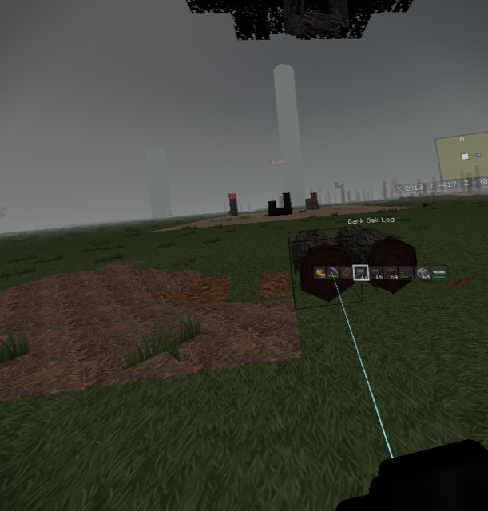

## 07:25:52 - Oh, very good

- **Transcript:** Oh, very good
- **Status:** open
- **Build:** 0.129 (65be4fcc, M1-M4 (device-tested; ship riding, chests, comfort options, weapon wheel))
- **World:** New World (15) (seed 2770276584627345479)
- **Dimension:** Surface
- **Biome:** Snowy Taiga
- **Position:** -2464.3 118.1 -1896.5
- **Facing:** north (yaw 9, pitch -13)
- **Held:** Written Book x1
- **Mount:** on foot, flying
- **Looking at:** nothing
- **Mode:** Creative, health 20/20
- **Time:** day 1 07:41, clear
- **Fps:** 43
- **Levels:** mic -25 dBFS, game sound -34 dBFS
- **Length:** 2.3 s (voice 0.9 s)
- **Just before:** -13s opened PauseMenu; -12s closed PauseMenu; -12s message: Playtest build: voice bug notes ON, your speech is saved (Options > Interface); -9s message: The last session ended unexpectedly. Pause > Restore Last Backup puts back the last saved copy; -5s message: The Chancellor, over the loudspeakers: "Seal the bunker! Nobody opens the blast door in the command post!"; -5s holding Track Spares; -4s holding Aero Engine Spares; -2s message: Walking; -1s message: Flying; --2s message: Walking; --11s message: Flying; --13s walked into Burnt Woods; --13s opened PauseMenu; -13s entered Surface; -13s closed PauseMenu; -13s holding Greywall Dispatch; -13s message: In Clear Ford's jail safe: a Greywall Dispatch; -13s message: In Clear Ford's jail safe: a Greywall Dispatch. Added to journal: Who Holds the Frontier; -9s message: Spring: the snow melts and the young are born; -7s opened BookMenu; -7s holding Written Book; -7s message: Greywall Fortress marked on the map; -5s closed BookMenu; -5s opened PauseMenu; -5s message: Greywall Dispatch: the Greywall Fortress, 1,124 m SE, behind right. Marked on your map.; -4s closed PauseMenu; -1s message: Added to journal: Greywall Dispatch
- **Repro (Mac):** `./snap.sh note --seed 2770276584627345479 --x -2464.3 --z -1896.5 --yaw -9 --pitch -13 --time 0.070`
- **Audio (this Mac):** /Users/darthvadar/Documents/Blocksmith/QuestVoiceNotes/raw/vn-20261101-072552-424.aac

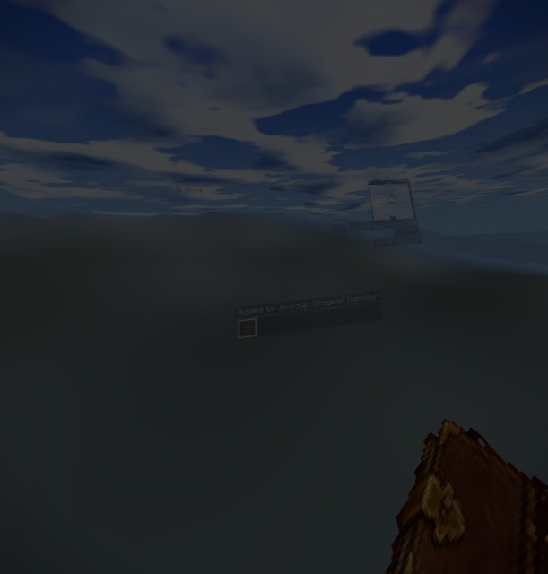

## 07:26:07 - Oh, this is a big one. Look at that. Okay

- **Transcript:** Oh, this is a big one. Look at that. Okay
- **Status:** open
- **Build:** 0.129 (65be4fcc, M1-M4 (device-tested; ship riding, chests, comfort options, weapon wheel))
- **World:** New World (15) (seed 2770276584627345479)
- **Dimension:** Surface
- **Biome:** Forest
- **Position:** -1765.9 194.1 -57.1
- **Facing:** south-west (yaw 222, pitch -56)
- **Held:** Written Book x1
- **Mount:** on foot, flying
- **Looking at:** nothing
- **Mode:** Creative, health 20/20
- **Time:** day 1 07:57, clear
- **Fps:** 69
- **Levels:** mic -22 dBFS, game sound -11 dBFS
- **Length:** 3.7 s (voice 1.6 s)
- **Just before:** -27s opened PauseMenu; -26s closed PauseMenu; -26s message: Playtest build: voice bug notes ON, your speech is saved (Options > Interface); -22s message: The last session ended unexpectedly. Pause > Restore Last Backup puts back the last saved copy; -19s message: The Chancellor, over the loudspeakers: "Seal the bunker! Nobody opens the blast door in the command post!"; -18s holding Track Spares; -18s holding Aero Engine Spares; -15s message: Walking; -14s message: Flying; -11s message: Walking; -3s message: Flying; -1s walked into Burnt Woods; -0s opened PauseMenu; -27s entered Surface; -27s closed PauseMenu; -27s holding Greywall Dispatch; -27s message: In Clear Ford's jail safe: a Greywall Dispatch; -26s message: In Clear Ford's jail safe: a Greywall Dispatch. Added to journal: Who Holds the Frontier; -23s message: Spring: the snow melts and the young are born; -21s opened BookMenu; -21s holding Written Book; -20s message: Greywall Fortress marked on the map; -19s closed BookMenu; -18s opened PauseMenu; -18s message: Greywall Dispatch: the Greywall Fortress, 1,124 m SE, behind right. Marked on your map.; -17s closed PauseMenu; -14s message: Added to journal: Greywall Dispatch; -12s message: Creative mode; -11s message: Flying; -9s message: Entering Ithamark; -7s message: Entering Zorehold; -6s message: Entering Draeria; -4s message: The sky is clouding over: fog is coming; -2s message: Sky isle marked on the map
- **Repro (Mac):** `./snap.sh note --seed 2770276584627345479 --x -1765.9 --z -57.1 --yaw 138 --pitch -56 --time 0.081`
- **Audio (this Mac):** /Users/darthvadar/Documents/Blocksmith/QuestVoiceNotes/raw/vn-20261101-072607-299.aac

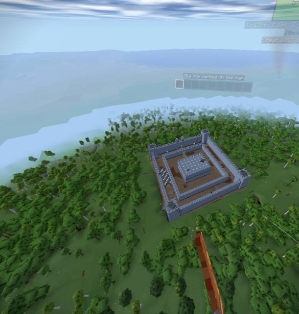

## 07:26:11 - I expect good things out of this base. This is okay

- **Transcript:** I expect good things out of this base. This is okay
- **Status:** open
- **Build:** 0.129 (65be4fcc, M1-M4 (device-tested; ship riding, chests, comfort options, weapon wheel))
- **World:** New World (15) (seed 2770276584627345479)
- **Dimension:** Surface
- **Biome:** Forest
- **Position:** -1765.3 194.1 55.4
- **Facing:** west (yaw 265, pitch -45)
- **Held:** Written Book x1
- **Mount:** on foot, flying
- **Looking at:** nothing
- **Mode:** Creative, health 20/20
- **Time:** day 1 07:59, clear
- **Fps:** 48
- **Levels:** mic -39 dBFS, game sound -19 dBFS
- **Length:** 4.2 s (voice 2.4 s)
- **Just before:** -29s opened PauseMenu; -28s closed PauseMenu; -28s message: Playtest build: voice bug notes ON, your speech is saved (Options > Interface); -25s message: The last session ended unexpectedly. Pause > Restore Last Backup puts back the last saved copy; -21s message: The Chancellor, over the loudspeakers: "Seal the bunker! Nobody opens the blast door in the command post!"; -20s holding Track Spares; -20s holding Aero Engine Spares; -18s message: Walking; -16s message: Flying; -14s message: Walking; -5s message: Flying; -3s walked into Burnt Woods; -2s opened PauseMenu; -29s entered Surface; -29s closed PauseMenu; -29s holding Greywall Dispatch; -29s message: In Clear Ford's jail safe: a Greywall Dispatch; -28s message: In Clear Ford's jail safe: a Greywall Dispatch. Added to journal: Who Holds the Frontier; -25s message: Spring: the snow melts and the young are born; -23s opened BookMenu; -23s holding Written Book; -22s message: Greywall Fortress marked on the map; -21s closed BookMenu; -21s opened PauseMenu; -20s message: Greywall Dispatch: the Greywall Fortress, 1,124 m SE, behind right. Marked on your map.; -19s closed PauseMenu; -17s message: Added to journal: Greywall Dispatch; -14s message: Creative mode; -13s message: Flying; -11s message: Entering Ithamark; -10s message: Entering Zorehold; -8s message: Entering Draeria; -6s message: The sky is clouding over: fog is coming; -4s message: Sky isle marked on the map; -2s message: Entering Ithvaal
- **Repro (Mac):** `./snap.sh note --seed 2770276584627345479 --x -1765.3 --z 55.4 --yaw 95 --pitch -45 --time 0.083`
- **Audio (this Mac):** /Users/darthvadar/Documents/Blocksmith/QuestVoiceNotes/raw/vn-20261101-072611-539.aac

## 07:26:16 - I got a few things to test, so I'm far outside the gray wall. I'm goin

- **Transcript:** I got a few things to test, so I'm far outside the gray wall. I'm going to put armor on
- **Status:** open
- **Build:** 0.129 (65be4fcc, M1-M4 (device-tested; ship riding, chests, comfort options, weapon wheel))
- **World:** New World (15) (seed 2770276584627345479)
- **Dimension:** Surface
- **Biome:** Birch Forest
- **Position:** -1791.0 107.8 103.7
- **Facing:** west (yaw 287, pitch -66)
- **Held:** Written Book x1
- **Mount:** on foot, flying
- **Looking at:** nothing
- **Mode:** Creative, health 20/20
- **Time:** day 1 08:03, clear
- **Fps:** 33
- **Levels:** mic -20 dBFS, game sound -24 dBFS
- **Length:** 6.7 s (voice 3.9 s)
- **Just before:** -28s message: The last session ended unexpectedly. Pause > Restore Last Backup puts back the last saved copy; -24s message: The Chancellor, over the loudspeakers: "Seal the bunker! Nobody opens the blast door in the command post!"; -24s holding Track Spares; -23s holding Aero Engine Spares; -21s message: Walking; -19s message: Flying; -17s message: Walking; -8s message: Flying; -6s walked into Burnt Woods; -6s opened PauseMenu; -28s message: Spring: the snow melts and the young are born; -26s opened BookMenu; -26s holding Written Book; -26s message: Greywall Fortress marked on the map; -24s closed BookMenu; -24s opened PauseMenu; -23s message: Greywall Dispatch: the Greywall Fortress, 1,124 m SE, behind right. Marked on your map.; -23s closed PauseMenu; -20s message: Added to journal: Greywall Dispatch; -18s message: Creative mode; -16s message: Flying; -15s message: Entering Ithamark; -13s message: Entering Zorehold; -11s message: Entering Draeria; -9s message: The sky is clouding over: fog is coming; -7s message: Sky isle marked on the map; -5s message: Entering Ithvaal; -3s message: Walking; -0s message: Flying
- **While talking:** -3s message: Walking
- **Position at the end:** -1807.1 78.0 133.9
- **Repro (Mac):** `./snap.sh note --seed 2770276584627345479 --x -1791.0 --z 103.7 --yaw 73 --pitch -66 --time 0.086`
- **Audio (this Mac):** /Users/darthvadar/Documents/Blocksmith/QuestVoiceNotes/raw/vn-20261101-072616-219.aac

## 07:26:22 - I expect the naval guns to obliterate me on normal difficulty before I

- **Transcript:** I expect the naval guns to obliterate me on normal difficulty before I can get anywhere near it
- **Status:** open
- **Build:** 0.129 (65be4fcc, M1-M4 (device-tested; ship riding, chests, comfort options, weapon wheel))
- **World:** New World (15) (seed 2770276584627345479)
- **Dimension:** Surface
- **Biome:** Old Growth Birch Forest
- **Position:** -1807.3 78.0 134.6
- **Facing:** north (yaw 357, pitch -56)
- **Held:** Written Book x1
- **Mount:** on foot
- **Looking at:** Grass Block at -1808 77 133
- **Mode:** Creative, health 20/20
- **Time:** day 1 08:11, clear
- **Fps:** 68
- **Levels:** mic -24 dBFS, game sound -13 dBFS
- **Length:** 7.3 s (voice 4.0 s)
- **Just before:** -30s holding Aero Engine Spares; -27s message: Walking; -26s message: Flying; -24s message: Walking; -15s message: Flying; -13s walked into Burnt Woods; -12s opened PauseMenu; -29s closed PauseMenu; -27s message: Added to journal: Greywall Dispatch; -24s message: Creative mode; -23s message: Flying; -21s message: Entering Ithamark; -20s message: Entering Zorehold; -18s message: Entering Draeria; -16s message: The sky is clouding over: fog is coming; -14s message: Sky isle marked on the map; -12s message: Entering Ithvaal; -9s message: Walking; -7s message: Flying; -5s message: Walking
- **While talking:** -3s left the pack: Mahlwerk Rotary Gun (at -1807 77 134); -3s left the pack: Greywall Dispatch (at -1807 77 134); -3s left the pack: Aero Engine Spares x18 (at -1807 77 134); -3s left the pack: Donnerkeil Service Rifle x3 (at -1807 77 134); -3s left the pack: Regular Armour Set (at -1807 77 134); -3s left the pack: Fernblick Rifle (at -1807 77 134); -3s left the pack: Track Spares x16 (at -1807 77 134); -3s left the pack: Duskium Chestplate (at -1807 77 134); -3s left the pack: Titanium Pickaxe (at -1807 77 134); -3s left the pack: Himmelsturm Launcher (at -1807 77 134); -3s left the pack: Jetpack x2 (at -1807 77 134); -3s left the pack: Rocket x4 (at -1807 77 134); -3s left the pack: Falke Pistol x2 (at -1807 77 134); -3s left the pack: Field Journal of an Ashguard Rifleman (at -1807 77 134); -3s left the pack: Faustrohr (at -1807 77 134); -3s left the pack: Faustrohr Warhead x3 (at -1807 77 134); -3s into the pack: Written Book; -2s opened PauseMenu; -2s closed PauseMenu; -2s walked into Old Growth Birch Forest
- **Position at the end:** -1806.8 78.0 135.6
- **Repro (Mac):** `./snap.sh note --seed 2770276584627345479 --x -1807.3 --z 134.6 --yaw 3 --pitch -56 --time 0.091`
- **Audio (this Mac):** /Users/darthvadar/Documents/Blocksmith/QuestVoiceNotes/raw/vn-20261101-072622-939.aac

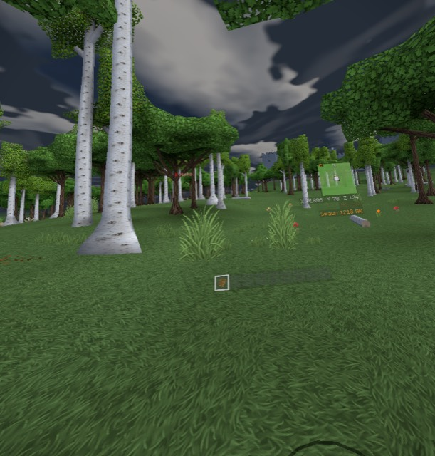

## 07:26:31 - See, players need to come up with a strategy on how to get in, either 

- **Transcript:** See, players need to come up with a strategy on how to get in, either burrowing down or what have you
- **Status:** open
- **Build:** 0.129 (65be4fcc, M1-M4 (device-tested; ship riding, chests, comfort options, weapon wheel))
- **World:** New World (15) (seed 2770276584627345479)
- **Dimension:** Surface
- **Biome:** Old Growth Birch Forest
- **Position:** -1807.0 78.0 135.5
- **Facing:** north-east (yaw 32, pitch -66)
- **Held:** Written Book x1
- **Mount:** on foot
- **Looking at:** Grass Block at -1807 77 135
- **Mode:** Creative, health 20/20
- **Time:** day 1 08:21, clear
- **Fps:** 72
- **Levels:** mic -29 dBFS, game sound -29 dBFS
- **Length:** 6.4 s (voice 4.0 s)
- **Just before:** -30s message: Entering Ithamark; -28s message: Entering Zorehold; -26s message: Entering Draeria; -25s message: The sky is clouding over: fog is coming; -22s message: Sky isle marked on the map; -20s message: Entering Ithvaal; -18s message: Walking; -16s message: Flying; -14s message: Walking; -6s left the pack: Mahlwerk Rotary Gun (at -1807 77 134); -6s left the pack: Greywall Dispatch (at -1807 77 134); -6s left the pack: Aero Engine Spares x18 (at -1807 77 134); -6s left the pack: Donnerkeil Service Rifle x3 (at -1807 77 134); -6s left the pack: Regular Armour Set (at -1807 77 134); -6s left the pack: Fernblick Rifle (at -1807 77 134); -6s left the pack: Track Spares x16 (at -1807 77 134); -6s left the pack: Duskium Chestplate (at -1807 77 134); -6s left the pack: Titanium Pickaxe (at -1807 77 134); -6s left the pack: Himmelsturm Launcher (at -1807 77 134); -6s left the pack: Jetpack x2 (at -1807 77 134); -6s left the pack: Rocket x4 (at -1807 77 134); -6s left the pack: Falke Pistol x2 (at -1807 77 134); -6s left the pack: Field Journal of an Ashguard Rifleman (at -1807 77 134); -6s left the pack: Faustrohr (at -1807 77 134); -6s left the pack: Faustrohr Warhead x3 (at -1807 77 134); -6s into the pack: Written Book; -6s opened PauseMenu; -5s closed PauseMenu; -5s walked into Old Growth Birch Forest
- **Position at the end:** -1806.9 78.0 135.6
- **Repro (Mac):** `./snap.sh note --seed 2770276584627345479 --x -1807.0 --z 135.5 --yaw -32 --pitch -66 --time 0.098`
- **Audio (this Mac):** /Users/darthvadar/Documents/Blocksmith/QuestVoiceNotes/raw/vn-20261101-072631-539.aac

## 07:27:17 - Few things I'm not too happy about

- **Transcript:** Few things I'm not too happy about
- **Status:** open
- **Build:** 0.129 (65be4fcc, M1-M4 (device-tested; ship riding, chests, comfort options, weapon wheel))
- **World:** New World (15) (seed 2770276584627345479)
- **Dimension:** Surface
- **Biome:** Old Growth Birch Forest
- **Position:** -1806.9 78.0 135.6
- **Facing:** north (yaw 17, pitch 2)
- **Held:** Written Book x1
- **Mount:** on foot
- **Looking at:** nothing
- **Mode:** Survival, health 20/20
- **Time:** day 1 09:13, clear
- **Fps:** 71
- **Levels:** mic -24 dBFS, game sound -17 dBFS
- **Length:** 2.8 s (voice 1.2 s)
- **Just before:** -30s into the pack: Duskium Boots; -16s into the pack: Mahlwerk Rotary Gun; -9s into the pack: Capital Magazine; -5s closed CreativeMenu; -4s opened PauseMenu; -3s message: Survival mode; -3s closed PauseMenu; -3s opened InventoryMenu; -2s left the pack: Duskium Helmet (InventoryMenu open); -1s left the pack: Duskium Leggings (InventoryMenu open); -1s left the pack: Duskium Chestplate (InventoryMenu open); -0s left the pack: Duskium Boots (InventoryMenu open); -0s closed InventoryMenu
- **Repro (Mac):** `./snap.sh note --seed 2770276584627345479 --x -1806.9 --z 135.6 --yaw -17 --pitch 2 --time 0.134`
- **Audio (this Mac):** /Users/darthvadar/Documents/Blocksmith/QuestVoiceNotes/raw/vn-20261101-072717-279.aac

## 07:27:21 - Is, uh, golden apples are still in the game

- **Transcript:** Is, uh, golden apples are still in the game
- **Status:** open
- **Build:** 0.129 (65be4fcc, M1-M4 (device-tested; ship riding, chests, comfort options, weapon wheel))
- **World:** New World (15) (seed 2770276584627345479)
- **Dimension:** Surface
- **Biome:** Old Growth Birch Forest
- **Position:** -1807.9 78.1 134.1
- **Facing:** east (yaw 71, pitch -52)
- **Held:** Mahlwerk Rotary Gun x1
- **Mount:** on foot
- **Looking at:** Grass Block at -1807 77 133
- **Mode:** Survival, health 20/20
- **Time:** day 1 09:18, clear
- **Fps:** 72
- **Levels:** mic -28 dBFS, game sound -23 dBFS
- **Length:** 4.0 s (voice 1.9 s)
- **Just before:** -20s into the pack: Mahlwerk Rotary Gun; -13s into the pack: Capital Magazine; -9s closed CreativeMenu; -9s opened PauseMenu; -7s message: Survival mode; -7s closed PauseMenu; -7s opened InventoryMenu; -6s left the pack: Duskium Helmet (InventoryMenu open); -6s left the pack: Duskium Leggings (InventoryMenu open); -6s left the pack: Duskium Chestplate (InventoryMenu open); -5s left the pack: Duskium Boots (InventoryMenu open); -4s closed InventoryMenu; -3s holding Grass Block; -3s message: Grass Block; -3s holding Mahlwerk Rotary Gun; -3s message: Mahlwerk Rotary Gun; -3s message: Loaded: 200 / 200; -3s left the pack: Capital Magazine x7 (at -1810 78 134)
- **Repro (Mac):** `./snap.sh note --seed 2770276584627345479 --x -1807.9 --z 134.1 --yaw -71 --pitch -52 --time 0.138`
- **Audio (this Mac):** /Users/darthvadar/Documents/Blocksmith/QuestVoiceNotes/raw/vn-20261101-072721-479.aac

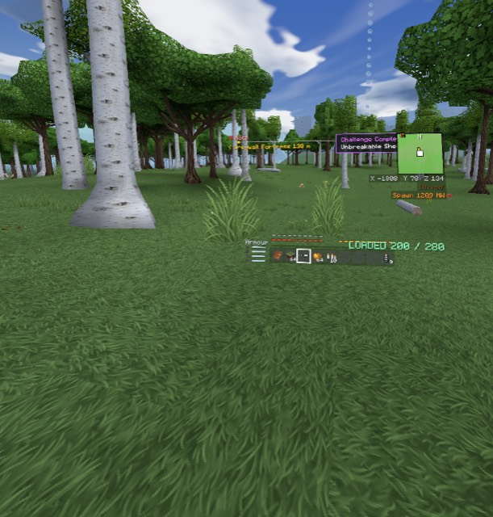

## 07:27:25 - Um, also, I don't see the assault shotgun in weapons

- **Transcript:** Um, also, I don't see the assault shotgun in weapons
- **Status:** open
- **Build:** 0.129 (65be4fcc, M1-M4 (device-tested; ship riding, chests, comfort options, weapon wheel))
- **World:** New World (15) (seed 2770276584627345479)
- **Dimension:** Surface
- **Biome:** Old Growth Birch Forest
- **Position:** -1807.8 78.1 133.5
- **Facing:** north (yaw 9, pitch -74)
- **Held:** Mahlwerk Rotary Gun x1
- **Mount:** on foot
- **Looking at:** Grass Block at -1808 77 133
- **Mode:** Survival, health 20/20
- **Time:** day 1 09:23, clear
- **Fps:** 72
- **Levels:** mic -30 dBFS, game sound -22 dBFS
- **Length:** 5.6 s (voice 3.1 s)
- **Just before:** -24s into the pack: Mahlwerk Rotary Gun; -17s into the pack: Capital Magazine; -13s closed CreativeMenu; -12s opened PauseMenu; -11s message: Survival mode; -11s closed PauseMenu; -11s opened InventoryMenu; -10s left the pack: Duskium Helmet (InventoryMenu open); -9s left the pack: Duskium Leggings (InventoryMenu open); -9s left the pack: Duskium Chestplate (InventoryMenu open); -8s left the pack: Duskium Boots (InventoryMenu open); -8s closed InventoryMenu; -7s holding Grass Block; -7s message: Grass Block; -7s holding Mahlwerk Rotary Gun; -7s message: Mahlwerk Rotary Gun; -6s message: Loaded: 200 / 200; -6s left the pack: Capital Magazine x7 (at -1810 78 134)
- **Position at the end:** -1810.4 78.4 118.0
- **Repro (Mac):** `./snap.sh note --seed 2770276584627345479 --x -1807.8 --z 133.5 --yaw -9 --pitch -74 --time 0.141`
- **Audio (this Mac):** /Users/darthvadar/Documents/Blocksmith/QuestVoiceNotes/raw/vn-20261101-072725-239.aac

## 07:27:44 - Okay, so the guns are not hitting me. I think they need to be able to 

- **Transcript:** Okay, so the guns are not hitting me. I think they need to be able to shoot downwards much more. In fact, the base doesn't even know of my existence even though I'm in range. Remember my feedback from last game, I said
- **Status:** open
- **Build:** 0.129 (65be4fcc, M1-M4 (device-tested; ship riding, chests, comfort options, weapon wheel))
- **World:** New World (15) (seed 2770276584627345479)
- **Dimension:** Surface
- **Biome:** Birch Forest
- **Position:** -1812.9 83.5 81.4
- **Facing:** north-east (yaw 34, pitch -13)
- **Held:** Mahlwerk Rotary Gun x1
- **Mount:** on foot
- **Looking at:** Grass Block at -1810 83 76
- **Mode:** Survival, health 20/20
- **Time:** day 1 09:46, clear
- **Fps:** 72
- **Levels:** mic -26 dBFS, game sound -22 dBFS
- **Length:** 11.5 s (voice 7.5 s)
- **Just before:** -30s opened InventoryMenu; -29s left the pack: Duskium Helmet (InventoryMenu open); -29s left the pack: Duskium Leggings (InventoryMenu open); -29s left the pack: Duskium Chestplate (InventoryMenu open); -28s left the pack: Duskium Boots (InventoryMenu open); -27s closed InventoryMenu; -26s holding Grass Block; -26s message: Grass Block; -26s holding Mahlwerk Rotary Gun; -26s message: Mahlwerk Rotary Gun; -26s message: Loaded: 200 / 200; -26s left the pack: Capital Magazine x7 (at -1810 78 134); -13s walked into Birch Forest
- **While talking:** -4s walked into Forest; -3s walked into Birch Forest
- **Position at the end:** -1817.2 82.1 94.8
- **Repro (Mac):** `./snap.sh note --seed 2770276584627345479 --x -1812.9 --z 81.4 --yaw -34 --pitch -13 --time 0.157`
- **Audio (this Mac):** /Users/darthvadar/Documents/Blocksmith/QuestVoiceNotes/raw/vn-20261101-072744-639.aac

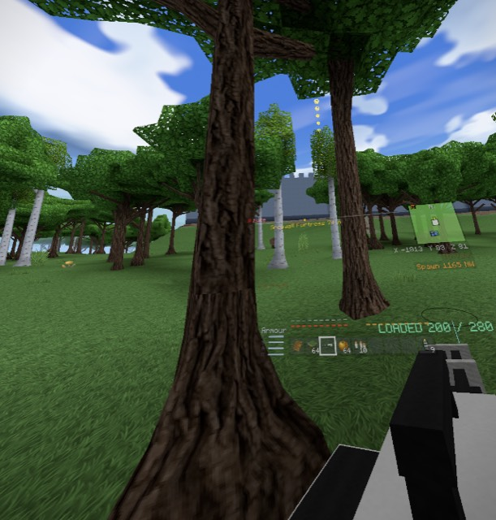

## 07:27:56 - The base, as soon as the base is in, it is able to spot me because of 

- **Transcript:** The base, as soon as the base is in, it is able to spot me because of its special radar ability
- **Status:** open
- **Build:** 0.129 (65be4fcc, M1-M4 (device-tested; ship riding, chests, comfort options, weapon wheel))
- **World:** New World (15) (seed 2770276584627345479)
- **Dimension:** Surface
- **Biome:** Birch Forest
- **Position:** -1816.3 82.0 95.7
- **Facing:** north (yaw 357, pitch 11)
- **Held:** Mahlwerk Rotary Gun x1
- **Mount:** on foot
- **Looking at:** nothing
- **Mode:** Survival, health 20/20
- **Time:** day 1 09:59, clear
- **Fps:** 72
- **Levels:** mic -35 dBFS, game sound -26 dBFS
- **Length:** 7.6 s (voice 4.7 s)
- **Just before:** -25s walked into Birch Forest; -11s walked into Forest; -5s walked into Birch Forest
- **Position at the end:** -1816.4 82.3 91.0
- **Repro (Mac):** `./snap.sh note --seed 2770276584627345479 --x -1816.3 --z 95.7 --yaw 3 --pitch 11 --time 0.167`
- **Audio (this Mac):** /Users/darthvadar/Documents/Blocksmith/QuestVoiceNotes/raw/vn-20261101-072756-239.aac

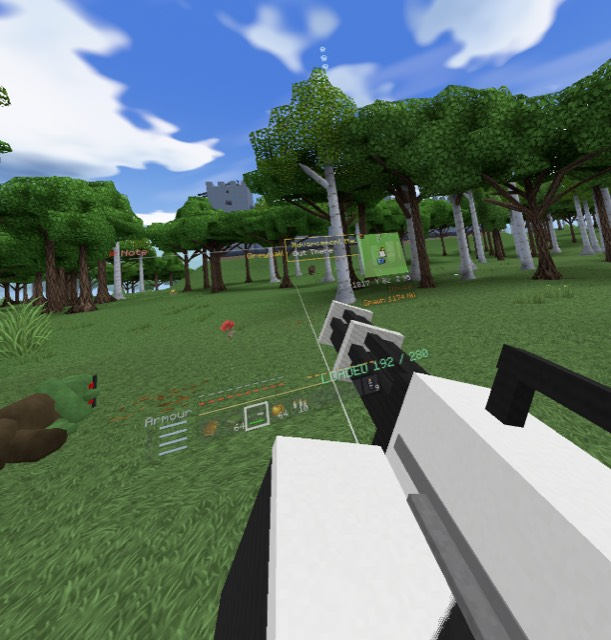

## 07:28:03 - And then its naval guns just immediately evaporate me if they can

- **Transcript:** And then its naval guns just immediately evaporate me if they can
- **Status:** open
- **Build:** 0.129 (65be4fcc, M1-M4 (device-tested; ship riding, chests, comfort options, weapon wheel))
- **World:** New World (15) (seed 2770276584627345479)
- **Dimension:** Surface
- **Biome:** Birch Forest
- **Position:** -1803.5 83.1 85.5
- **Facing:** north (yaw 355, pitch -21)
- **Held:** Mahlwerk Rotary Gun x1
- **Mount:** on foot
- **Looking at:** Grass Block at -1804 83 81
- **Mode:** Survival, health 20/20
- **Time:** day 1 10:09, clear
- **Fps:** 72
- **Levels:** mic -29 dBFS, game sound -14 dBFS
- **Length:** 7.3 s (voice 3.4 s)
- **Just before:** -19s walked into Forest; -12s walked into Birch Forest
- **Position at the end:** -1783.5 83.2 77.7
- **Repro (Mac):** `./snap.sh note --seed 2770276584627345479 --x -1803.5 --z 85.5 --yaw 5 --pitch -21 --time 0.173`
- **Audio (this Mac):** /Users/darthvadar/Documents/Blocksmith/QuestVoiceNotes/raw/vn-20261101-072803-939.aac

## 07:28:11 - Have to have a clear line of fire, which right now the way the naval g

- **Transcript:** Have to have a clear line of fire, which right now the way the naval guns sit on the tower makes it so they're
- **Status:** open
- **Build:** 0.129 (65be4fcc, M1-M4 (device-tested; ship riding, chests, comfort options, weapon wheel))
- **World:** New World (15) (seed 2770276584627345479)
- **Dimension:** Surface
- **Biome:** Birch Forest
- **Position:** -1779.7 83.7 73.1
- **Facing:** north (yaw 11, pitch 16)
- **Held:** Mahlwerk Rotary Gun x1
- **Mount:** on foot
- **Looking at:** nothing
- **Mode:** Survival, health 20/20
- **Time:** day 1 10:17, clear
- **Fps:** 72
- **Levels:** mic -40 dBFS, game sound -23 dBFS
- **Length:** 6.1 s (voice 4.0 s)
- **Just before:** -26s walked into Forest; -20s walked into Birch Forest
- **Position at the end:** -1774.8 86.2 59.9
- **Repro (Mac):** `./snap.sh note --seed 2770276584627345479 --x -1779.7 --z 73.1 --yaw -11 --pitch 16 --time 0.179`
- **Audio (this Mac):** /Users/darthvadar/Documents/Blocksmith/QuestVoiceNotes/raw/vn-20261101-072811-079.aac

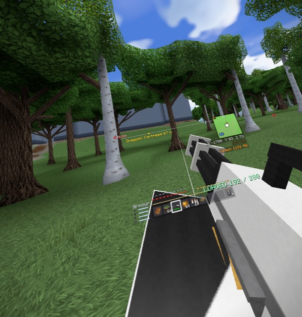

## 07:28:17 - They can't really aim that far down, so I don't know, maybe fix that s

- **Transcript:** They can't really aim that far down, so I don't know, maybe fix that so they at least looks like we can
- **Status:** open
- **Build:** 0.129 (65be4fcc, M1-M4 (device-tested; ship riding, chests, comfort options, weapon wheel))
- **World:** New World (15) (seed 2770276584627345479)
- **Dimension:** Surface
- **Biome:** Forest
- **Position:** -1775.8 87.8 51.7
- **Facing:** north-west (yaw 334, pitch 15)
- **Held:** Mahlwerk Rotary Gun x1
- **Mount:** on foot
- **Looking at:** nothing
- **Mode:** Survival, health 20/20
- **Time:** day 1 10:25, clear
- **Fps:** 72
- **Levels:** mic -29 dBFS, game sound -16 dBFS
- **Length:** 7.0 s (voice 3.8 s)
- **Just before:** -26s walked into Birch Forest
- **While talking:** -5s walked into Forest; -4s message: A stranger in town: Ezra Quill
- **Position at the end:** -1798.1 89.4 44.2
- **Repro (Mac):** `./snap.sh note --seed 2770276584627345479 --x -1775.8 --z 51.7 --yaw 26 --pitch 15 --time 0.184`
- **Audio (this Mac):** /Users/darthvadar/Documents/Blocksmith/QuestVoiceNotes/raw/vn-20261101-072817-539.aac

## 07:28:33 - Oh, shit

- **Transcript:** Oh, shit
- **Status:** open
- **Build:** 0.129 (65be4fcc, M1-M4 (device-tested; ship riding, chests, comfort options, weapon wheel))
- **World:** New World (15) (seed 2770276584627345479)
- **Dimension:** Surface
- **Biome:** Forest
- **Position:** -1800.3 92.6 40.5
- **Facing:** north-west (yaw 319, pitch -6)
- **Held:** empty hand
- **Mount:** on foot
- **Looking at:** nothing
- **Mode:** Survival, health 0/20, screen DeathMenu
- **Time:** day 1 10:43, clear
- **Fps:** 70
- **Levels:** mic -23 dBFS, game sound -26 dBFS
- **Length:** 2.3 s (voice 0.9 s)
- **Just before:** -16s walked into Forest; -15s message: A stranger in town: Ezra Quill; -11s message: Honour raised (you protected the town); -10s opened PauseMenu; -9s closed PauseMenu; -8s message: They've found a body! The base is on alert; -6s message: The Greywall Fortress is sounding the alarm!; -4s took 5 damage (health 16/20); -1s died; -1s opened DeathMenu; -1s holding empty hand; -1s left the pack: Mahlwerk Rotary Gun (DeathMenu open); -1s left the pack: Capital Magazine x9 (DeathMenu open); -1s left the pack: Written Book (DeathMenu open)
- **Repro (Mac):** `./snap.sh note --seed 2770276584627345479 --x -1800.3 --z 40.5 --yaw 41 --pitch -6 --time 0.197`
- **Audio (this Mac):** /Users/darthvadar/Documents/Blocksmith/QuestVoiceNotes/raw/vn-20261101-072833-979.aac

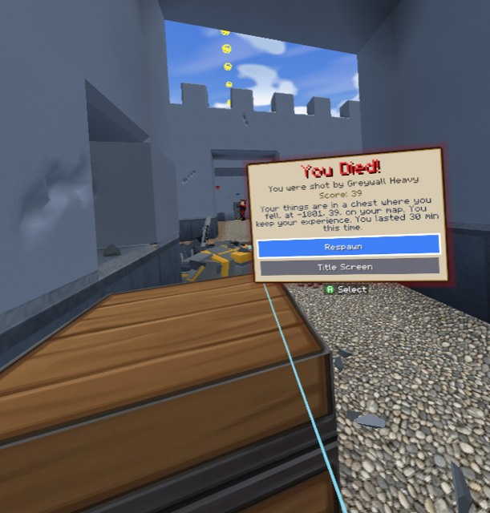

## 07:28:39 - Okay. Oh, shit

- **Transcript:** Okay. Oh, shit
- **Status:** open
- **Build:** 0.129 (65be4fcc, M1-M4 (device-tested; ship riding, chests, comfort options, weapon wheel))
- **World:** New World (15) (seed 2770276584627345479)
- **Dimension:** Surface
- **Biome:** Taiga
- **Position:** -2554.4 95.3 -813.3
- **Facing:** east (yaw 97, pitch -33)
- **Held:** empty hand
- **Mount:** on foot
- **Looking at:** Grass Block at -2553 94 -814
- **Mode:** Survival, health 20/20
- **Time:** day 1 10:50, clear
- **Fps:** 72
- **Levels:** mic -34 dBFS, game sound -23 dBFS
- **Length:** 2.7 s (voice 0.6 s)
- **Just before:** -22s walked into Forest; -21s message: A stranger in town: Ezra Quill; -16s message: Honour raised (you protected the town); -15s opened PauseMenu; -14s closed PauseMenu; -14s message: They've found a body! The base is on alert; -11s message: The Greywall Fortress is sounding the alarm!; -9s took 5 damage (health 16/20); -7s died; -7s opened DeathMenu; -7s holding empty hand; -6s left the pack: Mahlwerk Rotary Gun (DeathMenu open); -6s left the pack: Capital Magazine x9 (DeathMenu open); -6s left the pack: Written Book (DeathMenu open); -6s took 18 damage (health 0/20); -5s respawned; -5s closed DeathMenu; -5s message: Your things are 1142 blocks south-east; -4s walked into Taiga
- **Repro (Mac):** `./snap.sh note --seed 2770276584627345479 --x -2554.4 --z -813.3 --yaw -97 --pitch -33 --time 0.202`
- **Audio (this Mac):** /Users/darthvadar/Documents/Blocksmith/QuestVoiceNotes/raw/vn-20261101-072839-659.aac

## 07:29:16 - Okay, interesting. The golden apples turned into field stems

- **Transcript:** Okay, interesting. The golden apples turned into field stems
- **Status:** open
- **Build:** 0.129 (65be4fcc, M1-M4 (device-tested; ship riding, chests, comfort options, weapon wheel))
- **World:** New World (15) (seed 2770276584627345479)
- **Dimension:** Surface
- **Biome:** Flower Forest
- **Position:** -1719.4 86.5 78.6
- **Facing:** south (yaw 163, pitch -37)
- **Held:** Field Stim x16
- **Mount:** on foot
- **Looking at:** Grass Block at -1719 85 80
- **Mode:** Survival, health 20/20
- **Time:** day 1 11:29, clear
- **Fps:** 70
- **Levels:** mic -58 dBFS, game sound -21 dBFS
- **Length:** 4.4 s (voice 2.6 s)
- **Just before:** -30s message: Walking; -28s message: Homestead marked on the map; -25s message: Greywall reinforcements at the gate; -24s walked into Forest; -22s message: Walking; -20s message: You've reached Your things; -19s opened ChestMenu; -17s into the pack: Written Book; -17s into the pack: Duskium Leggings; -17s into the pack: Duskium Chestplate; -17s into the pack: Duskium Helmet; -17s holding Field Stim; -17s into the pack: Field Stim; -16s into the pack: Mahlwerk Rotary Gun; -16s into the pack: Duskium Boots; -15s into the pack: Capital Magazine; -15s message: You have your things back; -14s closed ChestMenu; -13s message: Flying; -12s message: Walking; -10s walked into Birch Forest; -10s message: Flying; -9s message: Walking; -7s opened PauseMenu; -6s message: Survival mode; -6s walked into Flower Forest; -6s closed PauseMenu; -6s opened InventoryMenu; -5s left the pack: Duskium Boots (InventoryMenu open); -4s left the pack: Duskium Leggings (InventoryMenu open); -4s left the pack: Duskium Chestplate (InventoryMenu open); -4s left the pack: Duskium Helmet (InventoryMenu open); -3s left the pack: Mahlwerk Rotary Gun (InventoryMenu open); -3s into the pack: Mahlwerk Rotary Gun; -2s closed InventoryMenu
- **Repro (Mac):** `./snap.sh note --seed 2770276584627345479 --x -1719.4 --z 78.6 --yaw -163 --pitch -37 --time 0.229`
- **Audio (this Mac):** /Users/darthvadar/Documents/Blocksmith/QuestVoiceNotes/raw/vn-20261101-072916-399.aac

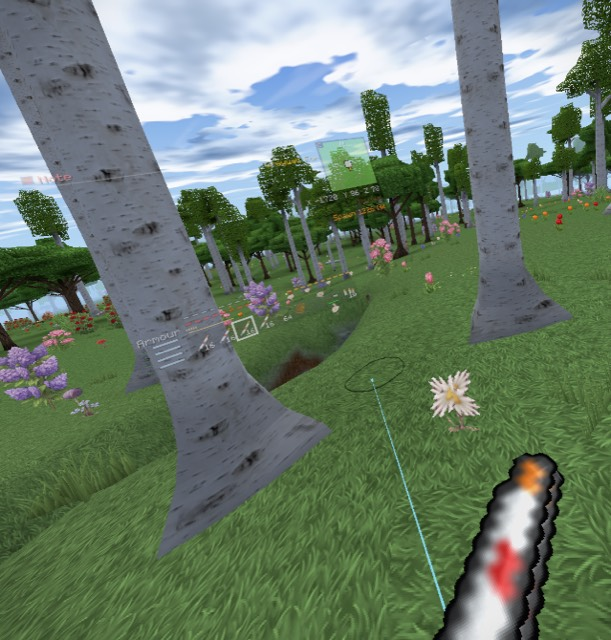

## 07:29:27 - Win survival

- **Transcript:** Win survival
- **Status:** open
- **Build:** 0.129 (65be4fcc, M1-M4 (device-tested; ship riding, chests, comfort options, weapon wheel))
- **World:** New World (15) (seed 2770276584627345479)
- **Dimension:** Surface
- **Biome:** Birch Forest
- **Position:** -1746.9 88.5 58.5
- **Facing:** west (yaw 286, pitch 0)
- **Held:** Mahlwerk Rotary Gun x1
- **Mount:** on foot
- **Looking at:** nothing
- **Mode:** Survival, health 20/20
- **Time:** day 1 11:41, clear
- **Fps:** 67
- **Levels:** mic -42 dBFS, game sound -18 dBFS
- **Length:** 2.2 s (voice 0.9 s)
- **Just before:** -29s opened ChestMenu; -28s into the pack: Written Book; -28s into the pack: Duskium Leggings; -28s into the pack: Duskium Chestplate; -28s into the pack: Duskium Helmet; -28s holding Field Stim; -27s into the pack: Field Stim; -27s into the pack: Mahlwerk Rotary Gun; -26s into the pack: Duskium Boots; -26s into the pack: Capital Magazine; -25s message: You have your things back; -25s closed ChestMenu; -23s message: Flying; -22s message: Walking; -21s walked into Birch Forest; -21s message: Flying; -19s message: Walking; -18s opened PauseMenu; -17s message: Survival mode; -17s walked into Flower Forest; -17s closed PauseMenu; -16s opened InventoryMenu; -15s left the pack: Duskium Boots (InventoryMenu open); -15s left the pack: Duskium Leggings (InventoryMenu open); -15s left the pack: Duskium Chestplate (InventoryMenu open); -14s left the pack: Duskium Helmet (InventoryMenu open); -14s left the pack: Mahlwerk Rotary Gun (InventoryMenu open); -13s into the pack: Mahlwerk Rotary Gun; -12s closed InventoryMenu; -9s message: Field Stim; -6s holding Grass Block; -6s message: Grass Block; -6s holding Written Book; -6s message: Written Book; -6s holding empty hand; -5s holding Mahlwerk Rotary Gun; -5s message: Mahlwerk Rotary Gun; -3s walked into Birch Forest; -1s opened PauseMenu; -1s closed PauseMenu
- **Repro (Mac):** `./snap.sh note --seed 2770276584627345479 --x -1746.9 --z 58.5 --yaw 74 --pitch 0 --time 0.237`
- **Audio (this Mac):** /Users/darthvadar/Documents/Blocksmith/QuestVoiceNotes/raw/vn-20261101-072927-499.aac

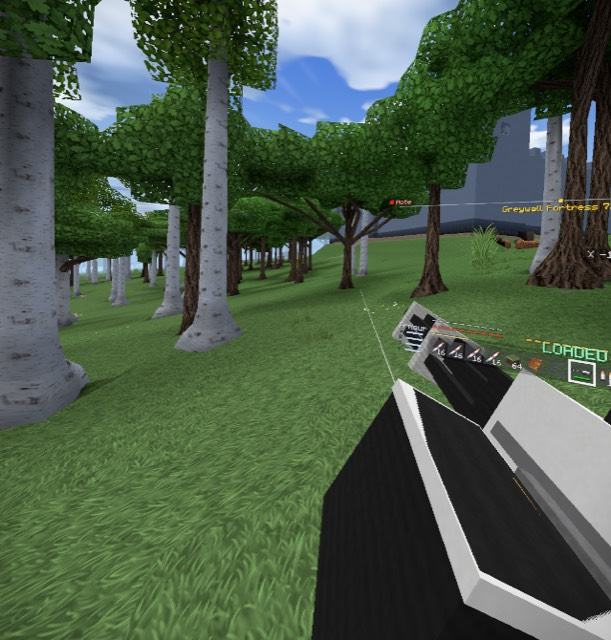

## 07:30:44 - Those snipers should never miss

- **Transcript:** Those snipers should never miss
- **Status:** open
- **Build:** 0.129 (65be4fcc, M1-M4 (device-tested; ship riding, chests, comfort options, weapon wheel))
- **World:** New World (15) (seed 2770276584627345479)
- **Dimension:** Surface
- **Biome:** Forest
- **Position:** -1777.1 88.2 49.0
- **Facing:** west (yaw 291, pitch 5)
- **Held:** Mahlwerk Rotary Gun x1
- **Mount:** on foot
- **Looking at:** nothing
- **Mode:** Survival, health 20/20
- **Time:** day 1 13:05, clear
- **Fps:** 69
- **Levels:** mic -34 dBFS, game sound -18 dBFS
- **Length:** 3.0 s (voice 1.5 s)
- **Just before:** -30s message: Flying; -28s message: Walking; -27s opened ChestMenu; -27s message: You've reached Your things; -26s holding Duskium Leggings; -26s into the pack: Duskium Leggings; -26s into the pack: Duskium Chestplate; -26s into the pack: Field Stim; -25s into the pack: Duskium Helmet; -25s into the pack: Duskium Boots; -25s into the pack: Mahlwerk Rotary Gun; -23s into the pack: Field Stim; -22s closed ChestMenu; -21s message: Flying; -20s message: Walking; -18s message: Flying; -18s walked into Birch Forest; -17s message: Walking; -16s walked into Flower Forest; -15s opened PauseMenu; -14s message: Survival mode; -14s closed PauseMenu; -14s opened InventoryMenu; -13s left the pack: Duskium Boots (InventoryMenu open); -13s left the pack: Duskium Helmet (InventoryMenu open); -12s holding empty hand; -12s left the pack: Duskium Leggings (InventoryMenu open); -12s closed InventoryMenu; -12s left the pack: Duskium Chestplate; -11s holding Heavy Rounds; -11s message: Heavy Rounds; -11s holding Bread; -11s message: Bread; -11s holding Mahlwerk Rotary Gun; -11s message: Mahlwerk Rotary Gun; -10s message: No Capital Rounds; -10s holding Bread; -9s holding Mahlwerk Rotary Gun; -8s walked into Birch Forest; -4s walked into Forest
- **Repro (Mac):** `./snap.sh note --seed 2770276584627345479 --x -1777.1 --z 49.0 --yaw 69 --pitch 5 --time 0.295`
- **Audio (this Mac):** /Users/darthvadar/Documents/Blocksmith/QuestVoiceNotes/raw/vn-20261101-073044-399.aac

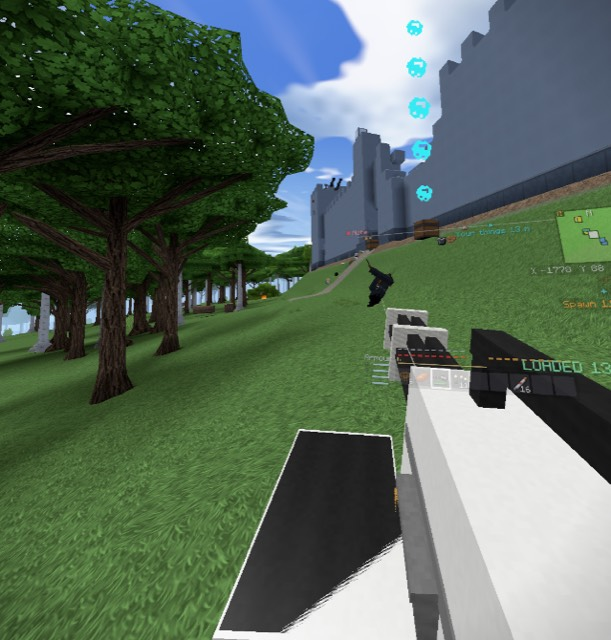

## 07:31:08 - Holy fuck

- **Transcript:** Holy fuck
- **Status:** open
- **Build:** 0.129 (65be4fcc, M1-M4 (device-tested; ship riding, chests, comfort options, weapon wheel))
- **World:** New World (15) (seed 2770276584627345479)
- **Dimension:** Surface
- **Biome:** Forest
- **Position:** -1816.6 92.8 34.6
- **Facing:** west (yaw 284, pitch -5)
- **Held:** Mahlwerk Rotary Gun x1
- **Mount:** on foot
- **Looking at:** nothing
- **Mode:** Survival, health 19/20
- **Time:** day 1 13:32, clear
- **Fps:** 68
- **Levels:** mic -30 dBFS, game sound -17 dBFS
- **Length:** 2.4 s (voice 0.6 s)
- **Just before:** -26s walked into Forest; -21s message: You've reached Your things; -16s into the pack: Slate Repeater; -14s into the pack: Slate Repeater; -13s took 6 damage (health 15/20); -6s message: No Capital Rounds; -3s into the pack: Slatefall Carbine; -3s into the pack: Regular Armour Set
- **Repro (Mac):** `./snap.sh note --seed 2770276584627345479 --x -1816.6 --z 34.6 --yaw 76 --pitch -5 --time 0.314`
- **Audio (this Mac):** /Users/darthvadar/Documents/Blocksmith/QuestVoiceNotes/raw/vn-20261101-073108-340.aac

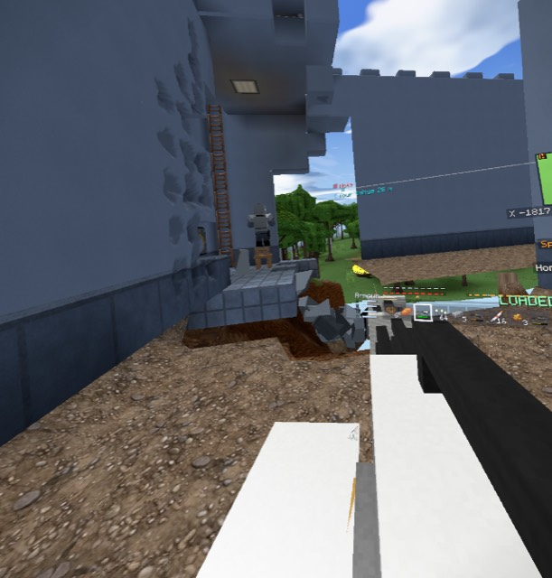

## 07:31:15 - Okay. Well, uh, things are better. And what I do like is the

- **Transcript:** Okay. Well, uh, things are better. And what I do like is the
- **Status:** open
- **Build:** 0.129 (65be4fcc, M1-M4 (device-tested; ship riding, chests, comfort options, weapon wheel))
- **World:** New World (15) (seed 2770276584627345479)
- **Dimension:** Surface
- **Biome:** Forest
- **Position:** -1800.4 92.8 29.8
- **Facing:** north-east (yaw 37, pitch -6)
- **Held:** Mahlwerk Rotary Gun x1
- **Mount:** on foot
- **Looking at:** nothing
- **Mode:** Survival, health 3/20, screen PauseMenu
- **Time:** day 1 13:40, clear
- **Fps:** 66
- **Levels:** mic -23 dBFS, game sound -20 dBFS
- **Length:** 6.4 s (voice 3.5 s)
- **Just before:** -28s message: You've reached Your things; -23s into the pack: Slate Repeater; -21s into the pack: Slate Repeater; -20s took 6 damage (health 15/20); -13s message: No Capital Rounds; -10s into the pack: Slatefall Carbine; -10s into the pack: Regular Armour Set; -5s took 6 damage (health 14/20); -2s took 6 damage (health 8/20); -0s opened PauseMenu
- **While talking:** -5s opened PauseMenu; -4s took 6 damage (health 3/20); -3s message: Creative mode; -3s closed PauseMenu; -2s message: Flying
- **Position at the end:** -1791.9 108.9 41.6
- **Repro (Mac):** `./snap.sh note --seed 2770276584627345479 --x -1800.4 --z 29.8 --yaw -37 --pitch -6 --time 0.320`
- **Audio (this Mac):** /Users/darthvadar/Documents/Blocksmith/QuestVoiceNotes/raw/vn-20261101-073115-760.aac

## 07:31:22 - The guns are working. It's just they didn't get a clear line of sight 

- **Transcript:** The guns are working. It's just they didn't get a clear line of sight when I was outside the base, which is kind of the point of the guns
- **Status:** open
- **Build:** 0.129 (65be4fcc, M1-M4 (device-tested; ship riding, chests, comfort options, weapon wheel))
- **World:** New World (15) (seed 2770276584627345479)
- **Dimension:** Surface
- **Biome:** Forest
- **Position:** -1786.9 108.9 38.8
- **Facing:** north-east (yaw 34, pitch -22)
- **Held:** Mahlwerk Rotary Gun x1
- **Mount:** on foot, flying
- **Looking at:** nothing
- **Mode:** Creative, health 3/20
- **Time:** day 1 13:46, clear
- **Fps:** 64
- **Levels:** mic -19 dBFS, game sound -22 dBFS
- **Length:** 7.6 s (voice 4.5 s)
- **Just before:** -29s into the pack: Slate Repeater; -27s into the pack: Slate Repeater; -26s took 6 damage (health 15/20); -19s message: No Capital Rounds; -16s into the pack: Slatefall Carbine; -16s into the pack: Regular Armour Set; -11s took 6 damage (health 14/20); -8s took 6 damage (health 8/20); -6s opened PauseMenu; -6s took 6 damage (health 3/20); -5s message: Creative mode; -5s closed PauseMenu; -3s message: Flying
- **While talking:** -1s walked into Birch Forest; -0s message: Walking
- **Position at the end:** -1748.7 109.3 84.9
- **Repro (Mac):** `./snap.sh note --seed 2770276584627345479 --x -1786.9 --z 38.8 --yaw -34 --pitch -22 --time 0.324`
- **Audio (this Mac):** /Users/darthvadar/Documents/Blocksmith/QuestVoiceNotes/raw/vn-20261101-073122-560.aac

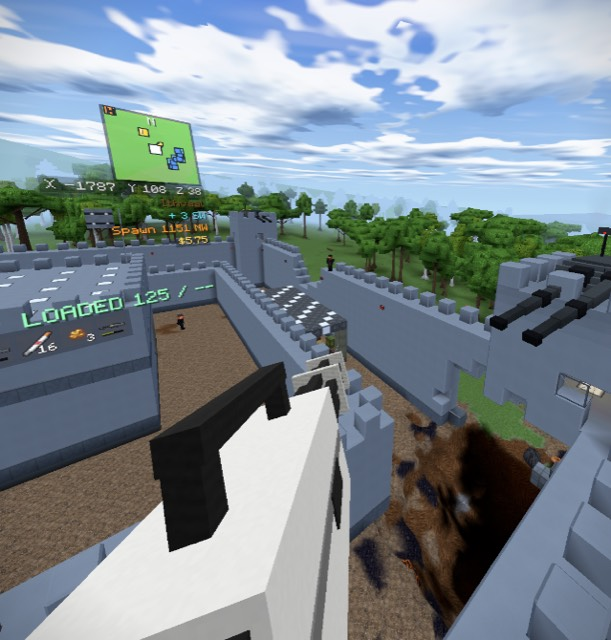

## 07:31:50 - Oh, fucking hell

- **Transcript:** Oh, fucking hell
- **Status:** open
- **Build:** 0.129 (65be4fcc, M1-M4 (device-tested; ship riding, chests, comfort options, weapon wheel))
- **World:** New World (15) (seed 2770276584627345479)
- **Dimension:** Surface
- **Biome:** Forest
- **Position:** -1774.4 91.5 42.5
- **Facing:** north-west (yaw 300, pitch 1)
- **Held:** Mahlwerk Rotary Gun x1
- **Mount:** on foot
- **Looking at:** nothing
- **Mode:** Survival, health 12/20
- **Time:** day 1 14:12, clear
- **Fps:** 67
- **Levels:** mic -35 dBFS, game sound -18 dBFS
- **Length:** 2.9 s (voice 0.8 s)
- **Just before:** -30s took 6 damage (health 3/20); -29s message: Creative mode; -29s closed PauseMenu; -27s message: Flying; -21s walked into Birch Forest; -20s message: Walking; -19s opened PauseMenu; -18s closed PauseMenu; -18s opened CreativeMenu; -17s closed CreativeMenu; -17s opened PauseMenu; -16s message: Survival mode; -16s closed PauseMenu; -15s holding Slate Rounds; -15s holding Iron Ingot; -15s holding Slate Repeater; -15s holding Field Stim; -14s left the pack: Field Stim x2 (at -1753 84 83); -13s left the pack: Field Stim (at -1752 84 82); -13s holding Slate Repeater; -13s message: Slate Repeater; -12s holding Iron Ingot; -12s message: Iron Ingot; -12s holding Slate Rounds; -12s message: Slate Rounds; -12s holding Mahlwerk Rotary Gun; -12s message: Mahlwerk Rotary Gun; -5s took 2 damage (health 18/20); -5s walked into Forest; -0s took 6 damage (health 12/20)
- **Repro (Mac):** `./snap.sh note --seed 2770276584627345479 --x -1774.4 --z 42.5 --yaw 60 --pitch 1 --time 0.342`
- **Audio (this Mac):** /Users/darthvadar/Documents/Blocksmith/QuestVoiceNotes/raw/vn-20261101-073150-819.aac

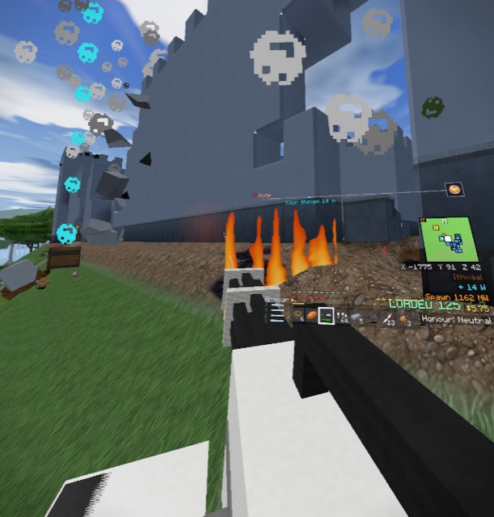

## 07:31:53 - Oh, that's great. Oh my God. [laughs]

- **Transcript:** Oh, that's great. Oh my God. [laughs]
- **Status:** open
- **Build:** 0.129 (65be4fcc, M1-M4 (device-tested; ship riding, chests, comfort options, weapon wheel))
- **World:** New World (15) (seed 2770276584627345479)
- **Dimension:** Surface
- **Biome:** Forest
- **Position:** -1775.8 89.4 44.4
- **Facing:** north-west (yaw 296, pitch 6)
- **Held:** empty hand
- **Mount:** on foot
- **Looking at:** nothing
- **Mode:** Survival, health -1/20, screen DeathMenu
- **Time:** day 1 14:15, clear
- **Fps:** 67
- **Levels:** mic -30 dBFS, game sound -31 dBFS
- **Length:** 4.5 s (voice 1.9 s)
- **Just before:** -30s message: Flying; -23s walked into Birch Forest; -23s message: Walking; -21s opened PauseMenu; -21s closed PauseMenu; -20s opened CreativeMenu; -20s closed CreativeMenu; -19s opened PauseMenu; -18s message: Survival mode; -18s closed PauseMenu; -18s holding Slate Rounds; -17s holding Iron Ingot; -17s holding Slate Repeater; -17s holding Field Stim; -16s left the pack: Field Stim x2 (at -1753 84 83); -16s left the pack: Field Stim (at -1752 84 82); -15s holding Slate Repeater; -15s message: Slate Repeater; -15s holding Iron Ingot; -15s message: Iron Ingot; -15s holding Slate Rounds; -15s message: Slate Rounds; -14s holding Mahlwerk Rotary Gun; -14s message: Mahlwerk Rotary Gun; -8s took 2 damage (health 18/20); -7s walked into Forest; -3s took 6 damage (health 12/20); -2s died; -2s opened DeathMenu; -2s holding empty hand; -2s message: You have your things back; -2s left the pack: Slatefall Carbine (DeathMenu open); -2s left the pack: Regular Armour Set (DeathMenu open); -2s left the pack: Field Stim x29 (DeathMenu open); -2s left the pack: Mahlwerk Rotary Gun (DeathMenu open); -2s left the pack: Slate Repeater x2 (DeathMenu open); -1s took 13 damage (health -1/20)
- **Repro (Mac):** `./snap.sh note --seed 2770276584627345479 --x -1775.8 --z 44.4 --yaw 64 --pitch 6 --time 0.344`
- **Audio (this Mac):** /Users/darthvadar/Documents/Blocksmith/QuestVoiceNotes/raw/vn-20261101-073153-419.aac

## 07:31:57 - Oh, shit. Okay. All right

- **Transcript:** Oh, shit. Okay. All right
- **Status:** open
- **Build:** 0.129 (65be4fcc, M1-M4 (device-tested; ship riding, chests, comfort options, weapon wheel))
- **World:** New World (15) (seed 2770276584627345479)
- **Dimension:** Surface
- **Biome:** Taiga
- **Position:** -2567.5 97.2 -807.5
- **Facing:** north-west (yaw 321, pitch 76)
- **Held:** empty hand
- **Mount:** on foot
- **Looking at:** Spruce Leaves at -2568 98 -808
- **Mode:** Survival, health 20/20
- **Time:** day 1 14:21, clear
- **Fps:** 67
- **Levels:** mic -27 dBFS, game sound -29 dBFS
- **Length:** 3.9 s (voice 2.0 s)
- **Just before:** -28s walked into Birch Forest; -27s message: Walking; -25s opened PauseMenu; -25s closed PauseMenu; -25s opened CreativeMenu; -24s closed CreativeMenu; -24s opened PauseMenu; -23s message: Survival mode; -22s closed PauseMenu; -22s holding Slate Rounds; -22s holding Iron Ingot; -22s holding Slate Repeater; -22s holding Field Stim; -21s left the pack: Field Stim x2 (at -1753 84 83); -20s left the pack: Field Stim (at -1752 84 82); -19s holding Slate Repeater; -19s message: Slate Repeater; -19s holding Iron Ingot; -19s message: Iron Ingot; -19s holding Slate Rounds; -19s message: Slate Rounds; -19s holding Mahlwerk Rotary Gun; -19s message: Mahlwerk Rotary Gun; -12s took 2 damage (health 18/20); -11s walked into Forest; -7s took 6 damage (health 12/20); -6s died; -6s opened DeathMenu; -6s holding empty hand; -6s message: You have your things back; -6s left the pack: Slatefall Carbine (DeathMenu open); -6s left the pack: Regular Armour Set (DeathMenu open); -6s left the pack: Field Stim x29 (DeathMenu open); -6s left the pack: Mahlwerk Rotary Gun (DeathMenu open); -6s left the pack: Slate Repeater x2 (DeathMenu open); -5s took 13 damage (health -1/20); -4s message: Target gone from the list. Back to the story's objective; -1s respawned; -1s closed DeathMenu
- **Repro (Mac):** `./snap.sh note --seed 2770276584627345479 --x -2567.5 --z -807.5 --yaw 39 --pitch 76 --time 0.348`
- **Audio (this Mac):** /Users/darthvadar/Documents/Blocksmith/QuestVoiceNotes/raw/vn-20261101-073157-960.aac

## 07:32:02 - Yeah, things have, uh, definitely been made harder and I love it. That

- **Transcript:** Yeah, things have, uh, definitely been made harder and I love it. That, that is very good
- **Status:** open
- **Build:** 0.129 (65be4fcc, M1-M4 (device-tested; ship riding, chests, comfort options, weapon wheel))
- **World:** New World (15) (seed 2770276584627345479)
- **Dimension:** Surface
- **Biome:** Taiga
- **Position:** -2564.9 104.5 -817.5
- **Facing:** north (yaw 20, pitch -11)
- **Held:** empty hand
- **Mount:** on foot, flying
- **Looking at:** Spruce Leaves at -2564 105 -822
- **Mode:** Creative, health 20/20
- **Time:** day 1 14:24, clear
- **Fps:** 69
- **Levels:** mic -23 dBFS, game sound -24 dBFS
- **Length:** 5.8 s (voice 3.4 s)
- **Just before:** -29s opened CreativeMenu; -29s closed CreativeMenu; -28s opened PauseMenu; -27s message: Survival mode; -27s closed PauseMenu; -27s holding Slate Rounds; -26s holding Iron Ingot; -26s holding Slate Repeater; -26s holding Field Stim; -25s left the pack: Field Stim x2 (at -1753 84 83); -25s left the pack: Field Stim (at -1752 84 82); -24s holding Slate Repeater; -24s message: Slate Repeater; -24s holding Iron Ingot; -24s message: Iron Ingot; -23s holding Slate Rounds; -23s message: Slate Rounds; -23s holding Mahlwerk Rotary Gun; -23s message: Mahlwerk Rotary Gun; -16s took 2 damage (health 18/20); -16s walked into Forest; -11s took 6 damage (health 12/20); -11s died; -11s opened DeathMenu; -11s holding empty hand; -10s message: You have your things back; -10s left the pack: Slatefall Carbine (DeathMenu open); -10s left the pack: Regular Armour Set (DeathMenu open); -10s left the pack: Field Stim x29 (DeathMenu open); -10s left the pack: Mahlwerk Rotary Gun (DeathMenu open); -10s left the pack: Slate Repeater x2 (DeathMenu open); -10s took 13 damage (health -1/20); -9s message: Target gone from the list. Back to the story's objective; -5s respawned; -5s closed DeathMenu; -4s walked into Taiga; -3s opened PauseMenu; -2s message: Creative mode; -2s closed PauseMenu; -0s message: Flying
- **While talking:** -5s message: Flying; -1s message: Entering Draeria
- **Position at the end:** -1582.1 145.3 -935.3
- **Repro (Mac):** `./snap.sh note --seed 2770276584627345479 --x -2564.9 --z -817.5 --yaw -20 --pitch -11 --time 0.351`
- **Audio (this Mac):** /Users/darthvadar/Documents/Blocksmith/QuestVoiceNotes/raw/vn-20261101-073202-760.aac

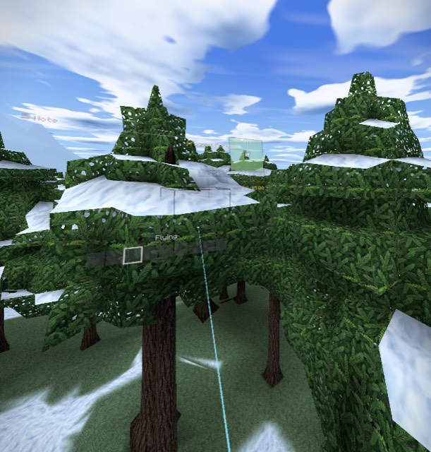

## 07:32:14 - Very, very good. Okay

- **Transcript:** Very, very good. Okay
- **Status:** open
- **Build:** 0.129 (65be4fcc, M1-M4 (device-tested; ship riding, chests, comfort options, weapon wheel))
- **World:** New World (15) (seed 2770276584627345479)
- **Dimension:** Surface
- **Biome:** Forest
- **Position:** -1863.1 167.3 80.6
- **Facing:** east (yaw 71, pitch -35)
- **Held:** empty hand
- **Mount:** on foot, flying
- **Looking at:** nothing
- **Mode:** Creative, health 20/20
- **Time:** day 1 14:38, clear
- **Fps:** 72
- **Levels:** mic -26 dBFS, game sound -15 dBFS
- **Length:** 3.0 s (voice 1.3 s)
- **Just before:** -28s took 2 damage (health 18/20); -27s walked into Forest; -23s took 6 damage (health 12/20); -22s died; -22s opened DeathMenu; -22s holding empty hand; -22s message: You have your things back; -22s left the pack: Slatefall Carbine (DeathMenu open); -22s left the pack: Regular Armour Set (DeathMenu open); -22s left the pack: Field Stim x29 (DeathMenu open); -22s left the pack: Mahlwerk Rotary Gun (DeathMenu open); -22s left the pack: Slate Repeater x2 (DeathMenu open); -21s took 13 damage (health -1/20); -20s message: Target gone from the list. Back to the story's objective; -17s respawned; -17s closed DeathMenu; -15s walked into Taiga; -14s opened PauseMenu; -13s message: Creative mode; -13s closed PauseMenu; -12s message: Flying; -8s message: Entering Draeria; -5s message: Entering Ithvaal; -3s walked into Savanna; -1s walked into Forest
- **Repro (Mac):** `./snap.sh note --seed 2770276584627345479 --x -1863.1 --z 80.6 --yaw -71 --pitch -35 --time 0.360`
- **Audio (this Mac):** /Users/darthvadar/Documents/Blocksmith/QuestVoiceNotes/raw/vn-20261101-073214-839.aac

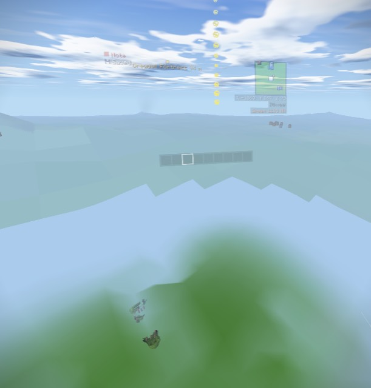

## 07:32:27 - Uh, no stuff

- **Transcript:** Uh, no stuff
- **Status:** open
- **Build:** 0.129 (65be4fcc, M1-M4 (device-tested; ship riding, chests, comfort options, weapon wheel))
- **World:** New World (15) (seed 2770276584627345479)
- **Dimension:** Surface
- **Biome:** Forest
- **Position:** -1779.7 90.2 44.0
- **Facing:** north-east (yaw 45, pitch 2)
- **Held:** empty hand
- **Mount:** on foot
- **Looking at:** nothing
- **Mode:** Creative, health 20/20
- **Time:** day 1 14:50, clear
- **Fps:** 47
- **Levels:** mic -36 dBFS, game sound -28 dBFS
- **Length:** 2.7 s (voice 0.7 s)
- **Just before:** -30s message: Target gone from the list. Back to the story's objective; -26s respawned; -26s closed DeathMenu; -25s walked into Taiga; -24s opened PauseMenu; -23s message: Creative mode; -23s closed PauseMenu; -21s message: Flying; -17s message: Entering Draeria; -14s message: Entering Ithvaal; -13s walked into Savanna; -11s walked into Forest; -7s message: Walking; -6s message: Flying; -3s message: Walking; -1s opened ChestMenu; -1s closed ChestMenu
- **Repro (Mac):** `./snap.sh note --seed 2770276584627345479 --x -1779.7 --z 44.0 --yaw -45 --pitch 2 --time 0.368`
- **Audio (this Mac):** /Users/darthvadar/Documents/Blocksmith/QuestVoiceNotes/raw/vn-20261101-073227-479.aac

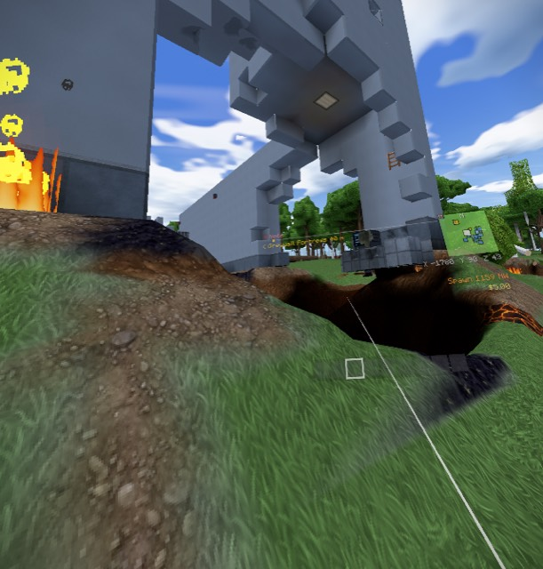

## 07:32:33 - Oh, this is-- this looks terrific

- **Transcript:** Oh, this is-- this looks terrific
- **Status:** open
- **Build:** 0.129 (65be4fcc, M1-M4 (device-tested; ship riding, chests, comfort options, weapon wheel))
- **World:** New World (15) (seed 2770276584627345479)
- **Dimension:** Surface
- **Biome:** Forest
- **Position:** -1757.5 100.3 34.7
- **Facing:** north-east (yaw 25, pitch -59)
- **Held:** empty hand
- **Mount:** on foot, flying
- **Looking at:** nothing
- **Mode:** Creative, health 20/20
- **Time:** day 1 14:54, clear
- **Fps:** 43
- **Levels:** mic -25 dBFS, game sound -19 dBFS
- **Length:** 3.1 s (voice 1.1 s)
- **Just before:** -29s walked into Taiga; -28s opened PauseMenu; -27s message: Creative mode; -26s closed PauseMenu; -25s message: Flying; -21s message: Entering Draeria; -18s message: Entering Ithvaal; -17s walked into Savanna; -15s walked into Forest; -11s message: Walking; -10s message: Flying; -7s message: Walking; -5s opened ChestMenu; -4s closed ChestMenu; -1s message: Flying
- **Repro (Mac):** `./snap.sh note --seed 2770276584627345479 --x -1757.5 --z 34.7 --yaw -25 --pitch -59 --time 0.371`
- **Audio (this Mac):** /Users/darthvadar/Documents/Blocksmith/QuestVoiceNotes/raw/vn-20261101-073233-860.aac

## 07:32:37 - Frame rate might be dropping slightly. I don't know. Can't tell

- **Transcript:** Frame rate might be dropping slightly. I don't know. Can't tell
- **Status:** open
- **Build:** 0.129 (65be4fcc, M1-M4 (device-tested; ship riding, chests, comfort options, weapon wheel))
- **World:** New World (15) (seed 2770276584627345479)
- **Dimension:** Surface
- **Biome:** Birch Forest
- **Position:** -1788.0 100.3 79.2
- **Facing:** north (yaw 12, pitch -26)
- **Held:** empty hand
- **Mount:** on foot, flying
- **Looking at:** nothing
- **Mode:** Creative, health 20/20
- **Time:** day 1 14:57, clear
- **Fps:** 43
- **Levels:** mic -28 dBFS, game sound -22 dBFS
- **Length:** 4.5 s (voice 1.9 s)
- **Just before:** -30s opened PauseMenu; -29s message: Creative mode; -29s closed PauseMenu; -27s message: Flying; -23s message: Entering Draeria; -20s message: Entering Ithvaal; -19s walked into Savanna; -17s walked into Forest; -13s message: Walking; -12s message: Flying; -9s message: Walking; -7s opened ChestMenu; -7s closed ChestMenu; -4s message: Flying
- **Repro (Mac):** `./snap.sh note --seed 2770276584627345479 --x -1788.0 --z 79.2 --yaw -12 --pitch -26 --time 0.373`
- **Audio (this Mac):** /Users/darthvadar/Documents/Blocksmith/QuestVoiceNotes/raw/vn-20261101-073237-160.aac

## 07:33:32 - Scope needs work

- **Transcript:** Scope needs work
- **Status:** open
- **Build:** 0.129 (65be4fcc, M1-M4 (device-tested; ship riding, chests, comfort options, weapon wheel))
- **World:** New World (15) (seed 2770276584627345479)
- **Dimension:** Surface
- **Biome:** Forest
- **Position:** -1815.2 91.0 33.7
- **Facing:** west (yaw 257, pitch 9)
- **Held:** Fernblick Rifle x1
- **Mount:** on foot
- **Looking at:** nothing
- **Mode:** Survival, health 19/20
- **Time:** day 1 15:57, clear
- **Fps:** 68
- **Levels:** mic -22 dBFS, game sound -20 dBFS
- **Length:** 2.3 s (voice 0.7 s)
- **Just before:** -29s into the pack: Combat Stim; -27s closed CreativeMenu; -27s opened PauseMenu; -26s message: Survival mode; -26s closed PauseMenu; -25s opened InventoryMenu; -25s holding empty hand; -25s left the pack: Steel Helmet (InventoryMenu open); -25s left the pack: Steel Chestplate (InventoryMenu open); -24s left the pack: Steel Leggings (InventoryMenu open); -24s left the pack: Steel Boots (InventoryMenu open); -24s closed InventoryMenu; -23s holding Heavy Magazine; -23s message: Heavy Magazine; -23s holding Fernblick Rifle; -23s message: Fernblick Rifle; -23s message: Loaded: 8 / 8; -23s left the pack: Heavy Magazine (at -1801 81 96); -18s walked into Forest; -4s message: The Greywall Fortress is sounding the alarm!; -4s took 5 damage (health 16/20)
- **Repro (Mac):** `./snap.sh note --seed 2770276584627345479 --x -1815.2 --z 33.7 --yaw 103 --pitch 9 --time 0.415`
- **Audio (this Mac):** /Users/darthvadar/Documents/Blocksmith/QuestVoiceNotes/raw/vn-20261101-073332-960.aac

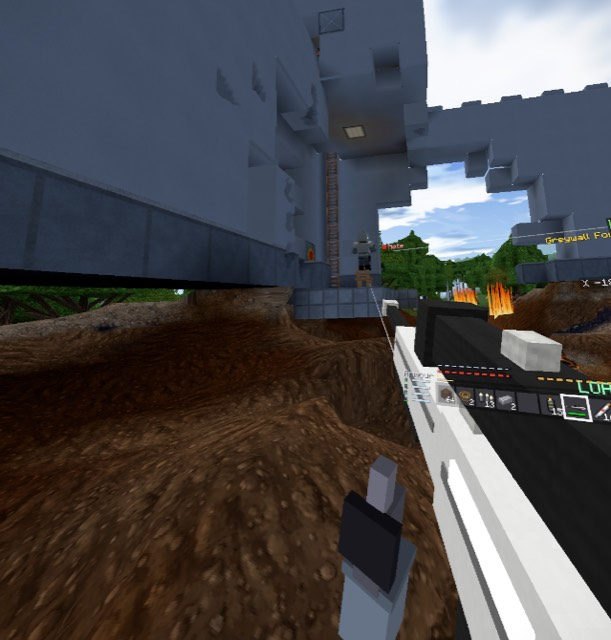

## 07:33:37 - I've got double vision with the scope

- **Transcript:** I've got double vision with the scope
- **Status:** open
- **Build:** 0.129 (65be4fcc, M1-M4 (device-tested; ship riding, chests, comfort options, weapon wheel))
- **World:** New World (15) (seed 2770276584627345479)
- **Dimension:** Surface
- **Biome:** Forest
- **Position:** -1816.5 90.8 32.9
- **Facing:** north-west (yaw 306, pitch -37)
- **Held:** Fernblick Rifle x1
- **Mount:** on foot
- **Looking at:** Dirt at -1819 90 31
- **Mode:** Survival, health 19/20
- **Time:** day 1 16:02, clear
- **Fps:** 67
- **Levels:** mic -33 dBFS, game sound -16 dBFS
- **Length:** 2.8 s (voice 1.3 s)
- **Just before:** -30s closed PauseMenu; -30s opened InventoryMenu; -29s holding empty hand; -29s left the pack: Steel Helmet (InventoryMenu open); -29s left the pack: Steel Chestplate (InventoryMenu open); -29s left the pack: Steel Leggings (InventoryMenu open); -29s left the pack: Steel Boots (InventoryMenu open); -28s closed InventoryMenu; -28s holding Heavy Magazine; -28s message: Heavy Magazine; -28s holding Fernblick Rifle; -28s message: Fernblick Rifle; -27s message: Loaded: 8 / 8; -27s left the pack: Heavy Magazine (at -1801 81 96); -22s walked into Forest; -9s message: The Greywall Fortress is sounding the alarm!; -8s took 5 damage (health 16/20)
- **Repro (Mac):** `./snap.sh note --seed 2770276584627345479 --x -1816.5 --z 32.9 --yaw 54 --pitch -37 --time 0.419`
- **Audio (this Mac):** /Users/darthvadar/Documents/Blocksmith/QuestVoiceNotes/raw/vn-20261101-073337-679.aac

## 07:34:23 - Come on. Load

- **Transcript:** Come on. Load
- **Status:** open
- **Build:** 0.129 (65be4fcc, M1-M4 (device-tested; ship riding, chests, comfort options, weapon wheel))
- **World:** New World (15) (seed 2770276584627345479)
- **Dimension:** Surface
- **Biome:** Forest
- **Position:** -1822.1 92.8 -6.0
- **Facing:** north (yaw 9, pitch -10)
- **Held:** Heavy Magazine x14
- **Mount:** on foot
- **Looking at:** nothing
- **Mode:** Survival, health 13/20
- **Time:** day 1 16:50, clear
- **Fps:** 58
- **Levels:** mic -29 dBFS, game sound -12 dBFS
- **Length:** 3.1 s (voice 0.8 s)
- **Just before:** -30s holding Fernblick Rifle; -30s message: Fernblick Rifle; -29s holding Field Stim; -29s message: Field Stim; -28s left the pack: Field Stim (at -1837 87 15); -28s holding Fernblick Rifle; -28s message: Fernblick Rifle; -28s holding Heavy Magazine; -28s message: Heavy Magazine; -27s holding Fernblick Rifle; -27s message: Fernblick Rifle; -14s took 1 damage (health 19/20); -11s message: Loaded: 8 / 8; -10s left the pack: Heavy Magazine; -10s holding Field Stim; -9s holding Fernblick Rifle; -9s holding Field Stim; -8s took 10 damage (health 17/20); -8s left the pack: Field Stim x2 (at -1823 92 -7); -7s holding Fernblick Rifle; -7s message: Fernblick Rifle; -6s took 2 damage (health 19/20); -4s message: Loaded: 8 / 8; -3s took 5 damage (health 16/20); -1s took 5 damage (health 12/20); -1s holding Heavy Magazine; -1s message: Heavy Magazine
- **Repro (Mac):** `./snap.sh note --seed 2770276584627345479 --x -1822.1 --z -6.0 --yaw -9 --pitch -10 --time 0.452`
- **Audio (this Mac):** /Users/darthvadar/Documents/Blocksmith/QuestVoiceNotes/raw/vn-20261101-073423-439.aac

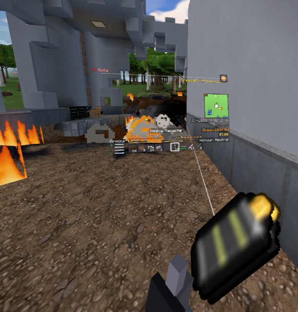

## 07:34:26 - All right, good

- **Transcript:** All right, good
- **Status:** open
- **Build:** 0.129 (65be4fcc, M1-M4 (device-tested; ship riding, chests, comfort options, weapon wheel))
- **World:** New World (15) (seed 2770276584627345479)
- **Dimension:** Surface
- **Biome:** Forest
- **Position:** -1822.6 92.8 -7.2
- **Facing:** north-west (yaw 328, pitch -1)
- **Held:** Fernblick Rifle x1
- **Mount:** on foot
- **Looking at:** nothing
- **Mode:** Survival, health 13/20
- **Time:** day 1 16:53, clear
- **Fps:** 56
- **Levels:** mic -32 dBFS, game sound -13 dBFS
- **Length:** 1.5 s (voice 0.4 s)
- **Just before:** -30s holding Heavy Magazine; -30s message: Heavy Magazine; -30s holding Fernblick Rifle; -30s message: Fernblick Rifle; -16s took 1 damage (health 19/20); -13s message: Loaded: 8 / 8; -13s left the pack: Heavy Magazine; -12s holding Field Stim; -11s holding Fernblick Rifle; -11s holding Field Stim; -10s took 10 damage (health 17/20); -10s left the pack: Field Stim x2 (at -1823 92 -7); -10s holding Fernblick Rifle; -10s message: Fernblick Rifle; -8s took 2 damage (health 19/20); -7s message: Loaded: 8 / 8; -5s took 5 damage (health 16/20); -3s took 5 damage (health 12/20); -3s holding Heavy Magazine; -3s message: Heavy Magazine; -2s holding Fernblick Rifle; -2s message: Fernblick Rifle
- **Repro (Mac):** `./snap.sh note --seed 2770276584627345479 --x -1822.6 --z -7.2 --yaw 32 --pitch -1 --time 0.454`
- **Audio (this Mac):** /Users/darthvadar/Documents/Blocksmith/QuestVoiceNotes/raw/vn-20261101-073426-339.aac

## 07:34:29 - Whoa, that gun cannot be firing

- **Transcript:** Whoa, that gun cannot be firing
- **Status:** open
- **Build:** 0.129 (65be4fcc, M1-M4 (device-tested; ship riding, chests, comfort options, weapon wheel))
- **World:** New World (15) (seed 2770276584627345479)
- **Dimension:** Surface
- **Biome:** Forest
- **Position:** -1821.5 92.8 -0.4
- **Facing:** south (yaw 195, pitch 16)
- **Held:** Fernblick Rifle x1
- **Mount:** on foot
- **Looking at:** nothing
- **Mode:** Survival, health 13/20
- **Time:** day 1 16:56, clear
- **Fps:** 56
- **Levels:** mic -20 dBFS, game sound -18 dBFS
- **Length:** 3.6 s (voice 1.7 s)
- **Just before:** -19s took 1 damage (health 19/20); -16s message: Loaded: 8 / 8; -16s left the pack: Heavy Magazine; -15s holding Field Stim; -14s holding Fernblick Rifle; -14s holding Field Stim; -13s took 10 damage (health 17/20); -13s left the pack: Field Stim x2 (at -1823 92 -7); -12s holding Fernblick Rifle; -12s message: Fernblick Rifle; -11s took 2 damage (health 19/20); -9s message: Loaded: 8 / 8; -8s took 5 damage (health 16/20); -6s took 5 damage (health 12/20); -6s holding Heavy Magazine; -6s message: Heavy Magazine; -5s holding Fernblick Rifle; -5s message: Fernblick Rifle
- **Repro (Mac):** `./snap.sh note --seed 2770276584627345479 --x -1821.5 --z -0.4 --yaw 165 --pitch 16 --time 0.456`
- **Audio (this Mac):** /Users/darthvadar/Documents/Blocksmith/QuestVoiceNotes/raw/vn-20261101-073429-339.aac

## 07:34:32 - Okay, hold on. That gun's operator is dead

- **Transcript:** Okay, hold on. That gun's operator is dead
- **Status:** open
- **Build:** 0.129 (65be4fcc, M1-M4 (device-tested; ship riding, chests, comfort options, weapon wheel))
- **World:** New World (15) (seed 2770276584627345479)
- **Dimension:** Surface
- **Biome:** Forest
- **Position:** -1823.9 92.8 21.3
- **Facing:** south-west (yaw 205, pitch 12)
- **Held:** Fernblick Rifle x1
- **Mount:** on foot
- **Looking at:** nothing
- **Mode:** Survival, health 13/20
- **Time:** day 1 17:00, clear
- **Fps:** 63
- **Levels:** mic -24 dBFS, game sound -14 dBFS
- **Length:** 4.1 s (voice 2.2 s)
- **Just before:** -22s took 1 damage (health 19/20); -19s message: Loaded: 8 / 8; -18s left the pack: Heavy Magazine; -17s holding Field Stim; -17s holding Fernblick Rifle; -16s holding Field Stim; -16s took 10 damage (health 17/20); -16s left the pack: Field Stim x2 (at -1823 92 -7); -15s holding Fernblick Rifle; -15s message: Fernblick Rifle; -14s took 2 damage (health 19/20); -12s message: Loaded: 8 / 8; -11s took 5 damage (health 16/20); -9s took 5 damage (health 12/20); -8s holding Heavy Magazine; -8s message: Heavy Magazine; -8s holding Fernblick Rifle; -8s message: Fernblick Rifle
- **Repro (Mac):** `./snap.sh note --seed 2770276584627345479 --x -1823.9 --z 21.3 --yaw 155 --pitch 12 --time 0.459`
- **Audio (this Mac):** /Users/darthvadar/Documents/Blocksmith/QuestVoiceNotes/raw/vn-20261101-073432-659.aac

## 07:34:40 - There's no way for that gun to be firing

- **Transcript:** There's no way for that gun to be firing
- **Status:** open
- **Build:** 0.129 (65be4fcc, M1-M4 (device-tested; ship riding, chests, comfort options, weapon wheel))
- **World:** New World (15) (seed 2770276584627345479)
- **Dimension:** Surface
- **Biome:** Forest
- **Position:** -1825.4 93.3 23.0
- **Facing:** south-west (yaw 218, pitch -9)
- **Held:** Fernblick Rifle x1
- **Mount:** on foot
- **Looking at:** Station Concrete at -1829 94 26
- **Mode:** Creative, health 13/20
- **Time:** day 1 17:06, clear
- **Fps:** 60
- **Levels:** mic -35 dBFS, game sound -20 dBFS
- **Length:** 3.2 s (voice 1.6 s)
- **Just before:** -29s took 1 damage (health 19/20); -25s message: Loaded: 8 / 8; -25s left the pack: Heavy Magazine; -24s holding Field Stim; -23s holding Fernblick Rifle; -23s holding Field Stim; -23s took 10 damage (health 17/20); -22s left the pack: Field Stim x2 (at -1823 92 -7); -22s holding Fernblick Rifle; -22s message: Fernblick Rifle; -21s took 2 damage (health 19/20); -19s message: Loaded: 8 / 8; -17s took 5 damage (health 16/20); -16s took 5 damage (health 12/20); -15s holding Heavy Magazine; -15s message: Heavy Magazine; -14s holding Fernblick Rifle; -14s message: Fernblick Rifle; -3s opened PauseMenu; -2s opened AdvancementMenu; -2s closed AdvancementMenu; -1s opened PauseMenu; -0s message: Creative mode; -0s closed PauseMenu
- **Repro (Mac):** `./snap.sh note --seed 2770276584627345479 --x -1825.4 --z 23.0 --yaw 142 --pitch -9 --time 0.463`
- **Audio (this Mac):** /Users/darthvadar/Documents/Blocksmith/QuestVoiceNotes/raw/vn-20261101-073440-380.aac

## 07:34:59 - Oh shit. Oh shit. Okay. Okay. Whoa

- **Transcript:** Oh shit. Oh shit. Okay. Okay. Whoa
- **Status:** open
- **Build:** 0.129 (65be4fcc, M1-M4 (device-tested; ship riding, chests, comfort options, weapon wheel))
- **World:** New World (15) (seed 2770276584627345479)
- **Dimension:** Surface
- **Biome:** Forest
- **Position:** -1829.1 101.1 27.0
- **Facing:** north-east (yaw 57, pitch -23)
- **Held:** Fernblick Rifle x1
- **Mount:** on foot
- **Looking at:** nothing
- **Mode:** Survival, health 7/20
- **Time:** day 1 17:22, clear
- **Fps:** 59
- **Levels:** mic -43 dBFS, game sound -14 dBFS
- **Length:** 3.7 s (voice 1.7 s)
- **Just before:** -19s opened PauseMenu; -18s opened AdvancementMenu; -18s closed AdvancementMenu; -17s opened PauseMenu; -16s message: Creative mode; -16s closed PauseMenu; -15s message: Flying; -13s message: Walking; -11s opened PauseMenu; -10s closed PauseMenu; -9s message: Flying; -4s message: Walking; -3s opened PauseMenu; -2s message: Survival mode; -2s closed PauseMenu
- **Repro (Mac):** `./snap.sh note --seed 2770276584627345479 --x -1829.1 --z 27.0 --yaw -57 --pitch -23 --time 0.474`
- **Audio (this Mac):** /Users/darthvadar/Documents/Blocksmith/QuestVoiceNotes/raw/vn-20261101-073459-199.aac

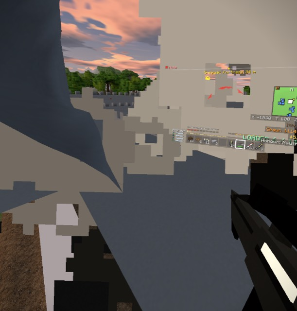

## 07:35:19 - We got some hovering fire. That's not good

- **Transcript:** We got some hovering fire. That's not good
- **Status:** open
- **Build:** 0.129 (65be4fcc, M1-M4 (device-tested; ship riding, chests, comfort options, weapon wheel))
- **World:** New World (15) (seed 2770276584627345479)
- **Dimension:** Surface
- **Biome:** Forest
- **Position:** -1827.2 92.8 23.0
- **Facing:** south (yaw 179, pitch -8)
- **Held:** Fernblick Rifle x1
- **Mount:** on foot
- **Looking at:** nothing
- **Mode:** Survival, health 20/20
- **Time:** day 1 17:40, clear
- **Fps:** 63
- **Levels:** mic -33 dBFS, game sound -18 dBFS
- **Length:** 3.3 s (voice 1.4 s)
- **Just before:** -29s opened PauseMenu; -28s closed PauseMenu; -28s message: Flying; -22s message: Walking; -22s opened PauseMenu; -21s message: Survival mode; -20s closed PauseMenu; -18s opened PauseMenu; -18s took 6 damage (health 7/20); -17s message: Creative mode; -17s closed PauseMenu; -15s opened PauseMenu; -14s opened AdvancementMenu; -13s closed AdvancementMenu; -12s opened PauseMenu; -11s message: Survival mode; -11s closed PauseMenu; -10s holding Field Stim; -10s holding Fernblick Rifle; -10s holding Field Stim; -9s left the pack: Field Stim (at -1826 92 15); -9s left the pack: Field Stim (at -1825 92 18); -8s holding Fernblick Rifle; -8s message: Fernblick Rifle; -8s holding Heavy Magazine; -8s message: Heavy Magazine; -7s holding Fernblick Rifle; -7s message: Fernblick Rifle; -7s message: Loaded: 8 / 8; -5s into the pack: Spec Ops Armour Set
- **Repro (Mac):** `./snap.sh note --seed 2770276584627345479 --x -1827.2 --z 23.0 --yaw -179 --pitch -8 --time 0.487`
- **Audio (this Mac):** /Users/darthvadar/Documents/Blocksmith/QuestVoiceNotes/raw/vn-20261101-073519-759.aac

## 07:35:25 - Okay, this gun wasn't firing anymore. So s- somehow someone on the sec

- **Transcript:** Okay, this gun wasn't firing anymore. So s- somehow someone on the second level of the tower was operating the gun, even though the console's on the first level of the gun tower thing. Also, when I go into some of the craters, sometimes my vision goes black, even though I'm not under anything or... Yeah
- **Status:** open
- **Build:** 0.129 (65be4fcc, M1-M4 (device-tested; ship riding, chests, comfort options, weapon wheel))
- **World:** New World (15) (seed 2770276584627345479)
- **Dimension:** Surface
- **Biome:** Forest
- **Position:** -1822.4 92.8 6.9
- **Facing:** north (yaw 351, pitch 32)
- **Held:** Fernblick Rifle x1
- **Mount:** on foot
- **Looking at:** nothing
- **Mode:** Survival, health 20/20
- **Time:** day 1 17:46, clear
- **Fps:** 64
- **Levels:** mic -27 dBFS, game sound -17 dBFS
- **Length:** 19.6 s (voice 11.5 s)
- **Just before:** -27s message: Walking; -27s opened PauseMenu; -26s message: Survival mode; -26s closed PauseMenu; -23s opened PauseMenu; -23s took 6 damage (health 7/20); -22s message: Creative mode; -22s closed PauseMenu; -20s opened PauseMenu; -19s opened AdvancementMenu; -18s closed AdvancementMenu; -17s opened PauseMenu; -16s message: Survival mode; -16s closed PauseMenu; -15s holding Field Stim; -15s holding Fernblick Rifle; -15s holding Field Stim; -14s left the pack: Field Stim (at -1826 92 15); -14s left the pack: Field Stim (at -1825 92 18); -13s holding Fernblick Rifle; -13s message: Fernblick Rifle; -13s holding Heavy Magazine; -13s message: Heavy Magazine; -12s holding Fernblick Rifle; -12s message: Fernblick Rifle; -12s message: Loaded: 8 / 8; -10s into the pack: Spec Ops Armour Set
- **Position at the end:** -1821.5 89.4 -10.3
- **Repro (Mac):** `./snap.sh note --seed 2770276584627345479 --x -1822.4 --z 6.9 --yaw 9 --pitch 32 --time 0.491`
- **Audio (this Mac):** /Users/darthvadar/Documents/Blocksmith/QuestVoiceNotes/raw/vn-20261101-073525-479.aac

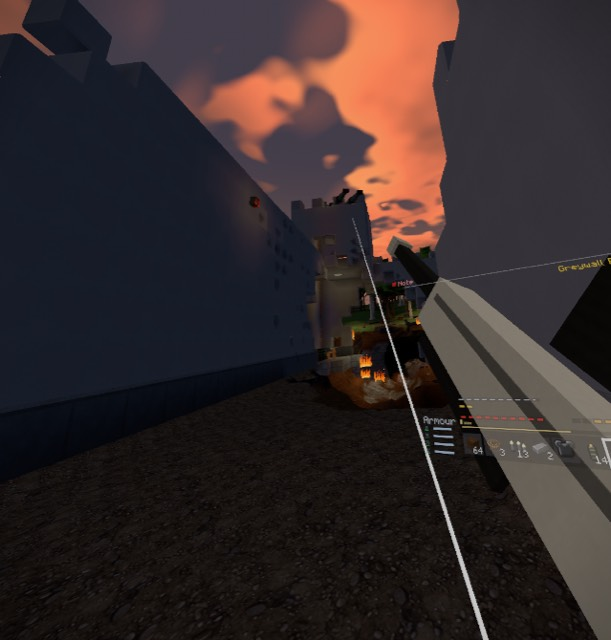

## 07:38:14 - There should be a bunch of guys on the second floor of the Graywall st

- **Transcript:** There should be a bunch of guys on the second floor of the Graywall station
- **Status:** open
- **Build:** 0.129 (65be4fcc, M1-M4 (device-tested; ship riding, chests, comfort options, weapon wheel))
- **World:** New World (15) (seed 2770276584627345479)
- **Dimension:** Surface
- **Biome:** Forest
- **Position:** -1809.7 99.6 6.4
- **Facing:** north-east (yaw 56, pitch -13)
- **Held:** Slatefall Carbine x1
- **Mount:** on foot
- **Looking at:** nothing
- **Mode:** Survival, health 20/20
- **Time:** day 1 20:58, clear
- **Fps:** 70
- **Levels:** mic -27 dBFS, game sound -34 dBFS
- **Length:** 4.4 s (voice 2.4 s)
- **Just before:** -27s opened ChestMenu; -25s closed ChestMenu; -25s message: Loaded: 30 / 30; -19s holding Heavy Magazine; -19s message: Heavy Magazine; -19s holding Slatefall Carbine; -19s message: Slatefall Carbine; -18s holding Heavy Magazine; -18s message: Heavy Magazine; -17s holding Slatefall Carbine; -17s message: Slatefall Carbine; -16s into the pack: Greywall Code Book; -16s into the pack: Greywall Keycard; -14s into the pack: Regular Armour Set; -14s into the pack: Spec Ops Armour Set; -14s into the pack: Greywall Keycard; -13s opened ChestMenu; -11s closed ChestMenu; -9s into the pack: Greywall Code Book; -8s into the pack: Greywall Keycard; -6s into the pack: Slatefall Carbine; -6s opened ChestMenu; -5s closed ChestMenu; -3s into the pack: Sechser Revolver; -3s into the pack: Greywall Code Book
- **Repro (Mac):** `./snap.sh note --seed 2770276584627345479 --x -1809.7 --z 6.4 --yaw -56 --pitch -13 --time 0.624`
- **Audio (this Mac):** /Users/darthvadar/Documents/Blocksmith/QuestVoiceNotes/raw/vn-20261101-073814-919.aac

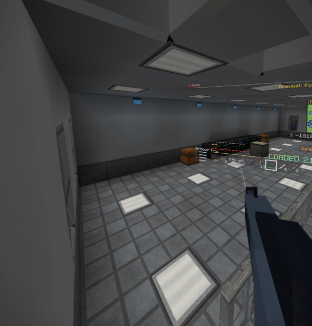

## 07:40:18 - Well, I was very pleased with this interaction

- **Transcript:** Well, I was very pleased with this interaction
- **Status:** open
- **Build:** 0.129 (65be4fcc, M1-M4 (device-tested; ship riding, chests, comfort options, weapon wheel))
- **World:** New World (15) (seed 2770276584627345479)
- **Dimension:** Surface
- **Biome:** Forest
- **Position:** -1777.2 93.2 -18.0
- **Facing:** south-east (yaw 156, pitch -36)
- **Held:** Slatefall Carbine x1
- **Mount:** on foot
- **Looking at:** Coarse Dirt at -1777 92 -16
- **Mode:** Survival, health 18/20
- **Time:** day 1 23:05, clear
- **Fps:** 49
- **Levels:** mic -26 dBFS, game sound -22 dBFS
- **Length:** 3.4 s (voice 1.8 s)
- **Just before:** -29s holding empty hand; -29s message: Manning the deck gun; -27s message: Gun Control: the gun overhead, worked from this computer; -23s message: The turret is wrecked; -2s holding Slatefall Carbine
- **Repro (Mac):** `./snap.sh note --seed 2770276584627345479 --x -1777.2 --z -18.0 --yaw -156 --pitch -36 --time 0.712`
- **Audio (this Mac):** /Users/darthvadar/Documents/Blocksmith/QuestVoiceNotes/raw/vn-20261101-074018-419.aac

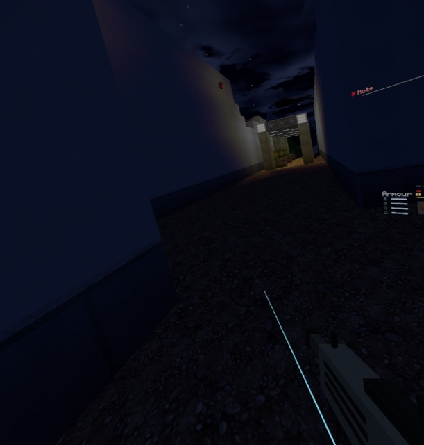

## 07:40:24 - Difficulty was appropriate, I would say

- **Transcript:** Difficulty was appropriate, I would say
- **Status:** open
- **Build:** 0.129 (65be4fcc, M1-M4 (device-tested; ship riding, chests, comfort options, weapon wheel))
- **World:** New World (15) (seed 2770276584627345479)
- **Dimension:** Surface
- **Biome:** Flower Forest
- **Position:** -1633.6 114.9 134.2
- **Facing:** south (yaw 173, pitch -52)
- **Held:** Slatefall Carbine x1
- **Mount:** on foot, flying
- **Looking at:** nothing
- **Mode:** Creative, health 18/20
- **Time:** day 1 23:10, clear
- **Fps:** 64
- **Levels:** mic -25 dBFS, game sound -19 dBFS
- **Length:** 3.5 s (voice 1.3 s)
- **Just before:** -29s message: The turret is wrecked; -8s holding Slatefall Carbine; -5s opened PauseMenu; -4s message: Creative mode; -3s closed PauseMenu; -2s message: Flying; -1s walked into Flower Forest
- **Repro (Mac):** `./snap.sh note --seed 2770276584627345479 --x -1633.6 --z 134.2 --yaw -173 --pitch -52 --time 0.716`
- **Audio (this Mac):** /Users/darthvadar/Documents/Blocksmith/QuestVoiceNotes/raw/vn-20261101-074024-900.aac

## 07:41:52 - Um, it's too hard to grab onto this gun with my other hand for aiming 

- **Transcript:** Um, it's too hard to grab onto this gun with my other hand for aiming purposes
- **Status:** open
- **Build:** 0.129 (65be4fcc, M1-M4 (device-tested; ship riding, chests, comfort options, weapon wheel))
- **World:** New World (15) (seed 2770276584627345479)
- **Dimension:** Surface
- **Biome:** Ocean
- **Position:** -4504.1 129.0 -637.2
- **Facing:** south-east (yaw 137, pitch -22)
- **Held:** Slatefall Carbine x1
- **Mount:** on foot
- **Looking at:** nothing
- **Mode:** Survival, health 18/20
- **Time:** day 1 00:46, clear
- **Fps:** 60
- **Levels:** mic -26 dBFS, game sound -15 dBFS
- **Length:** 6.0 s (voice 3.7 s)
- **Just before:** -11s left the pack: Heavy Magazine; -11s holding Slatefall Carbine; -11s message: Slatefall Carbine; -9s holding Heavy Magazine; -9s message: Heavy Magazine; -8s holding Duty Roster; -8s message: Duty Roster; -8s holding Heavy Magazine; -8s message: Heavy Magazine; -8s holding Slatefall Carbine; -8s message: Slatefall Carbine; -7s holding Heavy Magazine; -7s message: Heavy Magazine; -7s holding Slatefall Carbine; -7s message: Slatefall Carbine; -6s holding Heavy Magazine; -6s message: Heavy Magazine; -6s holding Slatefall Carbine; -6s message: Slatefall Carbine; -5s holding Heavy Magazine; -5s message: Heavy Magazine; -4s holding Duty Roster; -4s message: Duty Roster; -4s holding Heavy Magazine; -4s message: Heavy Magazine; -4s holding Slatefall Carbine; -4s message: Slatefall Carbine; -3s holding Heavy Magazine; -3s message: Heavy Magazine; -2s left the pack: Heavy Magazine; -2s holding Duty Roster; -2s message: Duty Roster; -2s holding Heavy Magazine; -2s message: Heavy Magazine; -1s holding Slatefall Carbine; -1s message: Slatefall Carbine; -1s holding Heavy Magazine; -1s message: Heavy Magazine; -0s holding Slatefall Carbine; -0s message: Slatefall Carbine
- **While talking:** -5s walked into Ocean; -2s holding Heavy Magazine; -2s message: Heavy Magazine; -2s message: The sky is clouding over: fog is coming; -2s holding Duty Roster; -2s holding empty hand; -2s left the pack: Duty Roster; -1s holding Heavy Magazine; -1s holding Slatefall Carbine
- **Position at the end:** -4433.0 129.0 -602.0
- **Repro (Mac):** `./snap.sh note --seed 2770276584627345479 --x -4504.1 --z -637.2 --yaw -137 --pitch -22 --time 0.782`
- **Audio (this Mac):** /Users/darthvadar/Documents/Blocksmith/QuestVoiceNotes/raw/vn-20261101-074152-379.aac

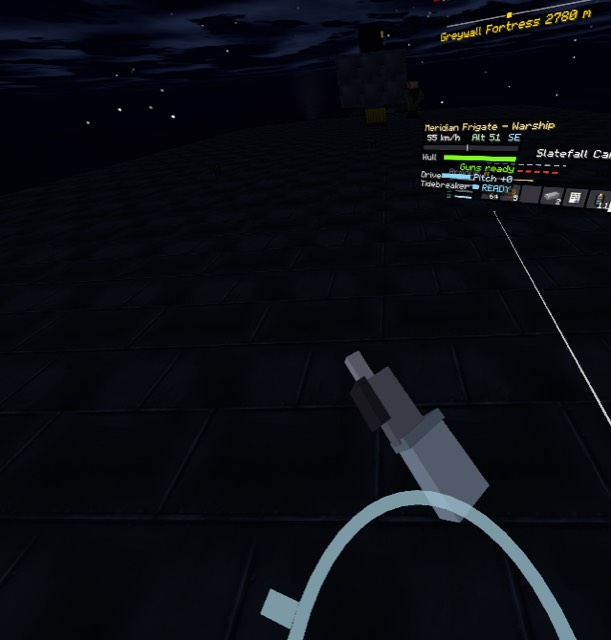

## 07:42:29 - Holy shit

- **Transcript:** Holy shit
- **Status:** open
- **Build:** 0.129 (65be4fcc, M1-M4 (device-tested; ship riding, chests, comfort options, weapon wheel))
- **World:** New World (15) (seed 2770276584627345479)
- **Dimension:** Surface
- **Biome:** Deep Ocean
- **Position:** -4407.8 130.6 -229.4
- **Facing:** south-east (yaw 127, pitch -11)
- **Held:** Slatefall Carbine x1
- **Mount:** on foot
- **Looking at:** nothing
- **Mode:** Survival, health 5/20
- **Time:** day 1 01:30, clear
- **Fps:** 71
- **Levels:** mic -26 dBFS, game sound -13 dBFS
- **Length:** 2.1 s (voice 0.6 s)
- **Just before:** -26s took 1 damage (health 17/20); -24s message: Sky isle marked on the map; -18s holding Heavy Magazine; -18s message: Heavy Magazine; -17s holding Slatefall Carbine; -17s message: Slatefall Carbine; -17s message: Loaded: 30 / 30; -14s holding Heavy Magazine; -14s message: Heavy Magazine; -13s left the pack: Heavy Magazine; -13s into the pack: Spec Ops Armour Set; -13s holding empty hand; -13s holding Heavy Magazine; -13s holding Slatefall Carbine; -13s message: Slatefall Carbine; -12s holding Heavy Magazine; -12s message: Heavy Magazine; -12s holding Slatefall Carbine; -12s message: Slatefall Carbine; -8s message: The Meridian Frigate's crew has spotted you!; -2s walked into Deep Ocean; -1s took 9 damage (health 8/20)
- **Repro (Mac):** `./snap.sh note --seed 2770276584627345479 --x -4407.8 --z -229.4 --yaw -127 --pitch -11 --time 0.813`
- **Audio (this Mac):** /Users/darthvadar/Documents/Blocksmith/QuestVoiceNotes/raw/vn-20261101-074229-739.aac

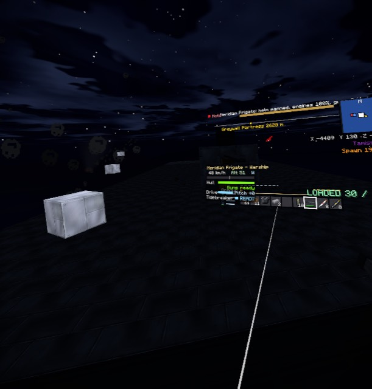

## 07:42:34 - Okay, that was good

- **Transcript:** Okay, that was good
- **Status:** open
- **Build:** 0.129 (65be4fcc, M1-M4 (device-tested; ship riding, chests, comfort options, weapon wheel))
- **World:** New World (15) (seed 2770276584627345479)
- **Dimension:** Surface
- **Biome:** Taiga
- **Position:** -2567.6 96.0 -807.5
- **Facing:** south-west (yaw 212, pitch -19)
- **Held:** empty hand
- **Mount:** on foot
- **Looking at:** Grass Block at -2570 95 -804
- **Mode:** Survival, health 20/20
- **Time:** day 1 01:35, clear
- **Fps:** 69
- **Levels:** mic -27 dBFS, game sound -24 dBFS
- **Length:** 2.7 s (voice 1.2 s)
- **Just before:** -22s holding Heavy Magazine; -22s message: Heavy Magazine; -22s holding Slatefall Carbine; -22s message: Slatefall Carbine; -21s message: Loaded: 30 / 30; -18s holding Heavy Magazine; -18s message: Heavy Magazine; -18s left the pack: Heavy Magazine; -18s into the pack: Spec Ops Armour Set; -17s holding empty hand; -17s holding Heavy Magazine; -17s holding Slatefall Carbine; -17s message: Slatefall Carbine; -16s holding Heavy Magazine; -16s message: Heavy Magazine; -16s holding Slatefall Carbine; -16s message: Slatefall Carbine; -13s message: The Meridian Frigate's crew has spotted you!; -7s walked into Deep Ocean; -6s took 9 damage (health 8/20); -4s died; -4s opened DeathMenu; -4s holding empty hand; -4s left the pack: Spec Ops Armour Set x4 (DeathMenu open); -4s left the pack: Slatefall Carbine x2 (DeathMenu open); -4s left the pack: Regular Armour Set x2 (DeathMenu open); -4s left the pack: Greywall Keycard x5 (DeathMenu open); -4s left the pack: Combat Stim x8 (DeathMenu open); -4s left the pack: Fernblick Rifle (DeathMenu open); -4s left the pack: Heavy Magazine x10 (DeathMenu open); -4s left the pack: Greywall Code Book x5 (DeathMenu open); -4s left the pack: Field Stim x8 (DeathMenu open); -4s left the pack: Sechser Revolver (DeathMenu open); -4s left the pack: Slate Repeater (DeathMenu open); -3s message: You have your things back; -3s took 9 damage (health -1/20); -1s respawned; -1s closed DeathMenu; -0s walked into Taiga; -0s message: Entering Ithvaal
- **Repro (Mac):** `./snap.sh note --seed 2770276584627345479 --x -2567.6 --z -807.5 --yaw 148 --pitch -19 --time 0.817`
- **Audio (this Mac):** /Users/darthvadar/Documents/Blocksmith/QuestVoiceNotes/raw/vn-20261101-074234-139.aac

## 07:42:37 - Sure as hell they make it easy

- **Transcript:** Sure as hell they make it easy
- **Status:** open
- **Build:** 0.129 (65be4fcc, M1-M4 (device-tested; ship riding, chests, comfort options, weapon wheel))
- **World:** New World (15) (seed 2770276584627345479)
- **Dimension:** Surface
- **Biome:** Taiga
- **Position:** -2571.8 96.1 -809.4
- **Facing:** north (yaw 21, pitch -4)
- **Held:** empty hand
- **Mount:** on foot
- **Looking at:** nothing
- **Mode:** Survival, health 20/20, screen ChestMenu
- **Time:** day 1 01:39, clear
- **Fps:** 72
- **Levels:** mic -37 dBFS, game sound -18 dBFS
- **Length:** 2.5 s (voice 1.0 s)
- **Just before:** -25s message: Heavy Magazine; -24s holding Slatefall Carbine; -24s message: Slatefall Carbine; -24s message: Loaded: 30 / 30; -21s holding Heavy Magazine; -21s message: Heavy Magazine; -20s left the pack: Heavy Magazine; -20s into the pack: Spec Ops Armour Set; -20s holding empty hand; -20s holding Heavy Magazine; -20s holding Slatefall Carbine; -20s message: Slatefall Carbine; -19s holding Heavy Magazine; -19s message: Heavy Magazine; -19s holding Slatefall Carbine; -19s message: Slatefall Carbine; -16s message: The Meridian Frigate's crew has spotted you!; -9s walked into Deep Ocean; -9s took 9 damage (health 8/20); -7s died; -7s opened DeathMenu; -7s holding empty hand; -6s left the pack: Spec Ops Armour Set x4 (DeathMenu open); -6s left the pack: Slatefall Carbine x2 (DeathMenu open); -6s left the pack: Regular Armour Set x2 (DeathMenu open); -6s left the pack: Greywall Keycard x5 (DeathMenu open); -6s left the pack: Combat Stim x8 (DeathMenu open); -6s left the pack: Fernblick Rifle (DeathMenu open); -6s left the pack: Heavy Magazine x10 (DeathMenu open); -6s left the pack: Greywall Code Book x5 (DeathMenu open); -6s left the pack: Field Stim x8 (DeathMenu open); -6s left the pack: Sechser Revolver (DeathMenu open); -6s left the pack: Slate Repeater (DeathMenu open); -6s message: You have your things back; -6s took 9 damage (health -1/20); -4s respawned; -4s closed DeathMenu; -3s walked into Taiga; -3s message: Entering Ithvaal; -0s opened ChestMenu
- **Repro (Mac):** `./snap.sh note --seed 2770276584627345479 --x -2571.8 --z -809.4 --yaw -21 --pitch -4 --time 0.819`
- **Audio (this Mac):** /Users/darthvadar/Documents/Blocksmith/QuestVoiceNotes/raw/vn-20261101-074237-000.aac

## 07:43:41 - Okay, uh, my first question is how is-- how are the engines floating i

- **Transcript:** Okay, uh, my first question is how is-- how are the engines floating in space inside the ship? Doesn't make a lick of sense. Redesign the engine room so that it literally has block components and every-- all the ships needed to run a fucking frigate
- **Status:** open
- **Build:** 0.129 (65be4fcc, M1-M4 (device-tested; ship riding, chests, comfort options, weapon wheel))
- **World:** New World (15) (seed 2770276584627345479)
- **Dimension:** Surface
- **Biome:** Deep Ocean
- **Position:** -4721.2 115.0 -747.5
- **Facing:** east (yaw 78, pitch -48)
- **Held:** empty hand
- **Mount:** on foot
- **Looking at:** nothing
- **Mode:** Creative, health 20/20
- **Time:** day 1 02:40, clear
- **Fps:** 70
- **Levels:** mic -28 dBFS, game sound -19 dBFS
- **Length:** 15.6 s (voice 10.7 s)
- **Just before:** -29s message: Entering Ithamark; -29s walked into Snowy Plains; -27s walked into Frozen Peaks; -25s walked into Snowy Plains; -22s message: Entering Tamismoor; -21s walked into Deep Ocean; -19s message: A Meridian Frigate looms on the horizon; -12s message: Walking; -10s message: The frigate's cargo winch lowers a line; -8s message: Flying; -4s message: Walking
- **Position at the end:** -4522.8 115.0 -632.6
- **Repro (Mac):** `./snap.sh note --seed 2770276584627345479 --x -4721.2 --z -747.5 --yaw -78 --pitch -48 --time 0.861`
- **Audio (this Mac):** /Users/darthvadar/Documents/Blocksmith/QuestVoiceNotes/raw/vn-20261101-074341-579.aac

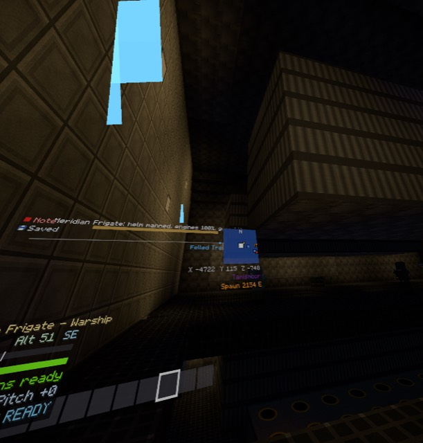

## 07:45:17 - The frigate should be

- **Transcript:** The frigate should be
- **Status:** open
- **Build:** 0.129 (65be4fcc, M1-M4 (device-tested; ship riding, chests, comfort options, weapon wheel))
- **World:** New World (15) (seed 2770276584627345479)
- **Dimension:** Surface
- **Biome:** Deep Ocean
- **Position:** -4658.4 154.5 -537.4
- **Facing:** south-west (yaw 215, pitch -26)
- **Held:** empty hand
- **Mount:** piloting Meridian Frigate
- **Looking at:** nothing
- **Mode:** Creative, health 20/20
- **Time:** day 1 04:24, clear
- **Fps:** 71
- **Levels:** mic -26 dBFS, game sound -17 dBFS
- **Length:** 2.4 s (voice 1.0 s)
- **Just before:** -20s message: Meridian Navy now counts you tolerated.; -12s message: Greywall Command now counts you wary of you.; -11s piloting Meridian Frigate; -11s holding empty hand; -9s message: Steering Meridian Frigate; -8s message: You have taken command of the Meridian Frigate!
- **Repro (Mac):** `./snap.sh note --seed 2770276584627345479 --x -4658.4 --z -537.4 --yaw 145 --pitch -26 --time 0.934`
- **Audio (this Mac):** /Users/darthvadar/Documents/Blocksmith/QuestVoiceNotes/raw/vn-20261101-074517-679.aac

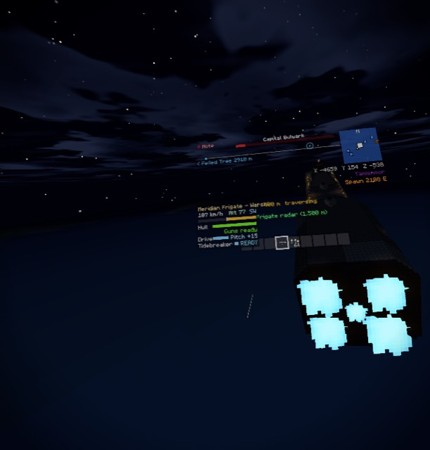

## 07:45:19 - Uh, hold on here

- **Transcript:** Uh, hold on here
- **Status:** open
- **Build:** 0.129 (65be4fcc, M1-M4 (device-tested; ship riding, chests, comfort options, weapon wheel))
- **World:** New World (15) (seed 2770276584627345479)
- **Dimension:** Surface
- **Biome:** Deep Ocean
- **Position:** -4714.9 173.6 -497.6
- **Facing:** south-west (yaw 204, pitch -19)
- **Held:** empty hand
- **Mount:** piloting Meridian Frigate
- **Looking at:** nothing
- **Mode:** Creative, health 20/20
- **Time:** day 1 04:27, clear
- **Fps:** 71
- **Levels:** mic -33 dBFS, game sound -23 dBFS
- **Length:** 2.0 s (voice 0.8 s)
- **Just before:** -22s message: Meridian Navy now counts you tolerated.; -14s message: Greywall Command now counts you wary of you.; -13s piloting Meridian Frigate; -13s holding empty hand; -12s message: Steering Meridian Frigate; -10s message: You have taken command of the Meridian Frigate!
- **Repro (Mac):** `./snap.sh note --seed 2770276584627345479 --x -4714.9 --z -497.6 --yaw 156 --pitch -19 --time 0.935`
- **Audio (this Mac):** /Users/darthvadar/Documents/Blocksmith/QuestVoiceNotes/raw/vn-20261101-074519-779.aac

## 07:45:22 - Yeah, it's still maxing at a hundred and fifty kilometers per hour. It

- **Transcript:** Yeah, it's still maxing at a hundred and fifty kilometers per hour. It needs to go four hundred kilometers per hour
- **Status:** open
- **Build:** 0.129 (65be4fcc, M1-M4 (device-tested; ship riding, chests, comfort options, weapon wheel))
- **World:** New World (15) (seed 2770276584627345479)
- **Dimension:** Surface
- **Biome:** Deep Ocean
- **Position:** -4789.9 194.5 -420.3
- **Facing:** south (yaw 193, pitch -18)
- **Held:** empty hand
- **Mount:** piloting Meridian Frigate
- **Looking at:** nothing
- **Mode:** Creative, health 20/20
- **Time:** day 1 04:30, clear
- **Fps:** 72
- **Levels:** mic -22 dBFS, game sound -21 dBFS
- **Length:** 5.5 s (voice 3.2 s)
- **Just before:** -24s message: Meridian Navy now counts you tolerated.; -17s message: Greywall Command now counts you wary of you.; -16s piloting Meridian Frigate; -16s holding empty hand; -14s message: Steering Meridian Frigate; -12s message: You have taken command of the Meridian Frigate!
- **Repro (Mac):** `./snap.sh note --seed 2770276584627345479 --x -4789.9 --z -420.3 --yaw 167 --pitch -18 --time 0.938`
- **Audio (this Mac):** /Users/darthvadar/Documents/Blocksmith/QuestVoiceNotes/raw/vn-20261101-074522-379.aac

## 07:45:29 - We should be able to get up to that speed and slow down pretty quickly

- **Transcript:** We should be able to get up to that speed and slow down pretty quickly
- **Status:** open
- **Build:** 0.129 (65be4fcc, M1-M4 (device-tested; ship riding, chests, comfort options, weapon wheel))
- **World:** New World (15) (seed 2770276584627345479)
- **Dimension:** Surface
- **Biome:** Ocean
- **Position:** -4890.4 197.9 -159.8
- **Facing:** south (yaw 195, pitch -25)
- **Held:** empty hand
- **Mount:** piloting Meridian Frigate
- **Looking at:** nothing
- **Mode:** Creative, health 20/20
- **Time:** day 1 04:38, clear
- **Fps:** 72
- **Levels:** mic -26 dBFS, game sound -19 dBFS
- **Length:** 5.2 s (voice 2.5 s)
- **Just before:** -23s message: Greywall Command now counts you wary of you.; -22s piloting Meridian Frigate; -22s holding empty hand; -21s message: Steering Meridian Frigate; -19s message: You have taken command of the Meridian Frigate!; -1s walked into Ocean
- **Repro (Mac):** `./snap.sh note --seed 2770276584627345479 --x -4890.4 --z -159.8 --yaw 165 --pitch -25 --time 0.943`
- **Audio (this Mac):** /Users/darthvadar/Documents/Blocksmith/QuestVoiceNotes/raw/vn-20261101-074529-119.aac

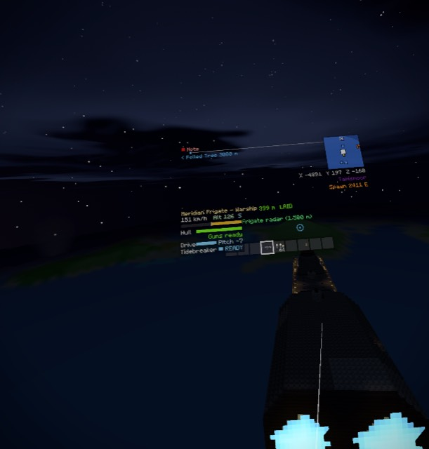

## 07:45:51 - Where's that island? Why isn't it include, included in the compression

- **Transcript:** Where's that island? Why isn't it include, included in the compression?
- **Status:** open
- **Build:** 0.129 (65be4fcc, M1-M4 (device-tested; ship riding, chests, comfort options, weapon wheel))
- **World:** New World (15) (seed 2770276584627345479)
- **Dimension:** Surface
- **Biome:** Beach
- **Position:** -5158.8 222.3 434.6
- **Facing:** east (yaw 69, pitch -21)
- **Held:** empty hand
- **Mount:** piloting Meridian Frigate
- **Looking at:** nothing
- **Mode:** Creative, health 20/20
- **Time:** day 1 05:05, clear
- **Fps:** 71
- **Levels:** mic -30 dBFS, game sound -12 dBFS
- **Length:** 4.5 s (voice 2.6 s)
- **Just before:** -24s walked into Ocean; -14s walked into Plains; -6s walked into Beach
- **Repro (Mac):** `./snap.sh note --seed 2770276584627345479 --x -5158.8 --z 434.6 --yaw -69 --pitch -21 --time 0.962`
- **Audio (this Mac):** /Users/darthvadar/Documents/Blocksmith/QuestVoiceNotes/raw/vn-20261101-074551-779.aac

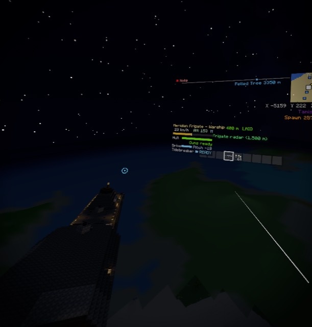

## 07:45:56 - Can't see the island anymore. There's a floating island

- **Transcript:** Can't see the island anymore. There's a floating island
- **Status:** open
- **Build:** 0.129 (65be4fcc, M1-M4 (device-tested; ship riding, chests, comfort options, weapon wheel))
- **World:** New World (15) (seed 2770276584627345479)
- **Dimension:** Surface
- **Biome:** Beach
- **Position:** -5186.0 243.2 487.4
- **Facing:** north-east (yaw 57, pitch -23)
- **Held:** empty hand
- **Mount:** piloting Meridian Frigate
- **Looking at:** nothing
- **Mode:** Creative, health 20/20
- **Time:** day 1 05:11, clear
- **Fps:** 72
- **Levels:** mic -48 dBFS, game sound -16 dBFS
- **Length:** 3.6 s (voice 2.1 s)
- **Just before:** -29s walked into Ocean; -19s walked into Plains; -10s walked into Beach
- **Repro (Mac):** `./snap.sh note --seed 2770276584627345479 --x -5186.0 --z 487.4 --yaw -57 --pitch -23 --time 0.966`
- **Audio (this Mac):** /Users/darthvadar/Documents/Blocksmith/QuestVoiceNotes/raw/vn-20261101-074556-600.aac

## 07:46:00 - Oh, shit

- **Transcript:** Oh, shit
- **Status:** open
- **Build:** 0.129 (65be4fcc, M1-M4 (device-tested; ship riding, chests, comfort options, weapon wheel))
- **World:** New World (15) (seed 2770276584627345479)
- **Dimension:** Surface
- **Biome:** Beach
- **Position:** -5232.8 263.6 525.2
- **Facing:** south-east (yaw 114, pitch -43)
- **Held:** empty hand
- **Mount:** piloting Meridian Frigate
- **Looking at:** nothing
- **Mode:** Creative, health 20/20
- **Time:** day 1 05:16, clear
- **Fps:** 72
- **Levels:** mic -32 dBFS, game sound -18 dBFS
- **Length:** 2.0 s (voice 0.5 s)
- **Just before:** -23s walked into Plains; -15s walked into Beach; -3s walked into Plains; -0s walked into Beach
- **Repro (Mac):** `./snap.sh note --seed 2770276584627345479 --x -5232.8 --z 525.2 --yaw -114 --pitch -43 --time 0.970`
- **Audio (this Mac):** /Users/darthvadar/Documents/Blocksmith/QuestVoiceNotes/raw/vn-20261101-074600-699.aac

## 07:46:27 - This doesn't feel like 150 kilometers per hour

- **Transcript:** This doesn't feel like 150 kilometers per hour
- **Status:** open
- **Build:** 0.129 (65be4fcc, M1-M4 (device-tested; ship riding, chests, comfort options, weapon wheel))
- **World:** New World (15) (seed 2770276584627345479)
- **Dimension:** Surface
- **Biome:** Savanna
- **Position:** -5550.1 199.2 773.4
- **Facing:** south-west (yaw 243, pitch -34)
- **Held:** empty hand
- **Mount:** piloting Meridian Frigate
- **Looking at:** nothing
- **Mode:** Creative, health 20/20
- **Time:** day 1 05:36, clear
- **Fps:** 31
- **Levels:** mic -24 dBFS, game sound -18 dBFS
- **Length:** 3.7 s (voice 1.9 s)
- **Just before:** -21s walked into Plains; -19s walked into Beach; -15s message: Entering Marawick; -8s opened PauseMenu; -7s walked into Plains; -6s closed PauseMenu; -3s walked into Savanna
- **Repro (Mac):** `./snap.sh note --seed 2770276584627345479 --x -5550.1 --z 773.4 --yaw 117 --pitch -34 --time 0.984`
- **Audio (this Mac):** /Users/darthvadar/Documents/Blocksmith/QuestVoiceNotes/raw/vn-20261101-074627-019.aac

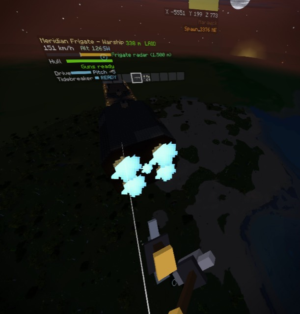

## 07:46:48 - Okay, so the frigate is still, still shooting much too high, so that's

- **Transcript:** Okay, so the frigate is still, still shooting much too high, so that's not good
- **Status:** open
- **Build:** 0.129 (65be4fcc, M1-M4 (device-tested; ship riding, chests, comfort options, weapon wheel))
- **World:** New World (15) (seed 2770276584627345479)
- **Dimension:** Surface
- **Biome:** Savanna
- **Position:** -5990.2 163.9 661.3
- **Facing:** north-west (yaw 326, pitch -31)
- **Held:** empty hand
- **Mount:** piloting Meridian Frigate
- **Looking at:** nothing
- **Mode:** Creative, health 20/20
- **Time:** day 1 05:51, clear
- **Fps:** 45
- **Levels:** mic -71 dBFS, game sound -20 dBFS
- **Length:** 6.6 s (voice 4.0 s)
- **Just before:** -27s message: Entering Marawick; -20s opened PauseMenu; -19s walked into Plains; -19s closed PauseMenu; -15s walked into Savanna; -1s message: Ghost town marked on the map
- **While talking:** -4s message: Ghost town marked on the map
- **Position at the end:** -6047.4 154.3 590.7
- **Repro (Mac):** `./snap.sh note --seed 2770276584627345479 --x -5990.2 --z 661.3 --yaw 34 --pitch -31 --time 0.994`
- **Audio (this Mac):** /Users/darthvadar/Documents/Blocksmith/QuestVoiceNotes/raw/vn-20261101-074648-619.aac

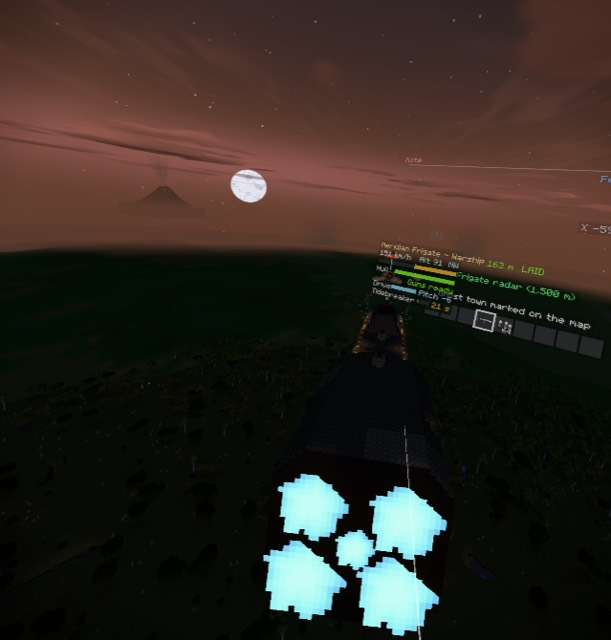

## 07:46:56 - And are so, so are the little guns. Little guns are shooting too high 

- **Transcript:** And are so, so are the little guns. Little guns are shooting too high as well
- **Status:** open
- **Build:** 0.129 (65be4fcc, M1-M4 (device-tested; ship riding, chests, comfort options, weapon wheel))
- **World:** New World (15) (seed 2770276584627345479)
- **Dimension:** Surface
- **Biome:** Forest
- **Position:** -6077.5 148.7 547.6
- **Facing:** north-west (yaw 313, pitch -17)
- **Held:** empty hand
- **Mount:** piloting Meridian Frigate
- **Looking at:** nothing
- **Mode:** Creative, health 20/20
- **Time:** day 1 05:56, clear
- **Fps:** 36
- **Levels:** mic -26 dBFS, game sound -22 dBFS
- **Length:** 4.5 s (voice 3.0 s)
- **Just before:** -24s opened PauseMenu; -23s walked into Plains; -23s closed PauseMenu; -19s walked into Savanna; -5s message: Ghost town marked on the map
- **Repro (Mac):** `./snap.sh note --seed 2770276584627345479 --x -6077.5 --z 547.6 --yaw 47 --pitch -17 --time 0.997`
- **Audio (this Mac):** /Users/darthvadar/Documents/Blocksmith/QuestVoiceNotes/raw/vn-20261101-074656-600.aac

## 07:47:01 - Have to aim low

- **Transcript:** Have to aim low
- **Status:** open
- **Build:** 0.129 (65be4fcc, M1-M4 (device-tested; ship riding, chests, comfort options, weapon wheel))
- **World:** New World (15) (seed 2770276584627345479)
- **Dimension:** Surface
- **Biome:** Forest
- **Position:** -6124.1 137.8 455.7
- **Facing:** north-west (yaw 305, pitch -20)
- **Held:** empty hand
- **Mount:** piloting Meridian Frigate
- **Looking at:** nothing
- **Mode:** Creative, health 20/20
- **Time:** day 1 05:59, clear
- **Fps:** 35
- **Levels:** mic -27 dBFS, game sound -14 dBFS
- **Length:** 2.1 s (voice 0.7 s)
- **Just before:** -27s opened PauseMenu; -26s walked into Plains; -25s closed PauseMenu; -22s walked into Savanna; -8s message: Ghost town marked on the map
- **Repro (Mac):** `./snap.sh note --seed 2770276584627345479 --x -6124.1 --z 455.7 --yaw 55 --pitch -20 --time 0.999`
- **Audio (this Mac):** /Users/darthvadar/Documents/Blocksmith/QuestVoiceNotes/raw/vn-20261101-074701-779.aac

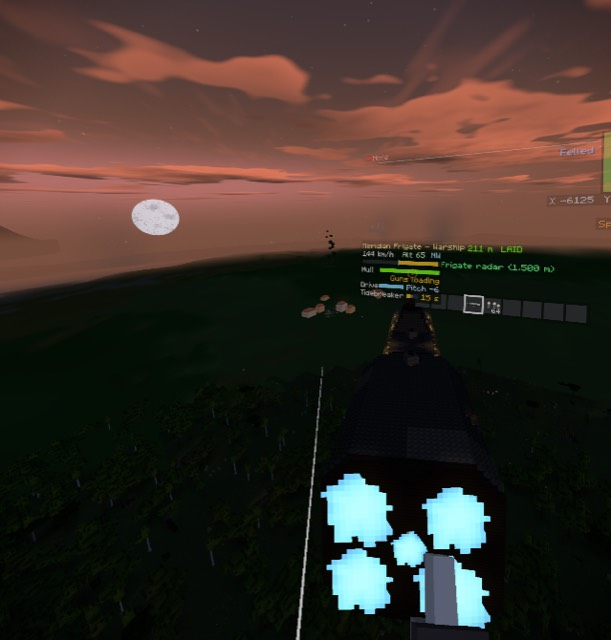

## 07:47:14 - Not bad though

- **Transcript:** Not bad though
- **Status:** open
- **Build:** 0.129 (65be4fcc, M1-M4 (device-tested; ship riding, chests, comfort options, weapon wheel))
- **World:** New World (15) (seed 2770276584627345479)
- **Dimension:** Surface
- **Biome:** Forest
- **Position:** -6307.1 116.7 121.2
- **Facing:** south (yaw 197, pitch -14)
- **Held:** empty hand
- **Mount:** piloting Meridian Frigate
- **Looking at:** nothing
- **Mode:** Creative, health 20/20
- **Time:** day 2 06:10, clear
- **Fps:** 65
- **Levels:** mic -22 dBFS, game sound -19 dBFS
- **Length:** 1.8 s (voice 0.4 s)
- **Just before:** -17s message: Ghost town marked on the map; -9s message: Entering Tamismoor; -9s walked into Forest; -7s message: Tamismoor has gone to war with Eldismere; -7s walked into Plains; -5s message: Marawick has gone to war with Valamere; -3s message: Capital citadel (the enemy) marked on the map; -1s walked into Forest; -0s message: Silver Springs marked on the map
- **Repro (Mac):** `./snap.sh note --seed 2770276584627345479 --x -6307.1 --z 121.2 --yaw 163 --pitch -14 --time 0.007`
- **Audio (this Mac):** /Users/darthvadar/Documents/Blocksmith/QuestVoiceNotes/raw/vn-20261101-074714-119.aac

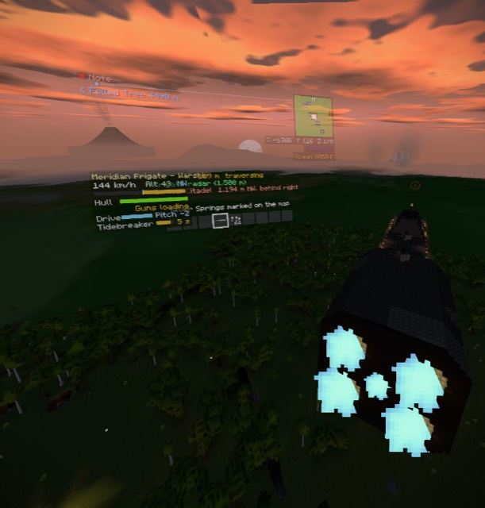

## 07:47:45 - Okay, that didn't look good. I went through the citadel

- **Transcript:** Okay, that didn't look good. I went through the citadel
- **Status:** open
- **Build:** 0.129 (65be4fcc, M1-M4 (device-tested; ship riding, chests, comfort options, weapon wheel))
- **World:** New World (15) (seed 2770276584627345479)
- **Dimension:** Surface
- **Biome:** Lukewarm Ocean
- **Position:** -6714.5 145.3 -482.8
- **Facing:** west (yaw 278, pitch -32)
- **Held:** empty hand
- **Mount:** piloting Meridian Frigate
- **Looking at:** nothing
- **Mode:** Creative, health 20/20
- **Time:** day 2 06:42, clear
- **Fps:** 70
- **Levels:** mic -46 dBFS, game sound -19 dBFS
- **Length:** 4.6 s (voice 2.5 s)
- **Just before:** -29s message: Capital citadel (the enemy) marked on the map; -28s walked into Forest; -27s message: Silver Springs marked on the map; -17s walked into Plains; -15s walked into Forest; -11s walked into Beach; -9s walked into Lukewarm Ocean; -7s message: Entering Eldismere; -5s message: Eldismere - Tamismoor border post marked on the map; -0s message: Entering Tamismoor
- **Repro (Mac):** `./snap.sh note --seed 2770276584627345479 --x -6714.5 --z -482.8 --yaw 82 --pitch -32 --time 0.029`
- **Audio (this Mac):** /Users/darthvadar/Documents/Blocksmith/QuestVoiceNotes/raw/vn-20261101-074745-639.aac

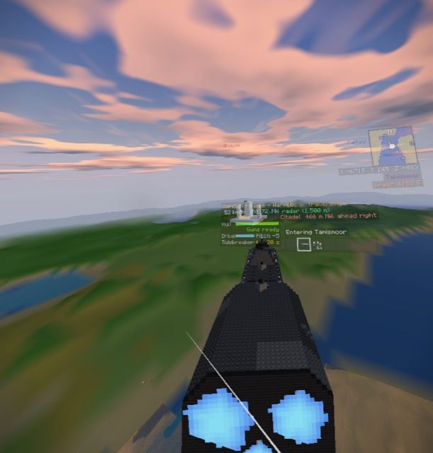

## 07:47:50 - We'll find out

- **Transcript:** We'll find out
- **Status:** open
- **Build:** 0.129 (65be4fcc, M1-M4 (device-tested; ship riding, chests, comfort options, weapon wheel))
- **World:** New World (15) (seed 2770276584627345479)
- **Dimension:** Surface
- **Biome:** Lukewarm Ocean
- **Position:** -6713.5 145.8 -478.8
- **Facing:** west (yaw 248, pitch -26)
- **Held:** empty hand
- **Mount:** piloting Meridian Frigate
- **Looking at:** nothing
- **Mode:** Creative, health 20/20
- **Time:** day 2 06:48, clear
- **Fps:** 72
- **Levels:** mic -39 dBFS, game sound -17 dBFS
- **Length:** 2.5 s (voice 1.0 s)
- **Just before:** -23s walked into Plains; -21s walked into Forest; -16s walked into Beach; -14s walked into Lukewarm Ocean; -12s message: Entering Eldismere; -11s message: Eldismere - Tamismoor border post marked on the map; -5s message: Entering Tamismoor
- **Repro (Mac):** `./snap.sh note --seed 2770276584627345479 --x -6713.5 --z -478.8 --yaw 112 --pitch -26 --time 0.034`
- **Audio (this Mac):** /Users/darthvadar/Documents/Blocksmith/QuestVoiceNotes/raw/vn-20261101-074750-740.aac

## 07:47:59 - Should be able to hold the gun and the gun should fire

- **Transcript:** Should be able to hold the gun and the gun should fire
- **Status:** open
- **Build:** 0.129 (65be4fcc, M1-M4 (device-tested; ship riding, chests, comfort options, weapon wheel))
- **World:** New World (15) (seed 2770276584627345479)
- **Dimension:** Surface
- **Biome:** Plains
- **Position:** -6803.2 151.6 -712.2
- **Facing:** north-west (yaw 310, pitch -17)
- **Held:** empty hand
- **Mount:** piloting Meridian Frigate
- **Looking at:** nothing
- **Mode:** Creative, health 20/20
- **Time:** day 2 06:58, clear
- **Fps:** 72
- **Levels:** mic -20 dBFS, game sound -19 dBFS
- **Length:** 3.7 s (voice 2.1 s)
- **Just before:** -29s walked into Forest; -25s walked into Beach; -23s walked into Lukewarm Ocean; -21s message: Entering Eldismere; -19s message: Eldismere - Tamismoor border post marked on the map; -14s message: Entering Tamismoor; -7s walked into Ocean; -7s message: Entering Eldismere; -5s walked into Beach; -3s walked into Plains
- **Repro (Mac):** `./snap.sh note --seed 2770276584627345479 --x -6803.2 --z -712.2 --yaw 50 --pitch -17 --time 0.041`
- **Audio (this Mac):** /Users/darthvadar/Documents/Blocksmith/QuestVoiceNotes/raw/vn-20261101-074759-199.aac

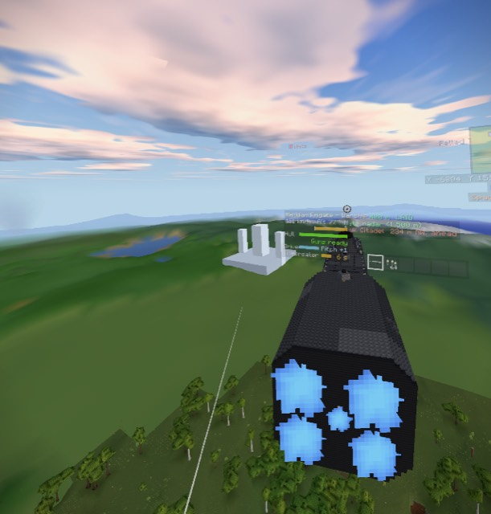

## 07:49:15 - Hull damage indicator isn't very helpful. It never goes down

- **Transcript:** Hull damage indicator isn't very helpful. It never goes down
- **Status:** open
- **Build:** 0.129 (65be4fcc, M1-M4 (device-tested; ship riding, chests, comfort options, weapon wheel))
- **World:** New World (15) (seed 2770276584627345479)
- **Dimension:** Surface
- **Biome:** Forest
- **Position:** -7480.5 267.8 -614.9
- **Facing:** north (yaw 21, pitch 14)
- **Held:** empty hand
- **Mount:** piloting Meridian Frigate
- **Looking at:** nothing
- **Mode:** Creative, health 20/20
- **Time:** day 2 08:23, clear
- **Fps:** 38
- **Levels:** mic -23 dBFS, game sound -16 dBFS
- **Length:** 4.6 s (voice 2.6 s)
- **Just before:** -23s walked into Flower Forest; -11s message: Tidebreaker hit on the Capital citadel: 0 of the garrison down (hit 1 of 3 to break it); -7s walked into Old Growth Birch Forest; -5s walked into Forest
- **Repro (Mac):** `./snap.sh note --seed 2770276584627345479 --x -7480.5 --z -614.9 --yaw -21 --pitch 14 --time 0.100`
- **Audio (this Mac):** /Users/darthvadar/Documents/Blocksmith/QuestVoiceNotes/raw/vn-20261101-074915-439.aac

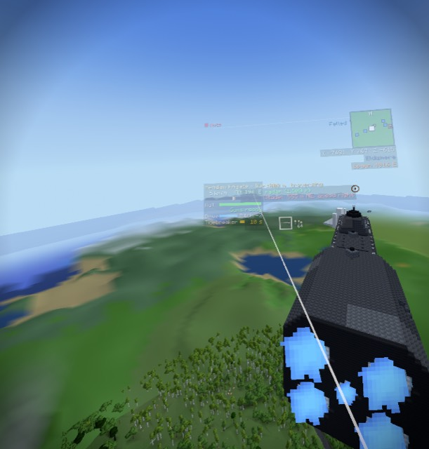

## 07:50:16 - Okay, so looks like, yeah, some engine components fell, but we need a 

- **Transcript:** Okay, so looks like, yeah, some engine components fell, but we need a new engine room. One far more complex and, and make it look like the Pillar of Autumn's engine room
- **Status:** open
- **Build:** 0.129 (65be4fcc, M1-M4 (device-tested; ship riding, chests, comfort options, weapon wheel))
- **World:** New World (15) (seed 2770276584627345479)
- **Dimension:** Surface
- **Biome:** Forest
- **Position:** -7062.0 84.9 -727.9
- **Facing:** south-west (yaw 204, pitch -31)
- **Held:** empty hand
- **Mount:** on foot
- **Looking at:** nothing
- **Mode:** Creative, health 20/20
- **Time:** day 2 09:29, clear
- **Fps:** 71
- **Levels:** mic -26 dBFS, game sound -24 dBFS
- **Length:** 12.8 s (voice 7.8 s)
- **Just before:** -28s walked into Flower Forest; -24s walked into Forest; -22s walked into Plains; -22s stopped piloting Meridian Frigate; -22s holding Donnerkeil Service Rifle; -19s holding Slate Rounds; -19s message: Slate Rounds; -19s holding empty hand; -18s message: Flying; -16s message: Intel: this base is an Armoury; -14s message: The Meridian Frigate has crash-landed; -12s message: A Capital Dropship is landing troops!; -10s walked into Forest; -10s message: A stranger in town: Ezra Quill; -5s message: Walking; -4s message: Flying; -1s message: Walking
- **While talking:** -2s message: Flying
- **Position at the end:** -7025.1 86.3 -814.7
- **Repro (Mac):** `./snap.sh note --seed 2770276584627345479 --x -7062.0 --z -727.9 --yaw 156 --pitch -31 --time 0.146`
- **Audio (this Mac):** /Users/darthvadar/Documents/Blocksmith/QuestVoiceNotes/raw/vn-20261101-075016-039.aac

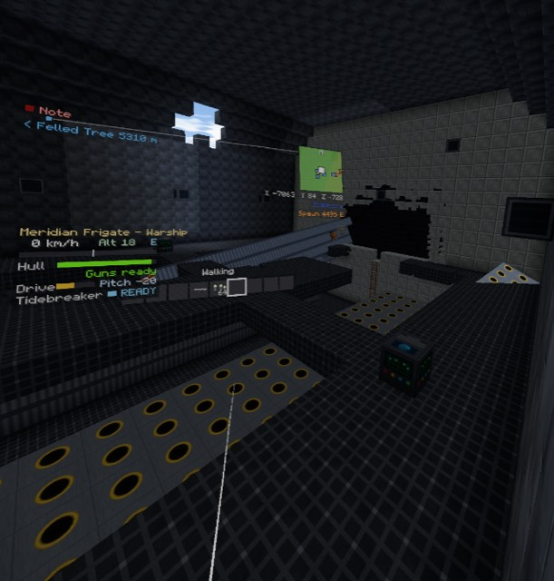

## 07:50:28 - Uh, looks like we're still having the same issue. This crater is compl

- **Transcript:** Uh, looks like we're still having the same issue. This crater is completely vertical, whereas it should reflect the angle of shot
- **Status:** open
- **Build:** 0.129 (65be4fcc, M1-M4 (device-tested; ship riding, chests, comfort options, weapon wheel))
- **World:** New World (15) (seed 2770276584627345479)
- **Dimension:** Surface
- **Biome:** Forest
- **Position:** -7032.9 86.3 -835.2
- **Facing:** north-east (yaw 26, pitch -55)
- **Held:** empty hand
- **Mount:** on foot, flying
- **Looking at:** nothing
- **Mode:** Creative, health 20/20
- **Time:** day 2 09:43, clear
- **Fps:** 64
- **Levels:** mic -23 dBFS, game sound -18 dBFS
- **Length:** 8.8 s (voice 5.5 s)
- **Just before:** -29s message: Flying; -28s message: Intel: this base is an Armoury; -26s message: The Meridian Frigate has crash-landed; -23s message: A Capital Dropship is landing troops!; -21s walked into Forest; -21s message: A stranger in town: Ezra Quill; -16s message: Walking; -15s message: Flying; -13s message: Walking; -9s message: Flying
- **Position at the end:** -7029.9 86.3 -833.5
- **Repro (Mac):** `./snap.sh note --seed 2770276584627345479 --x -7032.9 --z -835.2 --yaw -26 --pitch -55 --time 0.155`
- **Audio (this Mac):** /Users/darthvadar/Documents/Blocksmith/QuestVoiceNotes/raw/vn-20261101-075028-719.aac

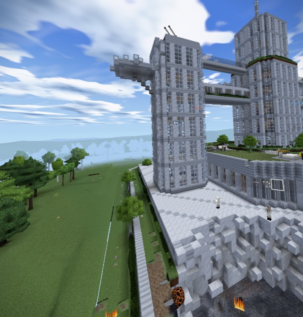

## 07:50:43 - Also, the drop ship is still morphing through buildings when it flies.

- **Transcript:** Also, the drop ship is still morphing through buildings when it flies. That shouldn't be possible
- **Status:** open
- **Build:** 0.129 (65be4fcc, M1-M4 (device-tested; ship riding, chests, comfort options, weapon wheel))
- **World:** New World (15) (seed 2770276584627345479)
- **Dimension:** Surface
- **Biome:** Taiga
- **Position:** -6972.3 107.7 -905.2
- **Facing:** south-west (yaw 209, pitch -1)
- **Held:** empty hand
- **Mount:** on foot, flying
- **Looking at:** nothing
- **Mode:** Creative, health 20/20
- **Time:** day 2 09:58, clear
- **Fps:** 63
- **Levels:** mic -20 dBFS, game sound -18 dBFS
- **Length:** 5.8 s (voice 3.5 s)
- **Just before:** -29s message: Walking; -27s message: Flying; -25s message: Walking; -21s message: Flying; -4s walked into Plains; -2s walked into Forest
- **While talking:** -4s walked into Taiga
- **Position at the end:** -6932.2 120.6 -891.4
- **Repro (Mac):** `./snap.sh note --seed 2770276584627345479 --x -6972.3 --z -905.2 --yaw 151 --pitch -1 --time 0.166`
- **Audio (this Mac):** /Users/darthvadar/Documents/Blocksmith/QuestVoiceNotes/raw/vn-20261101-075043-680.aac

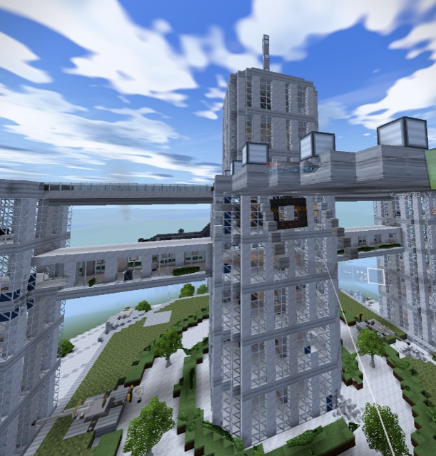

## 07:50:55 - Also, the ship is still not taking damage from the, uh, the flak guns.

- **Transcript:** Also, the ship is still not taking damage from the, uh, the flak guns. The flak guns should tear the ship apart
- **Status:** open
- **Build:** 0.129 (65be4fcc, M1-M4 (device-tested; ship riding, chests, comfort options, weapon wheel))
- **World:** New World (15) (seed 2770276584627345479)
- **Dimension:** Surface
- **Biome:** Forest
- **Position:** -7015.1 120.6 -786.9
- **Facing:** south-west (yaw 222, pitch -57)
- **Held:** empty hand
- **Mount:** on foot, flying
- **Looking at:** nothing
- **Mode:** Creative, health 20/20
- **Time:** day 2 10:10, clear
- **Fps:** 61
- **Levels:** mic -25 dBFS, game sound -17 dBFS
- **Length:** 10.1 s (voice 5.9 s)
- **Just before:** -14s walked into Plains; -12s walked into Forest; -10s walked into Taiga; -6s walked into Plains; -2s walked into Forest
- **While talking:** -4s walked into Plains
- **Position at the end:** -6963.7 120.6 -779.9
- **Repro (Mac):** `./snap.sh note --seed 2770276584627345479 --x -7015.1 --z -786.9 --yaw 138 --pitch -57 --time 0.174`
- **Audio (this Mac):** /Users/darthvadar/Documents/Blocksmith/QuestVoiceNotes/raw/vn-20261101-075055-200.aac

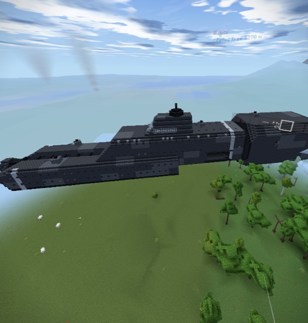

## 07:51:08 - Similarly, if it, uh, [lip smacks]

- **Transcript:** Similarly, if it, uh, [lip smacks]
- **Status:** open
- **Build:** 0.129 (65be4fcc, M1-M4 (device-tested; ship riding, chests, comfort options, weapon wheel))
- **World:** New World (15) (seed 2770276584627345479)
- **Dimension:** Surface
- **Biome:** Plains
- **Position:** -6944.4 120.6 -796.8
- **Facing:** south (yaw 182, pitch -44)
- **Held:** empty hand
- **Mount:** on foot, flying
- **Looking at:** nothing
- **Mode:** Creative, health 20/20
- **Time:** day 2 10:25, clear
- **Fps:** 70
- **Levels:** mic -26 dBFS, game sound -13 dBFS
- **Length:** 3.7 s (voice 1.3 s)
- **Just before:** -26s walked into Plains; -24s walked into Forest; -22s walked into Taiga; -18s walked into Plains; -14s walked into Forest; -12s walked into Plains
- **Repro (Mac):** `./snap.sh note --seed 2770276584627345479 --x -6944.4 --z -796.8 --yaw 178 --pitch -44 --time 0.184`
- **Audio (this Mac):** /Users/darthvadar/Documents/Blocksmith/QuestVoiceNotes/raw/vn-20261101-075108-519.aac

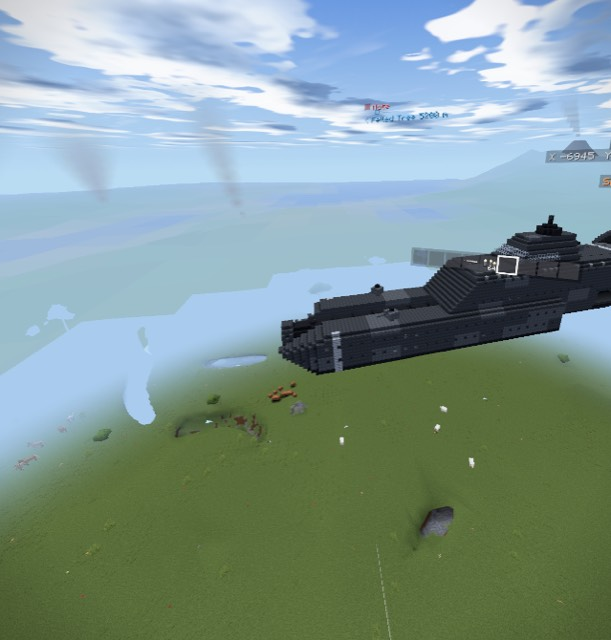

## 07:51:12 - Similarly to the naval guns and the gray wall bases

- **Transcript:** Similarly to the naval guns and the gray wall bases
- **Status:** open
- **Build:** 0.129 (65be4fcc, M1-M4 (device-tested; ship riding, chests, comfort options, weapon wheel))
- **World:** New World (15) (seed 2770276584627345479)
- **Dimension:** Surface
- **Biome:** Plains
- **Position:** -6967.2 109.6 -758.1
- **Facing:** south-east (yaw 141, pitch -18)
- **Held:** empty hand
- **Mount:** on foot
- **Looking at:** nothing
- **Mode:** Creative, health 20/20
- **Time:** day 2 10:29, clear
- **Fps:** 72
- **Levels:** mic -23 dBFS, game sound -14 dBFS
- **Length:** 3.3 s (voice 1.9 s)
- **Just before:** -30s walked into Plains; -28s walked into Forest; -26s walked into Taiga; -22s walked into Plains; -18s walked into Forest; -16s walked into Plains; -1s message: Walking
- **Repro (Mac):** `./snap.sh note --seed 2770276584627345479 --x -6967.2 --z -758.1 --yaw -141 --pitch -18 --time 0.187`
- **Audio (this Mac):** /Users/darthvadar/Documents/Blocksmith/QuestVoiceNotes/raw/vn-20261101-075112-019.aac

## 07:51:45 - Drop ships are moving at a nice speed. I like this. This is, this is a

- **Transcript:** Drop ships are moving at a nice speed. I like this. This is, this is appropriate
- **Status:** open
- **Build:** 0.129 (65be4fcc, M1-M4 (device-tested; ship riding, chests, comfort options, weapon wheel))
- **World:** New World (15) (seed 2770276584627345479)
- **Dimension:** Surface
- **Biome:** Taiga
- **Position:** -7029.2 126.1 -980.8
- **Facing:** west (yaw 278, pitch -8)
- **Held:** empty hand
- **Mount:** piloting Capital Dropship
- **Looking at:** nothing
- **Mode:** Creative, health 20/20
- **Time:** day 2 11:07, clear
- **Fps:** 70
- **Levels:** mic -23 dBFS, game sound -17 dBFS
- **Length:** 5.6 s (voice 3.7 s)
- **Just before:** -29s message: Flying; -23s walked into Taiga; -21s message: Walking; -19s message: Flying; -17s walked into Plains; -16s message: Walking; -15s message: Flying; -13s message: Walking; -8s holding Slate Rounds; -8s message: Slate Rounds; -8s holding Donnerkeil Service Rifle; -8s message: Donnerkeil Service Rifle; -7s piloting Capital Dropship; -7s holding empty hand; -7s message: Steering Capital Dropship; -5s message: You have taken command of the Capital Dropship!; -5s walked into Taiga; -3s walked into Plains; -0s walked into Taiga
- **While talking:** -1s walked into Flower Forest
- **Position at the end:** -7247.4 161.4 -865.2
- **Repro (Mac):** `./snap.sh note --seed 2770276584627345479 --x -7029.2 --z -980.8 --yaw 82 --pitch -8 --time 0.213`
- **Audio (this Mac):** /Users/darthvadar/Documents/Blocksmith/QuestVoiceNotes/raw/vn-20261101-075145-719.aac

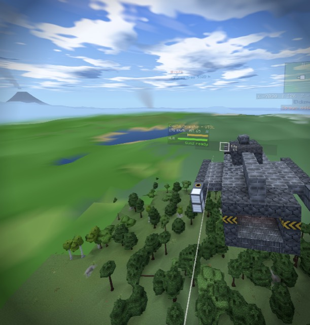

## 07:51:51 - See if the, uh, guns in this thing actually do anything

- **Transcript:** See if the, uh, guns in this thing actually do anything
- **Status:** open
- **Build:** 0.129 (65be4fcc, M1-M4 (device-tested; ship riding, chests, comfort options, weapon wheel))
- **World:** New World (15) (seed 2770276584627345479)
- **Dimension:** Surface
- **Biome:** Ocean
- **Position:** -7253.6 167.7 -843.9
- **Facing:** south-east (yaw 128, pitch -28)
- **Held:** empty hand
- **Mount:** piloting Capital Dropship
- **Looking at:** nothing
- **Mode:** Creative, health 20/20
- **Time:** day 2 11:14, clear
- **Fps:** 72
- **Levels:** mic -24 dBFS, game sound -16 dBFS
- **Length:** 3.7 s (voice 2.1 s)
- **Just before:** -28s walked into Taiga; -26s message: Walking; -24s message: Flying; -22s walked into Plains; -22s message: Walking; -21s message: Flying; -19s message: Walking; -14s holding Slate Rounds; -14s message: Slate Rounds; -14s holding Donnerkeil Service Rifle; -14s message: Donnerkeil Service Rifle; -13s piloting Capital Dropship; -13s holding empty hand; -13s message: Steering Capital Dropship; -11s message: You have taken command of the Capital Dropship!; -10s walked into Taiga; -8s walked into Plains; -6s walked into Taiga; -2s walked into Flower Forest; -0s walked into Ocean
- **Repro (Mac):** `./snap.sh note --seed 2770276584627345479 --x -7253.6 --z -843.9 --yaw -128 --pitch -28 --time 0.218`
- **Audio (this Mac):** /Users/darthvadar/Documents/Blocksmith/QuestVoiceNotes/raw/vn-20261101-075151-499.aac

## 07:51:58 - Don't appear to be

- **Transcript:** Don't appear to be
- **Status:** open
- **Build:** 0.129 (65be4fcc, M1-M4 (device-tested; ship riding, chests, comfort options, weapon wheel))
- **World:** New World (15) (seed 2770276584627345479)
- **Dimension:** Surface
- **Biome:** Forest
- **Position:** -7172.0 169.1 -837.9
- **Facing:** south-east (yaw 139, pitch -28)
- **Held:** empty hand
- **Mount:** piloting Capital Dropship
- **Looking at:** nothing
- **Mode:** Creative, health 20/20
- **Time:** day 2 11:22, clear
- **Fps:** 71
- **Levels:** mic -30 dBFS, game sound -16 dBFS
- **Length:** 2.1 s (voice 0.6 s)
- **Just before:** -29s walked into Plains; -29s message: Walking; -27s message: Flying; -26s message: Walking; -21s holding Slate Rounds; -21s message: Slate Rounds; -20s holding Donnerkeil Service Rifle; -20s message: Donnerkeil Service Rifle; -19s piloting Capital Dropship; -19s holding empty hand; -19s message: Steering Capital Dropship; -17s message: You have taken command of the Capital Dropship!; -17s walked into Taiga; -15s walked into Plains; -13s walked into Taiga; -9s walked into Flower Forest; -7s walked into Ocean; -5s walked into Beach; -3s walked into Forest
- **Repro (Mac):** `./snap.sh note --seed 2770276584627345479 --x -7172.0 --z -837.9 --yaw -139 --pitch -28 --time 0.224`
- **Audio (this Mac):** /Users/darthvadar/Documents/Blocksmith/QuestVoiceNotes/raw/vn-20261101-075158-099.aac

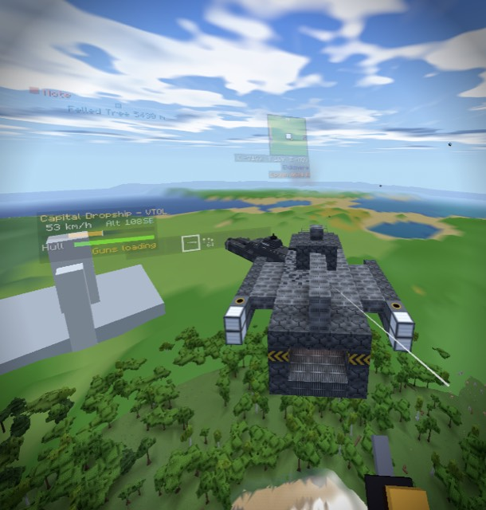

## 07:52:04 - Drop ship guns should do a little damage, not as much as the flak guns

- **Transcript:** Drop ship guns should do a little damage, not as much as the flak guns, but it should be doing way more than it is now. This thing should be, you know
- **Status:** open
- **Build:** 0.129 (65be4fcc, M1-M4 (device-tested; ship riding, chests, comfort options, weapon wheel))
- **World:** New World (15) (seed 2770276584627345479)
- **Dimension:** Surface
- **Biome:** Forest
- **Position:** -7100.9 117.5 -808.5
- **Facing:** south (yaw 164, pitch -23)
- **Held:** empty hand
- **Mount:** piloting Capital Dropship
- **Looking at:** nothing
- **Mode:** Creative, health 20/20
- **Time:** day 2 11:28, clear
- **Fps:** 69
- **Levels:** mic -22 dBFS, game sound -15 dBFS
- **Length:** 8.1 s (voice 5.4 s)
- **Just before:** -26s holding Slate Rounds; -26s message: Slate Rounds; -26s holding Donnerkeil Service Rifle; -26s message: Donnerkeil Service Rifle; -25s piloting Capital Dropship; -25s holding empty hand; -25s message: Steering Capital Dropship; -23s message: You have taken command of the Capital Dropship!; -23s walked into Taiga; -21s walked into Plains; -19s walked into Taiga; -15s walked into Flower Forest; -13s walked into Ocean; -11s walked into Beach; -8s walked into Forest
- **Position at the end:** -7096.7 111.8 -769.3
- **Repro (Mac):** `./snap.sh note --seed 2770276584627345479 --x -7100.9 --z -808.5 --yaw -164 --pitch -23 --time 0.228`
- **Audio (this Mac):** /Users/darthvadar/Documents/Blocksmith/QuestVoiceNotes/raw/vn-20261101-075204-440.aac

## 07:52:13 - The armor on the frigate's way too tough when it comes to guns. Like g

- **Transcript:** The armor on the frigate's way too tough when it comes to guns. Like guns break through armor as if it's not armor at all
- **Status:** open
- **Build:** 0.129 (65be4fcc, M1-M4 (device-tested; ship riding, chests, comfort options, weapon wheel))
- **World:** New World (15) (seed 2770276584627345479)
- **Dimension:** Surface
- **Biome:** Forest
- **Position:** -7071.3 111.4 -779.3
- **Facing:** south (yaw 173, pitch -30)
- **Held:** empty hand
- **Mount:** piloting Capital Dropship
- **Looking at:** nothing
- **Mode:** Creative, health 20/20
- **Time:** day 2 11:39, clear
- **Fps:** 68
- **Levels:** mic -23 dBFS, game sound -15 dBFS
- **Length:** 7.8 s (voice 4.3 s)
- **Just before:** -29s walked into Plains; -27s walked into Taiga; -23s walked into Flower Forest; -21s walked into Ocean; -19s walked into Beach; -17s walked into Forest
- **Position at the end:** -7058.2 111.5 -772.1
- **Repro (Mac):** `./snap.sh note --seed 2770276584627345479 --x -7071.3 --z -779.3 --yaw -173 --pitch -30 --time 0.236`
- **Audio (this Mac):** /Users/darthvadar/Documents/Blocksmith/QuestVoiceNotes/raw/vn-20261101-075213-579.aac

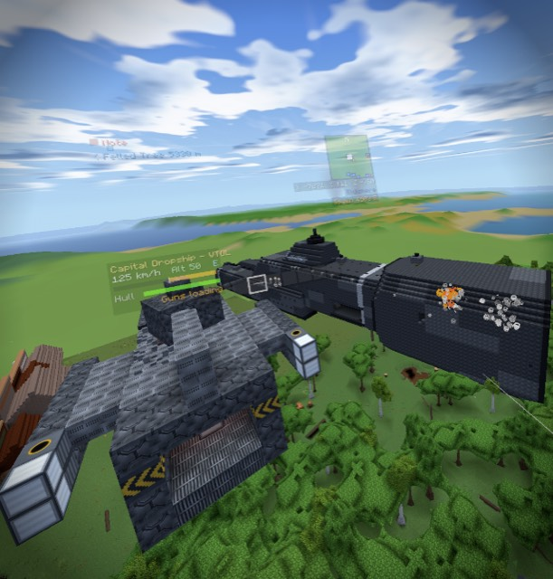

## 07:52:21 - Okay? The only reason the armor matters is when someone tries to break

- **Transcript:** Okay? The only reason the armor matters is when someone tries to break through with a pickaxe
- **Status:** open
- **Build:** 0.129 (65be4fcc, M1-M4 (device-tested; ship riding, chests, comfort options, weapon wheel))
- **World:** New World (15) (seed 2770276584627345479)
- **Dimension:** Surface
- **Biome:** Forest
- **Position:** -7081.2 111.4 -780.3
- **Facing:** south (yaw 160, pitch -32)
- **Held:** empty hand
- **Mount:** piloting Capital Dropship
- **Looking at:** nothing
- **Mode:** Creative, health 20/20
- **Time:** day 2 11:47, clear
- **Fps:** 67
- **Levels:** mic -25 dBFS, game sound -16 dBFS
- **Length:** 5.7 s (voice 3.2 s)
- **Just before:** -28s walked into Ocean; -26s walked into Beach; -24s walked into Forest
- **Position at the end:** -7031.4 111.6 -780.4
- **Repro (Mac):** `./snap.sh note --seed 2770276584627345479 --x -7081.2 --z -780.3 --yaw -160 --pitch -32 --time 0.242`
- **Audio (this Mac):** /Users/darthvadar/Documents/Blocksmith/QuestVoiceNotes/raw/vn-20261101-075221-159.aac

## 07:52:36 - Also, it's not hitting high

- **Transcript:** Also, it's not hitting high
- **Status:** open
- **Build:** 0.129 (65be4fcc, M1-M4 (device-tested; ship riding, chests, comfort options, weapon wheel))
- **World:** New World (15) (seed 2770276584627345479)
- **Dimension:** Surface
- **Biome:** Plains
- **Position:** -6970.9 111.5 -766.8
- **Facing:** south-west (yaw 221, pitch -20)
- **Held:** empty hand
- **Mount:** piloting Capital Dropship
- **Looking at:** nothing
- **Mode:** Creative, health 20/20
- **Time:** day 2 12:04, clear
- **Fps:** 70
- **Levels:** mic -24 dBFS, game sound -18 dBFS
- **Length:** 2.8 s (voice 1.3 s)
- **Just before:** -4s walked into Plains
- **Repro (Mac):** `./snap.sh note --seed 2770276584627345479 --x -6970.9 --z -766.8 --yaw 139 --pitch -20 --time 0.253`
- **Audio (this Mac):** /Users/darthvadar/Documents/Blocksmith/QuestVoiceNotes/raw/vn-20261101-075236-639.aac

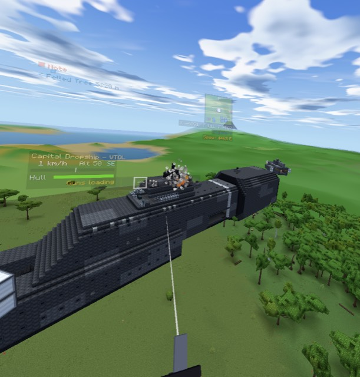

## 07:53:04 - The amount of, uh, damage that the drop ship is doing to the citadel

- **Transcript:** The amount of, uh, damage that the drop ship is doing to the citadel
- **Status:** open
- **Build:** 0.129 (65be4fcc, M1-M4 (device-tested; ship riding, chests, comfort options, weapon wheel))
- **World:** New World (15) (seed 2770276584627345479)
- **Dimension:** Surface
- **Biome:** Forest
- **Position:** -7022.6 121.0 -812.2
- **Facing:** north (yaw 6, pitch -14)
- **Held:** empty hand
- **Mount:** piloting Capital Dropship
- **Looking at:** nothing
- **Mode:** Creative, health 20/20
- **Time:** day 2 12:33, clear
- **Fps:** 59
- **Levels:** mic -33 dBFS, game sound -16 dBFS
- **Length:** 5.1 s (voice 3.0 s)
- **Just before:** -28s walked into Plains; -24s message: A Capital Dropship is landing troops!; -16s walked into Forest; -4s message: The citadel is on lockdown!; -2s message: A turret is wrecked
- **Repro (Mac):** `./snap.sh note --seed 2770276584627345479 --x -7022.6 --z -812.2 --yaw -6 --pitch -14 --time 0.273`
- **Audio (this Mac):** /Users/darthvadar/Documents/Blocksmith/QuestVoiceNotes/raw/vn-20261101-075304-859.aac

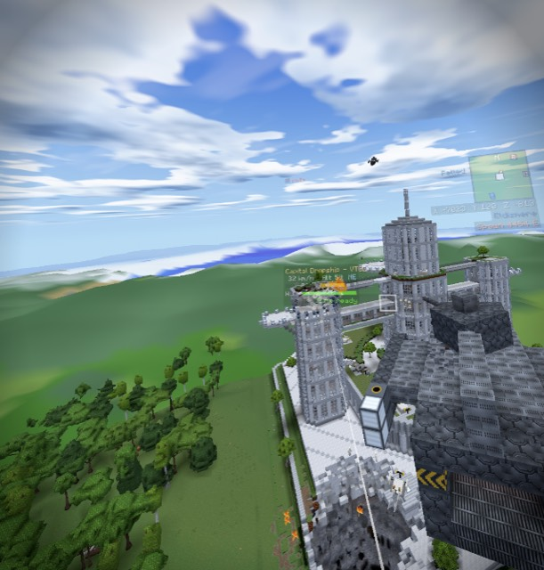

## 07:53:13 - is similar to the amount of damage I want it to be doing to the frigat

- **Transcript:** is similar to the amount of damage I want it to be doing to the frigate.
- **Status:** open
- **Build:** 0.129 (65be4fcc, M1-M4 (device-tested; ship riding, chests, comfort options, weapon wheel))
- **World:** New World (15) (seed 2770276584627345479)
- **Dimension:** Surface
- **Biome:** Plains
- **Position:** -6973.1 120.1 -838.8
- **Facing:** north (yaw 349, pitch 1)
- **Held:** empty hand
- **Mount:** piloting Capital Dropship
- **Looking at:** nothing
- **Mode:** Creative, health 20/20
- **Time:** day 2 12:42, clear
- **Fps:** 60
- **Levels:** mic -29 dBFS, game sound -13 dBFS
- **Length:** 4.2 s (voice 2.3 s)
- **Just before:** -23s walked into Forest; -11s message: The citadel is on lockdown!; -9s message: A turret is wrecked; -1s walked into Plains
- **Repro (Mac):** `./snap.sh note --seed 2770276584627345479 --x -6973.1 --z -838.8 --yaw 11 --pitch 1 --time 0.279`
- **Audio (this Mac):** /Users/darthvadar/Documents/Blocksmith/QuestVoiceNotes/raw/vn-20261101-075313-279.aac

## 07:53:47 - I think what the hole needs to be, it has to be like a, I don't know

- **Transcript:** I think what the hole needs to be, it has to be like a, I don't know
- **Status:** open
- **Build:** 0.129 (65be4fcc, M1-M4 (device-tested; ship riding, chests, comfort options, weapon wheel))
- **World:** New World (15) (seed 2770276584627345479)
- **Dimension:** Surface
- **Biome:** Frozen Ocean
- **Position:** -6743.2 119.5 -1422.8
- **Facing:** north (yaw 358, pitch -41)
- **Held:** empty hand
- **Mount:** piloting Capital Dropship
- **Looking at:** nothing
- **Mode:** Creative, health 20/20
- **Time:** day 2 13:14, clear
- **Fps:** 71
- **Levels:** mic -22 dBFS, game sound -16 dBFS
- **Length:** 4.7 s (voice 2.2 s)
- **Just before:** -28s walked into Plains; -18s walked into Forest; -14s walked into Plains; -10s walked into Taiga; -6s walked into Snowy Taiga; -4s walked into Snowy Plains; -2s walked into Cold Ocean; -1s message: Entering Keseland; -0s walked into Frozen Ocean
- **Repro (Mac):** `./snap.sh note --seed 2770276584627345479 --x -6743.2 --z -1422.8 --yaw 2 --pitch -41 --time 0.302`
- **Audio (this Mac):** /Users/darthvadar/Documents/Blocksmith/QuestVoiceNotes/raw/vn-20261101-075347-160.aac

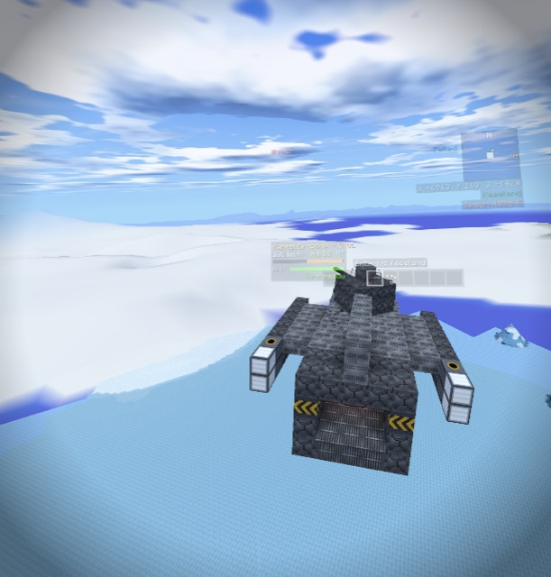

## 07:53:53 - 70 to 100% of blocks on the ship

- **Transcript:** 70 to 100% of blocks on the ship
- **Status:** open
- **Build:** 0.129 (65be4fcc, M1-M4 (device-tested; ship riding, chests, comfort options, weapon wheel))
- **World:** New World (15) (seed 2770276584627345479)
- **Dimension:** Surface
- **Biome:** Snowy Beach
- **Position:** -6624.8 98.4 -1718.1
- **Facing:** north (yaw 356, pitch -29)
- **Held:** empty hand
- **Mount:** piloting Capital Dropship
- **Looking at:** nothing
- **Mode:** Creative, health 20/20
- **Time:** day 2 13:22, clear
- **Fps:** 72
- **Levels:** mic -22 dBFS, game sound -14 dBFS
- **Length:** 4.3 s (voice 2.3 s)
- **Just before:** -24s walked into Forest; -20s walked into Plains; -16s walked into Taiga; -12s walked into Snowy Taiga; -10s walked into Snowy Plains; -8s walked into Cold Ocean; -7s message: Entering Keseland; -6s walked into Frozen Ocean; -2s walked into Snowy Plains
- **Repro (Mac):** `./snap.sh note --seed 2770276584627345479 --x -6624.8 --z -1718.1 --yaw 4 --pitch -29 --time 0.307`
- **Audio (this Mac):** /Users/darthvadar/Documents/Blocksmith/QuestVoiceNotes/raw/vn-20261101-075353-459.aac

## 07:53:57 - If it's like

- **Transcript:** If it's like
- **Status:** open
- **Build:** 0.129 (65be4fcc, M1-M4 (device-tested; ship riding, chests, comfort options, weapon wheel))
- **World:** New World (15) (seed 2770276584627345479)
- **Dimension:** Surface
- **Biome:** Snowy Beach
- **Position:** -6609.0 104.7 -1924.0
- **Facing:** north-west (yaw 324, pitch -45)
- **Held:** empty hand
- **Mount:** piloting Capital Dropship
- **Looking at:** nothing
- **Mode:** Creative, health 20/20
- **Time:** day 2 13:27, clear
- **Fps:** 71
- **Levels:** mic -38 dBFS, game sound -19 dBFS
- **Length:** 1.8 s (voice 0.6 s)
- **Just before:** -28s walked into Forest; -24s walked into Plains; -20s walked into Taiga; -16s walked into Snowy Taiga; -14s walked into Snowy Plains; -12s walked into Cold Ocean; -11s message: Entering Keseland; -10s walked into Frozen Ocean; -6s walked into Snowy Plains; -2s walked into Frozen Ocean; -0s walked into Snowy Beach
- **Repro (Mac):** `./snap.sh note --seed 2770276584627345479 --x -6609.0 --z -1924.0 --yaw 36 --pitch -45 --time 0.311`
- **Audio (this Mac):** /Users/darthvadar/Documents/Blocksmith/QuestVoiceNotes/raw/vn-20261101-075357-500.aac

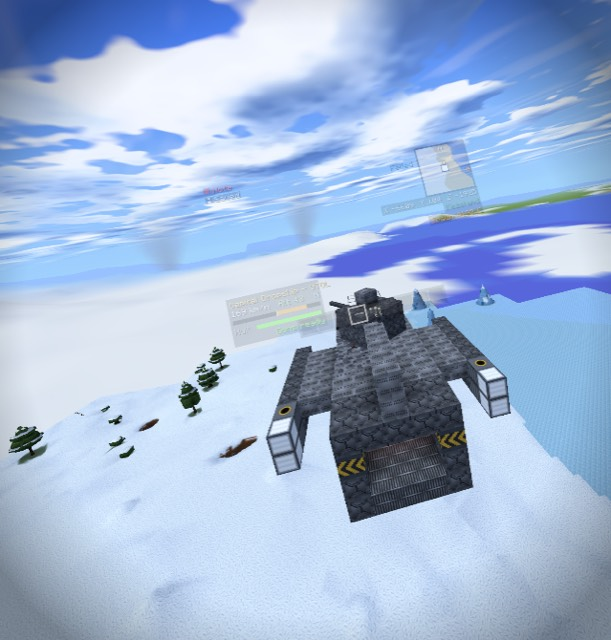

## 07:53:59 - If there's like less than 70% of the blocks, then the haul should be a

- **Transcript:** If there's like less than 70% of the blocks, then the haul should be at 0%. And that could-- maybe that could be a good measure
- **Status:** open
- **Build:** 0.129 (65be4fcc, M1-M4 (device-tested; ship riding, chests, comfort options, weapon wheel))
- **World:** New World (15) (seed 2770276584627345479)
- **Dimension:** Surface
- **Biome:** Snowy Beach
- **Position:** -6589.9 105.1 -2009.9
- **Facing:** north (yaw 344, pitch -33)
- **Held:** empty hand
- **Mount:** piloting Capital Dropship
- **Looking at:** nothing
- **Mode:** Creative, health 20/20
- **Time:** day 2 13:29, clear
- **Fps:** 71
- **Levels:** mic -61 dBFS, game sound -15 dBFS
- **Length:** 8.7 s (voice 4.8 s)
- **Just before:** -27s walked into Plains; -23s walked into Taiga; -19s walked into Snowy Taiga; -17s walked into Snowy Plains; -15s walked into Cold Ocean; -13s message: Entering Keseland; -13s walked into Frozen Ocean; -9s walked into Snowy Plains; -5s walked into Frozen Ocean; -3s walked into Snowy Beach
- **While talking:** -1s walked into Frozen Ocean
- **Position at the end:** -6431.9 105.0 -2205.3
- **Repro (Mac):** `./snap.sh note --seed 2770276584627345479 --x -6589.9 --z -2009.9 --yaw 16 --pitch -33 --time 0.312`
- **Audio (this Mac):** /Users/darthvadar/Documents/Blocksmith/QuestVoiceNotes/raw/vn-20261101-075359-740.aac

## 07:54:11 - We should also have a magazine counter

- **Transcript:** We should also have a magazine counter
- **Status:** open
- **Build:** 0.129 (65be4fcc, M1-M4 (device-tested; ship riding, chests, comfort options, weapon wheel))
- **World:** New World (15) (seed 2770276584627345479)
- **Dimension:** Surface
- **Biome:** Cold Ocean
- **Position:** -6259.5 99.8 -2459.1
- **Facing:** north-east (yaw 25, pitch -15)
- **Held:** empty hand
- **Mount:** piloting Capital Dropship
- **Looking at:** nothing
- **Mode:** Creative, health 20/20
- **Time:** day 2 13:43, clear
- **Fps:** 71
- **Levels:** mic -25 dBFS, game sound -16 dBFS
- **Length:** 3.0 s (voice 1.5 s)
- **Just before:** -30s walked into Snowy Taiga; -28s walked into Snowy Plains; -26s walked into Cold Ocean; -24s message: Entering Keseland; -24s walked into Frozen Ocean; -20s walked into Snowy Plains; -16s walked into Frozen Ocean; -14s walked into Snowy Beach; -8s walked into Frozen Ocean; -4s walked into Cold Ocean
- **Repro (Mac):** `./snap.sh note --seed 2770276584627345479 --x -6259.5 --z -2459.1 --yaw -25 --pitch -15 --time 0.322`
- **Audio (this Mac):** /Users/darthvadar/Documents/Blocksmith/QuestVoiceNotes/raw/vn-20261101-075411-059.aac

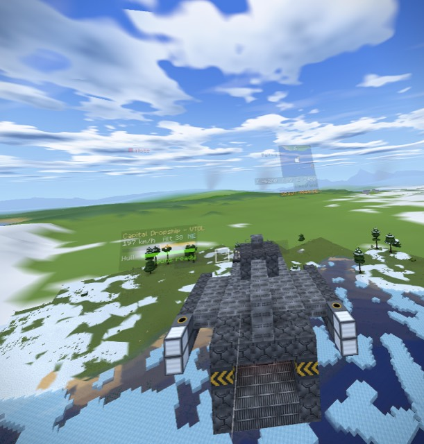

## 07:54:19 - Like we don't need altitude. We don't even need speed really

- **Transcript:** Like we don't need altitude. We don't even need speed really
- **Status:** open
- **Build:** 0.129 (65be4fcc, M1-M4 (device-tested; ship riding, chests, comfort options, weapon wheel))
- **World:** New World (15) (seed 2770276584627345479)
- **Dimension:** Surface
- **Biome:** Plains
- **Position:** -6048.4 117.6 -2797.1
- **Facing:** north (yaw 21, pitch -39)
- **Held:** empty hand
- **Mount:** piloting Capital Dropship
- **Looking at:** nothing
- **Mode:** Creative, health 20/20
- **Time:** day 2 13:53, clear
- **Fps:** 72
- **Levels:** mic -22 dBFS, game sound -16 dBFS
- **Length:** 4.7 s (voice 2.1 s)
- **Just before:** -28s walked into Snowy Plains; -24s walked into Frozen Ocean; -22s walked into Snowy Beach; -16s walked into Frozen Ocean; -12s walked into Cold Ocean; -6s walked into Plains
- **Repro (Mac):** `./snap.sh note --seed 2770276584627345479 --x -6048.4 --z -2797.1 --yaw -21 --pitch -39 --time 0.329`
- **Audio (this Mac):** /Users/darthvadar/Documents/Blocksmith/QuestVoiceNotes/raw/vn-20261101-075419-880.aac

## 07:54:24 - Um, no need to

- **Transcript:** Um, no need to
- **Status:** open
- **Build:** 0.129 (65be4fcc, M1-M4 (device-tested; ship riding, chests, comfort options, weapon wheel))
- **World:** New World (15) (seed 2770276584627345479)
- **Dimension:** Surface
- **Biome:** Taiga
- **Position:** -5891.9 120.2 -2977.9
- **Facing:** north-east (yaw 48, pitch -32)
- **Held:** empty hand
- **Mount:** piloting Capital Dropship
- **Looking at:** nothing
- **Mode:** Creative, health 20/20
- **Time:** day 2 13:59, clear
- **Fps:** 70
- **Levels:** mic -33 dBFS, game sound -16 dBFS
- **Length:** 3.2 s (voice 1.6 s)
- **Just before:** -29s walked into Frozen Ocean; -27s walked into Snowy Beach; -21s walked into Frozen Ocean; -17s walked into Cold Ocean; -11s walked into Plains; -3s walked into Taiga; -2s message: Homestead marked on the map
- **Repro (Mac):** `./snap.sh note --seed 2770276584627345479 --x -5891.9 --z -2977.9 --yaw -48 --pitch -32 --time 0.333`
- **Audio (this Mac):** /Users/darthvadar/Documents/Blocksmith/QuestVoiceNotes/raw/vn-20261101-075424-580.aac

## 07:54:27 - We don't need direction

- **Transcript:** We don't need direction
- **Status:** open
- **Build:** 0.129 (65be4fcc, M1-M4 (device-tested; ship riding, chests, comfort options, weapon wheel))
- **World:** New World (15) (seed 2770276584627345479)
- **Dimension:** Surface
- **Biome:** Beach
- **Position:** -5783.0 120.2 -3110.1
- **Facing:** north-east (yaw 44, pitch -28)
- **Held:** empty hand
- **Mount:** piloting Capital Dropship
- **Looking at:** nothing
- **Mode:** Creative, health 20/20
- **Time:** day 2 14:03, clear
- **Fps:** 70
- **Levels:** mic -26 dBFS, game sound -18 dBFS
- **Length:** 2.2 s (voice 0.8 s)
- **Just before:** -24s walked into Frozen Ocean; -20s walked into Cold Ocean; -14s walked into Plains; -6s walked into Taiga; -5s message: Homestead marked on the map; -2s walked into Forest; -1s message: Keseland - Ardador border post marked on the map
- **Repro (Mac):** `./snap.sh note --seed 2770276584627345479 --x -5783.0 --z -3110.1 --yaw -44 --pitch -28 --time 0.335`
- **Audio (this Mac):** /Users/darthvadar/Documents/Blocksmith/QuestVoiceNotes/raw/vn-20261101-075427-720.aac

## 07:54:30 - No need guns ready

- **Transcript:** No need guns ready
- **Status:** open
- **Build:** 0.129 (65be4fcc, M1-M4 (device-tested; ship riding, chests, comfort options, weapon wheel))
- **World:** New World (15) (seed 2770276584627345479)
- **Dimension:** Surface
- **Biome:** Beach
- **Position:** -5689.9 120.2 -3232.2
- **Facing:** north (yaw 353, pitch -27)
- **Held:** empty hand
- **Mount:** piloting Capital Dropship
- **Looking at:** nothing
- **Mode:** Creative, health 20/20
- **Time:** day 2 14:06, clear
- **Fps:** 70
- **Levels:** mic -25 dBFS, game sound -16 dBFS
- **Length:** 2.5 s (voice 1.1 s)
- **Just before:** -27s walked into Frozen Ocean; -23s walked into Cold Ocean; -17s walked into Plains; -9s walked into Taiga; -8s message: Homestead marked on the map; -5s walked into Forest; -4s message: Keseland - Ardador border post marked on the map; -3s walked into Beach; -1s message: Entering Ardador
- **Repro (Mac):** `./snap.sh note --seed 2770276584627345479 --x -5689.9 --z -3232.2 --yaw 7 --pitch -27 --time 0.338`
- **Audio (this Mac):** /Users/darthvadar/Documents/Blocksmith/QuestVoiceNotes/raw/vn-20261101-075430-639.aac

## 07:54:36 - And we don't need it to tell us that it's a capital dropship in beetle

- **Transcript:** And we don't need it to tell us that it's a capital dropship in beetle mode
- **Status:** open
- **Build:** 0.129 (65be4fcc, M1-M4 (device-tested; ship riding, chests, comfort options, weapon wheel))
- **World:** New World (15) (seed 2770276584627345479)
- **Dimension:** Surface
- **Biome:** Forest
- **Position:** -5574.2 132.3 -3449.3
- **Facing:** north (yaw 16, pitch -44)
- **Held:** empty hand
- **Mount:** piloting Capital Dropship
- **Looking at:** nothing
- **Mode:** Creative, health 20/20
- **Time:** day 2 14:12, clear
- **Fps:** 71
- **Levels:** mic -29 dBFS, game sound -15 dBFS
- **Length:** 4.7 s (voice 2.6 s)
- **Just before:** -28s walked into Cold Ocean; -22s walked into Plains; -14s walked into Taiga; -13s message: Homestead marked on the map; -10s walked into Forest; -9s message: Keseland - Ardador border post marked on the map; -8s walked into Beach; -7s message: Entering Ardador; -4s walked into Flower Forest; -2s walked into Savanna
- **Repro (Mac):** `./snap.sh note --seed 2770276584627345479 --x -5574.2 --z -3449.3 --yaw -16 --pitch -44 --time 0.342`
- **Audio (this Mac):** /Users/darthvadar/Documents/Blocksmith/QuestVoiceNotes/raw/vn-20261101-075436-059.aac

## 07:54:41 - Just kind of it's not needed. Who cares?

- **Transcript:** Just kind of it's not needed. Who cares?
- **Status:** open
- **Build:** 0.129 (65be4fcc, M1-M4 (device-tested; ship riding, chests, comfort options, weapon wheel))
- **World:** New World (15) (seed 2770276584627345479)
- **Dimension:** Surface
- **Biome:** Forest
- **Position:** -5541.9 148.1 -3669.2
- **Facing:** east (yaw 93, pitch -47)
- **Held:** empty hand
- **Mount:** piloting Capital Dropship
- **Looking at:** nothing
- **Mode:** Creative, health 20/20
- **Time:** day 2 14:18, clear
- **Fps:** 70
- **Levels:** mic -29 dBFS, game sound -16 dBFS
- **Length:** 3.4 s (voice 1.1 s)
- **Just before:** -27s walked into Plains; -19s walked into Taiga; -18s message: Homestead marked on the map; -15s walked into Forest; -14s message: Keseland - Ardador border post marked on the map; -13s walked into Beach; -12s message: Entering Ardador; -9s walked into Flower Forest; -7s walked into Savanna; -5s walked into Forest; -3s walked into River; -1s walked into Forest
- **Repro (Mac):** `./snap.sh note --seed 2770276584627345479 --x -5541.9 --z -3669.2 --yaw -93 --pitch -47 --time 0.346`
- **Audio (this Mac):** /Users/darthvadar/Documents/Blocksmith/QuestVoiceNotes/raw/vn-20261101-075441-219.aac

## 07:55:57 - Ship also needs a place to refill ammunition that you craft

- **Transcript:** Ship also needs a place to refill ammunition that you craft
- **Status:** open
- **Build:** 0.129 (65be4fcc, M1-M4 (device-tested; ship riding, chests, comfort options, weapon wheel))
- **World:** New World (15) (seed 2770276584627345479)
- **Dimension:** Surface
- **Biome:** Desert
- **Position:** -5839.6 125.3 -5292.9
- **Facing:** south-east (yaw 129, pitch -27)
- **Held:** empty hand
- **Mount:** piloting Capital Dropship
- **Looking at:** nothing
- **Mode:** Creative, health 20/20
- **Time:** day 2 15:47, clear
- **Fps:** 68
- **Levels:** mic -23 dBFS, game sound -17 dBFS
- **Length:** 4.7 s (voice 2.5 s)
- **Just before:** -29s walked into Desert; -15s message: Pine Hollow marked on the map; -6s message: Entering Loramark; -5s message: Entering Wenisstad; -0s message: Entering Loramark
- **Repro (Mac):** `./snap.sh note --seed 2770276584627345479 --x -5839.6 --z -5292.9 --yaw -129 --pitch -27 --time 0.408`
- **Audio (this Mac):** /Users/darthvadar/Documents/Blocksmith/QuestVoiceNotes/raw/vn-20261101-075557-301.aac

## 07:56:12 - That should be interesting

- **Transcript:** That should be interesting
- **Status:** open
- **Build:** 0.129 (65be4fcc, M1-M4 (device-tested; ship riding, chests, comfort options, weapon wheel))
- **World:** New World (15) (seed 2770276584627345479)
- **Dimension:** Surface
- **Biome:** Savanna
- **Position:** -5393.3 157.7 -5681.7
- **Facing:** north-west (yaw 336, pitch -15)
- **Held:** empty hand
- **Mount:** piloting Capital Dropship
- **Looking at:** nothing
- **Mode:** Survival, health 20/20
- **Time:** day 2 16:03, clear
- **Fps:** 72
- **Levels:** mic -35 dBFS, game sound -14 dBFS
- **Length:** 2.1 s (voice 0.4 s)
- **Just before:** -21s message: Entering Loramark; -20s message: Entering Wenisstad; -15s message: Entering Loramark; -11s walked into Badlands; -5s walked into Desert; -3s walked into Savanna; -2s opened PauseMenu; -1s message: Survival mode; -1s closed PauseMenu
- **Repro (Mac):** `./snap.sh note --seed 2770276584627345479 --x -5393.3 --z -5681.7 --yaw 24 --pitch -15 --time 0.419`
- **Audio (this Mac):** /Users/darthvadar/Documents/Blocksmith/QuestVoiceNotes/raw/vn-20261101-075612-499.aac

## 07:56:24 - [laughs] It was perfect

- **Transcript:** [laughs] It was perfect
- **Status:** open
- **Build:** 0.129 (65be4fcc, M1-M4 (device-tested; ship riding, chests, comfort options, weapon wheel))
- **World:** New World (15) (seed 2770276584627345479)
- **Dimension:** Surface
- **Biome:** Savanna
- **Position:** -5450.1 105.8 -5871.3
- **Facing:** north-west (yaw 304, pitch -13)
- **Held:** Donnerkeil Service Rifle x1
- **Mount:** on foot
- **Looking at:** nothing
- **Mode:** Survival, health 4/20, screen PauseMenu
- **Time:** day 2 16:16, clear
- **Fps:** 68
- **Levels:** mic -24 dBFS, game sound -21 dBFS
- **Length:** 2.3 s (voice 0.7 s)
- **Just before:** -26s message: Entering Loramark; -22s walked into Badlands; -16s walked into Desert; -14s walked into Savanna; -13s opened PauseMenu; -12s message: Survival mode; -12s closed PauseMenu; -10s walked into Desert; -4s walked into Savanna; -1s stopped piloting Capital Dropship; -1s holding Donnerkeil Service Rifle; -1s message: Twin 42 cm Turret tracking you; -0s took 18 damage (health 3/20); -0s opened PauseMenu
- **Repro (Mac):** `./snap.sh note --seed 2770276584627345479 --x -5450.1 --z -5871.3 --yaw 56 --pitch -13 --time 0.428`
- **Audio (this Mac):** /Users/darthvadar/Documents/Blocksmith/QuestVoiceNotes/raw/vn-20261101-075624-300.aac

## 07:56:26 - That was perfect

- **Transcript:** That was perfect
- **Status:** open
- **Build:** 0.129 (65be4fcc, M1-M4 (device-tested; ship riding, chests, comfort options, weapon wheel))
- **World:** New World (15) (seed 2770276584627345479)
- **Dimension:** Surface
- **Biome:** Savanna
- **Position:** -5411.1 116.1 -5870.6
- **Facing:** west (yaw 284, pitch -22)
- **Held:** Donnerkeil Service Rifle x1
- **Mount:** on foot, flying
- **Looking at:** nothing
- **Mode:** Creative, health 4/20
- **Time:** day 2 16:18, clear
- **Fps:** 66
- **Levels:** mic -23 dBFS, game sound -16 dBFS
- **Length:** 2.5 s (voice 0.8 s)
- **Just before:** -29s message: Entering Loramark; -25s walked into Badlands; -19s walked into Desert; -17s walked into Savanna; -16s opened PauseMenu; -14s message: Survival mode; -14s closed PauseMenu; -13s walked into Desert; -7s walked into Savanna; -4s stopped piloting Capital Dropship; -4s holding Donnerkeil Service Rifle; -3s message: Twin 42 cm Turret tracking you; -3s took 18 damage (health 3/20); -3s opened PauseMenu; -1s closed PauseMenu; -1s message: Creative mode
- **Repro (Mac):** `./snap.sh note --seed 2770276584627345479 --x -5411.1 --z -5870.6 --yaw 76 --pitch -22 --time 0.429`
- **Audio (this Mac):** /Users/darthvadar/Documents/Blocksmith/QuestVoiceNotes/raw/vn-20261101-075626-959.aac

## 07:56:29 - Okay, so that was exactly what I wanted to see in the air. Now here's 

- **Transcript:** Okay, so that was exactly what I wanted to see in the air. Now here's my next test
- **Status:** open
- **Build:** 0.129 (65be4fcc, M1-M4 (device-tested; ship riding, chests, comfort options, weapon wheel))
- **World:** New World (15) (seed 2770276584627345479)
- **Dimension:** Surface
- **Biome:** Savanna
- **Position:** -5415.2 116.3 -5875.0
- **Facing:** north-west (yaw 296, pitch -26)
- **Held:** Donnerkeil Service Rifle x1
- **Mount:** on foot, flying
- **Looking at:** nothing
- **Mode:** Creative, health 4/20
- **Time:** day 2 16:20, clear
- **Fps:** 66
- **Levels:** mic -24 dBFS, game sound -20 dBFS
- **Length:** 6.3 s (voice 3.9 s)
- **Just before:** -27s walked into Badlands; -21s walked into Desert; -19s walked into Savanna; -18s opened PauseMenu; -16s message: Survival mode; -16s closed PauseMenu; -15s walked into Desert; -9s walked into Savanna; -6s stopped piloting Capital Dropship; -6s holding Donnerkeil Service Rifle; -5s message: Twin 42 cm Turret tracking you; -5s took 18 damage (health 3/20); -5s opened PauseMenu; -3s closed PauseMenu; -3s message: Creative mode; -1s message: Flying
- **While talking:** -4s walked into Forest; -3s message: Greywall Fortress marked on the map; -2s walked into Plains; -1s message: Intel: this base is an Armoury
- **Position at the end:** -5519.2 116.3 -6062.9
- **Repro (Mac):** `./snap.sh note --seed 2770276584627345479 --x -5415.2 --z -5875.0 --yaw 64 --pitch -26 --time 0.431`
- **Audio (this Mac):** /Users/darthvadar/Documents/Blocksmith/QuestVoiceNotes/raw/vn-20261101-075629-481.aac

## 07:56:38 - Why is it still f-- why are you still firing at the... Whatever. Okay

- **Transcript:** Why is it still f-- why are you still firing at the... Whatever. Okay
- **Status:** open
- **Build:** 0.129 (65be4fcc, M1-M4 (device-tested; ship riding, chests, comfort options, weapon wheel))
- **World:** New World (15) (seed 2770276584627345479)
- **Dimension:** Surface
- **Biome:** Plains
- **Position:** -5505.3 75.5 -6098.1
- **Facing:** south (yaw 187, pitch -8)
- **Held:** Donnerkeil Service Rifle x1
- **Mount:** on foot, flying
- **Looking at:** nothing
- **Mode:** Creative, health 4/20
- **Time:** day 2 16:31, clear
- **Fps:** 70
- **Levels:** mic -26 dBFS, game sound -17 dBFS
- **Length:** 4.5 s (voice 1.6 s)
- **Just before:** -30s walked into Desert; -28s walked into Savanna; -26s opened PauseMenu; -25s message: Survival mode; -25s closed PauseMenu; -24s walked into Desert; -18s walked into Savanna; -15s stopped piloting Capital Dropship; -15s holding Donnerkeil Service Rifle; -14s message: Twin 42 cm Turret tracking you; -14s took 18 damage (health 3/20); -13s opened PauseMenu; -12s closed PauseMenu; -12s message: Creative mode; -10s message: Flying; -7s walked into Forest; -7s message: Greywall Fortress marked on the map; -5s walked into Plains; -5s message: Intel: this base is an Armoury; -3s message: Walking; -0s message: Flying
- **Repro (Mac):** `./snap.sh note --seed 2770276584627345479 --x -5505.3 --z -6098.1 --yaw 173 --pitch -8 --time 0.438`
- **Audio (this Mac):** /Users/darthvadar/Documents/Blocksmith/QuestVoiceNotes/raw/vn-20261101-075638-460.aac

## 07:56:43 - In survival, I am approaching the base

- **Transcript:** In survival, I am approaching the base
- **Status:** open
- **Build:** 0.129 (65be4fcc, M1-M4 (device-tested; ship riding, chests, comfort options, weapon wheel))
- **World:** New World (15) (seed 2770276584627345479)
- **Dimension:** Surface
- **Biome:** Plains
- **Position:** -5515.6 70.9 -6085.6
- **Facing:** south-west (yaw 215, pitch -13)
- **Held:** Donnerkeil Service Rifle x1
- **Mount:** on foot
- **Looking at:** Short Grass at -5518 71 -6084
- **Mode:** Survival, health 4/20
- **Time:** day 2 16:35, clear
- **Fps:** 72
- **Levels:** mic -47 dBFS, game sound -26 dBFS
- **Length:** 4.1 s (voice 2.2 s)
- **Just before:** -30s message: Survival mode; -29s closed PauseMenu; -28s walked into Desert; -22s walked into Savanna; -19s stopped piloting Capital Dropship; -19s holding Donnerkeil Service Rifle; -18s message: Twin 42 cm Turret tracking you; -18s took 18 damage (health 3/20); -18s opened PauseMenu; -17s closed PauseMenu; -16s message: Creative mode; -15s message: Flying; -12s walked into Forest; -12s message: Greywall Fortress marked on the map; -10s walked into Plains; -9s message: Intel: this base is an Armoury; -7s message: Walking; -5s message: Flying; -3s message: Walking; -2s opened PauseMenu; -1s message: Flying; -0s closed PauseMenu
- **Repro (Mac):** `./snap.sh note --seed 2770276584627345479 --x -5515.6 --z -6085.6 --yaw 145 --pitch -13 --time 0.441`
- **Audio (this Mac):** /Users/darthvadar/Documents/Blocksmith/QuestVoiceNotes/raw/vn-20261101-075643-100.aac

## 07:56:49 - I just get absolutely erased

- **Transcript:** I just get absolutely erased
- **Status:** open
- **Build:** 0.129 (65be4fcc, M1-M4 (device-tested; ship riding, chests, comfort options, weapon wheel))
- **World:** New World (15) (seed 2770276584627345479)
- **Dimension:** Surface
- **Biome:** Plains
- **Position:** -5515.6 69.4 -6061.5
- **Facing:** south-west (yaw 207, pitch -16)
- **Held:** empty hand
- **Mount:** on foot
- **Looking at:** Bush at -5519 69 -6057
- **Mode:** Survival, health 7/20
- **Time:** day 2 16:42, clear
- **Fps:** 72
- **Levels:** mic -41 dBFS, game sound -19 dBFS
- **Length:** 2.8 s (voice 1.3 s)
- **Just before:** -28s walked into Savanna; -25s stopped piloting Capital Dropship; -25s holding Donnerkeil Service Rifle; -25s message: Twin 42 cm Turret tracking you; -24s took 18 damage (health 3/20); -24s opened PauseMenu; -23s closed PauseMenu; -22s message: Creative mode; -21s message: Flying; -18s walked into Forest; -18s message: Greywall Fortress marked on the map; -16s walked into Plains; -15s message: Intel: this base is an Armoury; -13s message: Walking; -11s message: Flying; -9s message: Walking; -8s opened PauseMenu; -7s message: Flying; -7s closed PauseMenu; -5s message: Survival mode; -4s holding Slate Rounds; -3s holding empty hand
- **Repro (Mac):** `./snap.sh note --seed 2770276584627345479 --x -5515.6 --z -6061.5 --yaw 153 --pitch -16 --time 0.446`
- **Audio (this Mac):** /Users/darthvadar/Documents/Blocksmith/QuestVoiceNotes/raw/vn-20261101-075649-240.aac

## 07:56:52 - Right about now

- **Transcript:** Right about now
- **Status:** open
- **Build:** 0.129 (65be4fcc, M1-M4 (device-tested; ship riding, chests, comfort options, weapon wheel))
- **World:** New World (15) (seed 2770276584627345479)
- **Dimension:** Surface
- **Biome:** Plains
- **Position:** -5518.7 69.2 -6053.3
- **Facing:** south-west (yaw 204, pitch -48)
- **Held:** empty hand
- **Mount:** on foot
- **Looking at:** Short Grass at -5520 69 -6053
- **Mode:** Survival, health 8/20
- **Time:** day 2 16:46, clear
- **Fps:** 71
- **Levels:** mic -30 dBFS, game sound -17 dBFS
- **Length:** 2.6 s (voice 1.0 s)
- **Just before:** -28s stopped piloting Capital Dropship; -28s holding Donnerkeil Service Rifle; -28s message: Twin 42 cm Turret tracking you; -27s took 18 damage (health 3/20); -27s opened PauseMenu; -26s closed PauseMenu; -26s message: Creative mode; -24s message: Flying; -21s walked into Forest; -21s message: Greywall Fortress marked on the map; -19s walked into Plains; -19s message: Intel: this base is an Armoury; -16s message: Walking; -14s message: Flying; -12s message: Walking; -11s opened PauseMenu; -10s message: Flying; -10s closed PauseMenu; -8s message: Survival mode; -7s holding Slate Rounds; -6s holding empty hand
- **Repro (Mac):** `./snap.sh note --seed 2770276584627345479 --x -5518.7 --z -6053.3 --yaw 156 --pitch -48 --time 0.449`
- **Audio (this Mac):** /Users/darthvadar/Documents/Blocksmith/QuestVoiceNotes/raw/vn-20261101-075652-400.aac

## 07:57:00 - Some reason they're still focused on the, uh, drop ship

- **Transcript:** Some reason they're still focused on the, uh, drop ship
- **Status:** open
- **Build:** 0.129 (65be4fcc, M1-M4 (device-tested; ship riding, chests, comfort options, weapon wheel))
- **World:** New World (15) (seed 2770276584627345479)
- **Dimension:** Surface
- **Biome:** Plains
- **Position:** -5524.0 69.2 -6043.1
- **Facing:** south (yaw 197, pitch -44)
- **Held:** empty hand
- **Mount:** on foot
- **Looking at:** Grass Block at -5525 68 -6042
- **Mode:** Survival, health 9/20
- **Time:** day 2 16:55, clear
- **Fps:** 71
- **Levels:** mic -29 dBFS, game sound -21 dBFS
- **Length:** 4.1 s (voice 2.0 s)
- **Just before:** -29s walked into Forest; -29s message: Greywall Fortress marked on the map; -27s walked into Plains; -27s message: Intel: this base is an Armoury; -24s message: Walking; -22s message: Flying; -20s message: Walking; -19s opened PauseMenu; -18s message: Flying; -18s closed PauseMenu; -16s message: Survival mode; -15s holding Slate Rounds; -14s holding empty hand
- **Repro (Mac):** `./snap.sh note --seed 2770276584627345479 --x -5524.0 --z -6043.1 --yaw 163 --pitch -44 --time 0.455`
- **Audio (this Mac):** /Users/darthvadar/Documents/Blocksmith/QuestVoiceNotes/raw/vn-20261101-075700-360.aac

## 07:57:38 - Oh shit, that's perfect

- **Transcript:** Oh shit, that's perfect
- **Status:** open
- **Build:** 0.129 (65be4fcc, M1-M4 (device-tested; ship riding, chests, comfort options, weapon wheel))
- **World:** New World (15) (seed 2770276584627345479)
- **Dimension:** Surface
- **Biome:** Plains
- **Position:** -5539.1 71.6 -6039.2
- **Facing:** south (yaw 195, pitch -3)
- **Held:** Donnerkeil Service Rifle x1
- **Mount:** on foot
- **Looking at:** nothing
- **Mode:** Survival, health 20/20
- **Time:** day 2 17:36, clear
- **Fps:** 72
- **Levels:** mic -26 dBFS, game sound -14 dBFS
- **Length:** 3.3 s (voice 1.3 s)
- **Just before:** -29s message: Creative mode; -29s closed PauseMenu; -29s opened CreativeMenu; -24s holding Field Stim; -24s into the pack: Field Stim; -20s into the pack: Steel Boots; -20s into the pack: Steel Leggings; -19s into the pack: Steel Chestplate; -18s into the pack: Steel Helmet; -17s closed CreativeMenu; -16s opened CreativeMenu; -10s closed CreativeMenu; -10s into the pack: Steel Helmet; -10s opened PauseMenu; -9s message: Survival mode; -8s closed PauseMenu; -8s opened InventoryMenu; -7s left the pack: Steel Leggings (InventoryMenu open); -7s left the pack: Steel Boots (InventoryMenu open); -7s left the pack: Steel Chestplate (InventoryMenu open); -6s left the pack: Steel Helmet (InventoryMenu open); -5s closed InventoryMenu; -5s holding Slate Rounds; -5s message: Slate Rounds; -4s holding Donnerkeil Service Rifle; -4s message: Donnerkeil Service Rifle; -4s holding empty hand; -4s holding Donnerkeil Service Rifle; -4s holding Slate Rounds; -4s message: Slate Rounds; -3s holding Field Stim; -3s message: Field Stim; -3s left the pack: Field Stim (at -5536 70 -6032); -2s left the pack: Field Stim x2 (at -5536 70 -6032); -2s holding Slate Rounds; -2s message: Slate Rounds; -2s holding Donnerkeil Service Rifle; -2s message: Donnerkeil Service Rifle; -0s message: The Greywall Fortress is sounding the alarm!
- **Repro (Mac):** `./snap.sh note --seed 2770276584627345479 --x -5539.1 --z -6039.2 --yaw 165 --pitch -3 --time 0.484`
- **Audio (this Mac):** /Users/darthvadar/Documents/Blocksmith/QuestVoiceNotes/raw/vn-20261101-075738-680.aac

## 07:57:45 - Okay, that was actually, actually worked out all right

- **Transcript:** Okay, that was actually, actually worked out all right
- **Status:** open
- **Build:** 0.129 (65be4fcc, M1-M4 (device-tested; ship riding, chests, comfort options, weapon wheel))
- **World:** New World (15) (seed 2770276584627345479)
- **Dimension:** Surface
- **Biome:** Plains
- **Position:** -5533.8 61.1 -6063.3
- **Facing:** south (yaw 195, pitch -13)
- **Held:** Donnerkeil Service Rifle x1
- **Mount:** on foot
- **Looking at:** Stone at -5535 62 -6061
- **Mode:** Survival, health 17/20
- **Time:** day 2 17:43, clear
- **Fps:** 70
- **Levels:** mic -41 dBFS, game sound -20 dBFS
- **Length:** 4.2 s (voice 2.4 s)
- **Just before:** -30s into the pack: Field Stim; -26s into the pack: Steel Boots; -26s into the pack: Steel Leggings; -25s into the pack: Steel Chestplate; -24s into the pack: Steel Helmet; -23s closed CreativeMenu; -22s opened CreativeMenu; -17s closed CreativeMenu; -17s into the pack: Steel Helmet; -16s opened PauseMenu; -15s message: Survival mode; -14s closed PauseMenu; -14s opened InventoryMenu; -13s left the pack: Steel Leggings (InventoryMenu open); -13s left the pack: Steel Boots (InventoryMenu open); -13s left the pack: Steel Chestplate (InventoryMenu open); -12s left the pack: Steel Helmet (InventoryMenu open); -11s closed InventoryMenu; -11s holding Slate Rounds; -11s message: Slate Rounds; -10s holding Donnerkeil Service Rifle; -10s message: Donnerkeil Service Rifle; -10s holding empty hand; -10s holding Donnerkeil Service Rifle; -10s holding Slate Rounds; -10s message: Slate Rounds; -9s holding Field Stim; -9s message: Field Stim; -9s left the pack: Field Stim (at -5536 70 -6032); -8s left the pack: Field Stim x2 (at -5536 70 -6032); -8s holding Slate Rounds; -8s message: Slate Rounds; -8s holding Donnerkeil Service Rifle; -8s message: Donnerkeil Service Rifle; -6s message: The Greywall Fortress is sounding the alarm!; -4s took 5 damage (health 16/20)
- **Repro (Mac):** `./snap.sh note --seed 2770276584627345479 --x -5533.8 --z -6063.3 --yaw 165 --pitch -13 --time 0.489`
- **Audio (this Mac):** /Users/darthvadar/Documents/Blocksmith/QuestVoiceNotes/raw/vn-20261101-075745-060.aac

## 07:57:51 - That was good

- **Transcript:** That was good
- **Status:** open
- **Build:** 0.129 (65be4fcc, M1-M4 (device-tested; ship riding, chests, comfort options, weapon wheel))
- **World:** New World (15) (seed 2770276584627345479)
- **Dimension:** Surface
- **Biome:** Plains
- **Position:** -5536.5 65.7 -6046.7
- **Facing:** south (yaw 189, pitch -1)
- **Held:** Donnerkeil Service Rifle x1
- **Mount:** on foot
- **Looking at:** nothing
- **Mode:** Survival, health 17/20
- **Time:** day 2 17:50, clear
- **Fps:** 66
- **Levels:** mic -29 dBFS, game sound -20 dBFS
- **Length:** 2.0 s (voice 0.6 s)
- **Just before:** -29s closed CreativeMenu; -28s opened CreativeMenu; -22s closed CreativeMenu; -22s into the pack: Steel Helmet; -22s opened PauseMenu; -20s message: Survival mode; -20s closed PauseMenu; -20s opened InventoryMenu; -19s left the pack: Steel Leggings (InventoryMenu open); -19s left the pack: Steel Boots (InventoryMenu open); -19s left the pack: Steel Chestplate (InventoryMenu open); -18s left the pack: Steel Helmet (InventoryMenu open); -17s closed InventoryMenu; -17s holding Slate Rounds; -17s message: Slate Rounds; -16s holding Donnerkeil Service Rifle; -16s message: Donnerkeil Service Rifle; -16s holding empty hand; -16s holding Donnerkeil Service Rifle; -15s holding Slate Rounds; -15s message: Slate Rounds; -15s holding Field Stim; -15s message: Field Stim; -15s left the pack: Field Stim (at -5536 70 -6032); -14s left the pack: Field Stim x2 (at -5536 70 -6032); -14s holding Slate Rounds; -14s message: Slate Rounds; -14s holding Donnerkeil Service Rifle; -14s message: Donnerkeil Service Rifle; -12s message: The Greywall Fortress is sounding the alarm!; -10s took 5 damage (health 16/20); -6s took 2 damage (health 17/20)
- **Repro (Mac):** `./snap.sh note --seed 2770276584627345479 --x -5536.5 --z -6046.7 --yaw 171 --pitch -1 --time 0.494`
- **Audio (this Mac):** /Users/darthvadar/Documents/Blocksmith/QuestVoiceNotes/raw/vn-20261101-075751-479.aac

## 07:57:54 - So they're still trying to destroy that drop ship for some reason.

- **Transcript:** So they're still trying to destroy that drop ship for some reason.
- **Status:** open
- **Build:** 0.129 (65be4fcc, M1-M4 (device-tested; ship riding, chests, comfort options, weapon wheel))
- **World:** New World (15) (seed 2770276584627345479)
- **Dimension:** Surface
- **Biome:** Plains
- **Position:** -5525.8 69.2 -6034.9
- **Facing:** south (yaw 201, pitch -19)
- **Held:** Donnerkeil Service Rifle x1
- **Mount:** on foot
- **Looking at:** Grass Block at -5528 68 -6031
- **Mode:** Survival, health 17/20
- **Time:** day 2 17:54, clear
- **Fps:** 67
- **Levels:** mic -40 dBFS, game sound -14 dBFS
- **Length:** 4.2 s (voice 1.9 s)
- **Just before:** -26s closed CreativeMenu; -26s into the pack: Steel Helmet; -25s opened PauseMenu; -24s message: Survival mode; -23s closed PauseMenu; -23s opened InventoryMenu; -22s left the pack: Steel Leggings (InventoryMenu open); -22s left the pack: Steel Boots (InventoryMenu open); -22s left the pack: Steel Chestplate (InventoryMenu open); -21s left the pack: Steel Helmet (InventoryMenu open); -20s closed InventoryMenu; -20s holding Slate Rounds; -20s message: Slate Rounds; -19s holding Donnerkeil Service Rifle; -19s message: Donnerkeil Service Rifle; -19s holding empty hand; -19s holding Donnerkeil Service Rifle; -19s holding Slate Rounds; -19s message: Slate Rounds; -18s holding Field Stim; -18s message: Field Stim; -18s left the pack: Field Stim (at -5536 70 -6032); -17s left the pack: Field Stim x2 (at -5536 70 -6032); -17s holding Slate Rounds; -17s message: Slate Rounds; -17s holding Donnerkeil Service Rifle; -17s message: Donnerkeil Service Rifle; -15s message: The Greywall Fortress is sounding the alarm!; -13s took 5 damage (health 16/20); -9s took 2 damage (health 17/20)
- **Repro (Mac):** `./snap.sh note --seed 2770276584627345479 --x -5525.8 --z -6034.9 --yaw 159 --pitch -19 --time 0.496`
- **Audio (this Mac):** /Users/darthvadar/Documents/Blocksmith/QuestVoiceNotes/raw/vn-20261101-075754-780.aac

## 07:57:58 - And then just, oh, oh shit. Okay

- **Transcript:** And then just, oh, oh shit. Okay
- **Status:** open
- **Build:** 0.129 (65be4fcc, M1-M4 (device-tested; ship riding, chests, comfort options, weapon wheel))
- **World:** New World (15) (seed 2770276584627345479)
- **Dimension:** Surface
- **Biome:** Plains
- **Position:** -5541.6 70.4 -6016.9
- **Facing:** south (yaw 190, pitch -15)
- **Held:** Donnerkeil Service Rifle x1
- **Mount:** on foot
- **Looking at:** Short Grass at -5542 71 -6015
- **Mode:** Survival, health 17/20
- **Time:** day 2 17:59, clear
- **Fps:** 70
- **Levels:** mic -33 dBFS, game sound -20 dBFS
- **Length:** 4.3 s (voice 2.1 s)
- **Just before:** -29s closed CreativeMenu; -29s into the pack: Steel Helmet; -29s opened PauseMenu; -27s message: Survival mode; -27s closed PauseMenu; -27s opened InventoryMenu; -26s left the pack: Steel Leggings (InventoryMenu open); -26s left the pack: Steel Boots (InventoryMenu open); -26s left the pack: Steel Chestplate (InventoryMenu open); -25s left the pack: Steel Helmet (InventoryMenu open); -24s closed InventoryMenu; -24s holding Slate Rounds; -24s message: Slate Rounds; -23s holding Donnerkeil Service Rifle; -23s message: Donnerkeil Service Rifle; -23s holding empty hand; -23s holding Donnerkeil Service Rifle; -22s holding Slate Rounds; -22s message: Slate Rounds; -22s holding Field Stim; -22s message: Field Stim; -22s left the pack: Field Stim (at -5536 70 -6032); -21s left the pack: Field Stim x2 (at -5536 70 -6032); -21s holding Slate Rounds; -21s message: Slate Rounds; -21s holding Donnerkeil Service Rifle; -21s message: Donnerkeil Service Rifle; -19s message: The Greywall Fortress is sounding the alarm!; -17s took 5 damage (health 16/20); -13s took 2 damage (health 17/20)
- **Repro (Mac):** `./snap.sh note --seed 2770276584627345479 --x -5541.6 --z -6016.9 --yaw 170 --pitch -15 --time 0.500`
- **Audio (this Mac):** /Users/darthvadar/Documents/Blocksmith/QuestVoiceNotes/raw/vn-20261101-075758-600.aac

## 07:58:10 - Yeah, so the, uh, remains to be said that the naval guns still need to

- **Transcript:** Yeah, so the, uh, remains to be said that the naval guns still need to be able to shoot downwards more, way more
- **Status:** open
- **Build:** 0.129 (65be4fcc, M1-M4 (device-tested; ship riding, chests, comfort options, weapon wheel))
- **World:** New World (15) (seed 2770276584627345479)
- **Dimension:** Surface
- **Biome:** Plains
- **Position:** -5541.5 72.3 -5971.0
- **Facing:** south (yaw 185, pitch 9)
- **Held:** Donnerkeil Service Rifle x1
- **Mount:** on foot
- **Looking at:** nothing
- **Mode:** Survival, health 14/20
- **Time:** day 2 18:13, clear
- **Fps:** 71
- **Levels:** mic -26 dBFS, game sound -20 dBFS
- **Length:** 8.5 s (voice 5.4 s)
- **Just before:** -29s took 5 damage (health 16/20); -24s took 2 damage (health 17/20); -9s message: Greywall reinforcements at the gate; -5s took 3 damage (health 14/20)
- **While talking:** -1s message: No Capital Rounds; -1s holding empty hand; -1s holding Donnerkeil Service Rifle; -1s took 4 damage (health 10/20); -0s holding empty hand
- **Position at the end:** -5548.9 71.2 -5998.5
- **Repro (Mac):** `./snap.sh note --seed 2770276584627345479 --x -5541.5 --z -5971.0 --yaw 175 --pitch 9 --time 0.509`
- **Audio (this Mac):** /Users/darthvadar/Documents/Blocksmith/QuestVoiceNotes/raw/vn-20261101-075810-440.aac

## 07:58:19 - That way they can actually hit me when I'm walking up to the gray wolf

- **Transcript:** That way they can actually hit me when I'm walking up to the gray wolf base
- **Status:** open
- **Build:** 0.129 (65be4fcc, M1-M4 (device-tested; ship riding, chests, comfort options, weapon wheel))
- **World:** New World (15) (seed 2770276584627345479)
- **Dimension:** Surface
- **Biome:** Plains
- **Position:** -5561.8 71.2 -6024.8
- **Facing:** south-east (yaw 132, pitch -13)
- **Held:** empty hand
- **Mount:** on foot
- **Looking at:** Short Grass at -5560 71 -6023
- **Mode:** Survival, health 10/20
- **Time:** day 2 18:23, clear
- **Fps:** 71
- **Levels:** mic -31 dBFS, game sound -16 dBFS
- **Length:** 4.4 s (voice 2.4 s)
- **Just before:** -17s message: Greywall reinforcements at the gate; -13s took 3 damage (health 14/20); -5s message: No Capital Rounds; -5s holding empty hand; -4s holding Donnerkeil Service Rifle; -4s took 4 damage (health 10/20); -4s holding empty hand; -3s holding Donnerkeil Service Rifle; -3s holding empty hand; -3s holding Donnerkeil Service Rifle; -2s holding empty hand
- **Repro (Mac):** `./snap.sh note --seed 2770276584627345479 --x -5561.8 --z -6024.8 --yaw -132 --pitch -13 --time 0.516`
- **Audio (this Mac):** /Users/darthvadar/Documents/Blocksmith/QuestVoiceNotes/raw/vn-20261101-075819-040.aac

## 07:58:25 - Also, I'd like to, uh, make it so that the, uh

- **Transcript:** Also, I'd like to, uh, make it so that the, uh
- **Status:** open
- **Build:** 0.129 (65be4fcc, M1-M4 (device-tested; ship riding, chests, comfort options, weapon wheel))
- **World:** New World (15) (seed 2770276584627345479)
- **Dimension:** Surface
- **Biome:** Plains
- **Position:** -5567.1 72.2 -6038.6
- **Facing:** south-east (yaw 151, pitch -9)
- **Held:** empty hand
- **Mount:** on foot
- **Looking at:** nothing
- **Mode:** Survival, health 10/20
- **Time:** day 2 18:31, clear
- **Fps:** 72
- **Levels:** mic -23 dBFS, game sound -16 dBFS
- **Length:** 5.1 s (voice 2.6 s)
- **Just before:** -24s message: Greywall reinforcements at the gate; -20s took 3 damage (health 14/20); -12s message: No Capital Rounds; -12s holding empty hand; -11s holding Donnerkeil Service Rifle; -11s took 4 damage (health 10/20); -11s holding empty hand; -10s holding Donnerkeil Service Rifle; -10s holding empty hand; -9s holding Donnerkeil Service Rifle; -9s holding empty hand; -3s opened PauseMenu; -3s closed PauseMenu
- **Repro (Mac):** `./snap.sh note --seed 2770276584627345479 --x -5567.1 --z -6038.6 --yaw -151 --pitch -9 --time 0.522`
- **Audio (this Mac):** /Users/darthvadar/Documents/Blocksmith/QuestVoiceNotes/raw/vn-20261101-075825-900.aac

## 07:58:34 - Um, the boar rail stations make it so that they're full of, uh, Sparta

- **Transcript:** Um, the boar rail stations make it so that they're full of, uh, Spartans and, uh
- **Status:** open
- **Build:** 0.129 (65be4fcc, M1-M4 (device-tested; ship riding, chests, comfort options, weapon wheel))
- **World:** New World (15) (seed 2770276584627345479)
- **Dimension:** Surface
- **Biome:** Plains
- **Position:** -5527.9 69.2 -6042.0
- **Facing:** south (yaw 199, pitch -53)
- **Held:** Field Stim x11
- **Mount:** on foot
- **Looking at:** Grass Block at -5529 68 -6041
- **Mode:** Survival, health 20/20
- **Time:** day 2 18:41, clear
- **Fps:** 71
- **Levels:** mic -42 dBFS, game sound -23 dBFS
- **Length:** 7.5 s (voice 3.8 s)
- **Just before:** -29s took 3 damage (health 14/20); -21s message: No Capital Rounds; -20s holding empty hand; -20s holding Donnerkeil Service Rifle; -20s took 4 damage (health 10/20); -19s holding empty hand; -19s holding Donnerkeil Service Rifle; -18s holding empty hand; -18s holding Donnerkeil Service Rifle; -18s holding empty hand; -12s opened PauseMenu; -11s closed PauseMenu; -3s holding Donnerkeil Service Rifle; -3s message: Donnerkeil Service Rifle; -3s holding Slate Rounds; -3s message: Slate Rounds; -3s took 1 damage (health 9/20); -3s holding Field Stim; -3s message: Field Stim; -2s left the pack: Field Stim (at -5534 67 -6039); -2s left the pack: Field Stim (at -5535 67 -6038)
- **Position at the end:** -5525.8 69.2 -6043.3
- **Repro (Mac):** `./snap.sh note --seed 2770276584627345479 --x -5527.9 --z -6042.0 --yaw 161 --pitch -53 --time 0.529`
- **Audio (this Mac):** /Users/darthvadar/Documents/Blocksmith/QuestVoiceNotes/raw/vn-20261101-075834-740.aac

## 07:58:50 - It would be like Halo replicating Spartans. Change the name, change th

- **Transcript:** It would be like Halo replicating Spartans. Change the name, change the look, of course, but that's gonna be what's in the warlow station.
- **Status:** open
- **Build:** 0.129 (65be4fcc, M1-M4 (device-tested; ship riding, chests, comfort options, weapon wheel))
- **World:** New World (15) (seed 2770276584627345479)
- **Dimension:** Surface
- **Biome:** Plains
- **Position:** -5516.7 69.2 -6036.0
- **Facing:** south-west (yaw 230, pitch -45)
- **Held:** Field Stim x11
- **Mount:** on foot
- **Looking at:** Short Grass at -5518 69 -6036
- **Mode:** Survival, health 20/20
- **Time:** day 2 19:01, clear
- **Fps:** 72
- **Levels:** mic -28 dBFS, game sound -15 dBFS
- **Length:** 9.4 s (voice 5.5 s)
- **Just before:** -28s opened PauseMenu; -27s closed PauseMenu; -19s holding Donnerkeil Service Rifle; -19s message: Donnerkeil Service Rifle; -19s holding Slate Rounds; -19s message: Slate Rounds; -19s took 1 damage (health 9/20); -19s holding Field Stim; -19s message: Field Stim; -18s left the pack: Field Stim (at -5534 67 -6039); -18s left the pack: Field Stim (at -5535 67 -6038); -3s message: That was the Greywall Fortress's last reinforcements
- **Position at the end:** -5518.1 69.2 -6030.7
- **Repro (Mac):** `./snap.sh note --seed 2770276584627345479 --x -5516.7 --z -6036.0 --yaw 130 --pitch -45 --time 0.542`
- **Audio (this Mac):** /Users/darthvadar/Documents/Blocksmith/QuestVoiceNotes/raw/vn-20261101-075850-760.aac

## 07:59:04 - This gun's...

- **Transcript:** This gun's...
- **Status:** open
- **Build:** 0.129 (65be4fcc, M1-M4 (device-tested; ship riding, chests, comfort options, weapon wheel))
- **World:** New World (15) (seed 2770276584627345479)
- **Dimension:** Surface
- **Biome:** Plains
- **Position:** -5516.2 71.2 -6027.4
- **Facing:** south-west (yaw 204, pitch 11)
- **Held:** Field Stim x11
- **Mount:** on foot
- **Looking at:** nothing
- **Mode:** Survival, health 8/20
- **Time:** day 2 19:17, clear
- **Fps:** 70
- **Levels:** mic -22 dBFS, game sound -15 dBFS
- **Length:** 2.4 s (voice 0.9 s)
- **Just before:** -16s message: That was the Greywall Fortress's last reinforcements; -3s took 4 damage (health 16/20); -1s took 8 damage (health 8/20)
- **Repro (Mac):** `./snap.sh note --seed 2770276584627345479 --x -5516.2 --z -6027.4 --yaw 156 --pitch 11 --time 0.554`
- **Audio (this Mac):** /Users/darthvadar/Documents/Blocksmith/QuestVoiceNotes/raw/vn-20261101-075904-299.aac

## 07:59:07 - Undecisive. It can't... Yeah. Hold on. What are they shooting at?

- **Transcript:** Undecisive. It can't... Yeah. Hold on. What are they shooting at?
- **Status:** open
- **Build:** 0.129 (65be4fcc, M1-M4 (device-tested; ship riding, chests, comfort options, weapon wheel))
- **World:** New World (15) (seed 2770276584627345479)
- **Dimension:** Surface
- **Biome:** Plains
- **Position:** -5515.7 69.3 -6045.0
- **Facing:** south (yaw 200, pitch 10)
- **Held:** Field Stim x9
- **Mount:** on foot
- **Looking at:** nothing
- **Mode:** Survival, health 20/20
- **Time:** day 2 19:20, clear
- **Fps:** 71
- **Levels:** mic -24 dBFS, game sound -20 dBFS
- **Length:** 4.9 s (voice 2.5 s)
- **Just before:** -19s message: That was the Greywall Fortress's last reinforcements; -6s took 4 damage (health 16/20); -3s took 8 damage (health 8/20); -1s left the pack: Field Stim (at -5520 69 -6040); -1s left the pack: Field Stim (at -5520 69 -6041)
- **Repro (Mac):** `./snap.sh note --seed 2770276584627345479 --x -5515.7 --z -6045.0 --yaw 160 --pitch 10 --time 0.556`
- **Audio (this Mac):** /Users/darthvadar/Documents/Blocksmith/QuestVoiceNotes/raw/vn-20261101-075907-220.aac

## 07:59:11 - Give me a minute

- **Transcript:** Give me a minute
- **Status:** open
- **Build:** 0.129 (65be4fcc, M1-M4 (device-tested; ship riding, chests, comfort options, weapon wheel))
- **World:** New World (15) (seed 2770276584627345479)
- **Dimension:** Surface
- **Biome:** Plains
- **Position:** -5514.7 69.4 -6054.8
- **Facing:** south (yaw 183, pitch -23)
- **Held:** Field Stim x9
- **Mount:** on foot
- **Looking at:** Grass Block at -5516 68 -6050
- **Mode:** Creative, health 20/20
- **Time:** day 2 19:22, clear
- **Fps:** 71
- **Levels:** mic -28 dBFS, game sound -22 dBFS
- **Length:** 1.8 s (voice 0.5 s)
- **Just before:** -24s message: That was the Greywall Fortress's last reinforcements; -11s took 4 damage (health 16/20); -8s took 8 damage (health 8/20); -6s left the pack: Field Stim (at -5520 69 -6040); -5s left the pack: Field Stim (at -5520 69 -6041); -3s opened PauseMenu; -1s message: Creative mode; -0s closed PauseMenu
- **Repro (Mac):** `./snap.sh note --seed 2770276584627345479 --x -5514.7 --z -6054.8 --yaw 177 --pitch -23 --time 0.558`
- **Audio (this Mac):** /Users/darthvadar/Documents/Blocksmith/QuestVoiceNotes/raw/vn-20261101-075911-960.aac

## 07:59:14 - What are you assholes firing at? Okay, listen, the, um, naval guns kee

- **Transcript:** What are you assholes firing at? Okay, listen, the, um, naval guns keep shooting into the sky
- **Status:** open
- **Build:** 0.129 (65be4fcc, M1-M4 (device-tested; ship riding, chests, comfort options, weapon wheel))
- **World:** New World (15) (seed 2770276584627345479)
- **Dimension:** Surface
- **Biome:** Savanna
- **Position:** -5379.4 110.3 -5916.7
- **Facing:** south (yaw 184, pitch 7)
- **Held:** Field Stim x9
- **Mount:** on foot, flying
- **Looking at:** nothing
- **Mode:** Creative, health 20/20
- **Time:** day 2 19:26, clear
- **Fps:** 71
- **Levels:** mic -34 dBFS, game sound -19 dBFS
- **Length:** 7.4 s (voice 4.6 s)
- **Just before:** -26s message: That was the Greywall Fortress's last reinforcements; -13s took 4 damage (health 16/20); -11s took 8 damage (health 8/20); -9s left the pack: Field Stim (at -5520 69 -6040); -8s left the pack: Field Stim (at -5520 69 -6041); -6s opened PauseMenu; -4s message: Creative mode; -3s closed PauseMenu; -2s message: Flying; -1s walked into Savanna
- **While talking:** -3s walked into Forest; -1s walked into Savanna
- **Position at the end:** -5398.9 110.3 -5861.9
- **Repro (Mac):** `./snap.sh note --seed 2770276584627345479 --x -5379.4 --z -5916.7 --yaw 176 --pitch 7 --time 0.560`
- **Audio (this Mac):** /Users/darthvadar/Documents/Blocksmith/QuestVoiceNotes/raw/vn-20261101-075914-859.aac

## 07:59:22 - Because I don't know if they still think there's a drop ship there or 

- **Transcript:** Because I don't know if they still think there's a drop ship there or something
- **Status:** open
- **Build:** 0.129 (65be4fcc, M1-M4 (device-tested; ship riding, chests, comfort options, weapon wheel))
- **World:** New World (15) (seed 2770276584627345479)
- **Dimension:** Surface
- **Biome:** Plains
- **Position:** -5545.3 110.3 -5974.5
- **Facing:** south-west (yaw 224, pitch -34)
- **Held:** Field Stim x9
- **Mount:** on foot, flying
- **Looking at:** nothing
- **Mode:** Creative, health 20/20
- **Time:** day 2 19:34, clear
- **Fps:** 68
- **Levels:** mic -30 dBFS, game sound -16 dBFS
- **Length:** 4.4 s (voice 2.3 s)
- **Just before:** -20s took 4 damage (health 16/20); -18s took 8 damage (health 8/20); -16s left the pack: Field Stim (at -5520 69 -6040); -15s left the pack: Field Stim (at -5520 69 -6041); -13s opened PauseMenu; -11s message: Creative mode; -10s closed PauseMenu; -9s message: Flying; -8s walked into Savanna; -6s walked into Forest; -4s walked into Savanna
- **Repro (Mac):** `./snap.sh note --seed 2770276584627345479 --x -5545.3 --z -5974.5 --yaw 136 --pitch -34 --time 0.566`
- **Audio (this Mac):** /Users/darthvadar/Documents/Blocksmith/QuestVoiceNotes/raw/vn-20261101-075922-139.aac

## 07:59:47 - Okay, I guess there are guys on the second floor. It's just they rushe

- **Transcript:** Okay, I guess there are guys on the second floor. It's just they rushed down. They should be Hannibal troops or something up here. Someone really hard to kill
- **Status:** open
- **Build:** 0.129 (65be4fcc, M1-M4 (device-tested; ship riding, chests, comfort options, weapon wheel))
- **World:** New World (15) (seed 2770276584627345479)
- **Dimension:** Surface
- **Biome:** Plains
- **Position:** -5582.5 81.0 -5933.0
- **Facing:** east (yaw 86, pitch 3)
- **Held:** Donnerkeil Service Rifle x1
- **Mount:** on foot
- **Looking at:** nothing
- **Mode:** Creative, health 20/20
- **Time:** day 2 19:57, clear
- **Fps:** 65
- **Levels:** mic -69 dBFS, game sound -17 dBFS
- **Length:** 8.5 s (voice 5.1 s)
- **Just before:** -30s message: Creative mode; -29s closed PauseMenu; -28s message: Flying; -27s walked into Savanna; -25s walked into Forest; -23s walked into Savanna; -19s walked into Plains; -15s message: Walking; -14s holding empty hand; -13s message: Manning the deck gun; -12s message: The Greywall Fortress is sounding the alarm!; -9s message: The turret is wrecked; -6s message: Greywall Command now counts you hunted.; -3s holding Field Stim; -3s message: The turret is wrecked; -2s holding Slate Rounds; -2s holding Donnerkeil Service Rifle; -1s message: Loaded: 45 / 45
- **While talking:** -2s opened ChestMenu; -1s closed ChestMenu
- **Position at the end:** -5571.4 81.0 -5927.7
- **Repro (Mac):** `./snap.sh note --seed 2770276584627345479 --x -5582.5 --z -5933.0 --yaw -86 --pitch 3 --time 0.582`
- **Audio (this Mac):** /Users/darthvadar/Documents/Blocksmith/QuestVoiceNotes/raw/vn-20261101-075947-479.aac

## 07:59:58 - Okay, we put ember charges in every single chest. Make it so it's one 

- **Transcript:** Okay, we put ember charges in every single chest. Make it so it's one per base
- **Status:** open
- **Build:** 0.129 (65be4fcc, M1-M4 (device-tested; ship riding, chests, comfort options, weapon wheel))
- **World:** New World (15) (seed 2770276584627345479)
- **Dimension:** Surface
- **Biome:** Plains
- **Position:** -5577.8 81.0 -5933.3
- **Facing:** west (yaw 292, pitch 15)
- **Held:** Donnerkeil Service Rifle x1
- **Mount:** on foot
- **Looking at:** nothing
- **Mode:** Creative, health 20/20
- **Time:** day 2 20:10, clear
- **Fps:** 72
- **Levels:** mic -75 dBFS, game sound -9 dBFS
- **Length:** 5.2 s (voice 3.3 s)
- **Just before:** -29s walked into Plains; -25s message: Walking; -24s holding empty hand; -24s message: Manning the deck gun; -22s message: The Greywall Fortress is sounding the alarm!; -19s message: The turret is wrecked; -16s message: Greywall Command now counts you hunted.; -14s holding Field Stim; -14s message: The turret is wrecked; -13s holding Slate Rounds; -13s holding Donnerkeil Service Rifle; -12s message: Loaded: 45 / 45; -8s opened ChestMenu; -7s closed ChestMenu; -4s opened ChestMenu; -3s closed ChestMenu; -1s opened ChestMenu; -0s closed ChestMenu
- **Repro (Mac):** `./snap.sh note --seed 2770276584627345479 --x -5577.8 --z -5933.3 --yaw 68 --pitch 15 --time 0.591`
- **Audio (this Mac):** /Users/darthvadar/Documents/Blocksmith/QuestVoiceNotes/raw/vn-20261101-075958-000.aac

## 08:00:09 - Also, the Hannibal troops need to be twice as tough

- **Transcript:** Also, the Hannibal troops need to be twice as tough
- **Status:** open
- **Build:** 0.129 (65be4fcc, M1-M4 (device-tested; ship riding, chests, comfort options, weapon wheel))
- **World:** New World (15) (seed 2770276584627345479)
- **Dimension:** Surface
- **Biome:** Plains
- **Position:** -5568.3 76.0 -5935.6
- **Facing:** east (yaw 69, pitch -11)
- **Held:** Donnerkeil Service Rifle x1
- **Mount:** on foot
- **Looking at:** Steel Plating at -5565 77 -5937
- **Mode:** Creative, health 20/20
- **Time:** day 2 20:23, clear
- **Fps:** 71
- **Levels:** mic -38 dBFS, game sound -17 dBFS
- **Length:** 4.4 s (voice 1.9 s)
- **Just before:** -27s message: Greywall Command now counts you hunted.; -25s holding Field Stim; -25s message: The turret is wrecked; -24s holding Slate Rounds; -24s holding Donnerkeil Service Rifle; -23s message: Loaded: 45 / 45; -19s opened ChestMenu; -18s closed ChestMenu; -15s opened ChestMenu; -14s closed ChestMenu; -12s opened ChestMenu; -11s closed ChestMenu; -8s message: Delia Lowell: Stop it! Help!; -6s into the pack: Greywall Keycard; -6s into the pack: Greywall Code Book; -1s opened ChestMenu; -1s closed ChestMenu; -0s opened ChestMenu; -0s closed ChestMenu
- **Repro (Mac):** `./snap.sh note --seed 2770276584627345479 --x -5568.3 --z -5935.6 --yaw -69 --pitch -11 --time 0.600`
- **Audio (this Mac):** /Users/darthvadar/Documents/Blocksmith/QuestVoiceNotes/raw/vn-20261101-080009-300.aac

## 08:00:32 - I should know omega-3 times the stuff

- **Transcript:** I should know omega-3 times the stuff
- **Status:** open
- **Build:** 0.129 (65be4fcc, M1-M4 (device-tested; ship riding, chests, comfort options, weapon wheel))
- **World:** New World (15) (seed 2770276584627345479)
- **Dimension:** Surface
- **Biome:** Plains
- **Position:** -5575.8 77.4 -5894.2
- **Facing:** south-west (yaw 209, pitch -18)
- **Held:** Donnerkeil Service Rifle x1
- **Mount:** on foot
- **Looking at:** nothing
- **Mode:** Creative, health 20/20
- **Time:** day 2 20:51, clear
- **Fps:** 68
- **Levels:** mic -37 dBFS, game sound -17 dBFS
- **Length:** 2.8 s (voice 1.2 s)
- **Just before:** -29s into the pack: Greywall Keycard; -29s into the pack: Greywall Code Book; -24s opened ChestMenu; -23s closed ChestMenu; -23s opened ChestMenu; -23s closed ChestMenu; -22s opened ChestMenu; -22s closed ChestMenu; -22s opened ChestMenu; -21s closed ChestMenu; -11s opened ChestMenu; -10s closed ChestMenu; -10s message: Loaded: 45 / 45; -5s message: Meridian Navy now counts you an ally.; -4s into the pack: Regular Armour Set; -4s into the pack: Slatefall Carbine; -3s message: Loaded: 45 / 45; -3s into the pack: Regular Armour Set; -0s into the pack: Spec Ops Armour Set; -0s into the pack: Regular Armour Set
- **Repro (Mac):** `./snap.sh note --seed 2770276584627345479 --x -5575.8 --z -5894.2 --yaw 151 --pitch -18 --time 0.619`
- **Audio (this Mac):** /Users/darthvadar/Documents/Blocksmith/QuestVoiceNotes/raw/vn-20261101-080032-680.aac

## 08:00:37 - Otherwise, I am quite pleased

- **Transcript:** Otherwise, I am quite pleased
- **Status:** open
- **Build:** 0.129 (65be4fcc, M1-M4 (device-tested; ship riding, chests, comfort options, weapon wheel))
- **World:** New World (15) (seed 2770276584627345479)
- **Dimension:** Surface
- **Biome:** Plains
- **Position:** -5643.9 109.7 -5922.8
- **Facing:** north-east (yaw 42, pitch -39)
- **Held:** Donnerkeil Service Rifle x1
- **Mount:** on foot, flying
- **Looking at:** nothing
- **Mode:** Creative, health 20/20
- **Time:** day 2 20:56, clear
- **Fps:** 69
- **Levels:** mic -25 dBFS, game sound -17 dBFS
- **Length:** 3.4 s (voice 1.3 s)
- **Just before:** -29s opened ChestMenu; -28s closed ChestMenu; -28s opened ChestMenu; -28s closed ChestMenu; -27s opened ChestMenu; -27s closed ChestMenu; -26s opened ChestMenu; -26s closed ChestMenu; -16s opened ChestMenu; -15s closed ChestMenu; -14s message: Loaded: 45 / 45; -10s message: Meridian Navy now counts you an ally.; -9s into the pack: Regular Armour Set; -9s into the pack: Slatefall Carbine; -8s message: Loaded: 45 / 45; -8s into the pack: Regular Armour Set; -5s into the pack: Spec Ops Armour Set; -5s into the pack: Regular Armour Set; -2s message: Flying
- **Repro (Mac):** `./snap.sh note --seed 2770276584627345479 --x -5643.9 --z -5922.8 --yaw -42 --pitch -39 --time 0.623`
- **Audio (this Mac):** /Users/darthvadar/Documents/Blocksmith/QuestVoiceNotes/raw/vn-20261101-080037-680.aac

## 08:01:01 - Um, the naval guns here look weird. I don't know what this is. I don't

- **Transcript:** Um, the naval guns here look weird. I don't know what this is. I don't know if there's supposed to be a cover over this or what the deal is, but
- **Status:** open
- **Build:** 0.129 (65be4fcc, M1-M4 (device-tested; ship riding, chests, comfort options, weapon wheel))
- **World:** New World (15) (seed 2770276584627345479)
- **Dimension:** Hell
- **Biome:** Ash Vault
- **Position:** 35.2 -6.2 -31.2
- **Facing:** north (yaw 3, pitch -47)
- **Held:** Oak Planks x64
- **Mount:** on foot, flying
- **Looking at:** nothing
- **Mode:** Creative, health 20/20
- **Time:** day 2 21:17, clear
- **Fps:** 71
- **Levels:** mic -26 dBFS, game sound -20 dBFS
- **Length:** 7.7 s (voice 4.6 s)
- **Just before:** -29s message: Loaded: 45 / 45; -29s into the pack: Regular Armour Set; -26s into the pack: Spec Ops Armour Set; -26s into the pack: Regular Armour Set; -23s message: Flying; -21s holding Slate Rounds; -21s message: Slate Rounds; -17s message: Walking; -17s holding Field Stim; -15s opened PauseMenu; -11s opened CommandMenu; -9s entered Hell; -9s message: Hell; -9s walked into Ash Vault; -9s closed CommandMenu; -8s message: The war's end, at: bunker; -7s holding Oak Planks; -6s message: The Ashguard citadel; -4s message: Flying; -1s message: Walking
- **Position at the end:** 43.0 -19.6 -42.7
- **Repro (Mac):** `./snap.sh note --seed 2770276584627345479 --x 35.2 --z -31.2 --yaw -3 --pitch -47 --time 0.637 --dim deep`
- **Audio (this Mac):** /Users/darthvadar/Documents/Blocksmith/QuestVoiceNotes/raw/vn-20261101-080101-040.aac

## 08:01:08 - And they should be black, not naval gray

- **Transcript:** And they should be black, not naval gray
- **Status:** open
- **Build:** 0.129 (65be4fcc, M1-M4 (device-tested; ship riding, chests, comfort options, weapon wheel))
- **World:** New World (15) (seed 2770276584627345479)
- **Dimension:** Hell
- **Biome:** Ash Vault
- **Position:** 55.1 -18.9 -44.3
- **Facing:** west (yaw 270, pitch -12)
- **Held:** Oak Planks x64
- **Mount:** on foot, flying
- **Looking at:** nothing
- **Mode:** Creative, health 20/20
- **Time:** day 2 21:25, clear
- **Fps:** 59
- **Levels:** mic -28 dBFS, game sound -21 dBFS
- **Length:** 3.6 s (voice 1.7 s)
- **Just before:** -30s message: Flying; -27s holding Slate Rounds; -27s message: Slate Rounds; -24s message: Walking; -23s holding Field Stim; -22s opened PauseMenu; -18s opened CommandMenu; -16s entered Hell; -16s message: Hell; -15s walked into Ash Vault; -15s closed CommandMenu; -15s message: The war's end, at: bunker; -13s holding Oak Planks; -13s message: The Ashguard citadel; -11s message: Flying; -8s message: Walking; -3s message: Flying
- **Repro (Mac):** `./snap.sh note --seed 2770276584627345479 --x 55.1 --z -44.3 --yaw 90 --pitch -12 --time 0.642 --dim deep`
- **Audio (this Mac):** /Users/darthvadar/Documents/Blocksmith/QuestVoiceNotes/raw/vn-20261101-080108-820.aac

## 08:01:20 - There should be a computer tower or a computer room under them, which 

- **Transcript:** There should be a computer tower or a computer room under them, which there isn't
- **Status:** open
- **Build:** 0.129 (65be4fcc, M1-M4 (device-tested; ship riding, chests, comfort options, weapon wheel))
- **World:** New World (15) (seed 2770276584627345479)
- **Dimension:** Hell
- **Biome:** Ash Vault
- **Position:** 44.5 -17.9 44.5
- **Facing:** north (yaw 351, pitch -48)
- **Held:** Oak Planks x64
- **Mount:** on foot
- **Looking at:** Ash Plating at 43 -22 40
- **Mode:** Creative, health 20/20
- **Time:** day 2 21:39, clear
- **Fps:** 71
- **Levels:** mic -21 dBFS, game sound -16 dBFS
- **Length:** 7.0 s (voice 3.7 s)
- **Just before:** -29s opened CommandMenu; -28s entered Hell; -28s message: Hell; -27s walked into Ash Vault; -27s closed CommandMenu; -26s message: The war's end, at: bunker; -25s holding Oak Planks; -24s message: The Ashguard citadel; -23s message: Flying; -20s message: Walking; -14s message: Flying; -3s message: Walking; -2s holding empty hand; -1s message: Manning the deck gun; -0s holding Oak Planks
- **While talking:** -4s message: Flying; -2s message: Walking; -1s message: The Chancellor, over the loudspeakers: "Seal the bunker! Nobody opens the blast door in the command post!"
- **Position at the end:** 38.8 -33.0 40.2
- **Repro (Mac):** `./snap.sh note --seed 2770276584627345479 --x 44.5 --z 44.5 --yaw 9 --pitch -48 --time 0.652 --dim deep`
- **Audio (this Mac):** /Users/darthvadar/Documents/Blocksmith/QuestVoiceNotes/raw/vn-20261101-080120-820.aac

## 08:01:32 - Also, appears the train yard is still using the small rails where we, 

- **Transcript:** Also, appears the train yard is still using the small rails where we, uh, we should have the bigger rail system in play now. So where is that?
- **Status:** open
- **Build:** 0.129 (65be4fcc, M1-M4 (device-tested; ship riding, chests, comfort options, weapon wheel))
- **World:** New World (15) (seed 2770276584627345479)
- **Dimension:** Hell
- **Biome:** Ash Vault
- **Position:** -78.5 -11.9 11.4
- **Facing:** north (yaw 352, pitch -65)
- **Held:** Oak Planks x64
- **Mount:** on foot, flying
- **Looking at:** nothing
- **Mode:** Creative, health 20/20
- **Time:** day 2 21:53, clear
- **Fps:** 71
- **Levels:** mic -28 dBFS, game sound -23 dBFS
- **Length:** 10.4 s (voice 7.2 s)
- **Just before:** -26s message: Flying; -14s message: Walking; -13s holding empty hand; -13s message: Manning the deck gun; -12s holding Oak Planks; -11s message: Flying; -9s message: Walking; -7s message: The Chancellor, over the loudspeakers: "Seal the bunker! Nobody opens the blast door in the command post!"; -4s message: Flying
- **Position at the end:** -265.9 -11.9 0.1
- **Repro (Mac):** `./snap.sh note --seed 2770276584627345479 --x -78.5 --z 11.4 --yaw 8 --pitch -65 --time 0.662 --dim deep`
- **Audio (this Mac):** /Users/darthvadar/Documents/Blocksmith/QuestVoiceNotes/raw/vn-20261101-080132-360.aac

## 08:01:51 - Also, we should have, um, the fencing that we already use in the bases

- **Transcript:** Also, we should have, um, the fencing that we already use in the bases
- **Status:** open
- **Build:** 0.129 (65be4fcc, M1-M4 (device-tested; ship riding, chests, comfort options, weapon wheel))
- **World:** New World (15) (seed 2770276584627345479)
- **Dimension:** Hell
- **Biome:** Ash Vault
- **Position:** -419.9 -11.9 -57.5
- **Facing:** north-east (yaw 57, pitch -60)
- **Held:** Oak Planks x64
- **Mount:** on foot, flying
- **Looking at:** nothing
- **Mode:** Creative, health 20/20
- **Time:** day 2 22:15, clear
- **Fps:** 72
- **Levels:** mic -24 dBFS, game sound -18 dBFS
- **Length:** 7.7 s (voice 4.6 s)
- **Just before:** -30s message: Flying; -27s message: Walking; -26s message: The Chancellor, over the loudspeakers: "Seal the bunker! Nobody opens the blast door in the command post!"; -22s message: Flying; -5s walked into No Man's Land; -3s walked into Ash Vault
- **While talking:** -4s walked into No Man's Land
- **Position at the end:** -429.4 -11.9 19.9
- **Repro (Mac):** `./snap.sh note --seed 2770276584627345479 --x -419.9 --z -57.5 --yaw -57 --pitch -60 --time 0.677 --dim deep`
- **Audio (this Mac):** /Users/darthvadar/Documents/Blocksmith/QuestVoiceNotes/raw/vn-20261101-080151-039.aac

## 08:01:58 - Oh, okay. We have... Yeah, all right. Well, we already have some of th

- **Transcript:** Oh, okay. We have... Yeah, all right. Well, we already have some of that wire, but should have some fencing too
- **Status:** open
- **Build:** 0.129 (65be4fcc, M1-M4 (device-tested; ship riding, chests, comfort options, weapon wheel))
- **World:** New World (15) (seed 2770276584627345479)
- **Dimension:** Hell
- **Biome:** Ash Vault
- **Position:** -422.5 -24.3 74.1
- **Facing:** east (yaw 101, pitch -49)
- **Held:** Oak Planks x64
- **Mount:** on foot
- **Looking at:** nothing
- **Mode:** Creative, health 20/20
- **Time:** day 2 22:24, clear
- **Fps:** 71
- **Levels:** mic -28 dBFS, game sound -20 dBFS
- **Length:** 7.5 s (voice 4.1 s)
- **Just before:** -30s message: Flying; -12s walked into No Man's Land; -10s walked into Ash Vault; -6s walked into No Man's Land; -2s walked into Ash Vault; -1s message: Walking
- **While talking:** -3s message: Flying; -1s walked into No Man's Land
- **Position at the end:** -421.2 -19.6 -81.9
- **Repro (Mac):** `./snap.sh note --seed 2770276584627345479 --x -422.5 --z 74.1 --yaw -101 --pitch -49 --time 0.683 --dim deep`
- **Audio (this Mac):** /Users/darthvadar/Documents/Blocksmith/QuestVoiceNotes/raw/vn-20261101-080158-359.aac

## 08:02:13 - Okay, this is excellent. Um, the, uh, sidecart, way better. Way better

- **Transcript:** Okay, this is excellent. Um, the, uh, sidecart, way better. Way better. Only problem is they are spawned here and they're upside down
- **Status:** open
- **Build:** 0.129 (65be4fcc, M1-M4 (device-tested; ship riding, chests, comfort options, weapon wheel))
- **World:** New World (15) (seed 2770276584627345479)
- **Dimension:** Hell
- **Biome:** Ash Vault
- **Position:** -303.6 -22.2 57.5
- **Facing:** south-west (yaw 218, pitch -69)
- **Held:** Oak Planks x64
- **Mount:** on foot
- **Looking at:** nothing
- **Mode:** Creative, health 20/20
- **Time:** day 2 22:42, clear
- **Fps:** 72
- **Levels:** mic -23 dBFS, game sound -17 dBFS
- **Length:** 10.8 s (voice 7.0 s)
- **Just before:** -28s walked into No Man's Land; -26s walked into Ash Vault; -22s walked into No Man's Land; -18s walked into Ash Vault; -16s message: Walking; -14s message: Flying; -12s walked into No Man's Land; -10s walked into Ash Vault; -0s message: Walking
- **While talking:** -5s piloting Ashguard Sidecar; -5s holding empty hand; -4s message: Steering Ashguard Sidecar; -3s stopped piloting Ashguard Sidecar; -3s holding Oak Planks; -2s piloting Ashguard Sidecar; -2s holding empty hand; -1s stopped piloting Ashguard Sidecar; -1s holding Oak Planks; -0s message: Flying
- **Position at the end:** -284.4 -26.4 64.5
- **Repro (Mac):** `./snap.sh note --seed 2770276584627345479 --x -303.6 --z 57.5 --yaw 142 --pitch -69 --time 0.696 --dim deep`
- **Audio (this Mac):** /Users/darthvadar/Documents/Blocksmith/QuestVoiceNotes/raw/vn-20261101-080213-960.aac

## 08:02:24 - But that is a massive improvement

- **Transcript:** But that is a massive improvement
- **Status:** open
- **Build:** 0.129 (65be4fcc, M1-M4 (device-tested; ship riding, chests, comfort options, weapon wheel))
- **World:** New World (15) (seed 2770276584627345479)
- **Dimension:** Hell
- **Biome:** Ash Vault
- **Position:** -265.6 -24.6 76.2
- **Facing:** south-east (yaw 126, pitch -41)
- **Held:** Oak Planks x64
- **Mount:** on foot, flying
- **Looking at:** nothing
- **Mode:** Creative, health 20/20
- **Time:** day 2 22:55, clear
- **Fps:** 72
- **Levels:** mic -25 dBFS, game sound -17 dBFS
- **Length:** 2.9 s (voice 1.6 s)
- **Just before:** -28s walked into Ash Vault; -27s message: Walking; -24s message: Flying; -22s walked into No Man's Land; -20s walked into Ash Vault; -11s message: Walking; -10s piloting Ashguard Sidecar; -10s holding empty hand; -9s message: Steering Ashguard Sidecar; -9s stopped piloting Ashguard Sidecar; -9s holding Oak Planks; -8s piloting Ashguard Sidecar; -8s holding empty hand; -6s stopped piloting Ashguard Sidecar; -6s holding Oak Planks; -6s message: Flying
- **Repro (Mac):** `./snap.sh note --seed 2770276584627345479 --x -265.6 --z 76.2 --yaw -126 --pitch -41 --time 0.705 --dim deep`
- **Audio (this Mac):** /Users/darthvadar/Documents/Blocksmith/QuestVoiceNotes/raw/vn-20261101-080224-480.aac

## 08:02:29 - Very, very good

- **Transcript:** Very, very good
- **Status:** open
- **Build:** 0.129 (65be4fcc, M1-M4 (device-tested; ship riding, chests, comfort options, weapon wheel))
- **World:** New World (15) (seed 2770276584627345479)
- **Dimension:** Hell
- **Biome:** Ash Vault
- **Position:** -375.7 -3.6 13.6
- **Facing:** north (yaw 359, pitch -45)
- **Held:** Oak Planks x64
- **Mount:** on foot, flying
- **Looking at:** nothing
- **Mode:** Creative, health 20/20
- **Time:** day 2 23:01, clear
- **Fps:** 72
- **Levels:** mic -24 dBFS, game sound -17 dBFS
- **Length:** 2.5 s (voice 0.8 s)
- **Just before:** -29s message: Flying; -27s walked into No Man's Land; -25s walked into Ash Vault; -16s message: Walking; -15s piloting Ashguard Sidecar; -15s holding empty hand; -14s message: Steering Ashguard Sidecar; -14s stopped piloting Ashguard Sidecar; -14s holding Oak Planks; -13s piloting Ashguard Sidecar; -13s holding empty hand; -11s stopped piloting Ashguard Sidecar; -11s holding Oak Planks; -11s message: Flying
- **Repro (Mac):** `./snap.sh note --seed 2770276584627345479 --x -375.7 --z 13.6 --yaw 1 --pitch -45 --time 0.709 --dim deep`
- **Audio (this Mac):** /Users/darthvadar/Documents/Blocksmith/QuestVoiceNotes/raw/vn-20261101-080229-540.aac

## 08:02:42 - This is weird. Look at this, these rails here. This rail, this corner 

- **Transcript:** This is weird. Look at this, these rails here. This rail, this corner rail is huge. Way bigger than the, uh, small rails, which, I mean, the small rails should be
- **Status:** open
- **Build:** 0.129 (65be4fcc, M1-M4 (device-tested; ship riding, chests, comfort options, weapon wheel))
- **World:** New World (15) (seed 2770276584627345479)
- **Dimension:** Hell
- **Biome:** Ash Vault
- **Position:** -326.4 -13.5 -10.6
- **Facing:** south-west (yaw 236, pitch -61)
- **Held:** Oak Planks x64
- **Mount:** on foot
- **Looking at:** nothing
- **Mode:** Creative, health 20/20
- **Time:** day 2 23:15, clear
- **Fps:** 71
- **Levels:** mic -39 dBFS, game sound -18 dBFS
- **Length:** 12.8 s (voice 7.1 s)
- **Just before:** -29s message: Walking; -28s piloting Ashguard Sidecar; -28s holding empty hand; -28s message: Steering Ashguard Sidecar; -27s stopped piloting Ashguard Sidecar; -27s holding Oak Planks; -26s piloting Ashguard Sidecar; -26s holding empty hand; -24s stopped piloting Ashguard Sidecar; -24s holding Oak Planks; -24s message: Flying; -11s opened PauseMenu; -9s closed PauseMenu; -1s message: Walking
- **While talking:** -2s message: Flying
- **Position at the end:** -331.2 -19.9 -126.1
- **Repro (Mac):** `./snap.sh note --seed 2770276584627345479 --x -326.4 --z -10.6 --yaw 124 --pitch -61 --time 0.719 --dim deep`
- **Audio (this Mac):** /Users/darthvadar/Documents/Blocksmith/QuestVoiceNotes/raw/vn-20261101-080242-640.aac

## 08:02:55 - That big based on where this is

- **Transcript:** That big based on where this is
- **Status:** open
- **Build:** 0.129 (65be4fcc, M1-M4 (device-tested; ship riding, chests, comfort options, weapon wheel))
- **World:** New World (15) (seed 2770276584627345479)
- **Dimension:** Hell
- **Biome:** Ash Vault
- **Position:** -322.8 -19.9 -221.8
- **Facing:** north (yaw 345, pitch -30)
- **Held:** Oak Planks x64
- **Mount:** on foot, flying
- **Looking at:** nothing
- **Mode:** Creative, health 20/20
- **Time:** day 2 23:30, clear
- **Fps:** 72
- **Levels:** mic -56 dBFS, game sound -19 dBFS
- **Length:** 3.6 s (voice 1.4 s)
- **Just before:** -23s opened PauseMenu; -22s closed PauseMenu; -13s message: Walking; -4s message: Flying
- **Repro (Mac):** `./snap.sh note --seed 2770276584627345479 --x -322.8 --z -221.8 --yaw 15 --pitch -30 --time 0.730 --dim deep`
- **Audio (this Mac):** /Users/darthvadar/Documents/Blocksmith/QuestVoiceNotes/raw/vn-20261101-080255-360.aac

## 08:03:01 - Looks like the cart is still not facing the correct way

- **Transcript:** Looks like the cart is still not facing the correct way
- **Status:** open
- **Build:** 0.129 (65be4fcc, M1-M4 (device-tested; ship riding, chests, comfort options, weapon wheel))
- **World:** New World (15) (seed 2770276584627345479)
- **Dimension:** Hell
- **Biome:** No Man's Land
- **Position:** -330.4 -33.0 -293.9
- **Facing:** south-west (yaw 247, pitch -20)
- **Held:** Oak Planks x64
- **Mount:** on foot
- **Looking at:** Rail at -334 -33 -293
- **Mode:** Creative, health 20/20
- **Time:** day 2 23:37, clear
- **Fps:** 72
- **Levels:** mic -45 dBFS, game sound -14 dBFS
- **Length:** 5.4 s (voice 2.3 s)
- **Just before:** -29s opened PauseMenu; -28s closed PauseMenu; -19s message: Walking; -10s message: Flying; -1s message: Walking; -0s walked into No Man's Land
- **Repro (Mac):** `./snap.sh note --seed 2770276584627345479 --x -330.4 --z -293.9 --yaw 113 --pitch -20 --time 0.734 --dim deep`
- **Audio (this Mac):** /Users/darthvadar/Documents/Blocksmith/QuestVoiceNotes/raw/vn-20261101-080301-220.aac

## 08:03:08 - It's absolutely working though

- **Transcript:** It's absolutely working though
- **Status:** open
- **Build:** 0.129 (65be4fcc, M1-M4 (device-tested; ship riding, chests, comfort options, weapon wheel))
- **World:** New World (15) (seed 2770276584627345479)
- **Dimension:** Hell
- **Biome:** Ash Vault
- **Position:** -333.5 -32.6 -256.4
- **Facing:** south-east (yaw 129, pitch -74)
- **Held:** Oak Planks x64
- **Mount:** riding Minecart
- **Looking at:** Rail at -334 -33 -257
- **Mode:** Creative, health 20/20
- **Time:** day 2 23:46, clear
- **Fps:** 72
- **Levels:** mic -36 dBFS, game sound -16 dBFS
- **Length:** 2.6 s (voice 1.1 s)
- **Just before:** -27s message: Walking; -18s message: Flying; -9s message: Walking; -8s walked into No Man's Land; -8s mounted Minecart; -2s walked into Ash Vault
- **Repro (Mac):** `./snap.sh note --seed 2770276584627345479 --x -333.5 --z -256.4 --yaw -129 --pitch -74 --time 0.741 --dim deep`
- **Audio (this Mac):** /Users/darthvadar/Documents/Blocksmith/QuestVoiceNotes/raw/vn-20261101-080308-939.aac

## 08:03:22 - Can't seem to grab the Donor Kyle service weapon with my left hand to 

- **Transcript:** Can't seem to grab the Donor Kyle service weapon with my left hand to help aim
- **Status:** open
- **Build:** 0.129 (65be4fcc, M1-M4 (device-tested; ship riding, chests, comfort options, weapon wheel))
- **World:** New World (15) (seed 2770276584627345479)
- **Dimension:** Hell
- **Biome:** Ash Vault
- **Position:** -333.5 -32.6 -156.0
- **Facing:** south-east (yaw 147, pitch -3)
- **Held:** Greywall Keycard x1
- **Mount:** riding Minecart
- **Looking at:** nothing
- **Mode:** Creative, health 20/20
- **Time:** day 2 00:03, clear
- **Fps:** 72
- **Levels:** mic -31 dBFS, game sound -19 dBFS
- **Length:** 6.0 s (voice 3.3 s)
- **Just before:** -22s message: Walking; -22s walked into No Man's Land; -21s mounted Minecart; -16s walked into Ash Vault; -11s holding Field Stim; -11s message: Field Stim; -11s holding Slate Rounds; -11s message: Slate Rounds; -11s holding Donnerkeil Service Rifle; -11s message: Donnerkeil Service Rifle; -9s message: Alarm: Alert. Radio: "All posts, intruder in the vault. Eyes open."; -6s holding Greywall Keycard; -6s holding Donnerkeil Service Rifle; -5s holding Greywall Keycard; -5s holding Donnerkeil Service Rifle; -4s message: Loaded: 45 / 45; -1s holding Greywall Keycard; -1s message: Greywall Keycard; -1s holding Donnerkeil Service Rifle; -1s message: Donnerkeil Service Rifle; -0s holding Greywall Keycard; -0s message: Greywall Keycard
- **While talking:** -5s holding Donnerkeil Service Rifle; -5s message: Donnerkeil Service Rifle; -4s holding Greywall Keycard; -4s message: Greywall Keycard; -3s holding Donnerkeil Service Rifle; -3s message: Donnerkeil Service Rifle; -2s message: The Chancellor, over the loudspeakers: "Let them come down to my bunker. I am waiting."
- **Position at the end:** -333.5 -32.6 -118.9
- **Repro (Mac):** `./snap.sh note --seed 2770276584627345479 --x -333.5 --z -156.0 --yaw -147 --pitch -3 --time 0.752 --dim deep`
- **Audio (this Mac):** /Users/darthvadar/Documents/Blocksmith/QuestVoiceNotes/raw/vn-20261101-080322-440.aac

## 08:03:39 - That again seems to be aiming just as well almost as if I had, um, a s

- **Transcript:** That again seems to be aiming just as well almost as if I had, um, a second hand on it, which is weird
- **Status:** open
- **Build:** 0.129 (65be4fcc, M1-M4 (device-tested; ship riding, chests, comfort options, weapon wheel))
- **World:** New World (15) (seed 2770276584627345479)
- **Dimension:** Hell
- **Biome:** Ash Vault
- **Position:** -333.5 -32.6 -27.5
- **Facing:** south (yaw 172, pitch -2)
- **Held:** Donnerkeil Service Rifle x1
- **Mount:** riding Minecart
- **Looking at:** nothing
- **Mode:** Creative, health 20/20
- **Time:** day 2 00:23, clear
- **Fps:** 72
- **Levels:** mic -28 dBFS, game sound -17 dBFS
- **Length:** 10.0 s (voice 5.5 s)
- **Just before:** -29s holding Field Stim; -29s message: Field Stim; -29s holding Slate Rounds; -29s message: Slate Rounds; -28s holding Donnerkeil Service Rifle; -28s message: Donnerkeil Service Rifle; -26s message: Alarm: Alert. Radio: "All posts, intruder in the vault. Eyes open."; -23s holding Greywall Keycard; -23s holding Donnerkeil Service Rifle; -22s holding Greywall Keycard; -22s holding Donnerkeil Service Rifle; -22s message: Loaded: 45 / 45; -19s holding Greywall Keycard; -19s message: Greywall Keycard; -18s holding Donnerkeil Service Rifle; -18s message: Donnerkeil Service Rifle; -17s holding Greywall Keycard; -17s message: Greywall Keycard; -17s holding Donnerkeil Service Rifle; -17s message: Donnerkeil Service Rifle; -16s holding Greywall Keycard; -16s message: Greywall Keycard; -16s holding Donnerkeil Service Rifle; -16s message: Donnerkeil Service Rifle; -14s message: The Chancellor, over the loudspeakers: "Let them come down to my bunker. I am waiting."
- **Position at the end:** -326.1 -32.6 -5.5
- **Repro (Mac):** `./snap.sh note --seed 2770276584627345479 --x -333.5 --z -27.5 --yaw -172 --pitch -2 --time 0.767 --dim deep`
- **Audio (this Mac):** /Users/darthvadar/Documents/Blocksmith/QuestVoiceNotes/raw/vn-20261101-080339-700.aac

## 08:04:06 - Okay, I should be able to see myself when I'm driving the

- **Transcript:** Okay, I should be able to see myself when I'm driving the
- **Status:** open
- **Build:** 0.129 (65be4fcc, M1-M4 (device-tested; ship riding, chests, comfort options, weapon wheel))
- **World:** New World (15) (seed 2770276584627345479)
- **Dimension:** Hell
- **Biome:** Ash Vault
- **Position:** -3.4 -31.8 -23.3
- **Facing:** east (yaw 85, pitch -46)
- **Held:** empty hand
- **Mount:** piloting Ashguard Sidecar
- **Looking at:** nothing
- **Mode:** Creative, health 20/20
- **Time:** day 2 00:54, clear
- **Fps:** 66
- **Levels:** mic -28 dBFS, game sound -16 dBFS
- **Length:** 5.4 s (voice 3.5 s)
- **Just before:** -19s holding Greywall Keycard; -19s message: Greywall Keycard; -17s holding Donnerkeil Service Rifle; -17s message: Donnerkeil Service Rifle; -17s into the pack: Greywall Keycard; -17s dismounted Minecart; -16s message: Flying; -12s message: Walking; -11s message: Flying; -10s message: Walking; -8s message: Flying; -5s message: Walking; -4s piloting Ashguard Sidecar; -4s holding empty hand; -3s message: Steering Ashguard Sidecar
- **Repro (Mac):** `./snap.sh note --seed 2770276584627345479 --x -3.4 --z -23.3 --yaw -85 --pitch -46 --time 0.788 --dim deep`
- **Audio (this Mac):** /Users/darthvadar/Documents/Blocksmith/QuestVoiceNotes/raw/vn-20261101-080406-420.aac

## 08:04:19 - Sidecar motorcycle. Should also go faster, make it like 100 kilometers

- **Transcript:** Sidecar motorcycle. Should also go faster, make it like 100 kilometers per hour that slowly accelerates up to
- **Status:** open
- **Build:** 0.129 (65be4fcc, M1-M4 (device-tested; ship riding, chests, comfort options, weapon wheel))
- **World:** New World (15) (seed 2770276584627345479)
- **Dimension:** Hell
- **Biome:** Ash Vault
- **Position:** -0.1 -31.9 -68.1
- **Facing:** north-west (yaw 331, pitch -76)
- **Held:** empty hand
- **Mount:** piloting Ashguard Sidecar
- **Looking at:** nothing
- **Mode:** Creative, health 20/20
- **Time:** day 2 01:10, clear
- **Fps:** 70
- **Levels:** mic -30 dBFS, game sound -13 dBFS
- **Length:** 8.0 s (voice 4.6 s)
- **Just before:** -30s into the pack: Greywall Keycard; -30s dismounted Minecart; -29s message: Flying; -25s message: Walking; -24s message: Flying; -22s message: Walking; -21s message: Flying; -18s message: Walking; -16s piloting Ashguard Sidecar; -16s holding empty hand; -16s message: Steering Ashguard Sidecar
- **Position at the end:** -8.3 -32.1 -109.6
- **Repro (Mac):** `./snap.sh note --seed 2770276584627345479 --x -0.1 --z -68.1 --yaw 29 --pitch -76 --time 0.799 --dim deep`
- **Audio (this Mac):** /Users/darthvadar/Documents/Blocksmith/QuestVoiceNotes/raw/vn-20261101-080419-640.aac

## 08:04:27 - Um, nothing's said

- **Transcript:** Um, nothing's said
- **Status:** open
- **Build:** 0.129 (65be4fcc, M1-M4 (device-tested; ship riding, chests, comfort options, weapon wheel))
- **World:** New World (15) (seed 2770276584627345479)
- **Dimension:** Hell
- **Biome:** Ash Vault
- **Position:** -14.5 -32.1 -133.1
- **Facing:** south-west (yaw 228, pitch -71)
- **Held:** empty hand
- **Mount:** piloting Ashguard Sidecar
- **Looking at:** nothing
- **Mode:** Creative, health 20/20
- **Time:** day 2 01:20, clear
- **Fps:** 72
- **Levels:** mic -31 dBFS, game sound -12 dBFS
- **Length:** 2.8 s (voice 1.4 s)
- **Just before:** -29s message: Flying; -26s message: Walking; -24s piloting Ashguard Sidecar; -24s holding empty hand; -24s message: Steering Ashguard Sidecar
- **Repro (Mac):** `./snap.sh note --seed 2770276584627345479 --x -14.5 --z -133.1 --yaw 132 --pitch -71 --time 0.806 --dim deep`
- **Audio (this Mac):** /Users/darthvadar/Documents/Blocksmith/QuestVoiceNotes/raw/vn-20261101-080427-740.aac

## 08:04:32 - Thing's fairly unstable. The, uh, right side isn't holding it up like 

- **Transcript:** Thing's fairly unstable. The, uh, right side isn't holding it up like a tricycle would
- **Status:** open
- **Build:** 0.129 (65be4fcc, M1-M4 (device-tested; ship riding, chests, comfort options, weapon wheel))
- **World:** New World (15) (seed 2770276584627345479)
- **Dimension:** Hell
- **Biome:** Ash Vault
- **Position:** -28.4 -31.8 -157.4
- **Facing:** north (yaw 6, pitch -44)
- **Held:** empty hand
- **Mount:** piloting Ashguard Sidecar
- **Looking at:** nothing
- **Mode:** Creative, health 20/20
- **Time:** day 2 01:25, clear
- **Fps:** 72
- **Levels:** mic -30 dBFS, game sound -18 dBFS
- **Length:** 7.0 s (voice 4.0 s)
- **Just before:** -29s piloting Ashguard Sidecar; -29s holding empty hand; -29s message: Steering Ashguard Sidecar
- **Position at the end:** -29.9 -31.6 -167.4
- **Repro (Mac):** `./snap.sh note --seed 2770276584627345479 --x -28.4 --z -157.4 --yaw -6 --pitch -44 --time 0.809 --dim deep`
- **Audio (this Mac):** /Users/darthvadar/Documents/Blocksmith/QuestVoiceNotes/raw/vn-20261101-080432-240.aac

## 08:06:49 - This gray biome still looks too plain, not enough stuff in it. Too man

- **Transcript:** This gray biome still looks too plain, not enough stuff in it. Too many giant skeletons
- **Status:** open
- **Build:** 0.129 (65be4fcc, M1-M4 (device-tested; ship riding, chests, comfort options, weapon wheel))
- **World:** New World (15) (seed 2770276584627345479)
- **Dimension:** Hell
- **Biome:** Ash Dunes
- **Position:** 328.1 242.8 -176.8
- **Facing:** south-west (yaw 218, pitch -53)
- **Held:** Rifle Rounds x11
- **Mount:** on foot, flying
- **Looking at:** nothing
- **Mode:** Creative, health 20/20
- **Time:** day 2 03:42, clear
- **Fps:** 67
- **Levels:** mic -51 dBFS, game sound -19 dBFS
- **Length:** 9.1 s (voice 4.6 s)
- **Just before:** -23s message: Alarm: Quiet. Radio: "Stand down. Back to your posts."; -22s walked into Ghostglass Spires; -20s walked into Gloamwood; -16s message: Walking; -14s message: Flying; -14s walked into Charwood Thicket; -9s walked into Cinder Plains; -5s walked into Ash Dunes; -4s holding Rifle Rounds; -4s message: Rifle Rounds
- **Position at the end:** 295.1 242.8 -154.0
- **Repro (Mac):** `./snap.sh note --seed 2770276584627345479 --x 328.1 --z -176.8 --yaw 142 --pitch -53 --time 0.905 --dim deep`
- **Audio (this Mac):** /Users/darthvadar/Documents/Blocksmith/QuestVoiceNotes/raw/vn-20261101-080649-260.aac

## 08:07:09 - Also, the Nether takes a long time to load

- **Transcript:** Also, the Nether takes a long time to load
- **Status:** open
- **Build:** 0.129 (65be4fcc, M1-M4 (device-tested; ship riding, chests, comfort options, weapon wheel))
- **World:** New World (15) (seed 2770276584627345479)
- **Dimension:** Hell
- **Biome:** Cinder Plains
- **Position:** 694.9 242.8 -292.6
- **Facing:** south-west (yaw 208, pitch -51)
- **Held:** Rifle Rounds x11
- **Mount:** on foot, flying
- **Looking at:** nothing
- **Mode:** Creative, health 20/20
- **Time:** day 2 04:05, thunderstorm
- **Fps:** 69
- **Levels:** mic -44 dBFS, game sound -18 dBFS
- **Length:** 3.7 s (voice 2.1 s)
- **Just before:** -29s walked into Cinder Plains; -25s walked into Ash Dunes; -24s holding Rifle Rounds; -24s message: Rifle Rounds; -1s walked into Cinder Plains
- **Repro (Mac):** `./snap.sh note --seed 2770276584627345479 --x 694.9 --z -292.6 --yaw 152 --pitch -51 --time 0.921 --dim deep`
- **Audio (this Mac):** /Users/darthvadar/Documents/Blocksmith/QuestVoiceNotes/raw/vn-20261101-080709-060.aac

## 08:07:22 - I think we still need some more mob types

- **Transcript:** I think we still need some more mob types
- **Status:** open
- **Build:** 0.129 (65be4fcc, M1-M4 (device-tested; ship riding, chests, comfort options, weapon wheel))
- **World:** New World (15) (seed 2770276584627345479)
- **Dimension:** Hell
- **Biome:** Cinder Plains
- **Position:** 944.0 242.8 -530.9
- **Facing:** south-west (yaw 214, pitch -65)
- **Held:** Rifle Rounds x11
- **Mount:** on foot, flying
- **Looking at:** nothing
- **Mode:** Creative, health 20/20
- **Time:** day 2 04:21, thunderstorm
- **Fps:** 71
- **Levels:** mic -30 dBFS, game sound -15 dBFS
- **Length:** 3.6 s (voice 1.9 s)
- **Just before:** -14s walked into Cinder Plains; -12s walked into Ash Dunes; -10s walked into Cinder Plains
- **Repro (Mac):** `./snap.sh note --seed 2770276584627345479 --x 944.0 --z -530.9 --yaw 146 --pitch -65 --time 0.931 --dim deep`
- **Audio (this Mac):** /Users/darthvadar/Documents/Blocksmith/QuestVoiceNotes/raw/vn-20261101-080722-180.aac

## 08:07:29 - And a lot of the terrain is too smooth

- **Transcript:** And a lot of the terrain is too smooth
- **Status:** open
- **Build:** 0.129 (65be4fcc, M1-M4 (device-tested; ship riding, chests, comfort options, weapon wheel))
- **World:** New World (15) (seed 2770276584627345479)
- **Dimension:** Hell
- **Biome:** Cinder Plains
- **Position:** 1121.0 242.8 -547.2
- **Facing:** south (yaw 168, pitch -67)
- **Held:** Rifle Rounds x11
- **Mount:** on foot, flying
- **Looking at:** nothing
- **Mode:** Creative, health 20/20
- **Time:** day 2 04:29, thunderstorm
- **Fps:** 70
- **Levels:** mic -35 dBFS, game sound -15 dBFS
- **Length:** 3.8 s (voice 2.0 s)
- **Just before:** -21s walked into Cinder Plains; -19s walked into Ash Dunes; -17s walked into Cinder Plains; -3s walked into Ash Dunes; -1s walked into Cinder Plains
- **Repro (Mac):** `./snap.sh note --seed 2770276584627345479 --x 1121.0 --z -547.2 --yaw -168 --pitch -67 --time 0.937 --dim deep`
- **Audio (this Mac):** /Users/darthvadar/Documents/Blocksmith/QuestVoiceNotes/raw/vn-20261101-080729-420.aac

## 08:07:59 - This terrain is too predictable. It looks too much the same.

- **Transcript:** This terrain is too predictable. It looks too much the same.
- **Status:** open
- **Build:** 0.129 (65be4fcc, M1-M4 (device-tested; ship riding, chests, comfort options, weapon wheel))
- **World:** New World (15) (seed 2770276584627345479)
- **Dimension:** Hell
- **Biome:** Ghostglass Spires
- **Position:** 1689.3 242.8 -489.4
- **Facing:** south-west (yaw 220, pitch -58)
- **Held:** Oak Planks x64
- **Mount:** on foot, flying
- **Looking at:** nothing
- **Mode:** Creative, health 20/20
- **Time:** day 2 05:01, thunderstorm
- **Fps:** 69
- **Levels:** mic -43 dBFS, game sound -27 dBFS
- **Length:** 4.2 s (voice 2.0 s)
- **Just before:** -29s walked into Ash Dunes; -27s walked into Cinder Plains; -23s walked into Gloamwood; -21s walked into Cinder Plains; -13s walked into Charwood Thicket; -9s walked into Cinder Plains; -7s walked into Ash Dunes; -7s holding Oak Planks; -7s message: Oak Planks; -5s walked into Cinder Plains
- **Repro (Mac):** `./snap.sh note --seed 2770276584627345479 --x 1689.3 --z -489.4 --yaw 140 --pitch -58 --time 0.960 --dim deep`
- **Audio (this Mac):** /Users/darthvadar/Documents/Blocksmith/QuestVoiceNotes/raw/vn-20261101-080759-520.aac

## 12:06:17 - 964-58

- **Transcript:** 964-58
- **Status:** open
- **Build:** 0.129 (65be4fcc, M1-M4 (device-tested; ship riding, chests, comfort options, weapon wheel))
- **World:** New World (16) (seed 1091709452045888406)
- **Dimension:** Surface
- **Biome:** Savanna
- **Position:** -5378.0 79.8 974.3
- **Facing:** north (yaw 16, pitch -22)
- **Held:** Written Book x1
- **Mount:** on foot, flying
- **Looking at:** Grass Block at -5378 79 970
- **Mode:** Creative, health 20/20
- **Time:** day 1 08:08, clear
- **Fps:** 72
- **Levels:** mic -51 dBFS, game sound -21 dBFS
- **Length:** 3.4 s (voice 1.1 s)
- **Just before:** -29s message: Greywall Dispatch: the Greywall Fortress, 2,673 m S, behind. Marked on your map.; -25s message: Added to journal: Greywall Dispatch; -24s left the pack: Mahlwerk Rotary Gun (BookMenu open); -24s left the pack: Falke Pistol x2 (BookMenu open); -24s left the pack: Faustrohr Warhead x3 (BookMenu open); -24s left the pack: Aero Engine Spares x18 (BookMenu open); -24s left the pack: Himmelsturm Launcher (BookMenu open); -24s left the pack: Donnerkeil Service Rifle x3 (BookMenu open); -24s left the pack: Titanium Pickaxe (BookMenu open); -24s left the pack: Fernblick Rifle (BookMenu open); -24s left the pack: Jetpack x2 (BookMenu open); -24s left the pack: Track Spares x16 (BookMenu open); -24s left the pack: Greywall Dispatch (BookMenu open); -24s left the pack: Faustrohr (BookMenu open); -24s left the pack: Rocket x4 (BookMenu open); -24s left the pack: Regular Armour Set (BookMenu open); -24s left the pack: Field Journal of an Ashguard Rifleman (BookMenu open); -24s left the pack: Duskium Chestplate (BookMenu open); -24s into the pack: Written Book; -23s walked into Savanna; -23s closed BookMenu; -21s opened PauseMenu; -20s opened AdvancementMenu; -20s closed AdvancementMenu; -19s opened PauseMenu; -18s message: Creative mode; -18s closed PauseMenu; -17s opened PauseMenu; -16s message: Flying; -16s opened CommandMenu; -14s opened KeyboardMenu; -2s message: Ironback Crawler: -6481 ~ 5862 (5010 blocks, patrols); -2s opened CommandMenu; -0s closed CommandMenu
- **Repro (Mac):** `./snap.sh note --seed 1091709452045888406 --x -5378.0 --z 974.3 --yaw -16 --pitch -22 --time 0.089`
- **Audio (this Mac):** /Users/darthvadar/Documents/Blocksmith/QuestVoiceNotes/raw/vn-20261101-120617-918.aac

## 12:06:40 - I have 64

- **Transcript:** I have 64
- **Status:** open
- **Build:** 0.129 (65be4fcc, M1-M4 (device-tested; ship riding, chests, comfort options, weapon wheel))
- **World:** New World (16) (seed 1091709452045888406)
- **Dimension:** Surface
- **Biome:** Plains
- **Position:** -5150.3 204.2 4319.0
- **Facing:** north-east (yaw 62, pitch -33)
- **Held:** Written Book x1
- **Mount:** on foot, flying
- **Looking at:** nothing
- **Mode:** Creative, health 20/20
- **Time:** day 1 08:33, clear
- **Fps:** 72
- **Levels:** mic -32 dBFS, game sound -16 dBFS
- **Length:** 2.5 s (voice 0.9 s)
- **Just before:** -24s message: Ironback Crawler: -6481 ~ 5862 (5010 blocks, patrols); -24s opened CommandMenu; -22s closed CommandMenu; -20s message: Flying; -19s walked into Badlands; -17s walked into Jungle; -16s message: Entering Tameria; -15s walked into Savanna; -14s message: Entering Wenisland; -12s message: Entering Tameria; -9s walked into Plains; -9s message: Entering Savodor; -5s walked into Ocean; -3s walked into Plains; -2s opened PauseMenu; -2s opened CommandMenu; -1s closed CommandMenu
- **Repro (Mac):** `./snap.sh note --seed 1091709452045888406 --x -5150.3 --z 4319.0 --yaw -62 --pitch -33 --time 0.107`
- **Audio (this Mac):** /Users/darthvadar/Documents/Blocksmith/QuestVoiceNotes/raw/vn-20261101-120640-078.aac

## 12:06:55 - Where's this crawl I always speak of? Okay, here it is

- **Transcript:** Where's this crawl I always speak of? Okay, here it is
- **Status:** open
- **Build:** 0.129 (65be4fcc, M1-M4 (device-tested; ship riding, chests, comfort options, weapon wheel))
- **World:** New World (16) (seed 1091709452045888406)
- **Dimension:** Surface
- **Biome:** Taiga
- **Position:** -6389.0 204.2 5815.4
- **Facing:** south-west (yaw 232, pitch -56)
- **Held:** Written Book x1
- **Mount:** on foot, flying
- **Looking at:** nothing
- **Mode:** Creative, health 20/20
- **Time:** day 1 08:51, clear
- **Fps:** 72
- **Levels:** mic -32 dBFS, game sound -14 dBFS
- **Length:** 3.6 s (voice 1.6 s)
- **Just before:** -29s message: Entering Wenisland; -27s message: Entering Tameria; -24s walked into Plains; -24s message: Entering Savodor; -20s walked into Ocean; -18s walked into Plains; -17s opened PauseMenu; -17s opened CommandMenu; -16s closed CommandMenu; -10s walked into Forest; -9s message: Entering Rhoastad; -8s walked into Taiga; -4s walked into Snowy Taiga; -2s message: Ironback crawler patrol marked on the map; -2s walked into Taiga; -0s message: Entering Ostenreach
- **Repro (Mac):** `./snap.sh note --seed 1091709452045888406 --x -6389.0 --z 5815.4 --yaw 128 --pitch -56 --time 0.119`
- **Audio (this Mac):** /Users/darthvadar/Documents/Blocksmith/QuestVoiceNotes/raw/vn-20261101-120655-219.aac

## 12:07:01 - Look at that giant ladder hanging off the crawler. It just looks like 

- **Transcript:** Look at that giant ladder hanging off the crawler. It just looks like shit
- **Status:** open
- **Build:** 0.129 (65be4fcc, M1-M4 (device-tested; ship riding, chests, comfort options, weapon wheel))
- **World:** New World (16) (seed 1091709452045888406)
- **Dimension:** Surface
- **Biome:** Taiga
- **Position:** -6441.8 110.3 5806.4
- **Facing:** west (yaw 248, pitch -59)
- **Held:** Written Book x1
- **Mount:** on foot, flying
- **Looking at:** nothing
- **Mode:** Creative, health 20/20
- **Time:** day 1 08:57, clear
- **Fps:** 57
- **Levels:** mic -24 dBFS, game sound -17 dBFS
- **Length:** 4.3 s (voice 2.6 s)
- **Just before:** -29s walked into Plains; -28s message: Entering Savodor; -25s walked into Ocean; -23s walked into Plains; -22s opened PauseMenu; -21s opened CommandMenu; -20s closed CommandMenu; -15s walked into Forest; -14s message: Entering Rhoastad; -13s walked into Taiga; -8s walked into Snowy Taiga; -7s message: Ironback crawler patrol marked on the map; -6s walked into Taiga; -5s message: Entering Ostenreach; -3s message: The ground shakes: an Ironback Crawler is near; -2s walked into Snowy Taiga; -0s walked into Taiga; -0s message: Walking
- **Repro (Mac):** `./snap.sh note --seed 1091709452045888406 --x -6441.8 --z 5806.4 --yaw 112 --pitch -59 --time 0.123`
- **Audio (this Mac):** /Users/darthvadar/Documents/Blocksmith/QuestVoiceNotes/raw/vn-20261101-120701-858.aac

## 12:07:07 - It's not leaving ruts in the ground. Its wheels morphing through the t

- **Transcript:** It's not leaving ruts in the ground. Its wheels morphing through the terrain. Um
- **Status:** open
- **Build:** 0.129 (65be4fcc, M1-M4 (device-tested; ship riding, chests, comfort options, weapon wheel))
- **World:** New World (16) (seed 1091709452045888406)
- **Dimension:** Surface
- **Biome:** Taiga
- **Position:** -6454.0 89.1 5855.8
- **Facing:** south-west (yaw 209, pitch -40)
- **Held:** Written Book x1
- **Mount:** on foot, flying
- **Looking at:** nothing
- **Mode:** Creative, health 20/20
- **Time:** day 1 09:02, clear
- **Fps:** 54
- **Levels:** mic -27 dBFS, game sound -14 dBFS
- **Length:** 7.1 s (voice 3.7 s)
- **Just before:** -29s walked into Ocean; -27s walked into Plains; -27s opened PauseMenu; -26s opened CommandMenu; -25s closed CommandMenu; -19s walked into Forest; -19s message: Entering Rhoastad; -17s walked into Taiga; -13s walked into Snowy Taiga; -12s message: Ironback crawler patrol marked on the map; -11s walked into Taiga; -9s message: Entering Ostenreach; -8s message: The ground shakes: an Ironback Crawler is near; -7s walked into Snowy Taiga; -5s walked into Taiga; -5s message: Walking; -4s message: Flying; -2s message: Walking; -0s message: Flying
- **While talking:** -4s message: Flying
- **Position at the end:** -6458.8 89.2 5840.8
- **Repro (Mac):** `./snap.sh note --seed 1091709452045888406 --x -6454.0 --z 5855.8 --yaw 151 --pitch -40 --time 0.127`
- **Audio (this Mac):** /Users/darthvadar/Documents/Blocksmith/QuestVoiceNotes/raw/vn-20261101-120707-518.aac

## 12:07:22 - It's definitely despawning trees. It's just the trees aren't falling, 

- **Transcript:** It's definitely despawning trees. It's just the trees aren't falling, they're just despawning, which
- **Status:** open
- **Build:** 0.129 (65be4fcc, M1-M4 (device-tested; ship riding, chests, comfort options, weapon wheel))
- **World:** New World (16) (seed 1091709452045888406)
- **Dimension:** Surface
- **Biome:** Taiga
- **Position:** -6513.3 89.2 5855.8
- **Facing:** north (yaw 348, pitch -40)
- **Held:** Written Book x1
- **Mount:** on foot, flying
- **Looking at:** nothing
- **Mode:** Creative, health 20/20
- **Time:** day 1 09:18, clear
- **Fps:** 63
- **Levels:** mic -34 dBFS, game sound -16 dBFS
- **Length:** 7.1 s (voice 3.9 s)
- **Just before:** -26s walked into Snowy Taiga; -25s message: Ironback crawler patrol marked on the map; -24s walked into Taiga; -22s message: Entering Ostenreach; -20s message: The ground shakes: an Ironback Crawler is near; -20s walked into Snowy Taiga; -18s walked into Taiga; -18s message: Walking; -16s message: Flying; -14s message: Walking; -13s message: Flying
- **Position at the end:** -6502.4 89.2 5881.5
- **Repro (Mac):** `./snap.sh note --seed 1091709452045888406 --x -6513.3 --z 5855.8 --yaw 12 --pitch -40 --time 0.138`
- **Audio (this Mac):** /Users/darthvadar/Documents/Blocksmith/QuestVoiceNotes/raw/vn-20261101-120722-598.aac

## 12:07:32 - For if they fell

- **Transcript:** For if they fell
- **Status:** open
- **Build:** 0.129 (65be4fcc, M1-M4 (device-tested; ship riding, chests, comfort options, weapon wheel))
- **World:** New World (16) (seed 1091709452045888406)
- **Dimension:** Surface
- **Biome:** Taiga
- **Position:** -6496.4 89.2 5833.3
- **Facing:** north-west (yaw 322, pitch -32)
- **Held:** Written Book x1
- **Mount:** on foot, flying
- **Looking at:** nothing
- **Mode:** Creative, health 20/20
- **Time:** day 1 09:27, clear
- **Fps:** 57
- **Levels:** mic -26 dBFS, game sound -18 dBFS
- **Length:** 2.2 s (voice 0.6 s)
- **Just before:** -30s message: Entering Ostenreach; -28s message: The ground shakes: an Ironback Crawler is near; -28s walked into Snowy Taiga; -26s walked into Taiga; -25s message: Walking; -24s message: Flying; -22s message: Walking; -20s message: Flying
- **Repro (Mac):** `./snap.sh note --seed 1091709452045888406 --x -6496.4 --z 5833.3 --yaw 38 --pitch -32 --time 0.144`
- **Audio (this Mac):** /Users/darthvadar/Documents/Blocksmith/QuestVoiceNotes/raw/vn-20261101-120732-378.aac

## 12:07:37 - Well, some of them are falling, but

- **Transcript:** Well, some of them are falling, but
- **Status:** open
- **Build:** 0.129 (65be4fcc, M1-M4 (device-tested; ship riding, chests, comfort options, weapon wheel))
- **World:** New World (16) (seed 1091709452045888406)
- **Dimension:** Surface
- **Biome:** Taiga
- **Position:** -6492.6 89.2 5804.1
- **Facing:** north (yaw 339, pitch -36)
- **Held:** Written Book x1
- **Mount:** on foot, flying
- **Looking at:** nothing
- **Mode:** Creative, health 20/20
- **Time:** day 1 09:33, clear
- **Fps:** 56
- **Levels:** mic -41 dBFS, game sound -19 dBFS
- **Length:** 2.7 s (voice 1.1 s)
- **Just before:** -29s message: Flying; -27s message: Walking; -26s message: Flying; -5s walked into River; -2s walked into Taiga
- **Repro (Mac):** `./snap.sh note --seed 1091709452045888406 --x -6492.6 --z 5804.1 --yaw 21 --pitch -36 --time 0.148`
- **Audio (this Mac):** /Users/darthvadar/Documents/Blocksmith/QuestVoiceNotes/raw/vn-20261101-120737-898.aac

## 12:07:47 - I guess it's doing all right

- **Transcript:** I guess it's doing all right
- **Status:** open
- **Build:** 0.129 (65be4fcc, M1-M4 (device-tested; ship riding, chests, comfort options, weapon wheel))
- **World:** New World (16) (seed 1091709452045888406)
- **Dimension:** Surface
- **Biome:** Taiga
- **Position:** -6487.2 104.4 5804.2
- **Facing:** north (yaw 347, pitch -36)
- **Held:** Written Book x1
- **Mount:** on foot, flying
- **Looking at:** nothing
- **Mode:** Creative, health 20/20
- **Time:** day 1 09:43, clear
- **Fps:** 66
- **Levels:** mic -35 dBFS, game sound -19 dBFS
- **Length:** 2.5 s (voice 1.0 s)
- **Just before:** -13s walked into River; -11s walked into Taiga
- **Repro (Mac):** `./snap.sh note --seed 1091709452045888406 --x -6487.2 --z 5804.2 --yaw 13 --pitch -36 --time 0.155`
- **Audio (this Mac):** /Users/darthvadar/Documents/Blocksmith/QuestVoiceNotes/raw/vn-20261101-120747-598.aac

## 12:08:26 - So let's make this thing go like 100 kilometers per hour and just see 

- **Transcript:** So let's make this thing go like 100 kilometers per hour and just see what happens
- **Status:** open
- **Build:** 0.129 (65be4fcc, M1-M4 (device-tested; ship riding, chests, comfort options, weapon wheel))
- **World:** New World (16) (seed 1091709452045888406)
- **Dimension:** Surface
- **Biome:** Snowy Taiga
- **Position:** -6338.9 104.2 5653.5
- **Facing:** west (yaw 282, pitch -16)
- **Held:** empty hand
- **Mount:** piloting Ironback Crawler
- **Looking at:** nothing
- **Mode:** Creative, health 20/20
- **Time:** day 1 10:22, clear
- **Fps:** 59
- **Levels:** mic -42 dBFS, game sound -20 dBFS
- **Length:** 4.5 s (voice 2.6 s)
- **Just before:** -29s message: Flying; -26s message: Walking; -26s opened PauseMenu; -25s closed PauseMenu; -25s opened CreativeMenu; -23s closed CreativeMenu; -23s into the pack: Titanium Sword; -22s holding empty hand; -21s holding Titanium Sword; -21s message: Titanium Sword; -19s holding empty hand; -18s piloting Ironback Crawler; -18s message: Steering Ironback Crawler; -16s message: You have taken command of the Ironback Crawler!; -14s message: Capital city marked on the map; -6s walked into Snowy Taiga
- **Repro (Mac):** `./snap.sh note --seed 1091709452045888406 --x -6338.9 --z 5653.5 --yaw 78 --pitch -16 --time 0.183`
- **Audio (this Mac):** /Users/darthvadar/Documents/Blocksmith/QuestVoiceNotes/raw/vn-20261101-120826-058.aac

## 12:08:31 - You have fu- fuel tank for all the vehicles too

- **Transcript:** You have fu- fuel tank for all the vehicles too
- **Status:** open
- **Build:** 0.129 (65be4fcc, M1-M4 (device-tested; ship riding, chests, comfort options, weapon wheel))
- **World:** New World (16) (seed 1091709452045888406)
- **Dimension:** Surface
- **Biome:** Snowy Taiga
- **Position:** -6306.2 104.6 5625.6
- **Facing:** north-west (yaw 296, pitch -12)
- **Held:** empty hand
- **Mount:** piloting Ironback Crawler
- **Looking at:** nothing
- **Mode:** Creative, health 20/20
- **Time:** day 1 10:28, clear
- **Fps:** 67
- **Levels:** mic -34 dBFS, game sound -19 dBFS
- **Length:** 3.5 s (voice 1.6 s)
- **Just before:** -30s closed PauseMenu; -29s opened CreativeMenu; -28s closed CreativeMenu; -27s into the pack: Titanium Sword; -27s holding empty hand; -26s holding Titanium Sword; -26s message: Titanium Sword; -24s holding empty hand; -23s piloting Ironback Crawler; -23s message: Steering Ironback Crawler; -21s message: You have taken command of the Ironback Crawler!; -19s message: Capital city marked on the map; -11s walked into Snowy Taiga
- **Repro (Mac):** `./snap.sh note --seed 1091709452045888406 --x -6306.2 --z 5625.6 --yaw 64 --pitch -12 --time 0.187`
- **Audio (this Mac):** /Users/darthvadar/Documents/Blocksmith/QuestVoiceNotes/raw/vn-20261101-120831-318.aac

## 12:08:35 - Everything needs to be able to run out of fuel

- **Transcript:** Everything needs to be able to run out of fuel
- **Status:** open
- **Build:** 0.129 (65be4fcc, M1-M4 (device-tested; ship riding, chests, comfort options, weapon wheel))
- **World:** New World (16) (seed 1091709452045888406)
- **Dimension:** Surface
- **Biome:** Snowy Taiga
- **Position:** -6282.1 104.3 5607.0
- **Facing:** west (yaw 280, pitch -13)
- **Held:** empty hand
- **Mount:** piloting Ironback Crawler
- **Looking at:** nothing
- **Mode:** Creative, health 20/20
- **Time:** day 1 10:32, clear
- **Fps:** 63
- **Levels:** mic -33 dBFS, game sound -18 dBFS
- **Length:** 3.3 s (voice 1.7 s)
- **Just before:** -29s holding Titanium Sword; -29s message: Titanium Sword; -27s holding empty hand; -26s piloting Ironback Crawler; -26s message: Steering Ironback Crawler; -25s message: You have taken command of the Ironback Crawler!; -22s message: Capital city marked on the map; -14s walked into Snowy Taiga
- **Repro (Mac):** `./snap.sh note --seed 1091709452045888406 --x -6282.1 --z 5607.0 --yaw 80 --pitch -13 --time 0.189`
- **Audio (this Mac):** /Users/darthvadar/Documents/Blocksmith/QuestVoiceNotes/raw/vn-20261101-120835-118.aac

## 12:08:59 - I'd say, uh, instead of having that giant cannon thing on the top, rep

- **Transcript:** I'd say, uh, instead of having that giant cannon thing on the top, replace it with like a, another naval gun
- **Status:** open
- **Build:** 0.129 (65be4fcc, M1-M4 (device-tested; ship riding, chests, comfort options, weapon wheel))
- **World:** New World (16) (seed 1091709452045888406)
- **Dimension:** Surface
- **Biome:** Snowy Taiga
- **Position:** -6143.1 98.6 5500.2
- **Facing:** south (yaw 181, pitch -14)
- **Held:** empty hand
- **Mount:** piloting Ironback Crawler
- **Looking at:** nothing
- **Mode:** Creative, health 20/20
- **Time:** day 1 10:58, clear
- **Fps:** 68
- **Levels:** mic -33 dBFS, game sound -17 dBFS
- **Length:** 8.9 s (voice 5.0 s)
- **Position at the end:** -6117.8 98.7 5472.2
- **Repro (Mac):** `./snap.sh note --seed 1091709452045888406 --x -6143.1 --z 5500.2 --yaw 179 --pitch -14 --time 0.208`
- **Audio (this Mac):** /Users/darthvadar/Documents/Blocksmith/QuestVoiceNotes/raw/vn-20261101-120859-078.aac

## 12:09:20 - Also, we need to increase the rate of fire

- **Transcript:** Also, we need to increase the rate of fire
- **Status:** open
- **Build:** 0.129 (65be4fcc, M1-M4 (device-tested; ship riding, chests, comfort options, weapon wheel))
- **World:** New World (16) (seed 1091709452045888406)
- **Dimension:** Surface
- **Biome:** Snowy Taiga
- **Position:** -6065.2 100.2 5423.1
- **Facing:** north-west (yaw 298, pitch -13)
- **Held:** empty hand
- **Mount:** piloting Ironback Crawler
- **Looking at:** nothing
- **Mode:** Creative, health 20/20
- **Time:** day 1 11:19, clear
- **Fps:** 60
- **Levels:** mic -25 dBFS, game sound -20 dBFS
- **Length:** 3.7 s (voice 2.0 s)
- **Just before:** -4s opened PauseMenu; -2s closed PauseMenu
- **Repro (Mac):** `./snap.sh note --seed 1091709452045888406 --x -6065.2 --z 5423.1 --yaw 62 --pitch -13 --time 0.222`
- **Audio (this Mac):** /Users/darthvadar/Documents/Blocksmith/QuestVoiceNotes/raw/vn-20261101-120920-658.aac

## 12:09:25 - Of the, uh, guns. And they should be se- semiautomatic, but I should b

- **Transcript:** Of the, uh, guns. And they should be se- semiautomatic, but I should be able to hold down the trigger and they will fire
- **Status:** open
- **Build:** 0.129 (65be4fcc, M1-M4 (device-tested; ship riding, chests, comfort options, weapon wheel))
- **World:** New World (16) (seed 1091709452045888406)
- **Dimension:** Surface
- **Biome:** Snowy Taiga
- **Position:** -6050.1 100.1 5409.6
- **Facing:** north-west (yaw 298, pitch -18)
- **Held:** empty hand
- **Mount:** piloting Ironback Crawler
- **Looking at:** nothing
- **Mode:** Creative, health 20/20
- **Time:** day 1 11:22, clear
- **Fps:** 35
- **Levels:** mic -36 dBFS, game sound -22 dBFS
- **Length:** 7.9 s (voice 4.9 s)
- **Just before:** -6s opened PauseMenu; -5s closed PauseMenu
- **Position at the end:** -6022.8 99.3 5384.1
- **Repro (Mac):** `./snap.sh note --seed 1091709452045888406 --x -6050.1 --z 5409.6 --yaw 62 --pitch -18 --time 0.224`
- **Audio (this Mac):** /Users/darthvadar/Documents/Blocksmith/QuestVoiceNotes/raw/vn-20261101-120925-018.aac

## 12:09:32 - when they load automatically

- **Transcript:** when they load automatically
- **Status:** open
- **Build:** 0.129 (65be4fcc, M1-M4 (device-tested; ship riding, chests, comfort options, weapon wheel))
- **World:** New World (16) (seed 1091709452045888406)
- **Dimension:** Surface
- **Biome:** Snowy Taiga
- **Position:** -6008.1 99.1 5370.7
- **Facing:** west (yaw 278, pitch -10)
- **Held:** empty hand
- **Mount:** piloting Ironback Crawler
- **Looking at:** nothing
- **Mode:** Creative, health 20/20
- **Time:** day 1 11:29, clear
- **Fps:** 57
- **Levels:** mic -31 dBFS, game sound -18 dBFS
- **Length:** 2.7 s (voice 1.3 s)
- **Just before:** -12s opened PauseMenu; -11s closed PauseMenu
- **Repro (Mac):** `./snap.sh note --seed 1091709452045888406 --x -6008.1 --z 5370.7 --yaw 82 --pitch -10 --time 0.229`
- **Audio (this Mac):** /Users/darthvadar/Documents/Blocksmith/QuestVoiceNotes/raw/vn-20261101-120932-818.aac

## 12:09:49 - Yeah, let's make the crawler go 100 blocks a second, see what happens.

- **Transcript:** Yeah, let's make the crawler go 100 blocks a second, see what happens. Um
- **Status:** open
- **Build:** 0.129 (65be4fcc, M1-M4 (device-tested; ship riding, chests, comfort options, weapon wheel))
- **World:** New World (16) (seed 1091709452045888406)
- **Dimension:** Surface
- **Biome:** Snowy Taiga
- **Position:** -5938.7 95.3 5292.2
- **Facing:** north-east (yaw 46, pitch -40)
- **Held:** empty hand
- **Mount:** piloting Ironback Crawler
- **Looking at:** nothing
- **Mode:** Creative, health 20/20
- **Time:** day 1 11:46, clear
- **Fps:** 61
- **Levels:** mic -20 dBFS, game sound -24 dBFS
- **Length:** 7.7 s (voice 4.1 s)
- **Just before:** -26s opened PauseMenu; -25s closed PauseMenu; -9s message: Entering Savodor
- **Position at the end:** -5911.2 94.2 5262.6
- **Repro (Mac):** `./snap.sh note --seed 1091709452045888406 --x -5938.7 --z 5292.2 --yaw -46 --pitch -40 --time 0.241`
- **Audio (this Mac):** /Users/darthvadar/Documents/Blocksmith/QuestVoiceNotes/raw/vn-20261101-120949-578.aac

## 12:09:59 - It's not rendering very well with the crawler, so we might need some, 

- **Transcript:** It's not rendering very well with the crawler, so we might need some, uh, performance improvements
- **Status:** open
- **Build:** 0.129 (65be4fcc, M1-M4 (device-tested; ship riding, chests, comfort options, weapon wheel))
- **World:** New World (16) (seed 1091709452045888406)
- **Dimension:** Surface
- **Biome:** Snowy Taiga
- **Position:** -5888.9 94.2 5235.7
- **Facing:** north-west (yaw 295, pitch -49)
- **Held:** empty hand
- **Mount:** piloting Ironback Crawler
- **Looking at:** nothing
- **Mode:** Creative, health 20/20
- **Time:** day 1 11:57, clear
- **Fps:** 66
- **Levels:** mic -32 dBFS, game sound -22 dBFS
- **Length:** 7.4 s (voice 3.6 s)
- **Just before:** -18s message: Entering Savodor
- **Position at the end:** -5868.2 95.0 5207.3
- **Repro (Mac):** `./snap.sh note --seed 1091709452045888406 --x -5888.9 --z 5235.7 --yaw 65 --pitch -49 --time 0.248`
- **Audio (this Mac):** /Users/darthvadar/Documents/Blocksmith/QuestVoiceNotes/raw/vn-20261101-120959-118.aac

## 12:10:30 - The magazine should hold more, more stuff in them

- **Transcript:** The magazine should hold more, more stuff in them
- **Status:** open
- **Build:** 0.129 (65be4fcc, M1-M4 (device-tested; ship riding, chests, comfort options, weapon wheel))
- **World:** New World (16) (seed 1091709452045888406)
- **Dimension:** Surface
- **Biome:** Taiga
- **Position:** -5762.4 103.3 5080.8
- **Facing:** south (yaw 198, pitch -11)
- **Held:** empty hand
- **Mount:** piloting Ironback Crawler
- **Looking at:** nothing
- **Mode:** Creative, health 20/20
- **Time:** day 1 12:26, clear
- **Fps:** 62
- **Levels:** mic -24 dBFS, game sound -18 dBFS
- **Length:** 4.3 s (voice 2.5 s)
- **Just before:** -17s opened PauseMenu; -17s walked into Taiga; -16s closed PauseMenu; -14s message: Greywall Garrison marked on the map; -11s walked into Old Growth Spruce Taiga; -9s walked into Taiga; -8s message: The magazine is empty
- **Repro (Mac):** `./snap.sh note --seed 1091709452045888406 --x -5762.4 --z 5080.8 --yaw 162 --pitch -11 --time 0.268`
- **Audio (this Mac):** /Users/darthvadar/Documents/Blocksmith/QuestVoiceNotes/raw/vn-20261101-121030-818.aac

## 12:10:46 - Oh, I guess the crawler is its own faction, so forget what I said abou

- **Transcript:** Oh, I guess the crawler is its own faction, so forget what I said about the crawler
- **Status:** open
- **Build:** 0.129 (65be4fcc, M1-M4 (device-tested; ship riding, chests, comfort options, weapon wheel))
- **World:** New World (16) (seed 1091709452045888406)
- **Dimension:** Surface
- **Biome:** Taiga
- **Position:** -5745.7 104.5 5063.7
- **Facing:** south-east (yaw 136, pitch -44)
- **Held:** empty hand
- **Mount:** on foot
- **Looking at:** nothing
- **Mode:** Creative, health 20/20
- **Time:** day 1 12:43, clear
- **Fps:** 71
- **Levels:** mic -22 dBFS, game sound -19 dBFS
- **Length:** 5.7 s (voice 3.4 s)
- **Just before:** -28s message: Greywall Garrison marked on the map; -25s walked into Old Growth Spruce Taiga; -23s walked into Taiga; -23s message: The magazine is empty; -10s stopped piloting Ironback Crawler; -8s piloting Ironback Crawler; -8s message: Steering Ironback Crawler; -7s stopped piloting Ironback Crawler
- **While talking:** -2s opened ChestMenu; -1s closed ChestMenu
- **Position at the end:** -5741.0 92.6 5069.2
- **Repro (Mac):** `./snap.sh note --seed 1091709452045888406 --x -5745.7 --z 5063.7 --yaw -136 --pitch -44 --time 0.281`
- **Audio (this Mac):** /Users/darthvadar/Documents/Blocksmith/QuestVoiceNotes/raw/vn-20261101-121046-038.aac

## 12:10:51 - Having to

- **Transcript:** Having to
- **Status:** open
- **Build:** 0.129 (65be4fcc, M1-M4 (device-tested; ship riding, chests, comfort options, weapon wheel))
- **World:** New World (16) (seed 1091709452045888406)
- **Dimension:** Surface
- **Biome:** Taiga
- **Position:** -5743.1 92.2 5075.2
- **Facing:** south-west (yaw 238, pitch -22)
- **Held:** empty hand
- **Mount:** on foot
- **Looking at:** nothing
- **Mode:** Creative, health 20/20
- **Time:** day 1 12:50, clear
- **Fps:** 70
- **Levels:** mic -37 dBFS, game sound -18 dBFS
- **Length:** 2.0 s (voice 0.4 s)
- **Just before:** -29s walked into Taiga; -29s message: The magazine is empty; -16s stopped piloting Ironback Crawler; -14s piloting Ironback Crawler; -14s message: Steering Ironback Crawler; -13s stopped piloting Ironback Crawler; -2s opened ChestMenu; -2s closed ChestMenu
- **Repro (Mac):** `./snap.sh note --seed 1091709452045888406 --x -5743.1 --z 5075.2 --yaw 122 --pitch -22 --time 0.285`
- **Audio (this Mac):** /Users/darthvadar/Documents/Blocksmith/QuestVoiceNotes/raw/vn-20261101-121051-798.aac

## 12:10:55 - Um, be a different whatever

- **Transcript:** Um, be a different whatever
- **Status:** open
- **Build:** 0.129 (65be4fcc, M1-M4 (device-tested; ship riding, chests, comfort options, weapon wheel))
- **World:** New World (16) (seed 1091709452045888406)
- **Dimension:** Surface
- **Biome:** Taiga
- **Position:** -5759.3 92.7 5065.4
- **Facing:** east (yaw 99, pitch -37)
- **Held:** empty hand
- **Mount:** on foot
- **Looking at:** nothing
- **Mode:** Creative, health 20/20
- **Time:** day 1 12:55, clear
- **Fps:** 71
- **Levels:** mic -36 dBFS, game sound -15 dBFS
- **Length:** 2.7 s (voice 0.8 s)
- **Just before:** -20s stopped piloting Ironback Crawler; -18s piloting Ironback Crawler; -18s message: Steering Ironback Crawler; -17s stopped piloting Ironback Crawler; -6s opened ChestMenu; -6s closed ChestMenu
- **Repro (Mac):** `./snap.sh note --seed 1091709452045888406 --x -5759.3 --z 5065.4 --yaw -99 --pitch -37 --time 0.289`
- **Audio (this Mac):** /Users/darthvadar/Documents/Blocksmith/QuestVoiceNotes/raw/vn-20261101-121055-958.aac

## 12:10:58 - However, um, we need to update the engine room on the crawler as well 

- **Transcript:** However, um, we need to update the engine room on the crawler as well as the frigate
- **Status:** open
- **Build:** 0.129 (65be4fcc, M1-M4 (device-tested; ship riding, chests, comfort options, weapon wheel))
- **World:** New World (16) (seed 1091709452045888406)
- **Dimension:** Surface
- **Biome:** Taiga
- **Position:** -5749.0 93.3 5058.2
- **Facing:** east (yaw 81, pitch -25)
- **Held:** empty hand
- **Mount:** on foot
- **Looking at:** nothing
- **Mode:** Creative, health 20/20
- **Time:** day 1 12:58, clear
- **Fps:** 71
- **Levels:** mic -24 dBFS, game sound -12 dBFS
- **Length:** 5.4 s (voice 3.5 s)
- **Just before:** -22s stopped piloting Ironback Crawler; -20s piloting Ironback Crawler; -20s message: Steering Ironback Crawler; -19s stopped piloting Ironback Crawler; -9s opened ChestMenu; -8s closed ChestMenu
- **While talking:** -1s opened ChestMenu; -1s closed ChestMenu
- **Position at the end:** -5738.3 92.9 5064.8
- **Repro (Mac):** `./snap.sh note --seed 1091709452045888406 --x -5749.0 --z 5058.2 --yaw -81 --pitch -25 --time 0.291`
- **Audio (this Mac):** /Users/darthvadar/Documents/Blocksmith/QuestVoiceNotes/raw/vn-20261101-121058-398.aac

## 12:11:04 - Should also be a place to fill up the guns inside. There sh-should loo

- **Transcript:** Should also be a place to fill up the guns inside. There sh-should look like a battery inside where it's like, yeah
- **Status:** open
- **Build:** 0.129 (65be4fcc, M1-M4 (device-tested; ship riding, chests, comfort options, weapon wheel))
- **World:** New World (16) (seed 1091709452045888406)
- **Dimension:** Surface
- **Biome:** Taiga
- **Position:** -5734.4 93.5 5056.9
- **Facing:** north (yaw 15, pitch -17)
- **Held:** empty hand
- **Mount:** on foot
- **Looking at:** nothing
- **Mode:** Creative, health 20/20
- **Time:** day 1 13:05, clear
- **Fps:** 72
- **Levels:** mic -23 dBFS, game sound -19 dBFS
- **Length:** 8.1 s (voice 4.3 s)
- **Just before:** -28s stopped piloting Ironback Crawler; -26s piloting Ironback Crawler; -26s message: Steering Ironback Crawler; -25s stopped piloting Ironback Crawler; -15s opened ChestMenu; -14s closed ChestMenu; -2s opened ChestMenu; -2s closed ChestMenu
- **Position at the end:** -5721.8 94.1 5049.4
- **Repro (Mac):** `./snap.sh note --seed 1091709452045888406 --x -5734.4 --z 5056.9 --yaw -15 --pitch -17 --time 0.296`
- **Audio (this Mac):** /Users/darthvadar/Documents/Blocksmith/QuestVoiceNotes/raw/vn-20261101-121104-498.aac

## 12:11:12 - Doesn't currently look like that

- **Transcript:** Doesn't currently look like that
- **Status:** open
- **Build:** 0.129 (65be4fcc, M1-M4 (device-tested; ship riding, chests, comfort options, weapon wheel))
- **World:** New World (16) (seed 1091709452045888406)
- **Dimension:** Surface
- **Biome:** Taiga
- **Position:** -5688.4 105.6 5064.8
- **Facing:** east (yaw 111, pitch -27)
- **Held:** empty hand
- **Mount:** on foot, flying
- **Looking at:** nothing
- **Mode:** Creative, health 20/20
- **Time:** day 1 13:15, clear
- **Fps:** 71
- **Levels:** mic -27 dBFS, game sound -13 dBFS
- **Length:** 2.6 s (voice 0.9 s)
- **Just before:** -23s opened ChestMenu; -22s closed ChestMenu; -10s opened ChestMenu; -10s closed ChestMenu; -1s message: Flying
- **Repro (Mac):** `./snap.sh note --seed 1091709452045888406 --x -5688.4 --z 5064.8 --yaw -111 --pitch -27 --time 0.303`
- **Audio (this Mac):** /Users/darthvadar/Documents/Blocksmith/QuestVoiceNotes/raw/vn-20261101-121112-681.aac

## 12:11:36 - Train isn't something I can punch in for the commands

- **Transcript:** Train isn't something I can punch in for the commands
- **Status:** open
- **Build:** 0.129 (65be4fcc, M1-M4 (device-tested; ship riding, chests, comfort options, weapon wheel))
- **World:** New World (16) (seed 1091709452045888406)
- **Dimension:** Surface
- **Biome:** Grove
- **Position:** -5322.1 183.2 5069.1
- **Facing:** north-east (yaw 53, pitch -73)
- **Held:** empty hand
- **Mount:** on foot, flying
- **Looking at:** nothing
- **Mode:** Creative, health 20/20
- **Time:** day 1 13:41, clear
- **Fps:** 72
- **Levels:** mic -25 dBFS, game sound -18 dBFS
- **Length:** 4.6 s (voice 2.4 s)
- **Just before:** -24s message: Flying; -18s walked into Snowy Taiga; -16s opened PauseMenu; -15s opened CommandMenu; -14s opened KeyboardMenu; -4s message: Unknown structure train; -4s opened CommandMenu; -1s closed CommandMenu
- **Repro (Mac):** `./snap.sh note --seed 1091709452045888406 --x -5322.1 --z 5069.1 --yaw -53 --pitch -73 --time 0.321`
- **Audio (this Mac):** /Users/darthvadar/Documents/Blocksmith/QuestVoiceNotes/raw/vn-20261101-121136-578.aac

## 12:11:42 - That should change because I've never seen a fucking train

- **Transcript:** That should change because I've never seen a fucking train
- **Status:** open
- **Build:** 0.129 (65be4fcc, M1-M4 (device-tested; ship riding, chests, comfort options, weapon wheel))
- **World:** New World (16) (seed 1091709452045888406)
- **Dimension:** Surface
- **Biome:** Ocean
- **Position:** -5057.8 183.2 5334.0
- **Facing:** north-east (yaw 52, pitch -21)
- **Held:** empty hand
- **Mount:** on foot, flying
- **Looking at:** nothing
- **Mode:** Creative, health 20/20
- **Time:** day 1 13:49, clear
- **Fps:** 71
- **Levels:** mic -30 dBFS, game sound -16 dBFS
- **Length:** 4.8 s (voice 2.6 s)
- **Just before:** -30s message: Flying; -24s walked into Snowy Taiga; -23s opened PauseMenu; -22s opened CommandMenu; -21s opened KeyboardMenu; -10s message: Unknown structure train; -10s opened CommandMenu; -7s closed CommandMenu; -6s walked into Grove; -4s walked into Snowy Taiga; -2s walked into Ocean
- **Repro (Mac):** `./snap.sh note --seed 1091709452045888406 --x -5057.8 --z 5334.0 --yaw -52 --pitch -21 --time 0.326`
- **Audio (this Mac):** /Users/darthvadar/Documents/Blocksmith/QuestVoiceNotes/raw/vn-20261101-121142-738.aac

## 12:11:59 - Okay, this is nice

- **Transcript:** Okay, this is nice
- **Status:** open
- **Build:** 0.129 (65be4fcc, M1-M4 (device-tested; ship riding, chests, comfort options, weapon wheel))
- **World:** New World (16) (seed 1091709452045888406)
- **Dimension:** Surface
- **Biome:** Beach
- **Position:** -4492.2 108.1 4549.5
- **Facing:** north-east (yaw 30, pitch -45)
- **Held:** empty hand
- **Mount:** on foot, flying
- **Looking at:** nothing
- **Mode:** Creative, health 20/20
- **Time:** day 1 14:08, clear
- **Fps:** 71
- **Levels:** mic -26 dBFS, game sound -24 dBFS
- **Length:** 3.3 s (voice 0.7 s)
- **Just before:** -27s message: Unknown structure train; -26s opened CommandMenu; -24s closed CommandMenu; -23s walked into Grove; -21s walked into Snowy Taiga; -19s walked into Ocean; -9s walked into Forest; -6s message: Walking; -4s message: Flying; -2s message: Intel: this base is a Field Hospital; -0s walked into Beach
- **Repro (Mac):** `./snap.sh note --seed 1091709452045888406 --x -4492.2 --z 4549.5 --yaw -30 --pitch -45 --time 0.340`
- **Audio (this Mac):** /Users/darthvadar/Documents/Blocksmith/QuestVoiceNotes/raw/vn-20261101-121159-378.aac

## 12:12:53 - The, uh, rocket launcher doesn't do enough damage

- **Transcript:** The, uh, rocket launcher doesn't do enough damage
- **Status:** open
- **Build:** 0.129 (65be4fcc, M1-M4 (device-tested; ship riding, chests, comfort options, weapon wheel))
- **World:** New World (16) (seed 1091709452045888406)
- **Dimension:** Surface
- **Biome:** Beach
- **Position:** -4464.7 63.5 4588.4
- **Facing:** south-east (yaw 157, pitch 3)
- **Held:** Himmelsturm Launcher x1
- **Mount:** on foot
- **Looking at:** nothing
- **Mode:** Survival, health 20/20
- **Time:** day 1 15:10, clear
- **Fps:** 72
- **Levels:** mic -34 dBFS, game sound -18 dBFS
- **Length:** 4.3 s (voice 2.7 s)
- **Just before:** -30s into the pack: Steel Helmet; -25s closed CreativeMenu; -24s opened PauseMenu; -23s message: Survival mode; -23s closed PauseMenu; -23s opened InventoryMenu; -22s left the pack: Steel Boots (InventoryMenu open); -22s left the pack: Steel Leggings (InventoryMenu open); -21s left the pack: Steel Chestplate (InventoryMenu open); -21s closed InventoryMenu; -20s opened InventoryMenu; -20s closed InventoryMenu; -20s left the pack: Steel Helmet; -17s holding Himmelsturm Launcher; -17s message: Himmelsturm Launcher; -16s message: Loaded: 2 / 2; -16s left the pack: Rocket x2 (at -4480 62 4565); -15s holding empty hand; -15s holding Himmelsturm Launcher; -14s holding empty hand; -14s holding Himmelsturm Launcher; -14s message: Himmelsturm Launcher; -11s message: Loaded: 2 / 2; -10s left the pack: Rocket; -10s holding Rocket; -9s holding Himmelsturm Launcher; -7s holding empty hand; -6s holding Himmelsturm Launcher; -6s message: Himmelsturm Launcher; -6s message: Loaded: 2 / 2; -5s left the pack: Rocket x2; -2s message: The Greywall Garrison is sounding the alarm!; -1s holding empty hand; -0s holding Himmelsturm Launcher
- **Repro (Mac):** `./snap.sh note --seed 1091709452045888406 --x -4464.7 --z 4588.4 --yaw -157 --pitch 3 --time 0.382`
- **Audio (this Mac):** /Users/darthvadar/Documents/Blocksmith/QuestVoiceNotes/raw/vn-20261101-121253-358.aac

## 12:12:57 - To buildings

- **Transcript:** To buildings
- **Status:** open
- **Build:** 0.129 (65be4fcc, M1-M4 (device-tested; ship riding, chests, comfort options, weapon wheel))
- **World:** New World (16) (seed 1091709452045888406)
- **Dimension:** Surface
- **Biome:** Forest
- **Position:** -4469.1 65.9 4601.5
- **Facing:** east (yaw 107, pitch -2)
- **Held:** Himmelsturm Launcher x1
- **Mount:** on foot
- **Looking at:** nothing
- **Mode:** Survival, health 20/20
- **Time:** day 1 15:15, clear
- **Fps:** 70
- **Levels:** mic -28 dBFS, game sound -19 dBFS
- **Length:** 1.9 s (voice 0.5 s)
- **Just before:** -30s closed CreativeMenu; -29s opened PauseMenu; -27s message: Survival mode; -27s closed PauseMenu; -27s opened InventoryMenu; -26s left the pack: Steel Boots (InventoryMenu open); -26s left the pack: Steel Leggings (InventoryMenu open); -25s left the pack: Steel Chestplate (InventoryMenu open); -25s closed InventoryMenu; -25s opened InventoryMenu; -24s closed InventoryMenu; -24s left the pack: Steel Helmet; -21s holding Himmelsturm Launcher; -21s message: Himmelsturm Launcher; -21s message: Loaded: 2 / 2; -20s left the pack: Rocket x2 (at -4480 62 4565); -20s holding empty hand; -19s holding Himmelsturm Launcher; -19s holding empty hand; -18s holding Himmelsturm Launcher; -18s message: Himmelsturm Launcher; -15s message: Loaded: 2 / 2; -15s left the pack: Rocket; -15s holding Rocket; -14s holding Himmelsturm Launcher; -11s holding empty hand; -10s holding Himmelsturm Launcher; -10s message: Himmelsturm Launcher; -10s message: Loaded: 2 / 2; -10s left the pack: Rocket x2; -7s message: The Greywall Garrison is sounding the alarm!; -5s holding empty hand; -5s holding Himmelsturm Launcher; -3s message: Loaded: 2 / 2; -3s left the pack: Rocket x2 (at -4468 63 4594); -2s walked into Forest; -0s message: A stranger in town: Ezra Quill
- **Repro (Mac):** `./snap.sh note --seed 1091709452045888406 --x -4469.1 --z 4601.5 --yaw -107 --pitch -2 --time 0.386`
- **Audio (this Mac):** /Users/darthvadar/Documents/Blocksmith/QuestVoiceNotes/raw/vn-20261101-121257-918.aac

## 12:13:00 - We still got some void shapes p-poking through. This one right here. S

- **Transcript:** We still got some void shapes p-poking through. This one right here. See this?
- **Status:** open
- **Build:** 0.129 (65be4fcc, M1-M4 (device-tested; ship riding, chests, comfort options, weapon wheel))
- **World:** New World (16) (seed 1091709452045888406)
- **Dimension:** Surface
- **Biome:** Forest
- **Position:** -4452.0 65.0 4603.8
- **Facing:** south-east (yaw 136, pitch -1)
- **Held:** Himmelsturm Launcher x1
- **Mount:** on foot
- **Looking at:** nothing
- **Mode:** Survival, health 20/20
- **Time:** day 1 15:18, clear
- **Fps:** 70
- **Levels:** mic -37 dBFS, game sound -14 dBFS
- **Length:** 7.0 s (voice 2.9 s)
- **Just before:** -30s message: Survival mode; -30s closed PauseMenu; -29s opened InventoryMenu; -28s left the pack: Steel Boots (InventoryMenu open); -28s left the pack: Steel Leggings (InventoryMenu open); -28s left the pack: Steel Chestplate (InventoryMenu open); -28s closed InventoryMenu; -27s opened InventoryMenu; -26s closed InventoryMenu; -26s left the pack: Steel Helmet; -24s holding Himmelsturm Launcher; -24s message: Himmelsturm Launcher; -23s message: Loaded: 2 / 2; -23s left the pack: Rocket x2 (at -4480 62 4565); -22s holding empty hand; -22s holding Himmelsturm Launcher; -21s holding empty hand; -21s holding Himmelsturm Launcher; -21s message: Himmelsturm Launcher; -17s message: Loaded: 2 / 2; -17s left the pack: Rocket; -17s holding Rocket; -16s holding Himmelsturm Launcher; -13s holding empty hand; -13s holding Himmelsturm Launcher; -13s message: Himmelsturm Launcher; -12s message: Loaded: 2 / 2; -12s left the pack: Rocket x2; -9s message: The Greywall Garrison is sounding the alarm!; -7s holding empty hand; -7s holding Himmelsturm Launcher; -6s message: Loaded: 2 / 2; -6s left the pack: Rocket x2 (at -4468 63 4594); -4s walked into Forest; -2s message: A stranger in town: Ezra Quill
- **Position at the end:** -4449.2 65.2 4606.5
- **Repro (Mac):** `./snap.sh note --seed 1091709452045888406 --x -4452.0 --z 4603.8 --yaw -136 --pitch -1 --time 0.388`
- **Audio (this Mac):** /Users/darthvadar/Documents/Blocksmith/QuestVoiceNotes/raw/vn-20261101-121300-218.aac

## 12:13:12 - Look, these rockets should put a giant fucking crater into the wall he

- **Transcript:** Look, these rockets should put a giant fucking crater into the wall here
- **Status:** open
- **Build:** 0.129 (65be4fcc, M1-M4 (device-tested; ship riding, chests, comfort options, weapon wheel))
- **World:** New World (16) (seed 1091709452045888406)
- **Dimension:** Surface
- **Biome:** Forest
- **Position:** -4423.9 65.3 4602.1
- **Facing:** south-east (yaw 155, pitch -39)
- **Held:** Himmelsturm Launcher x1
- **Mount:** on foot
- **Looking at:** Short Grass at -4424 65 4603
- **Mode:** Survival, health 20/20
- **Time:** day 1 15:33, clear
- **Fps:** 72
- **Levels:** mic -37 dBFS, game sound -24 dBFS
- **Length:** 4.7 s (voice 2.6 s)
- **Just before:** -30s message: Loaded: 2 / 2; -30s left the pack: Rocket; -29s holding Rocket; -29s holding Himmelsturm Launcher; -26s holding empty hand; -25s holding Himmelsturm Launcher; -25s message: Himmelsturm Launcher; -25s message: Loaded: 2 / 2; -24s left the pack: Rocket x2; -22s message: The Greywall Garrison is sounding the alarm!; -20s holding empty hand; -19s holding Himmelsturm Launcher; -18s message: Loaded: 2 / 2; -18s left the pack: Rocket x2 (at -4468 63 4594); -17s walked into Forest; -15s message: A stranger in town: Ezra Quill; -1s holding empty hand; -1s holding Himmelsturm Launcher; -1s message: Himmelsturm Launcher
- **Repro (Mac):** `./snap.sh note --seed 1091709452045888406 --x -4423.9 --z 4602.1 --yaw -155 --pitch -39 --time 0.398`
- **Audio (this Mac):** /Users/darthvadar/Documents/Blocksmith/QuestVoiceNotes/raw/vn-20261101-121312-998.aac

## 12:14:11 - Some reason I can't place blocks down in this crater from my rocket la

- **Transcript:** Some reason I can't place blocks down in this crater from my rocket launcher
- **Status:** open
- **Build:** 0.129 (65be4fcc, M1-M4 (device-tested; ship riding, chests, comfort options, weapon wheel))
- **World:** New World (16) (seed 1091709452045888406)
- **Dimension:** Surface
- **Biome:** Forest
- **Position:** -4438.4 62.9 4654.2
- **Facing:** north-west (yaw 323, pitch -53)
- **Held:** Stone x62
- **Mount:** on foot
- **Looking at:** Stone at -4441 60 4651
- **Mode:** Survival, health 20/20
- **Time:** day 1 16:41, clear
- **Fps:** 72
- **Levels:** mic -26 dBFS, game sound -20 dBFS
- **Length:** 5.3 s (voice 2.9 s)
- **Just before:** -28s took 5 damage (health 9/20); -27s left the pack: Rocket x2 (at -4437 68 4659); -24s took 2 damage (health 8/20); -23s left the pack: Rocket x2 (at -4434 68 4658); -23s holding empty hand; -23s holding Rocket; -22s holding Golden Apple; -20s holding Rocket; -20s message: Rocket; -20s holding empty hand; -20s holding Himmelsturm Launcher; -20s message: Himmelsturm Launcher; -12s message: Loaded: 2 / 2; -12s left the pack: Rocket x2; -6s holding empty hand; -5s holding Stone; -5s message: Stone; -5s holding Golden Apple; -5s message: Golden Apple; -4s holding Stone; -4s message: Stone
- **Repro (Mac):** `./snap.sh note --seed 1091709452045888406 --x -4438.4 --z 4654.2 --yaw 37 --pitch -53 --time 0.446`
- **Audio (this Mac):** /Users/darthvadar/Documents/Blocksmith/QuestVoiceNotes/raw/vn-20261101-121411-698.aac

## 12:14:19 - That's a bug. Definitely a bug

- **Transcript:** That's a bug. Definitely a bug
- **Status:** open
- **Build:** 0.129 (65be4fcc, M1-M4 (device-tested; ship riding, chests, comfort options, weapon wheel))
- **World:** New World (16) (seed 1091709452045888406)
- **Dimension:** Surface
- **Biome:** Forest
- **Position:** -4440.1 61.5 4655.3
- **Facing:** north (yaw 357, pitch -24)
- **Held:** Stone x62
- **Mount:** on foot
- **Looking at:** Stone at -4441 61 4650
- **Mode:** Survival, health 20/20
- **Time:** day 1 16:51, clear
- **Fps:** 71
- **Levels:** mic -44 dBFS, game sound -20 dBFS
- **Length:** 3.7 s (voice 1.2 s)
- **Just before:** -28s holding Rocket; -28s message: Rocket; -28s holding empty hand; -28s holding Himmelsturm Launcher; -28s message: Himmelsturm Launcher; -20s message: Loaded: 2 / 2; -20s left the pack: Rocket x2; -14s holding empty hand; -13s holding Stone; -13s message: Stone; -12s holding Golden Apple; -12s message: Golden Apple; -12s holding Stone; -12s message: Stone
- **Repro (Mac):** `./snap.sh note --seed 1091709452045888406 --x -4440.1 --z 4655.3 --yaw 3 --pitch -24 --time 0.452`
- **Audio (this Mac):** /Users/darthvadar/Documents/Blocksmith/QuestVoiceNotes/raw/vn-20261101-121419-758.aac

## 12:14:35 - Can't seem to place any rock right here, which is weird

- **Transcript:** Can't seem to place any rock right here, which is weird
- **Status:** open
- **Build:** 0.129 (65be4fcc, M1-M4 (device-tested; ship riding, chests, comfort options, weapon wheel))
- **World:** New World (16) (seed 1091709452045888406)
- **Dimension:** Surface
- **Biome:** Forest
- **Position:** -4440.7 67.0 4658.3
- **Facing:** north (yaw 15, pitch -50)
- **Held:** Stone x51
- **Mount:** on foot
- **Looking at:** Stone at -4441 65 4655
- **Mode:** Survival, health 20/20
- **Time:** day 1 17:05, clear
- **Fps:** 53
- **Levels:** mic -37 dBFS, game sound -30 dBFS
- **Length:** 4.6 s (voice 2.0 s)
- **Just before:** -26s holding empty hand; -25s holding Stone; -25s message: Stone; -25s holding Golden Apple; -25s message: Golden Apple; -24s holding Stone; -24s message: Stone
- **Repro (Mac):** `./snap.sh note --seed 1091709452045888406 --x -4440.7 --z 4658.3 --yaw -15 --pitch -50 --time 0.462`
- **Audio (this Mac):** /Users/darthvadar/Documents/Blocksmith/QuestVoiceNotes/raw/vn-20261101-121435-238.aac

## 12:14:39 - Here we go

- **Transcript:** Here we go
- **Status:** open
- **Build:** 0.129 (65be4fcc, M1-M4 (device-tested; ship riding, chests, comfort options, weapon wheel))
- **World:** New World (16) (seed 1091709452045888406)
- **Dimension:** Surface
- **Biome:** Forest
- **Position:** -4439.8 66.9 4655.5
- **Facing:** north (yaw 15, pitch -36)
- **Held:** Stone x46
- **Mount:** on foot
- **Looking at:** Stone at -4439 65 4651
- **Mode:** Survival, health 20/20
- **Time:** day 1 17:09, clear
- **Fps:** 58
- **Levels:** mic -37 dBFS, game sound -14 dBFS
- **Length:** 1.5 s (voice 0.4 s)
- **Just before:** -29s holding empty hand; -28s holding Stone; -28s message: Stone; -28s holding Golden Apple; -28s message: Golden Apple; -28s holding Stone; -28s message: Stone
- **Repro (Mac):** `./snap.sh note --seed 1091709452045888406 --x -4439.8 --z 4655.5 --yaw -15 --pitch -36 --time 0.465`
- **Audio (this Mac):** /Users/darthvadar/Documents/Blocksmith/QuestVoiceNotes/raw/vn-20261101-121439-458.aac

## 12:14:44 - It's not a very smooth placing block. There's a lot of my clicks are j

- **Transcript:** It's not a very smooth placing block. There's a lot of my clicks are just getting ignored
- **Status:** open
- **Build:** 0.129 (65be4fcc, M1-M4 (device-tested; ship riding, chests, comfort options, weapon wheel))
- **World:** New World (16) (seed 1091709452045888406)
- **Dimension:** Surface
- **Biome:** Forest
- **Position:** -4439.9 66.9 4655.5
- **Facing:** north-east (yaw 45, pitch -62)
- **Held:** Stone x39
- **Mount:** on foot
- **Looking at:** Stone at -4440 66 4655
- **Mode:** Survival, health 20/20
- **Time:** day 1 17:15, clear
- **Fps:** 71
- **Levels:** mic -33 dBFS, game sound -24 dBFS
- **Length:** 4.7 s (voice 2.5 s)
- **Repro (Mac):** `./snap.sh note --seed 1091709452045888406 --x -4439.9 --z 4655.5 --yaw -45 --pitch -62 --time 0.469`
- **Audio (this Mac):** /Users/darthvadar/Documents/Blocksmith/QuestVoiceNotes/raw/vn-20261101-121444-338.aac

## 12:15:49 - A sword should be able to break through glass

- **Transcript:** A sword should be able to break through glass
- **Status:** open
- **Build:** 0.129 (65be4fcc, M1-M4 (device-tested; ship riding, chests, comfort options, weapon wheel))
- **World:** New World (16) (seed 1091709452045888406)
- **Dimension:** Surface
- **Biome:** Forest
- **Position:** -4450.4 67.1 4625.4
- **Facing:** south-east (yaw 119, pitch -14)
- **Held:** Titanium Sword x1
- **Mount:** on foot
- **Looking at:** Armored Glass at -4448 68 4626
- **Mode:** Creative, health 6/20
- **Time:** day 1 18:28, clear
- **Fps:** 71
- **Levels:** mic -56 dBFS, game sound -21 dBFS
- **Length:** 3.1 s (voice 1.0 s)
- **Just before:** -25s opened PauseMenu; -25s closed PauseMenu; -25s opened CreativeMenu; -23s holding Titanium Sword; -22s closed CreativeMenu; -22s into the pack: Titanium Sword; -20s holding empty hand; -20s message: Manning the deck gun; -18s message: Gun Control: the gun overhead, worked from this computer; -15s message: The turret is wrecked; -6s holding Titanium Sword
- **Repro (Mac):** `./snap.sh note --seed 1091709452045888406 --x -4450.4 --z 4625.4 --yaw -119 --pitch -14 --time 0.520`
- **Audio (this Mac):** /Users/darthvadar/Documents/Blocksmith/QuestVoiceNotes/raw/vn-20261101-121549-918.aac

## 12:17:03 - I don't know where the Graywall codes are. I haven't seen any

- **Transcript:** I don't know where the Graywall codes are. I haven't seen any
- **Status:** open
- **Build:** 0.129 (65be4fcc, M1-M4 (device-tested; ship riding, chests, comfort options, weapon wheel))
- **World:** New World (16) (seed 1091709452045888406)
- **Dimension:** Surface
- **Biome:** Forest
- **Position:** -4441.1 67.0 4629.7
- **Facing:** west (yaw 273, pitch 18)
- **Held:** Falke Pistol x1
- **Mount:** on foot
- **Looking at:** Station Concrete Stairs at -4445 69 4629
- **Mode:** Survival, health 20/20
- **Time:** day 1 19:51, clear
- **Fps:** 70
- **Levels:** mic -29 dBFS, game sound -18 dBFS
- **Length:** 3.6 s (voice 2.1 s)
- **Just before:** -28s took 5 damage (health 10/20); -27s message: Greywall Command now counts you tolerated.; -26s holding Rocket; -25s holding Golden Apple; -22s holding Stone; -22s message: Stone; -22s holding Capital Rounds; -22s message: Capital Rounds; -22s holding Stone; -22s message: Stone; -20s holding Capital Rounds; -20s message: Capital Rounds; -19s holding Slatefall Carbine; -19s message: Slatefall Carbine; -19s holding Slate Rounds; -19s message: Slate Rounds; -19s holding Capital Magazine; -19s message: Capital Magazine; -19s holding Himmelsturm Launcher; -19s message: Himmelsturm Launcher; -19s holding Falke Pistol; -19s message: Falke Pistol; -16s opened ChestMenu; -16s closed ChestMenu; -14s took 1 damage (health 19/20); -13s took 3 damage (health 17/20); -11s took 6 damage (health 12/20); -10s opened ChestMenu; -8s closed ChestMenu; -8s holding Rocket; -8s message: Rocket; -8s holding Golden Apple; -8s message: Golden Apple; -5s holding Rocket; -5s message: Rocket; -5s holding Falke Pistol; -5s message: Falke Pistol; -4s message: Locked to Greywall codes; -2s message: Loaded: 18 / 18; -2s left the pack: Capital Magazine (at -4438 67 4634)
- **Repro (Mac):** `./snap.sh note --seed 1091709452045888406 --x -4441.1 --z 4629.7 --yaw 87 --pitch 18 --time 0.578`
- **Audio (this Mac):** /Users/darthvadar/Documents/Blocksmith/QuestVoiceNotes/raw/vn-20261101-121703-418.aac

## 12:17:09 - Not sure where you get them from

- **Transcript:** Not sure where you get them from
- **Status:** open
- **Build:** 0.129 (65be4fcc, M1-M4 (device-tested; ship riding, chests, comfort options, weapon wheel))
- **World:** New World (16) (seed 1091709452045888406)
- **Dimension:** Surface
- **Biome:** Forest
- **Position:** -4445.1 67.0 4630.3
- **Facing:** east (yaw 99, pitch -70)
- **Held:** Stone x38
- **Mount:** on foot
- **Looking at:** Station Floor Tiles at -4445 66 4630
- **Mode:** Survival, health 20/20
- **Time:** day 1 19:59, clear
- **Fps:** 71
- **Levels:** mic -32 dBFS, game sound -21 dBFS
- **Length:** 2.4 s (voice 0.8 s)
- **Just before:** -26s message: Slatefall Carbine; -25s holding Slate Rounds; -25s message: Slate Rounds; -25s holding Capital Magazine; -25s message: Capital Magazine; -25s holding Himmelsturm Launcher; -25s message: Himmelsturm Launcher; -25s holding Falke Pistol; -25s message: Falke Pistol; -23s opened ChestMenu; -22s closed ChestMenu; -21s took 1 damage (health 19/20); -19s took 3 damage (health 17/20); -17s took 6 damage (health 12/20); -17s opened ChestMenu; -15s closed ChestMenu; -14s holding Rocket; -14s message: Rocket; -14s holding Golden Apple; -14s message: Golden Apple; -11s holding Rocket; -11s message: Rocket; -11s holding Falke Pistol; -11s message: Falke Pistol; -10s message: Locked to Greywall codes; -8s message: Loaded: 18 / 18; -8s left the pack: Capital Magazine (at -4438 67 4634); -6s into the pack: Rocket; -1s holding Himmelsturm Launcher; -1s message: Himmelsturm Launcher; -1s holding Capital Magazine; -1s message: Capital Magazine; -1s holding Slate Rounds; -1s message: Slate Rounds; -1s holding Slatefall Carbine; -1s message: Slatefall Carbine; -0s holding Capital Rounds; -0s message: Capital Rounds; -0s holding Stone; -0s message: Stone
- **Repro (Mac):** `./snap.sh note --seed 1091709452045888406 --x -4445.1 --z 4630.3 --yaw -99 --pitch -70 --time 0.583`
- **Audio (this Mac):** /Users/darthvadar/Documents/Blocksmith/QuestVoiceNotes/raw/vn-20261101-121709-738.aac

## 12:17:48 - Oh, okay. So here's another example. The gun is operable even though t

- **Transcript:** Oh, okay. So here's another example. The gun is operable even though there's nobody at the computer station
- **Status:** open
- **Build:** 0.129 (65be4fcc, M1-M4 (device-tested; ship riding, chests, comfort options, weapon wheel))
- **World:** New World (16) (seed 1091709452045888406)
- **Dimension:** Surface
- **Biome:** Forest
- **Position:** -4455.0 66.8 4613.5
- **Facing:** west (yaw 279, pitch -9)
- **Held:** Falke Pistol x1
- **Mount:** on foot
- **Looking at:** Oak Chair at -4461 67 4612
- **Mode:** Survival, health 20/20
- **Time:** day 1 20:42, clear
- **Fps:** 62
- **Levels:** mic -23 dBFS, game sound -21 dBFS
- **Length:** 8.3 s (voice 4.9 s)
- **Just before:** -29s opened ChestMenu; -28s closed ChestMenu; -27s message: Loaded: 18 / 18; -21s opened ChestMenu; -20s closed ChestMenu; -19s into the pack: Greywall Dispatch; -17s took 5 damage (health 16/20)
- **Position at the end:** -4449.6 66.9 4622.9
- **Repro (Mac):** `./snap.sh note --seed 1091709452045888406 --x -4455.0 --z 4613.5 --yaw 81 --pitch -9 --time 0.613`
- **Audio (this Mac):** /Users/darthvadar/Documents/Blocksmith/QuestVoiceNotes/raw/vn-20261101-121748-298.aac

## 12:17:56 - Where this gun's trying to kill me, which

- **Transcript:** Where this gun's trying to kill me, which
- **Status:** open
- **Build:** 0.129 (65be4fcc, M1-M4 (device-tested; ship riding, chests, comfort options, weapon wheel))
- **World:** New World (16) (seed 1091709452045888406)
- **Dimension:** Surface
- **Biome:** Forest
- **Position:** -4451.2 66.9 4621.0
- **Facing:** east (yaw 77, pitch 1)
- **Held:** Falke Pistol x1
- **Mount:** on foot
- **Looking at:** nothing
- **Mode:** Survival, health 20/20
- **Time:** day 1 20:51, clear
- **Fps:** 71
- **Levels:** mic -37 dBFS, game sound -18 dBFS
- **Length:** 3.3 s (voice 1.4 s)
- **Just before:** -29s opened ChestMenu; -28s closed ChestMenu; -27s into the pack: Greywall Dispatch; -25s took 5 damage (health 16/20)
- **Repro (Mac):** `./snap.sh note --seed 1091709452045888406 --x -4451.2 --z 4621.0 --yaw -77 --pitch 1 --time 0.619`
- **Audio (this Mac):** /Users/darthvadar/Documents/Blocksmith/QuestVoiceNotes/raw/vn-20261101-121756-178.aac

## 12:18:01 - Isn't good

- **Transcript:** Isn't good
- **Status:** open
- **Build:** 0.129 (65be4fcc, M1-M4 (device-tested; ship riding, chests, comfort options, weapon wheel))
- **World:** New World (16) (seed 1091709452045888406)
- **Dimension:** Surface
- **Biome:** Forest
- **Position:** -4456.3 67.0 4613.4
- **Facing:** west (yaw 290, pitch -21)
- **Held:** Falke Pistol x1
- **Mount:** on foot
- **Looking at:** Station Concrete at -4457 68 4612
- **Mode:** Survival, health 20/20
- **Time:** day 1 20:57, clear
- **Fps:** 72
- **Levels:** mic -33 dBFS, game sound -21 dBFS
- **Length:** 2.0 s (voice 0.4 s)
- **Just before:** -30s took 5 damage (health 16/20); -5s message: The Capital now counts you wary of you.; -2s message: Loaded: 18 / 18
- **Repro (Mac):** `./snap.sh note --seed 1091709452045888406 --x -4456.3 --z 4613.4 --yaw 70 --pitch -21 --time 0.623`
- **Audio (this Mac):** /Users/darthvadar/Documents/Blocksmith/QuestVoiceNotes/raw/vn-20261101-121801-118.aac

## 12:18:05 - And I think it's only operating 'cause there's a guy right here

- **Transcript:** And I think it's only operating 'cause there's a guy right here
- **Status:** open
- **Build:** 0.129 (65be4fcc, M1-M4 (device-tested; ship riding, chests, comfort options, weapon wheel))
- **World:** New World (16) (seed 1091709452045888406)
- **Dimension:** Surface
- **Biome:** Forest
- **Position:** -4461.4 74.0 4612.3
- **Facing:** south-east (yaw 145, pitch -12)
- **Held:** Falke Pistol x1
- **Mount:** on foot
- **Looking at:** Armored Glass at -4460 75 4615
- **Mode:** Survival, health 20/20
- **Time:** day 1 21:02, clear
- **Fps:** 72
- **Levels:** mic -25 dBFS, game sound -15 dBFS
- **Length:** 4.2 s (voice 2.4 s)
- **Just before:** -9s message: The Capital now counts you wary of you.; -7s message: Loaded: 18 / 18
- **Repro (Mac):** `./snap.sh note --seed 1091709452045888406 --x -4461.4 --z 4612.3 --yaw -145 --pitch -12 --time 0.627`
- **Audio (this Mac):** /Users/darthvadar/Documents/Blocksmith/QuestVoiceNotes/raw/vn-20261101-121805-838.aac

## 12:18:10 - Otherwise, I don't think it's gonna fire

- **Transcript:** Otherwise, I don't think it's gonna fire
- **Status:** open
- **Build:** 0.129 (65be4fcc, M1-M4 (device-tested; ship riding, chests, comfort options, weapon wheel))
- **World:** New World (16) (seed 1091709452045888406)
- **Dimension:** Surface
- **Biome:** Forest
- **Position:** -4460.5 74.0 4618.7
- **Facing:** south (yaw 168, pitch -18)
- **Held:** Falke Pistol x1
- **Mount:** on foot
- **Looking at:** nothing
- **Mode:** Survival, health 20/20
- **Time:** day 1 21:07, clear
- **Fps:** 61
- **Levels:** mic -29 dBFS, game sound -18 dBFS
- **Length:** 3.4 s (voice 1.5 s)
- **Just before:** -13s message: The Capital now counts you wary of you.; -11s message: Loaded: 18 / 18
- **Repro (Mac):** `./snap.sh note --seed 1091709452045888406 --x -4460.5 --z 4618.7 --yaw -168 --pitch -18 --time 0.630`
- **Audio (this Mac):** /Users/darthvadar/Documents/Blocksmith/QuestVoiceNotes/raw/vn-20261101-121810-718.aac

## 12:18:16 - So the only way that gun can fire

- **Transcript:** So the only way that gun can fire
- **Status:** open
- **Build:** 0.129 (65be4fcc, M1-M4 (device-tested; ship riding, chests, comfort options, weapon wheel))
- **World:** New World (16) (seed 1091709452045888406)
- **Dimension:** Surface
- **Biome:** Forest
- **Position:** -4460.3 74.0 4647.2
- **Facing:** north (yaw 9, pitch -5)
- **Held:** Falke Pistol x1
- **Mount:** on foot
- **Looking at:** nothing
- **Mode:** Survival, health 20/20
- **Time:** day 1 21:13, clear
- **Fps:** 57
- **Levels:** mic -23 dBFS, game sound -27 dBFS
- **Length:** 2.8 s (voice 1.3 s)
- **Just before:** -18s message: The Capital now counts you wary of you.; -15s message: Loaded: 18 / 18
- **Repro (Mac):** `./snap.sh note --seed 1091709452045888406 --x -4460.3 --z 4647.2 --yaw -9 --pitch -5 --time 0.634`
- **Audio (this Mac):** /Users/darthvadar/Documents/Blocksmith/QuestVoiceNotes/raw/vn-20261101-121816-238.aac

## 12:18:19 - As if there is a person in the chair

- **Transcript:** As if there is a person in the chair
- **Status:** open
- **Build:** 0.129 (65be4fcc, M1-M4 (device-tested; ship riding, chests, comfort options, weapon wheel))
- **World:** New World (16) (seed 1091709452045888406)
- **Dimension:** Surface
- **Biome:** Forest
- **Position:** -4453.8 67.2 4644.3
- **Facing:** north (yaw 3, pitch -6)
- **Held:** Falke Pistol x1
- **Mount:** on foot
- **Looking at:** nothing
- **Mode:** Survival, health 18/20
- **Time:** day 1 21:16, clear
- **Fps:** 57
- **Levels:** mic -27 dBFS, game sound -14 dBFS
- **Length:** 3.6 s (voice 1.7 s)
- **Just before:** -21s message: The Capital now counts you wary of you.; -18s message: Loaded: 18 / 18
- **Repro (Mac):** `./snap.sh note --seed 1091709452045888406 --x -4453.8 --z 4644.3 --yaw -3 --pitch -6 --time 0.637`
- **Audio (this Mac):** /Users/darthvadar/Documents/Blocksmith/QuestVoiceNotes/raw/vn-20261101-121819-299.aac

## 12:18:22 - At the computer thing

- **Transcript:** At the computer thing
- **Status:** open
- **Build:** 0.129 (65be4fcc, M1-M4 (device-tested; ship riding, chests, comfort options, weapon wheel))
- **World:** New World (16) (seed 1091709452045888406)
- **Dimension:** Surface
- **Biome:** Forest
- **Position:** -4432.9 68.8 4647.7
- **Facing:** north-west (yaw 328, pitch -3)
- **Held:** Falke Pistol x1
- **Mount:** on foot
- **Looking at:** nothing
- **Mode:** Survival, health 19/20
- **Time:** day 1 21:21, clear
- **Fps:** 69
- **Levels:** mic -54 dBFS, game sound -15 dBFS
- **Length:** 2.2 s (voice 0.6 s)
- **Just before:** -24s message: The Capital now counts you wary of you.; -22s message: Loaded: 18 / 18; -3s took 2 damage (health 18/20)
- **Repro (Mac):** `./snap.sh note --seed 1091709452045888406 --x -4432.9 --z 4647.7 --yaw 32 --pitch -3 --time 0.640`
- **Audio (this Mac):** /Users/darthvadar/Documents/Blocksmith/QuestVoiceNotes/raw/vn-20261101-121822-878.aac

## 12:18:25 - Otherwise can't fire

- **Transcript:** Otherwise can't fire
- **Status:** open
- **Build:** 0.129 (65be4fcc, M1-M4 (device-tested; ship riding, chests, comfort options, weapon wheel))
- **World:** New World (16) (seed 1091709452045888406)
- **Dimension:** Surface
- **Biome:** Forest
- **Position:** -4430.1 67.2 4648.3
- **Facing:** north-west (yaw 318, pitch -6)
- **Held:** Falke Pistol x1
- **Mount:** on foot
- **Looking at:** nothing
- **Mode:** Survival, health 19/20
- **Time:** day 1 21:23, clear
- **Fps:** 71
- **Levels:** mic -25 dBFS, game sound -11 dBFS
- **Length:** 2.6 s (voice 0.9 s)
- **Just before:** -26s message: The Capital now counts you wary of you.; -24s message: Loaded: 18 / 18; -5s took 2 damage (health 18/20)
- **Repro (Mac):** `./snap.sh note --seed 1091709452045888406 --x -4430.1 --z 4648.3 --yaw 42 --pitch -6 --time 0.642`
- **Audio (this Mac):** /Users/darthvadar/Documents/Blocksmith/QuestVoiceNotes/raw/vn-20261101-121825-058.aac

## 12:18:30 - Because it wouldn't make sense. How does the gun fire on its own?

- **Transcript:** Because it wouldn't make sense. How does the gun fire on its own?
- **Status:** open
- **Build:** 0.129 (65be4fcc, M1-M4 (device-tested; ship riding, chests, comfort options, weapon wheel))
- **World:** New World (16) (seed 1091709452045888406)
- **Dimension:** Surface
- **Biome:** Forest
- **Position:** -4439.8 66.7 4641.5
- **Facing:** north (yaw 15, pitch -19)
- **Held:** Falke Pistol x1
- **Mount:** on foot
- **Looking at:** nothing
- **Mode:** Survival, health 19/20
- **Time:** day 1 21:30, clear
- **Fps:** 71
- **Levels:** mic -38 dBFS, game sound -20 dBFS
- **Length:** 4.2 s (voice 1.8 s)
- **Just before:** -29s message: Loaded: 18 / 18; -11s took 2 damage (health 18/20)
- **Repro (Mac):** `./snap.sh note --seed 1091709452045888406 --x -4439.8 --z 4641.5 --yaw -15 --pitch -19 --time 0.646`
- **Audio (this Mac):** /Users/darthvadar/Documents/Blocksmith/QuestVoiceNotes/raw/vn-20261101-121830-540.aac

## 12:18:56 - Fuel depot. Hell yeah. All right, let's see what we got going on here

- **Transcript:** Fuel depot. Hell yeah. All right, let's see what we got going on here
- **Status:** open
- **Build:** 0.129 (65be4fcc, M1-M4 (device-tested; ship riding, chests, comfort options, weapon wheel))
- **World:** New World (16) (seed 1091709452045888406)
- **Dimension:** Surface
- **Biome:** Old Growth Birch Forest
- **Position:** -3735.1 109.1 4555.7
- **Facing:** east (yaw 69, pitch -41)
- **Held:** Falke Pistol x1
- **Mount:** on foot, flying
- **Looking at:** nothing
- **Mode:** Creative, health 19/20
- **Time:** day 1 21:57, clear
- **Fps:** 69
- **Levels:** mic -28 dBFS, game sound -22 dBFS
- **Length:** 4.6 s (voice 2.3 s)
- **Just before:** -18s holding empty hand; -18s message: Manning the deck gun; -16s message: Gun Control: the gun overhead, worked from this computer; -11s holding Falke Pistol; -8s opened PauseMenu; -8s message: Creative mode; -7s closed PauseMenu; -6s message: Flying; -4s walked into Birch Forest; -4s message: Greywall Command Fortress marked on the map; -2s walked into Old Growth Birch Forest; -1s message: Entering Caleonia
- **Repro (Mac):** `./snap.sh note --seed 1091709452045888406 --x -3735.1 --z 4555.7 --yaw -69 --pitch -41 --time 0.665`
- **Audio (this Mac):** /Users/darthvadar/Documents/Blocksmith/QuestVoiceNotes/raw/vn-20261101-121856-098.aac

## 12:19:00 - First thing I'm noticing is we got fuel leaking out every single corne

- **Transcript:** First thing I'm noticing is we got fuel leaking out every single corner of the
- **Status:** open
- **Build:** 0.129 (65be4fcc, M1-M4 (device-tested; ship riding, chests, comfort options, weapon wheel))
- **World:** New World (16) (seed 1091709452045888406)
- **Dimension:** Surface
- **Biome:** Old Growth Birch Forest
- **Position:** -3707.7 81.5 4539.0
- **Facing:** east (yaw 70, pitch -41)
- **Held:** Falke Pistol x1
- **Mount:** on foot
- **Looking at:** Steel Plating Slab at -3707 81 4538
- **Mode:** Creative, health 19/20
- **Time:** day 1 22:01, clear
- **Fps:** 51
- **Levels:** mic -34 dBFS, game sound -21 dBFS
- **Length:** 5.3 s (voice 3.3 s)
- **Just before:** -21s holding empty hand; -21s message: Manning the deck gun; -19s message: Gun Control: the gun overhead, worked from this computer; -14s holding Falke Pistol; -12s opened PauseMenu; -11s message: Creative mode; -11s closed PauseMenu; -9s message: Flying; -7s walked into Birch Forest; -7s message: Greywall Command Fortress marked on the map; -5s walked into Old Growth Birch Forest; -5s message: Entering Caleonia; -3s message: Intel: this base is a Fuel Depot; -1s message: Walking
- **Repro (Mac):** `./snap.sh note --seed 1091709452045888406 --x -3707.7 --z 4539.0 --yaw -70 --pitch -41 --time 0.668`
- **Audio (this Mac):** /Users/darthvadar/Documents/Blocksmith/QuestVoiceNotes/raw/vn-20261101-121900-558.aac

## 12:19:06 - Container. So that's something

- **Transcript:** Container. So that's something
- **Status:** open
- **Build:** 0.129 (65be4fcc, M1-M4 (device-tested; ship riding, chests, comfort options, weapon wheel))
- **World:** New World (16) (seed 1091709452045888406)
- **Dimension:** Surface
- **Biome:** Old Growth Birch Forest
- **Position:** -3699.6 83.4 4523.2
- **Facing:** north-east (yaw 66, pitch -26)
- **Held:** Falke Pistol x1
- **Mount:** on foot, flying
- **Looking at:** nothing
- **Mode:** Creative, health 19/20
- **Time:** day 1 22:07, clear
- **Fps:** 58
- **Levels:** mic -26 dBFS, game sound -21 dBFS
- **Length:** 3.2 s (voice 1.2 s)
- **Just before:** -26s holding empty hand; -26s message: Manning the deck gun; -24s message: Gun Control: the gun overhead, worked from this computer; -19s holding Falke Pistol; -16s opened PauseMenu; -15s message: Creative mode; -15s closed PauseMenu; -14s message: Flying; -12s walked into Birch Forest; -12s message: Greywall Command Fortress marked on the map; -10s walked into Old Growth Birch Forest; -9s message: Entering Caleonia; -8s message: Intel: this base is a Fuel Depot; -5s message: Walking; -3s message: Flying
- **Repro (Mac):** `./snap.sh note --seed 1091709452045888406 --x -3699.6 --z 4523.2 --yaw -66 --pitch -26 --time 0.672`
- **Audio (this Mac):** /Users/darthvadar/Documents/Blocksmith/QuestVoiceNotes/raw/vn-20261101-121906-139.aac

## 12:19:22 - And it's not flowing out like it should

- **Transcript:** And it's not flowing out like it should
- **Status:** open
- **Build:** 0.129 (65be4fcc, M1-M4 (device-tested; ship riding, chests, comfort options, weapon wheel))
- **World:** New World (16) (seed 1091709452045888406)
- **Dimension:** Surface
- **Biome:** Old Growth Birch Forest
- **Position:** -3697.5 85.9 4519.3
- **Facing:** east (yaw 70, pitch -36)
- **Held:** Rocket x5
- **Mount:** on foot, flying
- **Looking at:** Storage Tank Band at -3694 84 4518
- **Mode:** Creative, health 19/20
- **Time:** day 1 22:26, clear
- **Fps:** 69
- **Levels:** mic -29 dBFS, game sound -23 dBFS
- **Length:** 3.3 s (voice 1.5 s)
- **Just before:** -30s message: Flying; -28s walked into Birch Forest; -28s message: Greywall Command Fortress marked on the map; -26s walked into Old Growth Birch Forest; -25s message: Entering Caleonia; -24s message: Intel: this base is a Fuel Depot; -22s message: Walking; -19s message: Flying; -14s holding Himmelsturm Launcher; -14s message: Himmelsturm Launcher; -13s holding Falke Pistol; -13s message: Falke Pistol; -13s holding Rocket; -13s message: Rocket; -5s message: Walking; -4s message: Flying
- **Repro (Mac):** `./snap.sh note --seed 1091709452045888406 --x -3697.5 --z 4519.3 --yaw -70 --pitch -36 --time 0.685`
- **Audio (this Mac):** /Users/darthvadar/Documents/Blocksmith/QuestVoiceNotes/raw/vn-20261101-121922-958.aac

## 12:19:38 - Yeah, so this isn't good

- **Transcript:** Yeah, so this isn't good
- **Status:** open
- **Build:** 0.129 (65be4fcc, M1-M4 (device-tested; ship riding, chests, comfort options, weapon wheel))
- **World:** New World (16) (seed 1091709452045888406)
- **Dimension:** Surface
- **Biome:** Old Growth Birch Forest
- **Position:** -3699.5 84.3 4521.6
- **Facing:** south-east (yaw 124, pitch -44)
- **Held:** Rocket x5
- **Mount:** on foot, flying
- **Looking at:** nothing
- **Mode:** Creative, health 19/20
- **Time:** day 1 22:45, clear
- **Fps:** 70
- **Levels:** mic -39 dBFS, game sound -18 dBFS
- **Length:** 2.6 s (voice 1.0 s)
- **Just before:** -29s holding Himmelsturm Launcher; -29s message: Himmelsturm Launcher; -29s holding Falke Pistol; -29s message: Falke Pistol; -29s holding Rocket; -29s message: Rocket; -21s message: Walking; -19s message: Flying; -5s message: Walking; -2s message: Flying
- **Repro (Mac):** `./snap.sh note --seed 1091709452045888406 --x -3699.5 --z 4521.6 --yaw -124 --pitch -44 --time 0.698`
- **Audio (this Mac):** /Users/darthvadar/Documents/Blocksmith/QuestVoiceNotes/raw/vn-20261101-121938-858.aac

## 12:19:50 - Also, if I catch this on fire, it should like ignite and blow up or so

- **Transcript:** Also, if I catch this on fire, it should like ignite and blow up or something
- **Status:** open
- **Build:** 0.129 (65be4fcc, M1-M4 (device-tested; ship riding, chests, comfort options, weapon wheel))
- **World:** New World (16) (seed 1091709452045888406)
- **Dimension:** Surface
- **Biome:** Old Growth Birch Forest
- **Position:** -3713.9 96.4 4510.6
- **Facing:** east (yaw 111, pitch -32)
- **Held:** Rocket x5
- **Mount:** on foot, flying
- **Looking at:** nothing
- **Mode:** Creative, health 19/20
- **Time:** day 1 22:59, clear
- **Fps:** 70
- **Levels:** mic -33 dBFS, game sound -24 dBFS
- **Length:** 6.0 s (voice 3.0 s)
- **Just before:** -16s message: Walking; -14s message: Flying
- **Position at the end:** -3705.7 96.4 4553.5
- **Repro (Mac):** `./snap.sh note --seed 1091709452045888406 --x -3713.9 --z 4510.6 --yaw -111 --pitch -32 --time 0.708`
- **Audio (this Mac):** /Users/darthvadar/Documents/Blocksmith/QuestVoiceNotes/raw/vn-20261101-121950-578.aac

## 12:19:59 - Let's see if you already added that out of curiosity

- **Transcript:** Let's see if you already added that out of curiosity
- **Status:** open
- **Build:** 0.129 (65be4fcc, M1-M4 (device-tested; ship riding, chests, comfort options, weapon wheel))
- **World:** New World (16) (seed 1091709452045888406)
- **Dimension:** Surface
- **Biome:** Old Growth Birch Forest
- **Position:** -3704.9 96.4 4553.2
- **Facing:** east (yaw 80, pitch -21)
- **Held:** Rocket x5
- **Mount:** on foot, flying
- **Looking at:** nothing
- **Mode:** Creative, health 19/20, screen CreativeMenu
- **Time:** day 1 23:09, clear
- **Fps:** 70
- **Levels:** mic -30 dBFS, game sound -17 dBFS
- **Length:** 4.1 s (voice 0.9 s)
- **Just before:** -25s message: Walking; -22s message: Flying; -3s opened CreativeMenu
- **Repro (Mac):** `./snap.sh note --seed 1091709452045888406 --x -3704.9 --z 4553.2 --yaw -80 --pitch -21 --time 0.715`
- **Audio (this Mac):** /Users/darthvadar/Documents/Blocksmith/QuestVoiceNotes/raw/vn-20261101-121959-258.aac

## 12:20:04 - I'd be very impressed if you did, if you thought about that

- **Transcript:** I'd be very impressed if you did, if you thought about that
- **Status:** open
- **Build:** 0.129 (65be4fcc, M1-M4 (device-tested; ship riding, chests, comfort options, weapon wheel))
- **World:** New World (16) (seed 1091709452045888406)
- **Dimension:** Surface
- **Biome:** Old Growth Birch Forest
- **Position:** -3702.3 96.8 4541.0
- **Facing:** north-east (yaw 55, pitch -41)
- **Held:** Flint and Steel x1
- **Mount:** on foot, flying
- **Looking at:** nothing
- **Mode:** Creative, health 19/20
- **Time:** day 1 23:15, rain
- **Fps:** 71
- **Levels:** mic -22 dBFS, game sound -18 dBFS
- **Length:** 3.1 s (voice 1.1 s)
- **Just before:** -29s message: Walking; -27s message: Flying; -7s opened CreativeMenu; -3s left the pack: Capital Magazine x14 (CreativeMenu open); -3s into the pack: Flint and Steel; -2s into the pack: Capital Magazine; -2s closed CreativeMenu; -1s holding Falke Pistol; -1s message: Falke Pistol; -1s holding Himmelsturm Launcher; -1s message: Himmelsturm Launcher; -1s holding Flint and Steel; -1s message: Flint and Steel
- **Repro (Mac):** `./snap.sh note --seed 1091709452045888406 --x -3702.3 --z 4541.0 --yaw -55 --pitch -41 --time 0.719`
- **Audio (this Mac):** /Users/darthvadar/Documents/Blocksmith/QuestVoiceNotes/raw/vn-20261101-122004-078.aac

## 12:20:12 - Hmm, there's an appear you have

- **Transcript:** Hmm, there's an appear you have
- **Status:** open
- **Build:** 0.129 (65be4fcc, M1-M4 (device-tested; ship riding, chests, comfort options, weapon wheel))
- **World:** New World (16) (seed 1091709452045888406)
- **Dimension:** Surface
- **Biome:** Old Growth Birch Forest
- **Position:** -3703.6 86.7 4533.7
- **Facing:** east (yaw 71, pitch -40)
- **Held:** Flint and Steel x1
- **Mount:** on foot, flying
- **Looking at:** nothing
- **Mode:** Creative, health 19/20
- **Time:** day 1 23:24, rain
- **Fps:** 70
- **Levels:** mic -29 dBFS, game sound -18 dBFS
- **Length:** 2.5 s (voice 0.9 s)
- **Just before:** -15s opened CreativeMenu; -11s left the pack: Capital Magazine x14 (CreativeMenu open); -11s into the pack: Flint and Steel; -10s into the pack: Capital Magazine; -10s closed CreativeMenu; -9s holding Falke Pistol; -9s message: Falke Pistol; -9s holding Himmelsturm Launcher; -9s message: Himmelsturm Launcher; -8s holding Flint and Steel; -8s message: Flint and Steel; -8s message: Walking; -6s message: Flying; -5s message: Walking; -3s message: Flying
- **Repro (Mac):** `./snap.sh note --seed 1091709452045888406 --x -3703.6 --z 4533.7 --yaw -71 --pitch -40 --time 0.725`
- **Audio (this Mac):** /Users/darthvadar/Documents/Blocksmith/QuestVoiceNotes/raw/vn-20261101-122012-258.aac

## 12:20:16 - Yeah, can't ignite it. Oh, you did. No way

- **Transcript:** Yeah, can't ignite it. Oh, you did. No way
- **Status:** open
- **Build:** 0.129 (65be4fcc, M1-M4 (device-tested; ship riding, chests, comfort options, weapon wheel))
- **World:** New World (16) (seed 1091709452045888406)
- **Dimension:** Surface
- **Biome:** Old Growth Birch Forest
- **Position:** -3692.7 88.8 4517.9
- **Facing:** north-east (yaw 63, pitch -53)
- **Held:** Flint and Steel x1
- **Mount:** on foot, flying
- **Looking at:** Fire at -3691 87 4516
- **Mode:** Creative, health 19/20
- **Time:** day 1 23:30, rain
- **Fps:** 71
- **Levels:** mic -33 dBFS, game sound -14 dBFS
- **Length:** 4.9 s (voice 1.8 s)
- **Just before:** -20s opened CreativeMenu; -16s left the pack: Capital Magazine x14 (CreativeMenu open); -16s into the pack: Flint and Steel; -14s into the pack: Capital Magazine; -14s closed CreativeMenu; -13s holding Falke Pistol; -13s message: Falke Pistol; -13s holding Himmelsturm Launcher; -13s message: Himmelsturm Launcher; -13s holding Flint and Steel; -13s message: Flint and Steel; -13s message: Walking; -11s message: Flying; -10s message: Walking; -7s message: Flying
- **Repro (Mac):** `./snap.sh note --seed 1091709452045888406 --x -3692.7 --z 4517.9 --yaw -63 --pitch -53 --time 0.729`
- **Audio (this Mac):** /Users/darthvadar/Documents/Blocksmith/QuestVoiceNotes/raw/vn-20261101-122016-918.aac

## 12:20:21 - Okay, very good. There should also be some sort of explosive

- **Transcript:** Okay, very good. There should also be some sort of explosive
- **Status:** open
- **Build:** 0.129 (65be4fcc, M1-M4 (device-tested; ship riding, chests, comfort options, weapon wheel))
- **World:** New World (16) (seed 1091709452045888406)
- **Dimension:** Surface
- **Biome:** Old Growth Birch Forest
- **Position:** -3707.7 88.8 4512.2
- **Facing:** east (yaw 74, pitch -42)
- **Held:** Flint and Steel x1
- **Mount:** on foot, flying
- **Looking at:** nothing
- **Mode:** Creative, health 19/20
- **Time:** day 1 23:35, rain
- **Fps:** 70
- **Levels:** mic -29 dBFS, game sound -24 dBFS
- **Length:** 5.1 s (voice 2.8 s)
- **Just before:** -25s opened CreativeMenu; -21s left the pack: Capital Magazine x14 (CreativeMenu open); -21s into the pack: Flint and Steel; -19s into the pack: Capital Magazine; -19s closed CreativeMenu; -18s holding Falke Pistol; -18s message: Falke Pistol; -18s holding Himmelsturm Launcher; -18s message: Himmelsturm Launcher; -18s holding Flint and Steel; -18s message: Flint and Steel; -17s message: Walking; -16s message: Flying; -15s message: Walking; -12s message: Flying
- **Repro (Mac):** `./snap.sh note --seed 1091709452045888406 --x -3707.7 --z 4512.2 --yaw -74 --pitch -42 --time 0.733`
- **Audio (this Mac):** /Users/darthvadar/Documents/Blocksmith/QuestVoiceNotes/raw/vn-20261101-122021-938.aac

## 12:20:29 - Okay, I shouldn't be able to get on the gun just by standing on top of

- **Transcript:** Okay, I shouldn't be able to get on the gun just by standing on top of it. I have to go to the computer
- **Status:** open
- **Build:** 0.129 (65be4fcc, M1-M4 (device-tested; ship riding, chests, comfort options, weapon wheel))
- **World:** New World (16) (seed 1091709452045888406)
- **Dimension:** Surface
- **Biome:** Old Growth Birch Forest
- **Position:** -3677.8 97.5 4557.4
- **Facing:** east (yaw 69, pitch -16)
- **Held:** empty hand
- **Mount:** on foot
- **Looking at:** nothing
- **Mode:** Creative, health 19/20
- **Time:** day 1 23:44, rain
- **Fps:** 69
- **Levels:** mic -22 dBFS, game sound -19 dBFS
- **Length:** 6.3 s (voice 3.6 s)
- **Just before:** -28s left the pack: Capital Magazine x14 (CreativeMenu open); -28s into the pack: Flint and Steel; -26s into the pack: Capital Magazine; -26s closed CreativeMenu; -26s holding Falke Pistol; -26s message: Falke Pistol; -25s holding Himmelsturm Launcher; -25s message: Himmelsturm Launcher; -25s holding Flint and Steel; -25s message: Flint and Steel; -25s message: Walking; -23s message: Flying; -22s message: Walking; -19s message: Flying; -1s holding empty hand; -1s message: Manning the deck gun
- **Position at the end:** -3674.6 97.5 4558.8
- **Repro (Mac):** `./snap.sh note --seed 1091709452045888406 --x -3677.8 --z 4557.4 --yaw -69 --pitch -16 --time 0.739`
- **Audio (this Mac):** /Users/darthvadar/Documents/Blocksmith/QuestVoiceNotes/raw/vn-20261101-122029-538.aac

## 12:20:36 - Also, shooting one of the fuel pylons should cause the thing to explod

- **Transcript:** Also, shooting one of the fuel pylons should cause the thing to explode and all the fuel to
- **Status:** open
- **Build:** 0.129 (65be4fcc, M1-M4 (device-tested; ship riding, chests, comfort options, weapon wheel))
- **World:** New World (16) (seed 1091709452045888406)
- **Dimension:** Surface
- **Biome:** Old Growth Birch Forest
- **Position:** -3674.4 97.5 4558.7
- **Facing:** north-west (yaw 333, pitch -25)
- **Held:** empty hand
- **Mount:** on foot
- **Looking at:** nothing
- **Mode:** Creative, health 19/20
- **Time:** day 1 23:53, rain
- **Fps:** 71
- **Levels:** mic -38 dBFS, game sound -20 dBFS
- **Length:** 9.2 s (voice 5.2 s)
- **Just before:** -29s message: Walking; -26s message: Flying; -8s holding empty hand; -8s message: Manning the deck gun; -1s message: The Greywall Command Fortress is sounding the alarm!
- **Position at the end:** -3674.2 97.5 4558.6
- **Repro (Mac):** `./snap.sh note --seed 1091709452045888406 --x -3674.4 --z 4558.7 --yaw 27 --pitch -25 --time 0.745`
- **Audio (this Mac):** /Users/darthvadar/Documents/Blocksmith/QuestVoiceNotes/raw/vn-20261101-122036-719.aac

## 12:26:42 - So the frigate should have had the physics to literally crash through 

- **Transcript:** So the frigate should have had the physics to literally crash through a building
- **Status:** open
- **Build:** 0.129 (65be4fcc, M1-M4 (device-tested; ship riding, chests, comfort options, weapon wheel))
- **World:** New World (16) (seed 1091709452045888406)
- **Dimension:** Surface
- **Biome:** Grove
- **Position:** -4318.9 168.3 -653.4
- **Facing:** north (yaw 0, pitch -41)
- **Held:** empty hand
- **Mount:** on foot, flying
- **Looking at:** nothing
- **Mode:** Creative, health 20/20
- **Time:** day 2 06:55, rain
- **Fps:** 70
- **Levels:** mic -29 dBFS, game sound -16 dBFS
- **Length:** 6.5 s (voice 4.0 s)
- **Just before:** -29s walked into Taiga; -23s message: Tidebreaker hit on Belmont: 0 of the garrison down; -15s message: Entering Maronia; -14s walked into Old Growth Spruce Taiga; -12s walked into Taiga; -11s stopped piloting Meridian Frigate; -11s holding Titanium Sword; -10s walked into Old Growth Pine Taiga; -9s message: Flying; -8s holding empty hand; -6s message: Walking; -5s message: Flying; -1s message: The Meridian Frigate has crash-landed
- **While talking:** -3s walked into Grove; -1s walked into Old Growth Pine Taiga; -0s message: Walking
- **Position at the end:** -4404.1 168.7 -682.3
- **Repro (Mac):** `./snap.sh note --seed 1091709452045888406 --x -4318.9 --z -653.4 --yaw -0 --pitch -41 --time 0.038`
- **Audio (this Mac):** /Users/darthvadar/Documents/Blocksmith/QuestVoiceNotes/raw/vn-20261101-122642-398.aac

## 12:26:49 - Crater still failed in that it looks vertical when shot from an angle

- **Transcript:** Crater still failed in that it looks vertical when shot from an angle
- **Status:** open
- **Build:** 0.129 (65be4fcc, M1-M4 (device-tested; ship riding, chests, comfort options, weapon wheel))
- **World:** New World (16) (seed 1091709452045888406)
- **Dimension:** Surface
- **Biome:** Old Growth Pine Taiga
- **Position:** -4401.6 149.6 -684.7
- **Facing:** north-east (yaw 26, pitch -66)
- **Held:** empty hand
- **Mount:** on foot, flying
- **Looking at:** nothing
- **Mode:** Creative, health 20/20
- **Time:** day 2 07:02, rain
- **Fps:** 57
- **Levels:** mic -25 dBFS, game sound -17 dBFS
- **Length:** 6.0 s (voice 2.5 s)
- **Just before:** -30s message: Tidebreaker hit on Belmont: 0 of the garrison down; -22s message: Entering Maronia; -21s walked into Old Growth Spruce Taiga; -19s walked into Taiga; -17s stopped piloting Meridian Frigate; -17s holding Titanium Sword; -17s walked into Old Growth Pine Taiga; -16s message: Flying; -15s holding empty hand; -13s message: Walking; -12s message: Flying; -7s message: The Meridian Frigate has crash-landed; -5s walked into Grove; -3s walked into Old Growth Pine Taiga; -2s message: Walking; -1s message: Flying
- **While talking:** -2s message: A stranger in town: Ezra Quill; -1s walked into Taiga; -0s message: Ezra Quill: Howdy, stranger.
- **Position at the end:** -4393.4 149.6 -663.3
- **Repro (Mac):** `./snap.sh note --seed 1091709452045888406 --x -4401.6 --z -684.7 --yaw -26 --pitch -66 --time 0.044`
- **Audio (this Mac):** /Users/darthvadar/Documents/Blocksmith/QuestVoiceNotes/raw/vn-20261101-122649-518.aac

## 12:26:58 - Well, those look good, although

- **Transcript:** Well, those look good, although
- **Status:** open
- **Build:** 0.129 (65be4fcc, M1-M4 (device-tested; ship riding, chests, comfort options, weapon wheel))
- **World:** New World (16) (seed 1091709452045888406)
- **Dimension:** Surface
- **Biome:** Old Growth Pine Taiga
- **Position:** -4413.3 165.6 -706.1
- **Facing:** west (yaw 253, pitch -35)
- **Held:** empty hand
- **Mount:** on foot, flying
- **Looking at:** nothing
- **Mode:** Creative, health 20/20
- **Time:** day 2 07:13, rain
- **Fps:** 65
- **Levels:** mic -24 dBFS, game sound -18 dBFS
- **Length:** 2.6 s (voice 1.0 s)
- **Just before:** -30s walked into Old Growth Spruce Taiga; -28s walked into Taiga; -26s stopped piloting Meridian Frigate; -26s holding Titanium Sword; -26s walked into Old Growth Pine Taiga; -24s message: Flying; -24s holding empty hand; -22s message: Walking; -20s message: Flying; -16s message: The Meridian Frigate has crash-landed; -13s walked into Grove; -11s walked into Old Growth Pine Taiga; -11s message: Walking; -9s message: Flying; -6s message: A stranger in town: Ezra Quill; -5s walked into Taiga; -4s message: Ezra Quill: Howdy, stranger.; -1s walked into Old Growth Pine Taiga
- **Repro (Mac):** `./snap.sh note --seed 1091709452045888406 --x -4413.3 --z -706.1 --yaw 107 --pitch -35 --time 0.051`
- **Audio (this Mac):** /Users/darthvadar/Documents/Blocksmith/QuestVoiceNotes/raw/vn-20261101-122658-939.aac

## 12:27:33 - Frigate's little guns didn't do enough damage to this building.

- **Transcript:** Frigate's little guns didn't do enough damage to this building.
- **Status:** open
- **Build:** 0.129 (65be4fcc, M1-M4 (device-tested; ship riding, chests, comfort options, weapon wheel))
- **World:** New World (16) (seed 1091709452045888406)
- **Dimension:** Surface
- **Biome:** Old Growth Pine Taiga
- **Position:** -4396.0 158.8 -670.1
- **Facing:** west (yaw 256, pitch -33)
- **Held:** empty hand
- **Mount:** on foot, flying
- **Looking at:** Capital Steel at -4402 157 -670
- **Mode:** Creative, health 20/20
- **Time:** day 2 07:47, rain
- **Fps:** 65
- **Levels:** mic -33 dBFS, game sound -15 dBFS
- **Length:** 4.0 s (voice 2.2 s)
- **Just before:** -30s walked into Old Growth Pine Taiga; -28s walked into Taiga; -24s walked into Old Growth Pine Taiga; -23s message: Walking; -20s message: Flying; -20s piloting Meridian Frigate; -19s message: The sky is clouding over: fog is coming; -16s message: Steering Meridian Frigate; -14s message: Tidebreaker hit on Belmont: 0 of the garrison down; -10s stopped piloting Meridian Frigate; -9s message: Flying; -5s walked into Grove; -3s walked into Taiga; -1s walked into Old Growth Pine Taiga
- **Repro (Mac):** `./snap.sh note --seed 1091709452045888406 --x -4396.0 --z -670.1 --yaw 104 --pitch -33 --time 0.074`
- **Audio (this Mac):** /Users/darthvadar/Documents/Blocksmith/QuestVoiceNotes/raw/vn-20261101-122733-078.aac

## 12:28:28 - It's like those little corners here where you can see through into the

- **Transcript:** It's like those little corners here where you can see through into the void
- **Status:** open
- **Build:** 0.129 (65be4fcc, M1-M4 (device-tested; ship riding, chests, comfort options, weapon wheel))
- **World:** New World (16) (seed 1091709452045888406)
- **Dimension:** Surface
- **Biome:** Taiga
- **Position:** -4425.7 113.0 -801.5
- **Facing:** south-east (yaw 125, pitch -37)
- **Held:** empty hand
- **Mount:** on foot
- **Looking at:** Capital Stone at -4425 113 -801
- **Mode:** Survival, health 20/20
- **Time:** day 2 08:50, rain
- **Fps:** 71
- **Levels:** mic -29 dBFS, game sound -21 dBFS
- **Length:** 4.4 s (voice 2.6 s)
- **Just before:** -30s left the pack: Titanium Sword (CreativeMenu open); -30s into the pack: Duskium Helmet; -29s message: The sky is clouding over: fog is coming; -27s into the pack: Duskium Chestplate; -26s holding Duskium Leggings; -26s into the pack: Duskium Leggings; -22s into the pack: Duskium Boots; -19s into the pack: Capital Magazine; -15s into the pack: Falke Pistol; -13s into the pack: Field Stim; -13s closed CreativeMenu; -12s opened CreativeMenu; -11s closed CreativeMenu; -11s opened PauseMenu; -10s message: Survival mode; -10s closed PauseMenu; -9s opened InventoryMenu; -8s holding empty hand; -8s left the pack: Duskium Leggings (InventoryMenu open); -8s left the pack: Duskium Boots (InventoryMenu open); -8s left the pack: Duskium Helmet (InventoryMenu open); -8s left the pack: Duskium Chestplate (InventoryMenu open); -8s closed InventoryMenu; -7s holding Falke Pistol; -7s message: Falke Pistol; -6s message: Loaded: 18 / 18; -6s left the pack: Capital Magazine (at -4426 112 -805); -3s holding empty hand
- **Repro (Mac):** `./snap.sh note --seed 1091709452045888406 --x -4425.7 --z -801.5 --yaw -125 --pitch -37 --time 0.119`
- **Audio (this Mac):** /Users/darthvadar/Documents/Blocksmith/QuestVoiceNotes/raw/vn-20261101-122828-218.aac

## 12:28:32 - We don't like that

- **Transcript:** We don't like that
- **Status:** open
- **Build:** 0.129 (65be4fcc, M1-M4 (device-tested; ship riding, chests, comfort options, weapon wheel))
- **World:** New World (16) (seed 1091709452045888406)
- **Dimension:** Surface
- **Biome:** Taiga
- **Position:** -4425.6 113.0 -800.2
- **Facing:** south-east (yaw 118, pitch -31)
- **Held:** empty hand
- **Mount:** on foot
- **Looking at:** Capital Stone at -4425 114 -801
- **Mode:** Survival, health 20/20
- **Time:** day 2 08:56, rain
- **Fps:** 71
- **Levels:** mic -36 dBFS, game sound -16 dBFS
- **Length:** 2.1 s (voice 0.6 s)
- **Just before:** -27s into the pack: Duskium Boots; -23s into the pack: Capital Magazine; -20s into the pack: Falke Pistol; -18s into the pack: Field Stim; -18s closed CreativeMenu; -17s opened CreativeMenu; -16s closed CreativeMenu; -15s opened PauseMenu; -14s message: Survival mode; -14s closed PauseMenu; -14s opened InventoryMenu; -13s holding empty hand; -13s left the pack: Duskium Leggings (InventoryMenu open); -13s left the pack: Duskium Boots (InventoryMenu open); -13s left the pack: Duskium Helmet (InventoryMenu open); -13s left the pack: Duskium Chestplate (InventoryMenu open); -12s closed InventoryMenu; -11s holding Falke Pistol; -11s message: Falke Pistol; -11s message: Loaded: 18 / 18; -11s left the pack: Capital Magazine (at -4426 112 -805); -7s holding empty hand
- **Repro (Mac):** `./snap.sh note --seed 1091709452045888406 --x -4425.6 --z -800.2 --yaw -118 --pitch -31 --time 0.122`
- **Audio (this Mac):** /Users/darthvadar/Documents/Blocksmith/QuestVoiceNotes/raw/vn-20261101-122832-898.aac

## 12:28:47 - Okay, them spotting and firing at me when I had a gun in my hand, that

- **Transcript:** Okay, them spotting and firing at me when I had a gun in my hand, that was well done
- **Status:** open
- **Build:** 0.129 (65be4fcc, M1-M4 (device-tested; ship riding, chests, comfort options, weapon wheel))
- **World:** New World (16) (seed 1091709452045888406)
- **Dimension:** Surface
- **Biome:** Taiga
- **Position:** -4409.8 113.0 -808.8
- **Facing:** south-east (yaw 130, pitch -16)
- **Held:** Falke Pistol x1
- **Mount:** on foot
- **Looking at:** Capital Curtain Glass at -4408 113 -807
- **Mode:** Survival, health 17/20
- **Time:** day 2 09:13, rain
- **Fps:** 71
- **Levels:** mic -23 dBFS, game sound -17 dBFS
- **Length:** 6.1 s (voice 4.0 s)
- **Just before:** -30s closed CreativeMenu; -29s opened PauseMenu; -29s message: Survival mode; -28s closed PauseMenu; -28s opened InventoryMenu; -27s holding empty hand; -27s left the pack: Duskium Leggings (InventoryMenu open); -27s left the pack: Duskium Boots (InventoryMenu open); -27s left the pack: Duskium Helmet (InventoryMenu open); -27s left the pack: Duskium Chestplate (InventoryMenu open); -26s closed InventoryMenu; -25s holding Falke Pistol; -25s message: Falke Pistol; -25s message: Loaded: 18 / 18; -25s left the pack: Capital Magazine (at -4426 112 -805); -21s holding empty hand; -9s holding Falke Pistol; -9s message: Falke Pistol; -9s message: The guards watch your hands. Put that away; -6s message: The garrison opens fire!; -4s message: Honour raised (you protected the town); -4s took 4 damage (health 17/20); -2s took 3 damage (health 17/20); -1s message: Loaded: 18 / 18
- **Position at the end:** -4413.2 113.0 -800.2
- **Repro (Mac):** `./snap.sh note --seed 1091709452045888406 --x -4409.8 --z -808.8 --yaw -130 --pitch -16 --time 0.134`
- **Audio (this Mac):** /Users/darthvadar/Documents/Blocksmith/QuestVoiceNotes/raw/vn-20261101-122847-238.aac

## 12:29:17 - Soldiers need to be more accurate

- **Transcript:** Soldiers need to be more accurate
- **Status:** open
- **Build:** 0.129 (65be4fcc, M1-M4 (device-tested; ship riding, chests, comfort options, weapon wheel))
- **World:** New World (16) (seed 1091709452045888406)
- **Dimension:** Surface
- **Biome:** Taiga
- **Position:** -4395.9 115.5 -743.4
- **Facing:** south (yaw 169, pitch 4)
- **Held:** Falke Pistol x1
- **Mount:** on foot
- **Looking at:** nothing
- **Mode:** Survival, health 16/20
- **Time:** day 2 09:49, rain
- **Fps:** 71
- **Levels:** mic -25 dBFS, game sound -19 dBFS
- **Length:** 2.6 s (voice 1.1 s)
- **Just before:** -25s message: Honour raised (you protected the town); -12s took 4 damage (health 16/20); -11s took 1 damage (health 15/20); -11s message: The Capital now counts you hunted.; -11s holding empty hand; -10s holding Falke Pistol; -8s message: Loaded: 18 / 18; -3s message: Honour raised (you protected the town); -2s left the pack: Capital Magazine; -0s message: Loaded: 18 / 18
- **Repro (Mac):** `./snap.sh note --seed 1091709452045888406 --x -4395.9 --z -743.4 --yaw -169 --pitch 4 --time 0.159`
- **Audio (this Mac):** /Users/darthvadar/Documents/Blocksmith/QuestVoiceNotes/raw/vn-20261101-122917-858.aac

## 12:29:20 - Ooh. Shit. [laughs]

- **Transcript:** Ooh. Shit. [laughs]
- **Status:** open
- **Build:** 0.129 (65be4fcc, M1-M4 (device-tested; ship riding, chests, comfort options, weapon wheel))
- **World:** New World (16) (seed 1091709452045888406)
- **Dimension:** Surface
- **Biome:** Taiga
- **Position:** -4394.8 116.0 -734.6
- **Facing:** east (yaw 104, pitch 17)
- **Held:** empty hand
- **Mount:** on foot
- **Looking at:** nothing
- **Mode:** Survival, health 0/20, screen DeathMenu
- **Time:** day 2 09:52, rain
- **Fps:** 70
- **Levels:** mic -25 dBFS, game sound -21 dBFS
- **Length:** 4.9 s (voice 1.7 s)
- **Just before:** -27s message: Honour raised (you protected the town); -15s took 4 damage (health 16/20); -13s took 1 damage (health 15/20); -13s message: The Capital now counts you hunted.; -13s holding empty hand; -13s holding Falke Pistol; -11s message: Loaded: 18 / 18; -5s message: Honour raised (you protected the town); -4s left the pack: Capital Magazine; -3s message: Loaded: 18 / 18; -1s died; -1s opened DeathMenu; -1s holding empty hand; -1s left the pack: Field Stim x16 (DeathMenu open); -1s left the pack: Capital Magazine x14 (DeathMenu open); -1s left the pack: Falke Pistol (DeathMenu open); -0s took 16 damage (health 0/20); -0s message: Target gone from the list. Back to the story's objective
- **Repro (Mac):** `./snap.sh note --seed 1091709452045888406 --x -4394.8 --z -734.6 --yaw -104 --pitch 17 --time 0.161`
- **Audio (this Mac):** /Users/darthvadar/Documents/Blocksmith/QuestVoiceNotes/raw/vn-20261101-122920-638.aac

## 12:29:25 - Goddamn, okay

- **Transcript:** Goddamn, okay
- **Status:** open
- **Build:** 0.129 (65be4fcc, M1-M4 (device-tested; ship riding, chests, comfort options, weapon wheel))
- **World:** New World (16) (seed 1091709452045888406)
- **Dimension:** Surface
- **Biome:** Savanna
- **Position:** -5382.4 80.2 982.6
- **Facing:** east (yaw 70, pitch -70)
- **Held:** empty hand
- **Mount:** on foot
- **Looking at:** Grass Block at -5382 78 982
- **Mode:** Survival, health 20/20
- **Time:** day 2 09:57, rain
- **Fps:** 70
- **Levels:** mic -41 dBFS, game sound -22 dBFS
- **Length:** 2.3 s (voice 1.0 s)
- **Just before:** -19s took 4 damage (health 16/20); -18s took 1 damage (health 15/20); -18s message: The Capital now counts you hunted.; -18s holding empty hand; -17s holding Falke Pistol; -16s message: Loaded: 18 / 18; -10s message: Honour raised (you protected the town); -9s left the pack: Capital Magazine; -7s message: Loaded: 18 / 18; -6s died; -6s opened DeathMenu; -6s holding empty hand; -5s left the pack: Field Stim x16 (DeathMenu open); -5s left the pack: Capital Magazine x14 (DeathMenu open); -5s left the pack: Falke Pistol (DeathMenu open); -5s took 16 damage (health 0/20); -4s message: Target gone from the list. Back to the story's objective; -3s respawned; -3s closed DeathMenu; -3s walked into Savanna; -2s message: Your things are 1982 blocks north-east
- **Repro (Mac):** `./snap.sh note --seed 1091709452045888406 --x -5382.4 --z 982.6 --yaw -70 --pitch -70 --time 0.165`
- **Audio (this Mac):** /Users/darthvadar/Documents/Blocksmith/QuestVoiceNotes/raw/vn-20261101-122925-159.aac

## 12:29:31 - Um, grass in the way shouldn't stop me from opening a chest

- **Transcript:** Um, grass in the way shouldn't stop me from opening a chest
- **Status:** open
- **Build:** 0.129 (65be4fcc, M1-M4 (device-tested; ship riding, chests, comfort options, weapon wheel))
- **World:** New World (16) (seed 1091709452045888406)
- **Dimension:** Surface
- **Biome:** Savanna
- **Position:** -5383.8 79.0 982.7
- **Facing:** north (yaw 1, pitch -42)
- **Held:** empty hand
- **Mount:** on foot
- **Looking at:** Chest at -5384 79 981
- **Mode:** Survival, health 20/20
- **Time:** day 2 10:05, rain
- **Fps:** 71
- **Levels:** mic -28 dBFS, game sound -29 dBFS
- **Length:** 4.1 s (voice 2.4 s)
- **Just before:** -26s took 4 damage (health 16/20); -24s took 1 damage (health 15/20); -24s message: The Capital now counts you hunted.; -24s holding empty hand; -24s holding Falke Pistol; -22s message: Loaded: 18 / 18; -16s message: Honour raised (you protected the town); -15s left the pack: Capital Magazine; -14s message: Loaded: 18 / 18; -12s died; -12s opened DeathMenu; -12s holding empty hand; -11s left the pack: Field Stim x16 (DeathMenu open); -11s left the pack: Capital Magazine x14 (DeathMenu open); -11s left the pack: Falke Pistol (DeathMenu open); -11s took 16 damage (health 0/20); -11s message: Target gone from the list. Back to the story's objective; -9s respawned; -9s closed DeathMenu; -9s walked into Savanna; -8s message: Your things are 1982 blocks north-east; -6s message: Entering Quelivania; -1s opened ChestMenu; -0s closed ChestMenu
- **Repro (Mac):** `./snap.sh note --seed 1091709452045888406 --x -5383.8 --z 982.7 --yaw -1 --pitch -42 --time 0.170`
- **Audio (this Mac):** /Users/darthvadar/Documents/Blocksmith/QuestVoiceNotes/raw/vn-20261101-122931-578.aac

## 12:29:35 - Crash should just be decor, nothing about it to... Yeah

- **Transcript:** Crash should just be decor, nothing about it to... Yeah
- **Status:** open
- **Build:** 0.129 (65be4fcc, M1-M4 (device-tested; ship riding, chests, comfort options, weapon wheel))
- **World:** New World (16) (seed 1091709452045888406)
- **Dimension:** Surface
- **Biome:** Savanna
- **Position:** -5392.9 79.9 972.7
- **Facing:** north-west (yaw 328, pitch -0)
- **Held:** empty hand
- **Mount:** on foot
- **Looking at:** nothing
- **Mode:** Survival, health 20/20
- **Time:** day 2 10:09, rain
- **Fps:** 71
- **Levels:** mic -30 dBFS, game sound -18 dBFS
- **Length:** 5.0 s (voice 2.3 s)
- **Just before:** -29s took 4 damage (health 16/20); -28s took 1 damage (health 15/20); -28s message: The Capital now counts you hunted.; -28s holding empty hand; -27s holding Falke Pistol; -26s message: Loaded: 18 / 18; -20s message: Honour raised (you protected the town); -19s left the pack: Capital Magazine; -17s message: Loaded: 18 / 18; -16s died; -16s opened DeathMenu; -16s holding empty hand; -15s left the pack: Field Stim x16 (DeathMenu open); -15s left the pack: Capital Magazine x14 (DeathMenu open); -15s left the pack: Falke Pistol (DeathMenu open); -15s took 16 damage (health 0/20); -15s message: Target gone from the list. Back to the story's objective; -13s respawned; -13s closed DeathMenu; -13s walked into Savanna; -12s message: Your things are 1982 blocks north-east; -9s message: Entering Quelivania; -5s opened ChestMenu; -4s closed ChestMenu
- **Repro (Mac):** `./snap.sh note --seed 1091709452045888406 --x -5392.9 --z 972.7 --yaw 32 --pitch -0 --time 0.173`
- **Audio (this Mac):** /Users/darthvadar/Documents/Blocksmith/QuestVoiceNotes/raw/vn-20261101-122935-359.aac

## 12:29:42 - Or something, I don't know

- **Transcript:** Or something, I don't know
- **Status:** open
- **Build:** 0.129 (65be4fcc, M1-M4 (device-tested; ship riding, chests, comfort options, weapon wheel))
- **World:** New World (16) (seed 1091709452045888406)
- **Dimension:** Surface
- **Biome:** Savanna
- **Position:** -5413.5 83.9 929.3
- **Facing:** west (yaw 248, pitch -69)
- **Held:** empty hand
- **Mount:** on foot
- **Looking at:** Grass Block at -5414 83 929
- **Mode:** Survival, health 20/20
- **Time:** day 2 10:17, rain
- **Fps:** 72
- **Levels:** mic -41 dBFS, game sound -20 dBFS
- **Length:** 2.1 s (voice 0.6 s)
- **Just before:** -26s message: Honour raised (you protected the town); -26s left the pack: Capital Magazine; -24s message: Loaded: 18 / 18; -22s died; -22s opened DeathMenu; -22s holding empty hand; -22s left the pack: Field Stim x16 (DeathMenu open); -22s left the pack: Capital Magazine x14 (DeathMenu open); -22s left the pack: Falke Pistol (DeathMenu open); -21s took 16 damage (health 0/20); -21s message: Target gone from the list. Back to the story's objective; -20s respawned; -20s closed DeathMenu; -20s walked into Savanna; -18s message: Your things are 1982 blocks north-east; -16s message: Entering Quelivania; -11s opened ChestMenu; -11s closed ChestMenu
- **Repro (Mac):** `./snap.sh note --seed 1091709452045888406 --x -5413.5 --z 929.3 --yaw 112 --pitch -69 --time 0.179`
- **Audio (this Mac):** /Users/darthvadar/Documents/Blocksmith/QuestVoiceNotes/raw/vn-20261101-122942-138.aac

## 12:29:57 - Very good. None of those disgusting spider roots. Good

- **Transcript:** Very good. None of those disgusting spider roots. Good
- **Status:** open
- **Build:** 0.129 (65be4fcc, M1-M4 (device-tested; ship riding, chests, comfort options, weapon wheel))
- **World:** New World (16) (seed 1091709452045888406)
- **Dimension:** Surface
- **Biome:** Mangrove Swamp
- **Position:** -6952.0 127.4 1217.8
- **Facing:** west (yaw 252, pitch -71)
- **Held:** empty hand
- **Mount:** on foot
- **Looking at:** nothing
- **Mode:** Creative, health 20/20
- **Time:** day 2 10:33, rain
- **Fps:** 71
- **Levels:** mic -26 dBFS, game sound -21 dBFS
- **Length:** 5.2 s (voice 2.7 s)
- **Just before:** -26s opened ChestMenu; -25s closed ChestMenu; -12s opened PauseMenu; -12s walked into Badlands; -11s message: Creative mode; -11s closed PauseMenu; -10s walked into Savanna; -9s message: Flying; -6s walked into Sparse Jungle; -4s walked into Jungle; -3s message: Entering Beliland; -2s walked into Mangrove Swamp; -1s message: Walking
- **Repro (Mac):** `./snap.sh note --seed 1091709452045888406 --x -6952.0 --z 1217.8 --yaw 108 --pitch -71 --time 0.190`
- **Audio (this Mac):** /Users/darthvadar/Documents/Blocksmith/QuestVoiceNotes/raw/vn-20261101-122957-558.aac

## 12:30:09 - Uh, still a little bit of a ridge here where the water

- **Transcript:** Uh, still a little bit of a ridge here where the water
- **Status:** open
- **Build:** 0.129 (65be4fcc, M1-M4 (device-tested; ship riding, chests, comfort options, weapon wheel))
- **World:** New World (16) (seed 1091709452045888406)
- **Dimension:** Surface
- **Biome:** Beach
- **Position:** -7191.7 100.9 1568.8
- **Facing:** north-west (yaw 301, pitch -67)
- **Held:** empty hand
- **Mount:** on foot, flying
- **Looking at:** nothing
- **Mode:** Creative, health 20/20
- **Time:** day 2 10:47, rain
- **Fps:** 71
- **Levels:** mic -28 dBFS, game sound -17 dBFS
- **Length:** 4.0 s (voice 2.5 s)
- **Just before:** -23s opened PauseMenu; -23s walked into Badlands; -22s message: Creative mode; -22s closed PauseMenu; -21s walked into Savanna; -20s message: Flying; -17s walked into Sparse Jungle; -15s walked into Jungle; -14s message: Entering Beliland; -13s walked into Mangrove Swamp; -12s message: Walking; -10s message: Flying; -5s walked into Beach
- **Repro (Mac):** `./snap.sh note --seed 1091709452045888406 --x -7191.7 --z 1568.8 --yaw 59 --pitch -67 --time 0.199`
- **Audio (this Mac):** /Users/darthvadar/Documents/Blocksmith/QuestVoiceNotes/raw/vn-20261101-123009-798.aac

## 12:30:14 - Uh, yeah, it's fine-ish

- **Transcript:** Uh, yeah, it's fine-ish
- **Status:** open
- **Build:** 0.129 (65be4fcc, M1-M4 (device-tested; ship riding, chests, comfort options, weapon wheel))
- **World:** New World (16) (seed 1091709452045888406)
- **Dimension:** Surface
- **Biome:** Beach
- **Position:** -7205.7 62.7 1559.9
- **Facing:** west (yaw 250, pitch -34)
- **Held:** empty hand
- **Mount:** on foot
- **Looking at:** Sand at -7209 62 1560
- **Mode:** Creative, health 20/20
- **Time:** day 2 10:52, rain
- **Fps:** 71
- **Levels:** mic -30 dBFS, game sound -18 dBFS
- **Length:** 4.0 s (voice 1.7 s)
- **Just before:** -27s opened PauseMenu; -27s walked into Badlands; -27s message: Creative mode; -26s closed PauseMenu; -25s walked into Savanna; -25s message: Flying; -21s walked into Sparse Jungle; -19s walked into Jungle; -19s message: Entering Beliland; -17s walked into Mangrove Swamp; -16s message: Walking; -15s message: Flying; -9s walked into Beach; -4s message: Walking
- **Repro (Mac):** `./snap.sh note --seed 1091709452045888406 --x -7205.7 --z 1559.9 --yaw 110 --pitch -34 --time 0.203`
- **Audio (this Mac):** /Users/darthvadar/Documents/Blocksmith/QuestVoiceNotes/raw/vn-20261101-123014-519.aac

## 12:30:18 - I don't know, the water doesn't quite settle with the ground perfectly

- **Transcript:** I don't know, the water doesn't quite settle with the ground perfectly here
- **Status:** open
- **Build:** 0.129 (65be4fcc, M1-M4 (device-tested; ship riding, chests, comfort options, weapon wheel))
- **World:** New World (16) (seed 1091709452045888406)
- **Dimension:** Surface
- **Biome:** Beach
- **Position:** -7220.1 62.7 1571.5
- **Facing:** west (yaw 262, pitch -29)
- **Held:** empty hand
- **Mount:** on foot
- **Looking at:** Sand at -7224 62 1572
- **Mode:** Creative, health 20/20
- **Time:** day 2 10:57, rain
- **Fps:** 72
- **Levels:** mic -24 dBFS, game sound -22 dBFS
- **Length:** 4.2 s (voice 2.4 s)
- **Just before:** -29s walked into Savanna; -29s message: Flying; -25s walked into Sparse Jungle; -23s walked into Jungle; -23s message: Entering Beliland; -21s walked into Mangrove Swamp; -20s message: Walking; -18s message: Flying; -13s walked into Beach; -8s message: Walking
- **Repro (Mac):** `./snap.sh note --seed 1091709452045888406 --x -7220.1 --z 1571.5 --yaw 98 --pitch -29 --time 0.206`
- **Audio (this Mac):** /Users/darthvadar/Documents/Blocksmith/QuestVoiceNotes/raw/vn-20261101-123018-258.aac

## 12:30:24 - Or anywhere for that matter

- **Transcript:** Or anywhere for that matter
- **Status:** open
- **Build:** 0.129 (65be4fcc, M1-M4 (device-tested; ship riding, chests, comfort options, weapon wheel))
- **World:** New World (16) (seed 1091709452045888406)
- **Dimension:** Surface
- **Biome:** Beach
- **Position:** -7349.0 80.2 1656.1
- **Facing:** west (yaw 267, pitch -53)
- **Held:** empty hand
- **Mount:** on foot, flying
- **Looking at:** nothing
- **Mode:** Creative, health 20/20
- **Time:** day 2 11:04, rain
- **Fps:** 72
- **Levels:** mic -40 dBFS, game sound -22 dBFS
- **Length:** 2.0 s (voice 0.5 s)
- **Just before:** -29s walked into Jungle; -29s message: Entering Beliland; -27s walked into Mangrove Swamp; -26s message: Walking; -25s message: Flying; -19s walked into Beach; -14s message: Walking; -2s message: Flying
- **Repro (Mac):** `./snap.sh note --seed 1091709452045888406 --x -7349.0 --z 1656.1 --yaw 93 --pitch -53 --time 0.212`
- **Audio (this Mac):** /Users/darthvadar/Documents/Blocksmith/QuestVoiceNotes/raw/vn-20261101-123024-438.aac

## 12:31:32 - Ooh, a pirate ship. Very good

- **Transcript:** Ooh, a pirate ship. Very good
- **Status:** open
- **Build:** 0.129 (65be4fcc, M1-M4 (device-tested; ship riding, chests, comfort options, weapon wheel))
- **World:** New World (16) (seed 1091709452045888406)
- **Dimension:** Surface
- **Biome:** Beach
- **Position:** -8741.2 80.7 2124.5
- **Facing:** west (yaw 258, pitch -43)
- **Held:** Map x1
- **Mount:** on foot, flying
- **Looking at:** nothing
- **Mode:** Creative, health 20/20
- **Time:** day 2 12:23, clear
- **Fps:** 70
- **Levels:** mic -30 dBFS, game sound -27 dBFS
- **Length:** 2.5 s (voice 0.7 s)
- **Just before:** -26s message: Flying; -24s walked into Lukewarm Ocean; -22s walked into Warm Ocean; -21s message: Walking; -20s walked into Beach; -16s message: Flying; -7s opened ChestMenu; -5s closed ChestMenu
- **Repro (Mac):** `./snap.sh note --seed 1091709452045888406 --x -8741.2 --z 2124.5 --yaw 102 --pitch -43 --time 0.266`
- **Audio (this Mac):** /Users/darthvadar/Documents/Blocksmith/QuestVoiceNotes/raw/vn-20261101-123132-858.aac

## 12:32:07 - Two intercepted orders? Really

- **Transcript:** Two intercepted orders? Really
- **Status:** open
- **Build:** 0.129 (65be4fcc, M1-M4 (device-tested; ship riding, chests, comfort options, weapon wheel))
- **World:** New World (16) (seed 1091709452045888406)
- **Dimension:** Surface
- **Biome:** Plains
- **Position:** -8922.3 68.8 2367.8
- **Facing:** south (yaw 161, pitch -26)
- **Held:** empty hand
- **Mount:** on foot
- **Looking at:** Grass Block at -8922 68 2370
- **Mode:** Creative, health 20/20
- **Time:** day 2 13:04, clear
- **Fps:** 72
- **Levels:** mic -32 dBFS, game sound -14 dBFS
- **Length:** 2.8 s (voice 1.1 s)
- **Just before:** -30s message: Flying; -29s opened ChestMenu; -28s closed ChestMenu; -25s opened ChestMenu; -24s closed ChestMenu; -22s walked into Forest; -21s holding empty hand; -20s walked into Plains; -19s message: Walking; -3s opened ChestMenu; -1s closed ChestMenu; -1s into the pack: Intercepted Orders
- **Repro (Mac):** `./snap.sh note --seed 1091709452045888406 --x -8922.3 --z 2367.8 --yaw -161 --pitch -26 --time 0.295`
- **Audio (this Mac):** /Users/darthvadar/Documents/Blocksmith/QuestVoiceNotes/raw/vn-20261101-123207-518.aac

## 12:33:06 - There should be like garage doors here

- **Transcript:** There should be like garage doors here
- **Status:** open
- **Build:** 0.129 (65be4fcc, M1-M4 (device-tested; ship riding, chests, comfort options, weapon wheel))
- **World:** New World (16) (seed 1091709452045888406)
- **Dimension:** Surface
- **Biome:** Badlands
- **Position:** -9552.2 74.8 4142.8
- **Facing:** north-east (yaw 27, pitch -7)
- **Held:** empty hand
- **Mount:** on foot
- **Looking at:** nothing
- **Mode:** Creative, health 20/20
- **Time:** day 2 14:11, clear
- **Fps:** 72
- **Levels:** mic -35 dBFS, game sound -22 dBFS
- **Length:** 3.4 s (voice 1.8 s)
- **Just before:** -24s opened ChestMenu; -24s closed ChestMenu; -23s opened ChestMenu; -23s closed ChestMenu; -22s opened ChestMenu; -22s closed ChestMenu; -22s opened ChestMenu; -21s closed ChestMenu; -21s opened ChestMenu; -20s closed ChestMenu; -20s opened ChestMenu; -20s closed ChestMenu; -19s opened ChestMenu; -19s closed ChestMenu; -18s opened ChestMenu; -18s closed ChestMenu; -17s opened ChestMenu; -16s closed ChestMenu; -13s opened ChestMenu; -13s closed ChestMenu; -13s opened ChestMenu; -12s closed ChestMenu; -12s opened ChestMenu; -12s closed ChestMenu; -11s opened ChestMenu; -11s closed ChestMenu; -11s opened ChestMenu; -10s closed ChestMenu; -10s opened ChestMenu; -10s closed ChestMenu; -9s opened ChestMenu; -9s closed ChestMenu; -5s opened ChestMenu; -4s closed ChestMenu; -4s opened ChestMenu; -4s closed ChestMenu; -3s opened ChestMenu; -3s closed ChestMenu; -3s opened ChestMenu; -3s closed ChestMenu
- **Repro (Mac):** `./snap.sh note --seed 1091709452045888406 --x -9552.2 --z 4142.8 --yaw -27 --pitch -7 --time 0.342`
- **Audio (this Mac):** /Users/darthvadar/Documents/Blocksmith/QuestVoiceNotes/raw/vn-20261101-123306-258.aac

## 12:33:09 - 'Cause that's what it's like in Goldeneye Depot

- **Transcript:** 'Cause that's what it's like in Goldeneye Depot
- **Status:** open
- **Build:** 0.129 (65be4fcc, M1-M4 (device-tested; ship riding, chests, comfort options, weapon wheel))
- **World:** New World (16) (seed 1091709452045888406)
- **Dimension:** Surface
- **Biome:** Badlands
- **Position:** -9550.7 74.8 4137.5
- **Facing:** north-east (yaw 59, pitch 17)
- **Held:** empty hand
- **Mount:** on foot
- **Looking at:** Hazard Plating at -9546 78 4134
- **Mode:** Creative, health 20/20
- **Time:** day 2 14:15, clear
- **Fps:** 72
- **Levels:** mic -32 dBFS, game sound -21 dBFS
- **Length:** 2.9 s (voice 1.5 s)
- **Just before:** -27s opened ChestMenu; -27s closed ChestMenu; -26s opened ChestMenu; -26s closed ChestMenu; -26s opened ChestMenu; -25s closed ChestMenu; -25s opened ChestMenu; -25s closed ChestMenu; -24s opened ChestMenu; -23s closed ChestMenu; -23s opened ChestMenu; -23s closed ChestMenu; -22s opened ChestMenu; -22s closed ChestMenu; -22s opened ChestMenu; -21s closed ChestMenu; -20s opened ChestMenu; -19s closed ChestMenu; -17s opened ChestMenu; -16s closed ChestMenu; -16s opened ChestMenu; -16s closed ChestMenu; -15s opened ChestMenu; -15s closed ChestMenu; -14s opened ChestMenu; -14s closed ChestMenu; -14s opened ChestMenu; -13s closed ChestMenu; -13s opened ChestMenu; -13s closed ChestMenu; -12s opened ChestMenu; -12s closed ChestMenu; -8s opened ChestMenu; -7s closed ChestMenu; -7s opened ChestMenu; -7s closed ChestMenu; -7s opened ChestMenu; -6s closed ChestMenu; -6s opened ChestMenu; -6s closed ChestMenu
- **Repro (Mac):** `./snap.sh note --seed 1091709452045888406 --x -9550.7 --z 4137.5 --yaw -59 --pitch 17 --time 0.344`
- **Audio (this Mac):** /Users/darthvadar/Documents/Blocksmith/QuestVoiceNotes/raw/vn-20261101-123309-398.aac

## 12:33:35 - Should be guys on the second floor here

- **Transcript:** Should be guys on the second floor here
- **Status:** open
- **Build:** 0.129 (65be4fcc, M1-M4 (device-tested; ship riding, chests, comfort options, weapon wheel))
- **World:** New World (16) (seed 1091709452045888406)
- **Dimension:** Surface
- **Biome:** Badlands
- **Position:** -9514.8 80.0 4130.5
- **Facing:** south-east (yaw 144, pitch -13)
- **Held:** empty hand
- **Mount:** on foot
- **Looking at:** Steel Railing at -9513 80 4133
- **Mode:** Creative, health 20/20
- **Time:** day 2 14:45, clear
- **Fps:** 72
- **Levels:** mic -27 dBFS, game sound -13 dBFS
- **Length:** 2.8 s (voice 1.2 s)
- **Just before:** -23s message: Flying; -21s message: Walking; -17s message: Flying; -9s message: Walking; -3s opened ChestMenu; -2s closed ChestMenu; -2s opened ChestMenu; -1s closed ChestMenu
- **Repro (Mac):** `./snap.sh note --seed 1091709452045888406 --x -9514.8 --z 4130.5 --yaw -144 --pitch -13 --time 0.365`
- **Audio (this Mac):** /Users/darthvadar/Documents/Blocksmith/QuestVoiceNotes/raw/vn-20261101-123335-398.aac

## 12:33:43 - This doesn't really look that realistic

- **Transcript:** This doesn't really look that realistic
- **Status:** open
- **Build:** 0.129 (65be4fcc, M1-M4 (device-tested; ship riding, chests, comfort options, weapon wheel))
- **World:** New World (16) (seed 1091709452045888406)
- **Dimension:** Surface
- **Biome:** Eroded Badlands
- **Position:** -9279.2 111.2 4125.5
- **Facing:** south (yaw 179, pitch -44)
- **Held:** empty hand
- **Mount:** on foot, flying
- **Looking at:** nothing
- **Mode:** Creative, health 20/20
- **Time:** day 2 14:54, clear
- **Fps:** 71
- **Levels:** mic -28 dBFS, game sound -18 dBFS
- **Length:** 2.9 s (voice 1.4 s)
- **Just before:** -28s message: Walking; -25s message: Flying; -17s message: Walking; -11s opened ChestMenu; -10s closed ChestMenu; -10s opened ChestMenu; -9s closed ChestMenu; -5s message: Flying; -2s message: Entering Loremere; -1s walked into Eroded Badlands
- **Repro (Mac):** `./snap.sh note --seed 1091709452045888406 --x -9279.2 --z 4125.5 --yaw -179 --pitch -44 --time 0.371`
- **Audio (this Mac):** /Users/darthvadar/Documents/Blocksmith/QuestVoiceNotes/raw/vn-20261101-123343-438.aac

## 12:34:02 - How do I pay money to this thing?

- **Transcript:** How do I pay money to this thing?
- **Status:** open
- **Build:** 0.129 (65be4fcc, M1-M4 (device-tested; ship riding, chests, comfort options, weapon wheel))
- **World:** New World (16) (seed 1091709452045888406)
- **Dimension:** Surface
- **Biome:** Eroded Badlands
- **Position:** -9250.7 71.3 4095.3
- **Facing:** south (yaw 169, pitch 6)
- **Held:** empty hand
- **Mount:** on foot
- **Looking at:** Spruce Slab at -9251 73 4097
- **Mode:** Creative, health 20/20
- **Time:** day 2 15:16, clear
- **Fps:** 71
- **Levels:** mic -25 dBFS, game sound -25 dBFS
- **Length:** 2.8 s (voice 1.2 s)
- **Just before:** -29s opened ChestMenu; -29s closed ChestMenu; -28s opened ChestMenu; -27s closed ChestMenu; -23s message: Flying; -20s message: Entering Loremere; -20s walked into Eroded Badlands; -18s message: Loremere - Kesvania border post marked on the map; -16s walked into Badlands; -15s message: Walking; -14s walked into Eroded Badlands; -8s opened SignMenu; -8s opened KeyboardMenu; -7s opened SignMenu; -6s closed SignMenu; -5s message: Entering Kesvania; -4s opened SignMenu; -4s opened KeyboardMenu; -3s opened SignMenu; -3s closed SignMenu
- **Repro (Mac):** `./snap.sh note --seed 1091709452045888406 --x -9250.7 --z 4095.3 --yaw -169 --pitch 6 --time 0.387`
- **Audio (this Mac):** /Users/darthvadar/Documents/Blocksmith/QuestVoiceNotes/raw/vn-20261101-123402-338.aac

## 12:34:08 - It's not letting me pay money. If I wanted to pay money, how would I d

- **Transcript:** It's not letting me pay money. If I wanted to pay money, how would I do it?
- **Status:** open
- **Build:** 0.129 (65be4fcc, M1-M4 (device-tested; ship riding, chests, comfort options, weapon wheel))
- **World:** New World (16) (seed 1091709452045888406)
- **Dimension:** Surface
- **Biome:** Eroded Badlands
- **Position:** -9253.6 70.0 4097.5
- **Facing:** south (yaw 181, pitch -52)
- **Held:** empty hand
- **Mount:** on foot
- **Looking at:** Spruce Log at -9254 71 4098
- **Mode:** Survival, health 20/20
- **Time:** day 2 15:23, clear
- **Fps:** 72
- **Levels:** mic -31 dBFS, game sound -18 dBFS
- **Length:** 4.5 s (voice 2.4 s)
- **Just before:** -29s message: Flying; -26s message: Entering Loremere; -26s walked into Eroded Badlands; -24s message: Loremere - Kesvania border post marked on the map; -22s walked into Badlands; -22s message: Walking; -20s walked into Eroded Badlands; -14s opened SignMenu; -14s opened KeyboardMenu; -13s opened SignMenu; -13s closed SignMenu; -11s message: Entering Kesvania; -10s opened SignMenu; -10s opened KeyboardMenu; -10s opened SignMenu; -9s closed SignMenu; -5s opened PauseMenu; -4s message: Survival mode; -4s closed PauseMenu; -2s opened SignMenu; -2s opened KeyboardMenu; -1s opened SignMenu; -1s closed SignMenu
- **Repro (Mac):** `./snap.sh note --seed 1091709452045888406 --x -9253.6 --z 4097.5 --yaw 179 --pitch -52 --time 0.391`
- **Audio (this Mac):** /Users/darthvadar/Documents/Blocksmith/QuestVoiceNotes/raw/vn-20261101-123408-778.aac

## 12:35:05 - We have sensor things that are not

- **Transcript:** We have sensor things that are not
- **Status:** open
- **Build:** 0.129 (65be4fcc, M1-M4 (device-tested; ship riding, chests, comfort options, weapon wheel))
- **World:** New World (16) (seed 1091709452045888406)
- **Dimension:** Surface
- **Biome:** Forest
- **Position:** -6733.1 92.6 3572.3
- **Facing:** south-east (yaw 157, pitch -9)
- **Held:** empty hand
- **Mount:** on foot
- **Looking at:** nothing
- **Mode:** Creative, health 20/20
- **Time:** day 2 16:24, clear
- **Fps:** 64
- **Levels:** mic -24 dBFS, game sound -21 dBFS
- **Length:** 3.4 s (voice 1.9 s)
- **Just before:** -26s walked into Plains; -24s message: Edna Stroud: Ah, a young one. Sit with me a while.; -23s opened ShopMenu; -22s opened MerchantMenu; -21s closed MerchantMenu; -19s message: Flying; -16s walked into Meadow; -16s message: Mill Hollow marked on the map; -14s walked into Plains; -13s message: Walking; -12s walked into Forest; -12s message: Capital city marked on the map; -9s message: Flying; -9s opened PauseMenu; -8s closed PauseMenu; -8s message: Walking; -8s opened CreativeMenu; -1s closed CreativeMenu
- **Repro (Mac):** `./snap.sh note --seed 1091709452045888406 --x -6733.1 --z 3572.3 --yaw -157 --pitch -9 --time 0.434`
- **Audio (this Mac):** /Users/darthvadar/Documents/Blocksmith/QuestVoiceNotes/raw/vn-20261101-123505-238.aac

## 12:35:09 - Like this is from end city stuff. Lost the wax, oxidized lightning rod

- **Transcript:** Like this is from end city stuff. Lost the wax, oxidized lightning rods. We don't need that shit
- **Status:** open
- **Build:** 0.129 (65be4fcc, M1-M4 (device-tested; ship riding, chests, comfort options, weapon wheel))
- **World:** New World (16) (seed 1091709452045888406)
- **Dimension:** Surface
- **Biome:** Forest
- **Position:** -6733.2 92.6 3572.3
- **Facing:** south (yaw 175, pitch 6)
- **Held:** empty hand
- **Mount:** on foot
- **Looking at:** nothing
- **Mode:** Creative, health 20/20, screen CreativeMenu
- **Time:** day 2 16:28, clear
- **Fps:** 67
- **Levels:** mic -35 dBFS, game sound -22 dBFS
- **Length:** 8.3 s (voice 4.3 s)
- **Just before:** -27s message: Edna Stroud: Ah, a young one. Sit with me a while.; -27s opened ShopMenu; -26s opened MerchantMenu; -24s closed MerchantMenu; -23s message: Flying; -20s walked into Meadow; -20s message: Mill Hollow marked on the map; -18s walked into Plains; -17s message: Walking; -16s walked into Forest; -15s message: Capital city marked on the map; -13s message: Flying; -12s opened PauseMenu; -12s closed PauseMenu; -12s message: Walking; -12s opened CreativeMenu; -4s closed CreativeMenu; -2s opened PauseMenu; -2s closed PauseMenu; -2s opened CreativeMenu
- **Position at the end:** -6733.2 92.6 3572.3
- **Repro (Mac):** `./snap.sh note --seed 1091709452045888406 --x -6733.2 --z 3572.3 --yaw -175 --pitch 6 --time 0.436`
- **Audio (this Mac):** /Users/darthvadar/Documents/Blocksmith/QuestVoiceNotes/raw/vn-20261101-123509-358.aac

## 12:36:14 - This is kind of what I had in mind by a gun, I guess

- **Transcript:** This is kind of what I had in mind by a gun, I guess
- **Status:** open
- **Build:** 0.129 (65be4fcc, M1-M4 (device-tested; ship riding, chests, comfort options, weapon wheel))
- **World:** New World (16) (seed 1091709452045888406)
- **Dimension:** Surface
- **Biome:** Forest
- **Position:** -6733.8 92.9 3570.9
- **Facing:** south-east (yaw 134, pitch -16)
- **Held:** Medium Gun Barrel x64
- **Mount:** on foot
- **Looking at:** Medium Gun Barrel at -6732 93 3572
- **Mode:** Creative, health 20/20
- **Time:** day 2 17:40, clear
- **Fps:** 66
- **Levels:** mic -27 dBFS, game sound -27 dBFS
- **Length:** 3.8 s (voice 2.0 s)
- **Just before:** -13s closed CreativeMenu; -12s holding Turret Ring; -12s message: Turret Ring; -10s holding Medium Gun Barrel; -10s message: Medium Gun Barrel; -10s holding Dispenser; -10s message: Dispenser; -9s holding Medium Gun Barrel; -9s message: Medium Gun Barrel; -9s opened DispenserMenu; -8s closed DispenserMenu; -1s message: No guns to pick from
- **Repro (Mac):** `./snap.sh note --seed 1091709452045888406 --x -6733.8 --z 3570.9 --yaw -134 --pitch -16 --time 0.487`
- **Audio (this Mac):** /Users/darthvadar/Documents/Blocksmith/QuestVoiceNotes/raw/vn-20261101-123614-519.aac

## 12:36:18 - I don't know

- **Transcript:** I don't know
- **Status:** open
- **Build:** 0.129 (65be4fcc, M1-M4 (device-tested; ship riding, chests, comfort options, weapon wheel))
- **World:** New World (16) (seed 1091709452045888406)
- **Dimension:** Surface
- **Biome:** Forest
- **Position:** -6735.0 93.5 3571.1
- **Facing:** south-east (yaw 125, pitch -34)
- **Held:** Medium Gun Barrel x64
- **Mount:** on foot
- **Looking at:** Short Grass at -6734 93 3572
- **Mode:** Creative, health 20/20
- **Time:** day 2 17:45, clear
- **Fps:** 68
- **Levels:** mic -32 dBFS, game sound -16 dBFS
- **Length:** 1.9 s (voice 0.5 s)
- **Just before:** -17s closed CreativeMenu; -16s holding Turret Ring; -16s message: Turret Ring; -14s holding Medium Gun Barrel; -14s message: Medium Gun Barrel; -14s holding Dispenser; -14s message: Dispenser; -13s holding Medium Gun Barrel; -13s message: Medium Gun Barrel; -13s opened DispenserMenu; -12s closed DispenserMenu; -5s message: No guns to pick from; -3s opened DispenserMenu; -2s closed DispenserMenu; -1s opened CreativeMenu; -1s closed CreativeMenu
- **Repro (Mac):** `./snap.sh note --seed 1091709452045888406 --x -6735.0 --z 3571.1 --yaw -125 --pitch -34 --time 0.490`
- **Audio (this Mac):** /Users/darthvadar/Documents/Blocksmith/QuestVoiceNotes/raw/vn-20261101-123618-679.aac

## 12:36:21 - I guess we need a computer attached to it also to make it operational

- **Transcript:** I guess we need a computer attached to it also to make it operational
- **Status:** open
- **Build:** 0.129 (65be4fcc, M1-M4 (device-tested; ship riding, chests, comfort options, weapon wheel))
- **World:** New World (16) (seed 1091709452045888406)
- **Dimension:** Surface
- **Biome:** Forest
- **Position:** -6733.9 92.9 3572.6
- **Facing:** east (yaw 111, pitch -25)
- **Held:** Medium Gun Barrel x64
- **Mount:** on foot
- **Looking at:** Medium Gun Barrel at -6732 93 3573
- **Mode:** Creative, health 20/20
- **Time:** day 2 17:48, clear
- **Fps:** 68
- **Levels:** mic -46 dBFS, game sound -19 dBFS
- **Length:** 4.3 s (voice 2.4 s)
- **Just before:** -19s closed CreativeMenu; -19s holding Turret Ring; -19s message: Turret Ring; -17s holding Medium Gun Barrel; -17s message: Medium Gun Barrel; -17s holding Dispenser; -17s message: Dispenser; -16s holding Medium Gun Barrel; -16s message: Medium Gun Barrel; -16s opened DispenserMenu; -15s closed DispenserMenu; -7s message: No guns to pick from; -5s opened DispenserMenu; -4s closed DispenserMenu; -4s opened CreativeMenu; -4s closed CreativeMenu
- **Repro (Mac):** `./snap.sh note --seed 1091709452045888406 --x -6733.9 --z 3572.6 --yaw -111 --pitch -25 --time 0.492`
- **Audio (this Mac):** /Users/darthvadar/Documents/Blocksmith/QuestVoiceNotes/raw/vn-20261101-123621-659.aac

## 12:36:26 - Wouldn't we?

- **Transcript:** Wouldn't we?
- **Status:** open
- **Build:** 0.129 (65be4fcc, M1-M4 (device-tested; ship riding, chests, comfort options, weapon wheel))
- **World:** New World (16) (seed 1091709452045888406)
- **Dimension:** Surface
- **Biome:** Forest
- **Position:** -6733.9 92.9 3572.6
- **Facing:** east (yaw 110, pitch -2)
- **Held:** Medium Gun Barrel x64
- **Mount:** on foot
- **Looking at:** nothing
- **Mode:** Creative, health 20/20, screen CreativeMenu
- **Time:** day 2 17:53, clear
- **Fps:** 68
- **Levels:** mic -37 dBFS, game sound -18 dBFS
- **Length:** 1.8 s (voice 0.4 s)
- **Just before:** -24s closed CreativeMenu; -23s holding Turret Ring; -23s message: Turret Ring; -21s holding Medium Gun Barrel; -21s message: Medium Gun Barrel; -21s holding Dispenser; -21s message: Dispenser; -20s holding Medium Gun Barrel; -20s message: Medium Gun Barrel; -20s opened DispenserMenu; -19s closed DispenserMenu; -12s message: No guns to pick from; -10s opened DispenserMenu; -9s closed DispenserMenu; -8s opened CreativeMenu; -8s closed CreativeMenu; -4s opened CreativeMenu
- **Repro (Mac):** `./snap.sh note --seed 1091709452045888406 --x -6733.9 --z 3572.6 --yaw -110 --pitch -2 --time 0.496`
- **Audio (this Mac):** /Users/darthvadar/Documents/Blocksmith/QuestVoiceNotes/raw/vn-20261101-123626-098.aac

## 12:36:30 - Then you need to use the computer

- **Transcript:** Then you need to use the computer
- **Status:** open
- **Build:** 0.129 (65be4fcc, M1-M4 (device-tested; ship riding, chests, comfort options, weapon wheel))
- **World:** New World (16) (seed 1091709452045888406)
- **Dimension:** Surface
- **Biome:** Forest
- **Position:** -6733.9 92.9 3572.6
- **Facing:** east (yaw 110, pitch -2)
- **Held:** Medium Gun Barrel x64
- **Mount:** on foot
- **Looking at:** nothing
- **Mode:** Creative, health 20/20, screen CreativeMenu
- **Time:** day 2 17:58, clear
- **Fps:** 68
- **Levels:** mic -36 dBFS, game sound -24 dBFS
- **Length:** 3.0 s (voice 1.3 s)
- **Just before:** -28s closed CreativeMenu; -27s holding Turret Ring; -27s message: Turret Ring; -25s holding Medium Gun Barrel; -25s message: Medium Gun Barrel; -25s holding Dispenser; -25s message: Dispenser; -24s holding Medium Gun Barrel; -24s message: Medium Gun Barrel; -24s opened DispenserMenu; -23s closed DispenserMenu; -16s message: No guns to pick from; -14s opened DispenserMenu; -13s closed DispenserMenu; -12s opened CreativeMenu; -12s closed CreativeMenu; -8s opened CreativeMenu
- **Repro (Mac):** `./snap.sh note --seed 1091709452045888406 --x -6733.9 --z 3572.6 --yaw -110 --pitch -2 --time 0.499`
- **Audio (this Mac):** /Users/darthvadar/Documents/Blocksmith/QuestVoiceNotes/raw/vn-20261101-123630-498.aac

## 12:36:42 - Hmm. I don't know

- **Transcript:** Hmm. I don't know
- **Status:** open
- **Build:** 0.129 (65be4fcc, M1-M4 (device-tested; ship riding, chests, comfort options, weapon wheel))
- **World:** New World (16) (seed 1091709452045888406)
- **Dimension:** Surface
- **Biome:** Forest
- **Position:** -6740.0 95.3 3572.4
- **Facing:** east (yaw 106, pitch -32)
- **Held:** Command Console x64
- **Mount:** on foot
- **Looking at:** Grass Block at -6736 93 3573
- **Mode:** Creative, health 20/20
- **Time:** day 2 18:12, clear
- **Fps:** 68
- **Levels:** mic -33 dBFS, game sound -17 dBFS
- **Length:** 3.3 s (voice 0.6 s)
- **Just before:** -27s message: No guns to pick from; -25s opened DispenserMenu; -24s closed DispenserMenu; -24s opened CreativeMenu; -23s closed CreativeMenu; -19s opened CreativeMenu; -5s closed CreativeMenu; -4s holding Dispenser; -4s message: Dispenser; -4s holding Command Console; -4s message: Command Console; -3s message: Console: patrols and Capital sites on your radar for 30 s
- **Repro (Mac):** `./snap.sh note --seed 1091709452045888406 --x -6740.0 --z 3572.4 --yaw -106 --pitch -32 --time 0.509`
- **Audio (this Mac):** /Users/darthvadar/Documents/Blocksmith/QuestVoiceNotes/raw/vn-20261101-123642-699.aac

## 12:38:23 - Uh, what happened there?

- **Transcript:** Uh, what happened there?
- **Status:** open
- **Build:** 0.129 (65be4fcc, M1-M4 (device-tested; ship riding, chests, comfort options, weapon wheel))
- **World:** New World (16) (seed 1091709452045888406)
- **Dimension:** Surface
- **Biome:** Savanna
- **Position:** -5477.6 97.5 3683.1
- **Facing:** south-east (yaw 124, pitch -32)
- **Held:** empty hand
- **Mount:** on foot
- **Looking at:** nothing
- **Mode:** Creative, health 20/20
- **Time:** day 2 20:09, clear
- **Fps:** 68
- **Levels:** mic -27 dBFS, game sound -21 dBFS
- **Length:** 2.9 s (voice 1.4 s)
- **Just before:** -28s message: Walking; -27s message: Manning the deck gun; -25s message: The Greywall Fortress is sounding the alarm!; -23s message: The turret is wrecked; -9s message: A Greywall truck is bringing reinforcements
- **Repro (Mac):** `./snap.sh note --seed 1091709452045888406 --x -5477.6 --z 3683.1 --yaw -124 --pitch -32 --time 0.590`
- **Audio (this Mac):** /Users/darthvadar/Documents/Blocksmith/QuestVoiceNotes/raw/vn-20261101-123823-978.aac

## 12:38:28 - Somehow the truck blew up

- **Transcript:** Somehow the truck blew up
- **Status:** open
- **Build:** 0.129 (65be4fcc, M1-M4 (device-tested; ship riding, chests, comfort options, weapon wheel))
- **World:** New World (16) (seed 1091709452045888406)
- **Dimension:** Surface
- **Biome:** Savanna
- **Position:** -5477.0 97.5 3682.5
- **Facing:** south-east (yaw 142, pitch -33)
- **Held:** empty hand
- **Mount:** on foot
- **Looking at:** nothing
- **Mode:** Creative, health 20/20
- **Time:** day 2 20:14, clear
- **Fps:** 71
- **Levels:** mic -23 dBFS, game sound -11 dBFS
- **Length:** 2.4 s (voice 0.9 s)
- **Just before:** -30s message: The Greywall Fortress is sounding the alarm!; -27s message: The turret is wrecked; -13s message: A Greywall truck is bringing reinforcements
- **Repro (Mac):** `./snap.sh note --seed 1091709452045888406 --x -5477.0 --z 3682.5 --yaw -142 --pitch -33 --time 0.594`
- **Audio (this Mac):** /Users/darthvadar/Documents/Blocksmith/QuestVoiceNotes/raw/vn-20261101-123828-938.aac

## 12:38:32 - I don't know how. It's almost like the soldier shot the truck or somet

- **Transcript:** I don't know how. It's almost like the soldier shot the truck or something
- **Status:** open
- **Build:** 0.129 (65be4fcc, M1-M4 (device-tested; ship riding, chests, comfort options, weapon wheel))
- **World:** New World (16) (seed 1091709452045888406)
- **Dimension:** Surface
- **Biome:** Savanna
- **Position:** -5478.0 97.5 3684.7
- **Facing:** east (yaw 86, pitch -24)
- **Held:** empty hand
- **Mount:** on foot
- **Looking at:** nothing
- **Mode:** Creative, health 20/20
- **Time:** day 2 20:18, clear
- **Fps:** 70
- **Levels:** mic -30 dBFS, game sound -16 dBFS
- **Length:** 4.2 s (voice 2.2 s)
- **Just before:** -17s message: A Greywall truck is bringing reinforcements
- **Repro (Mac):** `./snap.sh note --seed 1091709452045888406 --x -5478.0 --z 3684.7 --yaw -86 --pitch -24 --time 0.596`
- **Audio (this Mac):** /Users/darthvadar/Documents/Blocksmith/QuestVoiceNotes/raw/vn-20261101-123832-319.aac

## 12:39:41 - What we got going on here?

- **Transcript:** What we got going on here?
- **Status:** open
- **Build:** 0.129 (65be4fcc, M1-M4 (device-tested; ship riding, chests, comfort options, weapon wheel))
- **World:** New World (16) (seed 1091709452045888406)
- **Dimension:** Surface
- **Biome:** Desert
- **Position:** -5438.8 80.9 3713.9
- **Facing:** west (yaw 287, pitch -66)
- **Held:** Written Book x1
- **Mount:** on foot
- **Looking at:** Sand at -5439 80 3713
- **Mode:** Creative, health 20/20
- **Time:** day 2 21:35, clear
- **Fps:** 64
- **Levels:** mic -34 dBFS, game sound -18 dBFS
- **Length:** 2.5 s (voice 1.0 s)
- **Just before:** -25s holding Written Book; -25s message: Flying; -23s message: Walking; -12s message: Flying; -3s message: Walking; -2s walked into Desert
- **Repro (Mac):** `./snap.sh note --seed 1091709452045888406 --x -5438.8 --z 3713.9 --yaw 73 --pitch -66 --time 0.649`
- **Audio (this Mac):** /Users/darthvadar/Documents/Blocksmith/QuestVoiceNotes/raw/vn-20261101-123941-038.aac

## 12:39:51 - It's almost as if there's two trucks here

- **Transcript:** It's almost as if there's two trucks here
- **Status:** open
- **Build:** 0.129 (65be4fcc, M1-M4 (device-tested; ship riding, chests, comfort options, weapon wheel))
- **World:** New World (16) (seed 1091709452045888406)
- **Dimension:** Surface
- **Biome:** Desert
- **Position:** -5453.9 82.4 3712.4
- **Facing:** east (yaw 106, pitch -9)
- **Held:** Command Console x64
- **Mount:** on foot
- **Looking at:** nothing
- **Mode:** Creative, health 20/20
- **Time:** day 2 21:46, clear
- **Fps:** 66
- **Levels:** mic -38 dBFS, game sound -16 dBFS
- **Length:** 2.6 s (voice 1.0 s)
- **Just before:** -22s message: Flying; -13s message: Walking; -12s walked into Desert; -9s opened BookMenu; -8s closed BookMenu; -8s opened BookMenu; -8s closed BookMenu; -7s holding Treasure Map; -7s message: Treasure Map; -7s into the pack: Map; -6s into the pack: Map; -6s holding Map; -6s message: Map; -6s holding Written Book; -6s message: Written Book; -5s holding Command Console; -5s message: Command Console
- **Repro (Mac):** `./snap.sh note --seed 1091709452045888406 --x -5453.9 --z 3712.4 --yaw -106 --pitch -9 --time 0.658`
- **Audio (this Mac):** /Users/darthvadar/Documents/Blocksmith/QuestVoiceNotes/raw/vn-20261101-123951-358.aac

## 12:40:06 - This thing's still floating. Oh, it's supposed to be a carriage, isn't

- **Transcript:** This thing's still floating. Oh, it's supposed to be a carriage, isn't it?
- **Status:** open
- **Build:** 0.129 (65be4fcc, M1-M4 (device-tested; ship riding, chests, comfort options, weapon wheel))
- **World:** New World (16) (seed 1091709452045888406)
- **Dimension:** Surface
- **Biome:** Desert
- **Position:** -5592.7 80.2 4029.6
- **Facing:** south (yaw 175, pitch 2)
- **Held:** Command Console x64
- **Mount:** on foot
- **Looking at:** nothing
- **Mode:** Creative, health 20/20
- **Time:** day 2 22:04, clear
- **Fps:** 72
- **Levels:** mic -39 dBFS, game sound -18 dBFS
- **Length:** 4.6 s (voice 2.0 s)
- **Just before:** -28s message: Walking; -27s walked into Desert; -24s opened BookMenu; -23s closed BookMenu; -23s opened BookMenu; -23s closed BookMenu; -22s holding Treasure Map; -22s message: Treasure Map; -22s into the pack: Map; -21s into the pack: Map; -21s holding Map; -21s message: Map; -21s holding Written Book; -21s message: Written Book; -20s holding Command Console; -20s message: Command Console; -14s message: Flying; -8s message: Entering Savodor; -6s message: Entering Tameria; -4s message: Entering Savodor; -3s message: Walking; -1s message: Flying
- **Repro (Mac):** `./snap.sh note --seed 1091709452045888406 --x -5592.7 --z 4029.6 --yaw -175 --pitch 2 --time 0.670`
- **Audio (this Mac):** /Users/darthvadar/Documents/Blocksmith/QuestVoiceNotes/raw/vn-20261101-124006-378.aac

## 12:40:10 - This is supposed to be a carriage. Make it an actual fucking carriage

- **Transcript:** This is supposed to be a carriage. Make it an actual fucking carriage
- **Status:** open
- **Build:** 0.129 (65be4fcc, M1-M4 (device-tested; ship riding, chests, comfort options, weapon wheel))
- **World:** New World (16) (seed 1091709452045888406)
- **Dimension:** Surface
- **Biome:** Desert
- **Position:** -5592.2 80.9 4034.8
- **Facing:** south (yaw 166, pitch -9)
- **Held:** Command Console x64
- **Mount:** on foot
- **Looking at:** nothing
- **Mode:** Creative, health 20/20
- **Time:** day 2 22:09, clear
- **Fps:** 72
- **Levels:** mic -34 dBFS, game sound -17 dBFS
- **Length:** 3.8 s (voice 2.1 s)
- **Just before:** -28s opened BookMenu; -28s closed BookMenu; -27s opened BookMenu; -27s closed BookMenu; -26s holding Treasure Map; -26s message: Treasure Map; -26s into the pack: Map; -25s into the pack: Map; -25s holding Map; -25s message: Map; -25s holding Written Book; -25s message: Written Book; -25s holding Command Console; -25s message: Command Console; -18s message: Flying; -12s message: Entering Savodor; -10s message: Entering Tameria; -9s message: Entering Savodor; -7s message: Walking; -5s message: Flying
- **Repro (Mac):** `./snap.sh note --seed 1091709452045888406 --x -5592.2 --z 4034.8 --yaw -166 --pitch -9 --time 0.674`
- **Audio (this Mac):** /Users/darthvadar/Documents/Blocksmith/QuestVoiceNotes/raw/vn-20261101-124010-678.aac

## 12:40:22 - Also, what ever happened to roads? Like, wasn't that a thing we were s

- **Transcript:** Also, what ever happened to roads? Like, wasn't that a thing we were supposed to have?
- **Status:** open
- **Build:** 0.129 (65be4fcc, M1-M4 (device-tested; ship riding, chests, comfort options, weapon wheel))
- **World:** New World (16) (seed 1091709452045888406)
- **Dimension:** Surface
- **Biome:** Plains
- **Position:** -5574.5 101.1 4571.7
- **Facing:** south (yaw 178, pitch -10)
- **Held:** Command Console x64
- **Mount:** on foot, flying
- **Looking at:** nothing
- **Mode:** Creative, health 20/20
- **Time:** day 2 22:23, clear
- **Fps:** 72
- **Levels:** mic -37 dBFS, game sound -30 dBFS
- **Length:** 5.0 s (voice 2.6 s)
- **Just before:** -29s message: Flying; -24s message: Entering Savodor; -22s message: Entering Tameria; -20s message: Entering Savodor; -18s message: Walking; -16s message: Flying; -0s walked into Plains
- **Repro (Mac):** `./snap.sh note --seed 1091709452045888406 --x -5574.5 --z 4571.7 --yaw -178 --pitch -10 --time 0.683`
- **Audio (this Mac):** /Users/darthvadar/Documents/Blocksmith/QuestVoiceNotes/raw/vn-20261101-124022-118.aac

