# Voice bug notes 2026-11-02 (Quest)

Spoken while playing; transcribed by elevenlabs/scribe-v2. Written by `tools/quest-bugnotes.py` (rewritten each run; edit Status lines in a copy). 82 notes.

## 08:22:33 - If we could make the menu a little bigger, you know, each individual b

- **Transcript:** If we could make the menu a little bigger, you know, each individual button bigger
- **Status:** open
- **Build:** 0.129 (1418bf09, M1-M4 (device-tested; ship riding, chests, comfort options, weapon wheel))
- **World:** New World (19) (seed 7653607216494784574)
- **Dimension:** Surface
- **Biome:** Jungle
- **Position:** -5578.5 77.0 2810.5
- **Facing:** north-east (yaw 27, pitch -56)
- **Held:** Greywall Dispatch x1
- **Mount:** on foot
- **Looking at:** nothing
- **Mode:** Survival, health 20/20
- **Time:** day 1 07:26, clear
- **Fps:** 70
- **Levels:** mic -33 dBFS, game sound -43 dBFS
- **Length:** 5.1 s (voice 3.4 s)
- **Just before:** -0s opened PauseMenu; --1s closed PauseMenu; --1s message: Playtest build: voice bug notes ON, your speech is saved (Options > Interface); --4s opened PauseMenu; --5s message: Walking; --6s message: Flying; -0s entered Surface; -0s closed PauseMenu; -0s holding Greywall Dispatch; -0s message: In Clear Ford's jail safe: a Greywall Dispatch
- **Repro (Mac):** `./snap.sh note --seed 7653607216494784574 --x -5578.5 --z 2810.5 --yaw -27 --pitch -56 --time 0.060`
- **Audio (this Mac):** /Users/darthvadar/Documents/Blocksmith/QuestVoiceNotes/raw/vn-20261102-082233-619.aac

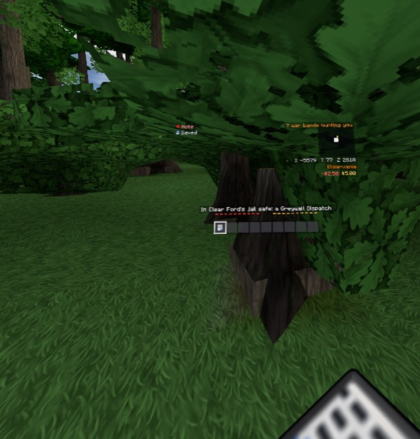

## 08:22:38 - Uh, way

- **Transcript:** Uh, way
- **Status:** open
- **Build:** 0.129 (1418bf09, M1-M4 (device-tested; ship riding, chests, comfort options, weapon wheel))
- **World:** New World (19) (seed 7653607216494784574)
- **Dimension:** Surface
- **Biome:** Jungle
- **Position:** -5577.7 77.4 2811.2
- **Facing:** east (yaw 77, pitch -58)
- **Held:** Greywall Dispatch x1
- **Mount:** on foot
- **Looking at:** Grass Block at -5578 77 2810
- **Mode:** Survival, health 20/20
- **Time:** day 1 07:28, clear
- **Fps:** 70
- **Levels:** mic -39 dBFS, game sound -40 dBFS
- **Length:** 1.6 s (voice 0.6 s)
- **Just before:** -2s opened PauseMenu; -0s closed PauseMenu; -0s message: Playtest build: voice bug notes ON, your speech is saved (Options > Interface); --2s opened PauseMenu; --3s message: Walking; --5s message: Flying; -2s entered Surface; -2s closed PauseMenu; -2s holding Greywall Dispatch; -2s message: In Clear Ford's jail safe: a Greywall Dispatch; -1s message: In Clear Ford's jail safe: a Greywall Dispatch. Added to journal: Who Holds the Frontier
- **Repro (Mac):** `./snap.sh note --seed 7653607216494784574 --x -5577.7 --z 2811.2 --yaw -77 --pitch -58 --time 0.061`
- **Audio (this Mac):** /Users/darthvadar/Documents/Blocksmith/QuestVoiceNotes/raw/vn-20261102-082238-380.aac

## 08:22:41 - All right, just one thing I wanna change too, make it so the bush, the

- **Transcript:** All right, just one thing I wanna change too, make it so the bush, the branches don't slow you down at all. We still got a lot of horrible triangles. Look at this one right here. This one's bad. Got another one right here
- **Status:** open
- **Build:** 0.129 (1418bf09, M1-M4 (device-tested; ship riding, chests, comfort options, weapon wheel))
- **World:** New World (19) (seed 7653607216494784574)
- **Dimension:** Surface
- **Biome:** Jungle
- **Position:** -5571.9 77.4 2813.9
- **Facing:** north (yaw 2, pitch -58)
- **Held:** Greywall Dispatch x1
- **Mount:** on foot
- **Looking at:** Grass Block at -5572 77 2812
- **Mode:** Survival, health 20/20
- **Time:** day 1 07:31, clear
- **Fps:** 63
- **Levels:** mic -24 dBFS, game sound -40 dBFS
- **Length:** 12.2 s (voice 7.2 s)
- **Just before:** -4s opened PauseMenu; -3s closed PauseMenu; -3s message: Playtest build: voice bug notes ON, your speech is saved (Options > Interface); -0s opened PauseMenu; --0s message: Walking; --2s message: Flying; -4s entered Surface; -4s closed PauseMenu; -4s holding Greywall Dispatch; -4s message: In Clear Ford's jail safe: a Greywall Dispatch; -4s message: In Clear Ford's jail safe: a Greywall Dispatch. Added to journal: Who Holds the Frontier; -0s message: Spring: the snow melts and the young are born
- **While talking:** -5s message: Walking; -3s message: Flying; -4s holding empty hand; -4s left the pack: Falke Pistol x2 (at -5569 76 2831); -4s left the pack: Field Stim x52 (at -5569 76 2831); -4s left the pack: Donnerkeil Service Rifle x3 (at -5569 76 2831); -4s left the pack: Fernblick Rifle (at -5569 76 2831); -4s left the pack: Duskium Chestplate (at -5569 76 2831); -4s left the pack: Jetpack x2 (at -5569 76 2831); -4s left the pack: Field Journal of an Ashguard Rifleman (at -5569 76 2831); -4s left the pack: Titanium Pickaxe (at -5569 76 2831); -4s left the pack: Rocket x4 (at -5569 76 2831); -4s left the pack: Regular Armour Set (at -5569 76 2831); -4s left the pack: Aero Engine Spares x18 (at -5569 76 2831); -4s left the pack: Himmelsturm Launcher (at -5569 76 2831); -4s left the pack: Mahlwerk Rotary Gun (at -5569 76 2831); -4s left the pack: Faustrohr (at -5569 76 2831); -4s left the pack: Track Spares x16 (at -5569 76 2831); -4s left the pack: Faustrohr Warhead x3 (at -5569 76 2831); -2s walked into Jungle
- **Position at the end:** -5570.6 76.4 2832.1
- **Repro (Mac):** `./snap.sh note --seed 7653607216494784574 --x -5571.9 --z 2813.9 --yaw -2 --pitch -58 --time 0.064`
- **Audio (this Mac):** /Users/darthvadar/Documents/Blocksmith/QuestVoiceNotes/raw/vn-20261102-082241-160.aac

## 08:22:54 - There's some sort of weird shit going on right here

- **Transcript:** There's some sort of weird shit going on right here
- **Status:** open
- **Build:** 0.129 (1418bf09, M1-M4 (device-tested; ship riding, chests, comfort options, weapon wheel))
- **World:** New World (19) (seed 7653607216494784574)
- **Dimension:** Surface
- **Biome:** Jungle
- **Position:** -5574.7 75.9 2832.8
- **Facing:** west (yaw 257, pitch -56)
- **Held:** empty hand
- **Mount:** on foot
- **Looking at:** Grass Block at -5576 75 2832
- **Mode:** Survival, health 20/20
- **Time:** day 1 07:47, clear
- **Fps:** 59
- **Levels:** mic -42 dBFS, game sound -22 dBFS
- **Length:** 4.7 s (voice 2.3 s)
- **Just before:** -18s opened PauseMenu; -16s closed PauseMenu; -16s message: Playtest build: voice bug notes ON, your speech is saved (Options > Interface); -14s opened PauseMenu; -13s message: Walking; -12s message: Flying; -18s entered Surface; -18s closed PauseMenu; -18s holding Greywall Dispatch; -18s message: In Clear Ford's jail safe: a Greywall Dispatch; -17s message: In Clear Ford's jail safe: a Greywall Dispatch. Added to journal: Who Holds the Frontier; -14s message: Spring: the snow melts and the young are born; -13s holding empty hand; -7s left the pack: Falke Pistol x2 (at -5569 76 2831); -7s left the pack: Field Stim x52 (at -5569 76 2831); -7s left the pack: Donnerkeil Service Rifle x3 (at -5569 76 2831); -7s left the pack: Fernblick Rifle (at -5569 76 2831); -7s left the pack: Duskium Chestplate (at -5569 76 2831); -7s left the pack: Jetpack x2 (at -5569 76 2831); -7s left the pack: Field Journal of an Ashguard Rifleman (at -5569 76 2831); -7s left the pack: Titanium Pickaxe (at -5569 76 2831); -7s left the pack: Rocket x4 (at -5569 76 2831); -7s left the pack: Regular Armour Set (at -5569 76 2831); -7s left the pack: Aero Engine Spares x18 (at -5569 76 2831); -7s left the pack: Himmelsturm Launcher (at -5569 76 2831); -7s left the pack: Mahlwerk Rotary Gun (at -5569 76 2831); -7s left the pack: Faustrohr (at -5569 76 2831); -7s left the pack: Track Spares x16 (at -5569 76 2831); -7s left the pack: Faustrohr Warhead x3 (at -5569 76 2831); -6s walked into Jungle
- **Repro (Mac):** `./snap.sh note --seed 7653607216494784574 --x -5574.7 --z 2832.8 --yaw 103 --pitch -56 --time 0.075`
- **Audio (this Mac):** /Users/darthvadar/Documents/Blocksmith/QuestVoiceNotes/raw/vn-20261102-082254-500.aac

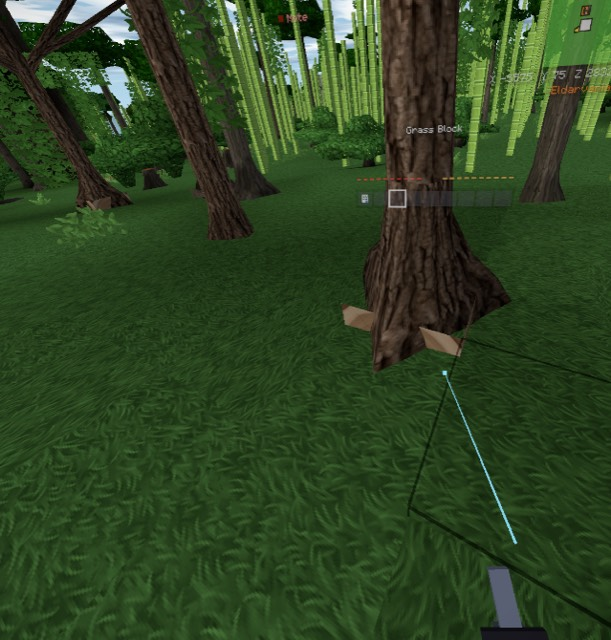

## 08:23:01 - And here

- **Transcript:** And here
- **Status:** open
- **Build:** 0.129 (1418bf09, M1-M4 (device-tested; ship riding, chests, comfort options, weapon wheel))
- **World:** New World (19) (seed 7653607216494784574)
- **Dimension:** Surface
- **Biome:** Jungle
- **Position:** -5580.5 75.8 2826.4
- **Facing:** north (yaw 351, pitch -49)
- **Held:** empty hand
- **Mount:** on foot
- **Looking at:** Dirt at -5581 75 2824
- **Mode:** Survival, health 20/20
- **Time:** day 1 07:55, clear
- **Fps:** 56
- **Levels:** mic -26 dBFS, game sound -24 dBFS
- **Length:** 2.0 s (voice 0.6 s)
- **Just before:** -24s opened PauseMenu; -23s closed PauseMenu; -23s message: Playtest build: voice bug notes ON, your speech is saved (Options > Interface); -20s opened PauseMenu; -20s message: Walking; -18s message: Flying; -24s entered Surface; -24s closed PauseMenu; -24s holding Greywall Dispatch; -24s message: In Clear Ford's jail safe: a Greywall Dispatch; -24s message: In Clear Ford's jail safe: a Greywall Dispatch. Added to journal: Who Holds the Frontier; -20s message: Spring: the snow melts and the young are born; -19s holding empty hand; -14s left the pack: Falke Pistol x2 (at -5569 76 2831); -14s left the pack: Field Stim x52 (at -5569 76 2831); -14s left the pack: Donnerkeil Service Rifle x3 (at -5569 76 2831); -14s left the pack: Fernblick Rifle (at -5569 76 2831); -14s left the pack: Duskium Chestplate (at -5569 76 2831); -14s left the pack: Jetpack x2 (at -5569 76 2831); -14s left the pack: Field Journal of an Ashguard Rifleman (at -5569 76 2831); -14s left the pack: Titanium Pickaxe (at -5569 76 2831); -14s left the pack: Rocket x4 (at -5569 76 2831); -14s left the pack: Regular Armour Set (at -5569 76 2831); -14s left the pack: Aero Engine Spares x18 (at -5569 76 2831); -14s left the pack: Himmelsturm Launcher (at -5569 76 2831); -14s left the pack: Mahlwerk Rotary Gun (at -5569 76 2831); -14s left the pack: Faustrohr (at -5569 76 2831); -14s left the pack: Track Spares x16 (at -5569 76 2831); -14s left the pack: Faustrohr Warhead x3 (at -5569 76 2831); -12s walked into Jungle
- **Repro (Mac):** `./snap.sh note --seed 7653607216494784574 --x -5580.5 --z 2826.4 --yaw 9 --pitch -49 --time 0.080`
- **Audio (this Mac):** /Users/darthvadar/Documents/Blocksmith/QuestVoiceNotes/raw/vn-20261102-082301-221.aac

## 08:23:04 - In here

- **Transcript:** In here
- **Status:** open
- **Build:** 0.129 (1418bf09, M1-M4 (device-tested; ship riding, chests, comfort options, weapon wheel))
- **World:** New World (19) (seed 7653607216494784574)
- **Dimension:** Surface
- **Biome:** Jungle
- **Position:** -5583.8 75.7 2823.8
- **Facing:** north (yaw 344, pitch -38)
- **Held:** empty hand
- **Mount:** on foot
- **Looking at:** Grass Block at -5585 75 2822
- **Mode:** Survival, health 20/20
- **Time:** day 1 07:59, clear
- **Fps:** 56
- **Levels:** mic -30 dBFS, game sound -20 dBFS
- **Length:** 1.9 s (voice 0.5 s)
- **Just before:** -27s opened PauseMenu; -26s closed PauseMenu; -26s message: Playtest build: voice bug notes ON, your speech is saved (Options > Interface); -23s opened PauseMenu; -22s message: Walking; -21s message: Flying; -27s entered Surface; -27s closed PauseMenu; -27s holding Greywall Dispatch; -27s message: In Clear Ford's jail safe: a Greywall Dispatch; -27s message: In Clear Ford's jail safe: a Greywall Dispatch. Added to journal: Who Holds the Frontier; -23s message: Spring: the snow melts and the young are born; -22s holding empty hand; -17s left the pack: Falke Pistol x2 (at -5569 76 2831); -17s left the pack: Field Stim x52 (at -5569 76 2831); -17s left the pack: Donnerkeil Service Rifle x3 (at -5569 76 2831); -17s left the pack: Fernblick Rifle (at -5569 76 2831); -17s left the pack: Duskium Chestplate (at -5569 76 2831); -17s left the pack: Jetpack x2 (at -5569 76 2831); -17s left the pack: Field Journal of an Ashguard Rifleman (at -5569 76 2831); -17s left the pack: Titanium Pickaxe (at -5569 76 2831); -17s left the pack: Rocket x4 (at -5569 76 2831); -17s left the pack: Regular Armour Set (at -5569 76 2831); -17s left the pack: Aero Engine Spares x18 (at -5569 76 2831); -17s left the pack: Himmelsturm Launcher (at -5569 76 2831); -17s left the pack: Mahlwerk Rotary Gun (at -5569 76 2831); -17s left the pack: Faustrohr (at -5569 76 2831); -17s left the pack: Track Spares x16 (at -5569 76 2831); -17s left the pack: Faustrohr Warhead x3 (at -5569 76 2831); -15s walked into Jungle
- **Repro (Mac):** `./snap.sh note --seed 7653607216494784574 --x -5583.8 --z 2823.8 --yaw 16 --pitch -38 --time 0.083`
- **Audio (this Mac):** /Users/darthvadar/Documents/Blocksmith/QuestVoiceNotes/raw/vn-20261102-082304-060.aac

## 08:23:07 - Lots of weird shit going on

- **Transcript:** Lots of weird shit going on
- **Status:** open
- **Build:** 0.129 (1418bf09, M1-M4 (device-tested; ship riding, chests, comfort options, weapon wheel))
- **World:** New World (19) (seed 7653607216494784574)
- **Dimension:** Surface
- **Biome:** Jungle
- **Position:** -5584.5 76.3 2817.1
- **Facing:** north-east (yaw 29, pitch -24)
- **Held:** empty hand
- **Mount:** on foot
- **Looking at:** Dirt at -5585 76 2815
- **Mode:** Survival, health 20/20
- **Time:** day 1 08:03, clear
- **Fps:** 49
- **Levels:** mic -25 dBFS, game sound -23 dBFS
- **Length:** 2.7 s (voice 1.1 s)
- **Just before:** -30s closed PauseMenu; -30s message: Playtest build: voice bug notes ON, your speech is saved (Options > Interface); -27s opened PauseMenu; -26s message: Walking; -25s message: Flying; -27s message: Spring: the snow melts and the young are born; -26s holding empty hand; -20s left the pack: Falke Pistol x2 (at -5569 76 2831); -20s left the pack: Field Stim x52 (at -5569 76 2831); -20s left the pack: Donnerkeil Service Rifle x3 (at -5569 76 2831); -20s left the pack: Fernblick Rifle (at -5569 76 2831); -20s left the pack: Duskium Chestplate (at -5569 76 2831); -20s left the pack: Jetpack x2 (at -5569 76 2831); -20s left the pack: Field Journal of an Ashguard Rifleman (at -5569 76 2831); -20s left the pack: Titanium Pickaxe (at -5569 76 2831); -20s left the pack: Rocket x4 (at -5569 76 2831); -20s left the pack: Regular Armour Set (at -5569 76 2831); -20s left the pack: Aero Engine Spares x18 (at -5569 76 2831); -20s left the pack: Himmelsturm Launcher (at -5569 76 2831); -20s left the pack: Mahlwerk Rotary Gun (at -5569 76 2831); -20s left the pack: Faustrohr (at -5569 76 2831); -20s left the pack: Track Spares x16 (at -5569 76 2831); -20s left the pack: Faustrohr Warhead x3 (at -5569 76 2831); -19s walked into Jungle; -1s walked into Bamboo Jungle
- **Repro (Mac):** `./snap.sh note --seed 7653607216494784574 --x -5584.5 --z 2817.1 --yaw -29 --pitch -24 --time 0.086`
- **Audio (this Mac):** /Users/darthvadar/Documents/Blocksmith/QuestVoiceNotes/raw/vn-20261102-082307-740.aac

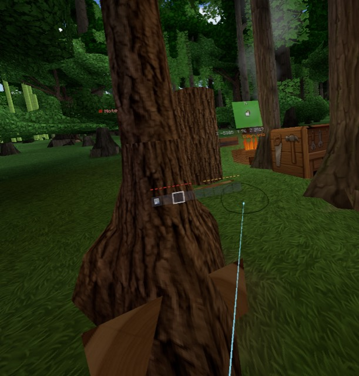

## 08:23:19 - I think it's already, uh, survived with the creative button just to to

- **Transcript:** I think it's already, uh, survived with the creative button just to toggle
- **Status:** open
- **Build:** 0.129 (1418bf09, M1-M4 (device-tested; ship riding, chests, comfort options, weapon wheel))
- **World:** New World (19) (seed 7653607216494784574)
- **Dimension:** Surface
- **Biome:** Bamboo Jungle
- **Position:** -5660.0 100.9 2807.4
- **Facing:** west (yaw 255, pitch -9)
- **Held:** empty hand
- **Mount:** on foot, flying
- **Looking at:** nothing
- **Mode:** Creative, health 20/20
- **Time:** day 1 08:10, clear
- **Fps:** 58
- **Levels:** mic -31 dBFS, game sound -23 dBFS
- **Length:** 4.3 s (voice 2.4 s)
- **Just before:** -13s walked into Bamboo Jungle; -9s opened PauseMenu; -7s closed PauseMenu; -6s opened PauseMenu; -3s message: Creative mode; -2s closed PauseMenu; -1s message: Flying
- **Repro (Mac):** `./snap.sh note --seed 7653607216494784574 --x -5660.0 --z 2807.4 --yaw 105 --pitch -9 --time 0.091`
- **Audio (this Mac):** /Users/darthvadar/Documents/Blocksmith/QuestVoiceNotes/raw/vn-20261102-082319-440.aac

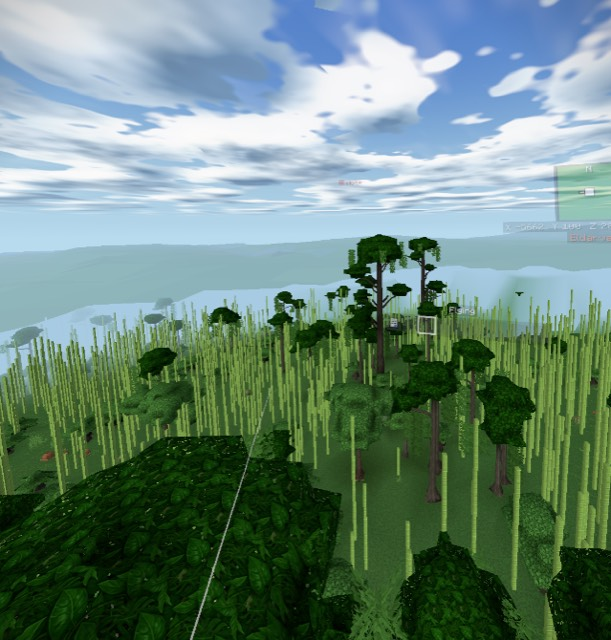

## 08:24:22 - Got some floating branches here. Oh, why are they already shooting at 

- **Transcript:** Got some floating branches here. Oh, why are they already shooting at me?
- **Status:** open
- **Build:** 0.129 (1418bf09, M1-M4 (device-tested; ship riding, chests, comfort options, weapon wheel))
- **World:** New World (19) (seed 7653607216494784574)
- **Dimension:** Surface
- **Biome:** Sparse Jungle
- **Position:** -5754.8 69.9 3057.2
- **Facing:** west (yaw 276, pitch 57)
- **Held:** empty hand
- **Mount:** on foot
- **Looking at:** nothing
- **Mode:** Survival, health 20/20
- **Time:** day 1 09:21, clear
- **Fps:** 72
- **Levels:** mic -41 dBFS, game sound -17 dBFS
- **Length:** 5.6 s (voice 2.9 s)
- **Just before:** -28s closed CreativeMenu; -26s opened CreativeMenu; -26s closed CreativeMenu; -26s opened PauseMenu; -24s message: Survival mode; -24s closed PauseMenu; -23s opened InventoryMenu; -23s left the pack: Duskium Helmet (InventoryMenu open); -22s left the pack: Duskium Chestplate (InventoryMenu open); -22s left the pack: Duskium Leggings (InventoryMenu open); -22s left the pack: Duskium Boots (InventoryMenu open); -22s closed InventoryMenu; -21s holding Combat Stim; -21s message: Combat Stim; -20s holding empty hand; -17s walked into Warm Ocean; -16s message: Intel: this base is a Radar Station; -15s walked into Sparse Jungle; -10s message: A Greywall party is coming out to meet you
- **While talking:** -3s message: The Greywall Fortress is sounding the alarm!; -3s took 6 damage (health 15/20); -0s holding Combat Stim; -0s message: A stranger in town: Ezra Quill
- **Position at the end:** -5751.4 70.0 3069.2
- **Repro (Mac):** `./snap.sh note --seed 7653607216494784574 --x -5754.8 --z 3057.2 --yaw 84 --pitch 57 --time 0.140`
- **Audio (this Mac):** /Users/darthvadar/Documents/Blocksmith/QuestVoiceNotes/raw/vn-20261102-082422-680.aac

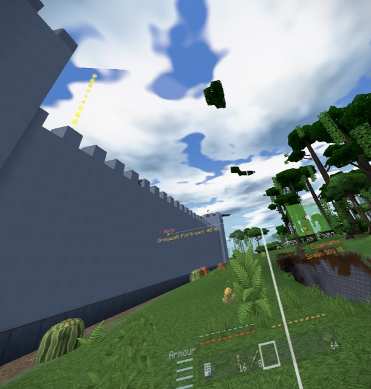

## 08:25:53 - Oh, shit. Okay

- **Transcript:** Oh, shit. Okay
- **Status:** open
- **Build:** 0.129 (1418bf09, M1-M4 (device-tested; ship riding, chests, comfort options, weapon wheel))
- **World:** New World (19) (seed 7653607216494784574)
- **Dimension:** Surface
- **Biome:** Sparse Jungle
- **Position:** -5789.6 63.4 3145.8
- **Facing:** north-west (yaw 336, pitch 11)
- **Held:** Sturmwind Carbine x1
- **Mount:** on foot
- **Looking at:** Dirt at -5792 66 3140
- **Mode:** Survival, health 20/20
- **Time:** day 1 10:58, clear
- **Fps:** 64
- **Levels:** mic -34 dBFS, game sound -15 dBFS
- **Length:** 3.6 s (voice 1.4 s)
- **Just before:** -27s walked into Savanna; -27s message: Walking; -26s opened PauseMenu; -25s closed PauseMenu; -24s opened PauseMenu; -21s message: Survival mode; -21s closed PauseMenu; -20s opened InventoryMenu; -19s left the pack: Duskium Chestplate (InventoryMenu open); -19s left the pack: Duskium Helmet (InventoryMenu open); -18s left the pack: Duskium Leggings (InventoryMenu open); -18s closed InventoryMenu; -18s left the pack: Duskium Boots; -18s holding Rifle Rounds; -18s message: Rifle Rounds; -17s holding empty hand; -17s holding Sturmwind Carbine; -17s message: Sturmwind Carbine; -17s message: Loaded: 30 / 30; -11s took 3 damage (health 18/20); -9s took 4 damage (health 16/20); -6s took 6 damage (health 11/20); -6s message: Honour raised (you protected the town); -5s took 2 damage (health 9/20); -5s holding Combat Stim; -5s walked into Sparse Jungle; -5s left the pack: Combat Stim (at -5797 67 3153); -5s holding Sturmwind Carbine; -3s holding empty hand; -2s holding Sturmwind Carbine; -2s message: Sturmwind Carbine; -2s message: Loaded: 30 / 30; -2s left the pack: Rifle Magazine (at -5793 68 3145); -0s message: Twin 42 cm Turret tracking you
- **Repro (Mac):** `./snap.sh note --seed 7653607216494784574 --x -5789.6 --z 3145.8 --yaw 24 --pitch 11 --time 0.207`
- **Audio (this Mac):** /Users/darthvadar/Documents/Blocksmith/QuestVoiceNotes/raw/vn-20261102-082553-580.aac

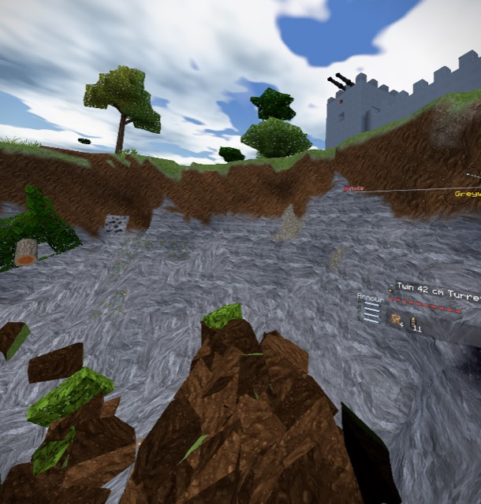

## 08:26:07 - Whoa. [laughs] Shit

- **Transcript:** Whoa. [laughs] Shit
- **Status:** open
- **Build:** 0.129 (1418bf09, M1-M4 (device-tested; ship riding, chests, comfort options, weapon wheel))
- **World:** New World (19) (seed 7653607216494784574)
- **Dimension:** Surface
- **Biome:** Jungle
- **Position:** -5579.2 77.0 2810.7
- **Facing:** north (yaw 356, pitch 2)
- **Held:** empty hand
- **Mount:** on foot
- **Looking at:** Oak Leaves at -5580 79 2804
- **Mode:** Survival, health 20/20
- **Time:** day 1 11:15, clear
- **Fps:** 63
- **Levels:** mic -24 dBFS, game sound -28 dBFS
- **Length:** 4.0 s (voice 1.3 s)
- **Just before:** -25s took 3 damage (health 18/20); -23s took 4 damage (health 16/20); -20s took 6 damage (health 11/20); -20s message: Honour raised (you protected the town); -19s took 2 damage (health 9/20); -19s holding Combat Stim; -19s walked into Sparse Jungle; -18s left the pack: Combat Stim (at -5797 67 3153); -18s holding Sturmwind Carbine; -17s holding empty hand; -16s holding Sturmwind Carbine; -16s message: Sturmwind Carbine; -16s message: Loaded: 30 / 30; -16s left the pack: Rifle Magazine (at -5793 68 3145); -14s message: Twin 42 cm Turret tracking you; -12s took 4 damage (health 17/20); -5s took 6 damage (health 15/20); -1s died; -1s opened DeathMenu; -1s holding empty hand; -1s message: The Capital now counts you wary of you.; -1s respawned; -1s closed DeathMenu; -0s left the pack: Rifle Magazine x11; -0s left the pack: Combat Stim x6; -0s left the pack: Sturmwind Carbine; -0s left the pack: Greywall Dispatch
- **Repro (Mac):** `./snap.sh note --seed 7653607216494784574 --x -5579.2 --z 2810.7 --yaw 4 --pitch 2 --time 0.219`
- **Audio (this Mac):** /Users/darthvadar/Documents/Blocksmith/QuestVoiceNotes/raw/vn-20261102-082607-760.aac

## 08:26:11 - Okay. Yeah, that was great

- **Transcript:** Okay. Yeah, that was great
- **Status:** open
- **Build:** 0.129 (1418bf09, M1-M4 (device-tested; ship riding, chests, comfort options, weapon wheel))
- **World:** New World (19) (seed 7653607216494784574)
- **Dimension:** Surface
- **Biome:** Jungle
- **Position:** -5582.1 81.4 2807.9
- **Facing:** north (yaw 343, pitch -6)
- **Held:** empty hand
- **Mount:** on foot, flying
- **Looking at:** nothing
- **Mode:** Creative, health 20/20
- **Time:** day 1 11:16, clear
- **Fps:** 67
- **Levels:** mic -32 dBFS, game sound -32 dBFS
- **Length:** 3.5 s (voice 1.2 s)
- **Just before:** -29s took 3 damage (health 18/20); -27s took 4 damage (health 16/20); -24s took 6 damage (health 11/20); -24s message: Honour raised (you protected the town); -23s took 2 damage (health 9/20); -23s holding Combat Stim; -23s walked into Sparse Jungle; -22s left the pack: Combat Stim (at -5797 67 3153); -22s holding Sturmwind Carbine; -21s holding empty hand; -20s holding Sturmwind Carbine; -20s message: Sturmwind Carbine; -20s message: Loaded: 30 / 30; -20s left the pack: Rifle Magazine (at -5793 68 3145); -18s message: Twin 42 cm Turret tracking you; -16s took 4 damage (health 17/20); -9s took 6 damage (health 15/20); -5s died; -5s opened DeathMenu; -5s holding empty hand; -5s message: The Capital now counts you wary of you.; -5s respawned; -5s closed DeathMenu; -4s left the pack: Rifle Magazine x11; -4s left the pack: Combat Stim x6; -4s left the pack: Sturmwind Carbine; -4s left the pack: Greywall Dispatch; -4s took 21 damage (health 20/20); -3s opened PauseMenu; -3s walked into Jungle; -2s message: Your things are 381 blocks south-west; -1s closed PauseMenu; -0s message: Creative mode
- **Repro (Mac):** `./snap.sh note --seed 7653607216494784574 --x -5582.1 --z 2807.9 --yaw 17 --pitch -6 --time 0.220`
- **Audio (this Mac):** /Users/darthvadar/Documents/Blocksmith/QuestVoiceNotes/raw/vn-20261102-082611-740.aac

## 08:27:29 - We got some, uh, sugarcane floating in the water here, grass also

- **Transcript:** We got some, uh, sugarcane floating in the water here, grass also
- **Status:** open
- **Build:** 0.129 (1418bf09, M1-M4 (device-tested; ship riding, chests, comfort options, weapon wheel))
- **World:** New World (19) (seed 7653607216494784574)
- **Dimension:** Surface
- **Biome:** Savanna
- **Position:** -5756.7 63.0 3286.9
- **Facing:** north-east (yaw 56, pitch -44)
- **Held:** Mahlwerk Rotary Gun x1
- **Mount:** on foot
- **Looking at:** Short Grass at -5756 63 3286
- **Mode:** Survival, health 20/20
- **Time:** day 1 12:41, clear
- **Fps:** 71
- **Levels:** mic -26 dBFS, game sound -20 dBFS
- **Length:** 6.5 s (voice 3.1 s)
- **Just before:** -29s into the pack: Combat Stim; -29s closed CreativeMenu; -27s opened PauseMenu; -24s message: Survival mode; -24s closed PauseMenu; -24s opened InventoryMenu; -23s holding empty hand; -23s left the pack: Duskium Helmet (InventoryMenu open); -23s left the pack: Duskium Leggings (InventoryMenu open); -23s left the pack: Duskium Boots (InventoryMenu open); -22s left the pack: Duskium Chestplate (InventoryMenu open); -22s closed InventoryMenu; -21s holding Iron Nugget; -21s message: Iron Nugget; -21s holding Capital Magazine; -21s message: Capital Magazine; -20s holding Mahlwerk Rotary Gun; -20s message: Mahlwerk Rotary Gun; -20s message: Loaded: 200 / 200; -19s left the pack: Capital Magazine x7 (at -5718 63 3345); -19s holding Capital Magazine; -17s holding Mahlwerk Rotary Gun; -17s message: Mahlwerk Rotary Gun; -8s walked into Warm Ocean
- **While talking:** -5s walked into Savanna
- **Position at the end:** -5753.0 63.4 3278.8
- **Repro (Mac):** `./snap.sh note --seed 7653607216494784574 --x -5756.7 --z 3286.9 --yaw -56 --pitch -44 --time 0.279`
- **Audio (this Mac):** /Users/darthvadar/Documents/Blocksmith/QuestVoiceNotes/raw/vn-20261102-082729-000.aac

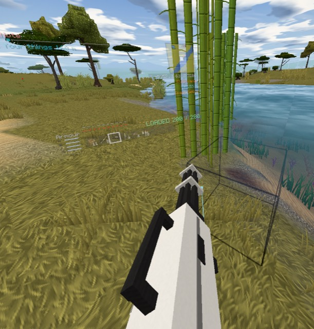

## 08:27:47 - So at this range on very hard, I should be getting destroyed

- **Transcript:** So at this range on very hard, I should be getting destroyed
- **Status:** open
- **Build:** 0.129 (1418bf09, M1-M4 (device-tested; ship riding, chests, comfort options, weapon wheel))
- **World:** New World (19) (seed 7653607216494784574)
- **Dimension:** Surface
- **Biome:** Savanna
- **Position:** -5766.8 67.1 3237.6
- **Facing:** north (yaw 347, pitch 5)
- **Held:** Mahlwerk Rotary Gun x1
- **Mount:** on foot
- **Looking at:** nothing
- **Mode:** Survival, health 20/20
- **Time:** day 1 13:02, clear
- **Fps:** 72
- **Levels:** mic -38 dBFS, game sound -22 dBFS
- **Length:** 4.3 s (voice 2.6 s)
- **Just before:** -26s walked into Warm Ocean; -18s walked into Savanna; -10s holding Capital Magazine; -10s message: Capital Magazine; -10s holding Iron Nugget; -10s message: Iron Nugget; -10s left the pack: Capital Magazine (at -5762 64 3254); -9s holding Capital Magazine; -9s message: Capital Magazine; -9s holding Mahlwerk Rotary Gun; -9s message: Mahlwerk Rotary Gun; -5s opened PauseMenu; -4s closed PauseMenu
- **Repro (Mac):** `./snap.sh note --seed 7653607216494784574 --x -5766.8 --z 3237.6 --yaw 13 --pitch 5 --time 0.293`
- **Audio (this Mac):** /Users/darthvadar/Documents/Blocksmith/QuestVoiceNotes/raw/vn-20261102-082747-540.aac

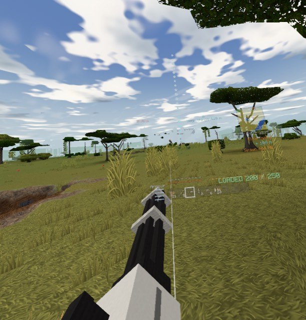

## 08:27:57 - That was great

- **Transcript:** That was great
- **Status:** open
- **Build:** 0.129 (1418bf09, M1-M4 (device-tested; ship riding, chests, comfort options, weapon wheel))
- **World:** New World (19) (seed 7653607216494784574)
- **Dimension:** Surface
- **Biome:** Savanna
- **Position:** -5766.7 63.3 3223.7
- **Facing:** north-west (yaw 331, pitch -59)
- **Held:** empty hand
- **Mount:** on foot
- **Looking at:** nothing
- **Mode:** Survival, health -110/20, screen DeathMenu
- **Time:** day 1 13:13, clear
- **Fps:** 71
- **Levels:** mic -29 dBFS, game sound -27 dBFS
- **Length:** 1.9 s (voice 0.4 s)
- **Just before:** -28s walked into Savanna; -20s holding Capital Magazine; -20s message: Capital Magazine; -19s holding Iron Nugget; -19s message: Iron Nugget; -19s left the pack: Capital Magazine (at -5762 64 3254); -19s holding Capital Magazine; -19s message: Capital Magazine; -18s holding Mahlwerk Rotary Gun; -18s message: Mahlwerk Rotary Gun; -15s opened PauseMenu; -14s closed PauseMenu; -5s holding Capital Magazine; -5s message: Capital Magazine; -5s holding Iron Nugget; -5s message: Iron Nugget; -5s holding Capital Rounds; -5s message: Capital Rounds; -5s holding empty hand; -4s died; -4s opened DeathMenu; -4s left the pack: Capital Magazine x8 (DeathMenu open); -4s left the pack: Mahlwerk Rotary Gun (DeathMenu open); -4s left the pack: Greywall Code Book (DeathMenu open); -4s left the pack: Combat Stim x8 (DeathMenu open); -4s left the pack: Regular Armour Set (DeathMenu open); -4s message: You have your things back; -3s took 133 damage (health -112/20); -2s message: Target gone from the list. Back to the story's objective
- **Repro (Mac):** `./snap.sh note --seed 7653607216494784574 --x -5766.7 --z 3223.7 --yaw 29 --pitch -59 --time 0.301`
- **Audio (this Mac):** /Users/darthvadar/Documents/Blocksmith/QuestVoiceNotes/raw/vn-20261102-082757-100.aac

## 08:27:59 - Love that

- **Transcript:** Love that
- **Status:** open
- **Build:** 0.129 (1418bf09, M1-M4 (device-tested; ship riding, chests, comfort options, weapon wheel))
- **World:** New World (19) (seed 7653607216494784574)
- **Dimension:** Surface
- **Biome:** Savanna
- **Position:** -5766.7 63.3 3223.7
- **Facing:** north-west (yaw 331, pitch -59)
- **Held:** empty hand
- **Mount:** on foot
- **Looking at:** nothing
- **Mode:** Survival, health -109/20, screen DeathMenu
- **Time:** day 1 13:16, clear
- **Fps:** 71
- **Levels:** mic -33 dBFS, game sound -19 dBFS
- **Length:** 1.9 s (voice 0.5 s)
- **Just before:** -30s walked into Savanna; -22s holding Capital Magazine; -22s message: Capital Magazine; -22s holding Iron Nugget; -22s message: Iron Nugget; -21s left the pack: Capital Magazine (at -5762 64 3254); -21s holding Capital Magazine; -21s message: Capital Magazine; -21s holding Mahlwerk Rotary Gun; -21s message: Mahlwerk Rotary Gun; -17s opened PauseMenu; -16s closed PauseMenu; -7s holding Capital Magazine; -7s message: Capital Magazine; -7s holding Iron Nugget; -7s message: Iron Nugget; -7s holding Capital Rounds; -7s message: Capital Rounds; -7s holding empty hand; -7s died; -7s opened DeathMenu; -7s left the pack: Capital Magazine x8 (DeathMenu open); -7s left the pack: Mahlwerk Rotary Gun (DeathMenu open); -7s left the pack: Greywall Code Book (DeathMenu open); -7s left the pack: Combat Stim x8 (DeathMenu open); -7s left the pack: Regular Armour Set (DeathMenu open); -6s message: You have your things back; -6s took 133 damage (health -112/20); -4s message: Target gone from the list. Back to the story's objective
- **Repro (Mac):** `./snap.sh note --seed 7653607216494784574 --x -5766.7 --z 3223.7 --yaw 29 --pitch -59 --time 0.303`
- **Audio (this Mac):** /Users/darthvadar/Documents/Blocksmith/QuestVoiceNotes/raw/vn-20261102-082759-300.aac

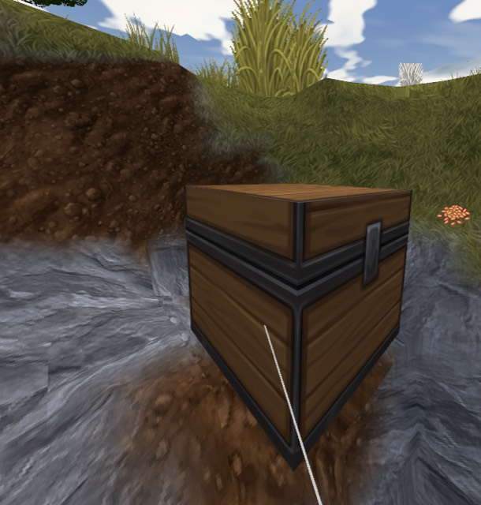

## 08:28:01 - Well, you know what? I, I got destroyed, you know?

- **Transcript:** Well, you know what? I, I got destroyed, you know?
- **Status:** open
- **Build:** 0.129 (1418bf09, M1-M4 (device-tested; ship riding, chests, comfort options, weapon wheel))
- **World:** New World (19) (seed 7653607216494784574)
- **Dimension:** Surface
- **Biome:** Jungle
- **Position:** -5578.5 78.1 2810.5
- **Facing:** north-west (yaw 334, pitch 63)
- **Held:** empty hand
- **Mount:** on foot
- **Looking at:** Grass Block at -5580 77 2809
- **Mode:** Survival, health 20/20
- **Time:** day 1 13:18, clear
- **Fps:** 71
- **Levels:** mic -19 dBFS, game sound -26 dBFS
- **Length:** 4.6 s (voice 2.4 s)
- **Just before:** -24s holding Capital Magazine; -24s message: Capital Magazine; -24s holding Iron Nugget; -24s message: Iron Nugget; -24s left the pack: Capital Magazine (at -5762 64 3254); -23s holding Capital Magazine; -23s message: Capital Magazine; -23s holding Mahlwerk Rotary Gun; -23s message: Mahlwerk Rotary Gun; -19s opened PauseMenu; -18s closed PauseMenu; -10s holding Capital Magazine; -10s message: Capital Magazine; -9s holding Iron Nugget; -9s message: Iron Nugget; -9s holding Capital Rounds; -9s message: Capital Rounds; -9s holding empty hand; -9s died; -9s opened DeathMenu; -9s left the pack: Capital Magazine x8 (DeathMenu open); -9s left the pack: Mahlwerk Rotary Gun (DeathMenu open); -9s left the pack: Greywall Code Book (DeathMenu open); -9s left the pack: Combat Stim x8 (DeathMenu open); -9s left the pack: Regular Armour Set (DeathMenu open); -9s message: You have your things back; -8s took 133 damage (health -112/20); -7s message: Target gone from the list. Back to the story's objective; -1s respawned; -1s closed DeathMenu
- **Repro (Mac):** `./snap.sh note --seed 7653607216494784574 --x -5578.5 --z 2810.5 --yaw 26 --pitch 63 --time 0.305`
- **Audio (this Mac):** /Users/darthvadar/Documents/Blocksmith/QuestVoiceNotes/raw/vn-20261102-082801-440.aac

## 08:28:06 - That was, um, that was appropriate

- **Transcript:** That was, um, that was appropriate
- **Status:** open
- **Build:** 0.129 (1418bf09, M1-M4 (device-tested; ship riding, chests, comfort options, weapon wheel))
- **World:** New World (19) (seed 7653607216494784574)
- **Dimension:** Surface
- **Biome:** Jungle
- **Position:** -5580.6 80.1 2809.7
- **Facing:** west (yaw 252, pitch -9)
- **Held:** empty hand
- **Mount:** on foot, flying
- **Looking at:** nothing
- **Mode:** Creative, health 20/20
- **Time:** day 1 13:22, clear
- **Fps:** 72
- **Levels:** mic -27 dBFS, game sound -25 dBFS
- **Length:** 3.4 s (voice 1.8 s)
- **Just before:** -29s holding Capital Magazine; -29s message: Capital Magazine; -28s holding Iron Nugget; -28s message: Iron Nugget; -28s left the pack: Capital Magazine (at -5762 64 3254); -28s holding Capital Magazine; -28s message: Capital Magazine; -27s holding Mahlwerk Rotary Gun; -27s message: Mahlwerk Rotary Gun; -24s opened PauseMenu; -23s closed PauseMenu; -14s holding Capital Magazine; -14s message: Capital Magazine; -14s holding Iron Nugget; -14s message: Iron Nugget; -14s holding Capital Rounds; -14s message: Capital Rounds; -14s holding empty hand; -13s died; -13s opened DeathMenu; -13s left the pack: Capital Magazine x8 (DeathMenu open); -13s left the pack: Mahlwerk Rotary Gun (DeathMenu open); -13s left the pack: Greywall Code Book (DeathMenu open); -13s left the pack: Combat Stim x8 (DeathMenu open); -13s left the pack: Regular Armour Set (DeathMenu open); -13s message: You have your things back; -12s took 133 damage (health -112/20); -11s message: Target gone from the list. Back to the story's objective; -5s respawned; -5s closed DeathMenu; -5s walked into Jungle; -3s opened PauseMenu; -1s message: Creative mode; -1s closed PauseMenu
- **Repro (Mac):** `./snap.sh note --seed 7653607216494784574 --x -5580.6 --z 2809.7 --yaw 108 --pitch -9 --time 0.307`
- **Audio (this Mac):** /Users/darthvadar/Documents/Blocksmith/QuestVoiceNotes/raw/vn-20261102-082806-120.aac

## 08:28:09 - It was good

- **Transcript:** It was good
- **Status:** open
- **Build:** 0.129 (1418bf09, M1-M4 (device-tested; ship riding, chests, comfort options, weapon wheel))
- **World:** New World (19) (seed 7653607216494784574)
- **Dimension:** Surface
- **Biome:** Sparse Jungle
- **Position:** -5826.0 108.2 3179.0
- **Facing:** west (yaw 254, pitch -21)
- **Held:** empty hand
- **Mount:** on foot
- **Looking at:** nothing
- **Mode:** Creative, health 20/20
- **Time:** day 1 13:25, clear
- **Fps:** 72
- **Levels:** mic -36 dBFS, game sound -23 dBFS
- **Length:** 1.6 s (voice 0.4 s)
- **Just before:** -27s opened PauseMenu; -26s closed PauseMenu; -17s holding Capital Magazine; -17s message: Capital Magazine; -17s holding Iron Nugget; -17s message: Iron Nugget; -17s holding Capital Rounds; -17s message: Capital Rounds; -17s holding empty hand; -17s died; -17s opened DeathMenu; -17s left the pack: Capital Magazine x8 (DeathMenu open); -17s left the pack: Mahlwerk Rotary Gun (DeathMenu open); -17s left the pack: Greywall Code Book (DeathMenu open); -17s left the pack: Combat Stim x8 (DeathMenu open); -17s left the pack: Regular Armour Set (DeathMenu open); -16s message: You have your things back; -16s took 133 damage (health -112/20); -14s message: Target gone from the list. Back to the story's objective; -9s respawned; -9s closed DeathMenu; -8s walked into Jungle; -6s opened PauseMenu; -5s message: Creative mode; -4s closed PauseMenu; -3s message: Flying; -2s walked into Bamboo Jungle; -0s message: Walking
- **Repro (Mac):** `./snap.sh note --seed 7653607216494784574 --x -5826.0 --z 3179.0 --yaw 106 --pitch -21 --time 0.310`
- **Audio (this Mac):** /Users/darthvadar/Documents/Blocksmith/QuestVoiceNotes/raw/vn-20261102-082809-280.aac

## 08:28:50 - I can't left grip right now. Oh, took-- There was a giant delay where 

- **Transcript:** I can't left grip right now. Oh, took-- There was a giant delay where I couldn't left grip. Didn't like that
- **Status:** open
- **Build:** 0.129 (1418bf09, M1-M4 (device-tested; ship riding, chests, comfort options, weapon wheel))
- **World:** New World (19) (seed 7653607216494784574)
- **Dimension:** Surface
- **Biome:** Savanna
- **Position:** -5812.2 66.7 3277.1
- **Facing:** north (yaw 8, pitch -24)
- **Held:** Mahlwerk Rotary Gun x1
- **Mount:** on foot
- **Looking at:** Grass Block at -5812 66 3273
- **Mode:** Survival, health 20/20
- **Time:** day 1 14:09, clear
- **Fps:** 71
- **Levels:** mic -25 dBFS, game sound -20 dBFS
- **Length:** 6.3 s (voice 3.3 s)
- **Just before:** -29s message: Walking; -28s opened PauseMenu; -27s closed PauseMenu; -27s opened CreativeMenu; -25s into the pack: Duskium Helmet; -24s into the pack: Duskium Chestplate; -22s holding Duskium Leggings; -22s into the pack: Duskium Leggings; -22s into the pack: Duskium Boots; -20s into the pack: Combat Stim; -18s into the pack: Capital Magazine; -15s into the pack: Mahlwerk Rotary Gun; -13s closed CreativeMenu; -12s opened PauseMenu; -9s message: Survival mode; -9s closed PauseMenu; -8s opened InventoryMenu; -8s left the pack: Duskium Chestplate (InventoryMenu open); -8s left the pack: Duskium Helmet (InventoryMenu open); -8s holding empty hand; -7s closed InventoryMenu; -7s left the pack: Duskium Leggings; -6s opened PauseMenu; -6s closed PauseMenu; -5s opened InventoryMenu; -5s closed InventoryMenu; -5s left the pack: Duskium Boots (at -5811 67 3275); -4s holding Mahlwerk Rotary Gun; -4s message: Mahlwerk Rotary Gun; -4s message: Loaded: 200 / 200; -4s left the pack: Capital Magazine x7 (at -5813 67 3275)
- **While talking:** -5s holding empty hand; -4s holding Combat Stim; -4s message: Combat Stim; -4s holding empty hand
- **Position at the end:** -5805.1 66.7 3252.7
- **Repro (Mac):** `./snap.sh note --seed 7653607216494784574 --x -5812.2 --z 3277.1 --yaw -8 --pitch -24 --time 0.340`
- **Audio (this Mac):** /Users/darthvadar/Documents/Blocksmith/QuestVoiceNotes/raw/vn-20261102-082850-760.aac

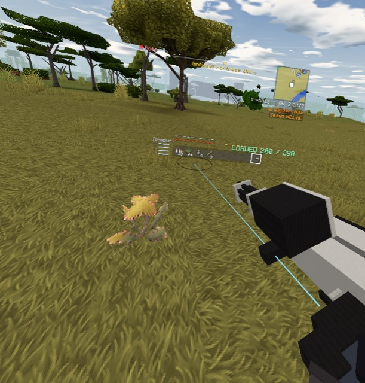

## 08:30:09 - What? Oh, shit

- **Transcript:** What? Oh, shit
- **Status:** open
- **Build:** 0.129 (1418bf09, M1-M4 (device-tested; ship riding, chests, comfort options, weapon wheel))
- **World:** New World (19) (seed 7653607216494784574)
- **Dimension:** Surface
- **Biome:** Dark Forest
- **Position:** -2009.5 143.0 1932.3
- **Facing:** south-west (yaw 215, pitch 7)
- **Held:** Combat Stim x6
- **Mount:** on foot, flying
- **Looking at:** nothing
- **Mode:** Creative, health 20/20
- **Time:** day 1 15:34, clear
- **Fps:** 67
- **Levels:** mic -56 dBFS, game sound -24 dBFS
- **Length:** 2.8 s (voice 0.8 s)
- **Just before:** -27s message: Creative mode; -26s closed PauseMenu; -25s message: Flying; -23s walked into Sparse Jungle; -16s walked into Savanna; -13s message: Walking; -12s walked into Sparse Jungle; -11s message: You've reached Your things; -9s opened ChestMenu; -9s into the pack: Duskium Boots; -8s into the pack: Duskium Helmet; -8s into the pack: Duskium Chestplate; -8s into the pack: Duskium Leggings; -7s into the pack: Rifle Magazine; -7s holding Combat Stim; -7s into the pack: Sturmwind Carbine; -7s into the pack: Combat Stim; -7s into the pack: Greywall Dispatch; -6s closed ChestMenu; -5s message: Flying; -4s opened PauseMenu; -3s opened CommandMenu; -3s opened PauseMenu; -2s closed PauseMenu; -2s message: Teleported to the Brigand Roost; -2s walked into Dark Forest; -0s message: Sky isle marked on the map
- **Repro (Mac):** `./snap.sh note --seed 7653607216494784574 --x -2009.5 --z 1932.3 --yaw 145 --pitch 7 --time 0.399`
- **Audio (this Mac):** /Users/darthvadar/Documents/Blocksmith/QuestVoiceNotes/raw/vn-20261102-083009-580.aac

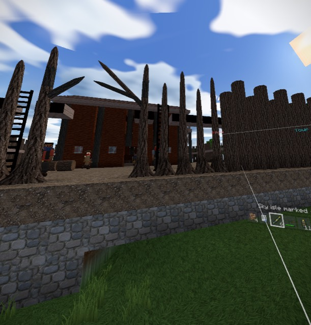

## 08:30:12 - Okay, I've never seen one of these before

- **Transcript:** Okay, I've never seen one of these before
- **Status:** open
- **Build:** 0.129 (1418bf09, M1-M4 (device-tested; ship riding, chests, comfort options, weapon wheel))
- **World:** New World (19) (seed 7653607216494784574)
- **Dimension:** Surface
- **Biome:** Dark Forest
- **Position:** -2008.6 150.4 1939.1
- **Facing:** south (yaw 171, pitch -32)
- **Held:** Combat Stim x6
- **Mount:** on foot, flying
- **Looking at:** nothing
- **Mode:** Creative, health 20/20
- **Time:** day 1 15:37, clear
- **Fps:** 57
- **Levels:** mic -62 dBFS, game sound -19 dBFS
- **Length:** 2.6 s (voice 1.3 s)
- **Just before:** -29s message: Creative mode; -29s closed PauseMenu; -27s message: Flying; -25s walked into Sparse Jungle; -19s walked into Savanna; -16s message: Walking; -15s walked into Sparse Jungle; -14s message: You've reached Your things; -12s opened ChestMenu; -11s into the pack: Duskium Boots; -10s into the pack: Duskium Helmet; -10s into the pack: Duskium Chestplate; -10s into the pack: Duskium Leggings; -10s into the pack: Rifle Magazine; -10s holding Combat Stim; -9s into the pack: Sturmwind Carbine; -9s into the pack: Combat Stim; -9s into the pack: Greywall Dispatch; -8s closed ChestMenu; -7s message: Flying; -6s opened PauseMenu; -5s opened CommandMenu; -5s opened PauseMenu; -5s closed PauseMenu; -5s message: Teleported to the Brigand Roost; -5s walked into Dark Forest; -3s message: Sky isle marked on the map; -1s message: Entering Ithastad
- **Repro (Mac):** `./snap.sh note --seed 7653607216494784574 --x -2008.6 --z 1939.1 --yaw -171 --pitch -32 --time 0.401`
- **Audio (this Mac):** /Users/darthvadar/Documents/Blocksmith/QuestVoiceNotes/raw/vn-20261102-083012-000.aac

## 08:30:14 - Oh, damn. Okay. That's cool. I've never seen one of these

- **Transcript:** Oh, damn. Okay. That's cool. I've never seen one of these
- **Status:** open
- **Build:** 0.129 (1418bf09, M1-M4 (device-tested; ship riding, chests, comfort options, weapon wheel))
- **World:** New World (19) (seed 7653607216494784574)
- **Dimension:** Surface
- **Biome:** Dark Forest
- **Position:** -1998.8 156.4 1970.7
- **Facing:** west (yaw 272, pitch -30)
- **Held:** Combat Stim x6
- **Mount:** on foot, flying
- **Looking at:** nothing
- **Mode:** Creative, health 20/20
- **Time:** day 1 15:40, clear
- **Fps:** 57
- **Levels:** mic -34 dBFS, game sound -17 dBFS
- **Length:** 4.6 s (voice 2.1 s)
- **Just before:** -28s walked into Sparse Jungle; -22s walked into Savanna; -19s message: Walking; -18s walked into Sparse Jungle; -16s message: You've reached Your things; -14s opened ChestMenu; -14s into the pack: Duskium Boots; -13s into the pack: Duskium Helmet; -13s into the pack: Duskium Chestplate; -13s into the pack: Duskium Leggings; -13s into the pack: Rifle Magazine; -12s holding Combat Stim; -12s into the pack: Sturmwind Carbine; -12s into the pack: Combat Stim; -12s into the pack: Greywall Dispatch; -11s closed ChestMenu; -10s message: Flying; -9s opened PauseMenu; -8s opened CommandMenu; -8s opened PauseMenu; -8s closed PauseMenu; -8s message: Teleported to the Brigand Roost; -8s walked into Dark Forest; -6s message: Sky isle marked on the map; -4s message: Entering Ithastad; -2s message: Walking; -0s message: Flying
- **Repro (Mac):** `./snap.sh note --seed 7653607216494784574 --x -1998.8 --z 1970.7 --yaw 88 --pitch -30 --time 0.403`
- **Audio (this Mac):** /Users/darthvadar/Documents/Blocksmith/QuestVoiceNotes/raw/vn-20261102-083014-800.aac

## 08:31:17 - Hey, that double jump thing, like in "Halo Infinite" where I jump and

- **Transcript:** Hey, that double jump thing, like in "Halo Infinite" where I jump and
- **Status:** open
- **Build:** 0.129 (1418bf09, M1-M4 (device-tested; ship riding, chests, comfort options, weapon wheel))
- **World:** New World (19) (seed 7653607216494784574)
- **Dimension:** Surface
- **Biome:** Sparse Jungle
- **Position:** -5752.7 70.4 3093.5
- **Facing:** west (yaw 276, pitch 6)
- **Held:** Sturmwind Carbine x1
- **Mount:** on foot
- **Looking at:** nothing
- **Mode:** Survival, health 20/20
- **Time:** day 1 16:51, clear
- **Fps:** 68
- **Levels:** mic -23 dBFS, game sound -17 dBFS
- **Length:** 5.0 s (voice 2.9 s)
- **Just before:** -30s walked into Sparse Jungle; -29s message: Walking; -24s message: Flying; -23s message: Walking; -22s opened PauseMenu; -19s message: Survival mode; -18s closed PauseMenu; -18s opened InventoryMenu; -17s left the pack: Duskium Leggings (InventoryMenu open); -17s left the pack: Duskium Chestplate (InventoryMenu open); -17s left the pack: Duskium Helmet (InventoryMenu open); -16s left the pack: Duskium Boots (InventoryMenu open); -16s closed InventoryMenu; -16s holding Sturmwind Carbine; -16s message: Sturmwind Carbine; -16s holding Rifle Magazine; -16s message: Rifle Magazine; -15s holding Sturmwind Carbine; -15s message: Sturmwind Carbine; -15s message: Loaded: 30 / 30
- **Repro (Mac):** `./snap.sh note --seed 7653607216494784574 --x -5752.7 --z 3093.5 --yaw 84 --pitch 6 --time 0.452`
- **Audio (this Mac):** /Users/darthvadar/Documents/Blocksmith/QuestVoiceNotes/raw/vn-20261102-083117-260.aac

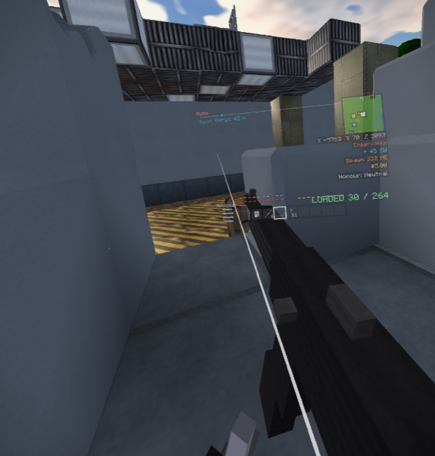

## 08:31:22 - Uh, get over something, climb over something. We gotta add that

- **Transcript:** Uh, get over something, climb over something. We gotta add that
- **Status:** open
- **Build:** 0.129 (1418bf09, M1-M4 (device-tested; ship riding, chests, comfort options, weapon wheel))
- **World:** New World (19) (seed 7653607216494784574)
- **Dimension:** Surface
- **Biome:** Sparse Jungle
- **Position:** -5750.4 69.1 3098.9
- **Facing:** south-west (yaw 244, pitch -40)
- **Held:** Sturmwind Carbine x1
- **Mount:** on foot
- **Looking at:** Coarse Dirt at -5752 69 3099
- **Mode:** Survival, health 20/20
- **Time:** day 1 16:56, clear
- **Fps:** 69
- **Levels:** mic -29 dBFS, game sound -13 dBFS
- **Length:** 5.4 s (voice 2.9 s)
- **Just before:** -29s message: Flying; -28s message: Walking; -27s opened PauseMenu; -23s message: Survival mode; -23s closed PauseMenu; -23s opened InventoryMenu; -22s left the pack: Duskium Leggings (InventoryMenu open); -22s left the pack: Duskium Chestplate (InventoryMenu open); -22s left the pack: Duskium Helmet (InventoryMenu open); -21s left the pack: Duskium Boots (InventoryMenu open); -21s closed InventoryMenu; -21s holding Sturmwind Carbine; -21s message: Sturmwind Carbine; -21s holding Rifle Magazine; -21s message: Rifle Magazine; -20s holding Sturmwind Carbine; -20s message: Sturmwind Carbine; -20s message: Loaded: 30 / 30
- **Position at the end:** -5751.1 69.3 3120.2
- **Repro (Mac):** `./snap.sh note --seed 7653607216494784574 --x -5750.4 --z 3098.9 --yaw 116 --pitch -40 --time 0.456`
- **Audio (this Mac):** /Users/darthvadar/Documents/Blocksmith/QuestVoiceNotes/raw/vn-20261102-083122-000.aac

## 08:31:42 - Okay. Wow

- **Transcript:** Okay. Wow
- **Status:** open
- **Build:** 0.129 (1418bf09, M1-M4 (device-tested; ship riding, chests, comfort options, weapon wheel))
- **World:** New World (19) (seed 7653607216494784574)
- **Dimension:** Surface
- **Biome:** Sparse Jungle
- **Position:** -5764.2 63.9 3129.3
- **Facing:** north-west (yaw 294, pitch -5)
- **Held:** empty hand
- **Mount:** on foot
- **Looking at:** nothing
- **Mode:** Survival, health 1/20, screen DeathMenu
- **Time:** day 1 17:21, clear
- **Fps:** 62
- **Levels:** mic -26 dBFS, game sound -19 dBFS
- **Length:** 3.0 s (voice 1.4 s)
- **Just before:** -7s took 5 damage (health 15/20); -3s died; -3s opened DeathMenu; -3s holding empty hand; -3s left the pack: Sturmwind Carbine (DeathMenu open); -3s left the pack: Greywall Dispatch (DeathMenu open); -3s left the pack: Combat Stim x6 (DeathMenu open); -3s left the pack: Rifle Magazine x11 (DeathMenu open); -2s took 18 damage (health 1/20); -2s message: Target gone from the list. Back to the story's objective
- **Repro (Mac):** `./snap.sh note --seed 7653607216494784574 --x -5764.2 --z 3129.3 --yaw 66 --pitch -5 --time 0.473`
- **Audio (this Mac):** /Users/darthvadar/Documents/Blocksmith/QuestVoiceNotes/raw/vn-20261102-083142-560.aac

## 08:32:20 - Okay, these trees are bad. Look at these trees

- **Transcript:** Okay, these trees are bad. Look at these trees
- **Status:** open
- **Build:** 0.129 (1418bf09, M1-M4 (device-tested; ship riding, chests, comfort options, weapon wheel))
- **World:** New World (19) (seed 7653607216494784574)
- **Dimension:** Surface
- **Biome:** Savanna
- **Position:** -5815.0 66.9 3278.4
- **Facing:** west (yaw 254, pitch 18)
- **Held:** Duskium Boots x1
- **Mount:** on foot
- **Looking at:** nothing
- **Mode:** Creative, health 20/20
- **Time:** day 1 17:57, clear
- **Fps:** 71
- **Levels:** mic -28 dBFS, game sound -14 dBFS
- **Length:** 3.8 s (voice 2.1 s)
- **Just before:** -30s opened PauseMenu; -22s message: Creative mode; -22s closed PauseMenu; -21s message: Flying; -19s walked into Sparse Jungle; -17s message: You've reached Your things; -15s message: Walking; -13s message: Flying; -11s opened ChestMenu; -9s into the pack: Rifle Magazine; -9s into the pack: Sturmwind Carbine; -9s into the pack: Greywall Dispatch; -9s into the pack: Combat Stim; -9s holding Duskium Boots; -8s into the pack: Duskium Boots; -8s into the pack: Duskium Chestplate; -8s into the pack: Duskium Helmet; -8s into the pack: Duskium Leggings; -7s closed ChestMenu; -7s message: You have your things back; -6s opened PauseMenu; -6s closed PauseMenu; -5s message: Flying; -4s message: Walking; -3s walked into Savanna
- **Repro (Mac):** `./snap.sh note --seed 7653607216494784574 --x -5815.0 --z 3278.4 --yaw 106 --pitch 18 --time 0.498`
- **Audio (this Mac):** /Users/darthvadar/Documents/Blocksmith/QuestVoiceNotes/raw/vn-20261102-083220-720.aac

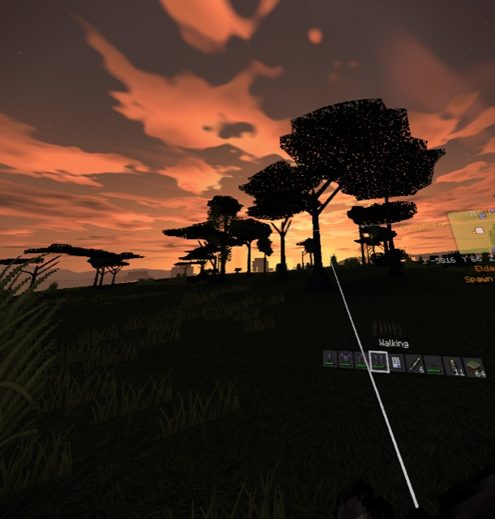

## 08:32:24 - These branches aren't even touching the leaves

- **Transcript:** These branches aren't even touching the leaves
- **Status:** open
- **Build:** 0.129 (1418bf09, M1-M4 (device-tested; ship riding, chests, comfort options, weapon wheel))
- **World:** New World (19) (seed 7653607216494784574)
- **Dimension:** Surface
- **Biome:** Savanna
- **Position:** -5829.0 67.3 3292.8
- **Facing:** north-west (yaw 327, pitch 29)
- **Held:** Duskium Boots x1
- **Mount:** on foot
- **Looking at:** nothing
- **Mode:** Creative, health 20/20
- **Time:** day 1 18:02, clear
- **Fps:** 71
- **Levels:** mic -22 dBFS, game sound -26 dBFS
- **Length:** 3.0 s (voice 1.5 s)
- **Just before:** -26s message: Creative mode; -26s closed PauseMenu; -24s message: Flying; -22s walked into Sparse Jungle; -21s message: You've reached Your things; -19s message: Walking; -17s message: Flying; -14s opened ChestMenu; -13s into the pack: Rifle Magazine; -13s into the pack: Sturmwind Carbine; -13s into the pack: Greywall Dispatch; -13s into the pack: Combat Stim; -12s holding Duskium Boots; -12s into the pack: Duskium Boots; -12s into the pack: Duskium Chestplate; -12s into the pack: Duskium Helmet; -12s into the pack: Duskium Leggings; -11s closed ChestMenu; -11s message: You have your things back; -10s opened PauseMenu; -10s closed PauseMenu; -9s message: Flying; -7s message: Walking; -6s walked into Savanna
- **Repro (Mac):** `./snap.sh note --seed 7653607216494784574 --x -5829.0 --z 3292.8 --yaw 33 --pitch 29 --time 0.502`
- **Audio (this Mac):** /Users/darthvadar/Documents/Blocksmith/QuestVoiceNotes/raw/vn-20261102-083224-440.aac

## 08:32:27 - These look like shit. I think we might need predefined tree assets

- **Transcript:** These look like shit. I think we might need predefined tree assets
- **Status:** open
- **Build:** 0.129 (1418bf09, M1-M4 (device-tested; ship riding, chests, comfort options, weapon wheel))
- **World:** New World (19) (seed 7653607216494784574)
- **Dimension:** Surface
- **Biome:** Savanna
- **Position:** -5826.2 67.4 3288.8
- **Facing:** north (yaw 339, pitch 18)
- **Held:** Duskium Boots x1
- **Mount:** on foot
- **Looking at:** nothing
- **Mode:** Creative, health 20/20
- **Time:** day 1 18:06, clear
- **Fps:** 71
- **Levels:** mic -36 dBFS, game sound -24 dBFS
- **Length:** 5.6 s (voice 2.8 s)
- **Just before:** -29s message: Creative mode; -29s closed PauseMenu; -28s message: Flying; -26s walked into Sparse Jungle; -24s message: You've reached Your things; -22s message: Walking; -20s message: Flying; -18s opened ChestMenu; -16s into the pack: Rifle Magazine; -16s into the pack: Sturmwind Carbine; -16s into the pack: Greywall Dispatch; -16s into the pack: Combat Stim; -16s holding Duskium Boots; -15s into the pack: Duskium Boots; -15s into the pack: Duskium Chestplate; -15s into the pack: Duskium Helmet; -15s into the pack: Duskium Leggings; -14s closed ChestMenu; -14s message: You have your things back; -13s opened PauseMenu; -13s closed PauseMenu; -12s message: Flying; -11s message: Walking; -9s walked into Savanna
- **Position at the end:** -5836.3 66.8 3304.4
- **Repro (Mac):** `./snap.sh note --seed 7653607216494784574 --x -5826.2 --z 3288.8 --yaw 21 --pitch 18 --time 0.504`
- **Audio (this Mac):** /Users/darthvadar/Documents/Blocksmith/QuestVoiceNotes/raw/vn-20261102-083227-700.aac

## 08:32:32 - That can vary slightly, like maybe multiple different types of tree as

- **Transcript:** That can vary slightly, like maybe multiple different types of tree assets
- **Status:** open
- **Build:** 0.129 (1418bf09, M1-M4 (device-tested; ship riding, chests, comfort options, weapon wheel))
- **World:** New World (19) (seed 7653607216494784574)
- **Dimension:** Surface
- **Biome:** Savanna
- **Position:** -5838.0 66.9 3304.7
- **Facing:** south (yaw 186, pitch -35)
- **Held:** Duskium Boots x1
- **Mount:** on foot
- **Looking at:** Grass Block at -5839 66 3307
- **Mode:** Creative, health 20/20
- **Time:** day 1 18:12, clear
- **Fps:** 72
- **Levels:** mic -38 dBFS, game sound -15 dBFS
- **Length:** 4.6 s (voice 2.8 s)
- **Just before:** -30s message: You've reached Your things; -28s message: Walking; -25s message: Flying; -23s opened ChestMenu; -22s into the pack: Rifle Magazine; -21s into the pack: Sturmwind Carbine; -21s into the pack: Greywall Dispatch; -21s into the pack: Combat Stim; -21s holding Duskium Boots; -21s into the pack: Duskium Boots; -20s into the pack: Duskium Chestplate; -20s into the pack: Duskium Helmet; -20s into the pack: Duskium Leggings; -20s closed ChestMenu; -19s message: You have your things back; -18s opened PauseMenu; -18s closed PauseMenu; -18s message: Flying; -16s message: Walking; -15s walked into Savanna
- **Repro (Mac):** `./snap.sh note --seed 7653607216494784574 --x -5838.0 --z 3304.7 --yaw 174 --pitch -35 --time 0.509`
- **Audio (this Mac):** /Users/darthvadar/Documents/Blocksmith/QuestVoiceNotes/raw/vn-20261102-083232-920.aac

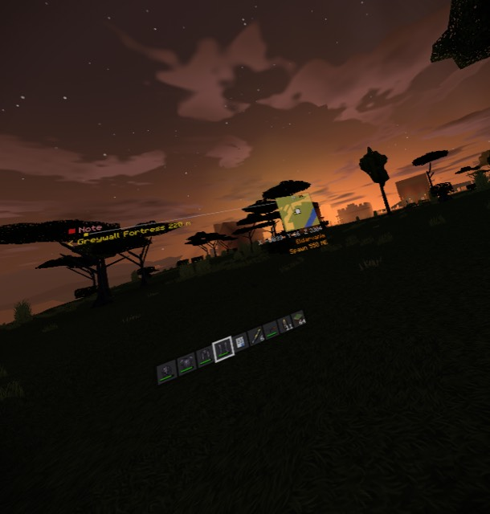

## 08:32:38 - I think that's what we need

- **Transcript:** I think that's what we need
- **Status:** open
- **Build:** 0.129 (1418bf09, M1-M4 (device-tested; ship riding, chests, comfort options, weapon wheel))
- **World:** New World (19) (seed 7653607216494784574)
- **Dimension:** Surface
- **Biome:** Savanna
- **Position:** -5867.8 68.0 3313.4
- **Facing:** north (yaw 353, pitch 33)
- **Held:** Duskium Boots x1
- **Mount:** on foot
- **Looking at:** nothing
- **Mode:** Creative, health 20/20
- **Time:** day 1 18:19, clear
- **Fps:** 72
- **Levels:** mic -33 dBFS, game sound -14 dBFS
- **Length:** 2.2 s (voice 0.8 s)
- **Just before:** -28s opened ChestMenu; -27s into the pack: Rifle Magazine; -27s into the pack: Sturmwind Carbine; -27s into the pack: Greywall Dispatch; -27s into the pack: Combat Stim; -26s holding Duskium Boots; -26s into the pack: Duskium Boots; -26s into the pack: Duskium Chestplate; -26s into the pack: Duskium Helmet; -26s into the pack: Duskium Leggings; -25s closed ChestMenu; -25s message: You have your things back; -24s opened PauseMenu; -24s closed PauseMenu; -23s message: Flying; -21s message: Walking; -20s walked into Savanna; -4s message: Red Wells marked on the map
- **Repro (Mac):** `./snap.sh note --seed 7653607216494784574 --x -5867.8 --z 3313.4 --yaw 7 --pitch 33 --time 0.513`
- **Audio (this Mac):** /Users/darthvadar/Documents/Blocksmith/QuestVoiceNotes/raw/vn-20261102-083238-440.aac

## 08:32:41 - Make like 10 different tree types of every kind, so maybe 100 differen

- **Transcript:** Make like 10 different tree types of every kind, so maybe 100 different tree types total
- **Status:** open
- **Build:** 0.129 (1418bf09, M1-M4 (device-tested; ship riding, chests, comfort options, weapon wheel))
- **World:** New World (19) (seed 7653607216494784574)
- **Dimension:** Surface
- **Biome:** Savanna
- **Position:** -5849.8 68.0 3302.1
- **Facing:** north-east (yaw 30, pitch -13)
- **Held:** Duskium Boots x1
- **Mount:** on foot
- **Looking at:** Oak Log at -5848 68 3298
- **Mode:** Creative, health 20/20
- **Time:** day 1 18:22, clear
- **Fps:** 72
- **Levels:** mic -43 dBFS, game sound -17 dBFS
- **Length:** 6.2 s (voice 3.5 s)
- **Just before:** -30s into the pack: Rifle Magazine; -29s into the pack: Sturmwind Carbine; -29s into the pack: Greywall Dispatch; -29s into the pack: Combat Stim; -29s holding Duskium Boots; -29s into the pack: Duskium Boots; -28s into the pack: Duskium Chestplate; -28s into the pack: Duskium Helmet; -28s into the pack: Duskium Leggings; -28s closed ChestMenu; -28s message: You have your things back; -26s opened PauseMenu; -26s closed PauseMenu; -26s message: Flying; -24s message: Walking; -23s walked into Savanna; -6s message: Red Wells marked on the map
- **Position at the end:** -5849.8 67.9 3303.6
- **Repro (Mac):** `./snap.sh note --seed 7653607216494784574 --x -5849.8 --z 3302.1 --yaw -30 --pitch -13 --time 0.515`
- **Audio (this Mac):** /Users/darthvadar/Documents/Blocksmith/QuestVoiceNotes/raw/vn-20261102-083241-060.aac

## 08:32:47 - That are just boring

- **Transcript:** That are just boring
- **Status:** open
- **Build:** 0.129 (1418bf09, M1-M4 (device-tested; ship riding, chests, comfort options, weapon wheel))
- **World:** New World (19) (seed 7653607216494784574)
- **Dimension:** Surface
- **Biome:** Savanna
- **Position:** -5849.3 67.8 3303.8
- **Facing:** north (yaw 21, pitch 3)
- **Held:** Duskium Boots x1
- **Mount:** on foot
- **Looking at:** Oak Log at -5848 69 3298
- **Mode:** Creative, health 20/20
- **Time:** day 1 18:29, clear
- **Fps:** 72
- **Levels:** mic -38 dBFS, game sound -27 dBFS
- **Length:** 1.7 s (voice 0.4 s)
- **Just before:** -30s message: Walking; -29s walked into Savanna; -12s message: Red Wells marked on the map
- **Repro (Mac):** `./snap.sh note --seed 7653607216494784574 --x -5849.3 --z 3303.8 --yaw -21 --pitch 3 --time 0.520`
- **Audio (this Mac):** /Users/darthvadar/Documents/Blocksmith/QuestVoiceNotes/raw/vn-20261102-083247-020.aac

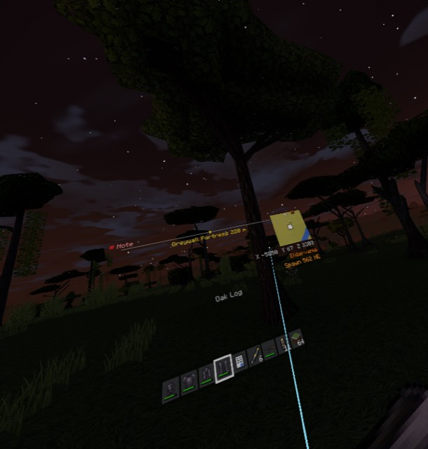

## 08:32:50 - Yeah. Do that instead of wherever the fuck this is

- **Transcript:** Yeah. Do that instead of wherever the fuck this is
- **Status:** open
- **Build:** 0.129 (1418bf09, M1-M4 (device-tested; ship riding, chests, comfort options, weapon wheel))
- **World:** New World (19) (seed 7653607216494784574)
- **Dimension:** Surface
- **Biome:** Savanna
- **Position:** -5852.4 68.5 3297.4
- **Facing:** north (yaw 348, pitch 24)
- **Held:** Duskium Boots x1
- **Mount:** on foot
- **Looking at:** nothing
- **Mode:** Creative, health 20/20
- **Time:** day 1 18:33, clear
- **Fps:** 72
- **Levels:** mic -29 dBFS, game sound -17 dBFS
- **Length:** 3.9 s (voice 1.7 s)
- **Just before:** -16s message: Red Wells marked on the map
- **Repro (Mac):** `./snap.sh note --seed 7653607216494784574 --x -5852.4 --z 3297.4 --yaw 12 --pitch 24 --time 0.523`
- **Audio (this Mac):** /Users/darthvadar/Documents/Blocksmith/QuestVoiceNotes/raw/vn-20261102-083250-540.aac

## 08:33:15 - Come on, I can't grip left. Goddamn

- **Transcript:** Come on, I can't grip left. Goddamn
- **Status:** open
- **Build:** 0.129 (1418bf09, M1-M4 (device-tested; ship riding, chests, comfort options, weapon wheel))
- **World:** New World (19) (seed 7653607216494784574)
- **Dimension:** Surface
- **Biome:** Sparse Jungle
- **Position:** -5844.5 69.0 3182.2
- **Facing:** north-east (yaw 54, pitch 66)
- **Held:** Combat Stim x6
- **Mount:** on foot
- **Looking at:** Short Grass at -5845 69 3182
- **Mode:** Survival, health 16/20
- **Time:** day 1 18:56, clear
- **Fps:** 70
- **Levels:** mic -22 dBFS, game sound -16 dBFS
- **Length:** 3.7 s (voice 1.4 s)
- **Just before:** -21s opened PauseMenu; -15s message: Survival mode; -15s closed PauseMenu; -14s opened InventoryMenu; -14s holding empty hand; -14s left the pack: Duskium Boots (InventoryMenu open); -13s left the pack: Duskium Chestplate (InventoryMenu open); -13s left the pack: Duskium Leggings (InventoryMenu open); -13s closed InventoryMenu; -13s left the pack: Duskium Helmet; -12s holding Greywall Dispatch; -12s message: Greywall Dispatch; -12s holding Combat Stim; -12s message: Combat Stim; -12s holding Sturmwind Carbine; -12s message: Sturmwind Carbine; -11s message: Loaded: 30 / 30; -11s left the pack: Rifle Magazine (at -5855 69 3267); -2s took 6 damage (health 15/20); -1s walked into Sparse Jungle; -0s holding Combat Stim; -0s message: Combat Stim
- **Repro (Mac):** `./snap.sh note --seed 7653607216494784574 --x -5844.5 --z 3182.2 --yaw -54 --pitch 66 --time 0.539`
- **Audio (this Mac):** /Users/darthvadar/Documents/Blocksmith/QuestVoiceNotes/raw/vn-20261102-083315-940.aac

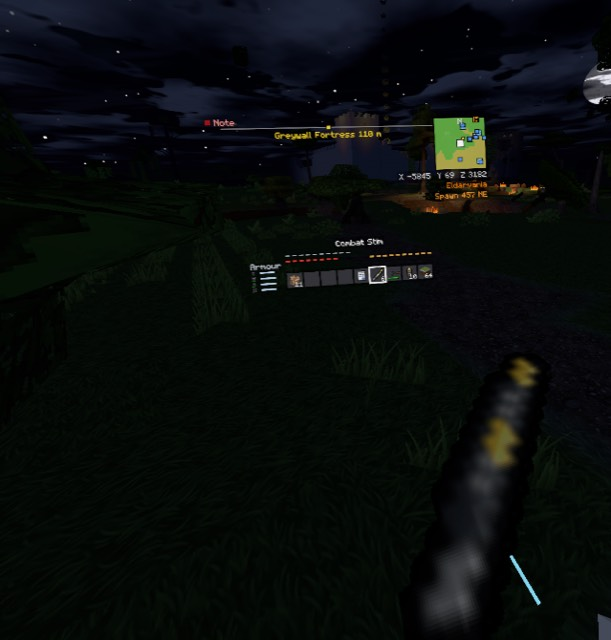

## 08:33:34 - That grip left thing, that's gotta be fixed

- **Transcript:** That grip left thing, that's gotta be fixed
- **Status:** open
- **Build:** 0.129 (1418bf09, M1-M4 (device-tested; ship riding, chests, comfort options, weapon wheel))
- **World:** New World (19) (seed 7653607216494784574)
- **Dimension:** Surface
- **Biome:** Sparse Jungle
- **Position:** -5794.0 69.4 3130.5
- **Facing:** east (yaw 81, pitch -1)
- **Held:** Sturmwind Carbine x1
- **Mount:** on foot
- **Looking at:** nothing
- **Mode:** Survival, health 15/20
- **Time:** day 1 19:18, clear
- **Fps:** 70
- **Levels:** mic -49 dBFS, game sound -14 dBFS
- **Length:** 2.9 s (voice 1.1 s)
- **Just before:** -30s left the pack: Rifle Magazine (at -5855 69 3267); -21s took 6 damage (health 15/20); -20s walked into Sparse Jungle; -19s holding Combat Stim; -19s message: Combat Stim; -19s holding Greywall Dispatch; -19s message: Greywall Dispatch; -18s holding empty hand; -18s message: Twin 42 cm Turret tracking you; -18s holding Greywall Dispatch; -18s holding Combat Stim; -17s left the pack: Combat Stim (at -5844 67 3175); -17s took 7 damage (health 20/20); -16s holding Sturmwind Carbine; -16s message: Sturmwind Carbine; -6s walked into Savanna; -4s walked into Sparse Jungle
- **Repro (Mac):** `./snap.sh note --seed 7653607216494784574 --x -5794.0 --z 3130.5 --yaw -81 --pitch -1 --time 0.554`
- **Audio (this Mac):** /Users/darthvadar/Documents/Blocksmith/QuestVoiceNotes/raw/vn-20261102-083334-660.aac

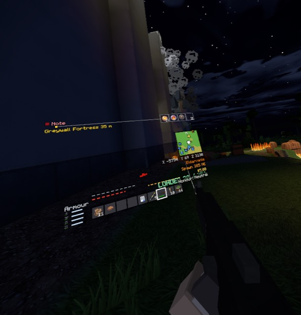

## 08:33:38 - Oh my God

- **Transcript:** Oh my God
- **Status:** open
- **Build:** 0.129 (1418bf09, M1-M4 (device-tested; ship riding, chests, comfort options, weapon wheel))
- **World:** New World (19) (seed 7653607216494784574)
- **Dimension:** Surface
- **Biome:** Jungle
- **Position:** -5578.5 77.0 2810.5
- **Facing:** east (yaw 71, pitch -30)
- **Held:** empty hand
- **Mount:** on foot
- **Looking at:** nothing
- **Mode:** Survival, health 20/20, screen PauseMenu
- **Time:** day 1 19:22, clear
- **Fps:** 64
- **Levels:** mic -23 dBFS, game sound -23 dBFS
- **Length:** 2.3 s (voice 0.8 s)
- **Just before:** -25s took 6 damage (health 15/20); -24s walked into Sparse Jungle; -23s holding Combat Stim; -23s message: Combat Stim; -23s holding Greywall Dispatch; -23s message: Greywall Dispatch; -23s holding empty hand; -23s message: Twin 42 cm Turret tracking you; -22s holding Greywall Dispatch; -22s holding Combat Stim; -21s left the pack: Combat Stim (at -5844 67 3175); -21s took 7 damage (health 20/20); -20s holding Sturmwind Carbine; -20s message: Sturmwind Carbine; -10s walked into Savanna; -8s walked into Sparse Jungle; -4s took 5 damage (health 16/20); -1s died; -1s opened DeathMenu; -1s holding empty hand; -1s respawned; -1s opened PauseMenu; -1s message: Your things are 383 blocks south-west; -1s left the pack: Rifle Magazine x10 (PauseMenu open); -1s left the pack: Combat Stim x5 (PauseMenu open); -1s left the pack: Greywall Dispatch (PauseMenu open); -1s left the pack: Sturmwind Carbine (PauseMenu open); -0s took 17 damage (health 20/20); -0s walked into Jungle
- **Repro (Mac):** `./snap.sh note --seed 7653607216494784574 --x -5578.5 --z 2810.5 --yaw -71 --pitch -30 --time 0.557`
- **Audio (this Mac):** /Users/darthvadar/Documents/Blocksmith/QuestVoiceNotes/raw/vn-20261102-083338-880.aac

## 08:33:43 - I don't know what's hitting me there, but it

- **Transcript:** I don't know what's hitting me there, but it
- **Status:** open
- **Build:** 0.129 (1418bf09, M1-M4 (device-tested; ship riding, chests, comfort options, weapon wheel))
- **World:** New World (19) (seed 7653607216494784574)
- **Dimension:** Surface
- **Biome:** Jungle
- **Position:** -5577.8 77.3 2812.3
- **Facing:** east (yaw 77, pitch 3)
- **Held:** empty hand
- **Mount:** on foot
- **Looking at:** Jungle Log at -5575 78 2811
- **Mode:** Survival, health 20/20, screen PauseMenu
- **Time:** day 1 19:23, clear
- **Fps:** 69
- **Levels:** mic -27 dBFS, game sound -29 dBFS
- **Length:** 3.1 s (voice 1.6 s)
- **Just before:** -30s took 6 damage (health 15/20); -29s walked into Sparse Jungle; -28s holding Combat Stim; -28s message: Combat Stim; -28s holding Greywall Dispatch; -28s message: Greywall Dispatch; -28s holding empty hand; -28s message: Twin 42 cm Turret tracking you; -27s holding Greywall Dispatch; -27s holding Combat Stim; -26s left the pack: Combat Stim (at -5844 67 3175); -26s took 7 damage (health 20/20); -25s holding Sturmwind Carbine; -25s message: Sturmwind Carbine; -15s walked into Savanna; -13s walked into Sparse Jungle; -9s took 5 damage (health 16/20); -6s died; -6s opened DeathMenu; -6s holding empty hand; -6s respawned; -6s opened PauseMenu; -6s message: Your things are 383 blocks south-west; -6s left the pack: Rifle Magazine x10 (PauseMenu open); -6s left the pack: Combat Stim x5 (PauseMenu open); -6s left the pack: Greywall Dispatch (PauseMenu open); -6s left the pack: Sturmwind Carbine (PauseMenu open); -5s took 17 damage (health 20/20); -5s walked into Jungle; -2s closed PauseMenu; -1s opened PauseMenu
- **Repro (Mac):** `./snap.sh note --seed 7653607216494784574 --x -5577.8 --z 2812.3 --yaw -77 --pitch 3 --time 0.558`
- **Audio (this Mac):** /Users/darthvadar/Documents/Blocksmith/QuestVoiceNotes/raw/vn-20261102-083343-940.aac

## 08:33:48 - On normal difficulty, I think it's a little too much

- **Transcript:** On normal difficulty, I think it's a little too much
- **Status:** open
- **Build:** 0.129 (1418bf09, M1-M4 (device-tested; ship riding, chests, comfort options, weapon wheel))
- **World:** New World (19) (seed 7653607216494784574)
- **Dimension:** Surface
- **Biome:** Jungle
- **Position:** -5579.0 77.2 2812.5
- **Facing:** east (yaw 93, pitch 13)
- **Held:** empty hand
- **Mount:** on foot
- **Looking at:** nothing
- **Mode:** Survival, health 20/20, screen PauseMenu
- **Time:** day 1 19:24, clear
- **Fps:** 65
- **Levels:** mic -28 dBFS, game sound -29 dBFS
- **Length:** 3.9 s (voice 2.0 s)
- **Just before:** -29s holding Sturmwind Carbine; -29s message: Sturmwind Carbine; -20s walked into Savanna; -18s walked into Sparse Jungle; -13s took 5 damage (health 16/20); -11s died; -11s opened DeathMenu; -11s holding empty hand; -11s respawned; -11s opened PauseMenu; -11s message: Your things are 383 blocks south-west; -11s left the pack: Rifle Magazine x10 (PauseMenu open); -11s left the pack: Combat Stim x5 (PauseMenu open); -11s left the pack: Greywall Dispatch (PauseMenu open); -11s left the pack: Sturmwind Carbine (PauseMenu open); -10s took 17 damage (health 20/20); -10s walked into Jungle; -6s closed PauseMenu; -5s opened PauseMenu; -4s closed PauseMenu; -3s opened PauseMenu
- **Repro (Mac):** `./snap.sh note --seed 7653607216494784574 --x -5579.0 --z 2812.5 --yaw -93 --pitch 13 --time 0.559`
- **Audio (this Mac):** /Users/darthvadar/Documents/Blocksmith/QuestVoiceNotes/raw/vn-20261102-083348-280.aac

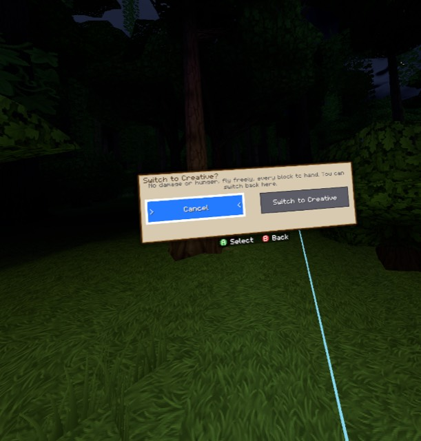

## 08:33:54 - Whoever is killing me might need to nerf the weapon slightly.

- **Transcript:** Whoever is killing me might need to nerf the weapon slightly.
- **Status:** open
- **Build:** 0.129 (1418bf09, M1-M4 (device-tested; ship riding, chests, comfort options, weapon wheel))
- **World:** New World (19) (seed 7653607216494784574)
- **Dimension:** Surface
- **Biome:** Sparse Jungle
- **Position:** -5768.2 125.1 3121.5
- **Facing:** south-west (yaw 230, pitch -31)
- **Held:** empty hand
- **Mount:** on foot, flying
- **Looking at:** nothing
- **Mode:** Creative, health 20/20
- **Time:** day 1 19:31, clear
- **Fps:** 48
- **Levels:** mic -21 dBFS, game sound -18 dBFS
- **Length:** 4.3 s (voice 2.7 s)
- **Just before:** -26s walked into Savanna; -24s walked into Sparse Jungle; -19s took 5 damage (health 16/20); -17s died; -17s opened DeathMenu; -17s holding empty hand; -17s respawned; -17s opened PauseMenu; -17s message: Your things are 383 blocks south-west; -17s left the pack: Rifle Magazine x10 (PauseMenu open); -17s left the pack: Combat Stim x5 (PauseMenu open); -17s left the pack: Greywall Dispatch (PauseMenu open); -17s left the pack: Sturmwind Carbine (PauseMenu open); -16s took 17 damage (health 20/20); -16s walked into Jungle; -13s closed PauseMenu; -11s opened PauseMenu; -10s closed PauseMenu; -9s opened PauseMenu; -6s message: Creative mode; -6s closed PauseMenu; -5s message: Flying; -2s walked into Bamboo Jungle
- **Repro (Mac):** `./snap.sh note --seed 7653607216494784574 --x -5768.2 --z 3121.5 --yaw 130 --pitch -31 --time 0.564`
- **Audio (this Mac):** /Users/darthvadar/Documents/Blocksmith/QuestVoiceNotes/raw/vn-20261102-083354-700.aac

## 08:35:20 - Very good

- **Transcript:** Very good
- **Status:** open
- **Build:** 0.129 (1418bf09, M1-M4 (device-tested; ship riding, chests, comfort options, weapon wheel))
- **World:** New World (19) (seed 7653607216494784574)
- **Dimension:** Surface
- **Biome:** Sparse Jungle
- **Position:** -5811.6 70.0 3067.5
- **Facing:** south-east (yaw 147, pitch -27)
- **Held:** Sturmwind Carbine x1
- **Mount:** on foot
- **Looking at:** Station Floor Tiles at -5811 69 3069
- **Mode:** Survival, health 20/20
- **Time:** day 1 21:08, clear
- **Fps:** 60
- **Levels:** mic -27 dBFS, game sound -23 dBFS
- **Length:** 2.0 s (voice 0.6 s)
- **Just before:** -28s message: Alarm off; -14s message: Greywall Command now counts you hunted.; -13s took 2 damage (health 18/20); -7s holding empty hand; -7s message: Manning the deck gun; -6s message: Gun Control: the gun overhead, worked from this computer; -3s holding Sturmwind Carbine; -3s message: A turret is wrecked; -1s message: They've found a body! The base is on alert
- **Repro (Mac):** `./snap.sh note --seed 7653607216494784574 --x -5811.6 --z 3067.5 --yaw -147 --pitch -27 --time 0.631`
- **Audio (this Mac):** /Users/darthvadar/Documents/Blocksmith/QuestVoiceNotes/raw/vn-20261102-083520-120.aac

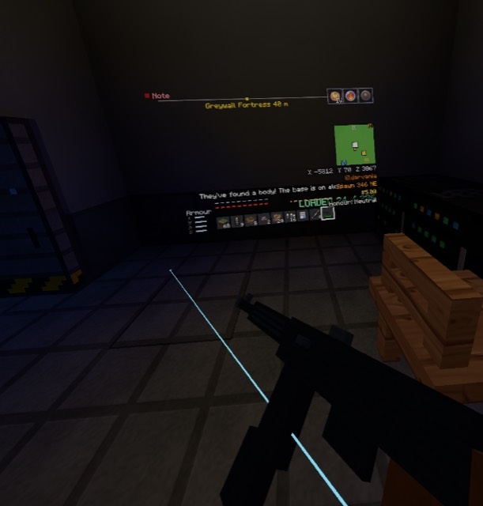

## 08:37:35 - I don't know what's firing at me, but

- **Transcript:** I don't know what's firing at me, but
- **Status:** open
- **Build:** 0.129 (1418bf09, M1-M4 (device-tested; ship riding, chests, comfort options, weapon wheel))
- **World:** New World (19) (seed 7653607216494784574)
- **Dimension:** Surface
- **Biome:** Sparse Jungle
- **Position:** -5790.9 75.4 3097.7
- **Facing:** north (yaw 11, pitch -28)
- **Held:** Sturmwind Carbine x1
- **Mount:** on foot
- **Looking at:** Station Floor Tiles at -5791 74 3093
- **Mode:** Survival, health 20/20
- **Time:** day 1 23:50, clear
- **Fps:** 67
- **Levels:** mic -25 dBFS, game sound -17 dBFS
- **Length:** 3.1 s (voice 1.5 s)
- **Just before:** -29s holding Combat Stim; -29s message: Combat Stim; -29s left the pack: Combat Stim (at -5778 69 3091); -29s holding Sturmwind Carbine; -29s message: Sturmwind Carbine; -27s opened ChestMenu; -26s closed ChestMenu; -26s opened ChestMenu; -25s closed ChestMenu; -24s message: Loaded: 30 / 30; -17s left the pack: Rifle Magazine (at -5777 70 3096); -9s opened ChestMenu; -8s closed ChestMenu
- **Repro (Mac):** `./snap.sh note --seed 7653607216494784574 --x -5790.9 --z 3097.7 --yaw -11 --pitch -28 --time 0.744`
- **Audio (this Mac):** /Users/darthvadar/Documents/Blocksmith/QuestVoiceNotes/raw/vn-20261102-083735-140.aac

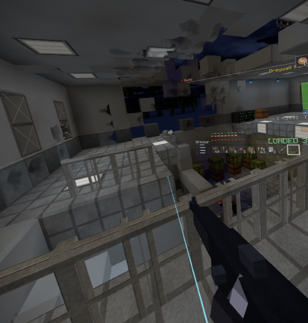

## 08:37:39 - It can't hit me 'cause it's behind something

- **Transcript:** It can't hit me 'cause it's behind something
- **Status:** open
- **Build:** 0.129 (1418bf09, M1-M4 (device-tested; ship riding, chests, comfort options, weapon wheel))
- **World:** New World (19) (seed 7653607216494784574)
- **Dimension:** Surface
- **Biome:** Sparse Jungle
- **Position:** -5778.3 75.0 3091.0
- **Facing:** north (yaw 357, pitch -17)
- **Held:** Sturmwind Carbine x1
- **Mount:** on foot
- **Looking at:** nothing
- **Mode:** Survival, health 20/20, screen ChestMenu
- **Time:** day 1 23:55, clear
- **Fps:** 62
- **Levels:** mic -23 dBFS, game sound -13 dBFS
- **Length:** 3.0 s (voice 1.4 s)
- **Just before:** -30s opened ChestMenu; -29s closed ChestMenu; -29s message: Loaded: 30 / 30; -21s left the pack: Rifle Magazine (at -5777 70 3096); -13s opened ChestMenu; -12s closed ChestMenu; -0s opened ChestMenu
- **Repro (Mac):** `./snap.sh note --seed 7653607216494784574 --x -5778.3 --z 3091.0 --yaw 3 --pitch -17 --time 0.747`
- **Audio (this Mac):** /Users/darthvadar/Documents/Blocksmith/QuestVoiceNotes/raw/vn-20261102-083739-460.aac

## 08:37:52 - Yeah, okay, here's the problem. The gun's behind the stairs, so it can

- **Transcript:** Yeah, okay, here's the problem. The gun's behind the stairs, so it can't, it can't hit me
- **Status:** open
- **Build:** 0.129 (1418bf09, M1-M4 (device-tested; ship riding, chests, comfort options, weapon wheel))
- **World:** New World (19) (seed 7653607216494784574)
- **Dimension:** Surface
- **Biome:** Sparse Jungle
- **Position:** -5790.5 72.0 3095.6
- **Facing:** west (yaw 271, pitch -8)
- **Held:** Combat Stim x1
- **Mount:** on foot
- **Looking at:** Station Concrete at -5795 73 3095
- **Mode:** Creative, health 20/20
- **Time:** day 1 00:03, clear
- **Fps:** 66
- **Levels:** mic -21 dBFS, game sound -16 dBFS
- **Length:** 6.2 s (voice 3.0 s)
- **Just before:** -26s opened ChestMenu; -25s closed ChestMenu; -13s opened ChestMenu; -12s closed ChestMenu; -11s opened PauseMenu; -5s message: Creative mode; -4s closed PauseMenu; -3s holding Grass Block; -3s holding Sturmwind Carbine; -3s holding Combat Stim
- **While talking:** -1s message: Flying
- **Position at the end:** -5785.5 76.7 3085.2
- **Repro (Mac):** `./snap.sh note --seed 7653607216494784574 --x -5790.5 --z 3095.6 --yaw 89 --pitch -8 --time 0.752`
- **Audio (this Mac):** /Users/darthvadar/Documents/Blocksmith/QuestVoiceNotes/raw/vn-20261102-083752-080.aac

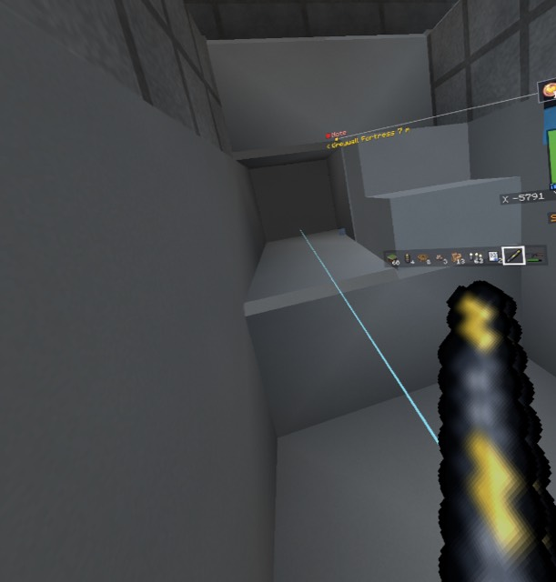

## 08:38:54 - I think the sheriffs need to be slightly harder to kill

- **Transcript:** I think the sheriffs need to be slightly harder to kill
- **Status:** open
- **Build:** 0.129 (1418bf09, M1-M4 (device-tested; ship riding, chests, comfort options, weapon wheel))
- **World:** New World (19) (seed 7653607216494784574)
- **Dimension:** Surface
- **Biome:** Savanna
- **Position:** -5928.7 69.0 3389.6
- **Facing:** north-west (yaw 308, pitch -21)
- **Held:** Sturmwind Carbine x1
- **Mount:** on foot
- **Looking at:** Coarse Dirt at -5931 69 3388
- **Mode:** Survival, health 20/20
- **Time:** day 1 01:15, clear
- **Fps:** 72
- **Levels:** mic -42 dBFS, game sound -14 dBFS
- **Length:** 4.1 s (voice 2.3 s)
- **Just before:** -29s message: Survival mode; -29s closed PauseMenu; -29s holding Sturmwind Carbine; -28s holding Combat Stim; -28s holding Sturmwind Carbine; -27s holding Grass Block; -27s message: Grass Block; -26s holding Sturmwind Carbine; -26s message: Sturmwind Carbine; -24s message: Silas Underhill: Lower that weapon. Now.; -22s message: Honour lowered (assault); -20s message: Honour: Disreputable; -19s left the pack: Rifle Magazine; -18s holding Combat Stim; -18s holding Sturmwind Carbine; -18s message: Eldarvania counts you its enemy: you killed its law; -17s holding Combat Stim; -16s holding Sturmwind Carbine; -16s holding Combat Stim; -15s holding Sturmwind Carbine; -15s message: Otis Oakes: Lay down your iron. Real slow.; -14s into the pack: Greywall Dispatch; -13s message: Willa Merriman: Don't shoot! We give up. Red Wells is yours.; -10s message: Red Wells surrenders. It's yours.; -9s left the pack: Rifle Magazine (at -5914 67 3381); -7s message: Red Wells was Eldarvania's capital: all of Eldarvania is yours now, its towns and its tribute; -4s message: In Red Wells's jail safe: a Greywall Dispatch; -1s message: Beulah Vance: Hey! Quit it!
- **Repro (Mac):** `./snap.sh note --seed 7653607216494784574 --x -5928.7 --z 3389.6 --yaw 52 --pitch -21 --time 0.803`
- **Audio (this Mac):** /Users/darthvadar/Documents/Blocksmith/QuestVoiceNotes/raw/vn-20261102-083854-260.aac

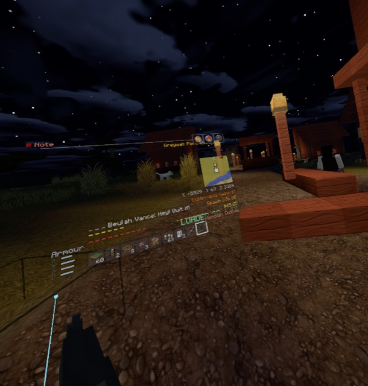

## 08:38:58 - Or like not tougher, but they need to do more damage, be more aggressi

- **Transcript:** Or like not tougher, but they need to do more damage, be more aggressive
- **Status:** open
- **Build:** 0.129 (1418bf09, M1-M4 (device-tested; ship riding, chests, comfort options, weapon wheel))
- **World:** New World (19) (seed 7653607216494784574)
- **Dimension:** Surface
- **Biome:** Savanna
- **Position:** -5927.8 69.6 3360.0
- **Facing:** north-west (yaw 332, pitch -8)
- **Held:** Sturmwind Carbine x1
- **Mount:** on foot
- **Looking at:** nothing
- **Mode:** Survival, health 20/20
- **Time:** day 1 01:20, clear
- **Fps:** 71
- **Levels:** mic -24 dBFS, game sound -19 dBFS
- **Length:** 4.5 s (voice 2.4 s)
- **Just before:** -28s message: Silas Underhill: Lower that weapon. Now.; -25s message: Honour lowered (assault); -23s message: Honour: Disreputable; -23s left the pack: Rifle Magazine; -22s holding Combat Stim; -22s holding Sturmwind Carbine; -22s message: Eldarvania counts you its enemy: you killed its law; -21s holding Combat Stim; -20s holding Sturmwind Carbine; -19s holding Combat Stim; -19s holding Sturmwind Carbine; -19s message: Otis Oakes: Lay down your iron. Real slow.; -17s into the pack: Greywall Dispatch; -16s message: Willa Merriman: Don't shoot! We give up. Red Wells is yours.; -13s message: Red Wells surrenders. It's yours.; -12s left the pack: Rifle Magazine (at -5914 67 3381); -11s message: Red Wells was Eldarvania's capital: all of Eldarvania is yours now, its towns and its tribute; -8s message: In Red Wells's jail safe: a Greywall Dispatch; -5s message: Beulah Vance: Hey! Quit it!; -3s message: Loaded: 30 / 30
- **Repro (Mac):** `./snap.sh note --seed 7653607216494784574 --x -5927.8 --z 3360.0 --yaw 28 --pitch -8 --time 0.806`
- **Audio (this Mac):** /Users/darthvadar/Documents/Blocksmith/QuestVoiceNotes/raw/vn-20261102-083858-020.aac

## 08:39:03 - It's too easy to take a village captive

- **Transcript:** It's too easy to take a village captive
- **Status:** open
- **Build:** 0.129 (1418bf09, M1-M4 (device-tested; ship riding, chests, comfort options, weapon wheel))
- **World:** New World (19) (seed 7653607216494784574)
- **Dimension:** Surface
- **Biome:** Savanna
- **Position:** -5928.0 69.0 3320.1
- **Facing:** north-west (yaw 328, pitch -16)
- **Held:** Sturmwind Carbine x1
- **Mount:** on foot
- **Looking at:** Coarse Dirt at -5930 69 3316
- **Mode:** Survival, health 20/20
- **Time:** day 1 01:26, clear
- **Fps:** 72
- **Levels:** mic -24 dBFS, game sound -18 dBFS
- **Length:** 3.6 s (voice 1.4 s)
- **Just before:** -29s message: Honour: Disreputable; -28s left the pack: Rifle Magazine; -27s holding Combat Stim; -27s holding Sturmwind Carbine; -27s message: Eldarvania counts you its enemy: you killed its law; -26s holding Combat Stim; -25s holding Sturmwind Carbine; -25s holding Combat Stim; -24s holding Sturmwind Carbine; -24s message: Otis Oakes: Lay down your iron. Real slow.; -23s into the pack: Greywall Dispatch; -22s message: Willa Merriman: Don't shoot! We give up. Red Wells is yours.; -19s message: Red Wells surrenders. It's yours.; -18s left the pack: Rifle Magazine (at -5914 67 3381); -16s message: Red Wells was Eldarvania's capital: all of Eldarvania is yours now, its towns and its tribute; -13s message: In Red Wells's jail safe: a Greywall Dispatch; -10s message: Beulah Vance: Hey! Quit it!; -8s message: Loaded: 30 / 30
- **Repro (Mac):** `./snap.sh note --seed 7653607216494784574 --x -5928.0 --z 3320.1 --yaw 32 --pitch -16 --time 0.810`
- **Audio (this Mac):** /Users/darthvadar/Documents/Blocksmith/QuestVoiceNotes/raw/vn-20261102-083903-280.aac

## 08:40:03 - That frame rate drop, I think

- **Transcript:** That frame rate drop, I think
- **Status:** open
- **Build:** 0.129 (1418bf09, M1-M4 (device-tested; ship riding, chests, comfort options, weapon wheel))
- **World:** New World (19) (seed 7653607216494784574)
- **Dimension:** Surface
- **Biome:** Taiga
- **Position:** -8351.6 127.8 5044.4
- **Facing:** south-west (yaw 244, pitch -60)
- **Held:** Sturmwind Carbine x1
- **Mount:** on foot, flying
- **Looking at:** nothing
- **Mode:** Creative, health 20/20
- **Time:** day 1 02:35, clear
- **Fps:** 66
- **Levels:** mic -23 dBFS, game sound -22 dBFS
- **Length:** 2.5 s (voice 0.9 s)
- **Just before:** -30s closed PauseMenu; -28s message: Flying; -26s walked into Jungle; -24s walked into Sparse Jungle; -22s walked into Desert; -22s message: Entering Harahold; -20s walked into Sunflower Plains; -18s message: Salt Ford marked on the map; -18s walked into Flower Forest; -16s walked into Taiga; -12s message: Entering Savevaal; -12s walked into Meadow; -11s message: Homestead marked on the map; -10s walked into Taiga; -9s message: Sky isle marked on the map; -8s walked into Old Growth Spruce Taiga; -4s message: Walking; -2s message: Flying; -0s message: Hollow Bluff marked on the map
- **Repro (Mac):** `./snap.sh note --seed 7653607216494784574 --x -8351.6 --z 5044.4 --yaw 116 --pitch -60 --time 0.858`
- **Audio (this Mac):** /Users/darthvadar/Documents/Blocksmith/QuestVoiceNotes/raw/vn-20261102-084003-520.aac

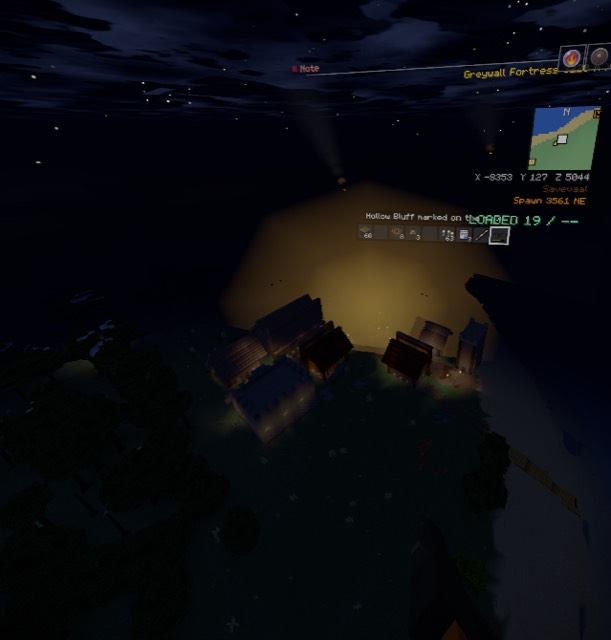

## 08:40:06 - Oh, look, a train. And it fucking stops. Look at this. What the hell i

- **Transcript:** Oh, look, a train. And it fucking stops. Look at this. What the hell is this? That shouldn't be there
- **Status:** open
- **Build:** 0.129 (1418bf09, M1-M4 (device-tested; ship riding, chests, comfort options, weapon wheel))
- **World:** New World (19) (seed 7653607216494784574)
- **Dimension:** Surface
- **Biome:** Taiga
- **Position:** -8365.3 127.8 5109.1
- **Facing:** south (yaw 190, pitch -61)
- **Held:** Sturmwind Carbine x1
- **Mount:** on foot, flying
- **Looking at:** nothing
- **Mode:** Creative, health 20/20
- **Time:** day 1 02:39, clear
- **Fps:** 47
- **Levels:** mic -25 dBFS, game sound -17 dBFS
- **Length:** 7.8 s (voice 4.4 s)
- **Just before:** -29s walked into Jungle; -27s walked into Sparse Jungle; -25s walked into Desert; -25s message: Entering Harahold; -23s walked into Sunflower Plains; -22s message: Salt Ford marked on the map; -21s walked into Flower Forest; -19s walked into Taiga; -16s message: Entering Savevaal; -15s walked into Meadow; -14s message: Homestead marked on the map; -13s walked into Taiga; -12s message: Sky isle marked on the map; -11s walked into Old Growth Spruce Taiga; -8s message: Walking; -6s message: Flying; -4s message: Hollow Bluff marked on the map; -3s walked into Taiga; -0s message: Gold Valley Station marked on the map
- **While talking:** -3s message: Hollow Bluff Station marked on the map; -1s message: You found the Gold & Hollow Railway: 2 stations, marked on your map
- **Position at the end:** -8354.3 80.0 5130.3
- **Repro (Mac):** `./snap.sh note --seed 7653607216494784574 --x -8365.3 --z 5109.1 --yaw 170 --pitch -61 --time 0.861`
- **Audio (this Mac):** /Users/darthvadar/Documents/Blocksmith/QuestVoiceNotes/raw/vn-20261102-084006-720.aac

## 08:40:25 - I do like how far this goes, though. This is nice

- **Transcript:** I do like how far this goes, though. This is nice
- **Status:** open
- **Build:** 0.129 (1418bf09, M1-M4 (device-tested; ship riding, chests, comfort options, weapon wheel))
- **World:** New World (19) (seed 7653607216494784574)
- **Dimension:** Surface
- **Biome:** Taiga
- **Position:** -8978.4 127.4 5114.3
- **Facing:** south-west (yaw 210, pitch -33)
- **Held:** Sturmwind Carbine x1
- **Mount:** on foot, flying
- **Looking at:** nothing
- **Mode:** Creative, health 20/20
- **Time:** day 1 03:02, clear
- **Fps:** 71
- **Levels:** mic -27 dBFS, game sound -26 dBFS
- **Length:** 3.8 s (voice 1.9 s)
- **Just before:** -27s message: Walking; -24s message: Flying; -22s message: Hollow Bluff marked on the map; -22s walked into Taiga; -19s message: Gold Valley Station marked on the map; -17s message: Hollow Bluff Station marked on the map; -15s message: You found the Gold & Hollow Railway: 2 stations, marked on your map; -11s message: Walking; -10s walked into Forest; -10s message: Flying; -9s message: Entering Ardimoor; -8s walked into Taiga; -6s walked into Forest; -4s walked into River; -2s walked into Taiga
- **Repro (Mac):** `./snap.sh note --seed 7653607216494784574 --x -8978.4 --z 5114.3 --yaw 150 --pitch -33 --time 0.877`
- **Audio (this Mac):** /Users/darthvadar/Documents/Blocksmith/QuestVoiceNotes/raw/vn-20261102-084025-600.aac

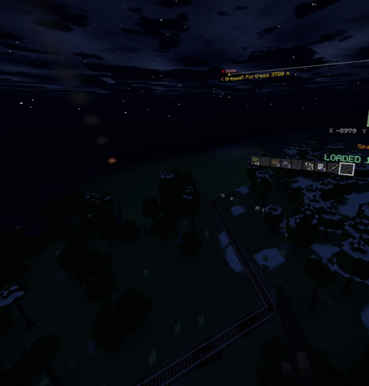

## 08:40:36 - This is good though

- **Transcript:** This is good though
- **Status:** open
- **Build:** 0.129 (1418bf09, M1-M4 (device-tested; ship riding, chests, comfort options, weapon wheel))
- **World:** New World (19) (seed 7653607216494784574)
- **Dimension:** Surface
- **Biome:** Taiga
- **Position:** -9524.8 129.4 5312.3
- **Facing:** west (yaw 260, pitch -47)
- **Held:** Sturmwind Carbine x1
- **Mount:** on foot, flying
- **Looking at:** nothing
- **Mode:** Creative, health 20/20
- **Time:** day 1 03:15, clear
- **Fps:** 72
- **Levels:** mic -29 dBFS, game sound -25 dBFS
- **Length:** 2.1 s (voice 0.7 s)
- **Just before:** -28s message: Hollow Bluff Station marked on the map; -26s message: You found the Gold & Hollow Railway: 2 stations, marked on your map; -22s message: Walking; -21s walked into Forest; -21s message: Flying; -19s message: Entering Ardimoor; -19s walked into Taiga; -17s walked into Forest; -15s walked into River; -13s walked into Taiga
- **Repro (Mac):** `./snap.sh note --seed 7653607216494784574 --x -9524.8 --z 5312.3 --yaw 100 --pitch -47 --time 0.886`
- **Audio (this Mac):** /Users/darthvadar/Documents/Blocksmith/QuestVoiceNotes/raw/vn-20261102-084036-620.aac

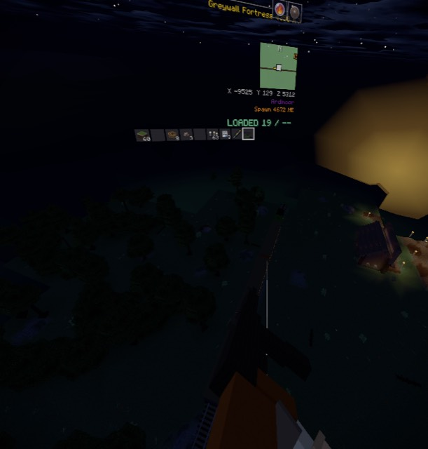

## 08:40:47 - Can't-- Okay, can get in the passenger carts here, but it's

- **Transcript:** Can't-- Okay, can get in the passenger carts here, but it's
- **Status:** open
- **Build:** 0.129 (1418bf09, M1-M4 (device-tested; ship riding, chests, comfort options, weapon wheel))
- **World:** New World (19) (seed 7653607216494784574)
- **Dimension:** Surface
- **Biome:** Taiga
- **Position:** -9599.7 85.3 5317.7
- **Facing:** south-east (yaw 154, pitch -72)
- **Held:** Sturmwind Carbine x1
- **Mount:** on foot
- **Looking at:** Gravel at -9600 83 5318
- **Mode:** Creative, health 20/20
- **Time:** day 1 03:28, clear
- **Fps:** 64
- **Levels:** mic -31 dBFS, game sound -31 dBFS
- **Length:** 5.2 s (voice 3.0 s)
- **Just before:** -28s walked into Forest; -26s walked into River; -24s walked into Taiga; -10s message: Gold Valley marked on the map; -7s message: Walking
- **Repro (Mac):** `./snap.sh note --seed 7653607216494784574 --x -9599.7 --z 5317.7 --yaw -154 --pitch -72 --time 0.895`
- **Audio (this Mac):** /Users/darthvadar/Documents/Blocksmith/QuestVoiceNotes/raw/vn-20261102-084047-700.aac

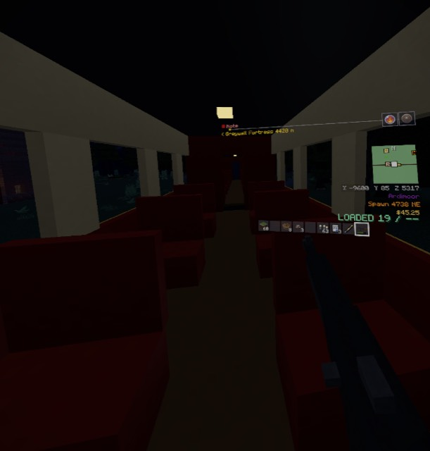

## 08:40:52 - First of all, there's no passengers, and I am glitching through this s

- **Transcript:** First of all, there's no passengers, and I am glitching through this section, so
- **Status:** open
- **Build:** 0.129 (1418bf09, M1-M4 (device-tested; ship riding, chests, comfort options, weapon wheel))
- **World:** New World (19) (seed 7653607216494784574)
- **Dimension:** Surface
- **Biome:** Taiga
- **Position:** -9582.8 83.9 5318.3
- **Facing:** east (yaw 84, pitch -69)
- **Held:** Sturmwind Carbine x1
- **Mount:** on foot
- **Looking at:** Gravel at -9583 83 5318
- **Mode:** Creative, health 20/20
- **Time:** day 1 03:34, clear
- **Fps:** 62
- **Levels:** mic -37 dBFS, game sound -28 dBFS
- **Length:** 5.2 s (voice 3.2 s)
- **Just before:** -29s walked into Taiga; -15s message: Gold Valley marked on the map; -12s message: Walking
- **Repro (Mac):** `./snap.sh note --seed 7653607216494784574 --x -9582.8 --z 5318.3 --yaw -84 --pitch -69 --time 0.899`
- **Audio (this Mac):** /Users/darthvadar/Documents/Blocksmith/QuestVoiceNotes/raw/vn-20261102-084052-660.aac

## 08:40:57 - Drain wasn't entirely well done here. This is not, uh

- **Transcript:** Drain wasn't entirely well done here. This is not, uh
- **Status:** open
- **Build:** 0.129 (1418bf09, M1-M4 (device-tested; ship riding, chests, comfort options, weapon wheel))
- **World:** New World (19) (seed 7653607216494784574)
- **Dimension:** Surface
- **Biome:** Taiga
- **Position:** -9586.6 85.3 5317.2
- **Facing:** west (yaw 289, pitch -72)
- **Held:** Sturmwind Carbine x1
- **Mount:** on foot
- **Looking at:** Gravel at -9588 83 5316
- **Mode:** Creative, health 20/20
- **Time:** day 1 03:40, clear
- **Fps:** 68
- **Levels:** mic -27 dBFS, game sound -24 dBFS
- **Length:** 4.4 s (voice 2.3 s)
- **Just before:** -20s message: Gold Valley marked on the map; -17s message: Walking
- **Repro (Mac):** `./snap.sh note --seed 7653607216494784574 --x -9586.6 --z 5317.2 --yaw 71 --pitch -72 --time 0.903`
- **Audio (this Mac):** /Users/darthvadar/Documents/Blocksmith/QuestVoiceNotes/raw/vn-20261102-084057-780.aac

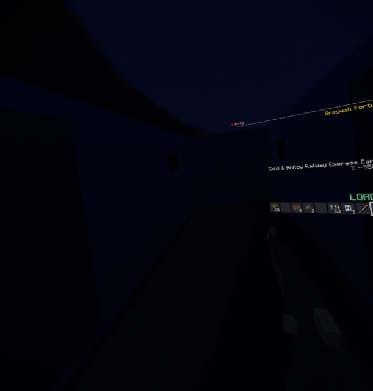

## 08:41:04 - I'm gonna call that a failure

- **Transcript:** I'm gonna call that a failure
- **Status:** open
- **Build:** 0.129 (1418bf09, M1-M4 (device-tested; ship riding, chests, comfort options, weapon wheel))
- **World:** New World (19) (seed 7653607216494784574)
- **Dimension:** Surface
- **Biome:** Taiga
- **Position:** -9643.4 92.8 5283.1
- **Facing:** south (yaw 193, pitch -16)
- **Held:** Sturmwind Carbine x1
- **Mount:** on foot, flying
- **Looking at:** nothing
- **Mode:** Creative, health 20/20
- **Time:** day 1 03:48, clear
- **Fps:** 64
- **Levels:** mic -30 dBFS, game sound -26 dBFS
- **Length:** 2.7 s (voice 1.1 s)
- **Just before:** -27s message: Gold Valley marked on the map; -24s message: Walking; -1s message: Flying
- **Repro (Mac):** `./snap.sh note --seed 7653607216494784574 --x -9643.4 --z 5283.1 --yaw 167 --pitch -16 --time 0.909`
- **Audio (this Mac):** /Users/darthvadar/Documents/Blocksmith/QuestVoiceNotes/raw/vn-20261102-084104-420.aac

## 08:41:07 - 'Cause we can't

- **Transcript:** 'Cause we can't
- **Status:** open
- **Build:** 0.129 (1418bf09, M1-M4 (device-tested; ship riding, chests, comfort options, weapon wheel))
- **World:** New World (19) (seed 7653607216494784574)
- **Dimension:** Surface
- **Biome:** Taiga
- **Position:** -9655.2 92.8 5305.9
- **Facing:** south (yaw 190, pitch -35)
- **Held:** Sturmwind Carbine x1
- **Mount:** on foot, flying
- **Looking at:** nothing
- **Mode:** Creative, health 20/20
- **Time:** day 1 03:52, clear
- **Fps:** 60
- **Levels:** mic -29 dBFS, game sound -17 dBFS
- **Length:** 2.4 s (voice 0.8 s)
- **Just before:** -30s message: Gold Valley marked on the map; -27s message: Walking; -4s message: Flying
- **Repro (Mac):** `./snap.sh note --seed 7653607216494784574 --x -9655.2 --z 5305.9 --yaw 170 --pitch -35 --time 0.911`
- **Audio (this Mac):** /Users/darthvadar/Documents/Blocksmith/QuestVoiceNotes/raw/vn-20261102-084107-480.aac

## 08:41:09 - Uh, I should be able to jump on top of this section, not

- **Transcript:** Uh, I should be able to jump on top of this section, not
- **Status:** open
- **Build:** 0.129 (1418bf09, M1-M4 (device-tested; ship riding, chests, comfort options, weapon wheel))
- **World:** New World (19) (seed 7653607216494784574)
- **Dimension:** Surface
- **Biome:** Taiga
- **Position:** -9635.8 92.8 5314.3
- **Facing:** south-east (yaw 117, pitch -41)
- **Held:** Sturmwind Carbine x1
- **Mount:** on foot, flying
- **Looking at:** nothing
- **Mode:** Creative, health 20/20
- **Time:** day 1 03:55, clear
- **Fps:** 60
- **Levels:** mic -36 dBFS, game sound -19 dBFS
- **Length:** 4.1 s (voice 2.4 s)
- **Just before:** -30s message: Walking; -7s message: Flying
- **Repro (Mac):** `./snap.sh note --seed 7653607216494784574 --x -9635.8 --z 5314.3 --yaw -117 --pitch -41 --time 0.913`
- **Audio (this Mac):** /Users/darthvadar/Documents/Blocksmith/QuestVoiceNotes/raw/vn-20261102-084109-920.aac

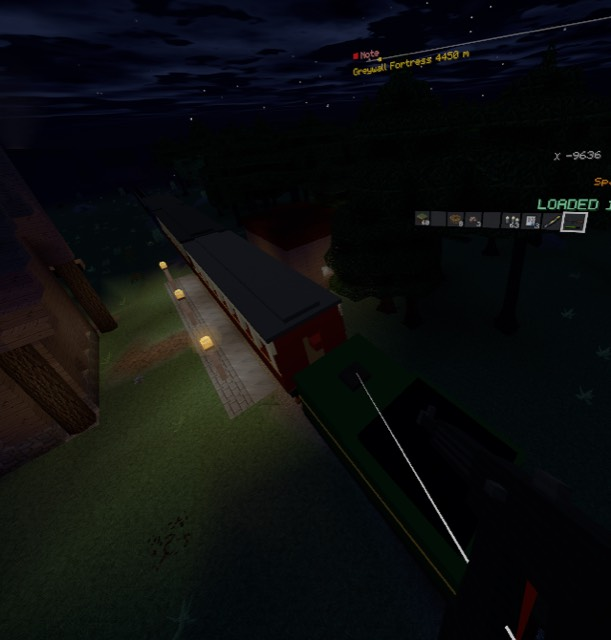

## 08:41:16 - What is going on here anyway?

- **Transcript:** What is going on here anyway?
- **Status:** open
- **Build:** 0.129 (1418bf09, M1-M4 (device-tested; ship riding, chests, comfort options, weapon wheel))
- **World:** New World (19) (seed 7653607216494784574)
- **Dimension:** Surface
- **Biome:** Taiga
- **Position:** -9625.9 85.1 5317.5
- **Facing:** south-west (yaw 240, pitch -32)
- **Held:** Sturmwind Carbine x1
- **Mount:** on foot
- **Looking at:** Grass Block at -9630 83 5320
- **Mode:** Creative, health 20/20
- **Time:** day 1 04:03, clear
- **Fps:** 54
- **Levels:** mic -27 dBFS, game sound -19 dBFS
- **Length:** 2.8 s (voice 1.4 s)
- **Just before:** -13s message: Flying; -6s message: Walking
- **Repro (Mac):** `./snap.sh note --seed 7653607216494784574 --x -9625.9 --z 5317.5 --yaw 120 --pitch -32 --time 0.919`
- **Audio (this Mac):** /Users/darthvadar/Documents/Blocksmith/QuestVoiceNotes/raw/vn-20261102-084116-560.aac

## 08:41:19 - This second, I'm glitching through this section

- **Transcript:** This second, I'm glitching through this section
- **Status:** open
- **Build:** 0.129 (1418bf09, M1-M4 (device-tested; ship riding, chests, comfort options, weapon wheel))
- **World:** New World (19) (seed 7653607216494784574)
- **Dimension:** Surface
- **Biome:** Taiga
- **Position:** -9643.9 83.1 5317.0
- **Facing:** west (yaw 275, pitch -64)
- **Held:** Sturmwind Carbine x1
- **Mount:** on foot
- **Looking at:** Gravel at -9644 82 5316
- **Mode:** Creative, health 20/20
- **Time:** day 1 04:07, clear
- **Fps:** 54
- **Levels:** mic -37 dBFS, game sound -18 dBFS
- **Length:** 2.9 s (voice 1.4 s)
- **Just before:** -16s message: Flying; -9s message: Walking
- **Repro (Mac):** `./snap.sh note --seed 7653607216494784574 --x -9643.9 --z 5317.0 --yaw 85 --pitch -64 --time 0.922`
- **Audio (this Mac):** /Users/darthvadar/Documents/Blocksmith/QuestVoiceNotes/raw/vn-20261102-084119-660.aac

## 08:41:25 - Where the hell did the engine go?

- **Transcript:** Where the hell did the engine go?
- **Status:** open
- **Build:** 0.129 (1418bf09, M1-M4 (device-tested; ship riding, chests, comfort options, weapon wheel))
- **World:** New World (19) (seed 7653607216494784574)
- **Dimension:** Surface
- **Biome:** Taiga
- **Position:** -9644.2 92.2 5301.8
- **Facing:** south (yaw 198, pitch -24)
- **Held:** Sturmwind Carbine x1
- **Mount:** on foot, flying
- **Looking at:** nothing
- **Mode:** Creative, health 20/20
- **Time:** day 1 04:14, clear
- **Fps:** 56
- **Levels:** mic -28 dBFS, game sound -18 dBFS
- **Length:** 2.6 s (voice 1.2 s)
- **Just before:** -22s message: Flying; -15s message: Walking; -4s message: Flying
- **Repro (Mac):** `./snap.sh note --seed 7653607216494784574 --x -9644.2 --z 5301.8 --yaw 162 --pitch -24 --time 0.927`
- **Audio (this Mac):** /Users/darthvadar/Documents/Blocksmith/QuestVoiceNotes/raw/vn-20261102-084125-620.aac

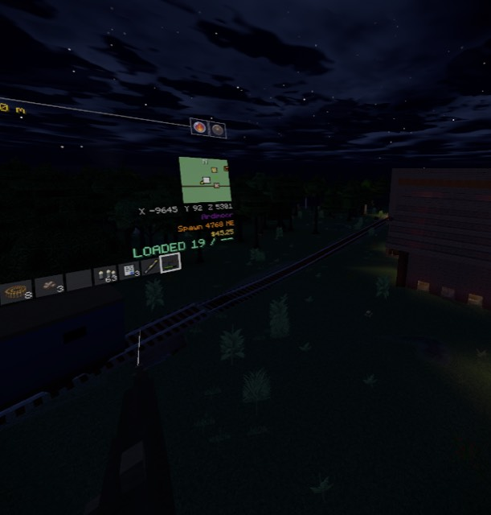

## 08:41:28 - Oh, it's on this side. Okay

- **Transcript:** Oh, it's on this side. Okay
- **Status:** open
- **Build:** 0.129 (1418bf09, M1-M4 (device-tested; ship riding, chests, comfort options, weapon wheel))
- **World:** New World (19) (seed 7653607216494784574)
- **Dimension:** Surface
- **Biome:** Taiga
- **Position:** -9611.7 92.2 5319.5
- **Facing:** east (yaw 99, pitch -27)
- **Held:** Sturmwind Carbine x1
- **Mount:** on foot, flying
- **Looking at:** nothing
- **Mode:** Creative, health 20/20
- **Time:** day 1 04:17, clear
- **Fps:** 62
- **Levels:** mic -41 dBFS, game sound -18 dBFS
- **Length:** 2.4 s (voice 1.0 s)
- **Just before:** -25s message: Flying; -18s message: Walking; -7s message: Flying
- **Repro (Mac):** `./snap.sh note --seed 7653607216494784574 --x -9611.7 --z 5319.5 --yaw -99 --pitch -27 --time 0.929`
- **Audio (this Mac):** /Users/darthvadar/Documents/Blocksmith/QuestVoiceNotes/raw/vn-20261102-084128-080.aac

## 08:41:34 - Yeah, still glitch through that section

- **Transcript:** Yeah, still glitch through that section
- **Status:** open
- **Build:** 0.129 (1418bf09, M1-M4 (device-tested; ship riding, chests, comfort options, weapon wheel))
- **World:** New World (19) (seed 7653607216494784574)
- **Dimension:** Surface
- **Biome:** Taiga
- **Position:** -9601.1 84.3 5317.3
- **Facing:** east (yaw 103, pitch -21)
- **Held:** Sturmwind Carbine x1
- **Mount:** on foot
- **Looking at:** Gravel at -9596 83 5318
- **Mode:** Creative, health 20/20
- **Time:** day 1 04:24, clear
- **Fps:** 60
- **Levels:** mic -23 dBFS, game sound -22 dBFS
- **Length:** 3.1 s (voice 1.4 s)
- **Just before:** -24s message: Walking; -13s message: Flying; -3s message: Walking
- **Repro (Mac):** `./snap.sh note --seed 7653607216494784574 --x -9601.1 --z 5317.3 --yaw -103 --pitch -21 --time 0.934`
- **Audio (this Mac):** /Users/darthvadar/Documents/Blocksmith/QuestVoiceNotes/raw/vn-20261102-084134-380.aac

## 08:41:41 - I'm, I mean, I'm glitching through all this

- **Transcript:** I'm, I mean, I'm glitching through all this
- **Status:** open
- **Build:** 0.129 (1418bf09, M1-M4 (device-tested; ship riding, chests, comfort options, weapon wheel))
- **World:** New World (19) (seed 7653607216494784574)
- **Dimension:** Surface
- **Biome:** Taiga
- **Position:** -9597.3 88.2 5316.9
- **Facing:** south-east (yaw 124, pitch -28)
- **Held:** Sturmwind Carbine x1
- **Mount:** on foot, flying
- **Looking at:** nothing
- **Mode:** Creative, health 20/20
- **Time:** day 1 04:33, clear
- **Fps:** 62
- **Levels:** mic -30 dBFS, game sound -23 dBFS
- **Length:** 3.0 s (voice 1.5 s)
- **Just before:** -20s message: Flying; -10s message: Walking; -3s message: Flying
- **Repro (Mac):** `./snap.sh note --seed 7653607216494784574 --x -9597.3 --z 5316.9 --yaw -124 --pitch -28 --time 0.940`
- **Audio (this Mac):** /Users/darthvadar/Documents/Blocksmith/QuestVoiceNotes/raw/vn-20261102-084141-441.aac

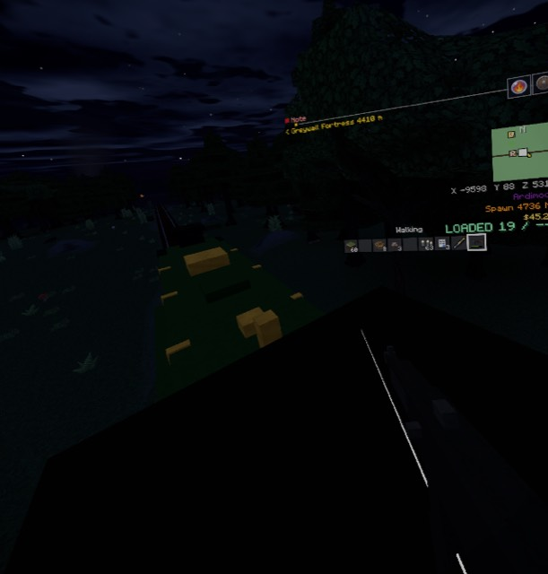

## 08:41:46 - I can't seem to drive the train now. That's not good

- **Transcript:** I can't seem to drive the train now. That's not good
- **Status:** open
- **Build:** 0.129 (1418bf09, M1-M4 (device-tested; ship riding, chests, comfort options, weapon wheel))
- **World:** New World (19) (seed 7653607216494784574)
- **Dimension:** Surface
- **Biome:** Taiga
- **Position:** -9595.9 84.0 5315.4
- **Facing:** south-east (yaw 149, pitch -64)
- **Held:** Sturmwind Carbine x1
- **Mount:** on foot
- **Looking at:** Tall Grass at -9596 85 5315
- **Mode:** Creative, health 20/20
- **Time:** day 1 04:39, clear
- **Fps:** 62
- **Levels:** mic -26 dBFS, game sound -20 dBFS
- **Length:** 4.8 s (voice 2.4 s)
- **Just before:** -25s message: Flying; -15s message: Walking; -7s message: Flying; -5s message: Walking
- **Repro (Mac):** `./snap.sh note --seed 7653607216494784574 --x -9595.9 --z 5315.4 --yaw -149 --pitch -64 --time 0.944`
- **Audio (this Mac):** /Users/darthvadar/Documents/Blocksmith/QuestVoiceNotes/raw/vn-20261102-084146-360.aac

## 08:42:01 - Here's another example of something fucked up

- **Transcript:** Here's another example of something fucked up
- **Status:** open
- **Build:** 0.129 (1418bf09, M1-M4 (device-tested; ship riding, chests, comfort options, weapon wheel))
- **World:** New World (19) (seed 7653607216494784574)
- **Dimension:** Surface
- **Biome:** Taiga
- **Position:** -9671.0 82.6 5294.6
- **Facing:** south-west (yaw 229, pitch -33)
- **Held:** Sturmwind Carbine x1
- **Mount:** on foot
- **Looking at:** Grass Block at -9673 82 5296
- **Mode:** Creative, health 20/20
- **Time:** day 1 04:57, clear
- **Fps:** 67
- **Levels:** mic -34 dBFS, game sound -24 dBFS
- **Length:** 4.0 s (voice 2.1 s)
- **Just before:** -30s message: Walking; -22s message: Flying; -20s message: Walking
- **Repro (Mac):** `./snap.sh note --seed 7653607216494784574 --x -9671.0 --z 5294.6 --yaw 131 --pitch -33 --time 0.956`
- **Audio (this Mac):** /Users/darthvadar/Documents/Blocksmith/QuestVoiceNotes/raw/vn-20261102-084201-340.aac

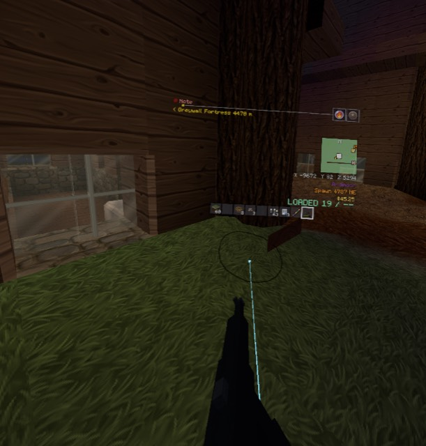

## 08:43:10 - That was like instant death. Um

- **Transcript:** That was like instant death. Um
- **Status:** open
- **Build:** 0.129 (1418bf09, M1-M4 (device-tested; ship riding, chests, comfort options, weapon wheel))
- **World:** New World (19) (seed 7653607216494784574)
- **Dimension:** Surface
- **Biome:** Jungle
- **Position:** -5582.0 78.0 2818.5
- **Facing:** south-east (yaw 115, pitch -1)
- **Held:** empty hand
- **Mount:** on foot
- **Looking at:** nothing
- **Mode:** Survival, health 20/20
- **Time:** day 2 06:10, clear
- **Fps:** 68
- **Levels:** mic -23 dBFS, game sound -23 dBFS
- **Length:** 3.4 s (voice 1.6 s)
- **Just before:** -29s holding Iron Nugget; -29s message: Iron Nugget; -29s holding Sturmbrecher Assault Shotgun; -29s message: Sturmbrecher Assault Shotgun; -29s message: Loaded: 20 / 20; -27s opened PauseMenu; -26s message: Survival mode; -26s closed PauseMenu; -24s message: The guards watch your hands. Put that away; -24s holding Iron Nugget; -24s holding Heavy Rounds; -24s holding empty hand; -14s message: The sky is clouding over: fog is coming; -11s holding Heavy Rounds; -11s message: Heavy Rounds; -11s message: A stranger in town: Ezra Quill; -11s holding Iron Nugget; -10s holding Sturmbrecher Assault Shotgun; -9s message: Eldeheim has gone to war with Branenvania; -7s died; -7s opened DeathMenu; -7s holding empty hand; -7s respawned; -7s opened PauseMenu; -7s left the pack: Capital Magazine x16 (PauseMenu open); -7s left the pack: Greywall Dispatch x3 (PauseMenu open); -7s left the pack: Sturmbrecher Assault Shotgun (PauseMenu open); -7s left the pack: Greywall Keycard (PauseMenu open); -7s left the pack: Slate Repeater (PauseMenu open); -7s left the pack: Sechser Revolver (PauseMenu open); -7s left the pack: Greywall Code Book (PauseMenu open); -7s left the pack: Combat Stim x8 (PauseMenu open); -6s message: Honour raised (you protected the town); -6s took 22 damage (health 20/20); -6s walked into Jungle; -4s closed PauseMenu; -4s message: The garrison opens fire!; -2s message: Your things are 5035 blocks south-west
- **Repro (Mac):** `./snap.sh note --seed 7653607216494784574 --x -5582.0 --z 2818.5 --yaw -115 --pitch -1 --time 0.007`
- **Audio (this Mac):** /Users/darthvadar/Documents/Blocksmith/QuestVoiceNotes/raw/vn-20261102-084310-780.aac

## 08:43:15 - I don't know. I mean, frig, okay

- **Transcript:** I don't know. I mean, frig, okay
- **Status:** open
- **Build:** 0.129 (1418bf09, M1-M4 (device-tested; ship riding, chests, comfort options, weapon wheel))
- **World:** New World (19) (seed 7653607216494784574)
- **Dimension:** Surface
- **Biome:** Bamboo Jungle
- **Position:** -5584.9 75.8 2824.8
- **Facing:** south-west (yaw 234, pitch -1)
- **Held:** empty hand
- **Mount:** on foot
- **Looking at:** nothing
- **Mode:** Creative, health 20/20
- **Time:** day 2 06:13, clear
- **Fps:** 72
- **Levels:** mic -24 dBFS, game sound -23 dBFS
- **Length:** 3.9 s (voice 1.9 s)
- **Just before:** -29s message: The guards watch your hands. Put that away; -29s holding Iron Nugget; -29s holding Heavy Rounds; -28s holding empty hand; -19s message: The sky is clouding over: fog is coming; -16s holding Heavy Rounds; -16s message: Heavy Rounds; -16s message: A stranger in town: Ezra Quill; -15s holding Iron Nugget; -15s holding Sturmbrecher Assault Shotgun; -14s message: Eldeheim has gone to war with Branenvania; -12s died; -12s opened DeathMenu; -12s holding empty hand; -12s respawned; -12s opened PauseMenu; -12s left the pack: Capital Magazine x16 (PauseMenu open); -12s left the pack: Greywall Dispatch x3 (PauseMenu open); -12s left the pack: Sturmbrecher Assault Shotgun (PauseMenu open); -12s left the pack: Greywall Keycard (PauseMenu open); -12s left the pack: Slate Repeater (PauseMenu open); -12s left the pack: Sechser Revolver (PauseMenu open); -12s left the pack: Greywall Code Book (PauseMenu open); -12s left the pack: Combat Stim x8 (PauseMenu open); -11s message: Honour raised (you protected the town); -11s took 22 damage (health 20/20); -11s walked into Jungle; -9s closed PauseMenu; -9s message: The garrison opens fire!; -7s message: Your things are 5035 blocks south-west; -4s message: Entering Eldarvania, your country; -3s walked into Bamboo Jungle; -2s opened PauseMenu; -0s message: Creative mode; -0s closed PauseMenu
- **Repro (Mac):** `./snap.sh note --seed 7653607216494784574 --x -5584.9 --z 2824.8 --yaw 126 --pitch -1 --time 0.009`
- **Audio (this Mac):** /Users/darthvadar/Documents/Blocksmith/QuestVoiceNotes/raw/vn-20261102-084315-640.aac

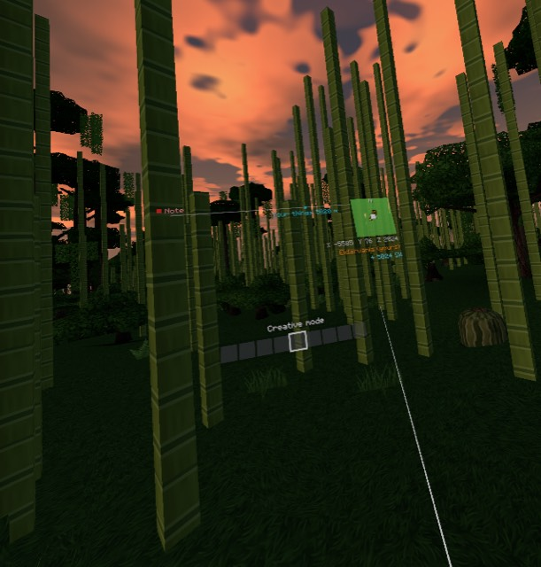

## 08:43:20 - I have to test something here

- **Transcript:** I have to test something here
- **Status:** open
- **Build:** 0.129 (1418bf09, M1-M4 (device-tested; ship riding, chests, comfort options, weapon wheel))
- **World:** New World (19) (seed 7653607216494784574)
- **Dimension:** Surface
- **Biome:** Warm Ocean
- **Position:** -6613.2 106.7 3521.0
- **Facing:** south-west (yaw 219, pitch -11)
- **Held:** empty hand
- **Mount:** on foot, flying
- **Looking at:** nothing
- **Mode:** Creative, health 20/20
- **Time:** day 2 06:19, clear
- **Fps:** 62
- **Levels:** mic -52 dBFS, game sound -22 dBFS
- **Length:** 2.4 s (voice 0.7 s)
- **Just before:** -24s message: The sky is clouding over: fog is coming; -20s holding Heavy Rounds; -20s message: Heavy Rounds; -20s message: A stranger in town: Ezra Quill; -20s holding Iron Nugget; -20s holding Sturmbrecher Assault Shotgun; -18s message: Eldeheim has gone to war with Branenvania; -17s died; -17s opened DeathMenu; -17s holding empty hand; -17s respawned; -17s opened PauseMenu; -17s left the pack: Capital Magazine x16 (PauseMenu open); -17s left the pack: Greywall Dispatch x3 (PauseMenu open); -17s left the pack: Sturmbrecher Assault Shotgun (PauseMenu open); -17s left the pack: Greywall Keycard (PauseMenu open); -17s left the pack: Slate Repeater (PauseMenu open); -17s left the pack: Sechser Revolver (PauseMenu open); -17s left the pack: Greywall Code Book (PauseMenu open); -17s left the pack: Combat Stim x8 (PauseMenu open); -16s message: Honour raised (you protected the town); -16s took 22 damage (health 20/20); -15s walked into Jungle; -14s closed PauseMenu; -13s message: The garrison opens fire!; -12s message: Your things are 5035 blocks south-west; -9s message: Entering Eldarvania, your country; -7s walked into Bamboo Jungle; -7s opened PauseMenu; -5s message: Creative mode; -5s closed PauseMenu; -4s message: Flying; -1s walked into Sparse Jungle
- **Repro (Mac):** `./snap.sh note --seed 7653607216494784574 --x -6613.2 --z 3521.0 --yaw 141 --pitch -11 --time 0.013`
- **Audio (this Mac):** /Users/darthvadar/Documents/Blocksmith/QuestVoiceNotes/raw/vn-20261102-084320-340.aac

## 08:46:52 - Let's make it so that if you murder

- **Transcript:** Let's make it so that if you murder
- **Status:** open
- **Build:** 0.129 (1418bf09, M1-M4 (device-tested; ship riding, chests, comfort options, weapon wheel))
- **World:** New World (19) (seed 7653607216494784574)
- **Dimension:** Surface
- **Biome:** Meadow
- **Position:** -10295.3 126.5 4835.9
- **Facing:** south (yaw 196, pitch -16)
- **Held:** Sturmbrecher Assault Shotgun x1
- **Mount:** on foot
- **Looking at:** nothing
- **Mode:** Survival, health 19/20
- **Time:** day 2 10:30, clear
- **Fps:** 69
- **Levels:** mic -27 dBFS, game sound -18 dBFS
- **Length:** 2.9 s (voice 1.4 s)
- **Just before:** -27s took 1 damage (health 19/20); -27s message: Henry Merriman: Ow! What was that for?; -25s left the pack: Shotgun Shell Box x2; -25s message: Loaded: 20 / 20; -17s took 1 damage (health 19/20); -6s walked into Meadow
- **Repro (Mac):** `./snap.sh note --seed 7653607216494784574 --x -10295.3 --z 4835.9 --yaw 164 --pitch -16 --time 0.188`
- **Audio (this Mac):** /Users/darthvadar/Documents/Blocksmith/QuestVoiceNotes/raw/vn-20261102-084652-900.aac

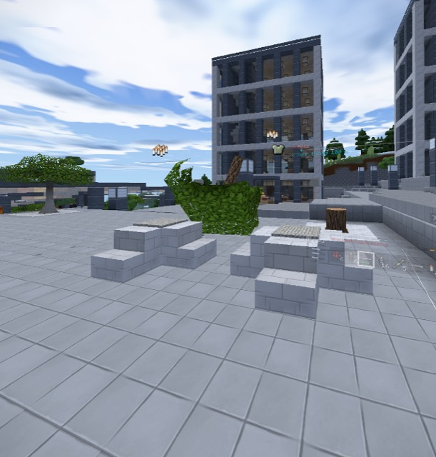

## 08:46:56 - So let's say 80% of a-- any given facility, the rest of them flee

- **Transcript:** So let's say 80% of a-- any given facility, the rest of them flee
- **Status:** open
- **Build:** 0.129 (1418bf09, M1-M4 (device-tested; ship riding, chests, comfort options, weapon wheel))
- **World:** New World (19) (seed 7653607216494784574)
- **Dimension:** Surface
- **Biome:** Meadow
- **Position:** -10278.7 125.0 4850.6
- **Facing:** east (yaw 75, pitch -60)
- **Held:** Sturmbrecher Assault Shotgun x1
- **Mount:** on foot
- **Looking at:** Capital Paving Slab at -10278 124 4850
- **Mode:** Survival, health 19/20
- **Time:** day 2 10:34, clear
- **Fps:** 69
- **Levels:** mic -42 dBFS, game sound -20 dBFS
- **Length:** 6.3 s (voice 3.5 s)
- **Just before:** -29s left the pack: Shotgun Shell Box x2; -28s message: Loaded: 20 / 20; -21s took 1 damage (health 19/20); -10s walked into Meadow
- **While talking:** -1s walked into Taiga
- **Position at the end:** -10250.1 120.8 4875.8
- **Repro (Mac):** `./snap.sh note --seed 7653607216494784574 --x -10278.7 --z 4850.6 --yaw -75 --pitch -60 --time 0.191`
- **Audio (this Mac):** /Users/darthvadar/Documents/Blocksmith/QuestVoiceNotes/raw/vn-20261102-084656-300.aac

## 08:47:39 - Negative two, three, 16

- **Transcript:** Negative two, three, 16
- **Status:** open
- **Build:** 0.129 (1418bf09, M1-M4 (device-tested; ship riding, chests, comfort options, weapon wheel))
- **World:** New World (19) (seed 7653607216494784574)
- **Dimension:** Surface
- **Biome:** Meadow
- **Position:** -10287.2 180.6 4929.2
- **Facing:** west (yaw 256, pitch -22)
- **Held:** Regular Armour Set x1
- **Mount:** on foot, flying
- **Looking at:** nothing
- **Mode:** Creative, health 19/20, screen CommandMenu
- **Time:** day 2 11:21, clear
- **Fps:** 58
- **Levels:** mic -30 dBFS, game sound -19 dBFS
- **Length:** 3.4 s (voice 1.3 s)
- **Just before:** -25s holding Shotgun Shells; -25s message: Shotgun Shells; -24s holding Regular Armour Set; -24s message: Regular Armour Set; -23s opened PauseMenu; -22s message: Creative mode; -22s closed PauseMenu; -20s message: Flying; -18s opened PauseMenu; -17s walked into Meadow; -16s opened CommandMenu; -12s message: Sealed Armoury: -10280 ~ 4808 (121 blocks, underground: its floor at y -22, 149 blocks under the surface), marked on your map; -7s message: Capital City: -10263 ~ 4825 (106 blocks), marked on your map
- **Repro (Mac):** `./snap.sh note --seed 7653607216494784574 --x -10287.2 --z 4929.2 --yaw 104 --pitch -22 --time 0.223`
- **Audio (this Mac):** /Users/darthvadar/Documents/Blocksmith/QuestVoiceNotes/raw/vn-20261102-084739-340.aac

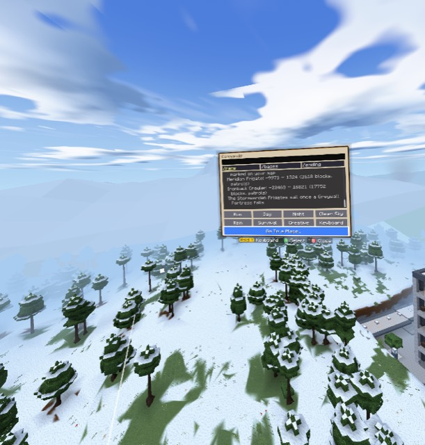

## 08:48:56 - Where's that crawler?

- **Transcript:** Where's that crawler?
- **Status:** open
- **Build:** 0.129 (1418bf09, M1-M4 (device-tested; ship riding, chests, comfort options, weapon wheel))
- **World:** New World (19) (seed 7653607216494784574)
- **Dimension:** Surface
- **Biome:** Snowy Plains
- **Position:** -23183.2 105.8 16414.6
- **Facing:** north (yaw 354, pitch -27)
- **Held:** Regular Armour Set x1
- **Mount:** on foot, flying
- **Looking at:** nothing
- **Mode:** Creative, health 19/20
- **Time:** day 2 12:27, clear
- **Fps:** 68
- **Levels:** mic -33 dBFS, game sound -26 dBFS
- **Length:** 2.7 s (voice 1.1 s)
- **Just before:** -30s message: Entering Vesagard; -29s walked into Snowy Taiga; -28s message: Entering Vesarvaal; -26s message: Entering Tamenvania; -25s walked into Snowy Plains; -23s opened PauseMenu; -21s opened CommandMenu; -20s closed CommandMenu; -18s message: Walking; -14s message: Flying; -10s message: View recentred; -10s opened PauseMenu; -9s closed PauseMenu; -6s message: Tamenvania - Ardawick border post marked on the map; -3s message: Entering Ardawick; -1s message: Entering Tamenvania
- **Repro (Mac):** `./snap.sh note --seed 7653607216494784574 --x -23183.2 --z 16414.6 --yaw 6 --pitch -27 --time 0.269`
- **Audio (this Mac):** /Users/darthvadar/Documents/Blocksmith/QuestVoiceNotes/raw/vn-20261102-084856-033.aac

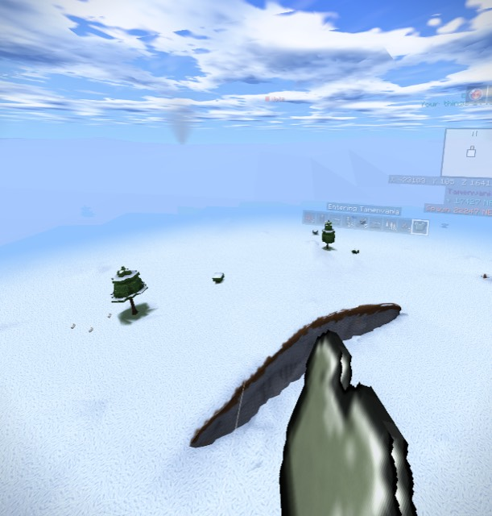

## 08:49:01 - Very low

- **Transcript:** Very low
- **Status:** open
- **Build:** 0.129 (1418bf09, M1-M4 (device-tested; ship riding, chests, comfort options, weapon wheel))
- **World:** New World (19) (seed 7653607216494784574)
- **Dimension:** Surface
- **Biome:** Snowy Plains
- **Position:** -23029.3 105.8 16358.3
- **Facing:** north-west (yaw 337, pitch -14)
- **Held:** Iron Nugget x3
- **Mount:** on foot, flying
- **Looking at:** nothing
- **Mode:** Creative, health 19/20
- **Time:** day 2 12:34, clear
- **Fps:** 72
- **Levels:** mic -43 dBFS, game sound -25 dBFS
- **Length:** 2.0 s (voice 0.4 s)
- **Just before:** -28s opened PauseMenu; -27s opened CommandMenu; -26s closed CommandMenu; -24s message: Walking; -20s message: Flying; -16s message: View recentred; -15s opened PauseMenu; -14s closed PauseMenu; -12s message: Tamenvania - Ardawick border post marked on the map; -9s message: Entering Ardawick; -7s message: Entering Tamenvania; -3s holding Iron Nugget; -3s message: Iron Nugget
- **Repro (Mac):** `./snap.sh note --seed 7653607216494784574 --x -23029.3 --z 16358.3 --yaw 23 --pitch -14 --time 0.274`
- **Audio (this Mac):** /Users/darthvadar/Documents/Blocksmith/QuestVoiceNotes/raw/vn-20261102-084901-868.aac

## 08:49:15 - There it is

- **Transcript:** There it is
- **Status:** open
- **Build:** 0.129 (1418bf09, M1-M4 (device-tested; ship riding, chests, comfort options, weapon wheel))
- **World:** New World (19) (seed 7653607216494784574)
- **Dimension:** Surface
- **Biome:** Taiga
- **Position:** -23253.8 131.8 16826.0
- **Facing:** west (yaw 282, pitch -22)
- **Held:** Iron Nugget x3
- **Mount:** on foot, flying
- **Looking at:** nothing
- **Mode:** Creative, health 19/20
- **Time:** day 2 12:50, clear
- **Fps:** 72
- **Levels:** mic -29 dBFS, game sound -20 dBFS
- **Length:** 1.9 s (voice 0.5 s)
- **Just before:** -30s message: View recentred; -29s opened PauseMenu; -28s closed PauseMenu; -26s message: Tamenvania - Ardawick border post marked on the map; -23s message: Entering Ardawick; -21s message: Entering Tamenvania; -17s holding Iron Nugget; -17s message: Iron Nugget; -10s message: Entering Ardawick; -8s message: Entering Tamenvania; -5s message: Entering Ardawick; -4s walked into Beach; -2s walked into Taiga; -1s message: The ground shakes: an Ironback Crawler is near
- **Repro (Mac):** `./snap.sh note --seed 7653607216494784574 --x -23253.8 --z 16826.0 --yaw 78 --pitch -22 --time 0.285`
- **Audio (this Mac):** /Users/darthvadar/Documents/Blocksmith/QuestVoiceNotes/raw/vn-20261102-084915-628.aac

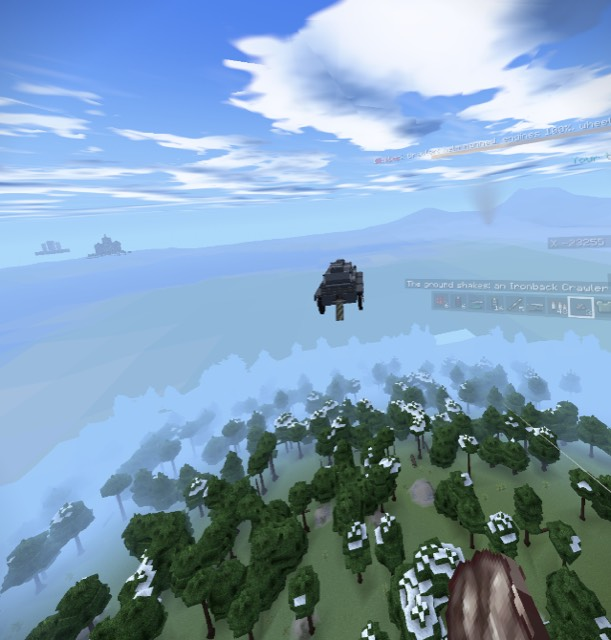

## 08:49:20 - So you're listening going optimizations

- **Transcript:** So you're listening going optimizations
- **Status:** open
- **Build:** 0.129 (1418bf09, M1-M4 (device-tested; ship riding, chests, comfort options, weapon wheel))
- **World:** New World (19) (seed 7653607216494784574)
- **Dimension:** Surface
- **Biome:** Taiga
- **Position:** -23467.3 119.1 16812.9
- **Facing:** north-west (yaw 294, pitch -47)
- **Held:** Iron Nugget x3
- **Mount:** on foot
- **Looking at:** nothing
- **Mode:** Creative, health 19/20
- **Time:** day 2 12:56, clear
- **Fps:** 69
- **Levels:** mic -49 dBFS, game sound -20 dBFS
- **Length:** 3.3 s (voice 1.7 s)
- **Just before:** -28s message: Entering Ardawick; -26s message: Entering Tamenvania; -22s holding Iron Nugget; -22s message: Iron Nugget; -15s message: Entering Ardawick; -13s message: Entering Tamenvania; -10s message: Entering Ardawick; -9s walked into Beach; -7s walked into Taiga; -6s message: The ground shakes: an Ironback Crawler is near; -4s message: Ironback crawler patrol marked on the map; -1s message: Westholm has calmed down.
- **Repro (Mac):** `./snap.sh note --seed 7653607216494784574 --x -23467.3 --z 16812.9 --yaw 66 --pitch -47 --time 0.289`
- **Audio (this Mac):** /Users/darthvadar/Documents/Blocksmith/QuestVoiceNotes/raw/vn-20261102-084920-748.aac

## 08:49:28 - I mean, okay

- **Transcript:** I mean, okay
- **Status:** open
- **Build:** 0.129 (1418bf09, M1-M4 (device-tested; ship riding, chests, comfort options, weapon wheel))
- **World:** New World (19) (seed 7653607216494784574)
- **Dimension:** Surface
- **Biome:** Taiga
- **Position:** -23478.5 81.1 16782.9
- **Facing:** west (yaw 264, pitch 46)
- **Held:** Iron Nugget x3
- **Mount:** on foot
- **Looking at:** nothing
- **Mode:** Creative, health 19/20
- **Time:** day 2 13:06, clear
- **Fps:** 71
- **Levels:** mic -25 dBFS, game sound -19 dBFS
- **Length:** 2.4 s (voice 1.0 s)
- **Just before:** -30s holding Iron Nugget; -30s message: Iron Nugget; -23s message: Entering Ardawick; -21s message: Entering Tamenvania; -18s message: Entering Ardawick; -17s walked into Beach; -15s walked into Taiga; -14s message: The ground shakes: an Ironback Crawler is near; -12s message: Ironback crawler patrol marked on the map; -9s message: Westholm has calmed down.; -7s message: Walking
- **Repro (Mac):** `./snap.sh note --seed 7653607216494784574 --x -23478.5 --z 16782.9 --yaw 96 --pitch 46 --time 0.296`
- **Audio (this Mac):** /Users/darthvadar/Documents/Blocksmith/QuestVoiceNotes/raw/vn-20261102-084928-648.aac

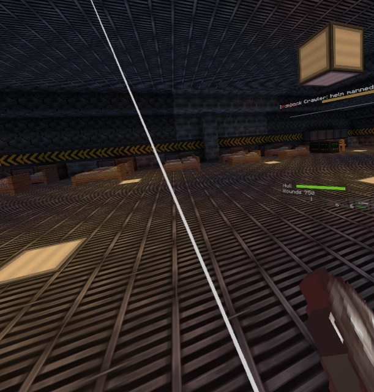

## 08:49:31 - Um, sure, I guess

- **Transcript:** Um, sure, I guess
- **Status:** open
- **Build:** 0.129 (1418bf09, M1-M4 (device-tested; ship riding, chests, comfort options, weapon wheel))
- **World:** New World (19) (seed 7653607216494784574)
- **Dimension:** Surface
- **Biome:** Taiga
- **Position:** -23484.5 81.6 16788.1
- **Facing:** west (yaw 278, pitch -37)
- **Held:** Iron Nugget x3
- **Mount:** on foot
- **Looking at:** nothing
- **Mode:** Creative, health 19/20
- **Time:** day 2 13:09, clear
- **Fps:** 71
- **Levels:** mic -27 dBFS, game sound -17 dBFS
- **Length:** 3.2 s (voice 1.4 s)
- **Just before:** -26s message: Entering Ardawick; -24s message: Entering Tamenvania; -21s message: Entering Ardawick; -20s walked into Beach; -18s walked into Taiga; -17s message: The ground shakes: an Ironback Crawler is near; -15s message: Ironback crawler patrol marked on the map; -12s message: Westholm has calmed down.; -10s message: Walking
- **Repro (Mac):** `./snap.sh note --seed 7653607216494784574 --x -23484.5 --z 16788.1 --yaw 82 --pitch -37 --time 0.298`
- **Audio (this Mac):** /Users/darthvadar/Documents/Blocksmith/QuestVoiceNotes/raw/vn-20261102-084931-468.aac

## 08:49:41 - There's not a mate says me it's sad

- **Transcript:** There's not a mate says me it's sad
- **Status:** open
- **Build:** 0.129 (1418bf09, M1-M4 (device-tested; ship riding, chests, comfort options, weapon wheel))
- **World:** New World (19) (seed 7653607216494784574)
- **Dimension:** Surface
- **Biome:** Taiga
- **Position:** -23455.0 83.6 16760.6
- **Facing:** east (yaw 99, pitch -30)
- **Held:** Iron Nugget x3
- **Mount:** on foot, flying
- **Looking at:** nothing
- **Mode:** Creative, health 19/20
- **Time:** day 2 13:21, clear
- **Fps:** 69
- **Levels:** mic -27 dBFS, game sound -10 dBFS
- **Length:** 4.3 s (voice 1.7 s)
- **Just before:** -28s walked into Taiga; -27s message: The ground shakes: an Ironback Crawler is near; -25s message: Ironback crawler patrol marked on the map; -22s message: Westholm has calmed down.; -20s message: Walking; -5s message: Flying
- **Repro (Mac):** `./snap.sh note --seed 7653607216494784574 --x -23455.0 --z 16760.6 --yaw -99 --pitch -30 --time 0.307`
- **Audio (this Mac):** /Users/darthvadar/Documents/Blocksmith/QuestVoiceNotes/raw/vn-20261102-084941-448.aac

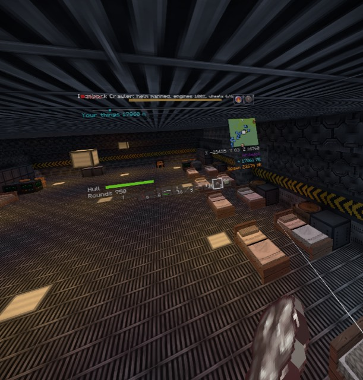

## 08:49:46 - The crew's not even this many

- **Transcript:** The crew's not even this many
- **Status:** open
- **Build:** 0.129 (1418bf09, M1-M4 (device-tested; ship riding, chests, comfort options, weapon wheel))
- **World:** New World (19) (seed 7653607216494784574)
- **Dimension:** Surface
- **Biome:** Taiga
- **Position:** -23431.2 84.8 16750.8
- **Facing:** south-west (yaw 230, pitch -11)
- **Held:** Iron Nugget x3
- **Mount:** on foot, flying
- **Looking at:** nothing
- **Mode:** Creative, health 19/20
- **Time:** day 2 13:27, clear
- **Fps:** 63
- **Levels:** mic -29 dBFS, game sound -14 dBFS
- **Length:** 2.8 s (voice 1.4 s)
- **Just before:** -30s message: Ironback crawler patrol marked on the map; -27s message: Westholm has calmed down.; -25s message: Walking; -10s message: Flying
- **Repro (Mac):** `./snap.sh note --seed 7653607216494784574 --x -23431.2 --z 16750.8 --yaw 130 --pitch -11 --time 0.311`
- **Audio (this Mac):** /Users/darthvadar/Documents/Blocksmith/QuestVoiceNotes/raw/vn-20261102-084946-568.aac

## 08:49:49 - So you need to expand the crew or something

- **Transcript:** So you need to expand the crew or something
- **Status:** open
- **Build:** 0.129 (1418bf09, M1-M4 (device-tested; ship riding, chests, comfort options, weapon wheel))
- **World:** New World (19) (seed 7653607216494784574)
- **Dimension:** Surface
- **Biome:** Taiga
- **Position:** -23431.3 85.4 16758.5
- **Facing:** south-east (yaw 117, pitch -72)
- **Held:** Iron Nugget x3
- **Mount:** on foot, flying
- **Looking at:** nothing
- **Mode:** Creative, health 19/20
- **Time:** day 2 13:30, clear
- **Fps:** 63
- **Levels:** mic -30 dBFS, game sound -16 dBFS
- **Length:** 2.8 s (voice 1.3 s)
- **Just before:** -30s message: Westholm has calmed down.; -28s message: Walking; -13s message: Flying
- **Repro (Mac):** `./snap.sh note --seed 7653607216494784574 --x -23431.3 --z 16758.5 --yaw -117 --pitch -72 --time 0.313`
- **Audio (this Mac):** /Users/darthvadar/Documents/Blocksmith/QuestVoiceNotes/raw/vn-20261102-084949-148.aac

## 08:51:09 - Still got the back ramp on the crawler. It's gotta go

- **Transcript:** Still got the back ramp on the crawler. It's gotta go
- **Status:** open
- **Build:** 0.129 (1418bf09, M1-M4 (device-tested; ship riding, chests, comfort options, weapon wheel))
- **World:** New World (19) (seed 7653607216494784574)
- **Dimension:** Surface
- **Biome:** Snowy Plains
- **Position:** -22251.7 96.4 15846.4
- **Facing:** south-west (yaw 230, pitch -39)
- **Held:** empty hand
- **Mount:** piloting Ironback Crawler
- **Looking at:** nothing
- **Mode:** Creative, health 19/20
- **Time:** day 2 15:04, clear
- **Fps:** 61
- **Levels:** mic -23 dBFS, game sound -20 dBFS
- **Length:** 3.7 s (voice 2.0 s)
- **Just before:** -27s walked into Ice Spikes; -25s walked into Snowy Plains; -22s message: Homestead marked on the map; -20s message: A homestead, fenced against the wild. Someone's home.; -15s message: Greywall Fortress marked on the map; -4s message: Entering Vesarvaal
- **Repro (Mac):** `./snap.sh note --seed 7653607216494784574 --x -22251.7 --z 15846.4 --yaw 130 --pitch -39 --time 0.378`
- **Audio (this Mac):** /Users/darthvadar/Documents/Blocksmith/QuestVoiceNotes/raw/vn-20261102-085109-608.aac

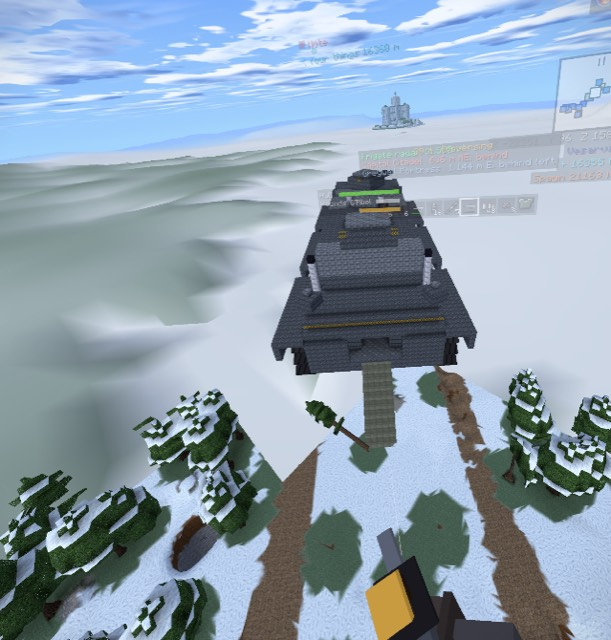

## 08:54:16 - Okay. Wow

- **Transcript:** Okay. Wow
- **Status:** open
- **Build:** 0.129 (1418bf09, M1-M4 (device-tested; ship riding, chests, comfort options, weapon wheel))
- **World:** New World (19) (seed 7653607216494784574)
- **Dimension:** Surface
- **Biome:** Snowy Plains
- **Position:** -21911.6 105.9 15056.7
- **Facing:** south-east (yaw 150, pitch -12)
- **Held:** Capital Rounds x48
- **Mount:** on foot
- **Looking at:** nothing
- **Mode:** Creative, health 19/20
- **Time:** day 2 18:41, clear
- **Fps:** 72
- **Levels:** mic -29 dBFS, game sound -14 dBFS
- **Length:** 2.5 s (voice 0.6 s)
- **Just before:** -16s message: Walking; -15s message: Flying; -13s message: Walking; -11s message: Flying
- **Repro (Mac):** `./snap.sh note --seed 7653607216494784574 --x -21911.6 --z 15056.7 --yaw -150 --pitch -12 --time 0.529`
- **Audio (this Mac):** /Users/darthvadar/Documents/Blocksmith/QuestVoiceNotes/raw/vn-20261102-085416-608.aac

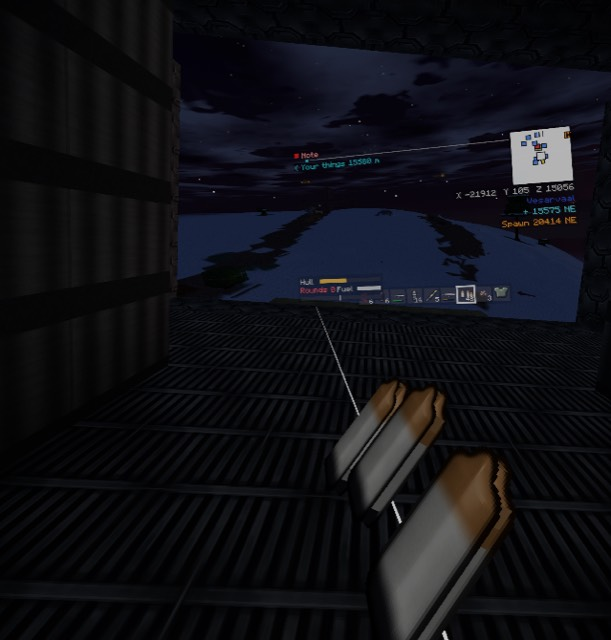
