# Voice bug notes 2026-11-12 (Quest)

Spoken while playing; transcribed by elevenlabs/scribe-v2. Written by `tools/quest-bugnotes.py` (rewritten each run; edit Status lines in a copy). 247 notes.

## 06:12:10 - Very good

- **Transcript:** Very good
- **Status:** open
- **Build:** 0.129 (27e81c04, M1-M4 (device-tested; ship riding, chests, comfort options, weapon wheel))
- **World:** New World (20) (seed 632461258612199693)
- **Dimension:** Surface
- **Biome:** Forest
- **Position:** 5463.3 65.6 -416.3
- **Facing:** east (yaw 71, pitch -33)
- **Held:** empty hand
- **Mount:** on foot
- **Looking at:** Grass Block at 5464 65 -417
- **Mode:** Survival, health 20/20
- **Time:** day 1 07:34, clear
- **Fps:** 71
- **Levels:** mic -37 dBFS, game sound -20 dBFS
- **Length:** 2.0 s (voice 0.5 s)
- **Just before:** -7s opened PauseMenu; -5s closed PauseMenu; -5s message: Playtest build: voice bug notes ON, your speech is saved (Options > Interface); -2s piloting Salvaged Fighter; -2s holding empty hand; -2s message: Flying; -0s message: Walking; --1s message: The Chancellor, over the loudspeakers: "Seal the bunker! Nobody opens the blast door in the command post!"; --2s opened PauseMenu; --5s message: Steering Salvaged Fighter; -7s entered Surface; -7s stopped piloting Salvaged Fighter; -7s closed PauseMenu; -7s holding Greywall Dispatch; -7s message: In Clear Ford's jail safe: a Greywall Dispatch; -6s message: In Clear Ford's jail safe: a Greywall Dispatch. Added to journal: Who Holds the Frontier; -4s holding empty hand; -4s opened ChestMenu; -3s closed ChestMenu; -3s message: Spring: the snow melts and the young are born
- **Repro (Mac):** `./snap.sh note --seed 632461258612199693 --x 5463.3 --z -416.3 --yaw -71 --pitch -33 --time 0.066`
- **Audio (this Mac):** /Users/darthvadar/Documents/Blocksmith/QuestVoiceNotes/raw/vn-20261112-061210-844.aac

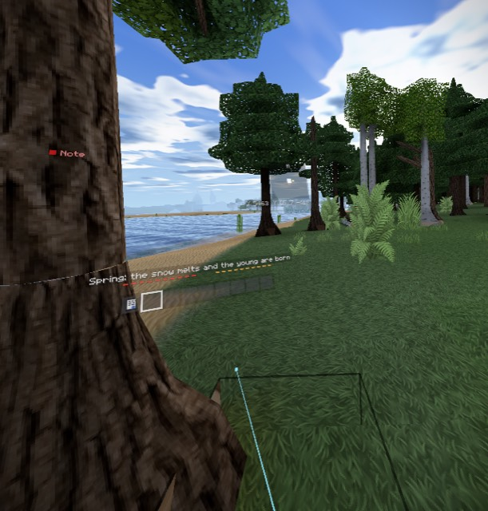

## 06:12:24 - See a, uh, water generation error right here

- **Transcript:** See a, uh, water generation error right here
- **Status:** open
- **Build:** 0.129 (27e81c04, M1-M4 (device-tested; ship riding, chests, comfort options, weapon wheel))
- **World:** New World (20) (seed 632461258612199693)
- **Dimension:** Surface
- **Biome:** Beach
- **Position:** 5670.6 64.0 -487.0
- **Facing:** south-east (yaw 145, pitch -60)
- **Held:** empty hand
- **Mount:** on foot
- **Looking at:** Sand at 5671 61 -485
- **Mode:** Creative, health 20/20
- **Time:** day 1 07:48, clear
- **Fps:** 47
- **Levels:** mic -24 dBFS, game sound -41 dBFS
- **Length:** 3.7 s (voice 2.3 s)
- **Just before:** -15s holding empty hand; -15s message: Flying; -14s message: Walking; -12s message: The Chancellor, over the loudspeakers: "Seal the bunker! Nobody opens the blast door in the command post!"; -11s opened PauseMenu; -9s message: Steering Salvaged Fighter; -20s entered Surface; -20s stopped piloting Salvaged Fighter; -20s closed PauseMenu; -20s holding Greywall Dispatch; -20s message: In Clear Ford's jail safe: a Greywall Dispatch; -20s message: In Clear Ford's jail safe: a Greywall Dispatch. Added to journal: Who Holds the Frontier; -18s holding empty hand; -17s opened ChestMenu; -16s closed ChestMenu; -16s message: Spring: the snow melts and the young are born; -12s opened PauseMenu; -11s message: Creative mode; -11s closed PauseMenu; -9s message: Flying; -6s walked into Beach; -6s left the pack: Regular Armour Set; -6s left the pack: Track Spares x16; -6s left the pack: Titanium Pickaxe; -6s left the pack: Field Stim x52; -6s left the pack: Faustrohr; -6s left the pack: Donnerkeil Service Rifle x3; -6s left the pack: Jetpack x2; -6s left the pack: Falke Pistol x2; -6s left the pack: Fernblick Rifle; -6s left the pack: Duskium Chestplate; -6s left the pack: Rocket x4; -6s left the pack: Himmelsturm Launcher; -6s left the pack: Field Journal of an Ashguard Rifleman; -6s left the pack: Aero Engine Spares x18; -6s left the pack: Faustrohr Warhead x3; -6s left the pack: Mahlwerk Rotary Gun; -5s message: Walking; -4s message: Flying; -2s message: Walking
- **Repro (Mac):** `./snap.sh note --seed 632461258612199693 --x 5670.6 --z -487.0 --yaw -145 --pitch -60 --time 0.075`
- **Audio (this Mac):** /Users/darthvadar/Documents/Blocksmith/QuestVoiceNotes/raw/vn-20261112-061224-304.aac

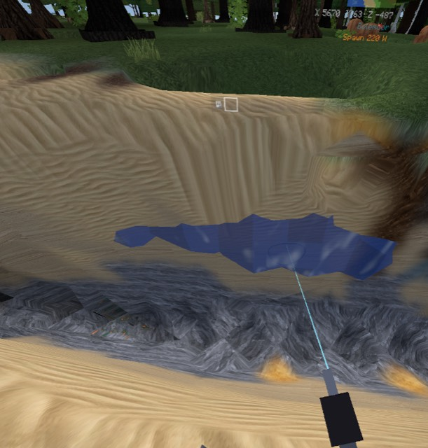

## 06:12:32 - We've got a lot of problems here. Look at this shit. All right here, t

- **Transcript:** We've got a lot of problems here. Look at this shit. All right here, this stump didn't form right. I see a hairline crack through this stump
- **Status:** open
- **Build:** 0.129 (27e81c04, M1-M4 (device-tested; ship riding, chests, comfort options, weapon wheel))
- **World:** New World (20) (seed 632461258612199693)
- **Dimension:** Surface
- **Biome:** Swamp
- **Position:** 5704.7 64.7 -481.1
- **Facing:** east (yaw 102, pitch -42)
- **Held:** empty hand
- **Mount:** on foot
- **Looking at:** Grass Block at 5707 63 -481
- **Mode:** Creative, health 20/20
- **Time:** day 1 07:58, clear
- **Fps:** 71
- **Levels:** mic -29 dBFS, game sound -19 dBFS
- **Length:** 8.8 s (voice 5.0 s)
- **Just before:** -21s message: The Chancellor, over the loudspeakers: "Seal the bunker! Nobody opens the blast door in the command post!"; -19s opened PauseMenu; -17s message: Steering Salvaged Fighter; -28s entered Surface; -28s stopped piloting Salvaged Fighter; -28s closed PauseMenu; -28s holding Greywall Dispatch; -28s message: In Clear Ford's jail safe: a Greywall Dispatch; -28s message: In Clear Ford's jail safe: a Greywall Dispatch. Added to journal: Who Holds the Frontier; -26s holding empty hand; -25s opened ChestMenu; -24s closed ChestMenu; -24s message: Spring: the snow melts and the young are born; -20s opened PauseMenu; -19s message: Creative mode; -19s closed PauseMenu; -17s message: Flying; -14s walked into Beach; -14s left the pack: Regular Armour Set; -14s left the pack: Track Spares x16; -14s left the pack: Titanium Pickaxe; -14s left the pack: Field Stim x52; -14s left the pack: Faustrohr; -14s left the pack: Donnerkeil Service Rifle x3; -14s left the pack: Jetpack x2; -14s left the pack: Falke Pistol x2; -14s left the pack: Fernblick Rifle; -14s left the pack: Duskium Chestplate; -14s left the pack: Rocket x4; -14s left the pack: Himmelsturm Launcher; -14s left the pack: Field Journal of an Ashguard Rifleman; -14s left the pack: Aero Engine Spares x18; -14s left the pack: Faustrohr Warhead x3; -14s left the pack: Mahlwerk Rotary Gun; -13s message: Walking; -12s message: Flying; -11s message: Walking; -6s message: Flying; -4s walked into Swamp; -3s message: Walking
- **Position at the end:** 5709.5 63.7 -482.5
- **Repro (Mac):** `./snap.sh note --seed 632461258612199693 --x 5704.7 --z -481.1 --yaw -102 --pitch -42 --time 0.082`
- **Audio (this Mac):** /Users/darthvadar/Documents/Blocksmith/QuestVoiceNotes/raw/vn-20261112-061232-504.aac

## 06:12:43 - Like once again, the solution to this is like 100 preset trees, 10 of 

- **Transcript:** Like once again, the solution to this is like 100 preset trees, 10 of each type. That was the solution we came up with, so we shouldn't be having issues like this
- **Status:** open
- **Build:** 0.129 (27e81c04, M1-M4 (device-tested; ship riding, chests, comfort options, weapon wheel))
- **World:** New World (20) (seed 632461258612199693)
- **Dimension:** Surface
- **Biome:** Swamp
- **Position:** 5712.4 63.8 -483.9
- **Facing:** south-west (yaw 216, pitch -2)
- **Held:** empty hand
- **Mount:** on foot
- **Looking at:** Dark Oak Log at 5709 65 -480
- **Mode:** Creative, health 20/20
- **Time:** day 1 08:11, clear
- **Fps:** 72
- **Levels:** mic -50 dBFS, game sound -27 dBFS
- **Length:** 11.7 s (voice 7.3 s)
- **Just before:** -28s message: Steering Salvaged Fighter; -30s closed PauseMenu; -29s message: Flying; -25s walked into Beach; -25s left the pack: Regular Armour Set; -25s left the pack: Track Spares x16; -25s left the pack: Titanium Pickaxe; -25s left the pack: Field Stim x52; -25s left the pack: Faustrohr; -25s left the pack: Donnerkeil Service Rifle x3; -25s left the pack: Jetpack x2; -25s left the pack: Falke Pistol x2; -25s left the pack: Fernblick Rifle; -25s left the pack: Duskium Chestplate; -25s left the pack: Rocket x4; -25s left the pack: Himmelsturm Launcher; -25s left the pack: Field Journal of an Ashguard Rifleman; -25s left the pack: Aero Engine Spares x18; -25s left the pack: Faustrohr Warhead x3; -25s left the pack: Mahlwerk Rotary Gun; -25s message: Walking; -23s message: Flying; -22s message: Walking; -17s message: Flying; -15s walked into Swamp; -14s message: Walking
- **Position at the end:** 5711.7 64.0 -482.5
- **Repro (Mac):** `./snap.sh note --seed 632461258612199693 --x 5712.4 --z -483.9 --yaw 144 --pitch -2 --time 0.092`
- **Audio (this Mac):** /Users/darthvadar/Documents/Blocksmith/QuestVoiceNotes/raw/vn-20261112-061243-683.aac

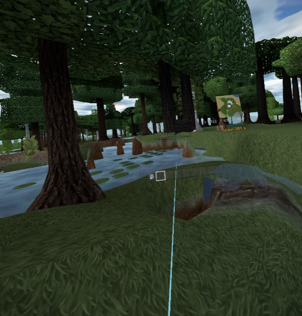

## 06:12:56 - And what the fuck's this? Look at this thing. This is, this is bad. Fi

- **Transcript:** And what the fuck's this? Look at this thing. This is, this is bad. Fix that
- **Status:** open
- **Build:** 0.129 (27e81c04, M1-M4 (device-tested; ship riding, chests, comfort options, weapon wheel))
- **World:** New World (20) (seed 632461258612199693)
- **Dimension:** Surface
- **Biome:** Swamp
- **Position:** 5702.6 64.7 -479.9
- **Facing:** south-west (yaw 217, pitch -9)
- **Held:** empty hand
- **Mount:** on foot
- **Looking at:** nothing
- **Mode:** Creative, health 20/20
- **Time:** day 1 08:27, clear
- **Fps:** 72
- **Levels:** mic -29 dBFS, game sound -17 dBFS
- **Length:** 5.4 s (voice 2.4 s)
- **Just before:** -28s walked into Swamp; -27s message: Walking
- **Repro (Mac):** `./snap.sh note --seed 632461258612199693 --x 5702.6 --z -479.9 --yaw 143 --pitch -9 --time 0.103`
- **Audio (this Mac):** /Users/darthvadar/Documents/Blocksmith/QuestVoiceNotes/raw/vn-20261112-061256-864.aac

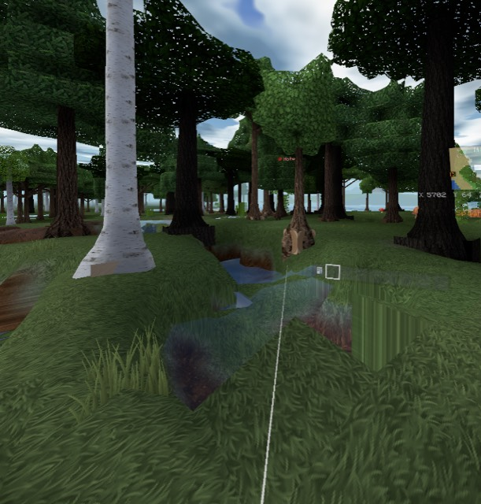

## 06:13:16 - The water is pretty good. Kind of. Well, right here we've got a little

- **Transcript:** The water is pretty good. Kind of. Well, right here we've got a little bit. Didn't fill in here. Fix that
- **Status:** open
- **Build:** 0.129 (27e81c04, M1-M4 (device-tested; ship riding, chests, comfort options, weapon wheel))
- **World:** New World (20) (seed 632461258612199693)
- **Dimension:** Surface
- **Biome:** Dark Forest
- **Position:** 5717.3 63.2 -400.1
- **Facing:** north (yaw 22, pitch -40)
- **Held:** empty hand
- **Mount:** on foot
- **Looking at:** Dirt at 5718 61 -404
- **Mode:** Creative, health 20/20
- **Time:** day 1 08:51, clear
- **Fps:** 72
- **Levels:** mic -26 dBFS, game sound -14 dBFS
- **Length:** 8.3 s (voice 3.8 s)
- **Just before:** -18s walked into Dark Forest; -12s walked into Swamp; -10s walked into Dark Forest
- **While talking:** -3s walked into Forest
- **Position at the end:** 5719.1 63.0 -399.8
- **Repro (Mac):** `./snap.sh note --seed 632461258612199693 --x 5717.3 --z -400.1 --yaw -22 --pitch -40 --time 0.119`
- **Audio (this Mac):** /Users/darthvadar/Documents/Blocksmith/QuestVoiceNotes/raw/vn-20261112-061316-724.aac

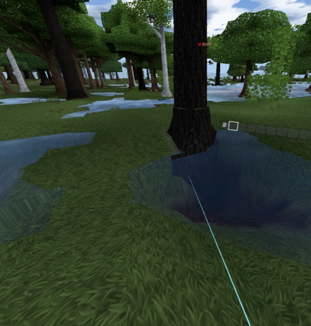

## 06:13:25 - Okay, we got a lot of issues here. Oh, wow. All right, every stump has

- **Transcript:** Okay, we got a lot of issues here. Oh, wow. All right, every stump has some sort of block problem where it's showing a face of a
- **Status:** open
- **Build:** 0.129 (27e81c04, M1-M4 (device-tested; ship riding, chests, comfort options, weapon wheel))
- **World:** New World (20) (seed 632461258612199693)
- **Dimension:** Surface
- **Biome:** Forest
- **Position:** 5726.3 64.5 -386.8
- **Facing:** south (yaw 176, pitch -15)
- **Held:** empty hand
- **Mount:** on foot
- **Looking at:** Grass Block at 5726 64 -384
- **Mode:** Creative, health 20/20
- **Time:** day 1 09:02, clear
- **Fps:** 72
- **Levels:** mic -37 dBFS, game sound -21 dBFS
- **Length:** 8.2 s (voice 5.2 s)
- **Just before:** -27s walked into Dark Forest; -21s walked into Swamp; -19s walked into Dark Forest; -7s walked into Forest
- **Position at the end:** 5730.5 65.4 -378.6
- **Repro (Mac):** `./snap.sh note --seed 632461258612199693 --x 5726.3 --z -386.8 --yaw -176 --pitch -15 --time 0.127`
- **Audio (this Mac):** /Users/darthvadar/Documents/Blocksmith/QuestVoiceNotes/raw/vn-20261112-061325-764.aac

## 06:13:34 - A stone log block

- **Transcript:** A stone log block
- **Status:** open
- **Build:** 0.129 (27e81c04, M1-M4 (device-tested; ship riding, chests, comfort options, weapon wheel))
- **World:** New World (20) (seed 632461258612199693)
- **Dimension:** Surface
- **Biome:** Forest
- **Position:** 5729.7 65.4 -378.6
- **Facing:** south-east (yaw 144, pitch -22)
- **Held:** empty hand
- **Mount:** on foot
- **Looking at:** Dirt at 5730 65 -377
- **Mode:** Creative, health 20/20
- **Time:** day 1 09:12, clear
- **Fps:** 72
- **Levels:** mic -26 dBFS, game sound -21 dBFS
- **Length:** 2.6 s (voice 0.9 s)
- **Just before:** -30s walked into Swamp; -28s walked into Dark Forest; -16s walked into Forest
- **Repro (Mac):** `./snap.sh note --seed 632461258612199693 --x 5729.7 --z -378.6 --yaw -144 --pitch -22 --time 0.134`
- **Audio (this Mac):** /Users/darthvadar/Documents/Blocksmith/QuestVoiceNotes/raw/vn-20261112-061334-044.aac

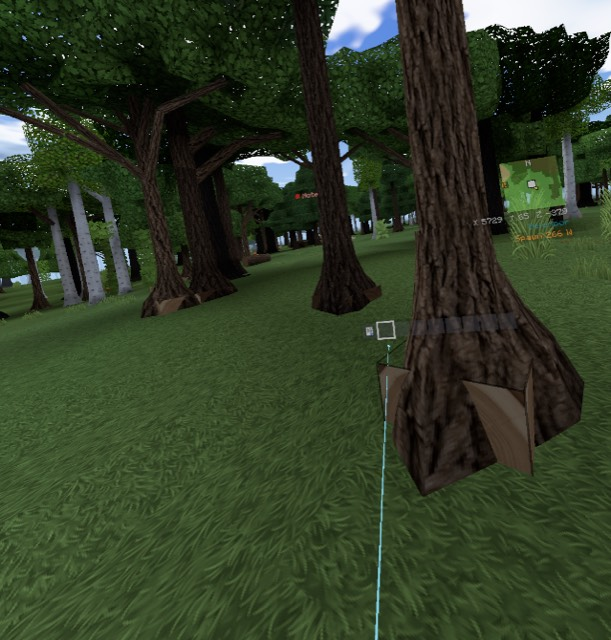

## 06:13:36 - Or a, uh, a, a logged block

- **Transcript:** Or a, uh, a, a logged block
- **Status:** open
- **Build:** 0.129 (27e81c04, M1-M4 (device-tested; ship riding, chests, comfort options, weapon wheel))
- **World:** New World (20) (seed 632461258612199693)
- **Dimension:** Surface
- **Biome:** Forest
- **Position:** 5734.3 65.7 -375.2
- **Facing:** south-east (yaw 143, pitch -36)
- **Held:** empty hand
- **Mount:** on foot
- **Looking at:** Grass Block at 5735 65 -374
- **Mode:** Creative, health 20/20
- **Time:** day 1 09:15, clear
- **Fps:** 72
- **Levels:** mic -30 dBFS, game sound -17 dBFS
- **Length:** 4.0 s (voice 1.7 s)
- **Just before:** -30s walked into Dark Forest; -18s walked into Forest
- **Repro (Mac):** `./snap.sh note --seed 632461258612199693 --x 5734.3 --z -375.2 --yaw -143 --pitch -36 --time 0.136`
- **Audio (this Mac):** /Users/darthvadar/Documents/Blocksmith/QuestVoiceNotes/raw/vn-20261112-061336-464.aac

## 06:13:45 - Uh, view distance is eight, which is fine, but it needs to increase ba

- **Transcript:** Uh, view distance is eight, which is fine, but it needs to increase back to twenty-four when it's comfortable
- **Status:** open
- **Build:** 0.129 (27e81c04, M1-M4 (device-tested; ship riding, chests, comfort options, weapon wheel))
- **World:** New World (20) (seed 632461258612199693)
- **Dimension:** Surface
- **Biome:** Forest
- **Position:** 5797.1 115.6 -280.1
- **Facing:** south-east (yaw 124, pitch -32)
- **Held:** empty hand
- **Mount:** on foot, flying
- **Looking at:** nothing
- **Mode:** Creative, health 20/20
- **Time:** day 1 09:23, clear
- **Fps:** 70
- **Levels:** mic -31 dBFS, game sound -20 dBFS
- **Length:** 7.7 s (voice 4.5 s)
- **Just before:** -27s walked into Forest; -6s message: Flying; -3s opened PauseMenu; -1s closed PauseMenu
- **While talking:** -4s walked into Taiga; -2s opened PauseMenu; -1s closed PauseMenu
- **Position at the end:** 5738.4 115.6 -264.6
- **Repro (Mac):** `./snap.sh note --seed 632461258612199693 --x 5797.1 --z -280.1 --yaw -124 --pitch -32 --time 0.141`
- **Audio (this Mac):** /Users/darthvadar/Documents/Blocksmith/QuestVoiceNotes/raw/vn-20261112-061345-644.aac

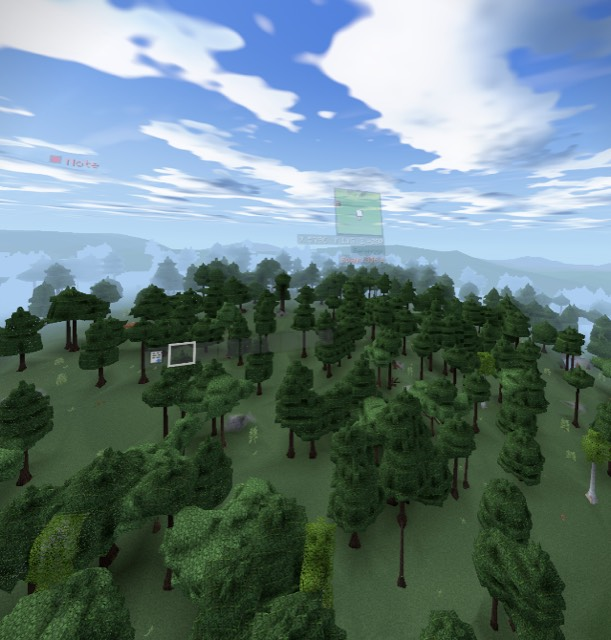

## 06:13:54 - Otherwise it's, yeah, it's going pretty smooth

- **Transcript:** Otherwise it's, yeah, it's going pretty smooth
- **Status:** open
- **Build:** 0.129 (27e81c04, M1-M4 (device-tested; ship riding, chests, comfort options, weapon wheel))
- **World:** New World (20) (seed 632461258612199693)
- **Dimension:** Surface
- **Biome:** Beach
- **Position:** 5277.0 115.6 -173.4
- **Facing:** south (yaw 180, pitch -39)
- **Held:** empty hand
- **Mount:** on foot, flying
- **Looking at:** nothing
- **Mode:** Creative, health 20/20
- **Time:** day 1 09:32, clear
- **Fps:** 68
- **Levels:** mic -30 dBFS, game sound -22 dBFS
- **Length:** 4.5 s (voice 1.9 s)
- **Just before:** -15s message: Flying; -12s opened PauseMenu; -10s closed PauseMenu; -8s walked into Taiga; -6s opened PauseMenu; -5s closed PauseMenu; -4s walked into Forest; -4s message: Homestead marked on the map; -2s message: A homestead. Fields, a barn, and a long way from town.
- **Repro (Mac):** `./snap.sh note --seed 632461258612199693 --x 5277.0 --z -173.4 --yaw -180 --pitch -39 --time 0.148`
- **Audio (this Mac):** /Users/darthvadar/Documents/Blocksmith/QuestVoiceNotes/raw/vn-20261112-061354-424.aac

## 06:14:02 - Call that 20. It's actually generating very well, I'd say

- **Transcript:** Call that 20. It's actually generating very well, I'd say
- **Status:** open
- **Build:** 0.129 (27e81c04, M1-M4 (device-tested; ship riding, chests, comfort options, weapon wheel))
- **World:** New World (20) (seed 632461258612199693)
- **Dimension:** Surface
- **Biome:** Forest
- **Position:** 5205.1 115.6 -139.1
- **Facing:** south (yaw 196, pitch -29)
- **Held:** empty hand
- **Mount:** on foot, flying
- **Looking at:** nothing
- **Mode:** Creative, health 20/20
- **Time:** day 1 09:40, clear
- **Fps:** 70
- **Levels:** mic -32 dBFS, game sound -22 dBFS
- **Length:** 5.4 s (voice 3.0 s)
- **Just before:** -23s message: Flying; -20s opened PauseMenu; -18s closed PauseMenu; -16s walked into Taiga; -14s opened PauseMenu; -13s closed PauseMenu; -12s walked into Forest; -11s message: Homestead marked on the map; -9s message: A homestead. Fields, a barn, and a long way from town.; -8s walked into Beach; -7s message: A stranger in town: Ezra Quill; -6s walked into Forest; -5s opened PauseMenu; -3s closed PauseMenu
- **Repro (Mac):** `./snap.sh note --seed 632461258612199693 --x 5205.1 --z -139.1 --yaw 164 --pitch -29 --time 0.153`
- **Audio (this Mac):** /Users/darthvadar/Documents/Blocksmith/QuestVoiceNotes/raw/vn-20261112-061402-284.aac

## 06:14:08 - Um, yeah, it's doing a pretty good job. Oh, yeah

- **Transcript:** Um, yeah, it's doing a pretty good job. Oh, yeah
- **Status:** open
- **Build:** 0.129 (27e81c04, M1-M4 (device-tested; ship riding, chests, comfort options, weapon wheel))
- **World:** New World (20) (seed 632461258612199693)
- **Dimension:** Surface
- **Biome:** Plains
- **Position:** 5417.4 119.5 142.7
- **Facing:** south-east (yaw 148, pitch -35)
- **Held:** empty hand
- **Mount:** on foot, flying
- **Looking at:** nothing
- **Mode:** Creative, health 20/20
- **Time:** day 1 09:46, clear
- **Fps:** 47
- **Levels:** mic -32 dBFS, game sound -23 dBFS
- **Length:** 3.9 s (voice 1.9 s)
- **Just before:** -28s message: Flying; -25s opened PauseMenu; -23s closed PauseMenu; -21s walked into Taiga; -20s opened PauseMenu; -19s closed PauseMenu; -17s walked into Forest; -17s message: Homestead marked on the map; -15s message: A homestead. Fields, a barn, and a long way from town.; -13s walked into Beach; -12s message: A stranger in town: Ezra Quill; -11s walked into Forest; -11s opened PauseMenu; -9s closed PauseMenu
- **Repro (Mac):** `./snap.sh note --seed 632461258612199693 --x 5417.4 --z 142.7 --yaw -148 --pitch -35 --time 0.158`
- **Audio (this Mac):** /Users/darthvadar/Documents/Blocksmith/QuestVoiceNotes/raw/vn-20261112-061408-024.aac

## 06:14:12 - Oh, yes. I don't know what optimizations we did, but this, these are

- **Transcript:** Oh, yes. I don't know what optimizations we did, but this, these are
- **Status:** open
- **Build:** 0.129 (27e81c04, M1-M4 (device-tested; ship riding, chests, comfort options, weapon wheel))
- **World:** New World (20) (seed 632461258612199693)
- **Dimension:** Surface
- **Biome:** Forest
- **Position:** 5389.3 189.7 -32.6
- **Facing:** south (yaw 192, pitch -46)
- **Held:** empty hand
- **Mount:** on foot
- **Looking at:** nothing
- **Mode:** Creative, health 20/20
- **Time:** day 1 09:51, clear
- **Fps:** 63
- **Levels:** mic -22 dBFS, game sound -15 dBFS
- **Length:** 4.3 s (voice 2.6 s)
- **Just before:** -30s opened PauseMenu; -28s closed PauseMenu; -26s walked into Taiga; -24s opened PauseMenu; -23s closed PauseMenu; -22s walked into Forest; -21s message: Homestead marked on the map; -19s message: A homestead. Fields, a barn, and a long way from town.; -18s walked into Beach; -16s message: A stranger in town: Ezra Quill; -16s walked into Forest; -15s opened PauseMenu; -13s closed PauseMenu; -3s walked into Plains; -1s walked into Forest; -1s message: Walking
- **Repro (Mac):** `./snap.sh note --seed 632461258612199693 --x 5389.3 --z -32.6 --yaw 168 --pitch -46 --time 0.161`
- **Audio (this Mac):** /Users/darthvadar/Documents/Blocksmith/QuestVoiceNotes/raw/vn-20261112-061412-164.aac

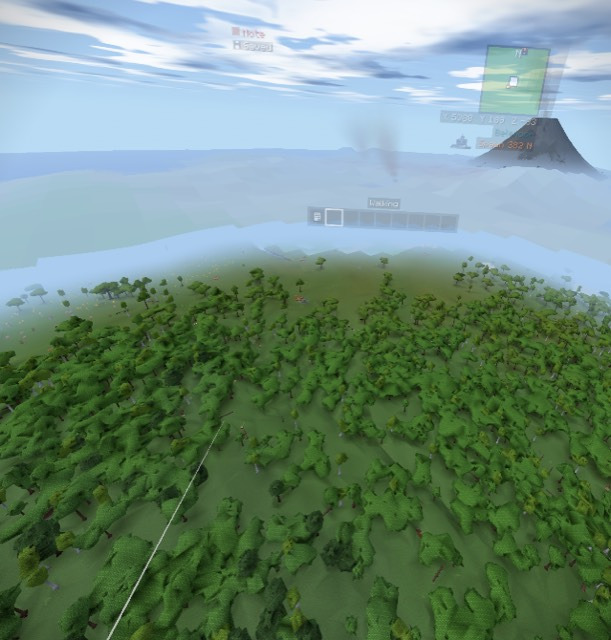

## 06:14:16 - Very impressive optimizations

- **Transcript:** Very impressive optimizations
- **Status:** open
- **Build:** 0.129 (27e81c04, M1-M4 (device-tested; ship riding, chests, comfort options, weapon wheel))
- **World:** New World (20) (seed 632461258612199693)
- **Dimension:** Surface
- **Biome:** Desert
- **Position:** 5022.7 158.3 242.7
- **Facing:** south (yaw 201, pitch -34)
- **Held:** empty hand
- **Mount:** on foot, flying
- **Looking at:** nothing
- **Mode:** Creative, health 20/20
- **Time:** day 1 09:57, clear
- **Fps:** 42
- **Levels:** mic -25 dBFS, game sound -19 dBFS
- **Length:** 2.8 s (voice 1.2 s)
- **Just before:** -30s walked into Taiga; -28s opened PauseMenu; -27s closed PauseMenu; -26s walked into Forest; -26s message: Homestead marked on the map; -24s message: A homestead. Fields, a barn, and a long way from town.; -22s walked into Beach; -21s message: A stranger in town: Ezra Quill; -20s walked into Forest; -19s opened PauseMenu; -17s closed PauseMenu; -8s walked into Plains; -6s walked into Forest; -5s message: Walking; -3s message: Flying; -2s walked into Desert; -1s message: Ghost town marked on the map
- **Repro (Mac):** `./snap.sh note --seed 632461258612199693 --x 5022.7 --z 242.7 --yaw 159 --pitch -34 --time 0.165`
- **Audio (this Mac):** /Users/darthvadar/Documents/Blocksmith/QuestVoiceNotes/raw/vn-20261112-061416-464.aac

## 06:14:21 - Not bad. Okay

- **Transcript:** Not bad. Okay
- **Status:** open
- **Build:** 0.129 (27e81c04, M1-M4 (device-tested; ship riding, chests, comfort options, weapon wheel))
- **World:** New World (20) (seed 632461258612199693)
- **Dimension:** Surface
- **Biome:** Forest
- **Position:** 4011.9 185.9 794.0
- **Facing:** south-west (yaw 209, pitch -39)
- **Held:** empty hand
- **Mount:** on foot
- **Looking at:** nothing
- **Mode:** Creative, health 20/20
- **Time:** day 1 10:02, clear
- **Fps:** 72
- **Levels:** mic -35 dBFS, game sound -21 dBFS
- **Length:** 2.3 s (voice 0.6 s)
- **Just before:** -28s message: A homestead. Fields, a barn, and a long way from town.; -26s walked into Beach; -25s message: A stranger in town: Ezra Quill; -24s walked into Forest; -24s opened PauseMenu; -22s closed PauseMenu; -12s walked into Plains; -10s walked into Forest; -9s message: Walking; -7s message: Flying; -6s walked into Desert; -6s message: Ghost town marked on the map; -4s walked into Badlands; -4s message: Entering Quelmark; -2s walked into Forest; -1s message: Walking
- **Repro (Mac):** `./snap.sh note --seed 632461258612199693 --x 4011.9 --z 794.0 --yaw 151 --pitch -39 --time 0.168`
- **Audio (this Mac):** /Users/darthvadar/Documents/Blocksmith/QuestVoiceNotes/raw/vn-20261112-061421-004.aac

## 06:14:23 - Um, here we are

- **Transcript:** Um, here we are
- **Status:** open
- **Build:** 0.129 (27e81c04, M1-M4 (device-tested; ship riding, chests, comfort options, weapon wheel))
- **World:** New World (20) (seed 632461258612199693)
- **Dimension:** Surface
- **Biome:** Plains
- **Position:** 3900.0 158.4 863.9
- **Facing:** south (yaw 196, pitch -30)
- **Held:** empty hand
- **Mount:** on foot, flying
- **Looking at:** nothing
- **Mode:** Creative, health 20/20
- **Time:** day 1 10:05, clear
- **Fps:** 72
- **Levels:** mic -27 dBFS, game sound -23 dBFS
- **Length:** 3.0 s (voice 1.4 s)
- **Just before:** -29s walked into Beach; -28s message: A stranger in town: Ezra Quill; -27s walked into Forest; -26s opened PauseMenu; -24s closed PauseMenu; -15s walked into Plains; -13s walked into Forest; -12s message: Walking; -10s message: Flying; -9s walked into Desert; -9s message: Ghost town marked on the map; -7s walked into Badlands; -6s message: Entering Quelmark; -5s walked into Forest; -3s message: Walking; -2s message: Flying; -0s message: Capital citadel (the enemy) marked on the map
- **Repro (Mac):** `./snap.sh note --seed 632461258612199693 --x 3900.0 --z 863.9 --yaw 164 --pitch -30 --time 0.171`
- **Audio (this Mac):** /Users/darthvadar/Documents/Blocksmith/QuestVoiceNotes/raw/vn-20261112-061423-664.aac

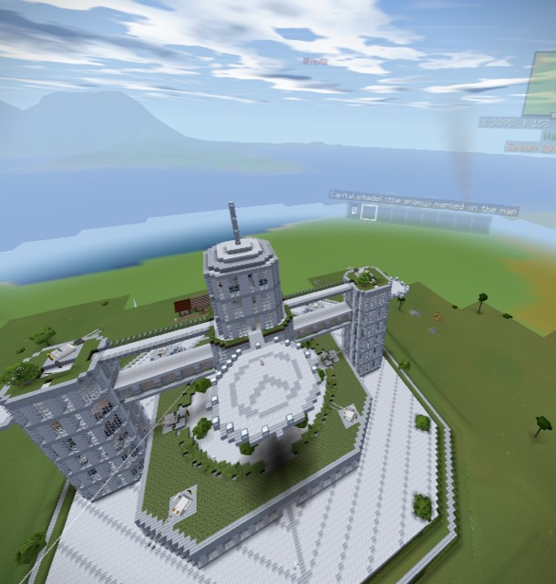

## 06:14:30 - Okay, so problem

- **Transcript:** Okay, so problem
- **Status:** open
- **Build:** 0.129 (27e81c04, M1-M4 (device-tested; ship riding, chests, comfort options, weapon wheel))
- **World:** New World (20) (seed 632461258612199693)
- **Dimension:** Surface
- **Biome:** Plains
- **Position:** 3886.6 65.5 1038.5
- **Facing:** south-east (yaw 135, pitch -65)
- **Held:** empty hand
- **Mount:** on foot
- **Looking at:** Grass Block at 3886 65 1038
- **Mode:** Creative, health 20/20
- **Time:** day 1 10:13, clear
- **Fps:** 55
- **Levels:** mic -83 dBFS, game sound -27 dBFS
- **Length:** 3.4 s (voice 1.6 s)
- **Just before:** -22s walked into Plains; -20s walked into Forest; -19s message: Walking; -17s message: Flying; -15s walked into Desert; -15s message: Ghost town marked on the map; -13s walked into Badlands; -13s message: Entering Quelmark; -11s walked into Forest; -10s message: Walking; -8s message: Flying; -7s message: Capital citadel (the enemy) marked on the map; -5s walked into Plains; -5s message: Entering Harionia; -3s message: Harionia - Quelmark border post marked on the map; -0s message: Walking
- **Repro (Mac):** `./snap.sh note --seed 632461258612199693 --x 3886.6 --z 1038.5 --yaw -135 --pitch -65 --time 0.176`
- **Audio (this Mac):** /Users/darthvadar/Documents/Blocksmith/QuestVoiceNotes/raw/vn-20261112-061430-284.aac

## 06:14:33 - There's a triangle void piece here

- **Transcript:** There's a triangle void piece here
- **Status:** open
- **Build:** 0.129 (27e81c04, M1-M4 (device-tested; ship riding, chests, comfort options, weapon wheel))
- **World:** New World (20) (seed 632461258612199693)
- **Dimension:** Surface
- **Biome:** Plains
- **Position:** 3903.9 65.9 1025.2
- **Facing:** south-east (yaw 116, pitch -78)
- **Held:** empty hand
- **Mount:** on foot
- **Looking at:** Short Grass at 3903 66 1025
- **Mode:** Creative, health 20/20
- **Time:** day 1 10:17, clear
- **Fps:** 55
- **Levels:** mic -27 dBFS, game sound -29 dBFS
- **Length:** 3.4 s (voice 1.6 s)
- **Just before:** -25s walked into Plains; -23s walked into Forest; -22s message: Walking; -20s message: Flying; -19s walked into Desert; -19s message: Ghost town marked on the map; -17s walked into Badlands; -16s message: Entering Quelmark; -15s walked into Forest; -13s message: Walking; -12s message: Flying; -10s message: Capital citadel (the enemy) marked on the map; -9s walked into Plains; -8s message: Entering Harionia; -6s message: Harionia - Quelmark border post marked on the map; -3s message: Walking; -2s message: Entering Quelmark
- **Repro (Mac):** `./snap.sh note --seed 632461258612199693 --x 3903.9 --z 1025.2 --yaw -116 --pitch -78 --time 0.179`
- **Audio (this Mac):** /Users/darthvadar/Documents/Blocksmith/QuestVoiceNotes/raw/vn-20261112-061433-703.aac

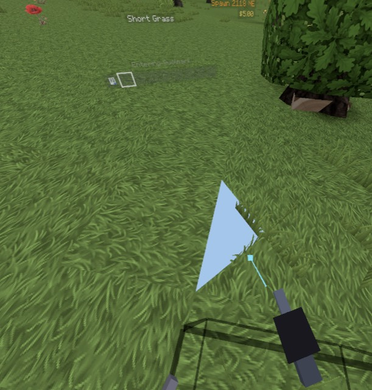

## 06:14:38 - Another one right here. This is a really big one

- **Transcript:** Another one right here. This is a really big one
- **Status:** open
- **Build:** 0.129 (27e81c04, M1-M4 (device-tested; ship riding, chests, comfort options, weapon wheel))
- **World:** New World (20) (seed 632461258612199693)
- **Dimension:** Surface
- **Biome:** Plains
- **Position:** 3919.0 64.5 1041.4
- **Facing:** north-east (yaw 44, pitch -48)
- **Held:** empty hand
- **Mount:** on foot
- **Looking at:** Grass Block at 3919 64 1040
- **Mode:** Creative, health 20/20
- **Time:** day 1 10:22, clear
- **Fps:** 66
- **Levels:** mic -25 dBFS, game sound -16 dBFS
- **Length:** 3.6 s (voice 2.0 s)
- **Just before:** -29s walked into Plains; -27s walked into Forest; -26s message: Walking; -24s message: Flying; -23s walked into Desert; -23s message: Ghost town marked on the map; -21s walked into Badlands; -21s message: Entering Quelmark; -19s walked into Forest; -18s message: Walking; -16s message: Flying; -15s message: Capital citadel (the enemy) marked on the map; -13s walked into Plains; -12s message: Entering Harionia; -10s message: Harionia - Quelmark border post marked on the map; -8s message: Walking; -6s message: Entering Quelmark
- **Repro (Mac):** `./snap.sh note --seed 632461258612199693 --x 3919.0 --z 1041.4 --yaw -44 --pitch -48 --time 0.183`
- **Audio (this Mac):** /Users/darthvadar/Documents/Blocksmith/QuestVoiceNotes/raw/vn-20261112-061438-024.aac

## 06:14:43 - Break, yeah. Taking a block under it makes it go away, but still

- **Transcript:** Break, yeah. Taking a block under it makes it go away, but still
- **Status:** open
- **Build:** 0.129 (27e81c04, M1-M4 (device-tested; ship riding, chests, comfort options, weapon wheel))
- **World:** New World (20) (seed 632461258612199693)
- **Dimension:** Surface
- **Biome:** Plains
- **Position:** 3918.2 64.5 1040.8
- **Facing:** north-east (yaw 28, pitch -64)
- **Held:** empty hand
- **Mount:** on foot
- **Looking at:** Short Grass at 3918 65 1040
- **Mode:** Creative, health 20/20
- **Time:** day 1 10:29, clear
- **Fps:** 61
- **Levels:** mic -25 dBFS, game sound -15 dBFS
- **Length:** 5.1 s (voice 2.3 s)
- **Just before:** -29s message: Flying; -28s walked into Desert; -28s message: Ghost town marked on the map; -26s walked into Badlands; -26s message: Entering Quelmark; -24s walked into Forest; -23s message: Walking; -21s message: Flying; -20s message: Capital citadel (the enemy) marked on the map; -18s walked into Plains; -17s message: Entering Harionia; -15s message: Harionia - Quelmark border post marked on the map; -13s message: Walking; -11s message: Entering Quelmark
- **Repro (Mac):** `./snap.sh note --seed 632461258612199693 --x 3918.2 --z 1040.8 --yaw -28 --pitch -64 --time 0.187`
- **Audio (this Mac):** /Users/darthvadar/Documents/Blocksmith/QuestVoiceNotes/raw/vn-20261112-061443-224.aac

## 06:15:31 - Oh my God

- **Transcript:** Oh my God
- **Status:** open
- **Build:** 0.129 (27e81c04, M1-M4 (device-tested; ship riding, chests, comfort options, weapon wheel))
- **World:** New World (20) (seed 632461258612199693)
- **Dimension:** Surface
- **Biome:** Plains
- **Position:** 3874.5 66.3 1047.8
- **Facing:** north-west (yaw 321, pitch -27)
- **Held:** Dusk Relic x64
- **Mount:** on foot
- **Looking at:** Grass Block at 3870 64 1043
- **Mode:** Survival, health 18/20
- **Time:** day 1 11:24, clear
- **Fps:** 60
- **Levels:** mic -19 dBFS, game sound -18 dBFS
- **Length:** 2.4 s (voice 0.8 s)
- **Just before:** -27s into the pack: Field Stim; -16s into the pack: Shotgun Shell Box; -9s into the pack: Sturmbrecher Assault Shotgun; -6s holding Dusk Relic; -6s closed CreativeMenu; -5s opened PauseMenu; -3s message: Survival mode; -3s closed PauseMenu; -2s opened InventoryMenu; -1s left the pack: Duskium Chestplate (InventoryMenu open); -1s left the pack: Duskium Leggings (InventoryMenu open); -1s left the pack: Duskium Helmet (InventoryMenu open); -1s left the pack: Duskium Boots (InventoryMenu open); -1s closed InventoryMenu; -0s took 3 damage (health 18/20)
- **Repro (Mac):** `./snap.sh note --seed 632461258612199693 --x 3874.5 --z 1047.8 --yaw 39 --pitch -27 --time 0.225`
- **Audio (this Mac):** /Users/darthvadar/Documents/Blocksmith/QuestVoiceNotes/raw/vn-20261112-061531-724.aac

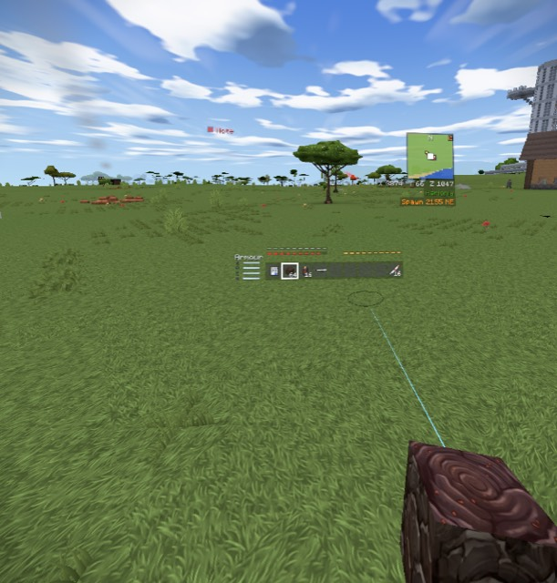

## 06:15:34 - Okay, so naval guns are already firing at me even though I didn't pull

- **Transcript:** Okay, so naval guns are already firing at me even though I didn't pull my weapon out
- **Status:** open
- **Build:** 0.129 (27e81c04, M1-M4 (device-tested; ship riding, chests, comfort options, weapon wheel))
- **World:** New World (20) (seed 632461258612199693)
- **Dimension:** Surface
- **Biome:** Plains
- **Position:** 3888.8 65.1 1055.2
- **Facing:** north (yaw 345, pitch -52)
- **Held:** empty hand
- **Mount:** on foot
- **Looking at:** Short Grass at 3888 64 1054
- **Mode:** Survival, health 20/20
- **Time:** day 1 11:27, clear
- **Fps:** 60
- **Levels:** mic -26 dBFS, game sound -15 dBFS
- **Length:** 6.4 s (voice 3.8 s)
- **Just before:** -29s into the pack: Field Stim; -19s into the pack: Shotgun Shell Box; -12s into the pack: Sturmbrecher Assault Shotgun; -8s holding Dusk Relic; -8s closed CreativeMenu; -7s opened PauseMenu; -6s message: Survival mode; -5s closed PauseMenu; -5s opened InventoryMenu; -4s left the pack: Duskium Chestplate (InventoryMenu open); -4s left the pack: Duskium Leggings (InventoryMenu open); -4s left the pack: Duskium Helmet (InventoryMenu open); -3s left the pack: Duskium Boots (InventoryMenu open); -3s closed InventoryMenu; -3s took 3 damage (health 18/20); -2s holding Shotgun Shell Box; -2s message: Shotgun Shell Box; -2s holding Sturmbrecher Assault Shotgun; -2s message: Sturmbrecher Assault Shotgun; -1s holding empty hand; -0s message: Entering Quelmark
- **While talking:** -4s took 2 damage (health 18/20); -2s took 2 damage (health 17/20); -0s message: Entering Harionia
- **Position at the end:** 3890.7 66.0 1019.0
- **Repro (Mac):** `./snap.sh note --seed 632461258612199693 --x 3888.8 --z 1055.2 --yaw 15 --pitch -52 --time 0.227`
- **Audio (this Mac):** /Users/darthvadar/Documents/Blocksmith/QuestVoiceNotes/raw/vn-20261112-061534-264.aac

## 06:15:58 - Holy shit

- **Transcript:** Holy shit
- **Status:** open
- **Build:** 0.129 (27e81c04, M1-M4 (device-tested; ship riding, chests, comfort options, weapon wheel))
- **World:** New World (20) (seed 632461258612199693)
- **Dimension:** Surface
- **Biome:** Plains
- **Position:** 3921.2 66.5 987.8
- **Facing:** west (yaw 258, pitch -26)
- **Held:** empty hand
- **Mount:** on foot
- **Looking at:** Cobblestone at 3918 66 988
- **Mode:** Survival, health 2/20
- **Time:** day 1 11:55, clear
- **Fps:** 68
- **Levels:** mic -20 dBFS, game sound -19 dBFS
- **Length:** 2.2 s (voice 0.8 s)
- **Just before:** -30s message: Survival mode; -29s closed PauseMenu; -29s opened InventoryMenu; -28s left the pack: Duskium Chestplate (InventoryMenu open); -28s left the pack: Duskium Leggings (InventoryMenu open); -28s left the pack: Duskium Helmet (InventoryMenu open); -27s left the pack: Duskium Boots (InventoryMenu open); -27s closed InventoryMenu; -27s took 3 damage (health 18/20); -26s holding Shotgun Shell Box; -26s message: Shotgun Shell Box; -26s holding Sturmbrecher Assault Shotgun; -26s message: Sturmbrecher Assault Shotgun; -26s holding empty hand; -25s message: Entering Quelmark; -23s took 2 damage (health 18/20); -21s took 2 damage (health 17/20); -19s message: Entering Harionia; -19s took 2 damage (health 15/20); -17s holding Field Stim; -17s message: Field Stim; -17s left the pack: Field Stim (at 3883 67 1006); -16s holding empty hand; -15s holding Sturmbrecher Assault Shotgun; -15s message: Sturmbrecher Assault Shotgun; -14s message: The garrison opens fire!; -14s holding Shotgun Shell Box; -14s holding Sturmbrecher Assault Shotgun; -13s left the pack: Shotgun Shell Box x2 (at 3876 67 998); -12s message: Loaded: 20 / 20; -11s message: Honour raised (you protected the town); -8s message: A Capital patrol sets out to investigate; -6s message: Entering Quelmark; -3s message: Rufus Merriman: Get inside! They're coming!; -1s holding Shotgun Shells; -1s message: A Capital patrol sets out to investigate; -0s holding empty hand
- **Repro (Mac):** `./snap.sh note --seed 632461258612199693 --x 3921.2 --z 987.8 --yaw 102 --pitch -26 --time 0.247`
- **Audio (this Mac):** /Users/darthvadar/Documents/Blocksmith/QuestVoiceNotes/raw/vn-20261112-061558-364.aac

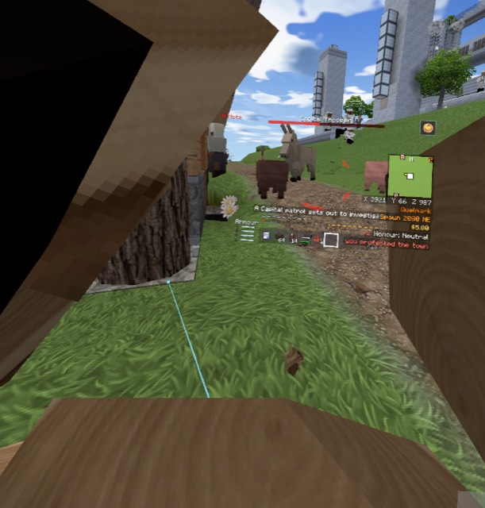

## 06:16:01 - Wow, that was, that was something

- **Transcript:** Wow, that was, that was something
- **Status:** open
- **Build:** 0.129 (27e81c04, M1-M4 (device-tested; ship riding, chests, comfort options, weapon wheel))
- **World:** New World (20) (seed 632461258612199693)
- **Dimension:** Surface
- **Biome:** Forest
- **Position:** 5464.5 65.7 -408.4
- **Facing:** west (yaw 287, pitch -10)
- **Held:** empty hand
- **Mount:** on foot
- **Looking at:** Spruce Leaves at 5459 66 -410
- **Mode:** Survival, health 20/20
- **Time:** day 1 11:56, clear
- **Fps:** 68
- **Levels:** mic -27 dBFS, game sound -21 dBFS
- **Length:** 4.1 s (voice 1.5 s)
- **Just before:** -29s holding Shotgun Shell Box; -29s message: Shotgun Shell Box; -29s holding Sturmbrecher Assault Shotgun; -29s message: Sturmbrecher Assault Shotgun; -28s holding empty hand; -27s message: Entering Quelmark; -26s took 2 damage (health 18/20); -24s took 2 damage (health 17/20); -22s message: Entering Harionia; -22s took 2 damage (health 15/20); -20s holding Field Stim; -20s message: Field Stim; -19s left the pack: Field Stim (at 3883 67 1006); -19s holding empty hand; -17s holding Sturmbrecher Assault Shotgun; -17s message: Sturmbrecher Assault Shotgun; -17s message: The garrison opens fire!; -17s holding Shotgun Shell Box; -16s holding Sturmbrecher Assault Shotgun; -16s left the pack: Shotgun Shell Box x2 (at 3876 67 998); -15s message: Loaded: 20 / 20; -13s message: Honour raised (you protected the town); -11s message: A Capital patrol sets out to investigate; -9s message: Entering Quelmark; -6s message: Rufus Merriman: Get inside! They're coming!; -4s holding Shotgun Shells; -3s message: A Capital patrol sets out to investigate; -3s holding empty hand; -3s died; -3s opened DeathMenu; -2s left the pack: Sturmbrecher Assault Shotgun (DeathMenu open); -2s left the pack: Field Stim x15 (DeathMenu open); -2s left the pack: Greywall Dispatch (DeathMenu open); -2s left the pack: Shotgun Shell Box x14 (DeathMenu open); -2s respawned; -2s closed DeathMenu; -2s opened PauseMenu; -2s took 21 damage (health 20/20); -1s message: Missile launch: take cover!; -0s closed PauseMenu
- **Repro (Mac):** `./snap.sh note --seed 632461258612199693 --x 5464.5 --z -408.4 --yaw 73 --pitch -10 --time 0.248`
- **Audio (this Mac):** /Users/darthvadar/Documents/Blocksmith/QuestVoiceNotes/raw/vn-20261112-061601-124.aac

## 06:16:06 - That was good

- **Transcript:** That was good
- **Status:** open
- **Build:** 0.129 (27e81c04, M1-M4 (device-tested; ship riding, chests, comfort options, weapon wheel))
- **World:** New World (20) (seed 632461258612199693)
- **Dimension:** Surface
- **Biome:** Beach
- **Position:** 5489.6 64.4 -421.6
- **Facing:** east (yaw 86, pitch -1)
- **Held:** empty hand
- **Mount:** on foot
- **Looking at:** nothing
- **Mode:** Survival, health 20/20, screen PauseMenu
- **Time:** day 1 12:01, clear
- **Fps:** 70
- **Levels:** mic -39 dBFS, game sound -37 dBFS
- **Length:** 1.8 s (voice 0.4 s)
- **Just before:** -29s took 2 damage (health 17/20); -27s message: Entering Harionia; -27s took 2 damage (health 15/20); -25s holding Field Stim; -25s message: Field Stim; -25s left the pack: Field Stim (at 3883 67 1006); -24s holding empty hand; -22s holding Sturmbrecher Assault Shotgun; -22s message: Sturmbrecher Assault Shotgun; -22s message: The garrison opens fire!; -22s holding Shotgun Shell Box; -21s holding Sturmbrecher Assault Shotgun; -21s left the pack: Shotgun Shell Box x2 (at 3876 67 998); -20s message: Loaded: 20 / 20; -18s message: Honour raised (you protected the town); -16s message: A Capital patrol sets out to investigate; -14s message: Entering Quelmark; -11s message: Rufus Merriman: Get inside! They're coming!; -9s holding Shotgun Shells; -8s message: A Capital patrol sets out to investigate; -8s holding empty hand; -8s died; -8s opened DeathMenu; -7s left the pack: Sturmbrecher Assault Shotgun (DeathMenu open); -7s left the pack: Field Stim x15 (DeathMenu open); -7s left the pack: Greywall Dispatch (DeathMenu open); -7s left the pack: Shotgun Shell Box x14 (DeathMenu open); -7s respawned; -7s closed DeathMenu; -7s opened PauseMenu; -7s took 21 damage (health 20/20); -6s message: Missile launch: take cover!; -5s closed PauseMenu; -5s walked into Forest; -4s message: Honour raised (you protected the town); -3s walked into Taiga; -1s message: Your things are 2080 blocks south-west; -1s opened PauseMenu; -1s walked into Beach
- **Repro (Mac):** `./snap.sh note --seed 632461258612199693 --x 5489.6 --z -421.6 --yaw -86 --pitch -1 --time 0.251`
- **Audio (this Mac):** /Users/darthvadar/Documents/Blocksmith/QuestVoiceNotes/raw/vn-20261112-061606-144.aac

## 06:16:09 - Only thing the, uh, yeah, the guns were firing at me before I could do

- **Transcript:** Only thing the, uh, yeah, the guns were firing at me before I could do anything
- **Status:** open
- **Build:** 0.129 (27e81c04, M1-M4 (device-tested; ship riding, chests, comfort options, weapon wheel))
- **World:** New World (20) (seed 632461258612199693)
- **Dimension:** Surface
- **Biome:** Beach
- **Position:** 5489.6 64.4 -421.5
- **Facing:** east (yaw 111, pitch 13)
- **Held:** empty hand
- **Mount:** on foot
- **Looking at:** nothing
- **Mode:** Creative, health 20/20
- **Time:** day 1 12:03, clear
- **Fps:** 70
- **Levels:** mic -36 dBFS, game sound -37 dBFS
- **Length:** 4.7 s (voice 2.2 s)
- **Just before:** -27s left the pack: Field Stim (at 3883 67 1006); -27s holding empty hand; -25s holding Sturmbrecher Assault Shotgun; -25s message: Sturmbrecher Assault Shotgun; -25s message: The garrison opens fire!; -25s holding Shotgun Shell Box; -24s holding Sturmbrecher Assault Shotgun; -24s left the pack: Shotgun Shell Box x2 (at 3876 67 998); -23s message: Loaded: 20 / 20; -21s message: Honour raised (you protected the town); -19s message: A Capital patrol sets out to investigate; -17s message: Entering Quelmark; -14s message: Rufus Merriman: Get inside! They're coming!; -12s holding Shotgun Shells; -11s message: A Capital patrol sets out to investigate; -11s holding empty hand; -10s died; -10s opened DeathMenu; -10s left the pack: Sturmbrecher Assault Shotgun (DeathMenu open); -10s left the pack: Field Stim x15 (DeathMenu open); -10s left the pack: Greywall Dispatch (DeathMenu open); -10s left the pack: Shotgun Shell Box x14 (DeathMenu open); -10s respawned; -10s closed DeathMenu; -10s opened PauseMenu; -9s took 21 damage (health 20/20); -9s message: Missile launch: take cover!; -8s closed PauseMenu; -8s walked into Forest; -7s message: Honour raised (you protected the town); -6s walked into Taiga; -4s message: Your things are 2080 blocks south-west; -4s opened PauseMenu; -4s walked into Beach; -2s opened TrackMenu; -2s message: Entering Belemoor; -2s closed TrackMenu; -1s opened PauseMenu; -0s message: Creative mode; -0s closed PauseMenu
- **Repro (Mac):** `./snap.sh note --seed 632461258612199693 --x 5489.6 --z -421.5 --yaw -111 --pitch 13 --time 0.252`
- **Audio (this Mac):** /Users/darthvadar/Documents/Blocksmith/QuestVoiceNotes/raw/vn-20261112-061609-064.aac

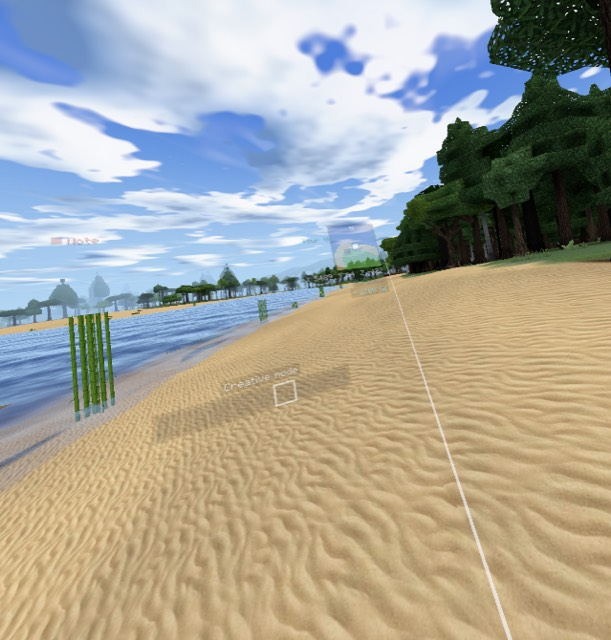

## 06:16:16 - Randomizations everything, very good. Okay, we got train here

- **Transcript:** Randomizations everything, very good. Okay, we got train here
- **Status:** open
- **Build:** 0.129 (27e81c04, M1-M4 (device-tested; ship riding, chests, comfort options, weapon wheel))
- **World:** New World (20) (seed 632461258612199693)
- **Dimension:** Surface
- **Biome:** Beach
- **Position:** 6465.6 135.3 -796.3
- **Facing:** north (yaw 16, pitch -34)
- **Held:** empty hand
- **Mount:** on foot
- **Looking at:** nothing
- **Mode:** Creative, health 20/20
- **Time:** day 1 12:12, clear
- **Fps:** 65
- **Levels:** mic -34 dBFS, game sound -19 dBFS
- **Length:** 4.6 s (voice 2.9 s)
- **Just before:** -29s message: Honour raised (you protected the town); -26s message: A Capital patrol sets out to investigate; -24s message: Entering Quelmark; -21s message: Rufus Merriman: Get inside! They're coming!; -19s holding Shotgun Shells; -19s message: A Capital patrol sets out to investigate; -19s holding empty hand; -18s died; -18s opened DeathMenu; -18s left the pack: Sturmbrecher Assault Shotgun (DeathMenu open); -18s left the pack: Field Stim x15 (DeathMenu open); -18s left the pack: Greywall Dispatch (DeathMenu open); -18s left the pack: Shotgun Shell Box x14 (DeathMenu open); -17s respawned; -17s closed DeathMenu; -17s opened PauseMenu; -17s took 21 damage (health 20/20); -16s message: Missile launch: take cover!; -16s closed PauseMenu; -15s walked into Forest; -14s message: Honour raised (you protected the town); -13s walked into Taiga; -12s message: Your things are 2080 blocks south-west; -11s opened PauseMenu; -11s walked into Beach; -10s opened TrackMenu; -9s message: Entering Belemoor; -9s closed TrackMenu; -8s opened PauseMenu; -8s message: Creative mode; -7s closed PauseMenu; -6s message: Flying; -0s message: Walking
- **Repro (Mac):** `./snap.sh note --seed 632461258612199693 --x 6465.6 --z -796.3 --yaw -16 --pitch -34 --time 0.258`
- **Audio (this Mac):** /Users/darthvadar/Documents/Blocksmith/QuestVoiceNotes/raw/vn-20261112-061616-444.aac

## 06:16:20 - Looks like some tracks went under gravel here

- **Transcript:** Looks like some tracks went under gravel here
- **Status:** open
- **Build:** 0.129 (27e81c04, M1-M4 (device-tested; ship riding, chests, comfort options, weapon wheel))
- **World:** New World (20) (seed 632461258612199693)
- **Dimension:** Surface
- **Biome:** Beach
- **Position:** 6477.0 63.6 -803.3
- **Facing:** north-east (yaw 50, pitch -11)
- **Held:** empty hand
- **Mount:** on foot
- **Looking at:** Rail at 6481 64 -808
- **Mode:** Creative, health 20/20
- **Time:** day 1 12:17, clear
- **Fps:** 70
- **Levels:** mic -38 dBFS, game sound -23 dBFS
- **Length:** 3.7 s (voice 2.0 s)
- **Just before:** -28s message: Entering Quelmark; -26s message: Rufus Merriman: Get inside! They're coming!; -23s holding Shotgun Shells; -23s message: A Capital patrol sets out to investigate; -23s holding empty hand; -22s died; -22s opened DeathMenu; -22s left the pack: Sturmbrecher Assault Shotgun (DeathMenu open); -22s left the pack: Field Stim x15 (DeathMenu open); -22s left the pack: Greywall Dispatch (DeathMenu open); -22s left the pack: Shotgun Shell Box x14 (DeathMenu open); -21s respawned; -21s closed DeathMenu; -21s opened PauseMenu; -21s took 21 damage (health 20/20); -20s message: Missile launch: take cover!; -20s closed PauseMenu; -19s walked into Forest; -18s message: Honour raised (you protected the town); -17s walked into Taiga; -16s message: Your things are 2080 blocks south-west; -16s opened PauseMenu; -15s walked into Beach; -14s opened TrackMenu; -14s message: Entering Belemoor; -14s closed TrackMenu; -13s opened PauseMenu; -12s message: Creative mode; -12s closed PauseMenu; -10s message: Flying; -5s message: Walking; -3s message: Hollow Point marked on the map; -1s message: Flying
- **Repro (Mac):** `./snap.sh note --seed 632461258612199693 --x 6477.0 --z -803.3 --yaw -50 --pitch -11 --time 0.262`
- **Audio (this Mac):** /Users/darthvadar/Documents/Blocksmith/QuestVoiceNotes/raw/vn-20261112-061620-904.aac

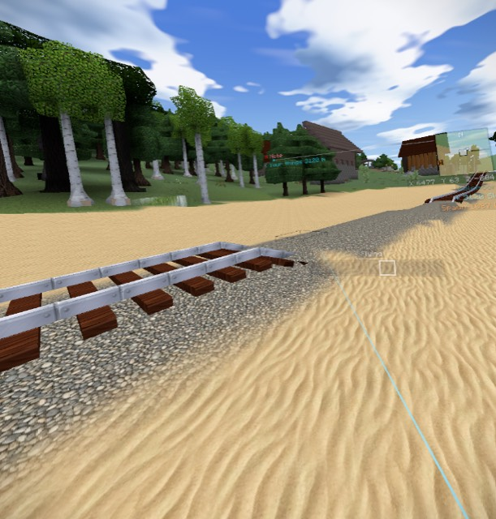

## 06:16:27 - So this is pretty good though

- **Transcript:** So this is pretty good though
- **Status:** open
- **Build:** 0.129 (27e81c04, M1-M4 (device-tested; ship riding, chests, comfort options, weapon wheel))
- **World:** New World (20) (seed 632461258612199693)
- **Dimension:** Surface
- **Biome:** Birch Forest
- **Position:** 6556.1 82.0 -805.4
- **Facing:** north (yaw 346, pitch -39)
- **Held:** empty hand
- **Mount:** on foot, flying
- **Looking at:** nothing
- **Mode:** Creative, health 20/20
- **Time:** day 1 12:24, clear
- **Fps:** 70
- **Levels:** mic -28 dBFS, game sound -17 dBFS
- **Length:** 1.9 s (voice 0.5 s)
- **Just before:** -30s holding Shotgun Shells; -29s message: A Capital patrol sets out to investigate; -29s holding empty hand; -28s died; -28s opened DeathMenu; -28s left the pack: Sturmbrecher Assault Shotgun (DeathMenu open); -28s left the pack: Field Stim x15 (DeathMenu open); -28s left the pack: Greywall Dispatch (DeathMenu open); -28s left the pack: Shotgun Shell Box x14 (DeathMenu open); -27s respawned; -27s closed DeathMenu; -27s opened PauseMenu; -27s took 21 damage (health 20/20); -27s message: Missile launch: take cover!; -26s closed PauseMenu; -26s walked into Forest; -25s message: Honour raised (you protected the town); -24s walked into Taiga; -22s message: Your things are 2080 blocks south-west; -22s opened PauseMenu; -22s walked into Beach; -20s opened TrackMenu; -20s message: Entering Belemoor; -20s closed TrackMenu; -19s opened PauseMenu; -18s message: Creative mode; -18s closed PauseMenu; -17s message: Flying; -11s message: Walking; -9s message: Hollow Point marked on the map; -7s message: Flying; -6s message: Walking; -4s message: Flying; -3s message: Hollow Point Station marked on the map; -1s walked into Birch Forest; -0s message: Greywall Pine Station marked on the map
- **Repro (Mac):** `./snap.sh note --seed 632461258612199693 --x 6556.1 --z -805.4 --yaw 14 --pitch -39 --time 0.267`
- **Audio (this Mac):** /Users/darthvadar/Documents/Blocksmith/QuestVoiceNotes/raw/vn-20261112-061627-004.aac

## 06:16:29 - Need tracks. Okay, here we go. Got a train here

- **Transcript:** Need tracks. Okay, here we go. Got a train here
- **Status:** open
- **Build:** 0.129 (27e81c04, M1-M4 (device-tested; ship riding, chests, comfort options, weapon wheel))
- **World:** New World (20) (seed 632461258612199693)
- **Dimension:** Surface
- **Biome:** Old Growth Birch Forest
- **Position:** 6717.2 108.0 -810.5
- **Facing:** east (yaw 86, pitch -50)
- **Held:** empty hand
- **Mount:** on foot, flying
- **Looking at:** nothing
- **Mode:** Creative, health 20/20
- **Time:** day 1 12:28, clear
- **Fps:** 62
- **Levels:** mic -36 dBFS, game sound -22 dBFS
- **Length:** 4.5 s (voice 2.2 s)
- **Just before:** -29s message: Missile launch: take cover!; -29s closed PauseMenu; -28s walked into Forest; -27s message: Honour raised (you protected the town); -26s walked into Taiga; -25s message: Your things are 2080 blocks south-west; -24s opened PauseMenu; -24s walked into Beach; -23s opened TrackMenu; -23s message: Entering Belemoor; -22s closed TrackMenu; -22s opened PauseMenu; -21s message: Creative mode; -21s closed PauseMenu; -19s message: Flying; -13s message: Walking; -12s message: Hollow Point marked on the map; -10s message: Flying; -9s message: Walking; -7s message: Flying; -5s message: Hollow Point Station marked on the map; -4s walked into Birch Forest; -3s message: Greywall Pine Station marked on the map; -0s message: You found the Hollow & Greywall Railway: 2 stations, marked on your map; -0s walked into Old Growth Birch Forest
- **Repro (Mac):** `./snap.sh note --seed 632461258612199693 --x 6717.2 --z -810.5 --yaw -86 --pitch -50 --time 0.270`
- **Audio (this Mac):** /Users/darthvadar/Documents/Blocksmith/QuestVoiceNotes/raw/vn-20261112-061629-664.aac

## 06:16:36 - There's no one driving the train

- **Transcript:** There's no one driving the train
- **Status:** open
- **Build:** 0.129 (27e81c04, M1-M4 (device-tested; ship riding, chests, comfort options, weapon wheel))
- **World:** New World (20) (seed 632461258612199693)
- **Dimension:** Surface
- **Biome:** Birch Forest
- **Position:** 6770.3 79.3 -805.9
- **Facing:** west (yaw 275, pitch -10)
- **Held:** empty hand
- **Mount:** on foot
- **Looking at:** nothing
- **Mode:** Creative, health 20/20
- **Time:** day 1 12:36, clear
- **Fps:** 72
- **Levels:** mic -44 dBFS, game sound -18 dBFS
- **Length:** 2.9 s (voice 1.4 s)
- **Just before:** -30s opened TrackMenu; -29s message: Entering Belemoor; -29s closed TrackMenu; -28s opened PauseMenu; -28s message: Creative mode; -27s closed PauseMenu; -26s message: Flying; -20s message: Walking; -19s message: Hollow Point marked on the map; -17s message: Flying; -15s message: Walking; -13s message: Flying; -12s message: Hollow Point Station marked on the map; -11s walked into Birch Forest; -10s message: Greywall Pine Station marked on the map; -7s message: You found the Hollow & Greywall Railway: 2 stations, marked on your map; -7s walked into Old Growth Birch Forest; -5s walked into Birch Forest; -4s message: Entering Zoriland; -2s message: Walking; -1s message: Flying
- **Repro (Mac):** `./snap.sh note --seed 632461258612199693 --x 6770.3 --z -805.9 --yaw 85 --pitch -10 --time 0.275`
- **Audio (this Mac):** /Users/darthvadar/Documents/Blocksmith/QuestVoiceNotes/raw/vn-20261112-061636-384.aac

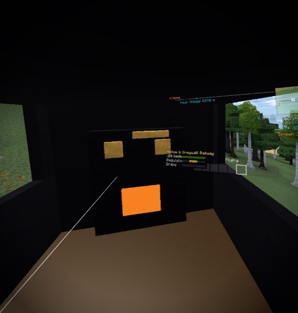

## 06:16:39 - Third person works though

- **Transcript:** Third person works though
- **Status:** open
- **Build:** 0.129 (27e81c04, M1-M4 (device-tested; ship riding, chests, comfort options, weapon wheel))
- **World:** New World (20) (seed 632461258612199693)
- **Dimension:** Surface
- **Biome:** Old Growth Birch Forest
- **Position:** 6743.0 80.8 -806.9
- **Facing:** west (yaw 257, pitch -35)
- **Held:** empty hand
- **Mount:** riding Minecart
- **Looking at:** nothing
- **Mode:** Creative, health 20/20
- **Time:** day 1 12:39, clear
- **Fps:** 72
- **Levels:** mic -45 dBFS, game sound -17 dBFS
- **Length:** 2.3 s (voice 0.9 s)
- **Just before:** -29s message: Flying; -23s message: Walking; -22s message: Hollow Point marked on the map; -19s message: Flying; -18s message: Walking; -16s message: Flying; -15s message: Hollow Point Station marked on the map; -14s walked into Birch Forest; -12s message: Greywall Pine Station marked on the map; -10s message: You found the Hollow & Greywall Railway: 2 stations, marked on your map; -9s walked into Old Growth Birch Forest; -7s walked into Birch Forest; -7s message: Entering Zoriland; -5s message: Walking; -3s message: Flying; -3s mounted Minecart; -2s message: Riding the Hollow & Greywall Railway
- **Repro (Mac):** `./snap.sh note --seed 632461258612199693 --x 6743.0 --z -806.9 --yaw 103 --pitch -35 --time 0.277`
- **Audio (this Mac):** /Users/darthvadar/Documents/Blocksmith/QuestVoiceNotes/raw/vn-20261112-061639-124.aac

## 06:16:44 - The train should have greater speed variety. Like if I want, I should 

- **Transcript:** The train should have greater speed variety. Like if I want, I should be able to speed the tr- speed the train up to like
- **Status:** open
- **Build:** 0.129 (27e81c04, M1-M4 (device-tested; ship riding, chests, comfort options, weapon wheel))
- **World:** New World (20) (seed 632461258612199693)
- **Dimension:** Surface
- **Biome:** Old Growth Birch Forest
- **Position:** 6669.4 72.9 -806.9
- **Facing:** west (yaw 257, pitch 1)
- **Held:** empty hand
- **Mount:** riding Minecart
- **Looking at:** nothing
- **Mode:** Creative, health 20/20
- **Time:** day 1 12:46, clear
- **Fps:** 41
- **Levels:** mic -27 dBFS, game sound -19 dBFS
- **Length:** 6.5 s (voice 3.7 s)
- **Just before:** -29s message: Walking; -27s message: Hollow Point marked on the map; -25s message: Flying; -24s message: Walking; -22s message: Flying; -20s message: Hollow Point Station marked on the map; -19s walked into Birch Forest; -18s message: Greywall Pine Station marked on the map; -16s message: You found the Hollow & Greywall Railway: 2 stations, marked on your map; -15s walked into Old Growth Birch Forest; -13s walked into Birch Forest; -12s message: Entering Zoriland; -10s message: Walking; -9s message: Flying; -8s mounted Minecart; -8s message: Riding the Hollow & Greywall Railway; -5s walked into Old Growth Birch Forest; -3s walked into Taiga; -1s walked into Old Growth Birch Forest
- **Position at the end:** 6616.6 70.7 -806.9
- **Repro (Mac):** `./snap.sh note --seed 632461258612199693 --x 6669.4 --z -806.9 --yaw 103 --pitch 1 --time 0.282`
- **Audio (this Mac):** /Users/darthvadar/Documents/Blocksmith/QuestVoiceNotes/raw/vn-20261112-061644-704.aac

## 06:16:51 - 100 or something

- **Transcript:** 100 or something
- **Status:** open
- **Build:** 0.129 (27e81c04, M1-M4 (device-tested; ship riding, chests, comfort options, weapon wheel))
- **World:** New World (20) (seed 632461258612199693)
- **Dimension:** Surface
- **Biome:** Birch Forest
- **Position:** 6605.2 69.8 -806.9
- **Facing:** west (yaw 256, pitch -27)
- **Held:** empty hand
- **Mount:** riding Minecart
- **Looking at:** nothing
- **Mode:** Creative, health 20/20
- **Time:** day 1 12:53, clear
- **Fps:** 71
- **Levels:** mic -30 dBFS, game sound -17 dBFS
- **Length:** 2.0 s (voice 0.7 s)
- **Just before:** -30s message: Walking; -28s message: Flying; -27s message: Hollow Point Station marked on the map; -25s walked into Birch Forest; -24s message: Greywall Pine Station marked on the map; -22s message: You found the Hollow & Greywall Railway: 2 stations, marked on your map; -21s walked into Old Growth Birch Forest; -19s walked into Birch Forest; -19s message: Entering Zoriland; -17s message: Walking; -15s message: Flying; -15s mounted Minecart; -14s message: Riding the Hollow & Greywall Railway; -11s walked into Old Growth Birch Forest; -9s walked into Taiga; -7s walked into Old Growth Birch Forest; -1s walked into Birch Forest
- **Repro (Mac):** `./snap.sh note --seed 632461258612199693 --x 6605.2 --z -806.9 --yaw 104 --pitch -27 --time 0.287`
- **Audio (this Mac):** /Users/darthvadar/Documents/Blocksmith/QuestVoiceNotes/raw/vn-20261112-061651-064.aac

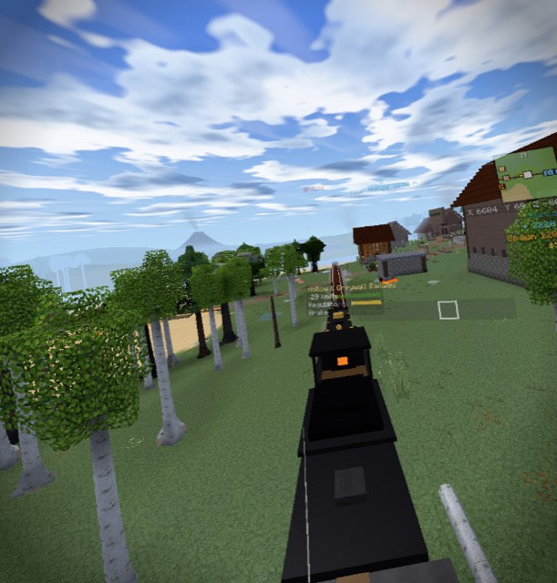

## 06:16:54 - That'll make you use more coal or something, which is like another gam

- **Transcript:** That'll make you use more coal or something, which is like another game mechanic
- **Status:** open
- **Build:** 0.129 (27e81c04, M1-M4 (device-tested; ship riding, chests, comfort options, weapon wheel))
- **World:** New World (20) (seed 632461258612199693)
- **Dimension:** Surface
- **Biome:** Ashen Grove
- **Position:** 6578.8 68.8 -806.9
- **Facing:** west (yaw 253, pitch -66)
- **Held:** empty hand
- **Mount:** riding Minecart
- **Looking at:** Gravel at 6577 66 -807
- **Mode:** Creative, health 20/20
- **Time:** day 1 12:58, clear
- **Fps:** 66
- **Levels:** mic -28 dBFS, game sound -19 dBFS
- **Length:** 4.5 s (voice 2.5 s)
- **Just before:** -29s walked into Birch Forest; -28s message: Greywall Pine Station marked on the map; -26s message: You found the Hollow & Greywall Railway: 2 stations, marked on your map; -25s walked into Old Growth Birch Forest; -23s walked into Birch Forest; -22s message: Entering Zoriland; -21s message: Walking; -19s message: Flying; -18s mounted Minecart; -18s message: Riding the Hollow & Greywall Railway; -15s walked into Old Growth Birch Forest; -13s walked into Taiga; -11s walked into Old Growth Birch Forest; -5s walked into Birch Forest; -3s message: Entering Belemoor
- **Repro (Mac):** `./snap.sh note --seed 632461258612199693 --x 6578.8 --z -806.9 --yaw 107 --pitch -66 --time 0.290`
- **Audio (this Mac):** /Users/darthvadar/Documents/Blocksmith/QuestVoiceNotes/raw/vn-20261112-061654-804.aac

## 06:17:00 - So like you can drive the train, you can make it go a long ways, but y

- **Transcript:** So like you can drive the train, you can make it go a long ways, but you gotta add coal to it
- **Status:** open
- **Build:** 0.129 (27e81c04, M1-M4 (device-tested; ship riding, chests, comfort options, weapon wheel))
- **World:** New World (20) (seed 632461258612199693)
- **Dimension:** Surface
- **Biome:** Birch Forest
- **Position:** 6553.2 70.0 -806.9
- **Facing:** west (yaw 272, pitch -44)
- **Held:** empty hand
- **Mount:** riding Minecart
- **Looking at:** Gravel at 6549 67 -808
- **Mode:** Creative, health 20/20
- **Time:** day 1 13:04, clear
- **Fps:** 70
- **Levels:** mic -41 dBFS, game sound -15 dBFS
- **Length:** 4.5 s (voice 2.6 s)
- **Just before:** -29s walked into Birch Forest; -28s message: Entering Zoriland; -26s message: Walking; -25s message: Flying; -24s mounted Minecart; -23s message: Riding the Hollow & Greywall Railway; -20s walked into Old Growth Birch Forest; -18s walked into Taiga; -16s walked into Old Growth Birch Forest; -10s walked into Birch Forest; -8s message: Entering Belemoor
- **Repro (Mac):** `./snap.sh note --seed 632461258612199693 --x 6553.2 --z -806.9 --yaw 88 --pitch -44 --time 0.295`
- **Audio (this Mac):** /Users/darthvadar/Documents/Blocksmith/QuestVoiceNotes/raw/vn-20261112-061700-204.aac

## 06:17:13 - Uh, another thing, the train is

- **Transcript:** Uh, another thing, the train is
- **Status:** open
- **Build:** 0.129 (27e81c04, M1-M4 (device-tested; ship riding, chests, comfort options, weapon wheel))
- **World:** New World (20) (seed 632461258612199693)
- **Dimension:** Surface
- **Biome:** Birch Forest
- **Position:** 6535.3 67.9 -806.9
- **Facing:** north-west (yaw 300, pitch -34)
- **Held:** empty hand
- **Mount:** riding Minecart
- **Looking at:** Grass Block at 6531 65 -810
- **Mode:** Creative, health 20/20
- **Time:** day 1 13:20, clear
- **Fps:** 47
- **Levels:** mic -26 dBFS, game sound -28 dBFS
- **Length:** 3.9 s (voice 2.3 s)
- **Just before:** -30s walked into Old Growth Birch Forest; -24s walked into Birch Forest; -22s message: Entering Belemoor; -9s message: Etta Calloway: Rain's coming. My knee knows.
- **Repro (Mac):** `./snap.sh note --seed 632461258612199693 --x 6535.3 --z -806.9 --yaw 60 --pitch -34 --time 0.306`
- **Audio (this Mac):** /Users/darthvadar/Documents/Blocksmith/QuestVoiceNotes/raw/vn-20261112-061713-324.aac

## 06:17:17 - I'm forced to stop the train at the village

- **Transcript:** I'm forced to stop the train at the village
- **Status:** open
- **Build:** 0.129 (27e81c04, M1-M4 (device-tested; ship riding, chests, comfort options, weapon wheel))
- **World:** New World (20) (seed 632461258612199693)
- **Dimension:** Surface
- **Biome:** Birch Forest
- **Position:** 6535.3 67.9 -806.9
- **Facing:** west (yaw 251, pitch -40)
- **Held:** empty hand
- **Mount:** riding Minecart
- **Looking at:** Gravel at 6531 65 -806
- **Mode:** Creative, health 20/20
- **Time:** day 1 13:25, clear
- **Fps:** 54
- **Levels:** mic -21 dBFS, game sound -18 dBFS
- **Length:** 4.1 s (voice 1.9 s)
- **Just before:** -28s walked into Birch Forest; -26s message: Entering Belemoor; -13s message: Etta Calloway: Rain's coming. My knee knows.
- **Repro (Mac):** `./snap.sh note --seed 632461258612199693 --x 6535.3 --z -806.9 --yaw 109 --pitch -40 --time 0.309`
- **Audio (this Mac):** /Users/darthvadar/Documents/Blocksmith/QuestVoiceNotes/raw/vn-20261112-061717-404.aac

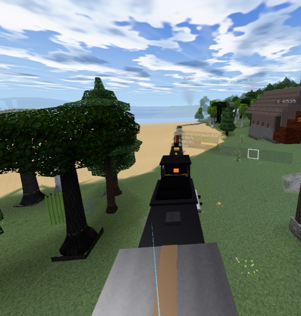

## 06:17:21 - I can't make it go anymore

- **Transcript:** I can't make it go anymore
- **Status:** open
- **Build:** 0.129 (27e81c04, M1-M4 (device-tested; ship riding, chests, comfort options, weapon wheel))
- **World:** New World (20) (seed 632461258612199693)
- **Dimension:** Surface
- **Biome:** Birch Forest
- **Position:** 6535.3 67.9 -806.9
- **Facing:** west (yaw 287, pitch -45)
- **Held:** empty hand
- **Mount:** riding Minecart
- **Looking at:** Gravel at 6532 65 -808
- **Mode:** Creative, health 20/20
- **Time:** day 1 13:30, clear
- **Fps:** 65
- **Levels:** mic -32 dBFS, game sound -15 dBFS
- **Length:** 2.5 s (voice 1.0 s)
- **Just before:** -30s message: Entering Belemoor; -17s message: Etta Calloway: Rain's coming. My knee knows.; -3s dismounted Minecart; -3s mounted Minecart; -3s message: Riding the Hollow & Greywall Railway
- **Repro (Mac):** `./snap.sh note --seed 632461258612199693 --x 6535.3 --z -806.9 --yaw 73 --pitch -45 --time 0.313`
- **Audio (this Mac):** /Users/darthvadar/Documents/Blocksmith/QuestVoiceNotes/raw/vn-20261112-061721-484.aac

## 06:17:31 - Also there's-- its wheels are squares. It doesn't make sense

- **Transcript:** Also there's-- its wheels are squares. It doesn't make sense
- **Status:** open
- **Build:** 0.129 (27e81c04, M1-M4 (device-tested; ship riding, chests, comfort options, weapon wheel))
- **World:** New World (20) (seed 632461258612199693)
- **Dimension:** Surface
- **Biome:** Taiga
- **Position:** 6535.0 66.7 -811.2
- **Facing:** south-west (yaw 211, pitch -26)
- **Held:** empty hand
- **Mount:** on foot
- **Looking at:** Gravel at 6532 65 -808
- **Mode:** Creative, health 20/20
- **Time:** day 1 13:41, clear
- **Fps:** 71
- **Levels:** mic -21 dBFS, game sound -21 dBFS
- **Length:** 4.8 s (voice 2.8 s)
- **Just before:** -26s message: Etta Calloway: Rain's coming. My knee knows.; -13s dismounted Minecart; -12s mounted Minecart; -12s message: Riding the Hollow & Greywall Railway; -3s dismounted Minecart; -1s walked into Taiga
- **Repro (Mac):** `./snap.sh note --seed 632461258612199693 --x 6535.0 --z -811.2 --yaw 149 --pitch -26 --time 0.321`
- **Audio (this Mac):** /Users/darthvadar/Documents/Blocksmith/QuestVoiceNotes/raw/vn-20261112-061731-184.aac

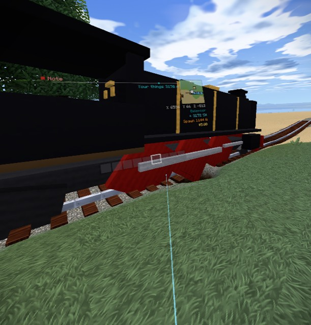

## 06:17:42 - So yeah, me pressing on the pedal doesn't do anything

- **Transcript:** So yeah, me pressing on the pedal doesn't do anything
- **Status:** open
- **Build:** 0.129 (27e81c04, M1-M4 (device-tested; ship riding, chests, comfort options, weapon wheel))
- **World:** New World (20) (seed 632461258612199693)
- **Dimension:** Surface
- **Biome:** Birch Forest
- **Position:** 6533.3 67.7 -806.9
- **Facing:** north-west (yaw 295, pitch -18)
- **Held:** empty hand
- **Mount:** riding Minecart
- **Looking at:** nothing
- **Mode:** Creative, health 20/20
- **Time:** day 1 13:55, clear
- **Fps:** 70
- **Levels:** mic -29 dBFS, game sound -20 dBFS
- **Length:** 4.3 s (voice 2.4 s)
- **Just before:** -24s dismounted Minecart; -24s mounted Minecart; -24s message: Riding the Hollow & Greywall Railway; -15s dismounted Minecart; -13s walked into Taiga; -7s walked into Birch Forest; -4s mounted Minecart
- **Repro (Mac):** `./snap.sh note --seed 632461258612199693 --x 6533.3 --z -806.9 --yaw 65 --pitch -18 --time 0.330`
- **Audio (this Mac):** /Users/darthvadar/Documents/Blocksmith/QuestVoiceNotes/raw/vn-20261112-061742-644.aac

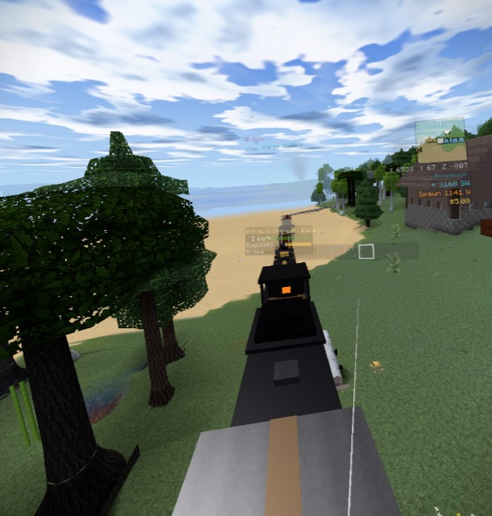

## 06:17:47 - Like a toy ride that kids get to use at the carnival that, like, they 

- **Transcript:** Like a toy ride that kids get to use at the carnival that, like, they think they're driving, but they're actually not. That's what I feel like right now
- **Status:** open
- **Build:** 0.129 (27e81c04, M1-M4 (device-tested; ship riding, chests, comfort options, weapon wheel))
- **World:** New World (20) (seed 632461258612199693)
- **Dimension:** Surface
- **Biome:** Birch Forest
- **Position:** 6528.3 67.0 -806.9
- **Facing:** north-west (yaw 322, pitch -56)
- **Held:** empty hand
- **Mount:** riding Minecart
- **Looking at:** Grass Block at 6527 65 -809
- **Mode:** Creative, health 20/20
- **Time:** day 1 14:01, clear
- **Fps:** 71
- **Levels:** mic -26 dBFS, game sound -22 dBFS
- **Length:** 10.1 s (voice 5.2 s)
- **Just before:** -29s dismounted Minecart; -28s mounted Minecart; -28s message: Riding the Hollow & Greywall Railway; -20s dismounted Minecart; -17s walked into Taiga; -11s walked into Birch Forest; -9s mounted Minecart
- **While talking:** -2s walked into Beach
- **Position at the end:** 6517.5 66.0 -806.9
- **Repro (Mac):** `./snap.sh note --seed 632461258612199693 --x 6528.3 --z -806.9 --yaw 38 --pitch -56 --time 0.334`
- **Audio (this Mac):** /Users/darthvadar/Documents/Blocksmith/QuestVoiceNotes/raw/vn-20261112-061747-424.aac

## 06:17:57 - Um, [lip smack] so the gravel

- **Transcript:** Um, [lip smack] so the gravel
- **Status:** open
- **Build:** 0.129 (27e81c04, M1-M4 (device-tested; ship riding, chests, comfort options, weapon wheel))
- **World:** New World (20) (seed 632461258612199693)
- **Dimension:** Surface
- **Biome:** Beach
- **Position:** 6498.9 65.8 -806.9
- **Facing:** west (yaw 258, pitch -40)
- **Held:** empty hand
- **Mount:** riding Minecart
- **Looking at:** Rail at 6495 64 -807
- **Mode:** Creative, health 20/20
- **Time:** day 1 14:13, clear
- **Fps:** 72
- **Levels:** mic -24 dBFS, game sound -20 dBFS
- **Length:** 5.3 s (voice 2.0 s)
- **Just before:** -30s dismounted Minecart; -27s walked into Taiga; -21s walked into Birch Forest; -19s mounted Minecart; -7s walked into Beach
- **Repro (Mac):** `./snap.sh note --seed 632461258612199693 --x 6498.9 --z -806.9 --yaw 102 --pitch -40 --time 0.343`
- **Audio (this Mac):** /Users/darthvadar/Documents/Blocksmith/QuestVoiceNotes/raw/vn-20261112-061757-444.aac

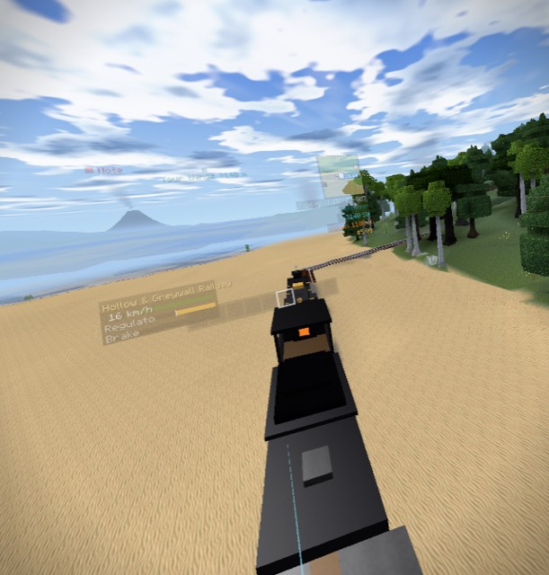

## 06:18:03 - Isn't disrupting the train, which is good. Um

- **Transcript:** Isn't disrupting the train, which is good. Um
- **Status:** open
- **Build:** 0.129 (27e81c04, M1-M4 (device-tested; ship riding, chests, comfort options, weapon wheel))
- **World:** New World (20) (seed 632461258612199693)
- **Dimension:** Surface
- **Biome:** Beach
- **Position:** 6472.9 66.7 -816.0
- **Facing:** west (yaw 286, pitch -34)
- **Held:** empty hand
- **Mount:** riding Minecart
- **Looking at:** nothing
- **Mode:** Creative, health 20/20
- **Time:** day 1 14:20, clear
- **Fps:** 72
- **Levels:** mic -29 dBFS, game sound -21 dBFS
- **Length:** 4.7 s (voice 2.6 s)
- **Just before:** -28s walked into Birch Forest; -25s mounted Minecart; -13s walked into Beach
- **Repro (Mac):** `./snap.sh note --seed 632461258612199693 --x 6472.9 --z -816.0 --yaw 74 --pitch -34 --time 0.348`
- **Audio (this Mac):** /Users/darthvadar/Documents/Blocksmith/QuestVoiceNotes/raw/vn-20261112-061803-665.aac

## 06:18:08 - Yeah, I was worried about that. Okay, this will be interesting

- **Transcript:** Yeah, I was worried about that. Okay, this will be interesting
- **Status:** open
- **Build:** 0.129 (27e81c04, M1-M4 (device-tested; ship riding, chests, comfort options, weapon wheel))
- **World:** New World (20) (seed 632461258612199693)
- **Dimension:** Surface
- **Biome:** Taiga
- **Position:** 6472.9 71.3 -852.3
- **Facing:** south (yaw 180, pitch 23)
- **Held:** empty hand
- **Mount:** riding Minecart
- **Looking at:** nothing
- **Mode:** Creative, health 20/20
- **Time:** day 1 14:26, clear
- **Fps:** 71
- **Levels:** mic -28 dBFS, game sound -19 dBFS
- **Length:** 4.5 s (voice 1.9 s)
- **Just before:** -30s mounted Minecart; -18s walked into Beach; -2s walked into Taiga
- **Repro (Mac):** `./snap.sh note --seed 632461258612199693 --x 6472.9 --z -852.3 --yaw 180 --pitch 23 --time 0.352`
- **Audio (this Mac):** /Users/darthvadar/Documents/Blocksmith/QuestVoiceNotes/raw/vn-20261112-061808-164.aac

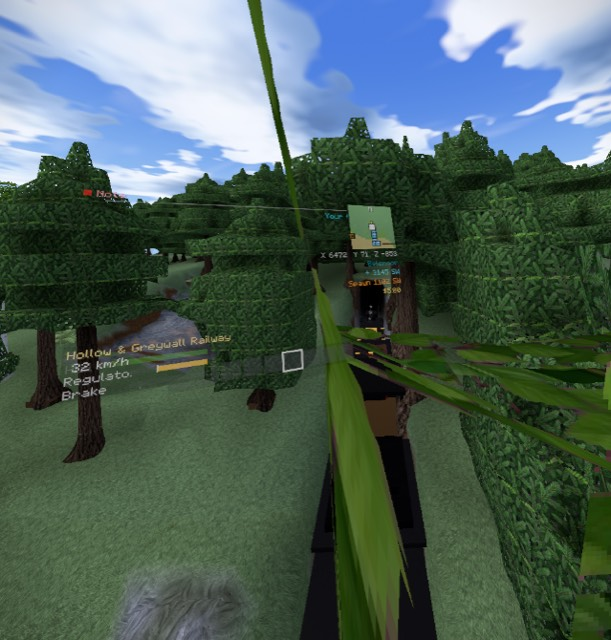

## 06:18:12 - Okay. Yeah. All right. Third-person camera does well in tunnels

- **Transcript:** Okay. Yeah. All right. Third-person camera does well in tunnels
- **Status:** open
- **Build:** 0.129 (27e81c04, M1-M4 (device-tested; ship riding, chests, comfort options, weapon wheel))
- **World:** New World (20) (seed 632461258612199693)
- **Dimension:** Surface
- **Biome:** Taiga
- **Position:** 6472.9 76.9 -897.6
- **Facing:** north (yaw 345, pitch -52)
- **Held:** empty hand
- **Mount:** riding Minecart
- **Looking at:** Gravel at 6472 74 -900
- **Mode:** Creative, health 20/20
- **Time:** day 1 14:31, clear
- **Fps:** 72
- **Levels:** mic -23 dBFS, game sound -17 dBFS
- **Length:** 3.8 s (voice 2.1 s)
- **Just before:** -22s walked into Beach; -6s walked into Taiga
- **Repro (Mac):** `./snap.sh note --seed 632461258612199693 --x 6472.9 --z -897.6 --yaw 15 --pitch -52 --time 0.355`
- **Audio (this Mac):** /Users/darthvadar/Documents/Blocksmith/QuestVoiceNotes/raw/vn-20261112-061812-604.aac

## 06:18:23 - Okay, this is gonna be interesting

- **Transcript:** Okay, this is gonna be interesting
- **Status:** open
- **Build:** 0.129 (27e81c04, M1-M4 (device-tested; ship riding, chests, comfort options, weapon wheel))
- **World:** New World (20) (seed 632461258612199693)
- **Dimension:** Surface
- **Biome:** Taiga
- **Position:** 6472.9 77.2 -1045.6
- **Facing:** north (yaw 349, pitch -43)
- **Held:** empty hand
- **Mount:** riding Minecart
- **Looking at:** Rail at 6472 76 -1048
- **Mode:** Creative, health 20/20
- **Time:** day 1 14:44, clear
- **Fps:** 71
- **Levels:** mic -30 dBFS, game sound -14 dBFS
- **Length:** 2.6 s (voice 0.9 s)
- **Just before:** -17s walked into Taiga
- **Repro (Mac):** `./snap.sh note --seed 632461258612199693 --x 6472.9 --z -1045.6 --yaw 11 --pitch -43 --time 0.364`
- **Audio (this Mac):** /Users/darthvadar/Documents/Blocksmith/QuestVoiceNotes/raw/vn-20261112-061823-244.aac

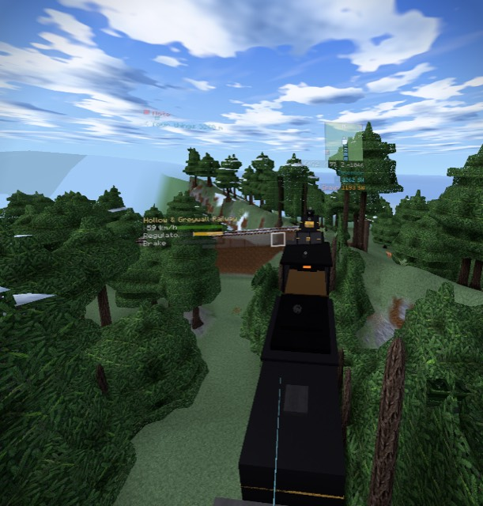

## 06:18:35 - It's having trouble, um, rendering fast enough for the train

- **Transcript:** It's having trouble, um, rendering fast enough for the train
- **Status:** open
- **Build:** 0.129 (27e81c04, M1-M4 (device-tested; ship riding, chests, comfort options, weapon wheel))
- **World:** New World (20) (seed 632461258612199693)
- **Dimension:** Surface
- **Biome:** Taiga
- **Position:** 6260.5 66.8 -1063.9
- **Facing:** west (yaw 271, pitch -26)
- **Held:** empty hand
- **Mount:** riding Minecart
- **Looking at:** nothing
- **Mode:** Creative, health 20/20
- **Time:** day 1 14:58, clear
- **Fps:** 72
- **Levels:** mic -22 dBFS, game sound -14 dBFS
- **Length:** 4.7 s (voice 2.7 s)
- **Just before:** -29s walked into Taiga
- **Repro (Mac):** `./snap.sh note --seed 632461258612199693 --x 6260.5 --z -1063.9 --yaw 89 --pitch -26 --time 0.374`
- **Audio (this Mac):** /Users/darthvadar/Documents/Blocksmith/QuestVoiceNotes/raw/vn-20261112-061835-144.aac

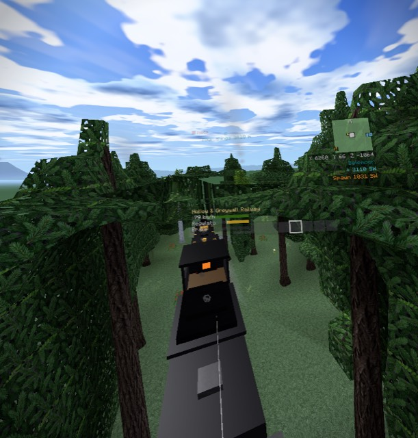

## 06:18:42 - Oh, okay. It's a little better now

- **Transcript:** Oh, okay. It's a little better now
- **Status:** open
- **Build:** 0.129 (27e81c04, M1-M4 (device-tested; ship riding, chests, comfort options, weapon wheel))
- **World:** New World (20) (seed 632461258612199693)
- **Dimension:** Surface
- **Biome:** Taiga
- **Position:** 6104.9 68.2 -1063.9
- **Facing:** south-west (yaw 245, pitch -46)
- **Held:** empty hand
- **Mount:** riding Minecart
- **Looking at:** Gravel at 6102 66 -1063
- **Mode:** Creative, health 20/20
- **Time:** day 1 15:06, clear
- **Fps:** 72
- **Levels:** mic -22 dBFS, game sound -14 dBFS
- **Length:** 3.1 s (voice 1.6 s)
- **Just before:** -2s opened PauseMenu; -1s closed PauseMenu
- **Repro (Mac):** `./snap.sh note --seed 632461258612199693 --x 6104.9 --z -1063.9 --yaw 115 --pitch -46 --time 0.380`
- **Audio (this Mac):** /Users/darthvadar/Documents/Blocksmith/QuestVoiceNotes/raw/vn-20261112-061842-604.aac

## 06:18:45 - Oh yeah? Okay, we're going up to 90 here. Very good

- **Transcript:** Oh yeah? Okay, we're going up to 90 here. Very good
- **Status:** open
- **Build:** 0.129 (27e81c04, M1-M4 (device-tested; ship riding, chests, comfort options, weapon wheel))
- **World:** New World (20) (seed 632461258612199693)
- **Dimension:** Surface
- **Biome:** Taiga
- **Position:** 6028.8 69.6 -1063.9
- **Facing:** west (yaw 254, pitch -32)
- **Held:** empty hand
- **Mount:** riding Minecart
- **Looking at:** nothing
- **Mode:** Creative, health 20/20
- **Time:** day 1 15:10, clear
- **Fps:** 72
- **Levels:** mic -21 dBFS, game sound -18 dBFS
- **Length:** 3.8 s (voice 2.1 s)
- **Just before:** -5s opened PauseMenu; -4s closed PauseMenu
- **Repro (Mac):** `./snap.sh note --seed 632461258612199693 --x 6028.8 --z -1063.9 --yaw 106 --pitch -32 --time 0.382`
- **Audio (this Mac):** /Users/darthvadar/Documents/Blocksmith/QuestVoiceNotes/raw/vn-20261112-061845-664.aac

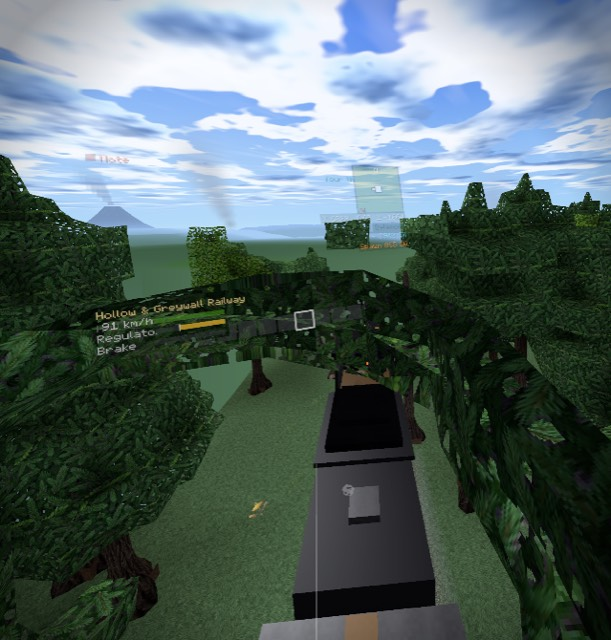

## 06:18:56 - For some reason, the game is having trouble rendering

- **Transcript:** For some reason, the game is having trouble rendering
- **Status:** open
- **Build:** 0.129 (27e81c04, M1-M4 (device-tested; ship riding, chests, comfort options, weapon wheel))
- **World:** New World (20) (seed 632461258612199693)
- **Dimension:** Surface
- **Biome:** Taiga
- **Position:** 5744.8 67.6 -1063.9
- **Facing:** west (yaw 254, pitch -26)
- **Held:** empty hand
- **Mount:** riding Minecart
- **Looking at:** nothing
- **Mode:** Creative, health 20/20
- **Time:** day 1 15:23, clear
- **Fps:** 72
- **Levels:** mic -22 dBFS, game sound -16 dBFS
- **Length:** 3.7 s (voice 2.3 s)
- **Just before:** -16s opened PauseMenu; -15s closed PauseMenu; -8s message: Sky isle marked on the map
- **Repro (Mac):** `./snap.sh note --seed 632461258612199693 --x 5744.8 --z -1063.9 --yaw 106 --pitch -26 --time 0.391`
- **Audio (this Mac):** /Users/darthvadar/Documents/Blocksmith/QuestVoiceNotes/raw/vn-20261112-061856-304.aac

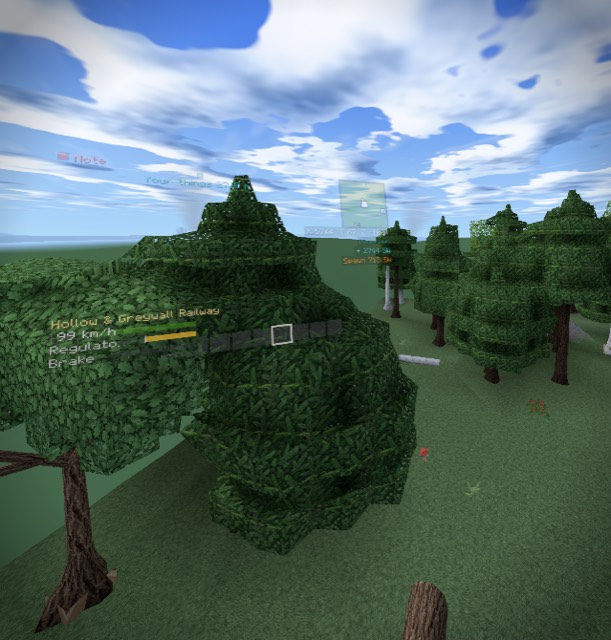

## 06:19:00 - It's not able to keep up with the train, which it should be able to. S

- **Transcript:** It's not able to keep up with the train, which it should be able to. So something about the train might not be optimized
- **Status:** open
- **Build:** 0.129 (27e81c04, M1-M4 (device-tested; ship riding, chests, comfort options, weapon wheel))
- **World:** New World (20) (seed 632461258612199693)
- **Dimension:** Surface
- **Biome:** Taiga
- **Position:** 5642.2 66.2 -1063.9
- **Facing:** south-west (yaw 239, pitch -22)
- **Held:** empty hand
- **Mount:** riding Minecart
- **Looking at:** nothing
- **Mode:** Creative, health 20/20
- **Time:** day 1 15:27, clear
- **Fps:** 72
- **Levels:** mic -23 dBFS, game sound -16 dBFS
- **Length:** 7.1 s (voice 4.0 s)
- **Just before:** -19s opened PauseMenu; -19s closed PauseMenu; -11s message: Sky isle marked on the map
- **Position at the end:** 5501.8 68.6 -1063.9
- **Repro (Mac):** `./snap.sh note --seed 632461258612199693 --x 5642.2 --z -1063.9 --yaw 121 --pitch -22 --time 0.394`
- **Audio (this Mac):** /Users/darthvadar/Documents/Blocksmith/QuestVoiceNotes/raw/vn-20261112-061900-004.aac

## 06:19:12 - But this is actually awesome

- **Transcript:** But this is actually awesome
- **Status:** open
- **Build:** 0.129 (27e81c04, M1-M4 (device-tested; ship riding, chests, comfort options, weapon wheel))
- **World:** New World (20) (seed 632461258612199693)
- **Dimension:** Surface
- **Biome:** Cold Ocean
- **Position:** 5302.4 65.8 -1063.9
- **Facing:** south-west (yaw 245, pitch -17)
- **Held:** empty hand
- **Mount:** riding Minecart
- **Looking at:** nothing
- **Mode:** Creative, health 20/20
- **Time:** day 1 15:42, clear
- **Fps:** 72
- **Levels:** mic -23 dBFS, game sound -18 dBFS
- **Length:** 2.7 s (voice 1.3 s)
- **Just before:** -24s message: Sky isle marked on the map; -2s walked into Beach
- **Repro (Mac):** `./snap.sh note --seed 632461258612199693 --x 5302.4 --z -1063.9 --yaw 115 --pitch -17 --time 0.404`
- **Audio (this Mac):** /Users/darthvadar/Documents/Blocksmith/QuestVoiceNotes/raw/vn-20261112-061912-204.aac

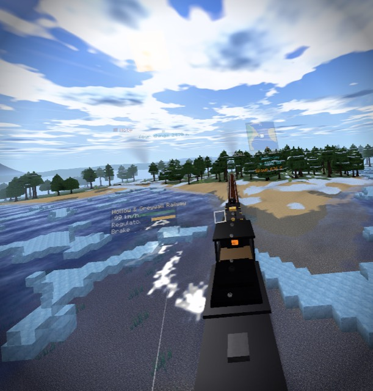

## 06:19:15 - Um, another thing, we need to make sure is that the tracks aren't so a

- **Transcript:** Um, another thing, we need to make sure is that the tracks aren't so autistic. Like currently they're following block patterns, okay? It's like latitude and longitude. We want them to be able to go diagonal and like this kind of tracks back to the whole polygonal problem with the world. Like
- **Status:** open
- **Build:** 0.129 (27e81c04, M1-M4 (device-tested; ship riding, chests, comfort options, weapon wheel))
- **World:** New World (20) (seed 632461258612199693)
- **Dimension:** Surface
- **Biome:** Taiga
- **Position:** 5224.1 66.2 -1055.8
- **Facing:** east (yaw 111, pitch 5)
- **Held:** empty hand
- **Mount:** riding Minecart
- **Looking at:** Gravel at 5224 63 -1053
- **Mode:** Creative, health 20/20
- **Time:** day 1 15:46, clear
- **Fps:** 56
- **Levels:** mic -24 dBFS, game sound -19 dBFS
- **Length:** 20.4 s (voice 11.6 s)
- **Just before:** -27s message: Sky isle marked on the map; -5s walked into Beach; -3s walked into Cold Ocean; -1s walked into Taiga
- **While talking:** -4s walked into Beach; -2s walked into Taiga; -3s walked into Beach; -1s walked into Taiga; -4s walked into Old Growth Spruce Taiga; -2s walked into Taiga
- **Position at the end:** 5029.2 66.8 -883.9
- **Repro (Mac):** `./snap.sh note --seed 632461258612199693 --x 5224.1 --z -1055.8 --yaw -111 --pitch 5 --time 0.407`
- **Audio (this Mac):** /Users/darthvadar/Documents/Blocksmith/QuestVoiceNotes/raw/vn-20261112-061915-365.aac

## 06:19:36 - We don't want polygons. Diagonal is a value, okay? It's not just up an

- **Transcript:** We don't want polygons. Diagonal is a value, okay? It's not just up and down, side to side. Things can also be diagonal. So we'll make the tracks just that way, make it so that they like
- **Status:** open
- **Build:** 0.129 (27e81c04, M1-M4 (device-tested; ship riding, chests, comfort options, weapon wheel))
- **World:** New World (20) (seed 632461258612199693)
- **Dimension:** Surface
- **Biome:** Old Growth Pine Taiga
- **Position:** 4910.2 69.6 -883.9
- **Facing:** east (yaw 90, pitch 24)
- **Held:** empty hand
- **Mount:** riding Minecart
- **Looking at:** nothing
- **Mode:** Creative, health 20/20
- **Time:** day 1 16:10, clear
- **Fps:** 72
- **Levels:** mic -25 dBFS, game sound -16 dBFS
- **Length:** 14.8 s (voice 8.9 s)
- **Just before:** -25s walked into Beach; -23s walked into Cold Ocean; -21s walked into Taiga; -19s walked into Beach; -17s walked into Taiga; -13s walked into Beach; -11s walked into Taiga; -9s walked into Old Growth Spruce Taiga; -7s walked into Taiga
- **While talking:** -4s walked into Old Growth Pine Taiga; -2s walked into Taiga; -0s walked into Old Growth Pine Taiga
- **Position at the end:** 4740.8 69.8 -883.9
- **Repro (Mac):** `./snap.sh note --seed 632461258612199693 --x 4910.2 --z -883.9 --yaw -90 --pitch 24 --time 0.424`
- **Audio (this Mac):** /Users/darthvadar/Documents/Blocksmith/QuestVoiceNotes/raw/vn-20261112-061936-144.aac

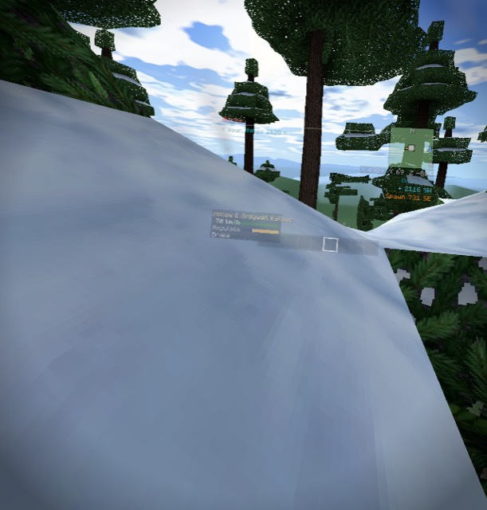

## 06:19:51 - Wha-- 'cause when they turn, do a 90-degree turn, that's not natural

- **Transcript:** Wha-- 'cause when they turn, do a 90-degree turn, that's not natural
- **Status:** open
- **Build:** 0.129 (27e81c04, M1-M4 (device-tested; ship riding, chests, comfort options, weapon wheel))
- **World:** New World (20) (seed 632461258612199693)
- **Dimension:** Surface
- **Biome:** Taiga
- **Position:** 4676.3 70.8 -883.9
- **Facing:** east (yaw 90, pitch 24)
- **Held:** empty hand
- **Mount:** riding Minecart
- **Looking at:** nothing
- **Mode:** Creative, health 20/20
- **Time:** day 1 16:28, clear
- **Fps:** 72
- **Levels:** mic -29 dBFS, game sound -15 dBFS
- **Length:** 4.6 s (voice 2.5 s)
- **Just before:** -28s walked into Beach; -26s walked into Taiga; -24s walked into Old Growth Spruce Taiga; -22s walked into Taiga; -14s walked into Old Growth Pine Taiga; -12s walked into Taiga; -10s walked into Old Growth Pine Taiga; -0s walked into Taiga
- **Repro (Mac):** `./snap.sh note --seed 632461258612199693 --x 4676.3 --z -883.9 --yaw -90 --pitch 24 --time 0.437`
- **Audio (this Mac):** /Users/darthvadar/Documents/Blocksmith/QuestVoiceNotes/raw/vn-20261112-061951-024.aac

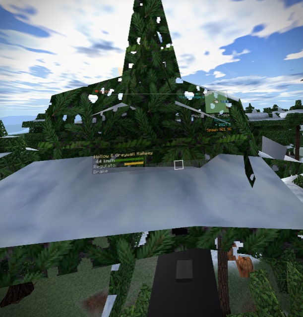

## 06:19:55 - Yeah, it's really weird

- **Transcript:** Yeah, it's really weird
- **Status:** open
- **Build:** 0.129 (27e81c04, M1-M4 (device-tested; ship riding, chests, comfort options, weapon wheel))
- **World:** New World (20) (seed 632461258612199693)
- **Dimension:** Surface
- **Biome:** Taiga
- **Position:** 4627.4 71.8 -883.9
- **Facing:** east (yaw 90, pitch 24)
- **Held:** empty hand
- **Mount:** riding Minecart
- **Looking at:** nothing
- **Mode:** Creative, health 20/20
- **Time:** day 1 16:34, clear
- **Fps:** 72
- **Levels:** mic -44 dBFS, game sound -16 dBFS
- **Length:** 2.0 s (voice 0.8 s)
- **Just before:** -29s walked into Old Growth Spruce Taiga; -27s walked into Taiga; -19s walked into Old Growth Pine Taiga; -17s walked into Taiga; -15s walked into Old Growth Pine Taiga; -5s walked into Taiga
- **Repro (Mac):** `./snap.sh note --seed 632461258612199693 --x 4627.4 --z -883.9 --yaw -90 --pitch 24 --time 0.440`
- **Audio (this Mac):** /Users/darthvadar/Documents/Blocksmith/QuestVoiceNotes/raw/vn-20261112-061955-484.aac

## 06:19:58 - Anyway, otherwise trains are excellent. Very, very good. Very impresse

- **Transcript:** Anyway, otherwise trains are excellent. Very, very good. Very impressed
- **Status:** open
- **Build:** 0.129 (27e81c04, M1-M4 (device-tested; ship riding, chests, comfort options, weapon wheel))
- **World:** New World (20) (seed 632461258612199693)
- **Dimension:** Surface
- **Biome:** Taiga
- **Position:** 4586.6 78.0 -884.2
- **Facing:** west (yaw 248, pitch -45)
- **Held:** empty hand
- **Mount:** on foot, flying
- **Looking at:** nothing
- **Mode:** Creative, health 20/20
- **Time:** day 1 16:37, clear
- **Fps:** 72
- **Levels:** mic -28 dBFS, game sound -18 dBFS
- **Length:** 5.2 s (voice 2.3 s)
- **Just before:** -30s walked into Taiga; -22s walked into Old Growth Pine Taiga; -20s walked into Taiga; -18s walked into Old Growth Pine Taiga; -8s walked into Taiga; -2s dismounted Minecart; -2s message: Flying; -0s message: Clear Creek marked on the map
- **Repro (Mac):** `./snap.sh note --seed 632461258612199693 --x 4586.6 --z -884.2 --yaw 112 --pitch -45 --time 0.443`
- **Audio (this Mac):** /Users/darthvadar/Documents/Blocksmith/QuestVoiceNotes/raw/vn-20261112-061958-464.aac

## 06:20:11 - All right, let's see how it works when we use a gun

- **Transcript:** All right, let's see how it works when we use a gun
- **Status:** open
- **Build:** 0.129 (27e81c04, M1-M4 (device-tested; ship riding, chests, comfort options, weapon wheel))
- **World:** New World (20) (seed 632461258612199693)
- **Dimension:** Surface
- **Biome:** Plains
- **Position:** 3861.1 151.1 922.4
- **Facing:** south-east (yaw 157, pitch -61)
- **Held:** empty hand
- **Mount:** on foot, flying
- **Looking at:** nothing
- **Mode:** Creative, health 20/20
- **Time:** day 1 16:53, clear
- **Fps:** 68
- **Levels:** mic -23 dBFS, game sound -22 dBFS
- **Length:** 4.0 s (voice 2.3 s)
- **Just before:** -21s walked into Taiga; -16s dismounted Minecart; -15s message: Flying; -14s message: Clear Creek marked on the map; -12s message: Juniper Outpost Station marked on the map; -9s message: Clear Creek Station marked on the map; -7s message: You found the Juniper & Clear Western: 2 stations, marked on your map; -5s walked into Dark Forest; -4s message: Entering Quelendor; -3s walked into Forest; -1s walked into Savanna; -0s message: Entering Harionia
- **Repro (Mac):** `./snap.sh note --seed 632461258612199693 --x 3861.1 --z 922.4 --yaw -157 --pitch -61 --time 0.454`
- **Audio (this Mac):** /Users/darthvadar/Documents/Blocksmith/QuestVoiceNotes/raw/vn-20261112-062011-964.aac

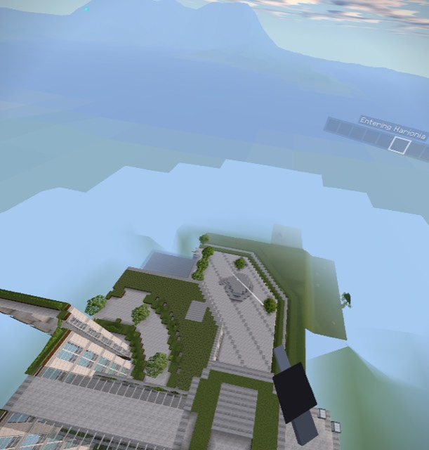

## 06:20:18 - Okay, I gotta get into the gun

- **Transcript:** Okay, I gotta get into the gun
- **Status:** open
- **Build:** 0.129 (27e81c04, M1-M4 (device-tested; ship riding, chests, comfort options, weapon wheel))
- **World:** New World (20) (seed 632461258612199693)
- **Dimension:** Surface
- **Biome:** Plains
- **Position:** 3859.5 114.0 924.2
- **Facing:** south-east (yaw 116, pitch -72)
- **Held:** empty hand
- **Mount:** on foot
- **Looking at:** Capital Grey Stone at 3860 113 924
- **Mode:** Creative, health 20/20
- **Time:** day 1 17:02, clear
- **Fps:** 70
- **Levels:** mic -31 dBFS, game sound -24 dBFS
- **Length:** 3.2 s (voice 1.2 s)
- **Just before:** -28s walked into Taiga; -22s dismounted Minecart; -22s message: Flying; -21s message: Clear Creek marked on the map; -19s message: Juniper Outpost Station marked on the map; -16s message: Clear Creek Station marked on the map; -14s message: You found the Juniper & Clear Western: 2 stations, marked on your map; -12s walked into Dark Forest; -11s message: Entering Quelendor; -10s walked into Forest; -8s walked into Savanna; -7s message: Entering Harionia; -6s walked into Plains; -5s message: Walking
- **Repro (Mac):** `./snap.sh note --seed 632461258612199693 --x 3859.5 --z 924.2 --yaw -116 --pitch -72 --time 0.460`
- **Audio (this Mac):** /Users/darthvadar/Documents/Blocksmith/QuestVoiceNotes/raw/vn-20261112-062018-784.aac

## 06:20:26 - All right, here we go. Okay, one problem, the barrels are disconnected

- **Transcript:** All right, here we go. Okay, one problem, the barrels are disconnected from the gun, and this back bar thing is also disconnected. That has to be fixed
- **Status:** open
- **Build:** 0.129 (27e81c04, M1-M4 (device-tested; ship riding, chests, comfort options, weapon wheel))
- **World:** New World (20) (seed 632461258612199693)
- **Dimension:** Surface
- **Biome:** Plains
- **Position:** 3862.6 119.5 924.8
- **Facing:** north-west (yaw 317, pitch -39)
- **Held:** empty hand
- **Mount:** on foot
- **Looking at:** nothing
- **Mode:** Creative, health 20/20
- **Time:** day 1 17:10, clear
- **Fps:** 71
- **Levels:** mic -26 dBFS, game sound -21 dBFS
- **Length:** 9.7 s (voice 4.9 s)
- **Just before:** -30s dismounted Minecart; -29s message: Flying; -28s message: Clear Creek marked on the map; -26s message: Juniper Outpost Station marked on the map; -23s message: Clear Creek Station marked on the map; -21s message: You found the Juniper & Clear Western: 2 stations, marked on your map; -19s walked into Dark Forest; -18s message: Entering Quelendor; -17s walked into Forest; -15s walked into Savanna; -14s message: Entering Harionia; -13s walked into Plains; -13s message: Walking; -2s message: Manning the deck gun
- **While talking:** -5s message: Gun Control: the gun overhead, worked from this computer
- **Position at the end:** 3858.0 119.5 923.8
- **Repro (Mac):** `./snap.sh note --seed 632461258612199693 --x 3862.6 --z 924.8 --yaw 43 --pitch -39 --time 0.466`
- **Audio (this Mac):** /Users/darthvadar/Documents/Blocksmith/QuestVoiceNotes/raw/vn-20261112-062026-004.aac

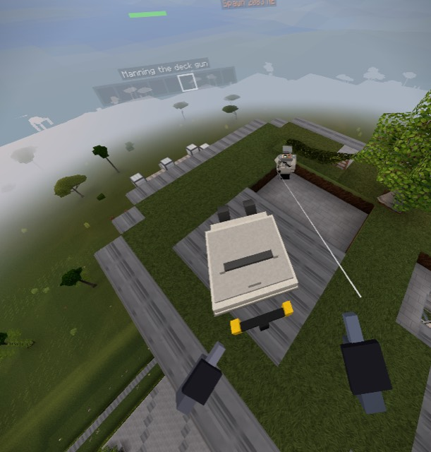

## 06:20:36 - Oh yeah. [laughs]

- **Transcript:** Oh yeah. [laughs]
- **Status:** open
- **Build:** 0.129 (27e81c04, M1-M4 (device-tested; ship riding, chests, comfort options, weapon wheel))
- **World:** New World (20) (seed 632461258612199693)
- **Dimension:** Surface
- **Biome:** Plains
- **Position:** 3858.1 119.5 924.0
- **Facing:** east (yaw 79, pitch -3)
- **Held:** empty hand
- **Mount:** on foot
- **Looking at:** nothing
- **Mode:** Creative, health 20/20
- **Time:** day 1 17:23, clear
- **Fps:** 72
- **Levels:** mic -30 dBFS, game sound -16 dBFS
- **Length:** 3.2 s (voice 0.9 s)
- **Just before:** -30s walked into Dark Forest; -28s message: Entering Quelendor; -28s walked into Forest; -26s walked into Savanna; -25s message: Entering Harionia; -24s walked into Plains; -23s message: Walking; -12s message: Manning the deck gun; -10s message: Gun Control: the gun overhead, worked from this computer; -4s message: The citadel is on lockdown!
- **Repro (Mac):** `./snap.sh note --seed 632461258612199693 --x 3858.1 --z 924.0 --yaw -79 --pitch -3 --time 0.475`
- **Audio (this Mac):** /Users/darthvadar/Documents/Blocksmith/QuestVoiceNotes/raw/vn-20261112-062036-664.aac

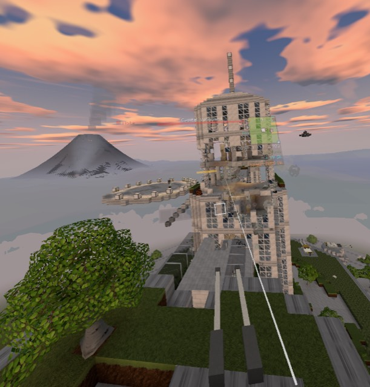

## 06:20:39 - Very good

- **Transcript:** Very good
- **Status:** open
- **Build:** 0.129 (27e81c04, M1-M4 (device-tested; ship riding, chests, comfort options, weapon wheel))
- **World:** New World (20) (seed 632461258612199693)
- **Dimension:** Surface
- **Biome:** Plains
- **Position:** 3858.2 119.5 922.6
- **Facing:** east (yaw 112, pitch 0)
- **Held:** empty hand
- **Mount:** on foot
- **Looking at:** nothing
- **Mode:** Creative, health 20/20
- **Time:** day 1 17:27, clear
- **Fps:** 72
- **Levels:** mic -26 dBFS, game sound -13 dBFS
- **Length:** 1.7 s (voice 0.7 s)
- **Just before:** -29s walked into Savanna; -28s message: Entering Harionia; -27s walked into Plains; -26s message: Walking; -15s message: Manning the deck gun; -13s message: Gun Control: the gun overhead, worked from this computer; -6s message: The citadel is on lockdown!
- **Repro (Mac):** `./snap.sh note --seed 632461258612199693 --x 3858.2 --z 922.6 --yaw -112 --pitch 0 --time 0.477`
- **Audio (this Mac):** /Users/darthvadar/Documents/Blocksmith/QuestVoiceNotes/raw/vn-20261112-062039-544.aac

## 06:20:51 - Uh, we got a hovering, uh, part of the building here. That's bad

- **Transcript:** Uh, we got a hovering, uh, part of the building here. That's bad
- **Status:** open
- **Build:** 0.129 (27e81c04, M1-M4 (device-tested; ship riding, chests, comfort options, weapon wheel))
- **World:** New World (20) (seed 632461258612199693)
- **Dimension:** Surface
- **Biome:** Plains
- **Position:** 3858.0 119.5 923.8
- **Facing:** east (yaw 83, pitch 20)
- **Held:** empty hand
- **Mount:** on foot
- **Looking at:** nothing
- **Mode:** Creative, health 20/20
- **Time:** day 1 17:41, clear
- **Fps:** 70
- **Levels:** mic -21 dBFS, game sound -20 dBFS
- **Length:** 4.7 s (voice 2.8 s)
- **Just before:** -27s message: Manning the deck gun; -25s message: Gun Control: the gun overhead, worked from this computer; -18s message: The citadel is on lockdown!; -10s message: A Capital patrol sets out to investigate
- **Repro (Mac):** `./snap.sh note --seed 632461258612199693 --x 3858.0 --z 923.8 --yaw -83 --pitch 20 --time 0.487`
- **Audio (this Mac):** /Users/darthvadar/Documents/Blocksmith/QuestVoiceNotes/raw/vn-20261112-062051-504.aac

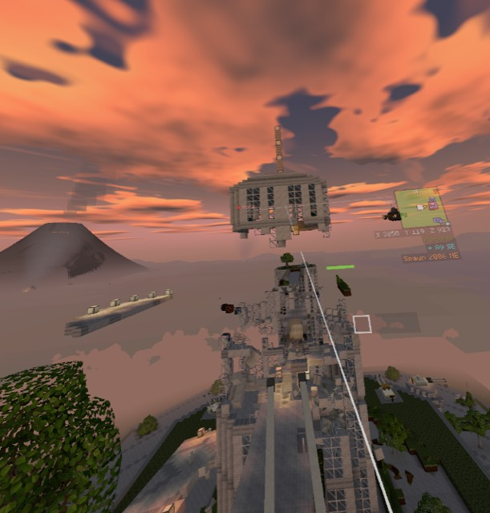

## 06:21:17 - Also that helipad's hovering

- **Transcript:** Also that helipad's hovering
- **Status:** open
- **Build:** 0.129 (27e81c04, M1-M4 (device-tested; ship riding, chests, comfort options, weapon wheel))
- **World:** New World (20) (seed 632461258612199693)
- **Dimension:** Surface
- **Biome:** Plains
- **Position:** 3858.7 119.5 925.2
- **Facing:** north-east (yaw 46, pitch -5)
- **Held:** empty hand
- **Mount:** on foot
- **Looking at:** nothing
- **Mode:** Creative, health 20/20
- **Time:** day 1 18:12, clear
- **Fps:** 72
- **Levels:** mic -26 dBFS, game sound -18 dBFS
- **Length:** 2.8 s (voice 1.2 s)
- **Just before:** -22s message: The turret is wrecked; -17s message: You have your things back
- **Repro (Mac):** `./snap.sh note --seed 632461258612199693 --x 3858.7 --z 925.2 --yaw -46 --pitch -5 --time 0.509`
- **Audio (this Mac):** /Users/darthvadar/Documents/Blocksmith/QuestVoiceNotes/raw/vn-20261112-062117-104.aac

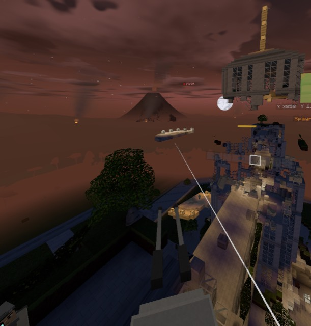

## 06:21:27 - This thing should also have limited ammunition

- **Transcript:** This thing should also have limited ammunition
- **Status:** open
- **Build:** 0.129 (27e81c04, M1-M4 (device-tested; ship riding, chests, comfort options, weapon wheel))
- **World:** New World (20) (seed 632461258612199693)
- **Dimension:** Surface
- **Biome:** Plains
- **Position:** 3858.2 119.5 922.5
- **Facing:** south-east (yaw 114, pitch -27)
- **Held:** empty hand
- **Mount:** on foot
- **Looking at:** nothing
- **Mode:** Creative, health 20/20
- **Time:** day 1 18:24, clear
- **Fps:** 70
- **Levels:** mic -41 dBFS, game sound -12 dBFS
- **Length:** 3.5 s (voice 2.1 s)
- **Just before:** -28s message: You have your things back; -2s message: The turret is wrecked
- **Repro (Mac):** `./snap.sh note --seed 632461258612199693 --x 3858.2 --z 922.5 --yaw -114 --pitch -27 --time 0.517`
- **Audio (this Mac):** /Users/darthvadar/Documents/Blocksmith/QuestVoiceNotes/raw/vn-20261112-062127-524.aac

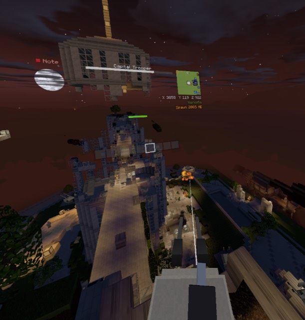

## 06:21:50 - Otherwise, very impressed. The game handled that well

- **Transcript:** Otherwise, very impressed. The game handled that well
- **Status:** open
- **Build:** 0.129 (27e81c04, M1-M4 (device-tested; ship riding, chests, comfort options, weapon wheel))
- **World:** New World (20) (seed 632461258612199693)
- **Dimension:** Surface
- **Biome:** Plains
- **Position:** 3860.3 108.9 922.8
- **Facing:** east (yaw 93, pitch -58)
- **Held:** empty hand
- **Mount:** on foot
- **Looking at:** Capital Stone at 3862 106 922
- **Mode:** Creative, health 20/20
- **Time:** day 1 18:52, clear
- **Fps:** 68
- **Levels:** mic -23 dBFS, game sound -18 dBFS
- **Length:** 3.5 s (voice 2.0 s)
- **Just before:** -26s message: The turret is wrecked
- **Repro (Mac):** `./snap.sh note --seed 632461258612199693 --x 3860.3 --z 922.8 --yaw -93 --pitch -58 --time 0.537`
- **Audio (this Mac):** /Users/darthvadar/Documents/Blocksmith/QuestVoiceNotes/raw/vn-20261112-062150-744.aac

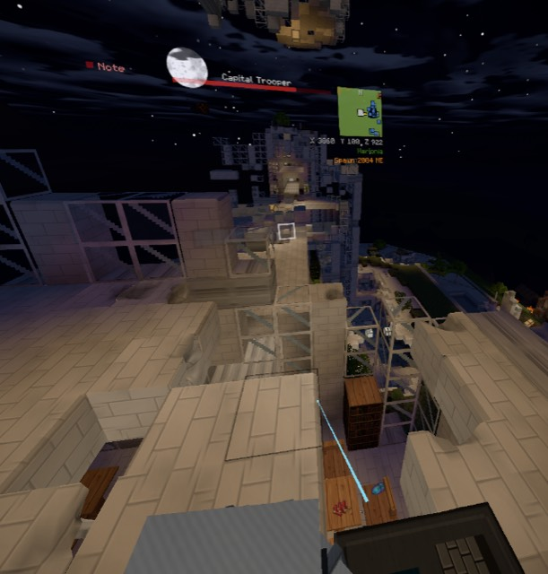

## 06:22:11 - 1:30.17

- **Transcript:** 1:30.17
- **Status:** open
- **Build:** 0.129 (27e81c04, M1-M4 (device-tested; ship riding, chests, comfort options, weapon wheel))
- **World:** New World (20) (seed 632461258612199693)
- **Dimension:** Surface
- **Biome:** Plains
- **Position:** 3869.6 116.6 965.4
- **Facing:** east (yaw 94, pitch -29)
- **Held:** empty hand
- **Mount:** on foot, flying
- **Looking at:** nothing
- **Mode:** Creative, health 20/20, screen CommandMenu
- **Time:** day 1 19:13, clear
- **Fps:** 72
- **Levels:** mic -34 dBFS, game sound -13 dBFS
- **Length:** 2.6 s (voice 0.8 s)
- **Just before:** -21s message: Flying; -19s opened PauseMenu; -16s opened CommandMenu; -14s message: Sealed Armoury: 4200 ~ 856 (348 blocks, underground: its floor at y -22, 93 blocks under the surface), marked on your map; -4s message: A Capital Dropship is landing troops!
- **Repro (Mac):** `./snap.sh note --seed 632461258612199693 --x 3869.6 --z 965.4 --yaw -94 --pitch -29 --time 0.551`
- **Audio (this Mac):** /Users/darthvadar/Documents/Blocksmith/QuestVoiceNotes/raw/vn-20261112-062211-584.aac

## 06:22:56 - What is in here anyway?

- **Transcript:** What is in here anyway?
- **Status:** open
- **Build:** 0.129 (27e81c04, M1-M4 (device-tested; ship riding, chests, comfort options, weapon wheel))
- **World:** New World (20) (seed 632461258612199693)
- **Dimension:** Surface
- **Biome:** Dark Forest
- **Position:** 12899.4 165.7 1721.6
- **Facing:** east (yaw 93, pitch -45)
- **Held:** empty hand
- **Mount:** on foot
- **Looking at:** nothing
- **Mode:** Creative, health 20/20
- **Time:** day 1 20:06, clear
- **Fps:** 68
- **Levels:** mic -30 dBFS, game sound -18 dBFS
- **Length:** 2.3 s (voice 1.0 s)
- **Just before:** -29s walked into Dark Forest; -29s message: Walking; -22s message: Flying; -13s walked into Jungle; -12s opened PauseMenu; -11s opened CommandMenu; -9s closed CommandMenu; -7s walked into Dark Forest; -1s message: Walking
- **Repro (Mac):** `./snap.sh note --seed 632461258612199693 --x 12899.4 --z 1721.6 --yaw -93 --pitch -45 --time 0.588`
- **Audio (this Mac):** /Users/darthvadar/Documents/Blocksmith/QuestVoiceNotes/raw/vn-20261112-062256-204.aac

## 06:22:58 - Very nice windows in here

- **Transcript:** Very nice windows in here
- **Status:** open
- **Build:** 0.129 (27e81c04, M1-M4 (device-tested; ship riding, chests, comfort options, weapon wheel))
- **World:** New World (20) (seed 632461258612199693)
- **Dimension:** Surface
- **Biome:** Dark Forest
- **Position:** 12900.5 151.2 1715.7
- **Facing:** north (yaw 7, pitch -7)
- **Held:** empty hand
- **Mount:** on foot
- **Looking at:** Dark Oak Planks at 12901 152 1709
- **Mode:** Creative, health 20/20
- **Time:** day 1 20:09, clear
- **Fps:** 68
- **Levels:** mic -33 dBFS, game sound -15 dBFS
- **Length:** 2.8 s (voice 1.0 s)
- **Just before:** -24s message: Flying; -15s walked into Jungle; -14s opened PauseMenu; -14s opened CommandMenu; -11s closed CommandMenu; -9s walked into Dark Forest; -4s message: Walking
- **Repro (Mac):** `./snap.sh note --seed 632461258612199693 --x 12900.5 --z 1715.7 --yaw -7 --pitch -7 --time 0.590`
- **Audio (this Mac):** /Users/darthvadar/Documents/Blocksmith/QuestVoiceNotes/raw/vn-20261112-062258-584.aac

## 06:23:05 - Okay. Nice

- **Transcript:** Okay. Nice
- **Status:** open
- **Build:** 0.129 (27e81c04, M1-M4 (device-tested; ship riding, chests, comfort options, weapon wheel))
- **World:** New World (20) (seed 632461258612199693)
- **Dimension:** Surface
- **Biome:** Dark Forest
- **Position:** 12904.2 150.8 1697.9
- **Facing:** north-east (yaw 29, pitch -5)
- **Held:** empty hand
- **Mount:** on foot
- **Looking at:** nothing
- **Mode:** Creative, health 20/20
- **Time:** day 1 20:18, clear
- **Fps:** 72
- **Levels:** mic -41 dBFS, game sound -20 dBFS
- **Length:** 2.8 s (voice 0.4 s)
- **Just before:** -23s walked into Jungle; -22s opened PauseMenu; -21s opened CommandMenu; -18s closed CommandMenu; -16s walked into Dark Forest; -11s message: Walking
- **Repro (Mac):** `./snap.sh note --seed 632461258612199693 --x 12904.2 --z 1697.9 --yaw -29 --pitch -5 --time 0.596`
- **Audio (this Mac):** /Users/darthvadar/Documents/Blocksmith/QuestVoiceNotes/raw/vn-20261112-062305-944.aac

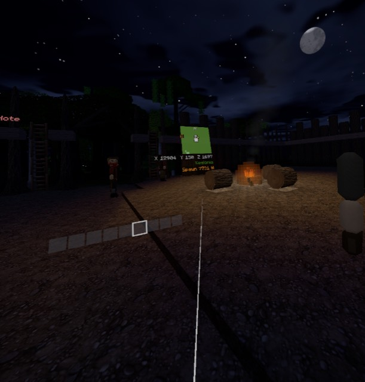

## 06:23:17 - All right

- **Transcript:** All right
- **Status:** open
- **Build:** 0.129 (27e81c04, M1-M4 (device-tested; ship riding, chests, comfort options, weapon wheel))
- **World:** New World (20) (seed 632461258612199693)
- **Dimension:** Surface
- **Biome:** Dark Forest
- **Position:** 12932.4 160.5 1653.8
- **Facing:** north-east (yaw 40, pitch -10)
- **Held:** empty hand
- **Mount:** on foot, flying
- **Looking at:** nothing
- **Mode:** Creative, health 20/20, screen CommandMenu
- **Time:** day 1 20:26, clear
- **Fps:** 67
- **Levels:** mic -40 dBFS, game sound -19 dBFS
- **Length:** 1.8 s (voice 0.4 s)
- **Just before:** -30s closed CommandMenu; -28s walked into Dark Forest; -22s message: Walking; -10s message: Flying; -7s opened PauseMenu; -3s opened CommandMenu
- **Repro (Mac):** `./snap.sh note --seed 632461258612199693 --x 12932.4 --z 1653.8 --yaw -40 --pitch -10 --time 0.602`
- **Audio (this Mac):** /Users/darthvadar/Documents/Blocksmith/QuestVoiceNotes/raw/vn-20261112-062317-184.aac

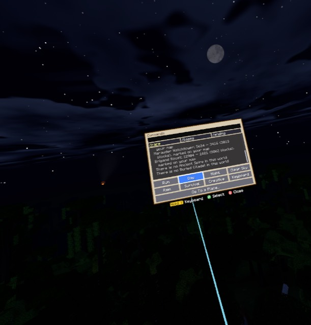

## 06:23:28 - 44.96

- **Transcript:** 44.96
- **Status:** open
- **Build:** 0.129 (27e81c04, M1-M4 (device-tested; ship riding, chests, comfort options, weapon wheel))
- **World:** New World (20) (seed 632461258612199693)
- **Dimension:** Surface
- **Biome:** Dark Forest
- **Position:** 12932.2 160.5 1653.8
- **Facing:** north-east (yaw 26, pitch 5)
- **Held:** empty hand
- **Mount:** on foot, flying
- **Looking at:** nothing
- **Mode:** Creative, health 20/20
- **Time:** day 1 20:39, clear
- **Fps:** 70
- **Levels:** mic -36 dBFS, game sound -24 dBFS
- **Length:** 2.4 s (voice 0.7 s)
- **Just before:** -21s message: Flying; -18s opened PauseMenu; -14s opened CommandMenu; -6s message: Capital Citadel: 12488 ~ 1340 (544 blocks), marked on your map; -0s closed CommandMenu
- **Repro (Mac):** `./snap.sh note --seed 632461258612199693 --x 12932.2 --z 1653.8 --yaw -26 --pitch 5 --time 0.611`
- **Audio (this Mac):** /Users/darthvadar/Documents/Blocksmith/QuestVoiceNotes/raw/vn-20261112-062328-084.aac

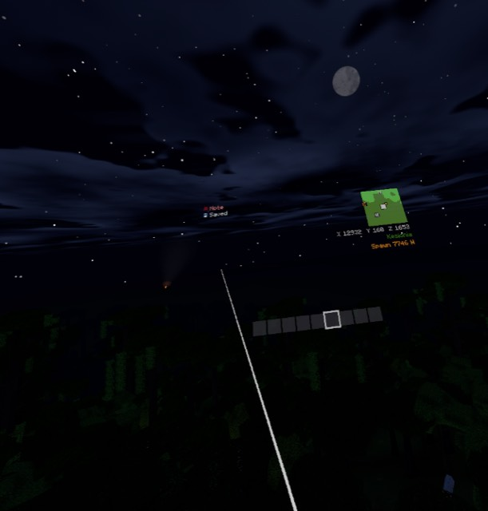

## 06:24:06 - What the heck? Okay, we're going this way

- **Transcript:** What the heck? Okay, we're going this way
- **Status:** open
- **Build:** 0.129 (27e81c04, M1-M4 (device-tested; ship riding, chests, comfort options, weapon wheel))
- **World:** New World (20) (seed 632461258612199693)
- **Dimension:** Surface
- **Biome:** Frozen Ocean
- **Position:** 7188.3 450.8 7089.9
- **Facing:** north-east (yaw 63, pitch -9)
- **Held:** empty hand
- **Mount:** on foot, flying
- **Looking at:** nothing
- **Mode:** Creative, health 20/20
- **Time:** day 1 21:25, clear
- **Fps:** 72
- **Levels:** mic -31 dBFS, game sound -19 dBFS
- **Length:** 3.3 s (voice 0.9 s)
- **Just before:** -29s message: Entering Gorivaal; -29s walked into Forest; -27s walked into Lukewarm Ocean; -26s message: Entering Goronia; -25s walked into Plains; -23s message: Entering Quelmark; -23s walked into Jungle; -21s walked into Desert; -19s walked into Sparse Jungle; -18s message: Entering Goronia; -17s walked into Plains; -16s message: Sky isle marked on the map; -15s walked into Desert; -14s message: Entering Gorivaal; -13s walked into Frozen Ocean; -12s message: Entering Harestad; -11s walked into Snowy Taiga; -10s message: Entering Rhoimoor; -9s message: Sky isle marked on the map; -9s walked into Snowy Plains; -7s message: Entering Ardomark; -7s walked into Snowy Taiga; -4s message: Entering Rhoimoor; -3s walked into Cold Ocean; -1s walked into Frozen Ocean
- **Repro (Mac):** `./snap.sh note --seed 632461258612199693 --x 7188.3 --z 7089.9 --yaw -63 --pitch -9 --time 0.643`
- **Audio (this Mac):** /Users/darthvadar/Documents/Blocksmith/QuestVoiceNotes/raw/vn-20261112-062406-344.aac

## 06:24:19 - Now, guess what?

- **Transcript:** Now, guess what?
- **Status:** open
- **Build:** 0.129 (27e81c04, M1-M4 (device-tested; ship riding, chests, comfort options, weapon wheel))
- **World:** New World (20) (seed 632461258612199693)
- **Dimension:** Surface
- **Biome:** Jagged Peaks
- **Position:** 4679.9 450.8 7406.0
- **Facing:** south (yaw 163, pitch -25)
- **Held:** empty hand
- **Mount:** on foot, flying
- **Looking at:** nothing
- **Mode:** Creative, health 20/20
- **Time:** day 1 21:41, clear
- **Fps:** 72
- **Levels:** mic -34 dBFS, game sound -18 dBFS
- **Length:** 2.9 s (voice 0.6 s)
- **Just before:** -29s walked into Plains; -29s message: Sky isle marked on the map; -27s walked into Desert; -27s message: Entering Gorivaal; -25s walked into Frozen Ocean; -25s message: Entering Harestad; -23s walked into Snowy Taiga; -23s message: Entering Rhoimoor; -21s message: Sky isle marked on the map; -21s walked into Snowy Plains; -20s message: Entering Ardomark; -19s walked into Snowy Taiga; -16s message: Entering Rhoimoor; -15s walked into Cold Ocean; -13s walked into Frozen Ocean; -11s walked into Deep Frozen Ocean; -7s message: Entering Calowick; -7s walked into Taiga; -6s message: A homestead, fenced against the wild. Someone's home.; -5s walked into Snowy Slopes; -3s walked into Jagged Peaks; -3s message: Homestead marked on the map
- **Repro (Mac):** `./snap.sh note --seed 632461258612199693 --x 4679.9 --z 7406.0 --yaw -163 --pitch -25 --time 0.654`
- **Audio (this Mac):** /Users/darthvadar/Documents/Blocksmith/QuestVoiceNotes/raw/vn-20261112-062419-044.aac

## 06:24:29 - Can't see shit, I tell you

- **Transcript:** Can't see shit, I tell you
- **Status:** open
- **Build:** 0.129 (27e81c04, M1-M4 (device-tested; ship riding, chests, comfort options, weapon wheel))
- **World:** New World (20) (seed 632461258612199693)
- **Dimension:** Surface
- **Biome:** Snowy Taiga
- **Position:** 4859.0 426.6 7930.0
- **Facing:** south-east (yaw 131, pitch -44)
- **Held:** empty hand
- **Mount:** on foot
- **Looking at:** nothing
- **Mode:** Creative, health 20/20
- **Time:** day 1 21:54, clear
- **Fps:** 72
- **Levels:** mic -33 dBFS, game sound -21 dBFS
- **Length:** 2.7 s (voice 0.9 s)
- **Just before:** -27s message: Entering Rhoimoor; -26s walked into Cold Ocean; -24s walked into Frozen Ocean; -22s walked into Deep Frozen Ocean; -18s message: Entering Calowick; -18s walked into Taiga; -16s message: A homestead, fenced against the wild. Someone's home.; -16s walked into Snowy Slopes; -14s walked into Jagged Peaks; -14s message: Homestead marked on the map; -6s walked into Snowy Slopes; -2s walked into Snowy Taiga; -1s message: Walking
- **Repro (Mac):** `./snap.sh note --seed 632461258612199693 --x 4859.0 --z 7930.0 --yaw -131 --pitch -44 --time 0.663`
- **Audio (this Mac):** /Users/darthvadar/Documents/Blocksmith/QuestVoiceNotes/raw/vn-20261112-062429-824.aac

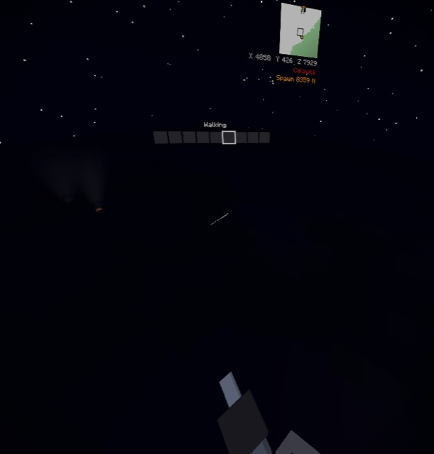

## 06:24:57 - There it is

- **Transcript:** There it is
- **Status:** open
- **Build:** 0.129 (27e81c04, M1-M4 (device-tested; ship riding, chests, comfort options, weapon wheel))
- **World:** New World (20) (seed 632461258612199693)
- **Dimension:** Surface
- **Biome:** Plains
- **Position:** 4700.1 148.2 9614.8
- **Facing:** south-west (yaw 225, pitch -34)
- **Held:** empty hand
- **Mount:** on foot, flying
- **Looking at:** nothing
- **Mode:** Creative, health 20/20
- **Time:** day 1 22:26, clear
- **Fps:** 72
- **Levels:** mic -32 dBFS, game sound -28 dBFS
- **Length:** 1.8 s (voice 0.4 s)
- **Just before:** -29s walked into Snowy Taiga; -29s message: Walking; -26s message: Flying; -24s message: Walking; -23s walked into Taiga; -18s message: Flying; -11s walked into Forest; -9s walked into Taiga; -8s message: Entering Draenria; -5s walked into Plains; -3s message: The ground shakes: an Ironback Crawler is near
- **Repro (Mac):** `./snap.sh note --seed 632461258612199693 --x 4700.1 --z 9614.8 --yaw 135 --pitch -34 --time 0.685`
- **Audio (this Mac):** /Users/darthvadar/Documents/Blocksmith/QuestVoiceNotes/raw/vn-20261112-062457-244.aac

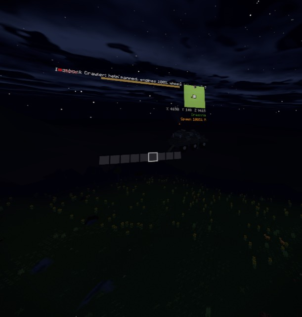

## 06:25:00 - Let's see how well this does

- **Transcript:** Let's see how well this does
- **Status:** open
- **Build:** 0.129 (27e81c04, M1-M4 (device-tested; ship riding, chests, comfort options, weapon wheel))
- **World:** New World (20) (seed 632461258612199693)
- **Dimension:** Surface
- **Biome:** Desert
- **Position:** 4474.2 148.2 9668.3
- **Facing:** west (yaw 248, pitch -44)
- **Held:** empty hand
- **Mount:** on foot, flying
- **Looking at:** nothing
- **Mode:** Creative, health 20/20
- **Time:** day 1 22:30, clear
- **Fps:** 72
- **Levels:** mic -26 dBFS, game sound -16 dBFS
- **Length:** 2.3 s (voice 0.9 s)
- **Just before:** -29s message: Flying; -26s message: Walking; -26s walked into Taiga; -21s message: Flying; -14s walked into Forest; -12s walked into Taiga; -11s message: Entering Draenria; -8s walked into Plains; -6s message: The ground shakes: an Ironback Crawler is near; -2s message: Ironback crawler patrol marked on the map; -2s walked into Sunflower Plains; -0s walked into Desert
- **Repro (Mac):** `./snap.sh note --seed 632461258612199693 --x 4474.2 --z 9668.3 --yaw 112 --pitch -44 --time 0.688`
- **Audio (this Mac):** /Users/darthvadar/Documents/Blocksmith/QuestVoiceNotes/raw/vn-20261112-062500-044.aac

## 06:25:07 - Okay, the layout inside is still fucked. There's way too many beds, wa

- **Transcript:** Okay, the layout inside is still fucked. There's way too many beds, way too many chairs. The whole layout of this place needs to be redone. This is ridiculous. Make it realistic, like
- **Status:** open
- **Build:** 0.129 (27e81c04, M1-M4 (device-tested; ship riding, chests, comfort options, weapon wheel))
- **World:** New World (20) (seed 632461258612199693)
- **Dimension:** Surface
- **Biome:** Desert
- **Position:** 4453.4 105.7 9697.7
- **Facing:** south (yaw 199, pitch -14)
- **Held:** empty hand
- **Mount:** on foot
- **Looking at:** nothing
- **Mode:** Creative, health 20/20
- **Time:** day 1 22:38, clear
- **Fps:** 71
- **Levels:** mic -25 dBFS, game sound -22 dBFS
- **Length:** 9.3 s (voice 5.4 s)
- **Just before:** -28s message: Flying; -21s walked into Forest; -19s walked into Taiga; -18s message: Entering Draenria; -15s walked into Plains; -13s message: The ground shakes: an Ironback Crawler is near; -9s message: Ironback crawler patrol marked on the map; -9s walked into Sunflower Plains; -7s walked into Desert; -7s message: Walking
- **Position at the end:** 4447.5 105.5 9708.3
- **Repro (Mac):** `./snap.sh note --seed 632461258612199693 --x 4453.4 --z 9697.7 --yaw 161 --pitch -14 --time 0.694`
- **Audio (this Mac):** /Users/darthvadar/Documents/Blocksmith/QuestVoiceNotes/raw/vn-20261112-062507-084.aac

## 06:25:16 - What would an actual high-tech iron crawler have inside? Like, what wo

- **Transcript:** What would an actual high-tech iron crawler have inside? Like, what would it look like?
- **Status:** open
- **Build:** 0.129 (27e81c04, M1-M4 (device-tested; ship riding, chests, comfort options, weapon wheel))
- **World:** New World (20) (seed 632461258612199693)
- **Dimension:** Surface
- **Biome:** Desert
- **Position:** 4454.7 109.3 9723.4
- **Facing:** south-west (yaw 203, pitch -29)
- **Held:** empty hand
- **Mount:** on foot, flying
- **Looking at:** nothing
- **Mode:** Creative, health 20/20
- **Time:** day 1 22:50, clear
- **Fps:** 70
- **Levels:** mic -24 dBFS, game sound -21 dBFS
- **Length:** 5.3 s (voice 3.0 s)
- **Just before:** -29s walked into Taiga; -28s message: Entering Draenria; -25s walked into Plains; -23s message: The ground shakes: an Ironback Crawler is near; -19s message: Ironback crawler patrol marked on the map; -19s walked into Sunflower Plains; -17s walked into Desert; -16s message: Walking; -1s message: Flying
- **Repro (Mac):** `./snap.sh note --seed 632461258612199693 --x 4454.7 --z 9723.4 --yaw 157 --pitch -29 --time 0.701`
- **Audio (this Mac):** /Users/darthvadar/Documents/Blocksmith/QuestVoiceNotes/raw/vn-20261112-062516-504.aac

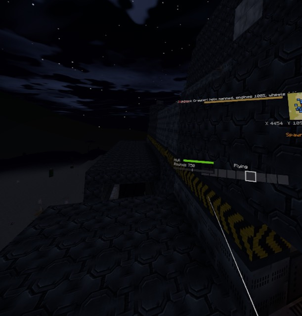

## 06:25:37 - All right, so

- **Transcript:** All right, so
- **Status:** open
- **Build:** 0.129 (27e81c04, M1-M4 (device-tested; ship riding, chests, comfort options, weapon wheel))
- **World:** New World (20) (seed 632461258612199693)
- **Dimension:** Surface
- **Biome:** Desert
- **Position:** 4504.9 111.9 9805.5
- **Facing:** south-east (yaw 136, pitch -25)
- **Held:** empty hand
- **Mount:** piloting Ironback Crawler
- **Looking at:** nothing
- **Mode:** Creative, health 20/20
- **Time:** day 1 23:14, clear
- **Fps:** 72
- **Levels:** mic -23 dBFS, game sound -24 dBFS
- **Length:** 2.6 s (voice 0.9 s)
- **Just before:** -22s message: Flying; -20s message: Walking; -14s message: The Ironback Crawler's helm is locked; -11s opened PauseMenu; -10s closed PauseMenu; -10s opened CreativeMenu; -8s into the pack: Titanium Sword; -8s closed CreativeMenu; -7s holding Titanium Sword; -7s message: Titanium Sword; -4s holding empty hand; -3s piloting Ironback Crawler; -3s message: Steering Ironback Crawler; -1s message: You have taken command of the Ironback Crawler!
- **Repro (Mac):** `./snap.sh note --seed 632461258612199693 --x 4504.9 --z 9805.5 --yaw -136 --pitch -25 --time 0.718`
- **Audio (this Mac):** /Users/darthvadar/Documents/Blocksmith/QuestVoiceNotes/raw/vn-20261112-062537-124.aac

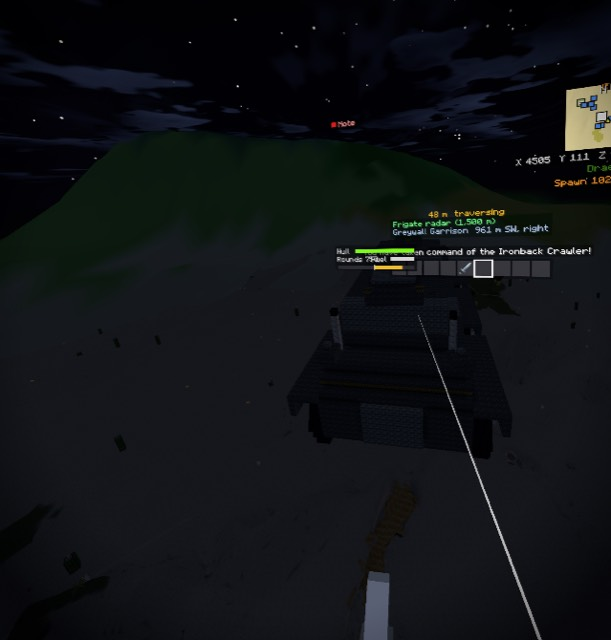

## 06:25:40 - See how well it can render things here

- **Transcript:** See how well it can render things here
- **Status:** open
- **Build:** 0.129 (27e81c04, M1-M4 (device-tested; ship riding, chests, comfort options, weapon wheel))
- **World:** New World (20) (seed 632461258612199693)
- **Dimension:** Surface
- **Biome:** Desert
- **Position:** 4527.8 116.4 9861.7
- **Facing:** south-west (yaw 231, pitch -24)
- **Held:** empty hand
- **Mount:** piloting Ironback Crawler
- **Looking at:** nothing
- **Mode:** Creative, health 20/20
- **Time:** day 1 23:17, clear
- **Fps:** 72
- **Levels:** mic -24 dBFS, game sound -13 dBFS
- **Length:** 3.1 s (voice 1.5 s)
- **Just before:** -24s message: Flying; -23s message: Walking; -17s message: The Ironback Crawler's helm is locked; -14s opened PauseMenu; -13s closed PauseMenu; -13s opened CreativeMenu; -11s into the pack: Titanium Sword; -11s closed CreativeMenu; -10s holding Titanium Sword; -10s message: Titanium Sword; -7s holding empty hand; -6s piloting Ironback Crawler; -6s message: Steering Ironback Crawler; -4s message: You have taken command of the Ironback Crawler!; -2s message: Greywall Garrison marked on the map
- **Repro (Mac):** `./snap.sh note --seed 632461258612199693 --x 4527.8 --z 9861.7 --yaw 129 --pitch -24 --time 0.721`
- **Audio (this Mac):** /Users/darthvadar/Documents/Blocksmith/QuestVoiceNotes/raw/vn-20261112-062540-064.aac

## 06:25:45 - I am running this thing at maximum speed

- **Transcript:** I am running this thing at maximum speed
- **Status:** open
- **Build:** 0.129 (27e81c04, M1-M4 (device-tested; ship riding, chests, comfort options, weapon wheel))
- **World:** New World (20) (seed 632461258612199693)
- **Dimension:** Surface
- **Biome:** Savanna
- **Position:** 4512.0 128.1 9998.7
- **Facing:** south (yaw 187, pitch -3)
- **Held:** empty hand
- **Mount:** piloting Ironback Crawler
- **Looking at:** nothing
- **Mode:** Creative, health 20/20
- **Time:** day 1 23:24, clear
- **Fps:** 72
- **Levels:** mic -32 dBFS, game sound -21 dBFS
- **Length:** 3.7 s (voice 2.0 s)
- **Just before:** -30s message: Flying; -28s message: Walking; -23s message: The Ironback Crawler's helm is locked; -19s opened PauseMenu; -19s closed PauseMenu; -18s opened CreativeMenu; -16s into the pack: Titanium Sword; -16s closed CreativeMenu; -16s holding Titanium Sword; -16s message: Titanium Sword; -12s holding empty hand; -11s piloting Ironback Crawler; -11s message: Steering Ironback Crawler; -10s message: You have taken command of the Ironback Crawler!; -7s message: Greywall Garrison marked on the map; -3s walked into Savanna
- **Repro (Mac):** `./snap.sh note --seed 632461258612199693 --x 4512.0 --z 9998.7 --yaw 173 --pitch -3 --time 0.725`
- **Audio (this Mac):** /Users/darthvadar/Documents/Blocksmith/QuestVoiceNotes/raw/vn-20261112-062545-464.aac

## 06:25:49 - It is. Let's try its best

- **Transcript:** It is. Let's try its best
- **Status:** open
- **Build:** 0.129 (27e81c04, M1-M4 (device-tested; ship riding, chests, comfort options, weapon wheel))
- **World:** New World (20) (seed 632461258612199693)
- **Dimension:** Surface
- **Biome:** Plains
- **Position:** 4496.5 105.8 10101.7
- **Facing:** south (yaw 158, pitch -28)
- **Held:** empty hand
- **Mount:** piloting Ironback Crawler
- **Looking at:** nothing
- **Mode:** Creative, health 20/20
- **Time:** day 1 23:28, clear
- **Fps:** 72
- **Levels:** mic -36 dBFS, game sound -18 dBFS
- **Length:** 4.5 s (voice 2.0 s)
- **Just before:** -27s message: The Ironback Crawler's helm is locked; -23s opened PauseMenu; -23s closed PauseMenu; -22s opened CreativeMenu; -20s into the pack: Titanium Sword; -20s closed CreativeMenu; -20s holding Titanium Sword; -20s message: Titanium Sword; -16s holding empty hand; -15s piloting Ironback Crawler; -15s message: Steering Ironback Crawler; -14s message: You have taken command of the Ironback Crawler!; -11s message: Greywall Garrison marked on the map; -7s walked into Savanna; -1s walked into Plains
- **Repro (Mac):** `./snap.sh note --seed 632461258612199693 --x 4496.5 --z 10101.7 --yaw -158 --pitch -28 --time 0.728`
- **Audio (this Mac):** /Users/darthvadar/Documents/Blocksmith/QuestVoiceNotes/raw/vn-20261112-062549-444.aac

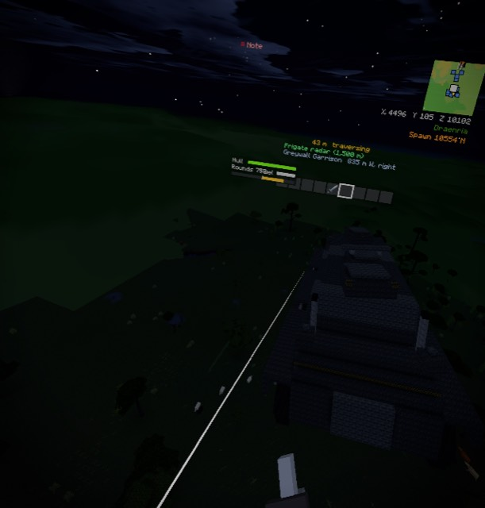

## 06:26:05 - Yeah, it's, uh, still having a lot of trouble, which, I mean, I unders

- **Transcript:** Yeah, it's, uh, still having a lot of trouble, which, I mean, I understand, but
- **Status:** open
- **Build:** 0.129 (27e81c04, M1-M4 (device-tested; ship riding, chests, comfort options, weapon wheel))
- **World:** New World (20) (seed 632461258612199693)
- **Dimension:** Surface
- **Biome:** Sparse Jungle
- **Position:** 4596.0 87.8 10432.5
- **Facing:** north-east (yaw 31, pitch -6)
- **Held:** empty hand
- **Mount:** piloting Ironback Crawler
- **Looking at:** nothing
- **Mode:** Creative, health 20/20
- **Time:** day 1 23:48, clear
- **Fps:** 71
- **Levels:** mic -26 dBFS, game sound -21 dBFS
- **Length:** 6.5 s (voice 3.1 s)
- **Just before:** -30s message: You have taken command of the Ironback Crawler!; -27s message: Greywall Garrison marked on the map; -24s walked into Savanna; -18s walked into Plains; -16s walked into Sparse Jungle; -12s walked into Plains; -8s walked into Forest; -7s message: Greywall Fortress marked on the map; -4s walked into Sparse Jungle; -2s walked into Forest
- **While talking:** -3s message: Entering Ithria; -1s walked into Plains
- **Position at the end:** 4652.2 88.9 10558.7
- **Repro (Mac):** `./snap.sh note --seed 632461258612199693 --x 4596.0 --z 10432.5 --yaw -31 --pitch -6 --time 0.742`
- **Audio (this Mac):** /Users/darthvadar/Documents/Blocksmith/QuestVoiceNotes/raw/vn-20261112-062605-844.aac

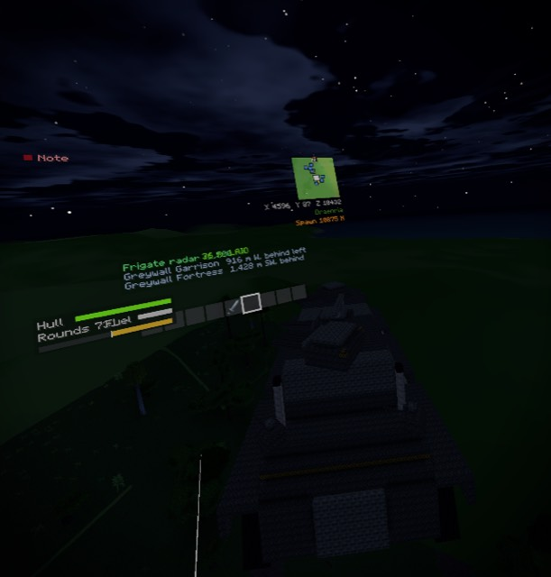

## 06:26:12 - Yeah, it's, it's still really struggling to render

- **Transcript:** Yeah, it's, it's still really struggling to render
- **Status:** open
- **Build:** 0.129 (27e81c04, M1-M4 (device-tested; ship riding, chests, comfort options, weapon wheel))
- **World:** New World (20) (seed 632461258612199693)
- **Dimension:** Surface
- **Biome:** Sparse Jungle
- **Position:** 4666.6 89.2 10601.4
- **Facing:** east (yaw 76, pitch -32)
- **Held:** empty hand
- **Mount:** piloting Ironback Crawler
- **Looking at:** nothing
- **Mode:** Creative, health 20/20
- **Time:** day 1 23:56, clear
- **Fps:** 71
- **Levels:** mic -30 dBFS, game sound -13 dBFS
- **Length:** 3.5 s (voice 1.8 s)
- **Just before:** -24s walked into Plains; -22s walked into Sparse Jungle; -18s walked into Plains; -14s walked into Forest; -14s message: Greywall Fortress marked on the map; -10s walked into Sparse Jungle; -8s walked into Forest; -5s message: Entering Ithria; -2s walked into Plains; -0s walked into Sparse Jungle
- **Repro (Mac):** `./snap.sh note --seed 632461258612199693 --x 4666.6 --z 10601.4 --yaw -76 --pitch -32 --time 0.748`
- **Audio (this Mac):** /Users/darthvadar/Documents/Blocksmith/QuestVoiceNotes/raw/vn-20261112-062612-504.aac

## 06:26:16 - Everything? Well, everything's pretty smooth though, but still

- **Transcript:** Everything? Well, everything's pretty smooth though, but still
- **Status:** open
- **Build:** 0.129 (27e81c04, M1-M4 (device-tested; ship riding, chests, comfort options, weapon wheel))
- **World:** New World (20) (seed 632461258612199693)
- **Dimension:** Surface
- **Biome:** Sparse Jungle
- **Position:** 4715.3 87.8 10697.6
- **Facing:** north-east (yaw 56, pitch -14)
- **Held:** empty hand
- **Mount:** piloting Ironback Crawler
- **Looking at:** nothing
- **Mode:** Creative, health 20/20
- **Time:** day 1 00:01, clear
- **Fps:** 72
- **Levels:** mic -39 dBFS, game sound -17 dBFS
- **Length:** 3.6 s (voice 1.6 s)
- **Just before:** -29s walked into Plains; -27s walked into Sparse Jungle; -23s walked into Plains; -19s walked into Forest; -18s message: Greywall Fortress marked on the map; -14s walked into Sparse Jungle; -12s walked into Forest; -9s message: Entering Ithria; -6s walked into Plains; -4s walked into Sparse Jungle; -2s walked into Plains; -0s walked into Sparse Jungle
- **Repro (Mac):** `./snap.sh note --seed 632461258612199693 --x 4715.3 --z 10697.6 --yaw -56 --pitch -14 --time 0.751`
- **Audio (this Mac):** /Users/darthvadar/Documents/Blocksmith/QuestVoiceNotes/raw/vn-20261112-062616-724.aac

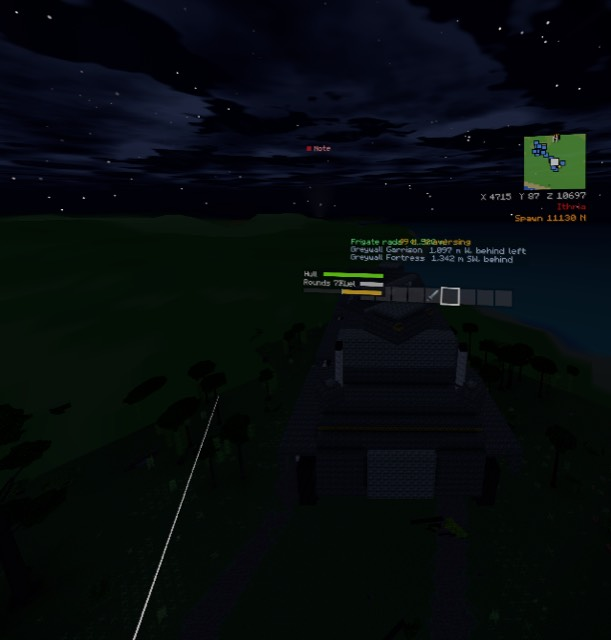

## 06:26:21 - Yeah, I can't... Just not really able to do this, uh, well

- **Transcript:** Yeah, I can't... Just not really able to do this, uh, well
- **Status:** open
- **Build:** 0.129 (27e81c04, M1-M4 (device-tested; ship riding, chests, comfort options, weapon wheel))
- **World:** New World (20) (seed 632461258612199693)
- **Dimension:** Surface
- **Biome:** Sparse Jungle
- **Position:** 4829.0 87.5 10771.1
- **Facing:** north-west (yaw 327, pitch -11)
- **Held:** empty hand
- **Mount:** piloting Ironback Crawler
- **Looking at:** nothing
- **Mode:** Creative, health 20/20
- **Time:** day 1 00:07, clear
- **Fps:** 72
- **Levels:** mic -35 dBFS, game sound -18 dBFS
- **Length:** 5.3 s (voice 3.1 s)
- **Just before:** -28s walked into Plains; -24s walked into Forest; -24s message: Greywall Fortress marked on the map; -20s walked into Sparse Jungle; -18s walked into Forest; -14s message: Entering Ithria; -12s walked into Plains; -10s walked into Sparse Jungle; -8s walked into Plains; -6s walked into Sparse Jungle
- **Repro (Mac):** `./snap.sh note --seed 632461258612199693 --x 4829.0 --z 10771.1 --yaw 33 --pitch -11 --time 0.755`
- **Audio (this Mac):** /Users/darthvadar/Documents/Blocksmith/QuestVoiceNotes/raw/vn-20261112-062621-884.aac

## 06:26:45 - Um, another thing, the, um, the UI that says haul, rounds, fuel, all t

- **Transcript:** Um, another thing, the, um, the UI that says haul, rounds, fuel, all that, it overlaps with the toolbar
- **Status:** open
- **Build:** 0.129 (27e81c04, M1-M4 (device-tested; ship riding, chests, comfort options, weapon wheel))
- **World:** New World (20) (seed 632461258612199693)
- **Dimension:** Surface
- **Biome:** Savanna
- **Position:** 5364.7 109.3 11054.0
- **Facing:** east (yaw 99, pitch -24)
- **Held:** empty hand
- **Mount:** piloting Ironback Crawler
- **Looking at:** nothing
- **Mode:** Creative, health 20/20
- **Time:** day 1 00:36, clear
- **Fps:** 72
- **Levels:** mic -26 dBFS, game sound -21 dBFS
- **Length:** 9.5 s (voice 5.4 s)
- **Just before:** -29s walked into Sparse Jungle; -21s walked into Forest; -13s walked into Plains; -1s walked into Windswept Savanna
- **While talking:** -4s walked into Sparse Jungle
- **Position at the end:** 5459.8 91.1 11145.6
- **Repro (Mac):** `./snap.sh note --seed 632461258612199693 --x 5364.7 --z 11054.0 --yaw -99 --pitch -24 --time 0.775`
- **Audio (this Mac):** /Users/darthvadar/Documents/Blocksmith/QuestVoiceNotes/raw/vn-20261112-062645-684.aac

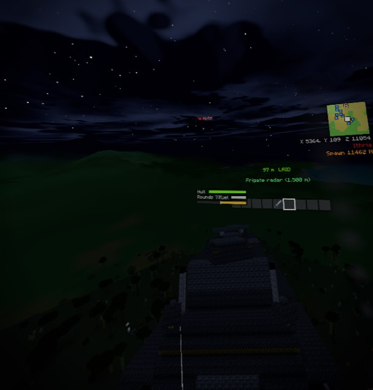

## 06:26:55 - Like toolbar isn't even needed when you're driving a vehicle, right? L

- **Transcript:** Like toolbar isn't even needed when you're driving a vehicle, right? Like unless it's something you can shoot out of, like maybe the, the motorcycle, you could probably use your gun while driving maybe
- **Status:** open
- **Build:** 0.129 (27e81c04, M1-M4 (device-tested; ship riding, chests, comfort options, weapon wheel))
- **World:** New World (20) (seed 632461258612199693)
- **Dimension:** Surface
- **Biome:** Jungle
- **Position:** 5549.1 91.7 11256.7
- **Facing:** north (yaw 21, pitch -1)
- **Held:** empty hand
- **Mount:** piloting Ironback Crawler
- **Looking at:** nothing
- **Mode:** Creative, health 20/20
- **Time:** day 1 00:48, clear
- **Fps:** 72
- **Levels:** mic -29 dBFS, game sound -23 dBFS
- **Length:** 11.9 s (voice 7.2 s)
- **Just before:** -23s walked into Plains; -11s walked into Windswept Savanna; -9s walked into Sparse Jungle; -1s walked into Jungle
- **While talking:** -0s walked into Sparse Jungle; -3s walked into Jungle; -2s message: Capital city marked on the map
- **Position at the end:** 5688.9 90.0 11492.7
- **Repro (Mac):** `./snap.sh note --seed 632461258612199693 --x 5549.1 --z 11256.7 --yaw -21 --pitch -1 --time 0.784`
- **Audio (this Mac):** /Users/darthvadar/Documents/Blocksmith/QuestVoiceNotes/raw/vn-20261112-062655-844.aac

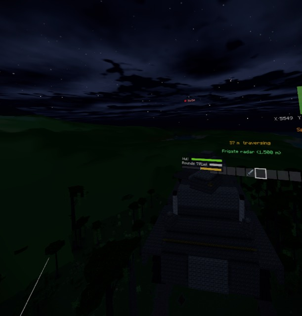

## 06:27:08 - Otherwise, I don't see why the, the, uh, toolbar would be needed

- **Transcript:** Otherwise, I don't see why the, the, uh, toolbar would be needed
- **Status:** open
- **Build:** 0.129 (27e81c04, M1-M4 (device-tested; ship riding, chests, comfort options, weapon wheel))
- **World:** New World (20) (seed 632461258612199693)
- **Dimension:** Surface
- **Biome:** Jungle
- **Position:** 5717.4 90.1 11560.5
- **Facing:** north-east (yaw 32, pitch -1)
- **Held:** empty hand
- **Mount:** piloting Ironback Crawler
- **Looking at:** nothing
- **Mode:** Creative, health 20/20
- **Time:** day 1 01:03, clear
- **Fps:** 72
- **Levels:** mic -31 dBFS, game sound -18 dBFS
- **Length:** 4.6 s (voice 2.1 s)
- **Just before:** -24s walked into Windswept Savanna; -22s walked into Sparse Jungle; -14s walked into Jungle; -8s walked into Sparse Jungle; -6s walked into Jungle; -5s message: Capital city marked on the map
- **Repro (Mac):** `./snap.sh note --seed 632461258612199693 --x 5717.4 --z 11560.5 --yaw -32 --pitch -1 --time 0.794`
- **Audio (this Mac):** /Users/darthvadar/Documents/Blocksmith/QuestVoiceNotes/raw/vn-20261112-062708-584.aac

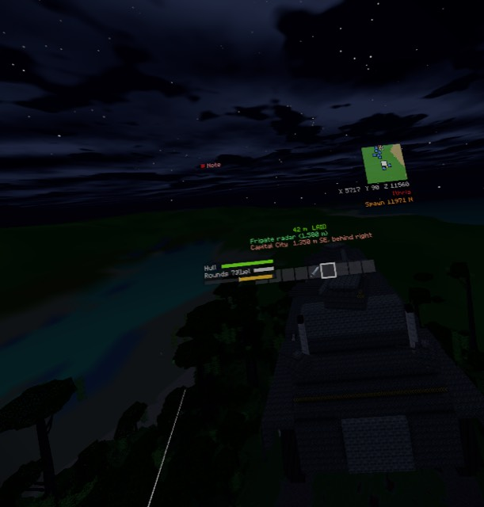

## 06:27:36 - Oh, this is gonna be good. It's a city I'm coming up to, I think

- **Transcript:** Oh, this is gonna be good. It's a city I'm coming up to, I think
- **Status:** open
- **Build:** 0.129 (27e81c04, M1-M4 (device-tested; ship riding, chests, comfort options, weapon wheel))
- **World:** New World (20) (seed 632461258612199693)
- **Dimension:** Surface
- **Biome:** Jungle
- **Position:** 6071.4 93.7 12223.7
- **Facing:** east (yaw 108, pitch -3)
- **Held:** empty hand
- **Mount:** piloting Ironback Crawler
- **Looking at:** nothing
- **Mode:** Creative, health 20/20
- **Time:** day 1 01:37, clear
- **Fps:** 71
- **Levels:** mic -31 dBFS, game sound -22 dBFS
- **Length:** 4.4 s (voice 1.8 s)
- **Just before:** -22s walked into Bamboo Jungle; -14s walked into Jungle; -8s walked into Sparse Jungle; -6s walked into Jungle; -5s message: Greywall Garrison marked on the map; -4s walked into Sparse Jungle; -2s walked into Jungle
- **Repro (Mac):** `./snap.sh note --seed 632461258612199693 --x 6071.4 --z 12223.7 --yaw -108 --pitch -3 --time 0.818`
- **Audio (this Mac):** /Users/darthvadar/Documents/Blocksmith/QuestVoiceNotes/raw/vn-20261112-062736-884.aac

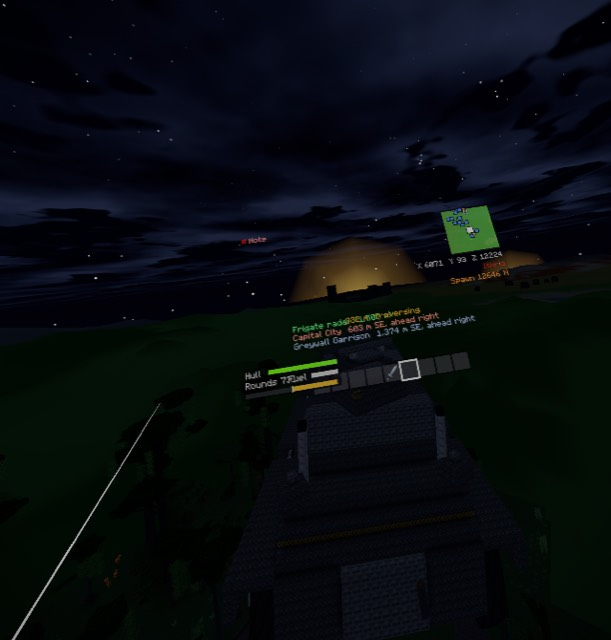

## 06:27:42 - Oh yeah, this is gonna be a lot of fun

- **Transcript:** Oh yeah, this is gonna be a lot of fun
- **Status:** open
- **Build:** 0.129 (27e81c04, M1-M4 (device-tested; ship riding, chests, comfort options, weapon wheel))
- **World:** New World (20) (seed 632461258612199693)
- **Dimension:** Surface
- **Biome:** Bamboo Jungle
- **Position:** 6159.8 93.0 12333.0
- **Facing:** east (yaw 72, pitch -9)
- **Held:** empty hand
- **Mount:** piloting Ironback Crawler
- **Looking at:** nothing
- **Mode:** Creative, health 20/20
- **Time:** day 1 01:44, clear
- **Fps:** 71
- **Levels:** mic -33 dBFS, game sound -22 dBFS
- **Length:** 4.0 s (voice 2.0 s)
- **Just before:** -27s walked into Bamboo Jungle; -19s walked into Jungle; -13s walked into Sparse Jungle; -11s walked into Jungle; -10s message: Greywall Garrison marked on the map; -9s walked into Sparse Jungle; -7s walked into Jungle
- **Repro (Mac):** `./snap.sh note --seed 632461258612199693 --x 6159.8 --z 12333.0 --yaw -72 --pitch -9 --time 0.822`
- **Audio (this Mac):** /Users/darthvadar/Documents/Blocksmith/QuestVoiceNotes/raw/vn-20261112-062742-044.aac

## 06:27:46 - Well, we'll see if it actually can fucking render the city. That'll be

- **Transcript:** Well, we'll see if it actually can fucking render the city. That'll be the real question
- **Status:** open
- **Build:** 0.129 (27e81c04, M1-M4 (device-tested; ship riding, chests, comfort options, weapon wheel))
- **World:** New World (20) (seed 632461258612199693)
- **Dimension:** Surface
- **Biome:** Sparse Jungle
- **Position:** 6254.1 105.8 12414.9
- **Facing:** south-east (yaw 135, pitch -6)
- **Held:** empty hand
- **Mount:** piloting Ironback Crawler
- **Looking at:** nothing
- **Mode:** Creative, health 20/20
- **Time:** day 1 01:49, clear
- **Fps:** 71
- **Levels:** mic -24 dBFS, game sound -20 dBFS
- **Length:** 5.1 s (voice 3.0 s)
- **Just before:** -24s walked into Jungle; -18s walked into Sparse Jungle; -16s walked into Jungle; -15s message: Greywall Garrison marked on the map; -14s walked into Sparse Jungle; -12s walked into Jungle; -4s walked into Forest; -0s walked into Sparse Jungle
- **Repro (Mac):** `./snap.sh note --seed 632461258612199693 --x 6254.1 --z 12414.9 --yaw -135 --pitch -6 --time 0.826`
- **Audio (this Mac):** /Users/darthvadar/Documents/Blocksmith/QuestVoiceNotes/raw/vn-20261112-062746-684.aac

## 06:27:52 - Let's just see what happens here. I'm curious. I'm gonna try to drive 

- **Transcript:** Let's just see what happens here. I'm curious. I'm gonna try to drive through these buildings
- **Status:** open
- **Build:** 0.129 (27e81c04, M1-M4 (device-tested; ship riding, chests, comfort options, weapon wheel))
- **World:** New World (20) (seed 632461258612199693)
- **Dimension:** Surface
- **Biome:** Sparse Jungle
- **Position:** 6366.3 100.1 12508.8
- **Facing:** south-east (yaw 156, pitch -17)
- **Held:** empty hand
- **Mount:** piloting Ironback Crawler
- **Looking at:** nothing
- **Mode:** Creative, health 20/20
- **Time:** day 1 01:56, clear
- **Fps:** 71
- **Levels:** mic -27 dBFS, game sound -19 dBFS
- **Length:** 4.9 s (voice 1.8 s)
- **Just before:** -30s walked into Jungle; -24s walked into Sparse Jungle; -22s walked into Jungle; -20s message: Greywall Garrison marked on the map; -20s walked into Sparse Jungle; -18s walked into Jungle; -10s walked into Forest; -6s walked into Sparse Jungle; -1s message: Ithria - Torimere border post marked on the map
- **Repro (Mac):** `./snap.sh note --seed 632461258612199693 --x 6366.3 --z 12508.8 --yaw -156 --pitch -17 --time 0.831`
- **Audio (this Mac):** /Users/darthvadar/Documents/Blocksmith/QuestVoiceNotes/raw/vn-20261112-062752-144.aac

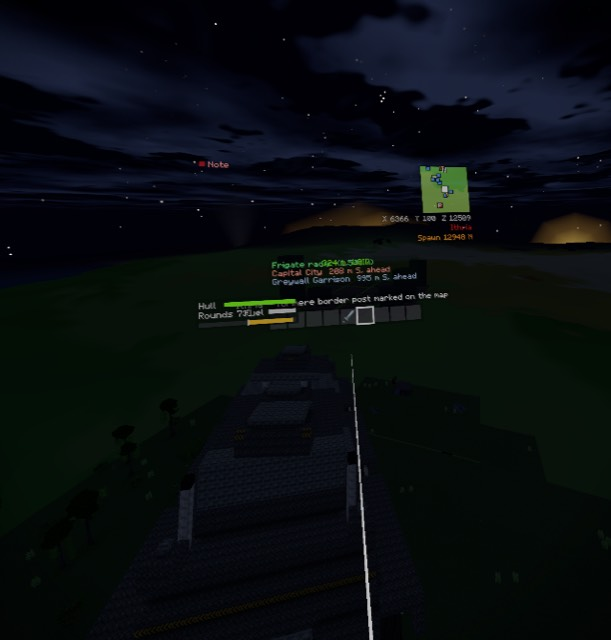

## 06:28:02 - Just, just fucking mow through the fucking city. [laughs]

- **Transcript:** Just, just fucking mow through the fucking city. [laughs]
- **Status:** open
- **Build:** 0.129 (27e81c04, M1-M4 (device-tested; ship riding, chests, comfort options, weapon wheel))
- **World:** New World (20) (seed 632461258612199693)
- **Dimension:** Surface
- **Biome:** Plains
- **Position:** 6379.7 90.0 12767.7
- **Facing:** north-east (yaw 47, pitch -20)
- **Held:** empty hand
- **Mount:** piloting Ironback Crawler
- **Looking at:** nothing
- **Mode:** Creative, health 20/20
- **Time:** day 1 02:08, clear
- **Fps:** 71
- **Levels:** mic -29 dBFS, game sound -13 dBFS
- **Length:** 4.1 s (voice 1.8 s)
- **Just before:** -30s walked into Sparse Jungle; -28s walked into Jungle; -20s walked into Forest; -16s walked into Sparse Jungle; -11s message: Ithria - Torimere border post marked on the map; -10s walked into Plains; -8s message: Entering Torimere; -3s message: Capital citadel (the enemy) marked on the map
- **Repro (Mac):** `./snap.sh note --seed 632461258612199693 --x 6379.7 --z 12767.7 --yaw -47 --pitch -20 --time 0.839`
- **Audio (this Mac):** /Users/darthvadar/Documents/Blocksmith/QuestVoiceNotes/raw/vn-20261112-062802-524.aac

## 06:28:48 - Make it on creative so that all the vehicles have infinite ammunition,

- **Transcript:** Make it on creative so that all the vehicles have infinite ammunition, I guess
- **Status:** open
- **Build:** 0.129 (27e81c04, M1-M4 (device-tested; ship riding, chests, comfort options, weapon wheel))
- **World:** New World (20) (seed 632461258612199693)
- **Dimension:** Surface
- **Biome:** Plains
- **Position:** 6280.8 94.5 12571.5
- **Facing:** east (yaw 86, pitch -15)
- **Held:** empty hand
- **Mount:** piloting Ironback Crawler
- **Looking at:** nothing
- **Mode:** Creative, health 20/20
- **Time:** day 1 03:04, clear
- **Fps:** 71
- **Levels:** mic -26 dBFS, game sound -17 dBFS
- **Length:** 5.3 s (voice 3.1 s)
- **Just before:** -22s walked into Plains; -8s message: Entering Ithria
- **Repro (Mac):** `./snap.sh note --seed 632461258612199693 --x 6280.8 --z 12571.5 --yaw -86 --pitch -15 --time 0.878`
- **Audio (this Mac):** /Users/darthvadar/Documents/Blocksmith/QuestVoiceNotes/raw/vn-20261112-062848-944.aac

## 06:28:58 - That means creative, right?

- **Transcript:** That means creative, right?
- **Status:** open
- **Build:** 0.129 (27e81c04, M1-M4 (device-tested; ship riding, chests, comfort options, weapon wheel))
- **World:** New World (20) (seed 632461258612199693)
- **Dimension:** Surface
- **Biome:** Plains
- **Position:** 6304.8 95.6 12649.4
- **Facing:** north (yaw 353, pitch -13)
- **Held:** empty hand
- **Mount:** piloting Ironback Crawler
- **Looking at:** nothing
- **Mode:** Creative, health 20/20
- **Time:** day 1 03:16, clear
- **Fps:** 71
- **Levels:** mic -35 dBFS, game sound -18 dBFS
- **Length:** 2.3 s (voice 0.6 s)
- **Just before:** -18s message: Entering Ithria; -8s walked into Forest; -6s message: Entering Belarwick; -1s message: Entering Torimere; -0s walked into Plains
- **Repro (Mac):** `./snap.sh note --seed 632461258612199693 --x 6304.8 --z 12649.4 --yaw 7 --pitch -13 --time 0.886`
- **Audio (this Mac):** /Users/darthvadar/Documents/Blocksmith/QuestVoiceNotes/raw/vn-20261112-062858-744.aac

## 06:29:09 - All right, so I'm showing some shit of this building

- **Transcript:** All right, so I'm showing some shit of this building
- **Status:** open
- **Build:** 0.129 (27e81c04, M1-M4 (device-tested; ship riding, chests, comfort options, weapon wheel))
- **World:** New World (20) (seed 632461258612199693)
- **Dimension:** Surface
- **Biome:** Plains
- **Position:** 6457.2 92.0 12587.4
- **Facing:** south (yaw 168, pitch -3)
- **Held:** empty hand
- **Mount:** piloting Ironback Crawler
- **Looking at:** nothing
- **Mode:** Creative, health 20/20
- **Time:** day 1 03:29, clear
- **Fps:** 71
- **Levels:** mic -25 dBFS, game sound -15 dBFS
- **Length:** 3.8 s (voice 2.0 s)
- **Just before:** -29s message: Entering Ithria; -19s walked into Forest; -18s message: Entering Belarwick; -13s message: Entering Torimere; -11s walked into Plains
- **Repro (Mac):** `./snap.sh note --seed 632461258612199693 --x 6457.2 --z 12587.4 --yaw -168 --pitch -3 --time 0.895`
- **Audio (this Mac):** /Users/darthvadar/Documents/Blocksmith/QuestVoiceNotes/raw/vn-20261112-062909-884.aac

## 06:29:18 - Oh yeah

- **Transcript:** Oh yeah
- **Status:** open
- **Build:** 0.129 (27e81c04, M1-M4 (device-tested; ship riding, chests, comfort options, weapon wheel))
- **World:** New World (20) (seed 632461258612199693)
- **Dimension:** Surface
- **Biome:** Plains
- **Position:** 6484.7 90.0 12577.0
- **Facing:** south-east (yaw 153, pitch -8)
- **Held:** empty hand
- **Mount:** piloting Ironback Crawler
- **Looking at:** nothing
- **Mode:** Creative, health 20/20
- **Time:** day 1 03:39, clear
- **Fps:** 70
- **Levels:** mic -31 dBFS, game sound -12 dBFS
- **Length:** 2.5 s (voice 1.1 s)
- **Just before:** -28s walked into Forest; -26s message: Entering Belarwick; -21s message: Entering Torimere; -20s walked into Plains
- **Repro (Mac):** `./snap.sh note --seed 632461258612199693 --x 6484.7 --z 12577.0 --yaw -153 --pitch -8 --time 0.903`
- **Audio (this Mac):** /Users/darthvadar/Documents/Blocksmith/QuestVoiceNotes/raw/vn-20261112-062918-424.aac

## 06:29:21 - Very good. I'm pleased

- **Transcript:** Very good. I'm pleased
- **Status:** open
- **Build:** 0.129 (27e81c04, M1-M4 (device-tested; ship riding, chests, comfort options, weapon wheel))
- **World:** New World (20) (seed 632461258612199693)
- **Dimension:** Surface
- **Biome:** Plains
- **Position:** 6483.9 90.0 12578.2
- **Facing:** south-east (yaw 157, pitch -33)
- **Held:** empty hand
- **Mount:** piloting Ironback Crawler
- **Looking at:** nothing
- **Mode:** Creative, health 20/20
- **Time:** day 1 03:43, clear
- **Fps:** 70
- **Levels:** mic -26 dBFS, game sound -14 dBFS
- **Length:** 2.8 s (voice 1.2 s)
- **Just before:** -30s message: Entering Belarwick; -25s message: Entering Torimere; -23s walked into Plains
- **Repro (Mac):** `./snap.sh note --seed 632461258612199693 --x 6483.9 --z 12578.2 --yaw -157 --pitch -33 --time 0.905`
- **Audio (this Mac):** /Users/darthvadar/Documents/Blocksmith/QuestVoiceNotes/raw/vn-20261112-062921-804.aac

## 06:29:43 - Yeah, this is, uh, this is gonna be good. All right, I'm gonna go up t

- **Transcript:** Yeah, this is, uh, this is gonna be good. All right, I'm gonna go up to a gray wall base. Let's see what happens
- **Status:** open
- **Build:** 0.129 (27e81c04, M1-M4 (device-tested; ship riding, chests, comfort options, weapon wheel))
- **World:** New World (20) (seed 632461258612199693)
- **Dimension:** Surface
- **Biome:** Savanna
- **Position:** 6400.8 96.7 12926.2
- **Facing:** north-east (yaw 56, pitch -12)
- **Held:** empty hand
- **Mount:** piloting Ironback Crawler
- **Looking at:** nothing
- **Mode:** Creative, health 20/20
- **Time:** day 1 04:09, clear
- **Fps:** 71
- **Levels:** mic -36 dBFS, game sound -20 dBFS
- **Length:** 6.4 s (voice 3.2 s)
- **Just before:** -4s walked into Savanna
- **While talking:** -3s walked into Desert
- **Position at the end:** 6420.5 97.1 13009.2
- **Repro (Mac):** `./snap.sh note --seed 632461258612199693 --x 6400.8 --z 12926.2 --yaw -56 --pitch -12 --time 0.923`
- **Audio (this Mac):** /Users/darthvadar/Documents/Blocksmith/QuestVoiceNotes/raw/vn-20261112-062943-164.aac

## 06:30:15 - Okay, hold on here

- **Transcript:** Okay, hold on here
- **Status:** open
- **Build:** 0.129 (27e81c04, M1-M4 (device-tested; ship riding, chests, comfort options, weapon wheel))
- **World:** New World (20) (seed 632461258612199693)
- **Dimension:** Surface
- **Biome:** Meadow
- **Position:** 6785.9 176.3 13448.0
- **Facing:** south-west (yaw 218, pitch -3)
- **Held:** empty hand
- **Mount:** piloting Ironback Crawler
- **Looking at:** nothing
- **Mode:** Creative, health 20/20
- **Time:** day 1 04:46, clear
- **Fps:** 72
- **Levels:** mic -29 dBFS, game sound -12 dBFS
- **Length:** 2.3 s (voice 0.5 s)
- **Just before:** -22s message: Red Junction marked on the map; -19s walked into Plains; -11s walked into Forest; -9s walked into Meadow; -2s opened PauseMenu; -1s closed PauseMenu
- **Repro (Mac):** `./snap.sh note --seed 632461258612199693 --x 6785.9 --z 13448.0 --yaw 142 --pitch -3 --time 0.949`
- **Audio (this Mac):** /Users/darthvadar/Documents/Blocksmith/QuestVoiceNotes/raw/vn-20261112-063015-744.aac

## 06:30:49 - This map room, that's excellent. All the computers, very good. I appro

- **Transcript:** This map room, that's excellent. All the computers, very good. I approve of that
- **Status:** open
- **Build:** 0.129 (27e81c04, M1-M4 (device-tested; ship riding, chests, comfort options, weapon wheel))
- **World:** New World (20) (seed 632461258612199693)
- **Dimension:** Surface
- **Biome:** Meadow
- **Position:** 6793.2 175.6 13430.9
- **Facing:** south-west (yaw 239, pitch -12)
- **Held:** Cobblestone x64
- **Mount:** on foot
- **Looking at:** nothing
- **Mode:** Creative, health 20/20
- **Time:** day 1 05:27, clear
- **Fps:** 69
- **Levels:** mic -54 dBFS, game sound -15 dBFS
- **Length:** 5.3 s (voice 2.6 s)
- **Just before:** -25s into the pack: Slatefall Carbine; -25s into the pack: Spec Ops Armour Set; -12s into the pack: Spec Ops Armour Set; -10s message: The sky is clouding over: fog is coming; -10s opened PauseMenu; -9s closed PauseMenu; -9s opened CreativeMenu; -8s closed CreativeMenu; -7s holding Spec Ops Armour Set; -7s holding empty hand; -7s holding Cobblestone; -7s message: Cobblestone
- **Repro (Mac):** `./snap.sh note --seed 632461258612199693 --x 6793.2 --z 13430.9 --yaw 121 --pitch -12 --time 0.977`
- **Audio (this Mac):** /Users/darthvadar/Documents/Blocksmith/QuestVoiceNotes/raw/vn-20261112-063049-964.aac

## 06:31:14 - Hmm, this one's damaged

- **Transcript:** Hmm, this one's damaged
- **Status:** open
- **Build:** 0.129 (27e81c04, M1-M4 (device-tested; ship riding, chests, comfort options, weapon wheel))
- **World:** New World (20) (seed 632461258612199693)
- **Dimension:** Surface
- **Biome:** Meadow
- **Position:** 6791.8 176.4 13447.5
- **Facing:** east (yaw 96, pitch 32)
- **Held:** Cobblestone x64
- **Mount:** on foot
- **Looking at:** nothing
- **Mode:** Creative, health 20/20
- **Time:** day 1 05:55, clear
- **Fps:** 71
- **Levels:** mic -39 dBFS, game sound -15 dBFS
- **Length:** 2.2 s (voice 0.6 s)
- **Just before:** -20s holding Arc Cell; -20s message: Arc Cell; -19s holding Spec Ops Armour Set; -19s message: Spec Ops Armour Set; -19s holding Titanium Sword; -19s message: Titanium Sword; -13s holding Spec Ops Armour Set; -13s message: Spec Ops Armour Set; -13s holding Arc Cell; -13s message: Arc Cell; -11s holding Cobblestone; -11s message: Cobblestone
- **Repro (Mac):** `./snap.sh note --seed 632461258612199693 --x 6791.8 --z 13447.5 --yaw -96 --pitch 32 --time 0.997`
- **Audio (this Mac):** /Users/darthvadar/Documents/Blocksmith/QuestVoiceNotes/raw/vn-20261112-063114-084.aac

## 06:31:16 - Okay, so

- **Transcript:** Okay, so
- **Status:** open
- **Build:** 0.129 (27e81c04, M1-M4 (device-tested; ship riding, chests, comfort options, weapon wheel))
- **World:** New World (20) (seed 632461258612199693)
- **Dimension:** Surface
- **Biome:** Meadow
- **Position:** 6787.2 176.6 13447.4
- **Facing:** south-west (yaw 235, pitch -19)
- **Held:** Cobblestone x64
- **Mount:** on foot
- **Looking at:** nothing
- **Mode:** Creative, health 20/20
- **Time:** day 1 05:59, clear
- **Fps:** 72
- **Levels:** mic -27 dBFS, game sound -16 dBFS
- **Length:** 2.6 s (voice 0.7 s)
- **Just before:** -22s holding Arc Cell; -22s message: Arc Cell; -22s holding Spec Ops Armour Set; -22s message: Spec Ops Armour Set; -22s holding Titanium Sword; -22s message: Titanium Sword; -16s holding Spec Ops Armour Set; -16s message: Spec Ops Armour Set; -15s holding Arc Cell; -15s message: Arc Cell; -14s holding Cobblestone; -14s message: Cobblestone
- **Repro (Mac):** `./snap.sh note --seed 632461258612199693 --x 6787.2 --z 13447.4 --yaw 125 --pitch -19 --time 0.999`
- **Audio (this Mac):** /Users/darthvadar/Documents/Blocksmith/QuestVoiceNotes/raw/vn-20261112-063116-844.aac

## 06:31:27 - All right, so I'm in the crawler right now

- **Transcript:** All right, so I'm in the crawler right now
- **Status:** open
- **Build:** 0.129 (27e81c04, M1-M4 (device-tested; ship riding, chests, comfort options, weapon wheel))
- **World:** New World (20) (seed 632461258612199693)
- **Dimension:** Surface
- **Biome:** Meadow
- **Position:** 6780.1 176.9 13466.7
- **Facing:** north-west (yaw 296, pitch -18)
- **Held:** empty hand
- **Mount:** piloting Ironback Crawler
- **Looking at:** nothing
- **Mode:** Survival, health 20/20
- **Time:** day 2 06:09, clear
- **Fps:** 68
- **Levels:** mic -26 dBFS, game sound -19 dBFS
- **Length:** 3.4 s (voice 1.8 s)
- **Just before:** -26s holding Spec Ops Armour Set; -26s message: Spec Ops Armour Set; -26s holding Arc Cell; -26s message: Arc Cell; -25s holding Cobblestone; -25s message: Cobblestone; -10s message: Kesegard has gone to war with Hararheim; -6s opened PauseMenu; -6s closed PauseMenu; -6s opened PauseMenu; -4s message: Survival mode; -4s closed PauseMenu; -3s piloting Ironback Crawler; -3s holding empty hand; -3s message: Steering Ironback Crawler
- **Repro (Mac):** `./snap.sh note --seed 632461258612199693 --x 6780.1 --z 13466.7 --yaw 64 --pitch -18 --time 0.007`
- **Audio (this Mac):** /Users/darthvadar/Documents/Blocksmith/QuestVoiceNotes/raw/vn-20261112-063127-584.aac

## 06:31:32 - I'm driving around at Graywall Base and nothing's firing at me just ye

- **Transcript:** I'm driving around at Graywall Base and nothing's firing at me just yet
- **Status:** open
- **Build:** 0.129 (27e81c04, M1-M4 (device-tested; ship riding, chests, comfort options, weapon wheel))
- **World:** New World (20) (seed 632461258612199693)
- **Dimension:** Surface
- **Biome:** Meadow
- **Position:** 6733.0 170.1 13502.7
- **Facing:** north-west (yaw 309, pitch -18)
- **Held:** empty hand
- **Mount:** piloting Ironback Crawler
- **Looking at:** nothing
- **Mode:** Survival, health 20/20
- **Time:** day 2 06:14, clear
- **Fps:** 62
- **Levels:** mic -30 dBFS, game sound -17 dBFS
- **Length:** 5.6 s (voice 3.1 s)
- **Just before:** -29s holding Cobblestone; -29s message: Cobblestone; -14s message: Kesegard has gone to war with Hararheim; -11s opened PauseMenu; -10s closed PauseMenu; -10s opened PauseMenu; -9s message: Survival mode; -8s closed PauseMenu; -8s piloting Ironback Crawler; -8s holding empty hand; -7s message: Steering Ironback Crawler
- **While talking:** -1s message: The Greywall Garrison is sounding the alarm!
- **Position at the end:** 6677.8 161.5 13516.1
- **Repro (Mac):** `./snap.sh note --seed 632461258612199693 --x 6733.0 --z 13502.7 --yaw 51 --pitch -18 --time 0.010`
- **Audio (this Mac):** /Users/darthvadar/Documents/Blocksmith/QuestVoiceNotes/raw/vn-20261112-063132-064.aac

## 06:31:38 - The, the base is not hostile to me

- **Transcript:** The, the base is not hostile to me
- **Status:** open
- **Build:** 0.129 (27e81c04, M1-M4 (device-tested; ship riding, chests, comfort options, weapon wheel))
- **World:** New World (20) (seed 632461258612199693)
- **Dimension:** Surface
- **Biome:** Meadow
- **Position:** 6670.5 162.6 13509.5
- **Facing:** north-east (yaw 39, pitch -26)
- **Held:** empty hand
- **Mount:** piloting Ironback Crawler
- **Looking at:** nothing
- **Mode:** Survival, health 20/20
- **Time:** day 2 06:23, clear
- **Fps:** 71
- **Levels:** mic -43 dBFS, game sound -18 dBFS
- **Length:** 3.2 s (voice 1.6 s)
- **Just before:** -21s message: Kesegard has gone to war with Hararheim; -18s opened PauseMenu; -17s closed PauseMenu; -17s opened PauseMenu; -15s message: Survival mode; -15s closed PauseMenu; -15s piloting Ironback Crawler; -15s holding empty hand; -14s message: Steering Ironback Crawler; -3s message: The Greywall Garrison is sounding the alarm!
- **Repro (Mac):** `./snap.sh note --seed 632461258612199693 --x 6670.5 --z 13509.5 --yaw -39 --pitch -26 --time 0.016`
- **Audio (this Mac):** /Users/darthvadar/Documents/Blocksmith/QuestVoiceNotes/raw/vn-20261112-063138-844.aac

## 06:31:42 - I'm not sure why

- **Transcript:** I'm not sure why
- **Status:** open
- **Build:** 0.129 (27e81c04, M1-M4 (device-tested; ship riding, chests, comfort options, weapon wheel))
- **World:** New World (20) (seed 632461258612199693)
- **Dimension:** Surface
- **Biome:** Meadow
- **Position:** 6640.3 173.5 13482.9
- **Facing:** east (yaw 81, pitch -22)
- **Held:** empty hand
- **Mount:** piloting Ironback Crawler
- **Looking at:** nothing
- **Mode:** Survival, health 20/20
- **Time:** day 2 06:27, clear
- **Fps:** 71
- **Levels:** mic -28 dBFS, game sound -16 dBFS
- **Length:** 2.2 s (voice 0.8 s)
- **Just before:** -25s message: Kesegard has gone to war with Hararheim; -21s opened PauseMenu; -21s closed PauseMenu; -20s opened PauseMenu; -19s message: Survival mode; -19s closed PauseMenu; -18s piloting Ironback Crawler; -18s holding empty hand; -17s message: Steering Ironback Crawler; -6s message: The Greywall Garrison is sounding the alarm!
- **Repro (Mac):** `./snap.sh note --seed 632461258612199693 --x 6640.3 --z 13482.9 --yaw -81 --pitch -22 --time 0.019`
- **Audio (this Mac):** /Users/darthvadar/Documents/Blocksmith/QuestVoiceNotes/raw/vn-20261112-063142-404.aac

## 06:31:48 - Just give me a second

- **Transcript:** Just give me a second
- **Status:** open
- **Build:** 0.129 (27e81c04, M1-M4 (device-tested; ship riding, chests, comfort options, weapon wheel))
- **World:** New World (20) (seed 632461258612199693)
- **Dimension:** Surface
- **Biome:** Meadow
- **Position:** 6634.7 168.4 13435.8
- **Facing:** north-east (yaw 28, pitch -17)
- **Held:** empty hand
- **Mount:** piloting Ironback Crawler
- **Looking at:** nothing
- **Mode:** Survival, health 20/20, screen PauseMenu
- **Time:** day 2 06:34, clear
- **Fps:** 71
- **Levels:** mic -40 dBFS, game sound -23 dBFS
- **Length:** 2.5 s (voice 0.8 s)
- **Just before:** -27s opened PauseMenu; -27s closed PauseMenu; -27s opened PauseMenu; -25s message: Survival mode; -25s closed PauseMenu; -24s piloting Ironback Crawler; -24s holding empty hand; -24s message: Steering Ironback Crawler; -13s message: The Greywall Garrison is sounding the alarm!; -6s message: The sky is clouding over: fog is coming; -0s opened PauseMenu
- **Repro (Mac):** `./snap.sh note --seed 632461258612199693 --x 6634.7 --z 13435.8 --yaw -28 --pitch -17 --time 0.024`
- **Audio (this Mac):** /Users/darthvadar/Documents/Blocksmith/QuestVoiceNotes/raw/vn-20261112-063148-624.aac

## 06:31:55 - They're still not hostile. The base isn't hostile to me when I'm in a 

- **Transcript:** They're still not hostile. The base isn't hostile to me when I'm in a crawler
- **Status:** open
- **Build:** 0.129 (27e81c04, M1-M4 (device-tested; ship riding, chests, comfort options, weapon wheel))
- **World:** New World (20) (seed 632461258612199693)
- **Dimension:** Surface
- **Biome:** Meadow
- **Position:** 6649.2 163.7 13420.9
- **Facing:** east (yaw 107, pitch -22)
- **Held:** empty hand
- **Mount:** piloting Ironback Crawler
- **Looking at:** nothing
- **Mode:** Survival, health 20/20
- **Time:** day 2 06:39, clear
- **Fps:** 72
- **Levels:** mic -24 dBFS, game sound -15 dBFS
- **Length:** 4.9 s (voice 2.7 s)
- **Just before:** -19s message: The Greywall Garrison is sounding the alarm!; -13s message: The sky is clouding over: fog is coming; -7s opened PauseMenu; -4s closed PauseMenu
- **Repro (Mac):** `./snap.sh note --seed 632461258612199693 --x 6649.2 --z 13420.9 --yaw -107 --pitch -22 --time 0.027`
- **Audio (this Mac):** /Users/darthvadar/Documents/Blocksmith/QuestVoiceNotes/raw/vn-20261112-063155-344.aac

## 06:32:01 - I, or at least the naval guns aren't

- **Transcript:** I, or at least the naval guns aren't
- **Status:** open
- **Build:** 0.129 (27e81c04, M1-M4 (device-tested; ship riding, chests, comfort options, weapon wheel))
- **World:** New World (20) (seed 632461258612199693)
- **Dimension:** Surface
- **Biome:** Meadow
- **Position:** 6697.3 160.7 13380.7
- **Facing:** south (yaw 201, pitch -11)
- **Held:** empty hand
- **Mount:** piloting Ironback Crawler
- **Looking at:** nothing
- **Mode:** Survival, health 20/20
- **Time:** day 2 06:46, clear
- **Fps:** 72
- **Levels:** mic -37 dBFS, game sound -14 dBFS
- **Length:** 3.2 s (voice 1.5 s)
- **Just before:** -25s message: The Greywall Garrison is sounding the alarm!; -19s message: The sky is clouding over: fog is coming; -13s opened PauseMenu; -10s closed PauseMenu
- **Repro (Mac):** `./snap.sh note --seed 632461258612199693 --x 6697.3 --z 13380.7 --yaw 159 --pitch -11 --time 0.032`
- **Audio (this Mac):** /Users/darthvadar/Documents/Blocksmith/QuestVoiceNotes/raw/vn-20261112-063201-344.aac

## 06:32:05 - 'Cause they aren't firing at me

- **Transcript:** 'Cause they aren't firing at me
- **Status:** open
- **Build:** 0.129 (27e81c04, M1-M4 (device-tested; ship riding, chests, comfort options, weapon wheel))
- **World:** New World (20) (seed 632461258612199693)
- **Dimension:** Surface
- **Biome:** Meadow
- **Position:** 6719.4 162.6 13379.7
- **Facing:** south-west (yaw 223, pitch -6)
- **Held:** empty hand
- **Mount:** piloting Ironback Crawler
- **Looking at:** nothing
- **Mode:** Survival, health 20/20
- **Time:** day 2 06:51, clear
- **Fps:** 72
- **Levels:** mic -25 dBFS, game sound -21 dBFS
- **Length:** 2.5 s (voice 1.0 s)
- **Just before:** -29s message: The Greywall Garrison is sounding the alarm!; -23s message: The sky is clouding over: fog is coming; -17s opened PauseMenu; -14s closed PauseMenu
- **Repro (Mac):** `./snap.sh note --seed 632461258612199693 --x 6719.4 --z 13379.7 --yaw 137 --pitch -6 --time 0.036`
- **Audio (this Mac):** /Users/darthvadar/Documents/Blocksmith/QuestVoiceNotes/raw/vn-20261112-063205-284.aac

## 06:32:08 - In that. Let me try something

- **Transcript:** In that. Let me try something
- **Status:** open
- **Build:** 0.129 (27e81c04, M1-M4 (device-tested; ship riding, chests, comfort options, weapon wheel))
- **World:** New World (20) (seed 632461258612199693)
- **Dimension:** Surface
- **Biome:** Meadow
- **Position:** 6711.5 161.7 13378.1
- **Facing:** south (yaw 202, pitch -24)
- **Held:** empty hand
- **Mount:** piloting Ironback Crawler
- **Looking at:** nothing
- **Mode:** Survival, health 20/20
- **Time:** day 2 06:55, clear
- **Fps:** 71
- **Levels:** mic -35 dBFS, game sound -17 dBFS
- **Length:** 3.4 s (voice 1.0 s)
- **Just before:** -26s message: The sky is clouding over: fog is coming; -20s opened PauseMenu; -18s closed PauseMenu
- **Repro (Mac):** `./snap.sh note --seed 632461258612199693 --x 6711.5 --z 13378.1 --yaw 158 --pitch -24 --time 0.038`
- **Audio (this Mac):** /Users/darthvadar/Documents/Blocksmith/QuestVoiceNotes/raw/vn-20261112-063208-584.aac

## 06:32:34 - So when I'm on foot, they fire. When I'm, um, I'm in the crawler, they

- **Transcript:** So when I'm on foot, they fire. When I'm, um, I'm in the crawler, they don't fire
- **Status:** open
- **Build:** 0.129 (27e81c04, M1-M4 (device-tested; ship riding, chests, comfort options, weapon wheel))
- **World:** New World (20) (seed 632461258612199693)
- **Dimension:** Surface
- **Biome:** Meadow
- **Position:** 6621.5 156.2 13473.1
- **Facing:** north-east (yaw 65, pitch 6)
- **Held:** Cobblestone x64
- **Mount:** on foot
- **Looking at:** nothing
- **Mode:** Creative, health 20/20
- **Time:** day 2 07:12, clear
- **Fps:** 72
- **Levels:** mic -25 dBFS, game sound -15 dBFS
- **Length:** 8.7 s (voice 3.6 s)
- **Just before:** -26s opened PauseMenu; -23s message: Creative mode; -22s closed PauseMenu; -21s message: Flying; -20s stopped piloting Ironback Crawler; -20s holding Cobblestone; -13s message: Walking; -11s opened PauseMenu; -11s closed PauseMenu; -11s message: Flying; -9s opened PauseMenu; -6s message: Survival mode; -6s closed PauseMenu; -5s opened PauseMenu; -1s message: Creative mode; -1s closed PauseMenu
- **While talking:** -4s message: Flying; -0s message: Walking
- **Position at the end:** 6716.7 169.1 13387.6
- **Repro (Mac):** `./snap.sh note --seed 632461258612199693 --x 6621.5 --z 13473.1 --yaw -65 --pitch 6 --time 0.050`
- **Audio (this Mac):** /Users/darthvadar/Documents/Blocksmith/QuestVoiceNotes/raw/vn-20261112-063234-544.aac

## 06:33:16 - Nice. Okay

- **Transcript:** Nice. Okay
- **Status:** open
- **Build:** 0.129 (27e81c04, M1-M4 (device-tested; ship riding, chests, comfort options, weapon wheel))
- **World:** New World (20) (seed 632461258612199693)
- **Dimension:** Surface
- **Biome:** Meadow
- **Position:** 6620.2 190.1 13637.4
- **Facing:** north-east (yaw 38, pitch -35)
- **Held:** empty hand
- **Mount:** piloting Ironback Crawler
- **Looking at:** nothing
- **Mode:** Survival, health 20/20
- **Time:** day 2 07:59, clear
- **Fps:** 71
- **Levels:** mic -33 dBFS, game sound -18 dBFS
- **Length:** 3.3 s (voice 0.8 s)
- **Just before:** -30s message: Survival mode; -30s closed PauseMenu; -29s piloting Ironback Crawler; -29s holding empty hand; -28s message: Steering Ironback Crawler; -26s message: The Greywall Garrison is sounding the alarm!; -22s message: A turret is wrecked
- **Repro (Mac):** `./snap.sh note --seed 632461258612199693 --x 6620.2 --z 13637.4 --yaw -38 --pitch -35 --time 0.083`
- **Audio (this Mac):** /Users/darthvadar/Documents/Blocksmith/QuestVoiceNotes/raw/vn-20261112-063316-104.aac

## 06:33:26 - All right, let's see if the capital citadel fires. Maybe 'cause Graywo

- **Transcript:** All right, let's see if the capital citadel fires. Maybe 'cause Graywolf base has got the same troops maybe
- **Status:** open
- **Build:** 0.129 (27e81c04, M1-M4 (device-tested; ship riding, chests, comfort options, weapon wheel))
- **World:** New World (20) (seed 632461258612199693)
- **Dimension:** Surface
- **Biome:** Meadow
- **Position:** 6450.2 174.5 13807.1
- **Facing:** north-east (yaw 49, pitch -17)
- **Held:** empty hand
- **Mount:** piloting Ironback Crawler
- **Looking at:** nothing
- **Mode:** Survival, health 20/20
- **Time:** day 2 08:11, clear
- **Fps:** 71
- **Levels:** mic -25 dBFS, game sound -15 dBFS
- **Length:** 7.2 s (voice 4.4 s)
- **Just before:** -8s walked into Snowy Slopes; -0s walked into Meadow
- **Position at the end:** 6356.5 149.0 13900.9
- **Repro (Mac):** `./snap.sh note --seed 632461258612199693 --x 6450.2 --z 13807.1 --yaw -49 --pitch -17 --time 0.091`
- **Audio (this Mac):** /Users/darthvadar/Documents/Blocksmith/QuestVoiceNotes/raw/vn-20261112-063326-024.aac

## 06:33:42 - The naval guns are firing. Good. All right, well, I'm gonna fire back 

- **Transcript:** The naval guns are firing. Good. All right, well, I'm gonna fire back then
- **Status:** open
- **Build:** 0.129 (27e81c04, M1-M4 (device-tested; ship riding, chests, comfort options, weapon wheel))
- **World:** New World (20) (seed 632461258612199693)
- **Dimension:** Surface
- **Biome:** Taiga
- **Position:** 6207.0 129.3 14143.9
- **Facing:** north (yaw 18, pitch -24)
- **Held:** empty hand
- **Mount:** piloting Ironback Crawler
- **Looking at:** nothing
- **Mode:** Survival, health 20/20
- **Time:** day 2 08:31, clear
- **Fps:** 71
- **Levels:** mic -32 dBFS, game sound -16 dBFS
- **Length:** 6.6 s (voice 3.8 s)
- **Just before:** -25s walked into Snowy Slopes; -17s walked into Meadow; -11s walked into Taiga
- **While talking:** -2s message: A stranger in town: Ezra Quill; -2s walked into Snowy Taiga
- **Position at the end:** 6184.0 144.1 14205.6
- **Repro (Mac):** `./snap.sh note --seed 632461258612199693 --x 6207.0 --z 14143.9 --yaw -18 --pitch -24 --time 0.105`
- **Audio (this Mac):** /Users/darthvadar/Documents/Blocksmith/QuestVoiceNotes/raw/vn-20261112-063342-484.aac

## 06:33:49 - Turret is wrecked. Don't I have guns anymore? What the hell? I can't--

- **Transcript:** Turret is wrecked. Don't I have guns anymore? What the hell? I can't-- I'm not firing anything
- **Status:** open
- **Build:** 0.129 (27e81c04, M1-M4 (device-tested; ship riding, chests, comfort options, weapon wheel))
- **World:** New World (20) (seed 632461258612199693)
- **Dimension:** Surface
- **Biome:** Taiga
- **Position:** 6187.4 141.7 14198.2
- **Facing:** north-west (yaw 337, pitch -5)
- **Held:** empty hand
- **Mount:** piloting Ironback Crawler
- **Looking at:** nothing
- **Mode:** Survival, health 20/20
- **Time:** day 2 08:39, clear
- **Fps:** 65
- **Levels:** mic -46 dBFS, game sound -10 dBFS
- **Length:** 7.1 s (voice 3.3 s)
- **Just before:** -24s walked into Meadow; -18s walked into Taiga; -4s message: A stranger in town: Ezra Quill; -4s walked into Snowy Taiga; -2s message: A turret is wrecked; -0s message: A Capital patrol sets out to investigate
- **While talking:** -5s walked into Taiga
- **Position at the end:** 6207.4 136.8 14175.9
- **Repro (Mac):** `./snap.sh note --seed 632461258612199693 --x 6187.4 --z 14198.2 --yaw 23 --pitch -5 --time 0.111`
- **Audio (this Mac):** /Users/darthvadar/Documents/Blocksmith/QuestVoiceNotes/raw/vn-20261112-063349-604.aac

## 06:33:58 - Oh, shit

- **Transcript:** Oh, shit
- **Status:** open
- **Build:** 0.129 (27e81c04, M1-M4 (device-tested; ship riding, chests, comfort options, weapon wheel))
- **World:** New World (20) (seed 632461258612199693)
- **Dimension:** Surface
- **Biome:** Taiga
- **Position:** 6195.8 136.9 14181.0
- **Facing:** north-west (yaw 333, pitch -22)
- **Held:** Cobblestone x64
- **Mount:** on foot
- **Looking at:** nothing
- **Mode:** Survival, health 20/20
- **Time:** day 2 08:50, clear
- **Fps:** 66
- **Levels:** mic -36 dBFS, game sound -10 dBFS
- **Length:** 2.0 s (voice 0.7 s)
- **Just before:** -27s walked into Taiga; -13s message: A stranger in town: Ezra Quill; -13s walked into Snowy Taiga; -11s message: A turret is wrecked; -9s message: A Capital patrol sets out to investigate; -9s walked into Taiga; -3s stopped piloting Ironback Crawler; -3s holding Cobblestone; -1s message: The citadel is on lockdown!
- **Repro (Mac):** `./snap.sh note --seed 632461258612199693 --x 6195.8 --z 14181.0 --yaw 27 --pitch -22 --time 0.119`
- **Audio (this Mac):** /Users/darthvadar/Documents/Blocksmith/QuestVoiceNotes/raw/vn-20261112-063358-884.aac

## 06:34:36 - So what caused it to get destroyed? That's my question

- **Transcript:** So what caused it to get destroyed? That's my question
- **Status:** open
- **Build:** 0.129 (27e81c04, M1-M4 (device-tested; ship riding, chests, comfort options, weapon wheel))
- **World:** New World (20) (seed 632461258612199693)
- **Dimension:** Surface
- **Biome:** Taiga
- **Position:** 6178.4 156.1 14100.1
- **Facing:** south (yaw 175, pitch -37)
- **Held:** Cobblestone x64
- **Mount:** on foot, flying
- **Looking at:** nothing
- **Mode:** Creative, health 20/20
- **Time:** day 2 09:27, clear
- **Fps:** 60
- **Levels:** mic -31 dBFS, game sound -11 dBFS
- **Length:** 4.4 s (voice 2.0 s)
- **Just before:** -27s message: Missile launch: take cover!; -25s opened PauseMenu; -21s closed PauseMenu; -21s opened PauseMenu; -19s closed PauseMenu; -11s opened PauseMenu; -9s message: Creative mode; -9s closed PauseMenu; -8s message: Flying; -5s walked into Snowy Taiga; -3s walked into Taiga
- **Repro (Mac):** `./snap.sh note --seed 632461258612199693 --x 6178.4 --z 14100.1 --yaw -175 --pitch -37 --time 0.144`
- **Audio (this Mac):** /Users/darthvadar/Documents/Blocksmith/QuestVoiceNotes/raw/vn-20261112-063436-864.aac

## 06:34:40 - Feel like the, uh, feel like it got broken too easily

- **Transcript:** Feel like the, uh, feel like it got broken too easily
- **Status:** open
- **Build:** 0.129 (27e81c04, M1-M4 (device-tested; ship riding, chests, comfort options, weapon wheel))
- **World:** New World (20) (seed 632461258612199693)
- **Dimension:** Surface
- **Biome:** Taiga
- **Position:** 6212.5 132.1 14099.4
- **Facing:** south-east (yaw 143, pitch -42)
- **Held:** Cobblestone x64
- **Mount:** on foot, flying
- **Looking at:** nothing
- **Mode:** Creative, health 20/20
- **Time:** day 2 09:31, clear
- **Fps:** 60
- **Levels:** mic -25 dBFS, game sound -11 dBFS
- **Length:** 4.8 s (voice 1.9 s)
- **Just before:** -29s opened PauseMenu; -25s closed PauseMenu; -25s opened PauseMenu; -23s closed PauseMenu; -15s opened PauseMenu; -13s message: Creative mode; -13s closed PauseMenu; -12s message: Flying; -9s walked into Snowy Taiga; -7s walked into Taiga; -3s message: Walking; -1s message: Flying
- **Repro (Mac):** `./snap.sh note --seed 632461258612199693 --x 6212.5 --z 14099.4 --yaw -143 --pitch -42 --time 0.147`
- **Audio (this Mac):** /Users/darthvadar/Documents/Blocksmith/QuestVoiceNotes/raw/vn-20261112-063440-884.aac

## 06:34:47 - Like the engine room is intact, so I don't know what got destroyed

- **Transcript:** Like the engine room is intact, so I don't know what got destroyed
- **Status:** open
- **Build:** 0.129 (27e81c04, M1-M4 (device-tested; ship riding, chests, comfort options, weapon wheel))
- **World:** New World (20) (seed 632461258612199693)
- **Dimension:** Surface
- **Biome:** Taiga
- **Position:** 6213.7 130.5 14166.6
- **Facing:** south-east (yaw 135, pitch -45)
- **Held:** Cobblestone x64
- **Mount:** on foot, flying
- **Looking at:** nothing
- **Mode:** Creative, health 20/20
- **Time:** day 2 09:39, clear
- **Fps:** 68
- **Levels:** mic -24 dBFS, game sound -11 dBFS
- **Length:** 4.3 s (voice 2.1 s)
- **Just before:** -22s opened PauseMenu; -20s message: Creative mode; -20s closed PauseMenu; -19s message: Flying; -16s walked into Snowy Taiga; -14s walked into Taiga; -9s message: Walking; -8s message: Flying; -2s message: Walking; -0s message: Flying
- **Repro (Mac):** `./snap.sh note --seed 632461258612199693 --x 6213.7 --z 14166.6 --yaw -135 --pitch -45 --time 0.153`
- **Audio (this Mac):** /Users/darthvadar/Documents/Blocksmith/QuestVoiceNotes/raw/vn-20261112-063447-664.aac

## 06:34:53 - And why aren't the troops inside doing anything? They're getting attac

- **Transcript:** And why aren't the troops inside doing anything? They're getting attacked
- **Status:** open
- **Build:** 0.129 (27e81c04, M1-M4 (device-tested; ship riding, chests, comfort options, weapon wheel))
- **World:** New World (20) (seed 632461258612199693)
- **Dimension:** Surface
- **Biome:** Taiga
- **Position:** 6213.2 129.5 14165.9
- **Facing:** south (yaw 162, pitch -42)
- **Held:** Cobblestone x64
- **Mount:** on foot
- **Looking at:** nothing
- **Mode:** Creative, health 20/20
- **Time:** day 2 09:46, clear
- **Fps:** 66
- **Levels:** mic -29 dBFS, game sound -10 dBFS
- **Length:** 4.6 s (voice 2.6 s)
- **Just before:** -27s opened PauseMenu; -26s message: Creative mode; -25s closed PauseMenu; -24s message: Flying; -21s walked into Snowy Taiga; -19s walked into Taiga; -15s message: Walking; -13s message: Flying; -7s message: Walking; -6s message: Flying; -2s message: Walking
- **Repro (Mac):** `./snap.sh note --seed 632461258612199693 --x 6213.2 --z 14165.9 --yaw -162 --pitch -42 --time 0.157`
- **Audio (this Mac):** /Users/darthvadar/Documents/Blocksmith/QuestVoiceNotes/raw/vn-20261112-063453-084.aac

## 06:34:58 - And there are different factions, I'm pretty sure

- **Transcript:** And there are different factions, I'm pretty sure
- **Status:** open
- **Build:** 0.129 (27e81c04, M1-M4 (device-tested; ship riding, chests, comfort options, weapon wheel))
- **World:** New World (20) (seed 632461258612199693)
- **Dimension:** Surface
- **Biome:** Taiga
- **Position:** 6157.4 155.5 14172.0
- **Facing:** east (yaw 90, pitch -60)
- **Held:** Cobblestone x64
- **Mount:** on foot, flying
- **Looking at:** nothing
- **Mode:** Creative, health 20/20
- **Time:** day 2 09:52, clear
- **Fps:** 62
- **Levels:** mic -46 dBFS, game sound -14 dBFS
- **Length:** 3.2 s (voice 1.2 s)
- **Just before:** -30s closed PauseMenu; -29s message: Flying; -26s walked into Snowy Taiga; -24s walked into Taiga; -20s message: Walking; -18s message: Flying; -12s message: Walking; -11s message: Flying; -7s message: Walking; -4s message: Flying
- **Repro (Mac):** `./snap.sh note --seed 632461258612199693 --x 6157.4 --z 14172.0 --yaw -90 --pitch -60 --time 0.161`
- **Audio (this Mac):** /Users/darthvadar/Documents/Blocksmith/QuestVoiceNotes/raw/vn-20261112-063458-024.aac

## 06:35:03 - Okay, I like this. You got like batteries for the guns inside

- **Transcript:** Okay, I like this. You got like batteries for the guns inside
- **Status:** open
- **Build:** 0.129 (27e81c04, M1-M4 (device-tested; ship riding, chests, comfort options, weapon wheel))
- **World:** New World (20) (seed 632461258612199693)
- **Dimension:** Surface
- **Biome:** Taiga
- **Position:** 6183.6 140.9 14178.9
- **Facing:** east (yaw 81, pitch -26)
- **Held:** Cobblestone x64
- **Mount:** on foot, flying
- **Looking at:** nothing
- **Mode:** Creative, health 20/20
- **Time:** day 2 09:59, clear
- **Fps:** 40
- **Levels:** mic -61 dBFS, game sound -7 dBFS
- **Length:** 4.1 s (voice 2.5 s)
- **Just before:** -26s message: Walking; -24s message: Flying; -18s message: Walking; -17s message: Flying; -13s message: Walking; -10s message: Flying; -2s message: Walking; -1s message: Flying
- **Repro (Mac):** `./snap.sh note --seed 632461258612199693 --x 6183.6 --z 14178.9 --yaw -81 --pitch -26 --time 0.166`
- **Audio (this Mac):** /Users/darthvadar/Documents/Blocksmith/QuestVoiceNotes/raw/vn-20261112-063503-924.aac

## 06:35:08 - Or like battery position things. Good

- **Transcript:** Or like battery position things. Good
- **Status:** open
- **Build:** 0.129 (27e81c04, M1-M4 (device-tested; ship riding, chests, comfort options, weapon wheel))
- **World:** New World (20) (seed 632461258612199693)
- **Dimension:** Surface
- **Biome:** Taiga
- **Position:** 6199.9 145.1 14182.3
- **Facing:** north-east (yaw 53, pitch -46)
- **Held:** Cobblestone x64
- **Mount:** on foot, flying
- **Looking at:** nothing
- **Mode:** Creative, health 20/20
- **Time:** day 2 10:04, clear
- **Fps:** 44
- **Levels:** mic -31 dBFS, game sound -8 dBFS
- **Length:** 3.5 s (voice 1.3 s)
- **Just before:** -30s message: Walking; -28s message: Flying; -22s message: Walking; -21s message: Flying; -17s message: Walking; -14s message: Flying; -6s message: Walking; -5s message: Flying
- **Repro (Mac):** `./snap.sh note --seed 632461258612199693 --x 6199.9 --z 14182.3 --yaw -53 --pitch -46 --time 0.170`
- **Audio (this Mac):** /Users/darthvadar/Documents/Blocksmith/QuestVoiceNotes/raw/vn-20261112-063508-144.aac

## 06:35:28 - Guess his gun's broken? Weird. Okay

- **Transcript:** Guess his gun's broken? Weird. Okay
- **Status:** open
- **Build:** 0.129 (27e81c04, M1-M4 (device-tested; ship riding, chests, comfort options, weapon wheel))
- **World:** New World (20) (seed 632461258612199693)
- **Dimension:** Surface
- **Biome:** Taiga
- **Position:** 6150.5 119.1 14167.5
- **Facing:** south (yaw 160, pitch -52)
- **Held:** Cobblestone x64
- **Mount:** on foot
- **Looking at:** nothing
- **Mode:** Creative, health 20/20
- **Time:** day 2 10:28, clear
- **Fps:** 71
- **Levels:** mic -32 dBFS, game sound -13 dBFS
- **Length:** 3.7 s (voice 1.1 s)
- **Just before:** -26s message: Walking; -25s message: Flying; -16s walked into Snowy Taiga; -12s walked into Taiga; -11s message: Walking; -10s message: Flying; -8s message: Walking; -8s holding empty hand; -7s message: Manning the deck gun; -5s message: Gun Control: the gun overhead, worked from this computer; -0s holding Cobblestone
- **Repro (Mac):** `./snap.sh note --seed 632461258612199693 --x 6150.5 --z 14167.5 --yaw -160 --pitch -52 --time 0.186`
- **Audio (this Mac):** /Users/darthvadar/Documents/Blocksmith/QuestVoiceNotes/raw/vn-20261112-063528-064.aac

## 06:35:35 - I'm gonna use this gun then

- **Transcript:** I'm gonna use this gun then
- **Status:** open
- **Build:** 0.129 (27e81c04, M1-M4 (device-tested; ship riding, chests, comfort options, weapon wheel))
- **World:** New World (20) (seed 632461258612199693)
- **Dimension:** Surface
- **Biome:** Taiga
- **Position:** 6095.8 132.1 14155.4
- **Facing:** south-east (yaw 136, pitch -71)
- **Held:** Cobblestone x64
- **Mount:** on foot
- **Looking at:** nothing
- **Mode:** Creative, health 20/20
- **Time:** day 2 10:37, clear
- **Fps:** 68
- **Levels:** mic -37 dBFS, game sound -13 dBFS
- **Length:** 2.8 s (voice 1.1 s)
- **Just before:** -24s walked into Snowy Taiga; -20s walked into Taiga; -19s message: Walking; -18s message: Flying; -16s message: Walking; -16s holding empty hand; -15s message: Manning the deck gun; -13s message: Gun Control: the gun overhead, worked from this computer; -8s holding Cobblestone; -6s message: Flying; -0s message: Walking
- **Repro (Mac):** `./snap.sh note --seed 632461258612199693 --x 6095.8 --z 14155.4 --yaw -136 --pitch -71 --time 0.193`
- **Audio (this Mac):** /Users/darthvadar/Documents/Blocksmith/QuestVoiceNotes/raw/vn-20261112-063535-864.aac

## 06:35:40 - Where is the computer for that gun?

- **Transcript:** Where is the computer for that gun?
- **Status:** open
- **Build:** 0.129 (27e81c04, M1-M4 (device-tested; ship riding, chests, comfort options, weapon wheel))
- **World:** New World (20) (seed 632461258612199693)
- **Dimension:** Surface
- **Biome:** Taiga
- **Position:** 6096.5 119.0 14154.3
- **Facing:** south (yaw 183, pitch 7)
- **Held:** Cobblestone x64
- **Mount:** on foot
- **Looking at:** Capital Stone at 6096 121 14157
- **Mode:** Creative, health 20/20
- **Time:** day 2 10:42, clear
- **Fps:** 66
- **Levels:** mic -34 dBFS, game sound -19 dBFS
- **Length:** 3.7 s (voice 1.7 s)
- **Just before:** -28s walked into Snowy Taiga; -24s walked into Taiga; -23s message: Walking; -22s message: Flying; -20s message: Walking; -20s holding empty hand; -19s message: Manning the deck gun; -17s message: Gun Control: the gun overhead, worked from this computer; -12s holding Cobblestone; -10s message: Flying; -4s message: Walking
- **Repro (Mac):** `./snap.sh note --seed 632461258612199693 --x 6096.5 --z 14154.3 --yaw 177 --pitch 7 --time 0.196`
- **Audio (this Mac):** /Users/darthvadar/Documents/Blocksmith/QuestVoiceNotes/raw/vn-20261112-063540-024.aac

## 06:35:44 - I don't see a computer for that gum

- **Transcript:** I don't see a computer for that gum
- **Status:** open
- **Build:** 0.129 (27e81c04, M1-M4 (device-tested; ship riding, chests, comfort options, weapon wheel))
- **World:** New World (20) (seed 632461258612199693)
- **Dimension:** Surface
- **Biome:** Taiga
- **Position:** 6096.7 120.2 14153.6
- **Facing:** south-east (yaw 153, pitch 43)
- **Held:** Cobblestone x64
- **Mount:** on foot
- **Looking at:** Capital Stone at 6098 125 14157
- **Mode:** Creative, health 20/20
- **Time:** day 2 10:48, clear
- **Fps:** 71
- **Levels:** mic -30 dBFS, game sound -19 dBFS
- **Length:** 2.9 s (voice 1.1 s)
- **Just before:** -29s walked into Taiga; -28s message: Walking; -26s message: Flying; -25s message: Walking; -25s holding empty hand; -24s message: Manning the deck gun; -22s message: Gun Control: the gun overhead, worked from this computer; -17s holding Cobblestone; -14s message: Flying; -9s message: Walking
- **Repro (Mac):** `./snap.sh note --seed 632461258612199693 --x 6096.7 --z 14153.6 --yaw -153 --pitch 43 --time 0.200`
- **Audio (this Mac):** /Users/darthvadar/Documents/Blocksmith/QuestVoiceNotes/raw/vn-20261112-063544-644.aac

## 06:35:51 - Let's go into this again

- **Transcript:** Let's go into this again
- **Status:** open
- **Build:** 0.129 (27e81c04, M1-M4 (device-tested; ship riding, chests, comfort options, weapon wheel))
- **World:** New World (20) (seed 632461258612199693)
- **Dimension:** Surface
- **Biome:** Taiga
- **Position:** 6085.7 119.0 14168.4
- **Facing:** east (yaw 86, pitch -4)
- **Held:** Cobblestone x64
- **Mount:** on foot
- **Looking at:** nothing
- **Mode:** Creative, health 20/20
- **Time:** day 2 10:56, clear
- **Fps:** 68
- **Levels:** mic -60 dBFS, game sound -13 dBFS
- **Length:** 2.1 s (voice 0.6 s)
- **Just before:** -29s message: Gun Control: the gun overhead, worked from this computer; -23s holding Cobblestone; -21s message: Flying; -16s message: Walking; -5s message: Flying; -2s message: Walking
- **Repro (Mac):** `./snap.sh note --seed 632461258612199693 --x 6085.7 --z 14168.4 --yaw -86 --pitch -4 --time 0.206`
- **Audio (this Mac):** /Users/darthvadar/Documents/Blocksmith/QuestVoiceNotes/raw/vn-20261112-063551-424.aac

## 06:35:59 - So when I shoot at the crawler, it gets fucking obliterated. When the 

- **Transcript:** So when I shoot at the crawler, it gets fucking obliterated. When the capital shoots at it, nothing happens
- **Status:** open
- **Build:** 0.129 (27e81c04, M1-M4 (device-tested; ship riding, chests, comfort options, weapon wheel))
- **World:** New World (20) (seed 632461258612199693)
- **Dimension:** Surface
- **Biome:** Taiga
- **Position:** 6088.0 128.5 14168.3
- **Facing:** east (yaw 92, pitch 7)
- **Held:** empty hand
- **Mount:** on foot
- **Looking at:** nothing
- **Mode:** Creative, health 20/20
- **Time:** day 2 11:06, clear
- **Fps:** 69
- **Levels:** mic -23 dBFS, game sound -13 dBFS
- **Length:** 7.2 s (voice 4.1 s)
- **Just before:** -29s message: Flying; -24s message: Walking; -13s message: Flying; -10s message: Walking; -8s holding Arc Cell; -8s message: Arc Cell; -7s holding Spec Ops Armour Set; -7s message: Spec Ops Armour Set; -7s holding Titanium Sword; -7s message: Titanium Sword; -5s holding empty hand; -5s message: Manning the deck gun; -3s message: Gun Control: the gun overhead, worked from this computer
- **While talking:** -5s message: The citadel is on lockdown!; -3s message: A Capital patrol sets out to investigate
- **Position at the end:** 6088.1 128.5 14167.9
- **Repro (Mac):** `./snap.sh note --seed 632461258612199693 --x 6088.0 --z 14168.3 --yaw -92 --pitch 7 --time 0.213`
- **Audio (this Mac):** /Users/darthvadar/Documents/Blocksmith/QuestVoiceNotes/raw/vn-20261112-063559-484.aac

## 06:36:06 - Or very little happens? I can't really tell. But yeah, I just took a f

- **Transcript:** Or very little happens? I can't really tell. But yeah, I just took a few shots at the crawler and absolutely decimated it. Turned it into a fucking pulp
- **Status:** open
- **Build:** 0.129 (27e81c04, M1-M4 (device-tested; ship riding, chests, comfort options, weapon wheel))
- **World:** New World (20) (seed 632461258612199693)
- **Dimension:** Surface
- **Biome:** Taiga
- **Position:** 6088.8 119.0 14169.0
- **Facing:** south-east (yaw 115, pitch -37)
- **Held:** Titanium Sword x1
- **Mount:** on foot
- **Looking at:** Capital Stone at 6090 118 14169
- **Mode:** Creative, health 20/20
- **Time:** day 2 11:14, clear
- **Fps:** 63
- **Levels:** mic -31 dBFS, game sound -16 dBFS
- **Length:** 9.9 s (voice 6.0 s)
- **Just before:** -20s message: Flying; -16s message: Walking; -14s holding Arc Cell; -14s message: Arc Cell; -14s holding Spec Ops Armour Set; -14s message: Spec Ops Armour Set; -14s holding Titanium Sword; -14s message: Titanium Sword; -11s holding empty hand; -11s message: Manning the deck gun; -9s message: Gun Control: the gun overhead, worked from this computer; -7s message: The citadel is on lockdown!; -5s message: A Capital patrol sets out to investigate; -1s holding Titanium Sword
- **While talking:** -4s message: Flying
- **Position at the end:** 6173.5 138.3 14187.0
- **Repro (Mac):** `./snap.sh note --seed 632461258612199693 --x 6088.8 --z 14169.0 --yaw -115 --pitch -37 --time 0.218`
- **Audio (this Mac):** /Users/darthvadar/Documents/Blocksmith/QuestVoiceNotes/raw/vn-20261112-063606-444.aac

## 06:36:20 - It wasn't even a fight. It really wasn't

- **Transcript:** It wasn't even a fight. It really wasn't
- **Status:** open
- **Build:** 0.129 (27e81c04, M1-M4 (device-tested; ship riding, chests, comfort options, weapon wheel))
- **World:** New World (20) (seed 632461258612199693)
- **Dimension:** Surface
- **Biome:** Taiga
- **Position:** 6154.0 138.6 14194.8
- **Facing:** east (yaw 68, pitch -42)
- **Held:** Titanium Sword x1
- **Mount:** on foot, flying
- **Looking at:** nothing
- **Mode:** Creative, health 20/20
- **Time:** day 2 11:31, clear
- **Fps:** 65
- **Levels:** mic -24 dBFS, game sound -10 dBFS
- **Length:** 3.7 s (voice 1.7 s)
- **Just before:** -28s holding Arc Cell; -28s message: Arc Cell; -28s holding Spec Ops Armour Set; -28s message: Spec Ops Armour Set; -28s holding Titanium Sword; -28s message: Titanium Sword; -25s holding empty hand; -25s message: Manning the deck gun; -24s message: Gun Control: the gun overhead, worked from this computer; -21s message: The citadel is on lockdown!; -19s message: A Capital patrol sets out to investigate; -16s holding Titanium Sword; -13s message: Flying; -8s message: A Capital Dropship is landing troops!
- **Repro (Mac):** `./snap.sh note --seed 632461258612199693 --x 6154.0 --z 14194.8 --yaw -68 --pitch -42 --time 0.230`
- **Audio (this Mac):** /Users/darthvadar/Documents/Blocksmith/QuestVoiceNotes/raw/vn-20261112-063620-584.aac

## 06:36:33 - Like, soldiers here should be manning the guns and shooting back

- **Transcript:** Like, soldiers here should be manning the guns and shooting back
- **Status:** open
- **Build:** 0.129 (27e81c04, M1-M4 (device-tested; ship riding, chests, comfort options, weapon wheel))
- **World:** New World (20) (seed 632461258612199693)
- **Dimension:** Surface
- **Biome:** Taiga
- **Position:** 6219.0 157.0 14164.3
- **Facing:** north (yaw 345, pitch -58)
- **Held:** Titanium Sword x1
- **Mount:** on foot
- **Looking at:** nothing
- **Mode:** Creative, health 20/20
- **Time:** day 2 11:46, clear
- **Fps:** 54
- **Levels:** mic -55 dBFS, game sound -3 dBFS
- **Length:** 4.7 s (voice 2.5 s)
- **Just before:** -28s holding Titanium Sword; -26s message: Flying; -21s message: A Capital Dropship is landing troops!; -11s walked into Meadow; -9s walked into Taiga; -1s message: Walking
- **Repro (Mac):** `./snap.sh note --seed 632461258612199693 --x 6219.0 --z 14164.3 --yaw 15 --pitch -58 --time 0.240`
- **Audio (this Mac):** /Users/darthvadar/Documents/Blocksmith/QuestVoiceNotes/raw/vn-20261112-063633-144.aac

## 06:36:38 - So it should be happening

- **Transcript:** So it should be happening
- **Status:** open
- **Build:** 0.129 (27e81c04, M1-M4 (device-tested; ship riding, chests, comfort options, weapon wheel))
- **World:** New World (20) (seed 632461258612199693)
- **Dimension:** Surface
- **Biome:** Taiga
- **Position:** 6222.4 130.4 14168.9
- **Facing:** north (yaw 14, pitch -40)
- **Held:** Titanium Sword x1
- **Mount:** on foot, flying
- **Looking at:** nothing
- **Mode:** Creative, health 20/20
- **Time:** day 2 11:52, clear
- **Fps:** 72
- **Levels:** mic -26 dBFS, game sound -15 dBFS
- **Length:** 2.2 s (voice 0.7 s)
- **Just before:** -26s message: A Capital Dropship is landing troops!; -16s walked into Meadow; -14s walked into Taiga; -6s message: Walking; -3s message: Flying
- **Repro (Mac):** `./snap.sh note --seed 632461258612199693 --x 6222.4 --z 14168.9 --yaw -14 --pitch -40 --time 0.245`
- **Audio (this Mac):** /Users/darthvadar/Documents/Blocksmith/QuestVoiceNotes/raw/vn-20261112-063638-084.aac

## 06:36:47 - Let's focus on this gun here. Hmm

- **Transcript:** Let's focus on this gun here. Hmm
- **Status:** open
- **Build:** 0.129 (27e81c04, M1-M4 (device-tested; ship riding, chests, comfort options, weapon wheel))
- **World:** New World (20) (seed 632461258612199693)
- **Dimension:** Surface
- **Biome:** Taiga
- **Position:** 6222.8 127.5 14162.1
- **Facing:** east (yaw 80, pitch -19)
- **Held:** Cobblestone x64
- **Mount:** on foot
- **Looking at:** nothing
- **Mode:** Creative, health 20/20
- **Time:** day 2 12:03, clear
- **Fps:** 71
- **Levels:** mic -35 dBFS, game sound -14 dBFS
- **Length:** 3.1 s (voice 1.4 s)
- **Just before:** -25s walked into Meadow; -23s walked into Taiga; -15s message: Walking; -12s message: Flying; -5s message: Walking; -3s holding Spec Ops Armour Set; -3s message: Spec Ops Armour Set; -2s holding Arc Cell; -2s message: Arc Cell; -2s holding Cobblestone; -2s message: Cobblestone
- **Repro (Mac):** `./snap.sh note --seed 632461258612199693 --x 6222.8 --z 14162.1 --yaw -80 --pitch -19 --time 0.252`
- **Audio (this Mac):** /Users/darthvadar/Documents/Blocksmith/QuestVoiceNotes/raw/vn-20261112-063647-304.aac

## 06:36:53 - I'm not able to man this gun, but I should be able to

- **Transcript:** I'm not able to man this gun, but I should be able to
- **Status:** open
- **Build:** 0.129 (27e81c04, M1-M4 (device-tested; ship riding, chests, comfort options, weapon wheel))
- **World:** New World (20) (seed 632461258612199693)
- **Dimension:** Surface
- **Biome:** Taiga
- **Position:** 6225.8 127.5 14162.0
- **Facing:** north-east (yaw 65, pitch -49)
- **Held:** Iron Nugget x1
- **Mount:** on foot
- **Looking at:** nothing
- **Mode:** Creative, health 20/20
- **Time:** day 2 12:10, clear
- **Fps:** 55
- **Levels:** mic -22 dBFS, game sound -10 dBFS
- **Length:** 3.7 s (voice 2.1 s)
- **Just before:** -29s walked into Taiga; -21s message: Walking; -18s message: Flying; -11s message: Walking; -9s holding Spec Ops Armour Set; -9s message: Spec Ops Armour Set; -8s holding Arc Cell; -8s message: Arc Cell; -8s holding Cobblestone; -8s message: Cobblestone; -3s holding Iron Nugget; -3s message: Iron Nugget
- **Repro (Mac):** `./snap.sh note --seed 632461258612199693 --x 6225.8 --z 14162.0 --yaw -65 --pitch -49 --time 0.257`
- **Audio (this Mac):** /Users/darthvadar/Documents/Blocksmith/QuestVoiceNotes/raw/vn-20261112-063653-064.aac

## 06:36:56 - What's causing the

- **Transcript:** What's causing the
- **Status:** open
- **Build:** 0.129 (27e81c04, M1-M4 (device-tested; ship riding, chests, comfort options, weapon wheel))
- **World:** New World (20) (seed 632461258612199693)
- **Dimension:** Surface
- **Biome:** Taiga
- **Position:** 6227.8 126.0 14164.8
- **Facing:** west (yaw 273, pitch -37)
- **Held:** Iron Nugget x1
- **Mount:** on foot, flying
- **Looking at:** nothing
- **Mode:** Creative, health 20/20
- **Time:** day 2 12:14, clear
- **Fps:** 68
- **Levels:** mic -31 dBFS, game sound -14 dBFS
- **Length:** 1.9 s (voice 0.5 s)
- **Just before:** -24s message: Walking; -22s message: Flying; -15s message: Walking; -13s holding Spec Ops Armour Set; -13s message: Spec Ops Armour Set; -12s holding Arc Cell; -12s message: Arc Cell; -11s holding Cobblestone; -11s message: Cobblestone; -6s holding Iron Nugget; -6s message: Iron Nugget; -0s message: Flying
- **Repro (Mac):** `./snap.sh note --seed 632461258612199693 --x 6227.8 --z 14164.8 --yaw 87 --pitch -37 --time 0.260`
- **Audio (this Mac):** /Users/darthvadar/Documents/Blocksmith/QuestVoiceNotes/raw/vn-20261112-063656-864.aac

## 06:36:59 - Okay, they're actually shooting at the drop ship. That's good

- **Transcript:** Okay, they're actually shooting at the drop ship. That's good
- **Status:** open
- **Build:** 0.129 (27e81c04, M1-M4 (device-tested; ship riding, chests, comfort options, weapon wheel))
- **World:** New World (20) (seed 632461258612199693)
- **Dimension:** Surface
- **Biome:** Taiga
- **Position:** 6220.4 134.3 14187.3
- **Facing:** north-west (yaw 303, pitch -13)
- **Held:** Iron Nugget x1
- **Mount:** on foot, flying
- **Looking at:** nothing
- **Mode:** Creative, health 20/20
- **Time:** day 2 12:17, clear
- **Fps:** 68
- **Levels:** mic -60 dBFS, game sound -12 dBFS
- **Length:** 3.9 s (voice 2.0 s)
- **Just before:** -27s message: Walking; -24s message: Flying; -17s message: Walking; -15s holding Spec Ops Armour Set; -15s message: Spec Ops Armour Set; -14s holding Arc Cell; -14s message: Arc Cell; -14s holding Cobblestone; -14s message: Cobblestone; -9s holding Iron Nugget; -9s message: Iron Nugget; -3s message: Flying
- **Repro (Mac):** `./snap.sh note --seed 632461258612199693 --x 6220.4 --z 14187.3 --yaw 57 --pitch -13 --time 0.262`
- **Audio (this Mac):** /Users/darthvadar/Documents/Blocksmith/QuestVoiceNotes/raw/vn-20261112-063659-344.aac

## 06:37:04 - There's still an operational gun here, but I can't use it for some rea

- **Transcript:** There's still an operational gun here, but I can't use it for some reason
- **Status:** open
- **Build:** 0.129 (27e81c04, M1-M4 (device-tested; ship riding, chests, comfort options, weapon wheel))
- **World:** New World (20) (seed 632461258612199693)
- **Dimension:** Surface
- **Biome:** Taiga
- **Position:** 6247.6 158.9 14154.6
- **Facing:** west (yaw 252, pitch -53)
- **Held:** Iron Nugget x1
- **Mount:** on foot, flying
- **Looking at:** nothing
- **Mode:** Creative, health 20/20
- **Time:** day 2 12:23, clear
- **Fps:** 59
- **Levels:** mic -20 dBFS, game sound -13 dBFS
- **Length:** 4.1 s (voice 2.3 s)
- **Just before:** -29s message: Flying; -22s message: Walking; -20s holding Spec Ops Armour Set; -20s message: Spec Ops Armour Set; -19s holding Arc Cell; -19s message: Arc Cell; -19s holding Cobblestone; -19s message: Cobblestone; -14s holding Iron Nugget; -14s message: Iron Nugget; -7s message: Flying; -4s walked into Snowy Taiga
- **Repro (Mac):** `./snap.sh note --seed 632461258612199693 --x 6247.6 --z 14154.6 --yaw 108 --pitch -53 --time 0.266`
- **Audio (this Mac):** /Users/darthvadar/Documents/Blocksmith/QuestVoiceNotes/raw/vn-20261112-063704-064.aac

## 06:37:12 - Oh, that's cool. The wheel broke. Nice

- **Transcript:** Oh, that's cool. The wheel broke. Nice
- **Status:** open
- **Build:** 0.129 (27e81c04, M1-M4 (device-tested; ship riding, chests, comfort options, weapon wheel))
- **World:** New World (20) (seed 632461258612199693)
- **Dimension:** Surface
- **Biome:** Taiga
- **Position:** 6198.6 158.9 14111.7
- **Facing:** south-west (yaw 204, pitch -34)
- **Held:** Iron Nugget x1
- **Mount:** on foot, flying
- **Looking at:** nothing
- **Mode:** Creative, health 20/20
- **Time:** day 2 12:33, clear
- **Fps:** 62
- **Levels:** mic -24 dBFS, game sound -16 dBFS
- **Length:** 3.1 s (voice 1.2 s)
- **Just before:** -29s holding Spec Ops Armour Set; -29s message: Spec Ops Armour Set; -28s holding Arc Cell; -28s message: Arc Cell; -27s holding Cobblestone; -27s message: Cobblestone; -22s holding Iron Nugget; -22s message: Iron Nugget; -16s message: Flying; -12s walked into Snowy Taiga; -8s walked into Taiga
- **Repro (Mac):** `./snap.sh note --seed 632461258612199693 --x 6198.6 --z 14111.7 --yaw 156 --pitch -34 --time 0.273`
- **Audio (this Mac):** /Users/darthvadar/Documents/Blocksmith/QuestVoiceNotes/raw/vn-20261112-063712-764.aac

## 13:21:59 - Okay, we need a new map

- **Transcript:** Okay, we need a new map
- **Status:** open
- **Build:** 0.129 (73e1c0e2, M1-M4 (device-tested; ship riding, chests, comfort options, weapon wheel))
- **World:** Quest World (seed 5663059916303033239)
- **Dimension:** Hell
- **Biome:** Ash Vault
- **Position:** 3230.6 -33.5 -3040.7
- **Facing:** south-west (yaw 222, pitch 1)
- **Held:** Faustrohr x1
- **Mount:** on foot
- **Looking at:** nothing
- **Mode:** Creative, health 11/20, screen PauseMenu
- **Time:** day 7 12:35, clear
- **Fps:** 69
- **Levels:** mic -30 dBFS, game sound -32 dBFS
- **Length:** 3.1 s (voice 1.0 s)
- **Just before:** -5s opened PauseMenu; -4s closed PauseMenu; -4s message: Playtest build: voice bug notes ON, your speech is saved (Options > Interface); -2s opened PauseMenu; -0s message: Flying
- **Repro (Mac):** `./snap.sh note --seed 5663059916303033239 --x 3230.6 --z -3040.7 --yaw 138 --pitch 1 --time 0.275 --dim deep`
- **Audio (this Mac):** /Users/darthvadar/Documents/Blocksmith/QuestVoiceNotes/raw/vn-20261112-132159-847.aac

## 13:22:26 - This is unacceptable

- **Transcript:** This is unacceptable
- **Status:** open
- **Build:** 0.129 (73e1c0e2, M1-M4 (device-tested; ship riding, chests, comfort options, weapon wheel))
- **World:** New World (21) (seed 9055077199578326761)
- **Dimension:** Surface
- **Biome:** Snowy Taiga
- **Position:** 1775.8 67.8 -2231.9
- **Facing:** south-east (yaw 143, pitch -7)
- **Held:** empty hand
- **Mount:** on foot
- **Looking at:** Dirt at 1777 68 -2230
- **Mode:** Survival, health 20/20
- **Time:** day 1 07:48, clear
- **Fps:** 61
- **Levels:** mic -36 dBFS, game sound -19 dBFS
- **Length:** 2.4 s (voice 0.6 s)
- **Just before:** -18s opened PauseMenu; -17s closed PauseMenu; -17s message: Playtest build: voice bug notes ON, your speech is saved (Options > Interface); -14s opened PauseMenu; -13s message: Flying; -12s message: Walking; -18s entered Surface; -18s closed PauseMenu; -18s holding Greywall Dispatch; -18s message: In Clear Ford's jail safe: a Greywall Dispatch; -18s message: In Clear Ford's jail safe: a Greywall Dispatch. Added to journal: Who Holds the Frontier; -16s holding empty hand; -14s message: Spring: the snow melts and the young are born; -8s left the pack: Donnerkeil Service Rifle x3; -8s left the pack: Field Journal of an Ashguard Rifleman; -8s left the pack: Titanium Pickaxe; -8s left the pack: Jetpack x2; -8s left the pack: Falke Pistol x2; -8s left the pack: Rocket x4; -8s left the pack: Mahlwerk Rotary Gun; -8s left the pack: Duskium Chestplate; -8s left the pack: Faustrohr Warhead x3; -8s left the pack: Field Stim x52; -8s left the pack: Faustrohr; -8s left the pack: Fernblick Rifle; -8s left the pack: Track Spares x16; -8s left the pack: Regular Armour Set; -8s left the pack: Aero Engine Spares x18; -8s left the pack: Himmelsturm Launcher; -6s walked into Snowy Taiga
- **Repro (Mac):** `./snap.sh note --seed 9055077199578326761 --x 1775.8 --z -2231.9 --yaw -143 --pitch -7 --time 0.075`
- **Audio (this Mac):** /Users/darthvadar/Documents/Blocksmith/QuestVoiceNotes/raw/vn-20261112-132226-146.aac

## 13:22:35 - One second. Okay, all good

- **Transcript:** One second. Okay, all good
- **Status:** open
- **Build:** 0.129 (73e1c0e2, M1-M4 (device-tested; ship riding, chests, comfort options, weapon wheel))
- **World:** New World (21) (seed 9055077199578326761)
- **Dimension:** Surface
- **Biome:** Snowy Taiga
- **Position:** 1756.1 72.7 -2208.1
- **Facing:** south-west (yaw 217, pitch -10)
- **Held:** empty hand
- **Mount:** on foot
- **Looking at:** nothing
- **Mode:** Survival, health 20/20
- **Time:** day 1 07:59, clear
- **Fps:** 55
- **Levels:** mic -35 dBFS, game sound -19 dBFS
- **Length:** 3.9 s (voice 1.0 s)
- **Just before:** -28s opened PauseMenu; -26s closed PauseMenu; -26s message: Playtest build: voice bug notes ON, your speech is saved (Options > Interface); -24s opened PauseMenu; -23s message: Flying; -21s message: Walking; -28s entered Surface; -28s closed PauseMenu; -28s holding Greywall Dispatch; -28s message: In Clear Ford's jail safe: a Greywall Dispatch; -27s message: In Clear Ford's jail safe: a Greywall Dispatch. Added to journal: Who Holds the Frontier; -26s holding empty hand; -24s message: Spring: the snow melts and the young are born; -18s left the pack: Donnerkeil Service Rifle x3; -18s left the pack: Field Journal of an Ashguard Rifleman; -18s left the pack: Titanium Pickaxe; -18s left the pack: Jetpack x2; -18s left the pack: Falke Pistol x2; -18s left the pack: Rocket x4; -18s left the pack: Mahlwerk Rotary Gun; -18s left the pack: Duskium Chestplate; -18s left the pack: Faustrohr Warhead x3; -18s left the pack: Field Stim x52; -18s left the pack: Faustrohr; -18s left the pack: Fernblick Rifle; -18s left the pack: Track Spares x16; -18s left the pack: Regular Armour Set; -18s left the pack: Aero Engine Spares x18; -18s left the pack: Himmelsturm Launcher; -16s walked into Snowy Taiga; -3s message: The sky is clouding over: fog is coming
- **Repro (Mac):** `./snap.sh note --seed 9055077199578326761 --x 1756.1 --z -2208.1 --yaw 143 --pitch -10 --time 0.083`
- **Audio (this Mac):** /Users/darthvadar/Documents/Blocksmith/QuestVoiceNotes/raw/vn-20261112-132235-926.aac

## 13:22:42 - Okay, who's in, who was in charge of this, and did they fix it or not?

- **Transcript:** Okay, who's in, who was in charge of this, and did they fix it or not? This is not
- **Status:** open
- **Build:** 0.129 (73e1c0e2, M1-M4 (device-tested; ship riding, chests, comfort options, weapon wheel))
- **World:** New World (21) (seed 9055077199578326761)
- **Dimension:** Surface
- **Biome:** Snowy Taiga
- **Position:** 1746.5 73.1 -2202.8
- **Facing:** south (yaw 181, pitch -17)
- **Held:** empty hand
- **Mount:** on foot
- **Looking at:** Dirt at 1746 73 -2199
- **Mode:** Survival, health 20/20
- **Time:** day 1 08:08, clear
- **Fps:** 50
- **Levels:** mic -31 dBFS, game sound -19 dBFS
- **Length:** 6.3 s (voice 3.4 s)
- **Just before:** -30s message: Flying; -28s message: Walking; -25s left the pack: Donnerkeil Service Rifle x3; -25s left the pack: Field Journal of an Ashguard Rifleman; -25s left the pack: Titanium Pickaxe; -25s left the pack: Jetpack x2; -25s left the pack: Falke Pistol x2; -25s left the pack: Rocket x4; -25s left the pack: Mahlwerk Rotary Gun; -25s left the pack: Duskium Chestplate; -25s left the pack: Faustrohr Warhead x3; -25s left the pack: Field Stim x52; -25s left the pack: Faustrohr; -25s left the pack: Fernblick Rifle; -25s left the pack: Track Spares x16; -25s left the pack: Regular Armour Set; -25s left the pack: Aero Engine Spares x18; -25s left the pack: Himmelsturm Launcher; -23s walked into Snowy Taiga; -10s message: The sky is clouding over: fog is coming
- **Position at the end:** 1746.5 73.4 -2200.3
- **Repro (Mac):** `./snap.sh note --seed 9055077199578326761 --x 1746.5 --z -2202.8 --yaw 179 --pitch -17 --time 0.089`
- **Audio (this Mac):** /Users/darthvadar/Documents/Blocksmith/QuestVoiceNotes/raw/vn-20261112-132242-846.aac

## 13:22:49 - We still got that blocky bullshit going on. That has to be fixed now

- **Transcript:** We still got that blocky bullshit going on. That has to be fixed now
- **Status:** open
- **Build:** 0.129 (73e1c0e2, M1-M4 (device-tested; ship riding, chests, comfort options, weapon wheel))
- **World:** New World (21) (seed 9055077199578326761)
- **Dimension:** Surface
- **Biome:** Snowy Taiga
- **Position:** 1745.0 73.4 -2200.0
- **Facing:** south-east (yaw 129, pitch -34)
- **Held:** empty hand
- **Mount:** on foot
- **Looking at:** Dirt at 1746 73 -2199
- **Mode:** Survival, health 20/20
- **Time:** day 1 08:15, clear
- **Fps:** 72
- **Levels:** mic -33 dBFS, game sound -19 dBFS
- **Length:** 5.1 s (voice 2.8 s)
- **Just before:** -29s walked into Snowy Taiga; -17s message: The sky is clouding over: fog is coming
- **Repro (Mac):** `./snap.sh note --seed 9055077199578326761 --x 1745.0 --z -2200.0 --yaw -129 --pitch -34 --time 0.094`
- **Audio (this Mac):** /Users/darthvadar/Documents/Blocksmith/QuestVoiceNotes/raw/vn-20261112-132249-346.aac

## 13:22:57 - What is this even? Like what, what is this thing?

- **Transcript:** What is this even? Like what, what is this thing?
- **Status:** open
- **Build:** 0.129 (73e1c0e2, M1-M4 (device-tested; ship riding, chests, comfort options, weapon wheel))
- **World:** New World (21) (seed 9055077199578326761)
- **Dimension:** Surface
- **Biome:** Snowy Taiga
- **Position:** 1758.9 74.7 -2193.2
- **Facing:** south-west (yaw 233, pitch -22)
- **Held:** empty hand
- **Mount:** on foot
- **Looking at:** Spruce Log at 1757 75 -2193
- **Mode:** Survival, health 20/20
- **Time:** day 1 08:25, clear
- **Fps:** 72
- **Levels:** mic -34 dBFS, game sound -20 dBFS
- **Length:** 3.9 s (voice 1.9 s)
- **Just before:** -24s message: The sky is clouding over: fog is coming
- **Repro (Mac):** `./snap.sh note --seed 9055077199578326761 --x 1758.9 --z -2193.2 --yaw 127 --pitch -22 --time 0.101`
- **Audio (this Mac):** /Users/darthvadar/Documents/Blocksmith/QuestVoiceNotes/raw/vn-20261112-132257-006.aac

## 13:23:01 - Did Fable's fixes get put into this or not?

- **Transcript:** Did Fable's fixes get put into this or not?
- **Status:** open
- **Build:** 0.129 (73e1c0e2, M1-M4 (device-tested; ship riding, chests, comfort options, weapon wheel))
- **World:** New World (21) (seed 9055077199578326761)
- **Dimension:** Surface
- **Biome:** Snowy Taiga
- **Position:** 1754.4 74.1 -2195.4
- **Facing:** south-east (yaw 134, pitch -3)
- **Held:** empty hand
- **Mount:** on foot
- **Looking at:** Spruce Log at 1756 75 -2194
- **Mode:** Survival, health 20/20
- **Time:** day 1 08:29, clear
- **Fps:** 72
- **Levels:** mic -26 dBFS, game sound -24 dBFS
- **Length:** 3.3 s (voice 1.5 s)
- **Just before:** -28s message: The sky is clouding over: fog is coming
- **Repro (Mac):** `./snap.sh note --seed 9055077199578326761 --x 1754.4 --z -2195.4 --yaw -134 --pitch -3 --time 0.104`
- **Audio (this Mac):** /Users/darthvadar/Documents/Blocksmith/QuestVoiceNotes/raw/vn-20261112-132301-067.aac

## 13:23:21 - Still got floating pieces here. See that? Floating

- **Transcript:** Still got floating pieces here. See that? Floating
- **Status:** open
- **Build:** 0.129 (73e1c0e2, M1-M4 (device-tested; ship riding, chests, comfort options, weapon wheel))
- **World:** New World (21) (seed 9055077199578326761)
- **Dimension:** Surface
- **Biome:** Taiga
- **Position:** 707.1 136.7 -442.2
- **Facing:** south-east (yaw 153, pitch -39)
- **Held:** empty hand
- **Mount:** on foot
- **Looking at:** nothing
- **Mode:** Creative, health 20/20
- **Time:** day 1 08:53, clear
- **Fps:** 70
- **Levels:** mic -36 dBFS, game sound -23 dBFS
- **Length:** 4.3 s (voice 2.0 s)
- **Just before:** -16s opened PauseMenu; -15s message: Creative mode; -15s closed PauseMenu; -13s message: Flying; -12s message: Entering Fenareach; -10s walked into Snowy Plains; -8s walked into Snowy Taiga; -6s walked into Taiga; -5s message: Capital citadel (the enemy) marked on the map; -2s message: Walking
- **Repro (Mac):** `./snap.sh note --seed 9055077199578326761 --x 707.1 --z -442.2 --yaw -153 --pitch -39 --time 0.120`
- **Audio (this Mac):** /Users/darthvadar/Documents/Blocksmith/QuestVoiceNotes/raw/vn-20261112-132321-807.aac

## 13:23:27 - Look at this gun. Bunch of flowing pieces, not good

- **Transcript:** Look at this gun. Bunch of flowing pieces, not good
- **Status:** open
- **Build:** 0.129 (73e1c0e2, M1-M4 (device-tested; ship riding, chests, comfort options, weapon wheel))
- **World:** New World (21) (seed 9055077199578326761)
- **Dimension:** Surface
- **Biome:** Taiga
- **Position:** 714.2 89.6 -422.4
- **Facing:** south (yaw 178, pitch -31)
- **Held:** empty hand
- **Mount:** on foot
- **Looking at:** nothing
- **Mode:** Creative, health 20/20
- **Time:** day 1 09:00, clear
- **Fps:** 67
- **Levels:** mic -25 dBFS, game sound -23 dBFS
- **Length:** 4.3 s (voice 1.8 s)
- **Just before:** -22s opened PauseMenu; -21s message: Creative mode; -21s closed PauseMenu; -19s message: Flying; -18s message: Entering Fenareach; -16s walked into Snowy Plains; -14s walked into Snowy Taiga; -12s walked into Taiga; -11s message: Capital citadel (the enemy) marked on the map; -8s message: Walking; -6s message: Flying; -3s message: Walking; -2s message: Flying; -0s message: Walking
- **Repro (Mac):** `./snap.sh note --seed 9055077199578326761 --x 714.2 --z -422.4 --yaw -178 --pitch -31 --time 0.125`
- **Audio (this Mac):** /Users/darthvadar/Documents/Blocksmith/QuestVoiceNotes/raw/vn-20261112-132327-667.aac

## 13:23:32 - Like what was updated? Uh, was anything fixed at all?

- **Transcript:** Like what was updated? Uh, was anything fixed at all?
- **Status:** open
- **Build:** 0.129 (73e1c0e2, M1-M4 (device-tested; ship riding, chests, comfort options, weapon wheel))
- **World:** New World (21) (seed 9055077199578326761)
- **Dimension:** Surface
- **Biome:** Taiga
- **Position:** 764.1 99.5 -304.3
- **Facing:** south (yaw 165, pitch -30)
- **Held:** empty hand
- **Mount:** on foot, flying
- **Looking at:** nothing
- **Mode:** Creative, health 20/20
- **Time:** day 1 09:06, clear
- **Fps:** 71
- **Levels:** mic -33 dBFS, game sound -34 dBFS
- **Length:** 5.0 s (voice 1.9 s)
- **Just before:** -27s opened PauseMenu; -26s message: Creative mode; -26s closed PauseMenu; -24s message: Flying; -23s message: Entering Fenareach; -21s walked into Snowy Plains; -19s walked into Snowy Taiga; -17s walked into Taiga; -16s message: Capital citadel (the enemy) marked on the map; -13s message: Walking; -11s message: Flying; -8s message: Walking; -7s message: Flying; -5s message: Walking; -4s message: Flying
- **Repro (Mac):** `./snap.sh note --seed 9055077199578326761 --x 764.1 --z -304.3 --yaw -165 --pitch -30 --time 0.129`
- **Audio (this Mac):** /Users/darthvadar/Documents/Blocksmith/QuestVoiceNotes/raw/vn-20261112-132332-866.aac

## 13:23:52 - Yeah, so this is

- **Transcript:** Yeah, so this is
- **Status:** open
- **Build:** 0.129 (73e1c0e2, M1-M4 (device-tested; ship riding, chests, comfort options, weapon wheel))
- **World:** New World (21) (seed 9055077199578326761)
- **Dimension:** Surface
- **Biome:** Snowy Taiga
- **Position:** 174.4 82.0 -977.7
- **Facing:** north (yaw 15, pitch -19)
- **Held:** empty hand
- **Mount:** on foot
- **Looking at:** Spruce Log at 174 82 -981
- **Mode:** Creative, health 20/20
- **Time:** day 1 09:29, clear
- **Fps:** 68
- **Levels:** mic -39 dBFS, game sound -17 dBFS
- **Length:** 2.1 s (voice 0.5 s)
- **Just before:** -30s message: Flying; -27s message: Walking; -26s message: Flying; -25s message: Walking; -23s message: Flying; -19s message: A stranger in town: Ezra Quill; -17s message: Entering Eldisvania; -16s walked into Beach; -14s walked into Forest; -8s walked into Taiga; -6s walked into Snowy Taiga; -4s message: Walking
- **Repro (Mac):** `./snap.sh note --seed 9055077199578326761 --x 174.4 --z -977.7 --yaw -15 --pitch -19 --time 0.145`
- **Audio (this Mac):** /Users/darthvadar/Documents/Blocksmith/QuestVoiceNotes/raw/vn-20261112-132352-026.aac

## 13:23:54 - Yeah. Wow. Not good

- **Transcript:** Yeah. Wow. Not good
- **Status:** open
- **Build:** 0.129 (73e1c0e2, M1-M4 (device-tested; ship riding, chests, comfort options, weapon wheel))
- **World:** New World (21) (seed 9055077199578326761)
- **Dimension:** Surface
- **Biome:** Snowy Taiga
- **Position:** 187.4 83.4 -986.6
- **Facing:** north (yaw 14, pitch -16)
- **Held:** empty hand
- **Mount:** on foot
- **Looking at:** Grass Block at 187 83 -991
- **Mode:** Creative, health 20/20
- **Time:** day 1 09:32, clear
- **Fps:** 66
- **Levels:** mic -35 dBFS, game sound -16 dBFS
- **Length:** 3.0 s (voice 1.0 s)
- **Just before:** -30s message: Walking; -28s message: Flying; -27s message: Walking; -25s message: Flying; -21s message: A stranger in town: Ezra Quill; -19s message: Entering Eldisvania; -18s walked into Beach; -16s walked into Forest; -10s walked into Taiga; -8s walked into Snowy Taiga; -7s message: Walking
- **Repro (Mac):** `./snap.sh note --seed 9055077199578326761 --x 187.4 --z -986.6 --yaw -14 --pitch -16 --time 0.147`
- **Audio (this Mac):** /Users/darthvadar/Documents/Blocksmith/QuestVoiceNotes/raw/vn-20261112-132354-326.aac

## 13:23:58 - That was pretty quick. I like that

- **Transcript:** That was pretty quick. I like that
- **Status:** open
- **Build:** 0.129 (73e1c0e2, M1-M4 (device-tested; ship riding, chests, comfort options, weapon wheel))
- **World:** New World (21) (seed 9055077199578326761)
- **Dimension:** Surface
- **Biome:** Snowy Taiga
- **Position:** 201.1 84.4 -986.1
- **Facing:** north-east (yaw 65, pitch -3)
- **Held:** empty hand
- **Mount:** on foot
- **Looking at:** Spruce Log at 206 85 -989
- **Mode:** Creative, health 20/20
- **Time:** day 1 09:36, clear
- **Fps:** 66
- **Levels:** mic -35 dBFS, game sound -23 dBFS
- **Length:** 3.3 s (voice 0.9 s)
- **Just before:** -29s message: Flying; -25s message: A stranger in town: Ezra Quill; -23s message: Entering Eldisvania; -22s walked into Beach; -20s walked into Forest; -14s walked into Taiga; -12s walked into Snowy Taiga; -10s message: Walking
- **Repro (Mac):** `./snap.sh note --seed 9055077199578326761 --x 201.1 --z -986.1 --yaw -65 --pitch -3 --time 0.150`
- **Audio (this Mac):** /Users/darthvadar/Documents/Blocksmith/QuestVoiceNotes/raw/vn-20261112-132358-106.aac

## 13:24:22 - That was smooth

- **Transcript:** That was smooth
- **Status:** open
- **Build:** 0.129 (73e1c0e2, M1-M4 (device-tested; ship riding, chests, comfort options, weapon wheel))
- **World:** New World (21) (seed 9055077199578326761)
- **Dimension:** Surface
- **Biome:** Snowy Taiga
- **Position:** 229.9 90.6 -999.5
- **Facing:** north (yaw 21, pitch -55)
- **Held:** Lever x64
- **Mount:** on foot, flying
- **Looking at:** nothing
- **Mode:** Creative, health 20/20
- **Time:** day 1 10:05, clear
- **Fps:** 72
- **Levels:** mic -35 dBFS, game sound -18 dBFS
- **Length:** 2.1 s (voice 0.6 s)
- **Just before:** -22s message: Flying; -22s opened PauseMenu; -21s closed PauseMenu; -21s opened CreativeMenu; -18s holding TNT; -15s closed CreativeMenu; -14s message: Walking; -13s message: Flying; -11s message: Walking; -7s holding Lever; -7s message: Lever; -6s message: Flying; -4s message: Walking; -3s message: Flying
- **Repro (Mac):** `./snap.sh note --seed 9055077199578326761 --x 229.9 --z -999.5 --yaw -21 --pitch -55 --time 0.170`
- **Audio (this Mac):** /Users/darthvadar/Documents/Blocksmith/QuestVoiceNotes/raw/vn-20261112-132422-486.aac

## 13:24:27 - There's something I wanna try

- **Transcript:** There's something I wanna try
- **Status:** open
- **Build:** 0.129 (73e1c0e2, M1-M4 (device-tested; ship riding, chests, comfort options, weapon wheel))
- **World:** New World (21) (seed 9055077199578326761)
- **Dimension:** Surface
- **Biome:** Snowy Plains
- **Position:** 389.8 111.8 -847.7
- **Facing:** east (yaw 80, pitch -20)
- **Held:** Lever x64
- **Mount:** on foot, flying
- **Looking at:** nothing
- **Mode:** Creative, health 20/20
- **Time:** day 1 10:10, clear
- **Fps:** 71
- **Levels:** mic -44 dBFS, game sound -18 dBFS
- **Length:** 2.5 s (voice 0.8 s)
- **Just before:** -27s message: Flying; -26s opened PauseMenu; -26s closed PauseMenu; -25s opened CreativeMenu; -22s holding TNT; -20s closed CreativeMenu; -19s message: Walking; -17s message: Flying; -16s message: Walking; -12s holding Lever; -12s message: Lever; -10s message: Flying; -9s message: Walking; -8s message: Flying; -1s walked into Snowy Plains
- **Repro (Mac):** `./snap.sh note --seed 9055077199578326761 --x 389.8 --z -847.7 --yaw -80 --pitch -20 --time 0.174`
- **Audio (this Mac):** /Users/darthvadar/Documents/Blocksmith/QuestVoiceNotes/raw/vn-20261112-132427-126.aac

## 13:24:35 - Some elevator

- **Transcript:** Some elevator
- **Status:** open
- **Build:** 0.129 (73e1c0e2, M1-M4 (device-tested; ship riding, chests, comfort options, weapon wheel))
- **World:** New World (21) (seed 9055077199578326761)
- **Dimension:** Surface
- **Biome:** Taiga
- **Position:** 708.4 110.0 -440.4
- **Facing:** south (yaw 176, pitch -19)
- **Held:** empty hand
- **Mount:** on foot
- **Looking at:** Oak Chair at 708 110 -438
- **Mode:** Creative, health 20/20
- **Time:** day 1 10:21, clear
- **Fps:** 70
- **Levels:** mic -33 dBFS, game sound -23 dBFS
- **Length:** 2.1 s (voice 0.6 s)
- **Just before:** -29s closed CreativeMenu; -27s message: Walking; -26s message: Flying; -24s message: Walking; -20s holding Lever; -20s message: Lever; -19s message: Flying; -18s message: Walking; -16s message: Flying; -9s walked into Snowy Plains; -7s holding empty hand; -7s walked into Taiga; -6s message: Walking; -4s message: Flying; -3s message: Walking; -2s message: Entering Fenareach
- **Repro (Mac):** `./snap.sh note --seed 9055077199578326761 --x 708.4 --z -440.4 --yaw -176 --pitch -19 --time 0.181`
- **Audio (this Mac):** /Users/darthvadar/Documents/Blocksmith/QuestVoiceNotes/raw/vn-20261112-132435-786.aac

## 13:24:50 - The entire thing should fall

- **Transcript:** The entire thing should fall
- **Status:** open
- **Build:** 0.129 (73e1c0e2, M1-M4 (device-tested; ship riding, chests, comfort options, weapon wheel))
- **World:** New World (21) (seed 9055077199578326761)
- **Dimension:** Surface
- **Biome:** Taiga
- **Position:** 706.0 122.5 -436.2
- **Facing:** east (yaw 83, pitch 15)
- **Held:** empty hand
- **Mount:** on foot
- **Looking at:** nothing
- **Mode:** Creative, health 20/20
- **Time:** day 1 10:39, clear
- **Fps:** 72
- **Levels:** mic -42 dBFS, game sound -15 dBFS
- **Length:** 2.5 s (voice 0.8 s)
- **Just before:** -24s walked into Snowy Plains; -22s holding empty hand; -22s walked into Taiga; -21s message: Walking; -19s message: Flying; -18s message: Walking; -16s message: Entering Fenareach; -14s message: Manning the deck gun; -12s message: Gun Control: the gun overhead, worked from this computer; -9s message: The citadel is on lockdown!
- **Repro (Mac):** `./snap.sh note --seed 9055077199578326761 --x 706.0 --z -436.2 --yaw -83 --pitch 15 --time 0.194`
- **Audio (this Mac):** /Users/darthvadar/Documents/Blocksmith/QuestVoiceNotes/raw/vn-20261112-132450-626.aac

## 13:25:02 - Oh, there it goes

- **Transcript:** Oh, there it goes
- **Status:** open
- **Build:** 0.129 (73e1c0e2, M1-M4 (device-tested; ship riding, chests, comfort options, weapon wheel))
- **World:** New World (21) (seed 9055077199578326761)
- **Dimension:** Surface
- **Biome:** Taiga
- **Position:** 704.5 122.5 -432.5
- **Facing:** east (yaw 81, pitch -8)
- **Held:** empty hand
- **Mount:** on foot
- **Looking at:** nothing
- **Mode:** Creative, health 20/20
- **Time:** day 1 10:52, clear
- **Fps:** 71
- **Levels:** mic -26 dBFS, game sound -17 dBFS
- **Length:** 2.2 s (voice 0.6 s)
- **Just before:** -29s message: Walking; -28s message: Entering Fenareach; -25s message: Manning the deck gun; -23s message: Gun Control: the gun overhead, worked from this computer; -20s message: The citadel is on lockdown!; -4s message: A Capital patrol sets out to investigate
- **Repro (Mac):** `./snap.sh note --seed 9055077199578326761 --x 704.5 --z -432.5 --yaw -81 --pitch -8 --time 0.203`
- **Audio (this Mac):** /Users/darthvadar/Documents/Blocksmith/QuestVoiceNotes/raw/vn-20261112-132502-086.aac

## 13:26:03 - Can I drive this train?

- **Transcript:** Can I drive this train?
- **Status:** open
- **Build:** 0.129 (73e1c0e2, M1-M4 (device-tested; ship riding, chests, comfort options, weapon wheel))
- **World:** New World (21) (seed 9055077199578326761)
- **Dimension:** Surface
- **Biome:** Desert
- **Position:** 1050.0 89.3 854.5
- **Facing:** west (yaw 278, pitch -34)
- **Held:** empty hand
- **Mount:** on foot, flying
- **Looking at:** nothing
- **Mode:** Creative, health 20/20
- **Time:** day 1 12:03, clear
- **Fps:** 71
- **Levels:** mic -34 dBFS, game sound -21 dBFS
- **Length:** 2.6 s (voice 1.1 s)
- **Just before:** -29s walked into Badlands; -26s message: Walking; -24s message: Flying; -23s message: Walking; -22s message: Flying; -11s message: A bullion train runs the Fort & Greywall Western today: armoured, guarded, and carrying the bank's gold; -10s opened PauseMenu; -8s closed PauseMenu; -2s message: Walking; -1s message: Flying
- **Repro (Mac):** `./snap.sh note --seed 9055077199578326761 --x 1050.0 --z 854.5 --yaw 82 --pitch -34 --time 0.253`
- **Audio (this Mac):** /Users/darthvadar/Documents/Blocksmith/QuestVoiceNotes/raw/vn-20261112-132603-446.aac

## 13:26:11 - I should be able to access this thing somehow

- **Transcript:** I should be able to access this thing somehow
- **Status:** open
- **Build:** 0.129 (73e1c0e2, M1-M4 (device-tested; ship riding, chests, comfort options, weapon wheel))
- **World:** New World (21) (seed 9055077199578326761)
- **Dimension:** Surface
- **Biome:** Desert
- **Position:** 1039.2 74.8 832.9
- **Facing:** north-west (yaw 319, pitch -35)
- **Held:** empty hand
- **Mount:** on foot, flying
- **Looking at:** nothing
- **Mode:** Creative, health 20/20
- **Time:** day 1 12:13, clear
- **Fps:** 56
- **Levels:** mic -24 dBFS, game sound -25 dBFS
- **Length:** 3.6 s (voice 1.9 s)
- **Just before:** -19s message: A bullion train runs the Fort & Greywall Western today: armoured, guarded, and carrying the bank's gold; -19s opened PauseMenu; -17s closed PauseMenu; -11s message: Walking; -9s message: Flying; -8s message: Fort Ash Station marked on the map; -7s walked into Desert; -6s message: Hollow Junction Station marked on the map; -3s message: Greywall Mill Station marked on the map; -1s message: You found the Fort & Greywall Western: 3 stations, marked on your map
- **Repro (Mac):** `./snap.sh note --seed 9055077199578326761 --x 1039.2 --z 832.9 --yaw 41 --pitch -35 --time 0.260`
- **Audio (this Mac):** /Users/darthvadar/Documents/Blocksmith/QuestVoiceNotes/raw/vn-20261112-132611-907.aac

## 13:26:35 - This train can't be accessed. Has no interior

- **Transcript:** This train can't be accessed. Has no interior
- **Status:** open
- **Build:** 0.129 (73e1c0e2, M1-M4 (device-tested; ship riding, chests, comfort options, weapon wheel))
- **World:** New World (21) (seed 9055077199578326761)
- **Dimension:** Surface
- **Biome:** Badlands
- **Position:** 1120.5 80.0 842.0
- **Facing:** north-east (yaw 24, pitch -27)
- **Held:** empty hand
- **Mount:** on foot, flying
- **Looking at:** nothing
- **Mode:** Creative, health 20/20
- **Time:** day 1 12:42, clear
- **Fps:** 58
- **Levels:** mic -41 dBFS, game sound -18 dBFS
- **Length:** 5.4 s (voice 2.2 s)
- **Just before:** -29s message: Hollow Junction Station marked on the map; -27s message: Greywall Mill Station marked on the map; -25s message: You found the Fort & Greywall Western: 3 stations, marked on your map; -21s message: Walking; -19s message: Flying; -18s message: Troops pile out of the Fort & Greywall Western Bullion Train; -17s walked into Savanna; -15s walked into Desert; -14s message: Walking; -9s walked into Badlands; -7s walked into Desert; -3s walked into Badlands; -2s message: Flying
- **Repro (Mac):** `./snap.sh note --seed 9055077199578326761 --x 1120.5 --z 842.0 --yaw -24 --pitch -27 --time 0.280`
- **Audio (this Mac):** /Users/darthvadar/Documents/Blocksmith/QuestVoiceNotes/raw/vn-20261112-132635-766.aac

## 13:26:41 - Also, it should be made of blocks

- **Transcript:** Also, it should be made of blocks
- **Status:** open
- **Build:** 0.129 (73e1c0e2, M1-M4 (device-tested; ship riding, chests, comfort options, weapon wheel))
- **World:** New World (21) (seed 9055077199578326761)
- **Dimension:** Surface
- **Biome:** Badlands
- **Position:** 1187.4 74.3 829.9
- **Facing:** north (yaw 359, pitch -18)
- **Held:** empty hand
- **Mount:** on foot
- **Looking at:** nothing
- **Mode:** Creative, health 20/20
- **Time:** day 1 12:49, clear
- **Fps:** 48
- **Levels:** mic -23 dBFS, game sound -20 dBFS
- **Length:** 2.9 s (voice 1.3 s)
- **Just before:** -27s message: Walking; -25s message: Flying; -23s message: Troops pile out of the Fort & Greywall Western Bullion Train; -23s walked into Savanna; -21s walked into Desert; -20s message: Walking; -14s walked into Badlands; -12s walked into Desert; -8s walked into Badlands; -8s message: Flying; -1s message: Walking
- **Repro (Mac):** `./snap.sh note --seed 9055077199578326761 --x 1187.4 --z 829.9 --yaw 1 --pitch -18 --time 0.284`
- **Audio (this Mac):** /Users/darthvadar/Documents/Blocksmith/QuestVoiceNotes/raw/vn-20261112-132641-487.aac

## 13:26:45 - Well, it's not enough blocks, but you know, they have material that ca

- **Transcript:** Well, it's not enough blocks, but you know, they have material that can be broken
- **Status:** open
- **Build:** 0.129 (73e1c0e2, M1-M4 (device-tested; ship riding, chests, comfort options, weapon wheel))
- **World:** New World (21) (seed 9055077199578326761)
- **Dimension:** Surface
- **Biome:** Desert
- **Position:** 1061.9 99.1 717.5
- **Facing:** north (yaw 353, pitch -9)
- **Held:** empty hand
- **Mount:** on foot, flying
- **Looking at:** nothing
- **Mode:** Creative, health 20/20
- **Time:** day 1 12:53, clear
- **Fps:** 48
- **Levels:** mic -41 dBFS, game sound -29 dBFS
- **Length:** 4.6 s (voice 2.4 s)
- **Just before:** -28s message: Flying; -27s message: Troops pile out of the Fort & Greywall Western Bullion Train; -26s walked into Savanna; -24s walked into Desert; -24s message: Walking; -18s walked into Badlands; -16s walked into Desert; -12s walked into Badlands; -11s message: Flying; -5s message: Walking; -3s message: Flying; -0s walked into Desert
- **Repro (Mac):** `./snap.sh note --seed 9055077199578326761 --x 1061.9 --z 717.5 --yaw 7 --pitch -9 --time 0.287`
- **Audio (this Mac):** /Users/darthvadar/Documents/Blocksmith/QuestVoiceNotes/raw/vn-20261112-132645-207.aac

## 13:27:06 - Caves still exist?

- **Transcript:** Caves still exist?
- **Status:** open
- **Build:** 0.129 (73e1c0e2, M1-M4 (device-tested; ship riding, chests, comfort options, weapon wheel))
- **World:** New World (21) (seed 9055077199578326761)
- **Dimension:** Surface
- **Biome:** Plains
- **Position:** -571.2 118.2 -29.6
- **Facing:** north-west (yaw 328, pitch -37)
- **Held:** empty hand
- **Mount:** on foot, flying
- **Looking at:** nothing
- **Mode:** Creative, health 20/20
- **Time:** day 1 13:19, clear
- **Fps:** 71
- **Levels:** mic -52 dBFS, game sound -24 dBFS
- **Length:** 2.0 s (voice 0.5 s)
- **Just before:** -26s message: Walking; -24s message: Flying; -21s walked into Desert; -17s walked into Badlands; -16s message: Entering Tammere; -15s walked into Forest; -13s walked into Flower Forest; -11s walked into Forest; -9s walked into Old Growth Birch Forest; -8s message: Walking; -6s message: Flying; -5s message: Entering Eldisvania; -5s walked into Taiga; -3s message: Entering Tammere; -3s walked into Old Growth Birch Forest; -1s walked into Forest; -0s message: Tammere - Eldisvania border post marked on the map
- **Repro (Mac):** `./snap.sh note --seed 9055077199578326761 --x -571.2 --z -29.6 --yaw 32 --pitch -37 --time 0.305`
- **Audio (this Mac):** /Users/darthvadar/Documents/Blocksmith/QuestVoiceNotes/raw/vn-20261112-132706-186.aac

## 13:27:08 - Hold on

- **Transcript:** Hold on
- **Status:** open
- **Build:** 0.129 (73e1c0e2, M1-M4 (device-tested; ship riding, chests, comfort options, weapon wheel))
- **World:** New World (21) (seed 9055077199578326761)
- **Dimension:** Surface
- **Biome:** Plains
- **Position:** -660.8 118.2 2.3
- **Facing:** north-west (yaw 335, pitch -32)
- **Held:** empty hand
- **Mount:** on foot, flying
- **Looking at:** nothing
- **Mode:** Creative, health 20/20
- **Time:** day 1 13:21, clear
- **Fps:** 71
- **Levels:** mic -33 dBFS, game sound -13 dBFS
- **Length:** 1.8 s (voice 0.4 s)
- **Just before:** -28s message: Walking; -26s message: Flying; -23s walked into Desert; -19s walked into Badlands; -19s message: Entering Tammere; -17s walked into Forest; -15s walked into Flower Forest; -13s walked into Forest; -11s walked into Old Growth Birch Forest; -11s message: Walking; -9s message: Flying; -7s message: Entering Eldisvania; -7s walked into Taiga; -6s message: Entering Tammere; -5s walked into Old Growth Birch Forest; -3s walked into Forest; -3s message: Tammere - Eldisvania border post marked on the map; -1s walked into Plains
- **Repro (Mac):** `./snap.sh note --seed 9055077199578326761 --x -660.8 --z 2.3 --yaw 25 --pitch -32 --time 0.307`
- **Audio (this Mac):** /Users/darthvadar/Documents/Blocksmith/QuestVoiceNotes/raw/vn-20261112-132708-526.aac

## 13:27:10 - Well, bridge, that's cool

- **Transcript:** Well, bridge, that's cool
- **Status:** open
- **Build:** 0.129 (73e1c0e2, M1-M4 (device-tested; ship riding, chests, comfort options, weapon wheel))
- **World:** New World (21) (seed 9055077199578326761)
- **Dimension:** Surface
- **Biome:** Plains
- **Position:** -681.0 118.2 -53.3
- **Facing:** north (yaw 355, pitch -42)
- **Held:** empty hand
- **Mount:** on foot, flying
- **Looking at:** nothing
- **Mode:** Creative, health 20/20
- **Time:** day 1 13:24, clear
- **Fps:** 72
- **Levels:** mic -27 dBFS, game sound -18 dBFS
- **Length:** 2.4 s (voice 0.7 s)
- **Just before:** -28s message: Flying; -26s walked into Desert; -21s walked into Badlands; -21s message: Entering Tammere; -19s walked into Forest; -17s walked into Flower Forest; -15s walked into Forest; -13s walked into Old Growth Birch Forest; -13s message: Walking; -11s message: Flying; -9s message: Entering Eldisvania; -9s walked into Taiga; -8s message: Entering Tammere; -7s walked into Old Growth Birch Forest; -5s walked into Forest; -5s message: Tammere - Eldisvania border post marked on the map; -3s walked into Plains
- **Repro (Mac):** `./snap.sh note --seed 9055077199578326761 --x -681.0 --z -53.3 --yaw 5 --pitch -42 --time 0.309`
- **Audio (this Mac):** /Users/darthvadar/Documents/Blocksmith/QuestVoiceNotes/raw/vn-20261112-132710-606.aac

## 13:27:13 - Oh, this is a road

- **Transcript:** Oh, this is a road
- **Status:** open
- **Build:** 0.129 (73e1c0e2, M1-M4 (device-tested; ship riding, chests, comfort options, weapon wheel))
- **World:** New World (21) (seed 9055077199578326761)
- **Dimension:** Surface
- **Biome:** Plains
- **Position:** -675.8 118.2 -60.7
- **Facing:** north-west (yaw 337, pitch -52)
- **Held:** empty hand
- **Mount:** on foot, flying
- **Looking at:** nothing
- **Mode:** Creative, health 20/20
- **Time:** day 1 13:27, clear
- **Fps:** 72
- **Levels:** mic -24 dBFS, game sound -19 dBFS
- **Length:** 2.5 s (voice 1.1 s)
- **Just before:** -28s walked into Desert; -24s walked into Badlands; -23s message: Entering Tammere; -22s walked into Forest; -20s walked into Flower Forest; -18s walked into Forest; -16s walked into Old Growth Birch Forest; -15s message: Walking; -13s message: Flying; -12s message: Entering Eldisvania; -12s walked into Taiga; -10s message: Entering Tammere; -10s walked into Old Growth Birch Forest; -8s walked into Forest; -7s message: Tammere - Eldisvania border post marked on the map; -6s walked into Plains
- **Repro (Mac):** `./snap.sh note --seed 9055077199578326761 --x -675.8 --z -60.7 --yaw 23 --pitch -52 --time 0.311`
- **Audio (this Mac):** /Users/darthvadar/Documents/Blocksmith/QuestVoiceNotes/raw/vn-20261112-132713-086.aac

## 13:27:18 - Nice. There's actually a road here

- **Transcript:** Nice. There's actually a road here
- **Status:** open
- **Build:** 0.129 (73e1c0e2, M1-M4 (device-tested; ship riding, chests, comfort options, weapon wheel))
- **World:** New World (21) (seed 9055077199578326761)
- **Dimension:** Surface
- **Biome:** Forest
- **Position:** -538.7 118.2 -223.0
- **Facing:** north (yaw 2, pitch -23)
- **Held:** empty hand
- **Mount:** on foot, flying
- **Looking at:** nothing
- **Mode:** Creative, health 20/20
- **Time:** day 1 13:34, clear
- **Fps:** 54
- **Levels:** mic -34 dBFS, game sound -19 dBFS
- **Length:** 3.8 s (voice 1.5 s)
- **Just before:** -30s walked into Badlands; -29s message: Entering Tammere; -28s walked into Forest; -26s walked into Flower Forest; -24s walked into Forest; -22s walked into Old Growth Birch Forest; -21s message: Walking; -19s message: Flying; -18s message: Entering Eldisvania; -18s walked into Taiga; -16s message: Entering Tammere; -16s walked into Old Growth Birch Forest; -14s walked into Forest; -13s message: Tammere - Eldisvania border post marked on the map; -12s walked into Plains; -3s message: Entering Eldisvania; -1s walked into Forest
- **Repro (Mac):** `./snap.sh note --seed 9055077199578326761 --x -538.7 --z -223.0 --yaw -2 --pitch -23 --time 0.315`
- **Audio (this Mac):** /Users/darthvadar/Documents/Blocksmith/QuestVoiceNotes/raw/vn-20261112-132718-746.aac

## 13:27:27 - We just need NPCs on, uh

- **Transcript:** We just need NPCs on, uh
- **Status:** open
- **Build:** 0.129 (73e1c0e2, M1-M4 (device-tested; ship riding, chests, comfort options, weapon wheel))
- **World:** New World (21) (seed 9055077199578326761)
- **Dimension:** Surface
- **Biome:** Sunflower Plains
- **Position:** -939.3 118.2 194.9
- **Facing:** south-west (yaw 240, pitch -32)
- **Held:** empty hand
- **Mount:** on foot, flying
- **Looking at:** nothing
- **Mode:** Creative, health 20/20
- **Time:** day 1 13:44, clear
- **Fps:** 59
- **Levels:** mic -42 dBFS, game sound -17 dBFS
- **Length:** 2.8 s (voice 1.6 s)
- **Just before:** -30s walked into Old Growth Birch Forest; -29s message: Walking; -27s message: Flying; -26s message: Entering Eldisvania; -26s walked into Taiga; -24s message: Entering Tammere; -24s walked into Old Growth Birch Forest; -22s walked into Forest; -21s message: Tammere - Eldisvania border post marked on the map; -20s walked into Plains; -11s message: Entering Eldisvania; -10s walked into Forest; -8s message: Capital citadel (the enemy) marked on the map; -6s walked into Plains; -6s message: Intel: this base is a Fuel Depot; -4s message: Entering Tammere; -2s walked into Flower Forest
- **Repro (Mac):** `./snap.sh note --seed 9055077199578326761 --x -939.3 --z 194.9 --yaw 120 --pitch -32 --time 0.322`
- **Audio (this Mac):** /Users/darthvadar/Documents/Blocksmith/QuestVoiceNotes/raw/vn-20261112-132727-107.aac

## 13:27:32 - Horses? No

- **Transcript:** Horses? No
- **Status:** open
- **Build:** 0.129 (73e1c0e2, M1-M4 (device-tested; ship riding, chests, comfort options, weapon wheel))
- **World:** New World (21) (seed 9055077199578326761)
- **Dimension:** Surface
- **Biome:** Sunflower Plains
- **Position:** -792.4 118.2 467.6
- **Facing:** west (yaw 289, pitch -51)
- **Held:** empty hand
- **Mount:** on foot, flying
- **Looking at:** nothing
- **Mode:** Creative, health 20/20
- **Time:** day 1 13:50, clear
- **Fps:** 71
- **Levels:** mic -28 dBFS, game sound -23 dBFS
- **Length:** 2.0 s (voice 0.7 s)
- **Just before:** -29s message: Entering Tammere; -29s walked into Old Growth Birch Forest; -27s walked into Forest; -26s message: Tammere - Eldisvania border post marked on the map; -25s walked into Plains; -16s message: Entering Eldisvania; -15s walked into Forest; -13s message: Capital citadel (the enemy) marked on the map; -11s walked into Plains; -11s message: Intel: this base is a Fuel Depot; -9s message: Entering Tammere; -7s walked into Flower Forest; -5s walked into Sunflower Plains; -4s message: Hollow Wells marked on the map
- **Repro (Mac):** `./snap.sh note --seed 9055077199578326761 --x -792.4 --z 467.6 --yaw 71 --pitch -51 --time 0.327`
- **Audio (this Mac):** /Users/darthvadar/Documents/Blocksmith/QuestVoiceNotes/raw/vn-20261112-132732-266.aac

## 13:28:41 - What the hell? Okay

- **Transcript:** What the hell? Okay
- **Status:** open
- **Build:** 0.129 (73e1c0e2, M1-M4 (device-tested; ship riding, chests, comfort options, weapon wheel))
- **World:** New World (21) (seed 9055077199578326761)
- **Dimension:** Hell
- **Biome:** Gloamwood
- **Position:** -463.7 275.5 681.1
- **Facing:** north-east (yaw 23, pitch 1)
- **Held:** empty hand
- **Mount:** on foot, flying
- **Looking at:** nothing
- **Mode:** Creative, health 20/20
- **Time:** day 1 15:10, clear
- **Fps:** 61
- **Levels:** mic -54 dBFS, game sound -14 dBFS
- **Length:** 3.7 s (voice 0.9 s)
- **Just before:** -6s entered Hell; -6s message: Hell; -5s walked into Upper Crust; -3s message: Flying; -3s walked into Gloamwood
- **Repro (Mac):** `./snap.sh note --seed 9055077199578326761 --x -463.7 --z 681.1 --yaw -23 --pitch 1 --time 0.382 --dim deep`
- **Audio (this Mac):** /Users/darthvadar/Documents/Blocksmith/QuestVoiceNotes/raw/vn-20261112-132841-346.aac

## 13:28:44 - Ooh, the frame rate in here might be bad

- **Transcript:** Ooh, the frame rate in here might be bad
- **Status:** open
- **Build:** 0.129 (73e1c0e2, M1-M4 (device-tested; ship riding, chests, comfort options, weapon wheel))
- **World:** New World (21) (seed 9055077199578326761)
- **Dimension:** Hell
- **Biome:** Gloamwood
- **Position:** -469.8 231.7 685.1
- **Facing:** north (yaw 345, pitch -4)
- **Held:** empty hand
- **Mount:** on foot, flying
- **Looking at:** nothing
- **Mode:** Creative, health 20/20
- **Time:** day 1 15:13, clear
- **Fps:** 21
- **Levels:** mic -26 dBFS, game sound -24 dBFS
- **Length:** 3.1 s (voice 1.6 s)
- **Just before:** -9s entered Hell; -9s message: Hell; -8s walked into Upper Crust; -6s message: Flying; -6s walked into Gloamwood; -3s message: Walking; -1s message: Flying
- **Repro (Mac):** `./snap.sh note --seed 9055077199578326761 --x -469.8 --z 685.1 --yaw 15 --pitch -4 --time 0.385 --dim deep`
- **Audio (this Mac):** /Users/darthvadar/Documents/Blocksmith/QuestVoiceNotes/raw/vn-20261112-132844-966.aac

## 13:28:48 - Ooh, I like the red moon. Very nice

- **Transcript:** Ooh, I like the red moon. Very nice
- **Status:** open
- **Build:** 0.129 (73e1c0e2, M1-M4 (device-tested; ship riding, chests, comfort options, weapon wheel))
- **World:** New World (21) (seed 9055077199578326761)
- **Dimension:** Hell
- **Biome:** Gloamwood
- **Position:** -467.1 231.7 719.2
- **Facing:** south-west (yaw 211, pitch 21)
- **Held:** empty hand
- **Mount:** on foot, flying
- **Looking at:** nothing
- **Mode:** Creative, health 20/20
- **Time:** day 1 15:18, clear
- **Fps:** 21
- **Levels:** mic -29 dBFS, game sound -31 dBFS
- **Length:** 3.4 s (voice 1.4 s)
- **Just before:** -13s entered Hell; -13s message: Hell; -12s walked into Upper Crust; -10s message: Flying; -10s walked into Gloamwood; -6s message: Walking; -5s message: Flying
- **Repro (Mac):** `./snap.sh note --seed 9055077199578326761 --x -467.1 --z 719.2 --yaw 149 --pitch 21 --time 0.388 --dim deep`
- **Audio (this Mac):** /Users/darthvadar/Documents/Blocksmith/QuestVoiceNotes/raw/vn-20261112-132848-826.aac

## 13:28:52 - I think we need some optimizations though for, um

- **Transcript:** I think we need some optimizations though for, um
- **Status:** open
- **Build:** 0.129 (73e1c0e2, M1-M4 (device-tested; ship riding, chests, comfort options, weapon wheel))
- **World:** New World (21) (seed 9055077199578326761)
- **Dimension:** Hell
- **Biome:** Gloamwood
- **Position:** -518.5 229.8 755.0
- **Facing:** west (yaw 265, pitch -19)
- **Held:** empty hand
- **Mount:** on foot
- **Looking at:** nothing
- **Mode:** Creative, health 20/20
- **Time:** day 1 15:22, clear
- **Fps:** 22
- **Levels:** mic -35 dBFS, game sound -28 dBFS
- **Length:** 3.7 s (voice 2.0 s)
- **Just before:** -16s entered Hell; -16s message: Hell; -15s walked into Upper Crust; -13s message: Flying; -13s walked into Gloamwood; -10s message: Walking; -8s message: Flying; -0s message: Walking
- **Repro (Mac):** `./snap.sh note --seed 9055077199578326761 --x -518.5 --z 755.0 --yaw 95 --pitch -19 --time 0.390 --dim deep`
- **Audio (this Mac):** /Users/darthvadar/Documents/Blocksmith/QuestVoiceNotes/raw/vn-20261112-132852-166.aac

## 13:28:55 - Down below

- **Transcript:** Down below
- **Status:** open
- **Build:** 0.129 (73e1c0e2, M1-M4 (device-tested; ship riding, chests, comfort options, weapon wheel))
- **World:** New World (21) (seed 9055077199578326761)
- **Dimension:** Hell
- **Biome:** Charwood Thicket
- **Position:** -620.0 227.5 794.8
- **Facing:** west (yaw 257, pitch -38)
- **Held:** empty hand
- **Mount:** on foot, flying
- **Looking at:** nothing
- **Mode:** Creative, health 20/20
- **Time:** day 1 15:26, clear
- **Fps:** 25
- **Levels:** mic -28 dBFS, game sound -22 dBFS
- **Length:** 1.8 s (voice 0.7 s)
- **Just before:** -20s entered Hell; -20s message: Hell; -18s walked into Upper Crust; -17s message: Flying; -16s walked into Gloamwood; -13s message: Walking; -11s message: Flying; -4s message: Walking; -3s message: Flying; -0s walked into Cinder Plains
- **Repro (Mac):** `./snap.sh note --seed 9055077199578326761 --x -620.0 --z 794.8 --yaw 103 --pitch -38 --time 0.393 --dim deep`
- **Audio (this Mac):** /Users/darthvadar/Documents/Blocksmith/QuestVoiceNotes/raw/vn-20261112-132855-766.aac

## 13:28:59 - I don't know what the frame rate is, is at, but

- **Transcript:** I don't know what the frame rate is, is at, but
- **Status:** open
- **Build:** 0.129 (73e1c0e2, M1-M4 (device-tested; ship riding, chests, comfort options, weapon wheel))
- **World:** New World (21) (seed 9055077199578326761)
- **Dimension:** Hell
- **Biome:** Charwood Thicket
- **Position:** -660.8 182.8 802.4
- **Facing:** west (yaw 267, pitch -34)
- **Held:** empty hand
- **Mount:** on foot, flying
- **Looking at:** Ember Frond Block at -663 183 802
- **Mode:** Creative, health 20/20
- **Time:** day 1 15:30, clear
- **Fps:** 48
- **Levels:** mic -28 dBFS, game sound -21 dBFS
- **Length:** 3.4 s (voice 1.8 s)
- **Just before:** -23s entered Hell; -23s message: Hell; -22s walked into Upper Crust; -20s message: Flying; -20s walked into Gloamwood; -17s message: Walking; -15s message: Flying; -8s message: Walking; -6s message: Flying; -4s walked into Cinder Plains; -2s message: Walking; -2s walked into Charwood Thicket; -1s message: Flying
- **Repro (Mac):** `./snap.sh note --seed 9055077199578326761 --x -660.8 --z 802.4 --yaw 93 --pitch -34 --time 0.396 --dim deep`
- **Audio (this Mac):** /Users/darthvadar/Documents/Blocksmith/QuestVoiceNotes/raw/vn-20261112-132859-286.aac

## 13:29:04 - Oh, I like the sound of it

- **Transcript:** Oh, I like the sound of it
- **Status:** open
- **Build:** 0.129 (73e1c0e2, M1-M4 (device-tested; ship riding, chests, comfort options, weapon wheel))
- **World:** New World (21) (seed 9055077199578326761)
- **Dimension:** Hell
- **Biome:** Charwood Thicket
- **Position:** -712.8 176.9 800.5
- **Facing:** west (yaw 271, pitch -17)
- **Held:** empty hand
- **Mount:** on foot
- **Looking at:** Ember Moss at -717 177 800
- **Mode:** Creative, health 20/20
- **Time:** day 1 15:37, clear
- **Fps:** 55
- **Levels:** mic -36 dBFS, game sound -17 dBFS
- **Length:** 2.5 s (voice 0.9 s)
- **Just before:** -29s entered Hell; -29s message: Hell; -27s walked into Upper Crust; -26s message: Flying; -25s walked into Gloamwood; -22s message: Walking; -20s message: Flying; -13s message: Walking; -12s message: Flying; -9s walked into Cinder Plains; -8s message: Walking; -7s walked into Charwood Thicket; -6s message: Flying; -4s message: Walking
- **Repro (Mac):** `./snap.sh note --seed 9055077199578326761 --x -712.8 --z 800.5 --yaw 89 --pitch -17 --time 0.401 --dim deep`
- **Audio (this Mac):** /Users/darthvadar/Documents/Blocksmith/QuestVoiceNotes/raw/vn-20261112-132904-766.aac

## 13:29:21 - Okay, this is neat

- **Transcript:** Okay, this is neat
- **Status:** open
- **Build:** 0.129 (73e1c0e2, M1-M4 (device-tested; ship riding, chests, comfort options, weapon wheel))
- **World:** New World (21) (seed 9055077199578326761)
- **Dimension:** Hell
- **Biome:** Ghostglass Spires
- **Position:** -1060.6 238.6 687.4
- **Facing:** north-west (yaw 299, pitch -26)
- **Held:** empty hand
- **Mount:** on foot, flying
- **Looking at:** nothing
- **Mode:** Creative, health 20/20
- **Time:** day 1 15:57, clear
- **Fps:** 61
- **Levels:** mic -31 dBFS, game sound -19 dBFS
- **Length:** 2.0 s (voice 0.4 s)
- **Just before:** -30s message: Walking; -29s message: Flying; -26s walked into Cinder Plains; -25s message: Walking; -24s walked into Charwood Thicket; -23s message: Flying; -21s message: Walking; -15s message: Flying; -12s walked into Cinder Plains; -10s walked into Gloamwood; -4s walked into Ghostglass Spires
- **Repro (Mac):** `./snap.sh note --seed 9055077199578326761 --x -1060.6 --z 687.4 --yaw 61 --pitch -26 --time 0.415 --dim deep`
- **Audio (this Mac):** /Users/darthvadar/Documents/Blocksmith/QuestVoiceNotes/raw/vn-20261112-132921-667.aac

## 13:29:23 - Little variety

- **Transcript:** Little variety
- **Status:** open
- **Build:** 0.129 (73e1c0e2, M1-M4 (device-tested; ship riding, chests, comfort options, weapon wheel))
- **World:** New World (21) (seed 9055077199578326761)
- **Dimension:** Hell
- **Biome:** Ghostglass Spires
- **Position:** -1101.4 240.2 638.3
- **Facing:** north-west (yaw 303, pitch -48)
- **Held:** empty hand
- **Mount:** on foot, flying
- **Looking at:** nothing
- **Mode:** Creative, health 20/20
- **Time:** day 1 16:00, clear
- **Fps:** 61
- **Levels:** mic -41 dBFS, game sound -21 dBFS
- **Length:** 2.1 s (voice 0.6 s)
- **Just before:** -28s walked into Cinder Plains; -27s message: Walking; -26s walked into Charwood Thicket; -25s message: Flying; -23s message: Walking; -17s message: Flying; -14s walked into Cinder Plains; -12s walked into Gloamwood; -6s walked into Ghostglass Spires
- **Repro (Mac):** `./snap.sh note --seed 9055077199578326761 --x -1101.4 --z 638.3 --yaw 57 --pitch -48 --time 0.417 --dim deep`
- **Audio (this Mac):** /Users/darthvadar/Documents/Blocksmith/QuestVoiceNotes/raw/vn-20261112-132923-726.aac

## 13:29:25 - This one is still very plain

- **Transcript:** This one is still very plain
- **Status:** open
- **Build:** 0.129 (73e1c0e2, M1-M4 (device-tested; ship riding, chests, comfort options, weapon wheel))
- **World:** New World (21) (seed 9055077199578326761)
- **Dimension:** Hell
- **Biome:** Cinder Plains
- **Position:** -1097.3 240.2 620.9
- **Facing:** north (yaw 346, pitch -31)
- **Held:** empty hand
- **Mount:** on foot, flying
- **Looking at:** nothing
- **Mode:** Creative, health 20/20
- **Time:** day 1 16:02, clear
- **Fps:** 69
- **Levels:** mic -34 dBFS, game sound -19 dBFS
- **Length:** 3.7 s (voice 1.6 s)
- **Just before:** -29s message: Walking; -28s walked into Charwood Thicket; -27s message: Flying; -25s message: Walking; -19s message: Flying; -16s walked into Cinder Plains; -14s walked into Gloamwood; -8s walked into Ghostglass Spires
- **Repro (Mac):** `./snap.sh note --seed 9055077199578326761 --x -1097.3 --z 620.9 --yaw 14 --pitch -31 --time 0.418 --dim deep`
- **Audio (this Mac):** /Users/darthvadar/Documents/Blocksmith/QuestVoiceNotes/raw/vn-20261112-132925-486.aac

## 13:29:32 - Okay, this is a little more nuance to it

- **Transcript:** Okay, this is a little more nuance to it
- **Status:** open
- **Build:** 0.129 (73e1c0e2, M1-M4 (device-tested; ship riding, chests, comfort options, weapon wheel))
- **World:** New World (21) (seed 9055077199578326761)
- **Dimension:** Hell
- **Biome:** Ash Dunes
- **Position:** -1033.6 240.2 468.3
- **Facing:** north (yaw 4, pitch -29)
- **Held:** empty hand
- **Mount:** on foot, flying
- **Looking at:** nothing
- **Mode:** Creative, health 20/20
- **Time:** day 1 16:10, clear
- **Fps:** 72
- **Levels:** mic -40 dBFS, game sound -24 dBFS
- **Length:** 3.3 s (voice 1.3 s)
- **Just before:** -26s message: Flying; -23s walked into Cinder Plains; -21s walked into Gloamwood; -15s walked into Ghostglass Spires; -7s walked into Cinder Plains
- **Repro (Mac):** `./snap.sh note --seed 9055077199578326761 --x -1033.6 --z 468.3 --yaw -4 --pitch -29 --time 0.424 --dim deep`
- **Audio (this Mac):** /Users/darthvadar/Documents/Blocksmith/QuestVoiceNotes/raw/vn-20261112-132932-566.aac

## 13:30:07 - That's enough for now

- **Transcript:** That's enough for now
- **Status:** open
- **Build:** 0.129 (73e1c0e2, M1-M4 (device-tested; ship riding, chests, comfort options, weapon wheel))
- **World:** New World (21) (seed 9055077199578326761)
- **Dimension:** Hell
- **Biome:** Ash Dunes
- **Position:** -1544.1 230.2 -168.5
- **Facing:** north-west (yaw 301, pitch -31)
- **Held:** empty hand
- **Mount:** on foot, flying
- **Looking at:** nothing
- **Mode:** Creative, health 20/20
- **Time:** day 1 16:52, clear
- **Fps:** 72
- **Levels:** mic -36 dBFS, game sound -17 dBFS
- **Length:** 2.4 s (voice 0.8 s)
- **Just before:** -17s message: Walking; -13s message: Flying
- **Repro (Mac):** `./snap.sh note --seed 9055077199578326761 --x -1544.1 --z -168.5 --yaw 59 --pitch -31 --time 0.453 --dim deep`
- **Audio (this Mac):** /Users/darthvadar/Documents/Blocksmith/QuestVoiceNotes/raw/vn-20261112-133007-586.aac

## 15:43:05 - Okay, good. Uh, world, where's the fuck's world? Okay, good. Okay

- **Transcript:** Okay, good. Uh, world, where's the fuck's world? Okay, good. Okay
- **Status:** open
- **Build:** 0.129 (a46d672b, M1-M4 (device-tested; ship riding, chests, comfort options, weapon wheel))
- **World:** Quest World (seed 5663059916303033239)
- **Dimension:** Hell
- **Biome:** Ash Vault
- **Position:** 3230.9 -33.5 -3041.0
- **Facing:** south-east (yaw 139, pitch -4)
- **Held:** Faustrohr x1
- **Mount:** on foot
- **Looking at:** nothing
- **Mode:** Creative, health 11/20
- **Time:** day 7 12:36, clear
- **Fps:** 72
- **Levels:** mic -27 dBFS, game sound -23 dBFS
- **Length:** 7.1 s (voice 2.8 s)
- **Just before:** -18s opened PauseMenu; -1s closed PauseMenu; -1s message: Playtest build: voice bug notes ON, your speech is saved (Options > Interface)
- **While talking:** -5s opened PauseMenu
- **Position at the end:** 3230.9 -33.5 -3041.0
- **Repro (Mac):** `./snap.sh note --seed 5663059916303033239 --x 3230.9 --z -3041.0 --yaw -139 --pitch -4 --time 0.275 --dim deep`
- **Audio (this Mac):** /Users/darthvadar/Documents/Blocksmith/QuestVoiceNotes/raw/vn-20261112-154305-734.aac

## 15:43:20 - Hmm, that's not good

- **Transcript:** Hmm, that's not good
- **Status:** open
- **Build:** 0.129 (a46d672b, M1-M4 (device-tested; ship riding, chests, comfort options, weapon wheel))
- **World:** New World (22) (seed 4648418275861163584)
- **Dimension:** Surface
- **Biome:** Forest
- **Position:** -1919.2 102.2 3309.0
- **Facing:** west (yaw 262, pitch -5)
- **Held:** Greywall Dispatch x1
- **Mount:** on foot
- **Looking at:** Dirt at -1923 103 3309
- **Mode:** Survival, health 20/20
- **Time:** day 1 07:32, clear
- **Fps:** 70
- **Levels:** mic -41 dBFS, game sound -61 dBFS
- **Length:** 2.3 s (voice 0.5 s)
- **Just before:** -5s opened PauseMenu; --12s closed PauseMenu; --12s message: Playtest build: voice bug notes ON, your speech is saved (Options > Interface); --13s opened PauseMenu; -5s entered Surface; -5s closed PauseMenu; -5s holding Greywall Dispatch; -5s message: In Clear Ford's jail safe: a Greywall Dispatch; -5s message: In Clear Ford's jail safe: a Greywall Dispatch. Added to journal: Who Holds the Frontier; -1s message: Spring: the snow melts and the young are born
- **Repro (Mac):** `./snap.sh note --seed 4648418275861163584 --x -1919.2 --z 3309.0 --yaw 98 --pitch -5 --time 0.064`
- **Audio (this Mac):** /Users/darthvadar/Documents/Blocksmith/QuestVoiceNotes/raw/vn-20261112-154320-534.aac

## 15:43:22 - Small. Okay

- **Transcript:** Small. Okay
- **Status:** open
- **Build:** 0.129 (a46d672b, M1-M4 (device-tested; ship riding, chests, comfort options, weapon wheel))
- **World:** New World (22) (seed 4648418275861163584)
- **Dimension:** Surface
- **Biome:** Forest
- **Position:** -1918.8 102.2 3309.3
- **Facing:** west (yaw 269, pitch -8)
- **Held:** Greywall Dispatch x1
- **Mount:** on foot
- **Looking at:** Dirt at -1923 103 3309
- **Mode:** Survival, health 20/20
- **Time:** day 1 07:35, clear
- **Fps:** 47
- **Levels:** mic -34 dBFS, game sound -19 dBFS
- **Length:** 3.4 s (voice 0.8 s)
- **Just before:** -8s opened PauseMenu; --10s closed PauseMenu; --10s message: Playtest build: voice bug notes ON, your speech is saved (Options > Interface); --10s opened PauseMenu; -8s entered Surface; -8s closed PauseMenu; -8s holding Greywall Dispatch; -8s message: In Clear Ford's jail safe: a Greywall Dispatch; -7s message: In Clear Ford's jail safe: a Greywall Dispatch. Added to journal: Who Holds the Frontier; -4s message: Spring: the snow melts and the young are born
- **Repro (Mac):** `./snap.sh note --seed 4648418275861163584 --x -1918.8 --z 3309.3 --yaw 91 --pitch -8 --time 0.066`
- **Audio (this Mac):** /Users/darthvadar/Documents/Blocksmith/QuestVoiceNotes/raw/vn-20261112-154322-954.aac

## 15:43:26 - Okay. Yeah, that's not good

- **Transcript:** Okay. Yeah, that's not good
- **Status:** open
- **Build:** 0.129 (a46d672b, M1-M4 (device-tested; ship riding, chests, comfort options, weapon wheel))
- **World:** New World (22) (seed 4648418275861163584)
- **Dimension:** Surface
- **Biome:** Forest
- **Position:** -1929.7 107.1 3316.7
- **Facing:** north-west (yaw 298, pitch 6)
- **Held:** Greywall Dispatch x1
- **Mount:** on foot
- **Looking at:** nothing
- **Mode:** Survival, health 20/20
- **Time:** day 1 07:39, clear
- **Fps:** 47
- **Levels:** mic -63 dBFS, game sound -25 dBFS
- **Length:** 3.9 s (voice 0.8 s)
- **Just before:** -11s opened PauseMenu; --6s closed PauseMenu; --6s message: Playtest build: voice bug notes ON, your speech is saved (Options > Interface); --7s opened PauseMenu; -11s entered Surface; -11s closed PauseMenu; -11s holding Greywall Dispatch; -11s message: In Clear Ford's jail safe: a Greywall Dispatch; -11s message: In Clear Ford's jail safe: a Greywall Dispatch. Added to journal: Who Holds the Frontier; -7s message: Spring: the snow melts and the young are born
- **Repro (Mac):** `./snap.sh note --seed 4648418275861163584 --x -1929.7 --z 3316.7 --yaw 62 --pitch 6 --time 0.069`
- **Audio (this Mac):** /Users/darthvadar/Documents/Blocksmith/QuestVoiceNotes/raw/vn-20261112-154326-314.aac

## 15:43:32 - Yeah. Yeah, we got a lot of problems with these trees, I tell you, man

- **Transcript:** Yeah. Yeah, we got a lot of problems with these trees, I tell you, man
- **Status:** open
- **Build:** 0.129 (a46d672b, M1-M4 (device-tested; ship riding, chests, comfort options, weapon wheel))
- **World:** New World (22) (seed 4648418275861163584)
- **Dimension:** Surface
- **Biome:** Forest
- **Position:** -1933.1 108.5 3320.2
- **Facing:** south-west (yaw 215, pitch -2)
- **Held:** Greywall Dispatch x1
- **Mount:** on foot
- **Looking at:** Dirt at -1936 109 3323
- **Mode:** Survival, health 20/20
- **Time:** day 1 07:46, clear
- **Fps:** 32
- **Levels:** mic -28 dBFS, game sound -23 dBFS
- **Length:** 4.1 s (voice 1.4 s)
- **Just before:** -17s opened PauseMenu; --0s closed PauseMenu; --0s message: Playtest build: voice bug notes ON, your speech is saved (Options > Interface); --1s opened PauseMenu; -17s entered Surface; -17s closed PauseMenu; -17s holding Greywall Dispatch; -17s message: In Clear Ford's jail safe: a Greywall Dispatch; -17s message: In Clear Ford's jail safe: a Greywall Dispatch. Added to journal: Who Holds the Frontier; -13s message: Spring: the snow melts and the young are born
- **Repro (Mac):** `./snap.sh note --seed 4648418275861163584 --x -1933.1 --z 3320.2 --yaw 145 --pitch -2 --time 0.074`
- **Audio (this Mac):** /Users/darthvadar/Documents/Blocksmith/QuestVoiceNotes/raw/vn-20261112-154332-334.aac

## 15:43:37 - I mean, yeah

- **Transcript:** I mean, yeah
- **Status:** open
- **Build:** 0.129 (a46d672b, M1-M4 (device-tested; ship riding, chests, comfort options, weapon wheel))
- **World:** New World (22) (seed 4648418275861163584)
- **Dimension:** Surface
- **Biome:** Forest
- **Position:** -1929.5 105.3 3298.2
- **Facing:** north (yaw 341, pitch -12)
- **Held:** Greywall Dispatch x1
- **Mount:** on foot
- **Looking at:** Oak Log at -1931 106 3295
- **Mode:** Survival, health 20/20
- **Time:** day 1 07:53, clear
- **Fps:** 33
- **Levels:** mic -29 dBFS, game sound -21 dBFS
- **Length:** 2.0 s (voice 0.6 s)
- **Just before:** -22s opened PauseMenu; -5s closed PauseMenu; -5s message: Playtest build: voice bug notes ON, your speech is saved (Options > Interface); -4s opened PauseMenu; -22s entered Surface; -22s closed PauseMenu; -22s holding Greywall Dispatch; -22s message: In Clear Ford's jail safe: a Greywall Dispatch; -22s message: In Clear Ford's jail safe: a Greywall Dispatch. Added to journal: Who Holds the Frontier; -18s message: Spring: the snow melts and the young are born
- **Repro (Mac):** `./snap.sh note --seed 4648418275861163584 --x -1929.5 --z 3298.2 --yaw 19 --pitch -12 --time 0.079`
- **Audio (this Mac):** /Users/darthvadar/Documents/Blocksmith/QuestVoiceNotes/raw/vn-20261112-154337-654.aac

## 15:43:44 - [sighs] A lot of them are good though. Let's see. Yeah, it's not too b

- **Transcript:** [sighs] A lot of them are good though. Let's see. Yeah, it's not too bad
- **Status:** open
- **Build:** 0.129 (a46d672b, M1-M4 (device-tested; ship riding, chests, comfort options, weapon wheel))
- **World:** New World (22) (seed 4648418275861163584)
- **Dimension:** Surface
- **Biome:** Dark Forest
- **Position:** -1937.3 106.7 3261.1
- **Facing:** north-west (yaw 334, pitch -13)
- **Held:** Greywall Dispatch x1
- **Mount:** on foot
- **Looking at:** Oak Log at -1939 108 3259
- **Mode:** Survival, health 20/20
- **Time:** day 1 08:01, clear
- **Fps:** 39
- **Levels:** mic -37 dBFS, game sound -25 dBFS
- **Length:** 5.6 s (voice 2.0 s)
- **Just before:** -29s opened PauseMenu; -12s closed PauseMenu; -12s message: Playtest build: voice bug notes ON, your speech is saved (Options > Interface); -11s opened PauseMenu; -29s entered Surface; -29s closed PauseMenu; -29s holding Greywall Dispatch; -29s message: In Clear Ford's jail safe: a Greywall Dispatch; -29s message: In Clear Ford's jail safe: a Greywall Dispatch. Added to journal: Who Holds the Frontier; -25s message: Spring: the snow melts and the young are born; -5s walked into Forest; -5s left the pack: Falke Pistol x2 (at -1923 100 3278); -5s left the pack: Himmelsturm Launcher (at -1923 100 3278); -5s left the pack: Rocket x4 (at -1923 100 3278); -5s left the pack: Aero Engine Spares x18 (at -1923 100 3278); -5s left the pack: Duskium Chestplate (at -1923 100 3278); -5s left the pack: Mahlwerk Rotary Gun (at -1923 100 3278); -5s left the pack: Faustrohr (at -1923 100 3278); -5s left the pack: Track Spares x16 (at -1923 100 3278); -5s left the pack: Field Stim x52 (at -1923 100 3278); -5s left the pack: Jetpack x2 (at -1923 100 3278); -5s left the pack: Faustrohr Warhead x3 (at -1923 100 3278); -5s left the pack: Donnerkeil Service Rifle x3 (at -1923 100 3278); -5s left the pack: Fernblick Rifle (at -1923 100 3278); -5s left the pack: Regular Armour Set (at -1923 100 3278); -5s left the pack: Field Journal of an Ashguard Rifleman (at -1923 100 3278); -5s left the pack: Titanium Pickaxe (at -1923 100 3278); -3s walked into Dark Forest
- **Position at the end:** -1926.0 101.9 3253.5
- **Repro (Mac):** `./snap.sh note --seed 4648418275861163584 --x -1937.3 --z 3261.1 --yaw 26 --pitch -13 --time 0.085`
- **Audio (this Mac):** /Users/darthvadar/Documents/Blocksmith/QuestVoiceNotes/raw/vn-20261112-154344-734.aac

## 15:43:50 - It's gotten a lot better

- **Transcript:** It's gotten a lot better
- **Status:** open
- **Build:** 0.129 (a46d672b, M1-M4 (device-tested; ship riding, chests, comfort options, weapon wheel))
- **World:** New World (22) (seed 4648418275861163584)
- **Dimension:** Surface
- **Biome:** Dark Forest
- **Position:** -1920.4 99.4 3247.2
- **Facing:** north-east (yaw 62, pitch -30)
- **Held:** Greywall Dispatch x1
- **Mount:** on foot
- **Looking at:** nothing
- **Mode:** Survival, health 20/20
- **Time:** day 1 08:08, clear
- **Fps:** 55
- **Levels:** mic -38 dBFS, game sound -22 dBFS
- **Length:** 3.6 s (voice 1.5 s)
- **Just before:** -18s closed PauseMenu; -18s message: Playtest build: voice bug notes ON, your speech is saved (Options > Interface); -17s opened PauseMenu; -11s walked into Forest; -11s left the pack: Falke Pistol x2 (at -1923 100 3278); -11s left the pack: Himmelsturm Launcher (at -1923 100 3278); -11s left the pack: Rocket x4 (at -1923 100 3278); -11s left the pack: Aero Engine Spares x18 (at -1923 100 3278); -11s left the pack: Duskium Chestplate (at -1923 100 3278); -11s left the pack: Mahlwerk Rotary Gun (at -1923 100 3278); -11s left the pack: Faustrohr (at -1923 100 3278); -11s left the pack: Track Spares x16 (at -1923 100 3278); -11s left the pack: Field Stim x52 (at -1923 100 3278); -11s left the pack: Jetpack x2 (at -1923 100 3278); -11s left the pack: Faustrohr Warhead x3 (at -1923 100 3278); -11s left the pack: Donnerkeil Service Rifle x3 (at -1923 100 3278); -11s left the pack: Fernblick Rifle (at -1923 100 3278); -11s left the pack: Regular Armour Set (at -1923 100 3278); -11s left the pack: Field Journal of an Ashguard Rifleman (at -1923 100 3278); -11s left the pack: Titanium Pickaxe (at -1923 100 3278); -9s walked into Dark Forest
- **Repro (Mac):** `./snap.sh note --seed 4648418275861163584 --x -1920.4 --z 3247.2 --yaw -62 --pitch -30 --time 0.090`
- **Audio (this Mac):** /Users/darthvadar/Documents/Blocksmith/QuestVoiceNotes/raw/vn-20261112-154350-734.aac

## 15:43:55 - This is bad though. That's really bad. That's bad. This is hovering

- **Transcript:** This is bad though. That's really bad. That's bad. This is hovering
- **Status:** open
- **Build:** 0.129 (a46d672b, M1-M4 (device-tested; ship riding, chests, comfort options, weapon wheel))
- **World:** New World (22) (seed 4648418275861163584)
- **Dimension:** Surface
- **Biome:** Dark Forest
- **Position:** -1892.1 87.8 3255.2
- **Facing:** south-east (yaw 120, pitch -39)
- **Held:** Greywall Dispatch x1
- **Mount:** on foot
- **Looking at:** Dark Oak Log at -1891 88 3256
- **Mode:** Survival, health 20/20
- **Time:** day 1 08:14, clear
- **Fps:** 68
- **Levels:** mic -31 dBFS, game sound -20 dBFS
- **Length:** 6.0 s (voice 1.4 s)
- **Just before:** -23s closed PauseMenu; -23s message: Playtest build: voice bug notes ON, your speech is saved (Options > Interface); -22s opened PauseMenu; -16s walked into Forest; -16s left the pack: Falke Pistol x2 (at -1923 100 3278); -16s left the pack: Himmelsturm Launcher (at -1923 100 3278); -16s left the pack: Rocket x4 (at -1923 100 3278); -16s left the pack: Aero Engine Spares x18 (at -1923 100 3278); -16s left the pack: Duskium Chestplate (at -1923 100 3278); -16s left the pack: Mahlwerk Rotary Gun (at -1923 100 3278); -16s left the pack: Faustrohr (at -1923 100 3278); -16s left the pack: Track Spares x16 (at -1923 100 3278); -16s left the pack: Field Stim x52 (at -1923 100 3278); -16s left the pack: Jetpack x2 (at -1923 100 3278); -16s left the pack: Faustrohr Warhead x3 (at -1923 100 3278); -16s left the pack: Donnerkeil Service Rifle x3 (at -1923 100 3278); -16s left the pack: Fernblick Rifle (at -1923 100 3278); -16s left the pack: Regular Armour Set (at -1923 100 3278); -16s left the pack: Field Journal of an Ashguard Rifleman (at -1923 100 3278); -16s left the pack: Titanium Pickaxe (at -1923 100 3278); -14s walked into Dark Forest
- **While talking:** -3s walked into Forest; -1s walked into Sparse Jungle
- **Position at the end:** -1883.1 86.2 3260.2
- **Repro (Mac):** `./snap.sh note --seed 4648418275861163584 --x -1892.1 --z 3255.2 --yaw -120 --pitch -39 --time 0.093`
- **Audio (this Mac):** /Users/darthvadar/Documents/Blocksmith/QuestVoiceNotes/raw/vn-20261112-154355-374.aac

## 15:44:02 - But you know what? This is, this is-- Oh, what the fuck's that? That's

- **Transcript:** But you know what? This is, this is-- Oh, what the fuck's that? That's not right. Look at that
- **Status:** open
- **Build:** 0.129 (a46d672b, M1-M4 (device-tested; ship riding, chests, comfort options, weapon wheel))
- **World:** New World (22) (seed 4648418275861163584)
- **Dimension:** Surface
- **Biome:** Sparse Jungle
- **Position:** -1879.1 85.3 3259.4
- **Facing:** west (yaw 287, pitch -48)
- **Held:** Greywall Dispatch x1
- **Mount:** on foot
- **Looking at:** Large Fern at -1880 86 3259
- **Mode:** Survival, health 20/20
- **Time:** day 1 08:22, clear
- **Fps:** 68
- **Levels:** mic -25 dBFS, game sound -10 dBFS
- **Length:** 7.3 s (voice 1.7 s)
- **Just before:** -30s closed PauseMenu; -30s message: Playtest build: voice bug notes ON, your speech is saved (Options > Interface); -29s opened PauseMenu; -23s walked into Forest; -23s left the pack: Falke Pistol x2 (at -1923 100 3278); -23s left the pack: Himmelsturm Launcher (at -1923 100 3278); -23s left the pack: Rocket x4 (at -1923 100 3278); -23s left the pack: Aero Engine Spares x18 (at -1923 100 3278); -23s left the pack: Duskium Chestplate (at -1923 100 3278); -23s left the pack: Mahlwerk Rotary Gun (at -1923 100 3278); -23s left the pack: Faustrohr (at -1923 100 3278); -23s left the pack: Track Spares x16 (at -1923 100 3278); -23s left the pack: Field Stim x52 (at -1923 100 3278); -23s left the pack: Jetpack x2 (at -1923 100 3278); -23s left the pack: Faustrohr Warhead x3 (at -1923 100 3278); -23s left the pack: Donnerkeil Service Rifle x3 (at -1923 100 3278); -23s left the pack: Fernblick Rifle (at -1923 100 3278); -23s left the pack: Regular Armour Set (at -1923 100 3278); -23s left the pack: Field Journal of an Ashguard Rifleman (at -1923 100 3278); -23s left the pack: Titanium Pickaxe (at -1923 100 3278); -21s walked into Dark Forest; -5s walked into Forest; -3s walked into Sparse Jungle
- **Position at the end:** -1870.1 80.6 3244.5
- **Repro (Mac):** `./snap.sh note --seed 4648418275861163584 --x -1879.1 --z 3259.4 --yaw 73 --pitch -48 --time 0.099`
- **Audio (this Mac):** /Users/darthvadar/Documents/Blocksmith/QuestVoiceNotes/raw/vn-20261112-154402-294.aac

## 15:44:12 - Ugh, you know what? Fuck it. Good enough. I don't give a shit

- **Transcript:** Ugh, you know what? Fuck it. Good enough. I don't give a shit
- **Status:** open
- **Build:** 0.129 (a46d672b, M1-M4 (device-tested; ship riding, chests, comfort options, weapon wheel))
- **World:** New World (22) (seed 4648418275861163584)
- **Dimension:** Surface
- **Biome:** Sparse Jungle
- **Position:** -1856.7 75.8 3222.6
- **Facing:** north (yaw 3, pitch -14)
- **Held:** Greywall Dispatch x1
- **Mount:** on foot
- **Looking at:** nothing
- **Mode:** Survival, health 20/20
- **Time:** day 1 08:34, clear
- **Fps:** 72
- **Levels:** mic -27 dBFS, game sound -19 dBFS
- **Length:** 4.6 s (voice 2.2 s)
- **Just before:** -15s walked into Forest; -13s walked into Sparse Jungle; -2s walked into Jungle; -0s walked into Sparse Jungle
- **Repro (Mac):** `./snap.sh note --seed 4648418275861163584 --x -1856.7 --z 3222.6 --yaw -3 --pitch -14 --time 0.107`
- **Audio (this Mac):** /Users/darthvadar/Documents/Blocksmith/QuestVoiceNotes/raw/vn-20261112-154412-114.aac

## 15:44:16 - I, I don't care. It's fine. It's a fucking early run test build. Who g

- **Transcript:** I, I don't care. It's fine. It's a fucking early run test build. Who gives a shit?
- **Status:** open
- **Build:** 0.129 (a46d672b, M1-M4 (device-tested; ship riding, chests, comfort options, weapon wheel))
- **World:** New World (22) (seed 4648418275861163584)
- **Dimension:** Surface
- **Biome:** Sparse Jungle
- **Position:** -1830.4 75.6 3219.0
- **Facing:** east (yaw 83, pitch 21)
- **Held:** Greywall Dispatch x1
- **Mount:** on foot
- **Looking at:** nothing
- **Mode:** Survival, health 20/20
- **Time:** day 1 08:39, clear
- **Fps:** 72
- **Levels:** mic -25 dBFS, game sound -25 dBFS
- **Length:** 7.3 s (voice 2.4 s)
- **Just before:** -19s walked into Forest; -17s walked into Sparse Jungle; -7s walked into Jungle; -5s walked into Sparse Jungle; -1s opened PauseMenu; -0s closed PauseMenu
- **While talking:** -5s opened PauseMenu; -3s message: Creative mode; -3s closed PauseMenu; -2s message: Flying; -0s walked into Forest
- **Position at the end:** -1857.9 121.5 3378.4
- **Repro (Mac):** `./snap.sh note --seed 4648418275861163584 --x -1830.4 --z 3219.0 --yaw -83 --pitch 21 --time 0.110`
- **Audio (this Mac):** /Users/darthvadar/Documents/Blocksmith/QuestVoiceNotes/raw/vn-20261112-154416-694.aac

## 15:44:29 - Okay, guns are still broken

- **Transcript:** Okay, guns are still broken
- **Status:** open
- **Build:** 0.129 (a46d672b, M1-M4 (device-tested; ship riding, chests, comfort options, weapon wheel))
- **World:** New World (22) (seed 4648418275861163584)
- **Dimension:** Surface
- **Biome:** Plains
- **Position:** -2212.1 146.8 4229.0
- **Facing:** south (yaw 189, pitch -38)
- **Held:** Greywall Dispatch x1
- **Mount:** on foot, flying
- **Looking at:** nothing
- **Mode:** Creative, health 20/20
- **Time:** day 1 08:52, clear
- **Fps:** 72
- **Levels:** mic -28 dBFS, game sound -22 dBFS
- **Length:** 3.3 s (voice 1.0 s)
- **Just before:** -30s walked into Sparse Jungle; -20s walked into Jungle; -18s walked into Sparse Jungle; -14s opened PauseMenu; -13s closed PauseMenu; -12s opened PauseMenu; -11s message: Creative mode; -11s closed PauseMenu; -10s message: Flying; -8s walked into Forest; -6s walked into Plains; -5s message: Entering Branland; -3s message: Intel: this base is a Radar Station; -1s message: Capital citadel (the enemy) marked on the map
- **Repro (Mac):** `./snap.sh note --seed 4648418275861163584 --x -2212.1 --z 4229.0 --yaw 171 --pitch -38 --time 0.120`
- **Audio (this Mac):** /Users/darthvadar/Documents/Blocksmith/QuestVoiceNotes/raw/vn-20261112-154429-274.aac

## 15:44:50 - I'm very good

- **Transcript:** I'm very good
- **Status:** open
- **Build:** 0.129 (a46d672b, M1-M4 (device-tested; ship riding, chests, comfort options, weapon wheel))
- **World:** New World (22) (seed 4648418275861163584)
- **Dimension:** Surface
- **Biome:** Plains
- **Position:** -2210.9 130.3 4235.7
- **Facing:** north-west (yaw 293, pitch 10)
- **Held:** empty hand
- **Mount:** on foot
- **Looking at:** nothing
- **Mode:** Creative, health 20/20
- **Time:** day 1 09:17, clear
- **Fps:** 70
- **Levels:** mic -30 dBFS, game sound -15 dBFS
- **Length:** 2.0 s (voice 0.6 s)
- **Just before:** -29s walked into Forest; -27s walked into Plains; -26s message: Entering Branland; -24s message: Intel: this base is a Radar Station; -21s message: Capital citadel (the enemy) marked on the map; -19s message: Walking; -19s opened BookMenu; -19s holding Written Book; -19s message: Walking. Added to journal: Greywall Dispatch; -18s left the pack: Greywall Dispatch (BookMenu open); -18s into the pack: Written Book; -18s closed BookMenu; -16s message: Flying; -15s message: Greywall Command Fortress marked on the map; -12s message: Greywall Dispatch: the Greywall Command Fortress, 1,036 m NW, behind right. Marked on your map.; -11s holding empty hand; -9s message: Walking; -7s message: Manning the deck gun; -5s message: Gun Control: the gun overhead, worked from this computer; -3s message: The citadel is on lockdown!
- **Repro (Mac):** `./snap.sh note --seed 4648418275861163584 --x -2210.9 --z 4235.7 --yaw 67 --pitch 10 --time 0.137`
- **Audio (this Mac):** /Users/darthvadar/Documents/Blocksmith/QuestVoiceNotes/raw/vn-20261112-154450-195.aac

## 15:44:59 - Mm, floating blocks there

- **Transcript:** Mm, floating blocks there
- **Status:** open
- **Build:** 0.129 (a46d672b, M1-M4 (device-tested; ship riding, chests, comfort options, weapon wheel))
- **World:** New World (22) (seed 4648418275861163584)
- **Dimension:** Surface
- **Biome:** Plains
- **Position:** -2210.9 130.3 4235.5
- **Facing:** west (yaw 274, pitch 18)
- **Held:** empty hand
- **Mount:** on foot
- **Looking at:** nothing
- **Mode:** Creative, health 20/20
- **Time:** day 1 09:28, clear
- **Fps:** 70
- **Levels:** mic -34 dBFS, game sound -24 dBFS
- **Length:** 2.6 s (voice 0.8 s)
- **Just before:** -28s message: Walking; -28s opened BookMenu; -28s holding Written Book; -28s message: Walking. Added to journal: Greywall Dispatch; -28s left the pack: Greywall Dispatch (BookMenu open); -28s into the pack: Written Book; -27s closed BookMenu; -25s message: Flying; -24s message: Greywall Command Fortress marked on the map; -21s message: Greywall Dispatch: the Greywall Command Fortress, 1,036 m NW, behind right. Marked on your map.; -20s holding empty hand; -18s message: Walking; -16s message: Manning the deck gun; -15s message: Gun Control: the gun overhead, worked from this computer; -12s message: The citadel is on lockdown!
- **Repro (Mac):** `./snap.sh note --seed 4648418275861163584 --x -2210.9 --z 4235.5 --yaw 86 --pitch 18 --time 0.145`
- **Audio (this Mac):** /Users/darthvadar/Documents/Blocksmith/QuestVoiceNotes/raw/vn-20261112-154459-414.aac

## 15:45:01 - All right, not bad

- **Transcript:** All right, not bad
- **Status:** open
- **Build:** 0.129 (a46d672b, M1-M4 (device-tested; ship riding, chests, comfort options, weapon wheel))
- **World:** New World (22) (seed 4648418275861163584)
- **Dimension:** Surface
- **Biome:** Plains
- **Position:** -2210.6 123.0 4235.9
- **Facing:** south-west (yaw 235, pitch -17)
- **Held:** Written Book x1
- **Mount:** on foot
- **Looking at:** Capital Grey Stone at -2213 124 4236
- **Mode:** Creative, health 20/20
- **Time:** day 1 09:31, clear
- **Fps:** 70
- **Levels:** mic -31 dBFS, game sound -20 dBFS
- **Length:** 2.8 s (voice 0.6 s)
- **Just before:** -29s closed BookMenu; -28s message: Flying; -26s message: Greywall Command Fortress marked on the map; -24s message: Greywall Dispatch: the Greywall Command Fortress, 1,036 m NW, behind right. Marked on your map.; -23s holding empty hand; -20s message: Walking; -19s message: Manning the deck gun; -17s message: Gun Control: the gun overhead, worked from this computer; -14s message: The citadel is on lockdown!; -1s holding Written Book
- **Repro (Mac):** `./snap.sh note --seed 4648418275861163584 --x -2210.6 --z 4235.9 --yaw 125 --pitch -17 --time 0.147`
- **Audio (this Mac):** /Users/darthvadar/Documents/Blocksmith/QuestVoiceNotes/raw/vn-20261112-154501-954.aac

## 15:45:18 - Forests are way better

- **Transcript:** Forests are way better
- **Status:** open
- **Build:** 0.129 (a46d672b, M1-M4 (device-tested; ship riding, chests, comfort options, weapon wheel))
- **World:** New World (22) (seed 4648418275861163584)
- **Dimension:** Surface
- **Biome:** Forest
- **Position:** -2411.7 69.1 4682.2
- **Facing:** north-east (yaw 66, pitch -4)
- **Held:** empty hand
- **Mount:** on foot
- **Looking at:** nothing
- **Mode:** Creative, health 20/20
- **Time:** day 1 09:49, clear
- **Fps:** 69
- **Levels:** mic -28 dBFS, game sound -15 dBFS
- **Length:** 2.3 s (voice 0.8 s)
- **Just before:** -17s holding Written Book; -15s message: Flying; -14s message: Entering Selenheim; -13s opened PauseMenu; -12s walked into Old Growth Birch Forest; -11s closed PauseMenu; -6s walked into Forest; -6s message: Walking; -5s message: A homestead, fenced against the wild. Someone's home.; -3s holding empty hand; -2s message: Homestead marked on the map
- **Repro (Mac):** `./snap.sh note --seed 4648418275861163584 --x -2411.7 --z 4682.2 --yaw -66 --pitch -4 --time 0.159`
- **Audio (this Mac):** /Users/darthvadar/Documents/Blocksmith/QuestVoiceNotes/raw/vn-20261112-154518-374.aac

## 15:45:30 - These houses need a redesign. The gaps like this doesn't look right

- **Transcript:** These houses need a redesign. The gaps like this doesn't look right
- **Status:** open
- **Build:** 0.129 (a46d672b, M1-M4 (device-tested; ship riding, chests, comfort options, weapon wheel))
- **World:** New World (22) (seed 4648418275861163584)
- **Dimension:** Surface
- **Biome:** Forest
- **Position:** -2400.4 67.0 4685.9
- **Facing:** west (yaw 271, pitch -21)
- **Held:** empty hand
- **Mount:** on foot
- **Looking at:** Oak Log at -2404 67 4685
- **Mode:** Creative, health 20/20
- **Time:** day 1 10:04, clear
- **Fps:** 41
- **Levels:** mic -43 dBFS, game sound -24 dBFS
- **Length:** 5.1 s (voice 2.4 s)
- **Just before:** -30s holding Written Book; -28s message: Flying; -26s message: Entering Selenheim; -25s opened PauseMenu; -25s walked into Old Growth Birch Forest; -23s closed PauseMenu; -19s walked into Forest; -19s message: Walking; -17s message: A homestead, fenced against the wild. Someone's home.; -16s holding empty hand; -14s message: Homestead marked on the map; -12s message: Flying; -11s message: Walking; -10s message: A stranger in town: Ezra Quill; -8s message: Flora Vance: Well, howdy do.
- **Repro (Mac):** `./snap.sh note --seed 4648418275861163584 --x -2400.4 --z 4685.9 --yaw 89 --pitch -21 --time 0.170`
- **Audio (this Mac):** /Users/darthvadar/Documents/Blocksmith/QuestVoiceNotes/raw/vn-20261112-154530-974.aac

## 15:45:36 - All right, good enough

- **Transcript:** All right, good enough
- **Status:** open
- **Build:** 0.129 (a46d672b, M1-M4 (device-tested; ship riding, chests, comfort options, weapon wheel))
- **World:** New World (22) (seed 4648418275861163584)
- **Dimension:** Surface
- **Biome:** Forest
- **Position:** -2400.7 67.0 4682.5
- **Facing:** north (yaw 339, pitch 2)
- **Held:** empty hand
- **Mount:** on foot
- **Looking at:** nothing
- **Mode:** Creative, health 20/20
- **Time:** day 1 10:10, clear
- **Fps:** 40
- **Levels:** mic -34 dBFS, game sound -17 dBFS
- **Length:** 2.4 s (voice 0.6 s)
- **Just before:** -29s closed PauseMenu; -24s walked into Forest; -24s message: Walking; -23s message: A homestead, fenced against the wild. Someone's home.; -21s holding empty hand; -20s message: Homestead marked on the map; -18s message: Flying; -16s message: Walking; -15s message: A stranger in town: Ezra Quill; -13s message: Flora Vance: Well, howdy do.; -2s opened ChestMenu; -1s closed ChestMenu
- **Repro (Mac):** `./snap.sh note --seed 4648418275861163584 --x -2400.7 --z 4682.5 --yaw 21 --pitch 2 --time 0.174`
- **Audio (this Mac):** /Users/darthvadar/Documents/Blocksmith/QuestVoiceNotes/raw/vn-20261112-154536-254.aac

## 18:24:28 - I think the active distance worked

- **Transcript:** I think the active distance worked
- **Status:** open
- **Build:** 0.129 (a46d672b, M1-M4 (device-tested; ship riding, chests, comfort options, weapon wheel))
- **World:** New World (22) (seed 4648418275861163584)
- **Dimension:** Surface
- **Biome:** Taiga
- **Position:** -2614.4 120.8 3485.2
- **Facing:** north-west (yaw 328, pitch 1)
- **Held:** empty hand
- **Mount:** on foot
- **Looking at:** nothing
- **Mode:** Survival, health 18/20
- **Time:** day 1 11:27, clear
- **Fps:** 33
- **Levels:** mic -68 dBFS, game sound -22 dBFS
- **Length:** 2.8 s (voice 1.0 s)
- **Just before:** -30s opened PauseMenu; -27s closed PauseMenu; -23s took 6 damage (health 15/20); -19s opened PauseMenu; -10s closed PauseMenu
- **Repro (Mac):** `./snap.sh note --seed 4648418275861163584 --x -2614.4 --z 3485.2 --yaw 32 --pitch 1 --time 0.228`
- **Audio (this Mac):** /Users/darthvadar/Documents/Blocksmith/QuestVoiceNotes/raw/vn-20261112-182428-430.aac

## 18:25:26 - Why didn't the naval gun shoot me?

- **Transcript:** Why didn't the naval gun shoot me?
- **Status:** open
- **Build:** 0.129 (a46d672b, M1-M4 (device-tested; ship riding, chests, comfort options, weapon wheel))
- **World:** New World (22) (seed 4648418275861163584)
- **Dimension:** Surface
- **Biome:** Plains
- **Position:** -2667.4 98.7 3397.7
- **Facing:** north-west (yaw 331, pitch 9)
- **Held:** empty hand
- **Mount:** on foot
- **Looking at:** nothing
- **Mode:** Survival, health 20/20
- **Time:** day 1 12:25, clear
- **Fps:** 72
- **Levels:** mic -26 dBFS, game sound -19 dBFS
- **Length:** 2.8 s (voice 1.3 s)
- **Just before:** -25s walked into Forest; -22s opened PauseMenu; -21s closed PauseMenu; -14s message: A Greywall party is coming out to meet you; -7s walked into Plains; -2s message: The Greywall Command Fortress is sounding the alarm!
- **Repro (Mac):** `./snap.sh note --seed 4648418275861163584 --x -2667.4 --z 3397.7 --yaw 29 --pitch 9 --time 0.268`
- **Audio (this Mac):** /Users/darthvadar/Documents/Blocksmith/QuestVoiceNotes/raw/vn-20261112-182526-470.aac

## 18:25:29 - Yeah, there we go. [laughs] Very good

- **Transcript:** Yeah, there we go. [laughs] Very good
- **Status:** open
- **Build:** 0.129 (a46d672b, M1-M4 (device-tested; ship riding, chests, comfort options, weapon wheel))
- **World:** New World (22) (seed 4648418275861163584)
- **Dimension:** Surface
- **Biome:** Plains
- **Position:** -2661.9 89.6 3412.9
- **Facing:** north-west (yaw 330, pitch 9)
- **Held:** empty hand
- **Mount:** on foot
- **Looking at:** nothing
- **Mode:** Survival, health -134/20, screen DeathMenu
- **Time:** day 1 12:29, clear
- **Fps:** 72
- **Levels:** mic -27 dBFS, game sound -18 dBFS
- **Length:** 3.7 s (voice 1.4 s)
- **Just before:** -28s walked into Forest; -25s opened PauseMenu; -24s closed PauseMenu; -17s message: A Greywall party is coming out to meet you; -10s walked into Plains; -5s message: The Greywall Command Fortress is sounding the alarm!; -1s died; -1s opened DeathMenu; -1s left the pack: Written Book (DeathMenu open); -1s message: You have your things back; -0s took 154 damage (health -134/20)
- **Repro (Mac):** `./snap.sh note --seed 4648418275861163584 --x -2661.9 --z 3412.9 --yaw 30 --pitch 9 --time 0.270`
- **Audio (this Mac):** /Users/darthvadar/Documents/Blocksmith/QuestVoiceNotes/raw/vn-20261112-182529-491.aac

## 18:28:15 - This entire thing should collapse. Even though it's still technically 

- **Transcript:** This entire thing should collapse. Even though it's still technically connected, this wouldn't realistically be able to sustain that much weight
- **Status:** open
- **Build:** 0.129 (a46d672b, M1-M4 (device-tested; ship riding, chests, comfort options, weapon wheel))
- **World:** New World (22) (seed 4648418275861163584)
- **Dimension:** Surface
- **Biome:** Beach
- **Position:** -2901.9 79.3 2600.9
- **Facing:** north-east (yaw 48, pitch 31)
- **Held:** empty hand
- **Mount:** on foot
- **Looking at:** nothing
- **Mode:** Creative, health 20/20
- **Time:** day 1 15:45, clear
- **Fps:** 69
- **Levels:** mic -35 dBFS, game sound -14 dBFS
- **Length:** 9.0 s (voice 4.4 s)
- **Just before:** -19s message: A Capital Dropship is landing troops!
- **Position at the end:** -2901.9 79.3 2600.9
- **Repro (Mac):** `./snap.sh note --seed 4648418275861163584 --x -2901.9 --z 2600.9 --yaw -48 --pitch 31 --time 0.407`
- **Audio (this Mac):** /Users/darthvadar/Documents/Blocksmith/QuestVoiceNotes/raw/vn-20261112-182815-711.aac

## 18:29:27 - I think Mounds should be able to reach like

- **Transcript:** I think Mounds should be able to reach like
- **Status:** open
- **Build:** 0.129 (a46d672b, M1-M4 (device-tested; ship riding, chests, comfort options, weapon wheel))
- **World:** New World (22) (seed 4648418275861163584)
- **Dimension:** Surface
- **Biome:** Meadow
- **Position:** 217.6 265.9 2327.3
- **Facing:** east (yaw 76, pitch 2)
- **Held:** empty hand
- **Mount:** on foot, flying
- **Looking at:** nothing
- **Mode:** Creative, health 20/20
- **Time:** day 1 17:12, clear
- **Fps:** 72
- **Levels:** mic -32 dBFS, game sound -13 dBFS
- **Length:** 3.2 s (voice 1.7 s)
- **Just before:** -23s message: A Capital Dropship is landing troops!; -21s message: Flying; -21s walked into Forest; -20s message: Entering Hariheim; -17s walked into Warm Ocean; -15s walked into Jungle; -14s message: Entering Saviland; -13s walked into Mangrove Swamp; -11s walked into Sparse Jungle; -5s walked into Meadow
- **Repro (Mac):** `./snap.sh note --seed 4648418275861163584 --x 217.6 --z 2327.3 --yaw -76 --pitch 2 --time 0.467`
- **Audio (this Mac):** /Users/darthvadar/Documents/Blocksmith/QuestVoiceNotes/raw/vn-20261112-182927-971.aac

## 18:29:35 - So it's pretty good, but

- **Transcript:** So it's pretty good, but
- **Status:** open
- **Build:** 0.129 (a46d672b, M1-M4 (device-tested; ship riding, chests, comfort options, weapon wheel))
- **World:** New World (22) (seed 4648418275861163584)
- **Dimension:** Surface
- **Biome:** Meadow
- **Position:** 537.2 253.4 2042.2
- **Facing:** east (yaw 102, pitch -15)
- **Held:** empty hand
- **Mount:** on foot
- **Looking at:** Snow at 537 254 2042
- **Mode:** Creative, health 20/20
- **Time:** day 1 17:21, clear
- **Fps:** 72
- **Levels:** mic -58 dBFS, game sound -24 dBFS
- **Length:** 2.1 s (voice 0.5 s)
- **Just before:** -29s message: Flying; -29s walked into Forest; -28s message: Entering Hariheim; -25s walked into Warm Ocean; -23s walked into Jungle; -22s message: Entering Saviland; -21s walked into Mangrove Swamp; -19s walked into Sparse Jungle; -13s walked into Meadow; -7s walked into Plains; -5s walked into Meadow; -2s message: Walking
- **Repro (Mac):** `./snap.sh note --seed 4648418275861163584 --x 537.2 --z 2042.2 --yaw -102 --pitch -15 --time 0.474`
- **Audio (this Mac):** /Users/darthvadar/Documents/Blocksmith/QuestVoiceNotes/raw/vn-20261112-182935-911.aac

## 18:29:46 - Would it be too much if we raised the skybox to a thousand, then made 

- **Transcript:** Would it be too much if we raised the skybox to a thousand, then made mounds go up to 500?
- **Status:** open
- **Build:** 0.129 (a46d672b, M1-M4 (device-tested; ship riding, chests, comfort options, weapon wheel))
- **World:** New World (22) (seed 4648418275861163584)
- **Dimension:** Surface
- **Biome:** Meadow
- **Position:** 801.2 262.1 1706.9
- **Facing:** north-east (yaw 65, pitch -10)
- **Held:** empty hand
- **Mount:** on foot, flying
- **Looking at:** nothing
- **Mode:** Creative, health 20/20
- **Time:** day 1 17:34, clear
- **Fps:** 72
- **Levels:** mic -24 dBFS, game sound -15 dBFS
- **Length:** 6.4 s (voice 3.2 s)
- **Just before:** -29s walked into Sparse Jungle; -23s walked into Meadow; -17s walked into Plains; -15s walked into Meadow; -13s message: Walking; -6s message: Flying; -1s walked into Sparse Jungle
- **While talking:** -4s message: Entering Zoreesh; -4s walked into Meadow; -1s message: Walking
- **Position at the end:** 990.5 254.5 1601.4
- **Repro (Mac):** `./snap.sh note --seed 4648418275861163584 --x 801.2 --z 1706.9 --yaw -65 --pitch -10 --time 0.483`
- **Audio (this Mac):** /Users/darthvadar/Documents/Blocksmith/QuestVoiceNotes/raw/vn-20261112-182946-650.aac

## 18:34:10 - You see that?

- **Transcript:** You see that?
- **Status:** open
- **Build:** 0.129 (a46d672b, M1-M4 (device-tested; ship riding, chests, comfort options, weapon wheel))
- **World:** New World (22) (seed 4648418275861163584)
- **Dimension:** Surface
- **Biome:** Savanna
- **Position:** 3965.6 76.4 190.5
- **Facing:** east (yaw 97, pitch 5)
- **Held:** empty hand
- **Mount:** on foot
- **Looking at:** nothing
- **Mode:** Creative, health 20/20
- **Time:** day 1 22:48, clear
- **Fps:** 71
- **Levels:** mic -36 dBFS, game sound -19 dBFS
- **Length:** 1.8 s (voice 0.4 s)
- **Just before:** -23s message: Wolf Bend marked on the map; -20s walked into Desert; -18s walked into Savanna; -14s walked into Desert; -12s walked into Savanna; -11s message: Intel: this base is a Field Hospital; -8s message: Capital citadel (the enemy) marked on the map; -6s walked into Plains; -4s walked into Forest; -2s walked into Savanna; -1s dismounted Minecart
- **Repro (Mac):** `./snap.sh note --seed 4648418275861163584 --x 3965.6 --z 190.5 --yaw -97 --pitch 5 --time 0.701`
- **Audio (this Mac):** /Users/darthvadar/Documents/Blocksmith/QuestVoiceNotes/raw/vn-20261112-183410-371.aac

## 18:34:12 - Hold up

- **Transcript:** Hold up
- **Status:** open
- **Build:** 0.129 (a46d672b, M1-M4 (device-tested; ship riding, chests, comfort options, weapon wheel))
- **World:** New World (22) (seed 4648418275861163584)
- **Dimension:** Surface
- **Biome:** Savanna
- **Position:** 3989.8 78.6 189.6
- **Facing:** north (yaw 6, pitch 4)
- **Held:** empty hand
- **Mount:** on foot, flying
- **Looking at:** nothing
- **Mode:** Creative, health 20/20
- **Time:** day 1 22:51, clear
- **Fps:** 72
- **Levels:** mic -26 dBFS, game sound -21 dBFS
- **Length:** 2.0 s (voice 0.5 s)
- **Just before:** -26s message: Wolf Bend marked on the map; -22s walked into Desert; -20s walked into Savanna; -16s walked into Desert; -14s walked into Savanna; -13s message: Intel: this base is a Field Hospital; -10s message: Capital citadel (the enemy) marked on the map; -8s walked into Plains; -6s walked into Forest; -4s walked into Savanna; -3s dismounted Minecart; -2s message: Flying
- **Repro (Mac):** `./snap.sh note --seed 4648418275861163584 --x 3989.8 --z 189.6 --yaw -6 --pitch 4 --time 0.702`
- **Audio (this Mac):** /Users/darthvadar/Documents/Blocksmith/QuestVoiceNotes/raw/vn-20261112-183412-410.aac

## 18:34:15 - No. What the hell happened here?

- **Transcript:** No. What the hell happened here?
- **Status:** open
- **Build:** 0.129 (a46d672b, M1-M4 (device-tested; ship riding, chests, comfort options, weapon wheel))
- **World:** New World (22) (seed 4648418275861163584)
- **Dimension:** Surface
- **Biome:** Savanna
- **Position:** 3957.4 80.8 186.5
- **Facing:** west (yaw 272, pitch -7)
- **Held:** empty hand
- **Mount:** on foot, flying
- **Looking at:** nothing
- **Mode:** Creative, health 20/20
- **Time:** day 1 22:54, clear
- **Fps:** 72
- **Levels:** mic -31 dBFS, game sound -29 dBFS
- **Length:** 4.3 s (voice 2.3 s)
- **Just before:** -28s message: Wolf Bend marked on the map; -25s walked into Desert; -23s walked into Savanna; -19s walked into Desert; -17s walked into Savanna; -15s message: Intel: this base is a Field Hospital; -13s message: Capital citadel (the enemy) marked on the map; -11s walked into Plains; -9s walked into Forest; -7s walked into Savanna; -5s dismounted Minecart; -5s message: Flying; -3s message: Walking; -1s message: Flying
- **Repro (Mac):** `./snap.sh note --seed 4648418275861163584 --x 3957.4 --z 186.5 --yaw 88 --pitch -7 --time 0.705`
- **Audio (this Mac):** /Users/darthvadar/Documents/Blocksmith/QuestVoiceNotes/raw/vn-20261112-183415-170.aac

## 18:34:19 - That should never happen. What the fuck is this?

- **Transcript:** That should never happen. What the fuck is this?
- **Status:** open
- **Build:** 0.129 (a46d672b, M1-M4 (device-tested; ship riding, chests, comfort options, weapon wheel))
- **World:** New World (22) (seed 4648418275861163584)
- **Dimension:** Surface
- **Biome:** Savanna
- **Position:** 3879.4 75.0 191.2
- **Facing:** west (yaw 259, pitch -8)
- **Held:** empty hand
- **Mount:** on foot
- **Looking at:** Short Grass at 3874 75 192
- **Mode:** Creative, health 20/20
- **Time:** day 1 22:59, clear
- **Fps:** 72
- **Levels:** mic -25 dBFS, game sound -27 dBFS
- **Length:** 5.8 s (voice 2.7 s)
- **Just before:** -29s walked into Desert; -27s walked into Savanna; -23s walked into Desert; -21s walked into Savanna; -20s message: Intel: this base is a Field Hospital; -17s message: Capital citadel (the enemy) marked on the map; -15s walked into Plains; -13s walked into Forest; -11s walked into Savanna; -10s dismounted Minecart; -9s message: Flying; -7s message: Walking; -6s message: Flying; -2s message: Walking
- **Position at the end:** 3874.9 75.0 191.1
- **Repro (Mac):** `./snap.sh note --seed 4648418275861163584 --x 3879.4 --z 191.2 --yaw 101 --pitch -8 --time 0.708`
- **Audio (this Mac):** /Users/darthvadar/Documents/Blocksmith/QuestVoiceNotes/raw/vn-20261112-183419-511.aac

## 18:34:25 - That-- no. You see this shit?

- **Transcript:** That-- no. You see this shit?
- **Status:** open
- **Build:** 0.129 (a46d672b, M1-M4 (device-tested; ship riding, chests, comfort options, weapon wheel))
- **World:** New World (22) (seed 4648418275861163584)
- **Dimension:** Surface
- **Biome:** Savanna
- **Position:** 3875.6 75.0 191.9
- **Facing:** west (yaw 260, pitch -11)
- **Held:** empty hand
- **Mount:** on foot
- **Looking at:** nothing
- **Mode:** Creative, health 20/20
- **Time:** day 1 23:06, clear
- **Fps:** 72
- **Levels:** mic -30 dBFS, game sound -17 dBFS
- **Length:** 4.1 s (voice 2.2 s)
- **Just before:** -29s walked into Desert; -27s walked into Savanna; -25s message: Intel: this base is a Field Hospital; -23s message: Capital citadel (the enemy) marked on the map; -21s walked into Plains; -19s walked into Forest; -17s walked into Savanna; -15s dismounted Minecart; -15s message: Flying; -13s message: Walking; -11s message: Flying; -7s message: Walking
- **Repro (Mac):** `./snap.sh note --seed 4648418275861163584 --x 3875.6 --z 191.9 --yaw 100 --pitch -11 --time 0.713`
- **Audio (this Mac):** /Users/darthvadar/Documents/Blocksmith/QuestVoiceNotes/raw/vn-20261112-183425-211.aac

## 18:34:29 - Train tracks sh-should not naturally go in a circle onto itself

- **Transcript:** Train tracks sh-should not naturally go in a circle onto itself
- **Status:** open
- **Build:** 0.129 (a46d672b, M1-M4 (device-tested; ship riding, chests, comfort options, weapon wheel))
- **World:** New World (22) (seed 4648418275861163584)
- **Dimension:** Surface
- **Biome:** Savanna
- **Position:** 3876.9 74.9 192.2
- **Facing:** west (yaw 277, pitch -8)
- **Held:** empty hand
- **Mount:** on foot
- **Looking at:** Short Grass at 3873 75 192
- **Mode:** Creative, health 20/20
- **Time:** day 1 23:11, clear
- **Fps:** 72
- **Levels:** mic -23 dBFS, game sound -20 dBFS
- **Length:** 6.6 s (voice 3.6 s)
- **Just before:** -30s message: Intel: this base is a Field Hospital; -28s message: Capital citadel (the enemy) marked on the map; -25s walked into Plains; -23s walked into Forest; -21s walked into Savanna; -20s dismounted Minecart; -19s message: Flying; -17s message: Walking; -16s message: Flying; -12s message: Walking
- **Position at the end:** 3876.9 74.9 192.2
- **Repro (Mac):** `./snap.sh note --seed 4648418275861163584 --x 3876.9 --z 192.2 --yaw 83 --pitch -8 --time 0.717`
- **Audio (this Mac):** /Users/darthvadar/Documents/Blocksmith/QuestVoiceNotes/raw/vn-20261112-183429-610.aac

## 18:34:36 - And stop

- **Transcript:** And stop
- **Status:** open
- **Build:** 0.129 (a46d672b, M1-M4 (device-tested; ship riding, chests, comfort options, weapon wheel))
- **World:** New World (22) (seed 4648418275861163584)
- **Dimension:** Surface
- **Biome:** Savanna
- **Position:** 3875.2 78.6 191.3
- **Facing:** north-west (yaw 319, pitch -2)
- **Held:** empty hand
- **Mount:** on foot, flying
- **Looking at:** nothing
- **Mode:** Creative, health 20/20
- **Time:** day 1 23:19, clear
- **Fps:** 72
- **Levels:** mic -32 dBFS, game sound -17 dBFS
- **Length:** 2.1 s (voice 0.7 s)
- **Just before:** -30s walked into Forest; -28s walked into Savanna; -26s dismounted Minecart; -26s message: Flying; -24s message: Walking; -22s message: Flying; -18s message: Walking; -1s message: Flying
- **Repro (Mac):** `./snap.sh note --seed 4648418275861163584 --x 3875.2 --z 191.3 --yaw 41 --pitch -2 --time 0.722`
- **Audio (this Mac):** /Users/darthvadar/Documents/Blocksmith/QuestVoiceNotes/raw/vn-20261112-183436-190.aac

## 18:34:38 - That is not how that works

- **Transcript:** That is not how that works
- **Status:** open
- **Build:** 0.129 (a46d672b, M1-M4 (device-tested; ship riding, chests, comfort options, weapon wheel))
- **World:** New World (22) (seed 4648418275861163584)
- **Dimension:** Surface
- **Biome:** Plains
- **Position:** 3752.3 96.1 114.4
- **Facing:** north-west (yaw 313, pitch -19)
- **Held:** empty hand
- **Mount:** on foot, flying
- **Looking at:** nothing
- **Mode:** Creative, health 20/20
- **Time:** day 1 23:23, clear
- **Fps:** 72
- **Levels:** mic -25 dBFS, game sound -15 dBFS
- **Length:** 2.4 s (voice 0.9 s)
- **Just before:** -29s dismounted Minecart; -28s message: Flying; -27s message: Walking; -25s message: Flying; -21s message: Walking; -3s message: Flying; -0s walked into Plains
- **Repro (Mac):** `./snap.sh note --seed 4648418275861163584 --x 3752.3 --z 114.4 --yaw 47 --pitch -19 --time 0.724`
- **Audio (this Mac):** /Users/darthvadar/Documents/Blocksmith/QuestVoiceNotes/raw/vn-20261112-183438-950.aac

## 18:35:16 - Oh, shit. Okay, that's a bad one. Um, I'm in sit down mode. I can't re

- **Transcript:** Oh, shit. Okay, that's a bad one. Um, I'm in sit down mode. I can't reload the gun
- **Status:** open
- **Build:** 0.129 (a46d672b, M1-M4 (device-tested; ship riding, chests, comfort options, weapon wheel))
- **World:** New World (22) (seed 4648418275861163584)
- **Dimension:** Surface
- **Biome:** Sparse Jungle
- **Position:** 2909.1 108.0 -436.8
- **Facing:** north-west (yaw 318, pitch -4)
- **Held:** Fernblick Rifle x1
- **Mount:** on foot
- **Looking at:** nothing
- **Mode:** Survival, health 20/20
- **Time:** day 1 00:02, clear
- **Fps:** 72
- **Levels:** mic -40 dBFS, game sound -16 dBFS
- **Length:** 7.6 s (voice 3.7 s)
- **Just before:** -30s walked into Plains; -29s message: Walking; -28s walked into Sparse Jungle; -28s message: Flying; -26s message: Walking; -25s opened PauseMenu; -22s message: Next track; -22s closed PauseMenu; -22s opened CreativeMenu; -18s into the pack: Heavy Magazine; -10s into the pack: Fernblick Rifle; -10s closed CreativeMenu; -9s opened PauseMenu; -8s message: Survival mode; -7s closed PauseMenu; -7s holding Heavy Magazine; -7s holding empty hand; -7s holding Fernblick Rifle; -6s holding empty hand; -5s holding Fernblick Rifle; -5s message: Fernblick Rifle; -5s holding empty hand; -4s holding Fernblick Rifle; -2s holding empty hand; -1s holding Fernblick Rifle; -1s holding empty hand; -0s holding Fernblick Rifle
- **While talking:** -5s holding empty hand; -4s holding Heavy Magazine; -4s message: Heavy Magazine; -4s holding empty hand; -4s holding Fernblick Rifle; -4s message: Fernblick Rifle; -3s holding empty hand; -2s holding Fernblick Rifle
- **Position at the end:** 2909.1 108.0 -436.8
- **Repro (Mac):** `./snap.sh note --seed 4648418275861163584 --x 2909.1 --z -436.8 --yaw 42 --pitch -4 --time 0.752`
- **Audio (this Mac):** /Users/darthvadar/Documents/Blocksmith/QuestVoiceNotes/raw/vn-20261112-183516-390.aac

## 18:35:31 - Uh, really this is very difficult too

- **Transcript:** Uh, really this is very difficult too
- **Status:** open
- **Build:** 0.129 (a46d672b, M1-M4 (device-tested; ship riding, chests, comfort options, weapon wheel))
- **World:** New World (22) (seed 4648418275861163584)
- **Dimension:** Surface
- **Biome:** Sparse Jungle
- **Position:** 2909.6 108.0 -437.1
- **Facing:** north-east (yaw 49, pitch -2)
- **Held:** Fernblick Rifle x1
- **Mount:** on foot
- **Looking at:** nothing
- **Mode:** Survival, health 20/20
- **Time:** day 1 00:21, clear
- **Fps:** 70
- **Levels:** mic -30 dBFS, game sound -24 dBFS
- **Length:** 4.1 s (voice 1.5 s)
- **Just before:** -26s into the pack: Fernblick Rifle; -25s closed CreativeMenu; -24s opened PauseMenu; -23s message: Survival mode; -23s closed PauseMenu; -22s holding Heavy Magazine; -22s holding empty hand; -22s holding Fernblick Rifle; -21s holding empty hand; -20s holding Fernblick Rifle; -20s message: Fernblick Rifle; -20s holding empty hand; -19s holding Fernblick Rifle; -17s holding empty hand; -16s holding Fernblick Rifle; -16s holding empty hand; -15s holding Fernblick Rifle; -15s holding empty hand; -14s holding Heavy Magazine; -14s message: Heavy Magazine; -14s holding empty hand; -14s holding Fernblick Rifle; -14s message: Fernblick Rifle; -13s holding empty hand; -13s holding Fernblick Rifle; -8s holding empty hand; -7s holding Heavy Magazine; -7s message: Heavy Magazine; -7s holding empty hand; -7s holding Fernblick Rifle; -7s message: Fernblick Rifle; -1s message: Loaded: 8 / 8; -0s left the pack: Heavy Magazine
- **Repro (Mac):** `./snap.sh note --seed 4648418275861163584 --x 2909.6 --z -437.1 --yaw -49 --pitch -2 --time 0.765`
- **Audio (this Mac):** /Users/darthvadar/Documents/Blocksmith/QuestVoiceNotes/raw/vn-20261112-183531-710.aac

## 18:35:40 - [sighs] The setup for this

- **Transcript:** [sighs] The setup for this
- **Status:** open
- **Build:** 0.129 (a46d672b, M1-M4 (device-tested; ship riding, chests, comfort options, weapon wheel))
- **World:** New World (22) (seed 4648418275861163584)
- **Dimension:** Surface
- **Biome:** Sparse Jungle
- **Position:** 2909.4 108.0 -437.0
- **Facing:** north-east (yaw 63, pitch -14)
- **Held:** Fernblick Rifle x1
- **Mount:** on foot
- **Looking at:** nothing
- **Mode:** Survival, health 20/20
- **Time:** day 1 00:31, clear
- **Fps:** 72
- **Levels:** mic -31 dBFS, game sound -22 dBFS
- **Length:** 3.2 s (voice 1.6 s)
- **Just before:** -29s holding empty hand; -29s holding Fernblick Rifle; -29s message: Fernblick Rifle; -28s holding empty hand; -28s holding Fernblick Rifle; -25s holding empty hand; -25s holding Fernblick Rifle; -24s holding empty hand; -24s holding Fernblick Rifle; -23s holding empty hand; -23s holding Heavy Magazine; -23s message: Heavy Magazine; -23s holding empty hand; -22s holding Fernblick Rifle; -22s message: Fernblick Rifle; -22s holding empty hand; -21s holding Fernblick Rifle; -16s holding empty hand; -16s holding Heavy Magazine; -16s message: Heavy Magazine; -15s holding empty hand; -15s holding Fernblick Rifle; -15s message: Fernblick Rifle; -9s message: Loaded: 8 / 8; -8s left the pack: Heavy Magazine
- **Repro (Mac):** `./snap.sh note --seed 4648418275861163584 --x 2909.4 --z -437.0 --yaw -63 --pitch -14 --time 0.772`
- **Audio (this Mac):** /Users/darthvadar/Documents/Blocksmith/QuestVoiceNotes/raw/vn-20261112-183540-030.aac

## 18:36:52 - That shouldn't have happened. This turned into a big stump

- **Transcript:** That shouldn't have happened. This turned into a big stump
- **Status:** open
- **Build:** 0.129 (a46d672b, M1-M4 (device-tested; ship riding, chests, comfort options, weapon wheel))
- **World:** New World (22) (seed 4648418275861163584)
- **Dimension:** Surface
- **Biome:** Forest
- **Position:** -1913.5 100.5 3304.2
- **Facing:** south-east (yaw 125, pitch -32)
- **Held:** empty hand
- **Mount:** on foot
- **Looking at:** Oak Log at -1912 100 3305
- **Mode:** Creative, health 20/20
- **Time:** day 1 01:55, clear
- **Fps:** 72
- **Levels:** mic -42 dBFS, game sound -24 dBFS
- **Length:** 3.8 s (voice 1.8 s)
- **Just before:** -23s died; -23s opened DeathMenu; -23s holding empty hand; -23s left the pack: Heavy Magazine x15 (DeathMenu open); -23s left the pack: Fernblick Rifle (DeathMenu open); -22s took 63 damage (health -42/20); -21s respawned; -21s closed DeathMenu; -21s message: Your things are 6102 blocks north-east; -20s opened PauseMenu; -20s walked into Forest; -19s closed PauseMenu; -18s message: Entering Hariheim; -18s opened ChestMenu; -17s closed ChestMenu; -16s opened ChestMenu; -14s closed ChestMenu; -12s message: You rest by the fire. Your wounds mend.; -10s message: You've rested by the fire a while; -6s opened PauseMenu; -4s message: Creative mode; -4s closed PauseMenu
- **Repro (Mac):** `./snap.sh note --seed 4648418275861163584 --x -1913.5 --z 3304.2 --yaw -125 --pitch -32 --time 0.830`
- **Audio (this Mac):** /Users/darthvadar/Documents/Blocksmith/QuestVoiceNotes/raw/vn-20261112-183652-830.aac

## 18:36:59 - That shouldn't have happened

- **Transcript:** That shouldn't have happened
- **Status:** open
- **Build:** 0.129 (a46d672b, M1-M4 (device-tested; ship riding, chests, comfort options, weapon wheel))
- **World:** New World (22) (seed 4648418275861163584)
- **Dimension:** Surface
- **Biome:** Forest
- **Position:** -1903.4 97.9 3301.8
- **Facing:** east (yaw 98, pitch -1)
- **Held:** empty hand
- **Mount:** on foot
- **Looking at:** Birch Log at -1900 99 3302
- **Mode:** Creative, health 20/20
- **Time:** day 1 02:03, clear
- **Fps:** 72
- **Levels:** mic -31 dBFS, game sound -27 dBFS
- **Length:** 2.4 s (voice 0.9 s)
- **Just before:** -30s died; -30s opened DeathMenu; -30s holding empty hand; -29s left the pack: Heavy Magazine x15 (DeathMenu open); -29s left the pack: Fernblick Rifle (DeathMenu open); -29s took 63 damage (health -42/20); -27s respawned; -27s closed DeathMenu; -27s message: Your things are 6102 blocks north-east; -27s opened PauseMenu; -26s walked into Forest; -26s closed PauseMenu; -25s message: Entering Hariheim; -24s opened ChestMenu; -23s closed ChestMenu; -22s opened ChestMenu; -21s closed ChestMenu; -19s message: You rest by the fire. Your wounds mend.; -16s message: You've rested by the fire a while; -12s opened PauseMenu; -11s message: Creative mode; -10s closed PauseMenu
- **Repro (Mac):** `./snap.sh note --seed 4648418275861163584 --x -1903.4 --z 3301.8 --yaw -98 --pitch -1 --time 0.836`
- **Audio (this Mac):** /Users/darthvadar/Documents/Blocksmith/QuestVoiceNotes/raw/vn-20261112-183659-330.aac

## 18:37:01 - That's impossible

- **Transcript:** That's impossible
- **Status:** open
- **Build:** 0.129 (a46d672b, M1-M4 (device-tested; ship riding, chests, comfort options, weapon wheel))
- **World:** New World (22) (seed 4648418275861163584)
- **Dimension:** Surface
- **Biome:** Forest
- **Position:** -1902.4 97.8 3302.6
- **Facing:** east (yaw 89, pitch 2)
- **Held:** empty hand
- **Mount:** on foot
- **Looking at:** Birch Log at -1900 99 3302
- **Mode:** Creative, health 20/20
- **Time:** day 1 02:06, clear
- **Fps:** 72
- **Levels:** mic -53 dBFS, game sound -23 dBFS
- **Length:** 2.0 s (voice 0.7 s)
- **Just before:** -29s respawned; -29s closed DeathMenu; -29s message: Your things are 6102 blocks north-east; -29s opened PauseMenu; -29s walked into Forest; -28s closed PauseMenu; -27s message: Entering Hariheim; -26s opened ChestMenu; -25s closed ChestMenu; -24s opened ChestMenu; -23s closed ChestMenu; -21s message: You rest by the fire. Your wounds mend.; -18s message: You've rested by the fire a while; -14s opened PauseMenu; -13s message: Creative mode; -13s closed PauseMenu
- **Repro (Mac):** `./snap.sh note --seed 4648418275861163584 --x -1902.4 --z 3302.6 --yaw -89 --pitch 2 --time 0.838`
- **Audio (this Mac):** /Users/darthvadar/Documents/Blocksmith/QuestVoiceNotes/raw/vn-20261112-183701-431.aac

## 18:37:15 - That turned into two s-- two trees. Shouldn't have happened

- **Transcript:** That turned into two s-- two trees. Shouldn't have happened
- **Status:** open
- **Build:** 0.129 (a46d672b, M1-M4 (device-tested; ship riding, chests, comfort options, weapon wheel))
- **World:** New World (22) (seed 4648418275861163584)
- **Dimension:** Surface
- **Biome:** Forest
- **Position:** -1877.7 95.2 3300.8
- **Facing:** east (yaw 90, pitch -10)
- **Held:** empty hand
- **Mount:** on foot
- **Looking at:** Dark Oak Log at -1875 95 3300
- **Mode:** Creative, health 20/20
- **Time:** day 1 02:23, clear
- **Fps:** 72
- **Levels:** mic -36 dBFS, game sound -19 dBFS
- **Length:** 4.3 s (voice 2.0 s)
- **Just before:** -28s opened PauseMenu; -27s message: Creative mode; -27s closed PauseMenu; -7s walked into Dark Forest; -5s walked into Forest
- **Repro (Mac):** `./snap.sh note --seed 4648418275861163584 --x -1877.7 --z 3300.8 --yaw -90 --pitch -10 --time 0.849`
- **Audio (this Mac):** /Users/darthvadar/Documents/Blocksmith/QuestVoiceNotes/raw/vn-20261112-183715-771.aac

## 18:37:22 - Those worked out well

- **Transcript:** Those worked out well
- **Status:** open
- **Build:** 0.129 (a46d672b, M1-M4 (device-tested; ship riding, chests, comfort options, weapon wheel))
- **World:** New World (22) (seed 4648418275861163584)
- **Dimension:** Surface
- **Biome:** Forest
- **Position:** -1877.6 95.7 3305.6
- **Facing:** south-east (yaw 126, pitch -9)
- **Held:** empty hand
- **Mount:** on foot
- **Looking at:** nothing
- **Mode:** Creative, health 20/20
- **Time:** day 1 02:31, clear
- **Fps:** 72
- **Levels:** mic -31 dBFS, game sound -17 dBFS
- **Length:** 2.4 s (voice 0.9 s)
- **Just before:** -13s walked into Dark Forest; -11s walked into Forest
- **Repro (Mac):** `./snap.sh note --seed 4648418275861163584 --x -1877.6 --z 3305.6 --yaw -126 --pitch -9 --time 0.855`
- **Audio (this Mac):** /Users/darthvadar/Documents/Blocksmith/QuestVoiceNotes/raw/vn-20261112-183722-370.aac

## 18:37:28 - That turned into three trees

- **Transcript:** That turned into three trees
- **Status:** open
- **Build:** 0.129 (a46d672b, M1-M4 (device-tested; ship riding, chests, comfort options, weapon wheel))
- **World:** New World (22) (seed 4648418275861163584)
- **Dimension:** Surface
- **Biome:** Forest
- **Position:** -1872.4 95.4 3302.9
- **Facing:** east (yaw 93, pitch 31)
- **Held:** empty hand
- **Mount:** on foot
- **Looking at:** nothing
- **Mode:** Creative, health 20/20
- **Time:** day 1 02:37, clear
- **Fps:** 72
- **Levels:** mic -28 dBFS, game sound -26 dBFS
- **Length:** 2.4 s (voice 0.8 s)
- **Just before:** -19s walked into Dark Forest; -17s walked into Forest
- **Repro (Mac):** `./snap.sh note --seed 4648418275861163584 --x -1872.4 --z 3302.9 --yaw -93 --pitch 31 --time 0.860`
- **Audio (this Mac):** /Users/darthvadar/Documents/Blocksmith/QuestVoiceNotes/raw/vn-20261112-183728-031.aac

## 18:37:48 - What do we have here?

- **Transcript:** What do we have here?
- **Status:** open
- **Build:** 0.129 (a46d672b, M1-M4 (device-tested; ship riding, chests, comfort options, weapon wheel))
- **World:** New World (22) (seed 4648418275861163584)
- **Dimension:** Surface
- **Biome:** Birch Forest
- **Position:** -1805.6 94.6 3337.5
- **Facing:** east (yaw 108, pitch 26)
- **Held:** empty hand
- **Mount:** on foot
- **Looking at:** nothing
- **Mode:** Creative, health 20/20
- **Time:** day 1 03:02, clear
- **Fps:** 72
- **Levels:** mic -36 dBFS, game sound -21 dBFS
- **Length:** 2.5 s (voice 1.0 s)
- **Just before:** -3s walked into Birch Forest
- **Repro (Mac):** `./snap.sh note --seed 4648418275861163584 --x -1805.6 --z 3337.5 --yaw -108 --pitch 26 --time 0.877`
- **Audio (this Mac):** /Users/darthvadar/Documents/Blocksmith/QuestVoiceNotes/raw/vn-20261112-183748-270.aac

## 18:37:51 - Well, that doesn't look right

- **Transcript:** Well, that doesn't look right
- **Status:** open
- **Build:** 0.129 (a46d672b, M1-M4 (device-tested; ship riding, chests, comfort options, weapon wheel))
- **World:** New World (22) (seed 4648418275861163584)
- **Dimension:** Surface
- **Biome:** Birch Forest
- **Position:** -1808.2 94.8 3337.0
- **Facing:** east (yaw 99, pitch 23)
- **Held:** empty hand
- **Mount:** on foot
- **Looking at:** nothing
- **Mode:** Creative, health 20/20
- **Time:** day 1 03:05, clear
- **Fps:** 72
- **Levels:** mic -53 dBFS, game sound -32 dBFS
- **Length:** 2.2 s (voice 0.6 s)
- **Just before:** -6s walked into Birch Forest
- **Repro (Mac):** `./snap.sh note --seed 4648418275861163584 --x -1808.2 --z 3337.0 --yaw -99 --pitch 23 --time 0.879`
- **Audio (this Mac):** /Users/darthvadar/Documents/Blocksmith/QuestVoiceNotes/raw/vn-20261112-183751-031.aac

## 18:38:00 - Why are these chickens black?

- **Transcript:** Why are these chickens black?
- **Status:** open
- **Build:** 0.129 (a46d672b, M1-M4 (device-tested; ship riding, chests, comfort options, weapon wheel))
- **World:** New World (22) (seed 4648418275861163584)
- **Dimension:** Surface
- **Biome:** Birch Forest
- **Position:** -1793.5 95.3 3354.7
- **Facing:** south-east (yaw 133, pitch -23)
- **Held:** empty hand
- **Mount:** on foot
- **Looking at:** Grass Block at -1792 95 3356
- **Mode:** Creative, health 20/20
- **Time:** day 1 03:17, clear
- **Fps:** 72
- **Levels:** mic -38 dBFS, game sound -32 dBFS
- **Length:** 2.4 s (voice 0.5 s)
- **Just before:** -16s walked into Birch Forest
- **Repro (Mac):** `./snap.sh note --seed 4648418275861163584 --x -1793.5 --z 3354.7 --yaw -133 --pitch -23 --time 0.887`
- **Audio (this Mac):** /Users/darthvadar/Documents/Blocksmith/QuestVoiceNotes/raw/vn-20261112-183800-850.aac

## 18:38:25 - This game's too addictive. I gotta stop

- **Transcript:** This game's too addictive. I gotta stop
- **Status:** open
- **Build:** 0.129 (a46d672b, M1-M4 (device-tested; ship riding, chests, comfort options, weapon wheel))
- **World:** New World (22) (seed 4648418275861163584)
- **Dimension:** Surface
- **Biome:** Ocean
- **Position:** -1287.5 115.6 3341.4
- **Facing:** east (yaw 77, pitch -24)
- **Held:** empty hand
- **Mount:** on foot, flying
- **Looking at:** nothing
- **Mode:** Creative, health 20/20
- **Time:** day 1 03:46, clear
- **Fps:** 72
- **Levels:** mic -34 dBFS, game sound -20 dBFS
- **Length:** 3.9 s (voice 1.2 s)
- **Just before:** -11s message: Flying; -10s walked into Old Growth Birch Forest; -8s walked into Sparse Jungle; -4s walked into Jungle; -2s walked into Ashen Grove; -0s walked into Ocean
- **Repro (Mac):** `./snap.sh note --seed 4648418275861163584 --x -1287.5 --z 3341.4 --yaw -77 --pitch -24 --time 0.908`
- **Audio (this Mac):** /Users/darthvadar/Documents/Blocksmith/QuestVoiceNotes/raw/vn-20261112-183825-570.aac

## 18:38:46 - I'll go with lowest volume

- **Transcript:** I'll go with lowest volume
- **Status:** open
- **Build:** 0.129 (a46d672b, M1-M4 (device-tested; ship riding, chests, comfort options, weapon wheel))
- **World:** New World (22) (seed 4648418275861163584)
- **Dimension:** Surface
- **Biome:** Stony Peaks
- **Position:** 605.9 205.2 3381.6
- **Facing:** east (yaw 76, pitch -25)
- **Held:** empty hand
- **Mount:** on foot, flying
- **Looking at:** nothing
- **Mode:** Creative, health 20/20
- **Time:** day 1 04:11, clear
- **Fps:** 52
- **Levels:** mic -42 dBFS, game sound -15 dBFS
- **Length:** 2.7 s (voice 0.8 s)
- **Just before:** -29s walked into Sparse Jungle; -25s walked into Jungle; -23s walked into Ashen Grove; -21s walked into Ocean; -17s walked into Lukewarm Ocean; -15s walked into Ocean; -14s message: Entering Saviland; -13s walked into Plains; -11s walked into Stony Peaks; -7s message: Walking; -6s message: Flying; -3s message: Walking; -2s message: Flying
- **Repro (Mac):** `./snap.sh note --seed 4648418275861163584 --x 605.9 --z 3381.6 --yaw -76 --pitch -25 --time 0.925`
- **Audio (this Mac):** /Users/darthvadar/Documents/Blocksmith/QuestVoiceNotes/raw/vn-20261112-183846-150.aac

## 18:39:01 - Stuff should have been flowing on its own

- **Transcript:** Stuff should have been flowing on its own
- **Status:** open
- **Build:** 0.129 (a46d672b, M1-M4 (device-tested; ship riding, chests, comfort options, weapon wheel))
- **World:** New World (22) (seed 4648418275861163584)
- **Dimension:** Surface
- **Biome:** Stony Peaks
- **Position:** 599.8 191.0 3381.5
- **Facing:** east (yaw 79, pitch -3)
- **Held:** empty hand
- **Mount:** on foot, flying
- **Looking at:** nothing
- **Mode:** Creative, health 20/20
- **Time:** day 1 04:30, clear
- **Fps:** 72
- **Levels:** mic -42 dBFS, game sound -16 dBFS
- **Length:** 2.7 s (voice 1.0 s)
- **Just before:** -29s message: Entering Saviland; -28s walked into Plains; -26s walked into Stony Peaks; -23s message: Walking; -21s message: Flying; -19s message: Walking; -17s message: Flying; -11s message: Walking; -9s message: Flying
- **Repro (Mac):** `./snap.sh note --seed 4648418275861163584 --x 599.8 --z 3381.5 --yaw -79 --pitch -3 --time 0.938`
- **Audio (this Mac):** /Users/darthvadar/Documents/Blocksmith/QuestVoiceNotes/raw/vn-20261112-183901-670.aac

## 18:39:10 - Now it's flowing, but only 'cause

- **Transcript:** Now it's flowing, but only 'cause
- **Status:** open
- **Build:** 0.129 (a46d672b, M1-M4 (device-tested; ship riding, chests, comfort options, weapon wheel))
- **World:** New World (22) (seed 4648418275861163584)
- **Dimension:** Surface
- **Biome:** Stony Peaks
- **Position:** 593.9 191.0 3390.9
- **Facing:** north-east (yaw 54, pitch -9)
- **Held:** empty hand
- **Mount:** on foot, flying
- **Looking at:** nothing
- **Mode:** Creative, health 20/20
- **Time:** day 1 04:40, clear
- **Fps:** 72
- **Levels:** mic -32 dBFS, game sound -19 dBFS
- **Length:** 3.0 s (voice 1.3 s)
- **Just before:** -30s message: Flying; -27s message: Walking; -26s message: Flying; -20s message: Walking; -18s message: Flying
- **Repro (Mac):** `./snap.sh note --seed 4648418275861163584 --x 593.9 --z 3390.9 --yaw -54 --pitch -9 --time 0.945`
- **Audio (this Mac):** /Users/darthvadar/Documents/Blocksmith/QuestVoiceNotes/raw/vn-20261112-183910-370.aac

## 18:39:13 - I don't know

- **Transcript:** I don't know
- **Status:** open
- **Build:** 0.129 (a46d672b, M1-M4 (device-tested; ship riding, chests, comfort options, weapon wheel))
- **World:** New World (22) (seed 4648418275861163584)
- **Dimension:** Surface
- **Biome:** Stony Peaks
- **Position:** 578.7 204.2 3378.4
- **Facing:** east (yaw 74, pitch -27)
- **Held:** empty hand
- **Mount:** on foot, flying
- **Looking at:** nothing
- **Mode:** Creative, health 20/20
- **Time:** day 1 04:44, clear
- **Fps:** 71
- **Levels:** mic -38 dBFS, game sound -23 dBFS
- **Length:** 1.7 s (voice 0.4 s)
- **Just before:** -29s message: Flying; -22s message: Walking; -21s message: Flying
- **Repro (Mac):** `./snap.sh note --seed 4648418275861163584 --x 578.7 --z 3378.4 --yaw -74 --pitch -27 --time 0.947`
- **Audio (this Mac):** /Users/darthvadar/Documents/Blocksmith/QuestVoiceNotes/raw/vn-20261112-183913-270.aac

## 18:39:23 - Maybe make it so there's like a giant fire-breathing dragon or somethi

- **Transcript:** Maybe make it so there's like a giant fire-breathing dragon or something that harasses you
- **Status:** open
- **Build:** 0.129 (a46d672b, M1-M4 (device-tested; ship riding, chests, comfort options, weapon wheel))
- **World:** New World (22) (seed 4648418275861163584)
- **Dimension:** Surface
- **Biome:** Stony Peaks
- **Position:** 614.7 246.7 3392.0
- **Facing:** north-east (yaw 45, pitch -25)
- **Held:** empty hand
- **Mount:** on foot, flying
- **Looking at:** nothing
- **Mode:** Creative, health 20/20
- **Time:** day 1 04:57, clear
- **Fps:** 57
- **Levels:** mic -32 dBFS, game sound -15 dBFS
- **Length:** 5.1 s (voice 3.1 s)
- **Repro (Mac):** `./snap.sh note --seed 4648418275861163584 --x 614.7 --z 3392.0 --yaw -45 --pitch -25 --time 0.956`
- **Audio (this Mac):** /Users/darthvadar/Documents/Blocksmith/QuestVoiceNotes/raw/vn-20261112-183923-970.aac

## 18:39:31 - Men øhm

- **Transcript:** Men øhm
- **Status:** open
- **Build:** 0.129 (a46d672b, M1-M4 (device-tested; ship riding, chests, comfort options, weapon wheel))
- **World:** New World (22) (seed 4648418275861163584)
- **Dimension:** Surface
- **Biome:** Stony Peaks
- **Position:** 612.6 246.7 3369.1
- **Facing:** east (yaw 92, pitch -16)
- **Held:** empty hand
- **Mount:** on foot, flying
- **Looking at:** nothing
- **Mode:** Creative, health 20/20
- **Time:** day 1 05:06, clear
- **Fps:** 64
- **Levels:** mic -34 dBFS, game sound -17 dBFS
- **Length:** 2.2 s (voice 0.9 s)
- **Repro (Mac):** `./snap.sh note --seed 4648418275861163584 --x 612.6 --z 3369.1 --yaw -92 --pitch -16 --time 0.963`
- **Audio (this Mac):** /Users/darthvadar/Documents/Blocksmith/QuestVoiceNotes/raw/vn-20261112-183931-891.aac

## 18:39:33 - Around the volcano and then maybe some, um

- **Transcript:** Around the volcano and then maybe some, um
- **Status:** open
- **Build:** 0.129 (a46d672b, M1-M4 (device-tested; ship riding, chests, comfort options, weapon wheel))
- **World:** New World (22) (seed 4648418275861163584)
- **Dimension:** Surface
- **Biome:** Stony Peaks
- **Position:** 628.9 246.7 3359.0
- **Facing:** east (yaw 109, pitch -24)
- **Held:** empty hand
- **Mount:** on foot, flying
- **Looking at:** nothing
- **Mode:** Creative, health 20/20
- **Time:** day 1 05:08, clear
- **Fps:** 64
- **Levels:** mic -34 dBFS, game sound -17 dBFS
- **Length:** 3.8 s (voice 2.6 s)
- **Repro (Mac):** `./snap.sh note --seed 4648418275861163584 --x 628.9 --z 3359.0 --yaw -109 --pitch -24 --time 0.965`
- **Audio (this Mac):** /Users/darthvadar/Documents/Blocksmith/QuestVoiceNotes/raw/vn-20261112-183933-891.aac

## 18:39:37 - I don't know, maybe some rare ores inside of the volcano

- **Transcript:** I don't know, maybe some rare ores inside of the volcano
- **Status:** open
- **Build:** 0.129 (a46d672b, M1-M4 (device-tested; ship riding, chests, comfort options, weapon wheel))
- **World:** New World (22) (seed 4648418275861163584)
- **Dimension:** Surface
- **Biome:** Stony Peaks
- **Position:** 640.4 246.7 3385.1
- **Facing:** north-east (yaw 61, pitch -48)
- **Held:** empty hand
- **Mount:** on foot, flying
- **Looking at:** nothing
- **Mode:** Creative, health 20/20
- **Time:** day 1 05:13, clear
- **Fps:** 72
- **Levels:** mic -25 dBFS, game sound -25 dBFS
- **Length:** 3.8 s (voice 2.4 s)
- **Repro (Mac):** `./snap.sh note --seed 4648418275861163584 --x 640.4 --z 3385.1 --yaw -61 --pitch -48 --time 0.968`
- **Audio (this Mac):** /Users/darthvadar/Documents/Blocksmith/QuestVoiceNotes/raw/vn-20261112-183937-671.aac

## 18:39:43 - Um, yeah

- **Transcript:** Um, yeah
- **Status:** open
- **Build:** 0.129 (a46d672b, M1-M4 (device-tested; ship riding, chests, comfort options, weapon wheel))
- **World:** New World (22) (seed 4648418275861163584)
- **Dimension:** Surface
- **Biome:** Stony Peaks
- **Position:** 709.9 221.1 3437.8
- **Facing:** north-east (yaw 39, pitch -51)
- **Held:** empty hand
- **Mount:** on foot
- **Looking at:** nothing
- **Mode:** Creative, health 20/20
- **Time:** day 1 05:20, clear
- **Fps:** 72
- **Levels:** mic -34 dBFS, game sound -19 dBFS
- **Length:** 2.7 s (voice 0.6 s)
- **Just before:** -3s message: Walking; -2s message: Flying; -1s message: Walking
- **Repro (Mac):** `./snap.sh note --seed 4648418275861163584 --x 709.9 --z 3437.8 --yaw -39 --pitch -51 --time 0.973`
- **Audio (this Mac):** /Users/darthvadar/Documents/Blocksmith/QuestVoiceNotes/raw/vn-20261112-183943-491.aac

## 18:39:48 - Fire-breathing dragon paying you ass to kill and then, or

- **Transcript:** Fire-breathing dragon paying you ass to kill and then, or
- **Status:** open
- **Build:** 0.129 (a46d672b, M1-M4 (device-tested; ship riding, chests, comfort options, weapon wheel))
- **World:** New World (22) (seed 4648418275861163584)
- **Dimension:** Surface
- **Biome:** Flower Forest
- **Position:** 870.6 144.1 3509.1
- **Facing:** north-west (yaw 335, pitch -20)
- **Held:** empty hand
- **Mount:** on foot, flying
- **Looking at:** nothing
- **Mode:** Creative, health 20/20
- **Time:** day 1 05:26, clear
- **Fps:** 72
- **Levels:** mic -24 dBFS, game sound -17 dBFS
- **Length:** 4.6 s (voice 2.8 s)
- **Just before:** -9s message: Walking; -7s message: Flying; -6s message: Walking; -4s message: Flying; -1s walked into Flower Forest
- **Repro (Mac):** `./snap.sh note --seed 4648418275861163584 --x 870.6 --z 3509.1 --yaw 25 --pitch -20 --time 0.977`
- **Audio (this Mac):** /Users/darthvadar/Documents/Blocksmith/QuestVoiceNotes/raw/vn-20261112-183948-831.aac

## 18:39:53 - That you can mine on the other side of the volcano, I guess

- **Transcript:** That you can mine on the other side of the volcano, I guess
- **Status:** open
- **Build:** 0.129 (a46d672b, M1-M4 (device-tested; ship riding, chests, comfort options, weapon wheel))
- **World:** New World (22) (seed 4648418275861163584)
- **Dimension:** Surface
- **Biome:** Stony Peaks
- **Position:** 699.6 168.8 3427.1
- **Facing:** north-west (yaw 296, pitch -15)
- **Held:** empty hand
- **Mount:** on foot, flying
- **Looking at:** nothing
- **Mode:** Creative, health 20/20
- **Time:** day 1 05:32, clear
- **Fps:** 71
- **Levels:** mic -32 dBFS, game sound -12 dBFS
- **Length:** 4.5 s (voice 2.2 s)
- **Just before:** -13s message: Walking; -12s message: Flying; -11s message: Walking; -9s message: Flying; -6s walked into Flower Forest; -2s walked into Stony Peaks
- **Repro (Mac):** `./snap.sh note --seed 4648418275861163584 --x 699.6 --z 3427.1 --yaw 64 --pitch -15 --time 0.981`
- **Audio (this Mac):** /Users/darthvadar/Documents/Blocksmith/QuestVoiceNotes/raw/vn-20261112-183953-590.aac

## 18:39:58 - Ja. Make it so

- **Transcript:** Ja. Make it so
- **Status:** open
- **Build:** 0.129 (a46d672b, M1-M4 (device-tested; ship riding, chests, comfort options, weapon wheel))
- **World:** New World (22) (seed 4648418275861163584)
- **Dimension:** Surface
- **Biome:** Stony Peaks
- **Position:** 607.6 209.5 3422.6
- **Facing:** north (yaw 18, pitch -26)
- **Held:** empty hand
- **Mount:** on foot, flying
- **Looking at:** nothing
- **Mode:** Creative, health 20/20
- **Time:** day 1 05:38, clear
- **Fps:** 72
- **Levels:** mic -40 dBFS, game sound -26 dBFS
- **Length:** 2.7 s (voice 0.5 s)
- **Just before:** -18s message: Walking; -17s message: Flying; -15s message: Walking; -13s message: Flying; -11s walked into Flower Forest; -7s walked into Stony Peaks
- **Repro (Mac):** `./snap.sh note --seed 4648418275861163584 --x 607.6 --z 3422.6 --yaw -18 --pitch -26 --time 0.985`
- **Audio (this Mac):** /Users/darthvadar/Documents/Blocksmith/QuestVoiceNotes/raw/vn-20261112-183958-251.aac

## 18:40:20 - You gonna be a what?

- **Transcript:** You gonna be a what?
- **Status:** open
- **Audio (this Mac):** /Users/darthvadar/Documents/Blocksmith/QuestVoiceNotes/raw/vn-20261112-184020-756.aac
