# Carbon blind review (full resolution, in parts)

## Part 1 of 4

**Recorder-artifact note:** No frame-wide mosaic/tiling recorder corruption was seen in Part 1 (only the expected top-left crop).

---

### Bug Findings (Part 1)

1. **`12:32:49 + 00:00:00.458`, `04.458`, `06.458`, `08.458` — Pitch-black tree foliage and trunk**
   - **What you see:** The tree directly beside the player renders completely solid black (zero diffuse/ambient light) even against the lit night sky and moon.
   - **Severity:** Should fix.
   - **Likely cause:** Missing light-probe/voxel sky-light propagation or uninitialized vertex lighting on foliage/trunk chunks near world structures.
    - **Shots:** 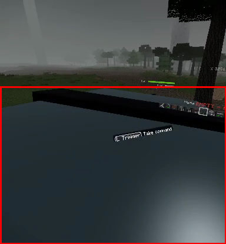 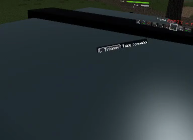

2. **`12:33:17 + 00:00:00.042` – `08.042`; `12:34:03 + 00:00:00.583` – `04.583`; `12:34:17 + 00:00:01.625` – `02.625`; `12:34:24 + 00:00:36.250` – `46.250`; `12:35:09 + 00:00:00.542` – `06.542` — Felled trees get stuck mid-air and become unharvestable**
   - **What you see:** Chopped trees convert to rigidbody entities that balance mid-air on leaf tips or jut diagonally into the sky, and swinging tools (`12:33:17 + 00:00:01.042` – `07.042`) or aiming the mining raycast at fallen trunks (`12:34:24 + 00:00:40.250` – `46.250`, `12:35:09 + 00:00:00.542` – `03.542`) produces no block selection outline and cannot harvest the wood—only the voxel stump on the ground can be mined.
   - **Severity:** Store-blocking.
   - **Likely cause:** Fallen trees switch from world voxels to a physics entity layer excluded from the voxel raycast/mining system, with oversized box colliders snagging on neighboring canopies.
    - **Shots:** 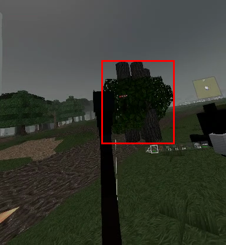 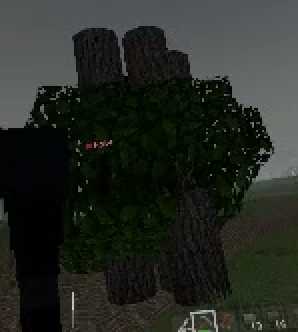 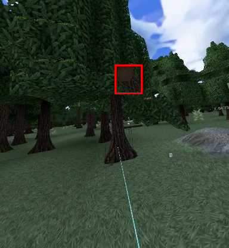 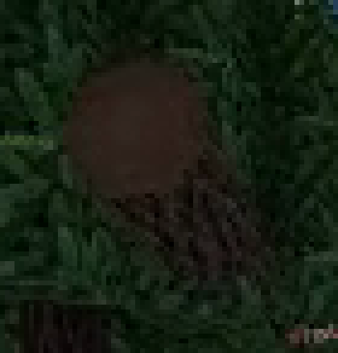

3. **`12:33:17 + 00:00:15.042` – `17.042` — Tilted, unlabelled world-loading screen**
   - **What you see:** After clicking *Create World* (`14.042`), the view cuts for 3 seconds to a bare green plane and blocky horizon tilted ~10–15° with no loading UI or progress indicator.
   - **Severity:** Store-blocking (Meta VRC comfort/unresponsive-app check).
   - **Likely cause:** Camera roll/head pose is frozen or improperly transformed before chunk meshes and loading overlay initialize.
    - **Shots:** 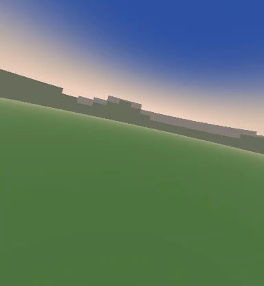

4. **`12:33:40 + 00:00:02.292` – `06.292` — Naturally generated fallen log floating above ground**
   - **What you see:** A horizontal `Spruce Log` structure in the newly generated forest hovers ~0.5–1 block above the sloped grass with a gap underneath.
   - **Severity:** Should fix.
   - **Likely cause:** Feature placer checks terrain height at only one endpoint of the multi-block log rather than conforming to or埋め-supporting across sloped terrain.
    - **Shots:** 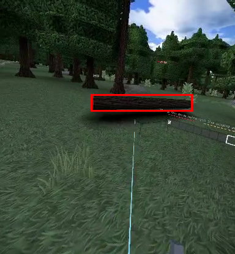 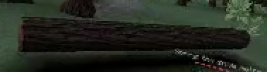

5. **`12:33:40 + 00:00:12.292` — Chopped tree trunk segment flashes pitch-black**
   - **What you see:** As the base of the spruce trunk breaks, the lower trunk block turns completely black for a frame before toppling.
   - **Severity:** Minor.
   - **Likely cause:**Newly spawned falling-tree mesh samples light at `(0,0,0)` or inside solid ground for one tick before updating lighting.
    - **Shots:** 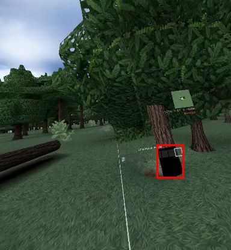 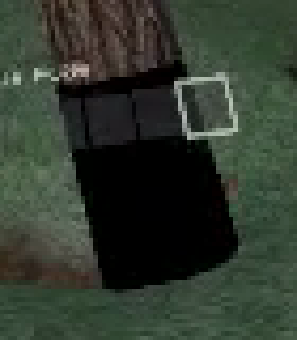

6. **`12:34:17 + 00:00:08.625` – `10.625`; `12:34:24 + 00:00:03.250` – `07.250`; `12:35:09 + 00:00:05.542` — Hollow, see-through leaf meshes and sheared tree canopies**
   - **What you see:** A tall spruce has most of its canopy cleanly sheared off (`12:34:17 + 00:00:08.625`), and when felled (`12:34:24 + 00:00:05.250` – `07.250`, `12:35:09 + 00:00:05.542`), missing interior/underside faces on the leaf cluster let sky show straight through paper-thin leaf shells.
   - **Severity:** Should fix.
   - **Likely cause:** Tree generator clipped across chunk boundaries without neighbor padding, and greedy/face culling strips faces adjacent to removed trunk/leaf voxels without rebuilding faces when the tree detaches.
    - **Shots:** 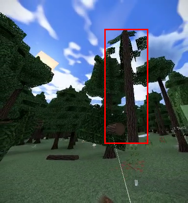 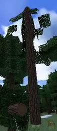 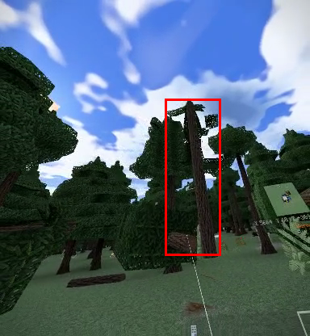 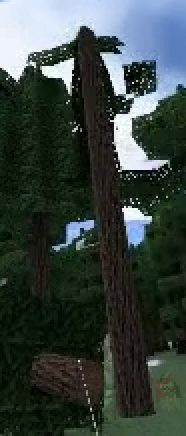

7. **`12:35:39 + 00:00:07.375` – `12.375`; `12:35:47 + 00:00:01.333` – `06.333`; `12:38:19 + 00:00:12.500` — Missing terrain chunks, sky-void holes, dark flashes, and floating distant structures**
   - **What you see:** Flying across regions produces a hard trench seam at the render boundary (`12:35:39 + 00:00:07.375`), repeated dark screen flashes (`09.375`, `11.375`, `12:35:47 + 00:00:01.333`, `03.333`), terrain dropping out completely to sky-blue void (`12:35:39 + 00:00:10.375`, `12:35:47 + 00:00:02.333`), isolated square grass chunks popping in over void (`04.333`), and sections of the distant Greywall Citadel floating in mid-air (`12:35:47 + 00:00:05.333` – `06.333`, `12:38:19 + 00:00:12.500`).
   - **Severity:** Store-blocking.
   - **Likely cause:** Chunk streaming/meshing falls behind movement speed with no low-LOD heightmap fallback, while structure chunks/LODs render before underlying terrain chunks load; camera or sky fog flickers during biome transitions.
    - **Shots:** 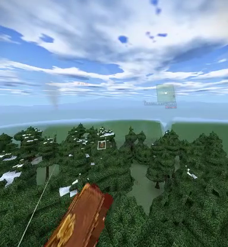 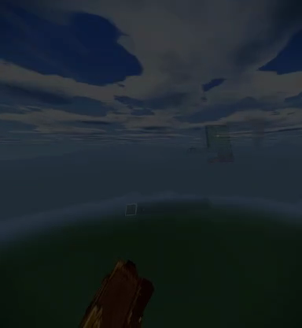

8. **`12:36:22 + 00:00:14.167` — Stretched/warped first-person `Field Stim` mesh**
   - **What you see:** Holding `Field Stim` in the right hand displays an elongated, smeared 2D-extruded item model.
   - **Severity:** Minor.
   - **Likely cause:** Non-uniform scale on the VR hand attachment socket or wrong aspect/depth scale on generated item-sprite geometry.
    - **Shots:** 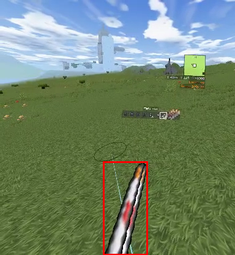 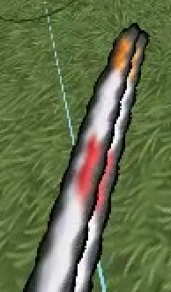

9. **`12:36:22 + 00:00:16.167` – `22.167`; `12:36:37 + 00:00:00.625` – `01:39.625` — Overlapping two-line text in Upgrade Bench UI**
   - **What you see:** Every row in the Upgrade Bench cramps the title line and material/status line directly into each other and against the row border.
   - **Severity:** Should fix.
   - **Likely cause:** Row button height is too small for the font line-height/padding at VR UI scale.
    - **Shots:** 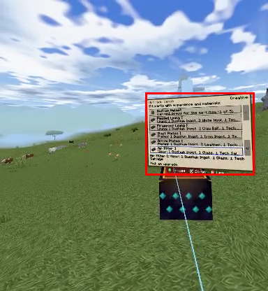 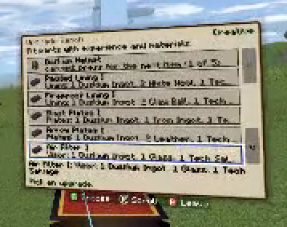 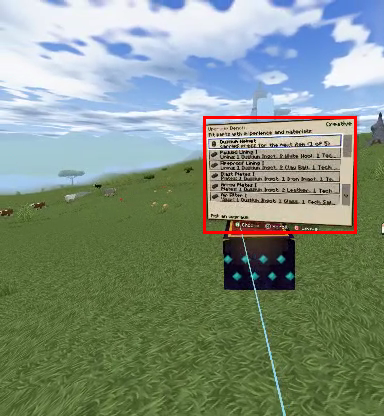 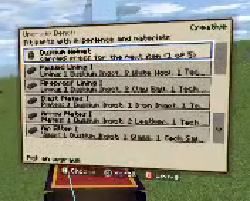

10. **`12:38:39 + 00:00:00.000` – `12:38:46 + 00:00:05.542`; `12:39:01 + 00:00:00.250`, `14.250`, `30.250`; `12:40:59 + 00:00:54.208` — Severe Z-fighting on `Mahlwerk Rotary Gun` viewmodel**
    - **What you see:** Prominent flickering black-and-white diagonal sawtooth striping across the top face of the left-hand magazine/receiver block whenever holding or moving the rotary gun.
    - **Severity:** Should fix.
    - **Likely cause:** Coplanar overlapping white and black cuboid faces in the weapon model (or left-hand sleeve clipping coplanarly with the gun housing).
    - **Shots:** 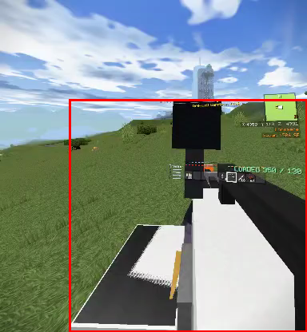 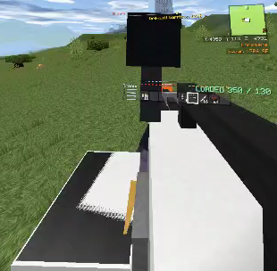 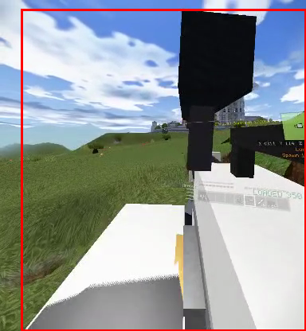 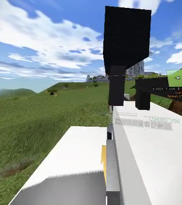

11. **`12:38:39 + 00:00:02.000` – `09.000`; `12:39:44 + 00:00:04.458`; `12:39:51 + 00:00:13.208`; `12:40:39 + 00:00:21.000`; `12:40:59 + 00:00:06.208` – `08.208` — Broken sniper/rotary scope ADS rendering and HUD occlusion**
    - **What you see:**
      - Raising the scope (`12:38:39 + 00:00:02.000`, `04.000`, `05.000`, `12:40:39 + 00:00:21.000`) fills the screen with a giant untextured black box tunnel with the wrist HUD drawn inside it.
      - While zoomed (`12:39:44 + 00:00:04.458`, `12:39:51 + 00:00:13.208`, `12:40:59 + 00:00:06.208` – `08.208`), the 3D HUD (minimap, coordinates, ammo counter) and white UI laser (`12:38:39 + 00:00:08.000`) cut across and block the reticle.
      - Exiting ADS (`12:38:39 + 00:00:09.000`, `12:40:59 + 00:00:08.208`) removes the black vignette before the magnified render texture turns off.
    - **Severity:** Store-blocking.
    - **Likely cause:** World-space HUD and laser pointer are not hidden/masked on the scope camera layer, ADS threshold triggers too late so the camera clips inside the scope mesh, and vignette alpha fades faster than the zoom camera disables.
    - **Shots:** 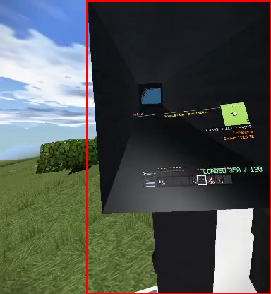 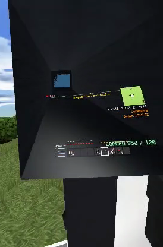 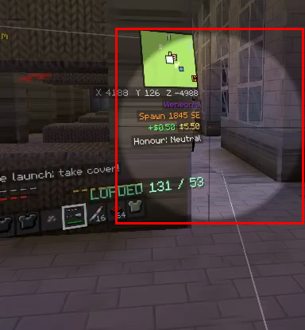 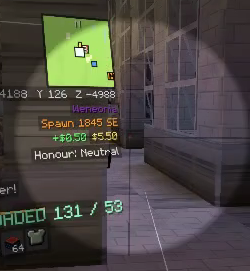

12. **`12:39:01 + 00:00:24.250` – `25.250`, `30.250` – `36.250` — Enemies and blasted tree parts floating high in mid-air during combat**
    - **What you see:** `Capital Trooper` enemies hang/float 5–10 m above the Citadel plaza (`25.250`, `32.250`, `35.250`), and an exploded birch log + leaf blocks stay suspended horizontally in mid-air (`33.250` – `36.250`).
    - **Severity:** Should fix.
    - **Likely cause:** Explosion knockback or destroyed-tree ground collision leaves entities resting on invisible/stale voxel colliders or stuck with disabled gravity.
    - **Shots:** 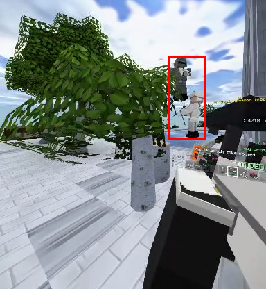 

13. **`12:39:01 + 00:00:32.250` – `45.250`; `12:39:44 + 00:00:01.458`; `12:40:59 + 00:00:53.208` — Overlapping HUD notifications, waypoints, and status text**
    - **What you see:** Alert banners (`Missile launch! take cover!`), honour popups (`+6 Honour: Neutral`, `you protected the town`), world waypoints (`Greywall Garrison`), and reload/ammo warnings (`Loaded: 187 / 350` directly over `No Capital Rounds` at `12:40:59 + 00:00:53.208`) pile on top of one another into illegible text.
    - **Severity:** Should fix.
    - **Likely cause:** Independent HUD text anchors share the same screen/wrist region without a layout stack or message queue, and world-space waypoints render through the HUD plane.
    - **Shots:** 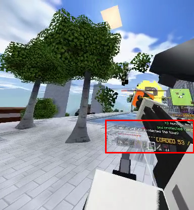 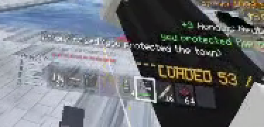 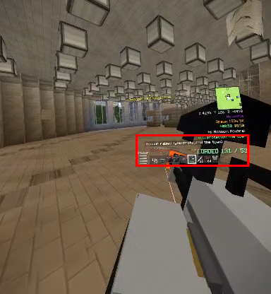 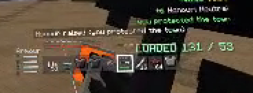

14. **`12:39:01 + 00:00:43.250` – `44.250`; `12:39:44 + 00:00:00.458` – `01.458` — Stray grass blocks on interior floor and birch log stuck in ceiling lights**
    - **What you see:** Inside the Citadel hall, two grass/dirt blocks sit on the tiled floor and a birch trunk block floats up among the ceiling light fixtures.
    - **Severity:** Should fix.
    - **Likely cause:** Structure paste failed to clear/overwrite biome surface/tree blocks, or exterior explosion debris penetrated the building shell and snapped to interior voxel cells.
    - **Shots:** 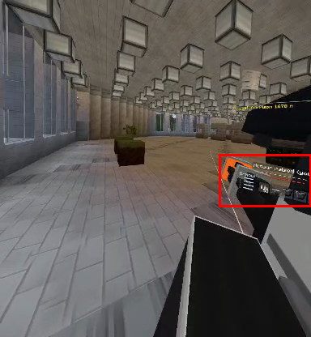 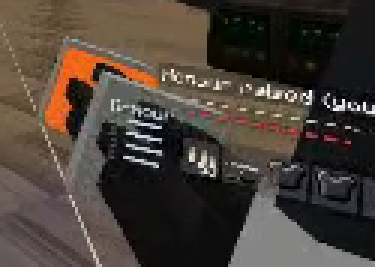 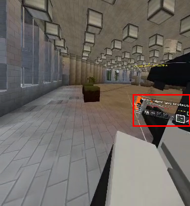 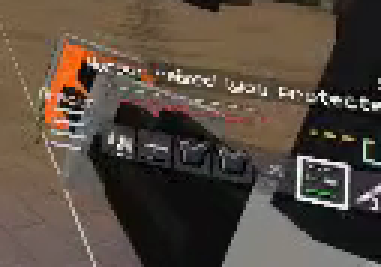

15. **`12:39:51 + 00:00:18.208`; `12:40:27 + 00:00:02.333` – `12:40:39 + 00:00:14.000`; `12:40:59 + 00:00:48.208`, `54.208` — Dead enemy models freeze mid-collapse or stay wedged upright in crates**
    - **What you see:** A defeated white `Capital` unit remains wedged upright/tilted on crates on the right for over a minute (`12:39:51 + 00:00:18.208` – `12:40:39 + 00:00:04.000`), and other dead troopers stay frozen tilted at 45° above the floor (`12:40:39 + 00:00:12.000` – `14.000`) instead of lying flat or despawning.
    - **Severity:** Should fix.
    - **Likely cause:** Death animation/ragdoll freezes before settling or collides with static props/dropped items and never cleans up.
    - **Shots:** 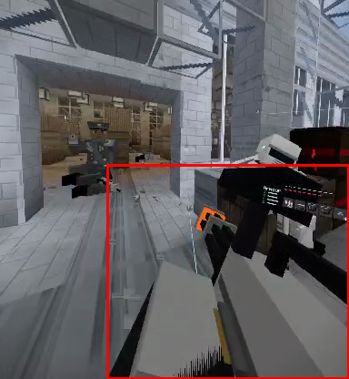 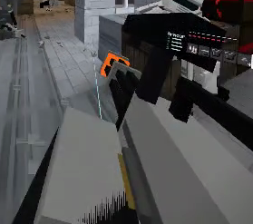 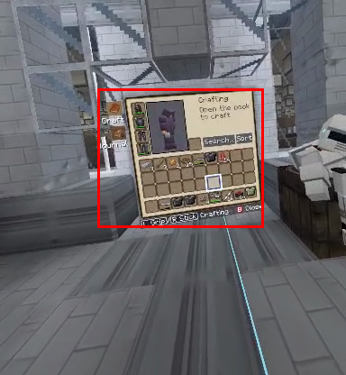 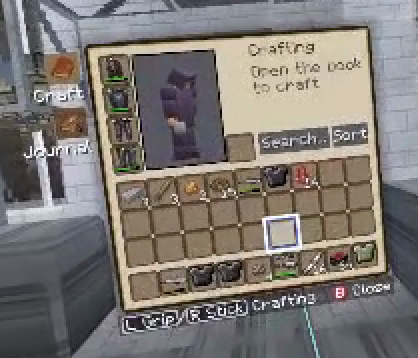

16. **`12:40:27 + 00:00:03.333` – `11.333`; `12:40:35 + 00:00:00.000` – `04.000` (and `12:38:19 + 00:00:10.500`) — Inventory tooltip text overflows box & paper-doll avatar faces backward**
    - **What you see:** Hovering the upgraded `Mahlwerk Rotary Gun` renders 8+ lines of upgrade text that spill below the dark tooltip background box; pointing near bottom-left slots (`12:38:19 + 00:00:10.500`) also rotates the 3D player preview completely backward.
    - **Severity:** Minor / Should fix.
    - **Likely cause:** Fixed max tooltip background height instead of dynamic text-bounds sizing, and unclamped yaw angle on cursor-tracking character preview.
    - **Shots:** 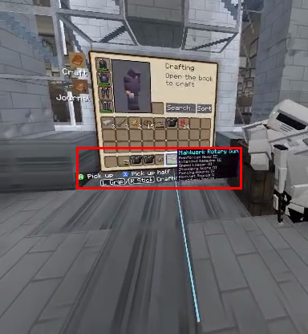 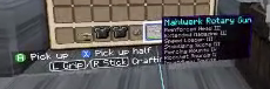 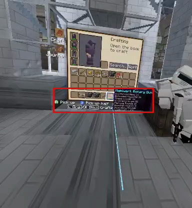 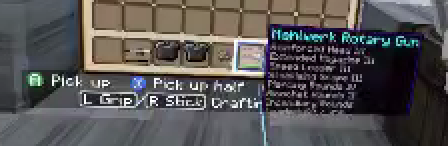

---

### Top 10 Worst Bugs in Priority Order for Store Release

1. **Broken weapon scope / ADS occluded by 3D HUD, laser pointer, and black scope geometry** (`12:38:39 + 00:00:02.000` – `09.000`, `12:39:44 + 00:00:04.458`, `12:40:59 + 00:00:06.208` – `08.208`) — *Store-blocking* (core VR gunplay/aiming is obstructed and visually broken).
2. **Felled trees get stuck mid-air and cannot be targeted or harvested** (`12:33:17 + 00:00:00.042` – `08.042`, `12:34:24 + 00:00:36.250` – `46.250`, `12:35:09 + 00:00:00.542` – `03.542`) — *Store-blocking* (breaks core sandbox resource gathering and leaves giant floating trees everywhere).
3. **Chunk-streaming dropouts to sky void, dark screen flashes, and floating distant buildings** (`12:35:39 + 00:00:07.375` – `12.375`, `12:35:47 + 00:00:01.333` – `06.333`, `12:38:19 + 00:00:12.500`) — *Store-blocking* (major world-rendering breakdown and flashing comfort issue).
4. **Tilted, indicator-less world-loading screen on world creation** (`12:33:17 + 00:00:15.042` – `17.042`) — *Store-blocking* (VR horizon tilt + apparent hang during world gen risks Meta VRC rejection).
5. **Severe Z-fighting on the `Mahlwerk Rotary Gun` first-person viewmodel** (`12:38:46 + 00:00:02.542` – `05.542`, `12:39:01 + 00:00:14.250`) — *Should fix* (constant high-contrast flicker right in the player's hands).
6. **HUD text pile-ups across alerts, honour popups, waypoints, and ammo status** (`12:39:01 + 00:00:32.250` – `45.250`, `12:40:59 + 00:00:53.208`) — *Should fix* (makes combat feedback and ammo warnings unreadable).
7. **Enemies and blasted tree trunks floating in mid-air during Citadel combat** (`12:39:01 + 00:00:25.250`, `32.250` – `36.250`) — *Should fix* (obvious physics/gravity failure during combat).
8. **Hollow, see-through leaf clusters and sheared tree canopies** (`12:34:17 + 00:00:08.625`, `12:34:24 + 00:00:05.250` – `07.250`, `12:35:09 + 00:00:05.542`) — *Should fix* (obvious missing-face geometry artifact whenever trees are cut or generated across chunks).
9. **Dead enemy corpses stuck wedged upright in props or frozen mid-fall** (`12:39:51 + 00:00:18.208`, `12:40:27 + 00:00:02.333` – `12:40:39 + 00:00:14.000`) — *Should fix* (confuses live vs. dead enemies and looks unpolished).
10. **Pitch-black unlit tree rendering & floating generated logs / stray interior blocks** (`12:32:49 + 00:00:06.458`, `12:33:40 + 00:00:02.292`, `12:39:01 + 00:00:43.250`) — *Should fix* (immediately noticeable worldgen and lighting defects).

## Part 2 of 4

**Recorder status:** No frame-wide tile-mosaic corruption appears in Part 2. However, the recorder’s rolling buffer overlaps by ~5–6 seconds at nearly every clip boundary (e.g., `12:40:59 + 00:01:20.625`–`01:25.625` repeats at `12:42:19 + 00:00:00.417`–`00:06.417`, and similarly at subsequent clip starts), alongside the expected top-left crop.

---

### Chronological Findings

1. **Heavy weapon clips into VR camera on ladders**
   - **Time:** `12:40:59 + 00:01:00.625`–`00:01:01.625`, `12:40:59 + 00:01:11.625`–`00:01:12.625`, `12:40:59 + 00:01:20.625`–`00:01:22.625`, `12:42:31 + 00:00:09.417`–`00:00:11.417`
   - **What you see:** While climbing ladders, the held `Mahlwerk Rotary Gun` blocks 50–60% of the HMD view with solid black/grey interior geometry.
   - **Severity:** Should fix
   - **Likely cause:** Heavy two-handed weapon isn’t stowed/hidden during ladder climbing, and hand-climbing IK pulls the weapon mesh inside the camera near-space.

2. **2D muzzle-flash billboard detached / oversized**
   - **Time:** `12:40:59 + 00:01:07.625`, `12:42:19 + 00:00:13.417`, `12:43:29 + 00:00:11.083`
   - **What you see:** A flat, pixelated yellow muzzle-flash sprite spawns offset from the rotary gun barrel and clips across the HUD/scope.
   - **Severity:** Minor
   - **Likely cause:** Muzzle socket offset not calibrated for VR weapon poses / billboard facing camera without depth/scale clamping.

3. **World-space HUD clips into 3D weapons and renders inside sniper scope mask**
   - **Time:** `12:40:59 + 00:01:08.625`, `12:40:59 + 00:01:13.625`, `12:43:29 + 00:00:18.083`
   - **What you see:** Held gun geometry cuts directly through the `LOADED` / `Armour` HUD (`00:01:08.625`, `00:01:13.625`), and when aiming down sights (`12:43:29 + 00:00:18.083`), the hotbar icons render inside the circular black scope vignette.
   - **Severity:** Should fix
   - **Likely cause:** HUD canvas depth-tests against first-person weapon meshes and isn’t hidden or masked when the scope overlay activates.

4. **Floating enemy & ragdolls clipping into floor/console**
   - **Time:** `12:40:59 + 00:01:23.625`, `12:42:19 + 00:00:09.417`, `12:42:55 + 00:00:02.000`
   - **What you see:** Dead `Capital Marksman` ragdolls sink halfway into the floor/wall (`00:01:23.625`); a live armored enemy floats ~1.5 blocks in mid-air beside a pillar (`12:42:19 + 00:00:09.417`); a `Gun Operator` stands on top of a computer terminal behind its chair (`12:42:55 + 00:00:02.000`).
   - **Severity:** Should fix
   - **Likely cause:** Navmesh/spawn-point height offset on multi-story voxel floors and missing ragdoll ground-collision sweeps.

5. **Unresponsive/opaque lift doors with no call feedback, plus overlapping text in Lift UI**
   - **Time:** `12:42:55 + 00:00:11.000`–`00:00:17.000`, `12:43:14 + 00:00:00.458`–`00:00:09.458`, `12:43:58 + 00:00:16.083`–`00:00:49.083`
   - **What you see:** Clicking `[L Trigger] Use Lift Door` gives no visual/state feedback—the player repeatedly clicks and walks face-first into the pitch-black door (`12:43:58 + 00:00:18.083`) waiting ~28 seconds for the car to arrive. Inside, the `Choose a floor` menu overlaps `Floor 6` and `Here` inside the top button (`12:43:14 + 00:00:07.458`).
   - **Severity:** Should fix
   - **Likely cause:** Missing "lift called / travelling" prompt or indicator on shaft doors, unlit dark door material, and insufficient button height for two-line label text.

6. **Deck gun camera clips turret roof & prompt collides with HUD**
   - **Time:** `12:43:58 + 00:00:02.083`–`00:00:10.083`
   - **What you see:** When manning the overhead deck gun, the camera sits right on the blocky turret roof geometry and `Gun Control: the gun overhead, worked from this computer` overlaps the `Shells 120` and `Armour` HUD.
   - **Severity:** Minor
   - **Likely cause:** Turret camera anchor placed inside/flush with hull blocks; long status string lacks line-wrapping or dedicated HUD slot.

7. **Complete terrain dropout to black void during fast flight & stark unblended world edge**
   - **Time:** `12:45:41 + 00:00:28.083`, `12:46:12 + 00:00:10.625`–`00:00:27.625`, `12:48:35 + 00:00:12.792`–`00:00:20.792`, `12:49:34 + 00:00:04.583`–`00:01:39.583`
   - **What you see:** Flying rapidly across biomes outruns chunk generation completely, leaving only stars/black void below and blank minimap tiles for >15 seconds (`12:46:12 + 00:00:11.625`–`00:00:26.625`). Later, while piloting the frigate at normal speed, loaded terrain ends in a sharp circular/blocky cutoff against pitch-black void with no distance fog or low-LOD horizon.
   - **Severity:** Store-blocking
   - **Likely cause:** Chunk streaming queue can’t keep up with high-speed movement, and night skybox lacks horizon fog/LOD terrain skirt to hide chunk draw-distance edges.

8. **Severe HUD text collisions across flight and frigate-piloting modes**
   - **Time:** `12:45:41 + 00:00:27.083`, `12:46:12 + 00:00:20.625`–`00:00:35.625`, `12:47:04 + 00:00:08.167`, `12:48:35 + 00:00:13.792`, `12:49:34 + 00:01:18.583`–`00:01:39.583`
   - **What you see:** Multiple HUD layers share identical screen coordinates:
     - Toast messages overwrite ammo text (`Sky Isle marked on theLOADED 10 / --` at `12:46:12 + 00:00:20.625`, `The frigate's cargo winch iLOADED 10 / --` at `00:00:34.625`).
     - `< Note` waypoint overwrites the `Meridian Frigate` boss bar (`12:47:04 + 00:00:08.167`).
     - While piloting the frigate, `Frigate radar (1,500 m)` and range/state text mash into `Frigate radar292500LAID` (`12:49:34 + 00:01:32.583`), while POI/hit notifications overwrite the `Hull` and `Fuel` bars (`12:49:34 + 00:01:23.583`, `00:01:31.583`).
   - **Severity:** Store-blocking
   - **Likely cause:** Hardcoded absolute anchor positions for independent HUD widgets (ammo, toast notifications, vehicle radar, ship telemetry) with no layout group.

9. **Meridian Frigate upper deck has no Survival entry point**
   - **Time:** `12:46:12 + 00:00:41.625`–`12:47:19 + 00:00:24.458`
   - **What you see:** After landing on the frigate’s deck in Survival, the player circles the entire superstructure shooting windows and walls (`12:46:12 + 00:00:51.625`–`12:47:04 + 00:00:15.167`) but cannot breach or find a door, forcing a switch to Creative mode (`12:47:19 + 00:00:16.458`) to break through the hull roof (`00:00:19.458`) to get inside.
   - **Severity:** Should fix
   - **Likely cause:** Frigate structure template lacks an exterior door/hatch on the upper deck, and ship hull/glass blocks ignore standard weapon damage in Survival.

10. **Floating disconnected ship blocks & unchanged `Hull` bar after internal rocket blast, plus stray ceiling sprite**
    - **Time:** `12:48:04 + 00:00:18.583`–`00:00:31.583`
    - **What you see:** Firing a rocket inside the frigate blows a hole through the roof and floor (`00:00:18.583`), leaving ceiling blocks, a light fixture, and upper door halves floating mid-air (`00:00:19.583`–`00:00:25.583`) while the `Hull` HUD bar remains full green. At `00:00:31.583`, a green pixelated face/slime artifact appears on the bridge ceiling.
    - **Severity:** Should fix
    - **Likely cause:** Moving-ship voxel grid doesn’t run structural-connectivity collapse or sync block destruction to the `Hull` health pool; stray particle/decal clipping through ceiling.

11. **Infinite/stuck fire state & comfort-breaking 2D flame overlay in VR**
    - **Time:** `12:48:35 + 00:00:20.792`–`00:00:21.792`, `12:48:51 + 00:00:04.417`–`00:00:10.417`, `12:48:57 + 00:00:00.417`–`12:49:20 + 00:00:09.500`
    - **What you see:** Taking a hit at the frigate helm triggers a heavy orange vignette and huge jagged 2D flame triangles locked to the VR lens. Even after leaving the helm and running through fire-free rooms for >35 seconds, the player never stops burning until toggling Creative mode (`12:49:20 + 00:00:09.500`).
    - **Severity:** Store-blocking
    - **Likely cause:** Burn status timer fails to decrement after dismounting a vehicle seat (or phantom fire hazard moves with the ship), combined with a flat screen-space fire overlay unsuitable for VR.

12. **Giant first-person VR hands, gun, and UI ray float in the sky during third-person ship piloting**
    - **Time:** `12:48:35 + 00:00:13.792`–`00:00:15.792`, `12:49:34 + 00:00:07.583`–`00:00:08.583`, `12:49:34 + 00:00:54.583`–`00:00:58.583`
    - **What you see:** While flying the frigate in third-person chase camera, the player’s giant VR hands, shotgun, and white laser-pointer ray still render right in front of the chase camera in mid-air behind the ship’s engines.
    - **Severity:** Store-blocking
    - **Likely cause:** Entering third-person vehicle camera moves the VR rig behind the ship without disabling first-person hand/weapon renderers and UI raycasters.

---

### Top 10 Priority Fixes for Store Release

1. **Stuck/infinite player burning state & HMD-locked 2D flame overlay** (`12:48:57 + 00:00:00.417`–`12:49:20 + 00:00:09.500`) — Store-blocking gameplay bug and severe VR visual/comfort issue.
2. **Severe HUD text collisions / unreadable mashed strings (`Frigate radar292500LAID`, toasts over `LOADED` and `Hull`/`Fuel`)** (`12:46:12 + 00:00:34.625`, `12:49:34 + 00:01:32.583`) — Store-blocking UI legibility failure.
3. **First-person VR hands, weapon, and laser ray floating in third-person ship chase camera** (`12:48:35 + 00:00:13.792`, `12:49:34 + 00:00:07.583`) — Store-blocking VR camera/avatar bug.
4. **Terrain chunk dropout to black void & unblended void horizon around loaded chunks** (`12:46:12 + 00:00:11.625`, `12:49:34 + 00:00:08.583`) — Store-blocking world-rendering polish/streaming issue.
5. **Heavy weapon blocking >50% of VR camera view while climbing ladders** (`12:40:59 + 00:01:00.625`, `12:40:59 + 00:01:21.625`) — Major visibility/usability issue during combat traversal.
6. **Meridian Frigate upper deck lacking a Survival entry hatch/breachable access** (`12:46:12 + 00:00:41.625`–`12:47:19 + 00:00:20.458`) — Traps or blocks players boarding from above without Creative mode.
7. **Floating HUD intersecting 3D held weapons and rendering inside scope vignette** (`12:40:59 + 00:01:08.625`, `12:43:29 + 00:00:18.083`) — Frequent VR UI/depth-sorting artifact.
8. **Floating live enemies and ragdolls clipping into floors/consoles** (`12:42:19 + 00:00:09.417`, `12:42:55 + 00:00:02.000`) — Obvious AI/physics jank during indoor firefights.
9. **Floating disconnected ship blocks & desynced `Hull` bar after internal explosions** (`12:48:04 + 00:00:18.583`–`00:00:25.583`) — Breaks voxel destruction and ship-health feedback.
10. **Opaque lift doors lacking call/arrival feedback & overlapping `Floor 6`/`Here` button text** (`12:43:58 + 00:00:16.083`–`00:00:49.083`) — Makes elevators appear broken for nearly half a minute.

## Part 3 of 4

### Recorder Corruption Note
No frame-wide mosaic tile recorder corruption appears in Part 3 (only the expected top-left crop). Note that the heavy darkening in `12:55:08 + 00:00:09.333`–`00:00:27.333` is a **game lighting bug** (the burned-in yellow clock stays full brightness while the 3D world and world-space HUD go dark).

---

### Game Bugs Found (Chronological)

1. **`12:49:34 + 00:01:59.333` – `00:02:00.333`, `12:51:33 + 00:00:00.500` — Notification text overlaps vehicle HUD**
   - **What:** `"Boreal Station marked on the map"` renders directly on top of the Frigate's `Hull` / `Fuel` / `Drive` bars, making both unreadable.
   - **Severity:** Should fix.
   - **Likely cause:** Event toast notifications and vehicle telemetry share the same head-locked 3D UI anchor without vertical layout stacking.
    - **Shots:** 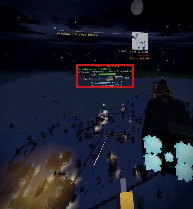 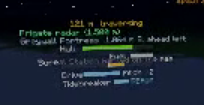  

2. **`12:51:33 + 00:00:03.500` — Frigate thruster plumes flicker off mid-flight**
   - **What:** All five blue engine exhaust plumes vanish for a single frame, exposing flat yellow octagons on the engine block while `Drive` is still active, then pop back in at `00:00:04.500`.
   - **Severity:** Minor.
   - **Likely cause:** Particle/mesh emitter culling or single-frame state hitch when banking/updating ship chunks.
    - **Shots:**  

3. **`12:51:48 + 00:00:00.333` – `00:00:01.333`, `12:51:54 + 00:00:15.542` – `00:00:18.542` — Hard-edged low-poly yellow glow domes**
   - **What:** Distant explosions/fires render as giant, unblended, sharp-edged yellow/orange translucent spheres clipping harshly into the terrain and night sky, with black silhouette blocks inside (`12:51:54 + 00:00:15.542`).
   - **Severity:** Should fix.
   - **Likely cause:** Low-LOD point-light or fire-glow proxy geometry lacking alpha falloff/soft-particle blending at distance.
    - **Shots:**    

4. **`12:51:48 + 00:00:03.333` – `00:00:05.333` — Alarm banner collides with hotbar UI**
   - **What:** `"Alarm! The garrison is coming through!"` overlaps directly with the weapon hotbar boxes and `LOADED 5 / --` ammo counter.
   - **Severity:** Should fix.
   - **Likely cause:** Fixed HUD alert coordinates overlap the hotbar's vertical position.
    - **Shots:**  

5. **`12:53:16 + 00:00:02.417` – `12:53:32 + 00:00:06.833` — Capital ship cut completely in half stays suspended in mid-air with floating debris**
   - **What:** Firing the station's deck gun severs the hovering Frigate into two completely disconnected halves (`12:53:16 + 00:00:03.417` onward) and hollows out its rear engine (`00:00:14.417`–`00:00:23.417`), yet neither half falls, tilts, or crashes. Detached voxel clusters also float stationary in mid-air (around the hull gap and a separate floating block cluster on the far right above the trees at `12:53:16 + 00:00:07.417`–`00:00:23.417`).
   - **Severity:** Store-blocking.
   - **Likely cause:** Airship entities use kinematic hover positioning without structural connectivity checks, split-grid physics, or a destroyed/crash state when hull integrity or propulsion is severed.
    - **Shots:**    

6. **`12:53:16 + 00:00:08.417` – `00:00:17.417` — Deck gun aiming sightline blocked by overlapping minimap and alerts**
   - **What:** While manning the deck gun and aiming upward, the minimap, coordinate readout, `"Reinforcements coming down the stairs"`, and `Spawn 2930 NW` pile on top of each other right across the aiming reticle and right gun barrel.
   - **Severity:** Should fix.
   - **Likely cause:** Turret camera mode does not reposition or fade head-locked HUD widgets out of the center aiming cone.
    - **Shots:**  

7. **`12:53:32 + 00:00:37.833` – `00:00:55.833` — Corpse pileup obstructs stairwell doorway and clips into door lintel**
   - **What:** Multiple armored NPC corpses stack in a persistent heap at the bottom of a narrow stairwell for ~20s, blocking movement and doorway raycasts (`Use Bulkhead Door`), while another dead guard's torso hangs clipped into the bulkhead doorframe/wall at `12:53:32 + 00:00:55.833`.
   - **Severity:** Should fix.
   - **Likely cause:** Ragdolls/corpses take too long to despawn, retain bulky colliders/raycast hitboxes in choke points, and lack wall-penetration constraints.
    - **Shots:**  

8. **`12:54:31 + 00:00:05.917` – `00:00:07.917` — Block-breaking wireframe outline appears while wielding a shotgun**
   - **What:** Large black 2×2 voxel selection wireframes highlight `Station Concrete` walls while the player is holding the `Breacher Shotgun` in combat.
   - **Severity:** Minor.
   - **Likely cause:** Voxel block-targeting raycast outline isn't suppressed when non-mining firearms are equipped.
    - **Shots:**  

9. **`12:54:41 + 00:00:01.375` — Enemy guard clips through bunker wall/doorframe**
   - **What:** An enemy soldier walks straight out of the solid yellow-and-black hazard doorframe/wall corner on the left while shooting the player.
   - **Severity:** Should fix.
   - **Likely cause:** NPC pathfinding/navmesh corner radius clips through doorway voxel geometry.
    - **Shots:**  

10. **`12:55:08 + 00:00:09.333` – `00:00:10.333`, `12:55:08 + 00:00:15.333` – `00:00:27.333` — Viewport and 3D HUD plunge into near-black darkness in unloaded chunks**
    - **What:** During Creative flight across unloaded terrain, the entire game render—including the sky and 3D HUD—dims by ~80% to near-black, briefly flashing back to full daylight at `00:00:11.333`–`00:00:14.333` before going dark again until `00:00:28.333`.
    - **Severity:** Store-blocking.
    - **Likely cause:** Camera/HUD ambient lighting samples the current voxel chunk's skylight value, which defaults to `0` (pitch dark) before chunk generation finishes.
    - **Shots:**  

11. **`12:55:08 + 00:00:28.333` – `00:00:36.333` — Severe terrain void holes, detached floating vehicle wheels, and trunkless tree canopies**
    - **What:** Arriving at the Ironback Crawler patrol, the terrain is missing across huge rectangular chunk holes showing empty blue sky/void underneath. At `00:00:28.333`, only the Crawler's six black wheels float in empty void for a full second before the hull meshes in (`00:00:29.333`). At `00:00:36.333`, sharp unmeshed chunk edges and floating tree leaf clusters without trunks remain visible beside the vehicle.
    - **Severity:** Store-blocking.
    - **Likely cause:** Chunk streaming/meshing thread falls far behind player flight speed, and sub-entity wheel meshes render before the parent vehicle voxel mesh and underlying terrain chunk load.
    - **Shots:**  

12. **`12:55:08 + 00:00:55.333` – `00:01:03.333` — Vehicle floor can be mined away leaving the Helm floating in mid-air**
    - **What:** Breaking floor grating inside the Ironback Crawler leaves the wooden `Helm` steering wheel floating unsupported over an open hole (`00:00:55.333`).
    - **Severity:** Should fix.
    - **Likely cause:** Functional vehicle control blocks lack support-block attachment checks or protection from block breaking while locked.
    - **Shots:**  

13. **`12:57:42 + 00:00:06.750` – `12:57:53 + 00:00:11.208` — Stale `"Helm (locked)"` UI prompt after clearing crew & overlapping 3D HUD strings**
    - **What:** Even after killing all crew (`"Ironback Crawler: no driver..."` at `12:57:42 + 00:00:06.750`), aiming at the steering wheel at `12:57:53 + 00:00:11.208` still displays `[L Trigger] Helm (locked)` until clicked. Throughout boarding (`12:55:08 + 00:00:38.333`–`12:57:42`), the `Your things` waypoint text and `Ironback Crawler` status bar overlap in 3D space.
    - **Severity:** Should fix.
    - **Likely cause:** Interaction hover label caches the locked string on block creation and only re-evaluates lock state on trigger press.
    - **Shots:**    

14. **`12:58:17 + 00:00:00.875` – `00:00:19.875`, `12:58:45 + 00:00:11.333` – `00:00:21.333` — Crawler driving bugs: sliced floating trees, hovering wheels, disembodied VR hands, and barren chunk LOD**
    - **What:**
      - Driving through forest slices trees vertically along the hull edge, leaving tall half-trees and detached logs/leaves **floating in mid-air** (`12:58:45 + 00:00:14.333`–`00:00:15.333`, left of road).
      - Crawler front hull/wheels visibly hover above the beach sand (`12:58:17 + 00:00:16.875`–`00:00:17.875`).
      - Disembodied player VR hands float in mid-air behind the third-person camera (`12:58:17 + 00:00:17.875`).
      - Terrain ~80–100m ahead is completely barren green geometry with trees popping in abruptly right in front of the vehicle (`12:58:17 + 00:00:04.875`–`00:00:19.875`).
    - **Severity:** Store-blocking (floating sliced trees / 3rd-person hands / harsh pop-in).
    - **Likely cause:** Vehicle bulldozer logic deletes only intersecting voxel columns without triggering tree-felling/leaf-decay on remaining unsupported blocks; 3rd-person vehicle camera fails to hide first-person hand models; decoration LOD draw distance is too short for elevated vehicle cameras.
    - **Shots:**    

15. **`12:58:45 + 00:00:22.333` – `00:00:24.333` — Main title screen renders over unloaded blue void inside a tree with red blood vignette stuck on screen**
    - **What:** Right after taking damage on the Crawler roof (`00:00:22.333`) and returning to the `SUNDERFALL` main menu, the title menu first floats over an empty unloaded blue sky (`00:00:23.333`), then snaps inside pine tree foliage (`00:00:24.333`), while the red combat damage/low-health screen vignette remains stuck around the edges of the main menu.
    - **Severity:** Store-blocking.
    - **Likely cause:** Post-process damage vignette state isn't cleared when unloading a session to the title screen, and the title-screen diorama world isn't preloaded or given a clear camera spawn point before showing UI.
    - **Shots:** 

16. **`12:59:15 + 00:00:03.375`, `12:59:31 + 00:00:14.500` — Floating fallen log and smeared vertical pit texture**
    - **What:** A fallen log floats horizontally above sloped grass (`12:59:15 + 00:00:03.375`), and a sharp 1-block pit in the forest floor (`12:59:31 + 00:00:14.500`) exhibits stretched vertical grass/dirt texture smearing.
    - **Severity:** Minor.
    - **Likely cause:** Fallen-log prefab places along flat Y without per-block terrain grounding; smooth-voxel/triplanar UV stretching on steep cave openings.
    - **Shots:**    

17. **`12:59:31 + 00:00:19.500` – `12:59:51 + 00:00:08.958` — Broken procedural conifer treetops across `Loremere` biome**
    - **What:** Nearly every tall forest tree has an isolated blocky cube of leaves perched atop a bare, brightly lit trunk pole above the main canopy (`12:59:51 + 00:00:05.958`–`00:00:06.958`), single horizontal log blocks jutting out in mid-air (`00:00:07.958`), and square holes in upper canopies exposing flat bare trunk tops (`00:00:08.958`).
    - **Severity:** Should fix.
    - **Likely cause:** Off-by-one/spacing bug in the tall-spruce procedural generator's crown layer offsets, leaving an unfoliaged trunk gap below the apex cap and uncapped trunk tops in lower whorls.
    - **Shots:**    

---

### Top 10 Worst Bugs in Priority Order for Store Release

1. **Severed capital ship and debris float stationary in mid-air (`12:53:16 + 00:00:02.417` – `12:53:32 + 00:00:06.833`)** — Store-blocking: cutting a flying warship cleanly in two with a deck gun leaves two disconnected ship halves and loose voxel islands hanging motionless in the sky.
2. **Severe chunk holes to void and detached vehicle wheels floating in empty air (`12:55:08 + 00:00:28.333` – `00:00:36.333`)** — Store-blocking: unmeshed terrain gaps expose empty sky beneath the map and render vehicle wheels in void before the hull or ground exists.
3. **Entire viewport and 3D HUD go near-black in ungenerated chunks (`12:55:08 + 00:00:09.333` – `00:00:27.333`)** — Store-blocking: severe full-screen brightness/exposure drops and flashes during fast movement make VR uncomfortable and look like a rendering failure.
4. **Title screen spawns over unloaded sky/inside tree with red blood vignette stuck on (`12:58:45 + 00:00:23.333` – `00:00:24.333`)** — Store-blocking: leaking combat damage overlays onto the main menu over an unloaded background looks broken to any store reviewer.
5. **Ironback Crawler slices trees into floating mid-air columns, hovers over sand, and shows disembodied VR hands (`12:58:17 + 00:00:16.875` – `12:58:45 + 00:00:15.333`)** — Store-blocking: driving a flagship vehicle leaves half-sliced floating trees in its wake and leaks first-person hand models into the 3rd-person camera.
6. **Broken procedural conifer tree crowns across an entire biome (`12:59:31 + 00:00:19.500` – `12:59:51 + 00:00:08.958`)** — Should fix: every tall tree in `Loremere` has detached-looking square leaf cubes on bare poles, jutting logs, and open canopy holes.
7. **Barren treeless terrain chunks ~80m ahead of vehicle camera with abrupt tree pop-in (`12:58:17 + 00:00:00.875` – `00:00:19.875`)** — Should fix: elevated 3rd-person driving exposes completely empty plastic-green terrain right ahead of the player.
8. **Enemy guard clips through solid bunker wall/doorframe (`12:54:41 + 00:00:01.375`) and stairwell corpse pileups block doors (`12:53:32 + 00:00:37.833` – `00:00:55.833`)** — Should fix: directly impacts indoor combat fairness, navigation, and door interaction.
9. **Systematic 3D HUD / notification text collisions (`12:49:34 + 00:01:59.333`, `12:51:48 + 00:00:03.333`, `12:53:16 + 00:00:12.417`)** — Should fix: alerts, minimap, hotbar, vehicle bars, and turret sights repeatedly render on top of each other.
10. **Stale `"Helm (locked)"` prompt after clearing crew (`12:57:53 + 00:00:11.208`) & floating mined-under Helm (`12:55:08 + 00:00:55.333`)** — Should fix: misleads players into thinking a cleared vehicle is still locked and allows vehicle control stations to float in mid-air when surrounding floor blocks are broken.

## Part 4 of 4

### Recorder Corruption Check
* **No recorder mosaic/tiling corruption** (frame-wide tiles from other frames) was observed in Part 4. (Note: consecutive recording clips overlap by a few seconds in wall-clock time, e.g., `13:03:59 + 00:00:16.250` and `13:04:10 + 00:00:00.083`; all findings below cite exact burned-in frame labels.)

---

### Chronological Game Bug Findings

1. **Malformed procedural tree crowns (pits and single-block toppers)**
   * **Labels:** `12:59:51 + 00:00:09.792`–`00:00:12.792`, `13:00:00 + 00:00:00.000`–`00:00:02.500`
   * **What you see:** Large forest canopies have square hollow pits exposing flat trunk stubs, and tall trees are topped with a detached-looking single leaf cube on a thin stem.
   * **Severity:** Minor
   * **Likely cause:** Off-by-one radius/height truncation in procedural tree canopy templates.

2. **Full-screen blackouts / dimming (including VR HUD) during flight**
   * **Labels:** `13:00:00 + 00:00:05.000`, `13:00:00 + 00:00:11.500`–`00:00:12.000`, `13:00:00 + 00:00:15.500`–`00:00:26.000`, `13:00:21 + 00:00:01.250`–`00:00:07.750`, `13:00:21 + 00:00:15.750`, `13:00:33 + 00:00:03.208`, `13:00:33 + 00:00:35.208`
   * **What you see:** While flying across unloaded or high-altitude space, the entire display—including world-space UI—dims to near-black for several seconds and flickers back to bright daylight.
   * **Severity:** **Store-blocking**
   * **Likely cause:** Head-in-wall VR comfort fade triggers falsely when the camera enters ungenerated chunks that return occluded/solid collision or zero light.

3. **Severe chunk-streaming lag, void cutoffs, and unmeshed terrain blobs**
   * **Labels:** `13:00:00 + 00:00:05.500`–`00:00:15.000`, `13:00:21 + 00:00:08.250`–`00:00:14.750`, `13:00:33 + 00:00:00.208`–`00:00:02.208`
   * **What you see:** Creative flight easily outruns terrain generation for 10+ seconds, exposing sharp square chunk cliffs dropping into empty sky/void and blurry unmeshed heightmap geometry.
   * **Severity:** **Store-blocking**
   * **Likely cause:** Voxel generation/meshing threads on Quest 3 CPU are starved during fast movement without LOD mesh skirts or flight-speed throttling.

4. **Unnatural straight dark terrain gash & snow-peak blotch**
   * **Labels:** `13:00:00 + 00:00:12.000`–`00:00:13.500` (trench), `13:00:21 + 00:00:16.250`–`00:00:17.750` & `13:00:33 + 00:00:04.208`–`00:00:05.208` (mountain peak)
   * **What you see:** A razor-straight, dark-shaded trench slices across a green hill; later, a snow peak has a jagged dark stone patch and a tree balanced on a 1-block snow spire.
   * **Severity:** Minor
   * **Likely cause:** Road/ravine spline carver lacking edge blending, and steep-slope surface-block replacement stripping snow on peak vertices.

5. **Blurry VR menu text & neon-pink distant LOD biome bands**
   * **Labels:** `13:00:33 + 00:00:12.208`–`00:00:18.208` (pause menu), `13:00:33 + 00:00:18.708`–`00:00:20.708`, `13:01:18 + 00:00:10.625`–`00:00:17.125`, `13:01:54 + 00:00:00.292`–`00:00:38.292` (pink LOD)
   * **What you see:** Pause menu button labels and footer text shimmer and blur badly in VR. Increasing View Distance reveals huge bright pink/magenta swathes across distant LOD terrain/shorelines.
   * **Severity:** **Should fix**
   * **Likely cause:** Non-SDF bitmap font without proper mip/anisotropic filtering on VR canvas; distant LOD vertex-color table maps cherry-blossom or shoreline biome to oversaturated pink/debug magenta.

6. **Sky Skiff bugs: false placement error, duplicate/propeller-less skiff, terrain clipping, detached HUD, giant VR hands, and floating wreckage**
   * **Labels:** `13:01:11 + 00:00:08.208` ("No open sky here"), `13:01:18 + 00:00:10.125`–`00:00:12.625` (two skiffs, missing/clipping propellers), `13:01:29 + 00:00:11.667` (pitch-black shadow blob), `13:01:29 + 00:00:13.167` & `13:01:36 + 00:00:06.083` (HUD detaches from skiff), `13:01:42 + 00:00:06.958`–`00:00:07.958` (skiff collision tilt), `13:01:54 + 00:00:24.792`–`00:00:26.792` (giant hammers/hands in 3rd-person), `13:01:54 + 00:00:50.292` & `13:03:06 + 00:00:04.708`–`00:00:05.208` (wreckage/skiff frozen in mid-air)
   * **What you see:** Placing the Sky Skiff outdoors gives "No open sky here," then spawns overhanging the cliff; entering steer view shows a second propeller-less skiff beside it while propellers clip into stone; skiff casts an ink-black blob on trees; Hull/Lift HUD drifts far off-target when looking sideways; giant first-person controller/hammer hands appear in 3rd-person flight camera; and when shot by a turret, broken hull/log blocks and the skiff remain frozen floating high in the sky.
   * **Severity:** **Store-blocking**
   * **Likely cause:** Missing bounding-box clearance check on spawn, first-person hand rig not hidden in vehicle 3rd-person mode, and destroyed vehicle chunks lacking gravity/cleanup.

7. **Harsh POI plateau cliffs & pop-in sky island at Capital Citadel**
   * **Labels:** `13:01:54 + 00:00:37.792`–`00:00:40.792`
   * **What you see:** The citadel sits on a sharp square-beveled dirt/grass pedestal; a floating sky island pops abruptly into view at `38.292`.
   * **Severity:** Minor
   * **Likely cause:** Narrow linear heightmap blend skirt around large structures and abrupt chunk-LOD swap for floating islands.

8. **Station lamp glow cubes, moon rendering in front of mountains, and stuck train boss bar**
   * **Labels:** `13:03:06 + 00:00:03.708`–`00:00:04.208` (lamp cubes), `13:03:18 + 00:00:06.708`–`00:00:09.208` & `00:00:15.708`–`00:00:16.208` (moon over mountains), `13:03:59 + 00:00:00.250`–`00:00:07.250` (stuck `Bullion Train Guard Car` bar)
   * **What you see:** Station lamps are surrounded by large, ugly translucent tan cubes; the rising moon draws *on top* of distant mountain silhouettes; and the train health bar stays stuck on the HUD long after leaving the train.
   * **Severity:** **Should fix**
   * **Likely cause:** Unmasked volumetric-glow cube mesh on lamps; skybox moon rendered after/without depth-testing against distant LOD terrain; missing distance-exit cleanup on boss HUD bar.

9. **Built-in "Proving Grounds" world is completely empty and spawns player falling in void**
   * **Labels:** `13:04:10 + 00:00:04.083` (menu promise), `13:04:10 + 00:00:08.083`–`00:00:18.083`, `13:04:30 + 00:00:00.125`–`00:00:17.125`
   * **What you see:** Worlds menu advertises *"a hundred vehicles, a hundred copper circuits and ten built guns laid out to try"*, but loading Proving Grounds drops the player into empty air below a completely bare floating stone platform with nothing on it.
   * **Severity:** **Store-blocking**
   * **Likely cause:** Showcase world entity/prefab population script failed or shipped with an empty save file, and spawn point is below the platform.

10. **Pitch-black shadow scar & abrupt daytime-to-night skybox flip under sky platform**
    * **Labels:** `13:04:30 + 00:00:00.625`, `13:04:58 + 00:00:03.792`–`00:00:12.792`, `13:05:09 + 00:00:00.167`–`00:00:02.167`
    * **What you see:** The floating platform casts a pure-black, zero-ambient shadow strip across the forest below, and flying near it causes the bright daytime skybox to abruptly snap to dark night (`10.792`–`12.292`) before snapping back to day (`12.792`).
    * **Severity:** **Store-blocking**
    * **Likely cause:** Skylight column attenuation drops to 0 under high platforms without minimum ambient light, and the skybox shader mistakenly modulates sky brightness by the player's local voxel skylight.

11. **"Sparkstone Workshop" showcase world: floating sky sign/lever, melted circuit stones, and see-through piston door**
    * **Labels:** `13:05:22 + 00:00:09.958`–`00:00:12.458`, `13:06:06 + 00:00:00.333`–`00:00:11.833`, `13:06:29 + 00:00:11.333`, `13:06:52 + 00:00:00.167`–`00:00:01.667`
    * **What you see:** A wooden sign and lever float in mid-air 5+ blocks above the platform (`13:06:06 + 00:00:00.333`); circuit support stones use smooth marching-cubes terrain meshing so lamps, torches, repeaters, and levers float off melted rock blobs; platforms clip into snowy trees with disconnected ramps; and opening the piston door exposes paper-thin/see-through piston backfaces over a pit.
    * **Severity:** **Store-blocking**
    * **Likely cause:** Circuit prefabs placed natural smooth-terrain stone instead of cubic stone bricks, template edits left orphaned floating blocks, and piston sub-meshes lack backfaces.

12. **UI text collisions and overflows across signs, Hoppers, Upgrade Bench, and weapon HUD**
    * **Labels:** `13:05:22 + 00:00:02.458`–`00:00:03.458` (sign overflow & prompt overlap), `13:06:29 + 00:00:07.333`–`00:00:08.333` (Hopper tooltip overlaps button prompts), `13:07:32 + 00:00:17.083`–`00:00:21.583` (Upgrade Bench row text overlap), `13:07:32 + 00:00:24.083` & `13:08:35 + 00:00:25.000` (`LOADED 45` / `EMPTY - reload (Y)` drawn directly over hotbar slots)
    * **What you see:** Weapon ammo status overlaps right on top of the right-side hotbar icons; inventory item tooltips collide unreadably with controller prompts; Upgrade Bench and oak sign text overflow their containers.
    * **Severity:** **Should fix**
    * **Likely cause:** Overlapping fixed HUD/canvas anchors without layout padding or text auto-sizing.

13. **Completely non-reactive Marauder AI, frozen tilted corpses, and rifle bullets chewing through stone walls**
    * **Labels:** `13:06:52 + 00:00:20.667`–`00:00:28.667`, `13:07:32 + 00:00:25.583`–`00:00:31.583`, `13:08:03 + 00:00:00.042`–`00:00:14.542`, `13:08:21 + 00:00:00.750`, `13:08:35 + 00:00:00.500`–`00:00:24.000`
    * **What you see:** Marauders stand frozen with their backs turned even while taking direct gunfire (`13:07:32 + 00:00:29.083`) or having walls blasted apart inches away; corpses freeze tilted at 45° clipping into the floor; and rifle rounds rapidly destroy cobblestone/stone-brick walls, leaving floating upper tower logs/walls.
    * **Severity:** **Should fix**
    * **Likely cause:** Creative-mode aggro suppression disables hit-reaction/turn-to-attacker states, death state lacks ground alignment/despawn, and upgraded bullet terrain-damage is overtuned against stone.

---

### Top 10 Worst Bugs in Priority Order for Store Release

1. **Empty "Proving Grounds" built-in world & void spawn** (`13:04:10 + 00:00:08.083`–`13:04:30 + 00:00:17.125`) — Store reviewers testing featured menu worlds will immediately see a broken, empty slab that contradicts its menu description and drops them into the void.
2. **Full-screen blackouts/dimming (including HUD) during flight** (`13:00:00 + 00:00:15.500`–`00:00:26.000`, `13:00:21 + 00:00:01.250`–`00:00:07.750`) — Looks like app hangs/display failure and breaks VR comfort/usability.
3. **Severe chunk-streaming lag & open void cliffs** (`13:00:00 + 00:00:05.500`–`00:00:15.000`, `13:00:21 + 00:00:08.250`–`00:00:14.750`) — Outrunning world generation into empty void for 10+ seconds fails Meta Quest technical/visual polish expectations.
4. **"Sparkstone Workshop" broken showcase world (floating sky sign/lever, melted circuit rocks, see-through piston door)** (`13:06:06 + 00:00:00.333`, `13:05:22 + 00:00:11.458`, `13:06:52 + 00:00:00.667`) — Second featured tutorial world looks visibly broken right at spawn.
5. **Pitch-black zero-ambient shadow strip & daytime-to-night skybox snapping** (`13:04:58 + 00:00:03.792`–`00:00:12.792`) — Jarring full-sky lighting flip and pure-black terrain corruption.
6. **Sky Skiff vehicle bugs (duplicate/propeller-less spawn, giant 1st-person hands in 3rd-person, frozen floating wreckage)** (`13:01:18 + 00:00:10.125`, `13:01:54 + 00:00:25.292`, `13:01:54 + 00:00:50.292`) — Core vehicle feature suffers multiple obvious visual and physics bugs in a single flight.
7. **Non-reactive Marauder NPCs when shot & frozen tilted corpses** (`13:07:32 + 00:00:25.583`–`13:08:03 + 00:00:12.542`, `13:08:35 + 00:00:07.000`–`00:00:16.000`) — Enemies ignoring direct gunfire and freezing mid-fall makes combat feel unfinished.
8. **UI/HUD text collisions (weapon ammo over hotbar, Hopper tooltips over prompts, Upgrade Bench & blurred pause menu)** (`13:07:32 + 00:00:24.083`, `13:06:29 + 00:00:07.333`, `13:00:33 + 00:00:12.208`) — Persistent readability issues across core VR menus and HUD.
9. **Moon rendering in front of mountains & blocky translucent lamp glow cubes** (`13:03:18 + 00:00:07.208`, `13:03:06 + 00:00:03.708`) — Obvious rendering/depth-sorting defects during evening gameplay.
10. **Neon-pink distant LOD terrain bands** (`13:01:18 + 00:00:10.625`–`00:00:17.125`) — Looks like missing-shader magenta across large portions of the horizon at high view distances.