# Voice bug notes 2026-11-13 (Quest)

Spoken while playing; transcribed by elevenlabs/scribe-v2. Written by `tools/quest-bugnotes.py` (rewritten each run; edit Status lines in a copy). 138 notes.

## 12:32:39 - Can't get out of the plane once I eject from it or exit from it

- **Transcript:** Can't get out of the plane once I eject from it or exit from it
- **Status:** open
- **Build:** 0.129 (fc006bd3, M1-M4 (device-tested; ship riding, chests, comfort options, weapon wheel))
- **World:** Quest World (seed 5663059916303033239)
- **Dimension:** Hell
- **Biome:** Ash Vault
- **Position:** 3231.1 -33.5 -3041.7
- **Facing:** north-west (yaw 328, pitch -44)
- **Held:** Faustrohr x1
- **Mount:** on foot
- **Looking at:** Grass Block at 3229 -36 -3045
- **Mode:** Creative, health 11/20
- **Time:** day 7 12:48, clear
- **Fps:** 72
- **Levels:** mic -26 dBFS, game sound -23 dBFS
- **Length:** 6.2 s (voice 2.9 s)
- **Just before:** -15s opened PauseMenu; -11s closed PauseMenu; -11s message: Playtest build: voice bug notes ON, your speech is saved (Options > Interface); -11s opened PauseMenu; -9s closed PauseMenu; -8s message: Flying; -7s piloting Salvaged Fighter; -7s holding empty hand; -6s message: The Chancellor, over the loudspeakers: "Seal the bunker! Nobody opens the blast door in the command post!"; -4s stopped piloting Salvaged Fighter; -4s holding Faustrohr; -3s message: Steering Salvaged Fighter; -1s message: Flying
- **Position at the end:** 3231.0 -33.4 -3040.1
- **Repro (Mac):** `./snap.sh note --seed 5663059916303033239 --x 3231.1 --z -3041.7 --yaw 32 --pitch -44 --time 0.284 --dim deep`
- **Audio (this Mac):** /Users/darthvadar/Documents/Blocksmith/QuestVoiceNotes/raw/vn-20261113-123239-557.aac

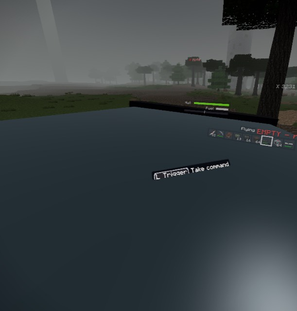

## 12:32:45 - Which isn't right at all

- **Transcript:** Which isn't right at all
- **Status:** open
- **Build:** 0.129 (fc006bd3, M1-M4 (device-tested; ship riding, chests, comfort options, weapon wheel))
- **World:** Quest World (seed 5663059916303033239)
- **Dimension:** Hell
- **Biome:** Ash Vault
- **Position:** 3230.9 -33.4 -3040.0
- **Facing:** north (yaw 10, pitch 12)
- **Held:** Faustrohr x1
- **Mount:** on foot, flying
- **Looking at:** nothing
- **Mode:** Creative, health 11/20
- **Time:** day 7 12:55, clear
- **Fps:** 72
- **Levels:** mic -35 dBFS, game sound -20 dBFS
- **Length:** 1.9 s (voice 0.8 s)
- **Just before:** -21s opened PauseMenu; -17s closed PauseMenu; -17s message: Playtest build: voice bug notes ON, your speech is saved (Options > Interface); -17s opened PauseMenu; -15s closed PauseMenu; -14s message: Flying; -12s piloting Salvaged Fighter; -12s holding empty hand; -12s message: The Chancellor, over the loudspeakers: "Seal the bunker! Nobody opens the blast door in the command post!"; -10s stopped piloting Salvaged Fighter; -10s holding Faustrohr; -9s message: Steering Salvaged Fighter; -7s message: Flying
- **Repro (Mac):** `./snap.sh note --seed 5663059916303033239 --x 3230.9 --z -3040.0 --yaw -10 --pitch 12 --time 0.288 --dim deep`
- **Audio (this Mac):** /Users/darthvadar/Documents/Blocksmith/QuestVoiceNotes/raw/vn-20261113-123245-437.aac

## 12:32:51 - [laughs] Engine removed. That's funny. Okay

- **Transcript:** [laughs] Engine removed. That's funny. Okay
- **Status:** open
- **Build:** 0.129 (fc006bd3, M1-M4 (device-tested; ship riding, chests, comfort options, weapon wheel))
- **World:** Quest World (seed 5663059916303033239)
- **Dimension:** Hell
- **Biome:** Ash Vault
- **Position:** 3228.3 -35.0 -3049.4
- **Facing:** east (yaw 80, pitch -39)
- **Held:** Titanium Pickaxe x1
- **Mount:** on foot
- **Looking at:** Grass Block at 3230 -36 -3050
- **Mode:** Creative, health 11/20
- **Time:** day 7 13:02, clear
- **Fps:** 72
- **Levels:** mic -20 dBFS, game sound -16 dBFS
- **Length:** 4.2 s (voice 1.5 s)
- **Just before:** -27s opened PauseMenu; -23s closed PauseMenu; -23s message: Playtest build: voice bug notes ON, your speech is saved (Options > Interface); -23s opened PauseMenu; -21s closed PauseMenu; -19s message: Flying; -18s piloting Salvaged Fighter; -18s holding empty hand; -18s message: The Chancellor, over the loudspeakers: "Seal the bunker! Nobody opens the blast door in the command post!"; -16s stopped piloting Salvaged Fighter; -16s holding Faustrohr; -15s message: Steering Salvaged Fighter; -13s message: Flying; -6s message: Walking; -4s holding Observer; -4s holding Himmelsturm Launcher; -4s holding Field Stim; -4s message: Field Stim; -3s holding Titanium Pickaxe; -3s message: Titanium Pickaxe; -2s message: Engine removed: 1 left; -1s message: Engine removed: 0 left
- **Repro (Mac):** `./snap.sh note --seed 5663059916303033239 --x 3228.3 --z -3049.4 --yaw -80 --pitch -39 --time 0.293 --dim deep`
- **Audio (this Mac):** /Users/darthvadar/Documents/Blocksmith/QuestVoiceNotes/raw/vn-20261113-123251-377.aac

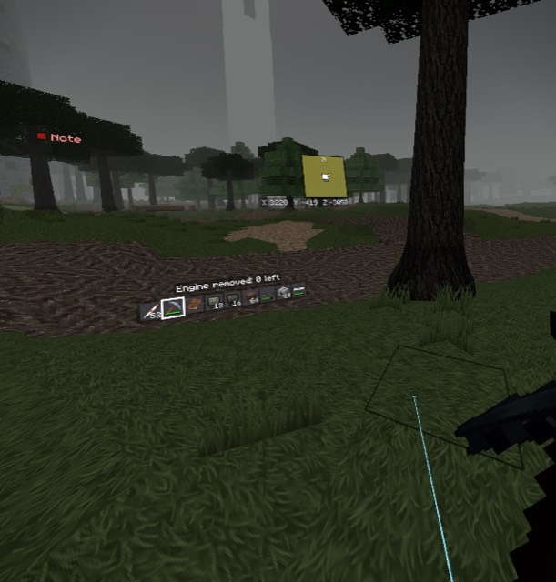

## 12:32:55 - Oh, what the fuck is this?

- **Transcript:** Oh, what the fuck is this?
- **Status:** open
- **Build:** 0.129 (fc006bd3, M1-M4 (device-tested; ship riding, chests, comfort options, weapon wheel))
- **World:** Quest World (seed 5663059916303033239)
- **Dimension:** Hell
- **Biome:** Ash Vault
- **Position:** 3229.5 -35.0 -3051.1
- **Facing:** east (yaw 106, pitch -15)
- **Held:** Titanium Pickaxe x1
- **Mount:** on foot
- **Looking at:** Dark Oak Log at 3233 -35 -3050
- **Mode:** Creative, health 11/20
- **Time:** day 7 13:07, clear
- **Fps:** 72
- **Levels:** mic -20 dBFS, game sound -17 dBFS
- **Length:** 2.6 s (voice 1.1 s)
- **Just before:** -27s closed PauseMenu; -27s message: Playtest build: voice bug notes ON, your speech is saved (Options > Interface); -27s opened PauseMenu; -25s closed PauseMenu; -24s message: Flying; -22s piloting Salvaged Fighter; -22s holding empty hand; -22s message: The Chancellor, over the loudspeakers: "Seal the bunker! Nobody opens the blast door in the command post!"; -20s stopped piloting Salvaged Fighter; -20s holding Faustrohr; -19s message: Steering Salvaged Fighter; -17s message: Flying; -10s message: Walking; -8s holding Observer; -8s holding Himmelsturm Launcher; -8s holding Field Stim; -8s message: Field Stim; -7s holding Titanium Pickaxe; -7s message: Titanium Pickaxe; -6s message: Engine removed: 1 left; -5s message: Engine removed: 0 left
- **Repro (Mac):** `./snap.sh note --seed 5663059916303033239 --x 3229.5 --z -3051.1 --yaw -106 --pitch -15 --time 0.297 --dim deep`
- **Audio (this Mac):** /Users/darthvadar/Documents/Blocksmith/QuestVoiceNotes/raw/vn-20261113-123255-437.aac

## 12:32:58 - I just hit the stump and this happened. What the fuck? Oh my God

- **Transcript:** I just hit the stump and this happened. What the fuck? Oh my God
- **Status:** open
- **Build:** 0.129 (fc006bd3, M1-M4 (device-tested; ship riding, chests, comfort options, weapon wheel))
- **World:** Quest World (seed 5663059916303033239)
- **Dimension:** Hell
- **Biome:** Ash Vault
- **Position:** 3230.4 -35.0 -3050.7
- **Facing:** east (yaw 99, pitch -22)
- **Held:** Titanium Pickaxe x1
- **Mount:** on foot
- **Looking at:** Dark Oak Log at 3234 -35 -3051
- **Mode:** Creative, health 11/20
- **Time:** day 7 13:10, clear
- **Fps:** 72
- **Levels:** mic -33 dBFS, game sound -17 dBFS
- **Length:** 6.2 s (voice 2.7 s)
- **Just before:** -30s opened PauseMenu; -28s closed PauseMenu; -26s message: Flying; -25s piloting Salvaged Fighter; -25s holding empty hand; -25s message: The Chancellor, over the loudspeakers: "Seal the bunker! Nobody opens the blast door in the command post!"; -23s stopped piloting Salvaged Fighter; -23s holding Faustrohr; -22s message: Steering Salvaged Fighter; -20s message: Flying; -13s message: Walking; -11s holding Observer; -11s holding Himmelsturm Launcher; -11s holding Field Stim; -11s message: Field Stim; -10s holding Titanium Pickaxe; -10s message: Titanium Pickaxe; -9s message: Engine removed: 1 left; -8s message: Engine removed: 0 left
- **Position at the end:** 3230.7 -35.0 -3050.5
- **Repro (Mac):** `./snap.sh note --seed 5663059916303033239 --x 3230.4 --z -3050.7 --yaw -99 --pitch -22 --time 0.299 --dim deep`
- **Audio (this Mac):** /Users/darthvadar/Documents/Blocksmith/QuestVoiceNotes/raw/vn-20261113-123258-377.aac

## 12:33:04 - Oh. Oh my God. You see that? And then all the, all the planks just tur

- **Transcript:** Oh. Oh my God. You see that? And then all the, all the planks just turned into big ones. Like, oh, that's, that's bad. Fable's gotta fix that
- **Status:** open
- **Build:** 0.129 (fc006bd3, M1-M4 (device-tested; ship riding, chests, comfort options, weapon wheel))
- **World:** Quest World (seed 5663059916303033239)
- **Dimension:** Hell
- **Biome:** Ash Vault
- **Position:** 3230.3 -35.0 -3050.2
- **Facing:** east (yaw 78, pitch 34)
- **Held:** Titanium Pickaxe x1
- **Mount:** on foot
- **Looking at:** Dark Oak Log at 3234 -32 -3051
- **Mode:** Creative, health 11/20
- **Time:** day 7 13:18, clear
- **Fps:** 72
- **Levels:** mic -25 dBFS, game sound -14 dBFS
- **Length:** 10.9 s (voice 6.1 s)
- **Just before:** -30s stopped piloting Salvaged Fighter; -30s holding Faustrohr; -28s message: Steering Salvaged Fighter; -26s message: Flying; -19s message: Walking; -17s holding Observer; -17s holding Himmelsturm Launcher; -17s holding Field Stim; -17s message: Field Stim; -17s holding Titanium Pickaxe; -17s message: Titanium Pickaxe; -16s message: Engine removed: 1 left; -14s message: Engine removed: 0 left
- **Position at the end:** 3228.0 -35.0 -3050.1
- **Repro (Mac):** `./snap.sh note --seed 5663059916303033239 --x 3230.3 --z -3050.2 --yaw -78 --pitch 34 --time 0.305 --dim deep`
- **Audio (this Mac):** /Users/darthvadar/Documents/Blocksmith/QuestVoiceNotes/raw/vn-20261113-123304-938.aac

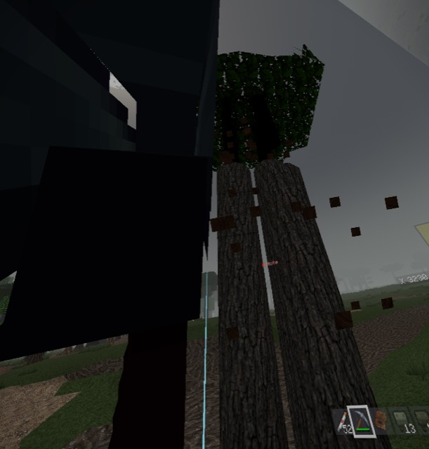

## 12:33:27 - All right. Well, I don't see a whole lot of artifacts. I do see a floa

- **Transcript:** All right. Well, I don't see a whole lot of artifacts. I do see a floating log, though. Look at this. Hmm, Fable. Just gotta fix that
- **Status:** open
- **Build:** 0.129 (fc006bd3, M1-M4 (device-tested; ship riding, chests, comfort options, weapon wheel))
- **World:** New World (23) (seed 2117423538372845574)
- **Dimension:** Surface
- **Biome:** Taiga
- **Position:** 5686.0 67.4 -3905.3
- **Facing:** south-west (yaw 236, pitch -17)
- **Held:** Greywall Dispatch x1
- **Mount:** on foot
- **Looking at:** Grass Block at 5682 67 -3903
- **Mode:** Survival, health 20/20
- **Time:** day 1 07:30, clear
- **Fps:** 71
- **Levels:** mic -23 dBFS, game sound -46 dBFS
- **Length:** 10.1 s (voice 5.7 s)
- **Just before:** -3s opened PauseMenu; --0s closed PauseMenu; --0s message: Playtest build: voice bug notes ON, your speech is saved (Options > Interface); --1s opened PauseMenu; --2s closed PauseMenu; --4s message: Flying; --5s piloting Salvaged Fighter; --5s holding empty hand; --5s message: The Chancellor, over the loudspeakers: "Seal the bunker! Nobody opens the blast door in the command post!"; --7s stopped piloting Salvaged Fighter; --7s holding Faustrohr; --9s message: Steering Salvaged Fighter; --11s message: Flying; --17s message: Walking; --19s holding Observer; --20s holding Himmelsturm Launcher; --20s holding Field Stim; --20s message: Field Stim; --20s holding Titanium Pickaxe; --20s message: Titanium Pickaxe; --21s message: Engine removed: 1 left; --23s message: Engine removed: 0 left; --47s opened PauseMenu; -3s entered Surface; -3s closed PauseMenu; -3s holding Greywall Dispatch; -3s message: In Clear Ford's jail safe: a Greywall Dispatch; -3s message: In Clear Ford's jail safe: a Greywall Dispatch. Added to journal: Who Holds the Frontier
- **While talking:** -5s closed PauseMenu; -5s message: Playtest build: voice bug notes ON, your speech is saved (Options > Interface); -4s opened PauseMenu; -3s closed PauseMenu; -1s message: Flying; -0s piloting Salvaged Fighter; -0s holding empty hand; --0s message: The Chancellor, over the loudspeakers: "Seal the bunker! Nobody opens the blast door in the command post!"; --2s stopped piloting Salvaged Fighter; --2s holding Faustrohr; --4s message: Steering Salvaged Fighter; --6s message: Flying; --12s message: Walking; --14s holding Observer; --15s holding Himmelsturm Launcher; --15s holding Field Stim; --15s message: Field Stim; --15s holding Titanium Pickaxe; --15s message: Titanium Pickaxe; --16s message: Engine removed: 1 left; --18s message: Engine removed: 0 left; --42s opened PauseMenu; -4s message: Spring: the snow melts and the young are born; -3s holding empty hand
- **Position at the end:** 5672.7 67.6 -3904.3
- **Repro (Mac):** `./snap.sh note --seed 2117423538372845574 --x 5686.0 --z -3905.3 --yaw 124 --pitch -17 --time 0.063`
- **Audio (this Mac):** /Users/darthvadar/Documents/Blocksmith/QuestVoiceNotes/raw/vn-20261113-123327-997.aac

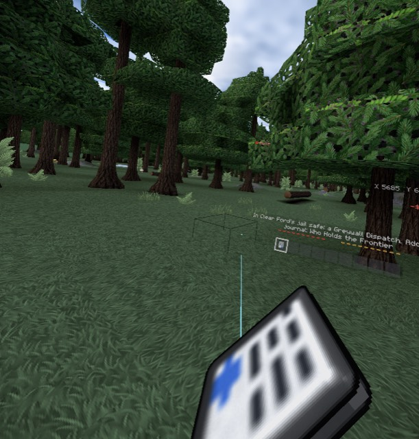

## 12:33:43 - It wasn't horrible, although the tree is still floating. Uh

- **Transcript:** It wasn't horrible, although the tree is still floating. Uh
- **Status:** open
- **Build:** 0.129 (fc006bd3, M1-M4 (device-tested; ship riding, chests, comfort options, weapon wheel))
- **World:** New World (23) (seed 2117423538372845574)
- **Dimension:** Surface
- **Biome:** Taiga
- **Position:** 5675.8 67.5 -3904.1
- **Facing:** west (yaw 288, pitch -5)
- **Held:** empty hand
- **Mount:** on foot
- **Looking at:** nothing
- **Mode:** Creative, health 20/20
- **Time:** day 1 07:45, clear
- **Fps:** 66
- **Levels:** mic -38 dBFS, game sound -29 dBFS
- **Length:** 5.9 s (voice 2.5 s)
- **Just before:** -18s opened PauseMenu; -15s closed PauseMenu; -15s message: Playtest build: voice bug notes ON, your speech is saved (Options > Interface); -14s opened PauseMenu; -13s closed PauseMenu; -11s message: Flying; -10s piloting Salvaged Fighter; -10s holding empty hand; -10s message: The Chancellor, over the loudspeakers: "Seal the bunker! Nobody opens the blast door in the command post!"; -8s stopped piloting Salvaged Fighter; -8s holding Faustrohr; -6s message: Steering Salvaged Fighter; -4s message: Flying; --2s message: Walking; --4s holding Observer; --4s holding Himmelsturm Launcher; --5s holding Field Stim; --5s message: Field Stim; --5s holding Titanium Pickaxe; --5s message: Titanium Pickaxe; --6s message: Engine removed: 1 left; --8s message: Engine removed: 0 left; --32s opened PauseMenu; -18s entered Surface; -18s closed PauseMenu; -18s holding Greywall Dispatch; -18s message: In Clear Ford's jail safe: a Greywall Dispatch; -18s message: In Clear Ford's jail safe: a Greywall Dispatch. Added to journal: Who Holds the Frontier; -14s message: Spring: the snow melts and the young are born; -13s holding empty hand; -5s opened PauseMenu; -4s message: The sky is clouding over: fog is coming; -3s closed PauseMenu; -2s message: Creative mode
- **While talking:** -3s message: Walking; -1s holding Observer; -1s holding Himmelsturm Launcher; -0s holding Field Stim; -0s message: Field Stim; --0s holding Titanium Pickaxe; --0s message: Titanium Pickaxe; --1s message: Engine removed: 1 left; --3s message: Engine removed: 0 left; --27s opened PauseMenu
- **Position at the end:** 5675.1 67.6 -3900.5
- **Repro (Mac):** `./snap.sh note --seed 2117423538372845574 --x 5675.8 --z -3904.1 --yaw 72 --pitch -5 --time 0.073`
- **Audio (this Mac):** /Users/darthvadar/Documents/Blocksmith/QuestVoiceNotes/raw/vn-20261113-123343-218.aac

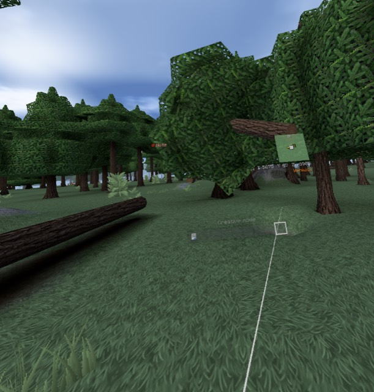

## 12:33:50 - Also the, um...

- **Transcript:** Also the, um...
- **Status:** open
- **Build:** 0.129 (fc006bd3, M1-M4 (device-tested; ship riding, chests, comfort options, weapon wheel))
- **World:** New World (23) (seed 2117423538372845574)
- **Dimension:** Surface
- **Biome:** Taiga
- **Position:** 5673.5 67.6 -3901.0
- **Facing:** south (yaw 189, pitch -45)
- **Held:** empty hand
- **Mount:** on foot
- **Looking at:** Spruce Log at 5673 68 -3901
- **Mode:** Creative, health 20/20
- **Time:** day 1 07:54, clear
- **Fps:** 55
- **Levels:** mic -29 dBFS, game sound -22 dBFS
- **Length:** 2.5 s (voice 1.1 s)
- **Just before:** -26s opened PauseMenu; -23s closed PauseMenu; -23s message: Playtest build: voice bug notes ON, your speech is saved (Options > Interface); -22s opened PauseMenu; -21s closed PauseMenu; -19s message: Flying; -18s piloting Salvaged Fighter; -18s holding empty hand; -18s message: The Chancellor, over the loudspeakers: "Seal the bunker! Nobody opens the blast door in the command post!"; -16s stopped piloting Salvaged Fighter; -16s holding Faustrohr; -14s message: Steering Salvaged Fighter; -12s message: Flying; -5s message: Walking; -3s holding Observer; -3s holding Himmelsturm Launcher; -3s holding Field Stim; -3s message: Field Stim; -3s holding Titanium Pickaxe; -3s message: Titanium Pickaxe; -2s message: Engine removed: 1 left; -0s message: Engine removed: 0 left; --24s opened PauseMenu; -26s entered Surface; -26s closed PauseMenu; -26s holding Greywall Dispatch; -26s message: In Clear Ford's jail safe: a Greywall Dispatch; -26s message: In Clear Ford's jail safe: a Greywall Dispatch. Added to journal: Who Holds the Frontier; -22s message: Spring: the snow melts and the young are born; -21s holding empty hand; -13s opened PauseMenu; -12s message: The sky is clouding over: fog is coming; -10s closed PauseMenu; -10s message: Creative mode
- **Repro (Mac):** `./snap.sh note --seed 2117423538372845574 --x 5673.5 --z -3901.0 --yaw 171 --pitch -45 --time 0.080`
- **Audio (this Mac):** /Users/darthvadar/Documents/Blocksmith/QuestVoiceNotes/raw/vn-20261113-123350-937.aac

## 12:33:53 - Log turns into something else for about a quarter of a second

- **Transcript:** Log turns into something else for about a quarter of a second
- **Status:** open
- **Build:** 0.129 (fc006bd3, M1-M4 (device-tested; ship riding, chests, comfort options, weapon wheel))
- **World:** New World (23) (seed 2117423538372845574)
- **Dimension:** Surface
- **Biome:** Taiga
- **Position:** 5673.4 67.7 -3898.3
- **Facing:** south (yaw 181, pitch -10)
- **Held:** empty hand
- **Mount:** on foot
- **Looking at:** Spruce Log at 5673 68 -3894
- **Mode:** Creative, health 20/20
- **Time:** day 1 07:57, clear
- **Fps:** 55
- **Levels:** mic -23 dBFS, game sound -20 dBFS
- **Length:** 5.0 s (voice 2.5 s)
- **Just before:** -29s opened PauseMenu; -25s closed PauseMenu; -25s message: Playtest build: voice bug notes ON, your speech is saved (Options > Interface); -25s opened PauseMenu; -23s closed PauseMenu; -21s message: Flying; -20s piloting Salvaged Fighter; -20s holding empty hand; -20s message: The Chancellor, over the loudspeakers: "Seal the bunker! Nobody opens the blast door in the command post!"; -18s stopped piloting Salvaged Fighter; -18s holding Faustrohr; -17s message: Steering Salvaged Fighter; -15s message: Flying; -8s message: Walking; -6s holding Observer; -6s holding Himmelsturm Launcher; -6s holding Field Stim; -6s message: Field Stim; -5s holding Titanium Pickaxe; -5s message: Titanium Pickaxe; -4s message: Engine removed: 1 left; -3s message: Engine removed: 0 left; --22s opened PauseMenu; -29s entered Surface; -29s closed PauseMenu; -29s holding Greywall Dispatch; -29s message: In Clear Ford's jail safe: a Greywall Dispatch; -28s message: In Clear Ford's jail safe: a Greywall Dispatch. Added to journal: Who Holds the Frontier; -25s message: Spring: the snow melts and the young are born; -23s holding empty hand; -15s opened PauseMenu; -15s message: The sky is clouding over: fog is coming; -13s closed PauseMenu; -12s message: Creative mode
- **Repro (Mac):** `./snap.sh note --seed 2117423538372845574 --x 5673.4 --z -3898.3 --yaw 179 --pitch -10 --time 0.082`
- **Audio (this Mac):** /Users/darthvadar/Documents/Blocksmith/QuestVoiceNotes/raw/vn-20261113-123353-397.aac

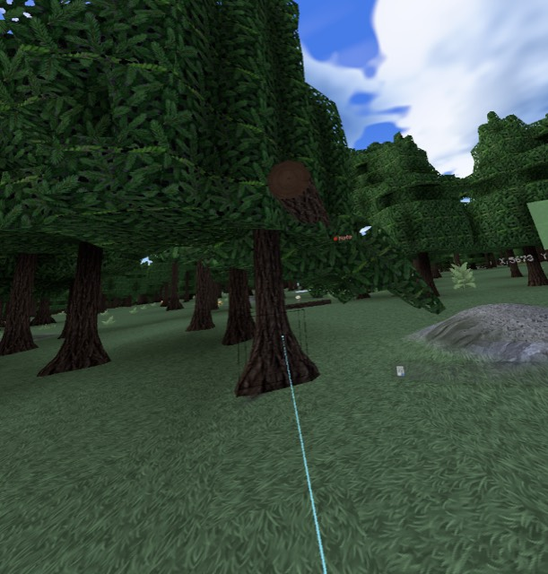

## 12:33:58 - Feels like something falling all strange

- **Transcript:** Feels like something falling all strange
- **Status:** open
- **Build:** 0.129 (fc006bd3, M1-M4 (device-tested; ship riding, chests, comfort options, weapon wheel))
- **World:** New World (23) (seed 2117423538372845574)
- **Dimension:** Surface
- **Biome:** Taiga
- **Position:** 5666.1 67.9 -3896.1
- **Facing:** south (yaw 201, pitch 3)
- **Held:** empty hand
- **Mount:** on foot
- **Looking at:** nothing
- **Mode:** Creative, health 20/20
- **Time:** day 1 08:04, clear
- **Fps:** 65
- **Levels:** mic -34 dBFS, game sound -22 dBFS
- **Length:** 3.0 s (voice 1.3 s)
- **Just before:** -30s opened PauseMenu; -28s closed PauseMenu; -27s message: Flying; -26s piloting Salvaged Fighter; -26s holding empty hand; -25s message: The Chancellor, over the loudspeakers: "Seal the bunker! Nobody opens the blast door in the command post!"; -23s stopped piloting Salvaged Fighter; -23s holding Faustrohr; -22s message: Steering Salvaged Fighter; -20s message: Flying; -13s message: Walking; -11s holding Observer; -11s holding Himmelsturm Launcher; -11s holding Field Stim; -11s message: Field Stim; -10s holding Titanium Pickaxe; -10s message: Titanium Pickaxe; -10s message: Engine removed: 1 left; -8s message: Engine removed: 0 left; --17s opened PauseMenu; -30s message: Spring: the snow melts and the young are born; -28s holding empty hand; -20s opened PauseMenu; -20s message: The sky is clouding over: fog is coming; -18s closed PauseMenu; -17s message: Creative mode
- **Repro (Mac):** `./snap.sh note --seed 2117423538372845574 --x 5666.1 --z -3896.1 --yaw 159 --pitch 3 --time 0.086`
- **Audio (this Mac):** /Users/darthvadar/Documents/Blocksmith/QuestVoiceNotes/raw/vn-20261113-123358-557.aac

## 12:34:03 - So what the heck happened here? Look at this tree

- **Transcript:** So what the heck happened here? Look at this tree
- **Status:** open
- **Build:** 0.129 (fc006bd3, M1-M4 (device-tested; ship riding, chests, comfort options, weapon wheel))
- **World:** New World (23) (seed 2117423538372845574)
- **Dimension:** Surface
- **Biome:** Taiga
- **Position:** 5659.1 68.2 -3890.2
- **Facing:** south (yaw 175, pitch -6)
- **Held:** empty hand
- **Mount:** on foot
- **Looking at:** nothing
- **Mode:** Creative, health 20/20
- **Time:** day 1 08:10, clear
- **Fps:** 65
- **Levels:** mic -32 dBFS, game sound -18 dBFS
- **Length:** 3.6 s (voice 1.7 s)
- **Just before:** -28s stopped piloting Salvaged Fighter; -28s holding Faustrohr; -27s message: Steering Salvaged Fighter; -25s message: Flying; -18s message: Walking; -16s holding Observer; -16s holding Himmelsturm Launcher; -16s holding Field Stim; -16s message: Field Stim; -16s holding Titanium Pickaxe; -16s message: Titanium Pickaxe; -15s message: Engine removed: 1 left; -13s message: Engine removed: 0 left; --11s opened PauseMenu; -26s opened PauseMenu; -25s message: The sky is clouding over: fog is coming; -23s closed PauseMenu; -23s message: Creative mode
- **Repro (Mac):** `./snap.sh note --seed 2117423538372845574 --x 5659.1 --z -3890.2 --yaw -175 --pitch -6 --time 0.091`
- **Audio (this Mac):** /Users/darthvadar/Documents/Blocksmith/QuestVoiceNotes/raw/vn-20261113-123403-917.aac

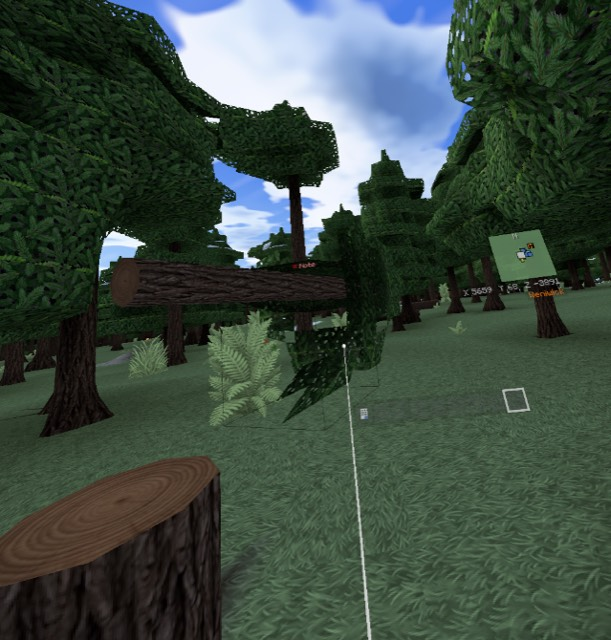

## 12:34:08 - What the hell happened to its leaves?

- **Transcript:** What the hell happened to its leaves?
- **Status:** open
- **Build:** 0.129 (fc006bd3, M1-M4 (device-tested; ship riding, chests, comfort options, weapon wheel))
- **World:** New World (23) (seed 2117423538372845574)
- **Dimension:** Surface
- **Biome:** Taiga
- **Position:** 5663.0 68.2 -3887.9
- **Facing:** south (yaw 184, pitch -4)
- **Held:** empty hand
- **Mount:** on foot
- **Looking at:** nothing
- **Mode:** Creative, health 20/20
- **Time:** day 1 08:16, clear
- **Fps:** 67
- **Levels:** mic -30 dBFS, game sound -12 dBFS
- **Length:** 2.7 s (voice 1.1 s)
- **Just before:** -30s message: Flying; -23s message: Walking; -21s holding Observer; -21s holding Himmelsturm Launcher; -21s holding Field Stim; -21s message: Field Stim; -20s holding Titanium Pickaxe; -20s message: Titanium Pickaxe; -20s message: Engine removed: 1 left; -18s message: Engine removed: 0 left; --6s opened PauseMenu; -30s message: The sky is clouding over: fog is coming; -28s closed PauseMenu; -27s message: Creative mode
- **Repro (Mac):** `./snap.sh note --seed 2117423538372845574 --x 5663.0 --z -3887.9 --yaw 176 --pitch -4 --time 0.095`
- **Audio (this Mac):** /Users/darthvadar/Documents/Blocksmith/QuestVoiceNotes/raw/vn-20261113-123408-658.aac

## 12:34:13 - Yeah, this one too

- **Transcript:** Yeah, this one too
- **Status:** open
- **Build:** 0.129 (fc006bd3, M1-M4 (device-tested; ship riding, chests, comfort options, weapon wheel))
- **World:** New World (23) (seed 2117423538372845574)
- **Dimension:** Surface
- **Biome:** Taiga
- **Position:** 5664.0 68.0 -3892.7
- **Facing:** south-east (yaw 149, pitch 16)
- **Held:** empty hand
- **Mount:** on foot
- **Looking at:** nothing
- **Mode:** Creative, health 20/20
- **Time:** day 1 08:21, clear
- **Fps:** 72
- **Levels:** mic -24 dBFS, game sound -20 dBFS
- **Length:** 2.1 s (voice 0.6 s)
- **Just before:** -28s message: Walking; -26s holding Observer; -26s holding Himmelsturm Launcher; -26s holding Field Stim; -26s message: Field Stim; -25s holding Titanium Pickaxe; -25s message: Titanium Pickaxe; -24s message: Engine removed: 1 left; -23s message: Engine removed: 0 left; --2s opened PauseMenu
- **Repro (Mac):** `./snap.sh note --seed 2117423538372845574 --x 5664.0 --z -3892.7 --yaw -149 --pitch 16 --time 0.099`
- **Audio (this Mac):** /Users/darthvadar/Documents/Blocksmith/QuestVoiceNotes/raw/vn-20261113-123413-457.aac

## 12:34:18 - And this one, I'm not sure what's happening there

- **Transcript:** And this one, I'm not sure what's happening there
- **Status:** open
- **Build:** 0.129 (fc006bd3, M1-M4 (device-tested; ship riding, chests, comfort options, weapon wheel))
- **World:** New World (23) (seed 2117423538372845574)
- **Dimension:** Surface
- **Biome:** Taiga
- **Position:** 5664.3 68.1 -3891.1
- **Facing:** south-east (yaw 144, pitch 30)
- **Held:** empty hand
- **Mount:** on foot
- **Looking at:** nothing
- **Mode:** Creative, health 20/20
- **Time:** day 1 08:28, clear
- **Fps:** 72
- **Levels:** mic -26 dBFS, game sound -16 dBFS
- **Length:** 3.6 s (voice 1.6 s)
- **Just before:** -30s message: Engine removed: 1 left; -28s message: Engine removed: 0 left; -4s opened PauseMenu
- **Repro (Mac):** `./snap.sh note --seed 2117423538372845574 --x 5664.3 --z -3891.1 --yaw -144 --pitch 30 --time 0.103`
- **Audio (this Mac):** /Users/darthvadar/Documents/Blocksmith/QuestVoiceNotes/raw/vn-20261113-123418-778.aac

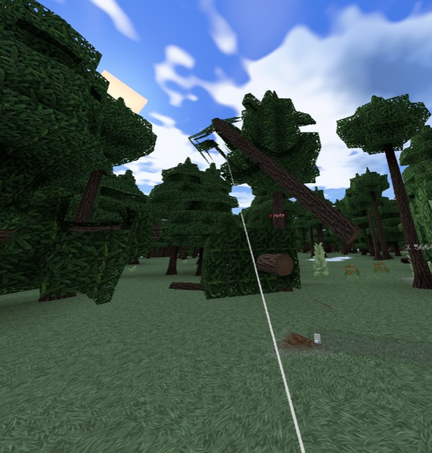

## 12:35:00 - I'm not able to reach, um, five, six blocks away in survival

- **Transcript:** I'm not able to reach, um, five, six blocks away in survival
- **Status:** open
- **Build:** 0.129 (fc006bd3, M1-M4 (device-tested; ship riding, chests, comfort options, weapon wheel))
- **World:** New World (23) (seed 2117423538372845574)
- **Dimension:** Surface
- **Biome:** Taiga
- **Position:** 5649.6 69.1 -3864.2
- **Facing:** west (yaw 270, pitch 53)
- **Held:** empty hand
- **Mount:** on foot
- **Looking at:** nothing
- **Mode:** Survival, health 20/20
- **Time:** day 1 09:13, clear
- **Fps:** 72
- **Levels:** mic -27 dBFS, game sound -21 dBFS
- **Length:** 5.0 s (voice 2.8 s)
- **Just before:** -28s opened PauseMenu; -25s message: Survival mode; -25s closed PauseMenu
- **Repro (Mac):** `./snap.sh note --seed 2117423538372845574 --x 5649.6 --z -3864.2 --yaw 90 --pitch 53 --time 0.135`
- **Audio (this Mac):** /Users/darthvadar/Documents/Blocksmith/QuestVoiceNotes/raw/vn-20261113-123500-017.aac

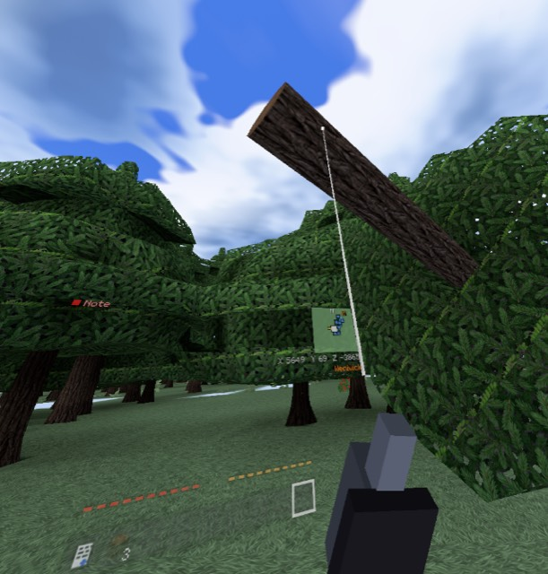

## 12:35:04 - It's not good. I should have been able to break this

- **Transcript:** It's not good. I should have been able to break this
- **Status:** open
- **Build:** 0.129 (fc006bd3, M1-M4 (device-tested; ship riding, chests, comfort options, weapon wheel))
- **World:** New World (23) (seed 2117423538372845574)
- **Dimension:** Surface
- **Biome:** Taiga
- **Position:** 5651.5 68.8 -3869.1
- **Facing:** north-west (yaw 326, pitch -8)
- **Held:** empty hand
- **Mount:** on foot
- **Looking at:** Spruce Log at 5650 70 -3872
- **Mode:** Survival, health 20/20
- **Time:** day 1 09:19, clear
- **Fps:** 72
- **Levels:** mic -29 dBFS, game sound -18 dBFS
- **Length:** 2.8 s (voice 1.2 s)
- **Just before:** -30s message: Survival mode; -30s closed PauseMenu
- **Repro (Mac):** `./snap.sh note --seed 2117423538372845574 --x 5651.5 --z -3869.1 --yaw 34 --pitch -8 --time 0.139`
- **Audio (this Mac):** /Users/darthvadar/Documents/Blocksmith/QuestVoiceNotes/raw/vn-20261113-123504-737.aac

## 12:35:27 - Let's make a thousand different types of literature, so that way it's 

- **Transcript:** Let's make a thousand different types of literature, so that way it's not all the same
- **Status:** open
- **Build:** 0.129 (fc006bd3, M1-M4 (device-tested; ship riding, chests, comfort options, weapon wheel))
- **World:** New World (23) (seed 2117423538372845574)
- **Dimension:** Surface
- **Biome:** Taiga
- **Position:** 5601.6 77.4 -3880.7
- **Facing:** west (yaw 264, pitch -14)
- **Held:** Written Book x1
- **Mount:** on foot, flying
- **Looking at:** nothing
- **Mode:** Creative, health 20/20, screen BookMenu
- **Time:** day 1 09:44, clear
- **Fps:** 71
- **Levels:** mic -22 dBFS, game sound -20 dBFS
- **Length:** 5.0 s (voice 2.4 s)
- **Just before:** -7s opened PauseMenu; -6s message: Creative mode; -5s closed PauseMenu; -4s message: Flying; -4s holding Greywall Dispatch; -4s holding Spruce Log; -3s holding Greywall Dispatch; -3s opened BookMenu; -3s holding Written Book; -3s message: Flying. Added to journal: Greywall Dispatch; -3s left the pack: Greywall Dispatch (BookMenu open); -3s into the pack: Written Book; -0s message: Greywall Garrison marked on the map
- **Repro (Mac):** `./snap.sh note --seed 2117423538372845574 --x 5601.6 --z -3880.7 --yaw 96 --pitch -14 --time 0.156`
- **Audio (this Mac):** /Users/darthvadar/Documents/Blocksmith/QuestVoiceNotes/raw/vn-20261113-123527-017.aac

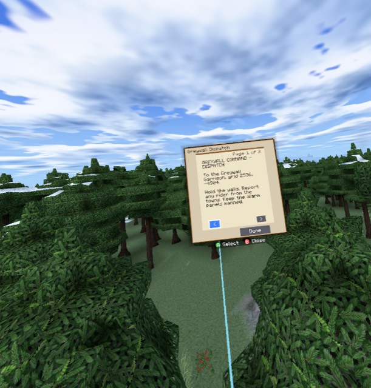

## 12:35:35 - Twenty-five negative ninety-four

- **Transcript:** Twenty-five negative ninety-four
- **Status:** open
- **Build:** 0.129 (fc006bd3, M1-M4 (device-tested; ship riding, chests, comfort options, weapon wheel))
- **World:** New World (23) (seed 2117423538372845574)
- **Dimension:** Surface
- **Biome:** Taiga
- **Position:** 5601.3 77.8 -3880.8
- **Facing:** west (yaw 269, pitch -10)
- **Held:** Written Book x1
- **Mount:** on foot, flying
- **Looking at:** nothing
- **Mode:** Creative, health 20/20
- **Time:** day 1 09:54, clear
- **Fps:** 72
- **Levels:** mic -37 dBFS, game sound -15 dBFS
- **Length:** 2.6 s (voice 0.7 s)
- **Just before:** -15s opened PauseMenu; -14s message: Creative mode; -13s closed PauseMenu; -12s message: Flying; -12s holding Greywall Dispatch; -12s holding Spruce Log; -11s holding Greywall Dispatch; -11s opened BookMenu; -11s holding Written Book; -11s message: Flying. Added to journal: Greywall Dispatch; -11s left the pack: Greywall Dispatch (BookMenu open); -11s into the pack: Written Book; -9s message: Greywall Garrison marked on the map; -6s message: Greywall Dispatch: the Greywall Garrison, 3,231 m W, ahead right. Marked on your map.; -0s closed BookMenu
- **Repro (Mac):** `./snap.sh note --seed 2117423538372845574 --x 5601.3 --z -3880.8 --yaw 91 --pitch -10 --time 0.163`
- **Audio (this Mac):** /Users/darthvadar/Documents/Blocksmith/QuestVoiceNotes/raw/vn-20261113-123535-157.aac

## 12:35:42 - All right. See if all this works

- **Transcript:** All right. See if all this works
- **Status:** open
- **Build:** 0.129 (fc006bd3, M1-M4 (device-tested; ship riding, chests, comfort options, weapon wheel))
- **World:** New World (23) (seed 2117423538372845574)
- **Dimension:** Surface
- **Biome:** Plains
- **Position:** 4384.3 175.2 -4974.9
- **Facing:** west (yaw 255, pitch -33)
- **Held:** Written Book x1
- **Mount:** on foot, flying
- **Looking at:** nothing
- **Mode:** Creative, health 20/20
- **Time:** day 1 10:03, clear
- **Fps:** 72
- **Levels:** mic -28 dBFS, game sound -21 dBFS
- **Length:** 3.6 s (voice 0.8 s)
- **Just before:** -22s opened PauseMenu; -21s message: Creative mode; -21s closed PauseMenu; -19s message: Flying; -19s holding Greywall Dispatch; -19s holding Spruce Log; -18s holding Greywall Dispatch; -18s opened BookMenu; -18s holding Written Book; -18s message: Flying. Added to journal: Greywall Dispatch; -18s left the pack: Greywall Dispatch (BookMenu open); -18s into the pack: Written Book; -16s message: Greywall Garrison marked on the map; -13s message: Greywall Dispatch: the Greywall Garrison, 3,231 m W, ahead right. Marked on your map.; -7s closed BookMenu; -3s message: Entering Loremere; -0s walked into Plains
- **Repro (Mac):** `./snap.sh note --seed 2117423538372845574 --x 4384.3 --z -4974.9 --yaw 105 --pitch -33 --time 0.169`
- **Audio (this Mac):** /Users/darthvadar/Documents/Blocksmith/QuestVoiceNotes/raw/vn-20261113-123542-237.aac

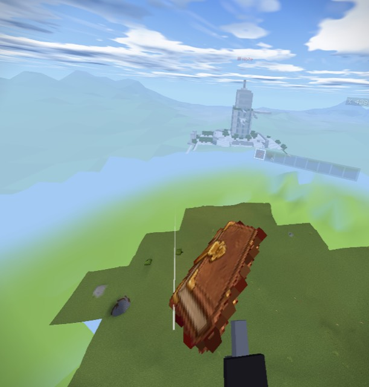

## 12:38:06 - This is gonna be interesting

- **Transcript:** This is gonna be interesting
- **Status:** open
- **Build:** 0.129 (fc006bd3, M1-M4 (device-tested; ship riding, chests, comfort options, weapon wheel))
- **World:** New World (23) (seed 2117423538372845574)
- **Dimension:** Surface
- **Biome:** Plains
- **Position:** 4389.4 115.3 -4979.1
- **Facing:** west (yaw 278, pitch -31)
- **Held:** Upgrade Bench x64
- **Mount:** on foot
- **Looking at:** nothing
- **Mode:** Creative, health 20/20, screen UpgradeBenchMenu
- **Time:** day 1 12:54, clear
- **Fps:** 72
- **Levels:** mic -42 dBFS, game sound -17 dBFS
- **Length:** 2.6 s (voice 1.0 s)
- **Just before:** -24s closed UpgradeBenchMenu; -23s opened PauseMenu; -23s closed PauseMenu; -22s opened UpgradeBenchMenu
- **Repro (Mac):** `./snap.sh note --seed 2117423538372845574 --x 4389.4 --z -4979.1 --yaw 82 --pitch -31 --time 0.288`
- **Audio (this Mac):** /Users/darthvadar/Documents/Blocksmith/QuestVoiceNotes/raw/vn-20261113-123806-758.aac

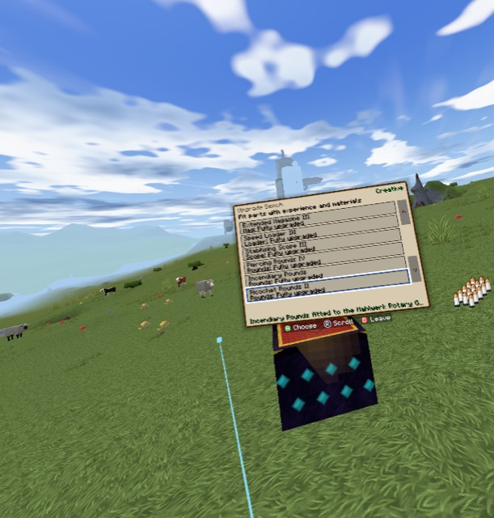

## 12:38:09 - I've never tested the upgrades before, so this is gonna be really inte

- **Transcript:** I've never tested the upgrades before, so this is gonna be really interesting
- **Status:** open
- **Build:** 0.129 (fc006bd3, M1-M4 (device-tested; ship riding, chests, comfort options, weapon wheel))
- **World:** New World (23) (seed 2117423538372845574)
- **Dimension:** Surface
- **Biome:** Plains
- **Position:** 4389.4 115.3 -4979.1
- **Facing:** west (yaw 278, pitch -31)
- **Held:** Upgrade Bench x64
- **Mount:** on foot
- **Looking at:** nothing
- **Mode:** Creative, health 20/20, screen UpgradeBenchMenu
- **Time:** day 1 12:57, clear
- **Fps:** 72
- **Levels:** mic -28 dBFS, game sound -19 dBFS
- **Length:** 5.3 s (voice 3.0 s)
- **Just before:** -26s closed UpgradeBenchMenu; -26s opened PauseMenu; -25s closed PauseMenu; -24s opened UpgradeBenchMenu
- **While talking:** -4s closed UpgradeBenchMenu; -2s opened PauseMenu
- **Position at the end:** 4389.1 115.5 -4981.4
- **Repro (Mac):** `./snap.sh note --seed 2117423538372845574 --x 4389.4 --z -4979.1 --yaw 82 --pitch -31 --time 0.290`
- **Audio (this Mac):** /Users/darthvadar/Documents/Blocksmith/QuestVoiceNotes/raw/vn-20261113-123809-057.aac

## 12:38:14 - Just an easy

- **Transcript:** Just an easy
- **Status:** open
- **Build:** 0.129 (fc006bd3, M1-M4 (device-tested; ship riding, chests, comfort options, weapon wheel))
- **World:** New World (23) (seed 2117423538372845574)
- **Dimension:** Surface
- **Biome:** Plains
- **Position:** 4389.1 115.5 -4981.4
- **Facing:** west (yaw 248, pitch -5)
- **Held:** Upgrade Bench x64
- **Mount:** on foot
- **Looking at:** nothing
- **Mode:** Creative, health 20/20, screen PauseMenu
- **Time:** day 1 13:00, clear
- **Fps:** 72
- **Levels:** mic -40 dBFS, game sound -25 dBFS
- **Length:** 2.6 s (voice 0.8 s)
- **Just before:** -30s opened UpgradeBenchMenu; -4s closed UpgradeBenchMenu; -3s opened PauseMenu
- **Repro (Mac):** `./snap.sh note --seed 2117423538372845574 --x 4389.1 --z -4981.4 --yaw 112 --pitch -5 --time 0.292`
- **Audio (this Mac):** /Users/darthvadar/Documents/Blocksmith/QuestVoiceNotes/raw/vn-20261113-123814-737.aac

## 12:38:22 - Oh, now that's cool. Okay, the little upgrades you've added to the wea

- **Transcript:** Oh, now that's cool. Okay, the little upgrades you've added to the weapon, this is... This ain't bad. It has a scope on. No way.
- **Status:** open
- **Build:** 0.129 (fc006bd3, M1-M4 (device-tested; ship riding, chests, comfort options, weapon wheel))
- **World:** New World (23) (seed 2117423538372845574)
- **Dimension:** Surface
- **Biome:** Plains
- **Position:** 4380.0 115.2 -4986.2
- **Facing:** west (yaw 252, pitch -25)
- **Held:** Mahlwerk Rotary Gun x1
- **Mount:** on foot
- **Looking at:** Bush at 4377 115 -4986
- **Mode:** Survival, health 20/20
- **Time:** day 1 13:08, clear
- **Fps:** 72
- **Levels:** mic -23 dBFS, game sound -18 dBFS
- **Length:** 9.3 s (voice 5.1 s)
- **Just before:** -12s closed UpgradeBenchMenu; -11s opened PauseMenu; -7s message: Survival mode; -6s closed PauseMenu; -6s holding empty hand; -5s opened InventoryMenu; -4s left the pack: Duskium Leggings (InventoryMenu open); -4s left the pack: Duskium Boots (InventoryMenu open); -4s left the pack: Duskium Chestplate (InventoryMenu open); -4s left the pack: Duskium Helmet (InventoryMenu open); -3s closed InventoryMenu; -2s holding Upgrade Bench; -2s message: Upgrade Bench; -2s holding Field Stim; -2s message: Field Stim; -2s holding Mahlwerk Rotary Gun; -2s message: Mahlwerk Rotary Gun; -2s message: Loaded: 350 / 350; -1s left the pack: Capital Magazine x12 (at 4381 114 -4985); -1s holding Capital Magazine; -0s holding Mahlwerk Rotary Gun
- **Position at the end:** 4363.3 114.2 -4981.6
- **Repro (Mac):** `./snap.sh note --seed 2117423538372845574 --x 4380.0 --z -4986.2 --yaw 108 --pitch -25 --time 0.298`
- **Audio (this Mac):** /Users/darthvadar/Documents/Blocksmith/QuestVoiceNotes/raw/vn-20261113-123822-858.aac

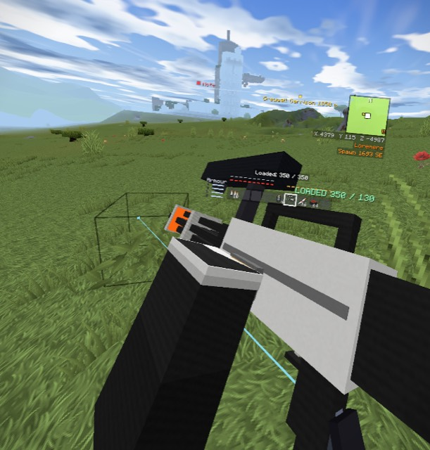

## 12:38:31 - But he has a scope

- **Transcript:** But he has a scope
- **Status:** open
- **Build:** 0.129 (fc006bd3, M1-M4 (device-tested; ship riding, chests, comfort options, weapon wheel))
- **World:** New World (23) (seed 2117423538372845574)
- **Dimension:** Surface
- **Biome:** Plains
- **Position:** 4338.0 114.5 -4978.9
- **Facing:** west (yaw 276, pitch 4)
- **Held:** Mahlwerk Rotary Gun x1
- **Mount:** on foot
- **Looking at:** nothing
- **Mode:** Survival, health 20/20
- **Time:** day 1 13:19, clear
- **Fps:** 72
- **Levels:** mic -25 dBFS, game sound -12 dBFS
- **Length:** 2.3 s (voice 1.0 s)
- **Just before:** -22s closed UpgradeBenchMenu; -20s opened PauseMenu; -16s message: Survival mode; -16s closed PauseMenu; -15s holding empty hand; -14s opened InventoryMenu; -13s left the pack: Duskium Leggings (InventoryMenu open); -13s left the pack: Duskium Boots (InventoryMenu open); -13s left the pack: Duskium Chestplate (InventoryMenu open); -13s left the pack: Duskium Helmet (InventoryMenu open); -12s closed InventoryMenu; -12s holding Upgrade Bench; -12s message: Upgrade Bench; -11s holding Field Stim; -11s message: Field Stim; -11s holding Mahlwerk Rotary Gun; -11s message: Mahlwerk Rotary Gun; -11s message: Loaded: 350 / 350; -11s left the pack: Capital Magazine x12 (at 4381 114 -4985); -10s holding Capital Magazine; -9s holding Mahlwerk Rotary Gun
- **Repro (Mac):** `./snap.sh note --seed 2117423538372845574 --x 4338.0 --z -4978.9 --yaw 84 --pitch 4 --time 0.305`
- **Audio (this Mac):** /Users/darthvadar/Documents/Blocksmith/QuestVoiceNotes/raw/vn-20261113-123831-977.aac

## 12:38:35 - Hold on here

- **Transcript:** Hold on here
- **Status:** open
- **Build:** 0.129 (fc006bd3, M1-M4 (device-tested; ship riding, chests, comfort options, weapon wheel))
- **World:** New World (23) (seed 2117423538372845574)
- **Dimension:** Surface
- **Biome:** Plains
- **Position:** 4326.6 113.6 -4985.6
- **Facing:** west (yaw 269, pitch 7)
- **Held:** Mahlwerk Rotary Gun x1
- **Mount:** on foot
- **Looking at:** nothing
- **Mode:** Survival, health 20/20
- **Time:** day 1 13:23, clear
- **Fps:** 71
- **Levels:** mic -30 dBFS, game sound -16 dBFS
- **Length:** 1.9 s (voice 0.5 s)
- **Just before:** -25s closed UpgradeBenchMenu; -23s opened PauseMenu; -19s message: Survival mode; -19s closed PauseMenu; -18s holding empty hand; -18s opened InventoryMenu; -16s left the pack: Duskium Leggings (InventoryMenu open); -16s left the pack: Duskium Boots (InventoryMenu open); -16s left the pack: Duskium Chestplate (InventoryMenu open); -16s left the pack: Duskium Helmet (InventoryMenu open); -16s closed InventoryMenu; -15s holding Upgrade Bench; -15s message: Upgrade Bench; -15s holding Field Stim; -15s message: Field Stim; -14s holding Mahlwerk Rotary Gun; -14s message: Mahlwerk Rotary Gun; -14s message: Loaded: 350 / 350; -14s left the pack: Capital Magazine x12 (at 4381 114 -4985); -13s holding Capital Magazine; -13s holding Mahlwerk Rotary Gun
- **Repro (Mac):** `./snap.sh note --seed 2117423538372845574 --x 4326.6 --z -4985.6 --yaw 91 --pitch 7 --time 0.308`
- **Audio (this Mac):** /Users/darthvadar/Documents/Blocksmith/QuestVoiceNotes/raw/vn-20261113-123835-237.aac

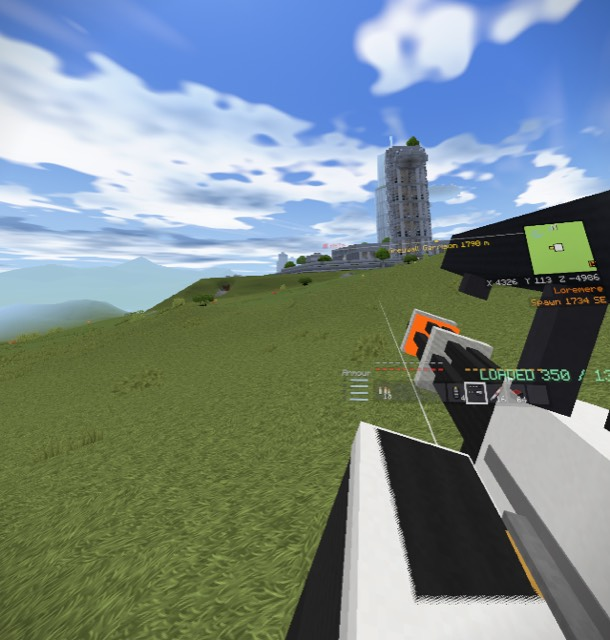

## 12:38:40 - The scope is not really easy to use, but okay

- **Transcript:** The scope is not really easy to use, but okay
- **Status:** open
- **Build:** 0.129 (fc006bd3, M1-M4 (device-tested; ship riding, chests, comfort options, weapon wheel))
- **World:** New World (23) (seed 2117423538372845574)
- **Dimension:** Surface
- **Biome:** Plains
- **Position:** 4313.6 114.0 -4983.1
- **Facing:** west (yaw 263, pitch 6)
- **Held:** Mahlwerk Rotary Gun x1
- **Mount:** on foot
- **Looking at:** nothing
- **Mode:** Survival, health 20/20
- **Time:** day 1 13:29, clear
- **Fps:** 72
- **Levels:** mic -41 dBFS, game sound -16 dBFS
- **Length:** 4.1 s (voice 1.9 s)
- **Just before:** -30s closed UpgradeBenchMenu; -28s opened PauseMenu; -24s message: Survival mode; -24s closed PauseMenu; -23s holding empty hand; -22s opened InventoryMenu; -21s left the pack: Duskium Leggings (InventoryMenu open); -21s left the pack: Duskium Boots (InventoryMenu open); -21s left the pack: Duskium Chestplate (InventoryMenu open); -21s left the pack: Duskium Helmet (InventoryMenu open); -21s closed InventoryMenu; -20s holding Upgrade Bench; -20s message: Upgrade Bench; -20s holding Field Stim; -20s message: Field Stim; -19s holding Mahlwerk Rotary Gun; -19s message: Mahlwerk Rotary Gun; -19s message: Loaded: 350 / 350; -19s left the pack: Capital Magazine x12 (at 4381 114 -4985); -18s holding Capital Magazine; -17s holding Mahlwerk Rotary Gun
- **Repro (Mac):** `./snap.sh note --seed 2117423538372845574 --x 4313.6 --z -4983.1 --yaw 97 --pitch 6 --time 0.312`
- **Audio (this Mac):** /Users/darthvadar/Documents/Blocksmith/QuestVoiceNotes/raw/vn-20261113-123840-118.aac

## 12:38:49 - All right

- **Transcript:** All right
- **Status:** open
- **Build:** 0.129 (fc006bd3, M1-M4 (device-tested; ship riding, chests, comfort options, weapon wheel))
- **World:** New World (23) (seed 2117423538372845574)
- **Dimension:** Surface
- **Biome:** Plains
- **Position:** 4287.6 117.4 -4986.7
- **Facing:** west (yaw 265, pitch 10)
- **Held:** Mahlwerk Rotary Gun x1
- **Mount:** on foot
- **Looking at:** nothing
- **Mode:** Survival, health 20/20
- **Time:** day 1 13:40, clear
- **Fps:** 71
- **Levels:** mic -30 dBFS, game sound -19 dBFS
- **Length:** 1.8 s (voice 0.4 s)
- **Just before:** -30s left the pack: Duskium Helmet (InventoryMenu open); -30s closed InventoryMenu; -29s holding Upgrade Bench; -29s message: Upgrade Bench; -29s holding Field Stim; -29s message: Field Stim; -29s holding Mahlwerk Rotary Gun; -29s message: Mahlwerk Rotary Gun; -28s message: Loaded: 350 / 350; -28s left the pack: Capital Magazine x12 (at 4381 114 -4985); -27s holding Capital Magazine; -27s holding Mahlwerk Rotary Gun; -1s message: Capital citadel (the enemy) marked on the map
- **Repro (Mac):** `./snap.sh note --seed 2117423538372845574 --x 4287.6 --z -4986.7 --yaw 95 --pitch 10 --time 0.320`
- **Audio (this Mac):** /Users/darthvadar/Documents/Blocksmith/QuestVoiceNotes/raw/vn-20261113-123849-278.aac

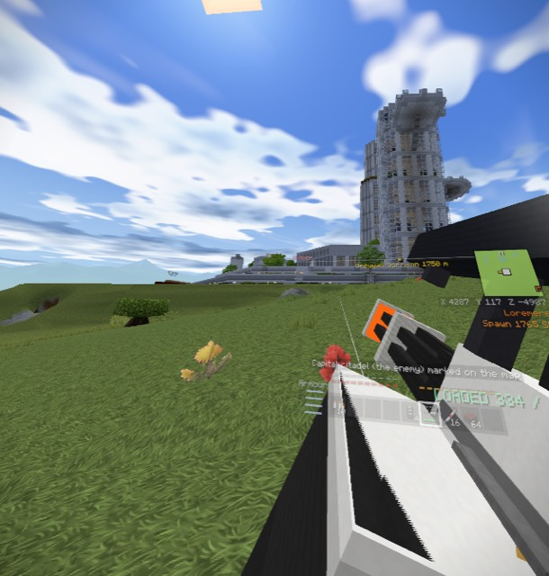

## 12:38:56 - As accurate as it could be

- **Transcript:** As accurate as it could be
- **Status:** open
- **Build:** 0.129 (fc006bd3, M1-M4 (device-tested; ship riding, chests, comfort options, weapon wheel))
- **World:** New World (23) (seed 2117423538372845574)
- **Dimension:** Surface
- **Biome:** Plains
- **Position:** 4255.4 122.2 -4997.9
- **Facing:** north-west (yaw 304, pitch -28)
- **Held:** Mahlwerk Rotary Gun x1
- **Mount:** on foot
- **Looking at:** Grass Block at 4252 121 -5000
- **Mode:** Survival, health 20/20
- **Time:** day 1 13:48, clear
- **Fps:** 71
- **Levels:** mic -38 dBFS, game sound -19 dBFS
- **Length:** 2.9 s (voice 1.3 s)
- **Just before:** -8s message: Capital citadel (the enemy) marked on the map; -5s message: A Capital patrol sets out to investigate; -2s message: Entering Weneonia
- **Repro (Mac):** `./snap.sh note --seed 2117423538372845574 --x 4255.4 --z -4997.9 --yaw 56 --pitch -28 --time 0.325`
- **Audio (this Mac):** /Users/darthvadar/Documents/Blocksmith/QuestVoiceNotes/raw/vn-20261113-123856-117.aac

## 12:39:37 - So what is this thing? It has extended magazine. I mean, okay

- **Transcript:** So what is this thing? It has extended magazine. I mean, okay
- **Status:** open
- **Build:** 0.129 (fc006bd3, M1-M4 (device-tested; ship riding, chests, comfort options, weapon wheel))
- **World:** New World (23) (seed 2117423538372845574)
- **Dimension:** Surface
- **Biome:** Plains
- **Position:** 4188.4 126.0 -4985.1
- **Facing:** north (yaw 8, pitch -15)
- **Held:** Mahlwerk Rotary Gun x1
- **Mount:** on foot
- **Looking at:** Capital Stone at 4189 125 -4991
- **Mode:** Survival, health 18/20
- **Time:** day 1 14:38, clear
- **Fps:** 72
- **Levels:** mic -30 dBFS, game sound -12 dBFS
- **Length:** 4.6 s (voice 2.8 s)
- **Just before:** -29s message: A stranger in town: Ezra Quill; -28s took 1 damage (health 20/20); -27s message: Honour raised (you protected the town); -24s message: Missile launch: take cover!; -22s into the pack: Spec Ops Armour Set; -16s message: Honour raised (you protected the town); -14s message: Missile launch: take cover!; -10s took 1 damage (health 19/20); -10s message: A Capital Dropship is landing troops!; -9s left the pack: Capital Magazine x4 (at 4215 126 -4969); -9s holding empty hand; -9s into the pack: Spec Ops Armour Set; -8s holding Iron Nugget; -8s into the pack: Regular Armour Set; -8s into the pack: Rocket; -8s holding Mahlwerk Rotary Gun; -8s message: Loaded: 146 / 350; -6s message: Missile launch: take cover!; -5s took 1 damage (health 19/20); -4s walked into Desert; -4s message: Honour raised (you protected the town); -2s walked into Plains
- **Repro (Mac):** `./snap.sh note --seed 2117423538372845574 --x 4188.4 --z -4985.1 --yaw -8 --pitch -15 --time 0.360`
- **Audio (this Mac):** /Users/darthvadar/Documents/Blocksmith/QuestVoiceNotes/raw/vn-20261113-123937-478.aac

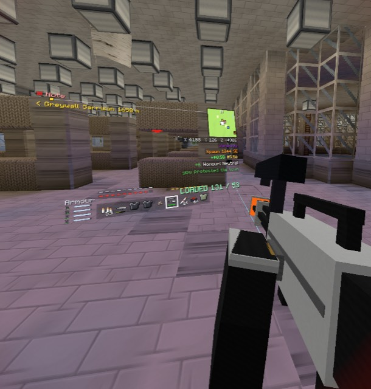

## 12:39:47 - Fox firing here

- **Transcript:** Fox firing here
- **Status:** open
- **Build:** 0.129 (fc006bd3, M1-M4 (device-tested; ship riding, chests, comfort options, weapon wheel))
- **World:** New World (23) (seed 2117423538372845574)
- **Dimension:** Surface
- **Biome:** Plains
- **Position:** 4167.1 126.0 -4998.0
- **Facing:** west (yaw 288, pitch -6)
- **Held:** Mahlwerk Rotary Gun x1
- **Mount:** on foot
- **Looking at:** Capital Grey Stone at 4163 127 -4999
- **Mode:** Survival, health 17/20
- **Time:** day 1 14:50, clear
- **Fps:** 72
- **Levels:** mic -32 dBFS, game sound -11 dBFS
- **Length:** 2.0 s (voice 0.5 s)
- **Just before:** -27s message: Honour raised (you protected the town); -24s message: Missile launch: take cover!; -21s took 1 damage (health 19/20); -20s message: A Capital Dropship is landing troops!; -20s left the pack: Capital Magazine x4 (at 4215 126 -4969); -19s holding empty hand; -19s into the pack: Spec Ops Armour Set; -18s holding Iron Nugget; -18s into the pack: Regular Armour Set; -18s into the pack: Rocket; -18s holding Mahlwerk Rotary Gun; -18s message: Loaded: 146 / 350; -16s message: Missile launch: take cover!; -15s took 1 damage (health 19/20); -15s walked into Desert; -14s message: Honour raised (you protected the town); -13s walked into Plains; -10s message: Missile launch: take cover!; -10s took 2 damage (health 18/20); -8s took 1 damage (health 18/20); -4s took 1 damage (health 17/20)
- **Repro (Mac):** `./snap.sh note --seed 2117423538372845574 --x 4167.1 --z -4998.0 --yaw 72 --pitch -6 --time 0.369`
- **Audio (this Mac):** /Users/darthvadar/Documents/Blocksmith/QuestVoiceNotes/raw/vn-20261113-123947-937.aac

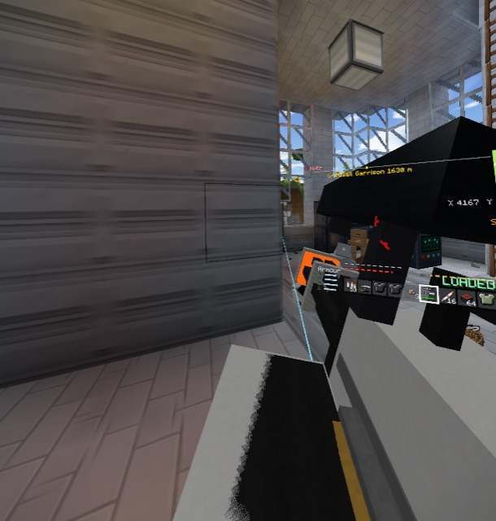

## 12:40:12 - Sure what this chair is for, but okay

- **Transcript:** Sure what this chair is for, but okay
- **Status:** open
- **Build:** 0.129 (fc006bd3, M1-M4 (device-tested; ship riding, chests, comfort options, weapon wheel))
- **World:** New World (23) (seed 2117423538372845574)
- **Dimension:** Surface
- **Biome:** Plains
- **Position:** 4161.5 126.1 -5002.5
- **Facing:** north (yaw 4, pitch -28)
- **Held:** Mahlwerk Rotary Gun x1
- **Mount:** on foot
- **Looking at:** Oak Chair at 4161 126 -5003
- **Mode:** Survival, health 16/20
- **Time:** day 1 15:20, clear
- **Fps:** 72
- **Levels:** mic -41 dBFS, game sound -20 dBFS
- **Length:** 2.8 s (voice 0.7 s)
- **Just before:** -29s took 1 damage (health 17/20); -23s into the pack: Fernblick Rifle; -23s took 1 damage (health 16/20); -16s into the pack: Spec Ops Armour Set
- **Repro (Mac):** `./snap.sh note --seed 2117423538372845574 --x 4161.5 --z -5002.5 --yaw -4 --pitch -28 --time 0.389`
- **Audio (this Mac):** /Users/darthvadar/Documents/Blocksmith/QuestVoiceNotes/raw/vn-20261113-124012-517.aac

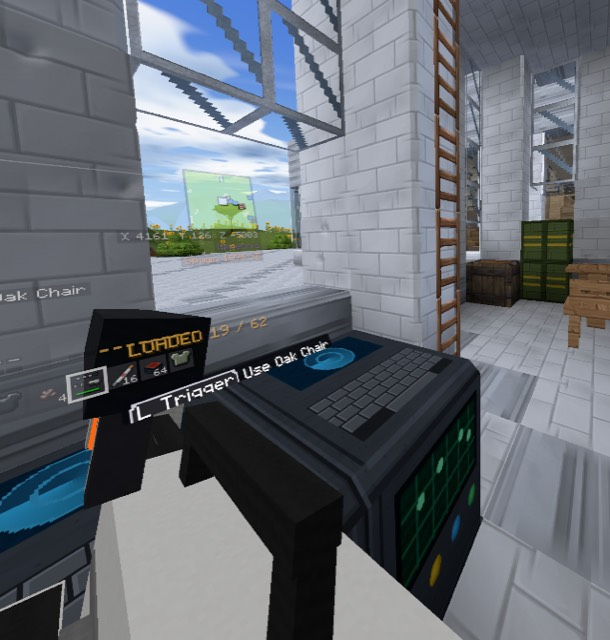

## 12:40:19 - Curious here. So

- **Transcript:** Curious here. So
- **Status:** open
- **Build:** 0.129 (fc006bd3, M1-M4 (device-tested; ship riding, chests, comfort options, weapon wheel))
- **World:** New World (23) (seed 2117423538372845574)
- **Dimension:** Surface
- **Biome:** Plains
- **Position:** 4167.2 126.0 -4999.3
- **Facing:** east (yaw 84, pitch -3)
- **Held:** Iron Nugget x4
- **Mount:** on foot
- **Looking at:** nothing
- **Mode:** Survival, health 15/20, screen InventoryMenu
- **Time:** day 1 15:27, clear
- **Fps:** 72
- **Levels:** mic -27 dBFS, game sound -19 dBFS
- **Length:** 2.3 s (voice 0.9 s)
- **Just before:** -23s into the pack: Spec Ops Armour Set; -4s took 1 damage (health 15/20); -3s message: Loaded: 62 / 350; -2s holding Iron Nugget; -1s opened PauseMenu; -1s message: No Capital Rounds; -1s closed PauseMenu; -1s opened InventoryMenu
- **Repro (Mac):** `./snap.sh note --seed 2117423538372845574 --x 4167.2 --z -4999.3 --yaw -84 --pitch -3 --time 0.394`
- **Audio (this Mac):** /Users/darthvadar/Documents/Blocksmith/QuestVoiceNotes/raw/vn-20261113-124019-398.aac

## 12:40:22 - Extend magazine, speed lower, stabilizing scope

- **Transcript:** Extend magazine, speed lower, stabilizing scope
- **Status:** open
- **Build:** 0.129 (fc006bd3, M1-M4 (device-tested; ship riding, chests, comfort options, weapon wheel))
- **World:** New World (23) (seed 2117423538372845574)
- **Dimension:** Surface
- **Biome:** Plains
- **Position:** 4167.2 126.0 -4999.3
- **Facing:** east (yaw 84, pitch -3)
- **Held:** Iron Nugget x4
- **Mount:** on foot
- **Looking at:** nothing
- **Mode:** Survival, health 15/20, screen InventoryMenu
- **Time:** day 1 15:30, clear
- **Fps:** 72
- **Levels:** mic -37 dBFS, game sound -17 dBFS
- **Length:** 3.9 s (voice 2.2 s)
- **Just before:** -26s into the pack: Spec Ops Armour Set; -7s took 1 damage (health 15/20); -5s message: Loaded: 62 / 350; -5s holding Iron Nugget; -4s opened PauseMenu; -4s message: No Capital Rounds; -4s closed PauseMenu; -3s opened InventoryMenu
- **Repro (Mac):** `./snap.sh note --seed 2117423538372845574 --x 4167.2 --z -4999.3 --yaw -84 --pitch -3 --time 0.396`
- **Audio (this Mac):** /Users/darthvadar/Documents/Blocksmith/QuestVoiceNotes/raw/vn-20261113-124022-018.aac

## 12:40:29 - Ricochet rounds, incendiary rounds. Okay

- **Transcript:** Ricochet rounds, incendiary rounds. Okay
- **Status:** open
- **Build:** 0.129 (fc006bd3, M1-M4 (device-tested; ship riding, chests, comfort options, weapon wheel))
- **World:** New World (23) (seed 2117423538372845574)
- **Dimension:** Surface
- **Biome:** Plains
- **Position:** 4167.2 126.0 -4999.3
- **Facing:** east (yaw 84, pitch -3)
- **Held:** Iron Nugget x4
- **Mount:** on foot
- **Looking at:** nothing
- **Mode:** Survival, health 15/20, screen InventoryMenu
- **Time:** day 1 15:39, clear
- **Fps:** 72
- **Levels:** mic -42 dBFS, game sound -17 dBFS
- **Length:** 4.3 s (voice 1.8 s)
- **Just before:** -14s took 1 damage (health 15/20); -13s message: Loaded: 62 / 350; -12s holding Iron Nugget; -11s opened PauseMenu; -11s message: No Capital Rounds; -11s closed PauseMenu; -10s opened InventoryMenu
- **Repro (Mac):** `./snap.sh note --seed 2117423538372845574 --x 4167.2 --z -4999.3 --yaw -84 --pitch -3 --time 0.403`
- **Audio (this Mac):** /Users/darthvadar/Documents/Blocksmith/QuestVoiceNotes/raw/vn-20261113-124029-278.aac

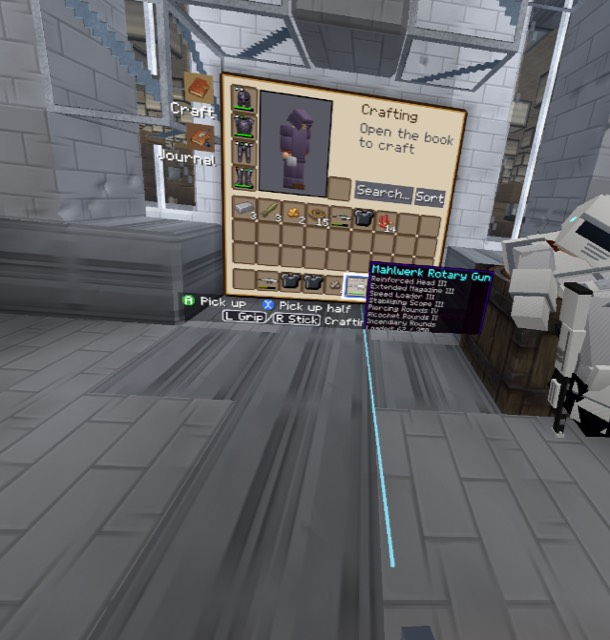

## 12:40:52 - Not sure where the scope is in this thing, but it ain't really working

- **Transcript:** Not sure where the scope is in this thing, but it ain't really working. Uh, okay
- **Status:** open
- **Build:** 0.129 (fc006bd3, M1-M4 (device-tested; ship riding, chests, comfort options, weapon wheel))
- **World:** New World (23) (seed 2117423538372845574)
- **Dimension:** Surface
- **Biome:** Plains
- **Position:** 4194.8 126.0 -5000.9
- **Facing:** east (yaw 83, pitch 21)
- **Held:** Mahlwerk Rotary Gun x1
- **Mount:** on foot
- **Looking at:** nothing
- **Mode:** Survival, health 15/20
- **Time:** day 1 16:06, clear
- **Fps:** 72
- **Levels:** mic -33 dBFS, game sound -18 dBFS
- **Length:** 5.0 s (voice 2.5 s)
- **Just before:** -22s closed InventoryMenu; -22s holding Mahlwerk Rotary Gun; -22s message: Mahlwerk Rotary Gun; -18s opened InventoryMenu; -17s closed InventoryMenu; -16s message: A Capital Dropship is landing troops!; -15s opened PauseMenu; -15s closed PauseMenu; -14s opened InventoryMenu; -13s closed InventoryMenu; -8s message: Loaded: 85 / 350; -6s into the pack: Donnerkeil Service Rifle; -4s into the pack: Spec Ops Armour Set
- **Repro (Mac):** `./snap.sh note --seed 2117423538372845574 --x 4194.8 --z -5000.9 --yaw -83 --pitch 21 --time 0.421`
- **Audio (this Mac):** /Users/darthvadar/Documents/Blocksmith/QuestVoiceNotes/raw/vn-20261113-124052-377.aac

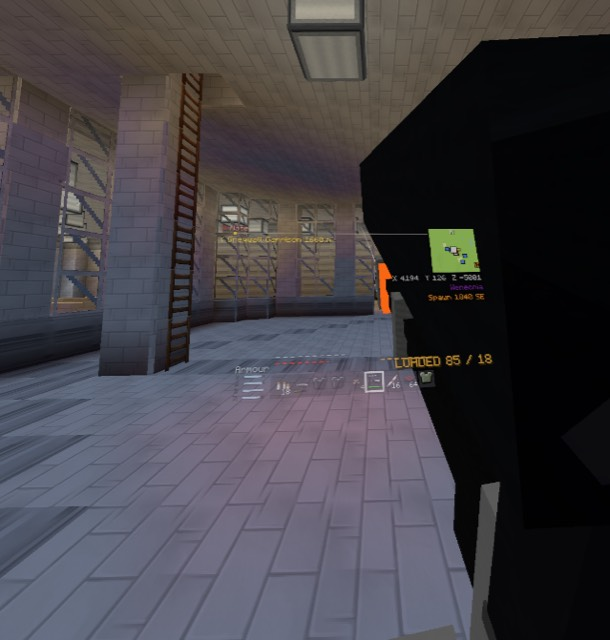

## 12:42:22 - Oh, [chuckles] nice

- **Transcript:** Oh, [chuckles] nice
- **Status:** open
- **Build:** 0.129 (fc006bd3, M1-M4 (device-tested; ship riding, chests, comfort options, weapon wheel))
- **World:** New World (23) (seed 2117423538372845574)
- **Dimension:** Surface
- **Biome:** Plains
- **Position:** 4194.3 145.0 -5005.2
- **Facing:** south-east (yaw 150, pitch -26)
- **Held:** Mahlwerk Rotary Gun x1
- **Mount:** on foot
- **Looking at:** Capital Stone at 4195 144 -5003
- **Mode:** Survival, health 20/20
- **Time:** day 1 17:55, clear
- **Fps:** 72
- **Levels:** mic -19 dBFS, game sound -18 dBFS
- **Length:** 3.5 s (voice 1.0 s)
- **Just before:** -1s into the pack: Brecher Shotgun
- **Repro (Mac):** `./snap.sh note --seed 2117423538372845574 --x 4194.3 --z -5005.2 --yaw -150 --pitch -26 --time 0.497`
- **Audio (this Mac):** /Users/darthvadar/Documents/Blocksmith/QuestVoiceNotes/raw/vn-20261113-124222-957.aac

## 12:42:26 - Ricochet works. [laughs]

- **Transcript:** Ricochet works. [laughs]
- **Status:** open
- **Build:** 0.129 (fc006bd3, M1-M4 (device-tested; ship riding, chests, comfort options, weapon wheel))
- **World:** New World (23) (seed 2117423538372845574)
- **Dimension:** Surface
- **Biome:** Plains
- **Position:** 4200.9 145.0 -4997.3
- **Facing:** east (yaw 105, pitch -31)
- **Held:** Mahlwerk Rotary Gun x1
- **Mount:** on foot
- **Looking at:** Capital Stone at 4201 146 -4997
- **Mode:** Survival, health 20/20
- **Time:** day 1 17:59, clear
- **Fps:** 72
- **Levels:** mic -35 dBFS, game sound -18 dBFS
- **Length:** 2.6 s (voice 0.7 s)
- **Just before:** -4s into the pack: Brecher Shotgun
- **Repro (Mac):** `./snap.sh note --seed 2117423538372845574 --x 4200.9 --z -4997.3 --yaw -105 --pitch -31 --time 0.500`
- **Audio (this Mac):** /Users/darthvadar/Documents/Blocksmith/QuestVoiceNotes/raw/vn-20261113-124226-397.aac

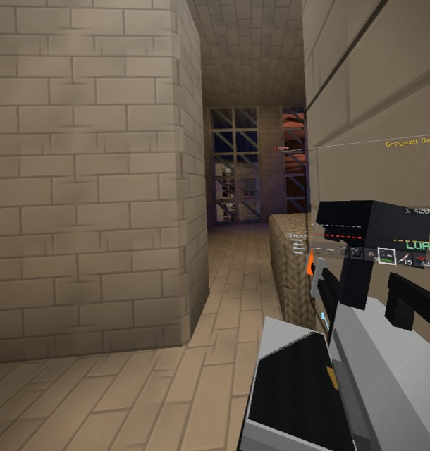

## 12:42:40 - This is nice

- **Transcript:** This is nice
- **Status:** open
- **Build:** 0.129 (fc006bd3, M1-M4 (device-tested; ship riding, chests, comfort options, weapon wheel))
- **World:** New World (23) (seed 2117423538372845574)
- **Dimension:** Surface
- **Biome:** Plains
- **Position:** 4234.8 151.0 -5001.1
- **Facing:** south-east (yaw 133, pitch -6)
- **Held:** Mahlwerk Rotary Gun x1
- **Mount:** on foot
- **Looking at:** nothing
- **Mode:** Survival, health 20/20
- **Time:** day 1 18:16, clear
- **Fps:** 71
- **Levels:** mic -37 dBFS, game sound -13 dBFS
- **Length:** 2.1 s (voice 0.6 s)
- **Just before:** -18s into the pack: Brecher Shotgun
- **Repro (Mac):** `./snap.sh note --seed 2117423538372845574 --x 4234.8 --z -5001.1 --yaw -133 --pitch -6 --time 0.511`
- **Audio (this Mac):** /Users/darthvadar/Documents/Blocksmith/QuestVoiceNotes/raw/vn-20261113-124240-177.aac

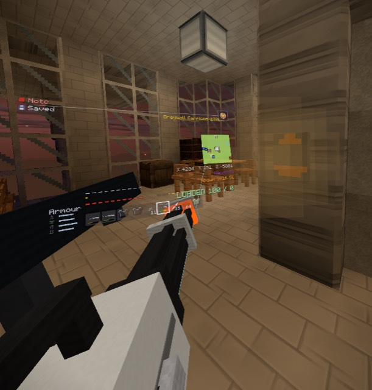

## 12:43:05 - Don't appear to be able to use the elevator.

- **Transcript:** Don't appear to be able to use the elevator.
- **Status:** open
- **Build:** 0.129 (fc006bd3, M1-M4 (device-tested; ship riding, chests, comfort options, weapon wheel))
- **World:** New World (23) (seed 2117423538372845574)
- **Dimension:** Surface
- **Biome:** Plains
- **Position:** 4233.8 157.0 -5000.6
- **Facing:** south (yaw 186, pitch -8)
- **Held:** Mahlwerk Rotary Gun x1
- **Mount:** on foot
- **Looking at:** Lift Door at 4233 158 -4999
- **Mode:** Survival, health 20/20
- **Time:** day 1 18:46, clear
- **Fps:** 63
- **Levels:** mic -28 dBFS, game sound -23 dBFS
- **Length:** 3.5 s (voice 1.9 s)
- **Repro (Mac):** `./snap.sh note --seed 2117423538372845574 --x 4233.8 --z -5000.6 --yaw 174 --pitch -8 --time 0.532`
- **Audio (this Mac):** /Users/darthvadar/Documents/Blocksmith/QuestVoiceNotes/raw/vn-20261113-124305-018.aac

## 12:43:09 - Oh, never mind, I can

- **Transcript:** Oh, never mind, I can
- **Status:** open
- **Build:** 0.129 (fc006bd3, M1-M4 (device-tested; ship riding, chests, comfort options, weapon wheel))
- **World:** New World (23) (seed 2117423538372845574)
- **Dimension:** Surface
- **Biome:** Plains
- **Position:** 4233.5 157.0 -4999.2
- **Facing:** south-east (yaw 148, pitch -18)
- **Held:** Mahlwerk Rotary Gun x1
- **Mount:** on foot
- **Looking at:** Lift Car Wall at 4234 157 -4998
- **Mode:** Survival, health 20/20
- **Time:** day 1 18:51, clear
- **Fps:** 63
- **Levels:** mic -34 dBFS, game sound -20 dBFS
- **Length:** 2.8 s (voice 1.0 s)
- **Repro (Mac):** `./snap.sh note --seed 2117423538372845574 --x 4233.5 --z -4999.2 --yaw -148 --pitch -18 --time 0.536`
- **Audio (this Mac):** /Users/darthvadar/Documents/Blocksmith/QuestVoiceNotes/raw/vn-20261113-124309-377.aac

## 12:43:14 - Hmm. Well, that's nice

- **Transcript:** Hmm. Well, that's nice
- **Status:** open
- **Build:** 0.129 (fc006bd3, M1-M4 (device-tested; ship riding, chests, comfort options, weapon wheel))
- **World:** New World (23) (seed 2117423538372845574)
- **Dimension:** Surface
- **Biome:** Plains
- **Position:** 4233.5 157.0 -4997.1
- **Facing:** north-east (yaw 38, pitch -15)
- **Held:** Mahlwerk Rotary Gun x1
- **Mount:** on foot
- **Looking at:** Lift Car Panel at 4234 158 -4998
- **Mode:** Survival, health 20/20
- **Time:** day 1 18:57, clear
- **Fps:** 67
- **Levels:** mic -38 dBFS, game sound -22 dBFS
- **Length:** 2.3 s (voice 0.4 s)
- **Just before:** -3s opened LiftMenu; -0s closed LiftMenu
- **Repro (Mac):** `./snap.sh note --seed 2117423538372845574 --x 4233.5 --z -4997.1 --yaw -38 --pitch -15 --time 0.540`
- **Audio (this Mac):** /Users/darthvadar/Documents/Blocksmith/QuestVoiceNotes/raw/vn-20261113-124314-277.aac

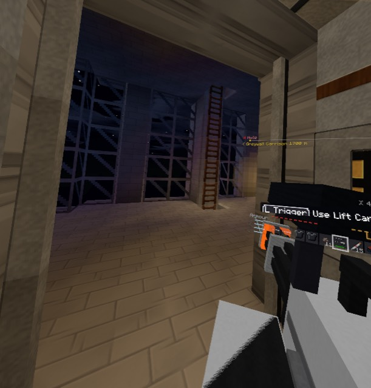

## 12:43:17 - Um, oh, it's broken. For some reason, this gun shifted. I don't know w

- **Transcript:** Um, oh, it's broken. For some reason, this gun shifted. I don't know why
- **Status:** open
- **Build:** 0.129 (fc006bd3, M1-M4 (device-tested; ship riding, chests, comfort options, weapon wheel))
- **World:** New World (23) (seed 2117423538372845574)
- **Dimension:** Surface
- **Biome:** Plains
- **Position:** 4236.3 164.0 -5003.7
- **Facing:** west (yaw 288, pitch 11)
- **Held:** Mahlwerk Rotary Gun x1
- **Mount:** on foot
- **Looking at:** nothing
- **Mode:** Survival, health 20/20
- **Time:** day 1 19:01, clear
- **Fps:** 72
- **Levels:** mic -39 dBFS, game sound -16 dBFS
- **Length:** 6.8 s (voice 3.8 s)
- **Just before:** -7s opened LiftMenu; -4s closed LiftMenu
- **Position at the end:** 4231.3 164.0 -5002.1
- **Repro (Mac):** `./snap.sh note --seed 2117423538372845574 --x 4236.3 --z -5003.7 --yaw 72 --pitch 11 --time 0.543`
- **Audio (this Mac):** /Users/darthvadar/Documents/Blocksmith/QuestVoiceNotes/raw/vn-20261113-124317-778.aac

## 12:43:50 - There we go

- **Transcript:** There we go
- **Status:** open
- **Build:** 0.129 (fc006bd3, M1-M4 (device-tested; ship riding, chests, comfort options, weapon wheel))
- **World:** New World (23) (seed 2117423538372845574)
- **Dimension:** Surface
- **Biome:** Plains
- **Position:** 4165.0 165.3 -4996.2
- **Facing:** south (yaw 163, pitch -10)
- **Held:** empty hand
- **Mount:** on foot
- **Looking at:** nothing
- **Mode:** Survival, health 19/20
- **Time:** day 1 19:41, clear
- **Fps:** 72
- **Levels:** mic -24 dBFS, game sound -17 dBFS
- **Length:** 2.1 s (voice 0.5 s)
- **Just before:** -21s took 1 damage (health 19/20); -8s holding Field Stim; -8s message: Field Stim; -8s holding Upgrade Bench; -8s message: Upgrade Bench; -6s holding Field Stim; -6s message: Field Stim; -6s holding Mahlwerk Rotary Gun; -6s message: Mahlwerk Rotary Gun; -1s holding empty hand; -1s message: Manning the deck gun
- **Repro (Mac):** `./snap.sh note --seed 2117423538372845574 --x 4165.0 --z -4996.2 --yaw -163 --pitch -10 --time 0.570`
- **Audio (this Mac):** /Users/darthvadar/Documents/Blocksmith/QuestVoiceNotes/raw/vn-20261113-124350-877.aac

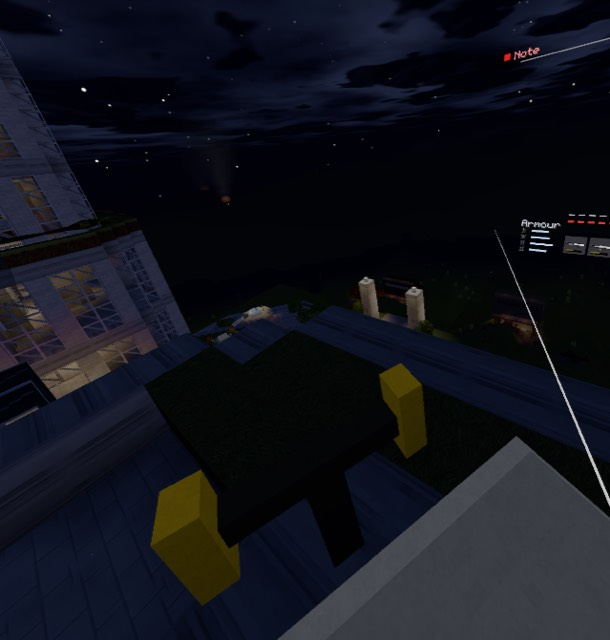

## 12:43:53 - Now we're talking

- **Transcript:** Now we're talking
- **Status:** open
- **Build:** 0.129 (fc006bd3, M1-M4 (device-tested; ship riding, chests, comfort options, weapon wheel))
- **World:** New World (23) (seed 2117423538372845574)
- **Dimension:** Surface
- **Biome:** Plains
- **Position:** 4163.9 165.3 -4996.5
- **Facing:** east (yaw 87, pitch 2)
- **Held:** empty hand
- **Mount:** on foot
- **Looking at:** nothing
- **Mode:** Survival, health 19/20
- **Time:** day 1 19:43, clear
- **Fps:** 72
- **Levels:** mic -26 dBFS, game sound -14 dBFS
- **Length:** 2.1 s (voice 0.6 s)
- **Just before:** -23s took 1 damage (health 19/20); -10s holding Field Stim; -10s message: Field Stim; -10s holding Upgrade Bench; -10s message: Upgrade Bench; -9s holding Field Stim; -9s message: Field Stim; -8s holding Mahlwerk Rotary Gun; -8s message: Mahlwerk Rotary Gun; -3s holding empty hand; -3s message: Manning the deck gun; -2s message: Gun Control: the gun overhead, worked from this computer
- **Repro (Mac):** `./snap.sh note --seed 2117423538372845574 --x 4163.9 --z -4996.5 --yaw -87 --pitch 2 --time 0.572`
- **Audio (this Mac):** /Users/darthvadar/Documents/Blocksmith/QuestVoiceNotes/raw/vn-20261113-124353-098.aac

## 12:45:02 - Where's the, um

- **Transcript:** Where's the, um
- **Status:** open
- **Build:** 0.129 (fc006bd3, M1-M4 (device-tested; ship riding, chests, comfort options, weapon wheel))
- **World:** New World (23) (seed 2117423538372845574)
- **Dimension:** Surface
- **Biome:** Plains
- **Position:** 4203.8 175.0 -4999.1
- **Facing:** south-west (yaw 242, pitch -5)
- **Held:** Brecher Shotgun x1
- **Mount:** on foot
- **Looking at:** nothing
- **Mode:** Survival, health 19/20
- **Time:** day 1 21:06, clear
- **Fps:** 71
- **Levels:** mic -34 dBFS, game sound -21 dBFS
- **Length:** 2.5 s (voice 1.1 s)
- **Just before:** -29s message: Loaded: 6 / 10; -26s opened LiftMenu; -25s closed LiftMenu
- **Repro (Mac):** `./snap.sh note --seed 2117423538372845574 --x 4203.8 --z -4999.1 --yaw 118 --pitch -5 --time 0.630`
- **Audio (this Mac):** /Users/darthvadar/Documents/Blocksmith/QuestVoiceNotes/raw/vn-20261113-124502-238.aac

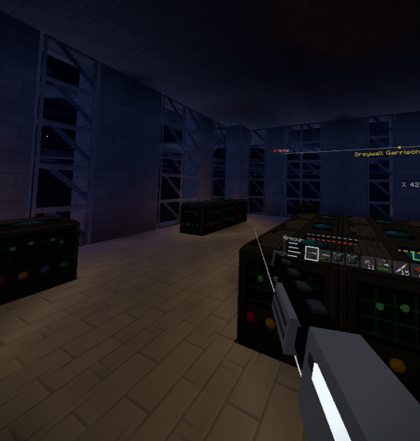

## 12:45:04 - A hard guy to kill. Mercy should be a hard guy to kill here

- **Transcript:** A hard guy to kill. Mercy should be a hard guy to kill here
- **Status:** open
- **Build:** 0.129 (fc006bd3, M1-M4 (device-tested; ship riding, chests, comfort options, weapon wheel))
- **World:** New World (23) (seed 2117423538372845574)
- **Dimension:** Surface
- **Biome:** Plains
- **Position:** 4202.1 175.0 -4995.8
- **Facing:** north-east (yaw 30, pitch -16)
- **Held:** Brecher Shotgun x1
- **Mount:** on foot
- **Looking at:** Capital Stone at 4204 174 -5001
- **Mode:** Survival, health 19/20
- **Time:** day 1 21:09, clear
- **Fps:** 71
- **Levels:** mic -29 dBFS, game sound -16 dBFS
- **Length:** 4.7 s (voice 2.2 s)
- **Just before:** -29s opened LiftMenu; -27s closed LiftMenu
- **Repro (Mac):** `./snap.sh note --seed 2117423538372845574 --x 4202.1 --z -4995.8 --yaw -30 --pitch -16 --time 0.632`
- **Audio (this Mac):** /Users/darthvadar/Documents/Blocksmith/QuestVoiceNotes/raw/vn-20261113-124504-918.aac

## 12:45:10 - Also, shouldn't there be a sunder or a, uh, charge and a charge to get

- **Transcript:** Also, shouldn't there be a sunder or a, uh, charge and a charge to get into hell here?
- **Status:** open
- **Build:** 0.129 (fc006bd3, M1-M4 (device-tested; ship riding, chests, comfort options, weapon wheel))
- **World:** New World (23) (seed 2117423538372845574)
- **Dimension:** Surface
- **Biome:** Plains
- **Position:** 4198.8 175.0 -4996.3
- **Facing:** south-west (yaw 232, pitch -30)
- **Held:** Brecher Shotgun x1
- **Mount:** on foot
- **Looking at:** Command Console at 4197 175 -4995
- **Mode:** Survival, health 19/20
- **Time:** day 1 21:16, clear
- **Fps:** 71
- **Levels:** mic -26 dBFS, game sound -21 dBFS
- **Length:** 6.7 s (voice 4.4 s)
- **Just before:** -5s opened ChestMenu; -4s closed ChestMenu; -3s opened ChestMenu; -1s closed ChestMenu
- **While talking:** -1s opened ChestMenu
- **Position at the end:** 4196.7 175.0 -4997.4
- **Repro (Mac):** `./snap.sh note --seed 2117423538372845574 --x 4198.8 --z -4996.3 --yaw 128 --pitch -30 --time 0.636`
- **Audio (this Mac):** /Users/darthvadar/Documents/Blocksmith/QuestVoiceNotes/raw/vn-20261113-124510-077.aac

## 12:46:03 - Oh, shit

- **Transcript:** Oh, shit
- **Status:** open
- **Build:** 0.129 (fc006bd3, M1-M4 (device-tested; ship riding, chests, comfort options, weapon wheel))
- **World:** New World (23) (seed 2117423538372845574)
- **Dimension:** Surface
- **Biome:** Taiga
- **Position:** 4475.1 216.7 -5571.7
- **Facing:** north-east (yaw 43, pitch -18)
- **Held:** Brecher Shotgun x1
- **Mount:** on foot, flying
- **Looking at:** nothing
- **Mode:** Creative, health 19/20
- **Time:** day 1 22:16, clear
- **Fps:** 72
- **Levels:** mic -32 dBFS, game sound -23 dBFS
- **Length:** 2.5 s (voice 0.9 s)
- **Just before:** -30s message: Creative mode; -30s closed PauseMenu; -28s message: Flying; -25s message: Entering Loremere; -24s opened PauseMenu; -23s opened CommandMenu; -20s opened KeyboardMenu; -8s message: Meridian Frigate: 7771 ~ -2804 (4184 blocks, patrols); -7s opened CommandMenu; -6s closed CommandMenu; -4s walked into Snowy Slopes
- **Repro (Mac):** `./snap.sh note --seed 2117423538372845574 --x 4475.1 --z -5571.7 --yaw -43 --pitch -18 --time 0.678`
- **Audio (this Mac):** /Users/darthvadar/Documents/Blocksmith/QuestVoiceNotes/raw/vn-20261113-124603-498.aac

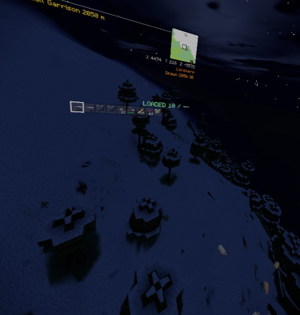

## 12:46:07 - All right, very tall. Okay

- **Transcript:** All right, very tall. Okay
- **Status:** open
- **Build:** 0.129 (fc006bd3, M1-M4 (device-tested; ship riding, chests, comfort options, weapon wheel))
- **World:** New World (23) (seed 2117423538372845574)
- **Dimension:** Surface
- **Biome:** Jagged Peaks
- **Position:** 4549.8 269.2 -5653.5
- **Facing:** north-east (yaw 30, pitch -29)
- **Held:** Brecher Shotgun x1
- **Mount:** on foot, flying
- **Looking at:** nothing
- **Mode:** Creative, health 19/20
- **Time:** day 1 22:20, clear
- **Fps:** 70
- **Levels:** mic -35 dBFS, game sound -19 dBFS
- **Length:** 3.1 s (voice 1.5 s)
- **Just before:** -29s message: Entering Loremere; -28s opened PauseMenu; -27s opened CommandMenu; -24s opened KeyboardMenu; -12s message: Meridian Frigate: 7771 ~ -2804 (4184 blocks, patrols); -11s opened CommandMenu; -10s closed CommandMenu; -8s walked into Snowy Slopes
- **Repro (Mac):** `./snap.sh note --seed 2117423538372845574 --x 4549.8 --z -5653.5 --yaw -30 --pitch -29 --time 0.681`
- **Audio (this Mac):** /Users/darthvadar/Documents/Blocksmith/QuestVoiceNotes/raw/vn-20261113-124607-477.aac

## 12:47:00 - Break the collapse

- **Transcript:** Break the collapse
- **Status:** open
- **Build:** 0.129 (fc006bd3, M1-M4 (device-tested; ship riding, chests, comfort options, weapon wheel))
- **World:** New World (23) (seed 2117423538372845574)
- **Dimension:** Surface
- **Biome:** Plains
- **Position:** 7877.9 156.8 -3079.5
- **Facing:** east (yaw 81, pitch -8)
- **Held:** Brecher Shotgun x1
- **Mount:** on foot
- **Looking at:** nothing
- **Mode:** Survival, health 19/20
- **Time:** day 1 23:20, clear
- **Fps:** 72
- **Levels:** mic -39 dBFS, game sound -14 dBFS
- **Length:** 1.8 s (voice 0.4 s)
- **Just before:** -26s message: Flying; -25s message: The frigate's cargo winch lowers a line; -23s message: Walking; -21s opened PauseMenu; -18s message: Survival mode; -18s closed PauseMenu
- **Repro (Mac):** `./snap.sh note --seed 2117423538372845574 --x 7877.9 --z -3079.5 --yaw -81 --pitch -8 --time 0.723`
- **Audio (this Mac):** /Users/darthvadar/Documents/Blocksmith/QuestVoiceNotes/raw/vn-20261113-124700-478.aac

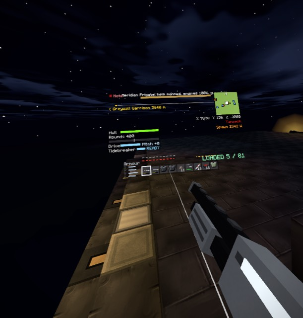

## 12:47:09 - Would have been impressed if that broke through because it's armor-pie

- **Transcript:** Would have been impressed if that broke through because it's armor-piercing. But no, that would be a little too impressive
- **Status:** open
- **Build:** 0.129 (fc006bd3, M1-M4 (device-tested; ship riding, chests, comfort options, weapon wheel))
- **World:** New World (23) (seed 2117423538372845574)
- **Dimension:** Surface
- **Biome:** Plains
- **Position:** 8017.8 173.7 -3114.5
- **Facing:** west (yaw 248, pitch 39)
- **Held:** Mahlwerk Rotary Gun x1
- **Mount:** on foot
- **Looking at:** nothing
- **Mode:** Survival, health 19/20
- **Time:** day 1 23:31, clear
- **Fps:** 71
- **Levels:** mic -30 dBFS, game sound -12 dBFS
- **Length:** 7.6 s (voice 3.4 s)
- **Just before:** -27s message: Survival mode; -27s closed PauseMenu; -5s holding Donnerkeil Service Rifle; -5s message: Donnerkeil Service Rifle; -5s holding Spec Ops Armour Set; -5s message: Spec Ops Armour Set; -4s holding Iron Nugget; -4s message: Iron Nugget; -4s holding Mahlwerk Rotary Gun; -4s message: Mahlwerk Rotary Gun
- **While talking:** -3s holding Iron Nugget; -3s message: Iron Nugget; -2s holding Spec Ops Armour Set; -2s message: Spec Ops Armour Set; -2s holding Donnerkeil Service Rifle; -2s message: Donnerkeil Service Rifle
- **Position at the end:** 8057.6 181.2 -3124.6
- **Repro (Mac):** `./snap.sh note --seed 2117423538372845574 --x 8017.8 --z -3114.5 --yaw 112 --pitch 39 --time 0.730`
- **Audio (this Mac):** /Users/darthvadar/Documents/Blocksmith/QuestVoiceNotes/raw/vn-20261113-124709-738.aac

## 12:47:55 - There's people who are shooting at me even though they don't have a li

- **Transcript:** There's people who are shooting at me even though they don't have a line of sight
- **Status:** open
- **Build:** 0.129 (fc006bd3, M1-M4 (device-tested; ship riding, chests, comfort options, weapon wheel))
- **World:** New World (23) (seed 2117423538372845574)
- **Dimension:** Surface
- **Biome:** Snowy Plains
- **Position:** 8566.6 157.3 -3080.6
- **Facing:** north-east (yaw 65, pitch -49)
- **Held:** Brecher Shotgun x1
- **Mount:** on foot
- **Looking at:** nothing
- **Mode:** Survival, health 19/20
- **Time:** day 1 00:22, clear
- **Fps:** 71
- **Levels:** mic -33 dBFS, game sound -13 dBFS
- **Length:** 3.9 s (voice 2.5 s)
- **Just before:** -29s holding Spec Ops Armour Set; -28s holding Iron Nugget; -28s message: Iron Nugget; -24s opened PauseMenu; -22s message: Survival mode; -22s closed PauseMenu; -21s holding Spec Ops Armour Set; -21s holding Donnerkeil Service Rifle; -21s holding Brecher Shotgun; -11s message: Loaded: 6 / 10
- **Repro (Mac):** `./snap.sh note --seed 2117423538372845574 --x 8566.6 --z -3080.6 --yaw -65 --pitch -49 --time 0.766`
- **Audio (this Mac):** /Users/darthvadar/Documents/Blocksmith/QuestVoiceNotes/raw/vn-20261113-124755-197.aac

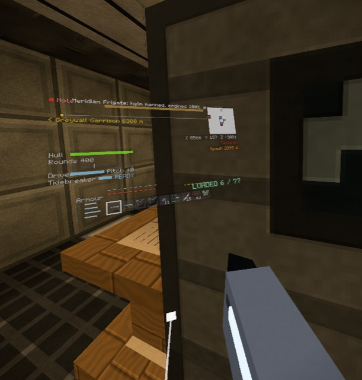

## 12:47:59 - Just doesn't seem very realistic to me

- **Transcript:** Just doesn't seem very realistic to me
- **Status:** open
- **Build:** 0.129 (fc006bd3, M1-M4 (device-tested; ship riding, chests, comfort options, weapon wheel))
- **World:** New World (23) (seed 2117423538372845574)
- **Dimension:** Surface
- **Biome:** Snowy Plains
- **Position:** 8572.7 156.1 -3018.3
- **Facing:** south-east (yaw 114, pitch -21)
- **Held:** Brecher Shotgun x1
- **Mount:** on foot
- **Looking at:** nothing
- **Mode:** Survival, health 19/20, screen ChestMenu
- **Time:** day 1 00:27, clear
- **Fps:** 72
- **Levels:** mic -33 dBFS, game sound -12 dBFS
- **Length:** 3.0 s (voice 1.3 s)
- **Just before:** -28s opened PauseMenu; -26s message: Survival mode; -26s closed PauseMenu; -25s holding Spec Ops Armour Set; -25s holding Donnerkeil Service Rifle; -25s holding Brecher Shotgun; -14s message: Loaded: 6 / 10; -3s opened ChestMenu
- **Repro (Mac):** `./snap.sh note --seed 2117423538372845574 --x 8572.7 --z -3018.3 --yaw -114 --pitch -21 --time 0.769`
- **Audio (this Mac):** /Users/darthvadar/Documents/Blocksmith/QuestVoiceNotes/raw/vn-20261113-124759-117.aac

## 12:48:47 - Ja, das

- **Transcript:** Ja, das
- **Status:** open
- **Build:** 0.129 (fc006bd3, M1-M4 (device-tested; ship riding, chests, comfort options, weapon wheel))
- **World:** New World (23) (seed 2117423538372845574)
- **Dimension:** Surface
- **Biome:** Snowy Plains
- **Position:** 8287.7 185.4 -3030.6
- **Facing:** south-east (yaw 138, pitch -22)
- **Held:** Brecher Shotgun x1
- **Mount:** on foot
- **Looking at:** nothing
- **Mode:** Survival, health 18/20
- **Time:** day 1 01:25, clear
- **Fps:** 72
- **Levels:** mic -26 dBFS, game sound -16 dBFS
- **Length:** 2.5 s (voice 0.4 s)
- **Just before:** -29s holding Upgrade Bench; -29s message: Upgrade Bench; -29s holding Field Stim; -29s message: Field Stim; -29s holding Upgrade Bench; -29s message: Upgrade Bench; -28s holding Himmelsturm Launcher; -28s message: Himmelsturm Launcher; -28s holding Brecher Shotgun; -28s message: Brecher Shotgun; -24s message: Homestead marked on the map; -20s message: Loaded: 8 / 10; -20s took 1 damage (health 18/20); -19s opened ChestMenu; -17s into the pack: Rocket; -13s closed ChestMenu; -11s piloting Meridian Frigate; -11s holding empty hand; -11s message: Steering Meridian Frigate; -9s message: You have taken command of the Meridian Frigate!; -6s message: Greywall Fortress marked on the map; -2s message: Sky isle marked on the map; -1s stopped piloting Meridian Frigate; -1s holding Brecher Shotgun
- **Repro (Mac):** `./snap.sh note --seed 2117423538372845574 --x 8287.7 --z -3030.6 --yaw -138 --pitch -22 --time 0.809`
- **Audio (this Mac):** /Users/darthvadar/Documents/Blocksmith/QuestVoiceNotes/raw/vn-20261113-124847-278.aac

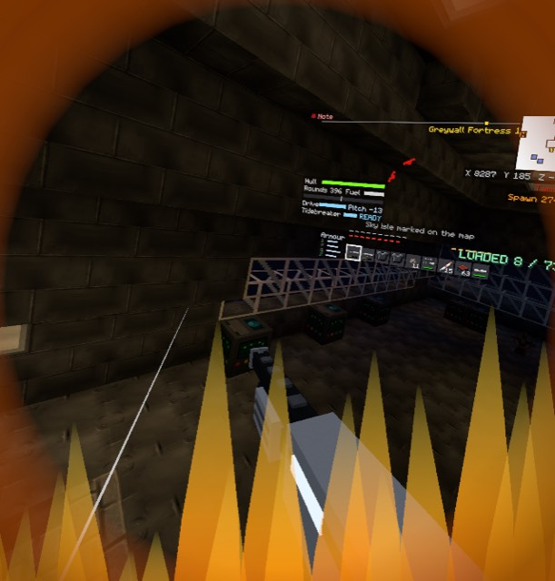

## 12:48:52 - Who the fuck is firing at me?

- **Transcript:** Who the fuck is firing at me?
- **Status:** open
- **Build:** 0.129 (fc006bd3, M1-M4 (device-tested; ship riding, chests, comfort options, weapon wheel))
- **World:** New World (23) (seed 2117423538372845574)
- **Dimension:** Surface
- **Biome:** Snowy Plains
- **Position:** 8289.4 186.5 -3035.3
- **Facing:** south-west (yaw 215, pitch 4)
- **Held:** Brecher Shotgun x1
- **Mount:** on foot
- **Looking at:** nothing
- **Mode:** Survival, health 16/20
- **Time:** day 1 01:31, clear
- **Fps:** 71
- **Levels:** mic -34 dBFS, game sound -16 dBFS
- **Length:** 2.9 s (voice 1.2 s)
- **Just before:** -29s message: Homestead marked on the map; -25s message: Loaded: 8 / 10; -25s took 1 damage (health 18/20); -24s opened ChestMenu; -22s into the pack: Rocket; -18s closed ChestMenu; -16s piloting Meridian Frigate; -16s holding empty hand; -16s message: Steering Meridian Frigate; -14s message: You have taken command of the Meridian Frigate!; -11s message: Greywall Fortress marked on the map; -7s message: Sky isle marked on the map; -6s stopped piloting Meridian Frigate; -6s holding Brecher Shotgun
- **Repro (Mac):** `./snap.sh note --seed 2117423538372845574 --x 8289.4 --z -3035.3 --yaw 145 --pitch 4 --time 0.813`
- **Audio (this Mac):** /Users/darthvadar/Documents/Blocksmith/QuestVoiceNotes/raw/vn-20261113-124852-138.aac

## 12:49:03 - People are shooting at me through walls.

- **Transcript:** People are shooting at me through walls.
- **Status:** open
- **Build:** 0.129 (fc006bd3, M1-M4 (device-tested; ship riding, chests, comfort options, weapon wheel))
- **World:** New World (23) (seed 2117423538372845574)
- **Dimension:** Surface
- **Biome:** Snowy Plains
- **Position:** 8311.6 184.9 -3064.2
- **Facing:** north-west (yaw 314, pitch -26)
- **Held:** Brecher Shotgun x1
- **Mount:** on foot
- **Looking at:** nothing
- **Mode:** Survival, health 15/20
- **Time:** day 1 01:45, clear
- **Fps:** 71
- **Levels:** mic -47 dBFS, game sound -11 dBFS
- **Length:** 3.3 s (voice 1.7 s)
- **Just before:** -30s closed ChestMenu; -27s piloting Meridian Frigate; -27s holding empty hand; -27s message: Steering Meridian Frigate; -25s message: You have taken command of the Meridian Frigate!; -23s message: Greywall Fortress marked on the map; -18s message: Sky isle marked on the map; -17s stopped piloting Meridian Frigate; -17s holding Brecher Shotgun; -11s took 2 damage (health 16/20); -7s took 1 damage (health 15/20); -3s into the pack: Spec Ops Armour Set
- **Repro (Mac):** `./snap.sh note --seed 2117423538372845574 --x 8311.6 --z -3064.2 --yaw 46 --pitch -26 --time 0.823`
- **Audio (this Mac):** /Users/darthvadar/Documents/Blocksmith/QuestVoiceNotes/raw/vn-20261113-124903-798.aac

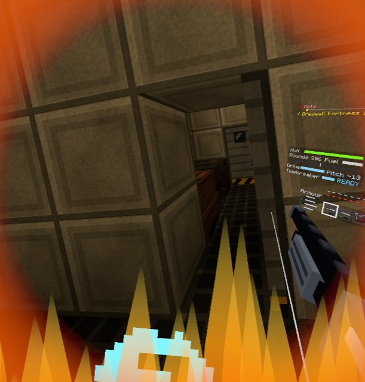

## 12:49:06 - I don't know where it's coming from

- **Transcript:** I don't know where it's coming from
- **Status:** open
- **Build:** 0.129 (fc006bd3, M1-M4 (device-tested; ship riding, chests, comfort options, weapon wheel))
- **World:** New World (23) (seed 2117423538372845574)
- **Dimension:** Surface
- **Biome:** Snowy Plains
- **Position:** 8305.4 185.1 -3069.3
- **Facing:** south (yaw 186, pitch -21)
- **Held:** Brecher Shotgun x1
- **Mount:** on foot
- **Looking at:** nothing
- **Mode:** Survival, health 14/20
- **Time:** day 1 01:48, clear
- **Fps:** 72
- **Levels:** mic -23 dBFS, game sound -13 dBFS
- **Length:** 2.6 s (voice 1.2 s)
- **Just before:** -28s message: You have taken command of the Meridian Frigate!; -26s message: Greywall Fortress marked on the map; -22s message: Sky isle marked on the map; -21s stopped piloting Meridian Frigate; -21s holding Brecher Shotgun; -15s took 2 damage (health 16/20); -11s took 1 damage (health 15/20); -6s into the pack: Spec Ops Armour Set; -1s took 1 damage (health 14/20)
- **Repro (Mac):** `./snap.sh note --seed 2117423538372845574 --x 8305.4 --z -3069.3 --yaw 174 --pitch -21 --time 0.826`
- **Audio (this Mac):** /Users/darthvadar/Documents/Blocksmith/QuestVoiceNotes/raw/vn-20261113-124906-877.aac

## 12:49:10 - That's definitely a glitch, error or something. We gotta fix that

- **Transcript:** That's definitely a glitch, error or something. We gotta fix that
- **Status:** open
- **Build:** 0.129 (fc006bd3, M1-M4 (device-tested; ship riding, chests, comfort options, weapon wheel))
- **World:** New World (23) (seed 2117423538372845574)
- **Dimension:** Surface
- **Biome:** Snowy Plains
- **Position:** 8313.5 184.8 -3062.5
- **Facing:** east (yaw 95, pitch 23)
- **Held:** Brecher Shotgun x1
- **Mount:** on foot
- **Looking at:** nothing
- **Mode:** Survival, health 13/20
- **Time:** day 1 01:53, clear
- **Fps:** 72
- **Levels:** mic -29 dBFS, game sound -14 dBFS
- **Length:** 5.0 s (voice 2.7 s)
- **Just before:** -30s message: Greywall Fortress marked on the map; -25s message: Sky isle marked on the map; -24s stopped piloting Meridian Frigate; -24s holding Brecher Shotgun; -18s took 2 damage (health 16/20); -14s took 1 damage (health 15/20); -10s into the pack: Spec Ops Armour Set; -5s took 1 damage (health 14/20); -3s took 1 damage (health 13/20)
- **Repro (Mac):** `./snap.sh note --seed 2117423538372845574 --x 8313.5 --z -3062.5 --yaw -95 --pitch 23 --time 0.829`
- **Audio (this Mac):** /Users/darthvadar/Documents/Blocksmith/QuestVoiceNotes/raw/vn-20261113-124910-717.aac

## 12:49:21 - I don't know where that hap-- where, where, how, whatever

- **Transcript:** I don't know where that hap-- where, where, how, whatever
- **Status:** open
- **Build:** 0.129 (fc006bd3, M1-M4 (device-tested; ship riding, chests, comfort options, weapon wheel))
- **World:** New World (23) (seed 2117423538372845574)
- **Dimension:** Surface
- **Biome:** Snowy Plains
- **Position:** 8309.9 188.8 -3051.5
- **Facing:** north-east (yaw 60, pitch -16)
- **Held:** Brecher Shotgun x1
- **Mount:** on foot, flying
- **Looking at:** nothing
- **Mode:** Creative, health 13/20
- **Time:** day 1 02:05, clear
- **Fps:** 72
- **Levels:** mic -24 dBFS, game sound -15 dBFS
- **Length:** 4.5 s (voice 2.2 s)
- **Just before:** -30s took 2 damage (health 16/20); -26s took 1 damage (health 15/20); -21s into the pack: Spec Ops Armour Set; -16s took 1 damage (health 14/20); -14s took 1 damage (health 13/20); -4s opened PauseMenu; -3s message: Creative mode; -3s closed PauseMenu; -1s message: Flying
- **Repro (Mac):** `./snap.sh note --seed 2117423538372845574 --x 8309.9 --z -3051.5 --yaw -60 --pitch -16 --time 0.837`
- **Audio (this Mac):** /Users/darthvadar/Documents/Blocksmith/QuestVoiceNotes/raw/vn-20261113-124921-977.aac

## 12:51:36 - Okay, I have a question. [clears throat] I feel like I absolutely obli

- **Transcript:** Okay, I have a question. [clears throat] I feel like I absolutely obliterated this gun. I don't know how it didn't die
- **Status:** open
- **Build:** 0.129 (fc006bd3, M1-M4 (device-tested; ship riding, chests, comfort options, weapon wheel))
- **World:** New World (23) (seed 2117423538372845574)
- **Dimension:** Surface
- **Biome:** Snowy Plains
- **Position:** 8354.1 177.2 -2733.4
- **Facing:** south-west (yaw 223, pitch -59)
- **Held:** Brecher Shotgun x1
- **Mount:** on foot
- **Looking at:** nothing
- **Mode:** Creative, health 13/20
- **Time:** day 1 04:45, clear
- **Fps:** 60
- **Levels:** mic -35 dBFS, game sound -15 dBFS
- **Length:** 9.4 s (voice 5.7 s)
- **Just before:** -15s message: Boreal Station marked on the map; -9s stopped piloting Meridian Frigate; -9s holding Brecher Shotgun; -1s message: Flying
- **While talking:** -4s message: Walking; -3s message: Flying; -1s message: Alarm! The garrison is coming through the bulkheads
- **Position at the end:** 8343.2 98.5 -2652.6
- **Repro (Mac):** `./snap.sh note --seed 2117423538372845574 --x 8354.1 --z -2733.4 --yaw 137 --pitch -59 --time 0.948`
- **Audio (this Mac):** /Users/darthvadar/Documents/Blocksmith/QuestVoiceNotes/raw/vn-20261113-125136-978.aac

## 12:52:20 - Why do they have capital rounds but not capital?

- **Transcript:** Why do they have capital rounds but not capital?
- **Status:** open
- **Build:** 0.129 (fc006bd3, M1-M4 (device-tested; ship riding, chests, comfort options, weapon wheel))
- **World:** New World (23) (seed 2117423538372845574)
- **Dimension:** Surface
- **Biome:** Snowy Plains
- **Position:** 8336.8 85.0 -2639.0
- **Facing:** west (yaw 282, pitch -10)
- **Held:** Donnerkeil Service Rifle x1
- **Mount:** on foot
- **Looking at:** Dark Station Concrete at 8331 85 -2641
- **Mode:** Survival, health 20/20
- **Time:** day 1 05:35, clear
- **Fps:** 69
- **Levels:** mic -32 dBFS, game sound -17 dBFS
- **Length:** 3.5 s (voice 1.5 s)
- **Just before:** -16s message: Walking; -14s opened PauseMenu; -12s message: Survival mode; -12s closed PauseMenu; -11s holding Donnerkeil Service Rifle; -11s holding Spec Ops Armour Set; -10s holding Iron Nugget; -10s holding Mahlwerk Rotary Gun; -10s holding Field Stim; -9s left the pack: Field Stim (at 8325 84 -2639); -9s holding Mahlwerk Rotary Gun; -9s message: Mahlwerk Rotary Gun; -8s holding Iron Nugget; -8s message: Iron Nugget; -8s holding Spec Ops Armour Set; -8s message: Spec Ops Armour Set; -8s holding Donnerkeil Service Rifle; -8s message: Donnerkeil Service Rifle; -1s message: Loaded: 40 / 45
- **Repro (Mac):** `./snap.sh note --seed 2117423538372845574 --x 8336.8 --z -2639.0 --yaw 78 --pitch -10 --time 0.983`
- **Audio (this Mac):** /Users/darthvadar/Documents/Blocksmith/QuestVoiceNotes/raw/vn-20261113-125220-518.aac

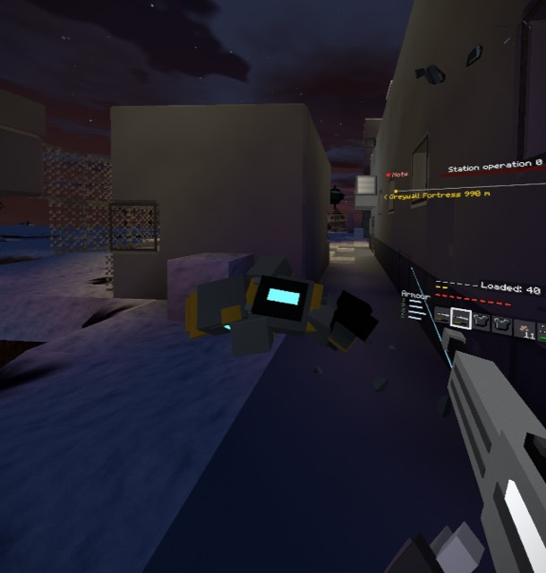

## 12:52:26 - These guys aren't capital rounds. They shouldn't have cap

- **Transcript:** These guys aren't capital rounds. They shouldn't have cap
- **Status:** open
- **Build:** 0.129 (fc006bd3, M1-M4 (device-tested; ship riding, chests, comfort options, weapon wheel))
- **World:** New World (23) (seed 2117423538372845574)
- **Dimension:** Surface
- **Biome:** Snowy Plains
- **Position:** 8319.2 85.0 -2636.3
- **Facing:** north-west (yaw 312, pitch -33)
- **Held:** Brecher Shotgun x1
- **Mount:** on foot
- **Looking at:** Snow at 8318 85 -2638
- **Mode:** Survival, health 20/20
- **Time:** day 1 05:42, clear
- **Fps:** 71
- **Levels:** mic -29 dBFS, game sound -14 dBFS
- **Length:** 3.3 s (voice 1.7 s)
- **Just before:** -22s message: Walking; -19s opened PauseMenu; -18s message: Survival mode; -18s closed PauseMenu; -17s holding Donnerkeil Service Rifle; -17s holding Spec Ops Armour Set; -16s holding Iron Nugget; -16s holding Mahlwerk Rotary Gun; -16s holding Field Stim; -15s left the pack: Field Stim (at 8325 84 -2639); -15s holding Mahlwerk Rotary Gun; -15s message: Mahlwerk Rotary Gun; -14s holding Iron Nugget; -14s message: Iron Nugget; -14s holding Spec Ops Armour Set; -14s message: Spec Ops Armour Set; -14s holding Donnerkeil Service Rifle; -14s message: Donnerkeil Service Rifle; -7s message: Loaded: 40 / 45; -2s into the pack: Regular Armour Set; -1s message: Reinforcements coming down the stairwell; -1s holding Brecher Shotgun; -1s holding Donnerkeil Service Rifle; -0s holding Brecher Shotgun; -0s into the pack: Greywall Keycard
- **Repro (Mac):** `./snap.sh note --seed 2117423538372845574 --x 8319.2 --z -2636.3 --yaw 48 --pitch -33 --time 0.988`
- **Audio (this Mac):** /Users/darthvadar/Documents/Blocksmith/QuestVoiceNotes/raw/vn-20261113-125226-478.aac

## 12:52:59 - I want to see what happens if I saw this thing in half

- **Transcript:** I want to see what happens if I saw this thing in half
- **Status:** open
- **Build:** 0.129 (fc006bd3, M1-M4 (device-tested; ship riding, chests, comfort options, weapon wheel))
- **World:** New World (23) (seed 2117423538372845574)
- **Dimension:** Surface
- **Biome:** Snowy Plains
- **Position:** 8332.3 92.4 -2646.9
- **Facing:** north (yaw 19, pitch 34)
- **Held:** empty hand
- **Mount:** on foot
- **Looking at:** nothing
- **Mode:** Survival, health 20/20
- **Time:** day 2 06:21, clear
- **Fps:** 72
- **Levels:** mic -25 dBFS, game sound -18 dBFS
- **Length:** 3.7 s (voice 2.1 s)
- **Just before:** -28s holding Donnerkeil Service Rifle; -28s message: Donnerkeil Service Rifle; -27s opened PauseMenu; -26s closed PauseMenu; -20s message: The Capital now counts you wary of you.; -17s message: Ithenhold has gone to war with Ostamoor; -8s message: Reinforcements coming down the stairwell; -5s holding empty hand; -5s message: Manning the deck gun; -3s message: Gun Control: the station's deck gun, worked from here
- **Repro (Mac):** `./snap.sh note --seed 2117423538372845574 --x 8332.3 --z -2646.9 --yaw -19 --pitch 34 --time 0.015`
- **Audio (this Mac):** /Users/darthvadar/Documents/Blocksmith/QuestVoiceNotes/raw/vn-20261113-125259-858.aac

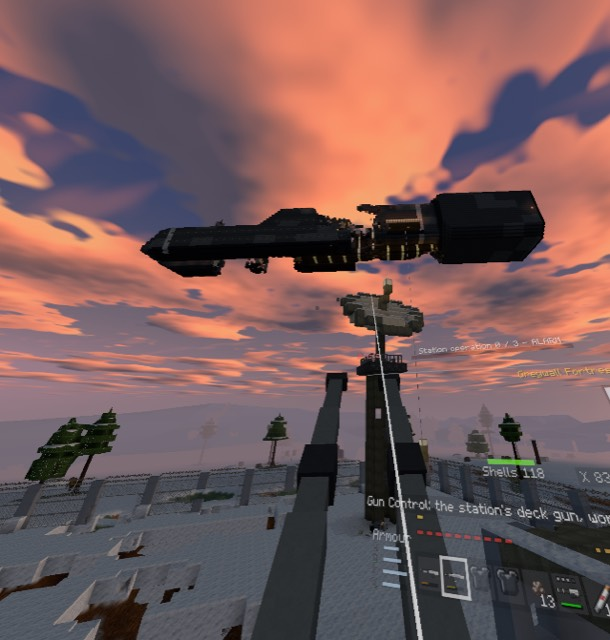

## 12:53:09 - Guess the physics aren't quite in place for that yet, are they?

- **Transcript:** Guess the physics aren't quite in place for that yet, are they?
- **Status:** open
- **Build:** 0.129 (fc006bd3, M1-M4 (device-tested; ship riding, chests, comfort options, weapon wheel))
- **World:** New World (23) (seed 2117423538372845574)
- **Dimension:** Surface
- **Biome:** Snowy Plains
- **Position:** 8332.3 92.4 -2646.9
- **Facing:** north (yaw 22, pitch 35)
- **Held:** empty hand
- **Mount:** on foot
- **Looking at:** nothing
- **Mode:** Survival, health 20/20
- **Time:** day 2 06:33, clear
- **Fps:** 71
- **Levels:** mic -33 dBFS, game sound -15 dBFS
- **Length:** 4.8 s (voice 2.4 s)
- **Just before:** -30s message: The Capital now counts you wary of you.; -27s message: Ithenhold has gone to war with Ostamoor; -18s message: Reinforcements coming down the stairwell; -15s holding empty hand; -15s message: Manning the deck gun; -13s message: Gun Control: the station's deck gun, worked from here
- **Repro (Mac):** `./snap.sh note --seed 2117423538372845574 --x 8332.3 --z -2646.9 --yaw -22 --pitch 35 --time 0.023`
- **Audio (this Mac):** /Users/darthvadar/Documents/Blocksmith/QuestVoiceNotes/raw/vn-20261113-125309-577.aac

## 12:54:25 - The gun doesn't face, doesn't point where it's shooting

- **Transcript:** The gun doesn't face, doesn't point where it's shooting
- **Status:** open
- **Build:** 0.129 (fc006bd3, M1-M4 (device-tested; ship riding, chests, comfort options, weapon wheel))
- **World:** New World (23) (seed 2117423538372845574)
- **Dimension:** Surface
- **Biome:** Snowy Plains
- **Position:** 8318.5 69.0 -2650.6
- **Facing:** north-west (yaw 293, pitch 22)
- **Held:** Brecher Shotgun x1
- **Mount:** on foot
- **Looking at:** Light Panel at 8313 72 -2653
- **Mode:** Survival, health 14/20
- **Time:** day 2 08:04, clear
- **Fps:** 61
- **Levels:** mic -24 dBFS, game sound -15 dBFS
- **Length:** 4.0 s (voice 1.9 s)
- **Just before:** -29s into the pack: Regular Armour Set; -23s message: Your pack is full: the Regular Armour Set stays on the ground; -4s took 2 damage (health 18/20); -2s took 4 damage (health 14/20)
- **Repro (Mac):** `./snap.sh note --seed 2117423538372845574 --x 8318.5 --z -2650.6 --yaw 67 --pitch 22 --time 0.087`
- **Audio (this Mac):** /Users/darthvadar/Documents/Blocksmith/QuestVoiceNotes/raw/vn-20261113-125425-818.aac

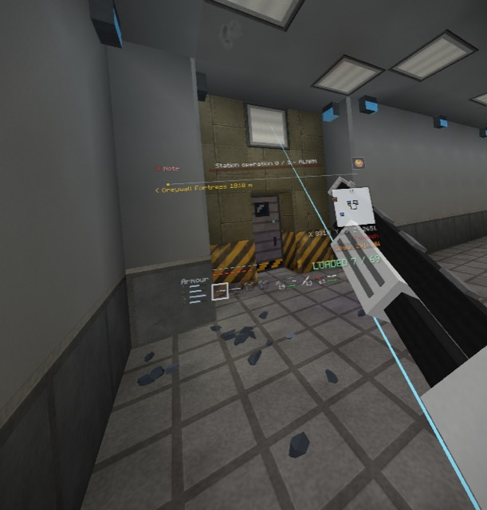

## 12:54:34 - Oh, what the? Oh, shit

- **Transcript:** Oh, what the? Oh, shit
- **Status:** open
- **Build:** 0.129 (fc006bd3, M1-M4 (device-tested; ship riding, chests, comfort options, weapon wheel))
- **World:** New World (23) (seed 2117423538372845574)
- **Dimension:** Surface
- **Biome:** Snowy Plains
- **Position:** 8316.8 69.0 -2669.7
- **Facing:** north (yaw 352, pitch -2)
- **Held:** empty hand
- **Mount:** on foot
- **Looking at:** nothing
- **Mode:** Survival, health 0/20, screen DeathMenu
- **Time:** day 2 08:13, clear
- **Fps:** 71
- **Levels:** mic -27 dBFS, game sound -33 dBFS
- **Length:** 2.8 s (voice 0.9 s)
- **Just before:** -12s took 2 damage (health 18/20); -10s took 4 damage (health 14/20); -2s took 4 damage (health 10/20); -1s died; -1s opened DeathMenu; -1s holding empty hand; -1s left the pack: Spec Ops Armour Set x6 (DeathMenu open); -1s left the pack: Fernblick Rifle (DeathMenu open); -1s left the pack: Donnerkeil Service Rifle x3 (DeathMenu open); -1s left the pack: Greywall Keycard (DeathMenu open); -1s left the pack: Field Stim x13 (DeathMenu open); -1s left the pack: Himmelsturm Launcher (DeathMenu open); -1s left the pack: Sturmbrecher Assault Shotgun (DeathMenu open); -1s left the pack: Regular Armour Set x7 (DeathMenu open); -1s left the pack: Rocket x13 (DeathMenu open); -1s left the pack: Brecher Shotgun x2 (DeathMenu open); -1s left the pack: Mahlwerk Rotary Gun (DeathMenu open)
- **Repro (Mac):** `./snap.sh note --seed 2117423538372845574 --x 8316.8 --z -2669.7 --yaw 8 --pitch -2 --time 0.093`
- **Audio (this Mac):** /Users/darthvadar/Documents/Blocksmith/QuestVoiceNotes/raw/vn-20261113-125434-237.aac

## 12:55:04 - 64, now to 150

- **Transcript:** 64, now to 150
- **Status:** open
- **Build:** 0.129 (fc006bd3, M1-M4 (device-tested; ship riding, chests, comfort options, weapon wheel))
- **World:** New World (23) (seed 2117423538372845574)
- **Dimension:** Surface
- **Biome:** Taiga
- **Position:** 5675.8 67.8 -3924.9
- **Facing:** north-west (yaw 302, pitch -18)
- **Held:** empty hand
- **Mount:** on foot
- **Looking at:** Spruce Log at 5671 67 -3929
- **Mode:** Creative, health 20/20
- **Time:** day 2 08:40, clear
- **Fps:** 71
- **Levels:** mic -34 dBFS, game sound -16 dBFS
- **Length:** 2.7 s (voice 1.1 s)
- **Just before:** -30s took 10 damage (health 0/20); -27s respawned; -27s closed DeathMenu; -27s message: Your things are 2906 blocks south-east; -27s opened PauseMenu; -26s closed PauseMenu; -25s walked into Taiga; -24s message: Entering Weniwick; -23s opened PauseMenu; -21s opened CommandMenu; -19s opened KeyboardMenu; -10s message: Ironback Crawler: 6450 ~ -15086 (11188 blocks, patrols); -10s opened CommandMenu; -8s closed CommandMenu; -7s opened PauseMenu; -7s closed PauseMenu; -6s opened InventoryMenu; -5s closed InventoryMenu; -5s opened PauseMenu; -4s message: Creative mode; -4s closed PauseMenu; -3s opened CreativeMenu; -3s closed CreativeMenu; -3s opened PauseMenu; -2s opened CommandMenu; -1s closed CommandMenu
- **Repro (Mac):** `./snap.sh note --seed 2117423538372845574 --x 5675.8 --z -3924.9 --yaw 58 --pitch -18 --time 0.111`
- **Audio (this Mac):** /Users/darthvadar/Documents/Blocksmith/QuestVoiceNotes/raw/vn-20261113-125504-178.aac

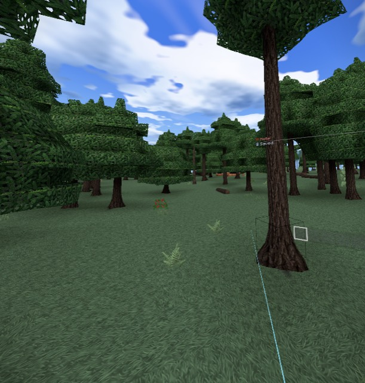

## 12:56:09 - So I should be able, should have been able to hit him with that shovel

- **Transcript:** So I should be able, should have been able to hit him with that shovel
- **Status:** open
- **Build:** 0.129 (fc006bd3, M1-M4 (device-tested; ship riding, chests, comfort options, weapon wheel))
- **World:** New World (23) (seed 2117423538372845574)
- **Dimension:** Surface
- **Biome:** Beach
- **Position:** 6475.7 84.9 -14989.8
- **Facing:** south-west (yaw 206, pitch -31)
- **Held:** empty hand
- **Mount:** on foot
- **Looking at:** nothing
- **Mode:** Creative, health 20/20
- **Time:** day 2 09:56, clear
- **Fps:** 68
- **Levels:** mic -26 dBFS, game sound -20 dBFS
- **Length:** 3.9 s (voice 2.2 s)
- **Just before:** -27s message: The Ironback Crawler's helm is locked; -24s opened PauseMenu; -24s closed PauseMenu; -23s walked into Jungle; -23s opened CreativeMenu; -23s closed CreativeMenu; -22s opened CreativeMenu; -20s into the pack: Titanium Shovel; -20s closed CreativeMenu; -18s holding Titanium Shovel; -18s message: Titanium Shovel; -17s walked into Mangrove Swamp; -15s walked into Jungle; -7s opened PauseMenu; -7s closed PauseMenu; -6s opened CreativeMenu; -1s walked into Beach; -1s closed CreativeMenu; -1s into the pack: Titanium Sword; -0s holding empty hand
- **Repro (Mac):** `./snap.sh note --seed 2117423538372845574 --x 6475.7 --z -14989.8 --yaw 154 --pitch -31 --time 0.165`
- **Audio (this Mac):** /Users/darthvadar/Documents/Blocksmith/QuestVoiceNotes/raw/vn-20261113-125609-178.aac

## 12:56:29 - Why is the helm locked?

- **Transcript:** Why is the helm locked?
- **Status:** open
- **Build:** 0.129 (fc006bd3, M1-M4 (device-tested; ship riding, chests, comfort options, weapon wheel))
- **World:** New World (23) (seed 2117423538372845574)
- **Dimension:** Surface
- **Biome:** Beach
- **Position:** 6543.4 86.2 -15002.2
- **Facing:** north-west (yaw 332, pitch 18)
- **Held:** Titanium Sword x1
- **Mount:** on foot
- **Looking at:** nothing
- **Mode:** Creative, health 20/20, screen CreativeMenu
- **Time:** day 2 10:21, clear
- **Fps:** 71
- **Levels:** mic -32 dBFS, game sound -13 dBFS
- **Length:** 2.6 s (voice 0.8 s)
- **Just before:** -28s opened PauseMenu; -27s closed PauseMenu; -27s opened CreativeMenu; -22s walked into Beach; -22s closed CreativeMenu; -21s into the pack: Titanium Sword; -21s holding empty hand; -21s holding Titanium Sword; -21s message: Titanium Sword; -21s holding empty hand; -20s holding Titanium Sword; -18s message: The Ironback Crawler's helm is locked; -2s opened PauseMenu; -1s closed PauseMenu; -1s opened CreativeMenu
- **Repro (Mac):** `./snap.sh note --seed 2117423538372845574 --x 6543.4 --z -15002.2 --yaw 28 --pitch 18 --time 0.181`
- **Audio (this Mac):** /Users/darthvadar/Documents/Blocksmith/QuestVoiceNotes/raw/vn-20261113-125629-937.aac

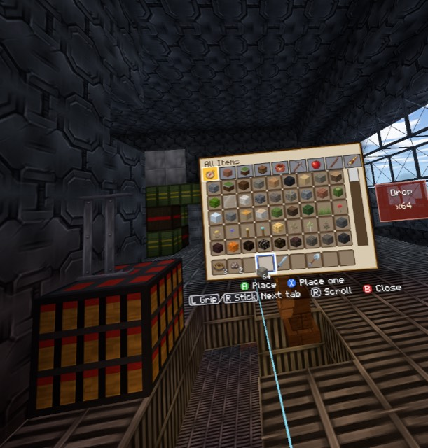

## 12:56:35 - Shouldn't be locked. I've killed everybody in here. Unless

- **Transcript:** Shouldn't be locked. I've killed everybody in here. Unless
- **Status:** open
- **Build:** 0.129 (fc006bd3, M1-M4 (device-tested; ship riding, chests, comfort options, weapon wheel))
- **World:** New World (23) (seed 2117423538372845574)
- **Dimension:** Surface
- **Biome:** Beach
- **Position:** 6556.2 86.1 -15020.3
- **Facing:** east (yaw 81, pitch -24)
- **Held:** empty hand
- **Mount:** on foot
- **Looking at:** nothing
- **Mode:** Creative, health 20/20
- **Time:** day 2 10:28, clear
- **Fps:** 72
- **Levels:** mic -46 dBFS, game sound -19 dBFS
- **Length:** 5.1 s (voice 2.0 s)
- **Just before:** -28s walked into Beach; -27s closed CreativeMenu; -27s into the pack: Titanium Sword; -27s holding empty hand; -26s holding Titanium Sword; -26s message: Titanium Sword; -26s holding empty hand; -26s holding Titanium Sword; -24s message: The Ironback Crawler's helm is locked; -7s opened PauseMenu; -7s closed PauseMenu; -7s opened CreativeMenu; -5s closed CreativeMenu; -5s holding Cobblestone; -5s message: Cobblestone; -3s holding Titanium Sword; -3s message: Titanium Sword; -3s holding empty hand; -2s message: The Ironback Crawler's helm is locked
- **Repro (Mac):** `./snap.sh note --seed 2117423538372845574 --x 6556.2 --z -15020.3 --yaw -81 --pitch -24 --time 0.186`
- **Audio (this Mac):** /Users/darthvadar/Documents/Blocksmith/QuestVoiceNotes/raw/vn-20261113-125635-698.aac

## 12:56:56 - All good now?

- **Transcript:** All good now?
- **Status:** open
- **Build:** 0.129 (fc006bd3, M1-M4 (device-tested; ship riding, chests, comfort options, weapon wheel))
- **World:** New World (23) (seed 2117423538372845574)
- **Dimension:** Surface
- **Biome:** Jungle
- **Position:** 6585.6 88.7 -15063.1
- **Facing:** north (yaw 6, pitch -7)
- **Held:** Titanium Sword x1
- **Mount:** on foot
- **Looking at:** nothing
- **Mode:** Creative, health 20/20
- **Time:** day 2 10:52, clear
- **Fps:** 67
- **Levels:** mic -31 dBFS, game sound -18 dBFS
- **Length:** 2.2 s (voice 0.8 s)
- **Just before:** -28s opened PauseMenu; -27s closed PauseMenu; -27s opened CreativeMenu; -26s closed CreativeMenu; -25s holding Cobblestone; -25s message: Cobblestone; -23s holding Titanium Sword; -23s message: Titanium Sword; -23s holding empty hand; -23s message: The Ironback Crawler's helm is locked; -18s holding Titanium Sword; -18s message: Titanium Sword; -2s walked into Jungle
- **Repro (Mac):** `./snap.sh note --seed 2117423538372845574 --x 6585.6 --z -15063.1 --yaw -6 --pitch -7 --time 0.203`
- **Audio (this Mac):** /Users/darthvadar/Documents/Blocksmith/QuestVoiceNotes/raw/vn-20261113-125656-118.aac

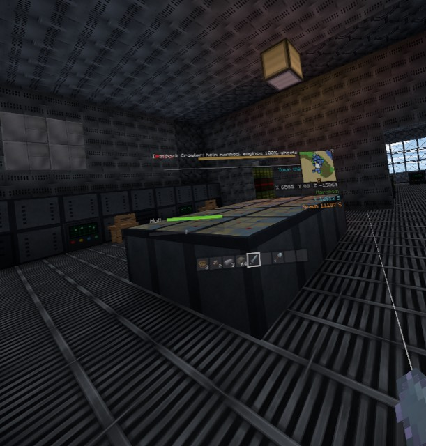

## 12:56:59 - Helm's still locked. Why is the helm locked?

- **Transcript:** Helm's still locked. Why is the helm locked?
- **Status:** open
- **Build:** 0.129 (fc006bd3, M1-M4 (device-tested; ship riding, chests, comfort options, weapon wheel))
- **World:** New World (23) (seed 2117423538372845574)
- **Dimension:** Surface
- **Biome:** Jungle
- **Position:** 6589.0 90.0 -15093.6
- **Facing:** north-west (yaw 317, pitch -40)
- **Held:** Titanium Sword x1
- **Mount:** on foot
- **Looking at:** nothing
- **Mode:** Creative, health 20/20
- **Time:** day 2 10:57, clear
- **Fps:** 58
- **Levels:** mic -24 dBFS, game sound -21 dBFS
- **Length:** 3.5 s (voice 1.5 s)
- **Just before:** -30s closed CreativeMenu; -29s holding Cobblestone; -29s message: Cobblestone; -27s holding Titanium Sword; -27s message: Titanium Sword; -27s holding empty hand; -27s message: The Ironback Crawler's helm is locked; -21s holding Titanium Sword; -21s message: Titanium Sword; -6s walked into Jungle; -2s message: The Ironback Crawler's helm is locked
- **Repro (Mac):** `./snap.sh note --seed 2117423538372845574 --x 6589.0 --z -15093.6 --yaw 43 --pitch -40 --time 0.206`
- **Audio (this Mac):** /Users/darthvadar/Documents/Blocksmith/QuestVoiceNotes/raw/vn-20261113-125659-837.aac

## 12:57:11 - Okay. They're not holding it right now, though

- **Transcript:** Okay. They're not holding it right now, though
- **Status:** open
- **Build:** 0.129 (fc006bd3, M1-M4 (device-tested; ship riding, chests, comfort options, weapon wheel))
- **World:** New World (23) (seed 2117423538372845574)
- **Dimension:** Surface
- **Biome:** Beach
- **Position:** 6613.2 80.5 -15129.1
- **Facing:** north-west (yaw 304, pitch -42)
- **Held:** Titanium Sword x1
- **Mount:** on foot
- **Looking at:** nothing
- **Mode:** Creative, health 20/20
- **Time:** day 2 11:11, clear
- **Fps:** 72
- **Levels:** mic -31 dBFS, game sound -17 dBFS
- **Length:** 3.4 s (voice 1.9 s)
- **Just before:** -17s walked into Jungle; -13s message: The Ironback Crawler's helm is locked; -7s walked into Mangrove Swamp; -5s walked into Beach; -3s message: Gun Control: the Ironback Crawler's crew hold this gun
- **Repro (Mac):** `./snap.sh note --seed 2117423538372845574 --x 6613.2 --z -15129.1 --yaw 56 --pitch -42 --time 0.216`
- **Audio (this Mac):** /Users/darthvadar/Documents/Blocksmith/QuestVoiceNotes/raw/vn-20261113-125711-438.aac

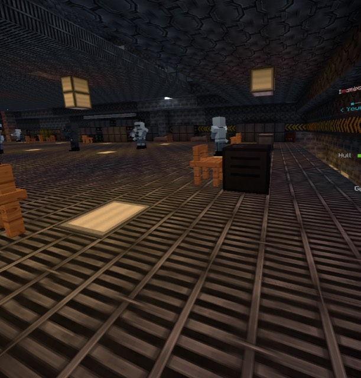

## 12:57:31 - Class dismissed

- **Transcript:** Class dismissed
- **Status:** open
- **Build:** 0.129 (fc006bd3, M1-M4 (device-tested; ship riding, chests, comfort options, weapon wheel))
- **World:** New World (23) (seed 2117423538372845574)
- **Dimension:** Surface
- **Biome:** Beach
- **Position:** 6624.7 80.6 -15098.9
- **Facing:** west (yaw 289, pitch -25)
- **Held:** Sturmbrecher Assault Shotgun x1
- **Mount:** on foot
- **Looking at:** nothing
- **Mode:** Creative, health 20/20
- **Time:** day 2 11:34, clear
- **Fps:** 72
- **Levels:** mic -28 dBFS, game sound -23 dBFS
- **Length:** 2.4 s (voice 0.9 s)
- **Just before:** -27s walked into Mangrove Swamp; -25s walked into Beach; -23s message: Gun Control: the Ironback Crawler's crew hold this gun; -17s opened PauseMenu; -17s closed PauseMenu; -17s opened CreativeMenu; -10s into the pack: Sturmbrecher Assault Shotgun; -7s into the pack: Shotgun Shell Box; -7s closed CreativeMenu; -7s holding Shotgun Shell Box; -7s message: Shotgun Shell Box; -7s holding Titanium Shovel; -7s message: Titanium Shovel; -6s holding Sturmbrecher Assault Shotgun; -6s message: Sturmbrecher Assault Shotgun; -6s message: Loaded: 20 / 20; -4s into the pack: Slatefall Carbine; -3s message: Greywall Command now counts you hunted.; -0s message: Loaded: 20 / 20
- **Repro (Mac):** `./snap.sh note --seed 2117423538372845574 --x 6624.7 --z -15098.9 --yaw 71 --pitch -25 --time 0.232`
- **Audio (this Mac):** /Users/darthvadar/Documents/Blocksmith/QuestVoiceNotes/raw/vn-20261113-125731-618.aac

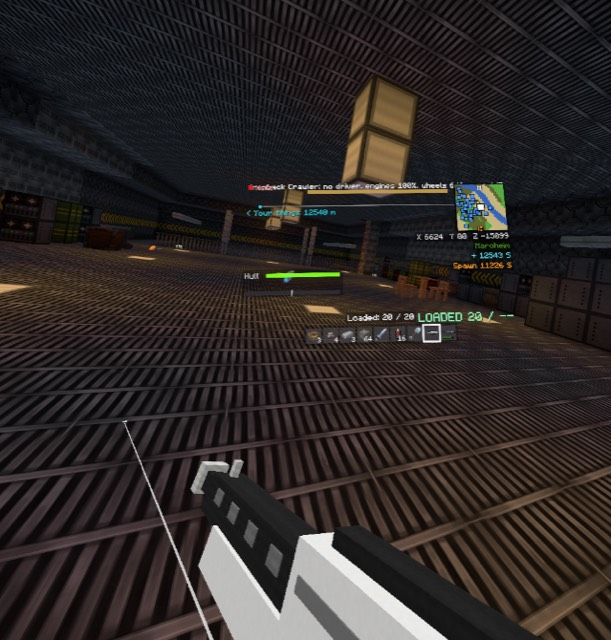

## 12:57:38 - Let me on the gun

- **Transcript:** Let me on the gun
- **Status:** open
- **Build:** 0.129 (fc006bd3, M1-M4 (device-tested; ship riding, chests, comfort options, weapon wheel))
- **World:** New World (23) (seed 2117423538372845574)
- **Dimension:** Surface
- **Biome:** Beach
- **Position:** 6636.6 81.6 -15081.5
- **Facing:** south (yaw 172, pitch -58)
- **Held:** Heavy Rounds x3
- **Mount:** on foot
- **Looking at:** nothing
- **Mode:** Creative, health 20/20
- **Time:** day 2 11:42, clear
- **Fps:** 72
- **Levels:** mic -31 dBFS, game sound -13 dBFS
- **Length:** 2.7 s (voice 1.2 s)
- **Just before:** -30s message: Gun Control: the Ironback Crawler's crew hold this gun; -24s opened PauseMenu; -23s closed PauseMenu; -23s opened CreativeMenu; -16s into the pack: Sturmbrecher Assault Shotgun; -14s into the pack: Shotgun Shell Box; -14s closed CreativeMenu; -13s holding Shotgun Shell Box; -13s message: Shotgun Shell Box; -13s holding Titanium Shovel; -13s message: Titanium Shovel; -13s holding Sturmbrecher Assault Shotgun; -13s message: Sturmbrecher Assault Shotgun; -12s message: Loaded: 20 / 20; -10s into the pack: Slatefall Carbine; -9s message: Greywall Command now counts you hunted.; -7s message: Loaded: 20 / 20; -1s holding Slatefall Carbine; -1s message: Slatefall Carbine; -0s holding Heavy Rounds; -0s message: Heavy Rounds
- **Repro (Mac):** `./snap.sh note --seed 2117423538372845574 --x 6636.6 --z -15081.5 --yaw -172 --pitch -58 --time 0.238`
- **Audio (this Mac):** /Users/darthvadar/Documents/Blocksmith/QuestVoiceNotes/raw/vn-20261113-125738-038.aac

## 12:57:45 - Oh, great. I can't-- It's not third person. I can't see where I'm shoo

- **Transcript:** Oh, great. I can't-- It's not third person. I can't see where I'm shooting
- **Status:** open
- **Build:** 0.129 (fc006bd3, M1-M4 (device-tested; ship riding, chests, comfort options, weapon wheel))
- **World:** New World (23) (seed 2117423538372845574)
- **Dimension:** Surface
- **Biome:** Beach
- **Position:** 6636.8 81.8 -15080.6
- **Facing:** south (yaw 174, pitch -51)
- **Held:** Iron Ingot x3
- **Mount:** on foot
- **Looking at:** nothing
- **Mode:** Creative, health 20/20
- **Time:** day 2 11:50, clear
- **Fps:** 72
- **Levels:** mic -22 dBFS, game sound -14 dBFS
- **Length:** 6.3 s (voice 2.9 s)
- **Just before:** -24s into the pack: Sturmbrecher Assault Shotgun; -21s into the pack: Shotgun Shell Box; -21s closed CreativeMenu; -21s holding Shotgun Shell Box; -21s message: Shotgun Shell Box; -20s holding Titanium Shovel; -20s message: Titanium Shovel; -20s holding Sturmbrecher Assault Shotgun; -20s message: Sturmbrecher Assault Shotgun; -20s message: Loaded: 20 / 20; -18s into the pack: Slatefall Carbine; -16s message: Greywall Command now counts you hunted.; -14s message: Loaded: 20 / 20; -8s holding Slatefall Carbine; -8s message: Slatefall Carbine; -7s holding Heavy Rounds; -7s message: Heavy Rounds; -7s holding Iron Nugget; -7s message: Iron Nugget; -6s holding Iron Ingot; -6s message: Iron Ingot; -5s message: Gun Control: the Ironback Crawler's gun, worked from here
- **Position at the end:** 6635.6 81.1 -15085.7
- **Repro (Mac):** `./snap.sh note --seed 2117423538372845574 --x 6636.8 --z -15080.6 --yaw -174 --pitch -51 --time 0.244`
- **Audio (this Mac):** /Users/darthvadar/Documents/Blocksmith/QuestVoiceNotes/raw/vn-20261113-125745-278.aac

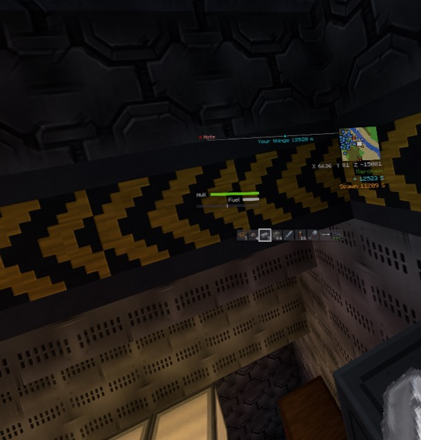

## 12:57:55 - Oh, there we go. Finally drive this thing

- **Transcript:** Oh, there we go. Finally drive this thing
- **Status:** open
- **Build:** 0.129 (fc006bd3, M1-M4 (device-tested; ship riding, chests, comfort options, weapon wheel))
- **World:** New World (23) (seed 2117423538372845574)
- **Dimension:** Surface
- **Biome:** Beach
- **Position:** 6631.2 86.3 -15097.2
- **Facing:** north-west (yaw 334, pitch -6)
- **Held:** empty hand
- **Mount:** piloting Ironback Crawler
- **Looking at:** nothing
- **Mode:** Creative, health 20/20
- **Time:** day 2 12:02, clear
- **Fps:** 65
- **Levels:** mic -30 dBFS, game sound -21 dBFS
- **Length:** 3.1 s (voice 1.4 s)
- **Just before:** -30s message: Loaded: 20 / 20; -27s into the pack: Slatefall Carbine; -26s message: Greywall Command now counts you hunted.; -24s message: Loaded: 20 / 20; -18s holding Slatefall Carbine; -18s message: Slatefall Carbine; -17s holding Heavy Rounds; -17s message: Heavy Rounds; -17s holding Iron Nugget; -17s message: Iron Nugget; -16s holding Iron Ingot; -16s message: Iron Ingot; -15s message: Gun Control: the Ironback Crawler's gun, worked from here; -4s message: Flying; -2s message: Walking; -1s piloting Ironback Crawler; -1s holding empty hand; -0s message: Hull patched: 10 blocks (hull 100%)
- **Repro (Mac):** `./snap.sh note --seed 2117423538372845574 --x 6631.2 --z -15097.2 --yaw 26 --pitch -6 --time 0.252`
- **Audio (this Mac):** /Users/darthvadar/Documents/Blocksmith/QuestVoiceNotes/raw/vn-20261113-125755-218.aac

## 12:58:00 - See how well [clears throat]

- **Transcript:** See how well [clears throat]
- **Status:** open
- **Build:** 0.129 (fc006bd3, M1-M4 (device-tested; ship riding, chests, comfort options, weapon wheel))
- **World:** New World (23) (seed 2117423538372845574)
- **Dimension:** Surface
- **Biome:** Beach
- **Position:** 6688.1 85.0 -15075.1
- **Facing:** north (yaw 350, pitch 5)
- **Held:** empty hand
- **Mount:** piloting Ironback Crawler
- **Looking at:** nothing
- **Mode:** Creative, health 20/20
- **Time:** day 2 12:08, clear
- **Fps:** 71
- **Levels:** mic -26 dBFS, game sound -19 dBFS
- **Length:** 3.6 s (voice 1.6 s)
- **Just before:** -29s message: Loaded: 20 / 20; -23s holding Slatefall Carbine; -23s message: Slatefall Carbine; -22s holding Heavy Rounds; -22s message: Heavy Rounds; -22s holding Iron Nugget; -22s message: Iron Nugget; -21s holding Iron Ingot; -21s message: Iron Ingot; -20s message: Gun Control: the Ironback Crawler's gun, worked from here; -9s message: Flying; -7s message: Walking; -6s piloting Ironback Crawler; -6s holding empty hand; -5s message: Hull patched: 10 blocks (hull 100%); -3s message: Steering Ironback Crawler; -1s walked into Warm Ocean; -1s message: Greywall Fortress marked on the map
- **Repro (Mac):** `./snap.sh note --seed 2117423538372845574 --x 6688.1 --z -15075.1 --yaw 10 --pitch 5 --time 0.256`
- **Audio (this Mac):** /Users/darthvadar/Documents/Blocksmith/QuestVoiceNotes/raw/vn-20261113-125800-117.aac

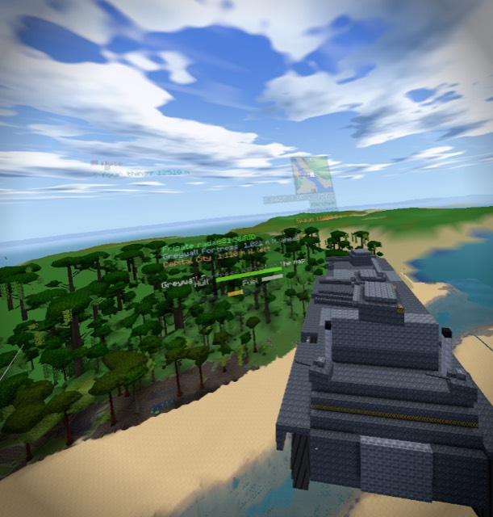

## 12:58:04 - processes the environment around me now

- **Transcript:** processes the environment around me now
- **Status:** open
- **Build:** 0.129 (fc006bd3, M1-M4 (device-tested; ship riding, chests, comfort options, weapon wheel))
- **World:** New World (23) (seed 2117423538372845574)
- **Dimension:** Surface
- **Biome:** Jungle
- **Position:** 6752.3 93.3 -15097.7
- **Facing:** north-west (yaw 336, pitch -31)
- **Held:** empty hand
- **Mount:** piloting Ironback Crawler
- **Looking at:** nothing
- **Mode:** Creative, health 20/20
- **Time:** day 2 12:13, clear
- **Fps:** 71
- **Levels:** mic -31 dBFS, game sound -14 dBFS
- **Length:** 3.4 s (voice 2.0 s)
- **Just before:** -27s holding Slatefall Carbine; -27s message: Slatefall Carbine; -26s holding Heavy Rounds; -26s message: Heavy Rounds; -26s holding Iron Nugget; -26s message: Iron Nugget; -25s holding Iron Ingot; -25s message: Iron Ingot; -24s message: Gun Control: the Ironback Crawler's gun, worked from here; -13s message: Flying; -11s message: Walking; -10s piloting Ironback Crawler; -10s holding empty hand; -10s message: Hull patched: 10 blocks (hull 100%); -7s message: Steering Ironback Crawler; -6s walked into Warm Ocean; -5s message: Greywall Fortress marked on the map; -4s walked into Beach; -3s message: Capital city marked on the map; -2s walked into Jungle
- **Repro (Mac):** `./snap.sh note --seed 2117423538372845574 --x 6752.3 --z -15097.7 --yaw 24 --pitch -31 --time 0.260`
- **Audio (this Mac):** /Users/darthvadar/Documents/Blocksmith/QuestVoiceNotes/raw/vn-20261113-125804-358.aac

## 12:58:09 - Still not that well

- **Transcript:** Still not that well
- **Status:** open
- **Build:** 0.129 (fc006bd3, M1-M4 (device-tested; ship riding, chests, comfort options, weapon wheel))
- **World:** New World (23) (seed 2117423538372845574)
- **Dimension:** Surface
- **Biome:** Jungle
- **Position:** 6850.6 91.3 -15164.0
- **Facing:** west (yaw 274, pitch -14)
- **Held:** empty hand
- **Mount:** piloting Ironback Crawler
- **Looking at:** nothing
- **Mode:** Creative, health 20/20
- **Time:** day 2 12:19, clear
- **Fps:** 72
- **Levels:** mic -32 dBFS, game sound -19 dBFS
- **Length:** 2.6 s (voice 1.1 s)
- **Just before:** -29s message: Gun Control: the Ironback Crawler's gun, worked from here; -18s message: Flying; -16s message: Walking; -15s piloting Ironback Crawler; -15s holding empty hand; -15s message: Hull patched: 10 blocks (hull 100%); -13s message: Steering Ironback Crawler; -11s walked into Warm Ocean; -11s message: Greywall Fortress marked on the map; -9s walked into Beach; -8s message: Capital city marked on the map; -7s walked into Jungle; -1s opened PauseMenu; -1s closed PauseMenu
- **Repro (Mac):** `./snap.sh note --seed 2117423538372845574 --x 6850.6 --z -15164.0 --yaw 86 --pitch -14 --time 0.263`
- **Audio (this Mac):** /Users/darthvadar/Documents/Blocksmith/QuestVoiceNotes/raw/vn-20261113-125809-498.aac

## 12:58:13 - Still has a lot of trouble

- **Transcript:** Still has a lot of trouble
- **Status:** open
- **Build:** 0.129 (fc006bd3, M1-M4 (device-tested; ship riding, chests, comfort options, weapon wheel))
- **World:** New World (23) (seed 2117423538372845574)
- **Dimension:** Surface
- **Biome:** Mangrove Swamp
- **Position:** 6902.3 88.4 -15202.7
- **Facing:** west (yaw 264, pitch 6)
- **Held:** empty hand
- **Mount:** piloting Ironback Crawler
- **Looking at:** nothing
- **Mode:** Creative, health 20/20
- **Time:** day 2 12:23, clear
- **Fps:** 72
- **Levels:** mic -31 dBFS, game sound -17 dBFS
- **Length:** 2.4 s (voice 0.9 s)
- **Just before:** -22s message: Flying; -20s message: Walking; -19s piloting Ironback Crawler; -19s holding empty hand; -19s message: Hull patched: 10 blocks (hull 100%); -16s message: Steering Ironback Crawler; -15s walked into Warm Ocean; -14s message: Greywall Fortress marked on the map; -13s walked into Beach; -12s message: Capital city marked on the map; -11s walked into Jungle; -5s opened PauseMenu; -4s closed PauseMenu; -0s walked into Mangrove Swamp
- **Repro (Mac):** `./snap.sh note --seed 2117423538372845574 --x 6902.3 --z -15202.7 --yaw 96 --pitch 6 --time 0.267`
- **Audio (this Mac):** /Users/darthvadar/Documents/Blocksmith/QuestVoiceNotes/raw/vn-20261113-125813-298.aac

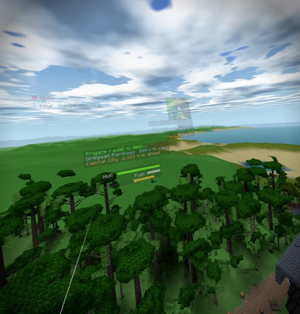

## 12:58:27 - I need to find a way to make it so it can render things

- **Transcript:** I need to find a way to make it so it can render things
- **Status:** open
- **Build:** 0.129 (fc006bd3, M1-M4 (device-tested; ship riding, chests, comfort options, weapon wheel))
- **World:** New World (23) (seed 2117423538372845574)
- **Dimension:** Surface
- **Biome:** Beach
- **Position:** 6780.3 86.3 -15436.6
- **Facing:** south-west (yaw 222, pitch 1)
- **Held:** empty hand
- **Mount:** piloting Ironback Crawler
- **Looking at:** nothing
- **Mode:** Creative, health 20/20
- **Time:** day 2 12:41, clear
- **Fps:** 71
- **Levels:** mic -29 dBFS, game sound -25 dBFS
- **Length:** 4.0 s (voice 2.1 s)
- **Just before:** -29s walked into Warm Ocean; -29s message: Greywall Fortress marked on the map; -27s walked into Beach; -27s message: Capital city marked on the map; -25s walked into Jungle; -20s opened PauseMenu; -19s closed PauseMenu; -15s walked into Mangrove Swamp; -13s walked into Jungle; -11s walked into Mangrove Swamp; -7s walked into Beach; -5s message: Greywall Outpost marked on the map; -3s walked into Jungle; -1s walked into Beach
- **Repro (Mac):** `./snap.sh note --seed 2117423538372845574 --x 6780.3 --z -15436.6 --yaw 138 --pitch 1 --time 0.279`
- **Audio (this Mac):** /Users/darthvadar/Documents/Blocksmith/QuestVoiceNotes/raw/vn-20261113-125827-978.aac

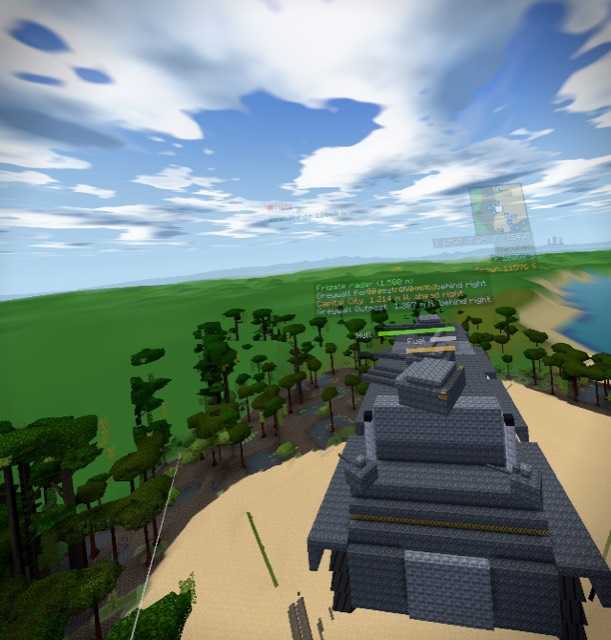

## 12:58:31 - Even though I'm in this damn thing. Same thing with the frigate. Like,

- **Transcript:** Even though I'm in this damn thing. Same thing with the frigate. Like, the frigate, we need it to render, like, 24 or something somehow
- **Status:** open
- **Build:** 0.129 (fc006bd3, M1-M4 (device-tested; ship riding, chests, comfort options, weapon wheel))
- **World:** New World (23) (seed 2117423538372845574)
- **Dimension:** Surface
- **Biome:** Jungle
- **Position:** 6717.4 90.0 -15526.7
- **Facing:** west (yaw 274, pitch 12)
- **Held:** empty hand
- **Mount:** piloting Ironback Crawler
- **Looking at:** nothing
- **Mode:** Creative, health 20/20
- **Time:** day 2 12:46, clear
- **Fps:** 71
- **Levels:** mic -32 dBFS, game sound -14 dBFS
- **Length:** 9.4 s (voice 4.5 s)
- **Just before:** -29s walked into Jungle; -24s opened PauseMenu; -23s closed PauseMenu; -19s walked into Mangrove Swamp; -17s walked into Jungle; -15s walked into Mangrove Swamp; -11s walked into Beach; -9s message: Greywall Outpost marked on the map; -7s walked into Jungle; -5s walked into Beach; -3s walked into Mangrove Swamp; -1s walked into Jungle
- **Position at the end:** 6676.3 92.6 -15652.3
- **Repro (Mac):** `./snap.sh note --seed 2117423538372845574 --x 6717.4 --z -15526.7 --yaw 86 --pitch 12 --time 0.282`
- **Audio (this Mac):** /Users/darthvadar/Documents/Blocksmith/QuestVoiceNotes/raw/vn-20261113-125831-978.aac

## 12:58:41 - I don't know how, but somehow

- **Transcript:** I don't know how, but somehow
- **Status:** open
- **Build:** 0.129 (fc006bd3, M1-M4 (device-tested; ship riding, chests, comfort options, weapon wheel))
- **World:** New World (23) (seed 2117423538372845574)
- **Dimension:** Surface
- **Biome:** Jungle
- **Position:** 6671.0 88.5 -15764.4
- **Facing:** south (yaw 196, pitch -12)
- **Held:** empty hand
- **Mount:** piloting Ironback Crawler
- **Looking at:** nothing
- **Mode:** Creative, health 20/20
- **Time:** day 2 12:57, clear
- **Fps:** 72
- **Levels:** mic -25 dBFS, game sound -33 dBFS
- **Length:** 2.3 s (voice 1.0 s)
- **Just before:** -28s walked into Mangrove Swamp; -26s walked into Jungle; -24s walked into Mangrove Swamp; -20s walked into Beach; -18s message: Greywall Outpost marked on the map; -16s walked into Jungle; -14s walked into Beach; -12s walked into Mangrove Swamp; -10s walked into Jungle
- **Repro (Mac):** `./snap.sh note --seed 2117423538372845574 --x 6671.0 --z -15764.4 --yaw 164 --pitch -12 --time 0.290`
- **Audio (this Mac):** /Users/darthvadar/Documents/Blocksmith/QuestVoiceNotes/raw/vn-20261113-125841-098.aac

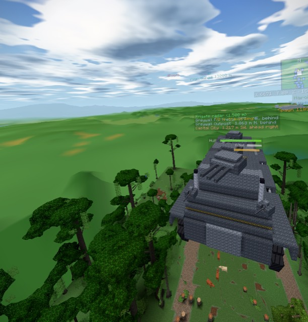

## 12:59:00 - Holy shit. [laughs] What the fuck?

- **Transcript:** Holy shit. [laughs] What the fuck?
- **Status:** open
- **Build:** 0.129 (fc006bd3, M1-M4 (device-tested; ship riding, chests, comfort options, weapon wheel))
- **World:** New World (23) (seed 2117423538372845574)
- **Dimension:** Surface
- **Biome:** Taiga
- **Position:** 5688.5 67.0 -3911.5
- **Facing:** east (yaw 71, pitch -13)
- **Held:** empty hand
- **Mount:** on foot
- **Looking at:** nothing
- **Mode:** Survival, health 20/20, screen PauseMenu
- **Time:** day 2 13:14, clear
- **Fps:** 71
- **Levels:** mic -35 dBFS, game sound -29 dBFS
- **Length:** 6.0 s (voice 1.5 s)
- **Just before:** -29s walked into Jungle; -18s opened PauseMenu; -15s message: Survival mode; -15s closed PauseMenu; -11s walked into Sparse Jungle; -9s walked into Jungle; -5s walked into Sparse Jungle; -3s stopped piloting Ironback Crawler; -3s holding Iron Ingot; -2s died; -2s opened DeathMenu; -2s holding empty hand; -2s respawned; -2s opened PauseMenu; -2s message: Your things are 12224 blocks north; -1s left the pack: Titanium Sword (PauseMenu open); -1s left the pack: Shotgun Shell Box x16 (PauseMenu open); -1s left the pack: Titanium Shovel (PauseMenu open); -1s left the pack: Sturmbrecher Assault Shotgun (PauseMenu open); -1s left the pack: Slatefall Carbine (PauseMenu open); -1s walked into Taiga; -1s took 22 damage (health 20/20)
- **While talking:** -5s message: Target gone from the list. Back to the story's objective; -3s closed PauseMenu; -2s message: Entering Weniwick
- **Position at the end:** 5700.8 69.3 -3898.6
- **Repro (Mac):** `./snap.sh note --seed 2117423538372845574 --x 5688.5 --z -3911.5 --yaw -71 --pitch -13 --time 0.302`
- **Audio (this Mac):** /Users/darthvadar/Documents/Blocksmith/QuestVoiceNotes/raw/vn-20261113-125900-079.aac

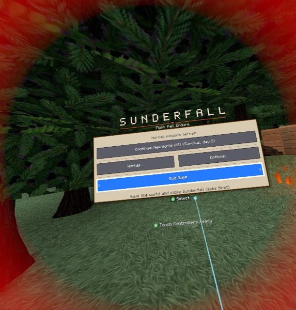

## 12:59:05 - Oh, no, that was great. Just dead

- **Transcript:** Oh, no, that was great. Just dead
- **Status:** open
- **Build:** 0.129 (fc006bd3, M1-M4 (device-tested; ship riding, chests, comfort options, weapon wheel))
- **World:** New World (23) (seed 2117423538372845574)
- **Dimension:** Surface
- **Biome:** Taiga
- **Position:** 5701.1 68.0 -3898.3
- **Facing:** east (yaw 98, pitch -57)
- **Held:** empty hand
- **Mount:** on foot
- **Looking at:** Large Fern at 5701 69 -3899
- **Mode:** Survival, health 20/20, screen PauseMenu
- **Time:** day 2 13:18, clear
- **Fps:** 71
- **Levels:** mic -26 dBFS, game sound -25 dBFS
- **Length:** 4.1 s (voice 2.2 s)
- **Just before:** -23s opened PauseMenu; -21s message: Survival mode; -21s closed PauseMenu; -17s walked into Sparse Jungle; -15s walked into Jungle; -11s walked into Sparse Jungle; -8s stopped piloting Ironback Crawler; -8s holding Iron Ingot; -7s died; -7s opened DeathMenu; -7s holding empty hand; -7s respawned; -7s opened PauseMenu; -7s message: Your things are 12224 blocks north; -7s left the pack: Titanium Sword (PauseMenu open); -7s left the pack: Shotgun Shell Box x16 (PauseMenu open); -7s left the pack: Titanium Shovel (PauseMenu open); -7s left the pack: Sturmbrecher Assault Shotgun (PauseMenu open); -7s left the pack: Slatefall Carbine (PauseMenu open); -7s walked into Taiga; -6s took 22 damage (health 20/20); -5s message: Target gone from the list. Back to the story's objective; -4s closed PauseMenu; -2s message: Entering Weniwick; -0s opened PauseMenu
- **Repro (Mac):** `./snap.sh note --seed 2117423538372845574 --x 5701.1 --z -3898.3 --yaw -98 --pitch -57 --time 0.305`
- **Audio (this Mac):** /Users/darthvadar/Documents/Blocksmith/QuestVoiceNotes/raw/vn-20261113-125905-698.aac

## 12:59:09 - Just snipe me. Oh, frig

- **Transcript:** Just snipe me. Oh, frig
- **Status:** open
- **Build:** 0.129 (fc006bd3, M1-M4 (device-tested; ship riding, chests, comfort options, weapon wheel))
- **World:** New World (23) (seed 2117423538372845574)
- **Dimension:** Surface
- **Biome:** Taiga
- **Position:** 5704.0 67.8 -3915.5
- **Facing:** north (yaw 358, pitch -24)
- **Held:** empty hand
- **Mount:** on foot
- **Looking at:** Grass Block at 5703 67 -3919
- **Mode:** Survival, health 20/20
- **Time:** day 2 13:22, clear
- **Fps:** 72
- **Levels:** mic -27 dBFS, game sound -20 dBFS
- **Length:** 3.4 s (voice 1.6 s)
- **Just before:** -28s opened PauseMenu; -25s message: Survival mode; -25s closed PauseMenu; -21s walked into Sparse Jungle; -19s walked into Jungle; -15s walked into Sparse Jungle; -12s stopped piloting Ironback Crawler; -12s holding Iron Ingot; -12s died; -12s opened DeathMenu; -12s holding empty hand; -11s respawned; -11s opened PauseMenu; -11s message: Your things are 12224 blocks north; -11s left the pack: Titanium Sword (PauseMenu open); -11s left the pack: Shotgun Shell Box x16 (PauseMenu open); -11s left the pack: Titanium Shovel (PauseMenu open); -11s left the pack: Sturmbrecher Assault Shotgun (PauseMenu open); -11s left the pack: Slatefall Carbine (PauseMenu open); -11s walked into Taiga; -11s took 22 damage (health 20/20); -9s message: Target gone from the list. Back to the story's objective; -8s closed PauseMenu; -6s message: Entering Weniwick; -4s opened PauseMenu; -3s closed PauseMenu
- **Repro (Mac):** `./snap.sh note --seed 2117423538372845574 --x 5704.0 --z -3915.5 --yaw 2 --pitch -24 --time 0.308`
- **Audio (this Mac):** /Users/darthvadar/Documents/Blocksmith/QuestVoiceNotes/raw/vn-20261113-125909-838.aac

## 12:59:15 - Tore that crawler to shreds

- **Transcript:** Tore that crawler to shreds
- **Status:** open
- **Build:** 0.129 (fc006bd3, M1-M4 (device-tested; ship riding, chests, comfort options, weapon wheel))
- **World:** New World (23) (seed 2117423538372845574)
- **Dimension:** Surface
- **Biome:** Taiga
- **Position:** 5722.3 67.9 -3959.2
- **Facing:** north-west (yaw 294, pitch 47)
- **Held:** empty hand
- **Mount:** on foot
- **Looking at:** nothing
- **Mode:** Survival, health 20/20
- **Time:** day 2 13:30, clear
- **Fps:** 72
- **Levels:** mic -29 dBFS, game sound -15 dBFS
- **Length:** 3.0 s (voice 1.5 s)
- **Just before:** -27s walked into Sparse Jungle; -25s walked into Jungle; -21s walked into Sparse Jungle; -18s stopped piloting Ironback Crawler; -18s holding Iron Ingot; -18s died; -18s opened DeathMenu; -18s holding empty hand; -18s respawned; -18s opened PauseMenu; -18s message: Your things are 12224 blocks north; -17s left the pack: Titanium Sword (PauseMenu open); -17s left the pack: Shotgun Shell Box x16 (PauseMenu open); -17s left the pack: Titanium Shovel (PauseMenu open); -17s left the pack: Sturmbrecher Assault Shotgun (PauseMenu open); -17s left the pack: Slatefall Carbine (PauseMenu open); -17s walked into Taiga; -17s took 22 damage (health 20/20); -15s message: Target gone from the list. Back to the story's objective; -14s closed PauseMenu; -12s message: Entering Weniwick; -10s opened PauseMenu; -10s closed PauseMenu
- **Repro (Mac):** `./snap.sh note --seed 2117423538372845574 --x 5722.3 --z -3959.2 --yaw 66 --pitch 47 --time 0.313`
- **Audio (this Mac):** /Users/darthvadar/Documents/Blocksmith/QuestVoiceNotes/raw/vn-20261113-125915-878.aac

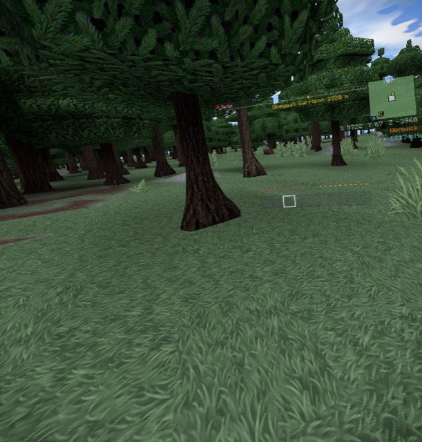

## 12:59:46 - What the hell is this bullshit?

- **Transcript:** What the hell is this bullshit?
- **Status:** open
- **Build:** 0.129 (fc006bd3, M1-M4 (device-tested; ship riding, chests, comfort options, weapon wheel))
- **World:** New World (23) (seed 2117423538372845574)
- **Dimension:** Surface
- **Biome:** Taiga
- **Position:** 5767.0 89.4 -4175.5
- **Facing:** north (yaw 1, pitch 5)
- **Held:** empty hand
- **Mount:** on foot, flying
- **Looking at:** nothing
- **Mode:** Creative, health 20/20
- **Time:** day 2 14:05, clear
- **Fps:** 71
- **Levels:** mic -37 dBFS, game sound -18 dBFS
- **Length:** 2.6 s (voice 1.1 s)
- **Just before:** -29s message: Entering Loremere; -13s took 1 damage (health 20/20); -9s opened PauseMenu; -8s message: Creative mode; -7s closed PauseMenu; -6s message: Flying; -2s message: Walking; -1s message: Flying
- **Repro (Mac):** `./snap.sh note --seed 2117423538372845574 --x 5767.0 --z -4175.5 --yaw -1 --pitch 5 --time 0.337`
- **Audio (this Mac):** /Users/darthvadar/Documents/Blocksmith/QuestVoiceNotes/raw/vn-20261113-125946-418.aac

## 12:59:53 - All right

- **Transcript:** All right
- **Status:** open
- **Build:** 0.129 (fc006bd3, M1-M4 (device-tested; ship riding, chests, comfort options, weapon wheel))
- **World:** New World (23) (seed 2117423538372845574)
- **Dimension:** Surface
- **Biome:** Taiga
- **Position:** 5746.7 89.4 -4209.6
- **Facing:** north (yaw 2, pitch -3)
- **Held:** empty hand
- **Mount:** on foot, flying
- **Looking at:** nothing
- **Mode:** Creative, health 20/20
- **Time:** day 2 14:13, clear
- **Fps:** 70
- **Levels:** mic -28 dBFS, game sound -20 dBFS
- **Length:** 2.0 s (voice 0.6 s)
- **Just before:** -20s took 1 damage (health 20/20); -16s opened PauseMenu; -15s message: Creative mode; -15s closed PauseMenu; -14s message: Flying; -9s message: Walking; -8s message: Flying
- **Repro (Mac):** `./snap.sh note --seed 2117423538372845574 --x 5746.7 --z -4209.6 --yaw -2 --pitch -3 --time 0.343`
- **Audio (this Mac):** /Users/darthvadar/Documents/Blocksmith/QuestVoiceNotes/raw/vn-20261113-125953-878.aac

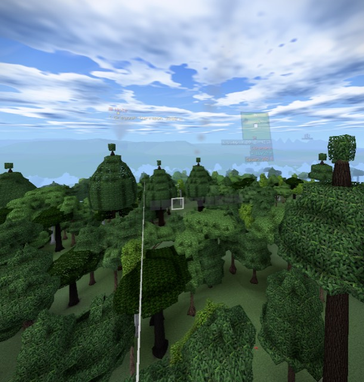

## 13:00:16 - No mountains ever get to be this high? Is that

- **Transcript:** No mountains ever get to be this high? Is that
- **Status:** open
- **Build:** 0.129 (fc006bd3, M1-M4 (device-tested; ship riding, chests, comfort options, weapon wheel))
- **World:** New World (23) (seed 2117423538372845574)
- **Dimension:** Surface
- **Biome:** Forest
- **Position:** 7932.9 541.9 -4022.5
- **Facing:** north (yaw 16, pitch -44)
- **Held:** empty hand
- **Mount:** on foot, flying
- **Looking at:** nothing
- **Mode:** Creative, health 20/20
- **Time:** day 2 14:41, clear
- **Fps:** 72
- **Levels:** mic -30 dBFS, game sound -26 dBFS
- **Length:** 3.3 s (voice 1.8 s)
- **Just before:** -21s walked into Forest; -19s walked into Plains; -14s message: Entering Goroheim; -13s walked into Meadow; -9s walked into Jungle; -5s message: Entering Fenimark; -3s walked into Sparse Jungle; -3s message: Entering Goroheim; -1s walked into Forest; -1s message: Sky isle marked on the map
- **Repro (Mac):** `./snap.sh note --seed 2117423538372845574 --x 7932.9 --z -4022.5 --yaw -16 --pitch -44 --time 0.362`
- **Audio (this Mac):** /Users/darthvadar/Documents/Blocksmith/QuestVoiceNotes/raw/vn-20261113-130016-437.aac

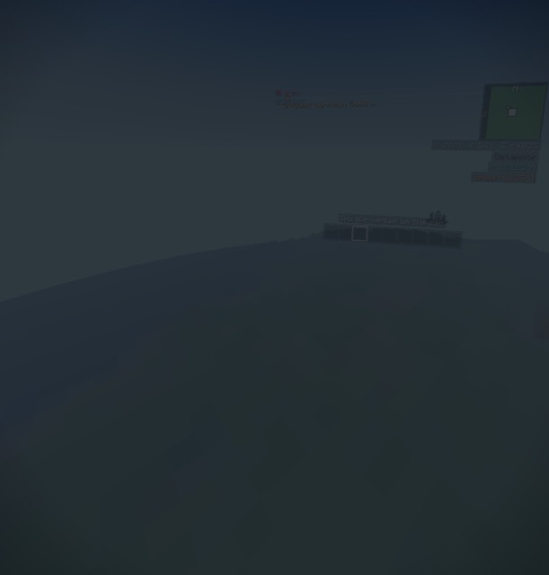

## 13:00:28 - This one's two hundred something

- **Transcript:** This one's two hundred something
- **Status:** open
- **Build:** 0.129 (fc006bd3, M1-M4 (device-tested; ship riding, chests, comfort options, weapon wheel))
- **World:** New World (23) (seed 2117423538372845574)
- **Dimension:** Surface
- **Biome:** Snowy Slopes
- **Position:** 6778.3 258.4 -5528.0
- **Facing:** north (yaw 348, pitch -50)
- **Held:** empty hand
- **Mount:** on foot, flying
- **Looking at:** nothing
- **Mode:** Creative, health 20/20
- **Time:** day 2 14:55, clear
- **Fps:** 71
- **Levels:** mic -35 dBFS, game sound -16 dBFS
- **Length:** 2.6 s (voice 1.0 s)
- **Just before:** -26s message: Entering Goroheim; -25s walked into Meadow; -21s walked into Jungle; -17s message: Entering Fenimark; -15s walked into Sparse Jungle; -15s message: Entering Goroheim; -13s walked into Forest; -13s message: Sky isle marked on the map; -11s message: Entering Ostamoor; -9s message: Entering Goroheim; -9s walked into Snowy Slopes; -8s message: Walking; -7s walked into Meadow; -5s walked into Snowy Slopes; -3s message: Flying
- **Repro (Mac):** `./snap.sh note --seed 2117423538372845574 --x 6778.3 --z -5528.0 --yaw 12 --pitch -50 --time 0.372`
- **Audio (this Mac):** /Users/darthvadar/Documents/Blocksmith/QuestVoiceNotes/raw/vn-20261113-130028-578.aac

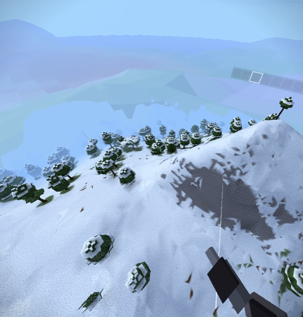

## 13:01:07 - This is what

- **Transcript:** This is what
- **Status:** open
- **Build:** 0.129 (fc006bd3, M1-M4 (device-tested; ship riding, chests, comfort options, weapon wheel))
- **World:** New World (23) (seed 2117423538372845574)
- **Dimension:** Surface
- **Biome:** Forest
- **Position:** 6553.8 240.0 -5722.5
- **Facing:** north (yaw 4, pitch -35)
- **Held:** empty hand
- **Mount:** on foot
- **Looking at:** Grass Block at 6553 239 -5725
- **Mode:** Creative, health 20/20
- **Time:** day 2 15:35, clear
- **Fps:** 71
- **Levels:** mic -47 dBFS, game sound -25 dBFS
- **Length:** 2.1 s (voice 0.5 s)
- **Just before:** -27s closed PauseMenu; -25s message: Walking; -11s message: Flying; -10s walked into Meadow; -9s message: Goroheim - Loremere border post marked on the map; -8s walked into Plains; -7s message: Sky isle marked on the map; -6s walked into Forest; -6s opened ChestMenu; -5s message: Entering Loremere; -3s message: Walking; -2s closed ChestMenu; -2s into the pack: Sky Skiff Kit
- **Repro (Mac):** `./snap.sh note --seed 2117423538372845574 --x 6553.8 --z -5722.5 --yaw -4 --pitch -35 --time 0.400`
- **Audio (this Mac):** /Users/darthvadar/Documents/Blocksmith/QuestVoiceNotes/raw/vn-20261113-130107-798.aac

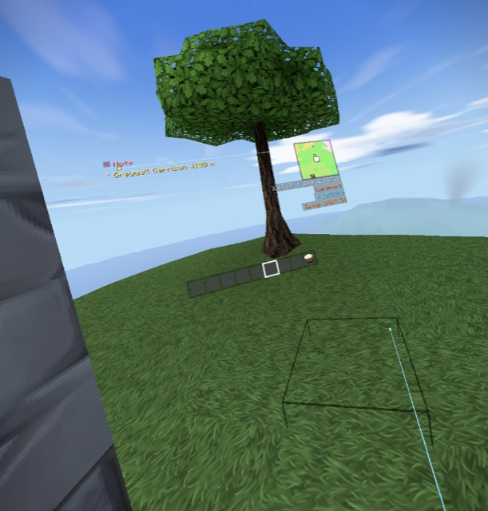

## 13:01:32 - Oh, hell yeah

- **Transcript:** Oh, hell yeah
- **Status:** open
- **Build:** 0.129 (fc006bd3, M1-M4 (device-tested; ship riding, chests, comfort options, weapon wheel))
- **World:** New World (23) (seed 2117423538372845574)
- **Dimension:** Surface
- **Biome:** Forest
- **Position:** 6518.0 247.4 -5728.9
- **Facing:** south-east (yaw 147, pitch -21)
- **Held:** empty hand
- **Mount:** piloting Sky Skiff
- **Looking at:** nothing
- **Mode:** Creative, health 20/20
- **Time:** day 2 16:04, clear
- **Fps:** 72
- **Levels:** mic -33 dBFS, game sound -14 dBFS
- **Length:** 2.2 s (voice 0.8 s)
- **Just before:** -29s message: Entering Loremere; -27s message: Walking; -26s closed ChestMenu; -26s into the pack: Sky Skiff Kit; -23s holding Sky Skiff Kit; -23s message: Sky Skiff Kit; -23s message: No open sky here; -20s message: The Sky Skiff inflates; -15s holding empty hand; -15s piloting Sky Skiff; -15s message: Steering Sky Skiff
- **Repro (Mac):** `./snap.sh note --seed 2117423538372845574 --x 6518.0 --z -5728.9 --yaw -147 --pitch -21 --time 0.420`
- **Audio (this Mac):** /Users/darthvadar/Documents/Blocksmith/QuestVoiceNotes/raw/vn-20261113-130132-078.aac

## 13:01:37 - Very good physics. Very good

- **Transcript:** Very good physics. Very good
- **Status:** open
- **Build:** 0.129 (fc006bd3, M1-M4 (device-tested; ship riding, chests, comfort options, weapon wheel))
- **World:** New World (23) (seed 2117423538372845574)
- **Dimension:** Surface
- **Biome:** Forest
- **Position:** 6562.1 245.5 -5721.3
- **Facing:** south (yaw 169, pitch -23)
- **Held:** empty hand
- **Mount:** piloting Sky Skiff
- **Looking at:** nothing
- **Mode:** Creative, health 20/20
- **Time:** day 2 16:11, clear
- **Fps:** 72
- **Levels:** mic -30 dBFS, game sound -18 dBFS
- **Length:** 2.9 s (voice 1.2 s)
- **Just before:** -29s holding Sky Skiff Kit; -29s message: Sky Skiff Kit; -28s message: No open sky here; -26s message: The Sky Skiff inflates; -21s holding empty hand; -20s piloting Sky Skiff; -20s message: Steering Sky Skiff
- **Repro (Mac):** `./snap.sh note --seed 2117423538372845574 --x 6562.1 --z -5721.3 --yaw -169 --pitch -23 --time 0.424`
- **Audio (this Mac):** /Users/darthvadar/Documents/Blocksmith/QuestVoiceNotes/raw/vn-20261113-130137-658.aac

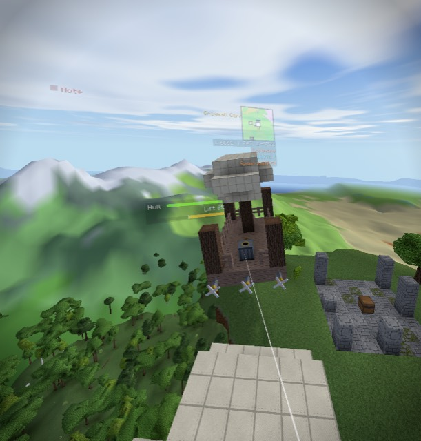

## 13:02:34 - Weird. Um, something that's interesting. The guns, uh, at the Capitol,

- **Transcript:** Weird. Um, something that's interesting. The guns, uh, at the Capitol, they explode prematurely before hitting their target
- **Status:** open
- **Build:** 0.129 (fc006bd3, M1-M4 (device-tested; ship riding, chests, comfort options, weapon wheel))
- **World:** New World (23) (seed 2117423538372845574)
- **Dimension:** Surface
- **Biome:** Meadow
- **Position:** 7435.7 144.5 -5347.5
- **Facing:** south (yaw 185, pitch -30)
- **Held:** empty hand
- **Mount:** on foot
- **Looking at:** nothing
- **Mode:** Survival, health 16/20
- **Time:** day 2 17:14, clear
- **Fps:** 71
- **Levels:** mic -24 dBFS, game sound -16 dBFS
- **Length:** 8.6 s (voice 4.9 s)
- **Just before:** -28s walked into Taiga; -26s walked into Meadow; -24s walked into Taiga; -22s walked into Forest; -14s walked into Meadow; -13s message: Sky isle marked on the map; -11s message: Twin 42 cm Turret tracking you; -8s message: Capital citadel (the enemy) marked on the map; -3s message: Twin 42 cm Turret tracking you; -3s stopped piloting Sky Skiff; -2s took 3 damage (health 18/20); -1s message: A bullion train runs the Fort & Red Rail Road today: armoured, guarded, and carrying the bank's gold
- **While talking:** -5s took 2 damage (health 16/20); -4s opened PauseMenu; -2s closed PauseMenu
- **Position at the end:** 7447.2 132.9 -5340.1
- **Repro (Mac):** `./snap.sh note --seed 2117423538372845574 --x 7435.7 --z -5347.5 --yaw 175 --pitch -30 --time 0.469`
- **Audio (this Mac):** /Users/darthvadar/Documents/Blocksmith/QuestVoiceNotes/raw/vn-20261113-130234-677.aac

## 13:02:42 - Causing them to do nothing

- **Transcript:** Causing them to do nothing
- **Status:** open
- **Build:** 0.129 (fc006bd3, M1-M4 (device-tested; ship riding, chests, comfort options, weapon wheel))
- **World:** New World (23) (seed 2117423538372845574)
- **Dimension:** Surface
- **Biome:** Meadow
- **Position:** 7458.9 131.7 -5334.0
- **Facing:** north-west (yaw 310, pitch -13)
- **Held:** empty hand
- **Mount:** on foot
- **Looking at:** nothing
- **Mode:** Survival, health 14/20
- **Time:** day 2 17:21, clear
- **Fps:** 71
- **Levels:** mic -24 dBFS, game sound -19 dBFS
- **Length:** 2.0 s (voice 0.9 s)
- **Just before:** -22s walked into Meadow; -21s message: Sky isle marked on the map; -19s message: Twin 42 cm Turret tracking you; -16s message: Capital citadel (the enemy) marked on the map; -12s message: Twin 42 cm Turret tracking you; -11s stopped piloting Sky Skiff; -10s took 3 damage (health 18/20); -10s message: A bullion train runs the Fort & Red Rail Road today: armoured, guarded, and carrying the bank's gold; -8s took 2 damage (health 16/20); -8s opened PauseMenu; -5s closed PauseMenu; -3s took 2 damage (health 15/20); -1s took 2 damage (health 14/20)
- **Repro (Mac):** `./snap.sh note --seed 2117423538372845574 --x 7458.9 --z -5334.0 --yaw 50 --pitch -13 --time 0.474`
- **Audio (this Mac):** /Users/darthvadar/Documents/Blocksmith/QuestVoiceNotes/raw/vn-20261113-130242-978.aac

## 13:02:52 - Oh, we got a military train here

- **Transcript:** Oh, we got a military train here
- **Status:** open
- **Build:** 0.129 (fc006bd3, M1-M4 (device-tested; ship riding, chests, comfort options, weapon wheel))
- **World:** New World (23) (seed 2117423538372845574)
- **Dimension:** Surface
- **Biome:** Meadow
- **Position:** 7360.8 150.1 -5309.2
- **Facing:** south-west (yaw 204, pitch -21)
- **Held:** empty hand
- **Mount:** on foot
- **Looking at:** nothing
- **Mode:** Creative, health 14/20
- **Time:** day 2 17:30, clear
- **Fps:** 71
- **Levels:** mic -35 dBFS, game sound -19 dBFS
- **Length:** 3.0 s (voice 1.4 s)
- **Just before:** -29s message: Twin 42 cm Turret tracking you; -26s message: Capital citadel (the enemy) marked on the map; -21s message: Twin 42 cm Turret tracking you; -20s stopped piloting Sky Skiff; -19s took 3 damage (health 18/20); -19s message: A bullion train runs the Fort & Red Rail Road today: armoured, guarded, and carrying the bank's gold; -17s took 2 damage (health 16/20); -17s opened PauseMenu; -15s closed PauseMenu; -12s took 2 damage (health 15/20); -11s took 2 damage (health 14/20); -9s opened PauseMenu; -7s message: Creative mode; -7s closed PauseMenu; -6s message: Flying; -3s message: A stranger in town: Ezra Quill; -1s message: Ezra Quill: Seed's in. Now we wait and pray for rain.
- **Repro (Mac):** `./snap.sh note --seed 2117423538372845574 --x 7360.8 --z -5309.2 --yaw 156 --pitch -21 --time 0.479`
- **Audio (this Mac):** /Users/darthvadar/Documents/Blocksmith/QuestVoiceNotes/raw/vn-20261113-130252-478.aac

## 13:02:55 - Can it be entered? There's the question

- **Transcript:** Can it be entered? There's the question
- **Status:** open
- **Build:** 0.129 (fc006bd3, M1-M4 (device-tested; ship riding, chests, comfort options, weapon wheel))
- **World:** New World (23) (seed 2117423538372845574)
- **Dimension:** Surface
- **Biome:** Meadow
- **Position:** 7351.7 158.4 -5281.3
- **Facing:** west (yaw 273, pitch -62)
- **Held:** empty hand
- **Mount:** on foot, flying
- **Looking at:** nothing
- **Mode:** Creative, health 14/20
- **Time:** day 2 17:33, clear
- **Fps:** 71
- **Levels:** mic -27 dBFS, game sound -17 dBFS
- **Length:** 3.6 s (voice 1.8 s)
- **Just before:** -28s message: Capital citadel (the enemy) marked on the map; -24s message: Twin 42 cm Turret tracking you; -23s stopped piloting Sky Skiff; -22s took 3 damage (health 18/20); -22s message: A bullion train runs the Fort & Red Rail Road today: armoured, guarded, and carrying the bank's gold; -20s took 2 damage (health 16/20); -20s opened PauseMenu; -17s closed PauseMenu; -15s took 2 damage (health 15/20); -13s took 2 damage (health 14/20); -12s opened PauseMenu; -10s message: Creative mode; -10s closed PauseMenu; -8s message: Flying; -6s message: A stranger in town: Ezra Quill; -4s message: Ezra Quill: Seed's in. Now we wait and pray for rain.; -1s message: Red Gulch Station marked on the map
- **Repro (Mac):** `./snap.sh note --seed 2117423538372845574 --x 7351.7 --z -5281.3 --yaw 87 --pitch -62 --time 0.482`
- **Audio (this Mac):** /Users/darthvadar/Documents/Blocksmith/QuestVoiceNotes/raw/vn-20261113-130255-118.aac

## 13:02:59 - Can it be destroyed, in fact?

- **Transcript:** Can it be destroyed, in fact?
- **Status:** open
- **Build:** 0.129 (fc006bd3, M1-M4 (device-tested; ship riding, chests, comfort options, weapon wheel))
- **World:** New World (23) (seed 2117423538372845574)
- **Dimension:** Surface
- **Biome:** Meadow
- **Position:** 7336.1 148.0 -5284.3
- **Facing:** south (yaw 184, pitch -11)
- **Held:** empty hand
- **Mount:** on foot
- **Looking at:** Rail at 7335 148 -5282
- **Mode:** Creative, health 14/20
- **Time:** day 2 17:38, clear
- **Fps:** 71
- **Levels:** mic -39 dBFS, game sound -15 dBFS
- **Length:** 2.8 s (voice 1.0 s)
- **Just before:** -28s message: Twin 42 cm Turret tracking you; -27s stopped piloting Sky Skiff; -26s took 3 damage (health 18/20); -26s message: A bullion train runs the Fort & Red Rail Road today: armoured, guarded, and carrying the bank's gold; -24s took 2 damage (health 16/20); -24s opened PauseMenu; -22s closed PauseMenu; -19s took 2 damage (health 15/20); -18s took 2 damage (health 14/20); -16s opened PauseMenu; -14s message: Creative mode; -14s closed PauseMenu; -13s message: Flying; -10s message: A stranger in town: Ezra Quill; -8s message: Ezra Quill: Seed's in. Now we wait and pray for rain.; -5s message: Red Gulch Station marked on the map; -3s message: You found the Fort & Red Rail Road: 2 stations, marked on your map
- **Repro (Mac):** `./snap.sh note --seed 2117423538372845574 --x 7336.1 --z -5284.3 --yaw 176 --pitch -11 --time 0.485`
- **Audio (this Mac):** /Users/darthvadar/Documents/Blocksmith/QuestVoiceNotes/raw/vn-20261113-130259-358.aac

## 13:03:12 - Can I shoot the gun on it? No? Okay

- **Transcript:** Can I shoot the gun on it? No? Okay
- **Status:** open
- **Build:** 0.129 (fc006bd3, M1-M4 (device-tested; ship riding, chests, comfort options, weapon wheel))
- **World:** New World (23) (seed 2117423538372845574)
- **Dimension:** Surface
- **Biome:** Plains
- **Position:** 7421.0 141.7 -5281.5
- **Facing:** north (yaw 5, pitch -25)
- **Held:** empty hand
- **Mount:** riding Minecart
- **Looking at:** nothing
- **Mode:** Creative, health 14/20
- **Time:** day 2 17:54, clear
- **Fps:** 71
- **Levels:** mic -25 dBFS, game sound -16 dBFS
- **Length:** 3.9 s (voice 1.9 s)
- **Just before:** -30s opened PauseMenu; -27s message: Creative mode; -27s closed PauseMenu; -26s message: Flying; -24s message: A stranger in town: Ezra Quill; -21s message: Ezra Quill: Seed's in. Now we wait and pray for rain.; -19s message: Red Gulch Station marked on the map; -16s message: You found the Fort & Red Rail Road: 2 stations, marked on your map; -13s message: Walking; -12s message: Flying; -10s message: Troops pile out of the Fort & Red Rail Road Bullion Train; -9s mounted Minecart; -7s message: Walking
- **Repro (Mac):** `./snap.sh note --seed 2117423538372845574 --x 7421.0 --z -5281.5 --yaw -5 --pitch -25 --time 0.496`
- **Audio (this Mac):** /Users/darthvadar/Documents/Blocksmith/QuestVoiceNotes/raw/vn-20261113-130312-738.aac

## 13:03:24 - Those diagonal rails, very nice

- **Transcript:** Those diagonal rails, very nice
- **Status:** open
- **Build:** 0.129 (fc006bd3, M1-M4 (device-tested; ship riding, chests, comfort options, weapon wheel))
- **World:** New World (23) (seed 2117423538372845574)
- **Dimension:** Surface
- **Biome:** Meadow
- **Position:** 7659.4 143.3 -5325.9
- **Facing:** north (yaw 5, pitch -37)
- **Held:** empty hand
- **Mount:** riding Minecart
- **Looking at:** nothing
- **Mode:** Creative, health 14/20
- **Time:** day 2 18:08, clear
- **Fps:** 70
- **Levels:** mic -32 dBFS, game sound -13 dBFS
- **Length:** 3.4 s (voice 1.9 s)
- **Just before:** -28s message: You found the Fort & Red Rail Road: 2 stations, marked on your map; -25s message: Walking; -23s message: Flying; -22s message: Troops pile out of the Fort & Red Rail Road Bullion Train; -20s mounted Minecart; -19s message: Walking; -11s walked into Plains; -5s walked into Meadow; -3s walked into Plains; -1s walked into Meadow
- **Repro (Mac):** `./snap.sh note --seed 2117423538372845574 --x 7659.4 --z -5325.9 --yaw -5 --pitch -37 --time 0.506`
- **Audio (this Mac):** /Users/darthvadar/Documents/Blocksmith/QuestVoiceNotes/raw/vn-20261113-130324-278.aac

## 13:03:35 - Uh-oh

- **Transcript:** Uh-oh
- **Status:** open
- **Build:** 0.129 (fc006bd3, M1-M4 (device-tested; ship riding, chests, comfort options, weapon wheel))
- **World:** New World (23) (seed 2117423538372845574)
- **Dimension:** Surface
- **Biome:** Plains
- **Position:** 7979.0 120.1 -5342.5
- **Facing:** east (yaw 85, pitch -31)
- **Held:** empty hand
- **Mount:** riding Minecart
- **Looking at:** nothing
- **Mode:** Creative, health 14/20
- **Time:** day 2 18:22, clear
- **Fps:** 71
- **Levels:** mic -19 dBFS, game sound -18 dBFS
- **Length:** 2.1 s (voice 0.7 s)
- **Just before:** -23s walked into Plains; -17s walked into Meadow; -15s walked into Plains; -13s walked into Meadow; -9s walked into Forest; -7s walked into Flower Forest; -5s walked into Forest; -4s message: Red Gulch marked on the map; -3s walked into Meadow; -1s walked into Plains
- **Repro (Mac):** `./snap.sh note --seed 2117423538372845574 --x 7979.0 --z -5342.5 --yaw -85 --pitch -31 --time 0.516`
- **Audio (this Mac):** /Users/darthvadar/Documents/Blocksmith/QuestVoiceNotes/raw/vn-20261113-130335-898.aac

## 13:03:40 - No, no, no. Another one

- **Transcript:** No, no, no. Another one
- **Status:** open
- **Build:** 0.129 (fc006bd3, M1-M4 (device-tested; ship riding, chests, comfort options, weapon wheel))
- **World:** New World (23) (seed 2117423538372845574)
- **Dimension:** Surface
- **Biome:** Plains
- **Position:** 7959.2 125.9 -5342.6
- **Facing:** north (yaw 353, pitch -65)
- **Held:** empty hand
- **Mount:** on foot
- **Looking at:** nothing
- **Mode:** Creative, health 14/20
- **Time:** day 2 18:28, clear
- **Fps:** 72
- **Levels:** mic -25 dBFS, game sound -19 dBFS
- **Length:** 4.1 s (voice 2.6 s)
- **Just before:** -28s walked into Plains; -22s walked into Meadow; -20s walked into Plains; -18s walked into Meadow; -14s walked into Forest; -12s walked into Flower Forest; -10s walked into Forest; -9s message: Red Gulch marked on the map; -8s walked into Meadow; -6s walked into Plains; -1s dismounted Minecart
- **Repro (Mac):** `./snap.sh note --seed 2117423538372845574 --x 7959.2 --z -5342.6 --yaw 7 --pitch -65 --time 0.520`
- **Audio (this Mac):** /Users/darthvadar/Documents/Blocksmith/QuestVoiceNotes/raw/vn-20261113-130340-998.aac

## 13:03:47 - Why is this happening?

- **Transcript:** Why is this happening?
- **Status:** open
- **Build:** 0.129 (fc006bd3, M1-M4 (device-tested; ship riding, chests, comfort options, weapon wheel))
- **World:** New World (23) (seed 2117423538372845574)
- **Dimension:** Surface
- **Biome:** Plains
- **Position:** 8009.6 131.8 -5357.5
- **Facing:** south (yaw 159, pitch -47)
- **Held:** empty hand
- **Mount:** on foot, flying
- **Looking at:** nothing
- **Mode:** Creative, health 14/20
- **Time:** day 2 18:35, clear
- **Fps:** 72
- **Levels:** mic -28 dBFS, game sound -17 dBFS
- **Length:** 2.4 s (voice 0.9 s)
- **Just before:** -28s walked into Meadow; -26s walked into Plains; -24s walked into Meadow; -20s walked into Forest; -18s walked into Flower Forest; -16s walked into Forest; -15s message: Red Gulch marked on the map; -14s walked into Meadow; -12s walked into Plains; -7s dismounted Minecart; -6s message: Flying
- **Repro (Mac):** `./snap.sh note --seed 2117423538372845574 --x 8009.6 --z -5357.5 --yaw -159 --pitch -47 --time 0.525`
- **Audio (this Mac):** /Users/darthvadar/Documents/Blocksmith/QuestVoiceNotes/raw/vn-20261113-130347-018.aac

## 13:03:51 - Coordinates X eight thousand, Z negative fifty-three hundred

- **Transcript:** Coordinates X eight thousand, Z negative fifty-three hundred
- **Status:** open
- **Build:** 0.129 (fc006bd3, M1-M4 (device-tested; ship riding, chests, comfort options, weapon wheel))
- **World:** New World (23) (seed 2117423538372845574)
- **Dimension:** Surface
- **Biome:** Plains
- **Position:** 8001.9 131.8 -5362.8
- **Facing:** south (yaw 181, pitch -46)
- **Held:** empty hand
- **Mount:** on foot, flying
- **Looking at:** nothing
- **Mode:** Creative, health 14/20
- **Time:** day 2 18:41, clear
- **Fps:** 72
- **Levels:** mic -28 dBFS, game sound -23 dBFS
- **Length:** 5.6 s (voice 3.0 s)
- **Just before:** -29s walked into Meadow; -25s walked into Forest; -23s walked into Flower Forest; -20s walked into Forest; -20s message: Red Gulch marked on the map; -18s walked into Meadow; -16s walked into Plains; -11s dismounted Minecart; -10s message: Flying
- **While talking:** -0s opened PauseMenu
- **Position at the end:** 8001.9 131.8 -5362.9
- **Repro (Mac):** `./snap.sh note --seed 2117423538372845574 --x 8001.9 --z -5362.8 --yaw 179 --pitch -46 --time 0.529`
- **Audio (this Mac):** /Users/darthvadar/Documents/Blocksmith/QuestVoiceNotes/raw/vn-20261113-130351-438.aac

## 13:04:20 - What is this?

- **Transcript:** What is this?
- **Status:** open
- **Build:** 0.129 (fc006bd3, M1-M4 (device-tested; ship riding, chests, comfort options, weapon wheel))
- **World:** Proving Grounds (seed 88314448595278)
- **Dimension:** Surface
- **Biome:** Taiga
- **Position:** 453.9 243.3 -3780.7
- **Facing:** north-east (yaw 64, pitch -52)
- **Held:** Grass Block x64
- **Mount:** on foot, flying
- **Looking at:** nothing
- **Mode:** Creative, health 20/20
- **Time:** day 1 07:41, clear
- **Fps:** 48
- **Levels:** mic -33 dBFS, game sound -26 dBFS
- **Length:** 2.0 s (voice 0.5 s)
- **Just before:** --1735s stopped piloting Sky Skiff; --1736s took 3 damage (health 18/20); --1736s message: A bullion train runs the Fort & Red Rail Road today: armoured, guarded, and carrying the bank's gold; --1738s took 2 damage (health 16/20); --1738s opened PauseMenu; --1741s closed PauseMenu; --1743s took 2 damage (health 15/20); --1745s took 2 damage (health 14/20); --1746s opened PauseMenu; --1748s message: Creative mode; --1748s closed PauseMenu; --1750s message: Flying; --1752s message: A stranger in town: Ezra Quill; --1754s message: Ezra Quill: Seed's in. Now we wait and pray for rain.; --1757s message: Red Gulch Station marked on the map; --1759s message: You found the Fort & Red Rail Road: 2 stations, marked on your map; --1762s message: Walking; --1764s message: Flying; --1765s message: Troops pile out of the Fort & Red Rail Road Bullion Train; --1767s mounted Minecart; --1768s message: Walking; --1776s walked into Plains; --1782s walked into Meadow; --1784s walked into Plains; --1786s walked into Meadow; --1790s walked into Forest; --1792s walked into Flower Forest; --1794s walked into Forest; --1795s message: Red Gulch marked on the map; --1796s walked into Meadow; --1798s walked into Plains; --1803s dismounted Minecart; --1804s message: Flying; --1819s opened PauseMenu; -13s closed PauseMenu; -13s holding Grass Block; -13s message: Spring: the snow melts and the young are born; -7s message: Walking; -5s message: Flying; -0s message: The sky is clouding over: fog is coming
- **Repro (Mac):** `./snap.sh note --seed 88314448595278 --x 453.9 --z -3780.7 --yaw -64 --pitch -52 --time 0.071`
- **Audio (this Mac):** /Users/darthvadar/Documents/Blocksmith/QuestVoiceNotes/raw/vn-20261113-130420-978.aac

## 13:04:24 - Okay, and helping notice there's nothing on here

- **Transcript:** Okay, and helping notice there's nothing on here
- **Status:** open
- **Build:** 0.129 (fc006bd3, M1-M4 (device-tested; ship riding, chests, comfort options, weapon wheel))
- **World:** Proving Grounds (seed 88314448595278)
- **Dimension:** Surface
- **Biome:** Taiga
- **Position:** 456.1 257.9 -3811.5
- **Facing:** north-east (yaw 54, pitch -51)
- **Held:** Grass Block x64
- **Mount:** on foot, flying
- **Looking at:** nothing
- **Mode:** Creative, health 20/20
- **Time:** day 1 07:45, clear
- **Fps:** 68
- **Levels:** mic -31 dBFS, game sound -20 dBFS
- **Length:** 3.8 s (voice 2.2 s)
- **Just before:** --1733s took 3 damage (health 18/20); --1733s message: A bullion train runs the Fort & Red Rail Road today: armoured, guarded, and carrying the bank's gold; --1735s took 2 damage (health 16/20); --1735s opened PauseMenu; --1737s closed PauseMenu; --1740s took 2 damage (health 15/20); --1741s took 2 damage (health 14/20); --1743s opened PauseMenu; --1745s message: Creative mode; --1745s closed PauseMenu; --1746s message: Flying; --1749s message: A stranger in town: Ezra Quill; --1751s message: Ezra Quill: Seed's in. Now we wait and pray for rain.; --1754s message: Red Gulch Station marked on the map; --1756s message: You found the Fort & Red Rail Road: 2 stations, marked on your map; --1759s message: Walking; --1761s message: Flying; --1762s message: Troops pile out of the Fort & Red Rail Road Bullion Train; --1764s mounted Minecart; --1765s message: Walking; --1772s walked into Plains; --1778s walked into Meadow; --1780s walked into Plains; --1782s walked into Meadow; --1787s walked into Forest; --1789s walked into Flower Forest; --1791s walked into Forest; --1791s message: Red Gulch marked on the map; --1793s walked into Meadow; --1795s walked into Plains; --1800s dismounted Minecart; --1801s message: Flying; --1816s opened PauseMenu; -16s closed PauseMenu; -16s holding Grass Block; -16s message: Spring: the snow melts and the young are born; -10s message: Walking; -8s message: Flying; -3s message: The sky is clouding over: fog is coming; -1s message: Entering Fenivania
- **Repro (Mac):** `./snap.sh note --seed 88314448595278 --x 456.1 --z -3811.5 --yaw -54 --pitch -51 --time 0.073`
- **Audio (this Mac):** /Users/darthvadar/Documents/Blocksmith/QuestVoiceNotes/raw/vn-20261113-130424-197.aac

## 13:04:43 - I'm in the proofing ground and there's nothing

- **Transcript:** I'm in the proofing ground and there's nothing
- **Status:** open
- **Build:** 0.129 (fc006bd3, M1-M4 (device-tested; ship riding, chests, comfort options, weapon wheel))
- **World:** Proving Grounds (seed 88314448595278)
- **Dimension:** Surface
- **Biome:** Old Growth Birch Forest
- **Position:** 476.6 265.9 -3883.4
- **Facing:** south-east (yaw 140, pitch -50)
- **Held:** Grass Block x64
- **Mount:** on foot, flying
- **Looking at:** nothing
- **Mode:** Creative, health 20/20
- **Time:** day 1 08:01, clear
- **Fps:** 71
- **Levels:** mic -23 dBFS, game sound -23 dBFS
- **Length:** 4.1 s (voice 2.5 s)
- **Just before:** --1718s closed PauseMenu; --1721s took 2 damage (health 15/20); --1722s took 2 damage (health 14/20); --1724s opened PauseMenu; --1726s message: Creative mode; --1726s closed PauseMenu; --1727s message: Flying; --1730s message: A stranger in town: Ezra Quill; --1732s message: Ezra Quill: Seed's in. Now we wait and pray for rain.; --1735s message: Red Gulch Station marked on the map; --1737s message: You found the Fort & Red Rail Road: 2 stations, marked on your map; --1740s message: Walking; --1741s message: Flying; --1743s message: Troops pile out of the Fort & Red Rail Road Bullion Train; --1745s mounted Minecart; --1746s message: Walking; --1753s walked into Plains; --1759s walked into Meadow; --1761s walked into Plains; --1763s walked into Meadow; --1767s walked into Forest; --1769s walked into Flower Forest; --1771s walked into Forest; --1772s message: Red Gulch marked on the map; --1773s walked into Meadow; --1775s walked into Plains; --1781s dismounted Minecart; --1782s message: Flying; --1797s opened PauseMenu; -29s message: Walking; -27s message: Flying; -22s message: The sky is clouding over: fog is coming; -20s message: Entering Fenivania; -18s message: Entering Wenaresh; -16s message: Entering Draonia; -6s opened PauseMenu; -0s closed PauseMenu
- **Repro (Mac):** `./snap.sh note --seed 88314448595278 --x 476.6 --z -3883.4 --yaw -140 --pitch -50 --time 0.084`
- **Audio (this Mac):** /Users/darthvadar/Documents/Blocksmith/QuestVoiceNotes/raw/vn-20261113-130443-358.aac

## 13:04:47 - Nothing here. Nothing to be proofed

- **Transcript:** Nothing here. Nothing to be proofed
- **Status:** open
- **Build:** 0.129 (fc006bd3, M1-M4 (device-tested; ship riding, chests, comfort options, weapon wheel))
- **World:** Proving Grounds (seed 88314448595278)
- **Dimension:** Surface
- **Biome:** Taiga
- **Position:** 563.5 236.0 -3875.8
- **Facing:** east (yaw 104, pitch -40)
- **Held:** Grass Block x64
- **Mount:** on foot
- **Looking at:** Stone at 565 235 -3876
- **Mode:** Creative, health 20/20
- **Time:** day 1 08:06, clear
- **Fps:** 67
- **Levels:** mic -39 dBFS, game sound -13 dBFS
- **Length:** 4.3 s (voice 1.7 s)
- **Just before:** --1718s took 2 damage (health 14/20); --1719s opened PauseMenu; --1721s message: Creative mode; --1722s closed PauseMenu; --1723s message: Flying; --1725s message: A stranger in town: Ezra Quill; --1727s message: Ezra Quill: Seed's in. Now we wait and pray for rain.; --1730s message: Red Gulch Station marked on the map; --1732s message: You found the Fort & Red Rail Road: 2 stations, marked on your map; --1736s message: Walking; --1737s message: Flying; --1739s message: Troops pile out of the Fort & Red Rail Road Bullion Train; --1740s mounted Minecart; --1742s message: Walking; --1749s walked into Plains; --1755s walked into Meadow; --1757s walked into Plains; --1759s walked into Meadow; --1763s walked into Forest; --1765s walked into Flower Forest; --1767s walked into Forest; --1768s message: Red Gulch marked on the map; --1769s walked into Meadow; --1771s walked into Plains; --1777s dismounted Minecart; --1777s message: Flying; --1792s opened PauseMenu; -27s message: The sky is clouding over: fog is coming; -24s message: Entering Fenivania; -23s message: Entering Wenaresh; -20s message: Entering Draonia; -11s opened PauseMenu; -5s closed PauseMenu; -4s message: Entering Wenaresh; -2s message: Walking
- **Repro (Mac):** `./snap.sh note --seed 88314448595278 --x 563.5 --z -3875.8 --yaw -104 --pitch -40 --time 0.088`
- **Audio (this Mac):** /Users/darthvadar/Documents/Blocksmith/QuestVoiceNotes/raw/vn-20261113-130447-718.aac

## 13:04:52 - Uh, there's nothing. I don't see anything here

- **Transcript:** Uh, there's nothing. I don't see anything here
- **Status:** open
- **Build:** 0.129 (fc006bd3, M1-M4 (device-tested; ship riding, chests, comfort options, weapon wheel))
- **World:** Proving Grounds (seed 88314448595278)
- **Dimension:** Surface
- **Biome:** Taiga
- **Position:** 566.8 128.1 -3836.8
- **Facing:** north-west (yaw 333, pitch -68)
- **Held:** Grass Block x64
- **Mount:** on foot, flying
- **Looking at:** nothing
- **Mode:** Creative, health 20/20
- **Time:** day 1 08:12, clear
- **Fps:** 66
- **Levels:** mic -26 dBFS, game sound -23 dBFS
- **Length:** 3.8 s (voice 2.0 s)
- **Just before:** --1714s opened PauseMenu; --1717s message: Creative mode; --1717s closed PauseMenu; --1718s message: Flying; --1721s message: A stranger in town: Ezra Quill; --1723s message: Ezra Quill: Seed's in. Now we wait and pray for rain.; --1725s message: Red Gulch Station marked on the map; --1728s message: You found the Fort & Red Rail Road: 2 stations, marked on your map; --1731s message: Walking; --1732s message: Flying; --1734s message: Troops pile out of the Fort & Red Rail Road Bullion Train; --1736s mounted Minecart; --1737s message: Walking; --1744s walked into Plains; --1750s walked into Meadow; --1752s walked into Plains; --1754s walked into Meadow; --1758s walked into Forest; --1760s walked into Flower Forest; --1762s walked into Forest; --1763s message: Red Gulch marked on the map; --1764s walked into Meadow; --1766s walked into Plains; --1772s dismounted Minecart; --1773s message: Flying; --1787s opened PauseMenu; -29s message: Entering Fenivania; -27s message: Entering Wenaresh; -25s message: Entering Draonia; -15s opened PauseMenu; -9s closed PauseMenu; -8s message: Entering Wenaresh; -7s message: Walking; -1s message: Flying
- **Repro (Mac):** `./snap.sh note --seed 88314448595278 --x 566.8 --z -3836.8 --yaw 27 --pitch -68 --time 0.092`
- **Audio (this Mac):** /Users/darthvadar/Documents/Blocksmith/QuestVoiceNotes/raw/vn-20261113-130452-438.aac

## 13:05:05 - Nothing is up here

- **Transcript:** Nothing is up here
- **Status:** open
- **Build:** 0.129 (fc006bd3, M1-M4 (device-tested; ship riding, chests, comfort options, weapon wheel))
- **World:** Proving Grounds (seed 88314448595278)
- **Dimension:** Surface
- **Biome:** Taiga
- **Position:** 601.8 232.1 -3910.6
- **Facing:** south-west (yaw 234, pitch -61)
- **Held:** Grass Block x64
- **Mount:** on foot, flying
- **Looking at:** nothing
- **Mode:** Creative, health 20/20
- **Time:** day 1 08:27, clear
- **Fps:** 71
- **Levels:** mic -35 dBFS, game sound -18 dBFS
- **Length:** 2.6 s (voice 1.0 s)
- **Just before:** --1704s closed PauseMenu; --1705s message: Flying; --1708s message: A stranger in town: Ezra Quill; --1710s message: Ezra Quill: Seed's in. Now we wait and pray for rain.; --1713s message: Red Gulch Station marked on the map; --1715s message: You found the Fort & Red Rail Road: 2 stations, marked on your map; --1718s message: Walking; --1720s message: Flying; --1721s message: Troops pile out of the Fort & Red Rail Road Bullion Train; --1723s mounted Minecart; --1724s message: Walking; --1731s walked into Plains; --1738s walked into Meadow; --1740s walked into Plains; --1742s walked into Meadow; --1746s walked into Forest; --1748s walked into Flower Forest; --1750s walked into Forest; --1750s message: Red Gulch marked on the map; --1752s walked into Meadow; --1754s walked into Plains; --1759s dismounted Minecart; --1760s message: Flying; --1775s opened PauseMenu; -28s opened PauseMenu; -22s closed PauseMenu; -21s message: Entering Wenaresh; -20s message: Walking; -14s message: Flying; -6s message: Entering Draonia; -2s message: Entering Wenaresh
- **Repro (Mac):** `./snap.sh note --seed 88314448595278 --x 601.8 --z -3910.6 --yaw 126 --pitch -61 --time 0.102`
- **Audio (this Mac):** /Users/darthvadar/Documents/Blocksmith/QuestVoiceNotes/raw/vn-20261113-130505-217.aac

## 13:05:16 - Okay, here we go. This is what I'm talking about

- **Transcript:** Okay, here we go. This is what I'm talking about
- **Status:** open
- **Build:** 0.129 (fc006bd3, M1-M4 (device-tested; ship riding, chests, comfort options, weapon wheel))
- **World:** Sparkstone Workshop (seed 91604158401363)
- **Dimension:** Surface
- **Biome:** Snowy Beach
- **Position:** 5153.6 90.0 -3406.3
- **Facing:** south-east (yaw 130, pitch -41)
- **Held:** Grass Block x64
- **Mount:** on foot
- **Looking at:** Chiseled Stone Bricks at 5155 89 -3405
- **Mode:** Creative, health 20/20
- **Time:** day 1 07:29, clear
- **Fps:** 71
- **Levels:** mic -47 dBFS, game sound -24 dBFS
- **Length:** 3.5 s (voice 1.6 s)
- **Just before:** --1764s message: Ezra Quill: Seed's in. Now we wait and pray for rain.; --1767s message: Red Gulch Station marked on the map; --1769s message: You found the Fort & Red Rail Road: 2 stations, marked on your map; --1772s message: Walking; --1773s message: Flying; --1775s message: Troops pile out of the Fort & Red Rail Road Bullion Train; --1777s mounted Minecart; --1778s message: Walking; --1785s walked into Plains; --1791s walked into Meadow; --1793s walked into Plains; --1795s walked into Meadow; --1799s walked into Forest; --1801s walked into Flower Forest; --1803s walked into Forest; --1804s message: Red Gulch marked on the map; --1805s walked into Meadow; --1807s walked into Plains; --1813s dismounted Minecart; --1814s message: Flying; --1829s opened PauseMenu; -3s closed PauseMenu; -3s holding Grass Block; -3s message: Spring: the snow melts and the young are born; --3s message: Walking; --5s message: Flying; --10s message: The sky is clouding over: fog is coming; --12s message: Entering Fenivania; --14s message: Entering Wenaresh; --16s message: Entering Draonia; --26s opened PauseMenu; --32s closed PauseMenu; --33s message: Entering Wenaresh; --34s message: Walking; --40s message: Flying; --48s message: Entering Draonia; --52s message: Entering Wenaresh; --56s opened PauseMenu; -3s closed PauseMenu; -3s message: Sparkstone Workshop
- **Repro (Mac):** `./snap.sh note --seed 91604158401363 --x 5153.6 --z -3406.3 --yaw -130 --pitch -41 --time 0.062`
- **Audio (this Mac):** /Users/darthvadar/Documents/Blocksmith/QuestVoiceNotes/raw/vn-20261113-130516-678.aac

## 13:05:24 - All right, so here's what we got

- **Transcript:** All right, so here's what we got
- **Status:** open
- **Build:** 0.129 (fc006bd3, M1-M4 (device-tested; ship riding, chests, comfort options, weapon wheel))
- **World:** Sparkstone Workshop (seed 91604158401363)
- **Dimension:** Surface
- **Biome:** Snowy Beach
- **Position:** 5158.3 90.0 -3405.3
- **Facing:** south-west (yaw 233, pitch -26)
- **Held:** Grass Block x64
- **Mount:** on foot
- **Looking at:** Stone at 5155 90 -3404
- **Mode:** Creative, health 20/20
- **Time:** day 1 07:39, clear
- **Fps:** 71
- **Levels:** mic -22 dBFS, game sound -27 dBFS
- **Length:** 2.7 s (voice 1.3 s)
- **Just before:** --1756s message: Ezra Quill: Seed's in. Now we wait and pray for rain.; --1759s message: Red Gulch Station marked on the map; --1761s message: You found the Fort & Red Rail Road: 2 stations, marked on your map; --1764s message: Walking; --1766s message: Flying; --1767s message: Troops pile out of the Fort & Red Rail Road Bullion Train; --1769s mounted Minecart; --1770s message: Walking; --1778s walked into Plains; --1784s walked into Meadow; --1786s walked into Plains; --1788s walked into Meadow; --1792s walked into Forest; --1794s walked into Flower Forest; --1796s walked into Forest; --1796s message: Red Gulch marked on the map; --1798s walked into Meadow; --1800s walked into Plains; --1805s dismounted Minecart; --1806s message: Flying; --1821s opened PauseMenu; -11s closed PauseMenu; -11s holding Grass Block; -11s message: Spring: the snow melts and the young are born; -5s message: Walking; -3s message: Flying; --2s message: The sky is clouding over: fog is coming; --4s message: Entering Fenivania; --6s message: Entering Wenaresh; --9s message: Entering Draonia; --18s opened PauseMenu; --24s closed PauseMenu; --25s message: Entering Wenaresh; --27s message: Walking; --32s message: Flying; --40s message: Entering Draonia; --44s message: Entering Wenaresh; --49s opened PauseMenu; -11s closed PauseMenu; -11s message: Sparkstone Workshop
- **Repro (Mac):** `./snap.sh note --seed 91604158401363 --x 5158.3 --z -3405.3 --yaw 127 --pitch -26 --time 0.069`
- **Audio (this Mac):** /Users/darthvadar/Documents/Blocksmith/QuestVoiceNotes/raw/vn-20261113-130524-438.aac

## 13:05:27 - These circuits, I guess it works. I, I guess. Looks like shit though. 

- **Transcript:** These circuits, I guess it works. I, I guess. Looks like shit though. Look at this fucking torch. Look at this. Looks like shit. Gotta be fixed. Look at the sign. You can see through it from behind
- **Status:** open
- **Build:** 0.129 (fc006bd3, M1-M4 (device-tested; ship riding, chests, comfort options, weapon wheel))
- **World:** Sparkstone Workshop (seed 91604158401363)
- **Dimension:** Surface
- **Biome:** Snowy Beach
- **Position:** 5158.5 90.0 -3401.8
- **Facing:** west (yaw 283, pitch -30)
- **Held:** Grass Block x64
- **Mount:** on foot
- **Looking at:** Copper Repeater at 5155 90 -3403
- **Mode:** Creative, health 20/20
- **Time:** day 1 07:43, clear
- **Fps:** 72
- **Levels:** mic -38 dBFS, game sound -22 dBFS
- **Length:** 12.6 s (voice 6.4 s)
- **Just before:** --1752s message: Ezra Quill: Seed's in. Now we wait and pray for rain.; --1755s message: Red Gulch Station marked on the map; --1758s message: You found the Fort & Red Rail Road: 2 stations, marked on your map; --1761s message: Walking; --1762s message: Flying; --1764s message: Troops pile out of the Fort & Red Rail Road Bullion Train; --1765s mounted Minecart; --1767s message: Walking; --1774s walked into Plains; --1780s walked into Meadow; --1782s walked into Plains; --1784s walked into Meadow; --1788s walked into Forest; --1790s walked into Flower Forest; --1792s walked into Forest; --1793s message: Red Gulch marked on the map; --1794s walked into Meadow; --1796s walked into Plains; --1802s dismounted Minecart; --1802s message: Flying; --1817s opened PauseMenu; -14s closed PauseMenu; -14s holding Grass Block; -14s message: Spring: the snow melts and the young are born; -8s message: Walking; -7s message: Flying; -2s message: The sky is clouding over: fog is coming; --1s message: Entering Fenivania; --2s message: Entering Wenaresh; --5s message: Entering Draonia; --14s opened PauseMenu; --20s closed PauseMenu; --21s message: Entering Wenaresh; --23s message: Walking; --29s message: Flying; --37s message: Entering Draonia; --41s message: Entering Wenaresh; --45s opened PauseMenu; -14s closed PauseMenu; -14s message: Sparkstone Workshop
- **While talking:** --1747s message: Ezra Quill: Seed's in. Now we wait and pray for rain.; --1750s message: Red Gulch Station marked on the map; --1753s message: You found the Fort & Red Rail Road: 2 stations, marked on your map; --1756s message: Walking; --1757s message: Flying; --1759s message: Troops pile out of the Fort & Red Rail Road Bullion Train; --1760s mounted Minecart; --1762s message: Walking; --1769s walked into Plains; --1775s walked into Meadow; --1777s walked into Plains; --1779s walked into Meadow; --1783s walked into Forest; --1785s walked into Flower Forest; --1787s walked into Forest; --1788s message: Red Gulch marked on the map; --1789s walked into Meadow; --1791s walked into Plains; --1797s dismounted Minecart; --1797s message: Flying; --1812s opened PauseMenu; -4s message: Entering Fenivania; -3s message: Entering Wenaresh; --0s message: Entering Draonia; --9s opened PauseMenu; --15s closed PauseMenu; --16s message: Entering Wenaresh; --18s message: Walking; --24s message: Flying; --32s message: Entering Draonia; --36s message: Entering Wenaresh; --40s opened PauseMenu; --1742s message: Ezra Quill: Seed's in. Now we wait and pray for rain.; --1745s message: Red Gulch Station marked on the map; --1748s message: You found the Fort & Red Rail Road: 2 stations, marked on your map; --1751s message: Walking; --1752s message: Flying; --1754s message: Troops pile out of the Fort & Red Rail Road Bullion Train; --1755s mounted Minecart; --1757s message: Walking; --1764s walked into Plains; --1770s walked into Meadow; --1772s walked into Plains; --1774s walked into Meadow; --1778s walked into Forest; --1780s walked into Flower Forest; --1782s walked into Forest; --1783s message: Red Gulch marked on the map; --1784s walked into Meadow; --1786s walked into Plains; --1792s dismounted Minecart; --1792s message: Flying; --1807s opened PauseMenu; -5s message: Entering Draonia; --4s opened PauseMenu; --10s closed PauseMenu; --11s message: Entering Wenaresh; --13s message: Walking; --19s message: Flying; --27s message: Entering Draonia; --31s message: Entering Wenaresh; --35s opened PauseMenu
- **Position at the end:** 5154.6 90.0 -3402.8
- **Repro (Mac):** `./snap.sh note --seed 91604158401363 --x 5158.5 --z -3401.8 --yaw 77 --pitch -30 --time 0.072`
- **Audio (this Mac):** /Users/darthvadar/Documents/Blocksmith/QuestVoiceNotes/raw/vn-20261113-130527-978.aac

## 13:05:46 - Ah, the new physics. Oh, geez. Okay. Um, for some reason, all the wire

- **Transcript:** Ah, the new physics. Oh, geez. Okay. Um, for some reason, all the wire despawned when it fell
- **Status:** open
- **Build:** 0.129 (fc006bd3, M1-M4 (device-tested; ship riding, chests, comfort options, weapon wheel))
- **World:** Sparkstone Workshop (seed 91604158401363)
- **Dimension:** Surface
- **Biome:** Snowy Taiga
- **Position:** 5175.2 85.3 -3409.8
- **Facing:** south-east (yaw 137, pitch -57)
- **Held:** Grass Block x64
- **Mount:** on foot, flying
- **Looking at:** nothing
- **Mode:** Creative, health 20/20
- **Time:** day 1 08:05, clear
- **Fps:** 72
- **Levels:** mic -27 dBFS, game sound -19 dBFS
- **Length:** 9.3 s (voice 5.4 s)
- **Just before:** --1742s message: Walking; --1744s message: Flying; --1745s message: Troops pile out of the Fort & Red Rail Road Bullion Train; --1747s mounted Minecart; --1748s message: Walking; --1755s walked into Plains; --1762s walked into Meadow; --1764s walked into Plains; --1766s walked into Meadow; --1770s walked into Forest; --1772s walked into Flower Forest; --1774s walked into Forest; --1774s message: Red Gulch marked on the map; --1776s walked into Meadow; --1778s walked into Plains; --1783s dismounted Minecart; --1784s message: Flying; --1799s opened PauseMenu; -27s message: Walking; -25s message: Flying; -20s message: The sky is clouding over: fog is coming; -18s message: Entering Fenivania; -16s message: Entering Wenaresh; -13s message: Entering Draonia; -4s opened PauseMenu; --2s closed PauseMenu; --3s message: Entering Wenaresh; --4s message: Walking; --10s message: Flying; --18s message: Entering Draonia; --22s message: Entering Wenaresh; --27s opened PauseMenu; -5s message: Flying; -2s message: Walking; -1s message: Flying
- **While talking:** --1737s message: Walking; --1739s message: Flying; --1740s message: Troops pile out of the Fort & Red Rail Road Bullion Train; --1742s mounted Minecart; --1743s message: Walking; --1750s walked into Plains; --1757s walked into Meadow; --1759s walked into Plains; --1761s walked into Meadow; --1765s walked into Forest; --1767s walked into Flower Forest; --1769s walked into Forest; --1769s message: Red Gulch marked on the map; --1771s walked into Meadow; --1773s walked into Plains; --1778s dismounted Minecart; --1779s message: Flying; --1794s opened PauseMenu; -3s closed PauseMenu; -2s message: Entering Wenaresh; -1s message: Walking; --5s message: Flying; --13s message: Entering Draonia; --17s message: Entering Wenaresh; --22s opened PauseMenu
- **Position at the end:** 5207.3 84.8 -3406.0
- **Repro (Mac):** `./snap.sh note --seed 91604158401363 --x 5175.2 --z -3409.8 --yaw -137 --pitch -57 --time 0.087`
- **Audio (this Mac):** /Users/darthvadar/Documents/Blocksmith/QuestVoiceNotes/raw/vn-20261113-130546-498.aac

## 13:05:57 - I mean, this is all great except, um

- **Transcript:** I mean, this is all great except, um
- **Status:** open
- **Build:** 0.129 (fc006bd3, M1-M4 (device-tested; ship riding, chests, comfort options, weapon wheel))
- **World:** Sparkstone Workshop (seed 91604158401363)
- **Dimension:** Surface
- **Biome:** Beach
- **Position:** 5159.7 94.5 -3454.7
- **Facing:** north-east (yaw 53, pitch -37)
- **Held:** Grass Block x64
- **Mount:** on foot, flying
- **Looking at:** nothing
- **Mode:** Creative, health 20/20
- **Time:** day 1 08:19, clear
- **Fps:** 71
- **Levels:** mic -22 dBFS, game sound -15 dBFS
- **Length:** 3.7 s (voice 2.0 s)
- **Just before:** --1731s message: Walking; --1732s message: Flying; --1734s message: Troops pile out of the Fort & Red Rail Road Bullion Train; --1736s mounted Minecart; --1737s message: Walking; --1744s walked into Plains; --1750s walked into Meadow; --1752s walked into Plains; --1754s walked into Meadow; --1758s walked into Forest; --1760s walked into Flower Forest; --1762s walked into Forest; --1763s message: Red Gulch marked on the map; --1764s walked into Meadow; --1766s walked into Plains; --1772s dismounted Minecart; --1773s message: Flying; --1788s opened PauseMenu; -29s message: Entering Fenivania; -27s message: Entering Wenaresh; -25s message: Entering Draonia; -15s opened PauseMenu; -9s closed PauseMenu; -8s message: Entering Wenaresh; -7s message: Walking; -1s message: Flying; --7s message: Entering Draonia; --11s message: Entering Wenaresh; --15s opened PauseMenu; -16s message: Flying; -13s message: Walking; -12s message: Flying
- **Repro (Mac):** `./snap.sh note --seed 91604158401363 --x 5159.7 --z -3454.7 --yaw -53 --pitch -37 --time 0.097`
- **Audio (this Mac):** /Users/darthvadar/Documents/Blocksmith/QuestVoiceNotes/raw/vn-20261113-130557-658.aac

## 13:06:01 - Oh, what do we have here?

- **Transcript:** Oh, what do we have here?
- **Status:** open
- **Build:** 0.129 (fc006bd3, M1-M4 (device-tested; ship riding, chests, comfort options, weapon wheel))
- **World:** Sparkstone Workshop (seed 91604158401363)
- **Dimension:** Surface
- **Biome:** Snowy Taiga
- **Position:** 5177.6 114.5 -3393.3
- **Facing:** west (yaw 289, pitch -44)
- **Held:** Grass Block x64
- **Mount:** on foot, flying
- **Looking at:** nothing
- **Mode:** Creative, health 20/20
- **Time:** day 1 08:23, clear
- **Fps:** 71
- **Levels:** mic -30 dBFS, game sound -20 dBFS
- **Length:** 2.3 s (voice 0.7 s)
- **Just before:** --1727s message: Walking; --1728s message: Flying; --1730s message: Troops pile out of the Fort & Red Rail Road Bullion Train; --1732s mounted Minecart; --1733s message: Walking; --1740s walked into Plains; --1746s walked into Meadow; --1748s walked into Plains; --1750s walked into Meadow; --1754s walked into Forest; --1756s walked into Flower Forest; --1758s walked into Forest; --1759s message: Red Gulch marked on the map; --1760s walked into Meadow; --1762s walked into Plains; --1768s dismounted Minecart; --1769s message: Flying; --1783s opened PauseMenu; -29s message: Entering Draonia; -19s opened PauseMenu; -13s closed PauseMenu; -12s message: Entering Wenaresh; -11s message: Walking; -5s message: Flying; --3s message: Entering Draonia; --7s message: Entering Wenaresh; --11s opened PauseMenu; -20s message: Flying; -17s message: Walking; -16s message: Flying
- **Repro (Mac):** `./snap.sh note --seed 91604158401363 --x 5177.6 --z -3393.3 --yaw 71 --pitch -44 --time 0.100`
- **Audio (this Mac):** /Users/darthvadar/Documents/Blocksmith/QuestVoiceNotes/raw/vn-20261113-130601-738.aac

## 13:06:07 - Ah, okay. This is supposed to be a comparator, isn't it?

- **Transcript:** Ah, okay. This is supposed to be a comparator, isn't it?
- **Status:** open
- **Build:** 0.129 (fc006bd3, M1-M4 (device-tested; ship riding, chests, comfort options, weapon wheel))
- **World:** Sparkstone Workshop (seed 91604158401363)
- **Dimension:** Surface
- **Biome:** Snowy Taiga
- **Position:** 5188.3 92.6 -3409.9
- **Facing:** north (yaw 1, pitch -42)
- **Held:** Grass Block x64
- **Mount:** on foot, flying
- **Looking at:** nothing
- **Mode:** Creative, health 20/20
- **Time:** day 1 08:30, clear
- **Fps:** 67
- **Levels:** mic -32 dBFS, game sound -16 dBFS
- **Length:** 5.6 s (voice 2.7 s)
- **Just before:** --1725s message: Troops pile out of the Fort & Red Rail Road Bullion Train; --1726s mounted Minecart; --1727s message: Walking; --1735s walked into Plains; --1741s walked into Meadow; --1743s walked into Plains; --1745s walked into Meadow; --1749s walked into Forest; --1751s walked into Flower Forest; --1753s walked into Forest; --1754s message: Red Gulch marked on the map; --1755s walked into Meadow; --1757s walked into Plains; --1762s dismounted Minecart; --1763s message: Flying; --1778s opened PauseMenu; -25s opened PauseMenu; -19s closed PauseMenu; -18s message: Entering Wenaresh; -16s message: Walking; -10s message: Flying; -3s message: Entering Draonia; --1s message: Entering Wenaresh; --6s opened PauseMenu; -26s message: Flying; -23s message: Walking; -21s message: Flying; -5s message: Walking; -4s message: Flying
- **While talking:** --1720s message: Troops pile out of the Fort & Red Rail Road Bullion Train; --1721s mounted Minecart; --1722s message: Walking; --1730s walked into Plains; --1736s walked into Meadow; --1738s walked into Plains; --1740s walked into Meadow; --1744s walked into Forest; --1746s walked into Flower Forest; --1748s walked into Forest; --1749s message: Red Gulch marked on the map; --1750s walked into Meadow; --1752s walked into Plains; --1757s dismounted Minecart; --1758s message: Flying; --1773s opened PauseMenu; -4s message: Entering Wenaresh; --1s opened PauseMenu
- **Position at the end:** 5184.3 92.6 -3404.3
- **Repro (Mac):** `./snap.sh note --seed 91604158401363 --x 5188.3 --z -3409.9 --yaw -1 --pitch -42 --time 0.105`
- **Audio (this Mac):** /Users/darthvadar/Documents/Blocksmith/QuestVoiceNotes/raw/vn-20261113-130607-258.aac

## 13:06:15 - This supposed to be a sorting machine?

- **Transcript:** This supposed to be a sorting machine?
- **Status:** open
- **Build:** 0.129 (fc006bd3, M1-M4 (device-tested; ship riding, chests, comfort options, weapon wheel))
- **World:** Sparkstone Workshop (seed 91604158401363)
- **Dimension:** Surface
- **Biome:** Snowy Taiga
- **Position:** 5189.7 92.6 -3408.3
- **Facing:** north-east (yaw 57, pitch -35)
- **Held:** Grass Block x64
- **Mount:** on foot, flying
- **Looking at:** nothing
- **Mode:** Creative, health 20/20
- **Time:** day 1 08:40, clear
- **Fps:** 71
- **Levels:** mic -34 dBFS, game sound -20 dBFS
- **Length:** 2.3 s (voice 0.8 s)
- **Just before:** --1716s message: Troops pile out of the Fort & Red Rail Road Bullion Train; --1718s mounted Minecart; --1719s message: Walking; --1726s walked into Plains; --1732s walked into Meadow; --1734s walked into Plains; --1736s walked into Meadow; --1741s walked into Forest; --1743s walked into Flower Forest; --1745s walked into Forest; --1745s message: Red Gulch marked on the map; --1747s walked into Meadow; --1749s walked into Plains; --1754s dismounted Minecart; --1755s message: Flying; --1770s opened PauseMenu; -27s closed PauseMenu; -26s message: Entering Wenaresh; -25s message: Walking; -19s message: Flying; -11s message: Entering Draonia; -7s message: Entering Wenaresh; -3s opened PauseMenu; -30s message: Flying; -14s message: Walking; -12s message: Flying
- **Repro (Mac):** `./snap.sh note --seed 91604158401363 --x 5189.7 --z -3408.3 --yaw -57 --pitch -35 --time 0.112`
- **Audio (this Mac):** /Users/darthvadar/Documents/Blocksmith/QuestVoiceNotes/raw/vn-20261113-130615-598.aac

## 13:06:18 - Yes, it is

- **Transcript:** Yes, it is
- **Status:** open
- **Build:** 0.129 (fc006bd3, M1-M4 (device-tested; ship riding, chests, comfort options, weapon wheel))
- **World:** Sparkstone Workshop (seed 91604158401363)
- **Dimension:** Surface
- **Biome:** Snowy Taiga
- **Position:** 5190.7 92.6 -3407.7
- **Facing:** south-west (yaw 230, pitch -40)
- **Held:** Grass Block x64
- **Mount:** on foot, flying
- **Looking at:** nothing
- **Mode:** Creative, health 20/20
- **Time:** day 1 08:43, clear
- **Fps:** 72
- **Levels:** mic -23 dBFS, game sound -20 dBFS
- **Length:** 2.3 s (voice 0.7 s)
- **Just before:** --1714s message: Troops pile out of the Fort & Red Rail Road Bullion Train; --1715s mounted Minecart; --1717s message: Walking; --1724s walked into Plains; --1730s walked into Meadow; --1732s walked into Plains; --1734s walked into Meadow; --1738s walked into Forest; --1740s walked into Flower Forest; --1742s walked into Forest; --1743s message: Red Gulch marked on the map; --1744s walked into Meadow; --1746s walked into Plains; --1751s dismounted Minecart; --1752s message: Flying; --1767s opened PauseMenu; -30s closed PauseMenu; -29s message: Entering Wenaresh; -27s message: Walking; -21s message: Flying; -14s message: Entering Draonia; -10s message: Entering Wenaresh; -5s opened PauseMenu; -16s message: Walking; -15s message: Flying
- **Repro (Mac):** `./snap.sh note --seed 91604158401363 --x 5190.7 --z -3407.7 --yaw 130 --pitch -40 --time 0.114`
- **Audio (this Mac):** /Users/darthvadar/Documents/Blocksmith/QuestVoiceNotes/raw/vn-20261113-130618-198.aac

## 13:06:20 - Very good. Um, but

- **Transcript:** Very good. Um, but
- **Status:** open
- **Build:** 0.129 (fc006bd3, M1-M4 (device-tested; ship riding, chests, comfort options, weapon wheel))
- **World:** Sparkstone Workshop (seed 91604158401363)
- **Dimension:** Surface
- **Biome:** Snowy Taiga
- **Position:** 5189.5 92.6 -3407.1
- **Facing:** north-east (yaw 50, pitch -44)
- **Held:** Grass Block x64
- **Mount:** on foot, flying
- **Looking at:** nothing
- **Mode:** Creative, health 20/20
- **Time:** day 1 08:46, clear
- **Fps:** 72
- **Levels:** mic -26 dBFS, game sound -16 dBFS
- **Length:** 2.6 s (voice 1.2 s)
- **Just before:** --1712s message: Troops pile out of the Fort & Red Rail Road Bullion Train; --1713s mounted Minecart; --1715s message: Walking; --1722s walked into Plains; --1728s walked into Meadow; --1730s walked into Plains; --1732s walked into Meadow; --1736s walked into Forest; --1738s walked into Flower Forest; --1740s walked into Forest; --1741s message: Red Gulch marked on the map; --1742s walked into Meadow; --1744s walked into Plains; --1749s dismounted Minecart; --1750s message: Flying; --1765s opened PauseMenu; -29s message: Walking; -23s message: Flying; -16s message: Entering Draonia; -12s message: Entering Wenaresh; -7s opened PauseMenu; -18s message: Walking; -17s message: Flying
- **Repro (Mac):** `./snap.sh note --seed 91604158401363 --x 5189.5 --z -3407.1 --yaw -50 --pitch -44 --time 0.115`
- **Audio (this Mac):** /Users/darthvadar/Documents/Blocksmith/QuestVoiceNotes/raw/vn-20261113-130620-218.aac

## 13:06:24 - Oh, wow. That's crazy

- **Transcript:** Oh, wow. That's crazy
- **Status:** open
- **Build:** 0.129 (fc006bd3, M1-M4 (device-tested; ship riding, chests, comfort options, weapon wheel))
- **World:** Sparkstone Workshop (seed 91604158401363)
- **Dimension:** Surface
- **Biome:** Snowy Taiga
- **Position:** 5189.5 92.6 -3406.6
- **Facing:** south (yaw 158, pitch -41)
- **Held:** Grass Block x64
- **Mount:** on foot, flying
- **Looking at:** nothing
- **Mode:** Creative, health 20/20, screen HopperMenu
- **Time:** day 1 08:51, clear
- **Fps:** 72
- **Levels:** mic -34 dBFS, game sound -17 dBFS
- **Length:** 3.4 s (voice 1.4 s)
- **Just before:** --1726s walked into Plains; --1728s walked into Meadow; --1732s walked into Forest; --1734s walked into Flower Forest; --1736s walked into Forest; --1736s message: Red Gulch marked on the map; --1738s walked into Meadow; --1740s walked into Plains; --1745s dismounted Minecart; --1746s message: Flying; --1761s opened PauseMenu; -28s message: Flying; -20s message: Entering Draonia; -16s message: Entering Wenaresh; -11s opened PauseMenu; -23s message: Walking; -21s message: Flying; -3s opened ChestMenu; -2s closed ChestMenu; -1s opened HopperMenu; -1s closed HopperMenu; -0s opened HopperMenu
- **Repro (Mac):** `./snap.sh note --seed 91604158401363 --x 5189.5 --z -3406.6 --yaw -158 --pitch -41 --time 0.119`
- **Audio (this Mac):** /Users/darthvadar/Documents/Blocksmith/QuestVoiceNotes/raw/vn-20261113-130624-538.aac

## 13:06:31 - Oh, yeah. Okay

- **Transcript:** Oh, yeah. Okay
- **Status:** open
- **Build:** 0.129 (fc006bd3, M1-M4 (device-tested; ship riding, chests, comfort options, weapon wheel))
- **World:** Sparkstone Workshop (seed 91604158401363)
- **Dimension:** Surface
- **Biome:** Snowy Taiga
- **Position:** 5177.3 92.6 -3407.2
- **Facing:** south-east (yaw 145, pitch -46)
- **Held:** Grass Block x64
- **Mount:** on foot, flying
- **Looking at:** Lever at 5178 92 -3406
- **Mode:** Creative, health 20/20
- **Time:** day 1 08:59, clear
- **Fps:** 72
- **Levels:** mic -28 dBFS, game sound -14 dBFS
- **Length:** 2.8 s (voice 1.1 s)
- **Just before:** --1730s message: Red Gulch marked on the map; --1731s walked into Meadow; --1733s walked into Plains; --1738s dismounted Minecart; --1739s message: Flying; --1754s opened PauseMenu; -27s message: Entering Draonia; -23s message: Entering Wenaresh; -18s opened PauseMenu; -30s message: Walking; -28s message: Flying; -10s opened ChestMenu; -9s closed ChestMenu; -8s opened HopperMenu; -8s closed HopperMenu; -7s opened HopperMenu; -6s closed HopperMenu; -6s opened ChestMenu; -5s closed ChestMenu; -4s opened HopperMenu; -4s closed HopperMenu
- **Repro (Mac):** `./snap.sh note --seed 91604158401363 --x 5177.3 --z -3407.2 --yaw -145 --pitch -46 --time 0.125`
- **Audio (this Mac):** /Users/darthvadar/Documents/Blocksmith/QuestVoiceNotes/raw/vn-20261113-130631-378.aac

## 13:06:33 - W-w-what is this? Piston door

- **Transcript:** W-w-what is this? Piston door
- **Status:** open
- **Build:** 0.129 (fc006bd3, M1-M4 (device-tested; ship riding, chests, comfort options, weapon wheel))
- **World:** Sparkstone Workshop (seed 91604158401363)
- **Dimension:** Surface
- **Biome:** Snowy Taiga
- **Position:** 5180.2 92.6 -3409.3
- **Facing:** south (yaw 199, pitch -32)
- **Held:** Grass Block x64
- **Mount:** on foot, flying
- **Looking at:** Lever at 5178 92 -3406
- **Mode:** Creative, health 20/20
- **Time:** day 1 09:02, clear
- **Fps:** 72
- **Levels:** mic -41 dBFS, game sound -16 dBFS
- **Length:** 3.2 s (voice 1.1 s)
- **Just before:** --1727s message: Red Gulch marked on the map; --1728s walked into Meadow; --1730s walked into Plains; --1736s dismounted Minecart; --1736s message: Flying; --1751s opened PauseMenu; -29s message: Entering Draonia; -25s message: Entering Wenaresh; -21s opened PauseMenu; -12s opened ChestMenu; -12s closed ChestMenu; -11s opened HopperMenu; -10s closed HopperMenu; -10s opened HopperMenu; -9s closed HopperMenu; -8s opened ChestMenu; -8s closed ChestMenu; -7s opened HopperMenu; -7s closed HopperMenu
- **Repro (Mac):** `./snap.sh note --seed 91604158401363 --x 5180.2 --z -3409.3 --yaw 161 --pitch -32 --time 0.127`
- **Audio (this Mac):** /Users/darthvadar/Documents/Blocksmith/QuestVoiceNotes/raw/vn-20261113-130633-978.aac

## 13:06:38 - Pistons look like shit. So like, yeah, proof of concept, but they look

- **Transcript:** Pistons look like shit. So like, yeah, proof of concept, but they look like shit
- **Status:** open
- **Build:** 0.129 (fc006bd3, M1-M4 (device-tested; ship riding, chests, comfort options, weapon wheel))
- **World:** Sparkstone Workshop (seed 91604158401363)
- **Dimension:** Surface
- **Biome:** Snowy Taiga
- **Position:** 5180.1 92.6 -3409.0
- **Facing:** south (yaw 194, pitch -32)
- **Held:** Grass Block x64
- **Mount:** on foot, flying
- **Looking at:** nothing
- **Mode:** Creative, health 20/20
- **Time:** day 1 09:08, clear
- **Fps:** 72
- **Levels:** mic -34 dBFS, game sound -18 dBFS
- **Length:** 6.1 s (voice 2.7 s)
- **Just before:** --1722s message: Red Gulch marked on the map; --1723s walked into Meadow; --1725s walked into Plains; --1731s dismounted Minecart; --1732s message: Flying; --1747s opened PauseMenu; -26s opened PauseMenu; -17s opened ChestMenu; -16s closed ChestMenu; -15s opened HopperMenu; -15s closed HopperMenu; -14s opened HopperMenu; -13s closed HopperMenu; -13s opened ChestMenu; -12s closed ChestMenu; -12s opened HopperMenu; -11s closed HopperMenu
- **While talking:** --1718s walked into Meadow; --1720s walked into Plains; --1726s dismounted Minecart; --1727s message: Flying; --1742s opened PauseMenu; -3s message: Walking
- **Position at the end:** 5178.8 90.0 -3406.8
- **Repro (Mac):** `./snap.sh note --seed 91604158401363 --x 5180.1 --z -3409.0 --yaw 166 --pitch -32 --time 0.131`
- **Audio (this Mac):** /Users/darthvadar/Documents/Blocksmith/QuestVoiceNotes/raw/vn-20261113-130638-678.aac

## 13:06:48 - Still, not bad

- **Transcript:** Still, not bad
- **Status:** open
- **Build:** 0.129 (fc006bd3, M1-M4 (device-tested; ship riding, chests, comfort options, weapon wheel))
- **World:** Sparkstone Workshop (seed 91604158401363)
- **Dimension:** Surface
- **Biome:** Beach
- **Position:** 5203.7 114.9 -3515.5
- **Facing:** south (yaw 171, pitch -34)
- **Held:** Grass Block x64
- **Mount:** on foot, flying
- **Looking at:** nothing
- **Mode:** Creative, health 20/20
- **Time:** day 1 09:19, clear
- **Fps:** 68
- **Levels:** mic -31 dBFS, game sound -24 dBFS
- **Length:** 2.3 s (voice 0.5 s)
- **Just before:** --1716s walked into Plains; --1721s dismounted Minecart; --1722s message: Flying; --1737s opened PauseMenu; -27s opened ChestMenu; -26s closed ChestMenu; -25s opened HopperMenu; -24s closed HopperMenu; -24s opened HopperMenu; -23s closed HopperMenu; -22s opened ChestMenu; -22s closed ChestMenu; -21s opened HopperMenu; -21s closed HopperMenu; -8s message: Walking; -4s message: Flying
- **Repro (Mac):** `./snap.sh note --seed 91604158401363 --x 5203.7 --z -3515.5 --yaw -171 --pitch -34 --time 0.139`
- **Audio (this Mac):** /Users/darthvadar/Documents/Blocksmith/QuestVoiceNotes/raw/vn-20261113-130648-178.aac

## 13:07:12 - Server route

- **Transcript:** Server route
- **Status:** open
- **Build:** 0.129 (fc006bd3, M1-M4 (device-tested; ship riding, chests, comfort options, weapon wheel))
- **World:** Sparkstone Workshop (seed 91604158401363)
- **Dimension:** Surface
- **Biome:** Snowy Plains
- **Position:** 5510.3 91.0 -3096.5
- **Facing:** east (yaw 101, pitch -62)
- **Held:** Grass Block x64
- **Mount:** on foot
- **Looking at:** nothing
- **Mode:** Creative, health 20/20
- **Time:** day 1 09:48, clear
- **Fps:** 72
- **Levels:** mic -32 dBFS, game sound -18 dBFS
- **Length:** 2.1 s (voice 0.8 s)
- **Just before:** -28s message: Flying; -12s message: Walking; -11s message: A stranger in town: Ezra Quill; -6s message: Flying; -5s message: Walking; -4s opened ChestMenu; -2s closed ChestMenu
- **Repro (Mac):** `./snap.sh note --seed 91604158401363 --x 5510.3 --z -3096.5 --yaw -101 --pitch -62 --time 0.159`
- **Audio (this Mac):** /Users/darthvadar/Documents/Blocksmith/QuestVoiceNotes/raw/vn-20261113-130712-338.aac

## 13:07:15 - We'll test that

- **Transcript:** We'll test that
- **Status:** open
- **Build:** 0.129 (fc006bd3, M1-M4 (device-tested; ship riding, chests, comfort options, weapon wheel))
- **World:** Sparkstone Workshop (seed 91604158401363)
- **Dimension:** Surface
- **Biome:** Snowy Plains
- **Position:** 5512.1 86.0 -3097.5
- **Facing:** east (yaw 97, pitch -31)
- **Held:** Grass Block x64
- **Mount:** on foot
- **Looking at:** Dark Oak Planks at 5515 85 -3098
- **Mode:** Creative, health 20/20
- **Time:** day 1 09:51, clear
- **Fps:** 72
- **Levels:** mic -32 dBFS, game sound -20 dBFS
- **Length:** 2.0 s (voice 0.4 s)
- **Just before:** -15s message: Walking; -13s message: A stranger in town: Ezra Quill; -9s message: Flying; -7s message: Walking; -6s opened ChestMenu; -5s closed ChestMenu
- **Repro (Mac):** `./snap.sh note --seed 91604158401363 --x 5512.1 --z -3097.5 --yaw -97 --pitch -31 --time 0.161`
- **Audio (this Mac):** /Users/darthvadar/Documents/Blocksmith/QuestVoiceNotes/raw/vn-20261113-130715-038.aac

## 13:07:17 - Call and send your rounds. Okay, sure. Let's see if that's true

- **Transcript:** Call and send your rounds. Okay, sure. Let's see if that's true
- **Status:** open
- **Build:** 0.129 (fc006bd3, M1-M4 (device-tested; ship riding, chests, comfort options, weapon wheel))
- **World:** Sparkstone Workshop (seed 91604158401363)
- **Dimension:** Surface
- **Biome:** Snowy Plains
- **Position:** 5512.1 86.0 -3097.4
- **Facing:** east (yaw 97, pitch 11)
- **Held:** Grass Block x64
- **Mount:** on foot
- **Looking at:** nothing
- **Mode:** Creative, health 20/20, screen CreativeMenu
- **Time:** day 1 09:54, clear
- **Fps:** 71
- **Levels:** mic -30 dBFS, game sound -22 dBFS
- **Length:** 4.6 s (voice 2.1 s)
- **Just before:** -17s message: Walking; -16s message: A stranger in town: Ezra Quill; -11s message: Flying; -10s message: Walking; -9s opened ChestMenu; -7s closed ChestMenu; -2s opened PauseMenu; -2s closed PauseMenu; -1s opened CreativeMenu
- **Repro (Mac):** `./snap.sh note --seed 91604158401363 --x 5512.1 --z -3097.4 --yaw -97 --pitch 11 --time 0.163`
- **Audio (this Mac):** /Users/darthvadar/Documents/Blocksmith/QuestVoiceNotes/raw/vn-20261113-130717-318.aac

## 13:07:23 - Oh, cap rounds and slate rounds. Got 'em mixed up

- **Transcript:** Oh, cap rounds and slate rounds. Got 'em mixed up
- **Status:** open
- **Build:** 0.129 (fc006bd3, M1-M4 (device-tested; ship riding, chests, comfort options, weapon wheel))
- **World:** Sparkstone Workshop (seed 91604158401363)
- **Dimension:** Surface
- **Biome:** Snowy Plains
- **Position:** 5512.1 86.0 -3097.4
- **Facing:** east (yaw 97, pitch 11)
- **Held:** Grass Block x64
- **Mount:** on foot
- **Looking at:** nothing
- **Mode:** Creative, health 20/20, screen CreativeMenu
- **Time:** day 1 10:01, clear
- **Fps:** 72
- **Levels:** mic -23 dBFS, game sound -20 dBFS
- **Length:** 4.3 s (voice 2.3 s)
- **Just before:** -23s message: Walking; -22s message: A stranger in town: Ezra Quill; -17s message: Flying; -15s message: Walking; -14s opened ChestMenu; -13s closed ChestMenu; -8s opened PauseMenu; -8s closed PauseMenu; -7s opened CreativeMenu
- **Repro (Mac):** `./snap.sh note --seed 91604158401363 --x 5512.1 --z -3097.4 --yaw -97 --pitch 11 --time 0.168`
- **Audio (this Mac):** /Users/darthvadar/Documents/Blocksmith/QuestVoiceNotes/raw/vn-20261113-130723-218.aac

## 13:07:27 - Ignore that note from earlier

- **Transcript:** Ignore that note from earlier
- **Status:** open
- **Build:** 0.129 (fc006bd3, M1-M4 (device-tested; ship riding, chests, comfort options, weapon wheel))
- **World:** Sparkstone Workshop (seed 91604158401363)
- **Dimension:** Surface
- **Biome:** Snowy Plains
- **Position:** 5512.1 86.0 -3097.4
- **Facing:** east (yaw 97, pitch 11)
- **Held:** Grass Block x64
- **Mount:** on foot
- **Looking at:** nothing
- **Mode:** Creative, health 20/20, screen CreativeMenu
- **Time:** day 1 10:06, clear
- **Fps:** 72
- **Levels:** mic -27 dBFS, game sound -23 dBFS
- **Length:** 2.9 s (voice 1.0 s)
- **Just before:** -27s message: Walking; -26s message: A stranger in town: Ezra Quill; -21s message: Flying; -20s message: Walking; -19s opened ChestMenu; -17s closed ChestMenu; -12s opened PauseMenu; -12s closed PauseMenu; -12s opened CreativeMenu
- **Repro (Mac):** `./snap.sh note --seed 91604158401363 --x 5512.1 --z -3097.4 --yaw -97 --pitch 11 --time 0.171`
- **Audio (this Mac):** /Users/darthvadar/Documents/Blocksmith/QuestVoiceNotes/raw/vn-20261113-130727-398.aac

## 13:07:53 - Should be, uh, he should be engulfed in flames, and if I shoot this wo

- **Transcript:** Should be, uh, he should be engulfed in flames, and if I shoot this wood here, the wood should catch on fire
- **Status:** open
- **Build:** 0.129 (fc006bd3, M1-M4 (device-tested; ship riding, chests, comfort options, weapon wheel))
- **World:** Sparkstone Workshop (seed 91604158401363)
- **Dimension:** Surface
- **Biome:** Snowy Plains
- **Position:** 5511.0 86.0 -3097.3
- **Facing:** south-east (yaw 136, pitch -23)
- **Held:** Donnerkeil Service Rifle x1
- **Mount:** on foot
- **Looking at:** Dark Oak Planks at 5513 85 -3096
- **Mode:** Creative, health 20/20
- **Time:** day 1 10:37, clear
- **Fps:** 72
- **Levels:** mic -29 dBFS, game sound -22 dBFS
- **Length:** 7.4 s (voice 4.4 s)
- **Just before:** -18s closed CreativeMenu; -18s holding Dirt; -18s message: Dirt; -17s holding Stone; -17s message: Stone; -17s holding Cobblestone; -17s message: Cobblestone; -17s holding Oak Planks; -17s message: Oak Planks; -17s holding Oak Log; -17s message: Oak Log; -16s holding Upgrade Bench; -16s message: Upgrade Bench; -16s opened UpgradeBenchMenu; -10s closed UpgradeBenchMenu; -9s holding Capital Rounds; -9s message: Capital Rounds; -9s holding Donnerkeil Service Rifle; -9s message: Donnerkeil Service Rifle; -8s message: Loaded: 45 / 45
- **Position at the end:** 5511.0 86.0 -3096.9
- **Repro (Mac):** `./snap.sh note --seed 91604158401363 --x 5511.0 --z -3097.3 --yaw -136 --pitch -23 --time 0.193`
- **Audio (this Mac):** /Users/darthvadar/Documents/Blocksmith/QuestVoiceNotes/raw/vn-20261113-130753-618.aac

## 13:08:06 - [laughs] Oh, wow. [laughs] Nice. Is that the new physics? 'Cause I did

- **Transcript:** [laughs] Oh, wow. [laughs] Nice. Is that the new physics? 'Cause I didn't break all the posts, so that means the whole thing collapsed because it couldn't withstand the weight
- **Status:** open
- **Build:** 0.129 (fc006bd3, M1-M4 (device-tested; ship riding, chests, comfort options, weapon wheel))
- **World:** Sparkstone Workshop (seed 91604158401363)
- **Dimension:** Surface
- **Biome:** Snowy Plains
- **Position:** 5511.2 86.0 -3097.2
- **Facing:** east (yaw 72, pitch 3)
- **Held:** Donnerkeil Service Rifle x1
- **Mount:** on foot
- **Looking at:** Dark Oak Log at 5515 87 -3099
- **Mode:** Creative, health 20/20
- **Time:** day 1 10:53, clear
- **Fps:** 72
- **Levels:** mic -19 dBFS, game sound -21 dBFS
- **Length:** 12.5 s (voice 5.8 s)
- **Just before:** -30s holding Oak Log; -30s message: Oak Log; -30s holding Upgrade Bench; -30s message: Upgrade Bench; -29s opened UpgradeBenchMenu; -23s closed UpgradeBenchMenu; -22s holding Capital Rounds; -22s message: Capital Rounds; -22s holding Donnerkeil Service Rifle; -22s message: Donnerkeil Service Rifle; -21s message: Loaded: 45 / 45
- **While talking:** -0s message: Flying
- **Position at the end:** 5511.4 87.8 -3098.5
- **Repro (Mac):** `./snap.sh note --seed 91604158401363 --x 5511.2 --z -3097.2 --yaw -72 --pitch 3 --time 0.204`
- **Audio (this Mac):** /Users/darthvadar/Documents/Blocksmith/QuestVoiceNotes/raw/vn-20261113-130806-978.aac

## 13:08:29 - Ah, look at that. It is the new physics

- **Transcript:** Ah, look at that. It is the new physics
- **Status:** open
- **Build:** 0.129 (fc006bd3, M1-M4 (device-tested; ship riding, chests, comfort options, weapon wheel))
- **World:** Sparkstone Workshop (seed 91604158401363)
- **Dimension:** Surface
- **Biome:** Snowy Plains
- **Position:** 5519.2 72.4 -3093.0
- **Facing:** north-west (yaw 324, pitch -15)
- **Held:** Donnerkeil Service Rifle x1
- **Mount:** on foot
- **Looking at:** Cobblestone at 5515 72 -3098
- **Mode:** Creative, health 20/20
- **Time:** day 1 11:21, clear
- **Fps:** 72
- **Levels:** mic -30 dBFS, game sound -14 dBFS
- **Length:** 3.5 s (voice 1.7 s)
- **Just before:** -13s message: Flying; -7s message: Walking; -3s message: Loaded: 45 / 45
- **Repro (Mac):** `./snap.sh note --seed 91604158401363 --x 5519.2 --z -3093.0 --yaw 36 --pitch -15 --time 0.223`
- **Audio (this Mac):** /Users/darthvadar/Documents/Blocksmith/QuestVoiceNotes/raw/vn-20261113-130829-878.aac

## 13:09:05 - [laughs] Beautiful. Beautiful

- **Transcript:** [laughs] Beautiful. Beautiful
- **Status:** open
- **Build:** 0.129 (fc006bd3, M1-M4 (device-tested; ship riding, chests, comfort options, weapon wheel))
- **World:** Sparkstone Workshop (seed 91604158401363)
- **Dimension:** Surface
- **Biome:** Snowy Plains
- **Position:** 5506.5 74.3 -3083.9
- **Facing:** north-east (yaw 28, pitch -29)
- **Held:** Capital Rounds x64
- **Mount:** on foot, flying
- **Looking at:** nothing
- **Mode:** Creative, health 20/20
- **Time:** day 1 12:03, clear
- **Fps:** 72
- **Levels:** mic -30 dBFS, game sound -18 dBFS
- **Length:** 5.8 s (voice 2.3 s)
- **Just before:** -8s opened PauseMenu; -8s closed PauseMenu; -7s holding Capital Rounds; -7s message: Capital Rounds; -1s message: Flying
- **Position at the end:** 5526.9 75.4 -3083.9
- **Repro (Mac):** `./snap.sh note --seed 91604158401363 --x 5506.5 --z -3083.9 --yaw -28 --pitch -29 --time 0.252`
- **Audio (this Mac):** /Users/darthvadar/Documents/Blocksmith/QuestVoiceNotes/raw/vn-20261113-130905-038.aac

## 13:09:10 - That's what I wanna see

- **Transcript:** That's what I wanna see
- **Status:** open
- **Build:** 0.129 (fc006bd3, M1-M4 (device-tested; ship riding, chests, comfort options, weapon wheel))
- **World:** Sparkstone Workshop (seed 91604158401363)
- **Dimension:** Surface
- **Biome:** Snowy Plains
- **Position:** 5529.6 75.4 -3083.2
- **Facing:** north-west (yaw 320, pitch 8)
- **Held:** Capital Rounds x64
- **Mount:** on foot, flying
- **Looking at:** nothing
- **Mode:** Creative, health 20/20
- **Time:** day 1 12:09, clear
- **Fps:** 71
- **Levels:** mic -36 dBFS, game sound -18 dBFS
- **Length:** 2.2 s (voice 0.9 s)
- **Just before:** -14s opened PauseMenu; -14s closed PauseMenu; -13s holding Capital Rounds; -13s message: Capital Rounds; -7s message: Flying
- **Repro (Mac):** `./snap.sh note --seed 91604158401363 --x 5529.6 --z -3083.2 --yaw 40 --pitch 8 --time 0.257`
- **Audio (this Mac):** /Users/darthvadar/Documents/Blocksmith/QuestVoiceNotes/raw/vn-20261113-130910-538.aac
