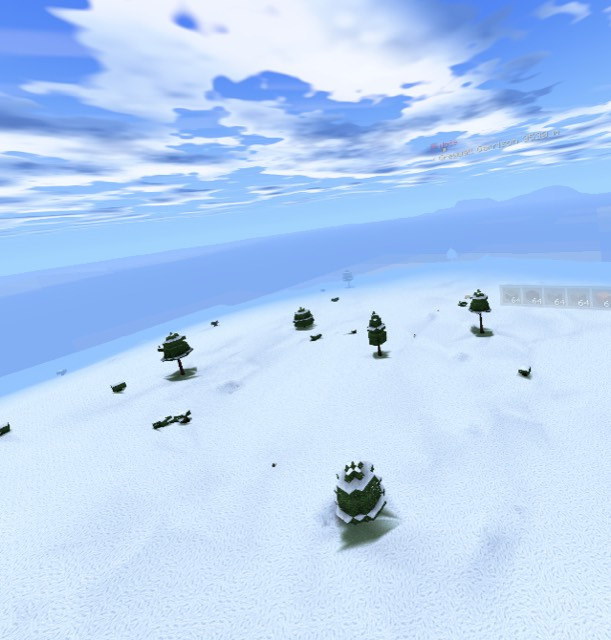

# Voice bug notes 2026-11-13 (Quest)

Spoken while playing; transcribed by elevenlabs/scribe-v2. Written by `tools/quest-bugnotes.py` (rewritten each run; edit Status lines in a copy). 1 notes.

## 13:09:17 - All right, all done for now

- **Transcript:** All right, all done for now
- **Status:** open
- **Build:** 0.129 (fc006bd3, M1-M4 (device-tested; ship riding, chests, comfort options, weapon wheel))
- **World:** Sparkstone Workshop (seed 91604158401363)
- **Dimension:** Surface
- **Biome:** Snowy Plains
- **Position:** 5548.4 101.5 -3061.1
- **Facing:** north (yaw 352, pitch -79)
- **Held:** Capital Rounds x64
- **Mount:** on foot, flying
- **Looking at:** nothing
- **Mode:** Creative, health 20/20
- **Time:** day 1 12:18, clear
- **Fps:** 71
- **Levels:** mic -27 dBFS, game sound -20 dBFS
- **Just before:** -21s opened PauseMenu; -21s closed PauseMenu; -20s holding Capital Rounds; -20s message: Capital Rounds; -14s message: Flying; -1s opened PauseMenu; -1s closed PauseMenu
- **Repro (Mac):** `./snap.sh note --seed 91604158401363 --x 5548.4 --z -3061.1 --yaw 8 --pitch -79 --time 0.263`
- **Audio (this Mac):** /Users/darthvadar/Documents/Blocksmith/QuestVoiceNotes/raw/vn-20261113-130917-998.aac

