# Voice bug notes 2026-11-14 (Quest)

Spoken while playing; transcribed by elevenlabs/scribe-v2. Written by `tools/quest-bugnotes.py` (rewritten each run; edit Status lines in a copy). 494 notes.

## 11:50:11 - That's interesting

- **Transcript:** That's interesting
- **Status:** open
- **Build:** 0.129 (bcc0f6d1, M1-M4 (device-tested; ship riding, chests, comfort options, weapon wheel))
- **World:** Quest World (seed 5663059916303033239)
- **Dimension:** Hell
- **Biome:** Ash Vault
- **Position:** 3219.6 -34.0 -3049.5
- **Facing:** south-east (yaw 115, pitch -22)
- **Held:** Titanium Pickaxe x1
- **Mount:** on foot
- **Looking at:** nothing
- **Mode:** Creative, health 11/20
- **Time:** day 7 13:38, clear
- **Fps:** 69
- **Levels:** mic -39 dBFS, game sound -23 dBFS
- **Length:** 2.3 s (voice 0.7 s)
- **Just before:** -8s opened PauseMenu; -6s closed PauseMenu; -6s message: Playtest build: voice bug notes ON, your speech is saved (Options > Interface); -2s message: The Chancellor, over the loudspeakers: "Seal the bunker! Nobody opens the blast door in the command post!"; -2s holding Field Journal of an Ashguard Rifleman; -2s holding Titanium Pickaxe
- **Repro (Mac):** `./snap.sh note --seed 5663059916303033239 --x 3219.6 --z -3049.5 --yaw -115 --pitch -22 --time 0.318 --dim deep`
- **Audio (this Mac):** /Users/darthvadar/Documents/Blocksmith/QuestVoiceNotes/raw/vn-20261114-115011-163.aac

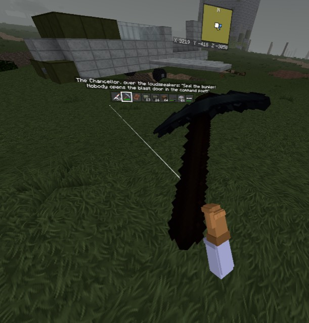

## 11:50:26 - Why is this so black?

- **Transcript:** Why is this so black?
- **Status:** open
- **Build:** 0.129 (bcc0f6d1, M1-M4 (device-tested; ship riding, chests, comfort options, weapon wheel))
- **World:** Quest World (seed 5663059916303033239)
- **Dimension:** Hell
- **Biome:** Ash Vault
- **Position:** 3211.9 -34.0 -3026.8
- **Facing:** south-east (yaw 124, pitch 13)
- **Held:** Titanium Pickaxe x1
- **Mount:** on foot
- **Looking at:** nothing
- **Mode:** Creative, health 11/20
- **Time:** day 7 13:56, clear
- **Fps:** 72
- **Levels:** mic -26 dBFS, game sound -22 dBFS
- **Length:** 2.5 s (voice 1.0 s)
- **Just before:** -23s opened PauseMenu; -21s closed PauseMenu; -21s message: Playtest build: voice bug notes ON, your speech is saved (Options > Interface); -18s message: The Chancellor, over the loudspeakers: "Seal the bunker! Nobody opens the blast door in the command post!"; -17s holding Field Journal of an Ashguard Rifleman; -17s holding Titanium Pickaxe
- **Repro (Mac):** `./snap.sh note --seed 5663059916303033239 --x 3211.9 --z -3026.8 --yaw -124 --pitch 13 --time 0.331 --dim deep`
- **Audio (this Mac):** /Users/darthvadar/Documents/Blocksmith/QuestVoiceNotes/raw/vn-20261114-115026-303.aac

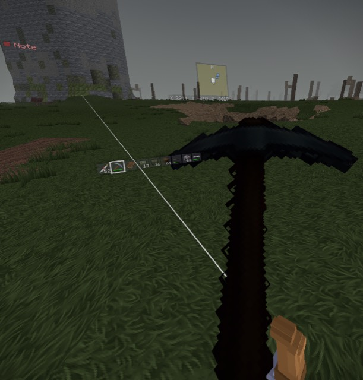

## 11:50:31 - So like, um, what is that?

- **Transcript:** So like, um, what is that?
- **Status:** open
- **Build:** 0.129 (bcc0f6d1, M1-M4 (device-tested; ship riding, chests, comfort options, weapon wheel))
- **World:** Quest World (seed 5663059916303033239)
- **Dimension:** Hell
- **Biome:** Ash Vault
- **Position:** 3211.8 -34.0 -3026.8
- **Facing:** east (yaw 110, pitch 55)
- **Held:** Titanium Pickaxe x1
- **Mount:** on foot
- **Looking at:** nothing
- **Mode:** Creative, health 11/20
- **Time:** day 7 14:03, clear
- **Fps:** 72
- **Levels:** mic -25 dBFS, game sound -22 dBFS
- **Length:** 3.8 s (voice 1.7 s)
- **Just before:** -29s opened PauseMenu; -27s closed PauseMenu; -27s message: Playtest build: voice bug notes ON, your speech is saved (Options > Interface); -23s message: The Chancellor, over the loudspeakers: "Seal the bunker! Nobody opens the blast door in the command post!"; -23s holding Field Journal of an Ashguard Rifleman; -22s holding Titanium Pickaxe
- **Repro (Mac):** `./snap.sh note --seed 5663059916303033239 --x 3211.8 --z -3026.8 --yaw -110 --pitch 55 --time 0.335 --dim deep`
- **Audio (this Mac):** /Users/darthvadar/Documents/Blocksmith/QuestVoiceNotes/raw/vn-20261114-115031-943.aac

## 11:50:39 - It doesn't look very polished to me

- **Transcript:** It doesn't look very polished to me
- **Status:** open
- **Build:** 0.129 (bcc0f6d1, M1-M4 (device-tested; ship riding, chests, comfort options, weapon wheel))
- **World:** Quest World (seed 5663059916303033239)
- **Dimension:** Hell
- **Biome:** Ash Vault
- **Position:** 3211.8 -34.0 -3026.8
- **Facing:** south-east (yaw 119, pitch 31)
- **Held:** Titanium Pickaxe x1
- **Mount:** on foot
- **Looking at:** nothing
- **Mode:** Creative, health 11/20
- **Time:** day 7 14:12, clear
- **Fps:** 72
- **Levels:** mic -32 dBFS, game sound -19 dBFS
- **Length:** 3.3 s (voice 1.5 s)
- **Repro (Mac):** `./snap.sh note --seed 5663059916303033239 --x 3211.8 --z -3026.8 --yaw -119 --pitch 31 --time 0.342 --dim deep`
- **Audio (this Mac):** /Users/darthvadar/Documents/Blocksmith/QuestVoiceNotes/raw/vn-20261114-115039-923.aac

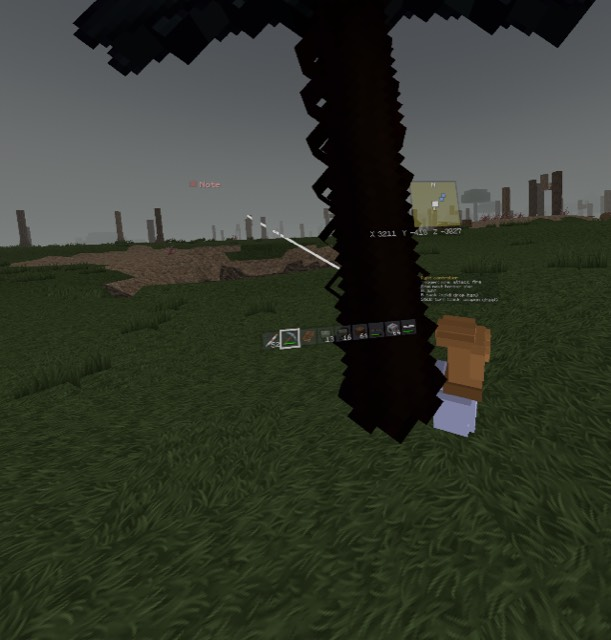

## 11:50:43 - Maybe we should fix that

- **Transcript:** Maybe we should fix that
- **Status:** open
- **Build:** 0.129 (bcc0f6d1, M1-M4 (device-tested; ship riding, chests, comfort options, weapon wheel))
- **World:** Quest World (seed 5663059916303033239)
- **Dimension:** Hell
- **Biome:** Ash Vault
- **Position:** 3211.8 -34.0 -3026.8
- **Facing:** east (yaw 101, pitch 35)
- **Held:** Titanium Pickaxe x1
- **Mount:** on foot
- **Looking at:** nothing
- **Mode:** Creative, health 11/20
- **Time:** day 7 14:16, clear
- **Fps:** 72
- **Levels:** mic -32 dBFS, game sound -20 dBFS
- **Length:** 2.5 s (voice 0.8 s)
- **Repro (Mac):** `./snap.sh note --seed 5663059916303033239 --x 3211.8 --z -3026.8 --yaw -101 --pitch 35 --time 0.345 --dim deep`
- **Audio (this Mac):** /Users/darthvadar/Documents/Blocksmith/QuestVoiceNotes/raw/vn-20261114-115043-483.aac

## 11:50:49 - Well, since we're already down here... Oh, whoa, whoa, whoa, whoa, who

- **Transcript:** Well, since we're already down here... Oh, whoa, whoa, whoa, whoa, whoa, whoa, whoa. All right, no, I'm just gonna do New World
- **Status:** open
- **Build:** 0.129 (bcc0f6d1, M1-M4 (device-tested; ship riding, chests, comfort options, weapon wheel))
- **World:** Quest World (seed 5663059916303033239)
- **Dimension:** Hell
- **Biome:** Burnt Woods
- **Position:** 3200.7 -14.8 -2953.0
- **Facing:** south (yaw 182, pitch -53)
- **Held:** Titanium Pickaxe x1
- **Mount:** on foot, flying
- **Looking at:** nothing
- **Mode:** Creative, health 11/20
- **Time:** day 7 14:24, clear
- **Fps:** 72
- **Levels:** mic -39 dBFS, game sound -20 dBFS
- **Length:** 8.3 s (voice 4.9 s)
- **Just before:** -1s message: Flying; -0s walked into Burnt Woods
- **While talking:** -3s message: Walking
- **Position at the end:** 3225.7 -34.0 -2887.0
- **Repro (Mac):** `./snap.sh note --seed 5663059916303033239 --x 3200.7 --z -2953.0 --yaw 178 --pitch -53 --time 0.350 --dim deep`
- **Audio (this Mac):** /Users/darthvadar/Documents/Blocksmith/QuestVoiceNotes/raw/vn-20261114-115049-843.aac

## 11:50:58 - Maybe stuff like this would go away

- **Transcript:** Maybe stuff like this would go away
- **Status:** open
- **Build:** 0.129 (bcc0f6d1, M1-M4 (device-tested; ship riding, chests, comfort options, weapon wheel))
- **World:** Quest World (seed 5663059916303033239)
- **Dimension:** Hell
- **Biome:** Burnt Woods
- **Position:** 3240.5 -33.0 -2882.2
- **Facing:** south-west (yaw 209, pitch -15)
- **Held:** Titanium Pickaxe x1
- **Mount:** on foot
- **Looking at:** nothing
- **Mode:** Creative, health 11/20
- **Time:** day 7 14:35, clear
- **Fps:** 72
- **Levels:** mic -25 dBFS, game sound -6 dBFS
- **Length:** 3.6 s (voice 1.5 s)
- **Just before:** -10s message: Flying; -10s walked into Burnt Woods; -7s message: Walking
- **Repro (Mac):** `./snap.sh note --seed 5663059916303033239 --x 3240.5 --z -2882.2 --yaw 151 --pitch -15 --time 0.358 --dim deep`
- **Audio (this Mac):** /Users/darthvadar/Documents/Blocksmith/QuestVoiceNotes/raw/vn-20261114-115058-943.aac

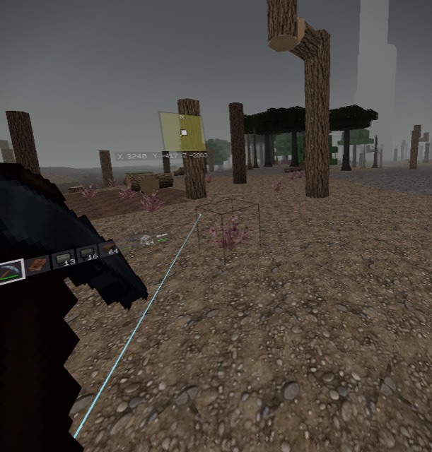

## 11:51:03 - It just disappeared. Wow. Okay. Oh, there it is

- **Transcript:** It just disappeared. Wow. Okay. Oh, there it is
- **Status:** open
- **Build:** 0.129 (bcc0f6d1, M1-M4 (device-tested; ship riding, chests, comfort options, weapon wheel))
- **World:** Quest World (seed 5663059916303033239)
- **Dimension:** Hell
- **Biome:** Burnt Woods
- **Position:** 3230.3 -34.0 -2890.6
- **Facing:** south (yaw 180, pitch 37)
- **Held:** Titanium Pickaxe x1
- **Mount:** on foot
- **Looking at:** nothing
- **Mode:** Creative, health 11/20
- **Time:** day 7 14:40, clear
- **Fps:** 72
- **Levels:** mic -54 dBFS, game sound -17 dBFS
- **Length:** 4.8 s (voice 1.8 s)
- **Just before:** -15s message: Flying; -14s walked into Burnt Woods; -12s message: Walking
- **Repro (Mac):** `./snap.sh note --seed 5663059916303033239 --x 3230.3 --z -2890.6 --yaw 180 --pitch 37 --time 0.362 --dim deep`
- **Audio (this Mac):** /Users/darthvadar/Documents/Blocksmith/QuestVoiceNotes/raw/vn-20261114-115103-243.aac

## 11:51:08 - Okay, I guess that's somewhat realistic

- **Transcript:** Okay, I guess that's somewhat realistic
- **Status:** open
- **Build:** 0.129 (bcc0f6d1, M1-M4 (device-tested; ship riding, chests, comfort options, weapon wheel))
- **World:** Quest World (seed 5663059916303033239)
- **Dimension:** Hell
- **Biome:** Burnt Woods
- **Position:** 3226.2 -34.0 -2885.3
- **Facing:** south-east (yaw 151, pitch -24)
- **Held:** Titanium Pickaxe x1
- **Mount:** on foot
- **Looking at:** Ash Silt at 3226 -34 -2884
- **Mode:** Creative, health 11/20
- **Time:** day 7 14:46, clear
- **Fps:** 72
- **Levels:** mic -35 dBFS, game sound -13 dBFS
- **Length:** 3.6 s (voice 1.3 s)
- **Just before:** -20s message: Flying; -19s walked into Burnt Woods; -17s message: Walking
- **Repro (Mac):** `./snap.sh note --seed 5663059916303033239 --x 3226.2 --z -2885.3 --yaw -151 --pitch -24 --time 0.366 --dim deep`
- **Audio (this Mac):** /Users/darthvadar/Documents/Blocksmith/QuestVoiceNotes/raw/vn-20261114-115108-463.aac

## 11:51:14 - Okay, I'm just gonna ignore that and go find a different world

- **Transcript:** Okay, I'm just gonna ignore that and go find a different world
- **Status:** open
- **Build:** 0.129 (bcc0f6d1, M1-M4 (device-tested; ship riding, chests, comfort options, weapon wheel))
- **World:** Quest World (seed 5663059916303033239)
- **Dimension:** Hell
- **Biome:** Burnt Woods
- **Position:** 3227.5 -33.0 -2875.7
- **Facing:** south-east (yaw 117, pitch 1)
- **Held:** Titanium Pickaxe x1
- **Mount:** on foot
- **Looking at:** nothing
- **Mode:** Creative, health 11/20
- **Time:** day 7 14:54, clear
- **Fps:** 72
- **Levels:** mic -39 dBFS, game sound -20 dBFS
- **Length:** 4.1 s (voice 1.8 s)
- **Just before:** -26s message: Flying; -25s walked into Burnt Woods; -23s message: Walking
- **Repro (Mac):** `./snap.sh note --seed 5663059916303033239 --x 3227.5 --z -2875.7 --yaw -117 --pitch 1 --time 0.371 --dim deep`
- **Audio (this Mac):** /Users/darthvadar/Documents/Blocksmith/QuestVoiceNotes/raw/vn-20261114-115114-703.aac

## 11:51:36 - I'm impressed with Fable's work. It did a very good job, mostly. Look 

- **Transcript:** I'm impressed with Fable's work. It did a very good job, mostly. Look at this right here, got a log. This should have rolled down the hill with the physics. Uh, that's what we want. We want this to roll
- **Status:** open
- **Build:** 0.129 (bcc0f6d1, M1-M4 (device-tested; ship riding, chests, comfort options, weapon wheel))
- **World:** New World (24) (seed 574311329053960387)
- **Dimension:** Surface
- **Biome:** Forest
- **Position:** 3232.2 67.0 3993.1
- **Facing:** south-east (yaw 153, pitch -64)
- **Held:** Greywall Dispatch x1
- **Mount:** on foot
- **Looking at:** Grass Block at 3232 66 3993
- **Mode:** Survival, health 20/20
- **Time:** day 1 07:38, clear
- **Fps:** 72
- **Levels:** mic -27 dBFS, game sound -17 dBFS
- **Length:** 15.0 s (voice 8.1 s)
- **Just before:** -10s opened PauseMenu; -8s closed PauseMenu; -8s message: Playtest build: voice bug notes ON, your speech is saved (Options > Interface); -4s message: The Chancellor, over the loudspeakers: "Seal the bunker! Nobody opens the blast door in the command post!"; -4s holding Field Journal of an Ashguard Rifleman; -4s holding Titanium Pickaxe; --35s message: Flying; --36s walked into Burnt Woods; --38s message: Walking; --65s opened PauseMenu; -10s entered Surface; -10s closed PauseMenu; -10s holding Greywall Dispatch; -10s message: In Clear Ford's jail safe: a Greywall Dispatch; -10s message: In Clear Ford's jail safe: a Greywall Dispatch. Added to journal: Who Holds the Frontier; -6s message: Spring: the snow melts and the young are born
- **While talking:** --30s message: Flying; --31s walked into Burnt Woods; --33s message: Walking; --60s opened PauseMenu; --25s message: Flying; --26s walked into Burnt Woods; --28s message: Walking; --55s opened PauseMenu
- **Position at the end:** 3243.1 66.4 3993.6
- **Repro (Mac):** `./snap.sh note --seed 574311329053960387 --x 3232.2 --z 3993.1 --yaw -153 --pitch -64 --time 0.068`
- **Audio (this Mac):** /Users/darthvadar/Documents/Blocksmith/QuestVoiceNotes/raw/vn-20261114-115136-704.aac

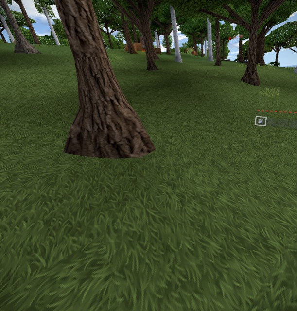

## 11:51:51 - Also looking closely, there's some little, uh

- **Transcript:** Also looking closely, there's some little, uh
- **Status:** open
- **Build:** 0.129 (bcc0f6d1, M1-M4 (device-tested; ship riding, chests, comfort options, weapon wheel))
- **World:** New World (24) (seed 574311329053960387)
- **Dimension:** Surface
- **Biome:** Forest
- **Position:** 3242.0 66.5 3993.2
- **Facing:** north-west (yaw 306, pitch -36)
- **Held:** Greywall Dispatch x1
- **Mount:** on foot
- **Looking at:** Oak Log at 3240 67 3992
- **Mode:** Survival, health 20/20
- **Time:** day 1 07:56, clear
- **Fps:** 53
- **Levels:** mic -30 dBFS, game sound -30 dBFS
- **Length:** 3.5 s (voice 2.2 s)
- **Just before:** -25s opened PauseMenu; -23s closed PauseMenu; -23s message: Playtest build: voice bug notes ON, your speech is saved (Options > Interface); -19s message: The Chancellor, over the loudspeakers: "Seal the bunker! Nobody opens the blast door in the command post!"; -19s holding Field Journal of an Ashguard Rifleman; -18s holding Titanium Pickaxe; --21s message: Flying; --21s walked into Burnt Woods; --24s message: Walking; --50s opened PauseMenu; -25s entered Surface; -25s closed PauseMenu; -25s holding Greywall Dispatch; -25s message: In Clear Ford's jail safe: a Greywall Dispatch; -24s message: In Clear Ford's jail safe: a Greywall Dispatch. Added to journal: Who Holds the Frontier; -21s message: Spring: the snow melts and the young are born
- **Repro (Mac):** `./snap.sh note --seed 574311329053960387 --x 3242.0 --z 3993.2 --yaw 54 --pitch -36 --time 0.081`
- **Audio (this Mac):** /Users/darthvadar/Documents/Blocksmith/QuestVoiceNotes/raw/vn-20261114-115151-503.aac

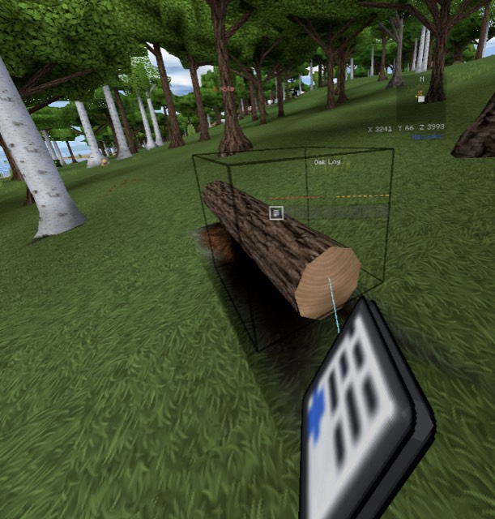

## 11:51:55 - A few gaps in the origami here

- **Transcript:** A few gaps in the origami here
- **Status:** open
- **Build:** 0.129 (bcc0f6d1, M1-M4 (device-tested; ship riding, chests, comfort options, weapon wheel))
- **World:** New World (24) (seed 574311329053960387)
- **Dimension:** Surface
- **Biome:** Forest
- **Position:** 3241.6 66.6 3993.0
- **Facing:** north-west (yaw 310, pitch -41)
- **Held:** Greywall Dispatch x1
- **Mount:** on foot
- **Looking at:** Oak Log at 3240 67 3992
- **Mode:** Survival, health 20/20
- **Time:** day 1 08:01, clear
- **Fps:** 52
- **Levels:** mic -37 dBFS, game sound -20 dBFS
- **Length:** 3.5 s (voice 1.9 s)
- **Just before:** -29s opened PauseMenu; -27s closed PauseMenu; -27s message: Playtest build: voice bug notes ON, your speech is saved (Options > Interface); -23s message: The Chancellor, over the loudspeakers: "Seal the bunker! Nobody opens the blast door in the command post!"; -23s holding Field Journal of an Ashguard Rifleman; -22s holding Titanium Pickaxe; --17s message: Flying; --17s walked into Burnt Woods; --19s message: Walking; --46s opened PauseMenu; -29s entered Surface; -29s closed PauseMenu; -29s holding Greywall Dispatch; -29s message: In Clear Ford's jail safe: a Greywall Dispatch; -28s message: In Clear Ford's jail safe: a Greywall Dispatch. Added to journal: Who Holds the Frontier; -25s message: Spring: the snow melts and the young are born
- **Repro (Mac):** `./snap.sh note --seed 574311329053960387 --x 3241.6 --z 3993.0 --yaw 50 --pitch -41 --time 0.084`
- **Audio (this Mac):** /Users/darthvadar/Documents/Blocksmith/QuestVoiceNotes/raw/vn-20261114-115155-623.aac

## 11:51:59 - Not polished. Fix that

- **Transcript:** Not polished. Fix that
- **Status:** open
- **Build:** 0.129 (bcc0f6d1, M1-M4 (device-tested; ship riding, chests, comfort options, weapon wheel))
- **World:** New World (24) (seed 574311329053960387)
- **Dimension:** Surface
- **Biome:** Forest
- **Position:** 3241.9 66.7 3992.4
- **Facing:** west (yaw 261, pitch -47)
- **Held:** Greywall Dispatch x1
- **Mount:** on foot
- **Looking at:** Oak Log at 3240 67 3992
- **Mode:** Survival, health 20/20
- **Time:** day 1 08:06, clear
- **Fps:** 72
- **Levels:** mic -29 dBFS, game sound -21 dBFS
- **Length:** 2.7 s (voice 0.7 s)
- **Just before:** -27s message: The Chancellor, over the loudspeakers: "Seal the bunker! Nobody opens the blast door in the command post!"; -27s holding Field Journal of an Ashguard Rifleman; -26s holding Titanium Pickaxe; --13s message: Flying; --13s walked into Burnt Woods; --15s message: Walking; --42s opened PauseMenu; -29s message: Spring: the snow melts and the young are born
- **Repro (Mac):** `./snap.sh note --seed 574311329053960387 --x 3241.9 --z 3992.4 --yaw 99 --pitch -47 --time 0.088`
- **Audio (this Mac):** /Users/darthvadar/Documents/Blocksmith/QuestVoiceNotes/raw/vn-20261114-115159-663.aac

## 11:52:03 - We're raising the standard. Trying to not add features, and we're tryi

- **Transcript:** We're raising the standard. Trying to not add features, and we're trying to just add polishing items
- **Status:** open
- **Build:** 0.129 (bcc0f6d1, M1-M4 (device-tested; ship riding, chests, comfort options, weapon wheel))
- **World:** New World (24) (seed 574311329053960387)
- **Dimension:** Surface
- **Biome:** Forest
- **Position:** 3224.6 66.4 3996.5
- **Facing:** west (yaw 254, pitch -26)
- **Held:** Greywall Dispatch x1
- **Mount:** on foot
- **Looking at:** Leaf Litter at 3222 67 3996
- **Mode:** Survival, health 20/20
- **Time:** day 1 08:10, clear
- **Fps:** 72
- **Levels:** mic -31 dBFS, game sound -19 dBFS
- **Length:** 7.9 s (voice 4.6 s)
- **Just before:** --9s message: Flying; --10s walked into Burnt Woods; --12s message: Walking; --38s opened PauseMenu
- **While talking:** --4s message: Flying; --5s walked into Burnt Woods; --7s message: Walking; --33s opened PauseMenu; -2s message: The sky is clouding over: fog is coming
- **Position at the end:** 3198.8 72.2 3978.2
- **Repro (Mac):** `./snap.sh note --seed 574311329053960387 --x 3224.6 --z 3996.5 --yaw 106 --pitch -26 --time 0.091`
- **Audio (this Mac):** /Users/darthvadar/Documents/Blocksmith/QuestVoiceNotes/raw/vn-20261114-115203-303.aac

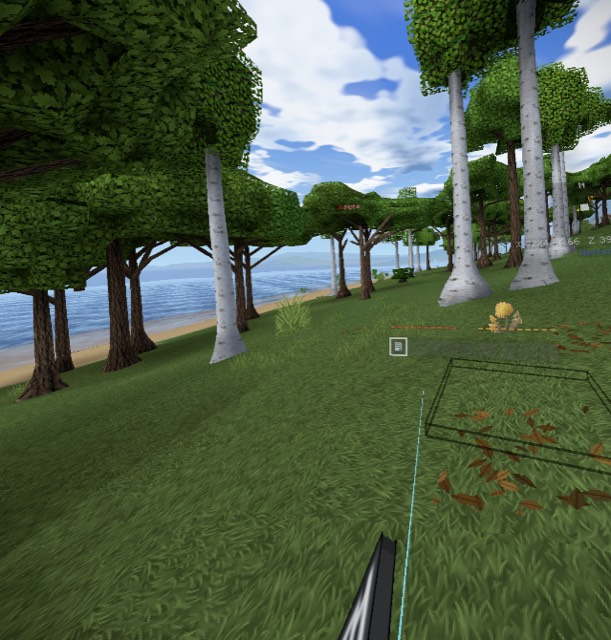

## 11:52:11 - That's pretty much... Gonna polish everything so it looks great

- **Transcript:** That's pretty much... Gonna polish everything so it looks great
- **Status:** open
- **Build:** 0.129 (bcc0f6d1, M1-M4 (device-tested; ship riding, chests, comfort options, weapon wheel))
- **World:** New World (24) (seed 574311329053960387)
- **Dimension:** Surface
- **Biome:** Forest
- **Position:** 3186.6 74.5 3971.8
- **Facing:** west (yaw 270, pitch -40)
- **Held:** Greywall Dispatch x1
- **Mount:** on foot
- **Looking at:** Grass Block at 3185 74 3971
- **Mode:** Survival, health 20/20
- **Time:** day 1 08:20, clear
- **Fps:** 72
- **Levels:** mic -33 dBFS, game sound -22 dBFS
- **Length:** 4.2 s (voice 1.9 s)
- **Just before:** --0s message: Flying; --1s walked into Burnt Woods; --3s message: Walking; --29s opened PauseMenu; -6s message: The sky is clouding over: fog is coming
- **Repro (Mac):** `./snap.sh note --seed 574311329053960387 --x 3186.6 --z 3971.8 --yaw 90 --pitch -40 --time 0.098`
- **Audio (this Mac):** /Users/darthvadar/Documents/Blocksmith/QuestVoiceNotes/raw/vn-20261114-115211-983.aac

## 11:52:20 - Um, hmm. These cutouts, I mean, I'm sure they're great for the GPU, bu

- **Transcript:** Um, hmm. These cutouts, I mean, I'm sure they're great for the GPU, but, ah, geez
- **Status:** open
- **Build:** 0.129 (bcc0f6d1, M1-M4 (device-tested; ship riding, chests, comfort options, weapon wheel))
- **World:** New World (24) (seed 574311329053960387)
- **Dimension:** Surface
- **Biome:** Flower Forest
- **Position:** 3158.0 83.5 3920.0
- **Facing:** west (yaw 284, pitch -26)
- **Held:** Greywall Dispatch x1
- **Mount:** on foot
- **Looking at:** Grass Block at 3155 83 3919
- **Mode:** Survival, health 20/20
- **Time:** day 1 08:31, clear
- **Fps:** 72
- **Levels:** mic -25 dBFS, game sound -22 dBFS
- **Length:** 9.5 s (voice 4.8 s)
- **Just before:** -9s message: Flying; -8s walked into Burnt Woods; -6s message: Walking; --20s opened PauseMenu; -15s message: The sky is clouding over: fog is coming
- **While talking:** --15s opened PauseMenu
- **Position at the end:** 3155.8 83.5 3917.7
- **Repro (Mac):** `./snap.sh note --seed 574311329053960387 --x 3158.0 --z 3920.0 --yaw 76 --pitch -26 --time 0.105`
- **Audio (this Mac):** /Users/darthvadar/Documents/Blocksmith/QuestVoiceNotes/raw/vn-20261114-115220-923.aac

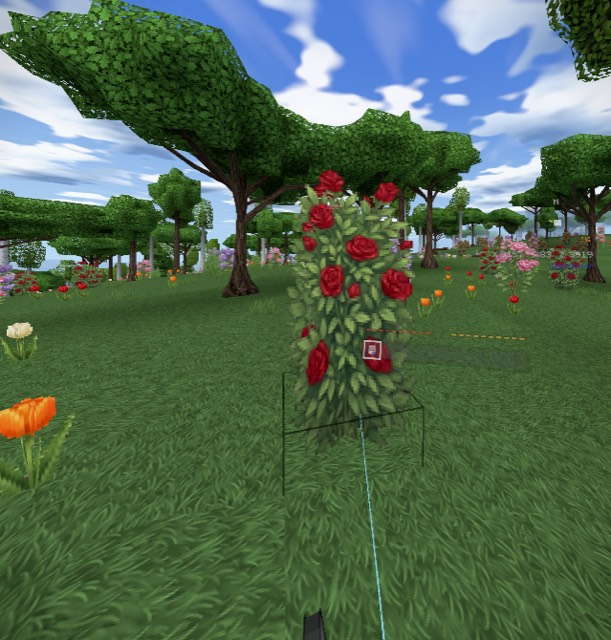

## 11:52:36 - Yeah。OK

- **Transcript:** Yeah。OK
- **Status:** open
- **Build:** 0.129 (bcc0f6d1, M1-M4 (device-tested; ship riding, chests, comfort options, weapon wheel))
- **World:** New World (24) (seed 574311329053960387)
- **Dimension:** Surface
- **Biome:** Flower Forest
- **Position:** 3122.6 86.8 3886.0
- **Facing:** west (yaw 275, pitch -32)
- **Held:** Greywall Dispatch x1
- **Mount:** on foot
- **Looking at:** Grass Block at 3120 86 3885
- **Mode:** Survival, health 20/20
- **Time:** day 1 08:49, clear
- **Fps:** 72
- **Levels:** mic -31 dBFS, game sound -23 dBFS
- **Length:** 2.2 s (voice 0.6 s)
- **Just before:** -24s message: Flying; -23s walked into Burnt Woods; -21s message: Walking; --5s opened PauseMenu
- **Repro (Mac):** `./snap.sh note --seed 574311329053960387 --x 3122.6 --z 3886.0 --yaw 85 --pitch -32 --time 0.118`
- **Audio (this Mac):** /Users/darthvadar/Documents/Blocksmith/QuestVoiceNotes/raw/vn-20261114-115236-263.aac

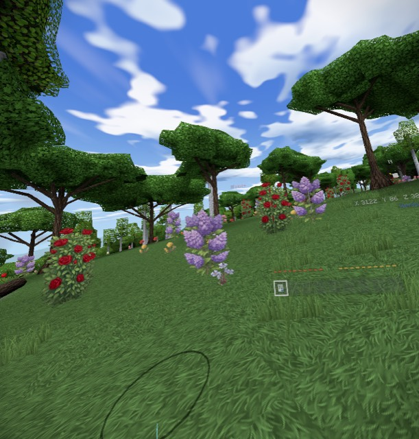

## 11:52:44 - What if they were cutouts from like

- **Transcript:** What if they were cutouts from like
- **Status:** open
- **Build:** 0.129 (bcc0f6d1, M1-M4 (device-tested; ship riding, chests, comfort options, weapon wheel))
- **World:** New World (24) (seed 574311329053960387)
- **Dimension:** Surface
- **Biome:** Flower Forest
- **Position:** 3106.4 89.7 3863.5
- **Facing:** north-west (yaw 311, pitch -25)
- **Held:** Greywall Dispatch x1
- **Mount:** on foot
- **Looking at:** Rose Bush at 3104 90 3861
- **Mode:** Survival, health 20/20
- **Time:** day 1 08:59, clear
- **Fps:** 71
- **Levels:** mic -26 dBFS, game sound -27 dBFS
- **Length:** 4.6 s (voice 1.9 s)
- **Just before:** -29s message: Walking; -3s opened PauseMenu
- **Repro (Mac):** `./snap.sh note --seed 574311329053960387 --x 3106.4 --z 3863.5 --yaw 49 --pitch -25 --time 0.124`
- **Audio (this Mac):** /Users/darthvadar/Documents/Blocksmith/QuestVoiceNotes/raw/vn-20261114-115244-003.aac

## 11:52:48 - I have, I have no idea

- **Transcript:** I have, I have no idea
- **Status:** open
- **Build:** 0.129 (bcc0f6d1, M1-M4 (device-tested; ship riding, chests, comfort options, weapon wheel))
- **World:** New World (24) (seed 574311329053960387)
- **Dimension:** Surface
- **Biome:** Flower Forest
- **Position:** 3107.0 89.8 3862.8
- **Facing:** north-west (yaw 293, pitch -27)
- **Held:** Greywall Dispatch x1
- **Mount:** on foot
- **Looking at:** Rose Bush at 3104 90 3861
- **Mode:** Survival, health 20/20
- **Time:** day 1 09:04, clear
- **Fps:** 72
- **Levels:** mic -29 dBFS, game sound -22 dBFS
- **Length:** 2.9 s (voice 0.6 s)
- **Just before:** -7s opened PauseMenu; -4s left the pack: Falke Pistol x2 (at 3104 90 3861); -4s left the pack: Donnerkeil Service Rifle x3 (at 3104 90 3861); -4s left the pack: Rocket x4 (at 3104 90 3861); -4s left the pack: Aero Engine Spares x18 (at 3104 90 3861); -4s left the pack: Field Stim x52 (at 3104 90 3861); -4s left the pack: Duskium Chestplate (at 3104 90 3861); -4s left the pack: Fernblick Rifle (at 3104 90 3861); -4s left the pack: Himmelsturm Launcher (at 3104 90 3861); -4s left the pack: Jetpack x2 (at 3104 90 3861); -4s left the pack: Field Journal of an Ashguard Rifleman (at 3104 90 3861); -4s left the pack: Titanium Pickaxe (at 3104 90 3861); -4s left the pack: Mahlwerk Rotary Gun (at 3104 90 3861); -4s left the pack: Track Spares x16 (at 3104 90 3861); -4s left the pack: Regular Armour Set (at 3104 90 3861); -4s left the pack: Faustrohr (at 3104 90 3861); -4s left the pack: Faustrohr Warhead x3 (at 3104 90 3861); -3s walked into Flower Forest
- **Repro (Mac):** `./snap.sh note --seed 574311329053960387 --x 3107.0 --z 3862.8 --yaw 67 --pitch -27 --time 0.128`
- **Audio (this Mac):** /Users/darthvadar/Documents/Blocksmith/QuestVoiceNotes/raw/vn-20261114-115248-423.aac

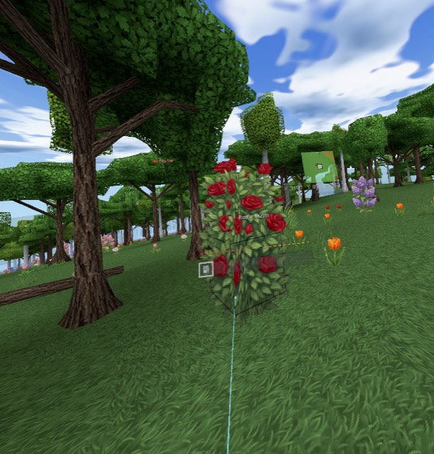

## 11:52:52 - Kind of it's from like four chunks away and then when in person maybe 

- **Transcript:** Kind of it's from like four chunks away and then when in person maybe they can be like something actually 3D
- **Status:** open
- **Build:** 0.129 (bcc0f6d1, M1-M4 (device-tested; ship riding, chests, comfort options, weapon wheel))
- **World:** New World (24) (seed 574311329053960387)
- **Dimension:** Surface
- **Biome:** Flower Forest
- **Position:** 3107.7 89.9 3860.2
- **Facing:** south-west (yaw 247, pitch -23)
- **Held:** Greywall Dispatch x1
- **Mount:** on foot
- **Looking at:** Rose Bush at 3104 90 3861
- **Mode:** Survival, health 20/20
- **Time:** day 1 09:09, clear
- **Fps:** 72
- **Levels:** mic -22 dBFS, game sound -19 dBFS
- **Length:** 7.6 s (voice 4.4 s)
- **Just before:** -11s opened PauseMenu; -7s left the pack: Falke Pistol x2 (at 3104 90 3861); -7s left the pack: Donnerkeil Service Rifle x3 (at 3104 90 3861); -7s left the pack: Rocket x4 (at 3104 90 3861); -7s left the pack: Aero Engine Spares x18 (at 3104 90 3861); -7s left the pack: Field Stim x52 (at 3104 90 3861); -7s left the pack: Duskium Chestplate (at 3104 90 3861); -7s left the pack: Fernblick Rifle (at 3104 90 3861); -7s left the pack: Himmelsturm Launcher (at 3104 90 3861); -7s left the pack: Jetpack x2 (at 3104 90 3861); -7s left the pack: Field Journal of an Ashguard Rifleman (at 3104 90 3861); -7s left the pack: Titanium Pickaxe (at 3104 90 3861); -7s left the pack: Mahlwerk Rotary Gun (at 3104 90 3861); -7s left the pack: Track Spares x16 (at 3104 90 3861); -7s left the pack: Regular Armour Set (at 3104 90 3861); -7s left the pack: Faustrohr (at 3104 90 3861); -7s left the pack: Faustrohr Warhead x3 (at 3104 90 3861); -7s walked into Flower Forest
- **While talking:** -0s walked into Forest
- **Position at the end:** 3101.7 91.1 3841.3
- **Repro (Mac):** `./snap.sh note --seed 574311329053960387 --x 3107.7 --z 3860.2 --yaw 113 --pitch -23 --time 0.131`
- **Audio (this Mac):** /Users/darthvadar/Documents/Blocksmith/QuestVoiceNotes/raw/vn-20261114-115252-183.aac

## 11:53:03 - Uh-oh, what do we have here? This isn't good

- **Transcript:** Uh-oh, what do we have here? This isn't good
- **Status:** open
- **Build:** 0.129 (bcc0f6d1, M1-M4 (device-tested; ship riding, chests, comfort options, weapon wheel))
- **World:** New World (24) (seed 574311329053960387)
- **Dimension:** Surface
- **Biome:** Forest
- **Position:** 3089.5 86.5 3796.2
- **Facing:** north-west (yaw 335, pitch -27)
- **Held:** Greywall Dispatch x1
- **Mount:** on foot
- **Looking at:** Short Grass at 3088 87 3795
- **Mode:** Survival, health 20/20
- **Time:** day 1 09:22, clear
- **Fps:** 72
- **Levels:** mic -35 dBFS, game sound -17 dBFS
- **Length:** 4.4 s (voice 2.3 s)
- **Just before:** -22s opened PauseMenu; -18s left the pack: Falke Pistol x2 (at 3104 90 3861); -18s left the pack: Donnerkeil Service Rifle x3 (at 3104 90 3861); -18s left the pack: Rocket x4 (at 3104 90 3861); -18s left the pack: Aero Engine Spares x18 (at 3104 90 3861); -18s left the pack: Field Stim x52 (at 3104 90 3861); -18s left the pack: Duskium Chestplate (at 3104 90 3861); -18s left the pack: Fernblick Rifle (at 3104 90 3861); -18s left the pack: Himmelsturm Launcher (at 3104 90 3861); -18s left the pack: Jetpack x2 (at 3104 90 3861); -18s left the pack: Field Journal of an Ashguard Rifleman (at 3104 90 3861); -18s left the pack: Titanium Pickaxe (at 3104 90 3861); -18s left the pack: Mahlwerk Rotary Gun (at 3104 90 3861); -18s left the pack: Track Spares x16 (at 3104 90 3861); -18s left the pack: Regular Armour Set (at 3104 90 3861); -18s left the pack: Faustrohr (at 3104 90 3861); -18s left the pack: Faustrohr Warhead x3 (at 3104 90 3861); -18s walked into Flower Forest; -6s walked into Forest
- **Repro (Mac):** `./snap.sh note --seed 574311329053960387 --x 3089.5 --z 3796.2 --yaw 25 --pitch -27 --time 0.140`
- **Audio (this Mac):** /Users/darthvadar/Documents/Blocksmith/QuestVoiceNotes/raw/vn-20261114-115303-063.aac

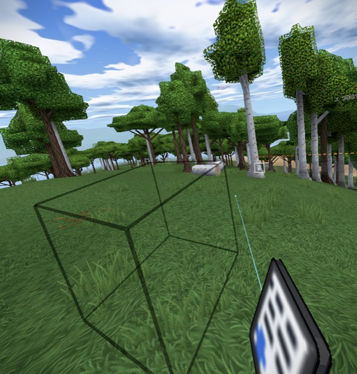

## 11:53:08 - Well, it's not that as bad as I thought, but still we've got, uh, we'v

- **Transcript:** Well, it's not that as bad as I thought, but still we've got, uh, we've got some polish issues here
- **Status:** open
- **Build:** 0.129 (bcc0f6d1, M1-M4 (device-tested; ship riding, chests, comfort options, weapon wheel))
- **World:** New World (24) (seed 574311329053960387)
- **Dimension:** Surface
- **Biome:** Forest
- **Position:** 3083.8 83.1 3783.2
- **Facing:** south-west (yaw 216, pitch -21)
- **Held:** Greywall Dispatch x1
- **Mount:** on foot
- **Looking at:** Short Grass at 3082 84 3784
- **Mode:** Survival, health 20/20
- **Time:** day 1 09:28, clear
- **Fps:** 72
- **Levels:** mic -24 dBFS, game sound -19 dBFS
- **Length:** 5.9 s (voice 3.5 s)
- **Just before:** -27s opened PauseMenu; -23s left the pack: Falke Pistol x2 (at 3104 90 3861); -23s left the pack: Donnerkeil Service Rifle x3 (at 3104 90 3861); -23s left the pack: Rocket x4 (at 3104 90 3861); -23s left the pack: Aero Engine Spares x18 (at 3104 90 3861); -23s left the pack: Field Stim x52 (at 3104 90 3861); -23s left the pack: Duskium Chestplate (at 3104 90 3861); -23s left the pack: Fernblick Rifle (at 3104 90 3861); -23s left the pack: Himmelsturm Launcher (at 3104 90 3861); -23s left the pack: Jetpack x2 (at 3104 90 3861); -23s left the pack: Field Journal of an Ashguard Rifleman (at 3104 90 3861); -23s left the pack: Titanium Pickaxe (at 3104 90 3861); -23s left the pack: Mahlwerk Rotary Gun (at 3104 90 3861); -23s left the pack: Track Spares x16 (at 3104 90 3861); -23s left the pack: Regular Armour Set (at 3104 90 3861); -23s left the pack: Faustrohr (at 3104 90 3861); -23s left the pack: Faustrohr Warhead x3 (at 3104 90 3861); -23s walked into Flower Forest; -11s walked into Forest
- **Position at the end:** 3081.7 83.3 3783.2
- **Repro (Mac):** `./snap.sh note --seed 574311329053960387 --x 3083.8 --z 3783.2 --yaw 144 --pitch -21 --time 0.145`
- **Audio (this Mac):** /Users/darthvadar/Documents/Blocksmith/QuestVoiceNotes/raw/vn-20261114-115308-023.aac

## 11:53:13 - Where it's like the cylinder and the, the flat side of the cylinder ar

- **Transcript:** Where it's like the cylinder and the, the flat side of the cylinder aren't quite matched. This needs to be like rotated probably, I don't know
- **Status:** open
- **Build:** 0.129 (bcc0f6d1, M1-M4 (device-tested; ship riding, chests, comfort options, weapon wheel))
- **World:** New World (24) (seed 574311329053960387)
- **Dimension:** Surface
- **Biome:** Forest
- **Position:** 3082.6 83.6 3784.4
- **Facing:** south-east (yaw 142, pitch -26)
- **Held:** Greywall Dispatch x1
- **Mount:** on foot
- **Looking at:** Birch Log at 3083 84 3785
- **Mode:** Survival, health 20/20
- **Time:** day 1 09:34, clear
- **Fps:** 71
- **Levels:** mic -32 dBFS, game sound -18 dBFS
- **Length:** 11.4 s (voice 6.0 s)
- **Just before:** -29s left the pack: Falke Pistol x2 (at 3104 90 3861); -29s left the pack: Donnerkeil Service Rifle x3 (at 3104 90 3861); -29s left the pack: Rocket x4 (at 3104 90 3861); -29s left the pack: Aero Engine Spares x18 (at 3104 90 3861); -29s left the pack: Field Stim x52 (at 3104 90 3861); -29s left the pack: Duskium Chestplate (at 3104 90 3861); -29s left the pack: Fernblick Rifle (at 3104 90 3861); -29s left the pack: Himmelsturm Launcher (at 3104 90 3861); -29s left the pack: Jetpack x2 (at 3104 90 3861); -29s left the pack: Field Journal of an Ashguard Rifleman (at 3104 90 3861); -29s left the pack: Titanium Pickaxe (at 3104 90 3861); -29s left the pack: Mahlwerk Rotary Gun (at 3104 90 3861); -29s left the pack: Track Spares x16 (at 3104 90 3861); -29s left the pack: Regular Armour Set (at 3104 90 3861); -29s left the pack: Faustrohr (at 3104 90 3861); -29s left the pack: Faustrohr Warhead x3 (at 3104 90 3861); -28s walked into Flower Forest; -16s walked into Forest
- **Position at the end:** 3083.2 83.4 3784.0
- **Repro (Mac):** `./snap.sh note --seed 574311329053960387 --x 3082.6 --z 3784.4 --yaw -142 --pitch -26 --time 0.149`
- **Audio (this Mac):** /Users/darthvadar/Documents/Blocksmith/QuestVoiceNotes/raw/vn-20261114-115313-603.aac

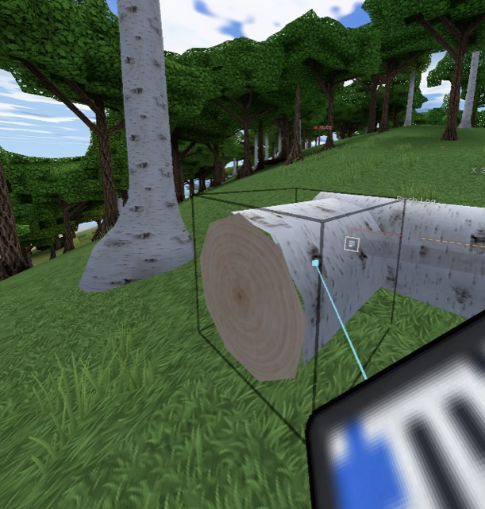

## 11:53:25 - 10 degrees

- **Transcript:** 10 degrees
- **Status:** open
- **Build:** 0.129 (bcc0f6d1, M1-M4 (device-tested; ship riding, chests, comfort options, weapon wheel))
- **World:** New World (24) (seed 574311329053960387)
- **Dimension:** Surface
- **Biome:** Forest
- **Position:** 3083.2 83.4 3784.0
- **Facing:** south (yaw 174, pitch -14)
- **Held:** Greywall Dispatch x1
- **Mount:** on foot
- **Looking at:** Birch Log at 3083 84 3785
- **Mode:** Survival, health 20/20
- **Time:** day 1 09:48, clear
- **Fps:** 72
- **Levels:** mic -32 dBFS, game sound -24 dBFS
- **Length:** 2.0 s (voice 0.6 s)
- **Just before:** -28s walked into Forest
- **Repro (Mac):** `./snap.sh note --seed 574311329053960387 --x 3083.2 --z 3784.0 --yaw -174 --pitch -14 --time 0.159`
- **Audio (this Mac):** /Users/darthvadar/Documents/Blocksmith/QuestVoiceNotes/raw/vn-20261114-115325-343.aac

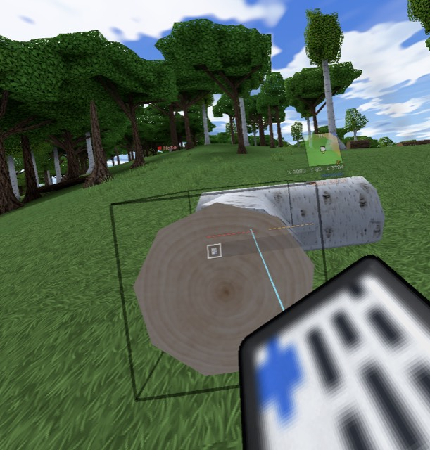

## 11:53:27 - All right, let's see what happens here

- **Transcript:** All right, let's see what happens here
- **Status:** open
- **Build:** 0.129 (bcc0f6d1, M1-M4 (device-tested; ship riding, chests, comfort options, weapon wheel))
- **World:** New World (24) (seed 574311329053960387)
- **Dimension:** Surface
- **Biome:** Forest
- **Position:** 3081.1 83.4 3783.4
- **Facing:** south (yaw 198, pitch 4)
- **Held:** Greywall Dispatch x1
- **Mount:** on foot
- **Looking at:** Oak Log at 3080 85 3785
- **Mode:** Survival, health 20/20
- **Time:** day 1 09:51, clear
- **Fps:** 72
- **Levels:** mic -30 dBFS, game sound -26 dBFS
- **Length:** 2.6 s (voice 1.0 s)
- **Repro (Mac):** `./snap.sh note --seed 574311329053960387 --x 3081.1 --z 3783.4 --yaw 162 --pitch 4 --time 0.161`
- **Audio (this Mac):** /Users/darthvadar/Documents/Blocksmith/QuestVoiceNotes/raw/vn-20261114-115327-443.aac

## 11:53:36 - That was smooth. That was really good. Really good

- **Transcript:** That was smooth. That was really good. Really good
- **Status:** open
- **Build:** 0.129 (bcc0f6d1, M1-M4 (device-tested; ship riding, chests, comfort options, weapon wheel))
- **World:** New World (24) (seed 574311329053960387)
- **Dimension:** Surface
- **Biome:** Forest
- **Position:** 3081.2 82.8 3781.5
- **Facing:** south (yaw 193, pitch -8)
- **Held:** Oak Log x1
- **Mount:** on foot
- **Looking at:** Grass Block at 3080 83 3784
- **Mode:** Survival, health 20/20
- **Time:** day 1 10:00, clear
- **Fps:** 72
- **Levels:** mic -24 dBFS, game sound -24 dBFS
- **Length:** 4.8 s (voice 2.1 s)
- **Just before:** -6s holding empty hand; -6s opened PauseMenu; -5s closed PauseMenu; -2s holding Oak Log
- **Repro (Mac):** `./snap.sh note --seed 574311329053960387 --x 3081.2 --z 3781.5 --yaw 167 --pitch -8 --time 0.167`
- **Audio (this Mac):** /Users/darthvadar/Documents/Blocksmith/QuestVoiceNotes/raw/vn-20261114-115336-283.aac

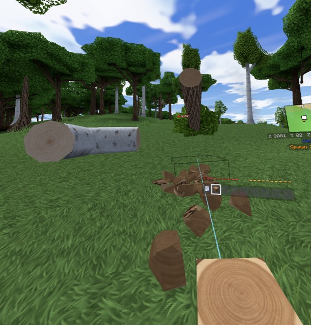

## 11:53:46 - Very good. Very good. Uh-oh. This here, though, right here, this is a 

- **Transcript:** Very good. Very good. Uh-oh. This here, though, right here, this is a branch. Why did it turn into this here? That shouldn't have happened
- **Status:** open
- **Build:** 0.129 (bcc0f6d1, M1-M4 (device-tested; ship riding, chests, comfort options, weapon wheel))
- **World:** New World (24) (seed 574311329053960387)
- **Dimension:** Surface
- **Biome:** Forest
- **Position:** 3072.1 84.3 3785.8
- **Facing:** south-west (yaw 223, pitch -4)
- **Held:** Oak Log x2
- **Mount:** on foot
- **Looking at:** Short Grass at 3071 85 3787
- **Mode:** Survival, health 20/20
- **Time:** day 1 10:13, clear
- **Fps:** 71
- **Levels:** mic -25 dBFS, game sound -18 dBFS
- **Length:** 12.0 s (voice 6.2 s)
- **Just before:** -17s holding empty hand; -16s opened PauseMenu; -16s closed PauseMenu; -12s holding Oak Log
- **Position at the end:** 3069.5 84.7 3790.2
- **Repro (Mac):** `./snap.sh note --seed 574311329053960387 --x 3072.1 --z 3785.8 --yaw 137 --pitch -4 --time 0.176`
- **Audio (this Mac):** /Users/darthvadar/Documents/Blocksmith/QuestVoiceNotes/raw/vn-20261114-115346-483.aac

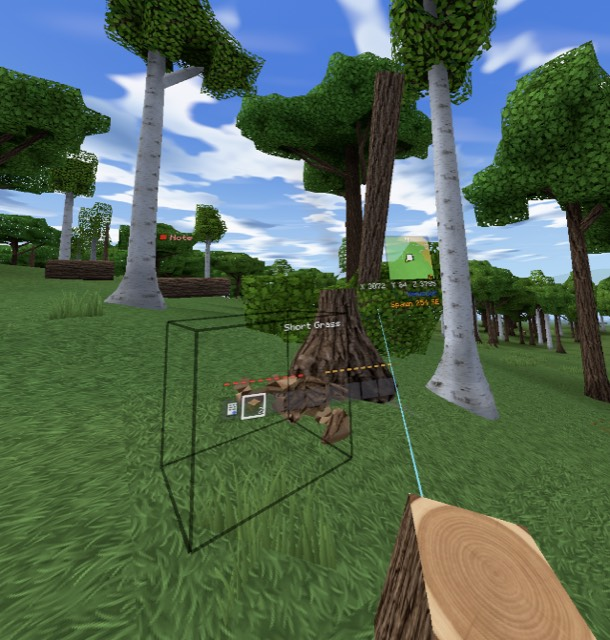

## 11:53:58 - Uh, here, uh, this one

- **Transcript:** Uh, here, uh, this one
- **Status:** open
- **Build:** 0.129 (bcc0f6d1, M1-M4 (device-tested; ship riding, chests, comfort options, weapon wheel))
- **World:** New World (24) (seed 574311329053960387)
- **Dimension:** Surface
- **Biome:** Forest
- **Position:** 3067.0 84.9 3795.7
- **Facing:** south-west (yaw 244, pitch -15)
- **Held:** Oak Log x2
- **Mount:** on foot
- **Looking at:** Oak Log at 3062 85 3797
- **Mode:** Survival, health 20/20
- **Time:** day 1 10:28, clear
- **Fps:** 72
- **Levels:** mic -31 dBFS, game sound -15 dBFS
- **Length:** 2.4 s (voice 1.0 s)
- **Just before:** -29s holding empty hand; -29s opened PauseMenu; -28s closed PauseMenu; -25s holding Oak Log
- **Repro (Mac):** `./snap.sh note --seed 574311329053960387 --x 3067.0 --z 3795.7 --yaw 116 --pitch -15 --time 0.186`
- **Audio (this Mac):** /Users/darthvadar/Documents/Blocksmith/QuestVoiceNotes/raw/vn-20261114-115358-983.aac

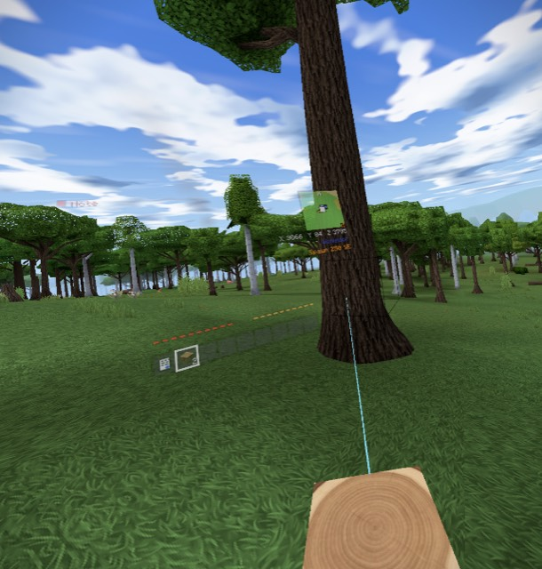

## 11:54:01 - This will be a good thing to test

- **Transcript:** This will be a good thing to test
- **Status:** open
- **Build:** 0.129 (bcc0f6d1, M1-M4 (device-tested; ship riding, chests, comfort options, weapon wheel))
- **World:** New World (24) (seed 574311329053960387)
- **Dimension:** Surface
- **Biome:** Forest
- **Position:** 3064.7 84.4 3796.7
- **Facing:** south-west (yaw 244, pitch -18)
- **Held:** Oak Log x2
- **Mount:** on foot
- **Looking at:** Oak Log at 3062 85 3797
- **Mode:** Survival, health 20/20
- **Time:** day 1 10:31, clear
- **Fps:** 72
- **Levels:** mic -33 dBFS, game sound -20 dBFS
- **Length:** 2.4 s (voice 0.7 s)
- **Just before:** -27s holding Oak Log
- **Repro (Mac):** `./snap.sh note --seed 574311329053960387 --x 3064.7 --z 3796.7 --yaw 116 --pitch -18 --time 0.188`
- **Audio (this Mac):** /Users/darthvadar/Documents/Blocksmith/QuestVoiceNotes/raw/vn-20261114-115401-623.aac

## 11:54:03 - Uh-oh

- **Transcript:** Uh-oh
- **Status:** open
- **Build:** 0.129 (bcc0f6d1, M1-M4 (device-tested; ship riding, chests, comfort options, weapon wheel))
- **World:** New World (24) (seed 574311329053960387)
- **Dimension:** Surface
- **Biome:** Forest
- **Position:** 3065.0 84.4 3796.0
- **Facing:** south-west (yaw 236, pitch -9)
- **Held:** Oak Log x3
- **Mount:** on foot
- **Looking at:** Oak Log at 3062 85 3798
- **Mode:** Survival, health 20/20
- **Time:** day 1 10:34, clear
- **Fps:** 72
- **Levels:** mic -32 dBFS, game sound -26 dBFS
- **Length:** 1.6 s (voice 0.4 s)
- **Just before:** -30s holding Oak Log
- **Repro (Mac):** `./snap.sh note --seed 574311329053960387 --x 3065.0 --z 3796.0 --yaw 124 --pitch -9 --time 0.190`
- **Audio (this Mac):** /Users/darthvadar/Documents/Blocksmith/QuestVoiceNotes/raw/vn-20261114-115403-883.aac

## 11:54:06 - We broke that

- **Transcript:** We broke that
- **Status:** open
- **Build:** 0.129 (bcc0f6d1, M1-M4 (device-tested; ship riding, chests, comfort options, weapon wheel))
- **World:** New World (24) (seed 574311329053960387)
- **Dimension:** Surface
- **Biome:** Forest
- **Position:** 3065.5 84.7 3797.3
- **Facing:** west (yaw 262, pitch -13)
- **Held:** Oak Log x3
- **Mount:** on foot
- **Looking at:** Oak Log at 3061 85 3797
- **Mode:** Survival, health 20/20
- **Time:** day 1 10:36, clear
- **Fps:** 72
- **Levels:** mic -22 dBFS, game sound -23 dBFS
- **Length:** 2.0 s (voice 0.5 s)
- **Repro (Mac):** `./snap.sh note --seed 574311329053960387 --x 3065.5 --z 3797.3 --yaw 98 --pitch -13 --time 0.192`
- **Audio (this Mac):** /Users/darthvadar/Documents/Blocksmith/QuestVoiceNotes/raw/vn-20261114-115406-183.aac

## 11:54:07 - And the thing, instead of what should have happened is we should have 

- **Transcript:** And the thing, instead of what should have happened is we should have had a bunch of a log that was, you could see the inside of. But instead, it all algorithmically confined itself to the rest of the log, which... Uh-oh, no, no, no, no. Bad. Bad, bad, bad. All right, look at this
- **Status:** open
- **Build:** 0.129 (bcc0f6d1, M1-M4 (device-tested; ship riding, chests, comfort options, weapon wheel))
- **World:** New World (24) (seed 574311329053960387)
- **Dimension:** Surface
- **Biome:** Forest
- **Position:** 3064.6 84.4 3796.7
- **Facing:** south-west (yaw 239, pitch -15)
- **Held:** Oak Log x3
- **Mount:** on foot
- **Looking at:** Oak Log at 3062 85 3798
- **Mode:** Survival, health 20/20
- **Time:** day 1 10:38, clear
- **Fps:** 72
- **Levels:** mic -30 dBFS, game sound -21 dBFS
- **Length:** 20.5 s (voice 12.0 s)
- **Position at the end:** 3065.0 84.5 3796.3
- **Repro (Mac):** `./snap.sh note --seed 574311329053960387 --x 3064.6 --z 3796.7 --yaw 121 --pitch -15 --time 0.194`
- **Audio (this Mac):** /Users/darthvadar/Documents/Blocksmith/QuestVoiceNotes/raw/vn-20261114-115407-883.aac

## 11:54:28 - See this stump? Normal. This? Not normal. Bad

- **Transcript:** See this stump? Normal. This? Not normal. Bad
- **Status:** open
- **Build:** 0.129 (bcc0f6d1, M1-M4 (device-tested; ship riding, chests, comfort options, weapon wheel))
- **World:** New World (24) (seed 574311329053960387)
- **Dimension:** Surface
- **Biome:** Forest
- **Position:** 3064.4 84.3 3796.0
- **Facing:** south-west (yaw 236, pitch -35)
- **Held:** Oak Log x4
- **Mount:** on foot
- **Looking at:** Oak Log at 3062 84 3797
- **Mode:** Survival, health 20/20
- **Time:** day 1 11:03, clear
- **Fps:** 72
- **Levels:** mic -29 dBFS, game sound -31 dBFS
- **Length:** 5.5 s (voice 2.3 s)
- **Position at the end:** 3062.2 83.8 3795.8
- **Repro (Mac):** `./snap.sh note --seed 574311329053960387 --x 3064.4 --z 3796.0 --yaw 124 --pitch -35 --time 0.211`
- **Audio (this Mac):** /Users/darthvadar/Documents/Blocksmith/QuestVoiceNotes/raw/vn-20261114-115428-583.aac

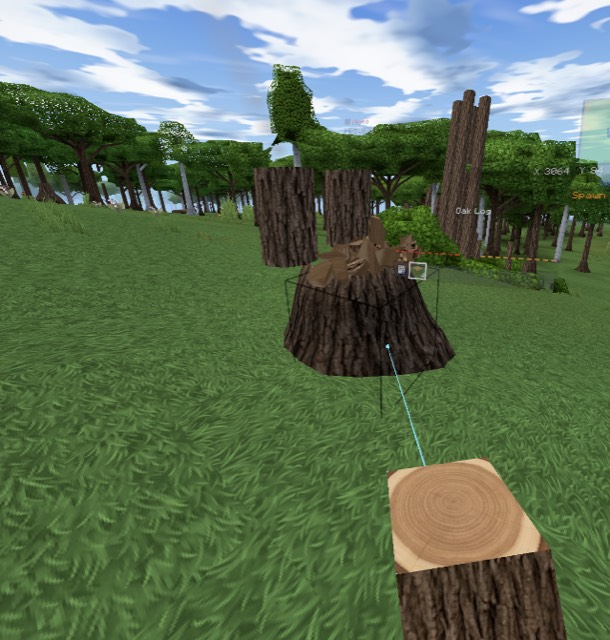

## 11:54:36 - There's also no top to this thing. It's see-through

- **Transcript:** There's also no top to this thing. It's see-through
- **Status:** open
- **Build:** 0.129 (bcc0f6d1, M1-M4 (device-tested; ship riding, chests, comfort options, weapon wheel))
- **World:** New World (24) (seed 574311329053960387)
- **Dimension:** Surface
- **Biome:** Forest
- **Position:** 3061.6 83.7 3796.3
- **Facing:** south (yaw 168, pitch -34)
- **Held:** Oak Log x4
- **Mount:** on foot
- **Looking at:** Oak Log at 3061 84 3797
- **Mode:** Survival, health 20/20
- **Time:** day 1 11:13, clear
- **Fps:** 72
- **Levels:** mic -29 dBFS, game sound -14 dBFS
- **Length:** 4.5 s (voice 2.0 s)
- **Repro (Mac):** `./snap.sh note --seed 574311329053960387 --x 3061.6 --z 3796.3 --yaw -168 --pitch -34 --time 0.218`
- **Audio (this Mac):** /Users/darthvadar/Documents/Blocksmith/QuestVoiceNotes/raw/vn-20261114-115436-843.aac

## 11:54:41 - That's not good

- **Transcript:** That's not good
- **Status:** open
- **Build:** 0.129 (bcc0f6d1, M1-M4 (device-tested; ship riding, chests, comfort options, weapon wheel))
- **World:** New World (24) (seed 574311329053960387)
- **Dimension:** Surface
- **Biome:** Forest
- **Position:** 3063.2 84.0 3795.9
- **Facing:** west (yaw 253, pitch -11)
- **Held:** Oak Log x4
- **Mount:** on foot
- **Looking at:** nothing
- **Mode:** Survival, health 20/20
- **Time:** day 1 11:19, clear
- **Fps:** 72
- **Levels:** mic -33 dBFS, game sound -17 dBFS
- **Length:** 1.9 s (voice 0.4 s)
- **Repro (Mac):** `./snap.sh note --seed 574311329053960387 --x 3063.2 --z 3795.9 --yaw 107 --pitch -11 --time 0.222`
- **Audio (this Mac):** /Users/darthvadar/Documents/Blocksmith/QuestVoiceNotes/raw/vn-20261114-115441-723.aac

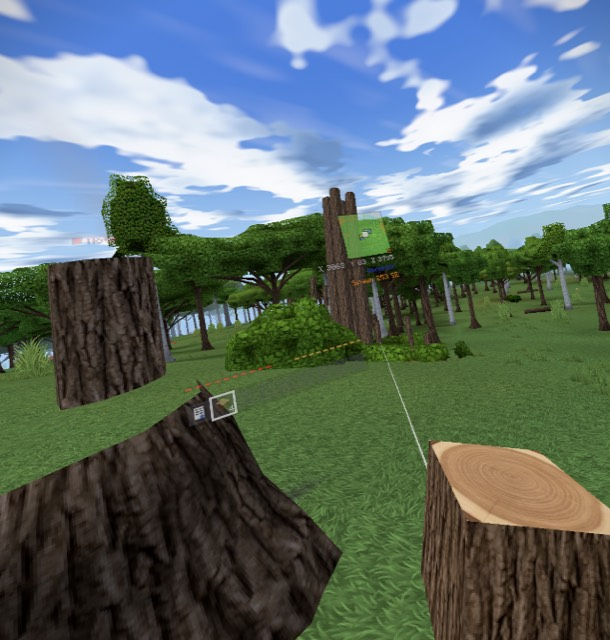

## 11:54:43 - This thing has now four logs. It was one, and now it's four

- **Transcript:** This thing has now four logs. It was one, and now it's four
- **Status:** open
- **Build:** 0.129 (bcc0f6d1, M1-M4 (device-tested; ship riding, chests, comfort options, weapon wheel))
- **World:** New World (24) (seed 574311329053960387)
- **Dimension:** Surface
- **Biome:** Forest
- **Position:** 3054.5 82.3 3797.4
- **Facing:** south-west (yaw 223, pitch -13)
- **Held:** Oak Log x4
- **Mount:** on foot
- **Looking at:** nothing
- **Mode:** Survival, health 20/20
- **Time:** day 1 11:21, clear
- **Fps:** 72
- **Levels:** mic -41 dBFS, game sound -20 dBFS
- **Length:** 5.9 s (voice 3.0 s)
- **Position at the end:** 3054.0 82.3 3797.5
- **Repro (Mac):** `./snap.sh note --seed 574311329053960387 --x 3054.5 --z 3797.4 --yaw 137 --pitch -13 --time 0.223`
- **Audio (this Mac):** /Users/darthvadar/Documents/Blocksmith/QuestVoiceNotes/raw/vn-20261114-115443-423.aac

## 11:54:49 - And all the branches have turned into vertical logs, which isn't reali

- **Transcript:** And all the branches have turned into vertical logs, which isn't realistic
- **Status:** open
- **Build:** 0.129 (bcc0f6d1, M1-M4 (device-tested; ship riding, chests, comfort options, weapon wheel))
- **World:** New World (24) (seed 574311329053960387)
- **Dimension:** Surface
- **Biome:** Forest
- **Position:** 3054.0 82.3 3797.5
- **Facing:** south (yaw 195, pitch 1)
- **Held:** Oak Log x4
- **Mount:** on foot
- **Looking at:** nothing
- **Mode:** Survival, health 20/20
- **Time:** day 1 11:28, clear
- **Fps:** 72
- **Levels:** mic -33 dBFS, game sound -20 dBFS
- **Length:** 6.9 s (voice 3.7 s)
- **While talking:** -1s holding Greywall Dispatch; -1s message: Greywall Dispatch
- **Position at the end:** 3053.8 81.6 3794.4
- **Repro (Mac):** `./snap.sh note --seed 574311329053960387 --x 3054.0 --z 3797.5 --yaw 165 --pitch 1 --time 0.228`
- **Audio (this Mac):** /Users/darthvadar/Documents/Blocksmith/QuestVoiceNotes/raw/vn-20261114-115449-263.aac

## 11:55:05 - Nice. All right, very good

- **Transcript:** Nice. All right, very good
- **Status:** open
- **Build:** 0.129 (bcc0f6d1, M1-M4 (device-tested; ship riding, chests, comfort options, weapon wheel))
- **World:** New World (24) (seed 574311329053960387)
- **Dimension:** Surface
- **Biome:** Forest
- **Position:** 3024.6 76.5 3801.8
- **Facing:** east (yaw 84, pitch -3)
- **Held:** Greywall Dispatch x1
- **Mount:** on foot
- **Looking at:** nothing
- **Mode:** Creative, health 20/20
- **Time:** day 1 11:46, clear
- **Fps:** 71
- **Levels:** mic -36 dBFS, game sound -19 dBFS
- **Length:** 4.5 s (voice 1.2 s)
- **Just before:** -12s holding Greywall Dispatch; -12s message: Greywall Dispatch; -10s opened PauseMenu; -9s message: Creative mode; -8s closed PauseMenu
- **Repro (Mac):** `./snap.sh note --seed 574311329053960387 --x 3024.6 --z 3801.8 --yaw -84 --pitch -3 --time 0.241`
- **Audio (this Mac):** /Users/darthvadar/Documents/Blocksmith/QuestVoiceNotes/raw/vn-20261114-115505-763.aac

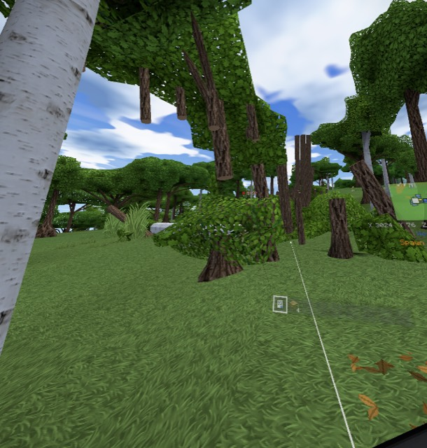

## 11:55:22 - Okay, this, uh, wolf is not detailed enough

- **Transcript:** Okay, this, uh, wolf is not detailed enough
- **Status:** open
- **Build:** 0.129 (bcc0f6d1, M1-M4 (device-tested; ship riding, chests, comfort options, weapon wheel))
- **World:** New World (24) (seed 574311329053960387)
- **Dimension:** Surface
- **Biome:** Plains
- **Position:** 2975.9 68.4 3697.2
- **Facing:** south-west (yaw 240, pitch -36)
- **Held:** empty hand
- **Mount:** on foot
- **Looking at:** Grass Block at 2974 68 3697
- **Mode:** Creative, health 20/20
- **Time:** day 1 12:06, clear
- **Fps:** 72
- **Levels:** mic -50 dBFS, game sound -17 dBFS
- **Length:** 3.7 s (voice 1.9 s)
- **Just before:** -29s holding Greywall Dispatch; -29s message: Greywall Dispatch; -26s opened PauseMenu; -25s message: Creative mode; -25s closed PauseMenu; -8s walked into Savanna; -6s walked into Plains; -0s holding Oak Log; -0s message: Oak Log; -0s holding empty hand
- **Repro (Mac):** `./snap.sh note --seed 574311329053960387 --x 2975.9 --z 3697.2 --yaw 120 --pitch -36 --time 0.254`
- **Audio (this Mac):** /Users/darthvadar/Documents/Blocksmith/QuestVoiceNotes/raw/vn-20261114-115522-183.aac

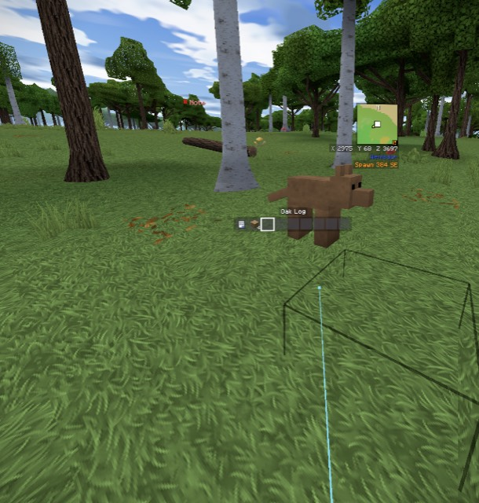

## 11:55:25 - I think this might be a very old version

- **Transcript:** I think this might be a very old version
- **Status:** open
- **Build:** 0.129 (bcc0f6d1, M1-M4 (device-tested; ship riding, chests, comfort options, weapon wheel))
- **World:** New World (24) (seed 574311329053960387)
- **Dimension:** Surface
- **Biome:** Plains
- **Position:** 2975.7 68.2 3693.4
- **Facing:** south-west (yaw 228, pitch -25)
- **Held:** empty hand
- **Mount:** on foot
- **Looking at:** Grass Block at 2973 68 3695
- **Mode:** Creative, health 20/20
- **Time:** day 1 12:10, clear
- **Fps:** 71
- **Levels:** mic -28 dBFS, game sound -26 dBFS
- **Length:** 2.8 s (voice 1.4 s)
- **Just before:** -30s opened PauseMenu; -29s message: Creative mode; -28s closed PauseMenu; -12s walked into Savanna; -10s walked into Plains; -4s holding Oak Log; -4s message: Oak Log; -4s holding empty hand
- **Repro (Mac):** `./snap.sh note --seed 574311329053960387 --x 2975.7 --z 3693.4 --yaw 132 --pitch -25 --time 0.257`
- **Audio (this Mac):** /Users/darthvadar/Documents/Blocksmith/QuestVoiceNotes/raw/vn-20261114-115525-723.aac

## 11:55:35 - I don't know what that means

- **Transcript:** I don't know what that means
- **Status:** open
- **Build:** 0.129 (bcc0f6d1, M1-M4 (device-tested; ship riding, chests, comfort options, weapon wheel))
- **World:** New World (24) (seed 574311329053960387)
- **Dimension:** Surface
- **Biome:** Plains
- **Position:** 2971.2 68.4 3689.8
- **Facing:** north-west (yaw 324, pitch -17)
- **Held:** empty hand
- **Mount:** on foot
- **Looking at:** Grass Block at 2967 67 3684
- **Mode:** Creative, health 20/20
- **Time:** day 1 12:22, clear
- **Fps:** 72
- **Levels:** mic -37 dBFS, game sound -21 dBFS
- **Length:** 2.3 s (voice 0.8 s)
- **Just before:** -22s walked into Savanna; -19s walked into Plains; -14s holding Oak Log; -14s message: Oak Log; -14s holding empty hand
- **Repro (Mac):** `./snap.sh note --seed 574311329053960387 --x 2971.2 --z 3689.8 --yaw 36 --pitch -17 --time 0.266`
- **Audio (this Mac):** /Users/darthvadar/Documents/Blocksmith/QuestVoiceNotes/raw/vn-20261114-115535-663.aac

## 11:55:58 - Should make the spawning a little more sparse. Like, why is there a gr

- **Transcript:** Should make the spawning a little more sparse. Like, why is there a group of four turtles here? There's no turtles anywhere else
- **Status:** open
- **Build:** 0.129 (bcc0f6d1, M1-M4 (device-tested; ship riding, chests, comfort options, weapon wheel))
- **World:** New World (24) (seed 574311329053960387)
- **Dimension:** Surface
- **Biome:** Beach
- **Position:** 2933.4 64.5 3560.7
- **Facing:** north-west (yaw 328, pitch -1)
- **Held:** empty hand
- **Mount:** on foot
- **Looking at:** nothing
- **Mode:** Creative, health 20/20
- **Time:** day 1 12:47, clear
- **Fps:** 67
- **Levels:** mic -52 dBFS, game sound -31 dBFS
- **Length:** 6.4 s (voice 3.6 s)
- **Just before:** -16s walked into Beach; -8s opened PauseMenu; -6s closed PauseMenu
- **Position at the end:** 2915.5 64.3 3543.3
- **Repro (Mac):** `./snap.sh note --seed 574311329053960387 --x 2933.4 --z 3560.7 --yaw 32 --pitch -1 --time 0.283`
- **Audio (this Mac):** /Users/darthvadar/Documents/Blocksmith/QuestVoiceNotes/raw/vn-20261114-115558-783.aac

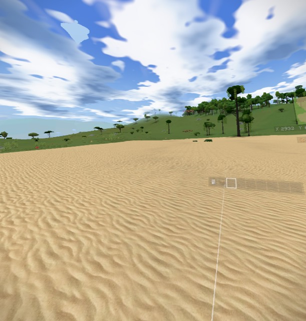

## 11:56:10 - Also, what do we have here? Take a look at this water

- **Transcript:** Also, what do we have here? Take a look at this water
- **Status:** open
- **Build:** 0.129 (bcc0f6d1, M1-M4 (device-tested; ship riding, chests, comfort options, weapon wheel))
- **World:** New World (24) (seed 574311329053960387)
- **Dimension:** Surface
- **Biome:** Beach
- **Position:** 2946.0 63.0 3548.4
- **Facing:** south-east (yaw 134, pitch -34)
- **Held:** empty hand
- **Mount:** on foot
- **Looking at:** Sand at 2947 62 3549
- **Mode:** Creative, health 20/20
- **Time:** day 1 13:01, clear
- **Fps:** 49
- **Levels:** mic -24 dBFS, game sound -20 dBFS
- **Length:** 4.2 s (voice 2.3 s)
- **Just before:** -28s walked into Beach; -19s opened PauseMenu; -17s closed PauseMenu
- **Repro (Mac):** `./snap.sh note --seed 574311329053960387 --x 2946.0 --z 3548.4 --yaw -134 --pitch -34 --time 0.292`
- **Audio (this Mac):** /Users/darthvadar/Documents/Blocksmith/QuestVoiceNotes/raw/vn-20261114-115610-003.aac

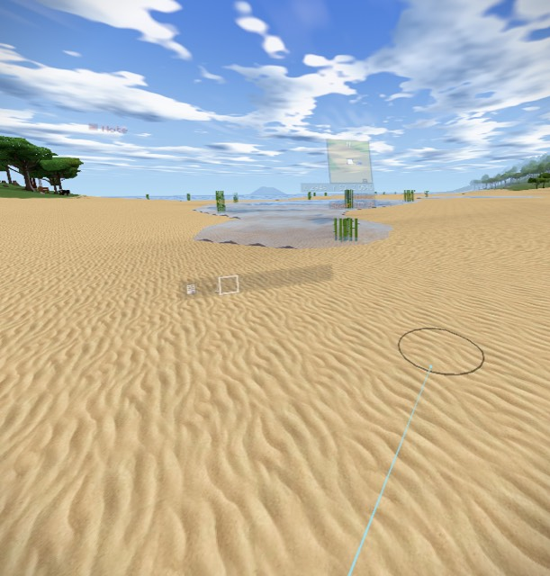

## 11:56:14 - This water doesn't look right to me

- **Transcript:** This water doesn't look right to me
- **Status:** open
- **Build:** 0.129 (bcc0f6d1, M1-M4 (device-tested; ship riding, chests, comfort options, weapon wheel))
- **World:** New World (24) (seed 574311329053960387)
- **Dimension:** Surface
- **Biome:** Beach
- **Position:** 2953.3 62.8 3543.8
- **Facing:** south-east (yaw 133, pitch -7)
- **Held:** empty hand
- **Mount:** on foot
- **Looking at:** nothing
- **Mode:** Creative, health 20/20
- **Time:** day 1 13:06, clear
- **Fps:** 58
- **Levels:** mic -20 dBFS, game sound -24 dBFS
- **Length:** 2.8 s (voice 1.2 s)
- **Just before:** -24s opened PauseMenu; -22s closed PauseMenu
- **Repro (Mac):** `./snap.sh note --seed 574311329053960387 --x 2953.3 --z 3543.8 --yaw -133 --pitch -7 --time 0.296`
- **Audio (this Mac):** /Users/darthvadar/Documents/Blocksmith/QuestVoiceNotes/raw/vn-20261114-115614-803.aac

## 11:56:17 - Because it's impossible

- **Transcript:** Because it's impossible
- **Status:** open
- **Build:** 0.129 (bcc0f6d1, M1-M4 (device-tested; ship riding, chests, comfort options, weapon wheel))
- **World:** New World (24) (seed 574311329053960387)
- **Dimension:** Surface
- **Biome:** Beach
- **Position:** 2948.0 62.9 3546.7
- **Facing:** east (yaw 111, pitch -18)
- **Held:** empty hand
- **Mount:** on foot
- **Looking at:** nothing
- **Mode:** Creative, health 20/20
- **Time:** day 1 13:10, clear
- **Fps:** 71
- **Levels:** mic -30 dBFS, game sound -17 dBFS
- **Length:** 3.0 s (voice 1.1 s)
- **Just before:** -27s opened PauseMenu; -25s closed PauseMenu
- **Repro (Mac):** `./snap.sh note --seed 574311329053960387 --x 2948.0 --z 3546.7 --yaw -111 --pitch -18 --time 0.299`
- **Audio (this Mac):** /Users/darthvadar/Documents/Blocksmith/QuestVoiceNotes/raw/vn-20261114-115617-982.aac

## 11:56:20 - This, it needs to meet sand. Otherwise, realistically, water would flo

- **Transcript:** This, it needs to meet sand. Otherwise, realistically, water would flow this way some more. There can't be an invisible barrier that stops the water from equalizing itself with the terrain
- **Status:** open
- **Build:** 0.129 (bcc0f6d1, M1-M4 (device-tested; ship riding, chests, comfort options, weapon wheel))
- **World:** New World (24) (seed 574311329053960387)
- **Dimension:** Surface
- **Biome:** Beach
- **Position:** 2952.2 62.8 3546.1
- **Facing:** south-east (yaw 134, pitch -15)
- **Held:** empty hand
- **Mount:** on foot
- **Looking at:** nothing
- **Mode:** Creative, health 20/20
- **Time:** day 1 13:13, clear
- **Fps:** 71
- **Levels:** mic -35 dBFS, game sound -29 dBFS
- **Length:** 13.1 s (voice 8.5 s)
- **Just before:** -28s closed PauseMenu
- **Position at the end:** 2964.5 62.6 3545.0
- **Repro (Mac):** `./snap.sh note --seed 574311329053960387 --x 2952.2 --z 3546.1 --yaw -134 --pitch -15 --time 0.301`
- **Audio (this Mac):** /Users/darthvadar/Documents/Blocksmith/QuestVoiceNotes/raw/vn-20261114-115620-663.aac

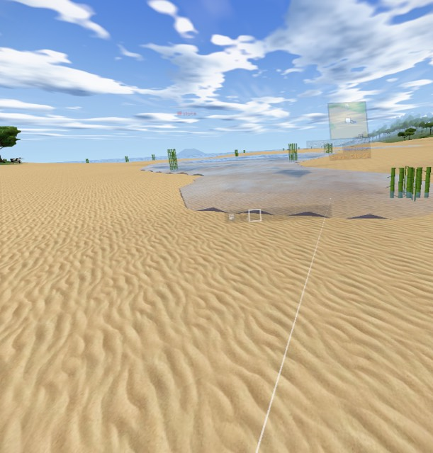

## 11:56:34 - Which it is here

- **Transcript:** Which it is here
- **Status:** open
- **Build:** 0.129 (bcc0f6d1, M1-M4 (device-tested; ship riding, chests, comfort options, weapon wheel))
- **World:** New World (24) (seed 574311329053960387)
- **Dimension:** Surface
- **Biome:** Beach
- **Position:** 2976.4 62.6 3543.1
- **Facing:** east (yaw 112, pitch -30)
- **Held:** empty hand
- **Mount:** on foot
- **Looking at:** Sand at 2978 62 3543
- **Mode:** Creative, health 20/20
- **Time:** day 1 13:30, clear
- **Fps:** 72
- **Levels:** mic -40 dBFS, game sound -26 dBFS
- **Length:** 2.4 s (voice 0.8 s)
- **Repro (Mac):** `./snap.sh note --seed 574311329053960387 --x 2976.4 --z 3543.1 --yaw -112 --pitch -30 --time 0.313`
- **Audio (this Mac):** /Users/darthvadar/Documents/Blocksmith/QuestVoiceNotes/raw/vn-20261114-115634-603.aac

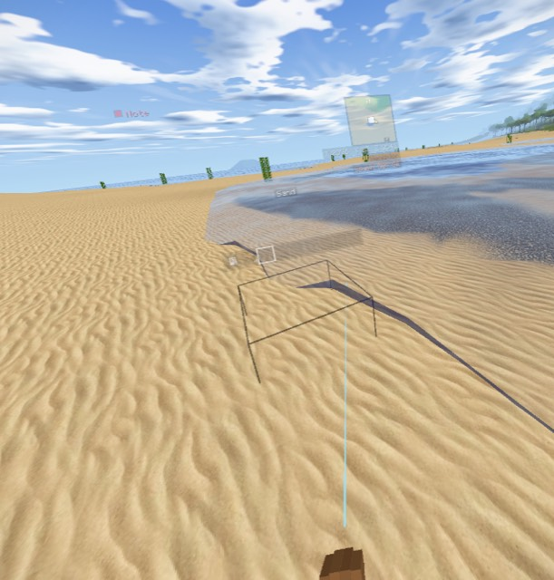

## 11:56:37 - Also, I should fulfill this hole ideally. I know

- **Transcript:** Also, I should fulfill this hole ideally. I know
- **Status:** open
- **Build:** 0.129 (bcc0f6d1, M1-M4 (device-tested; ship riding, chests, comfort options, weapon wheel))
- **World:** New World (24) (seed 574311329053960387)
- **Dimension:** Surface
- **Biome:** Beach
- **Position:** 2976.3 62.7 3541.2
- **Facing:** east (yaw 111, pitch -54)
- **Held:** empty hand
- **Mount:** on foot
- **Looking at:** Sand at 2977 62 3541
- **Mode:** Creative, health 20/20
- **Time:** day 1 13:34, clear
- **Fps:** 69
- **Levels:** mic -24 dBFS, game sound -22 dBFS
- **Length:** 4.8 s (voice 2.5 s)
- **Repro (Mac):** `./snap.sh note --seed 574311329053960387 --x 2976.3 --z 3541.2 --yaw -111 --pitch -54 --time 0.316`
- **Audio (this Mac):** /Users/darthvadar/Documents/Blocksmith/QuestVoiceNotes/raw/vn-20261114-115637-863.aac

## 11:56:42 - Physics for this is complicated, but still has to happen. Just make, y

- **Transcript:** Physics for this is complicated, but still has to happen. Just make, yeah, fluid dynamics we gotta fix. Oh my God
- **Status:** open
- **Build:** 0.129 (bcc0f6d1, M1-M4 (device-tested; ship riding, chests, comfort options, weapon wheel))
- **World:** New World (24) (seed 574311329053960387)
- **Dimension:** Surface
- **Biome:** Beach
- **Position:** 2977.3 62.6 3542.2
- **Facing:** south-east (yaw 124, pitch -40)
- **Held:** empty hand
- **Mount:** on foot
- **Looking at:** Sand at 2980 61 3544
- **Mode:** Creative, health 20/20
- **Time:** day 1 13:39, clear
- **Fps:** 69
- **Levels:** mic -28 dBFS, game sound -17 dBFS
- **Length:** 9.5 s (voice 5.0 s)
- **Position at the end:** 2981.4 62.7 3541.5
- **Repro (Mac):** `./snap.sh note --seed 574311329053960387 --x 2977.3 --z 3542.2 --yaw -124 --pitch -40 --time 0.319`
- **Audio (this Mac):** /Users/darthvadar/Documents/Blocksmith/QuestVoiceNotes/raw/vn-20261114-115642-423.aac

## 11:56:52 - What do we have here? Oh my God, look at this

- **Transcript:** What do we have here? Oh my God, look at this
- **Status:** open
- **Build:** 0.129 (bcc0f6d1, M1-M4 (device-tested; ship riding, chests, comfort options, weapon wheel))
- **World:** New World (24) (seed 574311329053960387)
- **Dimension:** Surface
- **Biome:** Beach
- **Position:** 2988.9 64.0 3525.6
- **Facing:** north (yaw 5, pitch -19)
- **Held:** empty hand
- **Mount:** on foot
- **Looking at:** Sand at 2989 63 3521
- **Mode:** Creative, health 20/20
- **Time:** day 1 13:51, clear
- **Fps:** 70
- **Levels:** mic -26 dBFS, game sound -25 dBFS
- **Length:** 5.4 s (voice 2.5 s)
- **Repro (Mac):** `./snap.sh note --seed 574311329053960387 --x 2988.9 --z 3525.6 --yaw -5 --pitch -19 --time 0.328`
- **Audio (this Mac):** /Users/darthvadar/Documents/Blocksmith/QuestVoiceNotes/raw/vn-20261114-115652-163.aac

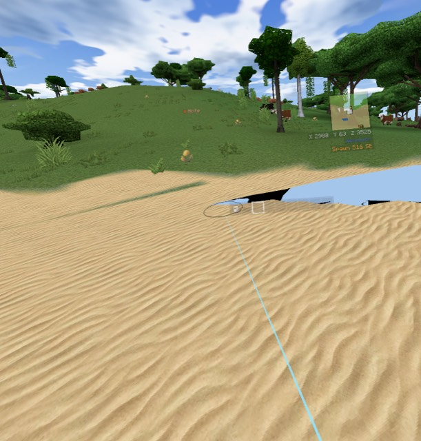

## 11:56:57 - That's a huge tear

- **Transcript:** That's a huge tear
- **Status:** open
- **Build:** 0.129 (bcc0f6d1, M1-M4 (device-tested; ship riding, chests, comfort options, weapon wheel))
- **World:** New World (24) (seed 574311329053960387)
- **Dimension:** Surface
- **Biome:** Beach
- **Position:** 2984.9 64.0 3522.0
- **Facing:** east (yaw 92, pitch -14)
- **Held:** empty hand
- **Mount:** on foot
- **Looking at:** Sand at 2990 63 3522
- **Mode:** Creative, health 20/20
- **Time:** day 1 13:57, clear
- **Fps:** 69
- **Levels:** mic -24 dBFS, game sound -21 dBFS
- **Length:** 2.5 s (voice 1.1 s)
- **Repro (Mac):** `./snap.sh note --seed 574311329053960387 --x 2984.9 --z 3522.0 --yaw -92 --pitch -14 --time 0.332`
- **Audio (this Mac):** /Users/darthvadar/Documents/Blocksmith/QuestVoiceNotes/raw/vn-20261114-115657-283.aac

## 11:57:02 - Look at this shit

- **Transcript:** Look at this shit
- **Status:** open
- **Build:** 0.129 (bcc0f6d1, M1-M4 (device-tested; ship riding, chests, comfort options, weapon wheel))
- **World:** New World (24) (seed 574311329053960387)
- **Dimension:** Surface
- **Biome:** Beach
- **Position:** 2994.8 64.2 3523.4
- **Facing:** north (yaw 358, pitch -60)
- **Held:** empty hand
- **Mount:** on foot
- **Looking at:** Sand at 2994 63 3523
- **Mode:** Creative, health 20/20
- **Time:** day 1 14:03, clear
- **Fps:** 72
- **Levels:** mic -24 dBFS, game sound -13 dBFS
- **Length:** 1.9 s (voice 0.5 s)
- **Repro (Mac):** `./snap.sh note --seed 574311329053960387 --x 2994.8 --z 3523.4 --yaw 2 --pitch -60 --time 0.336`
- **Audio (this Mac):** /Users/darthvadar/Documents/Blocksmith/QuestVoiceNotes/raw/vn-20261114-115702-403.aac

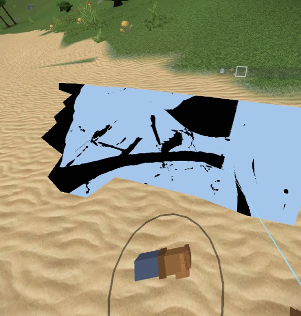

## 11:57:09 - Yeah, that's gotta be fixed

- **Transcript:** Yeah, that's gotta be fixed
- **Status:** open
- **Build:** 0.129 (bcc0f6d1, M1-M4 (device-tested; ship riding, chests, comfort options, weapon wheel))
- **World:** New World (24) (seed 574311329053960387)
- **Dimension:** Surface
- **Biome:** Beach
- **Position:** 2997.3 64.2 3522.5
- **Facing:** north-east (yaw 63, pitch -34)
- **Held:** empty hand
- **Mount:** on foot
- **Looking at:** Sand at 2999 63 3521
- **Mode:** Creative, health 20/20
- **Time:** day 1 14:11, clear
- **Fps:** 65
- **Levels:** mic -31 dBFS, game sound -27 dBFS
- **Length:** 2.4 s (voice 0.5 s)
- **Repro (Mac):** `./snap.sh note --seed 574311329053960387 --x 2997.3 --z 3522.5 --yaw -63 --pitch -34 --time 0.342`
- **Audio (this Mac):** /Users/darthvadar/Documents/Blocksmith/QuestVoiceNotes/raw/vn-20261114-115709-063.aac

## 11:57:11 - Oh, this log's good. Look at this. Except for the same issue we had ea

- **Transcript:** Oh, this log's good. Look at this. Except for the same issue we had earlier
- **Status:** open
- **Build:** 0.129 (bcc0f6d1, M1-M4 (device-tested; ship riding, chests, comfort options, weapon wheel))
- **World:** New World (24) (seed 574311329053960387)
- **Dimension:** Surface
- **Biome:** Forest
- **Position:** 3014.8 66.0 3509.0
- **Facing:** north-east (yaw 51, pitch -19)
- **Held:** empty hand
- **Mount:** on foot
- **Looking at:** Oak Wood at 3017 66 3506
- **Mode:** Creative, health 20/20
- **Time:** day 1 14:15, clear
- **Fps:** 65
- **Levels:** mic -24 dBFS, game sound -16 dBFS
- **Length:** 5.0 s (voice 3.4 s)
- **Just before:** -1s walked into Forest
- **Repro (Mac):** `./snap.sh note --seed 574311329053960387 --x 3014.8 --z 3509.0 --yaw -51 --pitch -19 --time 0.344`
- **Audio (this Mac):** /Users/darthvadar/Documents/Blocksmith/QuestVoiceNotes/raw/vn-20261114-115711-943.aac

## 11:57:17 - Two issues we've had earlier. The org, it's see-through, kind of, and 

- **Transcript:** Two issues we've had earlier. The org, it's see-through, kind of, and the sides aren't matched up correctly. Also, this texture is incorrect for the stump part of it
- **Status:** open
- **Build:** 0.129 (bcc0f6d1, M1-M4 (device-tested; ship riding, chests, comfort options, weapon wheel))
- **World:** New World (24) (seed 574311329053960387)
- **Dimension:** Surface
- **Biome:** Forest
- **Position:** 3015.9 66.2 3507.7
- **Facing:** north-east (yaw 46, pitch -36)
- **Held:** empty hand
- **Mount:** on foot
- **Looking at:** Oak Wood at 3017 66 3506
- **Mode:** Creative, health 20/20
- **Time:** day 1 14:21, clear
- **Fps:** 66
- **Levels:** mic -26 dBFS, game sound -27 dBFS
- **Length:** 14.0 s (voice 7.9 s)
- **Just before:** -6s walked into Forest
- **Position at the end:** 3014.7 66.3 3507.9
- **Repro (Mac):** `./snap.sh note --seed 574311329053960387 --x 3015.9 --z 3507.7 --yaw -46 --pitch -36 --time 0.348`
- **Audio (this Mac):** /Users/darthvadar/Documents/Blocksmith/QuestVoiceNotes/raw/vn-20261114-115717-223.aac

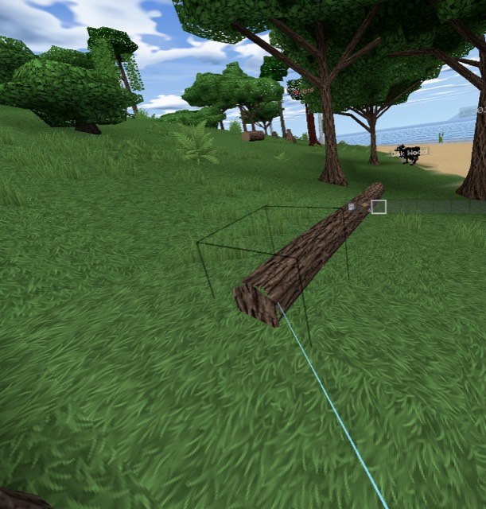

## 11:57:31 - Should look like this, which is really bad. Look at this thing. This t

- **Transcript:** Should look like this, which is really bad. Look at this thing. This thing's horrible
- **Status:** open
- **Build:** 0.129 (bcc0f6d1, M1-M4 (device-tested; ship riding, chests, comfort options, weapon wheel))
- **World:** New World (24) (seed 574311329053960387)
- **Dimension:** Surface
- **Biome:** Sparse Jungle
- **Position:** 3027.5 67.4 3498.6
- **Facing:** north-east (yaw 39, pitch -8)
- **Held:** empty hand
- **Mount:** on foot
- **Looking at:** Oak Log at 3030 68 3495
- **Mode:** Creative, health 20/20
- **Time:** day 1 14:39, clear
- **Fps:** 72
- **Levels:** mic -56 dBFS, game sound -25 dBFS
- **Length:** 5.3 s (voice 2.1 s)
- **Just before:** -21s walked into Forest; -1s walked into Sparse Jungle
- **Repro (Mac):** `./snap.sh note --seed 574311329053960387 --x 3027.5 --z 3498.6 --yaw -39 --pitch -8 --time 0.361`
- **Audio (this Mac):** /Users/darthvadar/Documents/Blocksmith/QuestVoiceNotes/raw/vn-20261114-115731-843.aac

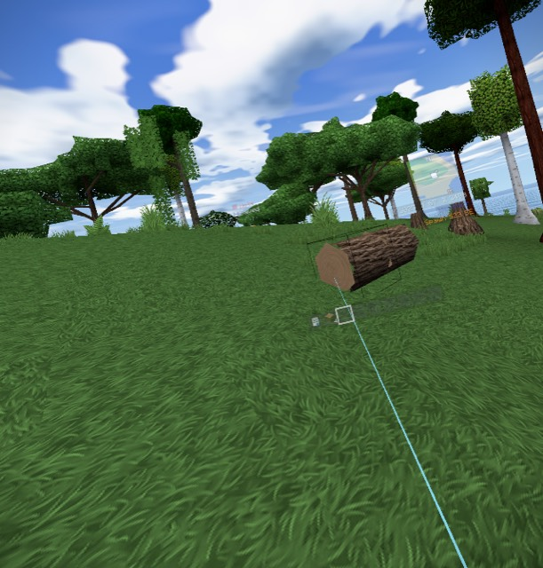

## 11:57:38 - This thing needs to be rotated probably by 30 degrees

- **Transcript:** This thing needs to be rotated probably by 30 degrees
- **Status:** open
- **Build:** 0.129 (bcc0f6d1, M1-M4 (device-tested; ship riding, chests, comfort options, weapon wheel))
- **World:** New World (24) (seed 574311329053960387)
- **Dimension:** Surface
- **Biome:** Sparse Jungle
- **Position:** 3028.3 68.4 3495.5
- **Facing:** east (yaw 88, pitch -39)
- **Held:** empty hand
- **Mount:** on foot
- **Looking at:** Oak Log at 3030 68 3495
- **Mode:** Creative, health 20/20
- **Time:** day 1 14:47, clear
- **Fps:** 72
- **Levels:** mic -26 dBFS, game sound -18 dBFS
- **Length:** 3.5 s (voice 1.7 s)
- **Just before:** -27s walked into Forest; -7s walked into Sparse Jungle
- **Repro (Mac):** `./snap.sh note --seed 574311329053960387 --x 3028.3 --z 3495.5 --yaw -88 --pitch -39 --time 0.366`
- **Audio (this Mac):** /Users/darthvadar/Documents/Blocksmith/QuestVoiceNotes/raw/vn-20261114-115738-303.aac

## 11:57:46 - All right. We're good. Um, oh dear. Um, do we have going on over here?

- **Transcript:** All right. We're good. Um, oh dear. Um, do we have going on over here?
- **Status:** open
- **Build:** 0.129 (bcc0f6d1, M1-M4 (device-tested; ship riding, chests, comfort options, weapon wheel))
- **World:** New World (24) (seed 574311329053960387)
- **Dimension:** Surface
- **Biome:** Beach
- **Position:** 3031.1 64.9 3448.6
- **Facing:** north (yaw 4, pitch -33)
- **Held:** empty hand
- **Mount:** on foot
- **Looking at:** Sand at 3031 63 3444
- **Mode:** Creative, health 20/20
- **Time:** day 1 14:56, clear
- **Fps:** 69
- **Levels:** mic -21 dBFS, game sound -17 dBFS
- **Length:** 7.8 s (voice 4.4 s)
- **Just before:** -15s walked into Sparse Jungle
- **While talking:** -4s walked into Beach
- **Position at the end:** 3010.4 63.3 3414.2
- **Repro (Mac):** `./snap.sh note --seed 574311329053960387 --x 3031.1 --z 3448.6 --yaw -4 --pitch -33 --time 0.373`
- **Audio (this Mac):** /Users/darthvadar/Documents/Blocksmith/QuestVoiceNotes/raw/vn-20261114-115746-323.aac

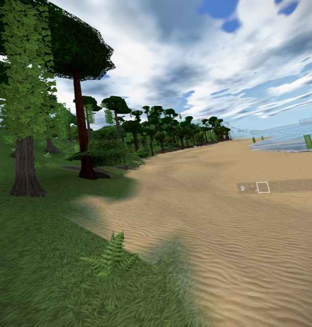

## 11:57:53 - We got a water issue. Once again, fluid dynamics, we've got to fix tha

- **Transcript:** We got a water issue. Once again, fluid dynamics, we've got to fix that. This is good. This looks right, mostly. This doesn't. This is, this is impossible
- **Status:** open
- **Build:** 0.129 (bcc0f6d1, M1-M4 (device-tested; ship riding, chests, comfort options, weapon wheel))
- **World:** New World (24) (seed 574311329053960387)
- **Dimension:** Surface
- **Biome:** Beach
- **Position:** 2995.2 64.7 3399.9
- **Facing:** north-west (yaw 310, pitch -19)
- **Held:** empty hand
- **Mount:** on foot
- **Looking at:** Sand at 2990 63 3396
- **Mode:** Creative, health 20/20
- **Time:** day 1 15:05, clear
- **Fps:** 71
- **Levels:** mic -28 dBFS, game sound -24 dBFS
- **Length:** 10.6 s (voice 5.7 s)
- **Just before:** -23s walked into Sparse Jungle; -7s walked into Beach
- **While talking:** -1s walked into Mangrove Swamp
- **Position at the end:** 2976.4 66.2 3393.4
- **Repro (Mac):** `./snap.sh note --seed 574311329053960387 --x 2995.2 --z 3399.9 --yaw 50 --pitch -19 --time 0.379`
- **Audio (this Mac):** /Users/darthvadar/Documents/Blocksmith/QuestVoiceNotes/raw/vn-20261114-115753-804.aac

## 11:58:04 - This has a gap right here that doesn't look right

- **Transcript:** This has a gap right here that doesn't look right
- **Status:** open
- **Build:** 0.129 (bcc0f6d1, M1-M4 (device-tested; ship riding, chests, comfort options, weapon wheel))
- **World:** New World (24) (seed 574311329053960387)
- **Dimension:** Surface
- **Biome:** Mangrove Swamp
- **Position:** 2974.1 66.6 3391.2
- **Facing:** west (yaw 292, pitch -25)
- **Held:** empty hand
- **Mount:** on foot
- **Looking at:** Mud at 2970 66 3390
- **Mode:** Creative, health 20/20
- **Time:** day 1 15:18, clear
- **Fps:** 72
- **Levels:** mic -40 dBFS, game sound -34 dBFS
- **Length:** 3.9 s (voice 2.1 s)
- **Just before:** -18s walked into Beach; -7s walked into Mangrove Swamp
- **Repro (Mac):** `./snap.sh note --seed 574311329053960387 --x 2974.1 --z 3391.2 --yaw 68 --pitch -25 --time 0.388`
- **Audio (this Mac):** /Users/darthvadar/Documents/Blocksmith/QuestVoiceNotes/raw/vn-20261114-115804-823.aac

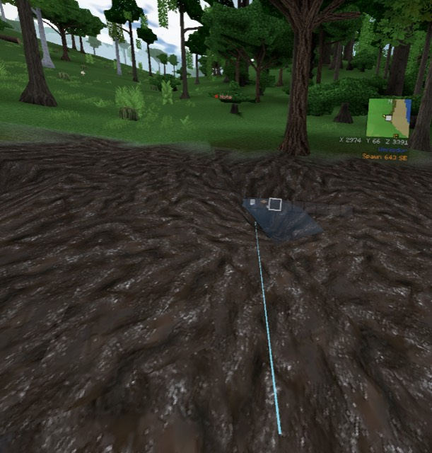

## 11:58:08 - This is not horrible, but yeah, this is pretty bad

- **Transcript:** This is not horrible, but yeah, this is pretty bad
- **Status:** open
- **Build:** 0.129 (bcc0f6d1, M1-M4 (device-tested; ship riding, chests, comfort options, weapon wheel))
- **World:** New World (24) (seed 574311329053960387)
- **Dimension:** Surface
- **Biome:** Beach
- **Position:** 2983.6 65.4 3388.3
- **Facing:** north-west (yaw 334, pitch -35)
- **Held:** empty hand
- **Mount:** on foot
- **Looking at:** Sand at 2982 65 3386
- **Mode:** Creative, health 20/20
- **Time:** day 1 15:23, clear
- **Fps:** 72
- **Levels:** mic -31 dBFS, game sound -50 dBFS
- **Length:** 5.9 s (voice 2.3 s)
- **Just before:** -21s walked into Beach; -11s walked into Mangrove Swamp; -2s message: The sky is clouding over: fog is coming; -1s walked into Beach
- **Position at the end:** 2989.3 65.1 3368.4
- **Repro (Mac):** `./snap.sh note --seed 574311329053960387 --x 2983.6 --z 3388.3 --yaw 26 --pitch -35 --time 0.391`
- **Audio (this Mac):** /Users/darthvadar/Documents/Blocksmith/QuestVoiceNotes/raw/vn-20261114-115808-783.aac

## 11:58:17 - And this right here

- **Transcript:** And this right here
- **Status:** open
- **Build:** 0.129 (bcc0f6d1, M1-M4 (device-tested; ship riding, chests, comfort options, weapon wheel))
- **World:** New World (24) (seed 574311329053960387)
- **Dimension:** Surface
- **Biome:** Sparse Jungle
- **Position:** 2980.8 67.9 3352.0
- **Facing:** north-west (yaw 296, pitch -25)
- **Held:** empty hand
- **Mount:** on foot
- **Looking at:** Grass Block at 2978 68 3351
- **Mode:** Creative, health 20/20
- **Time:** day 1 15:34, clear
- **Fps:** 72
- **Levels:** mic -24 dBFS, game sound -33 dBFS
- **Length:** 2.6 s (voice 1.2 s)
- **Just before:** -21s walked into Mangrove Swamp; -11s message: The sky is clouding over: fog is coming; -11s walked into Beach; -2s walked into Mangrove Swamp; -0s walked into Sparse Jungle
- **Repro (Mac):** `./snap.sh note --seed 574311329053960387 --x 2980.8 --z 3352.0 --yaw 64 --pitch -25 --time 0.399`
- **Audio (this Mac):** /Users/darthvadar/Documents/Blocksmith/QuestVoiceNotes/raw/vn-20261114-115817-963.aac

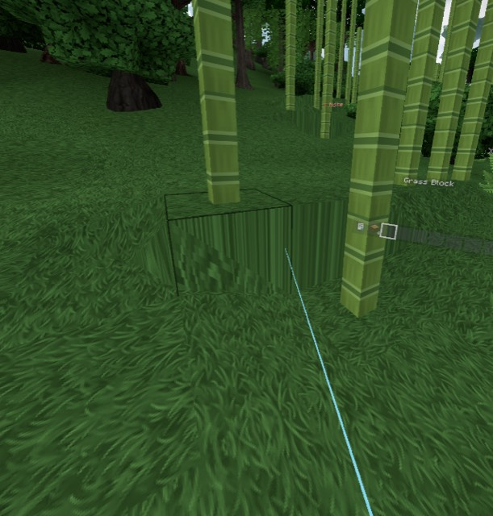

## 11:58:21 - Hmm. I decided, but I don't think that's right

- **Transcript:** Hmm. I decided, but I don't think that's right
- **Status:** open
- **Build:** 0.129 (bcc0f6d1, M1-M4 (device-tested; ship riding, chests, comfort options, weapon wheel))
- **World:** New World (24) (seed 574311329053960387)
- **Dimension:** Surface
- **Biome:** Sparse Jungle
- **Position:** 2981.1 67.9 3352.1
- **Facing:** north-west (yaw 300, pitch -15)
- **Held:** empty hand
- **Mount:** on foot
- **Looking at:** Grass Block at 2978 68 3351
- **Mode:** Creative, health 20/20
- **Time:** day 1 15:38, clear
- **Fps:** 72
- **Levels:** mic -29 dBFS, game sound -36 dBFS
- **Length:** 4.5 s (voice 1.9 s)
- **Just before:** -24s walked into Mangrove Swamp; -15s message: The sky is clouding over: fog is coming; -14s walked into Beach; -6s walked into Mangrove Swamp; -4s walked into Sparse Jungle
- **Repro (Mac):** `./snap.sh note --seed 574311329053960387 --x 2981.1 --z 3352.1 --yaw 60 --pitch -15 --time 0.402`
- **Audio (this Mac):** /Users/darthvadar/Documents/Blocksmith/QuestVoiceNotes/raw/vn-20261114-115821-143.aac

## 11:58:32 - All right. I got a submarine gear or something

- **Transcript:** All right. I got a submarine gear or something
- **Status:** open
- **Build:** 0.129 (bcc0f6d1, M1-M4 (device-tested; ship riding, chests, comfort options, weapon wheel))
- **World:** New World (24) (seed 574311329053960387)
- **Dimension:** Surface
- **Biome:** Beach
- **Position:** 2999.8 63.6 3321.8
- **Facing:** north (yaw 7, pitch -38)
- **Held:** empty hand
- **Mount:** on foot
- **Looking at:** Sand at 2999 63 3319
- **Mode:** Creative, health 20/20
- **Time:** day 1 15:52, clear
- **Fps:** 72
- **Levels:** mic -38 dBFS, game sound -29 dBFS
- **Length:** 2.5 s (voice 0.7 s)
- **Just before:** -26s message: The sky is clouding over: fog is coming; -25s walked into Beach; -17s walked into Mangrove Swamp; -15s walked into Sparse Jungle; -5s walked into Mangrove Swamp; -3s walked into Beach
- **Repro (Mac):** `./snap.sh note --seed 574311329053960387 --x 2999.8 --z 3321.8 --yaw -7 --pitch -38 --time 0.411`
- **Audio (this Mac):** /Users/darthvadar/Documents/Blocksmith/QuestVoiceNotes/raw/vn-20261114-115832-523.aac

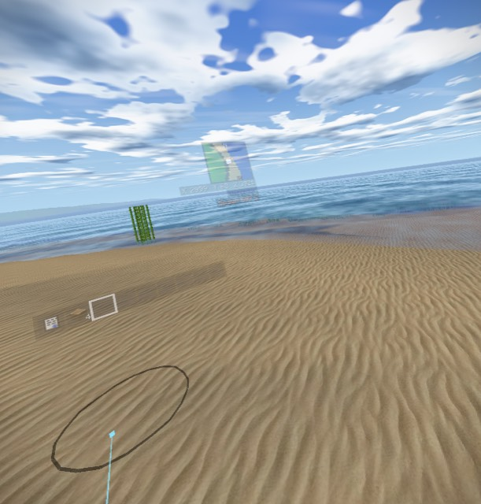

## 11:59:03 - This is our submarine

- **Transcript:** This is our submarine
- **Status:** open
- **Build:** 0.129 (bcc0f6d1, M1-M4 (device-tested; ship riding, chests, comfort options, weapon wheel))
- **World:** New World (24) (seed 574311329053960387)
- **Dimension:** Surface
- **Biome:** Warm Ocean
- **Position:** 3056.0 66.5 3304.3
- **Facing:** north (yaw 7, pitch -29)
- **Held:** empty hand
- **Mount:** on foot, flying
- **Looking at:** nothing
- **Mode:** Creative, health 20/20
- **Time:** day 1 16:28, clear
- **Fps:** 72
- **Levels:** mic -31 dBFS, game sound -100 dBFS
- **Length:** 2.6 s (voice 1.2 s)
- **Just before:** -30s opened CreativeMenu; -15s opened KeyboardMenu; -8s opened CreativeMenu; -7s holding Submarine Kit; -7s into the pack: Submarine Kit; -7s closed CreativeMenu; -5s message: Too shallow; -3s walked into Warm Ocean; -3s message: Flying; -2s message: The submarine is afloat; -1s holding empty hand
- **Repro (Mac):** `./snap.sh note --seed 574311329053960387 --x 3056.0 --z 3304.3 --yaw -7 --pitch -29 --time 0.437`
- **Audio (this Mac):** /Users/darthvadar/Documents/Blocksmith/QuestVoiceNotes/raw/vn-20261114-115903-102.aac

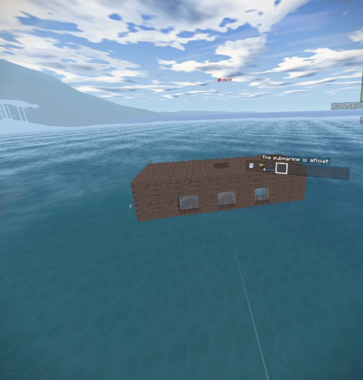

## 11:59:49 - Submarine doesn't look right. Should look like an actual submarine. I 

- **Transcript:** Submarine doesn't look right. Should look like an actual submarine. I understand it was built with blocks, but we're not using blocks anymore, so that's not right. Just make it look like an actual fucking submarine
- **Status:** open
- **Build:** 0.129 (bcc0f6d1, M1-M4 (device-tested; ship riding, chests, comfort options, weapon wheel))
- **World:** New World (24) (seed 574311329053960387)
- **Dimension:** Surface
- **Biome:** Lukewarm Ocean
- **Position:** 3210.0 63.1 3076.1
- **Facing:** west (yaw 292, pitch -49)
- **Held:** empty hand
- **Mount:** piloting Submarine
- **Looking at:** nothing
- **Mode:** Creative, health 20/20
- **Time:** day 1 17:23, clear
- **Fps:** 72
- **Levels:** mic -47 dBFS, game sound -20 dBFS
- **Length:** 11.7 s (voice 7.5 s)
- **Just before:** -29s walked into Warm Ocean; -25s walked into Lukewarm Ocean; -12s opened CreativeMenu; -12s closed CreativeMenu
- **Position at the end:** 3251.0 63.0 2994.8
- **Repro (Mac):** `./snap.sh note --seed 574311329053960387 --x 3210.0 --z 3076.1 --yaw 68 --pitch -49 --time 0.475`
- **Audio (this Mac):** /Users/darthvadar/Documents/Blocksmith/QuestVoiceNotes/raw/vn-20261114-115949-023.aac

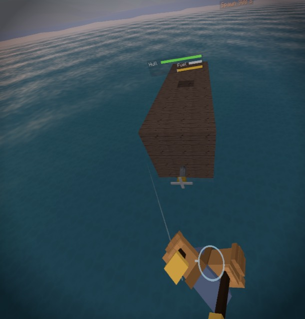

## 12:00:01 - Propeller looks great though. That's... Wow. I mean

- **Transcript:** Propeller looks great though. That's... Wow. I mean
- **Status:** open
- **Build:** 0.129 (bcc0f6d1, M1-M4 (device-tested; ship riding, chests, comfort options, weapon wheel))
- **World:** New World (24) (seed 574311329053960387)
- **Dimension:** Surface
- **Biome:** Lukewarm Ocean
- **Position:** 3268.8 63.1 2978.2
- **Facing:** north (yaw 345, pitch -81)
- **Held:** empty hand
- **Mount:** piloting Submarine
- **Looking at:** nothing
- **Mode:** Creative, health 20/20
- **Time:** day 1 17:39, clear
- **Fps:** 72
- **Levels:** mic -18 dBFS, game sound -18 dBFS
- **Length:** 4.2 s (voice 1.9 s)
- **Just before:** -25s opened CreativeMenu; -24s closed CreativeMenu
- **Repro (Mac):** `./snap.sh note --seed 574311329053960387 --x 3268.8 --z 2978.2 --yaw 15 --pitch -81 --time 0.485`
- **Audio (this Mac):** /Users/darthvadar/Documents/Blocksmith/QuestVoiceNotes/raw/vn-20261114-120001-663.aac

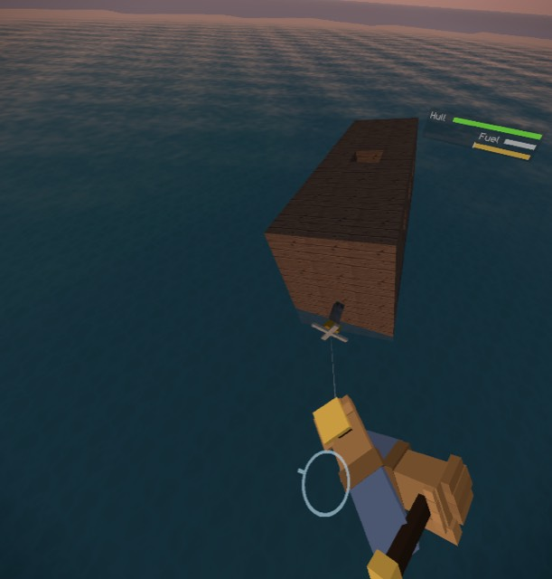

## 12:00:12 - Also, I don't-- haven't figured out how to descend yet

- **Transcript:** Also, I don't-- haven't figured out how to descend yet
- **Status:** open
- **Build:** 0.129 (bcc0f6d1, M1-M4 (device-tested; ship riding, chests, comfort options, weapon wheel))
- **World:** New World (24) (seed 574311329053960387)
- **Dimension:** Surface
- **Biome:** Lukewarm Ocean
- **Position:** 3365.0 63.6 2997.8
- **Facing:** east (yaw 112, pitch -68)
- **Held:** empty hand
- **Mount:** piloting Submarine
- **Looking at:** nothing
- **Mode:** Creative, health 20/20
- **Time:** day 1 17:51, clear
- **Fps:** 72
- **Levels:** mic -25 dBFS, game sound -14 dBFS
- **Length:** 3.8 s (voice 2.3 s)
- **Repro (Mac):** `./snap.sh note --seed 574311329053960387 --x 3365.0 --z 2997.8 --yaw -112 --pitch -68 --time 0.494`
- **Audio (this Mac):** /Users/darthvadar/Documents/Blocksmith/QuestVoiceNotes/raw/vn-20261114-120012-323.aac

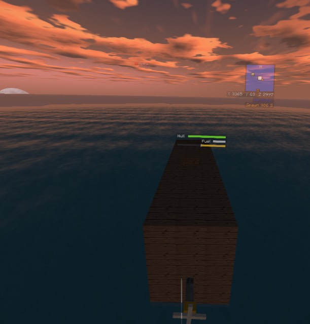

## 12:00:45 - Is the view distance seriously not able to render way more water? Like

- **Transcript:** Is the view distance seriously not able to render way more water? Like, it should be view distance twenty-four right now
- **Status:** open
- **Build:** 0.129 (bcc0f6d1, M1-M4 (device-tested; ship riding, chests, comfort options, weapon wheel))
- **World:** New World (24) (seed 574311329053960387)
- **Dimension:** Surface
- **Biome:** Deep Lukewarm Ocean
- **Position:** 3675.6 63.2 3083.7
- **Facing:** south-east (yaw 120, pitch -20)
- **Held:** empty hand
- **Mount:** piloting Submarine
- **Looking at:** nothing
- **Mode:** Survival, health 20/20
- **Time:** day 1 18:28, clear
- **Fps:** 72
- **Levels:** mic -28 dBFS, game sound -15 dBFS
- **Length:** 7.4 s (voice 4.7 s)
- **Just before:** -23s walked into Deep Lukewarm Ocean; -14s opened PauseMenu; -13s message: Survival mode; -13s closed PauseMenu; -3s opened PauseMenu; -2s closed PauseMenu
- **Position at the end:** 3723.2 63.2 3096.3
- **Repro (Mac):** `./snap.sh note --seed 574311329053960387 --x 3675.6 --z 3083.7 --yaw -120 --pitch -20 --time 0.520`
- **Audio (this Mac):** /Users/darthvadar/Documents/Blocksmith/QuestVoiceNotes/raw/vn-20261114-120045-283.aac

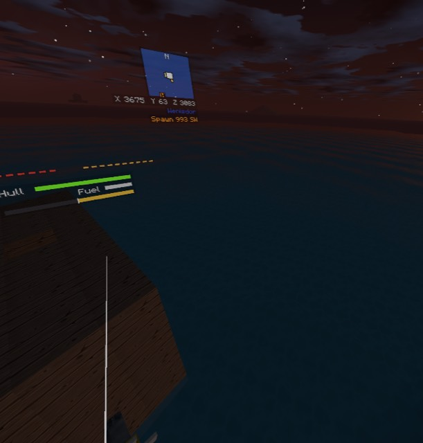

## 12:00:52 - I don't know why it's struggling to render anything

- **Transcript:** I don't know why it's struggling to render anything
- **Status:** open
- **Build:** 0.129 (bcc0f6d1, M1-M4 (device-tested; ship riding, chests, comfort options, weapon wheel))
- **World:** New World (24) (seed 574311329053960387)
- **Dimension:** Surface
- **Biome:** Deep Lukewarm Ocean
- **Position:** 3746.8 63.1 3108.2
- **Facing:** east (yaw 93, pitch -5)
- **Held:** empty hand
- **Mount:** piloting Submarine
- **Looking at:** nothing
- **Mode:** Survival, health 20/20
- **Time:** day 1 18:37, clear
- **Fps:** 71
- **Levels:** mic -29 dBFS, game sound -19 dBFS
- **Length:** 3.4 s (voice 1.7 s)
- **Just before:** -22s opened PauseMenu; -20s message: Survival mode; -20s closed PauseMenu; -11s opened PauseMenu; -10s closed PauseMenu
- **Repro (Mac):** `./snap.sh note --seed 574311329053960387 --x 3746.8 --z 3108.2 --yaw -93 --pitch -5 --time 0.526`
- **Audio (this Mac):** /Users/darthvadar/Documents/Blocksmith/QuestVoiceNotes/raw/vn-20261114-120052-883.aac

## 12:00:56 - Why not go underwater, then render the water? Like do what Minecraft d

- **Transcript:** Why not go underwater, then render the water? Like do what Minecraft does, where it's like everything's foggy until
- **Status:** open
- **Build:** 0.129 (bcc0f6d1, M1-M4 (device-tested; ship riding, chests, comfort options, weapon wheel))
- **World:** New World (24) (seed 574311329053960387)
- **Dimension:** Surface
- **Biome:** Deep Lukewarm Ocean
- **Position:** 3775.1 63.1 3125.2
- **Facing:** east (yaw 111, pitch -11)
- **Held:** empty hand
- **Mount:** piloting Submarine
- **Looking at:** nothing
- **Mode:** Survival, health 20/20
- **Time:** day 1 18:41, clear
- **Fps:** 72
- **Levels:** mic -23 dBFS, game sound -12 dBFS
- **Length:** 7.0 s (voice 4.2 s)
- **Just before:** -25s opened PauseMenu; -24s message: Survival mode; -23s closed PauseMenu; -14s opened PauseMenu; -13s closed PauseMenu
- **Position at the end:** 3817.1 63.1 3151.1
- **Repro (Mac):** `./snap.sh note --seed 574311329053960387 --x 3775.1 --z 3125.2 --yaw -111 --pitch -11 --time 0.529`
- **Audio (this Mac):** /Users/darthvadar/Documents/Blocksmith/QuestVoiceNotes/raw/vn-20261114-120056-183.aac

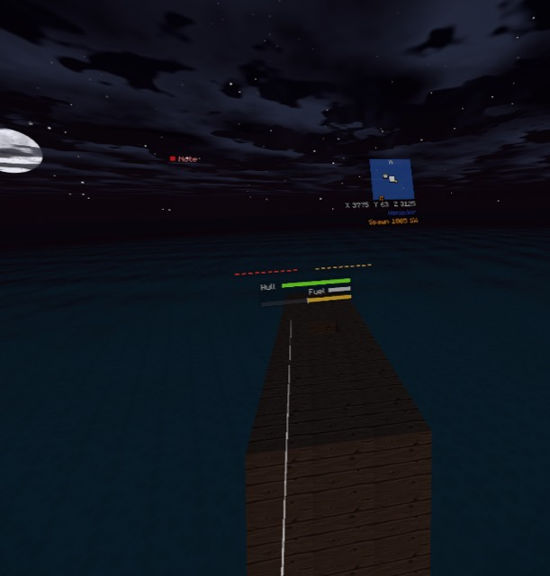

## 12:01:03 - For a few seconds, so everything renders. That's what they do with wat

- **Transcript:** For a few seconds, so everything renders. That's what they do with water
- **Status:** open
- **Build:** 0.129 (bcc0f6d1, M1-M4 (device-tested; ship riding, chests, comfort options, weapon wheel))
- **World:** New World (24) (seed 574311329053960387)
- **Dimension:** Surface
- **Biome:** Deep Lukewarm Ocean
- **Position:** 3832.4 63.1 3162.6
- **Facing:** east (yaw 73, pitch -36)
- **Held:** empty hand
- **Mount:** piloting Submarine
- **Looking at:** nothing
- **Mode:** Survival, health 20/20
- **Time:** day 1 18:49, clear
- **Fps:** 72
- **Levels:** mic -36 dBFS, game sound -15 dBFS
- **Length:** 4.4 s (voice 2.1 s)
- **Just before:** -21s opened PauseMenu; -20s closed PauseMenu
- **Repro (Mac):** `./snap.sh note --seed 574311329053960387 --x 3832.4 --z 3162.6 --yaw -73 --pitch -36 --time 0.535`
- **Audio (this Mac):** /Users/darthvadar/Documents/Blocksmith/QuestVoiceNotes/raw/vn-20261114-120103-143.aac

## 12:01:52 - Oh, come on. He's nowhere near me

- **Transcript:** Oh, come on. He's nowhere near me
- **Status:** open
- **Build:** 0.129 (bcc0f6d1, M1-M4 (device-tested; ship riding, chests, comfort options, weapon wheel))
- **World:** New World (24) (seed 574311329053960387)
- **Dimension:** Surface
- **Biome:** Deep Lukewarm Ocean
- **Position:** 3916.9 63.4 3252.7
- **Facing:** north-west (yaw 295, pitch -51)
- **Held:** empty hand
- **Mount:** piloting Submarine
- **Looking at:** nothing
- **Mode:** Survival, health 20/20
- **Time:** day 1 19:49, clear
- **Fps:** 72
- **Levels:** mic -47 dBFS, game sound -17 dBFS
- **Length:** 3.3 s (voice 1.2 s)
- **Repro (Mac):** `./snap.sh note --seed 574311329053960387 --x 3916.9 --z 3252.7 --yaw 65 --pitch -51 --time 0.576`
- **Audio (this Mac):** /Users/darthvadar/Documents/Blocksmith/QuestVoiceNotes/raw/vn-20261114-120152-703.aac

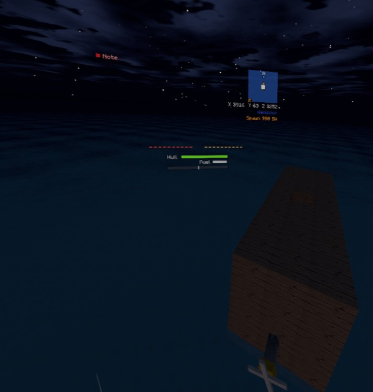

## 12:02:00 - Okay, that should have completely obliterated my submarine. Okay, not 

- **Transcript:** Okay, that should have completely obliterated my submarine. Okay, not done. What is that? 5% damage
- **Status:** open
- **Build:** 0.129 (bcc0f6d1, M1-M4 (device-tested; ship riding, chests, comfort options, weapon wheel))
- **World:** New World (24) (seed 574311329053960387)
- **Dimension:** Surface
- **Biome:** Deep Lukewarm Ocean
- **Position:** 3912.2 63.4 3258.8
- **Facing:** north-west (yaw 331, pitch -35)
- **Held:** empty hand
- **Mount:** piloting Submarine
- **Looking at:** nothing
- **Mode:** Survival, health 20/20
- **Time:** day 1 19:58, clear
- **Fps:** 72
- **Levels:** mic -26 dBFS, game sound -17 dBFS
- **Length:** 9.1 s (voice 5.1 s)
- **Position at the end:** 3910.7 63.4 3260.5
- **Repro (Mac):** `./snap.sh note --seed 574311329053960387 --x 3912.2 --z 3258.8 --yaw 29 --pitch -35 --time 0.582`
- **Audio (this Mac):** /Users/darthvadar/Documents/Blocksmith/QuestVoiceNotes/raw/vn-20261114-120200-383.aac

## 12:02:09 - Like that should have absolutely fucked up my boat

- **Transcript:** Like that should have absolutely fucked up my boat
- **Status:** open
- **Build:** 0.129 (bcc0f6d1, M1-M4 (device-tested; ship riding, chests, comfort options, weapon wheel))
- **World:** New World (24) (seed 574311329053960387)
- **Dimension:** Surface
- **Biome:** Deep Lukewarm Ocean
- **Position:** 3914.3 63.3 3245.6
- **Facing:** north-west (yaw 312, pitch -25)
- **Held:** empty hand
- **Mount:** piloting Submarine
- **Looking at:** nothing
- **Mode:** Survival, health 20/20
- **Time:** day 1 20:09, clear
- **Fps:** 71
- **Levels:** mic -34 dBFS, game sound -18 dBFS
- **Length:** 4.6 s (voice 2.3 s)
- **Repro (Mac):** `./snap.sh note --seed 574311329053960387 --x 3914.3 --z 3245.6 --yaw 48 --pitch -25 --time 0.590`
- **Audio (this Mac):** /Users/darthvadar/Documents/Blocksmith/QuestVoiceNotes/raw/vn-20261114-120209-403.aac

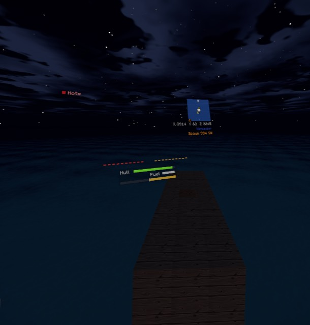

## 12:02:50 - Oh, it's a sunken frigate. Nice

- **Transcript:** Oh, it's a sunken frigate. Nice
- **Status:** open
- **Build:** 0.129 (bcc0f6d1, M1-M4 (device-tested; ship riding, chests, comfort options, weapon wheel))
- **World:** New World (24) (seed 574311329053960387)
- **Dimension:** Surface
- **Biome:** Deep Lukewarm Ocean
- **Position:** 3877.1 49.5 3025.0
- **Facing:** north-west (yaw 309, pitch -28)
- **Held:** empty hand
- **Mount:** on foot
- **Looking at:** nothing
- **Mode:** Creative, health 20/20
- **Time:** day 1 20:56, clear
- **Fps:** 71
- **Levels:** mic -28 dBFS, game sound -18 dBFS
- **Length:** 3.7 s (voice 1.5 s)
- **Just before:** -17s stopped piloting Submarine; -15s opened PauseMenu; -13s message: Creative mode; -13s closed PauseMenu; -11s message: Flying; -10s message: Walking; -3s message: The sky is clouding over: fog is coming
- **Repro (Mac):** `./snap.sh note --seed 574311329053960387 --x 3877.1 --z 3025.0 --yaw 51 --pitch -28 --time 0.623`
- **Audio (this Mac):** /Users/darthvadar/Documents/Blocksmith/QuestVoiceNotes/raw/vn-20261114-120250-663.aac

## 12:03:52 - Um, here's an idea [clears throat].

- **Transcript:** Um, here's an idea [clears throat].
- **Status:** open
- **Build:** 0.129 (bcc0f6d1, M1-M4 (device-tested; ship riding, chests, comfort options, weapon wheel))
- **World:** New World (24) (seed 574311329053960387)
- **Dimension:** Surface
- **Biome:** Forest
- **Position:** 6395.6 127.9 4245.1
- **Facing:** east (yaw 88, pitch -47)
- **Held:** empty hand
- **Mount:** on foot, flying
- **Looking at:** nothing
- **Mode:** Creative, health 20/20
- **Time:** day 1 22:11, clear
- **Fps:** 72
- **Levels:** mic -24 dBFS, game sound -18 dBFS
- **Length:** 3.4 s (voice 1.9 s)
- **Just before:** -28s message: A stranger in town: Ezra Quill; -26s message: Ruth Oakes: Lanterns are lit. Town looks pretty this time of night.; -23s message: Ruth Oakes: Don't wander off the road in the dark.; -20s opened ChestMenu; -19s walked into Beach; -18s closed ChestMenu; -16s message: Flying; -13s walked into Taiga; -7s walked into Forest
- **Repro (Mac):** `./snap.sh note --seed 574311329053960387 --x 6395.6 --z 4245.1 --yaw -88 --pitch -47 --time 0.675`
- **Audio (this Mac):** /Users/darthvadar/Documents/Blocksmith/QuestVoiceNotes/raw/vn-20261114-120352-643.aac

## 12:04:03 - I don't know

- **Transcript:** I don't know
- **Status:** open
- **Build:** 0.129 (bcc0f6d1, M1-M4 (device-tested; ship riding, chests, comfort options, weapon wheel))
- **World:** New World (24) (seed 574311329053960387)
- **Dimension:** Surface
- **Biome:** Forest
- **Position:** 6420.0 127.9 4246.9
- **Facing:** north-east (yaw 36, pitch -60)
- **Held:** empty hand
- **Mount:** on foot, flying
- **Looking at:** nothing
- **Mode:** Creative, health 20/20
- **Time:** day 1 22:24, clear
- **Fps:** 70
- **Levels:** mic -31 dBFS, game sound -20 dBFS
- **Length:** 1.9 s (voice 0.5 s)
- **Just before:** -30s walked into Beach; -29s closed ChestMenu; -26s message: Flying; -24s walked into Taiga; -18s walked into Forest
- **Repro (Mac):** `./snap.sh note --seed 574311329053960387 --x 6420.0 --z 4246.9 --yaw -36 --pitch -60 --time 0.683`
- **Audio (this Mac):** /Users/darthvadar/Documents/Blocksmith/QuestVoiceNotes/raw/vn-20261114-120403-283.aac

## 12:04:05 - So the fact that I can see this in the distance when it's not rendered

- **Transcript:** So the fact that I can see this in the distance when it's not rendered, nothing around it's rendered, isn't great
- **Status:** open
- **Build:** 0.129 (bcc0f6d1, M1-M4 (device-tested; ship riding, chests, comfort options, weapon wheel))
- **World:** New World (24) (seed 574311329053960387)
- **Dimension:** Surface
- **Biome:** Lukewarm Ocean
- **Position:** 6765.6 127.9 4188.2
- **Facing:** north-east (yaw 51, pitch -66)
- **Held:** empty hand
- **Mount:** on foot, flying
- **Looking at:** nothing
- **Mode:** Creative, health 20/20
- **Time:** day 1 22:26, clear
- **Fps:** 72
- **Levels:** mic -28 dBFS, game sound -23 dBFS
- **Length:** 6.7 s (voice 3.9 s)
- **Just before:** -28s message: Flying; -25s walked into Taiga; -19s walked into Forest; -1s walked into Lukewarm Ocean; -1s message: Entering Valismark
- **While talking:** -4s walked into Savanna
- **Position at the end:** 6810.9 127.9 4182.2
- **Repro (Mac):** `./snap.sh note --seed 574311329053960387 --x 6765.6 --z 4188.2 --yaw -51 --pitch -66 --time 0.685`
- **Audio (this Mac):** /Users/darthvadar/Documents/Blocksmith/QuestVoiceNotes/raw/vn-20261114-120405-063.aac

## 12:04:14 - But I'm not sure what to do instead

- **Transcript:** But I'm not sure what to do instead
- **Status:** open
- **Build:** 0.129 (bcc0f6d1, M1-M4 (device-tested; ship riding, chests, comfort options, weapon wheel))
- **World:** New World (24) (seed 574311329053960387)
- **Dimension:** Surface
- **Biome:** Savanna
- **Position:** 6817.7 127.9 4185.9
- **Facing:** east (yaw 74, pitch -41)
- **Held:** empty hand
- **Mount:** on foot, flying
- **Looking at:** nothing
- **Mode:** Creative, health 20/20
- **Time:** day 1 22:37, clear
- **Fps:** 72
- **Levels:** mic -41 dBFS, game sound -21 dBFS
- **Length:** 3.0 s (voice 1.4 s)
- **Just before:** -29s walked into Forest; -11s walked into Lukewarm Ocean; -10s message: Entering Valismark; -9s walked into Savanna
- **Repro (Mac):** `./snap.sh note --seed 574311329053960387 --x 6817.7 --z 4185.9 --yaw -74 --pitch -41 --time 0.693`
- **Audio (this Mac):** /Users/darthvadar/Documents/Blocksmith/QuestVoiceNotes/raw/vn-20261114-120414-423.aac

## 12:04:20 - Okay, so

- **Transcript:** Okay, so
- **Status:** open
- **Build:** 0.129 (bcc0f6d1, M1-M4 (device-tested; ship riding, chests, comfort options, weapon wheel))
- **World:** New World (24) (seed 574311329053960387)
- **Dimension:** Surface
- **Biome:** Forest
- **Position:** 7026.8 190.3 3615.6
- **Facing:** east (yaw 87, pitch -43)
- **Held:** empty hand
- **Mount:** on foot, flying
- **Looking at:** nothing
- **Mode:** Creative, health 20/20
- **Time:** day 1 22:44, clear
- **Fps:** 72
- **Levels:** mic -24 dBFS, game sound -16 dBFS
- **Length:** 2.5 s (voice 0.8 s)
- **Just before:** -17s walked into Lukewarm Ocean; -17s message: Entering Valismark; -15s walked into Savanna; -4s message: Entering Valismoor; -3s opened PauseMenu; -3s closed PauseMenu; -1s walked into Forest
- **Repro (Mac):** `./snap.sh note --seed 574311329053960387 --x 7026.8 --z 3615.6 --yaw -87 --pitch -43 --time 0.698`
- **Audio (this Mac):** /Users/darthvadar/Documents/Blocksmith/QuestVoiceNotes/raw/vn-20261114-120420-803.aac

## 12:04:23 - When I am speed, speed moving, everything turns into compression. But 

- **Transcript:** When I am speed, speed moving, everything turns into compression. But when I'm not doing that, everything stays the same. E-everything that's not rendered should be the c- that compression that happens in creative or when I'm speed moving
- **Status:** open
- **Build:** 0.129 (bcc0f6d1, M1-M4 (device-tested; ship riding, chests, comfort options, weapon wheel))
- **World:** New World (24) (seed 574311329053960387)
- **Dimension:** Surface
- **Biome:** Savanna
- **Position:** 6858.5 190.3 3885.7
- **Facing:** east (yaw 90, pitch -35)
- **Held:** empty hand
- **Mount:** on foot, flying
- **Looking at:** nothing
- **Mode:** Creative, health 20/20
- **Time:** day 1 22:47, clear
- **Fps:** 72
- **Levels:** mic -24 dBFS, game sound -14 dBFS
- **Length:** 17.0 s (voice 10.6 s)
- **Just before:** -20s walked into Lukewarm Ocean; -19s message: Entering Valismark; -17s walked into Savanna; -7s message: Entering Valismoor; -6s opened PauseMenu; -5s closed PauseMenu; -3s walked into Forest
- **While talking:** -4s walked into Savanna; -2s walked into Beach; -2s message: Entering Valismark; -5s message: Walking; -2s message: Flying; -1s walked into Savanna; -3s message: Entering Valismoor
- **Position at the end:** 6909.1 116.5 4079.2
- **Repro (Mac):** `./snap.sh note --seed 574311329053960387 --x 6858.5 --z 3885.7 --yaw -90 --pitch -35 --time 0.700`
- **Audio (this Mac):** /Users/darthvadar/Documents/Blocksmith/QuestVoiceNotes/raw/vn-20261114-120423-323.aac

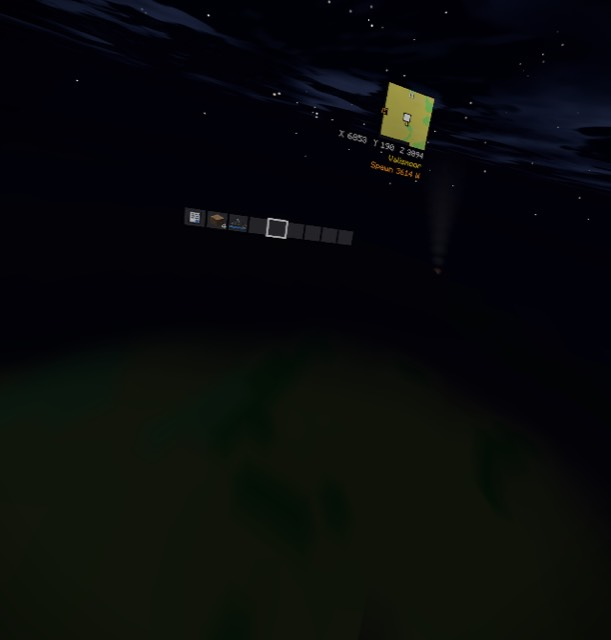

## 12:04:40 - And then the smoke coming out of the wire will all make sense. And jus

- **Transcript:** And then the smoke coming out of the wire will all make sense. And just make it only smoke, no fire
- **Status:** open
- **Build:** 0.129 (bcc0f6d1, M1-M4 (device-tested; ship riding, chests, comfort options, weapon wheel))
- **World:** New World (24) (seed 574311329053960387)
- **Dimension:** Surface
- **Biome:** Savanna
- **Position:** 6936.9 122.5 4068.4
- **Facing:** north (yaw 15, pitch -30)
- **Held:** empty hand
- **Mount:** on foot, flying
- **Looking at:** nothing
- **Mode:** Creative, health 20/20
- **Time:** day 1 23:07, clear
- **Fps:** 66
- **Levels:** mic -26 dBFS, game sound -18 dBFS
- **Length:** 7.5 s (voice 4.8 s)
- **Just before:** -24s message: Entering Valismoor; -23s opened PauseMenu; -22s closed PauseMenu; -20s walked into Forest; -16s walked into Savanna; -14s walked into Beach; -14s message: Entering Valismark; -11s message: Walking; -9s message: Flying; -8s walked into Savanna; -4s message: Entering Valismoor
- **Position at the end:** 6263.4 151.9 3777.7
- **Repro (Mac):** `./snap.sh note --seed 574311329053960387 --x 6936.9 --z 4068.4 --yaw -15 --pitch -30 --time 0.714`
- **Audio (this Mac):** /Users/darthvadar/Documents/Blocksmith/QuestVoiceNotes/raw/vn-20261114-120440-163.aac

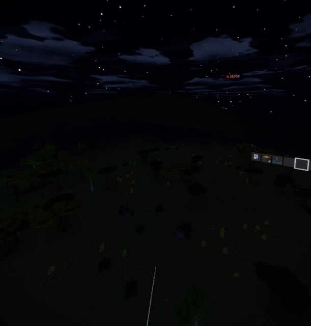

## 12:04:52 - Oh, all right. So here's another example of the rails getting fucked u

- **Transcript:** Oh, all right. So here's another example of the rails getting fucked up
- **Status:** open
- **Build:** 0.129 (bcc0f6d1, M1-M4 (device-tested; ship riding, chests, comfort options, weapon wheel))
- **World:** New World (24) (seed 574311329053960387)
- **Dimension:** Surface
- **Biome:** Savanna
- **Position:** 5888.4 77.6 3926.9
- **Facing:** west (yaw 262, pitch -52)
- **Held:** empty hand
- **Mount:** on foot
- **Looking at:** nothing
- **Mode:** Creative, health 20/20
- **Time:** day 1 23:22, clear
- **Fps:** 71
- **Levels:** mic -20 dBFS, game sound -21 dBFS
- **Length:** 7.7 s (voice 3.5 s)
- **Just before:** -29s walked into Savanna; -27s walked into Beach; -26s message: Entering Valismark; -24s message: Walking; -21s message: Flying; -21s walked into Savanna; -17s message: Entering Valismoor; -7s walked into Badlands; -5s walked into Desert; -4s message: Entering Toriwick; -3s walked into Savanna; -2s message: Walking; -1s message: Copper Wells marked on the map
- **Position at the end:** 5869.2 74.0 3962.6
- **Repro (Mac):** `./snap.sh note --seed 574311329053960387 --x 5888.4 --z 3926.9 --yaw 98 --pitch -52 --time 0.724`
- **Audio (this Mac):** /Users/darthvadar/Documents/Blocksmith/QuestVoiceNotes/raw/vn-20261114-120452-603.aac

## 12:05:00 - Turned into a circle

- **Transcript:** Turned into a circle
- **Status:** open
- **Build:** 0.129 (bcc0f6d1, M1-M4 (device-tested; ship riding, chests, comfort options, weapon wheel))
- **World:** New World (24) (seed 574311329053960387)
- **Dimension:** Surface
- **Biome:** Savanna
- **Position:** 5853.2 73.6 3969.2
- **Facing:** south (yaw 189, pitch -33)
- **Held:** empty hand
- **Mount:** on foot
- **Looking at:** Gravel at 5852 72 3972
- **Mode:** Creative, health 20/20
- **Time:** day 1 23:31, clear
- **Fps:** 71
- **Levels:** mic -25 dBFS, game sound -21 dBFS
- **Length:** 2.8 s (voice 1.3 s)
- **Just before:** -29s message: Flying; -28s walked into Savanna; -25s message: Entering Valismoor; -14s walked into Badlands; -12s walked into Desert; -11s message: Entering Toriwick; -10s walked into Savanna; -10s message: Walking; -8s message: Copper Wells marked on the map
- **Repro (Mac):** `./snap.sh note --seed 574311329053960387 --x 5853.2 --z 3969.2 --yaw 171 --pitch -33 --time 0.730`
- **Audio (this Mac):** /Users/darthvadar/Documents/Blocksmith/QuestVoiceNotes/raw/vn-20261114-120500-244.aac

## 12:07:06 - Some reason I am not able to select this. I don't know why it's red fo

- **Transcript:** Some reason I am not able to select this. I don't know why it's red for
- **Status:** open
- **Build:** 0.129 (bcc0f6d1, M1-M4 (device-tested; ship riding, chests, comfort options, weapon wheel))
- **World:** New World (24) (seed 574311329053960387)
- **Dimension:** Surface
- **Biome:** Savanna
- **Position:** 5806.4 68.7 3925.3
- **Facing:** north-west (yaw 316, pitch -16)
- **Held:** empty hand
- **Mount:** on foot
- **Looking at:** nothing
- **Mode:** Survival, health 20/20, screen NoticeBoardMenu
- **Time:** day 1 01:51, clear
- **Fps:** 72
- **Levels:** mic -25 dBFS, game sound -23 dBFS
- **Length:** 5.1 s (voice 3.0 s)
- **Just before:** -23s message: Walking; -21s opened PauseMenu; -20s message: Survival mode; -20s closed PauseMenu; -17s message: You've reached collect for Lucky Jack at Copper Wells's board; -14s message: Tobias Bramwell: Quiet night. Keep it that way.; -13s opened NoticeBoardMenu; -12s message: Tobias Bramwell: Looking for work? Here's what's posted.
- **Repro (Mac):** `./snap.sh note --seed 574311329053960387 --x 5806.4 --z 3925.3 --yaw 44 --pitch -16 --time 0.828`
- **Audio (this Mac):** /Users/darthvadar/Documents/Blocksmith/QuestVoiceNotes/raw/vn-20261114-120706-743.aac

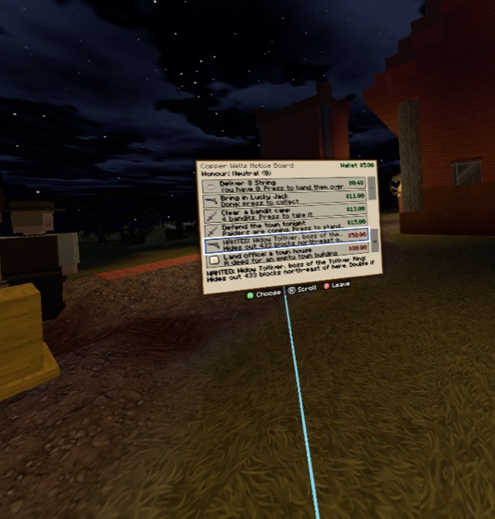

## 12:07:14 - That's e-- It's almost like I can't afford something, but I'm getting 

- **Transcript:** That's e-- It's almost like I can't afford something, but I'm getting money for it
- **Status:** open
- **Build:** 0.129 (bcc0f6d1, M1-M4 (device-tested; ship riding, chests, comfort options, weapon wheel))
- **World:** New World (24) (seed 574311329053960387)
- **Dimension:** Surface
- **Biome:** Savanna
- **Position:** 5806.4 68.7 3925.3
- **Facing:** north-west (yaw 316, pitch -16)
- **Held:** empty hand
- **Mount:** on foot
- **Looking at:** nothing
- **Mode:** Survival, health 20/20, screen NoticeBoardMenu
- **Time:** day 1 02:01, clear
- **Fps:** 72
- **Levels:** mic -51 dBFS, game sound -20 dBFS
- **Length:** 6.4 s (voice 3.4 s)
- **Just before:** -29s opened PauseMenu; -28s message: Survival mode; -28s closed PauseMenu; -25s message: You've reached collect for Lucky Jack at Copper Wells's board; -22s message: Tobias Bramwell: Quiet night. Keep it that way.; -21s opened NoticeBoardMenu; -20s message: Tobias Bramwell: Looking for work? Here's what's posted.
- **Position at the end:** 5806.4 68.7 3925.3
- **Repro (Mac):** `./snap.sh note --seed 574311329053960387 --x 5806.4 --z 3925.3 --yaw 44 --pitch -16 --time 0.834`
- **Audio (this Mac):** /Users/darthvadar/Documents/Blocksmith/QuestVoiceNotes/raw/vn-20261114-120714-523.aac

## 12:07:37 - Nothing's connecting these trains. It's not good

- **Transcript:** Nothing's connecting these trains. It's not good
- **Status:** open
- **Build:** 0.129 (bcc0f6d1, M1-M4 (device-tested; ship riding, chests, comfort options, weapon wheel))
- **World:** New World (24) (seed 574311329053960387)
- **Dimension:** Surface
- **Biome:** Savanna
- **Position:** 5783.9 68.8 3966.2
- **Facing:** south (yaw 173, pitch -0)
- **Held:** empty hand
- **Mount:** on foot
- **Looking at:** nothing
- **Mode:** Survival, health 20/20
- **Time:** day 1 02:28, clear
- **Fps:** 72
- **Levels:** mic -43 dBFS, game sound -13 dBFS
- **Length:** 4.3 s (voice 1.6 s)
- **Just before:** -14s message: Honour raised (a job for Copper Wells); -12s message: Target gone from the list. Back to the story's objective; -8s closed NoticeBoardMenu; -8s message: Elias Coffey: Lanterns on, eyes open.
- **Repro (Mac):** `./snap.sh note --seed 574311329053960387 --x 5783.9 --z 3966.2 --yaw -173 --pitch -0 --time 0.853`
- **Audio (this Mac):** /Users/darthvadar/Documents/Blocksmith/QuestVoiceNotes/raw/vn-20261114-120737-763.aac

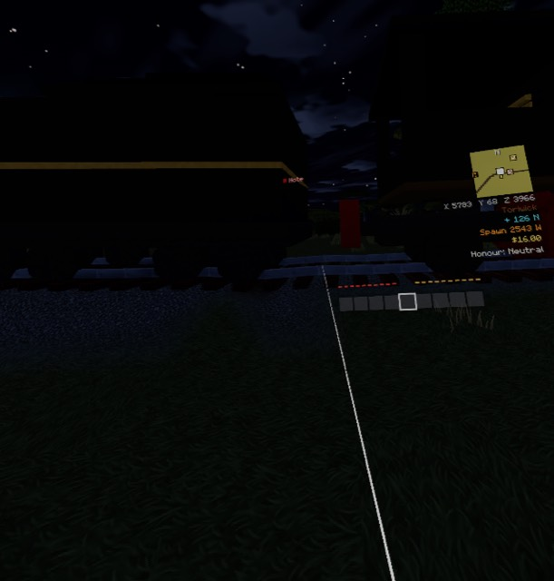

## 12:07:43 - Whoa, what is going on here?

- **Transcript:** Whoa, what is going on here?
- **Status:** open
- **Build:** 0.129 (bcc0f6d1, M1-M4 (device-tested; ship riding, chests, comfort options, weapon wheel))
- **World:** New World (24) (seed 574311329053960387)
- **Dimension:** Surface
- **Biome:** Snowy Plains
- **Position:** 9729.9 314.1 -1805.7
- **Facing:** west (yaw 256, pitch -38)
- **Held:** empty hand
- **Mount:** on foot
- **Looking at:** nothing
- **Mode:** Survival, health 20/20
- **Time:** day 1 02:35, clear
- **Fps:** 72
- **Levels:** mic -23 dBFS, game sound -14 dBFS
- **Length:** 3.0 s (voice 1.6 s)
- **Just before:** -20s message: Honour raised (a job for Copper Wells); -18s message: Target gone from the list. Back to the story's objective; -13s closed NoticeBoardMenu; -13s message: Elias Coffey: Lanterns on, eyes open.; -3s message: Entering Belenvaal; -2s walked into Snowy Plains
- **Repro (Mac):** `./snap.sh note --seed 574311329053960387 --x 9729.9 --z -1805.7 --yaw 104 --pitch -38 --time 0.858`
- **Audio (this Mac):** /Users/darthvadar/Documents/Blocksmith/QuestVoiceNotes/raw/vn-20261114-120743-203.aac

## 12:07:46 - What the fuck just happened?

- **Transcript:** What the fuck just happened?
- **Status:** open
- **Build:** 0.129 (bcc0f6d1, M1-M4 (device-tested; ship riding, chests, comfort options, weapon wheel))
- **World:** New World (24) (seed 574311329053960387)
- **Dimension:** Surface
- **Biome:** Snowy Plains
- **Position:** 9729.9 150.7 -1805.6
- **Facing:** west (yaw 268, pitch -33)
- **Held:** empty hand
- **Mount:** on foot
- **Looking at:** nothing
- **Mode:** Survival, health 20/20, screen PauseMenu
- **Time:** day 1 02:38, clear
- **Fps:** 72
- **Levels:** mic -28 dBFS, game sound -22 dBFS
- **Length:** 3.4 s (voice 1.0 s)
- **Just before:** -23s message: Honour raised (a job for Copper Wells); -21s message: Target gone from the list. Back to the story's objective; -16s closed NoticeBoardMenu; -16s message: Elias Coffey: Lanterns on, eyes open.; -6s message: Entering Belenvaal; -5s walked into Snowy Plains; -1s opened PauseMenu
- **Repro (Mac):** `./snap.sh note --seed 574311329053960387 --x 9729.9 --z -1805.6 --yaw 92 --pitch -33 --time 0.860`
- **Audio (this Mac):** /Users/darthvadar/Documents/Blocksmith/QuestVoiceNotes/raw/vn-20261114-120746-543.aac

## 12:07:50 - I'm sorry, what the fuck just happened?

- **Transcript:** I'm sorry, what the fuck just happened?
- **Status:** open
- **Build:** 0.129 (bcc0f6d1, M1-M4 (device-tested; ship riding, chests, comfort options, weapon wheel))
- **World:** New World (24) (seed 574311329053960387)
- **Dimension:** Surface
- **Biome:** Snowy Plains
- **Position:** 9734.4 137.0 -1806.1
- **Facing:** south (yaw 200, pitch -60)
- **Held:** empty hand
- **Mount:** on foot, flying
- **Looking at:** Snowy Grass Block at 9733 132 -1804
- **Mode:** Creative, health 20/20
- **Time:** day 1 02:42, clear
- **Fps:** 72
- **Levels:** mic -23 dBFS, game sound -18 dBFS
- **Length:** 3.3 s (voice 1.5 s)
- **Just before:** -28s message: Honour raised (a job for Copper Wells); -25s message: Target gone from the list. Back to the story's objective; -21s closed NoticeBoardMenu; -21s message: Elias Coffey: Lanterns on, eyes open.; -11s message: Entering Belenvaal; -10s walked into Snowy Plains; -5s opened PauseMenu; -3s message: Creative mode; -3s closed PauseMenu; -0s message: Flying
- **Repro (Mac):** `./snap.sh note --seed 574311329053960387 --x 9734.4 --z -1806.1 --yaw 160 --pitch -60 --time 0.863`
- **Audio (this Mac):** /Users/darthvadar/Documents/Blocksmith/QuestVoiceNotes/raw/vn-20261114-120750-784.aac

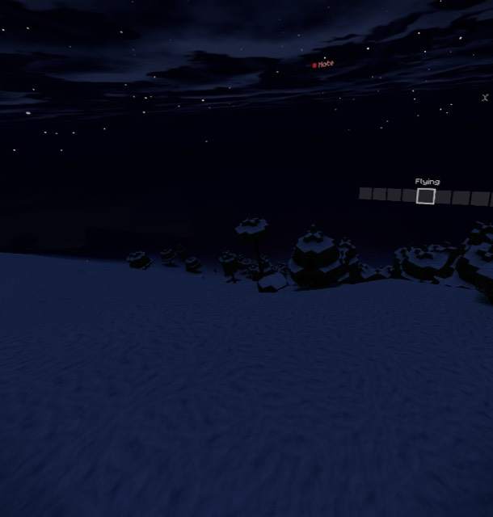

## 12:07:54 - All right, I tried to get into the train, and then I just ended up fre

- **Transcript:** All right, I tried to get into the train, and then I just ended up free falling from the sky in a totally different area of the world
- **Status:** open
- **Build:** 0.129 (bcc0f6d1, M1-M4 (device-tested; ship riding, chests, comfort options, weapon wheel))
- **World:** New World (24) (seed 574311329053960387)
- **Dimension:** Surface
- **Biome:** Snowy Plains
- **Position:** 9700.1 217.5 -1970.4
- **Facing:** north (yaw 8, pitch -32)
- **Held:** empty hand
- **Mount:** on foot, flying
- **Looking at:** nothing
- **Mode:** Creative, health 20/20
- **Time:** day 1 02:46, clear
- **Fps:** 71
- **Levels:** mic -24 dBFS, game sound -17 dBFS
- **Length:** 8.5 s (voice 5.2 s)
- **Just before:** -29s message: Target gone from the list. Back to the story's objective; -24s closed NoticeBoardMenu; -24s message: Elias Coffey: Lanterns on, eyes open.; -14s message: Entering Belenvaal; -13s walked into Snowy Plains; -9s opened PauseMenu; -7s message: Creative mode; -7s closed PauseMenu; -4s message: Flying; -3s walked into Snowy Slopes; -1s walked into Snowy Plains
- **While talking:** -2s walked into Snowy Slopes; -0s walked into Snowy Plains
- **Position at the end:** 9704.2 217.5 -1962.5
- **Repro (Mac):** `./snap.sh note --seed 574311329053960387 --x 9700.1 --z -1970.4 --yaw -8 --pitch -32 --time 0.866`
- **Audio (this Mac):** /Users/darthvadar/Documents/Blocksmith/QuestVoiceNotes/raw/vn-20261114-120754-563.aac

## 12:08:03 - What just happened?

- **Transcript:** What just happened?
- **Status:** open
- **Build:** 0.129 (bcc0f6d1, M1-M4 (device-tested; ship riding, chests, comfort options, weapon wheel))
- **World:** New World (24) (seed 574311329053960387)
- **Dimension:** Surface
- **Biome:** Ice Spikes
- **Position:** 9579.2 217.5 -2205.6
- **Facing:** east (yaw 70, pitch -72)
- **Held:** empty hand
- **Mount:** on foot, flying
- **Looking at:** nothing
- **Mode:** Creative, health 20/20, screen PauseMenu
- **Time:** day 1 02:56, clear
- **Fps:** 71
- **Levels:** mic -32 dBFS, game sound -18 dBFS
- **Length:** 2.4 s (voice 0.8 s)
- **Just before:** -23s message: Entering Belenvaal; -22s walked into Snowy Plains; -17s opened PauseMenu; -15s message: Creative mode; -15s closed PauseMenu; -13s message: Flying; -12s walked into Snowy Slopes; -10s walked into Snowy Plains; -6s walked into Snowy Slopes; -4s walked into Snowy Plains; -2s message: Entering Drahold; -0s opened PauseMenu
- **Repro (Mac):** `./snap.sh note --seed 574311329053960387 --x 9579.2 --z -2205.6 --yaw -70 --pitch -72 --time 0.873`
- **Audio (this Mac):** /Users/darthvadar/Documents/Blocksmith/QuestVoiceNotes/raw/vn-20261114-120803-223.aac

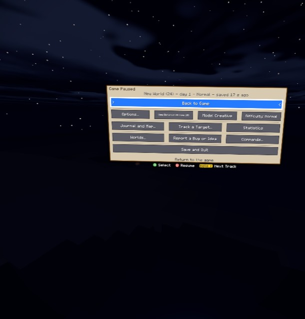

## 12:08:13 - Where the hell's the map? Here we go

- **Transcript:** Where the hell's the map? Here we go
- **Status:** open
- **Build:** 0.129 (bcc0f6d1, M1-M4 (device-tested; ship riding, chests, comfort options, weapon wheel))
- **World:** New World (24) (seed 574311329053960387)
- **Dimension:** Surface
- **Biome:** Ice Spikes
- **Position:** 9579.2 217.5 -2205.7
- **Facing:** north-west (yaw 323, pitch 9)
- **Held:** empty hand
- **Mount:** on foot, flying
- **Looking at:** nothing
- **Mode:** Creative, health 20/20, screen JournalMenu
- **Time:** day 1 03:00, clear
- **Fps:** 71
- **Levels:** mic -32 dBFS, game sound -13 dBFS
- **Length:** 2.7 s (voice 1.1 s)
- **Just before:** -28s opened PauseMenu; -26s message: Creative mode; -25s closed PauseMenu; -23s message: Flying; -22s walked into Snowy Slopes; -20s walked into Snowy Plains; -16s walked into Snowy Slopes; -14s walked into Snowy Plains; -12s message: Entering Drahold; -10s opened PauseMenu; -10s walked into Ice Spikes; -4s closed PauseMenu; -3s opened PauseMenu; -3s opened JournalMenu
- **Repro (Mac):** `./snap.sh note --seed 574311329053960387 --x 9579.2 --z -2205.7 --yaw 37 --pitch 9 --time 0.876`
- **Audio (this Mac):** /Users/darthvadar/Documents/Blocksmith/QuestVoiceNotes/raw/vn-20261114-120813-463.aac

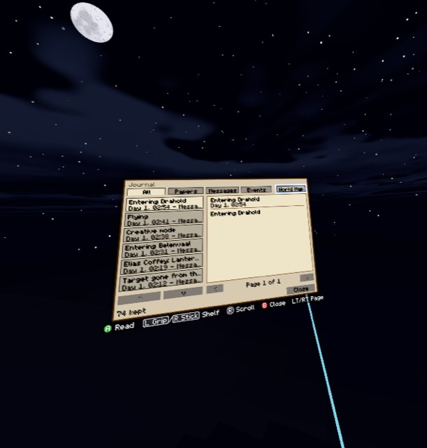

## 12:08:20 - Uh, when scrolling on the map, a bunch of

- **Transcript:** Uh, when scrolling on the map, a bunch of
- **Status:** open
- **Build:** 0.129 (bcc0f6d1, M1-M4 (device-tested; ship riding, chests, comfort options, weapon wheel))
- **World:** New World (24) (seed 574311329053960387)
- **Dimension:** Surface
- **Biome:** Ice Spikes
- **Position:** 9579.2 217.5 -2205.7
- **Facing:** north-west (yaw 323, pitch 9)
- **Held:** empty hand
- **Mount:** on foot, flying
- **Looking at:** nothing
- **Mode:** Creative, health 20/20, screen MapMenu
- **Time:** day 1 03:09, clear
- **Fps:** 72
- **Levels:** mic -25 dBFS, game sound -17 dBFS
- **Length:** 3.1 s (voice 1.6 s)
- **Just before:** -29s walked into Snowy Slopes; -27s walked into Snowy Plains; -23s walked into Snowy Slopes; -21s walked into Snowy Plains; -19s message: Entering Drahold; -17s opened PauseMenu; -17s walked into Ice Spikes; -11s closed PauseMenu; -10s opened PauseMenu; -10s opened JournalMenu; -7s opened MapMenu
- **Repro (Mac):** `./snap.sh note --seed 574311329053960387 --x 9579.2 --z -2205.7 --yaw 37 --pitch 9 --time 0.882`
- **Audio (this Mac):** /Users/darthvadar/Documents/Blocksmith/QuestVoiceNotes/raw/vn-20261114-120820-503.aac

## 12:08:24 - It's not smooth at all. A bunch of, uh, shit happens

- **Transcript:** It's not smooth at all. A bunch of, uh, shit happens
- **Status:** open
- **Build:** 0.129 (bcc0f6d1, M1-M4 (device-tested; ship riding, chests, comfort options, weapon wheel))
- **World:** New World (24) (seed 574311329053960387)
- **Dimension:** Surface
- **Biome:** Ice Spikes
- **Position:** 9579.2 217.5 -2205.7
- **Facing:** north-west (yaw 323, pitch 9)
- **Held:** empty hand
- **Mount:** on foot, flying
- **Looking at:** nothing
- **Mode:** Creative, health 20/20, screen MapMenu
- **Time:** day 1 03:13, clear
- **Fps:** 72
- **Levels:** mic -43 dBFS, game sound -15 dBFS
- **Length:** 3.9 s (voice 1.9 s)
- **Just before:** -27s walked into Snowy Slopes; -25s walked into Snowy Plains; -23s message: Entering Drahold; -21s opened PauseMenu; -21s walked into Ice Spikes; -15s closed PauseMenu; -14s opened PauseMenu; -13s opened JournalMenu; -10s opened MapMenu
- **Repro (Mac):** `./snap.sh note --seed 574311329053960387 --x 9579.2 --z -2205.7 --yaw 37 --pitch 9 --time 0.884`
- **Audio (this Mac):** /Users/darthvadar/Documents/Blocksmith/QuestVoiceNotes/raw/vn-20261114-120824-023.aac

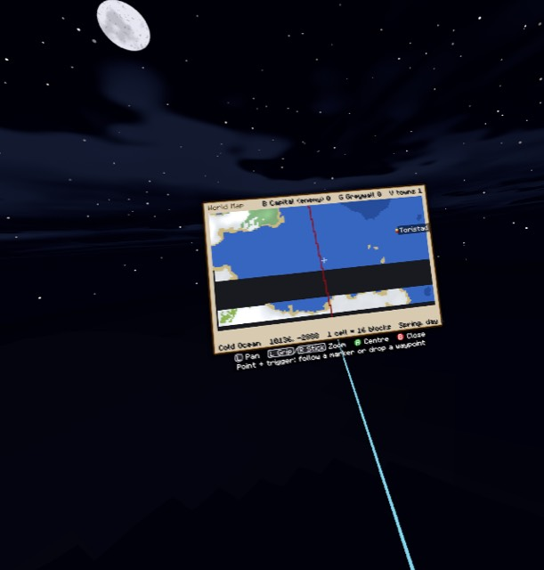

## 12:08:29 - It's really staticky with a bunch of black stuff showing up and disapp

- **Transcript:** It's really staticky with a bunch of black stuff showing up and disappearing
- **Status:** open
- **Build:** 0.129 (bcc0f6d1, M1-M4 (device-tested; ship riding, chests, comfort options, weapon wheel))
- **World:** New World (24) (seed 574311329053960387)
- **Dimension:** Surface
- **Biome:** Ice Spikes
- **Position:** 9579.2 217.5 -2205.7
- **Facing:** north-west (yaw 323, pitch 9)
- **Held:** empty hand
- **Mount:** on foot, flying
- **Looking at:** nothing
- **Mode:** Creative, health 20/20, screen MapMenu
- **Time:** day 1 03:20, clear
- **Fps:** 72
- **Levels:** mic -31 dBFS, game sound -16 dBFS
- **Length:** 4.6 s (voice 2.4 s)
- **Just before:** -28s message: Entering Drahold; -26s opened PauseMenu; -26s walked into Ice Spikes; -20s closed PauseMenu; -19s opened PauseMenu; -18s opened JournalMenu; -16s opened MapMenu
- **Repro (Mac):** `./snap.sh note --seed 574311329053960387 --x 9579.2 --z -2205.7 --yaw 37 --pitch 9 --time 0.889`
- **Audio (this Mac):** /Users/darthvadar/Documents/Blocksmith/QuestVoiceNotes/raw/vn-20261114-120829-403.aac

## 12:08:38 - Roads should also show up on, uh

- **Transcript:** Roads should also show up on, uh
- **Status:** open
- **Build:** 0.129 (bcc0f6d1, M1-M4 (device-tested; ship riding, chests, comfort options, weapon wheel))
- **World:** New World (24) (seed 574311329053960387)
- **Dimension:** Surface
- **Biome:** Ice Spikes
- **Position:** 9579.2 217.5 -2205.7
- **Facing:** north-west (yaw 323, pitch 9)
- **Held:** empty hand
- **Mount:** on foot, flying
- **Looking at:** nothing
- **Mode:** Creative, health 20/20, screen MapMenu
- **Time:** day 1 03:30, clear
- **Fps:** 72
- **Levels:** mic -23 dBFS, game sound -18 dBFS
- **Length:** 3.5 s (voice 1.8 s)
- **Just before:** -29s closed PauseMenu; -28s opened PauseMenu; -27s opened JournalMenu; -25s opened MapMenu
- **Repro (Mac):** `./snap.sh note --seed 574311329053960387 --x 9579.2 --z -2205.7 --yaw 37 --pitch 9 --time 0.896`
- **Audio (this Mac):** /Users/darthvadar/Documents/Blocksmith/QuestVoiceNotes/raw/vn-20261114-120838-403.aac

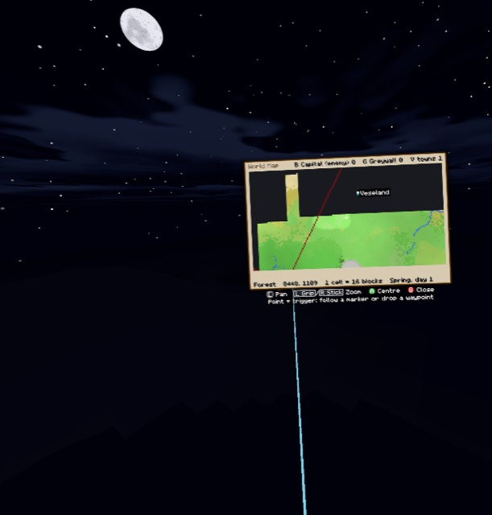

## 12:08:41 - [sniffs] On the map

- **Transcript:** [sniffs] On the map
- **Status:** open
- **Build:** 0.129 (bcc0f6d1, M1-M4 (device-tested; ship riding, chests, comfort options, weapon wheel))
- **World:** New World (24) (seed 574311329053960387)
- **Dimension:** Surface
- **Biome:** Snowy Plains
- **Position:** 9451.1 217.5 -2326.1
- **Facing:** north-west (yaw 296, pitch -41)
- **Held:** empty hand
- **Mount:** on foot, flying
- **Looking at:** nothing
- **Mode:** Creative, health 20/20
- **Time:** day 1 03:34, clear
- **Fps:** 72
- **Levels:** mic -37 dBFS, game sound -16 dBFS
- **Length:** 2.6 s (voice 0.9 s)
- **Just before:** -28s opened MapMenu; -3s opened JournalMenu; -3s closed JournalMenu
- **Repro (Mac):** `./snap.sh note --seed 574311329053960387 --x 9451.1 --z -2326.1 --yaw 64 --pitch -41 --time 0.899`
- **Audio (this Mac):** /Users/darthvadar/Documents/Blocksmith/QuestVoiceNotes/raw/vn-20261114-120841-543.aac

## 12:08:58 - Uh oh

- **Transcript:** Uh oh
- **Status:** open
- **Build:** 0.129 (bcc0f6d1, M1-M4 (device-tested; ship riding, chests, comfort options, weapon wheel))
- **World:** New World (24) (seed 574311329053960387)
- **Dimension:** Surface
- **Biome:** Plains
- **Position:** 8544.4 114.5 -1768.9
- **Facing:** north-east (yaw 41, pitch -49)
- **Held:** empty hand
- **Mount:** on foot
- **Looking at:** nothing
- **Mode:** Creative, health 20/20
- **Time:** day 1 03:55, clear
- **Fps:** 70
- **Levels:** mic -32 dBFS, game sound -24 dBFS
- **Length:** 1.9 s (voice 0.5 s)
- **Just before:** -21s opened JournalMenu; -20s closed JournalMenu; -17s walked into Snowy Plains; -16s message: Walking; -14s message: Flying; -8s message: Entering Belenvaal; -7s walked into Plains; -5s message: Capital citadel (the enemy) marked on the map; -2s message: Walking; -1s walked into Snowy Plains
- **Repro (Mac):** `./snap.sh note --seed 574311329053960387 --x 8544.4 --z -1768.9 --yaw -41 --pitch -49 --time 0.914`
- **Audio (this Mac):** /Users/darthvadar/Documents/Blocksmith/QuestVoiceNotes/raw/vn-20261114-120858-983.aac

## 12:09:01 - This gun is in pieces. That was not fixed. It should have been fixed, 

- **Transcript:** This gun is in pieces. That was not fixed. It should have been fixed, but it wasn't
- **Status:** open
- **Build:** 0.129 (bcc0f6d1, M1-M4 (device-tested; ship riding, chests, comfort options, weapon wheel))
- **World:** New World (24) (seed 574311329053960387)
- **Dimension:** Surface
- **Biome:** Plains
- **Position:** 8565.5 101.0 -1825.7
- **Facing:** north-east (yaw 43, pitch -59)
- **Held:** empty hand
- **Mount:** on foot, flying
- **Looking at:** nothing
- **Mode:** Creative, health 20/20
- **Time:** day 1 03:57, clear
- **Fps:** 70
- **Levels:** mic -38 dBFS, game sound -31 dBFS
- **Length:** 6.7 s (voice 3.1 s)
- **Just before:** -23s opened JournalMenu; -22s closed JournalMenu; -19s walked into Snowy Plains; -18s message: Walking; -16s message: Flying; -10s message: Entering Belenvaal; -9s walked into Plains; -7s message: Capital citadel (the enemy) marked on the map; -4s message: Walking; -3s walked into Snowy Plains; -2s message: Flying
- **While talking:** -4s walked into Plains
- **Position at the end:** 8555.5 111.1 -1835.9
- **Repro (Mac):** `./snap.sh note --seed 574311329053960387 --x 8565.5 --z -1825.7 --yaw -43 --pitch -59 --time 0.915`
- **Audio (this Mac):** /Users/darthvadar/Documents/Blocksmith/QuestVoiceNotes/raw/vn-20261114-120901-003.aac

## 12:09:07 - This gun is also in pieces still. Look at this. This isn't connected t

- **Transcript:** This gun is also in pieces still. Look at this. This isn't connected to this. The barrels aren't connected to the gun
- **Status:** open
- **Build:** 0.129 (bcc0f6d1, M1-M4 (device-tested; ship riding, chests, comfort options, weapon wheel))
- **World:** New World (24) (seed 574311329053960387)
- **Dimension:** Surface
- **Biome:** Plains
- **Position:** 8557.7 127.4 -1860.9
- **Facing:** south-east (yaw 117, pitch -46)
- **Held:** empty hand
- **Mount:** on foot, flying
- **Looking at:** nothing
- **Mode:** Creative, health 20/20
- **Time:** day 1 04:06, clear
- **Fps:** 72
- **Levels:** mic -30 dBFS, game sound -20 dBFS
- **Length:** 9.3 s (voice 4.5 s)
- **Just before:** -30s opened JournalMenu; -29s closed JournalMenu; -26s walked into Snowy Plains; -25s message: Walking; -23s message: Flying; -17s message: Entering Belenvaal; -16s walked into Plains; -14s message: Capital citadel (the enemy) marked on the map; -11s message: Walking; -10s walked into Snowy Plains; -9s message: Flying; -6s walked into Plains
- **While talking:** -3s message: Walking
- **Position at the end:** 8561.9 123.0 -1862.1
- **Repro (Mac):** `./snap.sh note --seed 574311329053960387 --x 8557.7 --z -1860.9 --yaw -117 --pitch -46 --time 0.921`
- **Audio (this Mac):** /Users/darthvadar/Documents/Blocksmith/QuestVoiceNotes/raw/vn-20261114-120907-923.aac

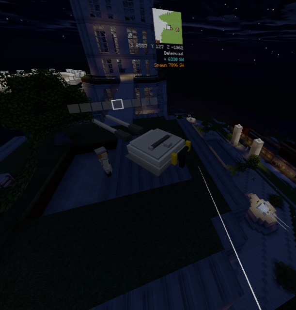

## 12:09:17 - This is the capital citadel

- **Transcript:** This is the capital citadel
- **Status:** open
- **Build:** 0.129 (bcc0f6d1, M1-M4 (device-tested; ship riding, chests, comfort options, weapon wheel))
- **World:** New World (24) (seed 574311329053960387)
- **Dimension:** Surface
- **Biome:** Plains
- **Position:** 8569.4 123.9 -1860.1
- **Facing:** south-east (yaw 115, pitch -37)
- **Held:** empty hand
- **Mount:** on foot
- **Looking at:** nothing
- **Mode:** Creative, health 20/20
- **Time:** day 1 04:17, clear
- **Fps:** 71
- **Levels:** mic -39 dBFS, game sound -27 dBFS
- **Length:** 2.5 s (voice 1.1 s)
- **Just before:** -26s message: Entering Belenvaal; -26s walked into Plains; -24s message: Capital citadel (the enemy) marked on the map; -20s message: Walking; -20s walked into Snowy Plains; -18s message: Flying; -16s walked into Plains; -7s message: Walking
- **Repro (Mac):** `./snap.sh note --seed 574311329053960387 --x 8569.4 --z -1860.1 --yaw -115 --pitch -37 --time 0.929`
- **Audio (this Mac):** /Users/darthvadar/Documents/Blocksmith/QuestVoiceNotes/raw/vn-20261114-120917-543.aac

## 12:10:28 - That nearly got me killed

- **Transcript:** That nearly got me killed
- **Status:** open
- **Build:** 0.129 (bcc0f6d1, M1-M4 (device-tested; ship riding, chests, comfort options, weapon wheel))
- **World:** New World (24) (seed 574311329053960387)
- **Dimension:** Surface
- **Biome:** Plains
- **Position:** 8566.7 78.9 -1797.9
- **Facing:** south-west (yaw 228, pitch -13)
- **Held:** Apple x2
- **Mount:** on foot, flying
- **Looking at:** nothing
- **Mode:** Creative, health 8/20
- **Time:** day 1 05:37, clear
- **Fps:** 70
- **Levels:** mic -24 dBFS, game sound -21 dBFS
- **Length:** 2.2 s (voice 0.7 s)
- **Just before:** -23s opened ChestMenu; -20s into the pack: Blueprint; -20s into the pack: Town Pamphlet; -19s holding Apple; -19s closed ChestMenu; -13s message: You're full; -12s message: Marian Holloway: I'm counting the till. Come back tomorrow.; -7s message: Alarm! Intruder in the citadel; -5s took 2 damage (health 19/20); -5s message: Missile launch: take cover!; -4s opened PauseMenu; -3s took 13 damage (health 8/20); -3s message: The garrison opens fire!; -1s closed PauseMenu; -1s message: Creative mode
- **Repro (Mac):** `./snap.sh note --seed 574311329053960387 --x 8566.7 --z -1797.9 --yaw 132 --pitch -13 --time 0.984`
- **Audio (this Mac):** /Users/darthvadar/Documents/Blocksmith/QuestVoiceNotes/raw/vn-20261114-121028-503.aac

## 12:11:17 - Why is there an alarm going off over here?

- **Transcript:** Why is there an alarm going off over here?
- **Status:** open
- **Build:** 0.129 (bcc0f6d1, M1-M4 (device-tested; ship riding, chests, comfort options, weapon wheel))
- **World:** New World (24) (seed 574311329053960387)
- **Dimension:** Surface
- **Biome:** Plains
- **Position:** 8621.3 70.1 -1729.3
- **Facing:** south (yaw 177, pitch -38)
- **Held:** Field Stim x11
- **Mount:** on foot
- **Looking at:** Grass Block at 8621 69 -1728
- **Mode:** Survival, health 20/20
- **Time:** day 2 06:24, clear
- **Fps:** 70
- **Levels:** mic -29 dBFS, game sound -17 dBFS
- **Length:** 2.9 s (voice 1.4 s)
- **Just before:** -29s message: Missile launch: take cover!; -27s message: Selevaal has gone to war with Veseland; -27s took 5 damage (health 15/20); -26s holding Shotgun Shell Box; -26s holding Shotgun Shells; -26s holding Field Stim; -26s holding Blueprint; -25s holding Field Stim; -25s message: Honour raised (you protected the town); -25s left the pack: Field Stim (at 8572 76 -1783); -24s holding Shotgun Shells; -23s holding Shotgun Shell Box; -23s holding Sturmbrecher Assault Shotgun; -23s message: A Capital patrol sets out to investigate; -20s message: A stranger in town: Ezra Quill; -18s message: Missile launch: take cover!; -18s opened PauseMenu; -18s took 19 damage (health 4/20); -17s closed PauseMenu; -16s message: The citadel is on lockdown!; -14s message: Creative mode; -12s message: Flying; -12s opened PauseMenu; -11s message: Walking; -10s message: Virgil Thorne: I had a buyer for that saddle. He never came back.; -5s message: Survival mode; -5s closed PauseMenu; -4s holding Stone; -4s holding Apple; -3s holding Potato; -3s holding Town Pamphlet; -3s holding Blueprint; -3s message: Blueprint; -3s holding Field Stim; -3s message: Field Stim; -2s left the pack: Field Stim (at 8622 71 -1735); -2s left the pack: Field Stim (at 8623 70 -1736)
- **Repro (Mac):** `./snap.sh note --seed 574311329053960387 --x 8621.3 --z -1729.3 --yaw -177 --pitch -38 --time 0.017`
- **Audio (this Mac):** /Users/darthvadar/Documents/Blocksmith/QuestVoiceNotes/raw/vn-20261114-121117-323.aac

## 12:11:36 - [sighs] I can't... Okay

- **Transcript:** [sighs] I can't... Okay
- **Status:** open
- **Build:** 0.129 (bcc0f6d1, M1-M4 (device-tested; ship riding, chests, comfort options, weapon wheel))
- **World:** New World (24) (seed 574311329053960387)
- **Dimension:** Surface
- **Biome:** Plains
- **Position:** 8625.3 75.2 -1788.8
- **Facing:** north (yaw 15, pitch -21)
- **Held:** Sturmbrecher Assault Shotgun x1
- **Mount:** on foot
- **Looking at:** Oak Log at 8625 75 -1792
- **Mode:** Survival, health 8/20
- **Time:** day 2 06:47, clear
- **Fps:** 69
- **Levels:** mic -27 dBFS, game sound -11 dBFS
- **Length:** 3.2 s (voice 0.9 s)
- **Just before:** -30s message: Walking; -28s message: Virgil Thorne: I had a buyer for that saddle. He never came back.; -24s message: Survival mode; -24s closed PauseMenu; -23s holding Stone; -22s holding Apple; -22s holding Potato; -22s holding Town Pamphlet; -22s holding Blueprint; -22s message: Blueprint; -22s holding Field Stim; -22s message: Field Stim; -21s left the pack: Field Stim (at 8622 71 -1735); -21s left the pack: Field Stim (at 8623 70 -1736); -16s message: The Capital Dropship's crew has spotted you!; -15s holding Shotgun Shells; -15s holding Shotgun Shell Box; -15s holding Sturmbrecher Assault Shotgun; -15s holding Stone; -14s holding Sturmbrecher Assault Shotgun; -11s took 2 damage (health 18/20); -10s message: Honour raised (you protected the town); -8s took 2 damage (health 16/20); -7s message: A Capital Dropship is landing troops!; -6s left the pack: Shotgun Shell Box (at 8619 74 -1778); -6s took 4 damage (health 13/20); -5s message: Missile launch: take cover!; -3s message: Loaded: 20 / 20; -2s holding Stone; -2s took 5 damage (health 8/20); -1s holding Sturmbrecher Assault Shotgun; -1s message: Pearl Burke: Good day to you.
- **Repro (Mac):** `./snap.sh note --seed 574311329053960387 --x 8625.3 --z -1788.8 --yaw -15 --pitch -21 --time 0.033`
- **Audio (this Mac):** /Users/darthvadar/Documents/Blocksmith/QuestVoiceNotes/raw/vn-20261114-121136-083.aac

## 12:11:52 - Oh, that was br-- that was beautiful. Beautiful

- **Transcript:** Oh, that was br-- that was beautiful. Beautiful
- **Status:** open
- **Build:** 0.129 (bcc0f6d1, M1-M4 (device-tested; ship riding, chests, comfort options, weapon wheel))
- **World:** New World (24) (seed 574311329053960387)
- **Dimension:** Surface
- **Biome:** Forest
- **Position:** 3240.5 71.2 3976.6
- **Facing:** east (yaw 109, pitch -22)
- **Held:** empty hand
- **Mount:** on foot
- **Looking at:** Grass Block at 3245 70 3977
- **Mode:** Survival, health 20/20
- **Time:** day 2 07:07, clear
- **Fps:** 70
- **Levels:** mic -28 dBFS, game sound -28 dBFS
- **Length:** 4.3 s (voice 2.0 s)
- **Just before:** -23s left the pack: Shotgun Shell Box (at 8619 74 -1778); -22s took 4 damage (health 13/20); -22s message: Missile launch: take cover!; -20s message: Loaded: 20 / 20; -19s holding Stone; -19s took 5 damage (health 8/20); -18s holding Sturmbrecher Assault Shotgun; -18s message: Pearl Burke: Good day to you.; -16s holding Shotgun Shell Box; -16s message: Missile launch: take cover!; -16s holding Shotgun Shells; -16s holding Field Stim; -16s holding Blueprint; -15s holding Field Stim; -14s left the pack: Field Stim (at 8622 75 -1785); -14s took 2 damage (health 13/20); -14s holding Shotgun Shells; -14s holding Shotgun Shell Box; -14s message: Shotgun Shell Box; -13s holding Sturmbrecher Assault Shotgun; -13s message: Sturmbrecher Assault Shotgun; -10s message: Jasper Ingram: Hey! Quit it!; -8s message: Honour lowered (assault); -6s message: Missile launch: take cover!; -5s took 3 damage (health 16/20); -4s message: Loaded: 20 / 20; -4s left the pack: Shotgun Shell Box; -3s died; -3s opened DeathMenu; -3s holding empty hand; -3s left the pack: Sturmbrecher Assault Shotgun (DeathMenu open); -3s left the pack: Blueprint (DeathMenu open); -3s left the pack: Field Stim x10 (DeathMenu open); -3s left the pack: Shotgun Shell Box x10 (DeathMenu open); -3s left the pack: Town Pamphlet (DeathMenu open); -2s took 17 damage (health -1/20); -1s respawned; -1s closed DeathMenu; -1s message: Your things are 7885 blocks north-east; -0s walked into Forest
- **Repro (Mac):** `./snap.sh note --seed 574311329053960387 --x 3240.5 --z 3976.6 --yaw -109 --pitch -22 --time 0.047`
- **Audio (this Mac):** /Users/darthvadar/Documents/Blocksmith/QuestVoiceNotes/raw/vn-20261114-121152-943.aac

## 12:11:59 - All right. [clears throat]

- **Transcript:** All right. [clears throat]
- **Status:** open
- **Build:** 0.129 (bcc0f6d1, M1-M4 (device-tested; ship riding, chests, comfort options, weapon wheel))
- **World:** New World (24) (seed 574311329053960387)
- **Dimension:** Surface
- **Biome:** Forest
- **Position:** 3234.2 67.0 3997.5
- **Facing:** west (yaw 272, pitch -10)
- **Held:** empty hand
- **Mount:** on foot, flying
- **Looking at:** Oak Log at 3228 67 3997
- **Mode:** Creative, health 20/20
- **Time:** day 2 07:13, clear
- **Fps:** 72
- **Levels:** mic -29 dBFS, game sound -22 dBFS
- **Length:** 2.8 s (voice 1.2 s)
- **Just before:** -26s holding Stone; -26s took 5 damage (health 8/20); -25s holding Sturmbrecher Assault Shotgun; -25s message: Pearl Burke: Good day to you.; -23s holding Shotgun Shell Box; -23s message: Missile launch: take cover!; -23s holding Shotgun Shells; -23s holding Field Stim; -23s holding Blueprint; -22s holding Field Stim; -21s left the pack: Field Stim (at 8622 75 -1785); -21s took 2 damage (health 13/20); -21s holding Shotgun Shells; -21s holding Shotgun Shell Box; -21s message: Shotgun Shell Box; -20s holding Sturmbrecher Assault Shotgun; -20s message: Sturmbrecher Assault Shotgun; -17s message: Jasper Ingram: Hey! Quit it!; -15s message: Honour lowered (assault); -13s message: Missile launch: take cover!; -12s took 3 damage (health 16/20); -11s message: Loaded: 20 / 20; -11s left the pack: Shotgun Shell Box; -10s died; -10s opened DeathMenu; -10s holding empty hand; -10s left the pack: Sturmbrecher Assault Shotgun (DeathMenu open); -10s left the pack: Blueprint (DeathMenu open); -10s left the pack: Field Stim x10 (DeathMenu open); -10s left the pack: Shotgun Shell Box x10 (DeathMenu open); -10s left the pack: Town Pamphlet (DeathMenu open); -9s took 17 damage (health -1/20); -8s respawned; -8s closed DeathMenu; -8s message: Your things are 7885 blocks north-east; -7s walked into Forest; -5s message: Entering Wenisdor; -2s opened PauseMenu; -1s message: Creative mode; -1s closed PauseMenu
- **Repro (Mac):** `./snap.sh note --seed 574311329053960387 --x 3234.2 --z 3997.5 --yaw 88 --pitch -10 --time 0.051`
- **Audio (this Mac):** /Users/darthvadar/Documents/Blocksmith/QuestVoiceNotes/raw/vn-20261114-121159-983.aac

## 12:12:06 - I don't know if that was enough gameplay for there, but

- **Transcript:** I don't know if that was enough gameplay for there, but
- **Status:** open
- **Build:** 0.129 (bcc0f6d1, M1-M4 (device-tested; ship riding, chests, comfort options, weapon wheel))
- **World:** New World (24) (seed 574311329053960387)
- **Dimension:** Surface
- **Biome:** Plains
- **Position:** 2923.0 111.6 3641.6
- **Facing:** north-west (yaw 298, pitch -25)
- **Held:** empty hand
- **Mount:** on foot, flying
- **Looking at:** nothing
- **Mode:** Creative, health 20/20
- **Time:** day 2 07:21, clear
- **Fps:** 71
- **Levels:** mic -26 dBFS, game sound -22 dBFS
- **Length:** 3.3 s (voice 1.6 s)
- **Just before:** -30s holding Shotgun Shell Box; -30s message: Missile launch: take cover!; -30s holding Shotgun Shells; -30s holding Field Stim; -29s holding Blueprint; -29s holding Field Stim; -28s left the pack: Field Stim (at 8622 75 -1785); -28s took 2 damage (health 13/20); -28s holding Shotgun Shells; -27s holding Shotgun Shell Box; -27s message: Shotgun Shell Box; -27s holding Sturmbrecher Assault Shotgun; -27s message: Sturmbrecher Assault Shotgun; -24s message: Jasper Ingram: Hey! Quit it!; -22s message: Honour lowered (assault); -20s message: Missile launch: take cover!; -19s took 3 damage (health 16/20); -18s message: Loaded: 20 / 20; -18s left the pack: Shotgun Shell Box; -17s died; -17s opened DeathMenu; -17s holding empty hand; -17s left the pack: Sturmbrecher Assault Shotgun (DeathMenu open); -17s left the pack: Blueprint (DeathMenu open); -17s left the pack: Field Stim x10 (DeathMenu open); -17s left the pack: Shotgun Shell Box x10 (DeathMenu open); -17s left the pack: Town Pamphlet (DeathMenu open); -16s took 17 damage (health -1/20); -14s respawned; -14s closed DeathMenu; -14s message: Your things are 7885 blocks north-east; -14s walked into Forest; -12s message: Entering Wenisdor; -9s opened PauseMenu; -8s message: Creative mode; -7s closed PauseMenu; -6s message: Flying; -4s walked into Flower Forest; -2s walked into Plains
- **Repro (Mac):** `./snap.sh note --seed 574311329053960387 --x 2923.0 --z 3641.6 --yaw 62 --pitch -25 --time 0.057`
- **Audio (this Mac):** /Users/darthvadar/Documents/Blocksmith/QuestVoiceNotes/raw/vn-20261114-121206-663.aac

## 12:12:20 - See the way the capital citadel looks in the background? Perfect. Make

- **Transcript:** See the way the capital citadel looks in the background? Perfect. Make the village look the same way. Like that looks perfect
- **Status:** open
- **Build:** 0.129 (bcc0f6d1, M1-M4 (device-tested; ship riding, chests, comfort options, weapon wheel))
- **World:** New World (24) (seed 574311329053960387)
- **Dimension:** Surface
- **Biome:** Savanna
- **Position:** 2098.4 192.3 3414.8
- **Facing:** north-west (yaw 315, pitch -18)
- **Held:** empty hand
- **Mount:** on foot, flying
- **Looking at:** nothing
- **Mode:** Creative, health 20/20
- **Time:** day 2 07:38, clear
- **Fps:** 72
- **Levels:** mic -27 dBFS, game sound -16 dBFS
- **Length:** 7.4 s (voice 3.7 s)
- **Just before:** -30s took 17 damage (health -1/20); -28s respawned; -28s closed DeathMenu; -28s message: Your things are 7885 blocks north-east; -28s walked into Forest; -26s message: Entering Wenisdor; -23s opened PauseMenu; -21s message: Creative mode; -21s closed PauseMenu; -20s message: Flying; -18s walked into Flower Forest; -16s walked into Plains; -12s message: Sky isle marked on the map; -9s walked into Savanna; -3s walked into Forest; -1s walked into Plains
- **While talking:** -2s walked into Savanna; -0s walked into Plains
- **Position at the end:** 2059.1 192.3 3476.9
- **Repro (Mac):** `./snap.sh note --seed 574311329053960387 --x 2098.4 --z 3414.8 --yaw 45 --pitch -18 --time 0.068`
- **Audio (this Mac):** /Users/darthvadar/Documents/Blocksmith/QuestVoiceNotes/raw/vn-20261114-121220-463.aac

## 12:12:27 - That looks wonderful

- **Transcript:** That looks wonderful
- **Status:** open
- **Build:** 0.129 (bcc0f6d1, M1-M4 (device-tested; ship riding, chests, comfort options, weapon wheel))
- **World:** New World (24) (seed 574311329053960387)
- **Dimension:** Surface
- **Biome:** Savanna
- **Position:** 2005.9 192.3 3388.9
- **Facing:** north-west (yaw 324, pitch -8)
- **Held:** empty hand
- **Mount:** on foot, flying
- **Looking at:** nothing
- **Mode:** Creative, health 20/20
- **Time:** day 2 07:47, clear
- **Fps:** 72
- **Levels:** mic -32 dBFS, game sound -16 dBFS
- **Length:** 2.2 s (voice 0.6 s)
- **Just before:** -29s message: Creative mode; -29s closed PauseMenu; -27s message: Flying; -25s walked into Flower Forest; -23s walked into Plains; -19s message: Sky isle marked on the map; -17s walked into Savanna; -11s walked into Forest; -9s walked into Plains; -5s walked into Savanna; -3s walked into Plains
- **Repro (Mac):** `./snap.sh note --seed 574311329053960387 --x 2005.9 --z 3388.9 --yaw 36 --pitch -8 --time 0.074`
- **Audio (this Mac):** /Users/darthvadar/Documents/Blocksmith/QuestVoiceNotes/raw/vn-20261114-121227-804.aac

## 12:12:31 - And then, yeah

- **Transcript:** And then, yeah
- **Status:** open
- **Build:** 0.129 (bcc0f6d1, M1-M4 (device-tested; ship riding, chests, comfort options, weapon wheel))
- **World:** New World (24) (seed 574311329053960387)
- **Dimension:** Surface
- **Biome:** Forest
- **Position:** 1542.6 192.3 2752.4
- **Facing:** north-west (yaw 331, pitch -29)
- **Held:** empty hand
- **Mount:** on foot, flying
- **Looking at:** nothing
- **Mode:** Creative, health 20/20
- **Time:** day 2 07:51, clear
- **Fps:** 71
- **Levels:** mic -25 dBFS, game sound -18 dBFS
- **Length:** 2.3 s (voice 0.7 s)
- **Just before:** -28s walked into Flower Forest; -26s walked into Plains; -23s message: Sky isle marked on the map; -20s walked into Savanna; -14s walked into Forest; -12s walked into Plains; -8s walked into Savanna; -6s walked into Plains; -2s walked into Sparse Jungle; -1s message: Entering Drahold; -0s walked into Forest
- **Repro (Mac):** `./snap.sh note --seed 574311329053960387 --x 1542.6 --z 2752.4 --yaw 29 --pitch -29 --time 0.077`
- **Audio (this Mac):** /Users/darthvadar/Documents/Blocksmith/QuestVoiceNotes/raw/vn-20261114-121231-163.aac

## 12:12:33 - I mean, I don't know how much GPU that used

- **Transcript:** I mean, I don't know how much GPU that used
- **Status:** open
- **Build:** 0.129 (bcc0f6d1, M1-M4 (device-tested; ship riding, chests, comfort options, weapon wheel))
- **World:** New World (24) (seed 574311329053960387)
- **Dimension:** Surface
- **Biome:** Forest
- **Position:** 1504.3 192.3 2719.4
- **Facing:** north-west (yaw 326, pitch -44)
- **Held:** empty hand
- **Mount:** on foot, flying
- **Looking at:** nothing
- **Mode:** Creative, health 20/20
- **Time:** day 2 07:53, clear
- **Fps:** 71
- **Levels:** mic -23 dBFS, game sound -18 dBFS
- **Length:** 3.6 s (voice 1.9 s)
- **Just before:** -28s walked into Plains; -25s message: Sky isle marked on the map; -22s walked into Savanna; -16s walked into Forest; -14s walked into Plains; -10s walked into Savanna; -8s walked into Plains; -4s walked into Sparse Jungle; -3s message: Entering Drahold; -2s walked into Forest
- **Repro (Mac):** `./snap.sh note --seed 574311329053960387 --x 1504.3 --z 2719.4 --yaw 34 --pitch -44 --time 0.079`
- **Audio (this Mac):** /Users/darthvadar/Documents/Blocksmith/QuestVoiceNotes/raw/vn-20261114-121233-163.aac

## 12:12:37 - Or even just the way it looks now, like that, that is terrific

- **Transcript:** Or even just the way it looks now, like that, that is terrific
- **Status:** open
- **Build:** 0.129 (bcc0f6d1, M1-M4 (device-tested; ship riding, chests, comfort options, weapon wheel))
- **World:** New World (24) (seed 574311329053960387)
- **Dimension:** Surface
- **Biome:** Forest
- **Position:** 1520.6 135.5 2745.2
- **Facing:** north-west (yaw 318, pitch -18)
- **Held:** empty hand
- **Mount:** on foot, flying
- **Looking at:** nothing
- **Mode:** Creative, health 20/20
- **Time:** day 2 07:58, clear
- **Fps:** 72
- **Levels:** mic -25 dBFS, game sound -13 dBFS
- **Length:** 3.8 s (voice 2.0 s)
- **Just before:** -29s message: Sky isle marked on the map; -26s walked into Savanna; -20s walked into Forest; -18s walked into Plains; -14s walked into Savanna; -12s walked into Plains; -8s walked into Sparse Jungle; -7s message: Entering Drahold; -6s walked into Forest; -2s message: Walking; -0s message: Flying
- **Repro (Mac):** `./snap.sh note --seed 574311329053960387 --x 1520.6 --z 2745.2 --yaw 42 --pitch -18 --time 0.082`
- **Audio (this Mac):** /Users/darthvadar/Documents/Blocksmith/QuestVoiceNotes/raw/vn-20261114-121237-203.aac

## 12:12:41 - Make everything use the same compression style and, uh, get rid of the

- **Transcript:** Make everything use the same compression style and, uh, get rid of the fucking volcanoes in the background. Looks like shit. Get rid of the vol-- no volcanoes
- **Status:** open
- **Build:** 0.129 (bcc0f6d1, M1-M4 (device-tested; ship riding, chests, comfort options, weapon wheel))
- **World:** New World (24) (seed 574311329053960387)
- **Dimension:** Surface
- **Biome:** Savanna
- **Position:** 2044.7 207.8 3638.9
- **Facing:** north-west (yaw 328, pitch -3)
- **Held:** empty hand
- **Mount:** on foot, flying
- **Looking at:** nothing
- **Mode:** Creative, health 20/20
- **Time:** day 2 08:03, clear
- **Fps:** 71
- **Levels:** mic -28 dBFS, game sound -17 dBFS
- **Length:** 9.8 s (voice 5.5 s)
- **Just before:** -25s walked into Forest; -23s walked into Plains; -19s walked into Savanna; -17s walked into Plains; -13s walked into Sparse Jungle; -12s message: Entering Drahold; -11s walked into Forest; -7s message: Walking; -5s message: Flying; -3s message: Entering Wenisdor; -1s walked into Savanna
- **Position at the end:** 1972.9 207.8 3465.1
- **Repro (Mac):** `./snap.sh note --seed 574311329053960387 --x 2044.7 --z 3638.9 --yaw 32 --pitch -3 --time 0.086`
- **Audio (this Mac):** /Users/darthvadar/Documents/Blocksmith/QuestVoiceNotes/raw/vn-20261114-121241-703.aac

## 12:13:21 - Siege carriage?

- **Transcript:** Siege carriage?
- **Status:** open
- **Build:** 0.129 (bcc0f6d1, M1-M4 (device-tested; ship riding, chests, comfort options, weapon wheel))
- **World:** New World (24) (seed 574311329053960387)
- **Dimension:** Surface
- **Biome:** Savanna
- **Position:** 1671.2 197.0 4443.4
- **Facing:** east (yaw 110, pitch -13)
- **Held:** empty hand
- **Mount:** on foot, flying
- **Looking at:** nothing
- **Mode:** Creative, health 20/20, screen CommandMenu
- **Time:** day 2 08:49, clear
- **Fps:** 72
- **Levels:** mic -37 dBFS, game sound -18 dBFS
- **Length:** 2.6 s (voice 0.9 s)
- **Just before:** -30s walked into Jungle; -28s message: Walking; -28s walked into Sparse Jungle; -25s message: Flying; -24s message: Thistle Hollow marked on the map; -22s walked into Savanna; -18s walked into Jungle; -14s walked into Forest; -13s message: Entering Wenisdor; -12s walked into Savanna; -11s message: Entering Eldarvania; -10s opened PauseMenu; -9s opened CommandMenu; -8s message: Sealed Armoury: 1864 ~ 4712 (330 blocks, underground: its floor at y -36, 107 blocks under the surface), marked on your map; -3s message: Train: 2695 ~ 5635 (1570 blocks, on the Lone & Greywall Railway)
- **Repro (Mac):** `./snap.sh note --seed 574311329053960387 --x 1671.2 --z 4443.4 --yaw -110 --pitch -13 --time 0.118`
- **Audio (this Mac):** /Users/darthvadar/Documents/Blocksmith/QuestVoiceNotes/raw/vn-20261114-121321-003.aac

## 12:13:23 - Okay, 8857

- **Transcript:** Okay, 8857
- **Status:** open
- **Build:** 0.129 (bcc0f6d1, M1-M4 (device-tested; ship riding, chests, comfort options, weapon wheel))
- **World:** New World (24) (seed 574311329053960387)
- **Dimension:** Surface
- **Biome:** Savanna
- **Position:** 1671.2 197.0 4443.4
- **Facing:** east (yaw 110, pitch -13)
- **Held:** empty hand
- **Mount:** on foot, flying
- **Looking at:** nothing
- **Mode:** Creative, health 20/20, screen CommandMenu
- **Time:** day 2 08:52, clear
- **Fps:** 72
- **Levels:** mic -31 dBFS, game sound -17 dBFS
- **Length:** 3.3 s (voice 0.9 s)
- **Just before:** -28s message: Flying; -26s message: Thistle Hollow marked on the map; -24s walked into Savanna; -20s walked into Jungle; -16s walked into Forest; -15s message: Entering Wenisdor; -14s walked into Savanna; -13s message: Entering Eldarvania; -12s opened PauseMenu; -11s opened CommandMenu; -10s message: Sealed Armoury: 1864 ~ 4712 (330 blocks, underground: its floor at y -36, 107 blocks under the surface), marked on your map; -6s message: Train: 2695 ~ 5635 (1570 blocks, on the Lone & Greywall Railway)
- **Repro (Mac):** `./snap.sh note --seed 574311329053960387 --x 1671.2 --z 4443.4 --yaw -110 --pitch -13 --time 0.120`
- **Audio (this Mac):** /Users/darthvadar/Documents/Blocksmith/QuestVoiceNotes/raw/vn-20261114-121323-403.aac

## 12:13:45 - Where's that siege carriage at? There it is. Little one, look at that.

- **Transcript:** Where's that siege carriage at? There it is. Little one, look at that. Oh, that's cute
- **Status:** open
- **Build:** 0.129 (bcc0f6d1, M1-M4 (device-tested; ship riding, chests, comfort options, weapon wheel))
- **World:** New World (24) (seed 574311329053960387)
- **Dimension:** Surface
- **Biome:** Frozen Peaks
- **Position:** 8839.7 197.0 5773.5
- **Facing:** north-east (yaw 65, pitch -27)
- **Held:** empty hand
- **Mount:** on foot, flying
- **Looking at:** nothing
- **Mode:** Creative, health 20/20
- **Time:** day 2 09:18, clear
- **Fps:** 70
- **Levels:** mic -39 dBFS, game sound -20 dBFS
- **Length:** 6.3 s (voice 3.2 s)
- **Just before:** -27s message: Train: 2695 ~ 5635 (1570 blocks, on the Lone & Greywall Railway); -21s closed CommandMenu; -18s walked into Snowy Taiga; -16s walked into Taiga; -14s message: Entering Fenavaal; -14s walked into Snowy Taiga; -12s message: Entering Belenvania; -12s walked into Taiga; -10s message: Entering Valismark; -10s walked into Cold Ocean; -8s message: Entering Draismark; -8s walked into Snowy Plains; -6s message: Siege Carriage patrol marked on the map; -4s walked into Snowy Taiga; -2s walked into Grove
- **While talking:** -5s walked into Frozen Peaks; -1s message: Walking
- **Position at the end:** 8829.5 180.3 5793.0
- **Repro (Mac):** `./snap.sh note --seed 574311329053960387 --x 8839.7 --z 5773.5 --yaw -65 --pitch -27 --time 0.138`
- **Audio (this Mac):** /Users/darthvadar/Documents/Blocksmith/QuestVoiceNotes/raw/vn-20261114-121345-023.aac

## 12:13:51 - I mean, uh

- **Transcript:** I mean, uh
- **Status:** open
- **Build:** 0.129 (bcc0f6d1, M1-M4 (device-tested; ship riding, chests, comfort options, weapon wheel))
- **World:** New World (24) (seed 574311329053960387)
- **Dimension:** Surface
- **Biome:** Frozen Peaks
- **Position:** 8830.3 164.9 5795.5
- **Facing:** north-west (yaw 301, pitch -32)
- **Held:** empty hand
- **Mount:** on foot, flying
- **Looking at:** nothing
- **Mode:** Creative, health 20/20
- **Time:** day 2 09:25, clear
- **Fps:** 70
- **Levels:** mic -25 dBFS, game sound -20 dBFS
- **Length:** 2.9 s (voice 1.2 s)
- **Just before:** -27s closed CommandMenu; -24s walked into Snowy Taiga; -22s walked into Taiga; -20s message: Entering Fenavaal; -20s walked into Snowy Taiga; -18s message: Entering Belenvania; -18s walked into Taiga; -17s message: Entering Valismark; -16s walked into Cold Ocean; -14s message: Entering Draismark; -14s walked into Snowy Plains; -13s message: Siege Carriage patrol marked on the map; -10s walked into Snowy Taiga; -8s walked into Grove; -6s walked into Frozen Peaks; -2s message: Walking; -1s message: Flying
- **Repro (Mac):** `./snap.sh note --seed 574311329053960387 --x 8830.3 --z 5795.5 --yaw 59 --pitch -32 --time 0.143`
- **Audio (this Mac):** /Users/darthvadar/Documents/Blocksmith/QuestVoiceNotes/raw/vn-20261114-121351-183.aac

## 12:13:56 - Okay. It's cute, that's for sure

- **Transcript:** Okay. It's cute, that's for sure
- **Status:** open
- **Build:** 0.129 (bcc0f6d1, M1-M4 (device-tested; ship riding, chests, comfort options, weapon wheel))
- **World:** New World (24) (seed 574311329053960387)
- **Dimension:** Surface
- **Biome:** Frozen Peaks
- **Position:** 8861.8 161.3 5800.1
- **Facing:** west (yaw 284, pitch -34)
- **Held:** empty hand
- **Mount:** on foot, flying
- **Looking at:** nothing
- **Mode:** Creative, health 20/20
- **Time:** day 2 09:32, clear
- **Fps:** 72
- **Levels:** mic -47 dBFS, game sound -17 dBFS
- **Length:** 4.4 s (voice 1.4 s)
- **Just before:** -29s walked into Snowy Taiga; -27s walked into Taiga; -26s message: Entering Fenavaal; -25s walked into Snowy Taiga; -24s message: Entering Belenvania; -23s walked into Taiga; -22s message: Entering Valismark; -21s walked into Cold Ocean; -20s message: Entering Draismark; -19s walked into Snowy Plains; -18s message: Siege Carriage patrol marked on the map; -15s walked into Snowy Taiga; -13s walked into Grove; -11s walked into Frozen Peaks; -8s message: Walking; -6s message: Flying; -5s message: Walking; -3s message: Flying
- **Repro (Mac):** `./snap.sh note --seed 574311329053960387 --x 8861.8 --z 5800.1 --yaw 76 --pitch -34 --time 0.147`
- **Audio (this Mac):** /Users/darthvadar/Documents/Blocksmith/QuestVoiceNotes/raw/vn-20261114-121356-463.aac

## 12:14:00 - That is the way I describe it, is cute. And no one's driving it, so wh

- **Transcript:** That is the way I describe it, is cute. And no one's driving it, so what the heck?
- **Status:** open
- **Build:** 0.129 (bcc0f6d1, M1-M4 (device-tested; ship riding, chests, comfort options, weapon wheel))
- **World:** New World (24) (seed 574311329053960387)
- **Dimension:** Surface
- **Biome:** Frozen Peaks
- **Position:** 8840.5 159.5 5791.7
- **Facing:** west (yaw 267, pitch -11)
- **Held:** empty hand
- **Mount:** on foot
- **Looking at:** nothing
- **Mode:** Creative, health 20/20
- **Time:** day 2 09:37, clear
- **Fps:** 72
- **Levels:** mic -30 dBFS, game sound -15 dBFS
- **Length:** 5.9 s (voice 3.4 s)
- **Just before:** -29s walked into Snowy Taiga; -28s message: Entering Belenvania; -27s walked into Taiga; -26s message: Entering Valismark; -25s walked into Cold Ocean; -24s message: Entering Draismark; -23s walked into Snowy Plains; -22s message: Siege Carriage patrol marked on the map; -19s walked into Snowy Taiga; -17s walked into Grove; -15s walked into Frozen Peaks; -12s message: Walking; -10s message: Flying; -9s message: Walking; -7s message: Flying; -1s message: Walking
- **Position at the end:** 8828.5 158.3 5796.0
- **Repro (Mac):** `./snap.sh note --seed 574311329053960387 --x 8840.5 --z 5791.7 --yaw 93 --pitch -11 --time 0.151`
- **Audio (this Mac):** /Users/darthvadar/Documents/Blocksmith/QuestVoiceNotes/raw/vn-20261114-121400-823.aac

## 12:14:08 - A few things. This couldn't realistically support a gun, um

- **Transcript:** A few things. This couldn't realistically support a gun, um
- **Status:** open
- **Build:** 0.129 (bcc0f6d1, M1-M4 (device-tested; ship riding, chests, comfort options, weapon wheel))
- **World:** New World (24) (seed 574311329053960387)
- **Dimension:** Surface
- **Biome:** Frozen Peaks
- **Position:** 8826.8 158.2 5796.3
- **Facing:** north-east (yaw 24, pitch -0)
- **Held:** empty hand
- **Mount:** on foot
- **Looking at:** nothing
- **Mode:** Creative, health 20/20
- **Time:** day 2 09:46, clear
- **Fps:** 70
- **Levels:** mic -21 dBFS, game sound -15 dBFS
- **Length:** 4.8 s (voice 2.5 s)
- **Just before:** -27s walked into Snowy Taiga; -25s walked into Grove; -23s walked into Frozen Peaks; -20s message: Walking; -18s message: Flying; -17s message: Walking; -15s message: Flying; -9s message: Walking
- **Repro (Mac):** `./snap.sh note --seed 574311329053960387 --x 8826.8 --z 5796.3 --yaw -24 --pitch -0 --time 0.158`
- **Audio (this Mac):** /Users/darthvadar/Documents/Blocksmith/QuestVoiceNotes/raw/vn-20261114-121408-643.aac

## 12:14:13 - Also, the gun looks like shit. Like this... Uh, okay, well, it is barr

- **Transcript:** Also, the gun looks like shit. Like this... Uh, okay, well, it is barrels, but still, this still looks like shit. Like, barrels should be more spaced apart probably. I don't know. Also, I can't break this glass block
- **Status:** open
- **Build:** 0.129 (bcc0f6d1, M1-M4 (device-tested; ship riding, chests, comfort options, weapon wheel))
- **World:** New World (24) (seed 574311329053960387)
- **Dimension:** Surface
- **Biome:** Frozen Peaks
- **Position:** 8829.7 158.4 5795.8
- **Facing:** east (yaw 70, pitch 14)
- **Held:** empty hand
- **Mount:** on foot
- **Looking at:** nothing
- **Mode:** Creative, health 20/20
- **Time:** day 2 09:52, clear
- **Fps:** 72
- **Levels:** mic -35 dBFS, game sound -17 dBFS
- **Length:** 11.6 s (voice 6.1 s)
- **Just before:** -30s walked into Grove; -28s walked into Frozen Peaks; -24s message: Walking; -23s message: Flying; -21s message: Walking; -20s message: Flying; -13s message: Walking
- **Position at the end:** 8826.1 158.2 5796.3
- **Repro (Mac):** `./snap.sh note --seed 574311329053960387 --x 8829.7 --z 5795.8 --yaw -70 --pitch 14 --time 0.161`
- **Audio (this Mac):** /Users/darthvadar/Documents/Blocksmith/QuestVoiceNotes/raw/vn-20261114-121413-103.aac

## 12:14:27 - Dunskim, geez. Ooh, Dunskim upgrade. Oh

- **Transcript:** Dunskim, geez. Ooh, Dunskim upgrade. Oh
- **Status:** open
- **Build:** 0.129 (bcc0f6d1, M1-M4 (device-tested; ship riding, chests, comfort options, weapon wheel))
- **World:** New World (24) (seed 574311329053960387)
- **Dimension:** Surface
- **Biome:** Frozen Peaks
- **Position:** 8825.1 158.3 5795.7
- **Facing:** north-west (yaw 323, pitch -23)
- **Held:** empty hand
- **Mount:** on foot
- **Looking at:** nothing
- **Mode:** Creative, health 20/20, screen ChestMenu
- **Time:** day 2 10:08, clear
- **Fps:** 72
- **Levels:** mic -28 dBFS, game sound -16 dBFS
- **Length:** 5.2 s (voice 2.0 s)
- **Just before:** -27s message: Walking; -2s opened ChestMenu
- **Repro (Mac):** `./snap.sh note --seed 574311329053960387 --x 8825.1 --z 5795.7 --yaw 37 --pitch -23 --time 0.173`
- **Audio (this Mac):** /Users/darthvadar/Documents/Blocksmith/QuestVoiceNotes/raw/vn-20261114-121427-023.aac

## 12:14:35 - Oh. [laughs] Now how fast is this thing anyway? Probably not... Oh, it

- **Transcript:** Oh. [laughs] Now how fast is this thing anyway? Probably not... Oh, it's stuck. Uh-oh, it's stuck. I can't move
- **Status:** open
- **Build:** 0.129 (bcc0f6d1, M1-M4 (device-tested; ship riding, chests, comfort options, weapon wheel))
- **World:** New World (24) (seed 574311329053960387)
- **Dimension:** Surface
- **Biome:** Frozen Peaks
- **Position:** 8824.5 159.0 5792.3
- **Facing:** north-east (yaw 40, pitch 11)
- **Held:** empty hand
- **Mount:** piloting Ironstride Siege Carriage
- **Looking at:** nothing
- **Mode:** Creative, health 20/20
- **Time:** day 2 10:18, thunderstorm
- **Fps:** 71
- **Levels:** mic -32 dBFS, game sound -18 dBFS
- **Length:** 9.1 s (voice 4.9 s)
- **Just before:** -10s opened ChestMenu; -4s closed ChestMenu; -2s piloting Ironstride Siege Carriage; -2s message: Steering Ironstride Siege Carriage
- **Position at the end:** 8824.3 159.1 5792.0
- **Repro (Mac):** `./snap.sh note --seed 574311329053960387 --x 8824.5 --z 5792.3 --yaw -40 --pitch 11 --time 0.180`
- **Audio (this Mac):** /Users/darthvadar/Documents/Blocksmith/QuestVoiceNotes/raw/vn-20261114-121435-143.aac

## 12:14:44 - The-- well, I think I see the fucking reason. Look at that giant-ass l

- **Transcript:** The-- well, I think I see the fucking reason. Look at that giant-ass ladder coming off the back of it. What the heck? Give me a minute
- **Status:** open
- **Build:** 0.129 (bcc0f6d1, M1-M4 (device-tested; ship riding, chests, comfort options, weapon wheel))
- **World:** New World (24) (seed 574311329053960387)
- **Dimension:** Surface
- **Biome:** Frozen Peaks
- **Position:** 8824.5 159.1 5791.9
- **Facing:** north-west (yaw 328, pitch -79)
- **Held:** empty hand
- **Mount:** piloting Ironstride Siege Carriage
- **Looking at:** nothing
- **Mode:** Creative, health 20/20
- **Time:** day 2 10:29, thunderstorm
- **Fps:** 72
- **Levels:** mic -33 dBFS, game sound -15 dBFS
- **Length:** 8.3 s (voice 4.4 s)
- **Just before:** -19s opened ChestMenu; -13s closed ChestMenu; -11s piloting Ironstride Siege Carriage; -11s message: Steering Ironstride Siege Carriage
- **Position at the end:** 8824.8 159.0 5791.6
- **Repro (Mac):** `./snap.sh note --seed 574311329053960387 --x 8824.5 --z 5791.9 --yaw 32 --pitch -79 --time 0.187`
- **Audio (this Mac):** /Users/darthvadar/Documents/Blocksmith/QuestVoiceNotes/raw/vn-20261114-121444-163.aac

## 12:14:56 - Let me see if that helps

- **Transcript:** Let me see if that helps
- **Status:** open
- **Build:** 0.129 (bcc0f6d1, M1-M4 (device-tested; ship riding, chests, comfort options, weapon wheel))
- **World:** New World (24) (seed 574311329053960387)
- **Dimension:** Surface
- **Biome:** Frozen Peaks
- **Position:** 8822.3 160.3 5790.3
- **Facing:** east (yaw 109, pitch -57)
- **Held:** empty hand
- **Mount:** on foot, flying
- **Looking at:** nothing
- **Mode:** Creative, health 20/20
- **Time:** day 2 10:43, thunderstorm
- **Fps:** 72
- **Levels:** mic -43 dBFS, game sound -20 dBFS
- **Length:** 2.5 s (voice 1.0 s)
- **Just before:** -25s closed ChestMenu; -23s piloting Ironstride Siege Carriage; -23s message: Steering Ironstride Siege Carriage; -7s stopped piloting Ironstride Siege Carriage; -4s message: Flying
- **Repro (Mac):** `./snap.sh note --seed 574311329053960387 --x 8822.3 --z 5790.3 --yaw -109 --pitch -57 --time 0.197`
- **Audio (this Mac):** /Users/darthvadar/Documents/Blocksmith/QuestVoiceNotes/raw/vn-20261114-121456-103.aac

## 12:14:59 - Oh, now I can move

- **Transcript:** Oh, now I can move
- **Status:** open
- **Build:** 0.129 (bcc0f6d1, M1-M4 (device-tested; ship riding, chests, comfort options, weapon wheel))
- **World:** New World (24) (seed 574311329053960387)
- **Dimension:** Surface
- **Biome:** Frozen Peaks
- **Position:** 8826.2 158.7 5792.5
- **Facing:** south-east (yaw 152, pitch -57)
- **Held:** empty hand
- **Mount:** piloting Ironstride Siege Carriage
- **Looking at:** nothing
- **Mode:** Creative, health 20/20
- **Time:** day 2 10:47, thunderstorm
- **Fps:** 72
- **Levels:** mic -20 dBFS, game sound -16 dBFS
- **Length:** 2.3 s (voice 0.9 s)
- **Just before:** -28s closed ChestMenu; -26s piloting Ironstride Siege Carriage; -26s message: Steering Ironstride Siege Carriage; -10s stopped piloting Ironstride Siege Carriage; -7s message: Flying; -3s message: Walking; -2s piloting Ironstride Siege Carriage; -2s message: Steering Ironstride Siege Carriage
- **Repro (Mac):** `./snap.sh note --seed 574311329053960387 --x 8826.2 --z 5792.5 --yaw -152 --pitch -57 --time 0.200`
- **Audio (this Mac):** /Users/darthvadar/Documents/Blocksmith/QuestVoiceNotes/raw/vn-20261114-121459-063.aac

## 12:15:01 - All right, freaking ladder coming off the back. Doesn't move fast enou

- **Transcript:** All right, freaking ladder coming off the back. Doesn't move fast enough. Should go like, I don't know
- **Status:** open
- **Build:** 0.129 (bcc0f6d1, M1-M4 (device-tested; ship riding, chests, comfort options, weapon wheel))
- **World:** New World (24) (seed 574311329053960387)
- **Dimension:** Surface
- **Biome:** Frozen Peaks
- **Position:** 8835.1 157.6 5796.9
- **Facing:** north (yaw 7, pitch -62)
- **Held:** empty hand
- **Mount:** piloting Ironstride Siege Carriage
- **Looking at:** nothing
- **Mode:** Creative, health 20/20
- **Time:** day 2 10:49, thunderstorm
- **Fps:** 58
- **Levels:** mic -25 dBFS, game sound -21 dBFS
- **Length:** 6.7 s (voice 3.4 s)
- **Just before:** -28s piloting Ironstride Siege Carriage; -28s message: Steering Ironstride Siege Carriage; -12s stopped piloting Ironstride Siege Carriage; -9s message: Flying; -5s message: Walking; -4s piloting Ironstride Siege Carriage; -4s message: Steering Ironstride Siege Carriage
- **Position at the end:** 8875.9 159.2 5806.3
- **Repro (Mac):** `./snap.sh note --seed 574311329053960387 --x 8835.1 --z 5796.9 --yaw -7 --pitch -62 --time 0.201`
- **Audio (this Mac):** /Users/darthvadar/Documents/Blocksmith/QuestVoiceNotes/raw/vn-20261114-121501-163.aac

## 12:15:07 - Maybe 80 kilometers per hour

- **Transcript:** Maybe 80 kilometers per hour
- **Status:** open
- **Build:** 0.129 (bcc0f6d1, M1-M4 (device-tested; ship riding, chests, comfort options, weapon wheel))
- **World:** New World (24) (seed 574311329053960387)
- **Dimension:** Surface
- **Biome:** Frozen Peaks
- **Position:** 8891.2 158.0 5811.7
- **Facing:** south (yaw 166, pitch -5)
- **Held:** empty hand
- **Mount:** piloting Ironstride Siege Carriage
- **Looking at:** nothing
- **Mode:** Creative, health 20/20
- **Time:** day 2 10:58, thunderstorm
- **Fps:** 72
- **Levels:** mic -27 dBFS, game sound -17 dBFS
- **Length:** 2.8 s (voice 1.3 s)
- **Just before:** -19s stopped piloting Ironstride Siege Carriage; -16s message: Flying; -12s message: Walking; -11s piloting Ironstride Siege Carriage; -10s message: Steering Ironstride Siege Carriage
- **Repro (Mac):** `./snap.sh note --seed 574311329053960387 --x 8891.2 --z 5811.7 --yaw -166 --pitch -5 --time 0.207`
- **Audio (this Mac):** /Users/darthvadar/Documents/Blocksmith/QuestVoiceNotes/raw/vn-20261114-121507-983.aac

## 12:15:29 - The explosions don't happen, like the craters don't generate fast enou

- **Transcript:** The explosions don't happen, like the craters don't generate fast enough. Like it should theoretically be immediate
- **Status:** open
- **Build:** 0.129 (bcc0f6d1, M1-M4 (device-tested; ship riding, chests, comfort options, weapon wheel))
- **World:** New World (24) (seed 574311329053960387)
- **Dimension:** Surface
- **Biome:** Snowy Plains
- **Position:** 9016.8 144.6 5817.0
- **Facing:** south-west (yaw 212, pitch -8)
- **Held:** empty hand
- **Mount:** piloting Ironstride Siege Carriage
- **Looking at:** nothing
- **Mode:** Creative, health 20/20
- **Time:** day 2 11:23, thunderstorm
- **Fps:** 71
- **Levels:** mic -24 dBFS, game sound -18 dBFS
- **Length:** 7.0 s (voice 4.2 s)
- **Just before:** -5s message: Homestead marked on the map; -5s walked into Snowy Plains
- **While talking:** -4s walked into Frozen Peaks
- **Position at the end:** 9056.5 156.9 5803.7
- **Repro (Mac):** `./snap.sh note --seed 574311329053960387 --x 9016.8 --z 5817.0 --yaw 148 --pitch -8 --time 0.225`
- **Audio (this Mac):** /Users/darthvadar/Documents/Blocksmith/QuestVoiceNotes/raw/vn-20261114-121529-043.aac

## 12:15:41 - Still beautiful though

- **Transcript:** Still beautiful though
- **Status:** open
- **Build:** 0.129 (bcc0f6d1, M1-M4 (device-tested; ship riding, chests, comfort options, weapon wheel))
- **World:** New World (24) (seed 574311329053960387)
- **Dimension:** Surface
- **Biome:** Snowy Slopes
- **Position:** 9086.8 154.6 5795.5
- **Facing:** east (yaw 75, pitch -5)
- **Held:** empty hand
- **Mount:** piloting Ironstride Siege Carriage
- **Looking at:** nothing
- **Mode:** Creative, health 20/20
- **Time:** day 2 11:37, thunderstorm
- **Fps:** 71
- **Levels:** mic -23 dBFS, game sound -19 dBFS
- **Length:** 2.0 s (voice 0.4 s)
- **Just before:** -17s message: Homestead marked on the map; -17s walked into Snowy Plains; -11s walked into Frozen Peaks; -7s walked into Snowy Slopes
- **Repro (Mac):** `./snap.sh note --seed 574311329053960387 --x 9086.8 --z 5795.5 --yaw -75 --pitch -5 --time 0.235`
- **Audio (this Mac):** /Users/darthvadar/Documents/Blocksmith/QuestVoiceNotes/raw/vn-20261114-121541-183.aac

## 12:15:43 - Now, can this thing ram through a tree is the next question

- **Transcript:** Now, can this thing ram through a tree is the next question
- **Status:** open
- **Build:** 0.129 (bcc0f6d1, M1-M4 (device-tested; ship riding, chests, comfort options, weapon wheel))
- **World:** New World (24) (seed 574311329053960387)
- **Dimension:** Surface
- **Biome:** Snowy Slopes
- **Position:** 9103.6 161.8 5787.6
- **Facing:** north-east (yaw 24, pitch -28)
- **Held:** empty hand
- **Mount:** piloting Ironstride Siege Carriage
- **Looking at:** nothing
- **Mode:** Creative, health 20/20
- **Time:** day 2 11:40, thunderstorm
- **Fps:** 71
- **Levels:** mic -26 dBFS, game sound -14 dBFS
- **Length:** 4.0 s (voice 2.2 s)
- **Just before:** -20s message: Homestead marked on the map; -20s walked into Snowy Plains; -14s walked into Frozen Peaks; -10s walked into Snowy Slopes
- **Repro (Mac):** `./snap.sh note --seed 574311329053960387 --x 9103.6 --z 5787.6 --yaw -24 --pitch -28 --time 0.237`
- **Audio (this Mac):** /Users/darthvadar/Documents/Blocksmith/QuestVoiceNotes/raw/vn-20261114-121543-683.aac

## 12:15:49 - Oh, you betcha I can

- **Transcript:** Oh, you betcha I can
- **Status:** open
- **Build:** 0.129 (bcc0f6d1, M1-M4 (device-tested; ship riding, chests, comfort options, weapon wheel))
- **World:** New World (24) (seed 574311329053960387)
- **Dimension:** Surface
- **Biome:** Snowy Plains
- **Position:** 9130.0 141.9 5747.1
- **Facing:** north-east (yaw 30, pitch -4)
- **Held:** empty hand
- **Mount:** piloting Ironstride Siege Carriage
- **Looking at:** nothing
- **Mode:** Creative, health 20/20
- **Time:** day 2 11:47, thunderstorm
- **Fps:** 72
- **Levels:** mic -32 dBFS, game sound -15 dBFS
- **Length:** 2.4 s (voice 0.8 s)
- **Just before:** -25s message: Homestead marked on the map; -25s walked into Snowy Plains; -19s walked into Frozen Peaks; -15s walked into Snowy Slopes
- **Repro (Mac):** `./snap.sh note --seed 574311329053960387 --x 9130.0 --z 5747.1 --yaw -30 --pitch -4 --time 0.241`
- **Audio (this Mac):** /Users/darthvadar/Documents/Blocksmith/QuestVoiceNotes/raw/vn-20261114-121549-305.aac

## 12:15:54 - Oh, got stuck there. Oh, very good. The physics are good here, right?

- **Transcript:** Oh, got stuck there. Oh, very good. The physics are good here, right?
- **Status:** open
- **Build:** 0.129 (bcc0f6d1, M1-M4 (device-tested; ship riding, chests, comfort options, weapon wheel))
- **World:** New World (24) (seed 574311329053960387)
- **Dimension:** Surface
- **Biome:** Snowy Plains
- **Position:** 9152.5 137.4 5716.3
- **Facing:** north (yaw 18, pitch -10)
- **Held:** empty hand
- **Mount:** piloting Ironstride Siege Carriage
- **Looking at:** nothing
- **Mode:** Creative, health 20/20
- **Time:** day 2 11:54, thunderstorm
- **Fps:** 71
- **Levels:** mic -33 dBFS, game sound -19 dBFS
- **Length:** 5.3 s (voice 2.5 s)
- **Just before:** -25s walked into Frozen Peaks; -21s walked into Snowy Slopes; -4s walked into Snowy Plains
- **Repro (Mac):** `./snap.sh note --seed 574311329053960387 --x 9152.5 --z 5716.3 --yaw -18 --pitch -10 --time 0.246`
- **Audio (this Mac):** /Users/darthvadar/Documents/Blocksmith/QuestVoiceNotes/raw/vn-20261114-121554-703.aac

## 12:15:59 - Yes, good

- **Transcript:** Yes, good
- **Status:** open
- **Build:** 0.129 (bcc0f6d1, M1-M4 (device-tested; ship riding, chests, comfort options, weapon wheel))
- **World:** New World (24) (seed 574311329053960387)
- **Dimension:** Surface
- **Biome:** Snowy Plains
- **Position:** 9166.5 132.5 5695.6
- **Facing:** north-east (yaw 29, pitch -21)
- **Held:** empty hand
- **Mount:** piloting Ironstride Siege Carriage
- **Looking at:** nothing
- **Mode:** Creative, health 20/20
- **Time:** day 2 12:00, thunderstorm
- **Fps:** 71
- **Levels:** mic -35 dBFS, game sound -20 dBFS
- **Length:** 2.2 s (voice 0.9 s)
- **Just before:** -30s walked into Frozen Peaks; -26s walked into Snowy Slopes; -10s walked into Snowy Plains
- **Repro (Mac):** `./snap.sh note --seed 574311329053960387 --x 9166.5 --z 5695.6 --yaw -29 --pitch -21 --time 0.250`
- **Audio (this Mac):** /Users/darthvadar/Documents/Blocksmith/QuestVoiceNotes/raw/vn-20261114-121559-783.aac

## 12:16:05 - Yeah, a little too much of a delay from the explosion and damage that'

- **Transcript:** Yeah, a little too much of a delay from the explosion and damage that's being done
- **Status:** open
- **Build:** 0.129 (bcc0f6d1, M1-M4 (device-tested; ship riding, chests, comfort options, weapon wheel))
- **World:** New World (24) (seed 574311329053960387)
- **Dimension:** Surface
- **Biome:** Snowy Plains
- **Position:** 9172.3 128.7 5679.6
- **Facing:** south-west (yaw 243, pitch 6)
- **Held:** empty hand
- **Mount:** piloting Ironstride Siege Carriage
- **Looking at:** nothing
- **Mode:** Creative, health 20/20
- **Time:** day 2 12:07, thunderstorm
- **Fps:** 71
- **Levels:** mic -29 dBFS, game sound -12 dBFS
- **Length:** 5.2 s (voice 2.9 s)
- **Just before:** -15s walked into Snowy Plains
- **Repro (Mac):** `./snap.sh note --seed 574311329053960387 --x 9172.3 --z 5679.6 --yaw 117 --pitch 6 --time 0.255`
- **Audio (this Mac):** /Users/darthvadar/Documents/Blocksmith/QuestVoiceNotes/raw/vn-20261114-121605-503.aac

## 12:16:10 - Love that though

- **Transcript:** Love that though
- **Status:** open
- **Build:** 0.129 (bcc0f6d1, M1-M4 (device-tested; ship riding, chests, comfort options, weapon wheel))
- **World:** New World (24) (seed 574311329053960387)
- **Dimension:** Surface
- **Biome:** Snowy Plains
- **Position:** 9173.4 127.5 5673.4
- **Facing:** north (yaw 13, pitch -30)
- **Held:** empty hand
- **Mount:** on foot, flying
- **Looking at:** nothing
- **Mode:** Creative, health 20/20
- **Time:** day 2 12:12, thunderstorm
- **Fps:** 70
- **Levels:** mic -38 dBFS, game sound -13 dBFS
- **Length:** 1.7 s (voice 0.5 s)
- **Just before:** -20s walked into Snowy Plains; -1s stopped piloting Ironstride Siege Carriage; -0s message: Flying
- **Repro (Mac):** `./snap.sh note --seed 574311329053960387 --x 9173.4 --z 5673.4 --yaw -13 --pitch -30 --time 0.259`
- **Audio (this Mac):** /Users/darthvadar/Documents/Blocksmith/QuestVoiceNotes/raw/vn-20261114-121610-323.aac

## 12:16:16 - That's good. Okay

- **Transcript:** That's good. Okay
- **Status:** open
- **Build:** 0.129 (bcc0f6d1, M1-M4 (device-tested; ship riding, chests, comfort options, weapon wheel))
- **World:** New World (24) (seed 574311329053960387)
- **Dimension:** Surface
- **Biome:** Snowy Plains
- **Position:** 9196.1 141.4 5602.8
- **Facing:** east (yaw 83, pitch -29)
- **Held:** empty hand
- **Mount:** on foot, flying
- **Looking at:** nothing
- **Mode:** Creative, health 20/20
- **Time:** day 2 12:20, thunderstorm
- **Fps:** 72
- **Levels:** mic -35 dBFS, game sound -18 dBFS
- **Length:** 2.8 s (voice 1.1 s)
- **Just before:** -27s walked into Snowy Plains; -8s stopped piloting Ironstride Siege Carriage; -7s message: Flying; -5s message: Walking; -4s message: Flying; -3s message: Walking; -1s message: Flying; -0s walked into Snowy Taiga
- **Repro (Mac):** `./snap.sh note --seed 574311329053960387 --x 9196.1 --z 5602.8 --yaw -83 --pitch -29 --time 0.264`
- **Audio (this Mac):** /Users/darthvadar/Documents/Blocksmith/QuestVoiceNotes/raw/vn-20261114-121616-883.aac

## 12:16:23 - Looking for a base of some kind

- **Transcript:** Looking for a base of some kind
- **Status:** open
- **Build:** 0.129 (bcc0f6d1, M1-M4 (device-tested; ship riding, chests, comfort options, weapon wheel))
- **World:** New World (24) (seed 574311329053960387)
- **Dimension:** Surface
- **Biome:** Taiga
- **Position:** 10734.6 328.1 5042.3
- **Facing:** north-west (yaw 329, pitch -41)
- **Held:** empty hand
- **Mount:** on foot, flying
- **Looking at:** nothing
- **Mode:** Creative, health 20/20
- **Time:** day 2 12:28, thunderstorm
- **Fps:** 70
- **Levels:** mic -44 dBFS, game sound -18 dBFS
- **Length:** 4.0 s (voice 1.2 s)
- **Just before:** -14s stopped piloting Ironstride Siege Carriage; -13s message: Flying; -12s message: Walking; -11s message: Flying; -9s message: Walking; -8s message: Flying; -7s walked into Snowy Taiga; -5s walked into Snowy Plains; -3s walked into Frozen Peaks; -1s message: Entering Calestad; -1s walked into River
- **Repro (Mac):** `./snap.sh note --seed 574311329053960387 --x 10734.6 --z 5042.3 --yaw 31 --pitch -41 --time 0.270`
- **Audio (this Mac):** /Users/darthvadar/Documents/Blocksmith/QuestVoiceNotes/raw/vn-20261114-121623-383.aac

## 12:16:30 - Um, capital cities are a little too common

- **Transcript:** Um, capital cities are a little too common
- **Status:** open
- **Build:** 0.129 (bcc0f6d1, M1-M4 (device-tested; ship riding, chests, comfort options, weapon wheel))
- **World:** New World (24) (seed 574311329053960387)
- **Dimension:** Surface
- **Biome:** Plains
- **Position:** 10376.0 328.1 2388.4
- **Facing:** north-east (yaw 28, pitch -34)
- **Held:** empty hand
- **Mount:** on foot, flying
- **Looking at:** nothing
- **Mode:** Creative, health 20/20
- **Time:** day 2 12:36, thunderstorm
- **Fps:** 72
- **Levels:** mic -23 dBFS, game sound -20 dBFS
- **Length:** 4.1 s (voice 2.3 s)
- **Just before:** -21s stopped piloting Ironstride Siege Carriage; -20s message: Flying; -19s message: Walking; -17s message: Flying; -16s message: Walking; -14s message: Flying; -14s walked into Snowy Taiga; -12s walked into Snowy Plains; -10s walked into Frozen Peaks; -8s message: Entering Calestad; -8s walked into River; -6s walked into Taiga; -2s message: Entering Harehold; -2s walked into Sparse Jungle
- **Repro (Mac):** `./snap.sh note --seed 574311329053960387 --x 10376.0 --z 2388.4 --yaw -28 --pitch -34 --time 0.275`
- **Audio (this Mac):** /Users/darthvadar/Documents/Blocksmith/QuestVoiceNotes/raw/vn-20261114-121630-043.aac

## 12:16:34 - Make 'em half as common.

- **Transcript:** Make 'em half as common.
- **Status:** open
- **Build:** 0.129 (bcc0f6d1, M1-M4 (device-tested; ship riding, chests, comfort options, weapon wheel))
- **World:** New World (24) (seed 574311329053960387)
- **Dimension:** Surface
- **Biome:** Forest
- **Position:** 8116.1 328.1 1237.4
- **Facing:** north-west (yaw 322, pitch -38)
- **Held:** empty hand
- **Mount:** on foot, flying
- **Looking at:** nothing
- **Mode:** Creative, health 20/20
- **Time:** day 2 12:42, thunderstorm
- **Fps:** 72
- **Levels:** mic -27 dBFS, game sound -14 dBFS
- **Length:** 2.6 s (voice 1.0 s)
- **Just before:** -25s stopped piloting Ironstride Siege Carriage; -25s message: Flying; -23s message: Walking; -22s message: Flying; -21s message: Walking; -19s message: Flying; -18s walked into Snowy Taiga; -16s walked into Snowy Plains; -14s walked into Frozen Peaks; -13s message: Entering Calestad; -12s walked into River; -10s walked into Taiga; -7s message: Entering Harehold; -6s walked into Sparse Jungle; -4s walked into Plains; -3s message: Entering Quelstad; -2s walked into Dark Forest; -1s message: Entering Veseland; -0s walked into Forest
- **Repro (Mac):** `./snap.sh note --seed 574311329053960387 --x 8116.1 --z 1237.4 --yaw 38 --pitch -38 --time 0.279`
- **Audio (this Mac):** /Users/darthvadar/Documents/Blocksmith/QuestVoiceNotes/raw/vn-20261114-121634-823.aac

## 12:16:40 - No, a quarter's common

- **Transcript:** No, a quarter's common
- **Status:** open
- **Build:** 0.129 (bcc0f6d1, M1-M4 (device-tested; ship riding, chests, comfort options, weapon wheel))
- **World:** New World (24) (seed 574311329053960387)
- **Dimension:** Surface
- **Biome:** Taiga
- **Position:** 8005.6 328.1 -870.3
- **Facing:** north-east (yaw 26, pitch -16)
- **Held:** empty hand
- **Mount:** on foot, flying
- **Looking at:** nothing
- **Mode:** Creative, health 20/20
- **Time:** day 2 12:48, thunderstorm
- **Fps:** 72
- **Levels:** mic -22 dBFS, game sound -14 dBFS
- **Length:** 2.6 s (voice 1.2 s)
- **Just before:** -30s message: Flying; -29s message: Walking; -27s message: Flying; -26s message: Walking; -24s message: Flying; -24s walked into Snowy Taiga; -22s walked into Snowy Plains; -20s walked into Frozen Peaks; -18s message: Entering Calestad; -18s walked into River; -16s walked into Taiga; -12s message: Entering Harehold; -12s walked into Sparse Jungle; -10s walked into Plains; -8s message: Entering Quelstad; -8s walked into Dark Forest; -6s message: Entering Veseland; -5s walked into Forest; -3s walked into Sparse Jungle; -3s message: Entering Selevaal; -1s walked into Desert
- **Repro (Mac):** `./snap.sh note --seed 574311329053960387 --x 8005.6 --z -870.3 --yaw -26 --pitch -16 --time 0.284`
- **Audio (this Mac):** /Users/darthvadar/Documents/Blocksmith/QuestVoiceNotes/raw/vn-20261114-121640-023.aac

## 12:16:45 - Where the hell are the Graywall bases? I need to s- Oh, [laughs] what 

- **Transcript:** Where the hell are the Graywall bases? I need to s- Oh, [laughs] what is this? This is a mega city, isn't it?
- **Status:** open
- **Build:** 0.129 (bcc0f6d1, M1-M4 (device-tested; ship riding, chests, comfort options, weapon wheel))
- **World:** New World (24) (seed 574311329053960387)
- **Dimension:** Surface
- **Biome:** Cold Ocean
- **Position:** 10688.9 328.1 -775.5
- **Facing:** south-east (yaw 141, pitch -27)
- **Held:** empty hand
- **Mount:** on foot, flying
- **Looking at:** nothing
- **Mode:** Creative, health 20/20
- **Time:** day 2 12:54, thunderstorm
- **Fps:** 72
- **Levels:** mic -29 dBFS, game sound -18 dBFS
- **Length:** 7.7 s (voice 3.5 s)
- **Just before:** -30s message: Flying; -29s walked into Snowy Taiga; -27s walked into Snowy Plains; -25s walked into Frozen Peaks; -23s message: Entering Calestad; -23s walked into River; -21s walked into Taiga; -17s message: Entering Harehold; -17s walked into Sparse Jungle; -15s walked into Plains; -13s message: Entering Quelstad; -13s walked into Dark Forest; -11s message: Entering Veseland; -11s walked into Forest; -9s walked into Sparse Jungle; -8s message: Entering Selevaal; -7s walked into Desert; -5s message: Entering Wenaesh; -5s walked into Cold Ocean; -3s message: Entering Belenvaal; -3s walked into Snowy Plains; -1s walked into Deep Cold Ocean
- **While talking:** -5s message: Entering Torawick; -4s walked into Lukewarm Ocean; -2s walked into Savanna; -1s message: Walking
- **Position at the end:** 12008.2 329.1 367.6
- **Repro (Mac):** `./snap.sh note --seed 574311329053960387 --x 10688.9 --z -775.5 --yaw -141 --pitch -27 --time 0.288`
- **Audio (this Mac):** /Users/darthvadar/Documents/Blocksmith/QuestVoiceNotes/raw/vn-20261114-121645-283.aac

## 12:16:55 - Place is fucking huge. Look at this place. Wow, that's crazy

- **Transcript:** Place is fucking huge. Look at this place. Wow, that's crazy
- **Status:** open
- **Build:** 0.129 (bcc0f6d1, M1-M4 (device-tested; ship riding, chests, comfort options, weapon wheel))
- **World:** New World (24) (seed 574311329053960387)
- **Dimension:** Surface
- **Biome:** Forest
- **Position:** 12088.7 117.8 343.6
- **Facing:** east (yaw 80, pitch -56)
- **Held:** empty hand
- **Mount:** on foot, flying
- **Looking at:** nothing
- **Mode:** Creative, health 20/20
- **Time:** day 2 13:06, thunderstorm
- **Fps:** 63
- **Levels:** mic -26 dBFS, game sound -19 dBFS
- **Length:** 5.2 s (voice 2.9 s)
- **Just before:** -27s message: Entering Harehold; -27s walked into Sparse Jungle; -25s walked into Plains; -23s message: Entering Quelstad; -23s walked into Dark Forest; -21s message: Entering Veseland; -21s walked into Forest; -19s walked into Sparse Jungle; -18s message: Entering Selevaal; -17s walked into Desert; -15s message: Entering Wenaesh; -15s walked into Cold Ocean; -13s message: Entering Belenvaal; -13s walked into Snowy Plains; -11s walked into Deep Cold Ocean; -10s message: Entering Torawick; -9s walked into Lukewarm Ocean; -7s walked into Savanna; -6s message: Walking; -5s walked into Forest; -1s message: Flying
- **Repro (Mac):** `./snap.sh note --seed 574311329053960387 --x 12088.7 --z 343.6 --yaw -80 --pitch -56 --time 0.296`
- **Audio (this Mac):** /Users/darthvadar/Documents/Blocksmith/QuestVoiceNotes/raw/vn-20261114-121655-123.aac

## 12:17:02 - More huge cities like this. We need more huge ones

- **Transcript:** More huge cities like this. We need more huge ones
- **Status:** open
- **Build:** 0.129 (bcc0f6d1, M1-M4 (device-tested; ship riding, chests, comfort options, weapon wheel))
- **World:** New World (24) (seed 574311329053960387)
- **Dimension:** Surface
- **Biome:** Plains
- **Position:** 12119.4 117.8 314.8
- **Facing:** south-east (yaw 124, pitch -15)
- **Held:** empty hand
- **Mount:** on foot, flying
- **Looking at:** nothing
- **Mode:** Creative, health 20/20
- **Time:** day 2 13:15, thunderstorm
- **Fps:** 64
- **Levels:** mic -19 dBFS, game sound -16 dBFS
- **Length:** 4.6 s (voice 2.4 s)
- **Just before:** -29s message: Entering Veseland; -28s walked into Forest; -26s walked into Sparse Jungle; -26s message: Entering Selevaal; -24s walked into Desert; -22s message: Entering Wenaesh; -22s walked into Cold Ocean; -21s message: Entering Belenvaal; -20s walked into Snowy Plains; -18s walked into Deep Cold Ocean; -17s message: Entering Torawick; -16s walked into Lukewarm Ocean; -14s walked into Savanna; -13s message: Walking; -12s walked into Forest; -8s message: Flying; -7s message: Copper Falls marked on the map; -6s walked into Plains
- **Repro (Mac):** `./snap.sh note --seed 574311329053960387 --x 12119.4 --z 314.8 --yaw -124 --pitch -15 --time 0.303`
- **Audio (this Mac):** /Users/darthvadar/Documents/Blocksmith/QuestVoiceNotes/raw/vn-20261114-121702-703.aac

## 12:17:09 - There should be an absolute fuck ton of villagers in here too, so

- **Transcript:** There should be an absolute fuck ton of villagers in here too, so
- **Status:** open
- **Build:** 0.129 (bcc0f6d1, M1-M4 (device-tested; ship riding, chests, comfort options, weapon wheel))
- **World:** New World (24) (seed 574311329053960387)
- **Dimension:** Surface
- **Biome:** Plains
- **Position:** 12139.1 117.8 304.4
- **Facing:** south-east (yaw 155, pitch -63)
- **Held:** empty hand
- **Mount:** on foot, flying
- **Looking at:** nothing
- **Mode:** Creative, health 20/20
- **Time:** day 2 13:23, thunderstorm
- **Fps:** 69
- **Levels:** mic -27 dBFS, game sound -21 dBFS
- **Length:** 4.7 s (voice 2.4 s)
- **Just before:** -29s message: Entering Wenaesh; -29s walked into Cold Ocean; -27s message: Entering Belenvaal; -27s walked into Snowy Plains; -25s walked into Deep Cold Ocean; -24s message: Entering Torawick; -23s walked into Lukewarm Ocean; -21s walked into Savanna; -20s message: Walking; -18s walked into Forest; -15s message: Flying; -13s message: Copper Falls marked on the map; -12s walked into Plains
- **Repro (Mac):** `./snap.sh note --seed 574311329053960387 --x 12139.1 --z 304.4 --yaw -155 --pitch -63 --time 0.308`
- **Audio (this Mac):** /Users/darthvadar/Documents/Blocksmith/QuestVoiceNotes/raw/vn-20261114-121709-143.aac

## 12:17:22 - There's a fucking gray wall base, but time

- **Transcript:** There's a fucking gray wall base, but time
- **Status:** open
- **Build:** 0.129 (bcc0f6d1, M1-M4 (device-tested; ship riding, chests, comfort options, weapon wheel))
- **World:** New World (24) (seed 574311329053960387)
- **Dimension:** Surface
- **Biome:** Plains
- **Position:** 13160.6 217.4 116.8
- **Facing:** east (yaw 91, pitch -38)
- **Held:** empty hand
- **Mount:** on foot, flying
- **Looking at:** nothing
- **Mode:** Creative, health 20/20
- **Time:** day 2 13:39, thunderstorm
- **Fps:** 72
- **Levels:** mic -24 dBFS, game sound -21 dBFS
- **Length:** 3.9 s (voice 2.0 s)
- **Just before:** -28s message: Flying; -27s message: Copper Falls marked on the map; -26s walked into Plains; -4s walked into Meadow; -2s message: Sky isle marked on the map
- **Repro (Mac):** `./snap.sh note --seed 574311329053960387 --x 13160.6 --z 116.8 --yaw -91 --pitch -38 --time 0.319`
- **Audio (this Mac):** /Users/darthvadar/Documents/Blocksmith/QuestVoiceNotes/raw/vn-20261114-121722-563.aac

## 12:17:28 - Uh, see how hard it is to enter

- **Transcript:** Uh, see how hard it is to enter
- **Status:** open
- **Build:** 0.129 (bcc0f6d1, M1-M4 (device-tested; ship riding, chests, comfort options, weapon wheel))
- **World:** New World (24) (seed 574311329053960387)
- **Dimension:** Surface
- **Biome:** Forest
- **Position:** 13456.4 142.1 -21.9
- **Facing:** south-east (yaw 134, pitch -43)
- **Held:** empty hand
- **Mount:** on foot
- **Looking at:** nothing
- **Mode:** Creative, health 20/20
- **Time:** day 2 13:46, thunderstorm
- **Fps:** 71
- **Levels:** mic -26 dBFS, game sound -25 dBFS
- **Length:** 3.0 s (voice 1.4 s)
- **Just before:** -10s walked into Meadow; -8s message: Sky isle marked on the map; -6s message: Entering Ardiesh; -6s walked into Forest; -4s message: Elk Wells marked on the map; -2s message: Walking
- **Repro (Mac):** `./snap.sh note --seed 574311329053960387 --x 13456.4 --z -21.9 --yaw -134 --pitch -43 --time 0.324`
- **Audio (this Mac):** /Users/darthvadar/Documents/Blocksmith/QuestVoiceNotes/raw/vn-20261114-121728-503.aac

## 12:18:08 - Why did that take sixty

- **Transcript:** Why did that take sixty
- **Status:** open
- **Build:** 0.129 (bcc0f6d1, M1-M4 (device-tested; ship riding, chests, comfort options, weapon wheel))
- **World:** New World (24) (seed 574311329053960387)
- **Dimension:** Surface
- **Biome:** Forest
- **Position:** 13459.9 84.5 -23.5
- **Facing:** south-east (yaw 125, pitch -24)
- **Held:** Mahlwerk Rotary Gun x1
- **Mount:** on foot
- **Looking at:** nothing
- **Mode:** Creative, health 20/20, screen CreativeMenu
- **Time:** day 2 14:29, thunderstorm
- **Fps:** 71
- **Levels:** mic -33 dBFS, game sound -24 dBFS
- **Length:** 2.9 s (voice 1.2 s)
- **Just before:** -24s into the pack: Mahlwerk Rotary Gun; -19s holding Combat Stim; -18s into the pack: Combat Stim; -17s into the pack: Combat Stim; -17s closed CreativeMenu; -17s opened PauseMenu; -16s closed PauseMenu; -16s opened CreativeMenu; -16s closed CreativeMenu; -15s opened PauseMenu; -14s message: Survival mode; -14s closed PauseMenu; -14s opened InventoryMenu; -13s left the pack: Duskium Helmet (InventoryMenu open); -13s left the pack: Duskium Chestplate (InventoryMenu open); -13s left the pack: Duskium Leggings (InventoryMenu open); -12s left the pack: Duskium Boots (InventoryMenu open); -12s closed InventoryMenu; -11s message: Combat Stim; -11s holding Oak Planks; -11s message: Oak Planks; -10s holding Mahlwerk Rotary Gun; -10s message: Mahlwerk Rotary Gun; -9s message: Loaded: 64 / 200; -8s holding empty hand; -8s holding Mahlwerk Rotary Gun; -7s message: No Capital Rounds; -7s holding empty hand; -6s holding Mahlwerk Rotary Gun; -5s opened PauseMenu; -5s closed PauseMenu; -4s opened InventoryMenu; -3s closed InventoryMenu; -3s opened PauseMenu; -2s message: Creative mode; -2s closed PauseMenu; -1s opened CreativeMenu
- **Repro (Mac):** `./snap.sh note --seed 574311329053960387 --x 13459.9 --z -23.5 --yaw -125 --pitch -24 --time 0.354`
- **Audio (this Mac):** /Users/darthvadar/Documents/Blocksmith/QuestVoiceNotes/raw/vn-20261114-121808-923.aac

## 12:18:12 - Oh, I see. I, I understand

- **Transcript:** Oh, I see. I, I understand
- **Status:** open
- **Build:** 0.129 (bcc0f6d1, M1-M4 (device-tested; ship riding, chests, comfort options, weapon wheel))
- **World:** New World (24) (seed 574311329053960387)
- **Dimension:** Surface
- **Biome:** Forest
- **Position:** 13459.9 84.5 -23.5
- **Facing:** south-east (yaw 125, pitch -24)
- **Held:** Mahlwerk Rotary Gun x1
- **Mount:** on foot
- **Looking at:** nothing
- **Mode:** Creative, health 20/20, screen CreativeMenu
- **Time:** day 2 14:33, thunderstorm
- **Fps:** 72
- **Levels:** mic -22 dBFS, game sound -20 dBFS
- **Length:** 3.1 s (voice 0.9 s)
- **Just before:** -27s into the pack: Mahlwerk Rotary Gun; -22s holding Combat Stim; -22s into the pack: Combat Stim; -21s into the pack: Combat Stim; -21s closed CreativeMenu; -20s opened PauseMenu; -20s closed PauseMenu; -20s opened CreativeMenu; -19s closed CreativeMenu; -19s opened PauseMenu; -18s message: Survival mode; -18s closed PauseMenu; -17s opened InventoryMenu; -16s left the pack: Duskium Helmet (InventoryMenu open); -16s left the pack: Duskium Chestplate (InventoryMenu open); -16s left the pack: Duskium Leggings (InventoryMenu open); -16s left the pack: Duskium Boots (InventoryMenu open); -15s closed InventoryMenu; -14s message: Combat Stim; -14s holding Oak Planks; -14s message: Oak Planks; -14s holding Mahlwerk Rotary Gun; -14s message: Mahlwerk Rotary Gun; -12s message: Loaded: 64 / 200; -12s holding empty hand; -11s holding Mahlwerk Rotary Gun; -11s message: No Capital Rounds; -11s holding empty hand; -10s holding Mahlwerk Rotary Gun; -9s opened PauseMenu; -8s closed PauseMenu; -7s opened InventoryMenu; -7s closed InventoryMenu; -6s opened PauseMenu; -5s message: Creative mode; -5s closed PauseMenu; -5s opened CreativeMenu
- **Repro (Mac):** `./snap.sh note --seed 574311329053960387 --x 13459.9 --z -23.5 --yaw -125 --pitch -24 --time 0.357`
- **Audio (this Mac):** /Users/darthvadar/Documents/Blocksmith/QuestVoiceNotes/raw/vn-20261114-121812-343.aac

## 12:18:17 - Magazine in there. There we go

- **Transcript:** Magazine in there. There we go
- **Status:** open
- **Build:** 0.129 (bcc0f6d1, M1-M4 (device-tested; ship riding, chests, comfort options, weapon wheel))
- **World:** New World (24) (seed 574311329053960387)
- **Dimension:** Surface
- **Biome:** Forest
- **Position:** 13461.4 83.9 -26.1
- **Facing:** east (yaw 108, pitch -33)
- **Held:** Mahlwerk Rotary Gun x1
- **Mount:** on foot
- **Looking at:** Grass Block at 13463 83 -26
- **Mode:** Creative, health 20/20
- **Time:** day 2 14:39, thunderstorm
- **Fps:** 71
- **Levels:** mic -24 dBFS, game sound -24 dBFS
- **Length:** 2.4 s (voice 0.4 s)
- **Just before:** -27s holding Combat Stim; -27s into the pack: Combat Stim; -26s into the pack: Combat Stim; -26s closed CreativeMenu; -25s opened PauseMenu; -25s closed PauseMenu; -25s opened CreativeMenu; -24s closed CreativeMenu; -24s opened PauseMenu; -23s message: Survival mode; -23s closed PauseMenu; -22s opened InventoryMenu; -21s left the pack: Duskium Helmet (InventoryMenu open); -21s left the pack: Duskium Chestplate (InventoryMenu open); -21s left the pack: Duskium Leggings (InventoryMenu open); -21s left the pack: Duskium Boots (InventoryMenu open); -21s closed InventoryMenu; -19s message: Combat Stim; -19s holding Oak Planks; -19s message: Oak Planks; -19s holding Mahlwerk Rotary Gun; -19s message: Mahlwerk Rotary Gun; -18s message: Loaded: 64 / 200; -17s holding empty hand; -16s holding Mahlwerk Rotary Gun; -16s message: No Capital Rounds; -16s holding empty hand; -15s holding Mahlwerk Rotary Gun; -14s opened PauseMenu; -13s closed PauseMenu; -12s opened InventoryMenu; -12s closed InventoryMenu; -11s opened PauseMenu; -11s message: Creative mode; -10s closed PauseMenu; -10s opened CreativeMenu; -1s closed CreativeMenu; -1s into the pack: Capital Magazine; -1s message: Loaded: 200 / 200
- **Repro (Mac):** `./snap.sh note --seed 574311329053960387 --x 13461.4 --z -26.1 --yaw -108 --pitch -33 --time 0.361`
- **Audio (this Mac):** /Users/darthvadar/Documents/Blocksmith/QuestVoiceNotes/raw/vn-20261114-121817-443.aac

## 12:18:22 - Uh, this is gonna be interesting. Okay, okay, okay, okay, okay.

- **Transcript:** Uh, this is gonna be interesting. Okay, okay, okay, okay, okay.
- **Status:** open
- **Build:** 0.129 (bcc0f6d1, M1-M4 (device-tested; ship riding, chests, comfort options, weapon wheel))
- **World:** New World (24) (seed 574311329053960387)
- **Dimension:** Surface
- **Biome:** Forest
- **Position:** 13474.0 83.0 -11.8
- **Facing:** south-east (yaw 149, pitch -0)
- **Held:** Mahlwerk Rotary Gun x1
- **Mount:** on foot
- **Looking at:** nothing
- **Mode:** Survival, health 20/20
- **Time:** day 2 14:44, thunderstorm
- **Fps:** 72
- **Levels:** mic -41 dBFS, game sound -14 dBFS
- **Length:** 5.5 s (voice 1.5 s)
- **Just before:** -29s closed CreativeMenu; -29s opened PauseMenu; -28s message: Survival mode; -28s closed PauseMenu; -28s opened InventoryMenu; -27s left the pack: Duskium Helmet (InventoryMenu open); -27s left the pack: Duskium Chestplate (InventoryMenu open); -27s left the pack: Duskium Leggings (InventoryMenu open); -26s left the pack: Duskium Boots (InventoryMenu open); -26s closed InventoryMenu; -25s message: Combat Stim; -25s holding Oak Planks; -25s message: Oak Planks; -24s holding Mahlwerk Rotary Gun; -24s message: Mahlwerk Rotary Gun; -23s message: Loaded: 64 / 200; -22s holding empty hand; -22s holding Mahlwerk Rotary Gun; -21s message: No Capital Rounds; -21s holding empty hand; -20s holding Mahlwerk Rotary Gun; -19s opened PauseMenu; -18s closed PauseMenu; -18s opened InventoryMenu; -17s closed InventoryMenu; -17s opened PauseMenu; -16s message: Creative mode; -16s closed PauseMenu; -15s opened CreativeMenu; -7s closed CreativeMenu; -7s into the pack: Capital Magazine; -6s message: Loaded: 200 / 200; -5s opened PauseMenu; -3s message: Survival mode; -3s closed PauseMenu
- **Repro (Mac):** `./snap.sh note --seed 574311329053960387 --x 13474.0 --z -11.8 --yaw -149 --pitch -0 --time 0.364`
- **Audio (this Mac):** /Users/darthvadar/Documents/Blocksmith/QuestVoiceNotes/raw/vn-20261114-121822-763.aac

## 12:18:30 - All right. Excuse me, excuse me. Fucking

- **Transcript:** All right. Excuse me, excuse me. Fucking
- **Status:** open
- **Build:** 0.129 (bcc0f6d1, M1-M4 (device-tested; ship riding, chests, comfort options, weapon wheel))
- **World:** New World (24) (seed 574311329053960387)
- **Dimension:** Surface
- **Biome:** Forest
- **Position:** 13501.1 79.3 -2.3
- **Facing:** south-east (yaw 136, pitch -21)
- **Held:** Mahlwerk Rotary Gun x1
- **Mount:** on foot
- **Looking at:** Oak Log at 13504 79 0
- **Mode:** Survival, health 20/20
- **Time:** day 2 14:53, thunderstorm
- **Fps:** 70
- **Levels:** mic -26 dBFS, game sound -14 dBFS
- **Length:** 3.9 s (voice 1.6 s)
- **Just before:** -30s holding empty hand; -29s holding Mahlwerk Rotary Gun; -29s message: No Capital Rounds; -29s holding empty hand; -28s holding Mahlwerk Rotary Gun; -27s opened PauseMenu; -26s closed PauseMenu; -25s opened InventoryMenu; -25s closed InventoryMenu; -24s opened PauseMenu; -23s message: Creative mode; -23s closed PauseMenu; -23s opened CreativeMenu; -14s closed CreativeMenu; -14s into the pack: Capital Magazine; -13s message: Loaded: 200 / 200; -12s opened PauseMenu; -11s message: Survival mode; -11s closed PauseMenu; -6s took 6 damage (health 15/20); -4s holding Oak Planks; -4s message: Oak Planks; -3s holding Combat Stim; -3s message: Combat Stim; -3s took 6 damage (health 11/20); -2s left the pack: Combat Stim (at 13495 78 -4); -2s holding Oak Planks; -2s message: Oak Planks; -2s holding Mahlwerk Rotary Gun; -2s message: Mahlwerk Rotary Gun
- **Repro (Mac):** `./snap.sh note --seed 574311329053960387 --x 13501.1 --z -2.3 --yaw -136 --pitch -21 --time 0.370`
- **Audio (this Mac):** /Users/darthvadar/Documents/Blocksmith/QuestVoiceNotes/raw/vn-20261114-121830-323.aac

## 12:19:03 - Um, another thing, these barrels shouldn't be going through these bloc

- **Transcript:** Um, another thing, these barrels shouldn't be going through these blocks here. It doesn't make sense. Maybe get rid of them. I don't know
- **Status:** open
- **Build:** 0.129 (bcc0f6d1, M1-M4 (device-tested; ship riding, chests, comfort options, weapon wheel))
- **World:** New World (24) (seed 574311329053960387)
- **Dimension:** Surface
- **Biome:** Forest
- **Position:** 13517.1 93.4 36.4
- **Facing:** west (yaw 258, pitch -8)
- **Held:** empty hand
- **Mount:** on foot
- **Looking at:** nothing
- **Mode:** Survival, health 20/20
- **Time:** day 2 15:33, thunderstorm
- **Fps:** 66
- **Levels:** mic -24 dBFS, game sound -18 dBFS
- **Length:** 8.6 s (voice 5.2 s)
- **Just before:** -18s message: The Greywall Garrison is sounding the alarm!; -16s message: Honour raised (you protected the town); -10s holding empty hand; -10s message: Manning the deck gun; -9s message: Gun Control: the gun overhead, worked from this computer; -6s message: Honour raised (you protected the town); -3s message: The turret is wrecked
- **Position at the end:** 13517.0 93.4 36.9
- **Repro (Mac):** `./snap.sh note --seed 574311329053960387 --x 13517.1 --z 36.4 --yaw 102 --pitch -8 --time 0.398`
- **Audio (this Mac):** /Users/darthvadar/Documents/Blocksmith/QuestVoiceNotes/raw/vn-20261114-121903-943.aac

## 12:19:12 - Well, yeah, barrels can-- nothing should be going through anything

- **Transcript:** Well, yeah, barrels can-- nothing should be going through anything
- **Status:** open
- **Build:** 0.129 (bcc0f6d1, M1-M4 (device-tested; ship riding, chests, comfort options, weapon wheel))
- **World:** New World (24) (seed 574311329053960387)
- **Dimension:** Surface
- **Biome:** Forest
- **Position:** 13516.6 93.4 35.9
- **Facing:** south (yaw 184, pitch -18)
- **Held:** empty hand
- **Mount:** on foot
- **Looking at:** nothing
- **Mode:** Survival, health 20/20
- **Time:** day 2 15:43, thunderstorm
- **Fps:** 70
- **Levels:** mic -33 dBFS, game sound -23 dBFS
- **Length:** 3.4 s (voice 1.7 s)
- **Just before:** -27s message: The Greywall Garrison is sounding the alarm!; -24s message: Honour raised (you protected the town); -19s holding empty hand; -19s message: Manning the deck gun; -17s message: Gun Control: the gun overhead, worked from this computer; -14s message: Honour raised (you protected the town); -12s message: The turret is wrecked
- **Repro (Mac):** `./snap.sh note --seed 574311329053960387 --x 13516.6 --z 35.9 --yaw 176 --pitch -18 --time 0.405`
- **Audio (this Mac):** /Users/darthvadar/Documents/Blocksmith/QuestVoiceNotes/raw/vn-20261114-121912-203.aac

## 12:19:15 - Also, that gun right there should probably be working

- **Transcript:** Also, that gun right there should probably be working
- **Status:** open
- **Build:** 0.129 (bcc0f6d1, M1-M4 (device-tested; ship riding, chests, comfort options, weapon wheel))
- **World:** New World (24) (seed 574311329053960387)
- **Dimension:** Surface
- **Biome:** Forest
- **Position:** 13517.0 93.4 36.1
- **Facing:** south-west (yaw 235, pitch -6)
- **Held:** empty hand
- **Mount:** on foot
- **Looking at:** nothing
- **Mode:** Survival, health 20/20
- **Time:** day 2 15:47, thunderstorm
- **Fps:** 71
- **Levels:** mic -38 dBFS, game sound -21 dBFS
- **Length:** 3.4 s (voice 1.9 s)
- **Just before:** -28s message: Honour raised (you protected the town); -22s holding empty hand; -22s message: Manning the deck gun; -20s message: Gun Control: the gun overhead, worked from this computer; -17s message: Honour raised (you protected the town); -15s message: The turret is wrecked
- **Repro (Mac):** `./snap.sh note --seed 574311329053960387 --x 13517.0 --z 36.1 --yaw 125 --pitch -6 --time 0.408`
- **Audio (this Mac):** /Users/darthvadar/Documents/Blocksmith/QuestVoiceNotes/raw/vn-20261114-121915-604.aac

## 12:19:21 - That guy should, yeah, that guy should have been aware of my existence

- **Transcript:** That guy should, yeah, that guy should have been aware of my existence. Seems like this guy isn't aware of what's going on either
- **Status:** open
- **Build:** 0.129 (bcc0f6d1, M1-M4 (device-tested; ship riding, chests, comfort options, weapon wheel))
- **World:** New World (24) (seed 574311329053960387)
- **Dimension:** Surface
- **Biome:** Forest
- **Position:** 13517.1 93.4 36.5
- **Facing:** west (yaw 272, pitch -16)
- **Held:** empty hand
- **Mount:** on foot
- **Looking at:** nothing
- **Mode:** Survival, health 20/20
- **Time:** day 2 15:54, thunderstorm
- **Fps:** 70
- **Levels:** mic -26 dBFS, game sound -17 dBFS
- **Length:** 8.4 s (voice 4.8 s)
- **Just before:** -28s holding empty hand; -28s message: Manning the deck gun; -26s message: Gun Control: the gun overhead, worked from this computer; -23s message: Honour raised (you protected the town); -21s message: The turret is wrecked
- **Position at the end:** 13516.8 93.4 35.9
- **Repro (Mac):** `./snap.sh note --seed 574311329053960387 --x 13517.1 --z 36.5 --yaw 88 --pitch -16 --time 0.413`
- **Audio (this Mac):** /Users/darthvadar/Documents/Blocksmith/QuestVoiceNotes/raw/vn-20261114-121921-023.aac

## 12:19:35 - Ooh, these guys are not hostile to me. Why the fuck not?

- **Transcript:** Ooh, these guys are not hostile to me. Why the fuck not?
- **Status:** open
- **Build:** 0.129 (bcc0f6d1, M1-M4 (device-tested; ship riding, chests, comfort options, weapon wheel))
- **World:** New World (24) (seed 574311329053960387)
- **Dimension:** Surface
- **Biome:** Forest
- **Position:** 13508.8 79.8 58.3
- **Facing:** south-west (yaw 224, pitch -0)
- **Held:** Mahlwerk Rotary Gun x1
- **Mount:** on foot
- **Looking at:** nothing
- **Mode:** Survival, health 20/20
- **Time:** day 2 16:11, thunderstorm
- **Fps:** 72
- **Levels:** mic -27 dBFS, game sound -22 dBFS
- **Length:** 3.6 s (voice 2.0 s)
- **Just before:** -7s holding Mahlwerk Rotary Gun; -5s message: Loaded: 200 / 200; -5s left the pack: Capital Magazine x3 (at 13510 79 46); -5s holding empty hand; -4s holding Mahlwerk Rotary Gun; -4s holding empty hand; -3s holding Mahlwerk Rotary Gun; -3s message: Mahlwerk Rotary Gun
- **Repro (Mac):** `./snap.sh note --seed 574311329053960387 --x 13508.8 --z 58.3 --yaw 136 --pitch -0 --time 0.424`
- **Audio (this Mac):** /Users/darthvadar/Documents/Blocksmith/QuestVoiceNotes/raw/vn-20261114-121935-163.aac

## 12:19:48 - They're not hostile to me

- **Transcript:** They're not hostile to me
- **Status:** open
- **Build:** 0.129 (bcc0f6d1, M1-M4 (device-tested; ship riding, chests, comfort options, weapon wheel))
- **World:** New World (24) (seed 574311329053960387)
- **Dimension:** Surface
- **Biome:** Forest
- **Position:** 13498.9 79.8 70.4
- **Facing:** west (yaw 278, pitch -66)
- **Held:** empty hand
- **Mount:** on foot
- **Looking at:** Coarse Dirt at 13498 79 70
- **Mode:** Survival, health 20/20
- **Time:** day 2 16:26, thunderstorm
- **Fps:** 71
- **Levels:** mic -25 dBFS, game sound -13 dBFS
- **Length:** 2.4 s (voice 0.9 s)
- **Just before:** -21s holding Mahlwerk Rotary Gun; -18s message: Loaded: 200 / 200; -18s left the pack: Capital Magazine x3 (at 13510 79 46); -18s holding empty hand; -17s holding Mahlwerk Rotary Gun; -17s holding empty hand; -16s holding Mahlwerk Rotary Gun; -16s message: Mahlwerk Rotary Gun; -5s opened PauseMenu; -4s closed PauseMenu; -4s holding empty hand
- **Repro (Mac):** `./snap.sh note --seed 574311329053960387 --x 13498.9 --z 70.4 --yaw 82 --pitch -66 --time 0.435`
- **Audio (this Mac):** /Users/darthvadar/Documents/Blocksmith/QuestVoiceNotes/raw/vn-20261114-121948-263.aac

## 12:19:57 - Yeah, they're only hostile when they saw me shooting

- **Transcript:** Yeah, they're only hostile when they saw me shooting
- **Status:** open
- **Build:** 0.129 (bcc0f6d1, M1-M4 (device-tested; ship riding, chests, comfort options, weapon wheel))
- **World:** New World (24) (seed 574311329053960387)
- **Dimension:** Surface
- **Biome:** Forest
- **Position:** 13513.8 79.8 61.8
- **Facing:** south-west (yaw 241, pitch 0)
- **Held:** Mahlwerk Rotary Gun x1
- **Mount:** on foot
- **Looking at:** nothing
- **Mode:** Survival, health 19/20
- **Time:** day 2 16:37, thunderstorm
- **Fps:** 72
- **Levels:** mic -24 dBFS, game sound -15 dBFS
- **Length:** 3.2 s (voice 1.7 s)
- **Just before:** -30s holding Mahlwerk Rotary Gun; -27s message: Loaded: 200 / 200; -27s left the pack: Capital Magazine x3 (at 13510 79 46); -27s holding empty hand; -26s holding Mahlwerk Rotary Gun; -26s holding empty hand; -25s holding Mahlwerk Rotary Gun; -25s message: Mahlwerk Rotary Gun; -14s opened PauseMenu; -13s closed PauseMenu; -12s holding empty hand; -7s holding Mahlwerk Rotary Gun
- **Repro (Mac):** `./snap.sh note --seed 574311329053960387 --x 13513.8 --z 61.8 --yaw 119 --pitch 0 --time 0.442`
- **Audio (this Mac):** /Users/darthvadar/Documents/Blocksmith/QuestVoiceNotes/raw/vn-20261114-121957-243.aac

## 12:20:04 - We need something better for fire. Still doesn't look right

- **Transcript:** We need something better for fire. Still doesn't look right
- **Status:** open
- **Build:** 0.129 (bcc0f6d1, M1-M4 (device-tested; ship riding, chests, comfort options, weapon wheel))
- **World:** New World (24) (seed 574311329053960387)
- **Dimension:** Surface
- **Biome:** Forest
- **Position:** 13510.3 79.8 56.3
- **Facing:** south-west (yaw 210, pitch 4)
- **Held:** Mahlwerk Rotary Gun x1
- **Mount:** on foot
- **Looking at:** nothing
- **Mode:** Survival, health 20/20
- **Time:** day 2 16:45, thunderstorm
- **Fps:** 72
- **Levels:** mic -29 dBFS, game sound -17 dBFS
- **Length:** 4.1 s (voice 2.1 s)
- **Just before:** -21s opened PauseMenu; -21s closed PauseMenu; -20s holding empty hand; -14s holding Mahlwerk Rotary Gun; -7s took 1 damage (health 19/20)
- **Repro (Mac):** `./snap.sh note --seed 574311329053960387 --x 13510.3 --z 56.3 --yaw 150 --pitch 4 --time 0.448`
- **Audio (this Mac):** /Users/darthvadar/Documents/Blocksmith/QuestVoiceNotes/raw/vn-20261114-122004-443.aac

## 12:20:15 - [whistles] That guy got me good, eh? Frick

- **Transcript:** [whistles] That guy got me good, eh? Frick
- **Status:** open
- **Build:** 0.129 (bcc0f6d1, M1-M4 (device-tested; ship riding, chests, comfort options, weapon wheel))
- **World:** New World (24) (seed 574311329053960387)
- **Dimension:** Surface
- **Biome:** Forest
- **Position:** 13508.0 79.8 54.9
- **Facing:** west (yaw 275, pitch 1)
- **Held:** Mahlwerk Rotary Gun x1
- **Mount:** on foot
- **Looking at:** nothing
- **Mode:** Survival, health 14/20
- **Time:** day 2 16:59, thunderstorm
- **Fps:** 72
- **Levels:** mic -34 dBFS, game sound -13 dBFS
- **Length:** 3.7 s (voice 1.4 s)
- **Just before:** -26s holding Mahlwerk Rotary Gun; -18s took 1 damage (health 19/20); -1s message: Greywall Command now counts you tolerated.; -1s took 6 damage (health 14/20)
- **Repro (Mac):** `./snap.sh note --seed 574311329053960387 --x 13508.0 --z 54.9 --yaw 85 --pitch 1 --time 0.458`
- **Audio (this Mac):** /Users/darthvadar/Documents/Blocksmith/QuestVoiceNotes/raw/vn-20261114-122015-983.aac

## 12:20:25 - Oh, [laughing] damn. Oh, yeah, don't turn your back in this game. Holy

- **Transcript:** Oh, [laughing] damn. Oh, yeah, don't turn your back in this game. Holy
- **Status:** open
- **Build:** 0.129 (bcc0f6d1, M1-M4 (device-tested; ship riding, chests, comfort options, weapon wheel))
- **World:** New World (24) (seed 574311329053960387)
- **Dimension:** Surface
- **Biome:** Forest
- **Position:** 13503.8 81.9 53.8
- **Facing:** west (yaw 275, pitch -13)
- **Held:** empty hand
- **Mount:** on foot
- **Looking at:** nothing
- **Mode:** Survival, health 0/20, screen DeathMenu
- **Time:** day 2 17:11, thunderstorm
- **Fps:** 72
- **Levels:** mic -42 dBFS, game sound -20 dBFS
- **Length:** 11.6 s (voice 6.3 s)
- **Just before:** -28s took 1 damage (health 19/20); -11s message: Greywall Command now counts you tolerated.; -11s took 6 damage (health 14/20); -8s holding Oak Planks; -8s holding Combat Stim; -8s message: Combat Stim; -7s left the pack: Combat Stim (at 13506 79 56); -7s holding Oak Planks; -7s message: Oak Planks; -7s holding Mahlwerk Rotary Gun; -7s message: Mahlwerk Rotary Gun; -6s message: Loaded: 200 / 200; -6s left the pack: Capital Magazine x5 (at 13504 79 55); -6s holding empty hand; -5s holding Mahlwerk Rotary Gun; -4s message: Locked; -1s died; -1s opened DeathMenu; -1s holding empty hand; -1s left the pack: Mahlwerk Rotary Gun (DeathMenu open); -1s left the pack: Capital Magazine x8 (DeathMenu open); -1s left the pack: Combat Stim x14 (DeathMenu open)
- **While talking:** -5s message: Target gone from the list. Back to the story's objective; -5s took 20 damage (health 0/20); -2s message: You've reached Greywall Garrison; -0s respawned; -0s closed DeathMenu; -5s message: Your things are 10987 blocks east; -3s opened PauseMenu; -2s message: Entering Wenisdor
- **Position at the end:** 3239.9 71.1 3976.7
- **Repro (Mac):** `./snap.sh note --seed 574311329053960387 --x 13503.8 --z 53.8 --yaw 85 --pitch -13 --time 0.466`
- **Audio (this Mac):** /Users/darthvadar/Documents/Blocksmith/QuestVoiceNotes/raw/vn-20261114-122025-743.aac

## 12:20:39 - Okay. Uh, we're gonna go cave mining, I guess, just to say I did it. T

- **Transcript:** Okay. Uh, we're gonna go cave mining, I guess, just to say I did it. That way I can get some clips
- **Status:** open
- **Build:** 0.129 (bcc0f6d1, M1-M4 (device-tested; ship riding, chests, comfort options, weapon wheel))
- **World:** New World (24) (seed 574311329053960387)
- **Dimension:** Surface
- **Biome:** Forest
- **Position:** 3224.2 76.2 3965.3
- **Facing:** west (yaw 280, pitch -19)
- **Held:** empty hand
- **Mount:** on foot, flying
- **Looking at:** Birch Log at 3223 77 3964
- **Mode:** Creative, health 20/20
- **Time:** day 2 17:22, thunderstorm
- **Fps:** 72
- **Levels:** mic -29 dBFS, game sound -24 dBFS
- **Length:** 6.8 s (voice 3.5 s)
- **Just before:** -24s message: Greywall Command now counts you tolerated.; -24s took 6 damage (health 14/20); -22s holding Oak Planks; -21s holding Combat Stim; -21s message: Combat Stim; -21s left the pack: Combat Stim (at 13506 79 56); -21s holding Oak Planks; -21s message: Oak Planks; -20s holding Mahlwerk Rotary Gun; -20s message: Mahlwerk Rotary Gun; -20s message: Loaded: 200 / 200; -20s left the pack: Capital Magazine x5 (at 13504 79 55); -19s holding empty hand; -18s holding Mahlwerk Rotary Gun; -17s message: Locked; -14s died; -14s opened DeathMenu; -14s holding empty hand; -14s left the pack: Mahlwerk Rotary Gun (DeathMenu open); -14s left the pack: Capital Magazine x8 (DeathMenu open); -14s left the pack: Combat Stim x14 (DeathMenu open); -13s message: Target gone from the list. Back to the story's objective; -13s took 20 damage (health 0/20); -10s message: You've reached Greywall Garrison; -8s respawned; -8s closed DeathMenu; -8s message: Your things are 10987 blocks east; -7s opened PauseMenu; -6s message: Entering Wenisdor; -3s message: Creative mode; -3s closed PauseMenu; -1s message: Flying
- **While talking:** -4s message: Walking; -3s message: Flying; -2s walked into Beach
- **Position at the end:** 3006.0 98.6 4054.5
- **Repro (Mac):** `./snap.sh note --seed 574311329053960387 --x 3224.2 --z 3965.3 --yaw 80 --pitch -19 --time 0.474`
- **Audio (this Mac):** /Users/darthvadar/Documents/Blocksmith/QuestVoiceNotes/raw/vn-20261114-122039-143.aac

## 12:20:47 - Um, who's Tool Honor?

- **Transcript:** Um, who's Tool Honor?
- **Status:** open
- **Build:** 0.129 (bcc0f6d1, M1-M4 (device-tested; ship riding, chests, comfort options, weapon wheel))
- **World:** New World (24) (seed 574311329053960387)
- **Dimension:** Surface
- **Biome:** Plains
- **Position:** 2971.3 98.6 4041.0
- **Facing:** west (yaw 266, pitch -14)
- **Held:** empty hand
- **Mount:** on foot, flying
- **Looking at:** nothing
- **Mode:** Creative, health 20/20, screen PauseMenu
- **Time:** day 2 17:30, thunderstorm
- **Fps:** 71
- **Levels:** mic -33 dBFS, game sound -26 dBFS
- **Length:** 3.6 s (voice 1.4 s)
- **Just before:** -30s holding Combat Stim; -30s message: Combat Stim; -29s left the pack: Combat Stim (at 13506 79 56); -29s holding Oak Planks; -29s message: Oak Planks; -29s holding Mahlwerk Rotary Gun; -29s message: Mahlwerk Rotary Gun; -28s message: Loaded: 200 / 200; -28s left the pack: Capital Magazine x5 (at 13504 79 55); -28s holding empty hand; -27s holding Mahlwerk Rotary Gun; -25s message: Locked; -22s died; -22s opened DeathMenu; -22s holding empty hand; -22s left the pack: Mahlwerk Rotary Gun (DeathMenu open); -22s left the pack: Capital Magazine x8 (DeathMenu open); -22s left the pack: Combat Stim x14 (DeathMenu open); -22s message: Target gone from the list. Back to the story's objective; -21s took 20 damage (health 0/20); -19s message: You've reached Greywall Garrison; -17s respawned; -17s closed DeathMenu; -16s message: Your things are 10987 blocks east; -15s opened PauseMenu; -14s message: Entering Wenisdor; -11s message: Creative mode; -11s closed PauseMenu; -9s message: Flying; -8s message: Walking; -6s message: Flying; -5s walked into Beach; -2s opened PauseMenu; -1s walked into Plains
- **Repro (Mac):** `./snap.sh note --seed 574311329053960387 --x 2971.3 --z 4041.0 --yaw 94 --pitch -14 --time 0.479`
- **Audio (this Mac):** /Users/darthvadar/Documents/Blocksmith/QuestVoiceNotes/raw/vn-20261114-122047-603.aac

## 12:20:51 - It is, and it's twenty-four

- **Transcript:** It is, and it's twenty-four
- **Status:** open
- **Build:** 0.129 (bcc0f6d1, M1-M4 (device-tested; ship riding, chests, comfort options, weapon wheel))
- **World:** New World (24) (seed 574311329053960387)
- **Dimension:** Surface
- **Biome:** Plains
- **Position:** 2969.5 98.6 4036.7
- **Facing:** north-west (yaw 317, pitch -58)
- **Held:** empty hand
- **Mount:** on foot, flying
- **Looking at:** nothing
- **Mode:** Creative, health 20/20
- **Time:** day 2 17:31, thunderstorm
- **Fps:** 72
- **Levels:** mic -34 dBFS, game sound -17 dBFS
- **Length:** 2.9 s (voice 1.0 s)
- **Just before:** -30s message: Locked; -26s died; -26s opened DeathMenu; -26s holding empty hand; -26s left the pack: Mahlwerk Rotary Gun (DeathMenu open); -26s left the pack: Capital Magazine x8 (DeathMenu open); -26s left the pack: Combat Stim x14 (DeathMenu open); -26s message: Target gone from the list. Back to the story's objective; -25s took 20 damage (health 0/20); -23s message: You've reached Greywall Garrison; -21s respawned; -21s closed DeathMenu; -20s message: Your things are 10987 blocks east; -19s opened PauseMenu; -18s message: Entering Wenisdor; -15s message: Creative mode; -15s closed PauseMenu; -13s message: Flying; -12s message: Walking; -10s message: Flying; -9s walked into Beach; -6s opened PauseMenu; -5s walked into Plains; -1s closed PauseMenu
- **Repro (Mac):** `./snap.sh note --seed 574311329053960387 --x 2969.5 --z 4036.7 --yaw 43 --pitch -58 --time 0.480`
- **Audio (this Mac):** /Users/darthvadar/Documents/Blocksmith/QuestVoiceNotes/raw/vn-20261114-122051-603.aac

## 12:20:54 - There's a nice clip, right? I think maybe

- **Transcript:** There's a nice clip, right? I think maybe
- **Status:** open
- **Build:** 0.129 (bcc0f6d1, M1-M4 (device-tested; ship riding, chests, comfort options, weapon wheel))
- **World:** New World (24) (seed 574311329053960387)
- **Dimension:** Surface
- **Biome:** Plains
- **Position:** 2970.3 98.6 4034.2
- **Facing:** south-west (yaw 240, pitch -30)
- **Held:** empty hand
- **Mount:** on foot, flying
- **Looking at:** nothing
- **Mode:** Creative, health 20/20
- **Time:** day 2 17:34, thunderstorm
- **Fps:** 72
- **Levels:** mic -28 dBFS, game sound -27 dBFS
- **Length:** 4.7 s (voice 2.4 s)
- **Just before:** -29s died; -29s opened DeathMenu; -29s holding empty hand; -29s left the pack: Mahlwerk Rotary Gun (DeathMenu open); -29s left the pack: Capital Magazine x8 (DeathMenu open); -29s left the pack: Combat Stim x14 (DeathMenu open); -28s message: Target gone from the list. Back to the story's objective; -28s took 20 damage (health 0/20); -25s message: You've reached Greywall Garrison; -24s respawned; -24s closed DeathMenu; -23s message: Your things are 10987 blocks east; -22s opened PauseMenu; -21s message: Entering Wenisdor; -18s message: Creative mode; -18s closed PauseMenu; -16s message: Flying; -14s message: Walking; -13s message: Flying; -12s walked into Beach; -8s opened PauseMenu; -8s walked into Plains; -4s closed PauseMenu
- **Repro (Mac):** `./snap.sh note --seed 574311329053960387 --x 2970.3 --z 4034.2 --yaw 120 --pitch -30 --time 0.483`
- **Audio (this Mac):** /Users/darthvadar/Documents/Blocksmith/QuestVoiceNotes/raw/vn-20261114-122054-263.aac

## 12:21:16 - Ah, it cut me off

- **Transcript:** Ah, it cut me off
- **Status:** open
- **Build:** 0.129 (bcc0f6d1, M1-M4 (device-tested; ship riding, chests, comfort options, weapon wheel))
- **World:** New World (24) (seed 574311329053960387)
- **Dimension:** Surface
- **Biome:** Beach
- **Position:** 2851.6 128.8 4015.8
- **Facing:** south-west (yaw 243, pitch -37)
- **Held:** empty hand
- **Mount:** on foot, flying
- **Looking at:** nothing
- **Mode:** Creative, health 20/20
- **Time:** day 2 18:01, clear
- **Fps:** 53
- **Levels:** mic -27 dBFS, game sound -16 dBFS
- **Length:** 2.5 s (voice 0.5 s)
- **Just before:** -30s walked into Plains; -26s closed PauseMenu; -16s message: Walking; -10s message: Flying; -8s walked into Beach
- **Repro (Mac):** `./snap.sh note --seed 574311329053960387 --x 2851.6 --z 4015.8 --yaw 117 --pitch -37 --time 0.501`
- **Audio (this Mac):** /Users/darthvadar/Documents/Blocksmith/QuestVoiceNotes/raw/vn-20261114-122116-003.aac

## 12:21:21 - All right, well [clears throat]

- **Transcript:** All right, well [clears throat]
- **Status:** open
- **Build:** 0.129 (bcc0f6d1, M1-M4 (device-tested; ship riding, chests, comfort options, weapon wheel))
- **World:** New World (24) (seed 574311329053960387)
- **Dimension:** Surface
- **Biome:** Forest
- **Position:** 1884.9 202.6 3388.8
- **Facing:** south-west (yaw 243, pitch -34)
- **Held:** empty hand
- **Mount:** on foot, flying
- **Looking at:** nothing
- **Mode:** Creative, health 20/20
- **Time:** day 2 18:06, clear
- **Fps:** 71
- **Levels:** mic -29 dBFS, game sound -25 dBFS
- **Length:** 3.2 s (voice 1.2 s)
- **Just before:** -21s message: Walking; -15s message: Flying; -13s walked into Beach; -5s opened PauseMenu; -4s closed PauseMenu; -3s walked into Plains; -1s walked into Sparse Jungle
- **Repro (Mac):** `./snap.sh note --seed 574311329053960387 --x 1884.9 --z 3388.8 --yaw 117 --pitch -34 --time 0.504`
- **Audio (this Mac):** /Users/darthvadar/Documents/Blocksmith/QuestVoiceNotes/raw/vn-20261114-122121-063.aac

## 12:21:46 - I'm gonna make a cut

- **Transcript:** I'm gonna make a cut
- **Status:** open
- **Build:** 0.129 (bcc0f6d1, M1-M4 (device-tested; ship riding, chests, comfort options, weapon wheel))
- **World:** New World (24) (seed 574311329053960387)
- **Dimension:** Surface
- **Biome:** Jungle
- **Position:** 764.9 212.8 1817.2
- **Facing:** south-east (yaw 138, pitch -39)
- **Held:** empty hand
- **Mount:** on foot, flying
- **Looking at:** nothing
- **Mode:** Creative, health 20/20
- **Time:** day 2 18:35, clear
- **Fps:** 34
- **Levels:** mic -31 dBFS, game sound -14 dBFS
- **Length:** 2.1 s (voice 0.6 s)
- **Just before:** -29s walked into Plains; -27s walked into Sparse Jungle; -25s walked into Jungle; -24s message: Entering Drahold; -21s message: View recentred; -19s opened PauseMenu; -18s closed PauseMenu; -17s walked into River; -12s walked into Jungle; -12s message: Entering Selisria; -1s message: Entering Drahold
- **Repro (Mac):** `./snap.sh note --seed 574311329053960387 --x 764.9 --z 1817.2 --yaw -138 --pitch -39 --time 0.525`
- **Audio (this Mac):** /Users/darthvadar/Documents/Blocksmith/QuestVoiceNotes/raw/vn-20261114-122146-943.aac

## 12:21:49 - Okay, I'm gonna go find

- **Transcript:** Okay, I'm gonna go find
- **Status:** open
- **Build:** 0.129 (bcc0f6d1, M1-M4 (device-tested; ship riding, chests, comfort options, weapon wheel))
- **World:** New World (24) (seed 574311329053960387)
- **Dimension:** Surface
- **Biome:** Jungle
- **Position:** 853.4 214.4 1948.6
- **Facing:** south (yaw 191, pitch -54)
- **Held:** empty hand
- **Mount:** on foot, flying
- **Looking at:** nothing
- **Mode:** Creative, health 20/20
- **Time:** day 2 18:38, clear
- **Fps:** 34
- **Levels:** mic -68 dBFS, game sound -19 dBFS
- **Length:** 3.1 s (voice 1.3 s)
- **Just before:** -29s walked into Sparse Jungle; -27s walked into Jungle; -26s message: Entering Drahold; -23s message: View recentred; -22s opened PauseMenu; -20s closed PauseMenu; -19s walked into River; -15s walked into Jungle; -14s message: Entering Selisria; -3s message: Entering Drahold
- **Repro (Mac):** `./snap.sh note --seed 574311329053960387 --x 853.4 --z 1948.6 --yaw 169 --pitch -54 --time 0.527`
- **Audio (this Mac):** /Users/darthvadar/Documents/Blocksmith/QuestVoiceNotes/raw/vn-20261114-122149-543.aac

## 12:21:55 - Any caves to go into

- **Transcript:** Any caves to go into
- **Status:** open
- **Build:** 0.129 (bcc0f6d1, M1-M4 (device-tested; ship riding, chests, comfort options, weapon wheel))
- **World:** New World (24) (seed 574311329053960387)
- **Dimension:** Surface
- **Biome:** Jungle
- **Position:** 830.8 110.7 2001.6
- **Facing:** south-east (yaw 113, pitch -46)
- **Held:** empty hand
- **Mount:** on foot, flying
- **Looking at:** nothing
- **Mode:** Creative, health 20/20
- **Time:** day 2 07:03, clear
- **Fps:** 67
- **Levels:** mic -34 dBFS, game sound -22 dBFS
- **Length:** 3.8 s (voice 1.7 s)
- **Just before:** -29s message: View recentred; -28s opened PauseMenu; -27s closed PauseMenu; -25s walked into River; -21s walked into Jungle; -21s message: Entering Selisria; -9s message: Entering Drahold; -6s message: Walking; -4s opened PauseMenu; -4s opened CommandMenu; -3s message: Set the time to 1000; -2s closed CommandMenu; -1s message: Flying
- **Repro (Mac):** `./snap.sh note --seed 574311329053960387 --x 830.8 --z 2001.6 --yaw -113 --pitch -46 --time 0.044`
- **Audio (this Mac):** /Users/darthvadar/Documents/Blocksmith/QuestVoiceNotes/raw/vn-20261114-122155-783.aac

## 12:22:10 - Let's go to the stupid jungle

- **Transcript:** Let's go to the stupid jungle
- **Status:** open
- **Build:** 0.129 (bcc0f6d1, M1-M4 (device-tested; ship riding, chests, comfort options, weapon wheel))
- **World:** New World (24) (seed 574311329053960387)
- **Dimension:** Surface
- **Biome:** Swamp
- **Position:** 1556.1 156.3 1559.3
- **Facing:** south-west (yaw 235, pitch -62)
- **Held:** empty hand
- **Mount:** on foot, flying
- **Looking at:** nothing
- **Mode:** Creative, health 20/20
- **Time:** day 2 07:20, clear
- **Fps:** 71
- **Levels:** mic -45 dBFS, game sound -14 dBFS
- **Length:** 2.2 s (voice 0.4 s)
- **Just before:** -24s message: Entering Drahold; -21s message: Walking; -19s opened PauseMenu; -18s opened CommandMenu; -17s message: Set the time to 1000; -17s closed CommandMenu; -16s message: Flying; -8s message: Sky isle marked on the map; -8s walked into Dark Forest; -6s message: Entering Selisria; -2s walked into Jungle
- **Repro (Mac):** `./snap.sh note --seed 574311329053960387 --x 1556.1 --z 1559.3 --yaw 125 --pitch -62 --time 0.056`
- **Audio (this Mac):** /Users/darthvadar/Documents/Blocksmith/QuestVoiceNotes/raw/vn-20261114-122210-403.aac

## 12:22:16 - Oh, this is neat

- **Transcript:** Oh, this is neat
- **Status:** open
- **Build:** 0.129 (bcc0f6d1, M1-M4 (device-tested; ship riding, chests, comfort options, weapon wheel))
- **World:** New World (24) (seed 574311329053960387)
- **Dimension:** Surface
- **Biome:** Swamp
- **Position:** 1588.6 91.7 1615.9
- **Facing:** south-east (yaw 143, pitch -60)
- **Held:** empty hand
- **Mount:** on foot, flying
- **Looking at:** nothing
- **Mode:** Creative, health 20/20
- **Time:** day 2 07:28, clear
- **Fps:** 67
- **Levels:** mic -30 dBFS, game sound -17 dBFS
- **Length:** 2.0 s (voice 0.5 s)
- **Just before:** -27s message: Walking; -25s opened PauseMenu; -24s opened CommandMenu; -24s message: Set the time to 1000; -23s closed CommandMenu; -22s message: Flying; -14s message: Sky isle marked on the map; -14s walked into Dark Forest; -12s message: Entering Selisria; -8s walked into Jungle; -6s message: Walking; -6s walked into Swamp; -3s message: Flying; -1s message: Stilt hamlet marked on the map
- **Repro (Mac):** `./snap.sh note --seed 574311329053960387 --x 1588.6 --z 1615.9 --yaw -143 --pitch -60 --time 0.061`
- **Audio (this Mac):** /Users/darthvadar/Documents/Blocksmith/QuestVoiceNotes/raw/vn-20261114-122216-523.aac

## 12:22:19 - Except where's the ladder to get up onto it?

- **Transcript:** Except where's the ladder to get up onto it?
- **Status:** open
- **Build:** 0.129 (bcc0f6d1, M1-M4 (device-tested; ship riding, chests, comfort options, weapon wheel))
- **World:** New World (24) (seed 574311329053960387)
- **Dimension:** Surface
- **Biome:** Swamp
- **Position:** 1598.9 63.5 1606.6
- **Facing:** south-west (yaw 207, pitch -73)
- **Held:** empty hand
- **Mount:** on foot
- **Looking at:** Grass Block at 1598 63 1606
- **Mode:** Creative, health 20/20
- **Time:** day 2 07:32, clear
- **Fps:** 67
- **Levels:** mic -34 dBFS, game sound -18 dBFS
- **Length:** 4.1 s (voice 1.9 s)
- **Just before:** -28s opened PauseMenu; -28s opened CommandMenu; -27s message: Set the time to 1000; -26s closed CommandMenu; -25s message: Flying; -17s message: Sky isle marked on the map; -17s walked into Dark Forest; -15s message: Entering Selisria; -11s walked into Jungle; -9s message: Walking; -9s walked into Swamp; -6s message: Flying; -4s message: Stilt hamlet marked on the map; -2s message: A stilt hamlet. The planks creak underfoot.
- **Repro (Mac):** `./snap.sh note --seed 574311329053960387 --x 1598.9 --z 1606.6 --yaw 153 --pitch -73 --time 0.064`
- **Audio (this Mac):** /Users/darthvadar/Documents/Blocksmith/QuestVoiceNotes/raw/vn-20261114-122219-763.aac

## 12:22:45 - I may have overcorrected for the caves, you know? Like

- **Transcript:** I may have overcorrected for the caves, you know? Like
- **Status:** open
- **Build:** 0.129 (bcc0f6d1, M1-M4 (device-tested; ship riding, chests, comfort options, weapon wheel))
- **World:** New World (24) (seed 574311329053960387)
- **Dimension:** Surface
- **Biome:** Jungle
- **Position:** 2779.3 150.3 2194.4
- **Facing:** east (yaw 85, pitch -79)
- **Held:** empty hand
- **Mount:** on foot, flying
- **Looking at:** nothing
- **Mode:** Creative, health 20/20
- **Time:** day 2 08:02, clear
- **Fps:** 70
- **Levels:** mic -25 dBFS, game sound -16 dBFS
- **Length:** 4.7 s (voice 2.3 s)
- **Just before:** -30s message: Stilt hamlet marked on the map; -28s message: A stilt hamlet. The planks creak underfoot.; -25s message: Walking; -22s message: Flying; -21s message: Walking; -19s message: Sophronia Pickett: Got a letter from my brother out east. Wants money, of course.; -16s message: Flying; -14s walked into Beach; -13s message: A stilt hamlet. The planks creak underfoot.; -10s walked into Mangrove Swamp; -10s message: Stilt hamlet marked on the map; -8s message: Entering Drahold; -6s walked into Jungle; -6s message: Sky isle marked on the map; -4s message: Entering Wenisdor; -3s message: Sky isle marked on the map
- **Repro (Mac):** `./snap.sh note --seed 574311329053960387 --x 2779.3 --z 2194.4 --yaw -85 --pitch -79 --time 0.085`
- **Audio (this Mac):** /Users/darthvadar/Documents/Blocksmith/QuestVoiceNotes/raw/vn-20261114-122245-263.aac

## 12:22:50 - Where are they? [chuckles]

- **Transcript:** Where are they? [chuckles]
- **Status:** open
- **Build:** 0.129 (bcc0f6d1, M1-M4 (device-tested; ship riding, chests, comfort options, weapon wheel))
- **World:** New World (24) (seed 574311329053960387)
- **Dimension:** Surface
- **Biome:** Jungle
- **Position:** 3028.2 177.1 1864.0
- **Facing:** east (yaw 70, pitch -56)
- **Held:** empty hand
- **Mount:** on foot
- **Looking at:** nothing
- **Mode:** Creative, health 20/20
- **Time:** day 2 08:09, clear
- **Fps:** 68
- **Levels:** mic -28 dBFS, game sound -20 dBFS
- **Length:** 2.9 s (voice 1.1 s)
- **Just before:** -28s message: Flying; -26s message: Walking; -25s message: Sophronia Pickett: Got a letter from my brother out east. Wants money, of course.; -21s message: Flying; -20s walked into Beach; -18s message: A stilt hamlet. The planks creak underfoot.; -16s walked into Mangrove Swamp; -16s message: Stilt hamlet marked on the map; -13s message: Entering Drahold; -12s walked into Jungle; -12s message: Sky isle marked on the map; -10s message: Entering Wenisdor; -8s message: Sky isle marked on the map; -5s message: Entering Loroheim; -4s walked into Bamboo Jungle; -2s walked into Jungle; -0s message: Walking
- **Repro (Mac):** `./snap.sh note --seed 574311329053960387 --x 3028.2 --z 1864.0 --yaw -70 --pitch -56 --time 0.090`
- **Audio (this Mac):** /Users/darthvadar/Documents/Blocksmith/QuestVoiceNotes/raw/vn-20261114-122250-803.aac

## 12:22:53 - Shit. Um

- **Transcript:** Shit. Um
- **Status:** open
- **Build:** 0.129 (bcc0f6d1, M1-M4 (device-tested; ship riding, chests, comfort options, weapon wheel))
- **World:** New World (24) (seed 574311329053960387)
- **Dimension:** Surface
- **Biome:** Jungle
- **Position:** 3047.8 123.2 1851.1
- **Facing:** north (yaw 9, pitch -40)
- **Held:** empty hand
- **Mount:** on foot, flying
- **Looking at:** nothing
- **Mode:** Creative, health 20/20
- **Time:** day 2 08:13, clear
- **Fps:** 68
- **Levels:** mic -31 dBFS, game sound -19 dBFS
- **Length:** 2.4 s (voice 0.8 s)
- **Just before:** -30s message: Walking; -28s message: Sophronia Pickett: Got a letter from my brother out east. Wants money, of course.; -25s message: Flying; -23s walked into Beach; -21s message: A stilt hamlet. The planks creak underfoot.; -19s walked into Mangrove Swamp; -19s message: Stilt hamlet marked on the map; -17s message: Entering Drahold; -15s walked into Jungle; -15s message: Sky isle marked on the map; -13s message: Entering Wenisdor; -11s message: Sky isle marked on the map; -8s message: Entering Loroheim; -7s walked into Bamboo Jungle; -5s walked into Jungle; -3s message: Walking; -1s message: Flying
- **Repro (Mac):** `./snap.sh note --seed 574311329053960387 --x 3047.8 --z 1851.1 --yaw -9 --pitch -40 --time 0.093`
- **Audio (this Mac):** /Users/darthvadar/Documents/Blocksmith/QuestVoiceNotes/raw/vn-20261114-122253-983.aac

## 12:22:56 - Okay, there's something

- **Transcript:** Okay, there's something
- **Status:** open
- **Build:** 0.129 (bcc0f6d1, M1-M4 (device-tested; ship riding, chests, comfort options, weapon wheel))
- **World:** New World (24) (seed 574311329053960387)
- **Dimension:** Surface
- **Biome:** Jungle
- **Position:** 3133.3 124.2 1769.1
- **Facing:** north-west (yaw 331, pitch -57)
- **Held:** empty hand
- **Mount:** on foot
- **Looking at:** nothing
- **Mode:** Creative, health 20/20
- **Time:** day 2 08:15, clear
- **Fps:** 53
- **Levels:** mic -38 dBFS, game sound -21 dBFS
- **Length:** 2.2 s (voice 0.7 s)
- **Just before:** -27s message: Flying; -25s walked into Beach; -23s message: A stilt hamlet. The planks creak underfoot.; -21s walked into Mangrove Swamp; -21s message: Stilt hamlet marked on the map; -19s message: Entering Drahold; -17s walked into Jungle; -17s message: Sky isle marked on the map; -15s message: Entering Wenisdor; -13s message: Sky isle marked on the map; -10s message: Entering Loroheim; -9s walked into Bamboo Jungle; -7s walked into Jungle; -6s message: Walking; -3s message: Flying; -0s message: Walking
- **Repro (Mac):** `./snap.sh note --seed 574311329053960387 --x 3133.3 --z 1769.1 --yaw 29 --pitch -57 --time 0.094`
- **Audio (this Mac):** /Users/darthvadar/Documents/Blocksmith/QuestVoiceNotes/raw/vn-20261114-122256-103.aac

## 12:22:59 - Might be a little too hard to find caves and shit though

- **Transcript:** Might be a little too hard to find caves and shit though
- **Status:** open
- **Build:** 0.129 (bcc0f6d1, M1-M4 (device-tested; ship riding, chests, comfort options, weapon wheel))
- **World:** New World (24) (seed 574311329053960387)
- **Dimension:** Surface
- **Biome:** Jungle
- **Position:** 3158.1 64.6 1735.8
- **Facing:** north-east (yaw 53, pitch -61)
- **Held:** empty hand
- **Mount:** on foot
- **Looking at:** nothing
- **Mode:** Creative, health 20/20
- **Time:** day 2 08:19, clear
- **Fps:** 53
- **Levels:** mic -37 dBFS, game sound -18 dBFS
- **Length:** 3.7 s (voice 1.7 s)
- **Just before:** -29s walked into Beach; -27s message: A stilt hamlet. The planks creak underfoot.; -25s walked into Mangrove Swamp; -24s message: Stilt hamlet marked on the map; -22s message: Entering Drahold; -21s walked into Jungle; -20s message: Sky isle marked on the map; -18s message: Entering Wenisdor; -17s message: Sky isle marked on the map; -13s message: Entering Loroheim; -12s walked into Bamboo Jungle; -10s walked into Jungle; -9s message: Walking; -6s message: Flying; -3s message: Walking; -1s message: Flying
- **Repro (Mac):** `./snap.sh note --seed 574311329053960387 --x 3158.1 --z 1735.8 --yaw -53 --pitch -61 --time 0.097`
- **Audio (this Mac):** /Users/darthvadar/Documents/Blocksmith/QuestVoiceNotes/raw/vn-20261114-122259-383.aac

## 12:23:03 - In fact, I don't even know if I can find caves. Like, I don't see how 

- **Transcript:** In fact, I don't even know if I can find caves. Like, I don't see how this is
- **Status:** open
- **Build:** 0.129 (bcc0f6d1, M1-M4 (device-tested; ship riding, chests, comfort options, weapon wheel))
- **World:** New World (24) (seed 574311329053960387)
- **Dimension:** Surface
- **Biome:** Jungle
- **Position:** 3116.1 56.1 1795.0
- **Facing:** south-west (yaw 217, pitch -34)
- **Held:** empty hand
- **Mount:** on foot, flying
- **Looking at:** nothing
- **Mode:** Creative, health 20/20
- **Time:** day 2 08:24, clear
- **Fps:** 55
- **Levels:** mic -24 dBFS, game sound -20 dBFS
- **Length:** 5.3 s (voice 2.8 s)
- **Just before:** -29s walked into Mangrove Swamp; -28s message: Stilt hamlet marked on the map; -26s message: Entering Drahold; -25s walked into Jungle; -24s message: Sky isle marked on the map; -22s message: Entering Wenisdor; -21s message: Sky isle marked on the map; -17s message: Entering Loroheim; -17s walked into Bamboo Jungle; -15s walked into Jungle; -13s message: Walking; -11s message: Flying; -8s message: Walking; -5s message: Flying; -4s message: Walking; -2s message: Flying
- **Repro (Mac):** `./snap.sh note --seed 574311329053960387 --x 3116.1 --z 1795.0 --yaw 143 --pitch -34 --time 0.100`
- **Audio (this Mac):** /Users/darthvadar/Documents/Blocksmith/QuestVoiceNotes/raw/vn-20261114-122303-523.aac

## 12:23:09 - There's no accessing caves from there

- **Transcript:** There's no accessing caves from there
- **Status:** open
- **Build:** 0.129 (bcc0f6d1, M1-M4 (device-tested; ship riding, chests, comfort options, weapon wheel))
- **World:** New World (24) (seed 574311329053960387)
- **Dimension:** Surface
- **Biome:** Jungle
- **Position:** 3142.3 85.3 1758.9
- **Facing:** south (yaw 183, pitch -68)
- **Held:** empty hand
- **Mount:** on foot, flying
- **Looking at:** nothing
- **Mode:** Creative, health 20/20
- **Time:** day 2 08:32, clear
- **Fps:** 68
- **Levels:** mic -25 dBFS, game sound -20 dBFS
- **Length:** 3.2 s (voice 1.6 s)
- **Just before:** -29s message: Entering Wenisdor; -27s message: Sky isle marked on the map; -24s message: Entering Loroheim; -23s walked into Bamboo Jungle; -21s walked into Jungle; -19s message: Walking; -17s message: Flying; -14s message: Walking; -12s message: Flying; -10s message: Walking; -9s message: Flying
- **Repro (Mac):** `./snap.sh note --seed 574311329053960387 --x 3142.3 --z 1758.9 --yaw 177 --pitch -68 --time 0.106`
- **Audio (this Mac):** /Users/darthvadar/Documents/Blocksmith/QuestVoiceNotes/raw/vn-20261114-122309-803.aac

## 12:23:12 - Just a ravine

- **Transcript:** Just a ravine
- **Status:** open
- **Build:** 0.129 (bcc0f6d1, M1-M4 (device-tested; ship riding, chests, comfort options, weapon wheel))
- **World:** New World (24) (seed 574311329053960387)
- **Dimension:** Surface
- **Biome:** Jungle
- **Position:** 3315.1 122.8 1838.5
- **Facing:** east (yaw 82, pitch -42)
- **Held:** empty hand
- **Mount:** on foot, flying
- **Looking at:** nothing
- **Mode:** Creative, health 20/20
- **Time:** day 2 08:35, clear
- **Fps:** 67
- **Levels:** mic -39 dBFS, game sound -14 dBFS
- **Length:** 2.0 s (voice 0.7 s)
- **Just before:** -27s message: Entering Loroheim; -26s walked into Bamboo Jungle; -24s walked into Jungle; -22s message: Walking; -20s message: Flying; -17s message: Walking; -15s message: Flying; -13s message: Walking; -12s message: Flying; -1s message: Sky isle marked on the map
- **Repro (Mac):** `./snap.sh note --seed 574311329053960387 --x 3315.1 --z 1838.5 --yaw -82 --pitch -42 --time 0.108`
- **Audio (this Mac):** /Users/darthvadar/Documents/Blocksmith/QuestVoiceNotes/raw/vn-20261114-122312-923.aac

## 12:23:14 - See lots of ravines, not a whole lot of caves

- **Transcript:** See lots of ravines, not a whole lot of caves
- **Status:** open
- **Build:** 0.129 (bcc0f6d1, M1-M4 (device-tested; ship riding, chests, comfort options, weapon wheel))
- **World:** New World (24) (seed 574311329053960387)
- **Dimension:** Surface
- **Biome:** Jungle
- **Position:** 3316.1 122.8 1858.6
- **Facing:** south-east (yaw 145, pitch -72)
- **Held:** empty hand
- **Mount:** on foot, flying
- **Looking at:** nothing
- **Mode:** Creative, health 20/20
- **Time:** day 2 08:38, clear
- **Fps:** 67
- **Levels:** mic -30 dBFS, game sound -15 dBFS
- **Length:** 3.4 s (voice 2.0 s)
- **Just before:** -29s message: Entering Loroheim; -28s walked into Bamboo Jungle; -26s walked into Jungle; -24s message: Walking; -22s message: Flying; -19s message: Walking; -17s message: Flying; -15s message: Walking; -14s message: Flying; -2s message: Sky isle marked on the map
- **Repro (Mac):** `./snap.sh note --seed 574311329053960387 --x 3316.1 --z 1858.6 --yaw -145 --pitch -72 --time 0.110`
- **Audio (this Mac):** /Users/darthvadar/Documents/Blocksmith/QuestVoiceNotes/raw/vn-20261114-122314-783.aac

## 12:23:18 - There's a cave

- **Transcript:** There's a cave
- **Status:** open
- **Build:** 0.129 (bcc0f6d1, M1-M4 (device-tested; ship riding, chests, comfort options, weapon wheel))
- **World:** New World (24) (seed 574311329053960387)
- **Dimension:** Surface
- **Biome:** Jungle
- **Position:** 3347.5 69.1 1881.1
- **Facing:** south-east (yaw 148, pitch -65)
- **Held:** empty hand
- **Mount:** on foot
- **Looking at:** Grass Block at 3347 68 1881
- **Mode:** Creative, health 20/20
- **Time:** day 2 08:42, clear
- **Fps:** 70
- **Levels:** mic -25 dBFS, game sound -17 dBFS
- **Length:** 1.7 s (voice 0.4 s)
- **Just before:** -29s walked into Jungle; -28s message: Walking; -25s message: Flying; -22s message: Walking; -20s message: Flying; -19s message: Walking; -17s message: Flying; -6s message: Sky isle marked on the map; -2s message: Walking
- **Repro (Mac):** `./snap.sh note --seed 574311329053960387 --x 3347.5 --z 1881.1 --yaw -148 --pitch -65 --time 0.113`
- **Audio (this Mac):** /Users/darthvadar/Documents/Blocksmith/QuestVoiceNotes/raw/vn-20261114-122318-203.aac

## 12:23:19 - Okay, here we go

- **Transcript:** Okay, here we go
- **Status:** open
- **Build:** 0.129 (bcc0f6d1, M1-M4 (device-tested; ship riding, chests, comfort options, weapon wheel))
- **World:** New World (24) (seed 574311329053960387)
- **Dimension:** Surface
- **Biome:** Jungle
- **Position:** 3351.5 63.9 1889.8
- **Facing:** south (yaw 158, pitch -62)
- **Held:** empty hand
- **Mount:** on foot
- **Looking at:** Stone at 3351 63 1891
- **Mode:** Creative, health 20/20
- **Time:** day 2 08:44, clear
- **Fps:** 70
- **Levels:** mic -38 dBFS, game sound -21 dBFS
- **Length:** 1.7 s (voice 0.7 s)
- **Just before:** -29s message: Walking; -27s message: Flying; -24s message: Walking; -22s message: Flying; -20s message: Walking; -19s message: Flying; -8s message: Sky isle marked on the map; -4s message: Walking
- **Repro (Mac):** `./snap.sh note --seed 574311329053960387 --x 3351.5 --z 1889.8 --yaw -158 --pitch -62 --time 0.114`
- **Audio (this Mac):** /Users/darthvadar/Documents/Blocksmith/QuestVoiceNotes/raw/vn-20261114-122319-803.aac

## 12:23:22 - Or is this just... No, this is just a part of the ravine, right?

- **Transcript:** Or is this just... No, this is just a part of the ravine, right?
- **Status:** open
- **Build:** 0.129 (bcc0f6d1, M1-M4 (device-tested; ship riding, chests, comfort options, weapon wheel))
- **World:** New World (24) (seed 574311329053960387)
- **Dimension:** Surface
- **Biome:** Jungle
- **Position:** 3357.9 53.2 1895.5
- **Facing:** south-east (yaw 141, pitch -57)
- **Held:** empty hand
- **Mount:** on foot
- **Looking at:** Stone at 3358 53 1896
- **Mode:** Creative, health 20/20
- **Time:** day 2 08:47, clear
- **Fps:** 69
- **Levels:** mic -21 dBFS, game sound -17 dBFS
- **Length:** 5.1 s (voice 3.0 s)
- **Just before:** -29s message: Flying; -26s message: Walking; -24s message: Flying; -23s message: Walking; -21s message: Flying; -10s message: Sky isle marked on the map; -6s message: Walking
- **Repro (Mac):** `./snap.sh note --seed 574311329053960387 --x 3357.9 --z 1895.5 --yaw -141 --pitch -57 --time 0.116`
- **Audio (this Mac):** /Users/darthvadar/Documents/Blocksmith/QuestVoiceNotes/raw/vn-20261114-122322-183.aac

## 12:23:29 - All right. It might be a unfortunate lack... Uh-oh

- **Transcript:** All right. It might be a unfortunate lack... Uh-oh
- **Status:** open
- **Build:** 0.129 (bcc0f6d1, M1-M4 (device-tested; ship riding, chests, comfort options, weapon wheel))
- **World:** New World (24) (seed 574311329053960387)
- **Dimension:** Surface
- **Biome:** Jungle
- **Position:** 3331.1 68.2 1869.9
- **Facing:** east (yaw 109, pitch -44)
- **Held:** empty hand
- **Mount:** on foot, flying
- **Looking at:** nothing
- **Mode:** Creative, health 20/20
- **Time:** day 2 08:55, clear
- **Fps:** 68
- **Levels:** mic -28 dBFS, game sound -19 dBFS
- **Length:** 5.0 s (voice 2.3 s)
- **Just before:** -30s message: Walking; -29s message: Flying; -17s message: Sky isle marked on the map; -14s message: Walking; -5s message: Flying
- **Repro (Mac):** `./snap.sh note --seed 574311329053960387 --x 3331.1 --z 1869.9 --yaw -109 --pitch -44 --time 0.122`
- **Audio (this Mac):** /Users/darthvadar/Documents/Blocksmith/QuestVoiceNotes/raw/vn-20261114-122329-523.aac

## 12:23:35 - Oh dear, this is bad. Really bad. Oh my. Um, okay. We got big frame dr

- **Transcript:** Oh dear, this is bad. Really bad. Oh my. Um, okay. We got big frame drops and breaking stuff, breaking, uh, dirt
- **Status:** open
- **Build:** 0.129 (bcc0f6d1, M1-M4 (device-tested; ship riding, chests, comfort options, weapon wheel))
- **World:** New World (24) (seed 574311329053960387)
- **Dimension:** Surface
- **Biome:** Jungle
- **Position:** 3327.0 68.7 1874.3
- **Facing:** north (yaw 12, pitch -37)
- **Held:** empty hand
- **Mount:** on foot
- **Looking at:** Oak Leaves at 3326 69 1873
- **Mode:** Creative, health 20/20
- **Time:** day 2 09:01, clear
- **Fps:** 44
- **Levels:** mic -27 dBFS, game sound -23 dBFS
- **Length:** 11.0 s (voice 5.7 s)
- **Just before:** -22s message: Sky isle marked on the map; -18s message: Walking; -10s message: Flying; -4s message: Walking
- **Position at the end:** 3331.6 67.2 1875.1
- **Repro (Mac):** `./snap.sh note --seed 574311329053960387 --x 3327.0 --z 1874.3 --yaw -12 --pitch -37 --time 0.126`
- **Audio (this Mac):** /Users/darthvadar/Documents/Blocksmith/QuestVoiceNotes/raw/vn-20261114-122335-443.aac

## 12:23:46 - And it's really having trouble with that

- **Transcript:** And it's really having trouble with that
- **Status:** open
- **Build:** 0.129 (bcc0f6d1, M1-M4 (device-tested; ship riding, chests, comfort options, weapon wheel))
- **World:** New World (24) (seed 574311329053960387)
- **Dimension:** Surface
- **Biome:** Jungle
- **Position:** 3331.6 67.2 1875.1
- **Facing:** south-east (yaw 135, pitch -39)
- **Held:** empty hand
- **Mount:** on foot
- **Looking at:** Dirt at 3333 66 1877
- **Mode:** Creative, health 20/20
- **Time:** day 2 09:13, clear
- **Fps:** 61
- **Levels:** mic -31 dBFS, game sound -21 dBFS
- **Length:** 2.9 s (voice 1.4 s)
- **Just before:** -28s message: Walking; -20s message: Flying; -14s message: Walking
- **Repro (Mac):** `./snap.sh note --seed 574311329053960387 --x 3331.6 --z 1875.1 --yaw -135 --pitch -39 --time 0.134`
- **Audio (this Mac):** /Users/darthvadar/Documents/Blocksmith/QuestVoiceNotes/raw/vn-20261114-122346-283.aac

## 12:23:49 - It's gotta be fixed and optimized. That's a big one

- **Transcript:** It's gotta be fixed and optimized. That's a big one
- **Status:** open
- **Build:** 0.129 (bcc0f6d1, M1-M4 (device-tested; ship riding, chests, comfort options, weapon wheel))
- **World:** New World (24) (seed 574311329053960387)
- **Dimension:** Surface
- **Biome:** Jungle
- **Position:** 3337.4 75.9 1888.8
- **Facing:** south-east (yaw 136, pitch -16)
- **Held:** empty hand
- **Mount:** on foot, flying
- **Looking at:** Oak Leaves at 3341 75 1892
- **Mode:** Creative, health 20/20
- **Time:** day 2 09:17, clear
- **Fps:** 61
- **Levels:** mic -36 dBFS, game sound -19 dBFS
- **Length:** 3.5 s (voice 1.4 s)
- **Just before:** -23s message: Flying; -17s message: Walking; -2s message: Flying
- **Repro (Mac):** `./snap.sh note --seed 574311329053960387 --x 3337.4 --z 1888.8 --yaw -136 --pitch -16 --time 0.137`
- **Audio (this Mac):** /Users/darthvadar/Documents/Blocksmith/QuestVoiceNotes/raw/vn-20261114-122349-443.aac

## 12:23:52 - Uh, it would be a... Yeah, like if they, they did that in the store re

- **Transcript:** Uh, it would be a... Yeah, like if they, they did that in the store release, it'd probably cause a fail. The frame rate would drop too low
- **Status:** open
- **Build:** 0.129 (bcc0f6d1, M1-M4 (device-tested; ship riding, chests, comfort options, weapon wheel))
- **World:** New World (24) (seed 574311329053960387)
- **Dimension:** Surface
- **Biome:** Jungle
- **Position:** 3485.8 112.5 1984.3
- **Facing:** east (yaw 93, pitch -49)
- **Held:** empty hand
- **Mount:** on foot, flying
- **Looking at:** nothing
- **Mode:** Creative, health 20/20
- **Time:** day 2 09:21, clear
- **Fps:** 67
- **Levels:** mic -33 dBFS, game sound -18 dBFS
- **Length:** 8.7 s (voice 4.6 s)
- **Just before:** -27s message: Flying; -20s message: Walking; -5s message: Flying
- **While talking:** -5s walked into Mangrove Swamp; -3s walked into Warm Ocean; -0s walked into Mangrove Swamp
- **Position at the end:** 3410.7 124.2 2189.0
- **Repro (Mac):** `./snap.sh note --seed 574311329053960387 --x 3485.8 --z 1984.3 --yaw -93 --pitch -49 --time 0.140`
- **Audio (this Mac):** /Users/darthvadar/Documents/Blocksmith/QuestVoiceNotes/raw/vn-20261114-122352-943.aac

## 12:24:09 - Oh, what the? This is cool

- **Transcript:** Oh, what the? This is cool
- **Status:** open
- **Build:** 0.129 (bcc0f6d1, M1-M4 (device-tested; ship riding, chests, comfort options, weapon wheel))
- **World:** New World (24) (seed 574311329053960387)
- **Dimension:** Surface
- **Biome:** Deep Lukewarm Ocean
- **Position:** 3898.5 127.7 3587.5
- **Facing:** south-east (yaw 141, pitch -41)
- **Held:** empty hand
- **Mount:** on foot, flying
- **Looking at:** nothing
- **Mode:** Creative, health 20/20
- **Time:** day 2 09:41, clear
- **Fps:** 72
- **Levels:** mic -23 dBFS, game sound -18 dBFS
- **Length:** 3.3 s (voice 1.1 s)
- **Just before:** -22s message: Flying; -16s walked into Mangrove Swamp; -14s walked into Warm Ocean; -12s walked into Mangrove Swamp; -7s message: Entering Wenisdor; -4s walked into Deep Lukewarm Ocean
- **Repro (Mac):** `./snap.sh note --seed 574311329053960387 --x 3898.5 --z 3587.5 --yaw -141 --pitch -41 --time 0.154`
- **Audio (this Mac):** /Users/darthvadar/Documents/Blocksmith/QuestVoiceNotes/raw/vn-20261114-122409-423.aac

## 12:24:12 - It's like a palm, palm tree island. I mean, the palm trees look like s

- **Transcript:** It's like a palm, palm tree island. I mean, the palm trees look like shit. Fix that, but still
- **Status:** open
- **Build:** 0.129 (bcc0f6d1, M1-M4 (device-tested; ship riding, chests, comfort options, weapon wheel))
- **World:** New World (24) (seed 574311329053960387)
- **Dimension:** Surface
- **Biome:** Lukewarm Ocean
- **Position:** 3839.9 123.3 3597.8
- **Facing:** south (yaw 194, pitch -60)
- **Held:** empty hand
- **Mount:** on foot
- **Looking at:** nothing
- **Mode:** Creative, health 20/20
- **Time:** day 2 09:45, clear
- **Fps:** 72
- **Levels:** mic -32 dBFS, game sound -20 dBFS
- **Length:** 8.1 s (voice 3.3 s)
- **Just before:** -25s message: Flying; -19s walked into Mangrove Swamp; -17s walked into Warm Ocean; -15s walked into Mangrove Swamp; -11s message: Entering Wenisdor; -7s walked into Deep Lukewarm Ocean; -1s walked into Lukewarm Ocean; -0s message: Walking
- **While talking:** -4s walked into Saltpalm Isles; -4s message: Flying
- **Position at the end:** 3837.1 96.5 3616.3
- **Repro (Mac):** `./snap.sh note --seed 574311329053960387 --x 3839.9 --z 3597.8 --yaw 166 --pitch -60 --time 0.156`
- **Audio (this Mac):** /Users/darthvadar/Documents/Blocksmith/QuestVoiceNotes/raw/vn-20261114-122412-863.aac

## 12:24:21 - The fuck? Okay, I like this. I like the idea. It's just, this looks li

- **Transcript:** The fuck? Okay, I like this. I like the idea. It's just, this looks like a floating turd in the ocean
- **Status:** open
- **Build:** 0.129 (bcc0f6d1, M1-M4 (device-tested; ship riding, chests, comfort options, weapon wheel))
- **World:** New World (24) (seed 574311329053960387)
- **Dimension:** Surface
- **Biome:** Saltpalm Isles
- **Position:** 3836.3 96.5 3656.6
- **Facing:** north-east (yaw 67, pitch -51)
- **Held:** empty hand
- **Mount:** on foot, flying
- **Looking at:** nothing
- **Mode:** Creative, health 20/20
- **Time:** day 2 09:55, clear
- **Fps:** 70
- **Levels:** mic -40 dBFS, game sound -15 dBFS
- **Length:** 8.5 s (voice 4.9 s)
- **Just before:** -28s walked into Mangrove Swamp; -26s walked into Warm Ocean; -24s walked into Mangrove Swamp; -19s message: Entering Wenisdor; -16s walked into Deep Lukewarm Ocean; -10s walked into Lukewarm Ocean; -9s message: Walking; -8s walked into Saltpalm Isles; -8s message: Flying; -2s walked into Deep Lukewarm Ocean
- **While talking:** -5s walked into Lukewarm Ocean; -3s walked into Deep Lukewarm Ocean
- **Position at the end:** 3820.3 96.5 3605.1
- **Repro (Mac):** `./snap.sh note --seed 574311329053960387 --x 3836.3 --z 3656.6 --yaw -67 --pitch -51 --time 0.164`
- **Audio (this Mac):** /Users/darthvadar/Documents/Blocksmith/QuestVoiceNotes/raw/vn-20261114-122421-443.aac

## 12:24:31 - Yeah, fix that

- **Transcript:** Yeah, fix that
- **Status:** open
- **Build:** 0.129 (bcc0f6d1, M1-M4 (device-tested; ship riding, chests, comfort options, weapon wheel))
- **World:** New World (24) (seed 574311329053960387)
- **Dimension:** Surface
- **Biome:** Deep Lukewarm Ocean
- **Position:** 3817.1 96.5 3641.0
- **Facing:** east (yaw 84, pitch -40)
- **Held:** empty hand
- **Mount:** on foot, flying
- **Looking at:** nothing
- **Mode:** Creative, health 20/20
- **Time:** day 2 10:07, clear
- **Fps:** 72
- **Levels:** mic -29 dBFS, game sound -17 dBFS
- **Length:** 2.7 s (voice 0.9 s)
- **Just before:** -29s message: Entering Wenisdor; -26s walked into Deep Lukewarm Ocean; -20s walked into Lukewarm Ocean; -19s message: Walking; -18s walked into Saltpalm Isles; -18s message: Flying; -12s walked into Deep Lukewarm Ocean; -10s walked into Lukewarm Ocean; -8s walked into Deep Lukewarm Ocean
- **Repro (Mac):** `./snap.sh note --seed 574311329053960387 --x 3817.1 --z 3641.0 --yaw -84 --pitch -40 --time 0.172`
- **Audio (this Mac):** /Users/darthvadar/Documents/Blocksmith/QuestVoiceNotes/raw/vn-20261114-122431-343.aac

## 12:24:33 - Oh, cool

- **Transcript:** Oh, cool
- **Status:** open
- **Build:** 0.129 (bcc0f6d1, M1-M4 (device-tested; ship riding, chests, comfort options, weapon wheel))
- **World:** New World (24) (seed 574311329053960387)
- **Dimension:** Surface
- **Biome:** Lukewarm Ocean
- **Position:** 3847.7 97.0 3687.0
- **Facing:** east (yaw 100, pitch -62)
- **Held:** empty hand
- **Mount:** on foot
- **Looking at:** nothing
- **Mode:** Creative, health 20/20
- **Time:** day 2 10:10, clear
- **Fps:** 72
- **Levels:** mic -24 dBFS, game sound -14 dBFS
- **Length:** 1.8 s (voice 0.5 s)
- **Just before:** -28s walked into Deep Lukewarm Ocean; -22s walked into Lukewarm Ocean; -22s message: Walking; -20s walked into Saltpalm Isles; -20s message: Flying; -14s walked into Deep Lukewarm Ocean; -12s walked into Lukewarm Ocean; -10s walked into Deep Lukewarm Ocean; -2s walked into Lukewarm Ocean; -0s message: Walking
- **Repro (Mac):** `./snap.sh note --seed 574311329053960387 --x 3847.7 --z 3687.0 --yaw -100 --pitch -62 --time 0.174`
- **Audio (this Mac):** /Users/darthvadar/Documents/Blocksmith/QuestVoiceNotes/raw/vn-20261114-122433-903.aac

## 12:24:37 - That's neat

- **Transcript:** That's neat
- **Status:** open
- **Build:** 0.129 (bcc0f6d1, M1-M4 (device-tested; ship riding, chests, comfort options, weapon wheel))
- **World:** New World (24) (seed 574311329053960387)
- **Dimension:** Surface
- **Biome:** Saltpalm Isles
- **Position:** 3859.4 64.3 3686.7
- **Facing:** east (yaw 107, pitch -38)
- **Held:** empty hand
- **Mount:** on foot
- **Looking at:** Sand at 3863 62 3687
- **Mode:** Creative, health 20/20
- **Time:** day 2 10:15, clear
- **Fps:** 72
- **Levels:** mic -41 dBFS, game sound -22 dBFS
- **Length:** 1.8 s (voice 0.5 s)
- **Just before:** -26s walked into Lukewarm Ocean; -25s message: Walking; -24s walked into Saltpalm Isles; -24s message: Flying; -18s walked into Deep Lukewarm Ocean; -16s walked into Lukewarm Ocean; -14s walked into Deep Lukewarm Ocean; -6s walked into Lukewarm Ocean; -4s message: Walking; -2s walked into Saltpalm Isles
- **Repro (Mac):** `./snap.sh note --seed 574311329053960387 --x 3859.4 --z 3686.7 --yaw -107 --pitch -38 --time 0.177`
- **Audio (this Mac):** /Users/darthvadar/Documents/Blocksmith/QuestVoiceNotes/raw/vn-20261114-122437-603.aac

## 12:24:39 - I never noticed that. Never knew that existed

- **Transcript:** I never noticed that. Never knew that existed
- **Status:** open
- **Build:** 0.129 (bcc0f6d1, M1-M4 (device-tested; ship riding, chests, comfort options, weapon wheel))
- **World:** New World (24) (seed 574311329053960387)
- **Dimension:** Surface
- **Biome:** Lukewarm Ocean
- **Position:** 3872.0 72.4 3691.3
- **Facing:** south-east (yaw 132, pitch -32)
- **Held:** empty hand
- **Mount:** on foot, flying
- **Looking at:** nothing
- **Mode:** Creative, health 20/20
- **Time:** day 2 10:17, clear
- **Fps:** 72
- **Levels:** mic -29 dBFS, game sound -26 dBFS
- **Length:** 3.6 s (voice 1.6 s)
- **Just before:** -28s walked into Lukewarm Ocean; -27s message: Walking; -26s walked into Saltpalm Isles; -26s message: Flying; -20s walked into Deep Lukewarm Ocean; -18s walked into Lukewarm Ocean; -16s walked into Deep Lukewarm Ocean; -8s walked into Lukewarm Ocean; -6s message: Walking; -4s walked into Saltpalm Isles; -1s message: Flying
- **Repro (Mac):** `./snap.sh note --seed 574311329053960387 --x 3872.0 --z 3691.3 --yaw -132 --pitch -32 --time 0.179`
- **Audio (this Mac):** /Users/darthvadar/Documents/Blocksmith/QuestVoiceNotes/raw/vn-20261114-122439-823.aac

## 12:24:43 - All right, now we're gonna continue to find a way to get underground

- **Transcript:** All right, now we're gonna continue to find a way to get underground
- **Status:** open
- **Build:** 0.129 (bcc0f6d1, M1-M4 (device-tested; ship riding, chests, comfort options, weapon wheel))
- **World:** New World (24) (seed 574311329053960387)
- **Dimension:** Surface
- **Biome:** Beach
- **Position:** 4279.6 119.7 4772.2
- **Facing:** south-east (yaw 134, pitch -39)
- **Held:** empty hand
- **Mount:** on foot, flying
- **Looking at:** nothing
- **Mode:** Creative, health 20/20
- **Time:** day 2 10:21, clear
- **Fps:** 72
- **Levels:** mic -22 dBFS, game sound -23 dBFS
- **Length:** 4.2 s (voice 2.7 s)
- **Just before:** -30s walked into Saltpalm Isles; -29s message: Flying; -24s walked into Deep Lukewarm Ocean; -22s walked into Lukewarm Ocean; -20s walked into Deep Lukewarm Ocean; -12s walked into Lukewarm Ocean; -10s message: Walking; -8s walked into Saltpalm Isles; -4s message: Flying; -3s message: Entering Fenavaal; -2s walked into Deep Lukewarm Ocean
- **Repro (Mac):** `./snap.sh note --seed 574311329053960387 --x 4279.6 --z 4772.2 --yaw -134 --pitch -39 --time 0.182`
- **Audio (this Mac):** /Users/darthvadar/Documents/Blocksmith/QuestVoiceNotes/raw/vn-20261114-122443-223.aac

## 12:24:49 - [sighs] Another ravine. Great

- **Transcript:** [sighs] Another ravine. Great
- **Status:** open
- **Build:** 0.129 (bcc0f6d1, M1-M4 (device-tested; ship riding, chests, comfort options, weapon wheel))
- **World:** New World (24) (seed 574311329053960387)
- **Dimension:** Surface
- **Biome:** Old Growth Spruce Taiga
- **Position:** 4189.6 119.7 4945.5
- **Facing:** south-east (yaw 128, pitch -64)
- **Held:** empty hand
- **Mount:** on foot, flying
- **Looking at:** nothing
- **Mode:** Creative, health 20/20
- **Time:** day 2 10:28, clear
- **Fps:** 72
- **Levels:** mic -24 dBFS, game sound -29 dBFS
- **Length:** 5.0 s (voice 2.8 s)
- **Just before:** -30s walked into Deep Lukewarm Ocean; -28s walked into Lukewarm Ocean; -26s walked into Deep Lukewarm Ocean; -18s walked into Lukewarm Ocean; -15s message: Walking; -14s walked into Saltpalm Isles; -10s message: Flying; -9s message: Entering Fenavaal; -7s walked into Deep Lukewarm Ocean; -5s walked into Beach; -3s walked into Old Growth Pine Taiga; -1s walked into Old Growth Spruce Taiga
- **Repro (Mac):** `./snap.sh note --seed 574311329053960387 --x 4189.6 --z 4945.5 --yaw -128 --pitch -64 --time 0.187`
- **Audio (this Mac):** /Users/darthvadar/Documents/Blocksmith/QuestVoiceNotes/raw/vn-20261114-122449-163.aac

## 12:24:54 - I mean, like, did, did all the caves just disappear? What happened?

- **Transcript:** I mean, like, did, did all the caves just disappear? What happened?
- **Status:** open
- **Build:** 0.129 (bcc0f6d1, M1-M4 (device-tested; ship riding, chests, comfort options, weapon wheel))
- **World:** New World (24) (seed 574311329053960387)
- **Dimension:** Surface
- **Biome:** Old Growth Spruce Taiga
- **Position:** 4226.2 119.7 4959.7
- **Facing:** south-east (yaw 133, pitch -73)
- **Held:** empty hand
- **Mount:** on foot, flying
- **Looking at:** nothing
- **Mode:** Creative, health 20/20
- **Time:** day 2 10:35, clear
- **Fps:** 68
- **Levels:** mic -25 dBFS, game sound -32 dBFS
- **Length:** 4.7 s (voice 2.4 s)
- **Just before:** -23s walked into Lukewarm Ocean; -21s message: Walking; -19s walked into Saltpalm Isles; -15s message: Flying; -14s message: Entering Fenavaal; -13s walked into Deep Lukewarm Ocean; -11s walked into Beach; -9s walked into Old Growth Pine Taiga; -7s walked into Old Growth Spruce Taiga
- **Repro (Mac):** `./snap.sh note --seed 574311329053960387 --x 4226.2 --z 4959.7 --yaw -133 --pitch -73 --time 0.191`
- **Audio (this Mac):** /Users/darthvadar/Documents/Blocksmith/QuestVoiceNotes/raw/vn-20261114-122454-463.aac

## 12:25:01 - Okay, here's something

- **Transcript:** Okay, here's something
- **Status:** open
- **Build:** 0.129 (bcc0f6d1, M1-M4 (device-tested; ship riding, chests, comfort options, weapon wheel))
- **World:** New World (24) (seed 574311329053960387)
- **Dimension:** Surface
- **Biome:** Old Growth Pine Taiga
- **Position:** 4373.5 114.4 5035.5
- **Facing:** south (yaw 184, pitch -79)
- **Held:** empty hand
- **Mount:** on foot
- **Looking at:** nothing
- **Mode:** Creative, health 20/20
- **Time:** day 2 10:43, clear
- **Fps:** 69
- **Levels:** mic -64 dBFS, game sound -23 dBFS
- **Length:** 1.9 s (voice 0.7 s)
- **Just before:** -29s walked into Lukewarm Ocean; -27s message: Walking; -25s walked into Saltpalm Isles; -22s message: Flying; -20s message: Entering Fenavaal; -19s walked into Deep Lukewarm Ocean; -17s walked into Beach; -15s walked into Old Growth Pine Taiga; -13s walked into Old Growth Spruce Taiga; -5s walked into Old Growth Pine Taiga; -3s walked into Beach; -1s walked into Old Growth Pine Taiga; -1s message: Walking
- **Repro (Mac):** `./snap.sh note --seed 574311329053960387 --x 4373.5 --z 5035.5 --yaw 176 --pitch -79 --time 0.197`
- **Audio (this Mac):** /Users/darthvadar/Documents/Blocksmith/QuestVoiceNotes/raw/vn-20261114-122501-023.aac

## 12:25:03 - Oh, here we go

- **Transcript:** Oh, here we go
- **Status:** open
- **Build:** 0.129 (bcc0f6d1, M1-M4 (device-tested; ship riding, chests, comfort options, weapon wheel))
- **World:** New World (24) (seed 574311329053960387)
- **Dimension:** Surface
- **Biome:** Old Growth Pine Taiga
- **Position:** 4375.4 80.1 5045.6
- **Facing:** south-west (yaw 218, pitch -84)
- **Held:** empty hand
- **Mount:** on foot
- **Looking at:** Spruce Leaves at 4375 78 5046
- **Mode:** Creative, health 20/20
- **Time:** day 2 10:45, clear
- **Fps:** 69
- **Levels:** mic -29 dBFS, game sound -33 dBFS
- **Length:** 1.8 s (voice 0.5 s)
- **Just before:** -29s message: Walking; -27s walked into Saltpalm Isles; -24s message: Flying; -23s message: Entering Fenavaal; -21s walked into Deep Lukewarm Ocean; -19s walked into Beach; -17s walked into Old Growth Pine Taiga; -15s walked into Old Growth Spruce Taiga; -7s walked into Old Growth Pine Taiga; -5s walked into Beach; -3s walked into Old Growth Pine Taiga; -3s message: Walking; -1s message: Flying
- **Repro (Mac):** `./snap.sh note --seed 574311329053960387 --x 4375.4 --z 5045.6 --yaw 142 --pitch -84 --time 0.198`
- **Audio (this Mac):** /Users/darthvadar/Documents/Blocksmith/QuestVoiceNotes/raw/vn-20261114-122503-143.aac

## 12:25:37 - I should be able to squeeze through this hole

- **Transcript:** I should be able to squeeze through this hole
- **Status:** open
- **Build:** 0.129 (bcc0f6d1, M1-M4 (device-tested; ship riding, chests, comfort options, weapon wheel))
- **World:** New World (24) (seed 574311329053960387)
- **Dimension:** Surface
- **Biome:** Beach
- **Position:** 4427.5 -19.4 5058.3
- **Facing:** north-east (yaw 35, pitch 17)
- **Held:** empty hand
- **Mount:** on foot
- **Looking at:** Deeprock at 4428 -17 5056
- **Mode:** Creative, health 20/20
- **Time:** day 2 11:26, clear
- **Fps:** 60
- **Levels:** mic -34 dBFS, game sound -18 dBFS
- **Length:** 2.9 s (voice 1.3 s)
- **Just before:** -30s message: Walking; -21s walked into Beach
- **Repro (Mac):** `./snap.sh note --seed 574311329053960387 --x 4427.5 --z 5058.3 --yaw -35 --pitch 17 --time 0.227`
- **Audio (this Mac):** /Users/darthvadar/Documents/Blocksmith/QuestVoiceNotes/raw/vn-20261114-122537-683.aac

## 12:25:42 - This sucks when you have to do this at the break

- **Transcript:** This sucks when you have to do this at the break
- **Status:** open
- **Build:** 0.129 (bcc0f6d1, M1-M4 (device-tested; ship riding, chests, comfort options, weapon wheel))
- **World:** New World (24) (seed 574311329053960387)
- **Dimension:** Surface
- **Biome:** Beach
- **Position:** 4432.2 -19.5 5051.8
- **Facing:** north (yaw 3, pitch 26)
- **Held:** empty hand
- **Mount:** on foot
- **Looking at:** Deeprock at 4432 -17 5048
- **Mode:** Creative, health 20/20
- **Time:** day 2 11:31, clear
- **Fps:** 52
- **Levels:** mic -38 dBFS, game sound -19 dBFS
- **Length:** 4.5 s (voice 1.7 s)
- **Just before:** -25s walked into Beach
- **Repro (Mac):** `./snap.sh note --seed 574311329053960387 --x 4432.2 --z 5051.8 --yaw -3 --pitch 26 --time 0.230`
- **Audio (this Mac):** /Users/darthvadar/Documents/Blocksmith/QuestVoiceNotes/raw/vn-20261114-122542-123.aac

## 12:25:46 - Oh, now we're talking. Look at this

- **Transcript:** Oh, now we're talking. Look at this
- **Status:** open
- **Build:** 0.129 (bcc0f6d1, M1-M4 (device-tested; ship riding, chests, comfort options, weapon wheel))
- **World:** New World (24) (seed 574311329053960387)
- **Dimension:** Surface
- **Biome:** Beach
- **Position:** 4434.4 -20.4 5039.9
- **Facing:** north-east (yaw 30, pitch -68)
- **Held:** empty hand
- **Mount:** on foot
- **Looking at:** Deeprock at 4434 -22 5039
- **Mode:** Creative, health 20/20
- **Time:** day 2 11:36, clear
- **Fps:** 57
- **Levels:** mic -32 dBFS, game sound -13 dBFS
- **Length:** 3.2 s (voice 1.2 s)
- **Just before:** -29s walked into Beach
- **Repro (Mac):** `./snap.sh note --seed 574311329053960387 --x 4434.4 --z 5039.9 --yaw -30 --pitch -68 --time 0.234`
- **Audio (this Mac):** /Users/darthvadar/Documents/Blocksmith/QuestVoiceNotes/raw/vn-20261114-122546-503.aac

## 12:26:07 - That could use a visual upgrade

- **Transcript:** That could use a visual upgrade
- **Status:** open
- **Build:** 0.129 (bcc0f6d1, M1-M4 (device-tested; ship riding, chests, comfort options, weapon wheel))
- **World:** New World (24) (seed 574311329053960387)
- **Dimension:** Surface
- **Biome:** Old Growth Pine Taiga
- **Position:** 4401.3 -6.7 4996.9
- **Facing:** south (yaw 159, pitch 46)
- **Held:** empty hand
- **Mount:** on foot
- **Looking at:** nothing
- **Mode:** Creative, health 20/20
- **Time:** day 2 12:01, clear
- **Fps:** 64
- **Levels:** mic -30 dBFS, game sound -23 dBFS
- **Length:** 3.3 s (voice 1.6 s)
- **Just before:** -14s message: Flying; -8s walked into Old Growth Pine Taiga; -7s message: Walking
- **Repro (Mac):** `./snap.sh note --seed 574311329053960387 --x 4401.3 --z 4996.9 --yaw -159 --pitch 46 --time 0.251`
- **Audio (this Mac):** /Users/darthvadar/Documents/Blocksmith/QuestVoiceNotes/raw/vn-20261114-122607-663.aac

## 12:26:10 - Make a little more detailed

- **Transcript:** Make a little more detailed
- **Status:** open
- **Build:** 0.129 (bcc0f6d1, M1-M4 (device-tested; ship riding, chests, comfort options, weapon wheel))
- **World:** New World (24) (seed 574311329053960387)
- **Dimension:** Surface
- **Biome:** Old Growth Pine Taiga
- **Position:** 4415.2 -3.9 4992.6
- **Facing:** south-east (yaw 115, pitch -71)
- **Held:** empty hand
- **Mount:** on foot
- **Looking at:** Deeprock at 4415 -5 4992
- **Mode:** Creative, health 20/20
- **Time:** day 2 12:05, clear
- **Fps:** 71
- **Levels:** mic -33 dBFS, game sound -17 dBFS
- **Length:** 2.1 s (voice 0.6 s)
- **Just before:** -17s message: Flying; -11s walked into Old Growth Pine Taiga; -10s message: Walking
- **Repro (Mac):** `./snap.sh note --seed 574311329053960387 --x 4415.2 --z 4992.6 --yaw -115 --pitch -71 --time 0.254`
- **Audio (this Mac):** /Users/darthvadar/Documents/Blocksmith/QuestVoiceNotes/raw/vn-20261114-122610-743.aac

## 12:26:20 - This isn't great, this lava right here

- **Transcript:** This isn't great, this lava right here
- **Status:** open
- **Build:** 0.129 (bcc0f6d1, M1-M4 (device-tested; ship riding, chests, comfort options, weapon wheel))
- **World:** New World (24) (seed 574311329053960387)
- **Dimension:** Surface
- **Biome:** Ocean
- **Position:** 4474.5 -31.0 4961.2
- **Facing:** south-east (yaw 123, pitch -9)
- **Held:** empty hand
- **Mount:** on foot
- **Looking at:** Emberslate at 4476 -30 4962
- **Mode:** Creative, health 20/20
- **Time:** day 2 12:17, clear
- **Fps:** 70
- **Levels:** mic -32 dBFS, game sound -21 dBFS
- **Length:** 3.4 s (voice 1.6 s)
- **Just before:** -27s message: Flying; -21s walked into Old Growth Pine Taiga; -20s message: Walking; -9s walked into Beach; -3s walked into Ocean
- **Repro (Mac):** `./snap.sh note --seed 574311329053960387 --x 4474.5 --z 4961.2 --yaw -123 --pitch -9 --time 0.262`
- **Audio (this Mac):** /Users/darthvadar/Documents/Blocksmith/QuestVoiceNotes/raw/vn-20261114-122620-883.aac

## 12:26:26 - Also, we still got some block remnants like this

- **Transcript:** Also, we still got some block remnants like this
- **Status:** open
- **Build:** 0.129 (bcc0f6d1, M1-M4 (device-tested; ship riding, chests, comfort options, weapon wheel))
- **World:** New World (24) (seed 574311329053960387)
- **Dimension:** Surface
- **Biome:** Beach
- **Position:** 4450.0 -46.9 4947.2
- **Facing:** north-west (yaw 318, pitch -37)
- **Held:** empty hand
- **Mount:** on foot
- **Looking at:** nothing
- **Mode:** Creative, health 20/20
- **Time:** day 2 12:24, clear
- **Fps:** 68
- **Levels:** mic -25 dBFS, game sound -17 dBFS
- **Length:** 5.1 s (voice 2.4 s)
- **Just before:** -27s walked into Old Growth Pine Taiga; -26s message: Walking; -15s walked into Beach; -9s walked into Ocean; -1s walked into Beach
- **Repro (Mac):** `./snap.sh note --seed 574311329053960387 --x 4450.0 --z 4947.2 --yaw 42 --pitch -37 --time 0.267`
- **Audio (this Mac):** /Users/darthvadar/Documents/Blocksmith/QuestVoiceNotes/raw/vn-20261114-122626-843.aac

## 12:26:31 - This is obviously square here. That's not good. That's gotta bleed int

- **Transcript:** This is obviously square here. That's not good. That's gotta bleed into the rest of the stuff properly
- **Status:** open
- **Build:** 0.129 (bcc0f6d1, M1-M4 (device-tested; ship riding, chests, comfort options, weapon wheel))
- **World:** New World (24) (seed 574311329053960387)
- **Dimension:** Surface
- **Biome:** Beach
- **Position:** 4443.5 -49.8 4941.6
- **Facing:** north-west (yaw 309, pitch -36)
- **Held:** empty hand
- **Mount:** on foot
- **Looking at:** Deeprock Titanium Ore at 4441 -50 4940
- **Mode:** Creative, health 20/20
- **Time:** day 2 12:30, clear
- **Fps:** 70
- **Levels:** mic -30 dBFS, game sound -24 dBFS
- **Length:** 6.4 s (voice 3.6 s)
- **Just before:** -20s walked into Beach; -14s walked into Ocean; -6s walked into Beach
- **Position at the end:** 4439.4 -49.1 4945.3
- **Repro (Mac):** `./snap.sh note --seed 574311329053960387 --x 4443.5 --z 4941.6 --yaw 51 --pitch -36 --time 0.271`
- **Audio (this Mac):** /Users/darthvadar/Documents/Blocksmith/QuestVoiceNotes/raw/vn-20261114-122631-663.aac

## 12:26:49 - I love the sky here

- **Transcript:** I love the sky here
- **Status:** open
- **Build:** 0.129 (bcc0f6d1, M1-M4 (device-tested; ship riding, chests, comfort options, weapon wheel))
- **World:** New World (24) (seed 574311329053960387)
- **Dimension:** Hell
- **Biome:** Cinder Plains
- **Position:** 4400.3 197.5 4931.5
- **Facing:** south-west (yaw 223, pitch 23)
- **Held:** empty hand
- **Mount:** on foot, flying
- **Looking at:** nothing
- **Mode:** Creative, health 20/20
- **Time:** day 2 12:49, clear
- **Fps:** 62
- **Levels:** mic -36 dBFS, game sound -16 dBFS
- **Length:** 3.4 s (voice 1.2 s)
- **Just before:** -23s walked into Beach; -7s entered Hell; -7s message: Hell; -7s walked into Upper Crust; -5s walked into Cinder Plains; -3s message: Flying
- **Repro (Mac):** `./snap.sh note --seed 574311329053960387 --x 4400.3 --z 4931.5 --yaw 137 --pitch 23 --time 0.284 --dim deep`
- **Audio (this Mac):** /Users/darthvadar/Documents/Blocksmith/QuestVoiceNotes/raw/vn-20261114-122649-503.aac

## 12:27:01 - This is too blocky

- **Transcript:** This is too blocky
- **Status:** open
- **Build:** 0.129 (bcc0f6d1, M1-M4 (device-tested; ship riding, chests, comfort options, weapon wheel))
- **World:** New World (24) (seed 574311329053960387)
- **Dimension:** Hell
- **Biome:** Gloamwood
- **Position:** 4606.0 210.8 4989.3
- **Facing:** east (yaw 108, pitch -14)
- **Held:** empty hand
- **Mount:** on foot, flying
- **Looking at:** nothing
- **Mode:** Creative, health 20/20
- **Time:** day 2 13:03, clear
- **Fps:** 68
- **Levels:** mic -29 dBFS, game sound -14 dBFS
- **Length:** 1.9 s (voice 0.4 s)
- **Just before:** -19s entered Hell; -19s message: Hell; -19s walked into Upper Crust; -17s walked into Cinder Plains; -15s message: Flying; -6s message: Walking; -5s message: Flying; -5s walked into Gloamwood
- **Repro (Mac):** `./snap.sh note --seed 574311329053960387 --x 4606.0 --z 4989.3 --yaw -108 --pitch -14 --time 0.294 --dim deep`
- **Audio (this Mac):** /Users/darthvadar/Documents/Blocksmith/QuestVoiceNotes/raw/vn-20261114-122701-023.aac

## 12:27:03 - Like again, too blocky here

- **Transcript:** Like again, too blocky here
- **Status:** open
- **Build:** 0.129 (bcc0f6d1, M1-M4 (device-tested; ship riding, chests, comfort options, weapon wheel))
- **World:** New World (24) (seed 574311329053960387)
- **Dimension:** Hell
- **Biome:** Ghostglass Spires
- **Position:** 4620.2 217.4 4994.2
- **Facing:** east (yaw 104, pitch -12)
- **Held:** empty hand
- **Mount:** on foot, flying
- **Looking at:** Onyxstone at 4625 217 4995
- **Mode:** Creative, health 20/20
- **Time:** day 2 13:06, clear
- **Fps:** 68
- **Levels:** mic -31 dBFS, game sound -18 dBFS
- **Length:** 3.9 s (voice 1.3 s)
- **Just before:** -21s entered Hell; -21s message: Hell; -21s walked into Upper Crust; -19s walked into Cinder Plains; -17s message: Flying; -9s message: Walking; -7s message: Flying; -7s walked into Gloamwood; -1s walked into Ghostglass Spires
- **Repro (Mac):** `./snap.sh note --seed 574311329053960387 --x 4620.2 --z 4994.2 --yaw -104 --pitch -12 --time 0.296 --dim deep`
- **Audio (this Mac):** /Users/darthvadar/Documents/Blocksmith/QuestVoiceNotes/raw/vn-20261114-122703-363.aac

## 12:27:10 - Now look at that, eh?

- **Transcript:** Now look at that, eh?
- **Status:** open
- **Build:** 0.129 (bcc0f6d1, M1-M4 (device-tested; ship riding, chests, comfort options, weapon wheel))
- **World:** New World (24) (seed 574311329053960387)
- **Dimension:** Hell
- **Biome:** Ghostglass Spires
- **Position:** 4647.4 226.1 4952.6
- **Facing:** south-east (yaw 124, pitch -51)
- **Held:** empty hand
- **Mount:** on foot, flying
- **Looking at:** nothing
- **Mode:** Creative, health 20/20
- **Time:** day 2 13:14, clear
- **Fps:** 71
- **Levels:** mic -31 dBFS, game sound -17 dBFS
- **Length:** 2.0 s (voice 0.6 s)
- **Just before:** -28s entered Hell; -28s message: Hell; -28s walked into Upper Crust; -26s walked into Cinder Plains; -24s message: Flying; -15s message: Walking; -14s message: Flying; -14s walked into Gloamwood; -8s walked into Ghostglass Spires; -4s message: Walking; -2s message: Flying
- **Repro (Mac):** `./snap.sh note --seed 574311329053960387 --x 4647.4 --z 4952.6 --yaw -124 --pitch -51 --time 0.302 --dim deep`
- **Audio (this Mac):** /Users/darthvadar/Documents/Blocksmith/QuestVoiceNotes/raw/vn-20261114-122710-103.aac

## 12:27:11 - I'll get some good clips from

- **Transcript:** I'll get some good clips from
- **Status:** open
- **Build:** 0.129 (bcc0f6d1, M1-M4 (device-tested; ship riding, chests, comfort options, weapon wheel))
- **World:** New World (24) (seed 574311329053960387)
- **Dimension:** Hell
- **Biome:** Ghostglass Spires
- **Position:** 4731.4 226.1 4947.3
- **Facing:** west (yaw 256, pitch -53)
- **Held:** empty hand
- **Mount:** on foot, flying
- **Looking at:** nothing
- **Mode:** Creative, health 20/20
- **Time:** day 2 13:16, clear
- **Fps:** 59
- **Levels:** mic -33 dBFS, game sound -21 dBFS
- **Length:** 2.6 s (voice 1.2 s)
- **Just before:** -30s entered Hell; -30s message: Hell; -30s walked into Upper Crust; -28s walked into Cinder Plains; -25s message: Flying; -17s message: Walking; -16s message: Flying; -16s walked into Gloamwood; -10s walked into Ghostglass Spires; -5s message: Walking; -4s message: Flying
- **Repro (Mac):** `./snap.sh note --seed 574311329053960387 --x 4731.4 --z 4947.3 --yaw 104 --pitch -53 --time 0.303 --dim deep`
- **Audio (this Mac):** /Users/darthvadar/Documents/Blocksmith/QuestVoiceNotes/raw/vn-20261114-122711-883.aac

## 12:27:14 - Assaulting us, couldn't we?

- **Transcript:** Assaulting us, couldn't we?
- **Status:** open
- **Build:** 0.129 (bcc0f6d1, M1-M4 (device-tested; ship riding, chests, comfort options, weapon wheel))
- **World:** New World (24) (seed 574311329053960387)
- **Dimension:** Hell
- **Biome:** Ghostglass Spires
- **Position:** 4704.5 226.6 4989.9
- **Facing:** north-west (yaw 294, pitch -54)
- **Held:** empty hand
- **Mount:** on foot, flying
- **Looking at:** nothing
- **Mode:** Creative, health 20/20
- **Time:** day 2 13:19, clear
- **Fps:** 59
- **Levels:** mic -41 dBFS, game sound -14 dBFS
- **Length:** 3.2 s (voice 1.0 s)
- **Just before:** -28s message: Flying; -20s message: Walking; -18s message: Flying; -18s walked into Gloamwood; -12s walked into Ghostglass Spires; -8s message: Walking; -6s message: Flying
- **Repro (Mac):** `./snap.sh note --seed 574311329053960387 --x 4704.5 --z 4989.9 --yaw 66 --pitch -54 --time 0.305 --dim deep`
- **Audio (this Mac):** /Users/darthvadar/Documents/Blocksmith/QuestVoiceNotes/raw/vn-20261114-122714-483.aac

## 12:27:24 - Oh, shit

- **Transcript:** Oh, shit
- **Status:** open
- **Build:** 0.129 (bcc0f6d1, M1-M4 (device-tested; ship riding, chests, comfort options, weapon wheel))
- **World:** New World (24) (seed 574311329053960387)
- **Dimension:** Hell
- **Biome:** Ghostglass Spires
- **Position:** 4699.1 200.8 5009.1
- **Facing:** north-east (yaw 37, pitch -24)
- **Held:** empty hand
- **Mount:** on foot
- **Looking at:** Onyxstone at 4701 200 5006
- **Mode:** Survival, health 14/20
- **Time:** day 2 13:27, clear
- **Fps:** 66
- **Levels:** mic -39 dBFS, game sound -15 dBFS
- **Length:** 2.1 s (voice 0.6 s)
- **Just before:** -29s message: Flying; -28s walked into Gloamwood; -22s walked into Ghostglass Spires; -18s message: Walking; -17s message: Flying; -9s message: Walking; -7s opened PauseMenu; -5s message: Survival mode; -5s closed PauseMenu; -4s opened InventoryMenu; -4s closed InventoryMenu; -3s opened PauseMenu; -2s closed PauseMenu
- **Repro (Mac):** `./snap.sh note --seed 574311329053960387 --x 4699.1 --z 5009.1 --yaw -37 --pitch -24 --time 0.310 --dim deep`
- **Audio (this Mac):** /Users/darthvadar/Documents/Blocksmith/QuestVoiceNotes/raw/vn-20261114-122724-743.aac

## 12:27:47 - This doesn't look good. For-- What's growing in here? Why is it hoveri

- **Transcript:** This doesn't look good. For-- What's growing in here? Why is it hovering? Why does it look so undetailed?
- **Status:** open
- **Build:** 0.129 (bcc0f6d1, M1-M4 (device-tested; ship riding, chests, comfort options, weapon wheel))
- **World:** New World (24) (seed 574311329053960387)
- **Dimension:** Hell
- **Biome:** Ghostglass Spires
- **Position:** 4705.7 191.0 4962.1
- **Facing:** west (yaw 278, pitch -37)
- **Held:** empty hand
- **Mount:** on foot
- **Looking at:** Brimroot at 4703 190 4961
- **Mode:** Creative, health 14/20
- **Time:** day 2 13:52, clear
- **Fps:** 72
- **Levels:** mic -37 dBFS, game sound -16 dBFS
- **Length:** 6.0 s (voice 3.4 s)
- **Just before:** -30s opened PauseMenu; -28s message: Survival mode; -27s closed PauseMenu; -27s opened InventoryMenu; -26s closed InventoryMenu; -26s opened PauseMenu; -24s closed PauseMenu; -23s opened PauseMenu; -22s took 7 damage (health 14/20); -21s message: Creative mode; -21s closed PauseMenu
- **Position at the end:** 4702.3 191.0 4962.3
- **Repro (Mac):** `./snap.sh note --seed 574311329053960387 --x 4705.7 --z 4962.1 --yaw 82 --pitch -37 --time 0.328 --dim deep`
- **Audio (this Mac):** /Users/darthvadar/Documents/Blocksmith/QuestVoiceNotes/raw/vn-20261114-122747-463.aac

## 12:28:01 - Shouldn't there be like done skim?

- **Transcript:** Shouldn't there be like done skim?
- **Status:** open
- **Build:** 0.129 (bcc0f6d1, M1-M4 (device-tested; ship riding, chests, comfort options, weapon wheel))
- **World:** New World (24) (seed 574311329053960387)
- **Dimension:** Hell
- **Biome:** Ghostglass Spires
- **Position:** 4698.7 190.0 4941.1
- **Facing:** north-east (yaw 51, pitch -26)
- **Held:** empty hand
- **Mount:** on foot
- **Looking at:** Polished Onyxstone at 4699 190 4939
- **Mode:** Creative, health 14/20
- **Time:** day 2 14:09, clear
- **Fps:** 72
- **Levels:** mic -27 dBFS, game sound -17 dBFS
- **Length:** 2.8 s (voice 1.2 s)
- **Just before:** -4s opened ChestMenu; -3s closed ChestMenu; -2s opened ChestMenu; -0s closed ChestMenu
- **Repro (Mac):** `./snap.sh note --seed 574311329053960387 --x 4698.7 --z 4941.1 --yaw -51 --pitch -26 --time 0.340 --dim deep`
- **Audio (this Mac):** /Users/darthvadar/Documents/Blocksmith/QuestVoiceNotes/raw/vn-20261114-122801-183.aac

## 12:28:03 - Somewhere like

- **Transcript:** Somewhere like
- **Status:** open
- **Build:** 0.129 (bcc0f6d1, M1-M4 (device-tested; ship riding, chests, comfort options, weapon wheel))
- **World:** New World (24) (seed 574311329053960387)
- **Dimension:** Hell
- **Biome:** Ghostglass Spires
- **Position:** 4695.6 190.0 4947.6
- **Facing:** south-west (yaw 212, pitch -1)
- **Held:** empty hand
- **Mount:** on foot
- **Looking at:** nothing
- **Mode:** Creative, health 14/20
- **Time:** day 2 14:12, clear
- **Fps:** 72
- **Levels:** mic -29 dBFS, game sound -16 dBFS
- **Length:** 2.0 s (voice 0.7 s)
- **Just before:** -7s opened ChestMenu; -5s closed ChestMenu; -5s opened ChestMenu; -3s closed ChestMenu
- **Repro (Mac):** `./snap.sh note --seed 574311329053960387 --x 4695.6 --z 4947.6 --yaw 148 --pitch -1 --time 0.342 --dim deep`
- **Audio (this Mac):** /Users/darthvadar/Documents/Blocksmith/QuestVoiceNotes/raw/vn-20261114-122803-883.aac

## 12:28:09 - Why is there wheat down here? Like, they're not farming for anything

- **Transcript:** Why is there wheat down here? Like, they're not farming for anything
- **Status:** open
- **Build:** 0.129 (bcc0f6d1, M1-M4 (device-tested; ship riding, chests, comfort options, weapon wheel))
- **World:** New World (24) (seed 574311329053960387)
- **Dimension:** Hell
- **Biome:** Ghostglass Spires
- **Position:** 4683.4 190.0 4963.7
- **Facing:** north-west (yaw 317, pitch -33)
- **Held:** empty hand
- **Mount:** on foot
- **Looking at:** Red Ember Bricks at 4682 190 4962
- **Mode:** Creative, health 14/20
- **Time:** day 2 14:19, clear
- **Fps:** 72
- **Levels:** mic -30 dBFS, game sound -14 dBFS
- **Length:** 4.6 s (voice 2.7 s)
- **Just before:** -13s opened ChestMenu; -11s closed ChestMenu; -10s opened ChestMenu; -9s closed ChestMenu
- **Repro (Mac):** `./snap.sh note --seed 574311329053960387 --x 4683.4 --z 4963.7 --yaw 43 --pitch -33 --time 0.347 --dim deep`
- **Audio (this Mac):** /Users/darthvadar/Documents/Blocksmith/QuestVoiceNotes/raw/vn-20261114-122809-623.aac

## 12:28:33 - Oh, this is neat. I've never seen this one before

- **Transcript:** Oh, this is neat. I've never seen this one before
- **Status:** open
- **Build:** 0.129 (bcc0f6d1, M1-M4 (device-tested; ship riding, chests, comfort options, weapon wheel))
- **World:** New World (24) (seed 574311329053960387)
- **Dimension:** Hell
- **Biome:** Cinder Plains
- **Position:** 5184.6 230.0 4757.2
- **Facing:** east (yaw 108, pitch -53)
- **Held:** empty hand
- **Mount:** on foot, flying
- **Looking at:** nothing
- **Mode:** Creative, health 14/20
- **Time:** day 2 14:47, clear
- **Fps:** 70
- **Levels:** mic -36 dBFS, game sound -19 dBFS
- **Length:** 3.8 s (voice 1.8 s)
- **Just before:** -15s message: Flying; -10s walked into Gloamwood; -2s walked into Ghostglass Spires; -0s walked into Cinder Plains
- **Repro (Mac):** `./snap.sh note --seed 574311329053960387 --x 5184.6 --z 4757.2 --yaw -108 --pitch -53 --time 0.366 --dim deep`
- **Audio (this Mac):** /Users/darthvadar/Documents/Blocksmith/QuestVoiceNotes/raw/vn-20261114-122833-324.aac

## 12:28:38 - Need some different opponents running this place though. We've already

- **Transcript:** Need some different opponents running this place though. We've already had these guys in the other place. We need some more variety
- **Status:** open
- **Build:** 0.129 (bcc0f6d1, M1-M4 (device-tested; ship riding, chests, comfort options, weapon wheel))
- **World:** New World (24) (seed 574311329053960387)
- **Dimension:** Hell
- **Biome:** Cinder Plains
- **Position:** 5181.1 196.1 4762.5
- **Facing:** east (yaw 101, pitch -60)
- **Held:** empty hand
- **Mount:** on foot, flying
- **Looking at:** nothing
- **Mode:** Creative, health 14/20
- **Time:** day 2 14:53, clear
- **Fps:** 72
- **Levels:** mic -22 dBFS, game sound -22 dBFS
- **Length:** 7.1 s (voice 4.4 s)
- **Just before:** -20s message: Flying; -15s walked into Gloamwood; -7s walked into Ghostglass Spires; -5s walked into Cinder Plains; -2s message: Walking; -0s message: Flying
- **Position at the end:** 5221.7 196.2 4778.9
- **Repro (Mac):** `./snap.sh note --seed 574311329053960387 --x 5181.1 --z 4762.5 --yaw -101 --pitch -60 --time 0.371 --dim deep`
- **Audio (this Mac):** /Users/darthvadar/Documents/Blocksmith/QuestVoiceNotes/raw/vn-20261114-122838-323.aac

## 12:28:45 - This guy though. [chuckles] Oh yeah, exactly. This, this guy's perfect

- **Transcript:** This guy though. [chuckles] Oh yeah, exactly. This, this guy's perfect. Yeah
- **Status:** open
- **Build:** 0.129 (bcc0f6d1, M1-M4 (device-tested; ship riding, chests, comfort options, weapon wheel))
- **World:** New World (24) (seed 574311329053960387)
- **Dimension:** Hell
- **Biome:** Cinder Plains
- **Position:** 5241.1 196.7 4758.2
- **Facing:** north (yaw 3, pitch -54)
- **Held:** empty hand
- **Mount:** on foot
- **Looking at:** nothing
- **Mode:** Creative, health 14/20
- **Time:** day 2 15:01, clear
- **Fps:** 72
- **Levels:** mic -34 dBFS, game sound -16 dBFS
- **Length:** 5.8 s (voice 2.4 s)
- **Just before:** -27s message: Flying; -22s walked into Gloamwood; -14s walked into Ghostglass Spires; -12s walked into Cinder Plains; -8s message: Walking; -7s message: Flying; -0s message: Walking
- **While talking:** -5s message: Walking
- **Position at the end:** 5240.3 187.0 4759.6
- **Repro (Mac):** `./snap.sh note --seed 574311329053960387 --x 5241.1 --z 4758.2 --yaw -3 --pitch -54 --time 0.376 --dim deep`
- **Audio (this Mac):** /Users/darthvadar/Documents/Blocksmith/QuestVoiceNotes/raw/vn-20261114-122845-103.aac

## 12:28:56 - Ooh, what is this? Tech salvage. Interesting

- **Transcript:** Ooh, what is this? Tech salvage. Interesting
- **Status:** open
- **Build:** 0.129 (bcc0f6d1, M1-M4 (device-tested; ship riding, chests, comfort options, weapon wheel))
- **World:** New World (24) (seed 574311329053960387)
- **Dimension:** Hell
- **Biome:** Cinder Plains
- **Position:** 5229.2 175.0 4758.7
- **Facing:** north-west (yaw 322, pitch -27)
- **Held:** empty hand
- **Mount:** on foot
- **Looking at:** nothing
- **Mode:** Creative, health 14/20, screen ChestMenu
- **Time:** day 2 15:15, clear
- **Fps:** 72
- **Levels:** mic -30 dBFS, game sound -19 dBFS
- **Length:** 4.3 s (voice 1.3 s)
- **Just before:** -25s walked into Ghostglass Spires; -23s walked into Cinder Plains; -20s message: Walking; -18s message: Flying; -11s message: Walking; -1s opened ChestMenu
- **Repro (Mac):** `./snap.sh note --seed 574311329053960387 --x 5229.2 --z 4758.7 --yaw 38 --pitch -27 --time 0.386 --dim deep`
- **Audio (this Mac):** /Users/darthvadar/Documents/Blocksmith/QuestVoiceNotes/raw/vn-20261114-122856-323.aac

## 12:29:01 - What spawns here?

- **Transcript:** What spawns here?
- **Status:** open
- **Build:** 0.129 (bcc0f6d1, M1-M4 (device-tested; ship riding, chests, comfort options, weapon wheel))
- **World:** New World (24) (seed 574311329053960387)
- **Dimension:** Hell
- **Biome:** Cinder Plains
- **Position:** 5224.7 171.0 4757.9
- **Facing:** west (yaw 254, pitch -35)
- **Held:** empty hand
- **Mount:** on foot
- **Looking at:** Monster Spawner at 5222 171 4758
- **Mode:** Creative, health 14/20
- **Time:** day 2 15:21, clear
- **Fps:** 72
- **Levels:** mic -37 dBFS, game sound -15 dBFS
- **Length:** 2.4 s (voice 0.8 s)
- **Just before:** -28s walked into Cinder Plains; -24s message: Walking; -23s message: Flying; -16s message: Walking; -6s opened ChestMenu; -2s closed ChestMenu
- **Repro (Mac):** `./snap.sh note --seed 574311329053960387 --x 5224.7 --z 4757.9 --yaw 106 --pitch -35 --time 0.390 --dim deep`
- **Audio (this Mac):** /Users/darthvadar/Documents/Blocksmith/QuestVoiceNotes/raw/vn-20261114-122901-103.aac

## 12:29:04 - Oh, okay. Those little guys

- **Transcript:** Oh, okay. Those little guys
- **Status:** open
- **Build:** 0.129 (bcc0f6d1, M1-M4 (device-tested; ship riding, chests, comfort options, weapon wheel))
- **World:** New World (24) (seed 574311329053960387)
- **Dimension:** Hell
- **Biome:** Cinder Plains
- **Position:** 5230.1 180.0 4759.5
- **Facing:** west (yaw 284, pitch -58)
- **Held:** empty hand
- **Mount:** on foot, flying
- **Looking at:** nothing
- **Mode:** Creative, health 14/20
- **Time:** day 2 15:24, clear
- **Fps:** 72
- **Levels:** mic -24 dBFS, game sound -13 dBFS
- **Length:** 2.7 s (voice 1.1 s)
- **Just before:** -28s message: Walking; -26s message: Flying; -19s message: Walking; -9s opened ChestMenu; -5s closed ChestMenu; -2s message: Flying
- **Repro (Mac):** `./snap.sh note --seed 574311329053960387 --x 5230.1 --z 4759.5 --yaw 76 --pitch -58 --time 0.392 --dim deep`
- **Audio (this Mac):** /Users/darthvadar/Documents/Blocksmith/QuestVoiceNotes/raw/vn-20261114-122904-343.aac

## 12:29:10 - The rails? Why are there rails here?

- **Transcript:** The rails? Why are there rails here?
- **Status:** open
- **Build:** 0.129 (bcc0f6d1, M1-M4 (device-tested; ship riding, chests, comfort options, weapon wheel))
- **World:** New World (24) (seed 574311329053960387)
- **Dimension:** Hell
- **Biome:** Cinder Plains
- **Position:** 5227.1 187.5 4780.8
- **Facing:** west (yaw 251, pitch -39)
- **Held:** empty hand
- **Mount:** on foot
- **Looking at:** Rail at 5226 187 4781
- **Mode:** Creative, health 14/20
- **Time:** day 2 15:32, clear
- **Fps:** 71
- **Levels:** mic -27 dBFS, game sound -18 dBFS
- **Length:** 3.2 s (voice 0.9 s)
- **Just before:** -26s message: Walking; -16s opened ChestMenu; -12s closed ChestMenu; -9s message: Flying; -3s message: Walking
- **Repro (Mac):** `./snap.sh note --seed 574311329053960387 --x 5227.1 --z 4780.8 --yaw 109 --pitch -39 --time 0.398 --dim deep`
- **Audio (this Mac):** /Users/darthvadar/Documents/Blocksmith/QuestVoiceNotes/raw/vn-20261114-122910-683.aac

## 12:29:15 - Rimsalt. Interesting

- **Transcript:** Rimsalt. Interesting
- **Status:** open
- **Build:** 0.129 (bcc0f6d1, M1-M4 (device-tested; ship riding, chests, comfort options, weapon wheel))
- **World:** New World (24) (seed 574311329053960387)
- **Dimension:** Hell
- **Biome:** Cinder Plains
- **Position:** 5214.0 187.0 4780.1
- **Facing:** north (yaw 338, pitch 15)
- **Held:** empty hand
- **Mount:** on foot
- **Looking at:** nothing
- **Mode:** Creative, health 14/20
- **Time:** day 2 15:37, clear
- **Fps:** 71
- **Levels:** mic -29 dBFS, game sound -11 dBFS
- **Length:** 3.1 s (voice 0.7 s)
- **Just before:** -20s opened ChestMenu; -16s closed ChestMenu; -13s message: Flying; -7s message: Walking; -2s opened ChestMenu; -0s closed ChestMenu
- **Repro (Mac):** `./snap.sh note --seed 574311329053960387 --x 5214.0 --z 4780.1 --yaw 22 --pitch 15 --time 0.401 --dim deep`
- **Audio (this Mac):** /Users/darthvadar/Documents/Blocksmith/QuestVoiceNotes/raw/vn-20261114-122915-123.aac

## 12:29:28 - All right, so here, this is a really cool biome, but I feel like

- **Transcript:** All right, so here, this is a really cool biome, but I feel like
- **Status:** open
- **Build:** 0.129 (bcc0f6d1, M1-M4 (device-tested; ship riding, chests, comfort options, weapon wheel))
- **World:** New World (24) (seed 574311329053960387)
- **Dimension:** Hell
- **Biome:** Charwood Thicket
- **Position:** 5248.7 199.2 4976.8
- **Facing:** south (yaw 167, pitch -13)
- **Held:** empty hand
- **Mount:** on foot
- **Looking at:** Ember Fern at 5249 200 4978
- **Mode:** Creative, health 14/20
- **Time:** day 2 15:53, clear
- **Fps:** 54
- **Levels:** mic -31 dBFS, game sound -11 dBFS
- **Length:** 4.9 s (voice 2.3 s)
- **Just before:** -29s closed ChestMenu; -26s message: Flying; -20s message: Walking; -16s opened ChestMenu; -13s closed ChestMenu; -11s message: Flying; -7s walked into Charwood Thicket; -1s message: Walking
- **Repro (Mac):** `./snap.sh note --seed 574311329053960387 --x 5248.7 --z 4976.8 --yaw -167 --pitch -13 --time 0.412 --dim deep`
- **Audio (this Mac):** /Users/darthvadar/Documents/Blocksmith/QuestVoiceNotes/raw/vn-20261114-122928-303.aac

## 12:29:33 - There better be some enemies in here. This looks empty too though. Nee

- **Transcript:** There better be some enemies in here. This looks empty too though. Need en- need some enemies, which there are none in this biome
- **Status:** open
- **Build:** 0.129 (bcc0f6d1, M1-M4 (device-tested; ship riding, chests, comfort options, weapon wheel))
- **World:** New World (24) (seed 574311329053960387)
- **Dimension:** Hell
- **Biome:** Charwood Thicket
- **Position:** 5241.5 203.6 4990.4
- **Facing:** south-west (yaw 207, pitch -33)
- **Held:** empty hand
- **Mount:** on foot
- **Looking at:** Ember Moss at 5240 203 4992
- **Mode:** Survival, health 17/20
- **Time:** day 2 15:56, clear
- **Fps:** 58
- **Levels:** mic -27 dBFS, game sound -17 dBFS
- **Length:** 9.5 s (voice 4.4 s)
- **Just before:** -25s message: Walking; -20s opened ChestMenu; -18s closed ChestMenu; -15s message: Flying; -12s walked into Charwood Thicket; -6s message: Walking; -5s opened PauseMenu; -3s message: Survival mode; -2s closed PauseMenu
- **Position at the end:** 5250.9 205.1 5004.2
- **Repro (Mac):** `./snap.sh note --seed 574311329053960387 --x 5241.5 --z 4990.4 --yaw 153 --pitch -33 --time 0.415 --dim deep`
- **Audio (this Mac):** /Users/darthvadar/Documents/Blocksmith/QuestVoiceNotes/raw/vn-20261114-122933-203.aac

## 12:29:45 - Also got a bunch of floating islands. I don't think

- **Transcript:** Also got a bunch of floating islands. I don't think
- **Status:** open
- **Build:** 0.129 (bcc0f6d1, M1-M4 (device-tested; ship riding, chests, comfort options, weapon wheel))
- **World:** New World (24) (seed 574311329053960387)
- **Dimension:** Hell
- **Biome:** Charwood Thicket
- **Position:** 5219.3 192.1 5006.4
- **Facing:** south-west (yaw 239, pitch 38)
- **Held:** empty hand
- **Mount:** on foot
- **Looking at:** nothing
- **Mode:** Survival, health 19/20
- **Time:** day 2 16:12, clear
- **Fps:** 71
- **Levels:** mic -40 dBFS, game sound -14 dBFS
- **Length:** 3.5 s (voice 1.6 s)
- **Just before:** -28s message: Flying; -24s walked into Charwood Thicket; -19s message: Walking; -17s opened PauseMenu; -15s message: Survival mode; -15s closed PauseMenu; -3s took 1 damage (health 18/20)
- **Repro (Mac):** `./snap.sh note --seed 574311329053960387 --x 5219.3 --z 5006.4 --yaw 121 --pitch 38 --time 0.425 --dim deep`
- **Audio (this Mac):** /Users/darthvadar/Documents/Blocksmith/QuestVoiceNotes/raw/vn-20261114-122945-764.aac

## 12:29:48 - I think physics still works here, right?

- **Transcript:** I think physics still works here, right?
- **Status:** open
- **Build:** 0.129 (bcc0f6d1, M1-M4 (device-tested; ship riding, chests, comfort options, weapon wheel))
- **World:** New World (24) (seed 574311329053960387)
- **Dimension:** Hell
- **Biome:** Charwood Thicket
- **Position:** 5218.8 192.2 5011.0
- **Facing:** south-west (yaw 213, pitch 1)
- **Held:** empty hand
- **Mount:** on foot
- **Looking at:** nothing
- **Mode:** Survival, health 20/20
- **Time:** day 2 16:15, clear
- **Fps:** 71
- **Levels:** mic -32 dBFS, game sound -20 dBFS
- **Length:** 2.9 s (voice 1.6 s)
- **Just before:** -28s walked into Charwood Thicket; -22s message: Walking; -20s opened PauseMenu; -18s message: Survival mode; -18s closed PauseMenu; -6s took 1 damage (health 18/20)
- **Repro (Mac):** `./snap.sh note --seed 574311329053960387 --x 5218.8 --z 5011.0 --yaw 147 --pitch 1 --time 0.428 --dim deep`
- **Audio (this Mac):** /Users/darthvadar/Documents/Blocksmith/QuestVoiceNotes/raw/vn-20261114-122948-943.aac

## 12:29:53 - There's some tree issues

- **Transcript:** There's some tree issues
- **Status:** open
- **Build:** 0.129 (bcc0f6d1, M1-M4 (device-tested; ship riding, chests, comfort options, weapon wheel))
- **World:** New World (24) (seed 574311329053960387)
- **Dimension:** Hell
- **Biome:** Charwood Thicket
- **Position:** 5198.6 179.6 5030.0
- **Facing:** west (yaw 275, pitch -24)
- **Held:** empty hand
- **Mount:** on foot
- **Looking at:** Charwood Stem at 5193 179 5029
- **Mode:** Survival, health 20/20
- **Time:** day 2 16:21, clear
- **Fps:** 71
- **Levels:** mic -46 dBFS, game sound -17 dBFS
- **Length:** 2.8 s (voice 1.2 s)
- **Just before:** -27s message: Walking; -25s opened PauseMenu; -23s message: Survival mode; -23s closed PauseMenu; -10s took 1 damage (health 18/20)
- **Repro (Mac):** `./snap.sh note --seed 574311329053960387 --x 5198.6 --z 5030.0 --yaw 85 --pitch -24 --time 0.432 --dim deep`
- **Audio (this Mac):** /Users/darthvadar/Documents/Blocksmith/QuestVoiceNotes/raw/vn-20261114-122953-703.aac

## 12:29:59 - Oh yeah, look at that

- **Transcript:** Oh yeah, look at that
- **Status:** open
- **Build:** 0.129 (bcc0f6d1, M1-M4 (device-tested; ship riding, chests, comfort options, weapon wheel))
- **World:** New World (24) (seed 574311329053960387)
- **Dimension:** Hell
- **Biome:** Charwood Thicket
- **Position:** 5195.5 177.8 5028.9
- **Facing:** west (yaw 255, pitch 15)
- **Held:** empty hand
- **Mount:** on foot
- **Looking at:** nothing
- **Mode:** Creative, health 20/20
- **Time:** day 2 16:26, clear
- **Fps:** 70
- **Levels:** mic -25 dBFS, game sound -13 dBFS
- **Length:** 2.6 s (voice 1.0 s)
- **Just before:** -29s message: Survival mode; -29s closed PauseMenu; -16s took 1 damage (health 18/20); -4s opened PauseMenu; -3s message: Creative mode; -3s closed PauseMenu
- **Repro (Mac):** `./snap.sh note --seed 574311329053960387 --x 5195.5 --z 5028.9 --yaw 105 --pitch 15 --time 0.435 --dim deep`
- **Audio (this Mac):** /Users/darthvadar/Documents/Blocksmith/QuestVoiceNotes/raw/vn-20261114-122959-324.aac

## 12:30:02 - See, this has the, uh, old issues. Wasn't fixed

- **Transcript:** See, this has the, uh, old issues. Wasn't fixed
- **Status:** open
- **Build:** 0.129 (bcc0f6d1, M1-M4 (device-tested; ship riding, chests, comfort options, weapon wheel))
- **World:** New World (24) (seed 574311329053960387)
- **Dimension:** Hell
- **Biome:** Charwood Thicket
- **Position:** 5196.1 176.9 5025.8
- **Facing:** south-west (yaw 217, pitch 25)
- **Held:** empty hand
- **Mount:** on foot
- **Looking at:** nothing
- **Mode:** Creative, health 20/20
- **Time:** day 2 16:30, clear
- **Fps:** 72
- **Levels:** mic -28 dBFS, game sound -17 dBFS
- **Length:** 4.1 s (voice 2.1 s)
- **Just before:** -19s took 1 damage (health 18/20); -8s opened PauseMenu; -7s message: Creative mode; -6s closed PauseMenu
- **Repro (Mac):** `./snap.sh note --seed 574311329053960387 --x 5196.1 --z 5025.8 --yaw 143 --pitch 25 --time 0.438 --dim deep`
- **Audio (this Mac):** /Users/darthvadar/Documents/Blocksmith/QuestVoiceNotes/raw/vn-20261114-123002-463.aac

## 12:30:06 - Everything turned into a block and

- **Transcript:** Everything turned into a block and
- **Status:** open
- **Build:** 0.129 (bcc0f6d1, M1-M4 (device-tested; ship riding, chests, comfort options, weapon wheel))
- **World:** New World (24) (seed 574311329053960387)
- **Dimension:** Hell
- **Biome:** Charwood Thicket
- **Position:** 5198.1 178.0 5026.9
- **Facing:** south-west (yaw 243, pitch 13)
- **Held:** empty hand
- **Mount:** on foot
- **Looking at:** nothing
- **Mode:** Creative, health 20/20
- **Time:** day 2 16:35, clear
- **Fps:** 71
- **Levels:** mic -26 dBFS, game sound -17 dBFS
- **Length:** 2.6 s (voice 1.2 s)
- **Just before:** -23s took 1 damage (health 18/20); -11s opened PauseMenu; -10s message: Creative mode; -10s closed PauseMenu
- **Repro (Mac):** `./snap.sh note --seed 574311329053960387 --x 5198.1 --z 5026.9 --yaw 117 --pitch 13 --time 0.441 --dim deep`
- **Audio (this Mac):** /Users/darthvadar/Documents/Blocksmith/QuestVoiceNotes/raw/vn-20261114-123006-183.aac

## 12:30:11 - Yeah, look at that. All the blocks morphed into a different type of bl

- **Transcript:** Yeah, look at that. All the blocks morphed into a different type of block, and then it fell
- **Status:** open
- **Build:** 0.129 (bcc0f6d1, M1-M4 (device-tested; ship riding, chests, comfort options, weapon wheel))
- **World:** New World (24) (seed 574311329053960387)
- **Dimension:** Hell
- **Biome:** Charwood Thicket
- **Position:** 5198.6 178.9 5028.8
- **Facing:** south-west (yaw 216, pitch 2)
- **Held:** empty hand
- **Mount:** on foot
- **Looking at:** nothing
- **Mode:** Creative, health 20/20
- **Time:** day 2 16:41, clear
- **Fps:** 71
- **Levels:** mic -29 dBFS, game sound -20 dBFS
- **Length:** 5.0 s (voice 2.5 s)
- **Just before:** -28s took 1 damage (health 18/20); -17s opened PauseMenu; -16s message: Creative mode; -16s closed PauseMenu
- **Repro (Mac):** `./snap.sh note --seed 574311329053960387 --x 5198.6 --z 5028.8 --yaw 144 --pitch 2 --time 0.446 --dim deep`
- **Audio (this Mac):** /Users/darthvadar/Documents/Blocksmith/QuestVoiceNotes/raw/vn-20261114-123011-723.aac

## 12:30:16 - We don't want that

- **Transcript:** We don't want that
- **Status:** open
- **Build:** 0.129 (bcc0f6d1, M1-M4 (device-tested; ship riding, chests, comfort options, weapon wheel))
- **World:** New World (24) (seed 574311329053960387)
- **Dimension:** Hell
- **Biome:** Charwood Thicket
- **Position:** 5196.2 180.7 5039.5
- **Facing:** west (yaw 262, pitch -26)
- **Held:** empty hand
- **Mount:** on foot
- **Looking at:** nothing
- **Mode:** Creative, health 20/20
- **Time:** day 2 16:47, clear
- **Fps:** 72
- **Levels:** mic -30 dBFS, game sound -15 dBFS
- **Length:** 1.8 s (voice 0.6 s)
- **Just before:** -22s opened PauseMenu; -21s message: Creative mode; -20s closed PauseMenu
- **Repro (Mac):** `./snap.sh note --seed 574311329053960387 --x 5196.2 --z 5039.5 --yaw 98 --pitch -26 --time 0.450 --dim deep`
- **Audio (this Mac):** /Users/darthvadar/Documents/Blocksmith/QuestVoiceNotes/raw/vn-20261114-123016-443.aac

## 12:30:18 - Everything here looks terrific though. This isn't bad

- **Transcript:** Everything here looks terrific though. This isn't bad
- **Status:** open
- **Build:** 0.129 (bcc0f6d1, M1-M4 (device-tested; ship riding, chests, comfort options, weapon wheel))
- **World:** New World (24) (seed 574311329053960387)
- **Dimension:** Hell
- **Biome:** Charwood Thicket
- **Position:** 5186.1 174.5 5047.0
- **Facing:** south (yaw 191, pitch -5)
- **Held:** empty hand
- **Mount:** on foot
- **Looking at:** nothing
- **Mode:** Creative, health 20/20
- **Time:** day 2 16:50, clear
- **Fps:** 72
- **Levels:** mic -31 dBFS, game sound -11 dBFS
- **Length:** 3.4 s (voice 0.9 s)
- **Just before:** -24s opened PauseMenu; -23s message: Creative mode; -23s closed PauseMenu
- **Repro (Mac):** `./snap.sh note --seed 574311329053960387 --x 5186.1 --z 5047.0 --yaw 169 --pitch -5 --time 0.452 --dim deep`
- **Audio (this Mac):** /Users/darthvadar/Documents/Blocksmith/QuestVoiceNotes/raw/vn-20261114-123018-883.aac

## 12:30:31 - Okay, breaking this stuff has no... Well, I mean, I think it is hurtin

- **Transcript:** Okay, breaking this stuff has no... Well, I mean, I think it is hurting the frame rate, but not as bad as you'd think
- **Status:** open
- **Build:** 0.129 (bcc0f6d1, M1-M4 (device-tested; ship riding, chests, comfort options, weapon wheel))
- **World:** New World (24) (seed 574311329053960387)
- **Dimension:** Hell
- **Biome:** Cinder Plains
- **Position:** 5184.5 162.8 5230.6
- **Facing:** north-west (yaw 306, pitch -81)
- **Held:** empty hand
- **Mount:** on foot
- **Looking at:** Cinderstone at 5184 162 5230
- **Mode:** Creative, health 20/20
- **Time:** day 2 17:05, clear
- **Fps:** 62
- **Levels:** mic -39 dBFS, game sound -15 dBFS
- **Length:** 7.4 s (voice 3.6 s)
- **Just before:** -7s message: Flying; -5s walked into Ash Dunes; -4s message: Walking; -3s walked into Cinder Plains
- **Position at the end:** 5184.4 140.3 5230.3
- **Repro (Mac):** `./snap.sh note --seed 574311329053960387 --x 5184.5 --z 5230.6 --yaw 54 --pitch -81 --time 0.462 --dim deep`
- **Audio (this Mac):** /Users/darthvadar/Documents/Blocksmith/QuestVoiceNotes/raw/vn-20261114-123031-263.aac

## 12:30:45 - Oh, it is bad though

- **Transcript:** Oh, it is bad though
- **Status:** open
- **Build:** 0.129 (bcc0f6d1, M1-M4 (device-tested; ship riding, chests, comfort options, weapon wheel))
- **World:** New World (24) (seed 574311329053960387)
- **Dimension:** Hell
- **Biome:** Lower Crust
- **Position:** 5184.5 105.3 5230.3
- **Facing:** west (yaw 256, pitch -82)
- **Held:** empty hand
- **Mount:** on foot
- **Looking at:** Onyxstone at 5184 104 5230
- **Mode:** Creative, health 20/20
- **Time:** day 2 17:19, clear
- **Fps:** 48
- **Levels:** mic -28 dBFS, game sound -19 dBFS
- **Length:** 2.6 s (voice 1.1 s)
- **Just before:** -19s message: Flying; -17s walked into Ash Dunes; -15s message: Walking; -15s walked into Cinder Plains; -5s walked into Sealrock; -3s walked into Lower Crust; -2s message: The Ashguard holds this vault
- **Repro (Mac):** `./snap.sh note --seed 574311329053960387 --x 5184.5 --z 5230.3 --yaw 104 --pitch -82 --time 0.472 --dim deep`
- **Audio (this Mac):** /Users/darthvadar/Documents/Blocksmith/QuestVoiceNotes/raw/vn-20261114-123045-423.aac

## 12:30:54 - This water is not o-operating correctly

- **Transcript:** This water is not o-operating correctly
- **Status:** open
- **Build:** 0.129 (bcc0f6d1, M1-M4 (device-tested; ship riding, chests, comfort options, weapon wheel))
- **World:** New World (24) (seed 574311329053960387)
- **Dimension:** Hell
- **Biome:** Drowned Fields
- **Position:** 5213.4 -32.2 5226.3
- **Facing:** east (yaw 109, pitch -24)
- **Held:** empty hand
- **Mount:** on foot
- **Looking at:** Mud at 5215 -33 5226
- **Mode:** Creative, health 20/20
- **Time:** day 2 17:29, clear
- **Fps:** 72
- **Levels:** mic -52 dBFS, game sound -16 dBFS
- **Length:** 3.9 s (voice 1.7 s)
- **Just before:** -28s message: Flying; -26s walked into Ash Dunes; -24s message: Walking; -24s walked into Cinder Plains; -14s walked into Sealrock; -12s walked into Lower Crust; -11s message: The Ashguard holds this vault; -8s walked into Ash Vault; -2s walked into Drowned Fields
- **Repro (Mac):** `./snap.sh note --seed 574311329053960387 --x 5213.4 --z 5226.3 --yaw -109 --pitch -24 --time 0.479 --dim deep`
- **Audio (this Mac):** /Users/darthvadar/Documents/Blocksmith/QuestVoiceNotes/raw/vn-20261114-123054-323.aac

## 12:31:09 - What? How the hell did I come back up here?

- **Transcript:** What? How the hell did I come back up here?
- **Status:** open
- **Build:** 0.129 (bcc0f6d1, M1-M4 (device-tested; ship riding, chests, comfort options, weapon wheel))
- **World:** New World (24) (seed 574311329053960387)
- **Dimension:** Hell
- **Biome:** Charwood Thicket
- **Position:** 2384.3 184.4 2883.5
- **Facing:** north-west (yaw 321, pitch -80)
- **Held:** empty hand
- **Mount:** on foot
- **Looking at:** Air at 2384 184 2883
- **Mode:** Creative, health 20/20
- **Time:** day 2 17:47, clear
- **Fps:** 72
- **Levels:** mic -73 dBFS, game sound -18 dBFS
- **Length:** 3.3 s (voice 1.5 s)
- **Just before:** -29s walked into Sealrock; -26s walked into Lower Crust; -26s message: The Ashguard holds this vault; -22s walked into Ash Vault; -16s walked into Drowned Fields; -12s message: Flying; -8s walked into Ash Vault; -6s walked into No Man's Land; -4s walked into Drowned Fields; -2s walked into Charwood Thicket; -2s message: Walking
- **Repro (Mac):** `./snap.sh note --seed 574311329053960387 --x 2384.3 --z 2883.5 --yaw 39 --pitch -80 --time 0.491 --dim deep`
- **Audio (this Mac):** /Users/darthvadar/Documents/Blocksmith/QuestVoiceNotes/raw/vn-20261114-123109-103.aac

## 12:31:20 - Yeah, definitely the frame rate drops breaking blocks, which is one of

- **Transcript:** Yeah, definitely the frame rate drops breaking blocks, which is one of the most common things you do
- **Status:** open
- **Build:** 0.129 (bcc0f6d1, M1-M4 (device-tested; ship riding, chests, comfort options, weapon wheel))
- **World:** New World (24) (seed 574311329053960387)
- **Dimension:** Hell
- **Biome:** Sealrock
- **Position:** 2384.3 133.2 2883.7
- **Facing:** north-west (yaw 304, pitch -84)
- **Held:** empty hand
- **Mount:** on foot
- **Looking at:** Air at 2384 132 2883
- **Mode:** Creative, health 20/20
- **Time:** day 2 17:58, clear
- **Fps:** 34
- **Levels:** mic -32 dBFS, game sound -19 dBFS
- **Length:** 5.3 s (voice 3.1 s)
- **Just before:** -26s walked into Drowned Fields; -21s message: Flying; -17s walked into Ash Vault; -15s walked into No Man's Land; -13s walked into Drowned Fields; -11s walked into Charwood Thicket; -11s message: Walking
- **Repro (Mac):** `./snap.sh note --seed 574311329053960387 --x 2384.3 --z 2883.7 --yaw 56 --pitch -84 --time 0.499 --dim deep`
- **Audio (this Mac):** /Users/darthvadar/Documents/Blocksmith/QuestVoiceNotes/raw/vn-20261114-123120-403.aac

## 12:31:26 - I mean, I understand it's definitely compute heavy because the whole t

- **Transcript:** I mean, I understand it's definitely compute heavy because the whole thing has to figure out how to
- **Status:** open
- **Build:** 0.129 (bcc0f6d1, M1-M4 (device-tested; ship riding, chests, comfort options, weapon wheel))
- **World:** New World (24) (seed 574311329053960387)
- **Dimension:** Hell
- **Biome:** Lower Crust
- **Position:** 2384.2 108.9 2883.7
- **Facing:** north (yaw 343, pitch -84)
- **Held:** empty hand
- **Mount:** on foot
- **Looking at:** Air at 2383 109 2883
- **Mode:** Creative, health 20/20
- **Time:** day 2 18:04, clear
- **Fps:** 46
- **Levels:** mic -27 dBFS, game sound -20 dBFS
- **Length:** 7.1 s (voice 3.8 s)
- **Just before:** -27s message: Flying; -23s walked into Ash Vault; -21s walked into No Man's Land; -19s walked into Drowned Fields; -17s walked into Charwood Thicket; -16s message: Walking; -5s walked into Sealrock; -3s walked into Lower Crust
- **While talking:** -4s walked into Drowned Fields; -1s message: Flying
- **Position at the end:** 2379.4 -35.5 2879.9
- **Repro (Mac):** `./snap.sh note --seed 574311329053960387 --x 2384.2 --z 2883.7 --yaw 17 --pitch -84 --time 0.503 --dim deep`
- **Audio (this Mac):** /Users/darthvadar/Documents/Blocksmith/QuestVoiceNotes/raw/vn-20261114-123126-623.aac

## 12:31:37 - Ooh, I like the look of these guys. This is pretty cool

- **Transcript:** Ooh, I like the look of these guys. This is pretty cool
- **Status:** open
- **Build:** 0.129 (bcc0f6d1, M1-M4 (device-tested; ship riding, chests, comfort options, weapon wheel))
- **World:** New World (24) (seed 574311329053960387)
- **Dimension:** Hell
- **Biome:** Ash Vault
- **Position:** 2295.0 -32.6 2826.9
- **Facing:** north-west (yaw 314, pitch -1)
- **Held:** empty hand
- **Mount:** on foot
- **Looking at:** nothing
- **Mode:** Creative, health 20/20
- **Time:** day 2 18:16, clear
- **Fps:** 72
- **Levels:** mic -31 dBFS, game sound -23 dBFS
- **Length:** 3.8 s (voice 1.5 s)
- **Just before:** -29s walked into Drowned Fields; -27s walked into Charwood Thicket; -27s message: Walking; -15s walked into Sealrock; -13s walked into Lower Crust; -9s walked into Drowned Fields; -6s message: Flying; -4s message: Walking; -1s walked into Ash Vault
- **Repro (Mac):** `./snap.sh note --seed 574311329053960387 --x 2295.0 --z 2826.9 --yaw 46 --pitch -1 --time 0.512 --dim deep`
- **Audio (this Mac):** /Users/darthvadar/Documents/Blocksmith/QuestVoiceNotes/raw/vn-20261114-123137-023.aac

## 12:31:47 - That guy just walked through

- **Transcript:** That guy just walked through
- **Status:** open
- **Build:** 0.129 (bcc0f6d1, M1-M4 (device-tested; ship riding, chests, comfort options, weapon wheel))
- **World:** New World (24) (seed 574311329053960387)
- **Dimension:** Hell
- **Biome:** Ash Vault
- **Position:** 2293.7 -33.0 2820.5
- **Facing:** north-west (yaw 296, pitch -36)
- **Held:** empty hand
- **Mount:** on foot
- **Looking at:** Coarse Dirt at 2291 -34 2819
- **Mode:** Creative, health 20/20
- **Time:** day 2 18:29, clear
- **Fps:** 71
- **Levels:** mic -29 dBFS, game sound -22 dBFS
- **Length:** 2.7 s (voice 1.1 s)
- **Just before:** -25s walked into Sealrock; -23s walked into Lower Crust; -19s walked into Drowned Fields; -17s message: Flying; -14s message: Walking; -11s walked into Ash Vault
- **Repro (Mac):** `./snap.sh note --seed 574311329053960387 --x 2293.7 --z 2820.5 --yaw 64 --pitch -36 --time 0.520 --dim deep`
- **Audio (this Mac):** /Users/darthvadar/Documents/Blocksmith/QuestVoiceNotes/raw/vn-20261114-123147-183.aac

## 12:31:49 - I just walked through it. I shouldn't be able to walk through this tru

- **Transcript:** I just walked through it. I shouldn't be able to walk through this truck
- **Status:** open
- **Build:** 0.129 (bcc0f6d1, M1-M4 (device-tested; ship riding, chests, comfort options, weapon wheel))
- **World:** New World (24) (seed 574311329053960387)
- **Dimension:** Hell
- **Biome:** Ash Vault
- **Position:** 2290.0 -33.0 2817.7
- **Facing:** west (yaw 276, pitch -37)
- **Held:** empty hand
- **Mount:** on foot
- **Looking at:** Coarse Dirt at 2287 -34 2817
- **Mode:** Creative, health 20/20
- **Time:** day 2 18:31, clear
- **Fps:** 71
- **Levels:** mic -31 dBFS, game sound -16 dBFS
- **Length:** 4.1 s (voice 1.7 s)
- **Just before:** -27s walked into Sealrock; -25s walked into Lower Crust; -21s walked into Drowned Fields; -19s message: Flying; -16s message: Walking; -13s walked into Ash Vault
- **Repro (Mac):** `./snap.sh note --seed 574311329053960387 --x 2290.0 --z 2817.7 --yaw 84 --pitch -37 --time 0.522 --dim deep`
- **Audio (this Mac):** /Users/darthvadar/Documents/Blocksmith/QuestVoiceNotes/raw/vn-20261114-123149-503.aac

## 12:32:00 - This bike needs to go faster. Like everything should be able, like

- **Transcript:** This bike needs to go faster. Like everything should be able, like
- **Status:** open
- **Build:** 0.129 (bcc0f6d1, M1-M4 (device-tested; ship riding, chests, comfort options, weapon wheel))
- **World:** New World (24) (seed 574311329053960387)
- **Dimension:** Hell
- **Biome:** Drowned Fields
- **Position:** 2316.2 -31.6 2860.8
- **Facing:** south-east (yaw 116, pitch -23)
- **Held:** empty hand
- **Mount:** piloting Ashguard Sidecar
- **Looking at:** nothing
- **Mode:** Creative, health 20/20
- **Time:** day 2 18:45, clear
- **Fps:** 70
- **Levels:** mic -29 dBFS, game sound -15 dBFS
- **Length:** 4.3 s (voice 2.3 s)
- **Just before:** -28s message: Walking; -25s walked into Ash Vault; -9s piloting Ashguard Sidecar; -9s message: Steering Ashguard Sidecar; -3s walked into Drowned Fields
- **Repro (Mac):** `./snap.sh note --seed 574311329053960387 --x 2316.2 --z 2860.8 --yaw -116 --pitch -23 --time 0.532 --dim deep`
- **Audio (this Mac):** /Users/darthvadar/Documents/Blocksmith/QuestVoiceNotes/raw/vn-20261114-123200-903.aac

## 12:32:05 - How fast could this bike go in real life? Probably

- **Transcript:** How fast could this bike go in real life? Probably
- **Status:** open
- **Build:** 0.129 (bcc0f6d1, M1-M4 (device-tested; ship riding, chests, comfort options, weapon wheel))
- **World:** New World (24) (seed 574311329053960387)
- **Dimension:** Hell
- **Biome:** Drowned Fields
- **Position:** 2355.0 -32.0 2860.8
- **Facing:** north-east (yaw 65, pitch -13)
- **Held:** empty hand
- **Mount:** piloting Ashguard Sidecar
- **Looking at:** nothing
- **Mode:** Creative, health 20/20
- **Time:** day 2 18:50, clear
- **Fps:** 58
- **Levels:** mic -24 dBFS, game sound -15 dBFS
- **Length:** 4.2 s (voice 2.1 s)
- **Just before:** -29s walked into Ash Vault; -14s piloting Ashguard Sidecar; -14s message: Steering Ashguard Sidecar; -7s walked into Drowned Fields
- **Repro (Mac):** `./snap.sh note --seed 574311329053960387 --x 2355.0 --z 2860.8 --yaw -65 --pitch -13 --time 0.535 --dim deep`
- **Audio (this Mac):** /Users/darthvadar/Documents/Blocksmith/QuestVoiceNotes/raw/vn-20261114-123205-223.aac

## 12:32:09 - I don't know, probably 120 kilometers per hour. It should be able to a

- **Transcript:** I don't know, probably 120 kilometers per hour. It should be able to accelerate up to that speed. Now, would it be good to drive that speed in this environment? Hell no. But the player should be able to if they wanted to.
- **Status:** open
- **Build:** 0.129 (bcc0f6d1, M1-M4 (device-tested; ship riding, chests, comfort options, weapon wheel))
- **World:** New World (24) (seed 574311329053960387)
- **Dimension:** Hell
- **Biome:** Drowned Fields
- **Position:** 2384.2 -34.1 2837.8
- **Facing:** north (yaw 10, pitch -34)
- **Held:** empty hand
- **Mount:** piloting Ashguard Sidecar
- **Looking at:** nothing
- **Mode:** Creative, health 20/20
- **Time:** day 2 18:55, clear
- **Fps:** 71
- **Levels:** mic -30 dBFS, game sound -17 dBFS
- **Length:** 13.7 s (voice 7.7 s)
- **Just before:** -18s piloting Ashguard Sidecar; -18s message: Steering Ashguard Sidecar; -11s walked into Drowned Fields
- **Position at the end:** 2449.6 -34.2 2787.1
- **Repro (Mac):** `./snap.sh note --seed 574311329053960387 --x 2384.2 --z 2837.8 --yaw -10 --pitch -34 --time 0.539 --dim deep`
- **Audio (this Mac):** /Users/darthvadar/Documents/Blocksmith/QuestVoiceNotes/raw/vn-20261114-123209-483.aac

## 12:32:29 - And also if they hit something because of physics, they just die proba

- **Transcript:** And also if they hit something because of physics, they just die probably [laughs] and the whole bike gets destroyed
- **Status:** open
- **Build:** 0.129 (bcc0f6d1, M1-M4 (device-tested; ship riding, chests, comfort options, weapon wheel))
- **World:** New World (24) (seed 574311329053960387)
- **Dimension:** Hell
- **Biome:** Drowned Fields
- **Position:** 2454.9 -31.2 2695.3
- **Facing:** north (yaw 9, pitch -48)
- **Held:** empty hand
- **Mount:** piloting Ashguard Sidecar
- **Looking at:** nothing
- **Mode:** Creative, health 20/20
- **Time:** day 2 19:20, clear
- **Fps:** 72
- **Levels:** mic -24 dBFS, game sound -17 dBFS
- **Length:** 9.0 s (voice 4.5 s)
- **Position at the end:** 2452.7 -34.2 2639.9
- **Repro (Mac):** `./snap.sh note --seed 574311329053960387 --x 2454.9 --z 2695.3 --yaw -9 --pitch -48 --time 0.556 --dim deep`
- **Audio (this Mac):** /Users/darthvadar/Documents/Blocksmith/QuestVoiceNotes/raw/vn-20261114-123229-683.aac

## 12:32:45 - All right. Curious. There are a repair kit here

- **Transcript:** All right. Curious. There are a repair kit here
- **Status:** open
- **Build:** 0.129 (bcc0f6d1, M1-M4 (device-tested; ship riding, chests, comfort options, weapon wheel))
- **World:** New World (24) (seed 574311329053960387)
- **Dimension:** Hell
- **Biome:** Drowned Fields
- **Position:** 2482.6 -33.6 2504.3
- **Facing:** north-west (yaw 334, pitch -3)
- **Held:** empty hand
- **Mount:** on foot
- **Looking at:** Short Grass at 2480 -33 2501
- **Mode:** Creative, health 20/20, screen PauseMenu
- **Time:** day 2 19:39, clear
- **Fps:** 72
- **Levels:** mic -22 dBFS, game sound -18 dBFS
- **Length:** 5.0 s (voice 2.4 s)
- **Just before:** -5s stopped piloting Ashguard Sidecar; -4s message: Flying; -2s message: Walking; -0s opened PauseMenu
- **Repro (Mac):** `./snap.sh note --seed 574311329053960387 --x 2482.6 --z 2504.3 --yaw 26 --pitch -3 --time 0.569 --dim deep`
- **Audio (this Mac):** /Users/darthvadar/Documents/Blocksmith/QuestVoiceNotes/raw/vn-20261114-123245-564.aac

## 12:33:12 - I don't know where the parakeet would be

- **Transcript:** I don't know where the parakeet would be
- **Status:** open
- **Build:** 0.129 (bcc0f6d1, M1-M4 (device-tested; ship riding, chests, comfort options, weapon wheel))
- **World:** New World (24) (seed 574311329053960387)
- **Dimension:** Hell
- **Biome:** Drowned Fields
- **Position:** 2482.6 -33.6 2504.3
- **Facing:** north (yaw 344, pitch 17)
- **Held:** empty hand
- **Mount:** on foot
- **Looking at:** nothing
- **Mode:** Creative, health 20/20, screen CreativeMenu
- **Time:** day 2 20:10, clear
- **Fps:** 72
- **Levels:** mic -32 dBFS, game sound -21 dBFS
- **Length:** 2.8 s (voice 1.1 s)
- **Just before:** -29s message: Walking; -27s opened PauseMenu; -26s closed PauseMenu; -26s opened CreativeMenu
- **Repro (Mac):** `./snap.sh note --seed 574311329053960387 --x 2482.6 --z 2504.3 --yaw 16 --pitch 17 --time 0.591 --dim deep`
- **Audio (this Mac):** /Users/darthvadar/Documents/Blocksmith/QuestVoiceNotes/raw/vn-20261114-123312-323.aac

## 12:33:16 - Can't seem to find it

- **Transcript:** Can't seem to find it
- **Status:** open
- **Build:** 0.129 (bcc0f6d1, M1-M4 (device-tested; ship riding, chests, comfort options, weapon wheel))
- **World:** New World (24) (seed 574311329053960387)
- **Dimension:** Hell
- **Biome:** Drowned Fields
- **Position:** 2482.6 -33.6 2504.3
- **Facing:** north (yaw 344, pitch 17)
- **Held:** empty hand
- **Mount:** on foot
- **Looking at:** nothing
- **Mode:** Creative, health 20/20, screen CreativeMenu
- **Time:** day 2 20:15, clear
- **Fps:** 72
- **Levels:** mic -40 dBFS, game sound -18 dBFS
- **Length:** 2.0 s (voice 0.5 s)
- **Just before:** -30s closed PauseMenu; -30s opened CreativeMenu
- **Repro (Mac):** `./snap.sh note --seed 574311329053960387 --x 2482.6 --z 2504.3 --yaw 16 --pitch 17 --time 0.594 --dim deep`
- **Audio (this Mac):** /Users/darthvadar/Documents/Blocksmith/QuestVoiceNotes/raw/vn-20261114-123316-063.aac

## 12:33:27 - Oh, here we go

- **Transcript:** Oh, here we go
- **Status:** open
- **Build:** 0.129 (bcc0f6d1, M1-M4 (device-tested; ship riding, chests, comfort options, weapon wheel))
- **World:** New World (24) (seed 574311329053960387)
- **Dimension:** Hell
- **Biome:** Drowned Fields
- **Position:** 2482.6 -33.6 2504.3
- **Facing:** north (yaw 344, pitch 17)
- **Held:** empty hand
- **Mount:** on foot
- **Looking at:** nothing
- **Mode:** Creative, health 20/20, screen CreativeMenu
- **Time:** day 2 20:29, clear
- **Fps:** 72
- **Levels:** mic -31 dBFS, game sound -19 dBFS
- **Length:** 1.9 s (voice 0.5 s)
- **Repro (Mac):** `./snap.sh note --seed 574311329053960387 --x 2482.6 --z 2504.3 --yaw 16 --pitch 17 --time 0.604 --dim deep`
- **Audio (this Mac):** /Users/darthvadar/Documents/Blocksmith/QuestVoiceNotes/raw/vn-20261114-123327-723.aac

## 12:33:36 - Ah, perfect. Yes

- **Transcript:** Ah, perfect. Yes
- **Status:** open
- **Build:** 0.129 (bcc0f6d1, M1-M4 (device-tested; ship riding, chests, comfort options, weapon wheel))
- **World:** New World (24) (seed 574311329053960387)
- **Dimension:** Hell
- **Biome:** Drowned Fields
- **Position:** 2485.6 -33.4 2500.2
- **Facing:** north (yaw 341, pitch -22)
- **Held:** Track Spares x16
- **Mount:** on foot
- **Looking at:** Short Grass at 2484 -33 2497
- **Mode:** Creative, health 20/20
- **Time:** day 2 20:39, clear
- **Fps:** 72
- **Levels:** mic -25 dBFS, game sound -15 dBFS
- **Length:** 3.0 s (voice 1.3 s)
- **Just before:** -4s into the pack: Aero Engine Spares; -3s into the pack: Track Spares; -3s closed CreativeMenu; -2s holding Ember Tendrils; -2s message: Ember Tendrils; -2s holding Aero Engine Spares; -2s message: Aero Engine Spares; -2s holding Track Spares; -2s message: Track Spares
- **Repro (Mac):** `./snap.sh note --seed 574311329053960387 --x 2485.6 --z 2500.2 --yaw 19 --pitch -22 --time 0.610 --dim deep`
- **Audio (this Mac):** /Users/darthvadar/Documents/Blocksmith/QuestVoiceNotes/raw/vn-20261114-123336-003.aac

## 12:33:47 - Oh, shit. It turns into a Nazi tank when you get into it. It looks gre

- **Transcript:** Oh, shit. It turns into a Nazi tank when you get into it. It looks great, but it turns into a Nazi tank
- **Status:** open
- **Build:** 0.129 (bcc0f6d1, M1-M4 (device-tested; ship riding, chests, comfort options, weapon wheel))
- **World:** New World (24) (seed 574311329053960387)
- **Dimension:** Hell
- **Biome:** Drowned Fields
- **Position:** 2473.1 -32.1 2486.7
- **Facing:** south-west (yaw 219, pitch -8)
- **Held:** empty hand
- **Mount:** piloting Cinder Tank
- **Looking at:** nothing
- **Mode:** Creative, health 20/20
- **Time:** day 2 20:52, clear
- **Fps:** 70
- **Levels:** mic -24 dBFS, game sound -18 dBFS
- **Length:** 9.5 s (voice 4.8 s)
- **Just before:** -15s into the pack: Aero Engine Spares; -14s into the pack: Track Spares; -14s closed CreativeMenu; -13s holding Ember Tendrils; -13s message: Ember Tendrils; -13s holding Aero Engine Spares; -13s message: Aero Engine Spares; -13s holding Track Spares; -13s message: Track Spares; -10s holding empty hand; -10s piloting Cinder Tank; -10s message: Steering Cinder Tank; -8s stopped piloting Cinder Tank; -3s holding Track Spares; -3s message: Track Spares; -3s holding empty hand; -2s piloting Cinder Tank; -2s message: Steering Cinder Tank
- **Position at the end:** 2468.0 -32.7 2489.5
- **Repro (Mac):** `./snap.sh note --seed 574311329053960387 --x 2473.1 --z 2486.7 --yaw 141 --pitch -8 --time 0.620 --dim deep`
- **Audio (this Mac):** /Users/darthvadar/Documents/Blocksmith/QuestVoiceNotes/raw/vn-20261114-123347-243.aac

## 12:34:07 - Um, you know, we're gonna get a little bit motion sick driving this th

- **Transcript:** Um, you know, we're gonna get a little bit motion sick driving this thing. Something about the way it drives is unpredictable, giving me motion sickness
- **Status:** open
- **Build:** 0.129 (bcc0f6d1, M1-M4 (device-tested; ship riding, chests, comfort options, weapon wheel))
- **World:** New World (24) (seed 574311329053960387)
- **Dimension:** Hell
- **Biome:** Drowned Fields
- **Position:** 2431.4 -32.1 2498.3
- **Facing:** south-west (yaw 216, pitch 8)
- **Held:** empty hand
- **Mount:** piloting Cinder Tank
- **Looking at:** nothing
- **Mode:** Creative, health 20/20
- **Time:** day 2 21:16, clear
- **Fps:** 72
- **Levels:** mic -26 dBFS, game sound -18 dBFS
- **Length:** 10.2 s (voice 5.3 s)
- **Just before:** -30s piloting Cinder Tank; -30s message: Steering Cinder Tank; -28s stopped piloting Cinder Tank; -24s holding Track Spares; -24s message: Track Spares; -23s holding empty hand; -23s piloting Cinder Tank; -23s message: Steering Cinder Tank
- **Position at the end:** 2407.8 -32.2 2497.9
- **Repro (Mac):** `./snap.sh note --seed 574311329053960387 --x 2431.4 --z 2498.3 --yaw 144 --pitch 8 --time 0.637 --dim deep`
- **Audio (this Mac):** /Users/darthvadar/Documents/Blocksmith/QuestVoiceNotes/raw/vn-20261114-123407-603.aac

## 12:34:21 - Yeah. Um, make it so the left joystick doesn't cause turning. It only 

- **Transcript:** Yeah. Um, make it so the left joystick doesn't cause turning. It only turns when I move my head
- **Status:** open
- **Build:** 0.129 (bcc0f6d1, M1-M4 (device-tested; ship riding, chests, comfort options, weapon wheel))
- **World:** New World (24) (seed 574311329053960387)
- **Dimension:** Hell
- **Biome:** Drowned Fields
- **Position:** 2370.2 -31.3 2511.5
- **Facing:** south-west (yaw 243, pitch -1)
- **Held:** empty hand
- **Mount:** piloting Cinder Tank
- **Looking at:** nothing
- **Mode:** Creative, health 20/20
- **Time:** day 2 21:34, clear
- **Fps:** 72
- **Levels:** mic -25 dBFS, game sound -25 dBFS
- **Length:** 8.0 s (voice 4.9 s)
- **While talking:** -2s walked into Ash Vault
- **Position at the end:** 2348.5 -30.0 2521.0
- **Repro (Mac):** `./snap.sh note --seed 574311329053960387 --x 2370.2 --z 2511.5 --yaw 117 --pitch -1 --time 0.649 --dim deep`
- **Audio (this Mac):** /Users/darthvadar/Documents/Blocksmith/QuestVoiceNotes/raw/vn-20261114-123421-903.aac

## 12:34:31 - There's two different controls that are for turning. They're redundant

- **Transcript:** There's two different controls that are for turning. They're redundant. That's why it's causing motion sickness
- **Status:** open
- **Build:** 0.129 (bcc0f6d1, M1-M4 (device-tested; ship riding, chests, comfort options, weapon wheel))
- **World:** New World (24) (seed 574311329053960387)
- **Dimension:** Hell
- **Biome:** Ash Vault
- **Position:** 2341.8 -29.6 2538.6
- **Facing:** west (yaw 274, pitch -27)
- **Held:** empty hand
- **Mount:** on foot
- **Looking at:** Grass Block at 2337 -31 2538
- **Mode:** Creative, health 20/20
- **Time:** day 2 21:45, clear
- **Fps:** 72
- **Levels:** mic -23 dBFS, game sound -23 dBFS
- **Length:** 6.6 s (voice 3.3 s)
- **Just before:** -6s walked into Ash Vault; -1s stopped piloting Cinder Tank
- **While talking:** -4s message: Flying
- **Position at the end:** 2193.5 -8.6 2623.7
- **Repro (Mac):** `./snap.sh note --seed 574311329053960387 --x 2341.8 --z 2538.6 --yaw 86 --pitch -27 --time 0.656 --dim deep`
- **Audio (this Mac):** /Users/darthvadar/Documents/Blocksmith/QuestVoiceNotes/raw/vn-20261114-123431-183.aac

## 12:34:42 - I don't know. I think we should make these guys block again, okay? And

- **Transcript:** I don't know. I think we should make these guys block again, okay? And
- **Status:** open
- **Build:** 0.129 (bcc0f6d1, M1-M4 (device-tested; ship riding, chests, comfort options, weapon wheel))
- **World:** New World (24) (seed 574311329053960387)
- **Dimension:** Hell
- **Biome:** Ash Vault
- **Position:** 2170.5 -22.8 2619.4
- **Facing:** north (yaw 357, pitch -43)
- **Held:** empty hand
- **Mount:** on foot, flying
- **Looking at:** nothing
- **Mode:** Creative, health 20/20
- **Time:** day 2 21:58, clear
- **Fps:** 71
- **Levels:** mic -19 dBFS, game sound -23 dBFS
- **Length:** 5.3 s (voice 2.9 s)
- **Just before:** -17s walked into Ash Vault; -13s stopped piloting Cinder Tank; -10s message: Flying; -6s message: Walking; -3s message: Flying
- **Repro (Mac):** `./snap.sh note --seed 574311329053960387 --x 2170.5 --z 2619.4 --yaw 3 --pitch -43 --time 0.666 --dim deep`
- **Audio (this Mac):** /Users/darthvadar/Documents/Blocksmith/QuestVoiceNotes/raw/vn-20261114-123442-583.aac

## 12:34:48 - I don't like the yellow

- **Transcript:** I don't like the yellow
- **Status:** open
- **Build:** 0.129 (bcc0f6d1, M1-M4 (device-tested; ship riding, chests, comfort options, weapon wheel))
- **World:** New World (24) (seed 574311329053960387)
- **Dimension:** Hell
- **Biome:** Ash Vault
- **Position:** 2169.3 -33.0 2615.0
- **Facing:** north (yaw 11, pitch -2)
- **Held:** empty hand
- **Mount:** on foot
- **Looking at:** nothing
- **Mode:** Creative, health 20/20
- **Time:** day 2 22:05, clear
- **Fps:** 72
- **Levels:** mic -23 dBFS, game sound -24 dBFS
- **Length:** 2.4 s (voice 0.9 s)
- **Just before:** -23s walked into Ash Vault; -19s stopped piloting Cinder Tank; -16s message: Flying; -11s message: Walking; -9s message: Flying; -6s message: Walking
- **Repro (Mac):** `./snap.sh note --seed 574311329053960387 --x 2169.3 --z 2615.0 --yaw -11 --pitch -2 --time 0.671 --dim deep`
- **Audio (this Mac):** /Users/darthvadar/Documents/Blocksmith/QuestVoiceNotes/raw/vn-20261114-123448-383.aac

## 12:34:50 - Get rid of the yellow accents

- **Transcript:** Get rid of the yellow accents
- **Status:** open
- **Build:** 0.129 (bcc0f6d1, M1-M4 (device-tested; ship riding, chests, comfort options, weapon wheel))
- **World:** New World (24) (seed 574311329053960387)
- **Dimension:** Hell
- **Biome:** Ash Vault
- **Position:** 2170.1 -33.0 2616.1
- **Facing:** north (yaw 346, pitch 2)
- **Held:** empty hand
- **Mount:** on foot
- **Looking at:** nothing
- **Mode:** Creative, health 20/20
- **Time:** day 2 22:08, clear
- **Fps:** 72
- **Levels:** mic -31 dBFS, game sound -32 dBFS
- **Length:** 2.7 s (voice 1.3 s)
- **Just before:** -26s walked into Ash Vault; -21s stopped piloting Cinder Tank; -19s message: Flying; -14s message: Walking; -11s message: Flying; -8s message: Walking
- **Repro (Mac):** `./snap.sh note --seed 574311329053960387 --x 2170.1 --z 2616.1 --yaw 14 --pitch 2 --time 0.673 --dim deep`
- **Audio (this Mac):** /Users/darthvadar/Documents/Blocksmith/QuestVoiceNotes/raw/vn-20261114-123450-983.aac

## 12:35:40 - This isn't right here

- **Transcript:** This isn't right here
- **Status:** open
- **Build:** 0.129 (bcc0f6d1, M1-M4 (device-tested; ship riding, chests, comfort options, weapon wheel))
- **World:** New World (24) (seed 574311329053960387)
- **Dimension:** Hell
- **Biome:** Ash Vault
- **Position:** -362.3 -10.1 13.3
- **Facing:** north-east (yaw 53, pitch -67)
- **Held:** empty hand
- **Mount:** on foot
- **Looking at:** nothing
- **Mode:** Creative, health 20/20
- **Time:** day 2 23:08, clear
- **Fps:** 72
- **Levels:** mic -31 dBFS, game sound -19 dBFS
- **Length:** 2.3 s (voice 0.9 s)
- **Just before:** -29s message: Flying; -23s walked into No Man's Land; -21s walked into Ash Vault; -0s message: Walking
- **Repro (Mac):** `./snap.sh note --seed 574311329053960387 --x -362.3 --z 13.3 --yaw -53 --pitch -67 --time 0.715 --dim deep`
- **Audio (this Mac):** /Users/darthvadar/Documents/Blocksmith/QuestVoiceNotes/raw/vn-20261114-123540-983.aac

## 12:36:08 - Where's the machine gun? Why can't I

- **Transcript:** Where's the machine gun? Why can't I
- **Status:** open
- **Build:** 0.129 (bcc0f6d1, M1-M4 (device-tested; ship riding, chests, comfort options, weapon wheel))
- **World:** New World (24) (seed 574311329053960387)
- **Dimension:** Hell
- **Biome:** Ash Vault
- **Position:** -248.6 -31.3 -256.3
- **Facing:** north-west (yaw 293, pitch -1)
- **Held:** empty hand
- **Mount:** piloting Cinder Tank
- **Looking at:** nothing
- **Mode:** Creative, health 20/20
- **Time:** day 2 23:41, clear
- **Fps:** 72
- **Levels:** mic -39 dBFS, game sound -17 dBFS
- **Length:** 2.9 s (voice 1.4 s)
- **Just before:** -28s message: Walking; -25s message: Flying; -10s message: Walking; -8s piloting Cinder Tank; -8s message: Steering Cinder Tank
- **Repro (Mac):** `./snap.sh note --seed 574311329053960387 --x -248.6 --z -256.3 --yaw 67 --pitch -1 --time 0.737 --dim deep`
- **Audio (this Mac):** /Users/darthvadar/Documents/Blocksmith/QuestVoiceNotes/raw/vn-20261114-123608-303.aac

## 12:36:12 - I should be able to use the machine gun also on this thing

- **Transcript:** I should be able to use the machine gun also on this thing
- **Status:** open
- **Build:** 0.129 (bcc0f6d1, M1-M4 (device-tested; ship riding, chests, comfort options, weapon wheel))
- **World:** New World (24) (seed 574311329053960387)
- **Dimension:** Hell
- **Biome:** Ash Vault
- **Position:** -248.7 -31.6 -256.2
- **Facing:** north-east (yaw 38, pitch -18)
- **Held:** empty hand
- **Mount:** piloting Cinder Tank
- **Looking at:** nothing
- **Mode:** Creative, health 20/20
- **Time:** day 2 23:46, clear
- **Fps:** 72
- **Levels:** mic -29 dBFS, game sound -14 dBFS
- **Length:** 3.4 s (voice 1.9 s)
- **Just before:** -29s message: Flying; -14s message: Walking; -12s piloting Cinder Tank; -12s message: Steering Cinder Tank
- **Repro (Mac):** `./snap.sh note --seed 574311329053960387 --x -248.7 --z -256.2 --yaw -38 --pitch -18 --time 0.741 --dim deep`
- **Audio (this Mac):** /Users/darthvadar/Documents/Blocksmith/QuestVoiceNotes/raw/vn-20261114-123612-283.aac

## 12:36:38 - This is feeling a bit empty here, but

- **Transcript:** This is feeling a bit empty here, but
- **Status:** open
- **Build:** 0.129 (bcc0f6d1, M1-M4 (device-tested; ship riding, chests, comfort options, weapon wheel))
- **World:** New World (24) (seed 574311329053960387)
- **Dimension:** Hell
- **Biome:** Ash Vault
- **Position:** -137.2 -11.4 146.6
- **Facing:** east (yaw 101, pitch -41)
- **Held:** empty hand
- **Mount:** on foot
- **Looking at:** nothing
- **Mode:** Creative, health 20/20
- **Time:** day 2 00:16, clear
- **Fps:** 72
- **Levels:** mic -38 dBFS, game sound -19 dBFS
- **Length:** 2.9 s (voice 1.3 s)
- **Just before:** -17s stopped piloting Cinder Tank; -14s opened PauseMenu; -13s closed PauseMenu; -13s message: Flying; -0s message: Walking
- **Repro (Mac):** `./snap.sh note --seed 574311329053960387 --x -137.2 --z 146.6 --yaw -101 --pitch -41 --time 0.761 --dim deep`
- **Audio (this Mac):** /Users/darthvadar/Documents/Blocksmith/QuestVoiceNotes/raw/vn-20261114-123638-203.aac

## 12:36:43 - What is that?

- **Transcript:** What is that?
- **Status:** open
- **Build:** 0.129 (bcc0f6d1, M1-M4 (device-tested; ship riding, chests, comfort options, weapon wheel))
- **World:** New World (24) (seed 574311329053960387)
- **Dimension:** Hell
- **Biome:** Ash Vault
- **Position:** -110.2 -32.2 141.9
- **Facing:** east (yaw 79, pitch -29)
- **Held:** empty hand
- **Mount:** on foot
- **Looking at:** Coarse Dirt at -106 -34 140
- **Mode:** Creative, health 20/20
- **Time:** day 2 00:22, clear
- **Fps:** 72
- **Levels:** mic -29 dBFS, game sound -18 dBFS
- **Length:** 2.1 s (voice 0.6 s)
- **Just before:** -22s stopped piloting Cinder Tank; -19s opened PauseMenu; -18s closed PauseMenu; -18s message: Flying; -6s message: Walking; -4s message: Flying; -3s message: Walking
- **Repro (Mac):** `./snap.sh note --seed 574311329053960387 --x -110.2 --z 141.9 --yaw -79 --pitch -29 --time 0.766 --dim deep`
- **Audio (this Mac):** /Users/darthvadar/Documents/Blocksmith/QuestVoiceNotes/raw/vn-20261114-123643-423.aac

## 12:36:47 - That person? Shouldn't be a person. There's no one in this thing. And 

- **Transcript:** That person? Shouldn't be a person. There's no one in this thing. And when I got in, it spawned me on top of the garage, which isn't right
- **Status:** open
- **Build:** 0.129 (bcc0f6d1, M1-M4 (device-tested; ship riding, chests, comfort options, weapon wheel))
- **World:** New World (24) (seed 574311329053960387)
- **Dimension:** Hell
- **Biome:** Ash Vault
- **Position:** -103.6 -33.0 143.2
- **Facing:** west (yaw 286, pitch -7)
- **Held:** empty hand
- **Mount:** on foot
- **Looking at:** nothing
- **Mode:** Creative, health 20/20
- **Time:** day 2 00:28, clear
- **Fps:** 72
- **Levels:** mic -39 dBFS, game sound -25 dBFS
- **Length:** 7.0 s (voice 3.9 s)
- **Just before:** -27s stopped piloting Cinder Tank; -24s opened PauseMenu; -23s closed PauseMenu; -22s message: Flying; -10s message: Walking; -9s message: Flying; -7s message: Walking
- **While talking:** -4s piloting Cinder Tank; -4s message: Steering Cinder Tank
- **Position at the end:** -114.4 -26.0 144.6
- **Repro (Mac):** `./snap.sh note --seed 574311329053960387 --x -103.6 --z 143.2 --yaw 74 --pitch -7 --time 0.769 --dim deep`
- **Audio (this Mac):** /Users/darthvadar/Documents/Blocksmith/QuestVoiceNotes/raw/vn-20261114-123647-843.aac

## 12:36:57 - Falling off was good

- **Transcript:** Falling off was good
- **Status:** open
- **Build:** 0.129 (bcc0f6d1, M1-M4 (device-tested; ship riding, chests, comfort options, weapon wheel))
- **World:** New World (24) (seed 574311329053960387)
- **Dimension:** Hell
- **Biome:** Ash Vault
- **Position:** -116.0 -31.9 151.3
- **Facing:** north-west (yaw 301, pitch -9)
- **Held:** empty hand
- **Mount:** piloting Cinder Tank
- **Looking at:** nothing
- **Mode:** Creative, health 20/20
- **Time:** day 2 00:40, clear
- **Fps:** 72
- **Levels:** mic -29 dBFS, game sound -20 dBFS
- **Length:** 2.2 s (voice 0.7 s)
- **Just before:** -20s message: Walking; -19s message: Flying; -17s message: Walking; -9s piloting Cinder Tank; -9s message: Steering Cinder Tank
- **Repro (Mac):** `./snap.sh note --seed 574311329053960387 --x -116.0 --z 151.3 --yaw 59 --pitch -9 --time 0.778 --dim deep`
- **Audio (this Mac):** /Users/darthvadar/Documents/Blocksmith/QuestVoiceNotes/raw/vn-20261114-123657-963.aac

## 12:37:02 - I couldn't hit that truck

- **Transcript:** I couldn't hit that truck
- **Status:** open
- **Build:** 0.129 (bcc0f6d1, M1-M4 (device-tested; ship riding, chests, comfort options, weapon wheel))
- **World:** New World (24) (seed 574311329053960387)
- **Dimension:** Hell
- **Biome:** Ash Vault
- **Position:** -123.2 -31.9 145.8
- **Facing:** north-west (yaw 319, pitch -12)
- **Held:** empty hand
- **Mount:** piloting Cinder Tank
- **Looking at:** nothing
- **Mode:** Creative, health 20/20
- **Time:** day 2 00:45, clear
- **Fps:** 72
- **Levels:** mic -26 dBFS, game sound -14 dBFS
- **Length:** 2.2 s (voice 0.7 s)
- **Just before:** -25s message: Walking; -23s message: Flying; -22s message: Walking; -14s piloting Cinder Tank; -14s message: Steering Cinder Tank
- **Repro (Mac):** `./snap.sh note --seed 574311329053960387 --x -123.2 --z 145.8 --yaw 41 --pitch -12 --time 0.782 --dim deep`
- **Audio (this Mac):** /Users/darthvadar/Documents/Blocksmith/QuestVoiceNotes/raw/vn-20261114-123702-383.aac

## 12:37:13 - I got shot through the armor of the tank

- **Transcript:** I got shot through the armor of the tank
- **Status:** open
- **Build:** 0.129 (bcc0f6d1, M1-M4 (device-tested; ship riding, chests, comfort options, weapon wheel))
- **World:** New World (24) (seed 574311329053960387)
- **Dimension:** Hell
- **Biome:** Ash Vault
- **Position:** -132.6 -33.0 147.6
- **Facing:** south-west (yaw 236, pitch -10)
- **Held:** empty hand
- **Mount:** on foot
- **Looking at:** nothing
- **Mode:** Survival, health -1/20, screen DeathMenu
- **Time:** day 2 00:55, clear
- **Fps:** 72
- **Levels:** mic -28 dBFS, game sound -16 dBFS
- **Length:** 3.8 s (voice 1.8 s)
- **Just before:** -25s piloting Cinder Tank; -25s message: Steering Cinder Tank; -7s opened PauseMenu; -5s opened TrackMenu; -5s closed TrackMenu; -4s opened PauseMenu; -3s message: Survival mode; -3s closed PauseMenu; -2s died; -2s opened DeathMenu; -2s stopped piloting Cinder Tank; -2s message: Alarm: Alert. Radio: "All posts, intruder in the vault. Eyes open."; -1s left the pack: Aero Engine Spares x16 (DeathMenu open); -1s left the pack: Track Spares x16 (DeathMenu open); -1s took 21 damage (health -1/20)
- **Repro (Mac):** `./snap.sh note --seed 574311329053960387 --x -132.6 --z 147.6 --yaw 124 --pitch -10 --time 0.788 --dim deep`
- **Audio (this Mac):** /Users/darthvadar/Documents/Blocksmith/QuestVoiceNotes/raw/vn-20261114-123713-303.aac

## 12:37:18 - He, uh, he got shot through the, you know, got shot through the armor 

- **Transcript:** He, uh, he got shot through the, you know, got shot through the armor of the tank. So that's a bug that has to be fixed
- **Status:** open
- **Build:** 0.129 (bcc0f6d1, M1-M4 (device-tested; ship riding, chests, comfort options, weapon wheel))
- **World:** New World (24) (seed 574311329053960387)
- **Dimension:** Surface
- **Biome:** Forest
- **Position:** 3232.7 71.9 3975.1
- **Facing:** south (yaw 201, pitch -54)
- **Held:** empty hand
- **Mount:** on foot
- **Looking at:** Short Grass at 3232 72 3976
- **Mode:** Survival, health 20/20
- **Time:** day 2 01:00, clear
- **Fps:** 70
- **Levels:** mic -30 dBFS, game sound -16 dBFS
- **Length:** 6.9 s (voice 4.0 s)
- **Just before:** -12s opened PauseMenu; -11s opened TrackMenu; -10s closed TrackMenu; -10s opened PauseMenu; -9s message: Survival mode; -8s closed PauseMenu; -7s died; -7s opened DeathMenu; -7s stopped piloting Cinder Tank; -7s message: Alarm: Alert. Radio: "All posts, intruder in the vault. Eyes open."; -7s left the pack: Aero Engine Spares x16 (DeathMenu open); -7s left the pack: Track Spares x16 (DeathMenu open); -6s took 21 damage (health -1/20); -4s message: An Ashguard officer radios for armour; -4s respawned; -4s entered Surface; -4s closed DeathMenu; -2s walked into Forest; -1s message: You have your things back
- **While talking:** -5s message: Surface; -3s message: Target gone from the list. Back to the story's objective
- **Position at the end:** 3224.1 65.5 4000.5
- **Repro (Mac):** `./snap.sh note --seed 574311329053960387 --x 3232.7 --z 3975.1 --yaw 159 --pitch -54 --time 0.792`
- **Audio (this Mac):** /Users/darthvadar/Documents/Blocksmith/QuestVoiceNotes/raw/vn-20261114-123718-763.aac

## 12:37:32 - All right, I'm gonna try to raid a boreal station before we're done

- **Transcript:** All right, I'm gonna try to raid a boreal station before we're done
- **Status:** open
- **Build:** 0.129 (bcc0f6d1, M1-M4 (device-tested; ship riding, chests, comfort options, weapon wheel))
- **World:** New World (24) (seed 574311329053960387)
- **Dimension:** Surface
- **Biome:** Beach
- **Position:** 3185.6 63.3 4018.0
- **Facing:** south-west (yaw 240, pitch -10)
- **Held:** empty hand
- **Mount:** on foot
- **Looking at:** nothing
- **Mode:** Survival, health 20/20, screen PauseMenu
- **Time:** day 2 01:15, clear
- **Fps:** 71
- **Levels:** mic -31 dBFS, game sound -25 dBFS
- **Length:** 4.0 s (voice 1.7 s)
- **Just before:** -26s opened PauseMenu; -25s opened TrackMenu; -24s closed TrackMenu; -23s opened PauseMenu; -22s message: Survival mode; -22s closed PauseMenu; -21s died; -21s opened DeathMenu; -21s stopped piloting Cinder Tank; -21s message: Alarm: Alert. Radio: "All posts, intruder in the vault. Eyes open."; -21s left the pack: Aero Engine Spares x16 (DeathMenu open); -21s left the pack: Track Spares x16 (DeathMenu open); -20s took 21 damage (health -1/20); -18s message: An Ashguard officer radios for armour; -17s respawned; -17s entered Surface; -17s closed DeathMenu; -16s walked into Forest; -15s message: You have your things back; -13s message: Surface; -12s message: Target gone from the list. Back to the story's objective; -4s walked into Beach; -1s opened PauseMenu
- **Repro (Mac):** `./snap.sh note --seed 574311329053960387 --x 3185.6 --z 4018.0 --yaw 120 --pitch -10 --time 0.802`
- **Audio (this Mac):** /Users/darthvadar/Documents/Blocksmith/QuestVoiceNotes/raw/vn-20261114-123732-503.aac

## 12:38:09 - Nice. Okay

- **Transcript:** Nice. Okay
- **Status:** open
- **Build:** 0.129 (bcc0f6d1, M1-M4 (device-tested; ship riding, chests, comfort options, weapon wheel))
- **World:** New World (24) (seed 574311329053960387)
- **Dimension:** Surface
- **Biome:** Snowy Plains
- **Position:** 1255.0 98.9 6168.7
- **Facing:** west (yaw 265, pitch -31)
- **Held:** empty hand
- **Mount:** on foot, flying
- **Looking at:** nothing
- **Mode:** Creative, health 20/20
- **Time:** day 2 01:52, clear
- **Fps:** 72
- **Levels:** mic -24 dBFS, game sound -19 dBFS
- **Length:** 2.2 s (voice 0.7 s)
- **Just before:** -27s message: Greywall Base: 3112 ~ 5533 (1516 blocks), marked on your map; -19s closed CommandMenu; -18s message: Walking; -16s message: Flying; -15s walked into Plains; -13s walked into Desert; -11s walked into Savanna; -10s message: Entering Eldarvania; -9s walked into Plains; -7s walked into Snowy Taiga; -5s walked into Snowy Plains; -1s message: Boreal Station marked on the map
- **Repro (Mac):** `./snap.sh note --seed 574311329053960387 --x 1255.0 --z 6168.7 --yaw 95 --pitch -31 --time 0.828`
- **Audio (this Mac):** /Users/darthvadar/Documents/Blocksmith/QuestVoiceNotes/raw/vn-20261114-123809-803.aac

## 12:38:49 - Something stops me from left grif- gripping for about two seconds afte

- **Transcript:** Something stops me from left grif- gripping for about two seconds after I load a gun, which is needed to go across the toolbar
- **Status:** open
- **Build:** 0.129 (bcc0f6d1, M1-M4 (device-tested; ship riding, chests, comfort options, weapon wheel))
- **World:** New World (24) (seed 574311329053960387)
- **Dimension:** Surface
- **Biome:** Snowy Plains
- **Position:** 1238.1 80.5 6172.2
- **Facing:** north-west (yaw 294, pitch -35)
- **Held:** empty hand
- **Mount:** on foot
- **Looking at:** Snowy Grass Block at 1235 79 6171
- **Mode:** Survival, health 20/20
- **Time:** day 2 02:35, clear
- **Fps:** 72
- **Levels:** mic -30 dBFS, game sound -19 dBFS
- **Length:** 7.9 s (voice 4.3 s)
- **Just before:** -29s into the pack: Duskium Boots; -24s into the pack: Himmelsturm Launcher; -22s holding Donnerkeil Service Rifle; -22s into the pack: Donnerkeil Service Rifle; -18s into the pack: Capital Magazine; -17s into the pack: Rocket; -14s closed CreativeMenu; -14s into the pack: Field Stim; -13s opened PauseMenu; -12s message: Survival mode; -12s closed PauseMenu; -12s opened InventoryMenu; -11s left the pack: Duskium Helmet (InventoryMenu open); -10s left the pack: Duskium Leggings (InventoryMenu open); -10s left the pack: Duskium Boots (InventoryMenu open); -10s left the pack: Duskium Chestplate (InventoryMenu open); -10s closed InventoryMenu; -10s holding empty hand; -9s holding Donnerkeil Service Rifle; -9s message: Donnerkeil Service Rifle; -8s message: Loaded: 45 / 45; -8s left the pack: Capital Magazine x2 (at 1247 81 6178); -6s holding Capital Rounds; -6s holding empty hand; -5s holding Himmelsturm Launcher; -5s message: Himmelsturm Launcher; -5s message: Loaded: 2 / 2; -5s left the pack: Rocket x2 (at 1247 81 6178); -5s holding empty hand; -4s holding Himmelsturm Launcher; -3s holding empty hand
- **Position at the end:** 1215.6 80.9 6152.4
- **Repro (Mac):** `./snap.sh note --seed 574311329053960387 --x 1238.1 --z 6172.2 --yaw 66 --pitch -35 --time 0.858`
- **Audio (this Mac):** /Users/darthvadar/Documents/Blocksmith/QuestVoiceNotes/raw/vn-20261114-123849-443.aac

## 12:39:19 - See the c-- there's a delay in the explosion crater

- **Transcript:** See the c-- there's a delay in the explosion crater
- **Status:** open
- **Build:** 0.129 (bcc0f6d1, M1-M4 (device-tested; ship riding, chests, comfort options, weapon wheel))
- **World:** New World (24) (seed 574311329053960387)
- **Dimension:** Surface
- **Biome:** Snowy Plains
- **Position:** 1258.2 77.4 6138.7
- **Facing:** north-west (yaw 308, pitch -26)
- **Held:** Field Stim x13
- **Mount:** on foot
- **Looking at:** Dirt at 1256 78 6137
- **Mode:** Survival, health 20/20
- **Time:** day 2 03:06, clear
- **Fps:** 67
- **Levels:** mic -29 dBFS, game sound -15 dBFS
- **Length:** 4.4 s (voice 2.1 s)
- **Just before:** -20s holding Capital Rounds; -20s message: Capital Rounds; -20s holding Donnerkeil Service Rifle; -20s message: Donnerkeil Service Rifle; -18s opened PauseMenu; -18s took 6 damage (health 15/20); -17s closed PauseMenu; -15s opened PauseMenu; -14s took 11 damage (health 6/20); -12s message: Creative mode; -12s closed PauseMenu; -10s message: Flying; -9s message: Walking; -8s opened PauseMenu; -7s message: Survival mode; -7s closed PauseMenu; -7s holding Capital Magazine; -6s holding Rocket; -6s holding Field Stim; -6s left the pack: Field Stim (at 1274 80 6147); -5s left the pack: Field Stim (at 1273 78 6147); -5s left the pack: Field Stim (at 1274 76 6148); -4s took 2 damage (health 20/20)
- **Repro (Mac):** `./snap.sh note --seed 574311329053960387 --x 1258.2 --z 6138.7 --yaw 52 --pitch -26 --time 0.879`
- **Audio (this Mac):** /Users/darthvadar/Documents/Blocksmith/QuestVoiceNotes/raw/vn-20261114-123919-283.aac

## 12:39:56 - Oh, what the fuck?

- **Transcript:** Oh, what the fuck?
- **Status:** open
- **Build:** 0.129 (bcc0f6d1, M1-M4 (device-tested; ship riding, chests, comfort options, weapon wheel))
- **World:** New World (24) (seed 574311329053960387)
- **Dimension:** Surface
- **Biome:** Snowy Plains
- **Position:** 1221.3 79.3 6103.4
- **Facing:** west (yaw 281, pitch -22)
- **Held:** Donnerkeil Service Rifle x1
- **Mount:** on foot
- **Looking at:** Snowy Grass Block at 1217 78 6102
- **Mode:** Survival, health 15/20
- **Time:** day 2 03:50, clear
- **Fps:** 71
- **Levels:** mic -26 dBFS, game sound -11 dBFS
- **Length:** 2.3 s (voice 0.6 s)
- **Just before:** -30s left the pack: Field Stim (at 1227 79 6125); -30s took 5 damage (health 20/20); -26s left the pack: Field Stim (at 1214 75 6108); -25s left the pack: Field Stim (at 1214 75 6108); -25s took 15 damage (health 18/20); -23s message: The station alarm is sounding!; -23s took 8 damage (health 18/20); -23s left the pack: Field Stim (at 1215 75 6106); -22s holding Rocket; -22s holding Capital Magazine; -21s holding Donnerkeil Service Rifle; -8s message: Loaded: 45 / 45; -8s left the pack: Capital Magazine (at 1218 78 6101); -5s took 4 damage (health 16/20); -2s took 1 damage (health 16/20); -0s took 1 damage (health 15/20)
- **Repro (Mac):** `./snap.sh note --seed 574311329053960387 --x 1221.3 --z 6103.4 --yaw 79 --pitch -22 --time 0.910`
- **Audio (this Mac):** /Users/darthvadar/Documents/Blocksmith/QuestVoiceNotes/raw/vn-20261114-123956-103.aac

## 12:40:55 - The doors still pause when opening

- **Transcript:** The doors still pause when opening
- **Status:** open
- **Build:** 0.129 (bcc0f6d1, M1-M4 (device-tested; ship riding, chests, comfort options, weapon wheel))
- **World:** New World (24) (seed 574311329053960387)
- **Dimension:** Surface
- **Biome:** Snowy Plains
- **Position:** 1187.1 78.0 6075.8
- **Facing:** east (yaw 69, pitch 4)
- **Held:** Donnerkeil Service Rifle x1
- **Mount:** on foot
- **Looking at:** Steel Railing at 1189 79 6075
- **Mode:** Survival, health 20/20
- **Time:** day 2 07:21, clear
- **Fps:** 71
- **Levels:** mic -29 dBFS, game sound -12 dBFS
- **Length:** 3.7 s (voice 1.6 s)
- **Just before:** -30s holding Field Stim; -29s left the pack: Field Stim (at 1183 77 6073); -29s holding Rocket; -29s message: Rocket; -29s holding Capital Magazine; -29s message: Capital Magazine; -28s holding Donnerkeil Service Rifle; -28s message: Donnerkeil Service Rifle; -24s into the pack: Regular Armour Set; -23s message: Loaded: 45 / 45; -23s left the pack: Capital Magazine (at 1199 79 6079); -23s holding Capital Magazine; -22s holding Donnerkeil Service Rifle; -20s opened PauseMenu; -19s opened CommandMenu; -18s message: Set the time to 1000; -18s closed CommandMenu; -11s holding Capital Magazine; -11s message: Capital Magazine; -10s holding Rocket; -10s message: Rocket; -10s holding Capital Magazine; -10s message: Capital Magazine; -9s holding Donnerkeil Service Rifle; -9s message: Reinforcements coming down the stairwell
- **Repro (Mac):** `./snap.sh note --seed 574311329053960387 --x 1187.1 --z 6075.8 --yaw -69 --pitch 4 --time 0.057`
- **Audio (this Mac):** /Users/darthvadar/Documents/Blocksmith/QuestVoiceNotes/raw/vn-20261114-124055-263.aac

## 12:41:02 - Guns out of action? How'd the gun get out of action?

- **Transcript:** Guns out of action? How'd the gun get out of action?
- **Status:** open
- **Build:** 0.129 (bcc0f6d1, M1-M4 (device-tested; ship riding, chests, comfort options, weapon wheel))
- **World:** New World (24) (seed 574311329053960387)
- **Dimension:** Surface
- **Biome:** Snowy Plains
- **Position:** 1185.6 78.0 6077.8
- **Facing:** east (yaw 89, pitch -17)
- **Held:** Donnerkeil Service Rifle x1
- **Mount:** on foot
- **Looking at:** nothing
- **Mode:** Survival, health 20/20
- **Time:** day 2 07:30, clear
- **Fps:** 72
- **Levels:** mic -28 dBFS, game sound -19 dBFS
- **Length:** 3.6 s (voice 1.9 s)
- **Just before:** -30s holding Capital Magazine; -29s holding Donnerkeil Service Rifle; -27s opened PauseMenu; -26s opened CommandMenu; -25s message: Set the time to 1000; -25s closed CommandMenu; -18s holding Capital Magazine; -18s message: Capital Magazine; -17s holding Rocket; -17s message: Rocket; -17s holding Capital Magazine; -17s message: Capital Magazine; -16s holding Donnerkeil Service Rifle; -16s message: Reinforcements coming down the stairwell; -4s message: Gun Control: the station's gun is out of action
- **Repro (Mac):** `./snap.sh note --seed 574311329053960387 --x 1185.6 --z 6077.8 --yaw -89 --pitch -17 --time 0.063`
- **Audio (this Mac):** /Users/darthvadar/Documents/Blocksmith/QuestVoiceNotes/raw/vn-20261114-124102-203.aac

## 12:41:45 - The gun still doesn't turn to shoot at me

- **Transcript:** The gun still doesn't turn to shoot at me
- **Status:** open
- **Build:** 0.129 (bcc0f6d1, M1-M4 (device-tested; ship riding, chests, comfort options, weapon wheel))
- **World:** New World (24) (seed 574311329053960387)
- **Dimension:** Surface
- **Biome:** Snowy Plains
- **Position:** 1187.2 61.0 6072.3
- **Facing:** north-west (yaw 305, pitch -33)
- **Held:** Donnerkeil Service Rifle x1
- **Mount:** on foot
- **Looking at:** Station Concrete at 1185 61 6071
- **Mode:** Survival, health 19/20
- **Time:** day 2 08:22, clear
- **Fps:** 71
- **Levels:** mic -25 dBFS, game sound -13 dBFS
- **Length:** 3.2 s (voice 1.8 s)
- **Just before:** -30s holding Himmelsturm Launcher; -27s message: Loaded: 2 / 2; -26s left the pack: Rocket (at 1196 69 6074); -26s holding Slatefall Carbine; -23s holding Rifle Rounds; -23s message: Rifle Rounds; -23s holding Rotten Flesh; -23s message: Rotten Flesh; -23s holding Capital Rounds; -23s message: Capital Rounds; -22s holding Donnerkeil Service Rifle; -22s message: Donnerkeil Service Rifle; -14s took 9 damage (health 11/20); -12s message: Greywall Command now counts you hunted.; -11s took 3 damage (health 8/20); -11s holding Capital Rounds; -10s holding Donnerkeil Service Rifle; -10s holding Capital Magazine; -10s holding Rocket; -10s holding Field Stim; -9s left the pack: Field Stim (at 1188 62 6071); -9s holding Rocket; -9s holding Capital Magazine; -9s message: Capital Magazine; -8s holding Donnerkeil Service Rifle; -8s message: Donnerkeil Service Rifle; -8s holding Capital Magazine; -8s message: Capital Magazine; -7s holding Rocket; -7s message: Rocket; -7s holding Capital Magazine; -7s message: Capital Magazine; -7s holding Donnerkeil Service Rifle; -7s message: Donnerkeil Service Rifle; -6s message: Loaded: 45 / 45; -6s left the pack: Capital Magazine x2 (at 1186 61 6070); -1s took 1 damage (health 19/20)
- **Repro (Mac):** `./snap.sh note --seed 574311329053960387 --x 1187.2 --z 6072.3 --yaw 55 --pitch -33 --time 0.099`
- **Audio (this Mac):** /Users/darthvadar/Documents/Blocksmith/QuestVoiceNotes/raw/vn-20261114-124145-763.aac

## 12:41:48 - Its barrel stay fixed so it's firing

- **Transcript:** Its barrel stay fixed so it's firing
- **Status:** open
- **Build:** 0.129 (bcc0f6d1, M1-M4 (device-tested; ship riding, chests, comfort options, weapon wheel))
- **World:** New World (24) (seed 574311329053960387)
- **Dimension:** Surface
- **Biome:** Snowy Plains
- **Position:** 1187.0 62.0 6070.2
- **Facing:** east (yaw 81, pitch 6)
- **Held:** Donnerkeil Service Rifle x1
- **Mount:** on foot
- **Looking at:** nothing
- **Mode:** Survival, health 19/20
- **Time:** day 2 08:25, clear
- **Fps:** 70
- **Levels:** mic -29 dBFS, game sound -15 dBFS
- **Length:** 2.9 s (voice 1.2 s)
- **Just before:** -30s message: Loaded: 2 / 2; -29s left the pack: Rocket (at 1196 69 6074); -29s holding Slatefall Carbine; -26s holding Rifle Rounds; -26s message: Rifle Rounds; -26s holding Rotten Flesh; -26s message: Rotten Flesh; -26s holding Capital Rounds; -26s message: Capital Rounds; -25s holding Donnerkeil Service Rifle; -25s message: Donnerkeil Service Rifle; -17s took 9 damage (health 11/20); -15s message: Greywall Command now counts you hunted.; -14s took 3 damage (health 8/20); -14s holding Capital Rounds; -13s holding Donnerkeil Service Rifle; -13s holding Capital Magazine; -13s holding Rocket; -13s holding Field Stim; -12s left the pack: Field Stim (at 1188 62 6071); -12s holding Rocket; -12s holding Capital Magazine; -12s message: Capital Magazine; -11s holding Donnerkeil Service Rifle; -11s message: Donnerkeil Service Rifle; -11s holding Capital Magazine; -11s message: Capital Magazine; -10s holding Rocket; -10s message: Rocket; -10s holding Capital Magazine; -10s message: Capital Magazine; -10s holding Donnerkeil Service Rifle; -10s message: Donnerkeil Service Rifle; -9s message: Loaded: 45 / 45; -9s left the pack: Capital Magazine x2 (at 1186 61 6070); -4s took 1 damage (health 19/20)
- **Repro (Mac):** `./snap.sh note --seed 574311329053960387 --x 1187.0 --z 6070.2 --yaw -81 --pitch 6 --time 0.101`
- **Audio (this Mac):** /Users/darthvadar/Documents/Blocksmith/QuestVoiceNotes/raw/vn-20261114-124148-824.aac

## 12:41:53 - It should-- barrels should point right at me, like, otherwise it's not

- **Transcript:** It should-- barrels should point right at me, like, otherwise it's not realistic
- **Status:** open
- **Build:** 0.129 (bcc0f6d1, M1-M4 (device-tested; ship riding, chests, comfort options, weapon wheel))
- **World:** New World (24) (seed 574311329053960387)
- **Dimension:** Surface
- **Biome:** Snowy Plains
- **Position:** 1180.8 62.0 6068.8
- **Facing:** north (yaw 4, pitch -0)
- **Held:** Donnerkeil Service Rifle x1
- **Mount:** on foot
- **Looking at:** nothing
- **Mode:** Survival, health 19/20
- **Time:** day 2 08:31, clear
- **Fps:** 71
- **Levels:** mic -42 dBFS, game sound -15 dBFS
- **Length:** 5.1 s (voice 2.4 s)
- **Just before:** -22s took 9 damage (health 11/20); -20s message: Greywall Command now counts you hunted.; -19s took 3 damage (health 8/20); -19s holding Capital Rounds; -18s holding Donnerkeil Service Rifle; -18s holding Capital Magazine; -18s holding Rocket; -18s holding Field Stim; -17s left the pack: Field Stim (at 1188 62 6071); -17s holding Rocket; -17s holding Capital Magazine; -17s message: Capital Magazine; -16s holding Donnerkeil Service Rifle; -16s message: Donnerkeil Service Rifle; -16s holding Capital Magazine; -16s message: Capital Magazine; -15s holding Rocket; -15s message: Rocket; -15s holding Capital Magazine; -15s message: Capital Magazine; -15s holding Donnerkeil Service Rifle; -15s message: Donnerkeil Service Rifle; -14s message: Loaded: 45 / 45; -14s left the pack: Capital Magazine x2 (at 1186 61 6070); -9s took 1 damage (health 19/20); -3s left the pack: Capital Magazine (at 1188 62 6066)
- **Repro (Mac):** `./snap.sh note --seed 574311329053960387 --x 1180.8 --z 6068.8 --yaw -4 --pitch -0 --time 0.106`
- **Audio (this Mac):** /Users/darthvadar/Documents/Blocksmith/QuestVoiceNotes/raw/vn-20261114-124153-783.aac

## 12:42:05 - Not easy

- **Transcript:** Not easy
- **Status:** open
- **Build:** 0.129 (bcc0f6d1, M1-M4 (device-tested; ship riding, chests, comfort options, weapon wheel))
- **World:** New World (24) (seed 574311329053960387)
- **Dimension:** Surface
- **Biome:** Forest
- **Position:** 3245.1 71.1 3976.1
- **Facing:** east (yaw 86, pitch -62)
- **Held:** empty hand
- **Mount:** on foot
- **Looking at:** Grass Block at 3245 70 3975
- **Mode:** Survival, health 20/20
- **Time:** day 2 08:45, clear
- **Fps:** 69
- **Levels:** mic -26 dBFS, game sound -18 dBFS
- **Length:** 1.9 s (voice 0.5 s)
- **Just before:** -30s holding Donnerkeil Service Rifle; -29s holding Capital Magazine; -29s holding Rocket; -29s holding Field Stim; -28s left the pack: Field Stim (at 1188 62 6071); -28s holding Rocket; -28s holding Capital Magazine; -28s message: Capital Magazine; -28s holding Donnerkeil Service Rifle; -28s message: Donnerkeil Service Rifle; -27s holding Capital Magazine; -27s message: Capital Magazine; -27s holding Rocket; -27s message: Rocket; -26s holding Capital Magazine; -26s message: Capital Magazine; -26s holding Donnerkeil Service Rifle; -26s message: Donnerkeil Service Rifle; -26s message: Loaded: 45 / 45; -26s left the pack: Capital Magazine x2 (at 1186 61 6070); -20s took 1 damage (health 19/20); -15s left the pack: Capital Magazine (at 1188 62 6066); -11s message: Reinforcements coming down the stairwell; -9s message: Loaded: 45 / 45; -5s died; -5s opened DeathMenu; -5s holding empty hand; -4s left the pack: Donnerkeil Service Rifle (DeathMenu open); -4s left the pack: Slatefall Carbine (DeathMenu open); -4s left the pack: Regular Armour Set (DeathMenu open); -4s left the pack: Field Stim x5 (DeathMenu open); -4s left the pack: Capital Magazine x7 (DeathMenu open); -4s left the pack: Himmelsturm Launcher (DeathMenu open); -4s left the pack: Rocket x13 (DeathMenu open); -4s took 20 damage (health -1/20); -2s respawned; -2s closed DeathMenu; -2s message: Your things are 2934 blocks south-west; -1s walked into Forest
- **Repro (Mac):** `./snap.sh note --seed 574311329053960387 --x 3245.1 --z 3976.1 --yaw -86 --pitch -62 --time 0.115`
- **Audio (this Mac):** /Users/darthvadar/Documents/Blocksmith/QuestVoiceNotes/raw/vn-20261114-124205-283.aac

## 12:42:09 - I shouldn't be able to see that in the distance

- **Transcript:** I shouldn't be able to see that in the distance
- **Status:** open
- **Build:** 0.129 (bcc0f6d1, M1-M4 (device-tested; ship riding, chests, comfort options, weapon wheel))
- **World:** New World (24) (seed 574311329053960387)
- **Dimension:** Surface
- **Biome:** Savanna
- **Position:** 3279.2 65.2 3986.3
- **Facing:** east (yaw 90, pitch 4)
- **Held:** empty hand
- **Mount:** on foot
- **Looking at:** nothing
- **Mode:** Survival, health 20/20
- **Time:** day 2 08:51, clear
- **Fps:** 70
- **Levels:** mic -37 dBFS, game sound -25 dBFS
- **Length:** 3.2 s (voice 1.7 s)
- **Just before:** -25s took 1 damage (health 19/20); -19s left the pack: Capital Magazine (at 1188 62 6066); -16s message: Reinforcements coming down the stairwell; -13s message: Loaded: 45 / 45; -9s died; -9s opened DeathMenu; -9s holding empty hand; -9s left the pack: Donnerkeil Service Rifle (DeathMenu open); -9s left the pack: Slatefall Carbine (DeathMenu open); -9s left the pack: Regular Armour Set (DeathMenu open); -9s left the pack: Field Stim x5 (DeathMenu open); -9s left the pack: Capital Magazine x7 (DeathMenu open); -9s left the pack: Himmelsturm Launcher (DeathMenu open); -9s left the pack: Rocket x13 (DeathMenu open); -8s took 20 damage (health -1/20); -6s respawned; -6s closed DeathMenu; -6s message: Your things are 2934 blocks south-west; -5s walked into Forest; -4s message: Entering Wenisdor; -1s walked into Savanna
- **Repro (Mac):** `./snap.sh note --seed 574311329053960387 --x 3279.2 --z 3986.3 --yaw -90 --pitch 4 --time 0.119`
- **Audio (this Mac):** /Users/darthvadar/Documents/Blocksmith/QuestVoiceNotes/raw/vn-20261114-124209-683.aac

## 12:42:14 - There's a camera set at all extremely far away

- **Transcript:** There's a camera set at all extremely far away
- **Status:** open
- **Build:** 0.129 (bcc0f6d1, M1-M4 (device-tested; ship riding, chests, comfort options, weapon wheel))
- **World:** New World (24) (seed 574311329053960387)
- **Dimension:** Surface
- **Biome:** Savanna
- **Position:** 3286.9 65.4 3976.6
- **Facing:** south-east (yaw 123, pitch -37)
- **Held:** empty hand
- **Mount:** on foot
- **Looking at:** Sand at 3289 64 3978
- **Mode:** Survival, health 20/20
- **Time:** day 2 08:57, clear
- **Fps:** 71
- **Levels:** mic -38 dBFS, game sound -23 dBFS
- **Length:** 3.9 s (voice 1.5 s)
- **Just before:** -30s took 1 damage (health 19/20); -24s left the pack: Capital Magazine (at 1188 62 6066); -21s message: Reinforcements coming down the stairwell; -18s message: Loaded: 45 / 45; -14s died; -14s opened DeathMenu; -14s holding empty hand; -14s left the pack: Donnerkeil Service Rifle (DeathMenu open); -14s left the pack: Slatefall Carbine (DeathMenu open); -14s left the pack: Regular Armour Set (DeathMenu open); -14s left the pack: Field Stim x5 (DeathMenu open); -14s left the pack: Capital Magazine x7 (DeathMenu open); -14s left the pack: Himmelsturm Launcher (DeathMenu open); -14s left the pack: Rocket x13 (DeathMenu open); -13s took 20 damage (health -1/20); -11s respawned; -11s closed DeathMenu; -11s message: Your things are 2934 blocks south-west; -10s walked into Forest; -9s message: Entering Wenisdor; -6s walked into Savanna
- **Repro (Mac):** `./snap.sh note --seed 574311329053960387 --x 3286.9 --z 3976.6 --yaw -123 --pitch -37 --time 0.123`
- **Audio (this Mac):** /Users/darthvadar/Documents/Blocksmith/QuestVoiceNotes/raw/vn-20261114-124214-763.aac

## 12:42:19 - Oh, pirates are coming

- **Transcript:** Oh, pirates are coming
- **Status:** open
- **Build:** 0.129 (bcc0f6d1, M1-M4 (device-tested; ship riding, chests, comfort options, weapon wheel))
- **World:** New World (24) (seed 574311329053960387)
- **Dimension:** Surface
- **Biome:** Beach
- **Position:** 3300.2 63.1 3976.9
- **Facing:** east (yaw 71, pitch -39)
- **Held:** empty hand
- **Mount:** on foot
- **Looking at:** Sand at 3302 62 3976
- **Mode:** Survival, health 20/20
- **Time:** day 2 09:02, clear
- **Fps:** 72
- **Levels:** mic -35 dBFS, game sound -24 dBFS
- **Length:** 2.4 s (voice 0.7 s)
- **Just before:** -29s left the pack: Capital Magazine (at 1188 62 6066); -26s message: Reinforcements coming down the stairwell; -23s message: Loaded: 45 / 45; -19s died; -19s opened DeathMenu; -19s holding empty hand; -18s left the pack: Donnerkeil Service Rifle (DeathMenu open); -18s left the pack: Slatefall Carbine (DeathMenu open); -18s left the pack: Regular Armour Set (DeathMenu open); -18s left the pack: Field Stim x5 (DeathMenu open); -18s left the pack: Capital Magazine x7 (DeathMenu open); -18s left the pack: Himmelsturm Launcher (DeathMenu open); -18s left the pack: Rocket x13 (DeathMenu open); -18s took 20 damage (health -1/20); -16s respawned; -16s closed DeathMenu; -16s message: Your things are 2934 blocks south-west; -15s walked into Forest; -14s message: Entering Wenisdor; -11s walked into Savanna; -4s message: A corsair sloop is closing on the shore: pirates are coming; -1s walked into Beach
- **Repro (Mac):** `./snap.sh note --seed 574311329053960387 --x 3300.2 --z 3976.9 --yaw -71 --pitch -39 --time 0.127`
- **Audio (this Mac):** /Users/darthvadar/Documents/Blocksmith/QuestVoiceNotes/raw/vn-20261114-124219-463.aac

## 12:42:27 - Only fires

- **Transcript:** Only fires
- **Status:** open
- **Build:** 0.129 (bcc0f6d1, M1-M4 (device-tested; ship riding, chests, comfort options, weapon wheel))
- **World:** New World (24) (seed 574311329053960387)
- **Dimension:** Surface
- **Biome:** Beach
- **Position:** 3300.3 63.0 3976.9
- **Facing:** east (yaw 106, pitch -0)
- **Held:** empty hand
- **Mount:** on foot
- **Looking at:** nothing
- **Mode:** Creative, health 20/20, screen CreativeMenu
- **Time:** day 2 09:10, clear
- **Fps:** 71
- **Levels:** mic -57 dBFS, game sound -21 dBFS
- **Length:** 2.1 s (voice 0.4 s)
- **Just before:** -27s died; -27s opened DeathMenu; -27s holding empty hand; -27s left the pack: Donnerkeil Service Rifle (DeathMenu open); -27s left the pack: Slatefall Carbine (DeathMenu open); -27s left the pack: Regular Armour Set (DeathMenu open); -27s left the pack: Field Stim x5 (DeathMenu open); -27s left the pack: Capital Magazine x7 (DeathMenu open); -27s left the pack: Himmelsturm Launcher (DeathMenu open); -27s left the pack: Rocket x13 (DeathMenu open); -26s took 20 damage (health -1/20); -24s respawned; -24s closed DeathMenu; -24s message: Your things are 2934 blocks south-west; -23s walked into Forest; -22s message: Entering Wenisdor; -19s walked into Savanna; -12s message: A corsair sloop is closing on the shore: pirates are coming; -9s walked into Beach; -7s opened PauseMenu; -6s message: Creative mode; -6s closed PauseMenu; -5s opened CreativeMenu; -1s into the pack: Rocket
- **Repro (Mac):** `./snap.sh note --seed 574311329053960387 --x 3300.3 --z 3976.9 --yaw -106 --pitch -0 --time 0.132`
- **Audio (this Mac):** /Users/darthvadar/Documents/Blocksmith/QuestVoiceNotes/raw/vn-20261114-124227-783.aac

## 12:42:30 - There's some forum

- **Transcript:** There's some forum
- **Status:** open
- **Build:** 0.129 (bcc0f6d1, M1-M4 (device-tested; ship riding, chests, comfort options, weapon wheel))
- **World:** New World (24) (seed 574311329053960387)
- **Dimension:** Surface
- **Biome:** Beach
- **Position:** 3300.3 63.0 3976.9
- **Facing:** east (yaw 106, pitch -0)
- **Held:** empty hand
- **Mount:** on foot
- **Looking at:** nothing
- **Mode:** Creative, health 20/20, screen CreativeMenu
- **Time:** day 2 09:13, clear
- **Fps:** 71
- **Levels:** mic -36 dBFS, game sound -25 dBFS
- **Length:** 2.0 s (voice 0.5 s)
- **Just before:** -29s died; -29s opened DeathMenu; -29s holding empty hand; -29s left the pack: Donnerkeil Service Rifle (DeathMenu open); -29s left the pack: Slatefall Carbine (DeathMenu open); -29s left the pack: Regular Armour Set (DeathMenu open); -29s left the pack: Field Stim x5 (DeathMenu open); -29s left the pack: Capital Magazine x7 (DeathMenu open); -29s left the pack: Himmelsturm Launcher (DeathMenu open); -29s left the pack: Rocket x13 (DeathMenu open); -28s took 20 damage (health -1/20); -27s respawned; -27s closed DeathMenu; -27s message: Your things are 2934 blocks south-west; -26s walked into Forest; -24s message: Entering Wenisdor; -22s walked into Savanna; -15s message: A corsair sloop is closing on the shore: pirates are coming; -11s walked into Beach; -10s opened PauseMenu; -8s message: Creative mode; -8s closed PauseMenu; -8s opened CreativeMenu; -3s into the pack: Rocket
- **Repro (Mac):** `./snap.sh note --seed 574311329053960387 --x 3300.3 --z 3976.9 --yaw -106 --pitch -0 --time 0.134`
- **Audio (this Mac):** /Users/darthvadar/Documents/Blocksmith/QuestVoiceNotes/raw/vn-20261114-124230-084.aac

## 12:42:51 - My ship is way too tough. Two rockets should have sunk it from the dam

- **Transcript:** My ship is way too tough. Two rockets should have sunk it from the damage. Can't-- Shouldn't-- It's not drivable anymore, realistically
- **Status:** open
- **Build:** 0.129 (bcc0f6d1, M1-M4 (device-tested; ship riding, chests, comfort options, weapon wheel))
- **World:** New World (24) (seed 574311329053960387)
- **Dimension:** Surface
- **Biome:** Beach
- **Position:** 3296.5 63.2 3979.6
- **Facing:** east (yaw 96, pitch -4)
- **Held:** empty hand
- **Mount:** on foot
- **Looking at:** nothing
- **Mode:** Survival, health 20/20
- **Time:** day 2 09:38, clear
- **Fps:** 72
- **Levels:** mic -30 dBFS, game sound -27 dBFS
- **Length:** 10.1 s (voice 4.7 s)
- **Just before:** -30s message: Creative mode; -30s closed PauseMenu; -29s opened CreativeMenu; -25s into the pack: Rocket; -21s closed CreativeMenu; -21s into the pack: Himmelsturm Launcher; -21s opened PauseMenu; -20s message: Survival mode; -19s closed PauseMenu; -19s holding Himmelsturm Launcher; -18s holding empty hand; -18s holding Himmelsturm Launcher; -17s message: Loaded: 2 / 2; -17s left the pack: Rocket x2 (at 3303 62 3976); -17s holding empty hand; -16s holding Rocket; -16s holding empty hand; -16s holding Himmelsturm Launcher; -8s left the pack: Rocket x2; -8s holding empty hand; -8s holding Rocket; -7s holding empty hand; -7s holding Himmelsturm Launcher; -5s walked into Lukewarm Ocean; -1s walked into Beach; -1s left the pack: Rocket x2; -0s holding empty hand
- **While talking:** -5s holding Himmelsturm Launcher
- **Position at the end:** 3301.1 62.9 3976.9
- **Repro (Mac):** `./snap.sh note --seed 574311329053960387 --x 3296.5 --z 3979.6 --yaw -96 --pitch -4 --time 0.152`
- **Audio (this Mac):** /Users/darthvadar/Documents/Blocksmith/QuestVoiceNotes/raw/vn-20261114-124251-923.aac

## 12:43:02 - There. Now, now it falls apart

- **Transcript:** There. Now, now it falls apart
- **Status:** open
- **Build:** 0.129 (bcc0f6d1, M1-M4 (device-tested; ship riding, chests, comfort options, weapon wheel))
- **World:** New World (24) (seed 574311329053960387)
- **Dimension:** Surface
- **Biome:** Beach
- **Position:** 3309.0 62.9 3962.8
- **Facing:** east (yaw 80, pitch 15)
- **Held:** Himmelsturm Launcher x1
- **Mount:** on foot
- **Looking at:** nothing
- **Mode:** Survival, health 20/20
- **Time:** day 2 09:50, clear
- **Fps:** 72
- **Levels:** mic -26 dBFS, game sound -24 dBFS
- **Length:** 3.2 s (voice 1.4 s)
- **Just before:** -30s closed PauseMenu; -29s holding Himmelsturm Launcher; -29s holding empty hand; -28s holding Himmelsturm Launcher; -28s message: Loaded: 2 / 2; -28s left the pack: Rocket x2 (at 3303 62 3976); -27s holding empty hand; -27s holding Rocket; -27s holding empty hand; -26s holding Himmelsturm Launcher; -19s left the pack: Rocket x2; -18s holding empty hand; -18s holding Rocket; -18s holding empty hand; -18s holding Himmelsturm Launcher; -16s walked into Lukewarm Ocean; -12s walked into Beach; -11s left the pack: Rocket x2; -11s holding empty hand; -10s holding Himmelsturm Launcher; -4s left the pack: Rocket x2; -4s holding empty hand; -4s holding Rocket; -4s holding empty hand; -3s holding Himmelsturm Launcher; -1s message: The Corsair Sloop is going down!
- **Repro (Mac):** `./snap.sh note --seed 574311329053960387 --x 3309.0 --z 3962.8 --yaw -80 --pitch 15 --time 0.160`
- **Audio (this Mac):** /Users/darthvadar/Documents/Blocksmith/QuestVoiceNotes/raw/vn-20261114-124302-363.aac

## 12:43:25 - I'm trying to build a house here. Yeah, I haven't done a whole lot of 

- **Transcript:** I'm trying to build a house here. Yeah, I haven't done a whole lot of building stuff
- **Status:** open
- **Build:** 0.129 (bcc0f6d1, M1-M4 (device-tested; ship riding, chests, comfort options, weapon wheel))
- **World:** New World (24) (seed 574311329053960387)
- **Dimension:** Surface
- **Biome:** Beach
- **Position:** 3309.4 63.2 3954.7
- **Facing:** west (yaw 252, pitch 5)
- **Held:** empty hand
- **Mount:** on foot
- **Looking at:** nothing
- **Mode:** Creative, health 20/20, screen CreativeMenu
- **Time:** day 2 10:17, clear
- **Fps:** 72
- **Levels:** mic -39 dBFS, game sound -19 dBFS
- **Length:** 4.8 s (voice 1.7 s)
- **Just before:** -28s left the pack: Rocket x2; -27s holding empty hand; -27s holding Rocket; -27s holding empty hand; -26s holding Himmelsturm Launcher; -24s message: The Corsair Sloop is going down!; -21s holding empty hand; -19s walked into Lukewarm Ocean; -12s opened ChestMenu; -11s closed ChestMenu; -2s walked into Beach; -2s opened PauseMenu; -1s message: Creative mode; -0s closed PauseMenu; -0s opened CreativeMenu
- **Repro (Mac):** `./snap.sh note --seed 574311329053960387 --x 3309.4 --z 3954.7 --yaw 108 --pitch 5 --time 0.179`
- **Audio (this Mac):** /Users/darthvadar/Documents/Blocksmith/QuestVoiceNotes/raw/vn-20261114-124325-523.aac

## 12:43:44 - Water. Okay, water in inventory does not look right at all

- **Transcript:** Water. Okay, water in inventory does not look right at all
- **Status:** open
- **Build:** 0.129 (bcc0f6d1, M1-M4 (device-tested; ship riding, chests, comfort options, weapon wheel))
- **World:** New World (24) (seed 574311329053960387)
- **Dimension:** Surface
- **Biome:** Beach
- **Position:** 3309.4 63.2 3954.7
- **Facing:** west (yaw 252, pitch 5)
- **Held:** Glass x64
- **Mount:** on foot
- **Looking at:** nothing
- **Mode:** Creative, health 20/20, screen CreativeMenu
- **Time:** day 2 10:39, clear
- **Fps:** 72
- **Levels:** mic -29 dBFS, game sound -17 dBFS
- **Length:** 5.1 s (voice 2.7 s)
- **Just before:** -21s walked into Beach; -20s opened PauseMenu; -19s message: Creative mode; -19s closed PauseMenu; -19s opened CreativeMenu; -2s holding Glass
- **Repro (Mac):** `./snap.sh note --seed 574311329053960387 --x 3309.4 --z 3954.7 --yaw 108 --pitch 5 --time 0.194`
- **Audio (this Mac):** /Users/darthvadar/Documents/Blocksmith/QuestVoiceNotes/raw/vn-20261114-124344-123.aac

## 12:43:57 - Lots of lag

- **Transcript:** Lots of lag
- **Status:** open
- **Build:** 0.129 (bcc0f6d1, M1-M4 (device-tested; ship riding, chests, comfort options, weapon wheel))
- **World:** New World (24) (seed 574311329053960387)
- **Dimension:** Surface
- **Biome:** Beach
- **Position:** 3304.3 64.0 3952.0
- **Facing:** west (yaw 271, pitch -18)
- **Held:** Smooth Basalt x64
- **Mount:** on foot
- **Looking at:** nothing
- **Mode:** Creative, health 20/20
- **Time:** day 2 10:55, clear
- **Fps:** 58
- **Levels:** mic -26 dBFS, game sound -25 dBFS
- **Length:** 2.6 s (voice 1.1 s)
- **Just before:** -16s holding Glass; -4s closed CreativeMenu; -4s holding Smooth Basalt; -4s message: Smooth Basalt; -3s holding Deeprock Tiles; -3s message: Deeprock Tiles; -3s holding Smooth Basalt; -3s message: Smooth Basalt
- **Repro (Mac):** `./snap.sh note --seed 574311329053960387 --x 3304.3 --z 3952.0 --yaw 89 --pitch -18 --time 0.205`
- **Audio (this Mac):** /Users/darthvadar/Documents/Blocksmith/QuestVoiceNotes/raw/vn-20261114-124357-703.aac

## 12:44:00 - Mining sand

- **Transcript:** Mining sand
- **Status:** open
- **Build:** 0.129 (bcc0f6d1, M1-M4 (device-tested; ship riding, chests, comfort options, weapon wheel))
- **World:** New World (24) (seed 574311329053960387)
- **Dimension:** Surface
- **Biome:** Beach
- **Position:** 3305.3 63.9 3950.9
- **Facing:** west (yaw 255, pitch -17)
- **Held:** Smooth Basalt x64
- **Mount:** on foot
- **Looking at:** Sand at 3301 63 3951
- **Mode:** Creative, health 20/20
- **Time:** day 2 10:57, clear
- **Fps:** 58
- **Levels:** mic -29 dBFS, game sound -22 dBFS
- **Length:** 1.8 s (voice 0.7 s)
- **Just before:** -18s holding Glass; -6s closed CreativeMenu; -6s holding Smooth Basalt; -6s message: Smooth Basalt; -6s holding Deeprock Tiles; -6s message: Deeprock Tiles; -5s holding Smooth Basalt; -5s message: Smooth Basalt
- **Repro (Mac):** `./snap.sh note --seed 574311329053960387 --x 3305.3 --z 3950.9 --yaw 105 --pitch -17 --time 0.207`
- **Audio (this Mac):** /Users/darthvadar/Documents/Blocksmith/QuestVoiceNotes/raw/vn-20261114-124400-044.aac

## 12:44:27 - [sniffs] Building is, uh

- **Transcript:** [sniffs] Building is, uh
- **Status:** open
- **Build:** 0.129 (bcc0f6d1, M1-M4 (device-tested; ship riding, chests, comfort options, weapon wheel))
- **World:** New World (24) (seed 574311329053960387)
- **Dimension:** Surface
- **Biome:** Beach
- **Position:** 3299.3 65.1 3952.3
- **Facing:** south (yaw 198, pitch -45)
- **Held:** Smooth Basalt x64
- **Mount:** on foot
- **Looking at:** Sand at 3298 64 3954
- **Mode:** Creative, health 20/20
- **Time:** day 2 11:30, clear
- **Fps:** 69
- **Levels:** mic -43 dBFS, game sound -20 dBFS
- **Length:** 3.3 s (voice 1.4 s)
- **Repro (Mac):** `./snap.sh note --seed 574311329053960387 --x 3299.3 --z 3952.3 --yaw 162 --pitch -45 --time 0.230`
- **Audio (this Mac):** /Users/darthvadar/Documents/Blocksmith/QuestVoiceNotes/raw/vn-20261114-124427-603.aac

## 12:44:31 - Pretty unsatisfying

- **Transcript:** Pretty unsatisfying
- **Status:** open
- **Build:** 0.129 (bcc0f6d1, M1-M4 (device-tested; ship riding, chests, comfort options, weapon wheel))
- **World:** New World (24) (seed 574311329053960387)
- **Dimension:** Surface
- **Biome:** Beach
- **Position:** 3299.7 65.1 3949.8
- **Facing:** south-east (yaw 155, pitch -41)
- **Held:** Smooth Basalt x64
- **Mount:** on foot
- **Looking at:** Smooth Basalt at 3300 64 3951
- **Mode:** Creative, health 20/20
- **Time:** day 2 11:35, clear
- **Fps:** 69
- **Levels:** mic -25 dBFS, game sound -21 dBFS
- **Length:** 2.8 s (voice 1.3 s)
- **Repro (Mac):** `./snap.sh note --seed 574311329053960387 --x 3299.7 --z 3949.8 --yaw -155 --pitch -41 --time 0.233`
- **Audio (this Mac):** /Users/darthvadar/Documents/Blocksmith/QuestVoiceNotes/raw/vn-20261114-124431-123.aac

## 12:44:35 - I can't seem to get things perfect. See, the planks make it easy, but 

- **Transcript:** I can't seem to get things perfect. See, the planks make it easy, but yeah, I guess placing basalt [laughs]. Maybe I should try not placing basalt. Maybe that's the issue
- **Status:** open
- **Build:** 0.129 (bcc0f6d1, M1-M4 (device-tested; ship riding, chests, comfort options, weapon wheel))
- **World:** New World (24) (seed 574311329053960387)
- **Dimension:** Surface
- **Biome:** Beach
- **Position:** 3303.4 64.2 3946.8
- **Facing:** south-west (yaw 216, pitch -32)
- **Held:** Smooth Basalt x64
- **Mount:** on foot
- **Looking at:** Sand at 3302 64 3948
- **Mode:** Creative, health 20/20
- **Time:** day 2 11:40, clear
- **Fps:** 68
- **Levels:** mic -29 dBFS, game sound -22 dBFS
- **Length:** 10.3 s (voice 5.9 s)
- **While talking:** -4s holding Glass; -4s message: Glass; -4s holding Oak Planks; -4s message: Oak Planks
- **Position at the end:** 3295.9 65.3 3948.7
- **Repro (Mac):** `./snap.sh note --seed 574311329053960387 --x 3303.4 --z 3946.8 --yaw 144 --pitch -32 --time 0.236`
- **Audio (this Mac):** /Users/darthvadar/Documents/Blocksmith/QuestVoiceNotes/raw/vn-20261114-124435-563.aac

## 12:44:54 - Another pirate ship? No

- **Transcript:** Another pirate ship? No
- **Status:** open
- **Build:** 0.129 (bcc0f6d1, M1-M4 (device-tested; ship riding, chests, comfort options, weapon wheel))
- **World:** New World (24) (seed 574311329053960387)
- **Dimension:** Surface
- **Biome:** Beach
- **Position:** 3300.7 65.0 3951.3
- **Facing:** east (yaw 72, pitch -6)
- **Held:** Glass x64
- **Mount:** on foot
- **Looking at:** nothing
- **Mode:** Creative, health 20/20
- **Time:** day 2 12:02, clear
- **Fps:** 72
- **Levels:** mic -26 dBFS, game sound -19 dBFS
- **Length:** 4.2 s (voice 1.1 s)
- **Just before:** -18s holding Glass; -18s message: Glass; -18s holding Oak Planks; -18s message: Oak Planks; -5s holding Glass; -5s message: Glass
- **Repro (Mac):** `./snap.sh note --seed 574311329053960387 --x 3300.7 --z 3951.3 --yaw -72 --pitch -6 --time 0.252`
- **Audio (this Mac):** /Users/darthvadar/Documents/Blocksmith/QuestVoiceNotes/raw/vn-20261114-124454-423.aac

## 12:45:13 - Like gray concrete. There we go

- **Transcript:** Like gray concrete. There we go
- **Status:** open
- **Build:** 0.129 (bcc0f6d1, M1-M4 (device-tested; ship riding, chests, comfort options, weapon wheel))
- **World:** New World (24) (seed 574311329053960387)
- **Dimension:** Surface
- **Biome:** Beach
- **Position:** 3300.5 65.0 3950.9
- **Facing:** east (yaw 82, pitch 2)
- **Held:** Glass x64
- **Mount:** on foot
- **Looking at:** Glass at 3302 66 3950
- **Mode:** Creative, health 20/20
- **Time:** day 2 12:25, clear
- **Fps:** 72
- **Levels:** mic -34 dBFS, game sound -14 dBFS
- **Length:** 2.5 s (voice 0.9 s)
- **Just before:** -24s holding Glass; -24s message: Glass; -14s opened CreativeMenu; -0s closed CreativeMenu
- **Repro (Mac):** `./snap.sh note --seed 574311329053960387 --x 3300.5 --z 3950.9 --yaw -82 --pitch 2 --time 0.268`
- **Audio (this Mac):** /Users/darthvadar/Documents/Blocksmith/QuestVoiceNotes/raw/vn-20261114-124513-303.aac

## 12:45:27 - Whoa. You see that shit? All that sand just spawned

- **Transcript:** Whoa. You see that shit? All that sand just spawned
- **Status:** open
- **Build:** 0.129 (bcc0f6d1, M1-M4 (device-tested; ship riding, chests, comfort options, weapon wheel))
- **World:** New World (24) (seed 574311329053960387)
- **Dimension:** Surface
- **Biome:** Beach
- **Position:** 3298.7 69.0 3953.9
- **Facing:** west (yaw 268, pitch -76)
- **Held:** Light Gray Concrete x64
- **Mount:** on foot
- **Looking at:** Light Gray Concrete at 3298 68 3953
- **Mode:** Creative, health 20/20
- **Time:** day 2 12:42, clear
- **Fps:** 71
- **Levels:** mic -25 dBFS, game sound -20 dBFS
- **Length:** 6.2 s (voice 3.0 s)
- **Just before:** -28s opened CreativeMenu; -14s closed CreativeMenu; -14s holding Smooth Basalt; -14s message: Smooth Basalt; -13s holding Deeprock Tiles; -13s message: Deeprock Tiles; -13s holding Sand; -13s message: Sand; -12s holding Light Gray Concrete; -12s message: Light Gray Concrete
- **Position at the end:** 3299.7 64.3 3959.7
- **Repro (Mac):** `./snap.sh note --seed 574311329053960387 --x 3298.7 --z 3953.9 --yaw 92 --pitch -76 --time 0.280`
- **Audio (this Mac):** /Users/darthvadar/Documents/Blocksmith/QuestVoiceNotes/raw/vn-20261114-124527-623.aac

## 12:45:33 - Oh, that shouldn't have happened

- **Transcript:** Oh, that shouldn't have happened
- **Status:** open
- **Build:** 0.129 (bcc0f6d1, M1-M4 (device-tested; ship riding, chests, comfort options, weapon wheel))
- **World:** New World (24) (seed 574311329053960387)
- **Dimension:** Surface
- **Biome:** Beach
- **Position:** 3299.7 64.4 3959.6
- **Facing:** north (yaw 340, pitch -13)
- **Held:** Light Gray Concrete x64
- **Mount:** on foot
- **Looking at:** Sand at 3298 65 3955
- **Mode:** Creative, health 20/20
- **Time:** day 2 12:50, clear
- **Fps:** 69
- **Levels:** mic -24 dBFS, game sound -24 dBFS
- **Length:** 2.6 s (voice 1.1 s)
- **Just before:** -21s closed CreativeMenu; -20s holding Smooth Basalt; -20s message: Smooth Basalt; -19s holding Deeprock Tiles; -19s message: Deeprock Tiles; -19s holding Sand; -19s message: Sand; -18s holding Light Gray Concrete; -18s message: Light Gray Concrete
- **Repro (Mac):** `./snap.sh note --seed 574311329053960387 --x 3299.7 --z 3959.6 --yaw 20 --pitch -13 --time 0.285`
- **Audio (this Mac):** /Users/darthvadar/Documents/Blocksmith/QuestVoiceNotes/raw/vn-20261114-124533-763.aac

## 12:45:36 - Oh, wow. Uh, no. Bad

- **Transcript:** Oh, wow. Uh, no. Bad
- **Status:** open
- **Build:** 0.129 (bcc0f6d1, M1-M4 (device-tested; ship riding, chests, comfort options, weapon wheel))
- **World:** New World (24) (seed 574311329053960387)
- **Dimension:** Surface
- **Biome:** Beach
- **Position:** 3300.5 64.3 3958.1
- **Facing:** north (yaw 12, pitch 19)
- **Held:** Light Gray Concrete x64
- **Mount:** on foot
- **Looking at:** Light Gray Concrete at 3301 67 3953
- **Mode:** Creative, health 20/20
- **Time:** day 2 12:52, clear
- **Fps:** 69
- **Levels:** mic -26 dBFS, game sound -23 dBFS
- **Length:** 4.0 s (voice 2.0 s)
- **Just before:** -23s closed CreativeMenu; -22s holding Smooth Basalt; -22s message: Smooth Basalt; -21s holding Deeprock Tiles; -21s message: Deeprock Tiles; -21s holding Sand; -21s message: Sand; -20s holding Light Gray Concrete; -20s message: Light Gray Concrete; -1s message: The sky is clouding over: fog is coming
- **Repro (Mac):** `./snap.sh note --seed 574311329053960387 --x 3300.5 --z 3958.1 --yaw -12 --pitch 19 --time 0.287`
- **Audio (this Mac):** /Users/darthvadar/Documents/Blocksmith/QuestVoiceNotes/raw/vn-20261114-124536-143.aac

## 12:45:40 - Oh, the ground just fucked up my house. Look at all the ground that ju

- **Transcript:** Oh, the ground just fucked up my house. Look at all the ground that just spawned in
- **Status:** open
- **Build:** 0.129 (bcc0f6d1, M1-M4 (device-tested; ship riding, chests, comfort options, weapon wheel))
- **World:** New World (24) (seed 574311329053960387)
- **Dimension:** Surface
- **Biome:** Beach
- **Position:** 3300.7 64.3 3957.4
- **Facing:** north (yaw 346, pitch 4)
- **Held:** Light Gray Concrete x64
- **Mount:** on foot
- **Looking at:** nothing
- **Mode:** Creative, health 20/20
- **Time:** day 2 12:57, clear
- **Fps:** 66
- **Levels:** mic -28 dBFS, game sound -28 dBFS
- **Length:** 6.3 s (voice 3.5 s)
- **Just before:** -27s closed CreativeMenu; -26s holding Smooth Basalt; -26s message: Smooth Basalt; -26s holding Deeprock Tiles; -26s message: Deeprock Tiles; -25s holding Sand; -25s message: Sand; -25s holding Light Gray Concrete; -25s message: Light Gray Concrete; -5s message: The sky is clouding over: fog is coming
- **Position at the end:** 3300.3 64.8 3953.1
- **Repro (Mac):** `./snap.sh note --seed 574311329053960387 --x 3300.7 --z 3957.4 --yaw 14 --pitch 4 --time 0.290`
- **Audio (this Mac):** /Users/darthvadar/Documents/Blocksmith/QuestVoiceNotes/raw/vn-20261114-124540-323.aac

## 12:45:46 - Oh, what a procedural error

- **Transcript:** Oh, what a procedural error
- **Status:** open
- **Build:** 0.129 (bcc0f6d1, M1-M4 (device-tested; ship riding, chests, comfort options, weapon wheel))
- **World:** New World (24) (seed 574311329053960387)
- **Dimension:** Surface
- **Biome:** Beach
- **Position:** 3299.9 64.8 3953.2
- **Facing:** north (yaw 11, pitch 16)
- **Held:** Light Gray Concrete x64
- **Mount:** on foot
- **Looking at:** nothing
- **Mode:** Creative, health 20/20
- **Time:** day 2 13:05, clear
- **Fps:** 70
- **Levels:** mic -23 dBFS, game sound -26 dBFS
- **Length:** 2.7 s (voice 1.5 s)
- **Just before:** -11s message: The sky is clouding over: fog is coming
- **Repro (Mac):** `./snap.sh note --seed 574311329053960387 --x 3299.9 --z 3953.2 --yaw -11 --pitch 16 --time 0.295`
- **Audio (this Mac):** /Users/darthvadar/Documents/Blocksmith/QuestVoiceNotes/raw/vn-20261114-124546-323.aac

## 12:45:49 - Now look at this shit

- **Transcript:** Now look at this shit
- **Status:** open
- **Build:** 0.129 (bcc0f6d1, M1-M4 (device-tested; ship riding, chests, comfort options, weapon wheel))
- **World:** New World (24) (seed 574311329053960387)
- **Dimension:** Surface
- **Biome:** Beach
- **Position:** 3298.1 66.8 3949.9
- **Facing:** south-east (yaw 132, pitch -48)
- **Held:** Light Gray Concrete x64
- **Mount:** on foot
- **Looking at:** Smooth Basalt at 3299 66 3951
- **Mode:** Creative, health 20/20
- **Time:** day 2 13:08, clear
- **Fps:** 70
- **Levels:** mic -22 dBFS, game sound -24 dBFS
- **Length:** 2.2 s (voice 0.8 s)
- **Just before:** -14s message: The sky is clouding over: fog is coming
- **Repro (Mac):** `./snap.sh note --seed 574311329053960387 --x 3298.1 --z 3949.9 --yaw -132 --pitch -48 --time 0.298`
- **Audio (this Mac):** /Users/darthvadar/Documents/Blocksmith/QuestVoiceNotes/raw/vn-20261114-124549-423.aac

## 12:45:52 - That shit was just hanging in the air

- **Transcript:** That shit was just hanging in the air
- **Status:** open
- **Build:** 0.129 (bcc0f6d1, M1-M4 (device-tested; ship riding, chests, comfort options, weapon wheel))
- **World:** New World (24) (seed 574311329053960387)
- **Dimension:** Surface
- **Biome:** Beach
- **Position:** 3297.6 66.0 3950.5
- **Facing:** east (yaw 105, pitch -41)
- **Held:** Light Gray Concrete x64
- **Mount:** on foot
- **Looking at:** Smooth Basalt at 3300 64 3951
- **Mode:** Creative, health 20/20
- **Time:** day 2 13:12, clear
- **Fps:** 68
- **Levels:** mic -39 dBFS, game sound -20 dBFS
- **Length:** 2.9 s (voice 1.5 s)
- **Just before:** -18s message: The sky is clouding over: fog is coming
- **Repro (Mac):** `./snap.sh note --seed 574311329053960387 --x 3297.6 --z 3950.5 --yaw -105 --pitch -41 --time 0.300`
- **Audio (this Mac):** /Users/darthvadar/Documents/Blocksmith/QuestVoiceNotes/raw/vn-20261114-124552-583.aac

## 12:46:07 - Yeah, I gotta tell you, making a house, it's not easy right now. Very 

- **Transcript:** Yeah, I gotta tell you, making a house, it's not easy right now. Very difficult to do. This is, uh... Yeah, like, even if there's a half, a little bit of ground, it makes it so it places a block over
- **Status:** open
- **Build:** 0.129 (bcc0f6d1, M1-M4 (device-tested; ship riding, chests, comfort options, weapon wheel))
- **World:** New World (24) (seed 574311329053960387)
- **Dimension:** Surface
- **Biome:** Beach
- **Position:** 3298.0 66.0 3950.6
- **Facing:** south-east (yaw 139, pitch -50)
- **Held:** Light Gray Concrete x64
- **Mount:** on foot
- **Looking at:** Sand at 3299 64 3952
- **Mode:** Creative, health 20/20
- **Time:** day 2 13:30, clear
- **Fps:** 61
- **Levels:** mic -27 dBFS, game sound -19 dBFS
- **Length:** 13.4 s (voice 7.3 s)
- **Position at the end:** 3298.3 65.0 3950.5
- **Repro (Mac):** `./snap.sh note --seed 574311329053960387 --x 3298.0 --z 3950.6 --yaw -139 --pitch -50 --time 0.313`
- **Audio (this Mac):** /Users/darthvadar/Documents/Blocksmith/QuestVoiceNotes/raw/vn-20261114-124607-783.aac

## 12:46:26 - Oh, yeah, this is, this is rough

- **Transcript:** Oh, yeah, this is, this is rough
- **Status:** open
- **Build:** 0.129 (bcc0f6d1, M1-M4 (device-tested; ship riding, chests, comfort options, weapon wheel))
- **World:** New World (24) (seed 574311329053960387)
- **Dimension:** Surface
- **Biome:** Beach
- **Position:** 3300.4 65.0 3951.5
- **Facing:** east (yaw 90, pitch -23)
- **Held:** Light Gray Concrete x64
- **Mount:** on foot
- **Looking at:** Oak Planks at 3302 65 3951
- **Mode:** Creative, health 20/20
- **Time:** day 2 13:52, clear
- **Fps:** 71
- **Levels:** mic -32 dBFS, game sound -17 dBFS
- **Length:** 3.3 s (voice 0.7 s)
- **Repro (Mac):** `./snap.sh note --seed 574311329053960387 --x 3300.4 --z 3951.5 --yaw -90 --pitch -23 --time 0.328`
- **Audio (this Mac):** /Users/darthvadar/Documents/Blocksmith/QuestVoiceNotes/raw/vn-20261114-124626-603.aac

## 12:46:32 - See, look at this little remnant of stone here I can't get rid of

- **Transcript:** See, look at this little remnant of stone here I can't get rid of
- **Status:** open
- **Build:** 0.129 (bcc0f6d1, M1-M4 (device-tested; ship riding, chests, comfort options, weapon wheel))
- **World:** New World (24) (seed 574311329053960387)
- **Dimension:** Surface
- **Biome:** Beach
- **Position:** 3301.1 65.0 3951.9
- **Facing:** south-east (yaw 120, pitch -26)
- **Held:** Glass x64
- **Mount:** on foot
- **Looking at:** Oak Planks at 3302 65 3952
- **Mode:** Creative, health 20/20
- **Time:** day 2 13:58, clear
- **Fps:** 70
- **Levels:** mic -27 dBFS, game sound -65 dBFS
- **Length:** 4.3 s (voice 2.2 s)
- **Just before:** -4s holding Sand; -4s message: Sand; -4s holding Light Gray Concrete; -4s message: Light Gray Concrete; -4s holding Rocket; -4s message: Rocket; -4s holding empty hand; -3s holding Himmelsturm Launcher; -3s message: Himmelsturm Launcher; -3s holding Oak Planks; -3s message: Oak Planks; -2s holding Glass; -2s message: Glass
- **Repro (Mac):** `./snap.sh note --seed 574311329053960387 --x 3301.1 --z 3951.9 --yaw -120 --pitch -26 --time 0.333`
- **Audio (this Mac):** /Users/darthvadar/Documents/Blocksmith/QuestVoiceNotes/raw/vn-20261114-124632-103.aac

## 12:46:38 - I can't get rid of it. It's still here. Look at this

- **Transcript:** I can't get rid of it. It's still here. Look at this
- **Status:** open
- **Build:** 0.129 (bcc0f6d1, M1-M4 (device-tested; ship riding, chests, comfort options, weapon wheel))
- **World:** New World (24) (seed 574311329053960387)
- **Dimension:** Surface
- **Biome:** Beach
- **Position:** 3301.2 65.0 3951.8
- **Facing:** east (yaw 95, pitch 5)
- **Held:** Glass x64
- **Mount:** on foot
- **Looking at:** nothing
- **Mode:** Creative, health 20/20
- **Time:** day 2 14:06, clear
- **Fps:** 70
- **Levels:** mic -43 dBFS, game sound -21 dBFS
- **Length:** 4.3 s (voice 1.2 s)
- **Just before:** -11s holding Sand; -11s message: Sand; -11s holding Light Gray Concrete; -11s message: Light Gray Concrete; -10s holding Rocket; -10s message: Rocket; -10s holding empty hand; -10s holding Himmelsturm Launcher; -10s message: Himmelsturm Launcher; -9s holding Oak Planks; -9s message: Oak Planks; -9s holding Glass; -9s message: Glass
- **Repro (Mac):** `./snap.sh note --seed 574311329053960387 --x 3301.2 --z 3951.8 --yaw -95 --pitch 5 --time 0.338`
- **Audio (this Mac):** /Users/darthvadar/Documents/Blocksmith/QuestVoiceNotes/raw/vn-20261114-124638-503.aac

## 12:46:43 - Oh, there we go. I finally got it. But frick

- **Transcript:** Oh, there we go. I finally got it. But frick
- **Status:** open
- **Build:** 0.129 (bcc0f6d1, M1-M4 (device-tested; ship riding, chests, comfort options, weapon wheel))
- **World:** New World (24) (seed 574311329053960387)
- **Dimension:** Surface
- **Biome:** Beach
- **Position:** 3301.6 65.0 3950.7
- **Facing:** south-east (yaw 156, pitch -33)
- **Held:** Glass x64
- **Mount:** on foot
- **Looking at:** Sand at 3302 64 3954
- **Mode:** Creative, health 20/20
- **Time:** day 2 14:13, clear
- **Fps:** 69
- **Levels:** mic -24 dBFS, game sound -62 dBFS
- **Length:** 3.4 s (voice 1.4 s)
- **Just before:** -16s holding Sand; -16s message: Sand; -16s holding Light Gray Concrete; -16s message: Light Gray Concrete; -16s holding Rocket; -16s message: Rocket; -15s holding empty hand; -15s holding Himmelsturm Launcher; -15s message: Himmelsturm Launcher; -15s holding Oak Planks; -15s message: Oak Planks; -14s holding Glass; -14s message: Glass
- **Repro (Mac):** `./snap.sh note --seed 574311329053960387 --x 3301.6 --z 3950.7 --yaw -156 --pitch -33 --time 0.342`
- **Audio (this Mac):** /Users/darthvadar/Documents/Blocksmith/QuestVoiceNotes/raw/vn-20261114-124643-983.aac

## 12:46:47 - Yeah, this is a frustrating experience building shit. This is not good

- **Transcript:** Yeah, this is a frustrating experience building shit. This is not good
- **Status:** open
- **Build:** 0.129 (bcc0f6d1, M1-M4 (device-tested; ship riding, chests, comfort options, weapon wheel))
- **World:** New World (24) (seed 574311329053960387)
- **Dimension:** Surface
- **Biome:** Beach
- **Position:** 3301.3 65.0 3950.3
- **Facing:** south-east (yaw 154, pitch -40)
- **Held:** Light Gray Concrete x64
- **Mount:** on foot
- **Looking at:** Sand at 3302 63 3953
- **Mode:** Creative, health 20/20
- **Time:** day 2 14:16, clear
- **Fps:** 69
- **Levels:** mic -34 dBFS, game sound -100 dBFS
- **Length:** 4.6 s (voice 2.8 s)
- **Just before:** -19s holding Sand; -19s message: Sand; -19s holding Light Gray Concrete; -19s message: Light Gray Concrete; -19s holding Rocket; -19s message: Rocket; -19s holding empty hand; -18s holding Himmelsturm Launcher; -18s message: Himmelsturm Launcher; -18s holding Oak Planks; -18s message: Oak Planks; -17s holding Glass; -17s message: Glass; -2s holding Smooth Basalt; -2s message: Smooth Basalt; -0s holding Deeprock Tiles; -0s message: Deeprock Tiles; -0s holding Sand; -0s message: Sand; -0s holding Light Gray Concrete; -0s message: Light Gray Concrete
- **Repro (Mac):** `./snap.sh note --seed 574311329053960387 --x 3301.3 --z 3950.3 --yaw -154 --pitch -40 --time 0.345`
- **Audio (this Mac):** /Users/darthvadar/Documents/Blocksmith/QuestVoiceNotes/raw/vn-20261114-124647-182.aac

## 12:46:53 - Good thing I tested this

- **Transcript:** Good thing I tested this
- **Status:** open
- **Build:** 0.129 (bcc0f6d1, M1-M4 (device-tested; ship riding, chests, comfort options, weapon wheel))
- **World:** New World (24) (seed 574311329053960387)
- **Dimension:** Surface
- **Biome:** Beach
- **Position:** 3301.5 65.0 3951.4
- **Facing:** south-east (yaw 136, pitch -22)
- **Held:** Glass x64
- **Mount:** on foot
- **Looking at:** Glass at 3302 66 3952
- **Mode:** Creative, health 20/20
- **Time:** day 2 14:24, clear
- **Fps:** 69
- **Levels:** mic -30 dBFS, game sound -22 dBFS
- **Length:** 2.3 s (voice 0.8 s)
- **Just before:** -26s holding Sand; -26s message: Sand; -26s holding Light Gray Concrete; -26s message: Light Gray Concrete; -25s holding Rocket; -25s message: Rocket; -25s holding empty hand; -25s holding Himmelsturm Launcher; -25s message: Himmelsturm Launcher; -24s holding Oak Planks; -24s message: Oak Planks; -24s holding Glass; -24s message: Glass; -8s holding Smooth Basalt; -8s message: Smooth Basalt; -7s holding Deeprock Tiles; -7s message: Deeprock Tiles; -7s holding Sand; -7s message: Sand; -6s holding Light Gray Concrete; -6s message: Light Gray Concrete; -3s holding Rocket; -3s message: Rocket; -3s holding empty hand; -2s holding Himmelsturm Launcher; -2s message: Himmelsturm Launcher; -2s holding Oak Planks; -2s message: Oak Planks; -2s message: The sky is clouding over: fog is coming; -2s holding Himmelsturm Launcher; -1s holding Oak Planks; -0s holding Glass
- **Repro (Mac):** `./snap.sh note --seed 574311329053960387 --x 3301.5 --z 3951.4 --yaw -136 --pitch -22 --time 0.350`
- **Audio (this Mac):** /Users/darthvadar/Documents/Blocksmith/QuestVoiceNotes/raw/vn-20261114-124653-543.aac

## 12:47:07 - Oh my God, I did it again

- **Transcript:** Oh my God, I did it again
- **Status:** open
- **Build:** 0.129 (bcc0f6d1, M1-M4 (device-tested; ship riding, chests, comfort options, weapon wheel))
- **World:** New World (24) (seed 574311329053960387)
- **Dimension:** Surface
- **Biome:** Beach
- **Position:** 3302.6 64.0 3958.5
- **Facing:** north (yaw 358, pitch 8)
- **Held:** Light Gray Concrete x64
- **Mount:** on foot
- **Looking at:** Sand at 3302 65 3955
- **Mode:** Creative, health 20/20
- **Time:** day 2 14:41, clear
- **Fps:** 70
- **Levels:** mic -24 dBFS, game sound -28 dBFS
- **Length:** 3.8 s (voice 1.4 s)
- **Just before:** -22s holding Smooth Basalt; -22s message: Smooth Basalt; -21s holding Deeprock Tiles; -21s message: Deeprock Tiles; -21s holding Sand; -21s message: Sand; -21s holding Light Gray Concrete; -21s message: Light Gray Concrete; -17s holding Rocket; -17s message: Rocket; -17s holding empty hand; -17s holding Himmelsturm Launcher; -17s message: Himmelsturm Launcher; -16s holding Oak Planks; -16s message: Oak Planks; -16s message: The sky is clouding over: fog is coming; -16s holding Himmelsturm Launcher; -16s holding Oak Planks; -15s holding Glass; -5s holding Smooth Basalt; -5s message: Smooth Basalt; -5s holding Deeprock Tiles; -5s message: Deeprock Tiles; -5s holding Sand; -5s message: Sand; -5s holding Light Gray Concrete; -5s message: Light Gray Concrete
- **Repro (Mac):** `./snap.sh note --seed 574311329053960387 --x 3302.6 --z 3958.5 --yaw 2 --pitch 8 --time 0.362`
- **Audio (this Mac):** /Users/darthvadar/Documents/Blocksmith/QuestVoiceNotes/raw/vn-20261114-124707-783.aac

## 12:47:11 - Uh, building is nearly impossible, I've decided

- **Transcript:** Uh, building is nearly impossible, I've decided
- **Status:** open
- **Build:** 0.129 (bcc0f6d1, M1-M4 (device-tested; ship riding, chests, comfort options, weapon wheel))
- **World:** New World (24) (seed 574311329053960387)
- **Dimension:** Surface
- **Biome:** Beach
- **Position:** 3291.5 66.9 3952.7
- **Facing:** east (yaw 103, pitch -23)
- **Held:** Light Gray Concrete x64
- **Mount:** on foot
- **Looking at:** Dirt at 3297 66 3953
- **Mode:** Creative, health 20/20
- **Time:** day 2 14:46, clear
- **Fps:** 70
- **Levels:** mic -25 dBFS, game sound -64 dBFS
- **Length:** 4.5 s (voice 2.3 s)
- **Just before:** -26s holding Smooth Basalt; -26s message: Smooth Basalt; -25s holding Deeprock Tiles; -25s message: Deeprock Tiles; -25s holding Sand; -25s message: Sand; -25s holding Light Gray Concrete; -25s message: Light Gray Concrete; -21s holding Rocket; -21s message: Rocket; -21s holding empty hand; -21s holding Himmelsturm Launcher; -21s message: Himmelsturm Launcher; -20s holding Oak Planks; -20s message: Oak Planks; -20s message: The sky is clouding over: fog is coming; -20s holding Himmelsturm Launcher; -20s holding Oak Planks; -19s holding Glass; -9s holding Smooth Basalt; -9s message: Smooth Basalt; -9s holding Deeprock Tiles; -9s message: Deeprock Tiles; -9s holding Sand; -9s message: Sand; -9s holding Light Gray Concrete; -9s message: Light Gray Concrete
- **Repro (Mac):** `./snap.sh note --seed 574311329053960387 --x 3291.5 --z 3952.7 --yaw -103 --pitch -23 --time 0.366`
- **Audio (this Mac):** /Users/darthvadar/Documents/Blocksmith/QuestVoiceNotes/raw/vn-20261114-124711-843.aac

## 12:47:18 - Maybe it's different. Maybe it's just in the sand

- **Transcript:** Maybe it's different. Maybe it's just in the sand
- **Status:** open
- **Build:** 0.129 (bcc0f6d1, M1-M4 (device-tested; ship riding, chests, comfort options, weapon wheel))
- **World:** New World (24) (seed 574311329053960387)
- **Dimension:** Surface
- **Biome:** Beach
- **Position:** 3286.8 66.3 3940.6
- **Facing:** west (yaw 251, pitch -18)
- **Held:** Light Gray Concrete x64
- **Mount:** on foot
- **Looking at:** Grass Block at 3284 66 3941
- **Mode:** Creative, health 20/20
- **Time:** day 2 14:54, clear
- **Fps:** 69
- **Levels:** mic -30 dBFS, game sound -94 dBFS
- **Length:** 3.5 s (voice 1.8 s)
- **Just before:** -27s holding Rocket; -27s message: Rocket; -27s holding empty hand; -27s holding Himmelsturm Launcher; -27s message: Himmelsturm Launcher; -27s holding Oak Planks; -27s message: Oak Planks; -26s message: The sky is clouding over: fog is coming; -26s holding Himmelsturm Launcher; -26s holding Oak Planks; -25s holding Glass; -16s holding Smooth Basalt; -16s message: Smooth Basalt; -16s holding Deeprock Tiles; -16s message: Deeprock Tiles; -15s holding Sand; -15s message: Sand; -15s holding Light Gray Concrete; -15s message: Light Gray Concrete; -2s walked into Savanna
- **Repro (Mac):** `./snap.sh note --seed 574311329053960387 --x 3286.8 --z 3940.6 --yaw 109 --pitch -18 --time 0.371`
- **Audio (this Mac):** /Users/darthvadar/Documents/Blocksmith/QuestVoiceNotes/raw/vn-20261114-124718-122.aac

## 12:47:43 - Not just in sand

- **Transcript:** Not just in sand
- **Status:** open
- **Build:** 0.129 (bcc0f6d1, M1-M4 (device-tested; ship riding, chests, comfort options, weapon wheel))
- **World:** New World (24) (seed 574311329053960387)
- **Dimension:** Surface
- **Biome:** Savanna
- **Position:** 3280.8 67.6 3945.8
- **Facing:** north-east (yaw 48, pitch -53)
- **Held:** Light Gray Concrete x64
- **Mount:** on foot
- **Looking at:** Oak Log at 3281 68 3945
- **Mode:** Creative, health 20/20
- **Time:** day 2 15:24, clear
- **Fps:** 71
- **Levels:** mic -39 dBFS, game sound -21 dBFS
- **Length:** 2.1 s (voice 0.7 s)
- **Just before:** -27s walked into Savanna; -25s walked into Beach; -23s walked into Savanna
- **Repro (Mac):** `./snap.sh note --seed 574311329053960387 --x 3280.8 --z 3945.8 --yaw -48 --pitch -53 --time 0.392`
- **Audio (this Mac):** /Users/darthvadar/Documents/Blocksmith/QuestVoiceNotes/raw/vn-20261114-124743-643.aac

## 12:47:46 - Look what happened inside. Look what happened

- **Transcript:** Look what happened inside. Look what happened
- **Status:** open
- **Build:** 0.129 (bcc0f6d1, M1-M4 (device-tested; ship riding, chests, comfort options, weapon wheel))
- **World:** New World (24) (seed 574311329053960387)
- **Dimension:** Surface
- **Biome:** Savanna
- **Position:** 3282.6 67.2 3944.8
- **Facing:** north (yaw 355, pitch -17)
- **Held:** Light Gray Concrete x64
- **Mount:** on foot
- **Looking at:** Air at 3282 67 3940
- **Mode:** Creative, health 20/20
- **Time:** day 2 15:27, clear
- **Fps:** 71
- **Levels:** mic -36 dBFS, game sound -18 dBFS
- **Length:** 3.4 s (voice 1.5 s)
- **Just before:** -30s walked into Savanna; -28s walked into Beach; -26s walked into Savanna
- **Repro (Mac):** `./snap.sh note --seed 574311329053960387 --x 3282.6 --z 3944.8 --yaw 5 --pitch -17 --time 0.394`
- **Audio (this Mac):** /Users/darthvadar/Documents/Blocksmith/QuestVoiceNotes/raw/vn-20261114-124746-163.aac

## 12:48:03 - Yeah, users won't like this

- **Transcript:** Yeah, users won't like this
- **Status:** open
- **Build:** 0.129 (bcc0f6d1, M1-M4 (device-tested; ship riding, chests, comfort options, weapon wheel))
- **World:** New World (24) (seed 574311329053960387)
- **Dimension:** Surface
- **Biome:** Savanna
- **Position:** 3283.7 67.0 3940.7
- **Facing:** west (yaw 274, pitch -29)
- **Held:** Light Gray Concrete x64
- **Mount:** on foot
- **Looking at:** Light Gray Concrete at 3281 67 3940
- **Mode:** Creative, health 20/20
- **Time:** day 2 15:48, clear
- **Fps:** 67
- **Levels:** mic -31 dBFS, game sound -20 dBFS
- **Length:** 2.9 s (voice 1.4 s)
- **Repro (Mac):** `./snap.sh note --seed 574311329053960387 --x 3283.7 --z 3940.7 --yaw 86 --pitch -29 --time 0.408`
- **Audio (this Mac):** /Users/darthvadar/Documents/Blocksmith/QuestVoiceNotes/raw/vn-20261114-124803-643.aac

## 12:48:23 - Brown tries to conform

- **Transcript:** Brown tries to conform
- **Status:** open
- **Build:** 0.129 (bcc0f6d1, M1-M4 (device-tested; ship riding, chests, comfort options, weapon wheel))
- **World:** New World (24) (seed 574311329053960387)
- **Dimension:** Surface
- **Biome:** Savanna
- **Position:** 3283.8 67.0 3940.9
- **Facing:** west (yaw 265, pitch -7)
- **Held:** Glass x64
- **Mount:** on foot
- **Looking at:** Glass at 3281 68 3940
- **Mode:** Creative, health 20/20
- **Time:** day 2 16:12, clear
- **Fps:** 70
- **Levels:** mic -32 dBFS, game sound -19 dBFS
- **Length:** 2.7 s (voice 1.0 s)
- **Just before:** -8s holding Rocket; -8s message: Rocket; -7s holding empty hand; -7s holding Himmelsturm Launcher; -7s message: Himmelsturm Launcher; -7s holding Oak Planks; -7s message: Oak Planks; -7s holding Glass; -7s message: Glass
- **Repro (Mac):** `./snap.sh note --seed 574311329053960387 --x 3283.8 --z 3940.9 --yaw 95 --pitch -7 --time 0.425`
- **Audio (this Mac):** /Users/darthvadar/Documents/Blocksmith/QuestVoiceNotes/raw/vn-20261114-124823-863.aac

## 12:48:54 - I'm stuck here

- **Transcript:** I'm stuck here
- **Status:** open
- **Build:** 0.129 (bcc0f6d1, M1-M4 (device-tested; ship riding, chests, comfort options, weapon wheel))
- **World:** New World (24) (seed 574311329053960387)
- **Dimension:** Surface
- **Biome:** Savanna
- **Position:** 3285.0 66.7 3945.1
- **Facing:** north (yaw 12, pitch -52)
- **Held:** Stone Button x64
- **Mount:** on foot, flying
- **Looking at:** Grass Block at 3285 66 3944
- **Mode:** Creative, health 20/20
- **Time:** day 2 16:48, clear
- **Fps:** 72
- **Levels:** mic -37 dBFS, game sound -21 dBFS
- **Length:** 2.0 s (voice 0.5 s)
- **Just before:** -18s message: Flying; -17s walked into Lukewarm Ocean; -15s message: Walking; -15s walked into Beach; -15s opened PauseMenu; -14s closed PauseMenu; -14s opened CreativeMenu; -12s left the pack: Rocket x8 (CreativeMenu open); -11s closed CreativeMenu; -11s into the pack: Rocket; -11s message: Flying; -10s opened CreativeMenu; -7s closed CreativeMenu; -7s holding Smooth Basalt; -7s message: Smooth Basalt; -6s holding Glass; -6s message: Glass; -6s holding Oak Planks; -6s message: Oak Planks; -6s holding Glass; -6s message: Glass; -6s holding Smooth Basalt; -6s message: Smooth Basalt; -5s holding Deeprock Tiles; -5s message: Deeprock Tiles; -5s holding Sand; -5s message: Sand; -5s holding TNT; -5s message: TNT; -4s holding Rocket; -4s message: Rocket; -4s holding Stone Button; -4s message: Stone Button; -3s holding Himmelsturm Launcher; -3s message: Himmelsturm Launcher; -3s holding Stone Button; -3s message: Stone Button; -1s walked into Savanna
- **Repro (Mac):** `./snap.sh note --seed 574311329053960387 --x 3285.0 --z 3945.1 --yaw -12 --pitch -52 --time 0.450`
- **Audio (this Mac):** /Users/darthvadar/Documents/Blocksmith/QuestVoiceNotes/raw/vn-20261114-124854-983.aac

## 12:48:56 - I can't walk through this. Oh, it's 'cause I'm flying. Never mind. All

- **Transcript:** I can't walk through this. Oh, it's 'cause I'm flying. Never mind. All good
- **Status:** open
- **Build:** 0.129 (bcc0f6d1, M1-M4 (device-tested; ship riding, chests, comfort options, weapon wheel))
- **World:** New World (24) (seed 574311329053960387)
- **Dimension:** Surface
- **Biome:** Beach
- **Position:** 3291.8 66.7 3943.9
- **Facing:** west (yaw 273, pitch -22)
- **Held:** Stone Button x64
- **Mount:** on foot, flying
- **Looking at:** Grass Block at 3286 66 3943
- **Mode:** Creative, health 20/20
- **Time:** day 2 16:50, clear
- **Fps:** 72
- **Levels:** mic -29 dBFS, game sound -16 dBFS
- **Length:** 4.3 s (voice 2.1 s)
- **Just before:** -20s message: Flying; -19s walked into Lukewarm Ocean; -17s message: Walking; -17s walked into Beach; -16s opened PauseMenu; -16s closed PauseMenu; -16s opened CreativeMenu; -13s left the pack: Rocket x8 (CreativeMenu open); -13s closed CreativeMenu; -13s into the pack: Rocket; -12s message: Flying; -12s opened CreativeMenu; -9s closed CreativeMenu; -8s holding Smooth Basalt; -8s message: Smooth Basalt; -8s holding Glass; -8s message: Glass; -8s holding Oak Planks; -8s message: Oak Planks; -8s holding Glass; -8s message: Glass; -7s holding Smooth Basalt; -7s message: Smooth Basalt; -7s holding Deeprock Tiles; -7s message: Deeprock Tiles; -7s holding Sand; -7s message: Sand; -7s holding TNT; -7s message: TNT; -6s holding Rocket; -6s message: Rocket; -6s holding Stone Button; -6s message: Stone Button; -5s holding Himmelsturm Launcher; -5s message: Himmelsturm Launcher; -5s holding Stone Button; -5s message: Stone Button; -3s walked into Savanna; -1s walked into Beach
- **Repro (Mac):** `./snap.sh note --seed 574311329053960387 --x 3291.8 --z 3943.9 --yaw 87 --pitch -22 --time 0.452`
- **Audio (this Mac):** /Users/darthvadar/Documents/Blocksmith/QuestVoiceNotes/raw/vn-20261114-124856-724.aac

## 12:49:10 - So I, um, the crater destroyed something and left the clone in its pla

- **Transcript:** So I, um, the crater destroyed something and left the clone in its place, and the clone disappeared
- **Status:** open
- **Build:** 0.129 (bcc0f6d1, M1-M4 (device-tested; ship riding, chests, comfort options, weapon wheel))
- **World:** New World (24) (seed 574311329053960387)
- **Dimension:** Surface
- **Biome:** Beach
- **Position:** 3289.7 66.3 3948.0
- **Facing:** north-west (yaw 320, pitch -7)
- **Held:** Himmelsturm Launcher x1
- **Mount:** on foot
- **Looking at:** nothing
- **Mode:** Creative, health 20/20
- **Time:** day 2 17:07, clear
- **Fps:** 71
- **Levels:** mic -27 dBFS, game sound -18 dBFS
- **Length:** 9.9 s (voice 5.2 s)
- **Just before:** -27s into the pack: Rocket; -27s message: Flying; -26s opened CreativeMenu; -23s closed CreativeMenu; -23s holding Smooth Basalt; -23s message: Smooth Basalt; -22s holding Glass; -22s message: Glass; -22s holding Oak Planks; -22s message: Oak Planks; -22s holding Glass; -22s message: Glass; -22s holding Smooth Basalt; -22s message: Smooth Basalt; -21s holding Deeprock Tiles; -21s message: Deeprock Tiles; -21s holding Sand; -21s message: Sand; -21s holding TNT; -21s message: TNT; -20s holding Rocket; -20s message: Rocket; -20s holding Stone Button; -20s message: Stone Button; -19s holding Himmelsturm Launcher; -19s message: Himmelsturm Launcher; -19s holding Stone Button; -19s message: Stone Button; -17s walked into Savanna; -15s walked into Beach; -13s walked into Savanna; -11s message: Walking; -11s holding Himmelsturm Launcher; -9s walked into Beach; -9s holding Oak Planks; -9s message: Oak Planks; -8s holding Himmelsturm Launcher; -8s message: Himmelsturm Launcher; -5s walked into Savanna; -1s walked into Beach
- **Position at the end:** 3291.0 66.0 3946.0
- **Repro (Mac):** `./snap.sh note --seed 574311329053960387 --x 3289.7 --z 3948.0 --yaw 40 --pitch -7 --time 0.464`
- **Audio (this Mac):** /Users/darthvadar/Documents/Blocksmith/QuestVoiceNotes/raw/vn-20261114-124910-903.aac

## 12:49:29 - So yeah, the destruction

- **Transcript:** So yeah, the destruction
- **Status:** open
- **Build:** 0.129 (bcc0f6d1, M1-M4 (device-tested; ship riding, chests, comfort options, weapon wheel))
- **World:** New World (24) (seed 574311329053960387)
- **Dimension:** Surface
- **Biome:** Beach
- **Position:** 3296.0 65.1 3940.8
- **Facing:** south-east (yaw 152, pitch -3)
- **Held:** Himmelsturm Launcher x1
- **Mount:** on foot
- **Looking at:** nothing
- **Mode:** Creative, health 20/20
- **Time:** day 2 17:30, clear
- **Fps:** 70
- **Levels:** mic -29 dBFS, game sound -16 dBFS
- **Length:** 3.4 s (voice 1.5 s)
- **Just before:** -30s holding Himmelsturm Launcher; -28s walked into Beach; -28s holding Oak Planks; -28s message: Oak Planks; -27s holding Himmelsturm Launcher; -27s message: Himmelsturm Launcher; -24s walked into Savanna; -20s walked into Beach; -4s message: Loaded: 2 / 2; -3s holding Stone Button; -2s holding Himmelsturm Launcher
- **Repro (Mac):** `./snap.sh note --seed 574311329053960387 --x 3296.0 --z 3940.8 --yaw -152 --pitch -3 --time 0.480`
- **Audio (this Mac):** /Users/darthvadar/Documents/Blocksmith/QuestVoiceNotes/raw/vn-20261114-124929-883.aac

## 12:49:33 - Takes about half of a second too long to register

- **Transcript:** Takes about half of a second too long to register
- **Status:** open
- **Build:** 0.129 (bcc0f6d1, M1-M4 (device-tested; ship riding, chests, comfort options, weapon wheel))
- **World:** New World (24) (seed 574311329053960387)
- **Dimension:** Surface
- **Biome:** Beach
- **Position:** 3298.8 64.8 3945.0
- **Facing:** south-east (yaw 156, pitch -26)
- **Held:** Himmelsturm Launcher x1
- **Mount:** on foot
- **Looking at:** nothing
- **Mode:** Creative, health 20/20
- **Time:** day 2 17:34, clear
- **Fps:** 71
- **Levels:** mic -28 dBFS, game sound -18 dBFS
- **Length:** 3.8 s (voice 2.0 s)
- **Just before:** -27s walked into Savanna; -23s walked into Beach; -7s message: Loaded: 2 / 2; -7s holding Stone Button; -5s holding Himmelsturm Launcher
- **Repro (Mac):** `./snap.sh note --seed 574311329053960387 --x 3298.8 --z 3945.0 --yaw -156 --pitch -26 --time 0.482`
- **Audio (this Mac):** /Users/darthvadar/Documents/Blocksmith/QuestVoiceNotes/raw/vn-20261114-124933-103.aac

## 20:46:36 - Yeah. So, okay, whatever

- **Transcript:** Yeah. So, okay, whatever
- **Status:** open
- **Build:** 0.129 (b20a2b15, M1-M4 (device-tested; ship riding, chests, comfort options, weapon wheel))
- **World:** Quest World (seed 5663059916303033239)
- **Dimension:** Hell
- **Biome:** Burnt Woods
- **Position:** 3238.2 -33.0 -2877.0
- **Facing:** east (yaw 69, pitch -10)
- **Held:** Titanium Pickaxe x1
- **Mount:** on foot
- **Looking at:** Spruce Log at 3242 -33 -2879
- **Mode:** Creative, health 11/20
- **Time:** day 7 15:02, clear
- **Fps:** 71
- **Levels:** mic -25 dBFS, game sound -12 dBFS
- **Length:** 3.4 s (voice 1.3 s)
- **Just before:** -8s opened PauseMenu; -3s closed PauseMenu; -3s message: Playtest build: voice bug notes ON, your speech is saved (Options > Interface)
- **Repro (Mac):** `./snap.sh note --seed 5663059916303033239 --x 3238.2 --z -2877.0 --yaw -69 --pitch -10 --time 0.376 --dim deep`
- **Audio (this Mac):** /Users/darthvadar/Documents/Blocksmith/QuestVoiceNotes/raw/vn-20261114-204636-746.aac

## 20:47:00 - Oh, yes. Good rail. It's went in circles

- **Transcript:** Oh, yes. Good rail. It's went in circles
- **Status:** open
- **Build:** 0.129 (b20a2b15, M1-M4 (device-tested; ship riding, chests, comfort options, weapon wheel))
- **World:** New World (25) (seed 1898730827681550664)
- **Dimension:** Surface
- **Biome:** Plains
- **Position:** -3273.4 65.7 439.7
- **Facing:** east (yaw 95, pitch -44)
- **Held:** Greywall Dispatch x1
- **Mount:** on foot
- **Looking at:** Grass Block at -3272 65 439
- **Mode:** Survival, health 20/20
- **Time:** day 1 07:44, clear
- **Fps:** 57
- **Levels:** mic -25 dBFS, game sound -25 dBFS
- **Length:** 5.3 s (voice 3.1 s)
- **Just before:** -15s opened PauseMenu; -10s closed PauseMenu; -10s message: Playtest build: voice bug notes ON, your speech is saved (Options > Interface); -7s message: The Chancellor, over the loudspeakers: "Seal the bunker! Nobody opens the blast door in the command post!"; -6s opened PauseMenu; -4s opened KeyboardMenu; -3s opened PauseMenu; -15s entered Surface; -15s closed PauseMenu; -15s holding Greywall Dispatch; -15s message: In Clear Ford's jail safe: a Greywall Dispatch; -14s message: In Clear Ford's jail safe: a Greywall Dispatch. Added to journal: Who Holds the Frontier; -11s message: Spring: the snow melts and the young are born; -8s opened ChestMenu; -8s closed ChestMenu; -5s message: Elk Hollow marked on the map; -2s left the pack: Faustrohr Warhead x3 (at -3280 65 421); -2s left the pack: Field Journal of an Ashguard Rifleman (at -3280 65 421); -2s left the pack: Faustrohr (at -3280 65 421); -2s left the pack: Himmelsturm Launcher (at -3280 65 421); -2s left the pack: Rocket x4 (at -3280 65 421); -2s left the pack: Mahlwerk Rotary Gun (at -3280 65 421); -2s left the pack: Jetpack x2 (at -3280 65 421); -2s left the pack: Aero Engine Spares x18 (at -3280 65 421); -2s left the pack: Falke Pistol x2 (at -3280 65 421); -2s left the pack: Duskium Chestplate (at -3280 65 421); -2s left the pack: Track Spares x16 (at -3280 65 421); -2s left the pack: Donnerkeil Service Rifle x3 (at -3280 65 421); -2s left the pack: Fernblick Rifle (at -3280 65 421); -2s left the pack: Regular Armour Set (at -3280 65 421); -2s left the pack: Field Stim x52 (at -3280 65 421); -2s left the pack: Titanium Pickaxe (at -3280 65 421); -1s walked into Plains
- **Repro (Mac):** `./snap.sh note --seed 1898730827681550664 --x -3273.4 --z 439.7 --yaw -95 --pitch -44 --time 0.073`
- **Audio (this Mac):** /Users/darthvadar/Documents/Blocksmith/QuestVoiceNotes/raw/vn-20261114-204700-646.aac

## 20:47:06 - Good start to the world. Seems like they're everywhere

- **Transcript:** Good start to the world. Seems like they're everywhere
- **Status:** open
- **Build:** 0.129 (b20a2b15, M1-M4 (device-tested; ship riding, chests, comfort options, weapon wheel))
- **World:** New World (25) (seed 1898730827681550664)
- **Dimension:** Surface
- **Biome:** Forest
- **Position:** -3243.8 67.0 476.8
- **Facing:** east (yaw 89, pitch -41)
- **Held:** Greywall Dispatch x1
- **Mount:** on foot
- **Looking at:** Rail at -3243 67 476
- **Mode:** Survival, health 20/20
- **Time:** day 1 07:51, clear
- **Fps:** 54
- **Levels:** mic -25 dBFS, game sound -21 dBFS
- **Length:** 3.7 s (voice 1.6 s)
- **Just before:** -21s opened PauseMenu; -16s closed PauseMenu; -16s message: Playtest build: voice bug notes ON, your speech is saved (Options > Interface); -12s message: The Chancellor, over the loudspeakers: "Seal the bunker! Nobody opens the blast door in the command post!"; -12s opened PauseMenu; -10s opened KeyboardMenu; -9s opened PauseMenu; -21s entered Surface; -21s closed PauseMenu; -21s holding Greywall Dispatch; -21s message: In Clear Ford's jail safe: a Greywall Dispatch; -20s message: In Clear Ford's jail safe: a Greywall Dispatch. Added to journal: Who Holds the Frontier; -17s message: Spring: the snow melts and the young are born; -14s opened ChestMenu; -13s closed ChestMenu; -11s message: Elk Hollow marked on the map; -8s left the pack: Faustrohr Warhead x3 (at -3280 65 421); -8s left the pack: Field Journal of an Ashguard Rifleman (at -3280 65 421); -8s left the pack: Faustrohr (at -3280 65 421); -8s left the pack: Himmelsturm Launcher (at -3280 65 421); -8s left the pack: Rocket x4 (at -3280 65 421); -8s left the pack: Mahlwerk Rotary Gun (at -3280 65 421); -8s left the pack: Jetpack x2 (at -3280 65 421); -8s left the pack: Aero Engine Spares x18 (at -3280 65 421); -8s left the pack: Falke Pistol x2 (at -3280 65 421); -8s left the pack: Duskium Chestplate (at -3280 65 421); -8s left the pack: Track Spares x16 (at -3280 65 421); -8s left the pack: Donnerkeil Service Rifle x3 (at -3280 65 421); -8s left the pack: Fernblick Rifle (at -3280 65 421); -8s left the pack: Regular Armour Set (at -3280 65 421); -8s left the pack: Field Stim x52 (at -3280 65 421); -8s left the pack: Titanium Pickaxe (at -3280 65 421); -7s walked into Plains; -3s message: A stranger in town: Ezra Quill
- **Repro (Mac):** `./snap.sh note --seed 1898730827681550664 --x -3243.8 --z 476.8 --yaw -89 --pitch -41 --time 0.077`
- **Audio (this Mac):** /Users/darthvadar/Documents/Blocksmith/QuestVoiceNotes/raw/vn-20261114-204706-326.aac

## 20:47:45 - This will be fun base to read

- **Transcript:** This will be fun base to read
- **Status:** open
- **Build:** 0.129 (b20a2b15, M1-M4 (device-tested; ship riding, chests, comfort options, weapon wheel))
- **World:** New World (25) (seed 1898730827681550664)
- **Dimension:** Surface
- **Biome:** Plains
- **Position:** -2869.9 106.5 172.9
- **Facing:** north-east (yaw 50, pitch -16)
- **Held:** empty hand
- **Mount:** on foot, flying
- **Looking at:** nothing
- **Mode:** Creative, health 7/20
- **Time:** day 1 08:35, clear
- **Fps:** 72
- **Levels:** mic -35 dBFS, game sound -21 dBFS
- **Length:** 2.4 s (voice 0.6 s)
- **Just before:** -29s message: Flint Valley Station marked on the map; -27s message: You found the Elk & Flint Railway: 3 stations, marked on your map; -24s opened ChestMenu; -24s message: Jasper Ridley: Well now, a traveller. Where'd you ride in from?; -22s closed ChestMenu; -21s message: Honour lowered (assault); -21s holding empty hand; -20s took 11 damage (health 10/20); -19s message: Rufus Pruitt: Out of my kitchen, you thief!; -18s took 6 damage (health 5/20); -17s walked into Plains; -16s message: Elk Hollow has turned on you!; -10s opened PauseMenu; -8s message: Creative mode; -8s closed PauseMenu; -7s walked into Savanna; -7s message: Flying; -5s walked into Plains; -3s message: Intel: this base is a Radar Station; -1s message: Greywall Outpost marked on the map
- **Repro (Mac):** `./snap.sh note --seed 1898730827681550664 --x -2869.9 --z 172.9 --yaw -50 --pitch -16 --time 0.108`
- **Audio (this Mac):** /Users/darthvadar/Documents/Blocksmith/QuestVoiceNotes/raw/vn-20261114-204745-266.aac

## 20:49:07 - Oh shit, broke chest

- **Transcript:** Oh shit, broke chest
- **Status:** open
- **Build:** 0.129 (b20a2b15, M1-M4 (device-tested; ship riding, chests, comfort options, weapon wheel))
- **World:** New World (25) (seed 1898730827681550664)
- **Dimension:** Surface
- **Biome:** Plains
- **Position:** -2827.9 91.1 169.4
- **Facing:** south-west (yaw 237, pitch -16)
- **Held:** Slatefall Carbine x1
- **Mount:** on foot
- **Looking at:** nothing
- **Mode:** Survival, health 15/20
- **Time:** day 1 10:11, clear
- **Fps:** 69
- **Levels:** mic -44 dBFS, game sound -24 dBFS
- **Length:** 2.6 s (voice 0.6 s)
- **Just before:** -30s message: Honour raised (you protected the town); -27s message: They've found a body! The base is on alert; -27s into the pack: Regular Armour Set; -26s took 2 damage (health 18/20); -25s message: The Greywall Outpost is sounding the alarm!; -22s message: Amos Bramwell: Bar the doors! They're coming!; -20s message: Amos Bramwell: Hide the children!; -17s message: Honour raised (you protected the town); -13s holding empty hand; -13s message: Manning the deck gun; -11s message: Gun Control: the gun overhead, worked from this computer; -6s holding Slatefall Carbine; -1s message: Honour raised (you protected the town); -1s took 3 damage (health 15/20)
- **Repro (Mac):** `./snap.sh note --seed 1898730827681550664 --x -2827.9 --z 169.4 --yaw 123 --pitch -16 --time 0.175`
- **Audio (this Mac):** /Users/darthvadar/Documents/Blocksmith/QuestVoiceNotes/raw/vn-20261114-204907-906.aac

## 20:49:21 - I can't break through that? That's weird. Should be able to break thro

- **Transcript:** I can't break through that? That's weird. Should be able to break through that block
- **Status:** open
- **Build:** 0.129 (b20a2b15, M1-M4 (device-tested; ship riding, chests, comfort options, weapon wheel))
- **World:** New World (25) (seed 1898730827681550664)
- **Dimension:** Surface
- **Biome:** Plains
- **Position:** -2828.2 92.2 164.9
- **Facing:** south-west (yaw 234, pitch -16)
- **Held:** Slatefall Carbine x1
- **Mount:** on foot
- **Looking at:** Dark Station Concrete at -2833 92 167
- **Mode:** Survival, health 15/20
- **Time:** day 1 10:27, clear
- **Fps:** 72
- **Levels:** mic -37 dBFS, game sound -13 dBFS
- **Length:** 3.9 s (voice 1.7 s)
- **Just before:** -30s message: Honour raised (you protected the town); -26s holding empty hand; -26s message: Manning the deck gun; -24s message: Gun Control: the gun overhead, worked from this computer; -19s holding Slatefall Carbine; -15s message: Honour raised (you protected the town); -14s took 3 damage (health 15/20); -12s message: Greywall Command now counts you tolerated.; -9s message: You've reached Greywall Outpost; -8s holding Field Stim; -7s holding Slatefall Carbine; -7s message: Loaded: 30 / 30
- **Repro (Mac):** `./snap.sh note --seed 1898730827681550664 --x -2828.2 --z 164.9 --yaw 126 --pitch -16 --time 0.186`
- **Audio (this Mac):** /Users/darthvadar/Documents/Blocksmith/QuestVoiceNotes/raw/vn-20261114-204921-226.aac

## 20:50:17 - What do we have here?

- **Transcript:** What do we have here?
- **Status:** open
- **Build:** 0.129 (b20a2b15, M1-M4 (device-tested; ship riding, chests, comfort options, weapon wheel))
- **World:** New World (25) (seed 1898730827681550664)
- **Dimension:** Surface
- **Biome:** Plains
- **Position:** -2350.4 154.1 192.1
- **Facing:** south-west (yaw 214, pitch -59)
- **Held:** Slate Repeater x1
- **Mount:** on foot
- **Looking at:** nothing
- **Mode:** Creative, health 11/20
- **Time:** day 1 11:33, clear
- **Fps:** 72
- **Levels:** mic -31 dBFS, game sound -27 dBFS
- **Length:** 2.6 s (voice 1.2 s)
- **Just before:** -28s opened ChestMenu; -27s closed ChestMenu; -24s message: Elk Hollow has calmed down.; -24s opened ChestMenu; -23s closed ChestMenu; -19s opened ChestMenu; -18s closed ChestMenu; -16s opened PauseMenu; -15s took 4 damage (health 11/20); -14s message: Creative mode; -14s closed PauseMenu; -13s message: Flying; -11s message: Entering Savowick; -11s opened PauseMenu; -11s walked into Forest; -11s closed PauseMenu; -9s message: Entering Kesisstad; -9s walked into Plains; -5s message: Entering Savowick; -5s walked into Forest; -3s walked into Plains; -1s message: Walking
- **Repro (Mac):** `./snap.sh note --seed 1898730827681550664 --x -2350.4 --z 192.1 --yaw 146 --pitch -59 --time 0.231`
- **Audio (this Mac):** /Users/darthvadar/Documents/Blocksmith/QuestVoiceNotes/raw/vn-20261114-205017-546.aac

## 20:50:23 - What the fuck do we got going on here? I know what's going on here

- **Transcript:** What the fuck do we got going on here? I know what's going on here
- **Status:** open
- **Build:** 0.129 (b20a2b15, M1-M4 (device-tested; ship riding, chests, comfort options, weapon wheel))
- **World:** New World (25) (seed 1898730827681550664)
- **Dimension:** Surface
- **Biome:** Plains
- **Position:** -2336.6 139.3 229.6
- **Facing:** north (yaw 16, pitch -36)
- **Held:** Slate Repeater x1
- **Mount:** on foot, flying
- **Looking at:** nothing
- **Mode:** Creative, health 11/20
- **Time:** day 1 11:39, clear
- **Fps:** 71
- **Levels:** mic -27 dBFS, game sound -17 dBFS
- **Length:** 6.7 s (voice 3.1 s)
- **Just before:** -30s message: Elk Hollow has calmed down.; -30s opened ChestMenu; -29s closed ChestMenu; -25s opened ChestMenu; -23s closed ChestMenu; -21s opened PauseMenu; -20s took 4 damage (health 11/20); -20s message: Creative mode; -20s closed PauseMenu; -19s message: Flying; -17s message: Entering Savowick; -17s opened PauseMenu; -16s walked into Forest; -16s closed PauseMenu; -15s message: Entering Kesisstad; -14s walked into Plains; -11s message: Entering Savowick; -10s walked into Forest; -8s walked into Plains; -6s message: Walking; -5s message: Flying
- **Position at the end:** -2315.1 139.3 218.2
- **Repro (Mac):** `./snap.sh note --seed 1898730827681550664 --x -2336.6 --z 229.6 --yaw -16 --pitch -36 --time 0.236`
- **Audio (this Mac):** /Users/darthvadar/Documents/Blocksmith/QuestVoiceNotes/raw/vn-20261114-205023-266.aac

## 20:50:30 - Okay, so here's the issue. There's a procedural generation nature of s

- **Transcript:** Okay, so here's the issue. There's a procedural generation nature of spruce logs and other logs. We need to delete all that. No procedural anything, because see what happened here
- **Status:** open
- **Build:** 0.129 (b20a2b15, M1-M4 (device-tested; ship riding, chests, comfort options, weapon wheel))
- **World:** New World (25) (seed 1898730827681550664)
- **Dimension:** Surface
- **Biome:** Plains
- **Position:** -2332.9 139.3 218.7
- **Facing:** west (yaw 279, pitch -26)
- **Held:** Slate Repeater x1
- **Mount:** on foot, flying
- **Looking at:** nothing
- **Mode:** Creative, health 11/20
- **Time:** day 1 11:48, clear
- **Fps:** 71
- **Levels:** mic -26 dBFS, game sound -19 dBFS
- **Length:** 16.1 s (voice 9.7 s)
- **Just before:** -28s opened PauseMenu; -27s took 4 damage (health 11/20); -27s message: Creative mode; -27s closed PauseMenu; -25s message: Flying; -24s message: Entering Savowick; -23s opened PauseMenu; -23s walked into Forest; -23s closed PauseMenu; -21s message: Entering Kesisstad; -21s walked into Plains; -17s message: Entering Savowick; -17s walked into Forest; -15s walked into Plains; -13s message: Walking; -12s message: Flying
- **While talking:** -4s message: Walking; -3s message: Flying; -2s message: Walking
- **Position at the end:** -2329.5 117.7 204.0
- **Repro (Mac):** `./snap.sh note --seed 1898730827681550664 --x -2332.9 --z 218.7 --yaw 81 --pitch -26 --time 0.242`
- **Audio (this Mac):** /Users/darthvadar/Documents/Blocksmith/QuestVoiceNotes/raw/vn-20261114-205030-006.aac

## 20:50:46 - This is supposed to be a log post. That makes sense. The game took the

- **Transcript:** This is supposed to be a log post. That makes sense. The game took the log post and thought it was a tree, so it gave it a stump to it
- **Status:** open
- **Build:** 0.129 (b20a2b15, M1-M4 (device-tested; ship riding, chests, comfort options, weapon wheel))
- **World:** New World (25) (seed 1898730827681550664)
- **Dimension:** Surface
- **Biome:** Plains
- **Position:** -2328.4 117.8 204.2
- **Facing:** north (yaw 19, pitch 3)
- **Held:** Slate Repeater x1
- **Mount:** on foot
- **Looking at:** Spruce Log at -2327 119 199
- **Mode:** Creative, health 11/20
- **Time:** day 1 12:07, clear
- **Fps:** 72
- **Levels:** mic -36 dBFS, game sound -19 dBFS
- **Length:** 8.7 s (voice 4.9 s)
- **Just before:** -29s message: Walking; -28s message: Flying; -15s message: Walking; -14s message: Flying; -3s message: Walking
- **Position at the end:** -2327.4 117.7 201.5
- **Repro (Mac):** `./snap.sh note --seed 1898730827681550664 --x -2328.4 --z 204.2 --yaw -19 --pitch 3 --time 0.255`
- **Audio (this Mac):** /Users/darthvadar/Documents/Blocksmith/QuestVoiceNotes/raw/vn-20261114-205046-246.aac

## 20:50:54 - Delete that. We don't want that. For the trees instead, we're gonna ha

- **Transcript:** Delete that. We don't want that. For the trees instead, we're gonna have 100 preset trees
- **Status:** open
- **Build:** 0.129 (b20a2b15, M1-M4 (device-tested; ship riding, chests, comfort options, weapon wheel))
- **World:** New World (25) (seed 1898730827681550664)
- **Dimension:** Surface
- **Biome:** Plains
- **Position:** -2327.4 117.9 205.1
- **Facing:** north (yaw 16, pitch 28)
- **Held:** Slate Repeater x1
- **Mount:** on foot
- **Looking at:** Spruce Log at -2327 121 199
- **Mode:** Creative, health 11/20
- **Time:** day 1 12:17, clear
- **Fps:** 72
- **Levels:** mic -18 dBFS, game sound -14 dBFS
- **Length:** 6.6 s (voice 3.5 s)
- **Just before:** -24s message: Walking; -22s message: Flying; -11s message: Walking
- **Position at the end:** -2327.3 118.3 208.5
- **Repro (Mac):** `./snap.sh note --seed 1898730827681550664 --x -2327.4 --z 205.1 --yaw -16 --pitch 28 --time 0.262`
- **Audio (this Mac):** /Users/darthvadar/Documents/Blocksmith/QuestVoiceNotes/raw/vn-20261114-205054-626.aac

## 20:51:02 - So completely delete the, yeah, procedural anywhere

- **Transcript:** So completely delete the, yeah, procedural anywhere
- **Status:** open
- **Build:** 0.129 (b20a2b15, M1-M4 (device-tested; ship riding, chests, comfort options, weapon wheel))
- **World:** New World (25) (seed 1898730827681550664)
- **Dimension:** Surface
- **Biome:** Plains
- **Position:** -2320.1 115.8 211.9
- **Facing:** north-east (yaw 56, pitch -45)
- **Held:** Regular Armour Set x1
- **Mount:** on foot
- **Looking at:** Oak Log at -2318 114 209
- **Mode:** Creative, health 11/20
- **Time:** day 1 12:27, clear
- **Fps:** 72
- **Levels:** mic -29 dBFS, game sound -16 dBFS
- **Length:** 4.3 s (voice 1.7 s)
- **Just before:** -19s message: Walking; -1s holding Regular Armour Set; -1s message: Regular Armour Set; -1s holding Iron Nugget; -1s message: Iron Nugget; -0s holding Regular Armour Set; -0s message: Regular Armour Set
- **Repro (Mac):** `./snap.sh note --seed 1898730827681550664 --x -2320.1 --z 211.9 --yaw -56 --pitch -45 --time 0.269`
- **Audio (this Mac):** /Users/darthvadar/Documents/Blocksmith/QuestVoiceNotes/raw/vn-20261114-205102-506.aac

## 20:51:08 - Oh, okay. That was fixed. Very good

- **Transcript:** Oh, okay. That was fixed. Very good
- **Status:** open
- **Build:** 0.129 (b20a2b15, M1-M4 (device-tested; ship riding, chests, comfort options, weapon wheel))
- **World:** New World (25) (seed 1898730827681550664)
- **Dimension:** Surface
- **Biome:** Plains
- **Position:** -2317.7 112.9 215.0
- **Facing:** north (yaw 349, pitch 21)
- **Held:** Regular Armour Set x1
- **Mount:** on foot
- **Looking at:** nothing
- **Mode:** Creative, health 11/20
- **Time:** day 1 12:34, clear
- **Fps:** 72
- **Levels:** mic -23 dBFS, game sound -24 dBFS
- **Length:** 3.6 s (voice 1.7 s)
- **Just before:** -25s message: Walking; -8s holding Regular Armour Set; -8s message: Regular Armour Set; -7s holding Iron Nugget; -7s message: Iron Nugget; -7s holding Regular Armour Set; -7s message: Regular Armour Set; -6s holding Slate Repeater; -6s message: Slate Repeater; -5s holding Regular Armour Set; -5s message: Regular Armour Set
- **Repro (Mac):** `./snap.sh note --seed 1898730827681550664 --x -2317.7 --z 215.0 --yaw 11 --pitch 21 --time 0.274`
- **Audio (this Mac):** /Users/darthvadar/Documents/Blocksmith/QuestVoiceNotes/raw/vn-20261114-205108-966.aac

## 20:51:12 - Looks like the trees have, uh, improved

- **Transcript:** Looks like the trees have, uh, improved
- **Status:** open
- **Build:** 0.129 (b20a2b15, M1-M4 (device-tested; ship riding, chests, comfort options, weapon wheel))
- **World:** New World (25) (seed 1898730827681550664)
- **Dimension:** Surface
- **Biome:** Plains
- **Position:** -2317.5 113.1 211.0
- **Facing:** north (yaw 21, pitch -11)
- **Held:** Regular Armour Set x1
- **Mount:** on foot
- **Looking at:** nothing
- **Mode:** Creative, health 11/20
- **Time:** day 1 12:38, clear
- **Fps:** 72
- **Levels:** mic -33 dBFS, game sound -17 dBFS
- **Length:** 2.6 s (voice 1.3 s)
- **Just before:** -29s message: Walking; -11s holding Regular Armour Set; -11s message: Regular Armour Set; -11s holding Iron Nugget; -11s message: Iron Nugget; -10s holding Regular Armour Set; -10s message: Regular Armour Set; -9s holding Slate Repeater; -9s message: Slate Repeater; -9s holding Regular Armour Set; -9s message: Regular Armour Set
- **Repro (Mac):** `./snap.sh note --seed 1898730827681550664 --x -2317.5 --z 211.0 --yaw -21 --pitch -11 --time 0.277`
- **Audio (this Mac):** /Users/darthvadar/Documents/Blocksmith/QuestVoiceNotes/raw/vn-20261114-205112-226.aac

## 20:51:14 - In there

- **Transcript:** In there
- **Status:** open
- **Build:** 0.129 (b20a2b15, M1-M4 (device-tested; ship riding, chests, comfort options, weapon wheel))
- **World:** New World (25) (seed 1898730827681550664)
- **Dimension:** Surface
- **Biome:** Plains
- **Position:** -2307.8 126.5 255.8
- **Facing:** south (yaw 171, pitch -60)
- **Held:** Regular Armour Set x1
- **Mount:** on foot
- **Looking at:** nothing
- **Mode:** Creative, health 11/20
- **Time:** day 1 12:42, clear
- **Fps:** 72
- **Levels:** mic -43 dBFS, game sound -16 dBFS
- **Length:** 1.8 s (voice 0.6 s)
- **Just before:** -14s holding Regular Armour Set; -14s message: Regular Armour Set; -13s holding Iron Nugget; -13s message: Iron Nugget; -13s holding Regular Armour Set; -13s message: Regular Armour Set; -12s holding Slate Repeater; -12s message: Slate Repeater; -11s holding Regular Armour Set; -11s message: Regular Armour Set; -2s message: Flying; -0s message: Walking
- **Repro (Mac):** `./snap.sh note --seed 1898730827681550664 --x -2307.8 --z 255.8 --yaw -171 --pitch -60 --time 0.279`
- **Audio (this Mac):** /Users/darthvadar/Documents/Blocksmith/QuestVoiceNotes/raw/vn-20261114-205114-986.aac

## 20:51:17 - Oh yeah, very good. Very good

- **Transcript:** Oh yeah, very good. Very good
- **Status:** open
- **Build:** 0.129 (b20a2b15, M1-M4 (device-tested; ship riding, chests, comfort options, weapon wheel))
- **World:** New World (25) (seed 1898730827681550664)
- **Dimension:** Surface
- **Biome:** Plains
- **Position:** -2313.3 109.7 256.7
- **Facing:** south-east (yaw 133, pitch -27)
- **Held:** Regular Armour Set x1
- **Mount:** on foot
- **Looking at:** Grass Block at -2312 109 258
- **Mode:** Creative, health 11/20
- **Time:** day 1 12:45, clear
- **Fps:** 72
- **Levels:** mic -22 dBFS, game sound -12 dBFS
- **Length:** 3.1 s (voice 1.2 s)
- **Just before:** -16s holding Regular Armour Set; -16s message: Regular Armour Set; -16s holding Iron Nugget; -16s message: Iron Nugget; -15s holding Regular Armour Set; -15s message: Regular Armour Set; -14s holding Slate Repeater; -14s message: Slate Repeater; -14s holding Regular Armour Set; -14s message: Regular Armour Set; -5s message: Flying; -3s message: Walking
- **Repro (Mac):** `./snap.sh note --seed 1898730827681550664 --x -2313.3 --z 256.7 --yaw -133 --pitch -27 --time 0.281`
- **Audio (this Mac):** /Users/darthvadar/Documents/Blocksmith/QuestVoiceNotes/raw/vn-20261114-205117-486.aac

## 20:51:21 - Uh-oh, what happened there?

- **Transcript:** Uh-oh, what happened there?
- **Status:** open
- **Build:** 0.129 (b20a2b15, M1-M4 (device-tested; ship riding, chests, comfort options, weapon wheel))
- **World:** New World (25) (seed 1898730827681550664)
- **Dimension:** Surface
- **Biome:** Plains
- **Position:** -2310.1 110.3 260.4
- **Facing:** south-west (yaw 204, pitch -19)
- **Held:** Regular Armour Set x1
- **Mount:** on foot
- **Looking at:** nothing
- **Mode:** Creative, health 11/20
- **Time:** day 1 12:49, clear
- **Fps:** 72
- **Levels:** mic -23 dBFS, game sound -22 dBFS
- **Length:** 2.6 s (voice 1.2 s)
- **Just before:** -20s holding Regular Armour Set; -20s message: Regular Armour Set; -20s holding Iron Nugget; -20s message: Iron Nugget; -19s holding Regular Armour Set; -19s message: Regular Armour Set; -18s holding Slate Repeater; -18s message: Slate Repeater; -17s holding Regular Armour Set; -17s message: Regular Armour Set; -9s message: Flying; -6s message: Walking
- **Repro (Mac):** `./snap.sh note --seed 1898730827681550664 --x -2310.1 --z 260.4 --yaw 156 --pitch -19 --time 0.284`
- **Audio (this Mac):** /Users/darthvadar/Documents/Blocksmith/QuestVoiceNotes/raw/vn-20261114-205121-026.aac

## 20:51:23 - Got a branch here. It's hollow. You can see through it, and it looks l

- **Transcript:** Got a branch here. It's hollow. You can see through it, and it looks like the other side's
- **Status:** open
- **Build:** 0.129 (b20a2b15, M1-M4 (device-tested; ship riding, chests, comfort options, weapon wheel))
- **World:** New World (25) (seed 1898730827681550664)
- **Dimension:** Surface
- **Biome:** Plains
- **Position:** -2311.2 110.1 261.9
- **Facing:** south (yaw 186, pitch -26)
- **Held:** Regular Armour Set x1
- **Mount:** on foot
- **Looking at:** nothing
- **Mode:** Creative, health 11/20
- **Time:** day 1 12:52, clear
- **Fps:** 72
- **Levels:** mic -40 dBFS, game sound -16 dBFS
- **Length:** 5.4 s (voice 3.0 s)
- **Just before:** -22s holding Regular Armour Set; -22s message: Regular Armour Set; -22s holding Iron Nugget; -22s message: Iron Nugget; -21s holding Regular Armour Set; -21s message: Regular Armour Set; -20s holding Slate Repeater; -20s message: Slate Repeater; -20s holding Regular Armour Set; -20s message: Regular Armour Set; -11s message: Flying; -9s message: Walking
- **Position at the end:** -2310.7 110.2 261.8
- **Repro (Mac):** `./snap.sh note --seed 1898730827681550664 --x -2311.2 --z 261.9 --yaw 174 --pitch -26 --time 0.286`
- **Audio (this Mac):** /Users/darthvadar/Documents/Blocksmith/QuestVoiceNotes/raw/vn-20261114-205123-386.aac

## 20:51:29 - This is too big for the stop it's on

- **Transcript:** This is too big for the stop it's on
- **Status:** open
- **Build:** 0.129 (b20a2b15, M1-M4 (device-tested; ship riding, chests, comfort options, weapon wheel))
- **World:** New World (25) (seed 1898730827681550664)
- **Dimension:** Surface
- **Biome:** Plains
- **Position:** -2310.7 110.2 261.8
- **Facing:** south (yaw 178, pitch -33)
- **Held:** Regular Armour Set x1
- **Mount:** on foot
- **Looking at:** nothing
- **Mode:** Creative, health 11/20
- **Time:** day 1 12:58, clear
- **Fps:** 72
- **Levels:** mic -36 dBFS, game sound -21 dBFS
- **Length:** 3.8 s (voice 1.4 s)
- **Just before:** -28s holding Regular Armour Set; -28s message: Regular Armour Set; -28s holding Iron Nugget; -28s message: Iron Nugget; -27s holding Regular Armour Set; -27s message: Regular Armour Set; -26s holding Slate Repeater; -26s message: Slate Repeater; -25s holding Regular Armour Set; -25s message: Regular Armour Set; -17s message: Flying; -14s message: Walking
- **Repro (Mac):** `./snap.sh note --seed 1898730827681550664 --x -2310.7 --z 261.8 --yaw -178 --pitch -33 --time 0.291`
- **Audio (this Mac):** /Users/darthvadar/Documents/Blocksmith/QuestVoiceNotes/raw/vn-20261114-205129-106.aac

## 20:51:33 - Weird. Breaking branches gives it a giant cylinder

- **Transcript:** Weird. Breaking branches gives it a giant cylinder
- **Status:** open
- **Build:** 0.129 (b20a2b15, M1-M4 (device-tested; ship riding, chests, comfort options, weapon wheel))
- **World:** New World (25) (seed 1898730827681550664)
- **Dimension:** Surface
- **Biome:** Plains
- **Position:** -2309.9 110.3 260.7
- **Facing:** south (yaw 182, pitch -19)
- **Held:** Regular Armour Set x1
- **Mount:** on foot
- **Looking at:** nothing
- **Mode:** Creative, health 11/20
- **Time:** day 1 13:04, clear
- **Fps:** 72
- **Levels:** mic -33 dBFS, game sound -22 dBFS
- **Length:** 5.8 s (voice 2.4 s)
- **Just before:** -30s holding Regular Armour Set; -30s message: Regular Armour Set; -21s message: Flying; -19s message: Walking
- **While talking:** -1s walked into Desert
- **Position at the end:** -2273.1 105.5 260.7
- **Repro (Mac):** `./snap.sh note --seed 1898730827681550664 --x -2309.9 --z 260.7 --yaw 178 --pitch -19 --time 0.294`
- **Audio (this Mac):** /Users/darthvadar/Documents/Blocksmith/QuestVoiceNotes/raw/vn-20261114-205133-326.aac

## 20:52:33 - Okay, this is a mess. Look at this shit

- **Transcript:** Okay, this is a mess. Look at this shit
- **Status:** open
- **Build:** 0.129 (b20a2b15, M1-M4 (device-tested; ship riding, chests, comfort options, weapon wheel))
- **World:** New World (25) (seed 1898730827681550664)
- **Dimension:** Surface
- **Biome:** Plains
- **Position:** -2090.3 100.0 215.9
- **Facing:** south-east (yaw 134, pitch -47)
- **Held:** Slate Repeater x1
- **Mount:** on foot
- **Looking at:** Gravel at -2089 98 217
- **Mode:** Creative, health 11/20
- **Time:** day 1 14:10, clear
- **Fps:** 72
- **Levels:** mic -24 dBFS, game sound -23 dBFS
- **Length:** 3.4 s (voice 1.8 s)
- **Just before:** -16s opened PauseMenu; -15s walked into Plains; -14s closed PauseMenu; -11s holding Slate Repeater; -11s message: Slate Repeater
- **Repro (Mac):** `./snap.sh note --seed 1898730827681550664 --x -2090.3 --z 215.9 --yaw -134 --pitch -47 --time 0.341`
- **Audio (this Mac):** /Users/darthvadar/Documents/Blocksmith/QuestVoiceNotes/raw/vn-20261114-205233-206.aac

## 20:52:36 - The rails did not like this. Look at this. Bad for the rails. I mean, 

- **Transcript:** The rails did not like this. Look at this. Bad for the rails. I mean, the trains have no problem, but still. Oh, yeah, look at this train. It's got an interior all right. Look at that
- **Status:** open
- **Build:** 0.129 (b20a2b15, M1-M4 (device-tested; ship riding, chests, comfort options, weapon wheel))
- **World:** New World (25) (seed 1898730827681550664)
- **Dimension:** Surface
- **Biome:** Plains
- **Position:** -2087.6 101.0 223.2
- **Facing:** north-east (yaw 52, pitch -44)
- **Held:** Slate Repeater x1
- **Mount:** on foot, flying
- **Looking at:** nothing
- **Mode:** Creative, health 11/20
- **Time:** day 1 14:15, clear
- **Fps:** 70
- **Levels:** mic -24 dBFS, game sound -22 dBFS
- **Length:** 11.6 s (voice 6.3 s)
- **Just before:** -19s opened PauseMenu; -19s walked into Plains; -18s closed PauseMenu; -15s holding Slate Repeater; -15s message: Slate Repeater; -3s message: Flying
- **While talking:** -5s walked into Desert; -1s walked into Plains
- **Position at the end:** -2098.0 111.2 219.1
- **Repro (Mac):** `./snap.sh note --seed 1898730827681550664 --x -2087.6 --z 223.2 --yaw -52 --pitch -44 --time 0.344`
- **Audio (this Mac):** /Users/darthvadar/Documents/Blocksmith/QuestVoiceNotes/raw/vn-20261114-205236-906.aac

## 20:52:48 - Drop me on down in the interior

- **Transcript:** Drop me on down in the interior
- **Status:** open
- **Build:** 0.129 (b20a2b15, M1-M4 (device-tested; ship riding, chests, comfort options, weapon wheel))
- **World:** New World (25) (seed 1898730827681550664)
- **Dimension:** Surface
- **Biome:** Plains
- **Position:** -2092.9 104.6 211.3
- **Facing:** south-east (yaw 120, pitch -59)
- **Held:** Slate Repeater x1
- **Mount:** on foot
- **Looking at:** nothing
- **Mode:** Creative, health 11/20
- **Time:** day 1 14:28, clear
- **Fps:** 72
- **Levels:** mic -31 dBFS, game sound -23 dBFS
- **Length:** 2.5 s (voice 1.4 s)
- **Just before:** -30s walked into Plains; -29s closed PauseMenu; -26s holding Slate Repeater; -26s message: Slate Repeater; -14s message: Flying; -6s walked into Desert; -2s walked into Plains; -1s message: Walking
- **Repro (Mac):** `./snap.sh note --seed 1898730827681550664 --x -2092.9 --z 211.3 --yaw -120 --pitch -59 --time 0.353`
- **Audio (this Mac):** /Users/darthvadar/Documents/Blocksmith/QuestVoiceNotes/raw/vn-20261114-205248-146.aac

## 20:52:52 - No, I can't move from here into the next

- **Transcript:** No, I can't move from here into the next
- **Status:** open
- **Build:** 0.129 (b20a2b15, M1-M4 (device-tested; ship riding, chests, comfort options, weapon wheel))
- **World:** New World (25) (seed 1898730827681550664)
- **Dimension:** Surface
- **Biome:** Plains
- **Position:** -2147.6 110.1 199.4
- **Facing:** west (yaw 271, pitch -8)
- **Held:** Slate Repeater x1
- **Mount:** on foot
- **Looking at:** nothing
- **Mode:** Creative, health 11/20
- **Time:** day 1 14:33, clear
- **Fps:** 71
- **Levels:** mic -26 dBFS, game sound -25 dBFS
- **Length:** 3.6 s (voice 1.9 s)
- **Just before:** -19s message: Flying; -10s walked into Desert; -6s walked into Plains; -5s message: Walking
- **Repro (Mac):** `./snap.sh note --seed 1898730827681550664 --x -2147.6 --z 199.4 --yaw 89 --pitch -8 --time 0.357`
- **Audio (this Mac):** /Users/darthvadar/Documents/Blocksmith/QuestVoiceNotes/raw/vn-20261114-205252-386.aac

## 20:52:55 - Section. Like when you make a train taller or something

- **Transcript:** Section. Like when you make a train taller or something
- **Status:** open
- **Build:** 0.129 (b20a2b15, M1-M4 (device-tested; ship riding, chests, comfort options, weapon wheel))
- **World:** New World (25) (seed 1898730827681550664)
- **Dimension:** Surface
- **Biome:** Plains
- **Position:** -2195.6 116.1 199.7
- **Facing:** west (yaw 275, pitch -12)
- **Held:** Slate Repeater x1
- **Mount:** on foot
- **Looking at:** nothing
- **Mode:** Creative, health 11/20
- **Time:** day 1 14:38, clear
- **Fps:** 72
- **Levels:** mic -26 dBFS, game sound -23 dBFS
- **Length:** 3.6 s (voice 2.0 s)
- **Just before:** -22s message: Flying; -14s walked into Desert; -10s walked into Plains; -8s message: Walking
- **Repro (Mac):** `./snap.sh note --seed 1898730827681550664 --x -2195.6 --z 199.7 --yaw 85 --pitch -12 --time 0.360`
- **Audio (this Mac):** /Users/darthvadar/Documents/Blocksmith/QuestVoiceNotes/raw/vn-20261114-205255-906.aac

## 20:53:23 - This is smooth though, I gotta say

- **Transcript:** This is smooth though, I gotta say
- **Status:** open
- **Build:** 0.129 (b20a2b15, M1-M4 (device-tested; ship riding, chests, comfort options, weapon wheel))
- **World:** New World (25) (seed 1898730827681550664)
- **Dimension:** Surface
- **Biome:** Forest
- **Position:** -3527.2 106.3 703.0
- **Facing:** north-west (yaw 309, pitch -25)
- **Held:** empty hand
- **Mount:** on foot, flying
- **Looking at:** nothing
- **Mode:** Creative, health 20/20
- **Time:** day 1 15:05, clear
- **Fps:** 65
- **Levels:** mic -35 dBFS, game sound -29 dBFS
- **Length:** 3.1 s (voice 1.2 s)
- **Just before:** -27s message: Flying; -21s message: Walking; -19s opened PauseMenu; -17s closed PauseMenu; -16s opened PauseMenu; -16s message: Survival mode; -15s closed PauseMenu; -15s died; -15s opened DeathMenu; -15s holding empty hand; -15s left the pack: Field Stim x15 (DeathMenu open); -15s left the pack: Slate Repeater (DeathMenu open); -15s left the pack: Slatefall Carbine (DeathMenu open); -15s left the pack: Regular Armour Set (DeathMenu open); -15s left the pack: Slate Magazine x12 (DeathMenu open); -15s left the pack: Greywall Dispatch (DeathMenu open); -14s message: You have your things back; -14s took 12 damage (health -1/20); -13s respawned; -13s closed DeathMenu; -12s message: Entering Kesisstad; -10s opened PauseMenu; -9s message: Creative mode; -8s closed PauseMenu; -7s message: Flying; -5s walked into Forest
- **Repro (Mac):** `./snap.sh note --seed 1898730827681550664 --x -3527.2 --z 703.0 --yaw 51 --pitch -25 --time 0.379`
- **Audio (this Mac):** /Users/darthvadar/Documents/Blocksmith/QuestVoiceNotes/raw/vn-20261114-205323-266.aac

## 20:53:26 - Well, I just like the

- **Transcript:** Well, I just like the
- **Status:** open
- **Build:** 0.129 (b20a2b15, M1-M4 (device-tested; ship riding, chests, comfort options, weapon wheel))
- **World:** New World (25) (seed 1898730827681550664)
- **Dimension:** Surface
- **Biome:** Plains
- **Position:** -3693.8 106.3 852.8
- **Facing:** north-west (yaw 293, pitch -31)
- **Held:** empty hand
- **Mount:** on foot, flying
- **Looking at:** nothing
- **Mode:** Creative, health 20/20
- **Time:** day 1 15:09, clear
- **Fps:** 68
- **Levels:** mic -25 dBFS, game sound -26 dBFS
- **Length:** 2.2 s (voice 0.7 s)
- **Just before:** -24s message: Walking; -22s opened PauseMenu; -21s closed PauseMenu; -20s opened PauseMenu; -19s message: Survival mode; -19s closed PauseMenu; -19s died; -19s opened DeathMenu; -19s holding empty hand; -18s left the pack: Field Stim x15 (DeathMenu open); -18s left the pack: Slate Repeater (DeathMenu open); -18s left the pack: Slatefall Carbine (DeathMenu open); -18s left the pack: Regular Armour Set (DeathMenu open); -18s left the pack: Slate Magazine x12 (DeathMenu open); -18s left the pack: Greywall Dispatch (DeathMenu open); -18s message: You have your things back; -17s took 12 damage (health -1/20); -17s respawned; -17s closed DeathMenu; -16s message: Entering Kesisstad; -14s opened PauseMenu; -13s message: Creative mode; -12s closed PauseMenu; -11s message: Flying; -8s walked into Forest; -3s opened PauseMenu; -3s closed PauseMenu; -0s walked into Plains
- **Repro (Mac):** `./snap.sh note --seed 1898730827681550664 --x -3693.8 --z 852.8 --yaw 67 --pitch -31 --time 0.381`
- **Audio (this Mac):** /Users/darthvadar/Documents/Blocksmith/QuestVoiceNotes/raw/vn-20261114-205326-807.aac

## 20:53:28 - The rendering distance is holding up really nicely

- **Transcript:** The rendering distance is holding up really nicely
- **Status:** open
- **Build:** 0.129 (b20a2b15, M1-M4 (device-tested; ship riding, chests, comfort options, weapon wheel))
- **World:** New World (25) (seed 1898730827681550664)
- **Dimension:** Surface
- **Biome:** River
- **Position:** -3798.5 106.3 855.0
- **Facing:** north-west (yaw 305, pitch -36)
- **Held:** empty hand
- **Mount:** on foot, flying
- **Looking at:** nothing
- **Mode:** Creative, health 20/20
- **Time:** day 1 15:11, clear
- **Fps:** 68
- **Levels:** mic -22 dBFS, game sound -26 dBFS
- **Length:** 3.1 s (voice 1.8 s)
- **Just before:** -26s message: Walking; -24s opened PauseMenu; -23s closed PauseMenu; -22s opened PauseMenu; -21s message: Survival mode; -21s closed PauseMenu; -20s died; -20s opened DeathMenu; -20s holding empty hand; -20s left the pack: Field Stim x15 (DeathMenu open); -20s left the pack: Slate Repeater (DeathMenu open); -20s left the pack: Slatefall Carbine (DeathMenu open); -20s left the pack: Regular Armour Set (DeathMenu open); -20s left the pack: Slate Magazine x12 (DeathMenu open); -20s left the pack: Greywall Dispatch (DeathMenu open); -19s message: You have your things back; -19s took 12 damage (health -1/20); -18s respawned; -18s closed DeathMenu; -17s message: Entering Kesisstad; -16s opened PauseMenu; -14s message: Creative mode; -14s closed PauseMenu; -13s message: Flying; -10s walked into Forest; -5s opened PauseMenu; -5s closed PauseMenu; -2s walked into Plains; -0s walked into Savanna
- **Repro (Mac):** `./snap.sh note --seed 1898730827681550664 --x -3798.5 --z 855.0 --yaw 55 --pitch -36 --time 0.383`
- **Audio (this Mac):** /Users/darthvadar/Documents/Blocksmith/QuestVoiceNotes/raw/vn-20261114-205328-686.aac

## 20:53:32 - Look like we got another loop here

- **Transcript:** Look like we got another loop here
- **Status:** open
- **Build:** 0.129 (b20a2b15, M1-M4 (device-tested; ship riding, chests, comfort options, weapon wheel))
- **World:** New World (25) (seed 1898730827681550664)
- **Dimension:** Surface
- **Biome:** Forest
- **Position:** -3938.9 106.3 912.2
- **Facing:** south-west (yaw 215, pitch -62)
- **Held:** empty hand
- **Mount:** on foot, flying
- **Looking at:** nothing
- **Mode:** Creative, health 20/20
- **Time:** day 1 15:15, clear
- **Fps:** 72
- **Levels:** mic -28 dBFS, game sound -20 dBFS
- **Length:** 2.8 s (voice 1.2 s)
- **Just before:** -28s opened PauseMenu; -27s closed PauseMenu; -26s opened PauseMenu; -25s message: Survival mode; -25s closed PauseMenu; -24s died; -24s opened DeathMenu; -24s holding empty hand; -24s left the pack: Field Stim x15 (DeathMenu open); -24s left the pack: Slate Repeater (DeathMenu open); -24s left the pack: Slatefall Carbine (DeathMenu open); -24s left the pack: Regular Armour Set (DeathMenu open); -24s left the pack: Slate Magazine x12 (DeathMenu open); -24s left the pack: Greywall Dispatch (DeathMenu open); -23s message: You have your things back; -23s took 12 damage (health -1/20); -22s respawned; -22s closed DeathMenu; -21s message: Entering Kesisstad; -20s opened PauseMenu; -18s message: Creative mode; -18s closed PauseMenu; -17s message: Flying; -14s walked into Forest; -9s opened PauseMenu; -9s closed PauseMenu; -6s walked into Plains; -4s walked into Savanna; -4s opened PauseMenu; -3s closed PauseMenu; -0s walked into Forest
- **Repro (Mac):** `./snap.sh note --seed 1898730827681550664 --x -3938.9 --z 912.2 --yaw 145 --pitch -62 --time 0.386`
- **Audio (this Mac):** /Users/darthvadar/Documents/Blocksmith/QuestVoiceNotes/raw/vn-20261114-205332-666.aac

## 20:53:43 - I will command

- **Transcript:** I will command
- **Status:** open
- **Build:** 0.129 (b20a2b15, M1-M4 (device-tested; ship riding, chests, comfort options, weapon wheel))
- **World:** New World (25) (seed 1898730827681550664)
- **Dimension:** Surface
- **Biome:** Forest
- **Position:** -4055.8 108.2 981.8
- **Facing:** south (yaw 202, pitch -10)
- **Held:** empty hand
- **Mount:** on foot, flying
- **Looking at:** nothing
- **Mode:** Creative, health 20/20, screen PauseMenu
- **Time:** day 1 15:27, clear
- **Fps:** 71
- **Levels:** mic -44 dBFS, game sound -34 dBFS
- **Length:** 2.6 s (voice 0.6 s)
- **Just before:** -29s message: Creative mode; -28s closed PauseMenu; -27s message: Flying; -25s walked into Forest; -20s opened PauseMenu; -19s closed PauseMenu; -17s walked into Plains; -15s walked into Savanna; -14s opened PauseMenu; -14s closed PauseMenu; -11s walked into Forest; -10s message: Willow Gulch marked on the map; -5s message: Pine Hollow Station marked on the map; -5s walked into Savanna; -3s message: Willow Gulch Station marked on the map; -3s walked into Forest; -1s opened PauseMenu; -0s message: You found the Pine & Willow Railway: 2 stations, marked on your map
- **Repro (Mac):** `./snap.sh note --seed 1898730827681550664 --x -4055.8 --z 981.8 --yaw 158 --pitch -10 --time 0.394`
- **Audio (this Mac):** /Users/darthvadar/Documents/Blocksmith/QuestVoiceNotes/raw/vn-20261114-205343-246.aac

## 20:54:00 - Positive fifty, fifty-one thirty

- **Transcript:** Positive fifty, fifty-one thirty
- **Status:** open
- **Build:** 0.129 (b20a2b15, M1-M4 (device-tested; ship riding, chests, comfort options, weapon wheel))
- **World:** New World (25) (seed 1898730827681550664)
- **Dimension:** Surface
- **Biome:** Sparse Jungle
- **Position:** -4099.5 136.2 1518.8
- **Facing:** south-west (yaw 205, pitch 10)
- **Held:** empty hand
- **Mount:** on foot, flying
- **Looking at:** nothing
- **Mode:** Creative, health 20/20
- **Time:** day 1 15:46, clear
- **Fps:** 72
- **Levels:** mic -32 dBFS, game sound -17 dBFS
- **Length:** 3.8 s (voice 1.2 s)
- **Just before:** -28s walked into Forest; -28s message: Willow Gulch marked on the map; -22s message: Pine Hollow Station marked on the map; -22s walked into Savanna; -20s message: Willow Gulch Station marked on the map; -20s walked into Forest; -18s opened PauseMenu; -18s message: You found the Pine & Willow Railway: 2 stations, marked on your map; -16s opened CommandMenu; -13s message: Sealed Armoury: -4008 ~ 776 (211 blocks, underground: its floor at y -24, 88 blocks under the surface), marked on your map; -7s message: Train: -5400 ~ 789 (1357 blocks, on the Pine & Willow Railway); -5s closed CommandMenu; -4s walked into Jungle; -3s message: Entering Rhoimark; -2s opened PauseMenu; -2s walked into Sparse Jungle; -2s opened CommandMenu; -0s closed CommandMenu
- **Repro (Mac):** `./snap.sh note --seed 1898730827681550664 --x -4099.5 --z 1518.8 --yaw 155 --pitch 10 --time 0.407`
- **Audio (this Mac):** /Users/darthvadar/Documents/Blocksmith/QuestVoiceNotes/raw/vn-20261114-205400-446.aac

## 20:54:33 - Oh yeah, these are generating very nicely

- **Transcript:** Oh yeah, these are generating very nicely
- **Status:** open
- **Build:** 0.129 (b20a2b15, M1-M4 (device-tested; ship riding, chests, comfort options, weapon wheel))
- **World:** New World (25) (seed 1898730827681550664)
- **Dimension:** Surface
- **Biome:** Savanna Plateau
- **Position:** 5161.1 263.4 13320.9
- **Facing:** south-west (yaw 245, pitch -66)
- **Held:** empty hand
- **Mount:** on foot
- **Looking at:** nothing
- **Mode:** Creative, health 20/20
- **Time:** day 1 16:26, clear
- **Fps:** 72
- **Levels:** mic -25 dBFS, game sound -19 dBFS
- **Length:** 3.8 s (voice 2.0 s)
- **Just before:** -29s walked into Old Growth Birch Forest; -28s message: Entering Savismoor; -27s walked into Deep Lukewarm Ocean; -26s message: Entering Ithaland; -25s walked into Sparse Jungle; -23s message: Entering Eldenmark; -23s walked into Taiga; -21s message: Entering Maremoor; -21s walked into Forest; -19s walked into Deep Cold Ocean; -18s message: Entering Tamaesh; -15s message: Entering Ostarmere; -15s walked into Frozen Peaks; -13s message: Entering Fenstad; -13s walked into Old Growth Birch Forest; -11s message: Entering Savenonia; -11s walked into Warm Ocean; -9s message: Entering Ardesh; -9s walked into Desert; -7s message: Sky isle marked on the map; -7s walked into Plains; -5s message: Entering Selaria; -5s walked into Desert; -3s walked into Savanna Plateau; -1s message: Walking
- **Repro (Mac):** `./snap.sh note --seed 1898730827681550664 --x 5161.1 --z 13320.9 --yaw 115 --pitch -66 --time 0.435`
- **Audio (this Mac):** /Users/darthvadar/Documents/Blocksmith/QuestVoiceNotes/raw/vn-20261114-205433-686.aac

## 20:54:37 - Very impressed

- **Transcript:** Very impressed
- **Status:** open
- **Build:** 0.129 (b20a2b15, M1-M4 (device-tested; ship riding, chests, comfort options, weapon wheel))
- **World:** New World (25) (seed 1898730827681550664)
- **Dimension:** Surface
- **Biome:** Savanna Plateau
- **Position:** 5133.7 210.4 13311.3
- **Facing:** west (yaw 267, pitch -57)
- **Held:** empty hand
- **Mount:** on foot, flying
- **Looking at:** nothing
- **Mode:** Creative, health 20/20
- **Time:** day 1 16:29, clear
- **Fps:** 67
- **Levels:** mic -23 dBFS, game sound -19 dBFS
- **Length:** 1.8 s (voice 0.6 s)
- **Just before:** -30s message: Entering Ithaland; -28s walked into Sparse Jungle; -27s message: Entering Eldenmark; -26s walked into Taiga; -25s message: Entering Maremoor; -24s walked into Forest; -22s walked into Deep Cold Ocean; -22s message: Entering Tamaesh; -19s message: Entering Ostarmere; -18s walked into Frozen Peaks; -17s message: Entering Fenstad; -16s walked into Old Growth Birch Forest; -15s message: Entering Savenonia; -14s walked into Warm Ocean; -13s message: Entering Ardesh; -12s walked into Desert; -11s message: Sky isle marked on the map; -10s walked into Plains; -9s message: Entering Selaria; -8s walked into Desert; -6s walked into Savanna Plateau; -5s message: Walking; -3s message: Flying; -2s opened PauseMenu; -1s closed PauseMenu
- **Repro (Mac):** `./snap.sh note --seed 1898730827681550664 --x 5133.7 --z 13311.3 --yaw 93 --pitch -57 --time 0.437`
- **Audio (this Mac):** /Users/darthvadar/Documents/Blocksmith/QuestVoiceNotes/raw/vn-20261114-205437-226.aac

## 20:54:38 - It's actually holding twelve extremely well

- **Transcript:** It's actually holding twelve extremely well
- **Status:** open
- **Build:** 0.129 (b20a2b15, M1-M4 (device-tested; ship riding, chests, comfort options, weapon wheel))
- **World:** New World (25) (seed 1898730827681550664)
- **Dimension:** Surface
- **Biome:** Savanna
- **Position:** 5081.3 210.4 13263.2
- **Facing:** south (yaw 201, pitch -46)
- **Held:** empty hand
- **Mount:** on foot, flying
- **Looking at:** nothing
- **Mode:** Creative, health 20/20
- **Time:** day 1 16:31, clear
- **Fps:** 67
- **Levels:** mic -31 dBFS, game sound -20 dBFS
- **Length:** 2.9 s (voice 1.7 s)
- **Just before:** -28s message: Entering Eldenmark; -28s walked into Taiga; -26s message: Entering Maremoor; -26s walked into Forest; -24s walked into Deep Cold Ocean; -23s message: Entering Tamaesh; -20s message: Entering Ostarmere; -20s walked into Frozen Peaks; -19s message: Entering Fenstad; -18s walked into Old Growth Birch Forest; -16s message: Entering Savenonia; -16s walked into Warm Ocean; -14s message: Entering Ardesh; -14s walked into Desert; -13s message: Sky isle marked on the map; -12s walked into Plains; -11s message: Entering Selaria; -10s walked into Desert; -8s walked into Savanna Plateau; -7s message: Walking; -4s message: Flying; -3s opened PauseMenu; -3s closed PauseMenu; -0s walked into Savanna
- **Repro (Mac):** `./snap.sh note --seed 1898730827681550664 --x 5081.3 --z 13263.2 --yaw 159 --pitch -46 --time 0.438`
- **Audio (this Mac):** /Users/darthvadar/Documents/Blocksmith/QuestVoiceNotes/raw/vn-20261114-205438-966.aac

## 20:54:42 - I don't know what change was made, but yeah, things have

- **Transcript:** I don't know what change was made, but yeah, things have
- **Status:** open
- **Build:** 0.129 (b20a2b15, M1-M4 (device-tested; ship riding, chests, comfort options, weapon wheel))
- **World:** New World (25) (seed 1898730827681550664)
- **Dimension:** Surface
- **Biome:** Savanna
- **Position:** 4965.9 211.0 13294.4
- **Facing:** south-east (yaw 135, pitch -49)
- **Held:** empty hand
- **Mount:** on foot
- **Looking at:** nothing
- **Mode:** Creative, health 20/20
- **Time:** day 1 16:35, clear
- **Fps:** 69
- **Levels:** mic -26 dBFS, game sound -13 dBFS
- **Length:** 4.3 s (voice 2.3 s)
- **Just before:** -30s message: Entering Maremoor; -30s walked into Forest; -28s walked into Deep Cold Ocean; -27s message: Entering Tamaesh; -24s message: Entering Ostarmere; -24s walked into Frozen Peaks; -22s message: Entering Fenstad; -22s walked into Old Growth Birch Forest; -20s message: Entering Savenonia; -19s walked into Warm Ocean; -18s message: Entering Ardesh; -17s walked into Desert; -16s message: Sky isle marked on the map; -15s walked into Plains; -14s message: Entering Selaria; -13s walked into Desert; -11s walked into Savanna Plateau; -10s message: Walking; -8s message: Flying; -7s opened PauseMenu; -6s closed PauseMenu; -3s walked into Savanna; -1s walked into Plains; -0s message: Walking
- **Repro (Mac):** `./snap.sh note --seed 1898730827681550664 --x 4965.9 --z 13294.4 --yaw -135 --pitch -49 --time 0.441`
- **Audio (this Mac):** /Users/darthvadar/Documents/Blocksmith/QuestVoiceNotes/raw/vn-20261114-205442-366.aac

## 20:54:46 - Efficiency improvements were found

- **Transcript:** Efficiency improvements were found
- **Status:** open
- **Build:** 0.129 (b20a2b15, M1-M4 (device-tested; ship riding, chests, comfort options, weapon wheel))
- **World:** New World (25) (seed 1898730827681550664)
- **Dimension:** Surface
- **Biome:** Plains
- **Position:** 4921.3 130.4 13325.3
- **Facing:** east (yaw 82, pitch -48)
- **Held:** empty hand
- **Mount:** on foot, flying
- **Looking at:** nothing
- **Mode:** Creative, health 20/20
- **Time:** day 1 16:40, clear
- **Fps:** 71
- **Levels:** mic -33 dBFS, game sound -21 dBFS
- **Length:** 3.3 s (voice 1.6 s)
- **Just before:** -28s message: Entering Ostarmere; -28s walked into Frozen Peaks; -27s message: Entering Fenstad; -26s walked into Old Growth Birch Forest; -24s message: Entering Savenonia; -24s walked into Warm Ocean; -22s message: Entering Ardesh; -22s walked into Desert; -21s message: Sky isle marked on the map; -20s walked into Plains; -19s message: Entering Selaria; -18s walked into Desert; -16s walked into Savanna Plateau; -15s message: Walking; -12s message: Flying; -11s opened PauseMenu; -10s closed PauseMenu; -8s walked into Savanna; -6s walked into Plains; -5s message: Walking; -4s walked into Savanna; -2s message: Flying
- **Repro (Mac):** `./snap.sh note --seed 1898730827681550664 --x 4921.3 --z 13325.3 --yaw -82 --pitch -48 --time 0.445`
- **Audio (this Mac):** /Users/darthvadar/Documents/Blocksmith/QuestVoiceNotes/raw/vn-20261114-205446-846.aac

## 20:54:49 - Um, very impressed

- **Transcript:** Um, very impressed
- **Status:** open
- **Build:** 0.129 (b20a2b15, M1-M4 (device-tested; ship riding, chests, comfort options, weapon wheel))
- **World:** New World (25) (seed 1898730827681550664)
- **Dimension:** Surface
- **Biome:** Plains
- **Position:** 4799.1 130.4 13282.2
- **Facing:** south-east (yaw 129, pitch -39)
- **Held:** empty hand
- **Mount:** on foot, flying
- **Looking at:** nothing
- **Mode:** Creative, health 20/20
- **Time:** day 1 16:44, clear
- **Fps:** 71
- **Levels:** mic -38 dBFS, game sound -24 dBFS
- **Length:** 3.1 s (voice 1.2 s)
- **Just before:** -30s message: Entering Fenstad; -29s walked into Old Growth Birch Forest; -27s message: Entering Savenonia; -27s walked into Warm Ocean; -25s message: Entering Ardesh; -25s walked into Desert; -24s message: Sky isle marked on the map; -23s walked into Plains; -22s message: Entering Selaria; -21s walked into Desert; -19s walked into Savanna Plateau; -18s message: Walking; -15s message: Flying; -14s opened PauseMenu; -13s closed PauseMenu; -11s walked into Savanna; -9s walked into Plains; -8s message: Walking; -7s walked into Savanna; -5s message: Flying; -3s walked into Plains; -1s walked into Forest
- **Repro (Mac):** `./snap.sh note --seed 1898730827681550664 --x 4799.1 --z 13282.2 --yaw -129 --pitch -39 --time 0.447`
- **Audio (this Mac):** /Users/darthvadar/Documents/Blocksmith/QuestVoiceNotes/raw/vn-20261114-205449-866.aac

## 20:55:50 - Very good. Okay

- **Transcript:** Very good. Okay
- **Status:** open
- **Build:** 0.129 (b20a2b15, M1-M4 (device-tested; ship riding, chests, comfort options, weapon wheel))
- **World:** New World (25) (seed 1898730827681550664)
- **Dimension:** Surface
- **Biome:** Desert
- **Position:** 4949.7 88.8 12668.6
- **Facing:** west (yaw 253, pitch -19)
- **Held:** empty hand
- **Mount:** piloting Ironback Crawler
- **Looking at:** nothing
- **Mode:** Creative, health 20/20
- **Time:** day 1 17:56, clear
- **Fps:** 71
- **Levels:** mic -25 dBFS, game sound -18 dBFS
- **Length:** 3.0 s (voice 1.2 s)
- **Just before:** -30s walked into Badlands; -29s opened PauseMenu; -29s closed PauseMenu; -28s opened CreativeMenu; -25s walked into Desert; -25s into the pack: Falke Pistol; -21s closed CreativeMenu; -20s holding Capital Rounds; -20s message: Capital Rounds; -20s holding Falke Pistol; -20s message: Falke Pistol; -20s message: Loaded: 18 / 18; -15s message: The Capital now counts you wary of you.; -10s into the pack: Regular Armour Set; -2s piloting Ironback Crawler; -2s holding empty hand; -2s message: Steering Ironback Crawler
- **Repro (Mac):** `./snap.sh note --seed 1898730827681550664 --x 4949.7 --z 12668.6 --yaw 107 --pitch -19 --time 0.498`
- **Audio (this Mac):** /Users/darthvadar/Documents/Blocksmith/QuestVoiceNotes/raw/vn-20261114-205550-586.aac

## 20:56:09 - Testing how well the rendering holds up in the crawler

- **Transcript:** Testing how well the rendering holds up in the crawler
- **Status:** open
- **Build:** 0.129 (b20a2b15, M1-M4 (device-tested; ship riding, chests, comfort options, weapon wheel))
- **World:** New World (25) (seed 1898730827681550664)
- **Dimension:** Surface
- **Biome:** Desert
- **Position:** 4673.7 108.4 12587.7
- **Facing:** north-west (yaw 293, pitch -58)
- **Held:** empty hand
- **Mount:** piloting Ironback Crawler
- **Looking at:** nothing
- **Mode:** Creative, health 20/20
- **Time:** day 1 18:19, clear
- **Fps:** 70
- **Levels:** mic -25 dBFS, game sound -15 dBFS
- **Length:** 4.1 s (voice 2.0 s)
- **Just before:** -29s into the pack: Regular Armour Set; -21s piloting Ironback Crawler; -21s holding empty hand; -21s message: Steering Ironback Crawler; -19s message: You have taken command of the Ironback Crawler!; -17s walked into Badlands; -16s message: Capital citadel (the enemy) marked on the map; -10s walked into Desert; -6s walked into Badlands; -2s walked into Desert
- **Repro (Mac):** `./snap.sh note --seed 1898730827681550664 --x 4673.7 --z 12587.7 --yaw 67 --pitch -58 --time 0.514`
- **Audio (this Mac):** /Users/darthvadar/Documents/Blocksmith/QuestVoiceNotes/raw/vn-20261114-205609-726.aac

## 20:56:17 - I drive over this town, see what happens

- **Transcript:** I drive over this town, see what happens
- **Status:** open
- **Build:** 0.129 (b20a2b15, M1-M4 (device-tested; ship riding, chests, comfort options, weapon wheel))
- **World:** New World (25) (seed 1898730827681550664)
- **Dimension:** Surface
- **Biome:** Savanna
- **Position:** 4590.7 88.9 12433.7
- **Facing:** south (yaw 182, pitch -50)
- **Held:** empty hand
- **Mount:** piloting Ironback Crawler
- **Looking at:** nothing
- **Mode:** Creative, health 20/20
- **Time:** day 1 18:28, clear
- **Fps:** 71
- **Levels:** mic -46 dBFS, game sound -22 dBFS
- **Length:** 3.3 s (voice 1.5 s)
- **Just before:** -29s piloting Ironback Crawler; -29s holding empty hand; -29s message: Steering Ironback Crawler; -27s message: You have taken command of the Ironback Crawler!; -24s walked into Badlands; -24s message: Capital citadel (the enemy) marked on the map; -18s walked into Desert; -14s walked into Badlands; -10s walked into Desert; -5s message: Entering Ardesh; -4s message: Ardesh - Tamargard border post marked on the map; -1s message: Fort Red Station marked on the map; -0s walked into Savanna
- **Repro (Mac):** `./snap.sh note --seed 1898730827681550664 --x 4590.7 --z 12433.7 --yaw 178 --pitch -50 --time 0.520`
- **Audio (this Mac):** /Users/darthvadar/Documents/Blocksmith/QuestVoiceNotes/raw/vn-20261114-205617-626.aac

## 20:56:23 - Okay. Did a pretty good job. I mean

- **Transcript:** Okay. Did a pretty good job. I mean
- **Status:** open
- **Build:** 0.129 (b20a2b15, M1-M4 (device-tested; ship riding, chests, comfort options, weapon wheel))
- **World:** New World (25) (seed 1898730827681550664)
- **Dimension:** Surface
- **Biome:** Plains
- **Position:** 4529.7 94.1 12323.5
- **Facing:** south (yaw 172, pitch -14)
- **Held:** empty hand
- **Mount:** piloting Ironback Crawler
- **Looking at:** nothing
- **Mode:** Creative, health 20/20
- **Time:** day 1 18:35, clear
- **Fps:** 68
- **Levels:** mic -31 dBFS, game sound -21 dBFS
- **Length:** 3.8 s (voice 1.8 s)
- **Just before:** -30s message: Capital citadel (the enemy) marked on the map; -24s walked into Desert; -20s walked into Badlands; -16s walked into Desert; -11s message: Entering Ardesh; -9s message: Ardesh - Tamargard border post marked on the map; -6s message: Fort Red Station marked on the map; -6s walked into Savanna; -4s message: Ash Crossing Station marked on the map; -2s message: You found the Fort & Ash Rail Road: 2 stations, marked on your map; -0s walked into Plains
- **Repro (Mac):** `./snap.sh note --seed 1898730827681550664 --x 4529.7 --z 12323.5 --yaw -172 --pitch -14 --time 0.525`
- **Audio (this Mac):** /Users/darthvadar/Documents/Blocksmith/QuestVoiceNotes/raw/vn-20261114-205623-346.aac

## 20:56:27 - Yeah, not bad

- **Transcript:** Yeah, not bad
- **Status:** open
- **Build:** 0.129 (b20a2b15, M1-M4 (device-tested; ship riding, chests, comfort options, weapon wheel))
- **World:** New World (25) (seed 1898730827681550664)
- **Dimension:** Surface
- **Biome:** Plains
- **Position:** 4472.8 92.0 12270.2
- **Facing:** south-east (yaw 132, pitch -11)
- **Held:** empty hand
- **Mount:** piloting Ironback Crawler
- **Looking at:** nothing
- **Mode:** Creative, health 20/20
- **Time:** day 1 18:40, clear
- **Fps:** 59
- **Levels:** mic -28 dBFS, game sound -19 dBFS
- **Length:** 2.3 s (voice 0.6 s)
- **Just before:** -28s walked into Desert; -24s walked into Badlands; -20s walked into Desert; -15s message: Entering Ardesh; -13s message: Ardesh - Tamargard border post marked on the map; -10s message: Fort Red Station marked on the map; -10s walked into Savanna; -8s message: Ash Crossing Station marked on the map; -6s message: You found the Fort & Ash Rail Road: 2 stations, marked on your map; -4s walked into Plains; -2s message: Ash Crossing marked on the map
- **Repro (Mac):** `./snap.sh note --seed 1898730827681550664 --x 4472.8 --z 12270.2 --yaw -132 --pitch -11 --time 0.528`
- **Audio (this Mac):** /Users/darthvadar/Documents/Blocksmith/QuestVoiceNotes/raw/vn-20261114-205627-366.aac

## 20:56:36 - This feels smooth. This game feels really good

- **Transcript:** This feels smooth. This game feels really good
- **Status:** open
- **Build:** 0.129 (b20a2b15, M1-M4 (device-tested; ship riding, chests, comfort options, weapon wheel))
- **World:** New World (25) (seed 1898730827681550664)
- **Dimension:** Surface
- **Biome:** Plains
- **Position:** 4384.0 88.9 12240.6
- **Facing:** south (yaw 163, pitch -18)
- **Held:** empty hand
- **Mount:** piloting Ironback Crawler
- **Looking at:** nothing
- **Mode:** Creative, health 20/20
- **Time:** day 1 18:50, clear
- **Fps:** 71
- **Levels:** mic -45 dBFS, game sound -18 dBFS
- **Length:** 4.4 s (voice 2.0 s)
- **Just before:** -29s walked into Desert; -24s message: Entering Ardesh; -22s message: Ardesh - Tamargard border post marked on the map; -19s message: Fort Red Station marked on the map; -19s walked into Savanna; -17s message: Ash Crossing Station marked on the map; -15s message: You found the Fort & Ash Rail Road: 2 stations, marked on your map; -13s walked into Plains; -11s message: Ash Crossing marked on the map; -7s walked into Forest; -6s opened PauseMenu; -6s closed PauseMenu; -3s message: Entering Savenonia; -1s walked into Plains
- **Repro (Mac):** `./snap.sh note --seed 1898730827681550664 --x 4384.0 --z 12240.6 --yaw -163 --pitch -18 --time 0.535`
- **Audio (this Mac):** /Users/darthvadar/Documents/Blocksmith/QuestVoiceNotes/raw/vn-20261114-205636-386.aac

## 20:56:43 - Now, um, the HUD kind of gets in the way sometimes

- **Transcript:** Now, um, the HUD kind of gets in the way sometimes
- **Status:** open
- **Build:** 0.129 (b20a2b15, M1-M4 (device-tested; ship riding, chests, comfort options, weapon wheel))
- **World:** New World (25) (seed 1898730827681550664)
- **Dimension:** Surface
- **Biome:** Savanna
- **Position:** 4307.2 91.2 12298.5
- **Facing:** south-west (yaw 242, pitch -8)
- **Held:** empty hand
- **Mount:** piloting Ironback Crawler
- **Looking at:** nothing
- **Mode:** Creative, health 20/20
- **Time:** day 1 18:59, clear
- **Fps:** 71
- **Levels:** mic -23 dBFS, game sound -17 dBFS
- **Length:** 5.0 s (voice 2.9 s)
- **Just before:** -30s message: Ardesh - Tamargard border post marked on the map; -27s message: Fort Red Station marked on the map; -27s walked into Savanna; -24s message: Ash Crossing Station marked on the map; -22s message: You found the Fort & Ash Rail Road: 2 stations, marked on your map; -20s walked into Plains; -19s message: Ash Crossing marked on the map; -14s walked into Forest; -14s opened PauseMenu; -13s closed PauseMenu; -10s message: Entering Savenonia; -8s walked into Plains; -2s walked into Savanna
- **Repro (Mac):** `./snap.sh note --seed 1898730827681550664 --x 4307.2 --z 12298.5 --yaw 118 --pitch -8 --time 0.542`
- **Audio (this Mac):** /Users/darthvadar/Documents/Blocksmith/QuestVoiceNotes/raw/vn-20261114-205643-866.aac

## 20:57:09 - Come on, take that thing down. Take it down. Take it down

- **Transcript:** Come on, take that thing down. Take it down. Take it down
- **Status:** open
- **Build:** 0.129 (b20a2b15, M1-M4 (device-tested; ship riding, chests, comfort options, weapon wheel))
- **World:** New World (25) (seed 1898730827681550664)
- **Dimension:** Surface
- **Biome:** Badlands
- **Position:** 4041.2 95.4 12395.0
- **Facing:** north-east (yaw 40, pitch 11)
- **Held:** empty hand
- **Mount:** piloting Ironback Crawler
- **Looking at:** nothing
- **Mode:** Creative, health 20/20
- **Time:** day 1 19:30, clear
- **Fps:** 68
- **Levels:** mic -30 dBFS, game sound -17 dBFS
- **Length:** 4.0 s (voice 0.6 s)
- **Just before:** -28s walked into Savanna; -18s message: The turret is wrecked; -12s message: The Capital now counts you hunted.; -10s walked into Desert; -10s message: The turret is wrecked; -8s message: Intel: this base is an Ammo Depot; -6s message: Entering Tamargard; -4s message: The turret is wrecked; -2s message: Engines hit: going down; -0s walked into Badlands
- **Repro (Mac):** `./snap.sh note --seed 1898730827681550664 --x 4041.2 --z 12395.0 --yaw -40 --pitch 11 --time 0.563`
- **Audio (this Mac):** /Users/darthvadar/Documents/Blocksmith/QuestVoiceNotes/raw/vn-20261114-205709-667.aac

## 20:57:36 - The ship, the drop ship should be totaled

- **Transcript:** The ship, the drop ship should be totaled
- **Status:** open
- **Build:** 0.129 (b20a2b15, M1-M4 (device-tested; ship riding, chests, comfort options, weapon wheel))
- **World:** New World (25) (seed 1898730827681550664)
- **Dimension:** Surface
- **Biome:** Desert
- **Position:** 3978.9 94.9 12361.4
- **Facing:** north-west (yaw 301, pitch 32)
- **Held:** empty hand
- **Mount:** piloting Ironback Crawler
- **Looking at:** nothing
- **Mode:** Creative, health 20/20
- **Time:** day 1 20:02, clear
- **Fps:** 72
- **Levels:** mic -42 dBFS, game sound -18 dBFS
- **Length:** 3.7 s (voice 1.8 s)
- **Just before:** -29s message: Engines hit: going down; -27s walked into Badlands; -26s message: Entering Savenonia; -24s message: The Ironback Crawler is too damaged to drive; -23s walked into Desert; -21s message: The turret is wrecked
- **Repro (Mac):** `./snap.sh note --seed 1898730827681550664 --x 3978.9 --z 12361.4 --yaw 59 --pitch 32 --time 0.585`
- **Audio (this Mac):** /Users/darthvadar/Documents/Blocksmith/QuestVoiceNotes/raw/vn-20261114-205736-506.aac

## 20:57:39 - Okay, there it goes. Yeah, that was actually good

- **Transcript:** Okay, there it goes. Yeah, that was actually good
- **Status:** open
- **Build:** 0.129 (b20a2b15, M1-M4 (device-tested; ship riding, chests, comfort options, weapon wheel))
- **World:** New World (25) (seed 1898730827681550664)
- **Dimension:** Surface
- **Biome:** Desert
- **Position:** 3978.9 94.9 12361.4
- **Facing:** south-west (yaw 211, pitch 45)
- **Held:** empty hand
- **Mount:** piloting Ironback Crawler
- **Looking at:** nothing
- **Mode:** Creative, health 20/20
- **Time:** day 1 20:07, clear
- **Fps:** 72
- **Levels:** mic -27 dBFS, game sound -21 dBFS
- **Length:** 3.5 s (voice 1.1 s)
- **Just before:** -29s message: Entering Savenonia; -27s message: The Ironback Crawler is too damaged to drive; -26s walked into Desert; -25s message: The turret is wrecked
- **Repro (Mac):** `./snap.sh note --seed 1898730827681550664 --x 3978.9 --z 12361.4 --yaw 149 --pitch 45 --time 0.588`
- **Audio (this Mac):** /Users/darthvadar/Documents/Blocksmith/QuestVoiceNotes/raw/vn-20261114-205739-946.aac

## 20:57:46 - Oh, [laughs] no way. They parachuted out. Oh, that's true. That's awes

- **Transcript:** Oh, [laughs] no way. They parachuted out. Oh, that's true. That's awesome
- **Status:** open
- **Build:** 0.129 (b20a2b15, M1-M4 (device-tested; ship riding, chests, comfort options, weapon wheel))
- **World:** New World (25) (seed 1898730827681550664)
- **Dimension:** Surface
- **Biome:** Desert
- **Position:** 3978.9 94.9 12361.4
- **Facing:** west (yaw 260, pitch -47)
- **Held:** empty hand
- **Mount:** piloting Ironback Crawler
- **Looking at:** nothing
- **Mode:** Creative, health 20/20
- **Time:** day 1 20:15, clear
- **Fps:** 70
- **Levels:** mic -36 dBFS, game sound -12 dBFS
- **Length:** 6.2 s (voice 3.4 s)
- **Position at the end:** 3978.9 94.9 12361.4
- **Repro (Mac):** `./snap.sh note --seed 1898730827681550664 --x 3978.9 --z 12361.4 --yaw 100 --pitch -47 --time 0.594`
- **Audio (this Mac):** /Users/darthvadar/Documents/Blocksmith/QuestVoiceNotes/raw/vn-20261114-205746-886.aac

## 20:57:52 - Excellent. Whoever did the parachutes, that was, they were following t

- **Transcript:** Excellent. Whoever did the parachutes, that was, they were following the bloom rule
- **Status:** open
- **Build:** 0.129 (b20a2b15, M1-M4 (device-tested; ship riding, chests, comfort options, weapon wheel))
- **World:** New World (25) (seed 1898730827681550664)
- **Dimension:** Surface
- **Biome:** Desert
- **Position:** 3978.9 94.9 12361.4
- **Facing:** east (yaw 82, pitch -8)
- **Held:** empty hand
- **Mount:** piloting Ironback Crawler
- **Looking at:** nothing
- **Mode:** Creative, health 20/20
- **Time:** day 1 20:22, clear
- **Fps:** 69
- **Levels:** mic -29 dBFS, game sound -13 dBFS
- **Length:** 5.5 s (voice 3.4 s)
- **Position at the end:** 3978.9 94.9 12361.4
- **Repro (Mac):** `./snap.sh note --seed 1898730827681550664 --x 3978.9 --z 12361.4 --yaw -82 --pitch -8 --time 0.599`
- **Audio (this Mac):** /Users/darthvadar/Documents/Blocksmith/QuestVoiceNotes/raw/vn-20261114-205752-846.aac

## 20:57:59 - Very good

- **Transcript:** Very good
- **Status:** open
- **Build:** 0.129 (b20a2b15, M1-M4 (device-tested; ship riding, chests, comfort options, weapon wheel))
- **World:** New World (25) (seed 1898730827681550664)
- **Dimension:** Surface
- **Biome:** Desert
- **Position:** 3978.9 94.9 12361.4
- **Facing:** east (yaw 71, pitch -9)
- **Held:** empty hand
- **Mount:** piloting Ironback Crawler
- **Looking at:** nothing
- **Mode:** Creative, health 20/20
- **Time:** day 1 20:29, clear
- **Fps:** 71
- **Levels:** mic -26 dBFS, game sound -21 dBFS
- **Length:** 2.0 s (voice 0.6 s)
- **Repro (Mac):** `./snap.sh note --seed 1898730827681550664 --x 3978.9 --z 12361.4 --yaw -71 --pitch -9 --time 0.604`
- **Audio (this Mac):** /Users/darthvadar/Documents/Blocksmith/QuestVoiceNotes/raw/vn-20261114-205759-026.aac

## 20:58:05 - Now, unfortunately, I cannot see the citadel I'm shooting at because t

- **Transcript:** Now, unfortunately, I cannot see the citadel I'm shooting at because the thing won't render that far
- **Status:** open
- **Build:** 0.129 (b20a2b15, M1-M4 (device-tested; ship riding, chests, comfort options, weapon wheel))
- **World:** New World (25) (seed 1898730827681550664)
- **Dimension:** Surface
- **Biome:** Desert
- **Position:** 3978.9 94.9 12361.4
- **Facing:** north-east (yaw 67, pitch -4)
- **Held:** empty hand
- **Mount:** piloting Ironback Crawler
- **Looking at:** nothing
- **Mode:** Creative, health 20/20
- **Time:** day 1 20:38, clear
- **Fps:** 71
- **Levels:** mic -26 dBFS, game sound -16 dBFS
- **Length:** 6.7 s (voice 4.2 s)
- **Position at the end:** 3978.9 94.9 12361.4
- **Repro (Mac):** `./snap.sh note --seed 1898730827681550664 --x 3978.9 --z 12361.4 --yaw -67 --pitch -4 --time 0.610`
- **Audio (this Mac):** /Users/darthvadar/Documents/Blocksmith/QuestVoiceNotes/raw/vn-20261114-205805-826.aac

## 20:58:12 - I can't see shit, but whatever

- **Transcript:** I can't see shit, but whatever
- **Status:** open
- **Build:** 0.129 (b20a2b15, M1-M4 (device-tested; ship riding, chests, comfort options, weapon wheel))
- **World:** New World (25) (seed 1898730827681550664)
- **Dimension:** Surface
- **Biome:** Desert
- **Position:** 3978.9 94.9 12361.4
- **Facing:** east (yaw 68, pitch -1)
- **Held:** empty hand
- **Mount:** piloting Ironback Crawler
- **Looking at:** nothing
- **Mode:** Creative, health 20/20
- **Time:** day 1 20:46, clear
- **Fps:** 70
- **Levels:** mic -49 dBFS, game sound -19 dBFS
- **Length:** 3.5 s (voice 0.9 s)
- **Repro (Mac):** `./snap.sh note --seed 1898730827681550664 --x 3978.9 --z 12361.4 --yaw -68 --pitch -1 --time 0.615`
- **Audio (this Mac):** /Users/darthvadar/Documents/Blocksmith/QuestVoiceNotes/raw/vn-20261114-205812-526.aac

## 20:58:16 - Explosions were very nice. I liked the explosions

- **Transcript:** Explosions were very nice. I liked the explosions
- **Status:** open
- **Build:** 0.129 (b20a2b15, M1-M4 (device-tested; ship riding, chests, comfort options, weapon wheel))
- **World:** New World (25) (seed 1898730827681550664)
- **Dimension:** Surface
- **Biome:** Desert
- **Position:** 3976.9 95.9 12365.4
- **Facing:** north (yaw 358, pitch -17)
- **Held:** Falke Pistol x1
- **Mount:** on foot, flying
- **Looking at:** nothing
- **Mode:** Creative, health 20/20
- **Time:** day 1 20:50, clear
- **Fps:** 70
- **Levels:** mic -22 dBFS, game sound -14 dBFS
- **Length:** 3.9 s (voice 2.0 s)
- **Just before:** -1s stopped piloting Ironback Crawler; -1s holding Falke Pistol; -0s message: Flying
- **Repro (Mac):** `./snap.sh note --seed 1898730827681550664 --x 3976.9 --z 12365.4 --yaw 2 --pitch -17 --time 0.618`
- **Audio (this Mac):** /Users/darthvadar/Documents/Blocksmith/QuestVoiceNotes/raw/vn-20261114-205816-146.aac

## 20:58:21 - All right, looks like we got some floating pieces here

- **Transcript:** All right, looks like we got some floating pieces here
- **Status:** open
- **Build:** 0.129 (b20a2b15, M1-M4 (device-tested; ship riding, chests, comfort options, weapon wheel))
- **World:** New World (25) (seed 1898730827681550664)
- **Dimension:** Surface
- **Biome:** Savanna
- **Position:** 4171.8 106.0 12336.2
- **Facing:** north (yaw 359, pitch -27)
- **Held:** Falke Pistol x1
- **Mount:** on foot, flying
- **Looking at:** nothing
- **Mode:** Creative, health 20/20
- **Time:** day 1 20:57, clear
- **Fps:** 69
- **Levels:** mic -22 dBFS, game sound -16 dBFS
- **Length:** 3.8 s (voice 2.3 s)
- **Just before:** -7s stopped piloting Ironback Crawler; -7s holding Falke Pistol; -6s message: Flying; -0s walked into Savanna
- **Repro (Mac):** `./snap.sh note --seed 1898730827681550664 --x 4171.8 --z 12336.2 --yaw 1 --pitch -27 --time 0.623`
- **Audio (this Mac):** /Users/darthvadar/Documents/Blocksmith/QuestVoiceNotes/raw/vn-20261114-205821-846.aac

## 20:58:29 - Yeah, this was an excellent battle though

- **Transcript:** Yeah, this was an excellent battle though
- **Status:** open
- **Build:** 0.129 (b20a2b15, M1-M4 (device-tested; ship riding, chests, comfort options, weapon wheel))
- **World:** New World (25) (seed 1898730827681550664)
- **Dimension:** Surface
- **Biome:** Badlands
- **Position:** 4033.6 106.0 12403.5
- **Facing:** north-west (yaw 303, pitch -36)
- **Held:** Falke Pistol x1
- **Mount:** on foot, flying
- **Looking at:** nothing
- **Mode:** Creative, health 20/20
- **Time:** day 1 21:07, clear
- **Fps:** 66
- **Levels:** mic -28 dBFS, game sound -16 dBFS
- **Length:** 3.0 s (voice 1.5 s)
- **Just before:** -15s stopped piloting Ironback Crawler; -15s holding Falke Pistol; -14s message: Flying; -8s walked into Savanna; -2s walked into Desert; -0s walked into Badlands
- **Repro (Mac):** `./snap.sh note --seed 1898730827681550664 --x 4033.6 --z 12403.5 --yaw 57 --pitch -36 --time 0.630`
- **Audio (this Mac):** /Users/darthvadar/Documents/Blocksmith/QuestVoiceNotes/raw/vn-20261114-205829-926.aac

## 20:58:45 - This is, this is beautiful

- **Transcript:** This is, this is beautiful
- **Status:** open
- **Build:** 0.129 (b20a2b15, M1-M4 (device-tested; ship riding, chests, comfort options, weapon wheel))
- **World:** New World (25) (seed 1898730827681550664)
- **Dimension:** Surface
- **Biome:** Savanna
- **Position:** 4089.7 106.0 12325.7
- **Facing:** north-west (yaw 333, pitch -4)
- **Held:** Falke Pistol x1
- **Mount:** on foot, flying
- **Looking at:** nothing
- **Mode:** Creative, health 20/20
- **Time:** day 1 21:25, clear
- **Fps:** 67
- **Levels:** mic -35 dBFS, game sound -15 dBFS
- **Length:** 2.4 s (voice 0.8 s)
- **Just before:** -30s message: Flying; -24s walked into Savanna; -18s walked into Desert; -16s walked into Badlands; -15s message: Entering Tamargard; -14s walked into Desert; -13s message: A Capital Dropship is landing troops!; -11s message: Entering Savenonia; -10s walked into Savanna; -6s walked into Desert; -2s walked into Savanna
- **Repro (Mac):** `./snap.sh note --seed 1898730827681550664 --x 4089.7 --z 12325.7 --yaw 27 --pitch -4 --time 0.643`
- **Audio (this Mac):** /Users/darthvadar/Documents/Blocksmith/QuestVoiceNotes/raw/vn-20261114-205845-426.aac

## 20:58:48 - Beautiful. Absolutely, very well done

- **Transcript:** Beautiful. Absolutely, very well done
- **Status:** open
- **Build:** 0.129 (b20a2b15, M1-M4 (device-tested; ship riding, chests, comfort options, weapon wheel))
- **World:** New World (25) (seed 1898730827681550664)
- **Dimension:** Surface
- **Biome:** Desert
- **Position:** 4146.2 121.6 12437.3
- **Facing:** north-west (yaw 315, pitch -29)
- **Held:** Falke Pistol x1
- **Mount:** on foot, flying
- **Looking at:** nothing
- **Mode:** Creative, health 20/20
- **Time:** day 1 21:28, clear
- **Fps:** 63
- **Levels:** mic -22 dBFS, game sound -22 dBFS
- **Length:** 3.3 s (voice 1.4 s)
- **Just before:** -26s walked into Savanna; -20s walked into Desert; -18s walked into Badlands; -18s message: Entering Tamargard; -16s walked into Desert; -16s message: A Capital Dropship is landing troops!; -14s message: Entering Savenonia; -12s walked into Savanna; -8s walked into Desert; -4s walked into Savanna; -0s walked into Desert
- **Repro (Mac):** `./snap.sh note --seed 1898730827681550664 --x 4146.2 --z 12437.3 --yaw 45 --pitch -29 --time 0.645`
- **Audio (this Mac):** /Users/darthvadar/Documents/Blocksmith/QuestVoiceNotes/raw/vn-20261114-205848-026.aac

## 20:58:52 - Yeah, the only thing we need efficiency improvements for the crawler, 

- **Transcript:** Yeah, the only thing we need efficiency improvements for the crawler, 'cause it can't, it just can't
- **Status:** open
- **Build:** 0.129 (b20a2b15, M1-M4 (device-tested; ship riding, chests, comfort options, weapon wheel))
- **World:** New World (25) (seed 1898730827681550664)
- **Dimension:** Surface
- **Biome:** Warm Ocean
- **Position:** 3966.3 138.8 12431.9
- **Facing:** east (yaw 73, pitch -51)
- **Held:** Falke Pistol x1
- **Mount:** on foot, flying
- **Looking at:** nothing
- **Mode:** Creative, health 20/20
- **Time:** day 1 21:33, clear
- **Fps:** 71
- **Levels:** mic -28 dBFS, game sound -16 dBFS
- **Length:** 7.0 s (voice 3.6 s)
- **Just before:** -25s walked into Desert; -23s walked into Badlands; -22s message: Entering Tamargard; -21s walked into Desert; -20s message: A Capital Dropship is landing troops!; -18s message: Entering Savenonia; -17s walked into Savanna; -13s walked into Desert; -9s walked into Savanna; -5s walked into Desert; -4s message: Entering Tamargard; -2s message: Entering Savenonia; -2s opened PauseMenu; -2s closed PauseMenu; -0s message: Entering Tamargard
- **While talking:** -4s message: Walking; -4s walked into Warm Ocean; -2s message: Flying
- **Position at the end:** 4049.9 100.1 12374.8
- **Repro (Mac):** `./snap.sh note --seed 1898730827681550664 --x 3966.3 --z 12431.9 --yaw -73 --pitch -51 --time 0.648`
- **Audio (this Mac):** /Users/darthvadar/Documents/Blocksmith/QuestVoiceNotes/raw/vn-20261114-205852-466.aac

## 20:58:59 - It's not-- It'd be so much more fun if I had at least like 10 Chunk Ge

- **Transcript:** It's not-- It'd be so much more fun if I had at least like 10 Chunk Generation around me
- **Status:** open
- **Build:** 0.129 (b20a2b15, M1-M4 (device-tested; ship riding, chests, comfort options, weapon wheel))
- **World:** New World (25) (seed 1898730827681550664)
- **Dimension:** Surface
- **Biome:** Desert
- **Position:** 4040.0 100.1 12346.9
- **Facing:** south-west (yaw 235, pitch -3)
- **Held:** Falke Pistol x1
- **Mount:** on foot, flying
- **Looking at:** nothing
- **Mode:** Creative, health 20/20
- **Time:** day 1 21:42, clear
- **Fps:** 71
- **Levels:** mic -25 dBFS, game sound -12 dBFS
- **Length:** 7.1 s (voice 3.7 s)
- **Just before:** -30s walked into Badlands; -30s message: Entering Tamargard; -28s walked into Desert; -27s message: A Capital Dropship is landing troops!; -25s message: Entering Savenonia; -24s walked into Savanna; -20s walked into Desert; -16s walked into Savanna; -12s walked into Desert; -11s message: Entering Tamargard; -9s message: Entering Savenonia; -9s opened PauseMenu; -9s closed PauseMenu; -7s message: Entering Tamargard; -6s message: Walking; -6s walked into Warm Ocean; -4s message: Flying; -2s walked into Desert; -1s message: Entering Savenonia
- **While talking:** -4s message: Entering Tamargard; -3s walked into Warm Ocean; -1s message: Entering Savenonia
- **Position at the end:** 3905.2 100.1 12357.9
- **Repro (Mac):** `./snap.sh note --seed 1898730827681550664 --x 4040.0 --z 12346.9 --yaw 125 --pitch -3 --time 0.654`
- **Audio (this Mac):** /Users/darthvadar/Documents/Blocksmith/QuestVoiceNotes/raw/vn-20261114-205859-506.aac

## 20:59:06 - I got leased

- **Transcript:** I got leased
- **Status:** open
- **Build:** 0.129 (b20a2b15, M1-M4 (device-tested; ship riding, chests, comfort options, weapon wheel))
- **World:** New World (25) (seed 1898730827681550664)
- **Dimension:** Surface
- **Biome:** Desert
- **Position:** 4009.7 100.1 12321.6
- **Facing:** east (yaw 81, pitch -29)
- **Held:** Falke Pistol x1
- **Mount:** on foot, flying
- **Looking at:** nothing
- **Mode:** Creative, health 20/20
- **Time:** day 1 21:50, clear
- **Fps:** 72
- **Levels:** mic -26 dBFS, game sound -11 dBFS
- **Length:** 2.2 s (voice 0.8 s)
- **Just before:** -27s walked into Desert; -23s walked into Savanna; -19s walked into Desert; -18s message: Entering Tamargard; -16s message: Entering Savenonia; -16s opened PauseMenu; -16s closed PauseMenu; -14s message: Entering Tamargard; -13s message: Walking; -13s walked into Warm Ocean; -11s message: Flying; -9s walked into Desert; -8s message: Entering Savenonia; -6s message: Entering Tamargard; -5s walked into Warm Ocean; -3s message: Entering Savenonia; -1s walked into Savanna
- **Repro (Mac):** `./snap.sh note --seed 1898730827681550664 --x 4009.7 --z 12321.6 --yaw -81 --pitch -29 --time 0.660`
- **Audio (this Mac):** /Users/darthvadar/Documents/Blocksmith/QuestVoiceNotes/raw/vn-20261114-205906-566.aac

## 20:59:09 - which we can't seem to get

- **Transcript:** which we can't seem to get
- **Status:** open
- **Build:** 0.129 (b20a2b15, M1-M4 (device-tested; ship riding, chests, comfort options, weapon wheel))
- **World:** New World (25) (seed 1898730827681550664)
- **Dimension:** Surface
- **Biome:** Desert
- **Position:** 4243.9 147.9 12385.7
- **Facing:** west (yaw 278, pitch -29)
- **Held:** Falke Pistol x1
- **Mount:** on foot, flying
- **Looking at:** nothing
- **Mode:** Creative, health 20/20
- **Time:** day 1 21:54, clear
- **Fps:** 72
- **Levels:** mic -40 dBFS, game sound -14 dBFS
- **Length:** 2.5 s (voice 0.9 s)
- **Just before:** -30s walked into Desert; -26s walked into Savanna; -22s walked into Desert; -21s message: Entering Tamargard; -19s message: Entering Savenonia; -19s opened PauseMenu; -19s closed PauseMenu; -17s message: Entering Tamargard; -16s message: Walking; -16s walked into Warm Ocean; -14s message: Flying; -12s walked into Desert; -11s message: Entering Savenonia; -9s message: Entering Tamargard; -8s walked into Warm Ocean; -6s message: Entering Savenonia; -4s walked into Savanna; -2s walked into Desert; -1s message: Entering Tamargard
- **Repro (Mac):** `./snap.sh note --seed 1898730827681550664 --x 4243.9 --z 12385.7 --yaw 82 --pitch -29 --time 0.663`
- **Audio (this Mac):** /Users/darthvadar/Documents/Blocksmith/QuestVoiceNotes/raw/vn-20261114-205909-586.aac

## 20:59:16 - Now I'm curious to see how long it takes for

- **Transcript:** Now I'm curious to see how long it takes for
- **Status:** open
- **Build:** 0.129 (b20a2b15, M1-M4 (device-tested; ship riding, chests, comfort options, weapon wheel))
- **World:** New World (25) (seed 1898730827681550664)
- **Dimension:** Surface
- **Biome:** Warm Ocean
- **Position:** 4857.8 128.6 12216.4
- **Facing:** north-west (yaw 313, pitch -54)
- **Held:** Falke Pistol x1
- **Mount:** on foot
- **Looking at:** nothing
- **Mode:** Creative, health 20/20
- **Time:** day 1 22:01, clear
- **Fps:** 72
- **Levels:** mic -26 dBFS, game sound -18 dBFS
- **Length:** 4.2 s (voice 2.4 s)
- **Just before:** -28s walked into Desert; -28s message: Entering Tamargard; -26s message: Entering Savenonia; -25s opened PauseMenu; -25s closed PauseMenu; -24s message: Entering Tamargard; -22s message: Walking; -22s walked into Warm Ocean; -21s message: Flying; -18s walked into Desert; -18s message: Entering Savenonia; -16s message: Entering Tamargard; -14s walked into Warm Ocean; -13s message: Entering Savenonia; -10s walked into Savanna; -8s walked into Desert; -8s message: Entering Tamargard; -6s walked into Savanna; -5s message: Entering Ardesh; -4s walked into Warm Ocean; -3s message: Walking; -2s opened PauseMenu; -2s message: Flying; -2s closed PauseMenu; -0s message: Walking
- **Repro (Mac):** `./snap.sh note --seed 1898730827681550664 --x 4857.8 --z 12216.4 --yaw 47 --pitch -54 --time 0.668`
- **Audio (this Mac):** /Users/darthvadar/Documents/Blocksmith/QuestVoiceNotes/raw/vn-20261114-205916-046.aac

## 20:59:20 - I need to get my render distance back

- **Transcript:** I need to get my render distance back
- **Status:** open
- **Build:** 0.129 (b20a2b15, M1-M4 (device-tested; ship riding, chests, comfort options, weapon wheel))
- **World:** New World (25) (seed 1898730827681550664)
- **Dimension:** Surface
- **Biome:** Lukewarm Ocean
- **Position:** 5132.4 105.5 12103.8
- **Facing:** north (yaw 5, pitch -35)
- **Held:** Falke Pistol x1
- **Mount:** on foot, flying
- **Looking at:** nothing
- **Mode:** Creative, health 20/20
- **Time:** day 1 22:05, clear
- **Fps:** 70
- **Levels:** mic -28 dBFS, game sound -25 dBFS
- **Length:** 2.6 s (voice 1.2 s)
- **Just before:** -30s message: Entering Savenonia; -29s opened PauseMenu; -29s closed PauseMenu; -28s message: Entering Tamargard; -26s message: Walking; -26s walked into Warm Ocean; -25s message: Flying; -22s walked into Desert; -22s message: Entering Savenonia; -20s message: Entering Tamargard; -18s walked into Warm Ocean; -17s message: Entering Savenonia; -14s walked into Savanna; -12s walked into Desert; -12s message: Entering Tamargard; -10s walked into Savanna; -9s message: Entering Ardesh; -8s walked into Warm Ocean; -7s message: Walking; -6s opened PauseMenu; -6s message: Flying; -6s closed PauseMenu; -4s message: Walking; -3s message: Flying; -2s opened PauseMenu; -1s closed PauseMenu; -0s walked into Lukewarm Ocean
- **Repro (Mac):** `./snap.sh note --seed 1898730827681550664 --x 5132.4 --z 12103.8 --yaw -5 --pitch -35 --time 0.671`
- **Audio (this Mac):** /Users/darthvadar/Documents/Blocksmith/QuestVoiceNotes/raw/vn-20261114-205920-046.aac

## 20:59:24 - 'Cause everything's easy now. It can easily do go at twelve

- **Transcript:** 'Cause everything's easy now. It can easily do go at twelve
- **Status:** open
- **Build:** 0.129 (b20a2b15, M1-M4 (device-tested; ship riding, chests, comfort options, weapon wheel))
- **World:** New World (25) (seed 1898730827681550664)
- **Dimension:** Surface
- **Biome:** Beach
- **Position:** 5340.3 105.5 12049.1
- **Facing:** north (yaw 7, pitch -37)
- **Held:** Falke Pistol x1
- **Mount:** on foot, flying
- **Looking at:** nothing
- **Mode:** Creative, health 20/20
- **Time:** day 1 22:10, clear
- **Fps:** 72
- **Levels:** mic -32 dBFS, game sound -27 dBFS
- **Length:** 4.8 s (voice 2.7 s)
- **Just before:** -29s message: Flying; -27s walked into Desert; -27s message: Entering Savenonia; -25s message: Entering Tamargard; -23s walked into Warm Ocean; -22s message: Entering Savenonia; -19s walked into Savanna; -17s walked into Desert; -17s message: Entering Tamargard; -15s walked into Savanna; -14s message: Entering Ardesh; -13s walked into Warm Ocean; -12s message: Walking; -11s opened PauseMenu; -10s message: Flying; -10s closed PauseMenu; -9s message: Walking; -8s message: Flying; -6s opened PauseMenu; -6s closed PauseMenu; -5s walked into Lukewarm Ocean; -3s opened PauseMenu; -3s closed PauseMenu
- **Repro (Mac):** `./snap.sh note --seed 1898730827681550664 --x 5340.3 --z 12049.1 --yaw -7 --pitch -37 --time 0.674`
- **Audio (this Mac):** /Users/darthvadar/Documents/Blocksmith/QuestVoiceNotes/raw/vn-20261114-205924-746.aac

## 20:59:38 - Station frigate negative 72 16

- **Transcript:** Station frigate negative 72 16
- **Status:** open
- **Build:** 0.129 (b20a2b15, M1-M4 (device-tested; ship riding, chests, comfort options, weapon wheel))
- **World:** New World (25) (seed 1898730827681550664)
- **Dimension:** Surface
- **Biome:** Beach
- **Position:** 5401.5 120.0 12089.1
- **Facing:** north (yaw 338, pitch -13)
- **Held:** Falke Pistol x1
- **Mount:** on foot, flying
- **Looking at:** nothing
- **Mode:** Creative, health 20/20, screen CommandMenu
- **Time:** day 1 22:24, clear
- **Fps:** 72
- **Levels:** mic -29 dBFS, game sound -30 dBFS
- **Length:** 4.2 s (voice 1.9 s)
- **Just before:** -28s walked into Savanna; -27s message: Entering Ardesh; -26s walked into Warm Ocean; -25s message: Walking; -24s opened PauseMenu; -24s message: Flying; -24s closed PauseMenu; -23s message: Walking; -21s message: Flying; -20s opened PauseMenu; -19s closed PauseMenu; -18s walked into Lukewarm Ocean; -17s opened PauseMenu; -16s closed PauseMenu; -12s walked into Beach; -9s opened PauseMenu; -9s closed PauseMenu; -8s opened PauseMenu; -7s opened CommandMenu; -3s message: The sky is clouding over: fog is coming
- **Repro (Mac):** `./snap.sh note --seed 1898730827681550664 --x 5401.5 --z 12089.1 --yaw 22 --pitch -13 --time 0.684`
- **Audio (this Mac):** /Users/darthvadar/Documents/Blocksmith/QuestVoiceNotes/raw/vn-20261114-205938-266.aac

## 21:00:50 - The UI's a little too noisy

- **Transcript:** The UI's a little too noisy
- **Status:** open
- **Build:** 0.129 (b20a2b15, M1-M4 (device-tested; ship riding, chests, comfort options, weapon wheel))
- **World:** New World (25) (seed 1898730827681550664)
- **Dimension:** Surface
- **Biome:** Savanna
- **Position:** -8652.9 225.5 490.6
- **Facing:** west (yaw 278, pitch -34)
- **Held:** empty hand
- **Mount:** piloting Meridian Frigate
- **Looking at:** nothing
- **Mode:** Creative, health 20/20
- **Time:** day 1 23:52, clear
- **Fps:** 72
- **Levels:** mic -27 dBFS, game sound -16 dBFS
- **Length:** 3.0 s (voice 1.5 s)
- **Just before:** -29s holding Bread; -29s holding Falke Pistol; -29s message: Falke Pistol; -20s piloting Meridian Frigate; -20s holding empty hand; -20s message: Steering Meridian Frigate; -18s message: You have taken command of the Meridian Frigate!; -15s walked into Deep Lukewarm Ocean; -12s message: Greywall Garrison marked on the map; -9s walked into Warm Ocean; -7s message: Entering Calhold; -7s walked into Deep Lukewarm Ocean; -6s message: Capital citadel (the enemy) marked on the map; -5s walked into Warm Ocean; -3s message: Entering Belstad; -3s walked into Savanna; -0s message: Greywall Garrison marked on the map
- **Repro (Mac):** `./snap.sh note --seed 1898730827681550664 --x -8652.9 --z 490.6 --yaw 82 --pitch -34 --time 0.745`
- **Audio (this Mac):** /Users/darthvadar/Documents/Blocksmith/QuestVoiceNotes/raw/vn-20261114-210050-806.aac

## 21:01:28 - Like this base, I wish it could render so I could shoot at my frigate 

- **Transcript:** Like this base, I wish it could render so I could shoot at my frigate and so I could see it better
- **Status:** open
- **Build:** 0.129 (b20a2b15, M1-M4 (device-tested; ship riding, chests, comfort options, weapon wheel))
- **World:** New World (25) (seed 1898730827681550664)
- **Dimension:** Surface
- **Biome:** Forest
- **Position:** -8549.6 142.9 213.3
- **Facing:** north (yaw 14, pitch -25)
- **Held:** empty hand
- **Mount:** piloting Meridian Frigate
- **Looking at:** nothing
- **Mode:** Creative, health 20/20
- **Time:** day 1 00:36, clear
- **Fps:** 71
- **Levels:** mic -34 dBFS, game sound -20 dBFS
- **Length:** 6.3 s (voice 3.8 s)
- **Just before:** -26s message: Homestead marked on the map; -24s walked into Savanna; -18s walked into Forest; -13s message: The turret is wrecked; -12s walked into Dark Forest; -8s walked into Swamp; -6s walked into Ashen Grove; -4s walked into Sparse Jungle; -2s walked into Forest
- **While talking:** -3s walked into Sparse Jungle; -1s walked into Dark Forest
- **Position at the end:** -8574.5 128.9 -24.3
- **Repro (Mac):** `./snap.sh note --seed 1898730827681550664 --x -8549.6 --z 213.3 --yaw -14 --pitch -25 --time 0.776`
- **Audio (this Mac):** /Users/darthvadar/Documents/Blocksmith/QuestVoiceNotes/raw/vn-20261114-210128-146.aac

## 21:01:56 - For your gun aimed high

- **Transcript:** For your gun aimed high
- **Status:** open
- **Build:** 0.129 (b20a2b15, M1-M4 (device-tested; ship riding, chests, comfort options, weapon wheel))
- **World:** New World (25) (seed 1898730827681550664)
- **Dimension:** Surface
- **Biome:** Savanna
- **Position:** -8520.2 283.5 599.2
- **Facing:** north (yaw 4, pitch -46)
- **Held:** empty hand
- **Mount:** piloting Meridian Frigate
- **Looking at:** nothing
- **Mode:** Creative, health 20/20
- **Time:** day 1 01:11, clear
- **Fps:** 72
- **Levels:** mic -23 dBFS, game sound -14 dBFS
- **Length:** 2.9 s (voice 1.4 s)
- **Just before:** -26s walked into Sparse Jungle; -24s walked into Dark Forest; -18s walked into Ashen Grove; -16s walked into Sparse Jungle; -12s walked into Forest; -8s walked into Plains; -6s walked into Sparse Jungle; -4s walked into Plains; -2s walked into Savanna
- **Repro (Mac):** `./snap.sh note --seed 1898730827681550664 --x -8520.2 --z 599.2 --yaw -4 --pitch -46 --time 0.799`
- **Audio (this Mac):** /Users/darthvadar/Documents/Blocksmith/QuestVoiceNotes/raw/vn-20261114-210156-686.aac

## 21:02:25 - UI is getting in my way. I can't see shit. Uh, it's way too complex in

- **Transcript:** UI is getting in my way. I can't see shit. Uh, it's way too complex in the frigate. Like, there should be a better
- **Status:** open
- **Build:** 0.129 (b20a2b15, M1-M4 (device-tested; ship riding, chests, comfort options, weapon wheel))
- **World:** New World (25) (seed 1898730827681550664)
- **Dimension:** Surface
- **Biome:** Forest
- **Position:** -9463.4 269.6 -432.7
- **Facing:** north-west (yaw 321, pitch -30)
- **Held:** empty hand
- **Mount:** piloting Meridian Frigate
- **Looking at:** nothing
- **Mode:** Creative, health 20/20
- **Time:** day 1 01:46, clear
- **Fps:** 72
- **Levels:** mic -23 dBFS, game sound -21 dBFS
- **Length:** 7.9 s (voice 4.6 s)
- **Just before:** -22s walked into Plains; -20s walked into Sparse Jungle; -16s message: The Greywall Garrison is sounding the alarm!; -12s walked into Dark Forest; -6s walked into Forest; -4s walked into Birch Forest; -2s walked into Ocean
- **While talking:** -5s message: Capital citadel (the enemy) marked on the map; -5s walked into Forest; -1s walked into Taiga
- **Position at the end:** -9894.8 281.5 -776.0
- **Repro (Mac):** `./snap.sh note --seed 1898730827681550664 --x -9463.4 --z -432.7 --yaw 39 --pitch -30 --time 0.824`
- **Audio (this Mac):** /Users/darthvadar/Documents/Blocksmith/QuestVoiceNotes/raw/vn-20261114-210225-846.aac

## 21:02:33 - There should be a better radar, I guess, is what I'm saying

- **Transcript:** There should be a better radar, I guess, is what I'm saying
- **Status:** open
- **Build:** 0.129 (b20a2b15, M1-M4 (device-tested; ship riding, chests, comfort options, weapon wheel))
- **World:** New World (25) (seed 1898730827681550664)
- **Dimension:** Surface
- **Biome:** Taiga
- **Position:** -10179.8 282.4 -886.3
- **Facing:** south-west (yaw 208, pitch -39)
- **Held:** empty hand
- **Mount:** piloting Meridian Frigate
- **Looking at:** nothing
- **Mode:** Creative, health 20/20
- **Time:** day 1 01:55, clear
- **Fps:** 72
- **Levels:** mic -27 dBFS, game sound -17 dBFS
- **Length:** 3.5 s (voice 1.9 s)
- **Just before:** -29s walked into Plains; -27s walked into Sparse Jungle; -24s message: The Greywall Garrison is sounding the alarm!; -19s walked into Dark Forest; -13s walked into Forest; -11s walked into Birch Forest; -9s walked into Ocean; -7s message: Capital citadel (the enemy) marked on the map; -7s walked into Forest; -3s walked into Taiga; -3s message: Entering Vesisheim
- **Repro (Mac):** `./snap.sh note --seed 1898730827681550664 --x -10179.8 --z -886.3 --yaw 152 --pitch -39 --time 0.830`
- **Audio (this Mac):** /Users/darthvadar/Documents/Blocksmith/QuestVoiceNotes/raw/vn-20261114-210233-586.aac

## 21:02:38 - All right, it should be

- **Transcript:** All right, it should be
- **Status:** open
- **Build:** 0.129 (b20a2b15, M1-M4 (device-tested; ship riding, chests, comfort options, weapon wheel))
- **World:** New World (25) (seed 1898730827681550664)
- **Dimension:** Surface
- **Biome:** Snowy Taiga
- **Position:** -10493.1 236.5 -966.6
- **Facing:** north-west (yaw 298, pitch -18)
- **Held:** empty hand
- **Mount:** piloting Meridian Frigate
- **Looking at:** nothing
- **Mode:** Creative, health 20/20
- **Time:** day 1 02:01, clear
- **Fps:** 71
- **Levels:** mic -31 dBFS, game sound -14 dBFS
- **Length:** 2.1 s (voice 0.6 s)
- **Just before:** -29s message: The Greywall Garrison is sounding the alarm!; -25s walked into Dark Forest; -19s walked into Forest; -17s walked into Birch Forest; -15s walked into Ocean; -13s message: Capital citadel (the enemy) marked on the map; -13s walked into Forest; -9s walked into Taiga; -8s message: Entering Vesisheim; -5s walked into Snowy Taiga; -2s message: Sky isle marked on the map
- **Repro (Mac):** `./snap.sh note --seed 1898730827681550664 --x -10493.1 --z -966.6 --yaw 62 --pitch -18 --time 0.835`
- **Audio (this Mac):** /Users/darthvadar/Documents/Blocksmith/QuestVoiceNotes/raw/vn-20261114-210238-826.aac

## 21:02:41 - See what happens here

- **Transcript:** See what happens here
- **Status:** open
- **Build:** 0.129 (b20a2b15, M1-M4 (device-tested; ship riding, chests, comfort options, weapon wheel))
- **World:** New World (25) (seed 1898730827681550664)
- **Dimension:** Surface
- **Biome:** Snowy Taiga
- **Position:** -10448.7 248.5 -945.5
- **Facing:** west (yaw 292, pitch -22)
- **Held:** empty hand
- **Mount:** piloting Meridian Frigate
- **Looking at:** nothing
- **Mode:** Creative, health 20/20
- **Time:** day 1 02:04, clear
- **Fps:** 71
- **Levels:** mic -39 dBFS, game sound -16 dBFS
- **Length:** 2.3 s (voice 0.7 s)
- **Just before:** -27s walked into Dark Forest; -21s walked into Forest; -19s walked into Birch Forest; -17s walked into Ocean; -15s message: Capital citadel (the enemy) marked on the map; -15s walked into Forest; -11s walked into Taiga; -10s message: Entering Vesisheim; -7s walked into Snowy Taiga; -5s message: Sky isle marked on the map
- **Repro (Mac):** `./snap.sh note --seed 1898730827681550664 --x -10448.7 --z -945.5 --yaw 68 --pitch -22 --time 0.837`
- **Audio (this Mac):** /Users/darthvadar/Documents/Blocksmith/QuestVoiceNotes/raw/vn-20261114-210241-326.aac

## 21:02:44 - Okay, so we got an issue where the shot went through the Capitol Tower

- **Transcript:** Okay, so we got an issue where the shot went through the Capitol Tower, I believe
- **Status:** open
- **Build:** 0.129 (b20a2b15, M1-M4 (device-tested; ship riding, chests, comfort options, weapon wheel))
- **World:** New World (25) (seed 1898730827681550664)
- **Dimension:** Surface
- **Biome:** Snowy Taiga
- **Position:** -10345.5 277.0 -895.4
- **Facing:** west (yaw 284, pitch -26)
- **Held:** empty hand
- **Mount:** piloting Meridian Frigate
- **Looking at:** nothing
- **Mode:** Creative, health 20/20
- **Time:** day 1 02:08, clear
- **Fps:** 72
- **Levels:** mic -23 dBFS, game sound -15 dBFS
- **Length:** 6.2 s (voice 3.8 s)
- **Just before:** -24s walked into Forest; -22s walked into Birch Forest; -20s walked into Ocean; -18s message: Capital citadel (the enemy) marked on the map; -18s walked into Forest; -14s walked into Taiga; -13s message: Entering Vesisheim; -10s walked into Snowy Taiga; -8s message: Sky isle marked on the map
- **While talking:** -1s walked into Taiga
- **Position at the end:** -10431.9 261.3 -910.2
- **Repro (Mac):** `./snap.sh note --seed 1898730827681550664 --x -10345.5 --z -895.4 --yaw 76 --pitch -26 --time 0.839`
- **Audio (this Mac):** /Users/darthvadar/Documents/Blocksmith/QuestVoiceNotes/raw/vn-20261114-210244-366.aac

## 21:02:50 - I will check that in a minute

- **Transcript:** I will check that in a minute
- **Status:** open
- **Build:** 0.129 (b20a2b15, M1-M4 (device-tested; ship riding, chests, comfort options, weapon wheel))
- **World:** New World (25) (seed 1898730827681550664)
- **Dimension:** Surface
- **Biome:** Taiga
- **Position:** -10505.2 247.5 -922.8
- **Facing:** south-west (yaw 234, pitch -36)
- **Held:** empty hand
- **Mount:** piloting Meridian Frigate
- **Looking at:** nothing
- **Mode:** Creative, health 20/20
- **Time:** day 1 02:15, clear
- **Fps:** 72
- **Levels:** mic -37 dBFS, game sound -19 dBFS
- **Length:** 2.4 s (voice 1.0 s)
- **Just before:** -28s walked into Birch Forest; -26s walked into Ocean; -24s message: Capital citadel (the enemy) marked on the map; -24s walked into Forest; -20s walked into Taiga; -19s message: Entering Vesisheim; -16s walked into Snowy Taiga; -14s message: Sky isle marked on the map; -2s walked into Taiga
- **Repro (Mac):** `./snap.sh note --seed 1898730827681550664 --x -10505.2 --z -922.8 --yaw 126 --pitch -36 --time 0.844`
- **Audio (this Mac):** /Users/darthvadar/Documents/Blocksmith/QuestVoiceNotes/raw/vn-20261114-210250-466.aac

## 21:02:58 - Can't tell because the thing can't render the tower because GPU is

- **Transcript:** Can't tell because the thing can't render the tower because GPU is
- **Status:** open
- **Build:** 0.129 (b20a2b15, M1-M4 (device-tested; ship riding, chests, comfort options, weapon wheel))
- **World:** New World (25) (seed 1898730827681550664)
- **Dimension:** Surface
- **Biome:** Snowy Plains
- **Position:** -10923.7 210.0 -1390.1
- **Facing:** south-east (yaw 144, pitch -31)
- **Held:** empty hand
- **Mount:** piloting Meridian Frigate
- **Looking at:** nothing
- **Mode:** Creative, health 20/20
- **Time:** day 1 02:25, clear
- **Fps:** 72
- **Levels:** mic -30 dBFS, game sound -12 dBFS
- **Length:** 6.9 s (voice 3.7 s)
- **Just before:** -28s walked into Taiga; -28s message: Entering Vesisheim; -24s walked into Snowy Taiga; -22s message: Sky isle marked on the map; -10s walked into Taiga; -6s walked into Snowy Taiga; -4s walked into Snowy Plains; -0s message: Capital citadel (the enemy) marked on the map
- **Position at the end:** -10502.0 282.2 -1342.9
- **Repro (Mac):** `./snap.sh note --seed 1898730827681550664 --x -10923.7 --z -1390.1 --yaw -144 --pitch -31 --time 0.851`
- **Audio (this Mac):** /Users/darthvadar/Documents/Blocksmith/QuestVoiceNotes/raw/vn-20261114-210258-566.aac

## 21:03:05 - completely taken up by the frigate.

- **Transcript:** completely taken up by the frigate.
- **Status:** open
- **Build:** 0.129 (b20a2b15, M1-M4 (device-tested; ship riding, chests, comfort options, weapon wheel))
- **World:** New World (25) (seed 1898730827681550664)
- **Dimension:** Surface
- **Biome:** Snowy Taiga
- **Position:** -10479.8 282.3 -1176.3
- **Facing:** south-west (yaw 244, pitch -31)
- **Held:** empty hand
- **Mount:** piloting Meridian Frigate
- **Looking at:** nothing
- **Mode:** Creative, health 20/20
- **Time:** day 1 02:33, clear
- **Fps:** 71
- **Levels:** mic -78 dBFS, game sound -13 dBFS
- **Length:** 2.7 s (voice 1.1 s)
- **Just before:** -29s message: Sky isle marked on the map; -17s walked into Taiga; -13s walked into Snowy Taiga; -11s walked into Snowy Plains; -7s message: Capital citadel (the enemy) marked on the map; -1s walked into Snowy Taiga; -0s message: Homestead marked on the map
- **Repro (Mac):** `./snap.sh note --seed 1898730827681550664 --x -10479.8 --z -1176.3 --yaw 116 --pitch -31 --time 0.857`
- **Audio (this Mac):** /Users/darthvadar/Documents/Blocksmith/QuestVoiceNotes/raw/vn-20261114-210305-386.aac

## 21:04:32 - Interesting. How did it get disabled?

- **Transcript:** Interesting. How did it get disabled?
- **Status:** open
- **Build:** 0.129 (b20a2b15, M1-M4 (device-tested; ship riding, chests, comfort options, weapon wheel))
- **World:** New World (25) (seed 1898730827681550664)
- **Dimension:** Surface
- **Biome:** Snowy Plains
- **Position:** -10836.3 141.3 -1172.8
- **Facing:** west (yaw 283, pitch -29)
- **Held:** Iron Ingot x3
- **Mount:** on foot, flying
- **Looking at:** nothing
- **Mode:** Creative, health 20/20
- **Time:** day 1 04:15, clear
- **Fps:** 71
- **Levels:** mic -33 dBFS, game sound -19 dBFS
- **Length:** 2.9 s (voice 1.3 s)
- **Just before:** -29s walked into Snowy Taiga; -27s walked into Snowy Plains; -27s message: Intel: this base is a Fuel Depot; -25s message: The turret is wrecked; -18s message: Greywall Command now counts you an ally.; -13s stopped piloting Meridian Frigate; -13s holding Falke Pistol; -10s message: Flying; -8s holding Iron Ingot; -8s message: The Meridian Frigate has crash-landed
- **Repro (Mac):** `./snap.sh note --seed 1898730827681550664 --x -10836.3 --z -1172.8 --yaw 77 --pitch -29 --time 0.928`
- **Audio (this Mac):** /Users/darthvadar/Documents/Blocksmith/QuestVoiceNotes/raw/vn-20261114-210432-046.aac

## 21:04:36 - Did it really accrue enough damage to be disabled like that?

- **Transcript:** Did it really accrue enough damage to be disabled like that?
- **Status:** open
- **Build:** 0.129 (b20a2b15, M1-M4 (device-tested; ship riding, chests, comfort options, weapon wheel))
- **World:** New World (25) (seed 1898730827681550664)
- **Dimension:** Surface
- **Biome:** Snowy Plains
- **Position:** -10885.7 117.6 -1066.4
- **Facing:** north (yaw 341, pitch -29)
- **Held:** Iron Ingot x3
- **Mount:** on foot, flying
- **Looking at:** nothing
- **Mode:** Creative, health 20/20
- **Time:** day 1 04:21, clear
- **Fps:** 71
- **Levels:** mic -34 dBFS, game sound -18 dBFS
- **Length:** 3.9 s (voice 2.1 s)
- **Just before:** -30s message: The turret is wrecked; -22s message: Greywall Command now counts you an ally.; -18s stopped piloting Meridian Frigate; -18s holding Falke Pistol; -14s message: Flying; -13s holding Iron Ingot; -13s message: The Meridian Frigate has crash-landed; -5s message: Walking; -3s message: Flying
- **Repro (Mac):** `./snap.sh note --seed 1898730827681550664 --x -10885.7 --z -1066.4 --yaw 19 --pitch -29 --time 0.932`
- **Audio (this Mac):** /Users/darthvadar/Documents/Blocksmith/QuestVoiceNotes/raw/vn-20261114-210436-626.aac

## 21:04:40 - What happened to it?

- **Transcript:** What happened to it?
- **Status:** open
- **Build:** 0.129 (b20a2b15, M1-M4 (device-tested; ship riding, chests, comfort options, weapon wheel))
- **World:** New World (25) (seed 1898730827681550664)
- **Dimension:** Surface
- **Biome:** Snowy Plains
- **Position:** -10951.5 117.6 -1193.4
- **Facing:** east (yaw 86, pitch -24)
- **Held:** Iron Ingot x3
- **Mount:** on foot, flying
- **Looking at:** nothing
- **Mode:** Creative, health 20/20
- **Time:** day 1 04:25, clear
- **Fps:** 71
- **Levels:** mic -28 dBFS, game sound -22 dBFS
- **Length:** 1.7 s (voice 0.6 s)
- **Just before:** -26s message: Greywall Command now counts you an ally.; -21s stopped piloting Meridian Frigate; -21s holding Falke Pistol; -18s message: Flying; -17s holding Iron Ingot; -16s message: The Meridian Frigate has crash-landed; -8s message: Walking; -7s message: Flying
- **Repro (Mac):** `./snap.sh note --seed 1898730827681550664 --x -10951.5 --z -1193.4 --yaw -86 --pitch -24 --time 0.935`
- **Audio (this Mac):** /Users/darthvadar/Documents/Blocksmith/QuestVoiceNotes/raw/vn-20261114-210440-166.aac

## 21:04:43 - Huh. I mean, down here, yeah

- **Transcript:** Huh. I mean, down here, yeah
- **Status:** open
- **Build:** 0.129 (b20a2b15, M1-M4 (device-tested; ship riding, chests, comfort options, weapon wheel))
- **World:** New World (25) (seed 1898730827681550664)
- **Dimension:** Surface
- **Biome:** Snowy Plains
- **Position:** -10887.2 117.6 -1213.0
- **Facing:** north-east (yaw 40, pitch 23)
- **Held:** Iron Ingot x3
- **Mount:** on foot, flying
- **Looking at:** nothing
- **Mode:** Creative, health 20/20
- **Time:** day 1 04:29, clear
- **Fps:** 72
- **Levels:** mic -37 dBFS, game sound -19 dBFS
- **Length:** 3.6 s (voice 1.4 s)
- **Just before:** -29s message: Greywall Command now counts you an ally.; -24s stopped piloting Meridian Frigate; -24s holding Falke Pistol; -21s message: Flying; -20s holding Iron Ingot; -20s message: The Meridian Frigate has crash-landed; -11s message: Walking; -10s message: Flying
- **Repro (Mac):** `./snap.sh note --seed 1898730827681550664 --x -10887.2 --z -1213.0 --yaw -40 --pitch 23 --time 0.937`
- **Audio (this Mac):** /Users/darthvadar/Documents/Blocksmith/QuestVoiceNotes/raw/vn-20261114-210443-406.aac

## 21:04:46 - But I don't think this thing had enough damage to its engines to stop 

- **Transcript:** But I don't think this thing had enough damage to its engines to stop like that
- **Status:** open
- **Build:** 0.129 (b20a2b15, M1-M4 (device-tested; ship riding, chests, comfort options, weapon wheel))
- **World:** New World (25) (seed 1898730827681550664)
- **Dimension:** Surface
- **Biome:** Snowy Plains
- **Position:** -10865.3 122.3 -1191.3
- **Facing:** west (yaw 282, pitch -8)
- **Held:** Iron Ingot x3
- **Mount:** on foot, flying
- **Looking at:** nothing
- **Mode:** Creative, health 20/20
- **Time:** day 1 04:33, clear
- **Fps:** 72
- **Levels:** mic -44 dBFS, game sound -20 dBFS
- **Length:** 5.1 s (voice 2.4 s)
- **Just before:** -28s stopped piloting Meridian Frigate; -28s holding Falke Pistol; -24s message: Flying; -23s holding Iron Ingot; -23s message: The Meridian Frigate has crash-landed; -15s message: Walking; -13s message: Flying
- **Repro (Mac):** `./snap.sh note --seed 1898730827681550664 --x -10865.3 --z -1191.3 --yaw 78 --pitch -8 --time 0.940`
- **Audio (this Mac):** /Users/darthvadar/Documents/Blocksmith/QuestVoiceNotes/raw/vn-20261114-210446-686.aac

## 21:04:55 - No, I mean, the tractor's intact. I mean, I'm not sure why the freight

- **Transcript:** No, I mean, the tractor's intact. I mean, I'm not sure why the freighter got quit like that unless it hit me. Is that what happened?
- **Status:** open
- **Build:** 0.129 (b20a2b15, M1-M4 (device-tested; ship riding, chests, comfort options, weapon wheel))
- **World:** New World (25) (seed 1898730827681550664)
- **Dimension:** Surface
- **Biome:** Snowy Plains
- **Position:** -10911.0 122.4 -1150.7
- **Facing:** north-west (yaw 311, pitch -14)
- **Held:** Iron Ingot x3
- **Mount:** on foot, flying
- **Looking at:** nothing
- **Mode:** Creative, health 20/20
- **Time:** day 1 04:43, clear
- **Fps:** 72
- **Levels:** mic -24 dBFS, game sound -17 dBFS
- **Length:** 10.5 s (voice 5.1 s)
- **Just before:** -23s message: Walking; -22s message: Flying
- **Position at the end:** -10856.2 142.8 -1097.8
- **Repro (Mac):** `./snap.sh note --seed 1898730827681550664 --x -10911.0 --z -1150.7 --yaw 49 --pitch -14 --time 0.947`
- **Audio (this Mac):** /Users/darthvadar/Documents/Blocksmith/QuestVoiceNotes/raw/vn-20261114-210455-226.aac

## 21:05:05 - Didn't hit me. No

- **Transcript:** Didn't hit me. No
- **Status:** open
- **Build:** 0.129 (b20a2b15, M1-M4 (device-tested; ship riding, chests, comfort options, weapon wheel))
- **World:** New World (25) (seed 1898730827681550664)
- **Dimension:** Surface
- **Biome:** Snowy Plains
- **Position:** -10889.4 142.0 -1193.1
- **Facing:** north-west (yaw 330, pitch -30)
- **Held:** Iron Ingot x3
- **Mount:** on foot
- **Looking at:** nothing
- **Mode:** Creative, health 20/20
- **Time:** day 1 04:56, clear
- **Fps:** 70
- **Levels:** mic -27 dBFS, game sound -16 dBFS
- **Length:** 2.5 s (voice 0.9 s)
- **Just before:** -2s message: Walking
- **Repro (Mac):** `./snap.sh note --seed 1898730827681550664 --x -10889.4 --z -1193.1 --yaw 30 --pitch -30 --time 0.956`
- **Audio (this Mac):** /Users/darthvadar/Documents/Blocksmith/QuestVoiceNotes/raw/vn-20261114-210505-726.aac

## 21:05:17 - Seems like every train I see ends

- **Transcript:** Seems like every train I see ends
- **Status:** open
- **Build:** 0.129 (b20a2b15, M1-M4 (device-tested; ship riding, chests, comfort options, weapon wheel))
- **World:** New World (25) (seed 1898730827681550664)
- **Dimension:** Surface
- **Biome:** Snowy Taiga
- **Position:** -10776.8 147.1 -1015.6
- **Facing:** east (yaw 103, pitch -71)
- **Held:** Iron Ingot x3
- **Mount:** on foot, flying
- **Looking at:** nothing
- **Mode:** Creative, health 20/20
- **Time:** day 1 05:09, clear
- **Fps:** 51
- **Levels:** mic -26 dBFS, game sound -13 dBFS
- **Length:** 3.5 s (voice 1.7 s)
- **Just before:** -13s message: Walking; -11s message: Flying; -4s walked into Snowy Taiga; -4s message: Lone Gulch Station marked on the map; -2s message: Fort Silver Station marked on the map
- **Repro (Mac):** `./snap.sh note --seed 1898730827681550664 --x -10776.8 --z -1015.6 --yaw -103 --pitch -71 --time 0.965`
- **Audio (this Mac):** /Users/darthvadar/Documents/Blocksmith/QuestVoiceNotes/raw/vn-20261114-210517-066.aac

## 21:05:25 - Oh, that's cool

- **Transcript:** Oh, that's cool
- **Status:** open
- **Build:** 0.129 (b20a2b15, M1-M4 (device-tested; ship riding, chests, comfort options, weapon wheel))
- **World:** New World (25) (seed 1898730827681550664)
- **Dimension:** Surface
- **Biome:** Snowy Plains
- **Position:** -10807.2 113.3 -1025.9
- **Facing:** east (yaw 81, pitch -46)
- **Held:** Iron Ingot x3
- **Mount:** on foot, flying
- **Looking at:** nothing
- **Mode:** Creative, health 20/20
- **Time:** day 1 05:19, clear
- **Fps:** 50
- **Levels:** mic -23 dBFS, game sound -17 dBFS
- **Length:** 2.3 s (voice 0.8 s)
- **Just before:** -21s message: Walking; -19s message: Flying; -12s walked into Snowy Taiga; -12s message: Lone Gulch Station marked on the map; -10s message: Fort Silver Station marked on the map; -7s message: You found the Lone & Fort Railway: 2 stations, marked on your map; -4s message: Walking; -4s walked into Snowy Plains; -3s message: Flying
- **Repro (Mac):** `./snap.sh note --seed 1898730827681550664 --x -10807.2 --z -1025.9 --yaw -81 --pitch -46 --time 0.972`
- **Audio (this Mac):** /Users/darthvadar/Documents/Blocksmith/QuestVoiceNotes/raw/vn-20261114-210525-166.aac

## 21:05:27 - Wait a minute. So the frame stopped, the train stopped

- **Transcript:** Wait a minute. So the frame stopped, the train stopped
- **Status:** open
- **Build:** 0.129 (b20a2b15, M1-M4 (device-tested; ship riding, chests, comfort options, weapon wheel))
- **World:** New World (25) (seed 1898730827681550664)
- **Dimension:** Surface
- **Biome:** Snowy Plains
- **Position:** -10805.5 113.3 -1025.3
- **Facing:** east (yaw 85, pitch -49)
- **Held:** Iron Ingot x3
- **Mount:** on foot, flying
- **Looking at:** nothing
- **Mode:** Creative, health 20/20
- **Time:** day 1 05:22, clear
- **Fps:** 70
- **Levels:** mic -22 dBFS, game sound -15 dBFS
- **Length:** 5.4 s (voice 2.2 s)
- **Just before:** -23s message: Walking; -21s message: Flying; -15s walked into Snowy Taiga; -14s message: Lone Gulch Station marked on the map; -12s message: Fort Silver Station marked on the map; -10s message: You found the Lone & Fort Railway: 2 stations, marked on your map; -7s message: Walking; -7s walked into Snowy Plains; -5s message: Flying
- **While talking:** -4s message: Troops pile out of the Greywall Troop Train; -1s walked into Snowy Taiga
- **Position at the end:** -10783.9 113.3 -1026.0
- **Repro (Mac):** `./snap.sh note --seed 1898730827681550664 --x -10805.5 --z -1025.3 --yaw -85 --pitch -49 --time 0.974`
- **Audio (this Mac):** /Users/darthvadar/Documents/Blocksmith/QuestVoiceNotes/raw/vn-20261114-210527-387.aac

## 21:05:33 - Oh, that's, that's neat

- **Transcript:** Oh, that's, that's neat
- **Status:** open
- **Build:** 0.129 (b20a2b15, M1-M4 (device-tested; ship riding, chests, comfort options, weapon wheel))
- **World:** New World (25) (seed 1898730827681550664)
- **Dimension:** Surface
- **Biome:** Snowy Taiga
- **Position:** -10769.7 119.5 -1031.1
- **Facing:** north-west (yaw 329, pitch -45)
- **Held:** Iron Ingot x3
- **Mount:** on foot, flying
- **Looking at:** nothing
- **Mode:** Creative, health 20/20
- **Time:** day 1 05:30, clear
- **Fps:** 70
- **Levels:** mic -25 dBFS, game sound -20 dBFS
- **Length:** 2.6 s (voice 1.1 s)
- **Just before:** -30s message: Walking; -27s message: Flying; -21s walked into Snowy Taiga; -21s message: Lone Gulch Station marked on the map; -19s message: Fort Silver Station marked on the map; -16s message: You found the Lone & Fort Railway: 2 stations, marked on your map; -13s message: Walking; -13s walked into Snowy Plains; -12s message: Flying; -6s message: Troops pile out of the Greywall Troop Train; -3s walked into Snowy Taiga
- **Repro (Mac):** `./snap.sh note --seed 1898730827681550664 --x -10769.7 --z -1031.1 --yaw 31 --pitch -45 --time 0.979`
- **Audio (this Mac):** /Users/darthvadar/Documents/Blocksmith/QuestVoiceNotes/raw/vn-20261114-210533-906.aac

## 21:05:36 - So the train stops on capital land, and now there's a, now they're fig

- **Transcript:** So the train stops on capital land, and now there's a, now they're fighting
- **Status:** open
- **Build:** 0.129 (b20a2b15, M1-M4 (device-tested; ship riding, chests, comfort options, weapon wheel))
- **World:** New World (25) (seed 1898730827681550664)
- **Dimension:** Surface
- **Biome:** Snowy Taiga
- **Position:** -10752.8 122.3 -1046.2
- **Facing:** south-west (yaw 208, pitch -34)
- **Held:** Iron Ingot x3
- **Mount:** on foot, flying
- **Looking at:** nothing
- **Mode:** Creative, health 20/20
- **Time:** day 1 05:32, clear
- **Fps:** 70
- **Levels:** mic -28 dBFS, game sound -12 dBFS
- **Length:** 6.3 s (voice 3.6 s)
- **Just before:** -30s message: Flying; -23s walked into Snowy Taiga; -23s message: Lone Gulch Station marked on the map; -21s message: Fort Silver Station marked on the map; -18s message: You found the Lone & Fort Railway: 2 stations, marked on your map; -15s message: Walking; -15s walked into Snowy Plains; -14s message: Flying; -8s message: Troops pile out of the Greywall Troop Train; -5s walked into Snowy Taiga
- **Position at the end:** -10747.9 122.3 -1056.0
- **Repro (Mac):** `./snap.sh note --seed 1898730827681550664 --x -10752.8 --z -1046.2 --yaw 152 --pitch -34 --time 0.981`
- **Audio (this Mac):** /Users/darthvadar/Documents/Blocksmith/QuestVoiceNotes/raw/vn-20261114-210536-226.aac

## 21:05:42 - Oh, that's really cool

- **Transcript:** Oh, that's really cool
- **Status:** open
- **Build:** 0.129 (b20a2b15, M1-M4 (device-tested; ship riding, chests, comfort options, weapon wheel))
- **World:** New World (25) (seed 1898730827681550664)
- **Dimension:** Surface
- **Biome:** Snowy Taiga
- **Position:** -10747.5 122.3 -1056.4
- **Facing:** south-west (yaw 232, pitch -49)
- **Held:** Iron Ingot x3
- **Mount:** on foot, flying
- **Looking at:** nothing
- **Mode:** Creative, health 20/20
- **Time:** day 1 05:40, clear
- **Fps:** 70
- **Levels:** mic -29 dBFS, game sound -16 dBFS
- **Length:** 2.4 s (voice 0.8 s)
- **Just before:** -30s message: Lone Gulch Station marked on the map; -27s message: Fort Silver Station marked on the map; -25s message: You found the Lone & Fort Railway: 2 stations, marked on your map; -22s message: Walking; -22s walked into Snowy Plains; -21s message: Flying; -15s message: Troops pile out of the Greywall Troop Train; -12s walked into Snowy Taiga
- **Repro (Mac):** `./snap.sh note --seed 1898730827681550664 --x -10747.5 --z -1056.4 --yaw 128 --pitch -49 --time 0.987`
- **Audio (this Mac):** /Users/darthvadar/Documents/Blocksmith/QuestVoiceNotes/raw/vn-20261114-210542-846.aac

## 21:05:49 - Oh, come on. Is the drop ship gonna shoot at him?

- **Transcript:** Oh, come on. Is the drop ship gonna shoot at him?
- **Status:** open
- **Build:** 0.129 (b20a2b15, M1-M4 (device-tested; ship riding, chests, comfort options, weapon wheel))
- **World:** New World (25) (seed 1898730827681550664)
- **Dimension:** Surface
- **Biome:** Snowy Taiga
- **Position:** -10751.4 122.3 -1065.6
- **Facing:** west (yaw 275, pitch -8)
- **Held:** Iron Ingot x3
- **Mount:** on foot, flying
- **Looking at:** nothing
- **Mode:** Creative, health 20/20
- **Time:** day 1 05:49, clear
- **Fps:** 71
- **Levels:** mic -29 dBFS, game sound -17 dBFS
- **Length:** 3.3 s (voice 1.7 s)
- **Just before:** -29s message: Walking; -29s walked into Snowy Plains; -28s message: Flying; -22s message: Troops pile out of the Greywall Troop Train; -19s walked into Snowy Taiga
- **Repro (Mac):** `./snap.sh note --seed 1898730827681550664 --x -10751.4 --z -1065.6 --yaw 85 --pitch -8 --time 0.993`
- **Audio (this Mac):** /Users/darthvadar/Documents/Blocksmith/QuestVoiceNotes/raw/vn-20261114-210549-826.aac

## 21:05:54 - This is a great tri-- great clip for the trailer right here, huh?

- **Transcript:** This is a great tri-- great clip for the trailer right here, huh?
- **Status:** open
- **Build:** 0.129 (b20a2b15, M1-M4 (device-tested; ship riding, chests, comfort options, weapon wheel))
- **World:** New World (25) (seed 1898730827681550664)
- **Dimension:** Surface
- **Biome:** Snowy Taiga
- **Position:** -10748.0 122.3 -1067.5
- **Facing:** south-west (yaw 246, pitch -32)
- **Held:** Iron Ingot x3
- **Mount:** on foot, flying
- **Looking at:** nothing
- **Mode:** Creative, health 20/20
- **Time:** day 1 05:54, clear
- **Fps:** 71
- **Levels:** mic -37 dBFS, game sound -14 dBFS
- **Length:** 4.9 s (voice 2.4 s)
- **Just before:** -26s message: Troops pile out of the Greywall Troop Train; -23s walked into Snowy Taiga; -4s message: A Capital Dropship is landing troops!
- **Repro (Mac):** `./snap.sh note --seed 1898730827681550664 --x -10748.0 --z -1067.5 --yaw 114 --pitch -32 --time 0.996`
- **Audio (this Mac):** /Users/darthvadar/Documents/Blocksmith/QuestVoiceNotes/raw/vn-20261114-210554-066.aac

## 21:06:16 - The bullets should be doing micro damage to the hulls. I'm not sure if

- **Transcript:** The bullets should be doing micro damage to the hulls. I'm not sure if they are or not, but
- **Status:** open
- **Build:** 0.129 (b20a2b15, M1-M4 (device-tested; ship riding, chests, comfort options, weapon wheel))
- **World:** New World (25) (seed 1898730827681550664)
- **Dimension:** Surface
- **Biome:** Snowy Taiga
- **Position:** -10759.0 115.9 -1066.1
- **Facing:** south-east (yaw 145, pitch 15)
- **Held:** Iron Ingot x3
- **Mount:** on foot, flying
- **Looking at:** nothing
- **Mode:** Creative, health 20/20
- **Time:** day 2 06:20, clear
- **Fps:** 70
- **Levels:** mic -22 dBFS, game sound -7 dBFS
- **Length:** 6.2 s (voice 3.5 s)
- **Just before:** -26s message: A Capital Dropship is landing troops!; -17s message: A stranger in town: Ezra Quill; -10s message: Walking; -9s message: Flying
- **Position at the end:** -10755.6 115.9 -1072.6
- **Repro (Mac):** `./snap.sh note --seed 1898730827681550664 --x -10759.0 --z -1066.1 --yaw -145 --pitch 15 --time 0.015`
- **Audio (this Mac):** /Users/darthvadar/Documents/Blocksmith/QuestVoiceNotes/raw/vn-20261114-210616-186.aac

## 21:06:34 - Wow, wow, wow, wow, wow.

- **Transcript:** Wow, wow, wow, wow, wow.
- **Status:** open
- **Build:** 0.129 (b20a2b15, M1-M4 (device-tested; ship riding, chests, comfort options, weapon wheel))
- **World:** New World (25) (seed 1898730827681550664)
- **Dimension:** Surface
- **Biome:** Snowy Taiga
- **Position:** -10776.6 117.4 -1033.4
- **Facing:** south-west (yaw 226, pitch -30)
- **Held:** Iron Ingot x3
- **Mount:** on foot, flying
- **Looking at:** nothing
- **Mode:** Creative, health 20/20
- **Time:** day 2 06:42, clear
- **Fps:** 70
- **Levels:** mic -20 dBFS, game sound -9 dBFS
- **Length:** 2.9 s (voice 1.5 s)
- **Just before:** -28s message: Walking; -27s message: Flying; -5s walked into Snowy Plains; -3s walked into Snowy Taiga
- **Repro (Mac):** `./snap.sh note --seed 1898730827681550664 --x -10776.6 --z -1033.4 --yaw 134 --pitch -30 --time 0.030`
- **Audio (this Mac):** /Users/darthvadar/Documents/Blocksmith/QuestVoiceNotes/raw/vn-20261114-210634-246.aac

## 21:06:36 - The train transformed into a passenger train

- **Transcript:** The train transformed into a passenger train
- **Status:** open
- **Build:** 0.129 (b20a2b15, M1-M4 (device-tested; ship riding, chests, comfort options, weapon wheel))
- **World:** New World (25) (seed 1898730827681550664)
- **Dimension:** Surface
- **Biome:** Snowy Plains
- **Position:** -10800.7 117.4 -1034.9
- **Facing:** west (yaw 255, pitch -27)
- **Held:** Iron Ingot x3
- **Mount:** on foot, flying
- **Looking at:** nothing
- **Mode:** Creative, health 20/20
- **Time:** day 2 06:45, clear
- **Fps:** 71
- **Levels:** mic -22 dBFS, game sound -16 dBFS
- **Length:** 5.1 s (voice 2.5 s)
- **Just before:** -30s message: Flying; -8s walked into Snowy Plains; -6s walked into Snowy Taiga
- **Repro (Mac):** `./snap.sh note --seed 1898730827681550664 --x -10800.7 --z -1034.9 --yaw 105 --pitch -27 --time 0.032`
- **Audio (this Mac):** /Users/darthvadar/Documents/Blocksmith/QuestVoiceNotes/raw/vn-20261114-210636-946.aac

## 21:06:42 - That can't happen. It's impossible

- **Transcript:** That can't happen. It's impossible
- **Status:** open
- **Build:** 0.129 (b20a2b15, M1-M4 (device-tested; ship riding, chests, comfort options, weapon wheel))
- **World:** New World (25) (seed 1898730827681550664)
- **Dimension:** Surface
- **Biome:** Snowy Plains
- **Position:** -10862.6 117.4 -1028.0
- **Facing:** south-west (yaw 229, pitch -62)
- **Held:** Iron Ingot x3
- **Mount:** on foot, flying
- **Looking at:** nothing
- **Mode:** Creative, health 20/20
- **Time:** day 2 06:52, clear
- **Fps:** 70
- **Levels:** mic -60 dBFS, game sound -11 dBFS
- **Length:** 3.0 s (voice 1.4 s)
- **Just before:** -13s walked into Snowy Plains; -11s walked into Snowy Taiga; -5s walked into Snowy Plains
- **Repro (Mac):** `./snap.sh note --seed 1898730827681550664 --x -10862.6 --z -1028.0 --yaw 131 --pitch -62 --time 0.037`
- **Audio (this Mac):** /Users/darthvadar/Documents/Blocksmith/QuestVoiceNotes/raw/vn-20261114-210642-626.aac

## 21:06:47 - All right, I'm gonna drive the train

- **Transcript:** All right, I'm gonna drive the train
- **Status:** open
- **Build:** 0.129 (b20a2b15, M1-M4 (device-tested; ship riding, chests, comfort options, weapon wheel))
- **World:** New World (25) (seed 1898730827681550664)
- **Dimension:** Surface
- **Biome:** Snowy Plains
- **Position:** -10889.9 103.6 -1025.9
- **Facing:** west (yaw 256, pitch -39)
- **Held:** Iron Ingot x3
- **Mount:** riding Minecart
- **Looking at:** Rail at -10893 102 -1026
- **Mode:** Creative, health 20/20
- **Time:** day 2 06:58, clear
- **Fps:** 70
- **Levels:** mic -27 dBFS, game sound -12 dBFS
- **Length:** 2.6 s (voice 1.2 s)
- **Just before:** -19s walked into Snowy Plains; -17s walked into Snowy Taiga; -11s walked into Snowy Plains; -5s message: Walking; -3s message: Nell Ellery: Fine weather for it, isn't it?; -2s mounted Minecart; -1s message: Riding the Lone & Fort Railway
- **Repro (Mac):** `./snap.sh note --seed 1898730827681550664 --x -10889.9 --z -1025.9 --yaw 104 --pitch -39 --time 0.041`
- **Audio (this Mac):** /Users/darthvadar/Documents/Blocksmith/QuestVoiceNotes/raw/vn-20261114-210647-786.aac

## 21:06:50 - Better not end

- **Transcript:** Better not end
- **Status:** open
- **Build:** 0.129 (b20a2b15, M1-M4 (device-tested; ship riding, chests, comfort options, weapon wheel))
- **World:** New World (25) (seed 1898730827681550664)
- **Dimension:** Surface
- **Biome:** Snowy Plains
- **Position:** -10917.5 100.9 -1025.9
- **Facing:** west (yaw 280, pitch -23)
- **Held:** Iron Ingot x3
- **Mount:** riding Minecart
- **Looking at:** nothing
- **Mode:** Creative, health 20/20
- **Time:** day 2 07:02, clear
- **Fps:** 70
- **Levels:** mic -34 dBFS, game sound -17 dBFS
- **Length:** 2.1 s (voice 0.7 s)
- **Just before:** -21s walked into Snowy Plains; -19s walked into Snowy Taiga; -13s walked into Snowy Plains; -8s message: Walking; -6s message: Nell Ellery: Fine weather for it, isn't it?; -5s mounted Minecart; -4s message: Riding the Lone & Fort Railway
- **Repro (Mac):** `./snap.sh note --seed 1898730827681550664 --x -10917.5 --z -1025.9 --yaw 80 --pitch -23 --time 0.043`
- **Audio (this Mac):** /Users/darthvadar/Documents/Blocksmith/QuestVoiceNotes/raw/vn-20261114-210650-506.aac

## 21:06:59 - It probably is gonna end, but

- **Transcript:** It probably is gonna end, but
- **Status:** open
- **Build:** 0.129 (b20a2b15, M1-M4 (device-tested; ship riding, chests, comfort options, weapon wheel))
- **World:** New World (25) (seed 1898730827681550664)
- **Dimension:** Surface
- **Biome:** Snowy Plains
- **Position:** -11083.0 91.8 -1025.9
- **Facing:** west (yaw 271, pitch -20)
- **Held:** Iron Ingot x3
- **Mount:** riding Minecart
- **Looking at:** nothing
- **Mode:** Creative, health 20/20
- **Time:** day 2 07:12, clear
- **Fps:** 71
- **Levels:** mic -26 dBFS, game sound -16 dBFS
- **Length:** 2.4 s (voice 1.1 s)
- **Just before:** -28s walked into Snowy Taiga; -22s walked into Snowy Plains; -16s message: Walking; -15s message: Nell Ellery: Fine weather for it, isn't it?; -14s mounted Minecart; -12s message: Riding the Lone & Fort Railway
- **Repro (Mac):** `./snap.sh note --seed 1898730827681550664 --x -11083.0 --z -1025.9 --yaw 89 --pitch -20 --time 0.051`
- **Audio (this Mac):** /Users/darthvadar/Documents/Blocksmith/QuestVoiceNotes/raw/vn-20261114-210659-346.aac

## 21:07:03 - See how far we can get first

- **Transcript:** See how far we can get first
- **Status:** open
- **Build:** 0.129 (b20a2b15, M1-M4 (device-tested; ship riding, chests, comfort options, weapon wheel))
- **World:** New World (25) (seed 1898730827681550664)
- **Dimension:** Surface
- **Biome:** Snowy Taiga
- **Position:** -11180.5 88.8 -1025.9
- **Facing:** west (yaw 274, pitch -27)
- **Held:** Iron Ingot x3
- **Mount:** riding Minecart
- **Looking at:** nothing
- **Mode:** Creative, health 20/20
- **Time:** day 2 07:17, clear
- **Fps:** 71
- **Levels:** mic -32 dBFS, game sound -12 dBFS
- **Length:** 2.3 s (voice 0.7 s)
- **Just before:** -26s walked into Snowy Plains; -20s message: Walking; -19s message: Nell Ellery: Fine weather for it, isn't it?; -17s mounted Minecart; -16s message: Riding the Lone & Fort Railway; -2s walked into Snowy Taiga
- **Repro (Mac):** `./snap.sh note --seed 1898730827681550664 --x -11180.5 --z -1025.9 --yaw 86 --pitch -27 --time 0.054`
- **Audio (this Mac):** /Users/darthvadar/Documents/Blocksmith/QuestVoiceNotes/raw/vn-20261114-210703-087.aac

## 21:07:16 - This is gonna be motion sickness. Fix the rails so they don't do that

- **Transcript:** This is gonna be motion sickness. Fix the rails so they don't do that
- **Status:** open
- **Build:** 0.129 (b20a2b15, M1-M4 (device-tested; ship riding, chests, comfort options, weapon wheel))
- **World:** New World (25) (seed 1898730827681550664)
- **Dimension:** Surface
- **Biome:** Taiga
- **Position:** -11512.3 108.3 -938.8
- **Facing:** south-west (yaw 233, pitch 2)
- **Held:** Iron Ingot x3
- **Mount:** riding Minecart
- **Looking at:** nothing
- **Mode:** Creative, health 20/20
- **Time:** day 2 07:32, clear
- **Fps:** 72
- **Levels:** mic -33 dBFS, game sound -19 dBFS
- **Length:** 5.2 s (voice 2.7 s)
- **Just before:** -29s message: Riding the Lone & Fort Railway; -15s walked into Snowy Taiga; -11s walked into Taiga; -7s walked into Snowy Taiga; -5s walked into Taiga; -3s walked into Snowy Taiga
- **Repro (Mac):** `./snap.sh note --seed 1898730827681550664 --x -11512.3 --z -938.8 --yaw 127 --pitch 2 --time 0.065`
- **Audio (this Mac):** /Users/darthvadar/Documents/Blocksmith/QuestVoiceNotes/raw/vn-20261114-210716-206.aac

## 21:07:21 - I was talking about that earlier

- **Transcript:** I was talking about that earlier
- **Status:** open
- **Build:** 0.129 (b20a2b15, M1-M4 (device-tested; ship riding, chests, comfort options, weapon wheel))
- **World:** New World (25) (seed 1898730827681550664)
- **Dimension:** Surface
- **Biome:** Taiga
- **Position:** -11638.1 113.2 -868.9
- **Facing:** west (yaw 272, pitch -23)
- **Held:** Iron Ingot x3
- **Mount:** riding Minecart
- **Looking at:** nothing
- **Mode:** Creative, health 20/20
- **Time:** day 2 07:39, clear
- **Fps:** 72
- **Levels:** mic -30 dBFS, game sound -15 dBFS
- **Length:** 2.7 s (voice 1.2 s)
- **Just before:** -21s walked into Snowy Taiga; -16s walked into Taiga; -12s walked into Snowy Taiga; -10s walked into Taiga; -8s walked into Snowy Taiga; -4s walked into Grove; -2s walked into Taiga
- **Repro (Mac):** `./snap.sh note --seed 1898730827681550664 --x -11638.1 --z -868.9 --yaw 88 --pitch -23 --time 0.069`
- **Audio (this Mac):** /Users/darthvadar/Documents/Blocksmith/QuestVoiceNotes/raw/vn-20261114-210721-707.aac

## 21:07:33 - Should be able to see myself driving the train, I think

- **Transcript:** Should be able to see myself driving the train, I think
- **Status:** open
- **Build:** 0.129 (b20a2b15, M1-M4 (device-tested; ship riding, chests, comfort options, weapon wheel))
- **World:** New World (25) (seed 1898730827681550664)
- **Dimension:** Surface
- **Biome:** Taiga
- **Position:** -11959.4 80.1 -868.9
- **Facing:** west (yaw 272, pitch -29)
- **Held:** Iron Ingot x3
- **Mount:** riding Minecart
- **Looking at:** nothing
- **Mode:** Creative, health 20/20
- **Time:** day 2 07:53, clear
- **Fps:** 71
- **Levels:** mic -25 dBFS, game sound -20 dBFS
- **Length:** 3.9 s (voice 2.1 s)
- **Just before:** -28s walked into Taiga; -24s walked into Snowy Taiga; -22s walked into Taiga; -20s walked into Snowy Taiga; -16s walked into Grove; -14s walked into Taiga; -3s message: Entering Dravaal
- **Repro (Mac):** `./snap.sh note --seed 1898730827681550664 --x -11959.4 --z -868.9 --yaw 88 --pitch -29 --time 0.079`
- **Audio (this Mac):** /Users/darthvadar/Documents/Blocksmith/QuestVoiceNotes/raw/vn-20261114-210733-146.aac

## 21:07:47 - Right. So I had, had one of the turnarounds

- **Transcript:** Right. So I had, had one of the turnarounds
- **Status:** open
- **Build:** 0.129 (b20a2b15, M1-M4 (device-tested; ship riding, chests, comfort options, weapon wheel))
- **World:** New World (25) (seed 1898730827681550664)
- **Dimension:** Surface
- **Biome:** Taiga
- **Position:** -12188.9 75.4 -874.1
- **Facing:** north-east (yaw 60, pitch -28)
- **Held:** Iron Ingot x3
- **Mount:** on foot, flying
- **Looking at:** nothing
- **Mode:** Creative, health 20/20
- **Time:** day 2 08:10, clear
- **Fps:** 71
- **Levels:** mic -23 dBFS, game sound -21 dBFS
- **Length:** 5.9 s (voice 2.9 s)
- **Just before:** -28s walked into Taiga; -17s message: Entering Dravaal; -10s walked into Old Growth Spruce Taiga; -9s message: Lone Gulch marked on the map; -7s message: Amos Vance: New in town? I keep a list. You're on it.; -6s walked into Taiga; -4s walked into Old Growth Spruce Taiga; -2s walked into Taiga; -1s dismounted Minecart; -1s message: Flying
- **Position at the end:** -12225.2 83.3 -874.6
- **Repro (Mac):** `./snap.sh note --seed 1898730827681550664 --x -12188.9 --z -874.1 --yaw -60 --pitch -28 --time 0.091`
- **Audio (this Mac):** /Users/darthvadar/Documents/Blocksmith/QuestVoiceNotes/raw/vn-20261114-210747-687.aac

## 21:07:53 - So we don't want to hit any turnarounds. There ought not be any turnar

- **Transcript:** So we don't want to hit any turnarounds. There ought not be any turnarounds
- **Status:** open
- **Build:** 0.129 (b20a2b15, M1-M4 (device-tested; ship riding, chests, comfort options, weapon wheel))
- **World:** New World (25) (seed 1898730827681550664)
- **Dimension:** Surface
- **Biome:** Taiga
- **Position:** -12224.1 83.3 -878.6
- **Facing:** north-west (yaw 329, pitch 56)
- **Held:** Iron Ingot x3
- **Mount:** on foot, flying
- **Looking at:** nothing
- **Mode:** Creative, health 20/20
- **Time:** day 2 08:17, clear
- **Fps:** 72
- **Levels:** mic -36 dBFS, game sound -13 dBFS
- **Length:** 4.6 s (voice 2.7 s)
- **Just before:** -23s message: Entering Dravaal; -16s walked into Old Growth Spruce Taiga; -15s message: Lone Gulch marked on the map; -13s message: Amos Vance: New in town? I keep a list. You're on it.; -12s walked into Taiga; -10s walked into Old Growth Spruce Taiga; -8s walked into Taiga; -7s dismounted Minecart; -7s message: Flying
- **Repro (Mac):** `./snap.sh note --seed 1898730827681550664 --x -12224.1 --z -878.6 --yaw 31 --pitch 56 --time 0.096`
- **Audio (this Mac):** /Users/darthvadar/Documents/Blocksmith/QuestVoiceNotes/raw/vn-20261114-210753-646.aac

## 21:07:57 - Okay. Find a way to procedurally generate the trains forever

- **Transcript:** Okay. Find a way to procedurally generate the trains forever
- **Status:** open
- **Build:** 0.129 (b20a2b15, M1-M4 (device-tested; ship riding, chests, comfort options, weapon wheel))
- **World:** New World (25) (seed 1898730827681550664)
- **Dimension:** Surface
- **Biome:** Taiga
- **Position:** -12175.8 83.3 -891.8
- **Facing:** north (yaw 355, pitch -44)
- **Held:** Iron Ingot x3
- **Mount:** on foot, flying
- **Looking at:** nothing
- **Mode:** Creative, health 20/20
- **Time:** day 2 08:23, clear
- **Fps:** 72
- **Levels:** mic -24 dBFS, game sound -18 dBFS
- **Length:** 4.9 s (voice 3.0 s)
- **Just before:** -27s message: Entering Dravaal; -21s walked into Old Growth Spruce Taiga; -20s message: Lone Gulch marked on the map; -18s message: Amos Vance: New in town? I keep a list. You're on it.; -17s walked into Taiga; -15s walked into Old Growth Spruce Taiga; -13s walked into Taiga; -12s dismounted Minecart; -11s message: Flying
- **Repro (Mac):** `./snap.sh note --seed 1898730827681550664 --x -12175.8 --z -891.8 --yaw 5 --pitch -44 --time 0.099`
- **Audio (this Mac):** /Users/darthvadar/Documents/Blocksmith/QuestVoiceNotes/raw/vn-20261114-210757-907.aac

## 21:08:03 - They never end. Okay?

- **Transcript:** They never end. Okay?
- **Status:** open
- **Build:** 0.129 (b20a2b15, M1-M4 (device-tested; ship riding, chests, comfort options, weapon wheel))
- **World:** New World (25) (seed 1898730827681550664)
- **Dimension:** Surface
- **Biome:** Taiga
- **Position:** -12454.9 122.4 -864.3
- **Facing:** west (yaw 287, pitch -53)
- **Held:** Iron Ingot x3
- **Mount:** on foot, flying
- **Looking at:** nothing
- **Mode:** Creative, health 20/20
- **Time:** day 2 08:29, clear
- **Fps:** 72
- **Levels:** mic -32 dBFS, game sound -23 dBFS
- **Length:** 4.1 s (voice 1.3 s)
- **Just before:** -26s walked into Old Growth Spruce Taiga; -25s message: Lone Gulch marked on the map; -23s message: Amos Vance: New in town? I keep a list. You're on it.; -22s walked into Taiga; -20s walked into Old Growth Spruce Taiga; -18s walked into Taiga; -17s dismounted Minecart; -17s message: Flying; -2s walked into Old Growth Pine Taiga; -0s walked into Taiga; -0s message: Sky isle marked on the map
- **Repro (Mac):** `./snap.sh note --seed 1898730827681550664 --x -12454.9 --z -864.3 --yaw 73 --pitch -53 --time 0.104`
- **Audio (this Mac):** /Users/darthvadar/Documents/Blocksmith/QuestVoiceNotes/raw/vn-20261114-210803-666.aac

## 21:08:16 - This ice just doesn't look realistic. Let's redo the ice, okay? Minecr

- **Transcript:** This ice just doesn't look realistic. Let's redo the ice, okay? Minecraft, we gotta do better than Minecraft ice
- **Status:** open
- **Build:** 0.129 (b20a2b15, M1-M4 (device-tested; ship riding, chests, comfort options, weapon wheel))
- **World:** New World (25) (seed 1898730827681550664)
- **Dimension:** Surface
- **Biome:** Beach
- **Position:** -12351.5 114.2 -1132.7
- **Facing:** north-west (yaw 303, pitch -50)
- **Held:** Iron Ingot x3
- **Mount:** on foot, flying
- **Looking at:** nothing
- **Mode:** Creative, health 20/20
- **Time:** day 2 08:45, clear
- **Fps:** 69
- **Levels:** mic -38 dBFS, game sound -24 dBFS
- **Length:** 7.2 s (voice 5.0 s)
- **Just before:** -30s message: Flying; -15s walked into Old Growth Pine Taiga; -13s walked into Taiga; -13s message: Sky isle marked on the map; -9s walked into Old Growth Pine Taiga; -7s walked into Taiga; -5s message: Walking; -4s message: Flying; -1s walked into Beach
- **While talking:** -0s walked into Cold Ocean
- **Position at the end:** -12387.9 114.2 -1315.0
- **Repro (Mac):** `./snap.sh note --seed 1898730827681550664 --x -12351.5 --z -1132.7 --yaw 57 --pitch -50 --time 0.115`
- **Audio (this Mac):** /Users/darthvadar/Documents/Blocksmith/QuestVoiceNotes/raw/vn-20261114-210816-766.aac

## 21:08:29 - Make it like ice panes except they're flat, not vertical

- **Transcript:** Make it like ice panes except they're flat, not vertical
- **Status:** open
- **Build:** 0.129 (b20a2b15, M1-M4 (device-tested; ship riding, chests, comfort options, weapon wheel))
- **World:** New World (25) (seed 1898730827681550664)
- **Dimension:** Surface
- **Biome:** Cold Ocean
- **Position:** -12458.2 114.2 -1525.3
- **Facing:** north (yaw 347, pitch -32)
- **Held:** Iron Ingot x3
- **Mount:** on foot, flying
- **Looking at:** nothing
- **Mode:** Creative, health 20/20
- **Time:** day 2 09:01, clear
- **Fps:** 72
- **Levels:** mic -29 dBFS, game sound -22 dBFS
- **Length:** 4.6 s (voice 2.4 s)
- **Just before:** -28s walked into Old Growth Pine Taiga; -26s walked into Taiga; -26s message: Sky isle marked on the map; -22s walked into Old Growth Pine Taiga; -20s walked into Taiga; -18s message: Walking; -17s message: Flying; -14s walked into Beach; -8s walked into Cold Ocean
- **Repro (Mac):** `./snap.sh note --seed 1898730827681550664 --x -12458.2 --z -1525.3 --yaw 13 --pitch -32 --time 0.126`
- **Audio (this Mac):** /Users/darthvadar/Documents/Blocksmith/QuestVoiceNotes/raw/vn-20261114-210829-647.aac

## 21:08:33 - Maybe that's the way

- **Transcript:** Maybe that's the way
- **Status:** open
- **Build:** 0.129 (b20a2b15, M1-M4 (device-tested; ship riding, chests, comfort options, weapon wheel))
- **World:** New World (25) (seed 1898730827681550664)
- **Dimension:** Surface
- **Biome:** Cold Ocean
- **Position:** -12458.2 114.2 -1525.2
- **Facing:** north-west (yaw 324, pitch -27)
- **Held:** Iron Ingot x3
- **Mount:** on foot, flying
- **Looking at:** nothing
- **Mode:** Creative, health 20/20
- **Time:** day 2 09:06, clear
- **Fps:** 72
- **Levels:** mic -30 dBFS, game sound -23 dBFS
- **Length:** 1.9 s (voice 0.7 s)
- **Just before:** -27s walked into Old Growth Pine Taiga; -25s walked into Taiga; -22s message: Walking; -21s message: Flying; -19s walked into Beach; -13s walked into Cold Ocean
- **Repro (Mac):** `./snap.sh note --seed 1898730827681550664 --x -12458.2 --z -1525.2 --yaw 36 --pitch -27 --time 0.129`
- **Audio (this Mac):** /Users/darthvadar/Documents/Blocksmith/QuestVoiceNotes/raw/vn-20261114-210833-926.aac

## 21:08:56 - All right, so the render distance hasn't caught up

- **Transcript:** All right, so the render distance hasn't caught up
- **Status:** open
- **Build:** 0.129 (b20a2b15, M1-M4 (device-tested; ship riding, chests, comfort options, weapon wheel))
- **World:** New World (25) (seed 1898730827681550664)
- **Dimension:** Surface
- **Biome:** Windswept Hills
- **Position:** -12160.7 120.2 -4147.5
- **Facing:** north-east (yaw 26, pitch -62)
- **Held:** Iron Ingot x3
- **Mount:** on foot, flying
- **Looking at:** nothing
- **Mode:** Creative, health 20/20
- **Time:** day 2 09:32, clear
- **Fps:** 69
- **Levels:** mic -24 dBFS, game sound -21 dBFS
- **Length:** 3.5 s (voice 2.0 s)
- **Just before:** -15s walked into Deep Cold Ocean; -14s message: Entering Tamomere; -13s walked into Taiga; -13s message: Entering Ostimere; -9s walked into Forest; -7s walked into Taiga; -7s message: Gold Bluff marked on the map; -5s message: Walking; -3s message: Flying; -1s opened PauseMenu; -1s closed PauseMenu; -1s message: Walking
- **Repro (Mac):** `./snap.sh note --seed 1898730827681550664 --x -12160.7 --z -4147.5 --yaw -26 --pitch -62 --time 0.148`
- **Audio (this Mac):** /Users/darthvadar/Documents/Blocksmith/QuestVoiceNotes/raw/vn-20261114-210856-147.aac

## 21:08:59 - Still eight

- **Transcript:** Still eight
- **Status:** open
- **Build:** 0.129 (b20a2b15, M1-M4 (device-tested; ship riding, chests, comfort options, weapon wheel))
- **World:** New World (25) (seed 1898730827681550664)
- **Dimension:** Surface
- **Biome:** Taiga
- **Position:** -12150.5 129.3 -4131.9
- **Facing:** east (yaw 75, pitch -37)
- **Held:** Iron Ingot x3
- **Mount:** on foot, flying
- **Looking at:** nothing
- **Mode:** Creative, health 20/20, screen PauseMenu
- **Time:** day 2 09:34, clear
- **Fps:** 67
- **Levels:** mic -39 dBFS, game sound -29 dBFS
- **Length:** 1.8 s (voice 0.4 s)
- **Just before:** -18s walked into Deep Cold Ocean; -18s message: Entering Tamomere; -16s walked into Taiga; -16s message: Entering Ostimere; -12s walked into Forest; -10s walked into Taiga; -10s message: Gold Bluff marked on the map; -8s message: Walking; -7s message: Flying; -5s opened PauseMenu; -5s closed PauseMenu; -4s message: Walking; -3s opened PauseMenu; -2s closed PauseMenu; -1s opened PauseMenu
- **Repro (Mac):** `./snap.sh note --seed 1898730827681550664 --x -12150.5 --z -4131.9 --yaw -75 --pitch -37 --time 0.149`
- **Audio (this Mac):** /Users/darthvadar/Documents/Blocksmith/QuestVoiceNotes/raw/vn-20261114-210859-686.aac

## 21:09:01 - Now it's 20. Everything's rendering at 20

- **Transcript:** Now it's 20. Everything's rendering at 20
- **Status:** open
- **Build:** 0.129 (b20a2b15, M1-M4 (device-tested; ship riding, chests, comfort options, weapon wheel))
- **World:** New World (25) (seed 1898730827681550664)
- **Dimension:** Surface
- **Biome:** Taiga
- **Position:** -12148.0 129.3 -4133.9
- **Facing:** east (yaw 80, pitch -32)
- **Held:** Iron Ingot x3
- **Mount:** on foot, flying
- **Looking at:** nothing
- **Mode:** Creative, health 20/20
- **Time:** day 2 09:36, clear
- **Fps:** 67
- **Levels:** mic -23 dBFS, game sound -20 dBFS
- **Length:** 3.7 s (voice 2.1 s)
- **Just before:** -20s walked into Deep Cold Ocean; -20s message: Entering Tamomere; -18s walked into Taiga; -18s message: Entering Ostimere; -14s walked into Forest; -12s walked into Taiga; -12s message: Gold Bluff marked on the map; -10s message: Walking; -9s message: Flying; -7s opened PauseMenu; -6s closed PauseMenu; -6s message: Walking; -5s opened PauseMenu; -4s closed PauseMenu; -2s opened PauseMenu; -1s closed PauseMenu
- **Repro (Mac):** `./snap.sh note --seed 1898730827681550664 --x -12148.0 --z -4133.9 --yaw -80 --pitch -32 --time 0.150`
- **Audio (this Mac):** /Users/darthvadar/Documents/Blocksmith/QuestVoiceNotes/raw/vn-20261114-210901-586.aac

## 21:09:07 - I guess it's still not rendering very well

- **Transcript:** I guess it's still not rendering very well
- **Status:** open
- **Build:** 0.129 (b20a2b15, M1-M4 (device-tested; ship riding, chests, comfort options, weapon wheel))
- **World:** New World (25) (seed 1898730827681550664)
- **Dimension:** Surface
- **Biome:** Taiga
- **Position:** -12106.3 129.3 -4074.0
- **Facing:** west (yaw 256, pitch -51)
- **Held:** Iron Ingot x3
- **Mount:** on foot, flying
- **Looking at:** nothing
- **Mode:** Creative, health 20/20
- **Time:** day 2 09:43, clear
- **Fps:** 69
- **Levels:** mic -26 dBFS, game sound -15 dBFS
- **Length:** 3.9 s (voice 1.7 s)
- **Just before:** -26s walked into Deep Cold Ocean; -26s message: Entering Tamomere; -24s walked into Taiga; -24s message: Entering Ostimere; -20s walked into Forest; -18s walked into Taiga; -18s message: Gold Bluff marked on the map; -16s message: Walking; -15s message: Flying; -13s opened PauseMenu; -12s closed PauseMenu; -12s message: Walking; -11s opened PauseMenu; -9s closed PauseMenu; -8s opened PauseMenu; -7s closed PauseMenu
- **Repro (Mac):** `./snap.sh note --seed 1898730827681550664 --x -12106.3 --z -4074.0 --yaw 104 --pitch -51 --time 0.155`
- **Audio (this Mac):** /Users/darthvadar/Documents/Blocksmith/QuestVoiceNotes/raw/vn-20261114-210907-526.aac

## 21:09:11 - Uh, 20

- **Transcript:** Uh, 20
- **Status:** open
- **Build:** 0.129 (b20a2b15, M1-M4 (device-tested; ship riding, chests, comfort options, weapon wheel))
- **World:** New World (25) (seed 1898730827681550664)
- **Dimension:** Surface
- **Biome:** Taiga
- **Position:** -12106.5 129.3 -4163.5
- **Facing:** north-west (yaw 336, pitch -46)
- **Held:** Iron Ingot x3
- **Mount:** on foot, flying
- **Looking at:** nothing
- **Mode:** Creative, health 20/20
- **Time:** day 2 09:48, clear
- **Fps:** 69
- **Levels:** mic -45 dBFS, game sound -19 dBFS
- **Length:** 2.0 s (voice 0.5 s)
- **Just before:** -28s walked into Taiga; -28s message: Entering Ostimere; -24s walked into Forest; -22s walked into Taiga; -22s message: Gold Bluff marked on the map; -20s message: Walking; -19s message: Flying; -17s opened PauseMenu; -17s closed PauseMenu; -16s message: Walking; -15s opened PauseMenu; -14s closed PauseMenu; -13s opened PauseMenu; -12s closed PauseMenu
- **Repro (Mac):** `./snap.sh note --seed 1898730827681550664 --x -12106.5 --z -4163.5 --yaw 24 --pitch -46 --time 0.159`
- **Audio (this Mac):** /Users/darthvadar/Documents/Blocksmith/QuestVoiceNotes/raw/vn-20261114-210911-846.aac

## 21:09:16 - Maybe it still needs efficiency improvements? I don't know.

- **Transcript:** Maybe it still needs efficiency improvements? I don't know.
- **Status:** open
- **Build:** 0.129 (b20a2b15, M1-M4 (device-tested; ship riding, chests, comfort options, weapon wheel))
- **World:** New World (25) (seed 1898730827681550664)
- **Dimension:** Surface
- **Biome:** Taiga
- **Position:** -12054.9 129.3 -4356.5
- **Facing:** north (yaw 346, pitch -35)
- **Held:** Iron Ingot x3
- **Mount:** on foot, flying
- **Looking at:** nothing
- **Mode:** Creative, health 20/20
- **Time:** day 2 09:54, clear
- **Fps:** 59
- **Levels:** mic -30 dBFS, game sound -16 dBFS
- **Length:** 3.7 s (voice 2.0 s)
- **Just before:** -29s walked into Forest; -27s walked into Taiga; -27s message: Gold Bluff marked on the map; -25s message: Walking; -24s message: Flying; -22s opened PauseMenu; -21s closed PauseMenu; -21s message: Walking; -20s opened PauseMenu; -18s closed PauseMenu; -17s opened PauseMenu; -16s closed PauseMenu
- **Repro (Mac):** `./snap.sh note --seed 1898730827681550664 --x -12054.9 --z -4356.5 --yaw 14 --pitch -35 --time 0.163`
- **Audio (this Mac):** /Users/darthvadar/Documents/Blocksmith/QuestVoiceNotes/raw/vn-20261114-210916-446.aac

## 21:09:23 - Hmm, curious

- **Transcript:** Hmm, curious
- **Status:** open
- **Build:** 0.129 (b20a2b15, M1-M4 (device-tested; ship riding, chests, comfort options, weapon wheel))
- **World:** New World (25) (seed 1898730827681550664)
- **Dimension:** Surface
- **Biome:** Forest
- **Position:** -12085.3 129.3 -4341.3
- **Facing:** north (yaw 338, pitch -45)
- **Held:** Iron Ingot x3
- **Mount:** on foot, flying
- **Looking at:** nothing
- **Mode:** Creative, health 20/20, screen PauseMenu
- **Time:** day 2 10:01, clear
- **Fps:** 49
- **Levels:** mic -32 dBFS, game sound -31 dBFS
- **Length:** 2.7 s (voice 0.5 s)
- **Just before:** -29s opened PauseMenu; -28s closed PauseMenu; -28s message: Walking; -27s opened PauseMenu; -25s closed PauseMenu; -24s opened PauseMenu; -23s closed PauseMenu; -6s walked into Forest; -4s walked into Taiga; -1s opened PauseMenu
- **Repro (Mac):** `./snap.sh note --seed 1898730827681550664 --x -12085.3 --z -4341.3 --yaw 22 --pitch -45 --time 0.168`
- **Audio (this Mac):** /Users/darthvadar/Documents/Blocksmith/QuestVoiceNotes/raw/vn-20261114-210923-446.aac

## 21:09:27 - So 12 looks like that

- **Transcript:** So 12 looks like that
- **Status:** open
- **Build:** 0.129 (b20a2b15, M1-M4 (device-tested; ship riding, chests, comfort options, weapon wheel))
- **World:** New World (25) (seed 1898730827681550664)
- **Dimension:** Surface
- **Biome:** Forest
- **Position:** -12082.1 129.3 -4369.4
- **Facing:** north-east (yaw 36, pitch -66)
- **Held:** Iron Ingot x3
- **Mount:** on foot, flying
- **Looking at:** nothing
- **Mode:** Creative, health 20/20
- **Time:** day 2 10:04, clear
- **Fps:** 61
- **Levels:** mic -27 dBFS, game sound -15 dBFS
- **Length:** 2.5 s (voice 1.0 s)
- **Just before:** -30s closed PauseMenu; -28s opened PauseMenu; -27s closed PauseMenu; -10s walked into Forest; -8s walked into Taiga; -5s opened PauseMenu; -4s walked into Forest; -2s closed PauseMenu
- **Repro (Mac):** `./snap.sh note --seed 1898730827681550664 --x -12082.1 --z -4369.4 --yaw -36 --pitch -66 --time 0.170`
- **Audio (this Mac):** /Users/darthvadar/Documents/Blocksmith/QuestVoiceNotes/raw/vn-20261114-210927-566.aac

## 21:09:30 - So it's able to render 12 pretty good, I think

- **Transcript:** So it's able to render 12 pretty good, I think
- **Status:** open
- **Build:** 0.129 (b20a2b15, M1-M4 (device-tested; ship riding, chests, comfort options, weapon wheel))
- **World:** New World (25) (seed 1898730827681550664)
- **Dimension:** Surface
- **Biome:** Forest
- **Position:** -12071.9 129.3 -4487.3
- **Facing:** north-east (yaw 27, pitch -68)
- **Held:** Iron Ingot x3
- **Mount:** on foot, flying
- **Looking at:** nothing
- **Mode:** Creative, health 20/20
- **Time:** day 2 10:07, clear
- **Fps:** 61
- **Levels:** mic -24 dBFS, game sound -17 dBFS
- **Length:** 4.3 s (voice 1.8 s)
- **Just before:** -13s walked into Forest; -11s walked into Taiga; -7s opened PauseMenu; -7s walked into Forest; -5s closed PauseMenu
- **Repro (Mac):** `./snap.sh note --seed 1898730827681550664 --x -12071.9 --z -4487.3 --yaw -27 --pitch -68 --time 0.172`
- **Audio (this Mac):** /Users/darthvadar/Documents/Blocksmith/QuestVoiceNotes/raw/vn-20261114-210930-346.aac

## 21:09:34 - Yeah, it's good at rendering 12, but it's not very good at rendering a

- **Transcript:** Yeah, it's good at rendering 12, but it's not very good at rendering any more than 12
- **Status:** open
- **Build:** 0.129 (b20a2b15, M1-M4 (device-tested; ship riding, chests, comfort options, weapon wheel))
- **World:** New World (25) (seed 1898730827681550664)
- **Dimension:** Surface
- **Biome:** Forest
- **Position:** -12101.3 129.3 -4556.7
- **Facing:** west (yaw 271, pitch -75)
- **Held:** Iron Ingot x3
- **Mount:** on foot, flying
- **Looking at:** nothing
- **Mode:** Creative, health 20/20
- **Time:** day 2 10:12, clear
- **Fps:** 71
- **Levels:** mic -26 dBFS, game sound -16 dBFS
- **Length:** 5.2 s (voice 3.3 s)
- **Just before:** -17s walked into Forest; -15s walked into Taiga; -11s opened PauseMenu; -11s walked into Forest; -9s closed PauseMenu
- **Repro (Mac):** `./snap.sh note --seed 1898730827681550664 --x -12101.3 --z -4556.7 --yaw 89 --pitch -75 --time 0.175`
- **Audio (this Mac):** /Users/darthvadar/Documents/Blocksmith/QuestVoiceNotes/raw/vn-20261114-210934-366.aac

## 21:09:43 - Well, it's 10 now. Shit

- **Transcript:** Well, it's 10 now. Shit
- **Status:** open
- **Build:** 0.129 (b20a2b15, M1-M4 (device-tested; ship riding, chests, comfort options, weapon wheel))
- **World:** New World (25) (seed 1898730827681550664)
- **Dimension:** Surface
- **Biome:** Taiga
- **Position:** -11840.1 173.2 -4600.5
- **Facing:** east (yaw 73, pitch -40)
- **Held:** Iron Ingot x3
- **Mount:** on foot, flying
- **Looking at:** nothing
- **Mode:** Creative, health 20/20, screen PauseMenu
- **Time:** day 2 10:22, clear
- **Fps:** 72
- **Levels:** mic -25 dBFS, game sound -16 dBFS
- **Length:** 3.5 s (voice 1.0 s)
- **Just before:** -26s walked into Forest; -24s walked into Taiga; -20s opened PauseMenu; -20s walked into Forest; -18s closed PauseMenu; -2s message: Entering Branemoor; -2s walked into Taiga; -1s opened PauseMenu; -1s closed PauseMenu; -0s message: Bitter Point marked on the map; -0s opened PauseMenu
- **Repro (Mac):** `./snap.sh note --seed 1898730827681550664 --x -11840.1 --z -4600.5 --yaw -73 --pitch -40 --time 0.182`
- **Audio (this Mac):** /Users/darthvadar/Documents/Blocksmith/QuestVoiceNotes/raw/vn-20261114-210943-126.aac

## 21:09:54 - Why is this tower so tall?

- **Transcript:** Why is this tower so tall?
- **Status:** open
- **Build:** 0.129 (b20a2b15, M1-M4 (device-tested; ship riding, chests, comfort options, weapon wheel))
- **World:** New World (25) (seed 1898730827681550664)
- **Dimension:** Surface
- **Biome:** Taiga
- **Position:** -11769.3 151.0 -4588.0
- **Facing:** east (yaw 97, pitch -42)
- **Held:** Iron Ingot x3
- **Mount:** on foot
- **Looking at:** Spruce Planks at -11768 150 -4588
- **Mode:** Creative, health 20/20
- **Time:** day 2 10:35, clear
- **Fps:** 69
- **Levels:** mic -29 dBFS, game sound -18 dBFS
- **Length:** 2.8 s (voice 1.1 s)
- **Just before:** -29s closed PauseMenu; -13s message: Entering Branemoor; -13s walked into Taiga; -12s opened PauseMenu; -12s closed PauseMenu; -11s message: Bitter Point marked on the map; -11s opened PauseMenu; -11s closed PauseMenu; -6s message: Walking; -3s message: Luther Pickett: We built the chapel with our own hands. Every board.
- **Repro (Mac):** `./snap.sh note --seed 1898730827681550664 --x -11769.3 --z -4588.0 --yaw -97 --pitch -42 --time 0.191`
- **Audio (this Mac):** /Users/darthvadar/Documents/Blocksmith/QuestVoiceNotes/raw/vn-20261114-210954-186.aac

## 21:10:26 - Still gotta fix the bill, the village compressions in the background

- **Transcript:** Still gotta fix the bill, the village compressions in the background
- **Status:** open
- **Build:** 0.129 (b20a2b15, M1-M4 (device-tested; ship riding, chests, comfort options, weapon wheel))
- **World:** New World (25) (seed 1898730827681550664)
- **Dimension:** Surface
- **Biome:** Plains
- **Position:** -10670.8 133.3 -5079.9
- **Facing:** north-east (yaw 50, pitch -56)
- **Held:** Iron Ingot x3
- **Mount:** on foot, flying
- **Looking at:** nothing
- **Mode:** Creative, health 20/20
- **Time:** day 2 11:14, clear
- **Fps:** 72
- **Levels:** mic -34 dBFS, game sound -19 dBFS
- **Length:** 5.0 s (voice 2.4 s)
- **Just before:** -24s message: Flying; -23s walked into Meadow; -17s walked into Windswept Hills; -16s message: Walking; -15s walked into Taiga; -15s message: Flying; -13s walked into Flower Forest; -11s walked into Forest; -9s walked into Plains; -7s walked into Forest; -5s walked into Savanna; -3s walked into Forest; -1s walked into Plains; -1s message: Thistle Point marked on the map
- **Repro (Mac):** `./snap.sh note --seed 1898730827681550664 --x -10670.8 --z -5079.9 --yaw -50 --pitch -56 --time 0.218`
- **Audio (this Mac):** /Users/darthvadar/Documents/Blocksmith/QuestVoiceNotes/raw/vn-20261114-211026-966.aac

## 21:11:20 - Oh, [laughs] what the fuck is this? Oh my God

- **Transcript:** Oh, [laughs] what the fuck is this? Oh my God
- **Status:** open
- **Build:** 0.129 (b20a2b15, M1-M4 (device-tested; ship riding, chests, comfort options, weapon wheel))
- **World:** New World (25) (seed 1898730827681550664)
- **Dimension:** Surface
- **Biome:** Plains
- **Position:** -10691.7 74.8 -5027.0
- **Facing:** south-east (yaw 155, pitch 10)
- **Held:** Falke Pistol x1
- **Mount:** on foot
- **Looking at:** nothing
- **Mode:** Survival, health 8/20
- **Time:** day 2 12:17, clear
- **Fps:** 71
- **Levels:** mic -32 dBFS, game sound -20 dBFS
- **Length:** 5.2 s (voice 2.2 s)
- **Just before:** -29s holding Falke Pistol; -28s holding Capital Rounds; -28s holding Falke Pistol; -28s message: You're full; -26s message: Loaded: 18 / 18; -24s message: Isaiah Nash: Easy! Easy now!; -22s message: Edna Jessup: Don't shoot, I've got kids!; -18s message: Eben Jessup: I'm too old for this.; -13s message: Jasper Quill: Whoa, whoa! Steady!; -6s message: Loaded: 18 / 18; -2s holding Capital Rounds; -2s message: Capital Rounds; -2s holding Falke Pistol; -2s message: Falke Pistol; -1s message: Loaded: 18 / 18
- **Repro (Mac):** `./snap.sh note --seed 1898730827681550664 --x -10691.7 --z -5027.0 --yaw -155 --pitch 10 --time 0.262`
- **Audio (this Mac):** /Users/darthvadar/Documents/Blocksmith/QuestVoiceNotes/raw/vn-20261114-211120-686.aac

## 21:11:25 - Oh my, look at these fucking trees. Oh, this ain't, this ain't good. T

- **Transcript:** Oh my, look at these fucking trees. Oh, this ain't, this ain't good. This ain't good
- **Status:** open
- **Build:** 0.129 (b20a2b15, M1-M4 (device-tested; ship riding, chests, comfort options, weapon wheel))
- **World:** New World (25) (seed 1898730827681550664)
- **Dimension:** Surface
- **Biome:** Plains
- **Position:** -10693.0 74.8 -5026.6
- **Facing:** south-east (yaw 132, pitch 22)
- **Held:** Falke Pistol x1
- **Mount:** on foot
- **Looking at:** nothing
- **Mode:** Survival, health 8/20
- **Time:** day 2 12:23, clear
- **Fps:** 71
- **Levels:** mic -20 dBFS, game sound -13 dBFS
- **Length:** 7.3 s (voice 3.9 s)
- **Just before:** -29s message: Isaiah Nash: Easy! Easy now!; -27s message: Edna Jessup: Don't shoot, I've got kids!; -23s message: Eben Jessup: I'm too old for this.; -19s message: Jasper Quill: Whoa, whoa! Steady!; -11s message: Loaded: 18 / 18; -7s holding Capital Rounds; -7s message: Capital Rounds; -7s holding Falke Pistol; -7s message: Falke Pistol; -6s message: Loaded: 18 / 18
- **While talking:** -2s holding Capital Rounds; -2s message: Capital Rounds; -2s opened JournalMenu; -1s closed JournalMenu; -0s opened JournalMenu
- **Position at the end:** -10692.7 74.8 -5026.2
- **Repro (Mac):** `./snap.sh note --seed 1898730827681550664 --x -10693.0 --z -5026.6 --yaw -132 --pitch 22 --time 0.266`
- **Audio (this Mac):** /Users/darthvadar/Documents/Blocksmith/QuestVoiceNotes/raw/vn-20261114-211125-746.aac

## 21:11:34 - What is with these bullshit trees? All right, so don't fix this, okay?

- **Transcript:** What is with these bullshit trees? All right, so don't fix this, okay?
- **Status:** open
- **Build:** 0.129 (b20a2b15, M1-M4 (device-tested; ship riding, chests, comfort options, weapon wheel))
- **World:** New World (25) (seed 1898730827681550664)
- **Dimension:** Surface
- **Biome:** Plains
- **Position:** -10692.9 74.8 -5024.6
- **Facing:** south-west (yaw 230, pitch -76)
- **Held:** Falke Pistol x1
- **Mount:** on foot
- **Looking at:** Short Grass at -10693 75 -5025
- **Mode:** Survival, health 8/20
- **Time:** day 2 12:34, clear
- **Fps:** 72
- **Levels:** mic -23 dBFS, game sound -24 dBFS
- **Length:** 6.3 s (voice 3.0 s)
- **Just before:** -28s message: Jasper Quill: Whoa, whoa! Steady!; -20s message: Loaded: 18 / 18; -16s holding Capital Rounds; -16s message: Capital Rounds; -16s holding Falke Pistol; -16s message: Falke Pistol; -16s message: Loaded: 18 / 18; -7s holding Capital Rounds; -7s message: Capital Rounds; -6s opened JournalMenu; -5s closed JournalMenu; -4s opened JournalMenu; -4s closed JournalMenu; -3s opened JournalMenu; -2s closed JournalMenu; -2s holding Falke Pistol; -2s message: Falke Pistol; -2s holding Iron Ingot; -2s message: Iron Ingot; -1s holding Capital Rounds; -1s message: Capital Rounds; -1s holding Bread; -1s message: Bread; -1s holding Falke Pistol; -1s message: Falke Pistol
- **Position at the end:** -10693.1 74.9 -5021.3
- **Repro (Mac):** `./snap.sh note --seed 1898730827681550664 --x -10692.9 --z -5024.6 --yaw 130 --pitch -76 --time 0.274`
- **Audio (this Mac):** /Users/darthvadar/Documents/Blocksmith/QuestVoiceNotes/raw/vn-20261114-211134-866.aac

## 21:11:41 - The thing we're fixing is we're deleting all the trees. We're making 1

- **Transcript:** The thing we're fixing is we're deleting all the trees. We're making 100 types of trees in
- **Status:** open
- **Build:** 0.129 (b20a2b15, M1-M4 (device-tested; ship riding, chests, comfort options, weapon wheel))
- **World:** New World (25) (seed 1898730827681550664)
- **Dimension:** Surface
- **Biome:** Plains
- **Position:** -10693.2 74.9 -5021.3
- **Facing:** east (yaw 91, pitch 34)
- **Held:** Falke Pistol x1
- **Mount:** on foot
- **Looking at:** nothing
- **Mode:** Survival, health 8/20
- **Time:** day 2 12:42, clear
- **Fps:** 72
- **Levels:** mic -22 dBFS, game sound -29 dBFS
- **Length:** 7.4 s (voice 3.6 s)
- **Just before:** -27s message: Loaded: 18 / 18; -23s holding Capital Rounds; -23s message: Capital Rounds; -22s holding Falke Pistol; -22s message: Falke Pistol; -22s message: Loaded: 18 / 18; -13s holding Capital Rounds; -13s message: Capital Rounds; -12s opened JournalMenu; -12s closed JournalMenu; -11s opened JournalMenu; -10s closed JournalMenu; -9s opened JournalMenu; -9s closed JournalMenu; -8s holding Falke Pistol; -8s message: Falke Pistol; -8s holding Iron Ingot; -8s message: Iron Ingot; -8s holding Capital Rounds; -8s message: Capital Rounds; -7s holding Bread; -7s message: Bread; -7s holding Falke Pistol; -7s message: Falke Pistol
- **Position at the end:** -10694.1 74.9 -5021.3
- **Repro (Mac):** `./snap.sh note --seed 1898730827681550664 --x -10693.2 --z -5021.3 --yaw -91 --pitch 34 --time 0.279`
- **Audio (this Mac):** /Users/darthvadar/Documents/Blocksmith/QuestVoiceNotes/raw/vn-20261114-211141-286.aac

## 21:11:48 - Putting them there, that way no procedural log generation, like that's

- **Transcript:** Putting them there, that way no procedural log generation, like that's what this is. None of that
- **Status:** open
- **Build:** 0.129 (b20a2b15, M1-M4 (device-tested; ship riding, chests, comfort options, weapon wheel))
- **World:** New World (25) (seed 1898730827681550664)
- **Dimension:** Surface
- **Biome:** Plains
- **Position:** -10693.9 74.9 -5021.4
- **Facing:** south (yaw 166, pitch -73)
- **Held:** Falke Pistol x1
- **Mount:** on foot
- **Looking at:** Short Grass at -10694 75 -5022
- **Mode:** Survival, health 8/20
- **Time:** day 2 12:50, clear
- **Fps:** 72
- **Levels:** mic -20 dBFS, game sound -23 dBFS
- **Length:** 6.4 s (voice 4.0 s)
- **Just before:** -30s holding Capital Rounds; -30s message: Capital Rounds; -29s holding Falke Pistol; -29s message: Falke Pistol; -29s message: Loaded: 18 / 18; -20s holding Capital Rounds; -20s message: Capital Rounds; -19s opened JournalMenu; -19s closed JournalMenu; -18s opened JournalMenu; -17s closed JournalMenu; -16s opened JournalMenu; -16s closed JournalMenu; -15s holding Falke Pistol; -15s message: Falke Pistol; -15s holding Iron Ingot; -15s message: Iron Ingot; -15s holding Capital Rounds; -15s message: Capital Rounds; -14s holding Bread; -14s message: Bread; -14s holding Falke Pistol; -14s message: Falke Pistol
- **Position at the end:** -10690.4 74.9 -5023.9
- **Repro (Mac):** `./snap.sh note --seed 1898730827681550664 --x -10693.9 --z -5021.4 --yaw -166 --pitch -73 --time 0.285`
- **Audio (this Mac):** /Users/darthvadar/Documents/Blocksmith/QuestVoiceNotes/raw/vn-20261114-211148-526.aac

## 21:11:55 - There's logs. Each, or each tree type is unique and

- **Transcript:** There's logs. Each, or each tree type is unique and
- **Status:** open
- **Build:** 0.129 (b20a2b15, M1-M4 (device-tested; ship riding, chests, comfort options, weapon wheel))
- **World:** New World (25) (seed 1898730827681550664)
- **Dimension:** Surface
- **Biome:** Plains
- **Position:** -10682.7 76.0 -5019.4
- **Facing:** east (yaw 85, pitch -14)
- **Held:** Falke Pistol x1
- **Mount:** on foot
- **Looking at:** nothing
- **Mode:** Survival, health 8/20
- **Time:** day 2 12:58, clear
- **Fps:** 72
- **Levels:** mic -25 dBFS, game sound -14 dBFS
- **Length:** 6.6 s (voice 3.4 s)
- **Just before:** -27s holding Capital Rounds; -27s message: Capital Rounds; -26s opened JournalMenu; -26s closed JournalMenu; -25s opened JournalMenu; -24s closed JournalMenu; -23s opened JournalMenu; -23s closed JournalMenu; -22s holding Falke Pistol; -22s message: Falke Pistol; -22s holding Iron Ingot; -22s message: Iron Ingot; -22s holding Capital Rounds; -22s message: Capital Rounds; -21s holding Bread; -21s message: Bread; -21s holding Falke Pistol; -21s message: Falke Pistol
- **While talking:** -4s walked into Savanna; -0s walked into Plains
- **Position at the end:** -10661.8 75.7 -4994.5
- **Repro (Mac):** `./snap.sh note --seed 1898730827681550664 --x -10682.7 --z -5019.4 --yaw -85 --pitch -14 --time 0.291`
- **Audio (this Mac):** /Users/darthvadar/Documents/Blocksmith/QuestVoiceNotes/raw/vn-20261114-211155-306.aac

## 21:12:01 - Yeah, g- yeah, anyway, I break a stump, that tree model falls over and

- **Transcript:** Yeah, g- yeah, anyway, I break a stump, that tree model falls over and
- **Status:** open
- **Build:** 0.129 (b20a2b15, M1-M4 (device-tested; ship riding, chests, comfort options, weapon wheel))
- **World:** New World (25) (seed 1898730827681550664)
- **Dimension:** Surface
- **Biome:** Plains
- **Position:** -10655.1 76.1 -4985.2
- **Facing:** south (yaw 191, pitch -25)
- **Held:** Falke Pistol x1
- **Mount:** on foot
- **Looking at:** Grass Block at -10656 75 -4982
- **Mode:** Survival, health 8/20
- **Time:** day 2 13:06, clear
- **Fps:** 72
- **Levels:** mic -23 dBFS, game sound -18 dBFS
- **Length:** 6.8 s (voice 3.6 s)
- **Just before:** -30s opened JournalMenu; -29s closed JournalMenu; -29s holding Falke Pistol; -29s message: Falke Pistol; -29s holding Iron Ingot; -29s message: Iron Ingot; -28s holding Capital Rounds; -28s message: Capital Rounds; -28s holding Bread; -28s message: Bread; -28s holding Falke Pistol; -28s message: Falke Pistol; -6s walked into Savanna; -2s walked into Plains
- **While talking:** -3s walked into Savanna
- **Position at the end:** -10674.5 77.7 -4969.6
- **Repro (Mac):** `./snap.sh note --seed 1898730827681550664 --x -10655.1 --z -4985.2 --yaw 169 --pitch -25 --time 0.296`
- **Audio (this Mac):** /Users/darthvadar/Documents/Blocksmith/QuestVoiceNotes/raw/vn-20261114-211201-866.aac

## 21:12:09 - The log itself is, you know, it's own shape. It doesn't break pieces o

- **Transcript:** The log itself is, you know, it's own shape. It doesn't break pieces off it. I get the logs and inventory and so on.
- **Status:** open
- **Build:** 0.129 (b20a2b15, M1-M4 (device-tested; ship riding, chests, comfort options, weapon wheel))
- **World:** New World (25) (seed 1898730827681550664)
- **Dimension:** Surface
- **Biome:** Plains
- **Position:** -10665.3 79.0 -4954.8
- **Facing:** south-east (yaw 138, pitch -1)
- **Held:** Falke Pistol x1
- **Mount:** on foot
- **Looking at:** nothing
- **Mode:** Survival, health 8/20
- **Time:** day 2 13:15, clear
- **Fps:** 72
- **Levels:** mic -23 dBFS, game sound -17 dBFS
- **Length:** 8.1 s (voice 5.3 s)
- **Just before:** -13s walked into Savanna; -9s walked into Plains; -5s walked into Savanna
- **While talking:** -4s walked into Plains; -2s walked into Savanna
- **Position at the end:** -10663.8 79.7 -4923.3
- **Repro (Mac):** `./snap.sh note --seed 1898730827681550664 --x -10665.3 --z -4954.8 --yaw -138 --pitch -1 --time 0.302`
- **Audio (this Mac):** /Users/darthvadar/Documents/Blocksmith/QuestVoiceNotes/raw/vn-20261114-211209-006.aac

## 21:12:19 - Oh yeah, I just gotta fix this 'cause

- **Transcript:** Oh yeah, I just gotta fix this 'cause
- **Status:** open
- **Build:** 0.129 (b20a2b15, M1-M4 (device-tested; ship riding, chests, comfort options, weapon wheel))
- **World:** New World (25) (seed 1898730827681550664)
- **Dimension:** Surface
- **Biome:** Savanna
- **Position:** -10645.8 80.2 -4896.6
- **Facing:** south-east (yaw 140, pitch 3)
- **Held:** Falke Pistol x1
- **Mount:** on foot
- **Looking at:** nothing
- **Mode:** Survival, health 8/20
- **Time:** day 2 13:28, clear
- **Fps:** 72
- **Levels:** mic -25 dBFS, game sound -14 dBFS
- **Length:** 3.0 s (voice 1.2 s)
- **Just before:** -24s walked into Savanna; -20s walked into Plains; -16s walked into Savanna; -10s walked into Plains; -8s walked into Savanna; -1s holding Bread; -1s message: Bread; -1s holding Falke Pistol; -1s message: Falke Pistol
- **Repro (Mac):** `./snap.sh note --seed 1898730827681550664 --x -10645.8 --z -4896.6 --yaw -140 --pitch 3 --time 0.311`
- **Audio (this Mac):** /Users/darthvadar/Documents/Blocksmith/QuestVoiceNotes/raw/vn-20261114-211219-607.aac

## 21:12:23 - Procedurally doing shit, that was a good idea. Uh, it's just it

- **Transcript:** Procedurally doing shit, that was a good idea. Uh, it's just it
- **Status:** open
- **Build:** 0.129 (b20a2b15, M1-M4 (device-tested; ship riding, chests, comfort options, weapon wheel))
- **World:** New World (25) (seed 1898730827681550664)
- **Dimension:** Surface
- **Biome:** Savanna
- **Position:** -10649.5 81.1 -4887.5
- **Facing:** south (yaw 199, pitch 1)
- **Held:** Capital Rounds x12
- **Mount:** on foot
- **Looking at:** nothing
- **Mode:** Creative, health 8/20
- **Time:** day 2 13:31, clear
- **Fps:** 72
- **Levels:** mic -41 dBFS, game sound -19 dBFS
- **Length:** 4.6 s (voice 2.6 s)
- **Just before:** -28s walked into Savanna; -24s walked into Plains; -20s walked into Savanna; -14s walked into Plains; -12s walked into Savanna; -5s holding Bread; -5s message: Bread; -5s holding Falke Pistol; -5s message: Falke Pistol; -3s holding Bread; -3s message: Bread; -3s holding Capital Rounds; -3s message: Capital Rounds; -1s opened PauseMenu; -1s message: Creative mode; -1s closed PauseMenu
- **Repro (Mac):** `./snap.sh note --seed 1898730827681550664 --x -10649.5 --z -4887.5 --yaw 161 --pitch 1 --time 0.314`
- **Audio (this Mac):** /Users/darthvadar/Documents/Blocksmith/QuestVoiceNotes/raw/vn-20261114-211223-506.aac

## 21:12:28 - theoretically was a good idea

- **Transcript:** theoretically was a good idea
- **Status:** open
- **Build:** 0.129 (b20a2b15, M1-M4 (device-tested; ship riding, chests, comfort options, weapon wheel))
- **World:** New World (25) (seed 1898730827681550664)
- **Dimension:** Surface
- **Biome:** Savanna
- **Position:** -10632.6 81.3 -4870.0
- **Facing:** south-east (yaw 139, pitch 5)
- **Held:** Capital Rounds x12
- **Mount:** on foot
- **Looking at:** nothing
- **Mode:** Creative, health 8/20
- **Time:** day 2 13:37, clear
- **Fps:** 71
- **Levels:** mic -22 dBFS, game sound -21 dBFS
- **Length:** 3.0 s (voice 1.4 s)
- **Just before:** -29s walked into Plains; -25s walked into Savanna; -19s walked into Plains; -17s walked into Savanna; -11s holding Bread; -11s message: Bread; -10s holding Falke Pistol; -10s message: Falke Pistol; -9s holding Bread; -9s message: Bread; -8s holding Capital Rounds; -8s message: Capital Rounds; -7s opened PauseMenu; -6s message: Creative mode; -6s closed PauseMenu
- **Repro (Mac):** `./snap.sh note --seed 1898730827681550664 --x -10632.6 --z -4870.0 --yaw -139 --pitch 5 --time 0.318`
- **Audio (this Mac):** /Users/darthvadar/Documents/Blocksmith/QuestVoiceNotes/raw/vn-20261114-211228-726.aac

## 21:12:31 - Like this, this stuff though, that's just, it looks sloppy. When anoth

- **Transcript:** Like this, this stuff though, that's just, it looks sloppy. When another, what is otherwise a seemingly polished game
- **Status:** open
- **Build:** 0.129 (b20a2b15, M1-M4 (device-tested; ship riding, chests, comfort options, weapon wheel))
- **World:** New World (25) (seed 1898730827681550664)
- **Dimension:** Surface
- **Biome:** Savanna
- **Position:** -10624.3 81.2 -4863.3
- **Facing:** east (yaw 81, pitch 33)
- **Held:** Capital Rounds x12
- **Mount:** on foot
- **Looking at:** nothing
- **Mode:** Creative, health 8/20
- **Time:** day 2 13:41, clear
- **Fps:** 71
- **Levels:** mic -37 dBFS, game sound -18 dBFS
- **Length:** 10.0 s (voice 5.8 s)
- **Just before:** -28s walked into Savanna; -22s walked into Plains; -20s walked into Savanna; -13s holding Bread; -13s message: Bread; -13s holding Falke Pistol; -13s message: Falke Pistol; -12s holding Bread; -12s message: Bread; -11s holding Capital Rounds; -11s message: Capital Rounds; -9s opened PauseMenu; -9s message: Creative mode; -9s closed PauseMenu
- **Position at the end:** -10612.3 83.3 -4839.7
- **Repro (Mac):** `./snap.sh note --seed 1898730827681550664 --x -10624.3 --z -4863.3 --yaw -81 --pitch 33 --time 0.320`
- **Audio (this Mac):** /Users/darthvadar/Documents/Blocksmith/QuestVoiceNotes/raw/vn-20261114-211231-626.aac

## 21:12:41 - Also, I'm not seeing any, uh

- **Transcript:** Also, I'm not seeing any, uh
- **Status:** open
- **Build:** 0.129 (b20a2b15, M1-M4 (device-tested; ship riding, chests, comfort options, weapon wheel))
- **World:** New World (25) (seed 1898730827681550664)
- **Dimension:** Surface
- **Biome:** Desert
- **Position:** -10577.0 81.5 -4833.6
- **Facing:** north-east (yaw 55, pitch -42)
- **Held:** Capital Rounds x12
- **Mount:** on foot
- **Looking at:** Sand at -10576 80 -4836
- **Mode:** Creative, health 8/20
- **Time:** day 2 13:53, clear
- **Fps:** 72
- **Levels:** mic -21 dBFS, game sound -20 dBFS
- **Length:** 2.9 s (voice 1.7 s)
- **Just before:** -30s walked into Savanna; -23s holding Bread; -23s message: Bread; -23s holding Falke Pistol; -23s message: Falke Pistol; -22s holding Bread; -22s message: Bread; -21s holding Capital Rounds; -21s message: Capital Rounds; -19s opened PauseMenu; -19s message: Creative mode; -19s closed PauseMenu
- **Repro (Mac):** `./snap.sh note --seed 1898730827681550664 --x -10577.0 --z -4833.6 --yaw -55 --pitch -42 --time 0.329`
- **Audio (this Mac):** /Users/darthvadar/Documents/Blocksmith/QuestVoiceNotes/raw/vn-20261114-211241-586.aac

## 21:12:45 - [sighs] Where-- Okay, here's a road

- **Transcript:** [sighs] Where-- Okay, here's a road
- **Status:** open
- **Build:** 0.129 (b20a2b15, M1-M4 (device-tested; ship riding, chests, comfort options, weapon wheel))
- **World:** New World (25) (seed 1898730827681550664)
- **Dimension:** Surface
- **Biome:** Savanna
- **Position:** -10547.5 96.7 -4926.3
- **Facing:** north-east (yaw 24, pitch -35)
- **Held:** Capital Rounds x12
- **Mount:** on foot, flying
- **Looking at:** nothing
- **Mode:** Creative, health 8/20
- **Time:** day 2 13:58, clear
- **Fps:** 72
- **Levels:** mic -40 dBFS, game sound -18 dBFS
- **Length:** 4.6 s (voice 2.2 s)
- **Just before:** -27s holding Bread; -27s message: Bread; -26s holding Falke Pistol; -26s message: Falke Pistol; -25s holding Bread; -25s message: Bread; -25s holding Capital Rounds; -25s message: Capital Rounds; -23s opened PauseMenu; -23s message: Creative mode; -22s closed PauseMenu; -3s walked into Desert; -1s message: Flying
- **Repro (Mac):** `./snap.sh note --seed 1898730827681550664 --x -10547.5 --z -4926.3 --yaw -24 --pitch -35 --time 0.332`
- **Audio (this Mac):** /Users/darthvadar/Documents/Blocksmith/QuestVoiceNotes/raw/vn-20261114-211245-466.aac

## 21:12:51 - What I'm not seeing on the roads is... Well, first of all, this road j

- **Transcript:** What I'm not seeing on the roads is... Well, first of all, this road just goes into the ocean, which doesn't make sense. Um, but I'm not seeing any people on horses on the roads
- **Status:** open
- **Build:** 0.129 (b20a2b15, M1-M4 (device-tested; ship riding, chests, comfort options, weapon wheel))
- **World:** New World (25) (seed 1898730827681550664)
- **Dimension:** Surface
- **Biome:** Beach
- **Position:** -10360.0 96.7 -5181.0
- **Facing:** east (yaw 89, pitch -40)
- **Held:** Capital Rounds x12
- **Mount:** on foot, flying
- **Looking at:** nothing
- **Mode:** Creative, health 8/20
- **Time:** day 2 14:05, clear
- **Fps:** 71
- **Levels:** mic -22 dBFS, game sound -18 dBFS
- **Length:** 11.8 s (voice 7.8 s)
- **Just before:** -30s opened PauseMenu; -29s message: Creative mode; -29s closed PauseMenu; -10s walked into Desert; -8s message: Flying; -6s walked into Savanna; -4s walked into Plains; -2s walked into Forest; -1s message: Entering Fenendor
- **While talking:** -5s walked into Beach; -3s walked into Warm Ocean; -1s walked into Beach; -4s message: Entering Branemoor, your country; -4s walked into Plains
- **Position at the end:** -10758.5 96.7 -4952.6
- **Repro (Mac):** `./snap.sh note --seed 1898730827681550664 --x -10360.0 --z -5181.0 --yaw -89 --pitch -40 --time 0.337`
- **Audio (this Mac):** /Users/darthvadar/Documents/Blocksmith/QuestVoiceNotes/raw/vn-20261114-211251-986.aac

## 21:13:07 - The road should show up on my map

- **Transcript:** The road should show up on my map
- **Status:** open
- **Build:** 0.129 (b20a2b15, M1-M4 (device-tested; ship riding, chests, comfort options, weapon wheel))
- **World:** New World (25) (seed 1898730827681550664)
- **Dimension:** Surface
- **Biome:** Forest
- **Position:** -10923.3 119.2 -4743.8
- **Facing:** south (yaw 201, pitch -53)
- **Held:** Capital Rounds x12
- **Mount:** on foot, flying
- **Looking at:** nothing
- **Mode:** Creative, health 8/20
- **Time:** day 2 14:23, clear
- **Fps:** 71
- **Levels:** mic -22 dBFS, game sound -21 dBFS
- **Length:** 2.8 s (voice 1.3 s)
- **Just before:** -25s walked into Desert; -23s message: Flying; -21s walked into Savanna; -19s walked into Plains; -17s walked into Forest; -16s message: Entering Fenendor; -15s walked into Beach; -13s walked into Warm Ocean; -11s walked into Beach; -9s message: Entering Branemoor, your country; -9s walked into Plains; -5s walked into Forest
- **Repro (Mac):** `./snap.sh note --seed 1898730827681550664 --x -10923.3 --z -4743.8 --yaw 159 --pitch -53 --time 0.350`
- **Audio (this Mac):** /Users/darthvadar/Documents/Blocksmith/QuestVoiceNotes/raw/vn-20261114-211307-046.aac

## 21:13:10 - It shouldn't be so straight

- **Transcript:** It shouldn't be so straight
- **Status:** open
- **Build:** 0.129 (b20a2b15, M1-M4 (device-tested; ship riding, chests, comfort options, weapon wheel))
- **World:** New World (25) (seed 1898730827681550664)
- **Dimension:** Surface
- **Biome:** Taiga
- **Position:** -11027.8 141.1 -4609.4
- **Facing:** south (yaw 183, pitch -57)
- **Held:** Capital Rounds x12
- **Mount:** on foot, flying
- **Looking at:** nothing
- **Mode:** Creative, health 8/20
- **Time:** day 2 14:28, clear
- **Fps:** 71
- **Levels:** mic -23 dBFS, game sound -20 dBFS
- **Length:** 2.5 s (voice 1.1 s)
- **Just before:** -29s walked into Desert; -26s message: Flying; -25s walked into Savanna; -23s walked into Plains; -21s walked into Forest; -20s message: Entering Fenendor; -19s walked into Beach; -17s walked into Warm Ocean; -15s walked into Beach; -13s message: Entering Branemoor, your country; -13s walked into Plains; -9s walked into Forest; -3s message: Homestead marked on the map; -0s walked into Taiga
- **Repro (Mac):** `./snap.sh note --seed 1898730827681550664 --x -11027.8 --z -4609.4 --yaw 177 --pitch -57 --time 0.353`
- **Audio (this Mac):** /Users/darthvadar/Documents/Blocksmith/QuestVoiceNotes/raw/vn-20261114-211310-586.aac

## 21:13:13 - There should be carriages and horses on the roads, and they shouldn't 

- **Transcript:** There should be carriages and horses on the roads, and they shouldn't go up mountain shit like this 'cause that just wouldn't be realistic
- **Status:** open
- **Build:** 0.129 (b20a2b15, M1-M4 (device-tested; ship riding, chests, comfort options, weapon wheel))
- **World:** New World (25) (seed 1898730827681550664)
- **Dimension:** Surface
- **Biome:** Meadow
- **Position:** -11113.4 156.0 -4597.7
- **Facing:** south-west (yaw 205, pitch -58)
- **Held:** Capital Rounds x12
- **Mount:** on foot, flying
- **Looking at:** nothing
- **Mode:** Creative, health 8/20
- **Time:** day 2 14:31, clear
- **Fps:** 70
- **Levels:** mic -37 dBFS, game sound -21 dBFS
- **Length:** 9.3 s (voice 5.9 s)
- **Just before:** -29s message: Flying; -27s walked into Savanna; -25s walked into Plains; -23s walked into Forest; -23s message: Entering Fenendor; -21s walked into Beach; -19s walked into Warm Ocean; -17s walked into Beach; -15s message: Entering Branemoor, your country; -15s walked into Plains; -11s walked into Forest; -6s message: Homestead marked on the map; -3s walked into Taiga; -3s message: Silver Bend marked on the map; -1s walked into Meadow
- **While talking:** -0s walked into Snowy Slopes
- **Position at the end:** -11208.5 181.0 -4576.8
- **Repro (Mac):** `./snap.sh note --seed 1898730827681550664 --x -11113.4 --z -4597.7 --yaw 155 --pitch -58 --time 0.355`
- **Audio (this Mac):** /Users/darthvadar/Documents/Blocksmith/QuestVoiceNotes/raw/vn-20261114-211313-386.aac

## 21:13:27 - Then it'd be more complicated. There'd be other roads splitting off of

- **Transcript:** Then it'd be more complicated. There'd be other roads splitting off of them and shit
- **Status:** open
- **Build:** 0.129 (b20a2b15, M1-M4 (device-tested; ship riding, chests, comfort options, weapon wheel))
- **World:** New World (25) (seed 1898730827681550664)
- **Dimension:** Surface
- **Biome:** Snowy Slopes
- **Position:** -11654.2 218.8 -4597.3
- **Facing:** west (yaw 281, pitch -60)
- **Held:** Capital Rounds x12
- **Mount:** on foot
- **Looking at:** nothing
- **Mode:** Creative, health 8/20
- **Time:** day 2 14:48, clear
- **Fps:** 71
- **Levels:** mic -32 dBFS, game sound -16 dBFS
- **Length:** 4.6 s (voice 2.7 s)
- **Just before:** -29s message: Entering Branemoor, your country; -29s walked into Plains; -25s walked into Forest; -20s message: Homestead marked on the map; -17s walked into Taiga; -17s message: Silver Bend marked on the map; -15s walked into Meadow; -9s walked into Snowy Slopes; -5s walked into Grove; -3s walked into Frozen Peaks; -2s message: Walking; -1s walked into Snowy Slopes
- **Repro (Mac):** `./snap.sh note --seed 1898730827681550664 --x -11654.2 --z -4597.3 --yaw 79 --pitch -60 --time 0.367`
- **Audio (this Mac):** /Users/darthvadar/Documents/Blocksmith/QuestVoiceNotes/raw/vn-20261114-211327-346.aac

## 21:13:46 - Shouldn't be any trees in the way of the road because it's a road. The

- **Transcript:** Shouldn't be any trees in the way of the road because it's a road. There are no trees, and we've cut, they've
- **Status:** open
- **Build:** 0.129 (b20a2b15, M1-M4 (device-tested; ship riding, chests, comfort options, weapon wheel))
- **World:** New World (25) (seed 1898730827681550664)
- **Dimension:** Surface
- **Biome:** Taiga
- **Position:** -12020.1 119.9 -4308.4
- **Facing:** south-west (yaw 238, pitch -24)
- **Held:** Capital Rounds x12
- **Mount:** on foot
- **Looking at:** nothing
- **Mode:** Creative, health 8/20
- **Time:** day 2 15:11, clear
- **Fps:** 68
- **Levels:** mic -22 dBFS, game sound -25 dBFS
- **Length:** 7.4 s (voice 4.0 s)
- **Just before:** -29s walked into Snowy Slopes; -25s walked into Grove; -23s walked into Frozen Peaks; -22s message: Walking; -21s walked into Snowy Slopes; -19s message: Flying; -19s walked into Taiga; -17s walked into Meadow; -17s message: Walking; -15s message: Flying; -11s walked into Taiga; -9s message: Entering Ostimere; -5s message: Walking
- **While talking:** -5s message: Flying
- **Position at the end:** -12180.4 139.3 -4179.4
- **Repro (Mac):** `./snap.sh note --seed 1898730827681550664 --x -12020.1 --z -4308.4 --yaw 122 --pitch -24 --time 0.383`
- **Audio (this Mac):** /Users/darthvadar/Documents/Blocksmith/QuestVoiceNotes/raw/vn-20261114-211346-967.aac

## 21:13:54 - Theoretically been cut down

- **Transcript:** Theoretically been cut down
- **Status:** open
- **Build:** 0.129 (b20a2b15, M1-M4 (device-tested; ship riding, chests, comfort options, weapon wheel))
- **World:** New World (25) (seed 1898730827681550664)
- **Dimension:** Surface
- **Biome:** Forest
- **Position:** -12297.1 139.3 -4188.2
- **Facing:** south-east (yaw 121, pitch -10)
- **Held:** Capital Rounds x12
- **Mount:** on foot, flying
- **Looking at:** nothing
- **Mode:** Creative, health 8/20
- **Time:** day 2 15:20, clear
- **Fps:** 71
- **Levels:** mic -29 dBFS, game sound -22 dBFS
- **Length:** 2.8 s (voice 1.4 s)
- **Just before:** -29s message: Walking; -28s walked into Snowy Slopes; -27s message: Flying; -26s walked into Taiga; -24s walked into Meadow; -24s message: Walking; -22s message: Flying; -18s walked into Taiga; -16s message: Entering Ostimere; -12s message: Walking; -7s message: Flying
- **Repro (Mac):** `./snap.sh note --seed 1898730827681550664 --x -12297.1 --z -4188.2 --yaw -121 --pitch -10 --time 0.389`
- **Audio (this Mac):** /Users/darthvadar/Documents/Blocksmith/QuestVoiceNotes/raw/vn-20261114-211354-226.aac

## 21:14:02 - Oh, well, there's no fire attached to the campsites anymore. Looks goo

- **Transcript:** Oh, well, there's no fire attached to the campsites anymore. Looks good
- **Status:** open
- **Build:** 0.129 (b20a2b15, M1-M4 (device-tested; ship riding, chests, comfort options, weapon wheel))
- **World:** New World (25) (seed 1898730827681550664)
- **Dimension:** Surface
- **Biome:** Taiga
- **Position:** -12761.9 139.3 -4371.1
- **Facing:** west (yaw 274, pitch -44)
- **Held:** Capital Rounds x12
- **Mount:** on foot, flying
- **Looking at:** nothing
- **Mode:** Creative, health 8/20
- **Time:** day 2 15:30, clear
- **Fps:** 72
- **Levels:** mic -23 dBFS, game sound -29 dBFS
- **Length:** 4.8 s (voice 2.8 s)
- **Just before:** -26s walked into Taiga; -24s message: Entering Ostimere; -21s message: Walking; -15s message: Flying; -8s walked into Forest; -4s walked into Dark Forest; -2s walked into Forest; -0s walked into Taiga
- **Repro (Mac):** `./snap.sh note --seed 1898730827681550664 --x -12761.9 --z -4371.1 --yaw 86 --pitch -44 --time 0.396`
- **Audio (this Mac):** /Users/darthvadar/Documents/Blocksmith/QuestVoiceNotes/raw/vn-20261114-211402-426.aac

## 21:14:06 - It is what I asked for, so it is terrific

- **Transcript:** It is what I asked for, so it is terrific
- **Status:** open
- **Build:** 0.129 (b20a2b15, M1-M4 (device-tested; ship riding, chests, comfort options, weapon wheel))
- **World:** New World (25) (seed 1898730827681550664)
- **Dimension:** Surface
- **Biome:** Taiga
- **Position:** -12872.5 69.4 -4384.8
- **Facing:** west (yaw 276, pitch -33)
- **Held:** Falke Pistol x1
- **Mount:** on foot
- **Looking at:** Grass Block at -12876 68 -4385
- **Mode:** Creative, health 8/20
- **Time:** day 2 15:35, clear
- **Fps:** 72
- **Levels:** mic -36 dBFS, game sound -18 dBFS
- **Length:** 3.3 s (voice 2.0 s)
- **Just before:** -29s message: Entering Ostimere; -25s message: Walking; -20s message: Flying; -13s walked into Forest; -9s walked into Dark Forest; -7s walked into Forest; -5s walked into Taiga; -2s message: Walking; -1s holding Iron Ingot; -1s holding Capital Rounds; -1s holding Bread; -1s holding Falke Pistol
- **Repro (Mac):** `./snap.sh note --seed 1898730827681550664 --x -12872.5 --z -4384.8 --yaw 84 --pitch -33 --time 0.400`
- **Audio (this Mac):** /Users/darthvadar/Documents/Blocksmith/QuestVoiceNotes/raw/vn-20261114-211406-846.aac

## 21:14:49 - What? [laughs] Okay. All right

- **Transcript:** What? [laughs] Okay. All right
- **Status:** open
- **Build:** 0.129 (b20a2b15, M1-M4 (device-tested; ship riding, chests, comfort options, weapon wheel))
- **World:** New World (25) (seed 1898730827681550664)
- **Dimension:** Surface
- **Biome:** Meadow
- **Position:** -13493.2 127.2 -4832.8
- **Facing:** north-west (yaw 309, pitch -35)
- **Held:** Iron Ingot x3
- **Mount:** on foot
- **Looking at:** Tall Grass at -13495 127 -4834
- **Mode:** Creative, health 8/20
- **Time:** day 2 16:26, clear
- **Fps:** 72
- **Levels:** mic -41 dBFS, game sound -14 dBFS
- **Length:** 5.2 s (voice 1.5 s)
- **Just before:** -27s message: Flint Junction marked on the map; -27s walked into Plains; -25s walked into Taiga; -23s walked into Meadow; -21s walked into Taiga; -20s opened PauseMenu; -19s closed PauseMenu; -19s opened CreativeMenu; -18s opened KeyboardMenu; -13s opened CreativeMenu; -5s closed CreativeMenu; -4s message: Walking; -3s holding Cinder Tank Spawn Egg; -3s walked into Meadow; -1s holding Falke Pistol; -1s message: Falke Pistol; -0s holding Iron Ingot; -0s message: Iron Ingot
- **Repro (Mac):** `./snap.sh note --seed 1898730827681550664 --x -13493.2 --z -4832.8 --yaw 51 --pitch -35 --time 0.435`
- **Audio (this Mac):** /Users/darthvadar/Documents/Blocksmith/QuestVoiceNotes/raw/vn-20261114-211449-367.aac

## 21:14:55 - Cinder tank spawn egg. Nice

- **Transcript:** Cinder tank spawn egg. Nice
- **Status:** open
- **Build:** 0.129 (b20a2b15, M1-M4 (device-tested; ship riding, chests, comfort options, weapon wheel))
- **World:** New World (25) (seed 1898730827681550664)
- **Dimension:** Surface
- **Biome:** Meadow
- **Position:** -13502.2 125.6 -4835.6
- **Facing:** north (yaw 3, pitch -9)
- **Held:** empty hand
- **Mount:** piloting Cinder Tank
- **Looking at:** nothing
- **Mode:** Creative, health 8/20
- **Time:** day 2 16:33, clear
- **Fps:** 72
- **Levels:** mic -22 dBFS, game sound -17 dBFS
- **Length:** 3.5 s (voice 1.5 s)
- **Just before:** -29s walked into Meadow; -27s walked into Taiga; -26s opened PauseMenu; -25s closed PauseMenu; -25s opened CreativeMenu; -24s opened KeyboardMenu; -19s opened CreativeMenu; -11s closed CreativeMenu; -10s message: Walking; -9s holding Cinder Tank Spawn Egg; -9s walked into Meadow; -6s holding Falke Pistol; -6s message: Falke Pistol; -6s holding Iron Ingot; -6s message: Iron Ingot; -5s holding Arc Cell; -5s message: Arc Cell; -5s piloting Cinder Tank; -5s holding empty hand; -5s message: Steering Cinder Tank
- **Repro (Mac):** `./snap.sh note --seed 1898730827681550664 --x -13502.2 --z -4835.6 --yaw -3 --pitch -9 --time 0.440`
- **Audio (this Mac):** /Users/darthvadar/Documents/Blocksmith/QuestVoiceNotes/raw/vn-20261114-211455-146.aac

## 21:15:00 - Wonder what happened to the little machine gun on the tank, you know?

- **Transcript:** Wonder what happened to the little machine gun on the tank, you know?
- **Status:** open
- **Build:** 0.129 (b20a2b15, M1-M4 (device-tested; ship riding, chests, comfort options, weapon wheel))
- **World:** New World (25) (seed 1898730827681550664)
- **Dimension:** Surface
- **Biome:** Meadow
- **Position:** -13495.1 130.2 -4822.3
- **Facing:** north-west (yaw 335, pitch -21)
- **Held:** empty hand
- **Mount:** piloting Cinder Tank
- **Looking at:** nothing
- **Mode:** Creative, health 8/20
- **Time:** day 2 16:39, clear
- **Fps:** 70
- **Levels:** mic -20 dBFS, game sound -14 dBFS
- **Length:** 4.4 s (voice 2.6 s)
- **Just before:** -30s opened KeyboardMenu; -24s opened CreativeMenu; -16s closed CreativeMenu; -15s message: Walking; -15s holding Cinder Tank Spawn Egg; -14s walked into Meadow; -12s holding Falke Pistol; -12s message: Falke Pistol; -11s holding Iron Ingot; -11s message: Iron Ingot; -11s holding Arc Cell; -11s message: Arc Cell; -10s piloting Cinder Tank; -10s holding empty hand; -10s message: Steering Cinder Tank
- **Repro (Mac):** `./snap.sh note --seed 1898730827681550664 --x -13495.1 --z -4822.3 --yaw 25 --pitch -21 --time 0.444`
- **Audio (this Mac):** /Users/darthvadar/Documents/Blocksmith/QuestVoiceNotes/raw/vn-20261114-211500-606.aac

## 21:15:04 - I missed that

- **Transcript:** I missed that
- **Status:** open
- **Build:** 0.129 (b20a2b15, M1-M4 (device-tested; ship riding, chests, comfort options, weapon wheel))
- **World:** New World (25) (seed 1898730827681550664)
- **Dimension:** Surface
- **Biome:** Meadow
- **Position:** -13499.9 128.3 -4824.5
- **Facing:** north-east (yaw 41, pitch -4)
- **Held:** empty hand
- **Mount:** piloting Cinder Tank
- **Looking at:** nothing
- **Mode:** Creative, health 8/20
- **Time:** day 2 16:44, clear
- **Fps:** 71
- **Levels:** mic -24 dBFS, game sound -9 dBFS
- **Length:** 1.8 s (voice 0.6 s)
- **Just before:** -28s opened CreativeMenu; -21s closed CreativeMenu; -20s message: Walking; -19s holding Cinder Tank Spawn Egg; -19s walked into Meadow; -16s holding Falke Pistol; -16s message: Falke Pistol; -15s holding Iron Ingot; -15s message: Iron Ingot; -15s holding Arc Cell; -15s message: Arc Cell; -14s piloting Cinder Tank; -14s holding empty hand; -14s message: Steering Cinder Tank
- **Repro (Mac):** `./snap.sh note --seed 1898730827681550664 --x -13499.9 --z -4824.5 --yaw -41 --pitch -4 --time 0.448`
- **Audio (this Mac):** /Users/darthvadar/Documents/Blocksmith/QuestVoiceNotes/raw/vn-20261114-211504-826.aac

## 21:15:27 - This other thing has aiming problems, this, this tank

- **Transcript:** This other thing has aiming problems, this, this tank
- **Status:** open
- **Build:** 0.129 (b20a2b15, M1-M4 (device-tested; ship riding, chests, comfort options, weapon wheel))
- **World:** New World (25) (seed 1898730827681550664)
- **Dimension:** Surface
- **Biome:** Snowy Taiga
- **Position:** -13482.7 141.7 -4767.1
- **Facing:** east (yaw 94, pitch 6)
- **Held:** empty hand
- **Mount:** piloting Cinder Tank
- **Looking at:** nothing
- **Mode:** Creative, health 8/20
- **Time:** day 2 17:11, clear
- **Fps:** 71
- **Levels:** mic -30 dBFS, game sound -15 dBFS
- **Length:** 4.0 s (voice 1.7 s)
- **Just before:** -11s walked into Taiga; -5s walked into Snowy Plains; -1s walked into Snowy Taiga
- **Repro (Mac):** `./snap.sh note --seed 1898730827681550664 --x -13482.7 --z -4767.1 --yaw -94 --pitch 6 --time 0.466`
- **Audio (this Mac):** /Users/darthvadar/Documents/Blocksmith/QuestVoiceNotes/raw/vn-20261114-211527-247.aac

## 21:15:42 - Got some pulling chunks here

- **Transcript:** Got some pulling chunks here
- **Status:** open
- **Build:** 0.129 (b20a2b15, M1-M4 (device-tested; ship riding, chests, comfort options, weapon wheel))
- **World:** New World (25) (seed 1898730827681550664)
- **Dimension:** Surface
- **Biome:** Snowy Slopes
- **Position:** -13466.6 145.7 -4739.6
- **Facing:** south (yaw 179, pitch 11)
- **Held:** empty hand
- **Mount:** piloting Cinder Tank
- **Looking at:** nothing
- **Mode:** Creative, health 8/20
- **Time:** day 2 17:29, clear
- **Fps:** 72
- **Levels:** mic -26 dBFS, game sound -15 dBFS
- **Length:** 2.2 s (voice 0.8 s)
- **Just before:** -26s walked into Taiga; -20s walked into Snowy Plains; -16s walked into Snowy Taiga; -8s walked into Snowy Slopes
- **Repro (Mac):** `./snap.sh note --seed 1898730827681550664 --x -13466.6 --z -4739.6 --yaw -179 --pitch 11 --time 0.479`
- **Audio (this Mac):** /Users/darthvadar/Documents/Blocksmith/QuestVoiceNotes/raw/vn-20261114-211542-426.aac

## 21:16:04 - Let's see what happens if I spawn one of those

- **Transcript:** Let's see what happens if I spawn one of those
- **Status:** open
- **Build:** 0.129 (b20a2b15, M1-M4 (device-tested; ship riding, chests, comfort options, weapon wheel))
- **World:** New World (25) (seed 1898730827681550664)
- **Dimension:** Surface
- **Biome:** Plains
- **Position:** -13003.5 149.0 -4784.2
- **Facing:** south-east (yaw 145, pitch -21)
- **Held:** Arc Cell x10
- **Mount:** on foot, flying
- **Looking at:** nothing
- **Mode:** Creative, health 8/20
- **Time:** day 2 17:56, clear
- **Fps:** 72
- **Levels:** mic -36 dBFS, game sound -18 dBFS
- **Length:** 3.4 s (voice 1.8 s)
- **Just before:** -20s walked into Snowy Taiga; -4s stopped piloting Cinder Tank; -4s holding Arc Cell; -4s message: Flying; -2s walked into Taiga; -0s walked into Plains
- **Repro (Mac):** `./snap.sh note --seed 1898730827681550664 --x -13003.5 --z -4784.2 --yaw -145 --pitch -21 --time 0.498`
- **Audio (this Mac):** /Users/darthvadar/Documents/Blocksmith/QuestVoiceNotes/raw/vn-20261114-211604-786.aac

## 21:16:25 - Okay, so they shot me through the tank armor. That's not right

- **Transcript:** Okay, so they shot me through the tank armor. That's not right
- **Status:** open
- **Build:** 0.129 (b20a2b15, M1-M4 (device-tested; ship riding, chests, comfort options, weapon wheel))
- **World:** New World (25) (seed 1898730827681550664)
- **Dimension:** Surface
- **Biome:** Snowy Plains
- **Position:** -10992.9 139.5 -2873.1
- **Facing:** east (yaw 85, pitch -19)
- **Held:** empty hand
- **Mount:** on foot
- **Looking at:** nothing
- **Mode:** Survival, health -2/20, screen DeathMenu
- **Time:** day 2 18:20, clear
- **Fps:** 72
- **Levels:** mic -21 dBFS, game sound -20 dBFS
- **Length:** 6.2 s (voice 3.3 s)
- **Just before:** -25s stopped piloting Cinder Tank; -25s holding Arc Cell; -24s message: Flying; -23s walked into Taiga; -21s walked into Plains; -19s walked into Taiga; -18s message: Entering Marenvaal; -17s walked into Snowy Plains; -15s message: Walking; -13s message: Flying; -12s holding Falke Pistol; -11s holding Cinder Tank Spawn Egg; -11s message: Walking; -8s holding Falke Pistol; -8s message: Falke Pistol; -8s holding Cinder Tank Spawn Egg; -8s message: Cinder Tank Spawn Egg; -7s holding Slate Rounds; -7s message: Slate Rounds; -7s piloting Cinder Tank; -7s holding empty hand; -7s message: Steering Cinder Tank; -5s opened PauseMenu; -4s message: Survival mode; -4s closed PauseMenu; -1s died; -1s opened DeathMenu; -1s stopped piloting Cinder Tank; -0s left the pack: Regular Armour Set (DeathMenu open); -0s left the pack: Sechser Revolver (DeathMenu open); -0s left the pack: Falke Pistol (DeathMenu open); -0s left the pack: Greywall Dispatch (DeathMenu open)
- **While talking:** -5s took 10 damage (health -2/20); -4s respawned; -4s closed DeathMenu; -4s message: Your things are 8353 blocks north-west; -4s walked into Plains; -2s message: Entering Kesisstad
- **Position at the end:** -3294.9 66.4 395.6
- **Repro (Mac):** `./snap.sh note --seed 1898730827681550664 --x -10992.9 --z -2873.1 --yaw -85 --pitch -19 --time 0.514`
- **Audio (this Mac):** /Users/darthvadar/Documents/Blocksmith/QuestVoiceNotes/raw/vn-20261114-211625-566.aac

## 21:16:31 - It's not right at all

- **Transcript:** It's not right at all
- **Status:** open
- **Build:** 0.129 (b20a2b15, M1-M4 (device-tested; ship riding, chests, comfort options, weapon wheel))
- **World:** New World (25) (seed 1898730827681550664)
- **Dimension:** Surface
- **Biome:** Plains
- **Position:** -3291.2 66.2 395.0
- **Facing:** north (yaw 22, pitch -55)
- **Held:** empty hand
- **Mount:** on foot
- **Looking at:** Grass Block at -3291 65 393
- **Mode:** Survival, health 20/20
- **Time:** day 2 18:27, clear
- **Fps:** 71
- **Levels:** mic -39 dBFS, game sound -18 dBFS
- **Length:** 1.9 s (voice 0.7 s)
- **Just before:** -29s walked into Taiga; -27s walked into Plains; -25s walked into Taiga; -24s message: Entering Marenvaal; -23s walked into Snowy Plains; -20s message: Walking; -19s message: Flying; -18s holding Falke Pistol; -17s holding Cinder Tank Spawn Egg; -17s message: Walking; -14s holding Falke Pistol; -14s message: Falke Pistol; -14s holding Cinder Tank Spawn Egg; -14s message: Cinder Tank Spawn Egg; -13s holding Slate Rounds; -13s message: Slate Rounds; -13s piloting Cinder Tank; -13s holding empty hand; -13s message: Steering Cinder Tank; -11s opened PauseMenu; -10s message: Survival mode; -10s closed PauseMenu; -6s died; -6s opened DeathMenu; -6s stopped piloting Cinder Tank; -6s left the pack: Regular Armour Set (DeathMenu open); -6s left the pack: Sechser Revolver (DeathMenu open); -6s left the pack: Falke Pistol (DeathMenu open); -6s left the pack: Greywall Dispatch (DeathMenu open); -5s took 10 damage (health -2/20); -5s respawned; -5s closed DeathMenu; -5s message: Your things are 8353 blocks north-west; -5s walked into Plains; -3s message: Entering Kesisstad
- **Repro (Mac):** `./snap.sh note --seed 1898730827681550664 --x -3291.2 --z 395.0 --yaw -22 --pitch -55 --time 0.519`
- **Audio (this Mac):** /Users/darthvadar/Documents/Blocksmith/QuestVoiceNotes/raw/vn-20261114-211631-486.aac

## 21:16:36 - Oh, here's an idea. I should be able to buy a house in a village

- **Transcript:** Oh, here's an idea. I should be able to buy a house in a village
- **Status:** open
- **Build:** 0.129 (b20a2b15, M1-M4 (device-tested; ship riding, chests, comfort options, weapon wheel))
- **World:** New World (25) (seed 1898730827681550664)
- **Dimension:** Surface
- **Biome:** Plains
- **Position:** -3248.9 66.5 394.3
- **Facing:** south-east (yaw 121, pitch -16)
- **Held:** empty hand
- **Mount:** on foot
- **Looking at:** Short Grass at -3248 67 395
- **Mode:** Survival, health 20/20
- **Time:** day 2 18:33, clear
- **Fps:** 72
- **Levels:** mic -24 dBFS, game sound -23 dBFS
- **Length:** 3.8 s (voice 2.2 s)
- **Just before:** -29s message: Entering Marenvaal; -28s walked into Snowy Plains; -26s message: Walking; -24s message: Flying; -23s holding Falke Pistol; -23s holding Cinder Tank Spawn Egg; -22s message: Walking; -19s holding Falke Pistol; -19s message: Falke Pistol; -19s holding Cinder Tank Spawn Egg; -19s message: Cinder Tank Spawn Egg; -18s holding Slate Rounds; -18s message: Slate Rounds; -18s piloting Cinder Tank; -18s holding empty hand; -18s message: Steering Cinder Tank; -16s opened PauseMenu; -15s message: Survival mode; -15s closed PauseMenu; -12s died; -12s opened DeathMenu; -12s stopped piloting Cinder Tank; -12s left the pack: Regular Armour Set (DeathMenu open); -12s left the pack: Sechser Revolver (DeathMenu open); -12s left the pack: Falke Pistol (DeathMenu open); -12s left the pack: Greywall Dispatch (DeathMenu open); -11s took 10 damage (health -2/20); -10s respawned; -10s closed DeathMenu; -10s message: Your things are 8353 blocks north-west; -10s walked into Plains; -8s message: Entering Kesisstad
- **Repro (Mac):** `./snap.sh note --seed 1898730827681550664 --x -3248.9 --z 394.3 --yaw -121 --pitch -16 --time 0.523`
- **Audio (this Mac):** /Users/darthvadar/Documents/Blocksmith/QuestVoiceNotes/raw/vn-20261114-211636-686.aac

## 21:16:41 - Bäbi niit

- **Transcript:** Bäbi niit
- **Status:** open
- **Build:** 0.129 (b20a2b15, M1-M4 (device-tested; ship riding, chests, comfort options, weapon wheel))
- **World:** New World (25) (seed 1898730827681550664)
- **Dimension:** Surface
- **Biome:** Plains
- **Position:** -3210.5 67.7 405.8
- **Facing:** east (yaw 96, pitch -14)
- **Held:** empty hand
- **Mount:** on foot
- **Looking at:** Stone at -3206 67 406
- **Mode:** Survival, health 20/20
- **Time:** day 2 18:39, clear
- **Fps:** 72
- **Levels:** mic -29 dBFS, game sound -17 dBFS
- **Length:** 2.0 s (voice 0.5 s)
- **Just before:** -29s message: Flying; -28s holding Falke Pistol; -27s holding Cinder Tank Spawn Egg; -27s message: Walking; -24s holding Falke Pistol; -24s message: Falke Pistol; -24s holding Cinder Tank Spawn Egg; -24s message: Cinder Tank Spawn Egg; -23s holding Slate Rounds; -23s message: Slate Rounds; -23s piloting Cinder Tank; -23s holding empty hand; -23s message: Steering Cinder Tank; -21s opened PauseMenu; -20s message: Survival mode; -20s closed PauseMenu; -16s died; -16s opened DeathMenu; -16s stopped piloting Cinder Tank; -16s left the pack: Regular Armour Set (DeathMenu open); -16s left the pack: Sechser Revolver (DeathMenu open); -16s left the pack: Falke Pistol (DeathMenu open); -16s left the pack: Greywall Dispatch (DeathMenu open); -15s took 10 damage (health -2/20); -15s respawned; -15s closed DeathMenu; -15s message: Your things are 8353 blocks north-west; -15s walked into Plains; -13s message: Entering Kesisstad
- **Repro (Mac):** `./snap.sh note --seed 1898730827681550664 --x -3210.5 --z 405.8 --yaw -96 --pitch -14 --time 0.527`
- **Audio (this Mac):** /Users/darthvadar/Documents/Blocksmith/QuestVoiceNotes/raw/vn-20261114-211641-506.aac

## 21:16:44 - Or pay for the construction of a house

- **Transcript:** Or pay for the construction of a house
- **Status:** open
- **Build:** 0.129 (b20a2b15, M1-M4 (device-tested; ship riding, chests, comfort options, weapon wheel))
- **World:** New World (25) (seed 1898730827681550664)
- **Dimension:** Surface
- **Biome:** Plains
- **Position:** -3200.6 67.9 387.5
- **Facing:** north-west (yaw 327, pitch -16)
- **Held:** empty hand
- **Mount:** on foot
- **Looking at:** Short Grass at -3203 68 385
- **Mode:** Survival, health 20/20
- **Time:** day 2 18:42, clear
- **Fps:** 72
- **Levels:** mic -49 dBFS, game sound -17 dBFS
- **Length:** 3.2 s (voice 1.5 s)
- **Just before:** -30s holding Cinder Tank Spawn Egg; -30s message: Walking; -26s holding Falke Pistol; -26s message: Falke Pistol; -26s holding Cinder Tank Spawn Egg; -26s message: Cinder Tank Spawn Egg; -25s holding Slate Rounds; -25s message: Slate Rounds; -25s piloting Cinder Tank; -25s holding empty hand; -25s message: Steering Cinder Tank; -24s opened PauseMenu; -23s message: Survival mode; -22s closed PauseMenu; -19s died; -19s opened DeathMenu; -19s stopped piloting Cinder Tank; -19s left the pack: Regular Armour Set (DeathMenu open); -19s left the pack: Sechser Revolver (DeathMenu open); -19s left the pack: Falke Pistol (DeathMenu open); -19s left the pack: Greywall Dispatch (DeathMenu open); -18s took 10 damage (health -2/20); -18s respawned; -18s closed DeathMenu; -18s message: Your things are 8353 blocks north-west; -17s walked into Plains; -15s message: Entering Kesisstad; -1s message: Ruth Hale: Stop! In the name of the law!
- **Repro (Mac):** `./snap.sh note --seed 1898730827681550664 --x -3200.6 --z 387.5 --yaw 33 --pitch -16 --time 0.529`
- **Audio (this Mac):** /Users/darthvadar/Documents/Blocksmith/QuestVoiceNotes/raw/vn-20261114-211644-006.aac

## 21:17:08 - This chair's not facing the right way, and we should add desks to the 

- **Transcript:** This chair's not facing the right way, and we should add desks to the game. I mean, this is fine
- **Status:** open
- **Build:** 0.129 (b20a2b15, M1-M4 (device-tested; ship riding, chests, comfort options, weapon wheel))
- **World:** New World (25) (seed 1898730827681550664)
- **Dimension:** Surface
- **Biome:** Plains
- **Position:** -3183.8 67.0 361.6
- **Facing:** south-west (yaw 241, pitch -33)
- **Held:** empty hand
- **Mount:** on foot
- **Looking at:** Oak Chair at -3186 67 362
- **Mode:** Survival, health 20/20
- **Time:** day 2 19:11, clear
- **Fps:** 72
- **Levels:** mic -36 dBFS, game sound -20 dBFS
- **Length:** 7.6 s (voice 3.9 s)
- **Just before:** -26s message: Ruth Hale: Stop! In the name of the law!; -23s message: Wanted in Elk Hollow: $5.00; -15s opened ChestMenu; -12s closed ChestMenu; -5s opened ChestMenu; -5s closed ChestMenu
- **Position at the end:** -3195.6 67.0 357.5
- **Repro (Mac):** `./snap.sh note --seed 1898730827681550664 --x -3183.8 --z 361.6 --yaw 119 --pitch -33 --time 0.549`
- **Audio (this Mac):** /Users/darthvadar/Documents/Blocksmith/QuestVoiceNotes/raw/vn-20261114-211708-126.aac

## 21:17:16 - Yeah, or tables, I guess. Different types of tables

- **Transcript:** Yeah, or tables, I guess. Different types of tables
- **Status:** open
- **Build:** 0.129 (b20a2b15, M1-M4 (device-tested; ship riding, chests, comfort options, weapon wheel))
- **World:** New World (25) (seed 1898730827681550664)
- **Dimension:** Surface
- **Biome:** Plains
- **Position:** -3196.0 67.0 357.7
- **Facing:** west (yaw 291, pitch -26)
- **Held:** empty hand
- **Mount:** on foot
- **Looking at:** Oak Pressure Plate at -3198 68 357
- **Mode:** Survival, health 20/20
- **Time:** day 2 19:20, clear
- **Fps:** 72
- **Levels:** mic -31 dBFS, game sound -23 dBFS
- **Length:** 4.1 s (voice 1.5 s)
- **Just before:** -23s opened ChestMenu; -20s closed ChestMenu; -13s opened ChestMenu; -12s closed ChestMenu
- **Repro (Mac):** `./snap.sh note --seed 1898730827681550664 --x -3196.0 --z 357.7 --yaw 69 --pitch -26 --time 0.556`
- **Audio (this Mac):** /Users/darthvadar/Documents/Blocksmith/QuestVoiceNotes/raw/vn-20261114-211716-046.aac

## 21:17:20 - Why are there so many horses spawning here? Frick. Stop spawning shit 

- **Transcript:** Why are there so many horses spawning here? Frick. Stop spawning shit in, in, uh
- **Status:** open
- **Build:** 0.129 (b20a2b15, M1-M4 (device-tested; ship riding, chests, comfort options, weapon wheel))
- **World:** New World (25) (seed 1898730827681550664)
- **Dimension:** Surface
- **Biome:** Plains
- **Position:** -3208.8 66.4 343.6
- **Facing:** west (yaw 251, pitch -14)
- **Held:** empty hand
- **Mount:** on foot
- **Looking at:** nothing
- **Mode:** Survival, health 20/20
- **Time:** day 2 19:26, clear
- **Fps:** 72
- **Levels:** mic -27 dBFS, game sound -15 dBFS
- **Length:** 6.2 s (voice 3.4 s)
- **Just before:** -28s opened ChestMenu; -25s closed ChestMenu; -18s opened ChestMenu; -17s closed ChestMenu
- **Position at the end:** -3250.6 63.1 341.3
- **Repro (Mac):** `./snap.sh note --seed 1898730827681550664 --x -3208.8 --z 343.6 --yaw 109 --pitch -14 --time 0.560`
- **Audio (this Mac):** /Users/darthvadar/Documents/Blocksmith/QuestVoiceNotes/raw/vn-20261114-211720-546.aac

## 21:17:27 - We're keep-- Things, things are being spawned in clumps and that's not

- **Transcript:** We're keep-- Things, things are being spawned in clumps and that's not good
- **Status:** open
- **Build:** 0.129 (b20a2b15, M1-M4 (device-tested; ship riding, chests, comfort options, weapon wheel))
- **World:** New World (25) (seed 1898730827681550664)
- **Dimension:** Surface
- **Biome:** Plains
- **Position:** -3250.5 63.5 346.9
- **Facing:** south-west (yaw 225, pitch -15)
- **Held:** empty hand
- **Mount:** on foot
- **Looking at:** Grass Block at -3254 63 350
- **Mode:** Survival, health 20/20
- **Time:** day 2 19:34, clear
- **Fps:** 72
- **Levels:** mic -39 dBFS, game sound -16 dBFS
- **Length:** 6.2 s (voice 2.4 s)
- **Just before:** -24s opened ChestMenu; -24s closed ChestMenu; -1s walked into Beach
- **While talking:** -4s walked into Plains
- **Position at the end:** -3278.3 65.0 370.0
- **Repro (Mac):** `./snap.sh note --seed 1898730827681550664 --x -3250.5 --z 346.9 --yaw 135 --pitch -15 --time 0.565`
- **Audio (this Mac):** /Users/darthvadar/Documents/Blocksmith/QuestVoiceNotes/raw/vn-20261114-211727-208.aac

## 21:18:46 - Yes, that's awesome

- **Transcript:** Yes, that's awesome
- **Status:** open
- **Build:** 0.129 (b20a2b15, M1-M4 (device-tested; ship riding, chests, comfort options, weapon wheel))
- **World:** New World (25) (seed 1898730827681550664)
- **Dimension:** Surface
- **Biome:** Beach
- **Position:** -3332.7 63.8 385.7
- **Facing:** south-west (yaw 240, pitch -29)
- **Held:** Slagmaw Spawn Egg x64
- **Mount:** on foot
- **Looking at:** Sand at -3337 62 387
- **Mode:** Creative, health 20/20
- **Time:** day 2 21:07, clear
- **Fps:** 72
- **Levels:** mic -28 dBFS, game sound -26 dBFS
- **Length:** 2.5 s (voice 0.9 s)
- **Just before:** -9s closed CreativeMenu; -8s holding Cinderhorn Spawn Egg; -8s message: Cinderhorn Spawn Egg; -7s holding Ember Asp Spawn Egg; -7s message: Ember Asp Spawn Egg; -5s holding empty hand; -5s holding Slagmaw Spawn Egg; -5s message: Slagmaw Spawn Egg
- **Repro (Mac):** `./snap.sh note --seed 1898730827681550664 --x -3332.7 --z 385.7 --yaw 120 --pitch -29 --time 0.630`
- **Audio (this Mac):** /Users/darthvadar/Documents/Blocksmith/QuestVoiceNotes/raw/vn-20261114-211846-686.aac
