# Voice bug notes 2026-11-15 (Quest)

Spoken while playing; transcribed by elevenlabs/scribe-v2. Written by `tools/quest-bugnotes.py` (rewritten each run; edit Status lines in a copy). 122 notes.

## 08:14:38 - This log was hovering and then it corrected to sitting down. That show

- **Transcript:** This log was hovering and then it corrected to sitting down. That shows that patch was used
- **Status:** open
- **Build:** 0.129 (39e0d988, M1-M4 (device-tested; ship riding, chests, comfort options, weapon wheel))
- **World:** New World (26) (seed 530054557992772521)
- **Dimension:** Surface
- **Biome:** Forest
- **Position:** -40.4 71.1 39.3
- **Facing:** west (yaw 260, pitch -30)
- **Held:** empty hand
- **Mount:** on foot
- **Looking at:** Oak Log at -44 71 39
- **Mode:** Survival, health 20/20
- **Time:** day 1 07:45, clear
- **Fps:** 69
- **Levels:** mic -50 dBFS, game sound -20 dBFS
- **Length:** 6.9 s (voice 3.8 s)
- **Just before:** -16s opened PauseMenu; -12s closed PauseMenu; -12s message: Playtest build: voice bug notes ON, your speech is saved (Options > Interface); -11s opened PauseMenu; -16s entered Surface; -16s closed PauseMenu; -16s holding Greywall Dispatch; -16s message: In Clear Ford's jail safe: a Greywall Dispatch; -15s message: In Clear Ford's jail safe: a Greywall Dispatch. Added to journal: Who Holds the Frontier; -12s message: Spring: the snow melts and the young are born; -9s left the pack: Jetpack x2; -9s left the pack: Field Journal of an Ashguard Rifleman; -9s left the pack: Field Stim x52; -9s left the pack: Track Spares x16; -9s left the pack: Aero Engine Spares x18; -9s left the pack: Regular Armour Set; -9s left the pack: Fernblick Rifle; -9s left the pack: Donnerkeil Service Rifle x3; -9s left the pack: Faustrohr; -9s left the pack: Faustrohr Warhead x3; -9s left the pack: Rocket x4; -9s left the pack: Himmelsturm Launcher; -9s left the pack: Duskium Chestplate; -9s left the pack: Falke Pistol x2; -9s left the pack: Titanium Pickaxe; -9s left the pack: Mahlwerk Rotary Gun; -8s holding empty hand; -8s walked into Forest; -6s message: The sky is clouding over: fog is coming; -3s message: Branisesh - Calaonia border post marked on the map
- **Position at the end:** -39.7 71.2 38.2
- **Repro (Mac):** `./snap.sh note --seed 530054557992772521 --x -40.4 --z 39.3 --yaw 100 --pitch -30 --time 0.073`
- **Audio (this Mac):** /Users/darthvadar/Documents/Blocksmith/QuestVoiceNotes/raw/vn-20261115-081438-967.aac

## 08:14:45 - To make it lie down, which is not what we're in, into doing. We don't 

- **Transcript:** To make it lie down, which is not what we're in, into doing. We don't do patches. We fix the problem
- **Status:** open
- **Build:** 0.129 (39e0d988, M1-M4 (device-tested; ship riding, chests, comfort options, weapon wheel))
- **World:** New World (26) (seed 530054557992772521)
- **Dimension:** Surface
- **Biome:** Forest
- **Position:** -39.7 71.2 38.2
- **Facing:** south-west (yaw 244, pitch -29)
- **Held:** empty hand
- **Mount:** on foot
- **Looking at:** Dirt at -44 70 39
- **Mode:** Survival, health 20/20
- **Time:** day 1 07:53, clear
- **Fps:** 70
- **Levels:** mic -35 dBFS, game sound -18 dBFS
- **Length:** 6.8 s (voice 3.5 s)
- **Just before:** -22s opened PauseMenu; -18s closed PauseMenu; -18s message: Playtest build: voice bug notes ON, your speech is saved (Options > Interface); -18s opened PauseMenu; -22s entered Surface; -22s closed PauseMenu; -22s holding Greywall Dispatch; -22s message: In Clear Ford's jail safe: a Greywall Dispatch; -22s message: In Clear Ford's jail safe: a Greywall Dispatch. Added to journal: Who Holds the Frontier; -18s message: Spring: the snow melts and the young are born; -15s left the pack: Jetpack x2; -15s left the pack: Field Journal of an Ashguard Rifleman; -15s left the pack: Field Stim x52; -15s left the pack: Track Spares x16; -15s left the pack: Aero Engine Spares x18; -15s left the pack: Regular Armour Set; -15s left the pack: Fernblick Rifle; -15s left the pack: Donnerkeil Service Rifle x3; -15s left the pack: Faustrohr; -15s left the pack: Faustrohr Warhead x3; -15s left the pack: Rocket x4; -15s left the pack: Himmelsturm Launcher; -15s left the pack: Duskium Chestplate; -15s left the pack: Falke Pistol x2; -15s left the pack: Titanium Pickaxe; -15s left the pack: Mahlwerk Rotary Gun; -15s holding empty hand; -14s walked into Forest; -12s message: The sky is clouding over: fog is coming; -10s message: Branisesh - Calaonia border post marked on the map
- **Position at the end:** -43.0 70.7 41.9
- **Repro (Mac):** `./snap.sh note --seed 530054557992772521 --x -39.7 --z 38.2 --yaw 116 --pitch -29 --time 0.079`
- **Audio (this Mac):** /Users/darthvadar/Documents/Blocksmith/QuestVoiceNotes/raw/vn-20261115-081445-687.aac

## 08:14:52 - This log's hovering

- **Transcript:** This log's hovering
- **Status:** open
- **Build:** 0.129 (39e0d988, M1-M4 (device-tested; ship riding, chests, comfort options, weapon wheel))
- **World:** New World (26) (seed 530054557992772521)
- **Dimension:** Surface
- **Biome:** Forest
- **Position:** -45.4 70.0 48.5
- **Facing:** north-west (yaw 321, pitch -29)
- **Held:** empty hand
- **Mount:** on foot
- **Looking at:** Oak Log at -48 70 46
- **Mode:** Survival, health 20/20
- **Time:** day 1 08:02, clear
- **Fps:** 72
- **Levels:** mic -24 dBFS, game sound -30 dBFS
- **Length:** 2.2 s (voice 0.7 s)
- **Just before:** -30s opened PauseMenu; -26s closed PauseMenu; -26s message: Playtest build: voice bug notes ON, your speech is saved (Options > Interface); -25s opened PauseMenu; -30s entered Surface; -30s closed PauseMenu; -30s holding Greywall Dispatch; -30s message: In Clear Ford's jail safe: a Greywall Dispatch; -29s message: In Clear Ford's jail safe: a Greywall Dispatch. Added to journal: Who Holds the Frontier; -26s message: Spring: the snow melts and the young are born; -23s left the pack: Jetpack x2; -23s left the pack: Field Journal of an Ashguard Rifleman; -23s left the pack: Field Stim x52; -23s left the pack: Track Spares x16; -23s left the pack: Aero Engine Spares x18; -23s left the pack: Regular Armour Set; -23s left the pack: Fernblick Rifle; -23s left the pack: Donnerkeil Service Rifle x3; -23s left the pack: Faustrohr; -23s left the pack: Faustrohr Warhead x3; -23s left the pack: Rocket x4; -23s left the pack: Himmelsturm Launcher; -23s left the pack: Duskium Chestplate; -23s left the pack: Falke Pistol x2; -23s left the pack: Titanium Pickaxe; -23s left the pack: Mahlwerk Rotary Gun; -22s holding empty hand; -22s walked into Forest; -20s message: The sky is clouding over: fog is coming; -17s message: Branisesh - Calaonia border post marked on the map
- **Repro (Mac):** `./snap.sh note --seed 530054557992772521 --x -45.4 --z 48.5 --yaw 39 --pitch -29 --time 0.085`
- **Audio (this Mac):** /Users/darthvadar/Documents/Blocksmith/QuestVoiceNotes/raw/vn-20261115-081452-986.aac

## 08:14:54 - How is that possible?

- **Transcript:** How is that possible?
- **Status:** open
- **Build:** 0.129 (39e0d988, M1-M4 (device-tested; ship riding, chests, comfort options, weapon wheel))
- **World:** New World (26) (seed 530054557992772521)
- **Dimension:** Surface
- **Biome:** Forest
- **Position:** -45.1 70.2 44.5
- **Facing:** south-west (yaw 218, pitch -16)
- **Held:** empty hand
- **Mount:** on foot
- **Looking at:** Oak Log at -48 70 46
- **Mode:** Survival, health 20/20
- **Time:** day 1 08:04, clear
- **Fps:** 72
- **Levels:** mic -31 dBFS, game sound -25 dBFS
- **Length:** 2.1 s (voice 0.8 s)
- **Just before:** -28s closed PauseMenu; -28s message: Playtest build: voice bug notes ON, your speech is saved (Options > Interface); -27s opened PauseMenu; -28s message: Spring: the snow melts and the young are born; -25s left the pack: Jetpack x2; -25s left the pack: Field Journal of an Ashguard Rifleman; -25s left the pack: Field Stim x52; -25s left the pack: Track Spares x16; -25s left the pack: Aero Engine Spares x18; -25s left the pack: Regular Armour Set; -25s left the pack: Fernblick Rifle; -25s left the pack: Donnerkeil Service Rifle x3; -25s left the pack: Faustrohr; -25s left the pack: Faustrohr Warhead x3; -25s left the pack: Rocket x4; -25s left the pack: Himmelsturm Launcher; -25s left the pack: Duskium Chestplate; -25s left the pack: Falke Pistol x2; -25s left the pack: Titanium Pickaxe; -25s left the pack: Mahlwerk Rotary Gun; -24s holding empty hand; -24s walked into Forest; -21s message: The sky is clouding over: fog is coming; -19s message: Branisesh - Calaonia border post marked on the map
- **Repro (Mac):** `./snap.sh note --seed 530054557992772521 --x -45.1 --z 44.5 --yaw 142 --pitch -16 --time 0.086`
- **Audio (this Mac):** /Users/darthvadar/Documents/Blocksmith/QuestVoiceNotes/raw/vn-20261115-081454-886.aac

## 08:14:57 - And what the fuck? Why moss carpet

- **Transcript:** And what the fuck? Why moss carpet
- **Status:** open
- **Build:** 0.129 (39e0d988, M1-M4 (device-tested; ship riding, chests, comfort options, weapon wheel))
- **World:** New World (26) (seed 530054557992772521)
- **Dimension:** Surface
- **Biome:** Forest
- **Position:** -60.9 69.8 43.1
- **Facing:** west (yaw 257, pitch -4)
- **Held:** empty hand
- **Mount:** on foot
- **Looking at:** nothing
- **Mode:** Survival, health 20/20
- **Time:** day 1 08:08, clear
- **Fps:** 72
- **Levels:** mic -31 dBFS, game sound -17 dBFS
- **Length:** 4.5 s (voice 1.6 s)
- **Just before:** -30s opened PauseMenu; -28s left the pack: Jetpack x2; -28s left the pack: Field Journal of an Ashguard Rifleman; -28s left the pack: Field Stim x52; -28s left the pack: Track Spares x16; -28s left the pack: Aero Engine Spares x18; -28s left the pack: Regular Armour Set; -28s left the pack: Fernblick Rifle; -28s left the pack: Donnerkeil Service Rifle x3; -28s left the pack: Faustrohr; -28s left the pack: Faustrohr Warhead x3; -28s left the pack: Rocket x4; -28s left the pack: Himmelsturm Launcher; -28s left the pack: Duskium Chestplate; -28s left the pack: Falke Pistol x2; -28s left the pack: Titanium Pickaxe; -28s left the pack: Mahlwerk Rotary Gun; -27s holding empty hand; -27s walked into Forest; -25s message: The sky is clouding over: fog is coming; -22s message: Branisesh - Calaonia border post marked on the map
- **Repro (Mac):** `./snap.sh note --seed 530054557992772521 --x -60.9 --z 43.1 --yaw 103 --pitch -4 --time 0.089`
- **Audio (this Mac):** /Users/darthvadar/Documents/Blocksmith/QuestVoiceNotes/raw/vn-20261115-081457-967.aac

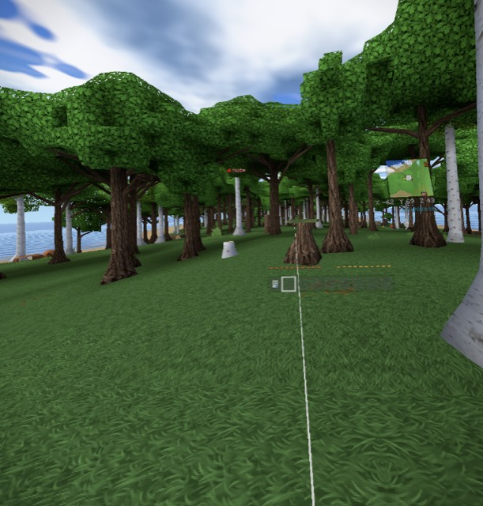

## 08:15:02 - See, this looks like shit. No moss. You can just delete the moss if yo

- **Transcript:** See, this looks like shit. No moss. You can just delete the moss if you want
- **Status:** open
- **Build:** 0.129 (39e0d988, M1-M4 (device-tested; ship riding, chests, comfort options, weapon wheel))
- **World:** New World (26) (seed 530054557992772521)
- **Dimension:** Surface
- **Biome:** Forest
- **Position:** -65.8 69.7 43.3
- **Facing:** south-west (yaw 246, pitch 10)
- **Held:** empty hand
- **Mount:** on foot
- **Looking at:** nothing
- **Mode:** Survival, health 20/20
- **Time:** day 1 08:13, clear
- **Fps:** 72
- **Levels:** mic -30 dBFS, game sound -22 dBFS
- **Length:** 5.8 s (voice 2.9 s)
- **Just before:** -29s message: The sky is clouding over: fog is coming; -27s message: Branisesh - Calaonia border post marked on the map
- **While talking:** -2s holding Moss Carpet
- **Position at the end:** -74.0 69.4 48.2
- **Repro (Mac):** `./snap.sh note --seed 530054557992772521 --x -65.8 --z 43.3 --yaw 114 --pitch 10 --time 0.093`
- **Audio (this Mac):** /Users/darthvadar/Documents/Blocksmith/QuestVoiceNotes/raw/vn-20261115-081502-326.aac

## 08:15:12 - Or no, I can keep it, I guess. Just, I don't know

- **Transcript:** Or no, I can keep it, I guess. Just, I don't know
- **Status:** open
- **Build:** 0.129 (39e0d988, M1-M4 (device-tested; ship riding, chests, comfort options, weapon wheel))
- **World:** New World (26) (seed 530054557992772521)
- **Dimension:** Surface
- **Biome:** Forest
- **Position:** -105.4 68.1 48.4
- **Facing:** south-west (yaw 235, pitch -32)
- **Held:** Moss Carpet x1
- **Mount:** on foot
- **Looking at:** Grass Block at -108 67 49
- **Mode:** Survival, health 20/20
- **Time:** day 1 08:24, clear
- **Fps:** 71
- **Levels:** mic -27 dBFS, game sound -13 dBFS
- **Length:** 4.6 s (voice 2.1 s)
- **Just before:** -7s holding Moss Carpet
- **Repro (Mac):** `./snap.sh note --seed 530054557992772521 --x -105.4 --z 48.4 --yaw 125 --pitch -32 --time 0.101`
- **Audio (this Mac):** /Users/darthvadar/Documents/Blocksmith/QuestVoiceNotes/raw/vn-20261115-081512-106.aac

## 08:15:16 - Could make it a mossy stump as its own thing if you want

- **Transcript:** Could make it a mossy stump as its own thing if you want
- **Status:** open
- **Build:** 0.129 (39e0d988, M1-M4 (device-tested; ship riding, chests, comfort options, weapon wheel))
- **World:** New World (26) (seed 530054557992772521)
- **Dimension:** Surface
- **Biome:** Forest
- **Position:** -122.1 68.0 74.9
- **Facing:** west (yaw 248, pitch -20)
- **Held:** Moss Carpet x1
- **Mount:** on foot
- **Looking at:** Grass Block at -126 67 76
- **Mode:** Survival, health 20/20
- **Time:** day 1 08:30, clear
- **Fps:** 72
- **Levels:** mic -23 dBFS, game sound -16 dBFS
- **Length:** 4.3 s (voice 2.1 s)
- **Just before:** -12s holding Moss Carpet
- **Repro (Mac):** `./snap.sh note --seed 530054557992772521 --x -122.1 --z 74.9 --yaw 112 --pitch -20 --time 0.105`
- **Audio (this Mac):** /Users/darthvadar/Documents/Blocksmith/QuestVoiceNotes/raw/vn-20261115-081516-906.aac

## 08:15:45 - I don't think I can actually pay anything here if I wanted to

- **Transcript:** I don't think I can actually pay anything here if I wanted to
- **Status:** open
- **Build:** 0.129 (39e0d988, M1-M4 (device-tested; ship riding, chests, comfort options, weapon wheel))
- **World:** New World (26) (seed 530054557992772521)
- **Dimension:** Surface
- **Biome:** Plains
- **Position:** -22.0 90.0 98.8
- **Facing:** south-west (yaw 241, pitch -33)
- **Held:** Moss Carpet x1
- **Mount:** on foot
- **Looking at:** Spruce Sign at -24 90 99
- **Mode:** Survival, health 20/20
- **Time:** day 1 09:03, clear
- **Fps:** 72
- **Levels:** mic -32 dBFS, game sound -16 dBFS
- **Length:** 4.2 s (voice 2.2 s)
- **Just before:** -25s opened PauseMenu; -24s closed PauseMenu; -22s walked into Beach; -16s walked into Forest; -14s walked into Plains; -3s message: Calaonia customs: nothing to declare
- **Repro (Mac):** `./snap.sh note --seed 530054557992772521 --x -22.0 --z 98.8 --yaw 119 --pitch -33 --time 0.128`
- **Audio (this Mac):** /Users/darthvadar/Documents/Blocksmith/QuestVoiceNotes/raw/vn-20261115-081545-346.aac

## 08:15:51 - This post

- **Transcript:** This post
- **Status:** open
- **Build:** 0.129 (39e0d988, M1-M4 (device-tested; ship riding, chests, comfort options, weapon wheel))
- **World:** New World (26) (seed 530054557992772521)
- **Dimension:** Surface
- **Biome:** Plains
- **Position:** -23.4 89.3 108.4
- **Facing:** north-west (yaw 311, pitch -4)
- **Held:** Moss Carpet x1
- **Mount:** on foot
- **Looking at:** nothing
- **Mode:** Survival, health 20/20
- **Time:** day 1 09:11, clear
- **Fps:** 72
- **Levels:** mic -42 dBFS, game sound -28 dBFS
- **Length:** 2.2 s (voice 0.6 s)
- **Just before:** -28s walked into Beach; -22s walked into Forest; -20s walked into Plains; -9s message: Calaonia customs: nothing to declare; -4s message: Entering Calaonia; -2s message: Branisesh customs: nothing to declare
- **Repro (Mac):** `./snap.sh note --seed 530054557992772521 --x -23.4 --z 108.4 --yaw 49 --pitch -4 --time 0.133`
- **Audio (this Mac):** /Users/darthvadar/Documents/Blocksmith/QuestVoiceNotes/raw/vn-20261115-081551-886.aac

## 08:15:54 - Customs. Pay here. I don't even know what that means

- **Transcript:** Customs. Pay here. I don't even know what that means
- **Status:** open
- **Build:** 0.129 (39e0d988, M1-M4 (device-tested; ship riding, chests, comfort options, weapon wheel))
- **World:** New World (26) (seed 530054557992772521)
- **Dimension:** Surface
- **Biome:** Plains
- **Position:** -23.3 89.3 107.3
- **Facing:** north (yaw 353, pitch -5)
- **Held:** Moss Carpet x1
- **Mount:** on foot
- **Looking at:** Spruce Sign at -24 90 103
- **Mode:** Survival, health 20/20
- **Time:** day 1 09:15, clear
- **Fps:** 72
- **Levels:** mic -39 dBFS, game sound -26 dBFS
- **Length:** 4.9 s (voice 1.9 s)
- **Just before:** -25s walked into Forest; -23s walked into Plains; -12s message: Calaonia customs: nothing to declare; -7s message: Entering Calaonia; -5s message: Branisesh customs: nothing to declare
- **Repro (Mac):** `./snap.sh note --seed 530054557992772521 --x -23.3 --z 107.3 --yaw 7 --pitch -5 --time 0.136`
- **Audio (this Mac):** /Users/darthvadar/Documents/Blocksmith/QuestVoiceNotes/raw/vn-20261115-081554-706.aac

## 08:16:00 - What happens if I don't?

- **Transcript:** What happens if I don't?
- **Status:** open
- **Build:** 0.129 (39e0d988, M1-M4 (device-tested; ship riding, chests, comfort options, weapon wheel))
- **World:** New World (26) (seed 530054557992772521)
- **Dimension:** Surface
- **Biome:** Plains
- **Position:** -19.8 92.9 127.9
- **Facing:** south (yaw 189, pitch -35)
- **Held:** Moss Carpet x1
- **Mount:** on foot
- **Looking at:** Grass Block at -21 91 131
- **Mode:** Survival, health 20/20
- **Time:** day 1 09:20, clear
- **Fps:** 68
- **Levels:** mic -27 dBFS, game sound -28 dBFS
- **Length:** 2.5 s (voice 0.7 s)
- **Just before:** -28s walked into Plains; -17s message: Calaonia customs: nothing to declare; -12s message: Entering Calaonia; -11s message: Branisesh customs: nothing to declare; -1s opened PauseMenu; -0s closed PauseMenu
- **Repro (Mac):** `./snap.sh note --seed 530054557992772521 --x -19.8 --z 127.9 --yaw 171 --pitch -35 --time 0.139`
- **Audio (this Mac):** /Users/darthvadar/Documents/Blocksmith/QuestVoiceNotes/raw/vn-20261115-081600-106.aac

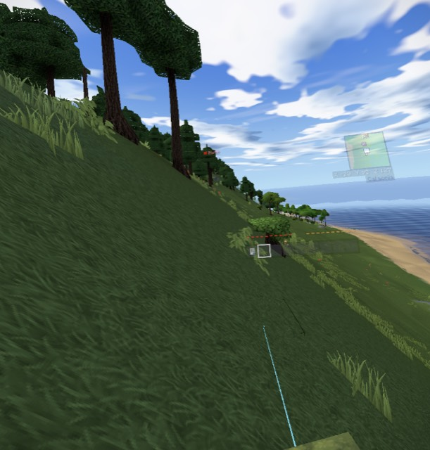

## 08:16:02 - I never really understood that

- **Transcript:** I never really understood that
- **Status:** open
- **Build:** 0.129 (39e0d988, M1-M4 (device-tested; ship riding, chests, comfort options, weapon wheel))
- **World:** New World (26) (seed 530054557992772521)
- **Dimension:** Surface
- **Biome:** Plains
- **Position:** -13.6 99.0 142.9
- **Facing:** south (yaw 160, pitch -53)
- **Held:** Moss Carpet x1
- **Mount:** on foot
- **Looking at:** Grass Block at -14 98 143
- **Mode:** Survival, health 20/20
- **Time:** day 1 09:23, clear
- **Fps:** 71
- **Levels:** mic -36 dBFS, game sound -18 dBFS
- **Length:** 2.3 s (voice 1.0 s)
- **Just before:** -20s message: Calaonia customs: nothing to declare; -15s message: Entering Calaonia; -13s message: Branisesh customs: nothing to declare; -4s opened PauseMenu; -3s closed PauseMenu
- **Repro (Mac):** `./snap.sh note --seed 530054557992772521 --x -13.6 --z 142.9 --yaw -160 --pitch -53 --time 0.141`
- **Audio (this Mac):** /Users/darthvadar/Documents/Blocksmith/QuestVoiceNotes/raw/vn-20261115-081602-366.aac

## 08:16:14 - Hold on here

- **Transcript:** Hold on here
- **Status:** open
- **Build:** 0.129 (39e0d988, M1-M4 (device-tested; ship riding, chests, comfort options, weapon wheel))
- **World:** New World (26) (seed 530054557992772521)
- **Dimension:** Surface
- **Biome:** Taiga
- **Position:** 29.7 107.3 160.8
- **Facing:** east (yaw 89, pitch -12)
- **Held:** Moss Carpet x1
- **Mount:** on foot
- **Looking at:** Grass Block at 35 107 160
- **Mode:** Creative, health 20/20
- **Time:** day 1 09:36, clear
- **Fps:** 72
- **Levels:** mic -38 dBFS, game sound -19 dBFS
- **Length:** 2.0 s (voice 0.7 s)
- **Just before:** -27s message: Entering Calaonia; -25s message: Branisesh customs: nothing to declare; -16s opened PauseMenu; -15s closed PauseMenu; -11s walked into Taiga; -9s walked into Plains; -7s walked into Taiga; -7s opened PauseMenu; -6s message: Creative mode; -6s closed PauseMenu; -1s message: A stranger in town: Ezra Quill
- **Repro (Mac):** `./snap.sh note --seed 530054557992772521 --x 29.7 --z 160.8 --yaw -89 --pitch -12 --time 0.150`
- **Audio (this Mac):** /Users/darthvadar/Documents/Blocksmith/QuestVoiceNotes/raw/vn-20261115-081614-846.aac

## 08:16:17 - Acem ssuref?

- **Transcript:** Acem ssuref?
- **Status:** open
- **Build:** 0.129 (39e0d988, M1-M4 (device-tested; ship riding, chests, comfort options, weapon wheel))
- **World:** New World (26) (seed 530054557992772521)
- **Dimension:** Surface
- **Biome:** Taiga
- **Position:** 33.5 107.6 162.1
- **Facing:** south-east (yaw 119, pitch -9)
- **Held:** Moss Carpet x1
- **Mount:** on foot
- **Looking at:** Spruce Log at 38 108 165
- **Mode:** Creative, health 20/20
- **Time:** day 1 09:39, clear
- **Fps:** 70
- **Levels:** mic -42 dBFS, game sound -20 dBFS
- **Length:** 2.0 s (voice 0.6 s)
- **Just before:** -30s message: Entering Calaonia; -28s message: Branisesh customs: nothing to declare; -19s opened PauseMenu; -18s closed PauseMenu; -14s walked into Taiga; -12s walked into Plains; -10s walked into Taiga; -9s opened PauseMenu; -8s message: Creative mode; -8s closed PauseMenu; -4s message: A stranger in town: Ezra Quill; -2s message: Ezra Quill: Oh, hello. Lovely day for a walk.
- **Repro (Mac):** `./snap.sh note --seed 530054557992772521 --x 33.5 --z 162.1 --yaw -119 --pitch -9 --time 0.152`
- **Audio (this Mac):** /Users/darthvadar/Documents/Blocksmith/QuestVoiceNotes/raw/vn-20261115-081617-326.aac

## 08:16:19 - Flash that happens

- **Transcript:** Flash that happens
- **Status:** open
- **Build:** 0.129 (39e0d988, M1-M4 (device-tested; ship riding, chests, comfort options, weapon wheel))
- **World:** New World (26) (seed 530054557992772521)
- **Dimension:** Surface
- **Biome:** Taiga
- **Position:** 33.5 107.6 162.1
- **Facing:** south-east (yaw 120, pitch 5)
- **Held:** Moss Carpet x1
- **Mount:** on foot
- **Looking at:** nothing
- **Mode:** Creative, health 20/20
- **Time:** day 1 09:42, clear
- **Fps:** 70
- **Levels:** mic -23 dBFS, game sound -19 dBFS
- **Length:** 2.4 s (voice 0.8 s)
- **Just before:** -21s opened PauseMenu; -20s closed PauseMenu; -16s walked into Taiga; -14s walked into Plains; -12s walked into Taiga; -12s opened PauseMenu; -11s message: Creative mode; -10s closed PauseMenu; -6s message: A stranger in town: Ezra Quill; -4s message: Ezra Quill: Oh, hello. Lovely day for a walk.
- **Repro (Mac):** `./snap.sh note --seed 530054557992772521 --x 33.5 --z 162.1 --yaw -120 --pitch 5 --time 0.154`
- **Audio (this Mac):** /Users/darthvadar/Documents/Blocksmith/QuestVoiceNotes/raw/vn-20261115-081619-526.aac

## 08:16:25 - Oh, I see

- **Transcript:** Oh, I see
- **Status:** open
- **Build:** 0.129 (39e0d988, M1-M4 (device-tested; ship riding, chests, comfort options, weapon wheel))
- **World:** New World (26) (seed 530054557992772521)
- **Dimension:** Surface
- **Biome:** Taiga
- **Position:** 29.4 108.1 169.4
- **Facing:** east (yaw 88, pitch -34)
- **Held:** Moss Carpet x1
- **Mount:** on foot
- **Looking at:** Grass Block at 32 107 169
- **Mode:** Creative, health 20/20
- **Time:** day 1 09:49, clear
- **Fps:** 71
- **Levels:** mic -29 dBFS, game sound -17 dBFS
- **Length:** 2.6 s (voice 1.2 s)
- **Just before:** -27s opened PauseMenu; -26s closed PauseMenu; -22s walked into Taiga; -20s walked into Plains; -18s walked into Taiga; -18s opened PauseMenu; -17s message: Creative mode; -16s closed PauseMenu; -12s message: A stranger in town: Ezra Quill; -10s message: Ezra Quill: Oh, hello. Lovely day for a walk.
- **Repro (Mac):** `./snap.sh note --seed 530054557992772521 --x 29.4 --z 169.4 --yaw -88 --pitch -34 --time 0.159`
- **Audio (this Mac):** /Users/darthvadar/Documents/Blocksmith/QuestVoiceNotes/raw/vn-20261115-081625-526.aac

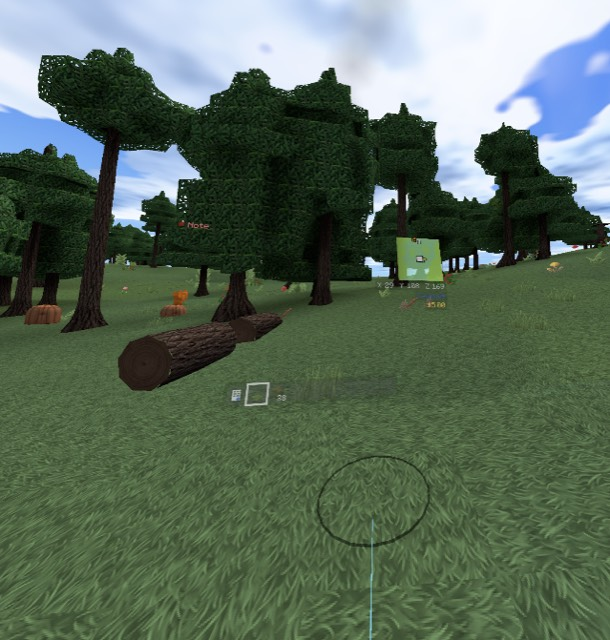

## 08:16:28 - Okay, Fable misunderstood. Uh, we don't want the tree to just break ap

- **Transcript:** Okay, Fable misunderstood. Uh, we don't want the tree to just break apart like that
- **Status:** open
- **Build:** 0.129 (39e0d988, M1-M4 (device-tested; ship riding, chests, comfort options, weapon wheel))
- **World:** New World (26) (seed 530054557992772521)
- **Dimension:** Surface
- **Biome:** Taiga
- **Position:** 33.5 108.3 168.6
- **Facing:** east (yaw 110, pitch -10)
- **Held:** Moss Carpet x1
- **Mount:** on foot
- **Looking at:** Grass Block at 38 108 170
- **Mode:** Creative, health 20/20
- **Time:** day 1 09:52, clear
- **Fps:** 72
- **Levels:** mic -33 dBFS, game sound -19 dBFS
- **Length:** 7.0 s (voice 3.8 s)
- **Just before:** -29s opened PauseMenu; -28s closed PauseMenu; -24s walked into Taiga; -22s walked into Plains; -20s walked into Taiga; -20s opened PauseMenu; -19s message: Creative mode; -19s closed PauseMenu; -15s message: A stranger in town: Ezra Quill; -13s message: Ezra Quill: Oh, hello. Lovely day for a walk.
- **Position at the end:** 31.9 107.7 164.1
- **Repro (Mac):** `./snap.sh note --seed 530054557992772521 --x 33.5 --z 168.6 --yaw -110 --pitch -10 --time 0.161`
- **Audio (this Mac):** /Users/darthvadar/Documents/Blocksmith/QuestVoiceNotes/raw/vn-20261115-081628-026.aac

## 08:16:34 - I break the bottom log, tree falls just like before

- **Transcript:** I break the bottom log, tree falls just like before
- **Status:** open
- **Build:** 0.129 (39e0d988, M1-M4 (device-tested; ship riding, chests, comfort options, weapon wheel))
- **World:** New World (26) (seed 530054557992772521)
- **Dimension:** Surface
- **Biome:** Taiga
- **Position:** 38.5 108.0 159.7
- **Facing:** north-east (yaw 38, pitch -29)
- **Held:** Moss Carpet x1
- **Mount:** on foot
- **Looking at:** nothing
- **Mode:** Creative, health 20/20
- **Time:** day 1 10:00, clear
- **Fps:** 71
- **Levels:** mic -27 dBFS, game sound -18 dBFS
- **Length:** 3.9 s (voice 1.6 s)
- **Just before:** -29s walked into Plains; -27s walked into Taiga; -27s opened PauseMenu; -26s message: Creative mode; -26s closed PauseMenu; -22s message: A stranger in town: Ezra Quill; -19s message: Ezra Quill: Oh, hello. Lovely day for a walk.
- **Repro (Mac):** `./snap.sh note --seed 530054557992772521 --x 38.5 --z 159.7 --yaw -38 --pitch -29 --time 0.167`
- **Audio (this Mac):** /Users/darthvadar/Documents/Blocksmith/QuestVoiceNotes/raw/vn-20261115-081634-966.aac

## 08:16:38 - It doesn't despawn

- **Transcript:** It doesn't despawn
- **Status:** open
- **Build:** 0.129 (39e0d988, M1-M4 (device-tested; ship riding, chests, comfort options, weapon wheel))
- **World:** New World (26) (seed 530054557992772521)
- **Dimension:** Surface
- **Biome:** Taiga
- **Position:** 45.5 108.5 155.3
- **Facing:** north (yaw 6, pitch -27)
- **Held:** Moss Carpet x1
- **Mount:** on foot
- **Looking at:** Grass Block at 46 107 150
- **Mode:** Creative, health 20/20
- **Time:** day 1 10:05, clear
- **Fps:** 72
- **Levels:** mic -26 dBFS, game sound -28 dBFS
- **Length:** 2.8 s (voice 0.9 s)
- **Just before:** -30s message: Creative mode; -30s closed PauseMenu; -25s message: A stranger in town: Ezra Quill; -23s message: Ezra Quill: Oh, hello. Lovely day for a walk.
- **Repro (Mac):** `./snap.sh note --seed 530054557992772521 --x 45.5 --z 155.3 --yaw -6 --pitch -27 --time 0.170`
- **Audio (this Mac):** /Users/darthvadar/Documents/Blocksmith/QuestVoiceNotes/raw/vn-20261115-081638-766.aac

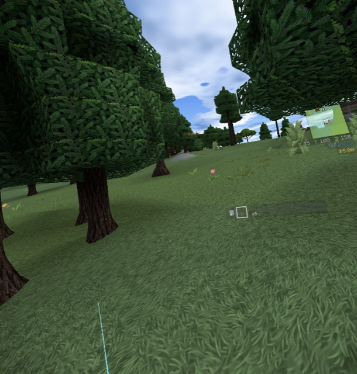

## 08:16:47 - That's not gruesome at all. All right. That's funny

- **Transcript:** That's not gruesome at all. All right. That's funny
- **Status:** open
- **Build:** 0.129 (39e0d988, M1-M4 (device-tested; ship riding, chests, comfort options, weapon wheel))
- **World:** New World (26) (seed 530054557992772521)
- **Dimension:** Surface
- **Biome:** Taiga
- **Position:** 69.2 111.9 148.3
- **Facing:** east (yaw 72, pitch -26)
- **Held:** Moss Carpet x1
- **Mount:** on foot
- **Looking at:** nothing
- **Mode:** Creative, health 20/20, screen ChestMenu
- **Time:** day 1 10:15, clear
- **Fps:** 71
- **Levels:** mic -42 dBFS, game sound -22 dBFS
- **Length:** 4.5 s (voice 1.7 s)
- **Just before:** -7s walked into Plains; -5s walked into Taiga; -0s opened ChestMenu
- **Repro (Mac):** `./snap.sh note --seed 530054557992772521 --x 69.2 --z 148.3 --yaw -72 --pitch -26 --time 0.177`
- **Audio (this Mac):** /Users/darthvadar/Documents/Blocksmith/QuestVoiceNotes/raw/vn-20261115-081647-326.aac

## 08:17:14 - Fucking is launch anyway

- **Transcript:** Fucking is launch anyway
- **Status:** open
- **Build:** 0.129 (39e0d988, M1-M4 (device-tested; ship riding, chests, comfort options, weapon wheel))
- **World:** New World (26) (seed 530054557992772521)
- **Dimension:** Surface
- **Biome:** Plains
- **Position:** 103.5 111.5 172.7
- **Facing:** south-east (yaw 134, pitch 11)
- **Held:** Faustrohr x1
- **Mount:** on foot
- **Looking at:** nothing
- **Mode:** Survival, health 20/20
- **Time:** day 1 10:43, clear
- **Fps:** 72
- **Levels:** mic -34 dBFS, game sound -20 dBFS
- **Length:** 2.7 s (voice 1.1 s)
- **Just before:** -28s opened ChestMenu; -27s closed ChestMenu; -25s walked into Plains; -21s opened PauseMenu; -20s message: Survival mode; -20s closed PauseMenu; -20s opened InventoryMenu; -19s closed InventoryMenu; -18s opened PauseMenu; -18s closed PauseMenu; -17s opened InventoryMenu; -17s closed InventoryMenu; -17s opened PauseMenu; -16s message: Creative mode; -16s closed PauseMenu; -16s opened CreativeMenu; -10s into the pack: Faustrohr; -6s into the pack: Faustrohr Warhead; -6s closed CreativeMenu; -6s opened PauseMenu; -5s message: Survival mode; -5s closed PauseMenu; -4s holding Spruce Log; -4s holding empty hand; -3s holding Faustrohr; -3s message: Loaded: 1 / 1; -3s left the pack: Faustrohr Warhead (at 97 109 155)
- **Repro (Mac):** `./snap.sh note --seed 530054557992772521 --x 103.5 --z 172.7 --yaw -134 --pitch 11 --time 0.197`
- **Audio (this Mac):** /Users/darthvadar/Documents/Blocksmith/QuestVoiceNotes/raw/vn-20261115-081714-586.aac

## 08:17:23 - Pretty far, I'd say

- **Transcript:** Pretty far, I'd say
- **Status:** open
- **Build:** 0.129 (39e0d988, M1-M4 (device-tested; ship riding, chests, comfort options, weapon wheel))
- **World:** New World (26) (seed 530054557992772521)
- **Dimension:** Surface
- **Biome:** Plains
- **Position:** 110.5 116.6 203.4
- **Facing:** south-east (yaw 125, pitch 8)
- **Held:** Faustrohr x1
- **Mount:** on foot
- **Looking at:** nothing
- **Mode:** Survival, health 20/20
- **Time:** day 1 10:54, clear
- **Fps:** 71
- **Levels:** mic -29 dBFS, game sound -20 dBFS
- **Length:** 2.1 s (voice 0.6 s)
- **Just before:** -29s message: Survival mode; -29s closed PauseMenu; -29s opened InventoryMenu; -28s closed InventoryMenu; -27s opened PauseMenu; -27s closed PauseMenu; -27s opened InventoryMenu; -26s closed InventoryMenu; -26s opened PauseMenu; -25s message: Creative mode; -25s closed PauseMenu; -25s opened CreativeMenu; -19s into the pack: Faustrohr; -15s into the pack: Faustrohr Warhead; -15s closed CreativeMenu; -15s opened PauseMenu; -14s message: Survival mode; -14s closed PauseMenu; -13s holding Spruce Log; -13s holding empty hand; -13s holding Faustrohr; -12s message: Loaded: 1 / 1; -12s left the pack: Faustrohr Warhead (at 97 109 155); -4s holding empty hand; -3s holding Faustrohr; -3s message: Faustrohr; -3s holding empty hand; -2s holding Faustrohr; -2s message: Loaded: 1 / 1; -2s left the pack: Faustrohr Warhead (at 112 117 203)
- **Repro (Mac):** `./snap.sh note --seed 530054557992772521 --x 110.5 --z 203.4 --yaw -125 --pitch 8 --time 0.205`
- **Audio (this Mac):** /Users/darthvadar/Documents/Blocksmith/QuestVoiceNotes/raw/vn-20261115-081723-726.aac

## 08:17:53 - I don't think the preset trees are in yet

- **Transcript:** I don't think the preset trees are in yet
- **Status:** open
- **Build:** 0.129 (39e0d988, M1-M4 (device-tested; ship riding, chests, comfort options, weapon wheel))
- **World:** New World (26) (seed 530054557992772521)
- **Dimension:** Surface
- **Biome:** Plains
- **Position:** 148.1 111.0 161.5
- **Facing:** north-east (yaw 31, pitch -18)
- **Held:** Faustrohr x1
- **Mount:** on foot
- **Looking at:** Grass Block at 150 110 157
- **Mode:** Survival, health 9/20
- **Time:** day 1 11:30, clear
- **Fps:** 72
- **Levels:** mic -30 dBFS, game sound -14 dBFS
- **Length:** 3.4 s (voice 1.6 s)
- **Just before:** -28s left the pack: Faustrohr Warhead; -25s left the pack: Faustrohr Warhead; -24s left the pack: Faustrohr Warhead; -23s holding empty hand; -22s holding Faustrohr; -21s left the pack: Faustrohr Warhead; -18s took 5 damage (health 15/20); -18s holding empty hand; -17s holding Faustrohr; -17s message: Faustrohr; -17s message: Loaded: 1 / 1; -16s took 5 damage (health 11/20); -16s left the pack: Faustrohr Warhead; -15s left the pack: Faustrohr Warhead (at 131 120 218); -14s took 5 damage (health 6/20)
- **Repro (Mac):** `./snap.sh note --seed 530054557992772521 --x 148.1 --z 161.5 --yaw -31 --pitch -18 --time 0.229`
- **Audio (this Mac):** /Users/darthvadar/Documents/Blocksmith/QuestVoiceNotes/raw/vn-20261115-081753-206.aac

## 08:17:57 - I mean, unless this is a preset bush, like, wow. Like that. Hope not

- **Transcript:** I mean, unless this is a preset bush, like, wow. Like that. Hope not
- **Status:** open
- **Build:** 0.129 (39e0d988, M1-M4 (device-tested; ship riding, chests, comfort options, weapon wheel))
- **World:** New World (26) (seed 530054557992772521)
- **Dimension:** Surface
- **Biome:** Plains
- **Position:** 163.2 110.8 129.5
- **Facing:** north-east (yaw 25, pitch -17)
- **Held:** Faustrohr x1
- **Mount:** on foot
- **Looking at:** Short Grass at 164 111 127
- **Mode:** Survival, health 9/20
- **Time:** day 1 11:35, clear
- **Fps:** 72
- **Levels:** mic -31 dBFS, game sound -24 dBFS
- **Length:** 7.1 s (voice 2.9 s)
- **Just before:** -30s left the pack: Faustrohr Warhead; -28s left the pack: Faustrohr Warhead; -27s holding empty hand; -26s holding Faustrohr; -26s left the pack: Faustrohr Warhead; -22s took 5 damage (health 15/20); -22s holding empty hand; -22s holding Faustrohr; -22s message: Faustrohr; -21s message: Loaded: 1 / 1; -21s took 5 damage (health 11/20); -21s left the pack: Faustrohr Warhead; -19s left the pack: Faustrohr Warhead (at 131 120 218); -18s took 5 damage (health 6/20)
- **Position at the end:** 167.9 110.6 125.0
- **Repro (Mac):** `./snap.sh note --seed 530054557992772521 --x 163.2 --z 129.5 --yaw -25 --pitch -17 --time 0.233`
- **Audio (this Mac):** /Users/darthvadar/Documents/Blocksmith/QuestVoiceNotes/raw/vn-20261115-081757-606.aac

## 08:18:56 - Still volcanoes in the distance

- **Transcript:** Still volcanoes in the distance
- **Status:** open
- **Build:** 0.129 (39e0d988, M1-M4 (device-tested; ship riding, chests, comfort options, weapon wheel))
- **World:** New World (26) (seed 530054557992772521)
- **Dimension:** Surface
- **Biome:** Taiga
- **Position:** 1255.7 199.0 -348.1
- **Facing:** east (yaw 96, pitch -33)
- **Held:** Faustrohr x1
- **Mount:** on foot, flying
- **Looking at:** nothing
- **Mode:** Creative, health 9/20
- **Time:** day 1 12:43, clear
- **Fps:** 71
- **Levels:** mic -41 dBFS, game sound -21 dBFS
- **Length:** 2.6 s (voice 1.1 s)
- **Just before:** -30s message: Flying; -6s message: Entering Ithdor; -0s message: Entering Tamahold
- **Repro (Mac):** `./snap.sh note --seed 530054557992772521 --x 1255.7 --z -348.1 --yaw -96 --pitch -33 --time 0.280`
- **Audio (this Mac):** /Users/darthvadar/Documents/Blocksmith/QuestVoiceNotes/raw/vn-20261115-081856-226.aac

## 08:19:02 - Panzerfaust, I have to say it looks like shit

- **Transcript:** Panzerfaust, I have to say it looks like shit
- **Status:** open
- **Build:** 0.129 (39e0d988, M1-M4 (device-tested; ship riding, chests, comfort options, weapon wheel))
- **World:** New World (26) (seed 530054557992772521)
- **Dimension:** Surface
- **Biome:** Forest
- **Position:** 1889.9 221.2 38.3
- **Facing:** south-west (yaw 220, pitch -48)
- **Held:** Faustrohr x1
- **Mount:** on foot, flying
- **Looking at:** nothing
- **Mode:** Creative, health 9/20
- **Time:** day 1 12:51, clear
- **Fps:** 72
- **Levels:** mic -22 dBFS, game sound -16 dBFS
- **Length:** 4.2 s (voice 2.3 s)
- **Just before:** -13s message: Entering Ithdor; -7s message: Entering Tamahold; -6s walked into Taiga; -4s walked into Forest; -2s walked into Birch Forest; -2s message: Entering Ithdor; -0s walked into Forest
- **Repro (Mac):** `./snap.sh note --seed 530054557992772521 --x 1889.9 --z 38.3 --yaw 140 --pitch -48 --time 0.286`
- **Audio (this Mac):** /Users/darthvadar/Documents/Blocksmith/QuestVoiceNotes/raw/vn-20261115-081902-766.aac

## 08:19:07 - In hand

- **Transcript:** In hand
- **Status:** open
- **Build:** 0.129 (39e0d988, M1-M4 (device-tested; ship riding, chests, comfort options, weapon wheel))
- **World:** New World (26) (seed 530054557992772521)
- **Dimension:** Surface
- **Biome:** Plains
- **Position:** 1965.7 169.5 160.0
- **Facing:** north-east (yaw 55, pitch -53)
- **Held:** Faustrohr x1
- **Mount:** on foot
- **Looking at:** nothing
- **Mode:** Creative, health 9/20
- **Time:** day 1 12:56, clear
- **Fps:** 71
- **Levels:** mic -28 dBFS, game sound -19 dBFS
- **Length:** 1.9 s (voice 0.5 s)
- **Just before:** -18s message: Entering Ithdor; -12s message: Entering Tamahold; -11s walked into Taiga; -9s walked into Forest; -7s walked into Birch Forest; -6s message: Entering Ithdor; -5s walked into Forest; -2s message: Walking; -1s walked into Plains
- **Repro (Mac):** `./snap.sh note --seed 530054557992772521 --x 1965.7 --z 160.0 --yaw -55 --pitch -53 --time 0.290`
- **Audio (this Mac):** /Users/darthvadar/Documents/Blocksmith/QuestVoiceNotes/raw/vn-20261115-081907-326.aac

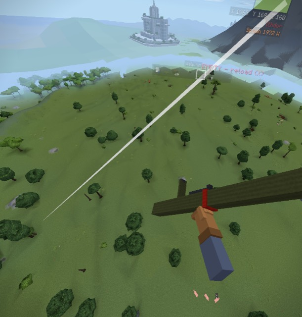

## 08:19:40 - Let's see what happens when I roll up a tank to this place

- **Transcript:** Let's see what happens when I roll up a tank to this place
- **Status:** open
- **Build:** 0.129 (39e0d988, M1-M4 (device-tested; ship riding, chests, comfort options, weapon wheel))
- **World:** New World (26) (seed 530054557992772521)
- **Dimension:** Surface
- **Biome:** Plains
- **Position:** 2109.5 109.8 276.6
- **Facing:** south-east (yaw 127, pitch 7)
- **Held:** empty hand
- **Mount:** piloting Cinder Tank
- **Looking at:** nothing
- **Mode:** Survival, health 9/20
- **Time:** day 1 13:33, clear
- **Fps:** 70
- **Levels:** mic -34 dBFS, game sound -20 dBFS
- **Length:** 4.4 s (voice 2.3 s)
- **Just before:** -29s opened PauseMenu; -29s closed PauseMenu; -29s opened CreativeMenu; -28s closed CreativeMenu; -28s opened PauseMenu; -27s closed PauseMenu; -27s opened CreativeMenu; -19s opened KeyboardMenu; -15s opened CreativeMenu; -14s closed CreativeMenu; -13s holding Faustrohr Warhead; -13s message: Faustrohr Warhead; -13s holding Faustrohr; -13s message: Faustrohr; -13s holding Cinder Tank Spawn Egg; -13s message: Cinder Tank Spawn Egg; -12s holding Faustrohr; -12s message: Faustrohr; -12s holding Faustrohr Warhead; -12s message: Faustrohr Warhead; -11s holding empty hand; -11s piloting Cinder Tank; -11s message: Steering Cinder Tank; -9s opened PauseMenu; -8s message: Survival mode; -7s closed PauseMenu
- **Repro (Mac):** `./snap.sh note --seed 530054557992772521 --x 2109.5 --z 276.6 --yaw -127 --pitch 7 --time 0.315`
- **Audio (this Mac):** /Users/darthvadar/Documents/Blocksmith/QuestVoiceNotes/raw/vn-20261115-081940-866.aac

## 08:19:45 - Okay. Also, the, uh, motion sickness part of driving the tank has not 

- **Transcript:** Okay. Also, the, uh, motion sickness part of driving the tank has not been fixed because there are redundant controls to turn the thing
- **Status:** open
- **Build:** 0.129 (39e0d988, M1-M4 (device-tested; ship riding, chests, comfort options, weapon wheel))
- **World:** New World (26) (seed 530054557992772521)
- **Dimension:** Surface
- **Biome:** Plains
- **Position:** 2125.0 110.5 289.3
- **Facing:** south-east (yaw 115, pitch 0)
- **Held:** empty hand
- **Mount:** piloting Cinder Tank
- **Looking at:** nothing
- **Mode:** Survival, health 9/20
- **Time:** day 1 13:38, clear
- **Fps:** 69
- **Levels:** mic -26 dBFS, game sound -16 dBFS
- **Length:** 10.7 s (voice 6.5 s)
- **Just before:** -23s opened KeyboardMenu; -20s opened CreativeMenu; -18s closed CreativeMenu; -18s holding Faustrohr Warhead; -18s message: Faustrohr Warhead; -18s holding Faustrohr; -18s message: Faustrohr; -17s holding Cinder Tank Spawn Egg; -17s message: Cinder Tank Spawn Egg; -16s holding Faustrohr; -16s message: Faustrohr; -16s holding Faustrohr Warhead; -16s message: Faustrohr Warhead; -15s holding empty hand; -15s piloting Cinder Tank; -15s message: Steering Cinder Tank; -14s opened PauseMenu; -12s message: Survival mode; -12s closed PauseMenu
- **Position at the end:** 2170.5 109.5 296.0
- **Repro (Mac):** `./snap.sh note --seed 530054557992772521 --x 2125.0 --z 289.3 --yaw -115 --pitch 0 --time 0.319`
- **Audio (this Mac):** /Users/darthvadar/Documents/Blocksmith/QuestVoiceNotes/raw/vn-20261115-081945-326.aac

## 08:19:55 - making it unpredictable which way it will turn.

- **Transcript:** making it unpredictable which way it will turn.
- **Status:** open
- **Build:** 0.129 (39e0d988, M1-M4 (device-tested; ship riding, chests, comfort options, weapon wheel))
- **World:** New World (26) (seed 530054557992772521)
- **Dimension:** Surface
- **Biome:** Plains
- **Position:** 2173.1 109.3 296.3
- **Facing:** south-east (yaw 132, pitch 51)
- **Held:** empty hand
- **Mount:** piloting Cinder Tank
- **Looking at:** nothing
- **Mode:** Survival, health 9/20
- **Time:** day 1 13:51, clear
- **Fps:** 67
- **Levels:** mic -28 dBFS, game sound -18 dBFS
- **Length:** 3.4 s (voice 1.4 s)
- **Just before:** -29s closed CreativeMenu; -28s holding Faustrohr Warhead; -28s message: Faustrohr Warhead; -28s holding Faustrohr; -28s message: Faustrohr; -28s holding Cinder Tank Spawn Egg; -28s message: Cinder Tank Spawn Egg; -27s holding Faustrohr; -27s message: Faustrohr; -27s holding Faustrohr Warhead; -27s message: Faustrohr Warhead; -26s holding empty hand; -26s piloting Cinder Tank; -26s message: Steering Cinder Tank; -24s opened PauseMenu; -23s message: Survival mode; -22s closed PauseMenu
- **Repro (Mac):** `./snap.sh note --seed 530054557992772521 --x 2173.1 --z 296.3 --yaw -132 --pitch 51 --time 0.328`
- **Audio (this Mac):** /Users/darthvadar/Documents/Blocksmith/QuestVoiceNotes/raw/vn-20261115-081955-906.aac

## 08:20:29 - For some reason, the machine gun only fires in bursts

- **Transcript:** For some reason, the machine gun only fires in bursts
- **Status:** open
- **Build:** 0.129 (39e0d988, M1-M4 (device-tested; ship riding, chests, comfort options, weapon wheel))
- **World:** New World (26) (seed 530054557992772521)
- **Dimension:** Surface
- **Biome:** Plains
- **Position:** 2205.5 109.7 316.5
- **Facing:** south-east (yaw 130, pitch 27)
- **Held:** empty hand
- **Mount:** piloting Cinder Tank
- **Looking at:** nothing
- **Mode:** Survival, health 9/20
- **Time:** day 1 14:31, clear
- **Fps:** 69
- **Levels:** mic -26 dBFS, game sound -12 dBFS
- **Length:** 3.6 s (voice 2.0 s)
- **Just before:** -7s message: The turret is wrecked; -0s message: The Capital Dropship's crew has spotted you!
- **Repro (Mac):** `./snap.sh note --seed 530054557992772521 --x 2205.5 --z 316.5 --yaw -130 --pitch 27 --time 0.355`
- **Audio (this Mac):** /Users/darthvadar/Documents/Blocksmith/QuestVoiceNotes/raw/vn-20261115-082029-186.aac

## 08:20:39 - Oh, very good. Okay, I like how the parts showed up afterwards. That's

- **Transcript:** Oh, very good. Okay, I like how the parts showed up afterwards. That's good
- **Status:** open
- **Build:** 0.129 (39e0d988, M1-M4 (device-tested; ship riding, chests, comfort options, weapon wheel))
- **World:** New World (26) (seed 530054557992772521)
- **Dimension:** Surface
- **Biome:** Plains
- **Position:** 2219.0 107.2 325.3
- **Facing:** south-west (yaw 218, pitch -28)
- **Held:** empty hand
- **Mount:** on foot
- **Looking at:** Short Grass at 2218 107 326
- **Mode:** Creative, health 9/20
- **Time:** day 1 14:42, clear
- **Fps:** 63
- **Levels:** mic -22 dBFS, game sound -17 dBFS
- **Length:** 5.1 s (voice 2.6 s)
- **Just before:** -17s message: The turret is wrecked; -11s message: The Capital Dropship's crew has spotted you!; -4s stopped piloting Cinder Tank; -4s message: Missile launch: take cover!; -2s opened PauseMenu; -1s message: Creative mode; -1s closed PauseMenu
- **Repro (Mac):** `./snap.sh note --seed 530054557992772521 --x 2219.0 --z 325.3 --yaw 142 --pitch -28 --time 0.363`
- **Audio (this Mac):** /Users/darthvadar/Documents/Blocksmith/QuestVoiceNotes/raw/vn-20261115-082039-527.aac

## 08:20:46 - Yeah, they got me good there. Wow

- **Transcript:** Yeah, they got me good there. Wow
- **Status:** open
- **Build:** 0.129 (39e0d988, M1-M4 (device-tested; ship riding, chests, comfort options, weapon wheel))
- **World:** New World (26) (seed 530054557992772521)
- **Dimension:** Surface
- **Biome:** Plains
- **Position:** 2240.4 137.7 406.2
- **Facing:** north (yaw 12, pitch -23)
- **Held:** empty hand
- **Mount:** on foot, flying
- **Looking at:** nothing
- **Mode:** Creative, health 9/20
- **Time:** day 1 14:51, clear
- **Fps:** 65
- **Levels:** mic -30 dBFS, game sound -17 dBFS
- **Length:** 3.2 s (voice 1.5 s)
- **Just before:** -25s message: The turret is wrecked; -18s message: The Capital Dropship's crew has spotted you!; -11s stopped piloting Cinder Tank; -11s message: Missile launch: take cover!; -9s opened PauseMenu; -8s message: Creative mode; -8s closed PauseMenu; -4s message: Flying; -2s message: Capital citadel (the enemy) marked on the map
- **Repro (Mac):** `./snap.sh note --seed 530054557992772521 --x 2240.4 --z 406.2 --yaw -12 --pitch -23 --time 0.369`
- **Audio (this Mac):** /Users/darthvadar/Documents/Blocksmith/QuestVoiceNotes/raw/vn-20261115-082046-846.aac

## 08:20:49 - That was great

- **Transcript:** That was great
- **Status:** open
- **Build:** 0.129 (39e0d988, M1-M4 (device-tested; ship riding, chests, comfort options, weapon wheel))
- **World:** New World (26) (seed 530054557992772521)
- **Dimension:** Surface
- **Biome:** Plains
- **Position:** 2296.0 144.3 448.8
- **Facing:** north (yaw 22, pitch 59)
- **Held:** empty hand
- **Mount:** on foot, flying
- **Looking at:** nothing
- **Mode:** Creative, health 9/20
- **Time:** day 1 14:54, clear
- **Fps:** 65
- **Levels:** mic -42 dBFS, game sound -15 dBFS
- **Length:** 1.7 s (voice 0.4 s)
- **Just before:** -28s message: The turret is wrecked; -21s message: The Capital Dropship's crew has spotted you!; -14s stopped piloting Cinder Tank; -14s message: Missile launch: take cover!; -13s opened PauseMenu; -11s message: Creative mode; -11s closed PauseMenu; -7s message: Flying; -5s message: Capital citadel (the enemy) marked on the map
- **Repro (Mac):** `./snap.sh note --seed 530054557992772521 --x 2296.0 --z 448.8 --yaw -22 --pitch 59 --time 0.371`
- **Audio (this Mac):** /Users/darthvadar/Documents/Blocksmith/QuestVoiceNotes/raw/vn-20261115-082049-866.aac

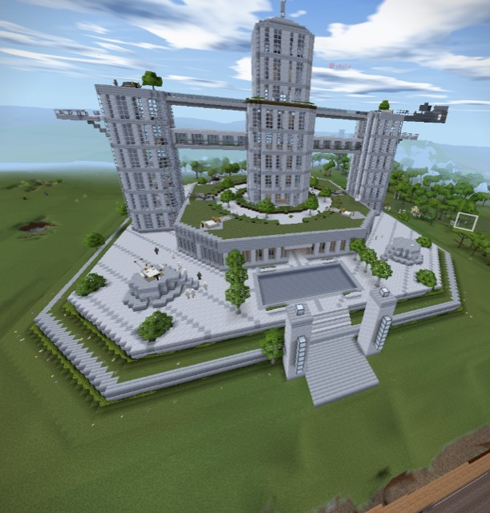

## 08:22:13 - Why isn't this thing firing?

- **Transcript:** Why isn't this thing firing?
- **Status:** open
- **Build:** 0.129 (39e0d988, M1-M4 (device-tested; ship riding, chests, comfort options, weapon wheel))
- **World:** New World (26) (seed 530054557992772521)
- **Dimension:** Surface
- **Biome:** Birch Forest
- **Position:** 2835.6 73.0 -291.5
- **Facing:** north-west (yaw 335, pitch -4)
- **Held:** Slate Repeater x1
- **Mount:** on foot
- **Looking at:** nothing
- **Mode:** Survival, health 10/20
- **Time:** day 1 16:30, clear
- **Fps:** 70
- **Levels:** mic -34 dBFS, game sound -18 dBFS
- **Length:** 2.3 s (voice 0.8 s)
- **Just before:** -30s holding Slate Repeater; -30s message: Slate Repeater; -29s message: Loaded: 90 / 90; -29s left the pack: Slate Magazine x4 (at 2826 75 -282); -26s message: The guards watch your hands. Put that away; -24s message: Honour raised (you protected the town); -21s message: The garrison opens fire!; -17s into the pack: Regular Armour Set; -13s message: Honour raised (you protected the town); -5s message: Entering Maroria; -4s walked into Birch Forest; -4s left the pack: Slate Magazine x2 (at 2831 74 -297); -4s message: Loaded: 90 / 90; -2s took 6 damage (health 14/20)
- **Repro (Mac):** `./snap.sh note --seed 530054557992772521 --x 2835.6 --z -291.5 --yaw 25 --pitch -4 --time 0.438`
- **Audio (this Mac):** /Users/darthvadar/Documents/Blocksmith/QuestVoiceNotes/raw/vn-20261115-082213-266.aac

## 08:22:17 - Oh, it wasn't. Hold on. Let's see. I don't know why it wasn't firing

- **Transcript:** Oh, it wasn't. Hold on. Let's see. I don't know why it wasn't firing
- **Status:** open
- **Build:** 0.129 (39e0d988, M1-M4 (device-tested; ship riding, chests, comfort options, weapon wheel))
- **World:** New World (26) (seed 530054557992772521)
- **Dimension:** Surface
- **Biome:** Birch Forest
- **Position:** 2838.9 77.6 -313.8
- **Facing:** north (yaw 354, pitch -9)
- **Held:** Slate Repeater x1
- **Mount:** on foot, flying
- **Looking at:** nothing
- **Mode:** Creative, health 6/20
- **Time:** day 1 16:34, clear
- **Fps:** 72
- **Levels:** mic -26 dBFS, game sound -26 dBFS
- **Length:** 5.5 s (voice 2.4 s)
- **Just before:** -28s message: Honour raised (you protected the town); -26s message: The garrison opens fire!; -21s into the pack: Regular Armour Set; -17s message: Honour raised (you protected the town); -10s message: Entering Maroria; -8s walked into Birch Forest; -8s left the pack: Slate Magazine x2 (at 2831 74 -297); -8s message: Loaded: 90 / 90; -7s took 6 damage (health 14/20); -4s message: Entering Ithdor; -3s opened PauseMenu; -3s took 8 damage (health 6/20); -2s message: Creative mode; -2s closed PauseMenu; -0s message: Flying
- **Repro (Mac):** `./snap.sh note --seed 530054557992772521 --x 2838.9 --z -313.8 --yaw 6 --pitch -9 --time 0.440`
- **Audio (this Mac):** /Users/darthvadar/Documents/Blocksmith/QuestVoiceNotes/raw/vn-20261115-082217-686.aac

## 08:23:09 - Should have elevators in these buildings incorporated from the

- **Transcript:** Should have elevators in these buildings incorporated from the
- **Status:** open
- **Build:** 0.129 (39e0d988, M1-M4 (device-tested; ship riding, chests, comfort options, weapon wheel))
- **World:** New World (26) (seed 530054557992772521)
- **Dimension:** Surface
- **Biome:** Taiga
- **Position:** 2859.0 69.5 -412.6
- **Facing:** west (yaw 278, pitch -36)
- **Held:** Slate Repeater x1
- **Mount:** on foot
- **Looking at:** Capital Steel at 2856 69 -413
- **Mode:** Survival, health 9/20
- **Time:** day 1 17:28, clear
- **Fps:** 66
- **Levels:** mic -24 dBFS, game sound -23 dBFS
- **Length:** 3.8 s (voice 2.0 s)
- **Just before:** -29s left the pack: Field Stim x2 (at 2851 90 -410); -29s opened PauseMenu; -28s message: Creative mode; -28s closed PauseMenu; -21s opened PauseMenu; -20s message: Survival mode; -20s closed PauseMenu; -19s holding Greywall Dispatch; -19s holding Polished Onyxstone; -19s holding Slate Repeater; -17s message: Honour raised (you protected the town); -16s walked into Swamp; -13s message: Mabel Merriweather: Are you mad? Stop!; -12s took 2 damage (health 18/20); -10s walked into Taiga; -10s took 3 damage (health 15/20); -10s message: Loaded: 90 / 90; -10s left the pack: Slate Magazine x3 (at 2856 67 -412); -7s into the pack: Spec Ops Armour Set; -7s into the pack: Donnerkeil Service Rifle; -5s took 2 damage (health 13/20); -3s left the pack: Slate Magazine x2 (at 2856 67 -412)
- **Repro (Mac):** `./snap.sh note --seed 530054557992772521 --x 2859.0 --z -412.6 --yaw 82 --pitch -36 --time 0.478`
- **Audio (this Mac):** /Users/darthvadar/Documents/Blocksmith/QuestVoiceNotes/raw/vn-20261115-082309-946.aac

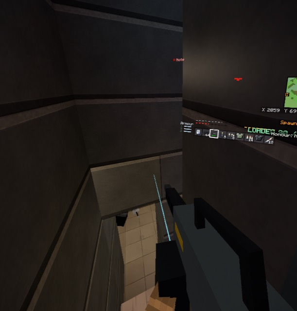

## 08:23:14 - Capital, synonym

- **Transcript:** Capital, synonym
- **Status:** open
- **Build:** 0.129 (39e0d988, M1-M4 (device-tested; ship riding, chests, comfort options, weapon wheel))
- **World:** New World (26) (seed 530054557992772521)
- **Dimension:** Surface
- **Biome:** Taiga
- **Position:** 2859.6 70.0 -413.4
- **Facing:** west (yaw 253, pitch -58)
- **Held:** Regular Armour Set x1
- **Mount:** on foot
- **Looking at:** Capital Steel at 2858 70 -414
- **Mode:** Survival, health 6/20
- **Time:** day 1 17:33, clear
- **Fps:** 70
- **Levels:** mic -34 dBFS, game sound -21 dBFS
- **Length:** 2.6 s (voice 0.9 s)
- **Just before:** -25s opened PauseMenu; -24s message: Survival mode; -24s closed PauseMenu; -23s holding Greywall Dispatch; -23s holding Polished Onyxstone; -23s holding Slate Repeater; -21s message: Honour raised (you protected the town); -21s walked into Swamp; -17s message: Mabel Merriweather: Are you mad? Stop!; -16s took 2 damage (health 18/20); -15s walked into Taiga; -14s took 3 damage (health 15/20); -14s message: Loaded: 90 / 90; -14s left the pack: Slate Magazine x3 (at 2856 67 -412); -11s into the pack: Spec Ops Armour Set; -11s into the pack: Donnerkeil Service Rifle; -9s took 2 damage (health 13/20); -7s left the pack: Slate Magazine x2 (at 2856 67 -412); -4s took 4 damage (health 9/20); -1s took 3 damage (health 6/20); -1s holding Slate Magazine; -1s message: Slate Magazine; -0s holding Slate Rounds; -0s message: Slate Rounds; -0s holding Regular Armour Set; -0s message: Regular Armour Set
- **Repro (Mac):** `./snap.sh note --seed 530054557992772521 --x 2859.6 --z -413.4 --yaw 107 --pitch -58 --time 0.482`
- **Audio (this Mac):** /Users/darthvadar/Documents/Blocksmith/QuestVoiceNotes/raw/vn-20261115-082314-046.aac

## 08:23:36 - Let's, uh, increase the amount of civilians in here to like

- **Transcript:** Let's, uh, increase the amount of civilians in here to like
- **Status:** open
- **Build:** 0.129 (39e0d988, M1-M4 (device-tested; ship riding, chests, comfort options, weapon wheel))
- **World:** New World (26) (seed 530054557992772521)
- **Dimension:** Surface
- **Biome:** Taiga
- **Position:** 2820.3 66.0 -437.0
- **Facing:** west (yaw 286, pitch -18)
- **Held:** Slate Repeater x1
- **Mount:** on foot
- **Looking at:** Capital Paving at 2815 65 -439
- **Mode:** Survival, health 13/20
- **Time:** day 1 18:00, clear
- **Fps:** 72
- **Levels:** mic -24 dBFS, game sound -14 dBFS
- **Length:** 3.7 s (voice 2.2 s)
- **Just before:** -29s left the pack: Slate Magazine x2 (at 2856 67 -412); -26s took 4 damage (health 9/20); -24s took 3 damage (health 6/20); -23s holding Slate Magazine; -23s message: Slate Magazine; -22s holding Slate Rounds; -22s message: Slate Rounds; -22s holding Regular Armour Set; -22s message: Regular Armour Set; -22s holding Capital Rounds; -22s message: Capital Rounds; -22s holding Spec Ops Armour Set; -22s message: Spec Ops Armour Set; -21s holding Field Stim; -21s message: Field Stim; -21s left the pack: Field Stim (at 2858 70 -414); -21s left the pack: Field Stim (at 2858 70 -414); -21s holding Greywall Dispatch; -21s message: Greywall Dispatch; -20s holding Polished Onyxstone; -20s message: Polished Onyxstone; -20s holding Slate Repeater; -20s message: Slate Repeater; -20s message: Loaded: 90 / 90; -17s into the pack: Regular Armour Set; -16s walked into Swamp; -16s into the pack: Donnerkeil Service Rifle; -11s took 1 damage (health 19/20); -8s walked into Old Growth Pine Taiga; -6s walked into Swamp; -4s walked into Taiga; -2s walked into Old Growth Pine Taiga; -1s took 6 damage (health 13/20); -0s left the pack: Slate Magazine x2 (at 2813 65 -435); -0s walked into Taiga
- **Repro (Mac):** `./snap.sh note --seed 530054557992772521 --x 2820.3 --z -437.0 --yaw 74 --pitch -18 --time 0.500`
- **Audio (this Mac):** /Users/darthvadar/Documents/Blocksmith/QuestVoiceNotes/raw/vn-20261115-082336-066.aac

## 08:23:40 - Maybe like 300 civilians. Well, this place makes a little more sense

- **Transcript:** Maybe like 300 civilians. Well, this place makes a little more sense
- **Status:** open
- **Build:** 0.129 (39e0d988, M1-M4 (device-tested; ship riding, chests, comfort options, weapon wheel))
- **World:** New World (26) (seed 530054557992772521)
- **Dimension:** Surface
- **Biome:** Forest
- **Position:** 2803.3 66.5 -452.0
- **Facing:** west (yaw 270, pitch 0)
- **Held:** Slate Repeater x1
- **Mount:** on foot
- **Looking at:** nothing
- **Mode:** Survival, health 13/20
- **Time:** day 1 18:05, clear
- **Fps:** 72
- **Levels:** mic -28 dBFS, game sound -18 dBFS
- **Length:** 5.1 s (voice 2.6 s)
- **Just before:** -30s took 4 damage (health 9/20); -28s took 3 damage (health 6/20); -27s holding Slate Magazine; -27s message: Slate Magazine; -27s holding Slate Rounds; -27s message: Slate Rounds; -26s holding Regular Armour Set; -26s message: Regular Armour Set; -26s holding Capital Rounds; -26s message: Capital Rounds; -26s holding Spec Ops Armour Set; -26s message: Spec Ops Armour Set; -26s holding Field Stim; -26s message: Field Stim; -25s left the pack: Field Stim (at 2858 70 -414); -25s left the pack: Field Stim (at 2858 70 -414); -25s holding Greywall Dispatch; -25s message: Greywall Dispatch; -25s holding Polished Onyxstone; -25s message: Polished Onyxstone; -24s holding Slate Repeater; -24s message: Slate Repeater; -24s message: Loaded: 90 / 90; -21s into the pack: Regular Armour Set; -21s walked into Swamp; -20s into the pack: Donnerkeil Service Rifle; -15s took 1 damage (health 19/20); -13s walked into Old Growth Pine Taiga; -11s walked into Swamp; -9s walked into Taiga; -7s walked into Old Growth Pine Taiga; -6s took 6 damage (health 13/20); -5s left the pack: Slate Magazine x2 (at 2813 65 -435); -5s walked into Taiga; -1s walked into Dark Forest
- **Repro (Mac):** `./snap.sh note --seed 530054557992772521 --x 2803.3 --z -452.0 --yaw 90 --pitch 0 --time 0.504`
- **Audio (this Mac):** /Users/darthvadar/Documents/Blocksmith/QuestVoiceNotes/raw/vn-20261115-082340-286.aac

## 08:24:18 - Go to slate rounds. Goddamn

- **Transcript:** Go to slate rounds. Goddamn
- **Status:** open
- **Build:** 0.129 (39e0d988, M1-M4 (device-tested; ship riding, chests, comfort options, weapon wheel))
- **World:** New World (26) (seed 530054557992772521)
- **Dimension:** Surface
- **Biome:** Birch Forest
- **Position:** 2716.2 66.0 -415.7
- **Facing:** south-west (yaw 203, pitch -48)
- **Held:** Slate Repeater x1
- **Mount:** on foot
- **Looking at:** Capital Curtain Glass at 2715 66 -415
- **Mode:** Survival, health 8/20
- **Time:** day 1 18:50, clear
- **Fps:** 72
- **Levels:** mic -53 dBFS, game sound -21 dBFS
- **Length:** 2.6 s (voice 0.6 s)
- **Just before:** -30s left the pack: Slate Magazine x2 (at 2776 67 -456); -25s took 5 damage (health 8/20); -24s walked into Dark Forest; -23s holding Polished Onyxstone; -23s message: Polished Onyxstone; -23s holding Greywall Dispatch; -23s message: Greywall Dispatch; -23s holding Field Stim; -23s message: Field Stim; -22s left the pack: Field Stim; -22s holding Greywall Dispatch; -22s message: Greywall Dispatch; -22s holding Polished Onyxstone; -22s message: Polished Onyxstone; -21s took 3 damage (health 12/20); -21s holding Slate Repeater; -21s message: Slate Repeater; -20s walked into Forest; -16s walked into Dark Forest; -14s walked into Forest; -12s walked into Birch Forest; -10s took 2 damage (health 16/20); -9s message: Loaded: 28 / 90; -9s left the pack: Slate Magazine (at 2723 65 -422); -8s took 1 damage (health 15/20); -6s walked into Forest; -6s took 3 damage (health 12/20); -4s walked into Birch Forest; -2s took 2 damage (health 10/20); -2s message: No Slate Rounds; -2s holding Polished Onyxstone; -1s holding Slate Repeater
- **Repro (Mac):** `./snap.sh note --seed 530054557992772521 --x 2716.2 --z -415.7 --yaw 157 --pitch -48 --time 0.535`
- **Audio (this Mac):** /Users/darthvadar/Documents/Blocksmith/QuestVoiceNotes/raw/vn-20261115-082418-106.aac

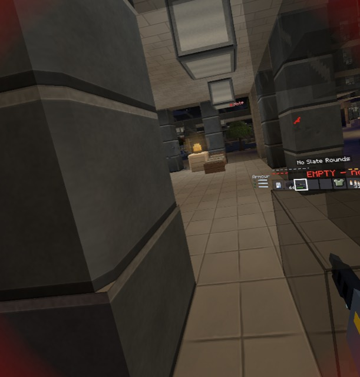

## 08:26:02 - I don't know, the city fight feels a little too stale

- **Transcript:** I don't know, the city fight feels a little too stale
- **Status:** open
- **Build:** 0.129 (39e0d988, M1-M4 (device-tested; ship riding, chests, comfort options, weapon wheel))
- **World:** New World (26) (seed 530054557992772521)
- **Dimension:** Surface
- **Biome:** Forest
- **Position:** 20.5 95.3 -71.2
- **Facing:** north-west (yaw 322, pitch -38)
- **Held:** empty hand
- **Mount:** on foot, flying
- **Looking at:** nothing
- **Mode:** Creative, health 20/20
- **Time:** day 1 20:52, clear
- **Fps:** 71
- **Levels:** mic -26 dBFS, game sound -19 dBFS
- **Length:** 3.6 s (voice 1.9 s)
- **Just before:** -25s left the pack: Field Stim (at 2704 67 -318); -25s holding Greywall Dispatch; -25s message: Greywall Dispatch; -25s holding Polished Onyxstone; -25s message: Polished Onyxstone; -25s holding Donnerkeil Service Rifle; -25s message: Donnerkeil Service Rifle; -24s message: Loaded: 12 / 45; -22s message: No Capital Rounds; -20s into the pack: Brecher Shotgun; -20s into the pack: Regular Armour Set; -17s took 1 damage (health 19/20); -14s took 5 damage (health 14/20); -14s holding Regular Armour Set; -14s message: Regular Armour Set; -13s holding Brecher Shotgun; -13s message: Brecher Shotgun; -13s took 3 damage (health 11/20); -9s died; -9s opened DeathMenu; -9s holding empty hand; -9s left the pack: Greywall Dispatch (DeathMenu open); -9s left the pack: Brecher Shotgun (DeathMenu open); -9s left the pack: Duskium Leggings (DeathMenu open); -9s left the pack: Spec Ops Armour Set (DeathMenu open); -9s left the pack: Field Stim x4 (DeathMenu open); -9s left the pack: Slate Repeater (DeathMenu open); -9s left the pack: Regular Armour Set x4 (DeathMenu open); -9s left the pack: Donnerkeil Service Rifle x2 (DeathMenu open); -9s respawned; -9s closed DeathMenu; -9s message: Your things are 2748 blocks east; -8s took 12 damage (health 20/20); -8s walked into Forest; -6s message: Entering Branisesh; -5s opened PauseMenu; -4s took 1 damage (health 20/20); -3s message: Creative mode; -3s closed PauseMenu; -2s message: Flying
- **Repro (Mac):** `./snap.sh note --seed 530054557992772521 --x 20.5 --z -71.2 --yaw 38 --pitch -38 --time 0.620`
- **Audio (this Mac):** /Users/darthvadar/Documents/Blocksmith/QuestVoiceNotes/raw/vn-20261115-082602-406.aac

## 08:26:08 - Maybe add a, uh, I don't know. I can't be adding anything

- **Transcript:** Maybe add a, uh, I don't know. I can't be adding anything
- **Status:** open
- **Build:** 0.129 (39e0d988, M1-M4 (device-tested; ship riding, chests, comfort options, weapon wheel))
- **World:** New World (26) (seed 530054557992772521)
- **Dimension:** Surface
- **Biome:** Forest
- **Position:** 361.4 97.1 -273.0
- **Facing:** north-west (yaw 319, pitch -46)
- **Held:** empty hand
- **Mount:** on foot, flying
- **Looking at:** nothing
- **Mode:** Creative, health 20/20
- **Time:** day 1 20:59, clear
- **Fps:** 72
- **Levels:** mic -33 dBFS, game sound -24 dBFS
- **Length:** 5.9 s (voice 2.8 s)
- **Just before:** -30s message: Loaded: 12 / 45; -28s message: No Capital Rounds; -26s into the pack: Brecher Shotgun; -26s into the pack: Regular Armour Set; -22s took 1 damage (health 19/20); -20s took 5 damage (health 14/20); -20s holding Regular Armour Set; -20s message: Regular Armour Set; -19s holding Brecher Shotgun; -19s message: Brecher Shotgun; -19s took 3 damage (health 11/20); -15s died; -15s opened DeathMenu; -15s holding empty hand; -15s left the pack: Greywall Dispatch (DeathMenu open); -15s left the pack: Brecher Shotgun (DeathMenu open); -15s left the pack: Duskium Leggings (DeathMenu open); -15s left the pack: Spec Ops Armour Set (DeathMenu open); -15s left the pack: Field Stim x4 (DeathMenu open); -15s left the pack: Slate Repeater (DeathMenu open); -15s left the pack: Regular Armour Set x4 (DeathMenu open); -15s left the pack: Donnerkeil Service Rifle x2 (DeathMenu open); -14s respawned; -14s closed DeathMenu; -14s message: Your things are 2748 blocks east; -14s took 12 damage (health 20/20); -14s walked into Forest; -12s message: Entering Branisesh; -11s opened PauseMenu; -10s took 1 damage (health 20/20); -9s message: Creative mode; -8s closed PauseMenu; -7s message: Flying
- **While talking:** -1s walked into Plains
- **Position at the end:** 374.2 97.1 -35.8
- **Repro (Mac):** `./snap.sh note --seed 530054557992772521 --x 361.4 --z -273.0 --yaw 41 --pitch -46 --time 0.625`
- **Audio (this Mac):** /Users/darthvadar/Documents/Blocksmith/QuestVoiceNotes/raw/vn-20261115-082608-286.aac

## 08:26:14 - [clears throat] Never mind

- **Transcript:** [clears throat] Never mind
- **Status:** open
- **Build:** 0.129 (39e0d988, M1-M4 (device-tested; ship riding, chests, comfort options, weapon wheel))
- **World:** New World (26) (seed 530054557992772521)
- **Dimension:** Surface
- **Biome:** Plains
- **Position:** 435.8 97.1 37.2
- **Facing:** south-east (yaw 139, pitch -30)
- **Held:** empty hand
- **Mount:** on foot, flying
- **Looking at:** nothing
- **Mode:** Creative, health 20/20
- **Time:** day 1 21:07, clear
- **Fps:** 72
- **Levels:** mic -23 dBFS, game sound -18 dBFS
- **Length:** 2.4 s (voice 0.9 s)
- **Just before:** -29s took 1 damage (health 19/20); -26s took 5 damage (health 14/20); -26s holding Regular Armour Set; -26s message: Regular Armour Set; -25s holding Brecher Shotgun; -25s message: Brecher Shotgun; -25s took 3 damage (health 11/20); -22s died; -22s opened DeathMenu; -22s holding empty hand; -21s left the pack: Greywall Dispatch (DeathMenu open); -21s left the pack: Brecher Shotgun (DeathMenu open); -21s left the pack: Duskium Leggings (DeathMenu open); -21s left the pack: Spec Ops Armour Set (DeathMenu open); -21s left the pack: Field Stim x4 (DeathMenu open); -21s left the pack: Slate Repeater (DeathMenu open); -21s left the pack: Regular Armour Set x4 (DeathMenu open); -21s left the pack: Donnerkeil Service Rifle x2 (DeathMenu open); -21s respawned; -21s closed DeathMenu; -21s message: Your things are 2748 blocks east; -21s took 12 damage (health 20/20); -20s walked into Forest; -19s message: Entering Branisesh; -17s opened PauseMenu; -16s took 1 damage (health 20/20); -15s message: Creative mode; -15s closed PauseMenu; -14s message: Flying; -2s walked into Plains; -1s message: Entering Calaonia
- **Repro (Mac):** `./snap.sh note --seed 530054557992772521 --x 435.8 --z 37.2 --yaw -139 --pitch -30 --time 0.630`
- **Audio (this Mac):** /Users/darthvadar/Documents/Blocksmith/QuestVoiceNotes/raw/vn-20261115-082614-586.aac

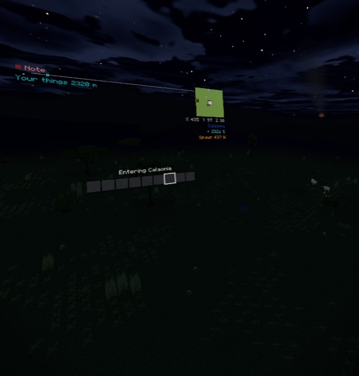

## 08:27:18 - Who's that bad boy anyway?

- **Transcript:** Who's that bad boy anyway?
- **Status:** open
- **Build:** 0.129 (39e0d988, M1-M4 (device-tested; ship riding, chests, comfort options, weapon wheel))
- **World:** New World (26) (seed 530054557992772521)
- **Dimension:** Surface
- **Biome:** Forest
- **Position:** -6457.0 116.6 8898.3
- **Facing:** west (yaw 267, pitch -59)
- **Held:** empty hand
- **Mount:** on foot, flying
- **Looking at:** nothing
- **Mode:** Creative, health 20/20
- **Time:** day 1 22:18, clear
- **Fps:** 66
- **Levels:** mic -35 dBFS, game sound -20 dBFS
- **Length:** 2.8 s (voice 1.3 s)
- **Just before:** -30s walked into Jungle; -28s message: Entering Lorareach; -28s walked into Ocean; -26s walked into Deep Lukewarm Ocean; -25s message: Entering Harodor; -24s walked into Frozen Ocean; -23s message: Entering Wenmere; -22s walked into Snowy Plains; -21s message: Entering Savagard; -20s walked into Ocean; -18s message: Siege Carriage patrol marked on the map; -18s walked into Forest; -16s message: Walking; -14s message: Flying; -12s opened PauseMenu; -11s closed PauseMenu
- **Repro (Mac):** `./snap.sh note --seed 530054557992772521 --x -6457.0 --z 8898.3 --yaw 93 --pitch -59 --time 0.680`
- **Audio (this Mac):** /Users/darthvadar/Documents/Blocksmith/QuestVoiceNotes/raw/vn-20261115-082718-406.aac

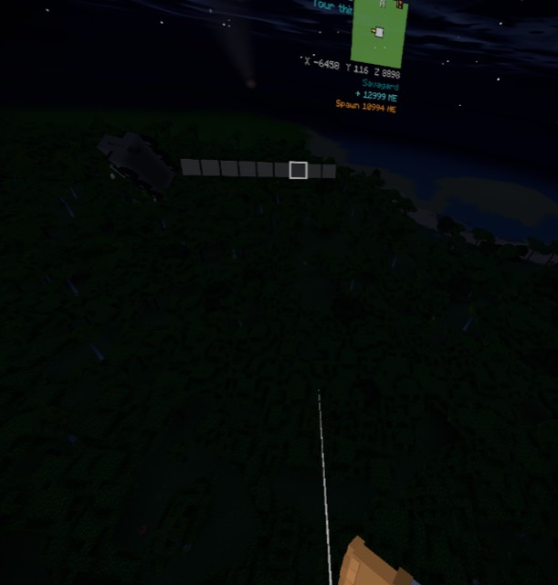

## 08:27:22 - See, yeah, here it is

- **Transcript:** See, yeah, here it is
- **Status:** open
- **Build:** 0.129 (39e0d988, M1-M4 (device-tested; ship riding, chests, comfort options, weapon wheel))
- **World:** New World (26) (seed 530054557992772521)
- **Dimension:** Surface
- **Biome:** Forest
- **Position:** -6521.7 116.6 8907.3
- **Facing:** south-west (yaw 245, pitch -61)
- **Held:** empty hand
- **Mount:** on foot, flying
- **Looking at:** nothing
- **Mode:** Creative, health 20/20
- **Time:** day 1 22:24, clear
- **Fps:** 66
- **Levels:** mic -33 dBFS, game sound -25 dBFS
- **Length:** 1.8 s (voice 0.4 s)
- **Just before:** -30s message: Entering Harodor; -28s walked into Frozen Ocean; -28s message: Entering Wenmere; -26s walked into Snowy Plains; -26s message: Entering Savagard; -24s walked into Ocean; -23s message: Siege Carriage patrol marked on the map; -22s walked into Forest; -20s message: Walking; -19s message: Flying; -17s opened PauseMenu; -16s closed PauseMenu
- **Repro (Mac):** `./snap.sh note --seed 530054557992772521 --x -6521.7 --z 8907.3 --yaw 115 --pitch -61 --time 0.683`
- **Audio (this Mac):** /Users/darthvadar/Documents/Blocksmith/QuestVoiceNotes/raw/vn-20261115-082722-886.aac

## 08:27:40 - Uh, siege carriage is stuck, so

- **Transcript:** Uh, siege carriage is stuck, so
- **Status:** open
- **Build:** 0.129 (39e0d988, M1-M4 (device-tested; ship riding, chests, comfort options, weapon wheel))
- **World:** New World (26) (seed 530054557992772521)
- **Dimension:** Surface
- **Biome:** Forest
- **Position:** -6532.2 81.9 8952.4
- **Facing:** south-west (yaw 235, pitch -41)
- **Held:** empty hand
- **Mount:** piloting Ironstride Siege Carriage
- **Looking at:** nothing
- **Mode:** Creative, health 20/20
- **Time:** day 1 22:44, clear
- **Fps:** 35
- **Levels:** mic -28 dBFS, game sound -18 dBFS
- **Length:** 4.5 s (voice 2.2 s)
- **Just before:** -16s message: Walking; -9s opened ChestMenu; -5s closed ChestMenu; -4s into the pack: Combat Stim; -4s into the pack: Titanium Chestplate; -3s piloting Ironstride Siege Carriage; -3s message: Steering Ironstride Siege Carriage
- **Repro (Mac):** `./snap.sh note --seed 530054557992772521 --x -6532.2 --z 8952.4 --yaw 125 --pitch -41 --time 0.698`
- **Audio (this Mac):** /Users/darthvadar/Documents/Blocksmith/QuestVoiceNotes/raw/vn-20261115-082740-026.aac

## 08:27:44 - Should probably... Or hold on. Is it? Hmm

- **Transcript:** Should probably... Or hold on. Is it? Hmm
- **Status:** open
- **Build:** 0.129 (39e0d988, M1-M4 (device-tested; ship riding, chests, comfort options, weapon wheel))
- **World:** New World (26) (seed 530054557992772521)
- **Dimension:** Surface
- **Biome:** Forest
- **Position:** -6532.2 81.9 8952.5
- **Facing:** west (yaw 257, pitch -54)
- **Held:** empty hand
- **Mount:** piloting Ironstride Siege Carriage
- **Looking at:** nothing
- **Mode:** Creative, health 20/20
- **Time:** day 1 22:50, clear
- **Fps:** 37
- **Levels:** mic -25 dBFS, game sound -22 dBFS
- **Length:** 4.0 s (voice 1.7 s)
- **Just before:** -21s message: Walking; -14s opened ChestMenu; -10s closed ChestMenu; -9s into the pack: Combat Stim; -8s into the pack: Titanium Chestplate; -8s piloting Ironstride Siege Carriage; -8s message: Steering Ironstride Siege Carriage
- **Repro (Mac):** `./snap.sh note --seed 530054557992772521 --x -6532.2 --z 8952.5 --yaw 103 --pitch -54 --time 0.702`
- **Audio (this Mac):** /Users/darthvadar/Documents/Blocksmith/QuestVoiceNotes/raw/vn-20261115-082744-766.aac

## 08:27:48 - Okay. One of the things that wasn't fixed

- **Transcript:** Okay. One of the things that wasn't fixed
- **Status:** open
- **Build:** 0.129 (39e0d988, M1-M4 (device-tested; ship riding, chests, comfort options, weapon wheel))
- **World:** New World (26) (seed 530054557992772521)
- **Dimension:** Surface
- **Biome:** Forest
- **Position:** -6530.0 82.1 8951.9
- **Facing:** south-east (yaw 120, pitch -72)
- **Held:** empty hand
- **Mount:** on foot, flying
- **Looking at:** nothing
- **Mode:** Creative, health 20/20
- **Time:** day 1 22:54, clear
- **Fps:** 69
- **Levels:** mic -46 dBFS, game sound -15 dBFS
- **Length:** 3.8 s (voice 1.4 s)
- **Just before:** -24s message: Walking; -18s opened ChestMenu; -14s closed ChestMenu; -13s into the pack: Combat Stim; -12s into the pack: Titanium Chestplate; -12s piloting Ironstride Siege Carriage; -12s message: Steering Ironstride Siege Carriage; -3s stopped piloting Ironstride Siege Carriage; -1s message: Flying
- **Repro (Mac):** `./snap.sh note --seed 530054557992772521 --x -6530.0 --z 8951.9 --yaw -120 --pitch -72 --time 0.705`
- **Audio (this Mac):** /Users/darthvadar/Documents/Blocksmith/QuestVoiceNotes/raw/vn-20261115-082748-606.aac

## 08:27:52 - This tail on the siege carriage has to go. Okay?

- **Transcript:** This tail on the siege carriage has to go. Okay?
- **Status:** open
- **Build:** 0.129 (39e0d988, M1-M4 (device-tested; ship riding, chests, comfort options, weapon wheel))
- **World:** New World (26) (seed 530054557992772521)
- **Dimension:** Surface
- **Biome:** Forest
- **Position:** -6526.4 77.2 8950.9
- **Facing:** west (yaw 250, pitch -45)
- **Held:** empty hand
- **Mount:** on foot, flying
- **Looking at:** nothing
- **Mode:** Creative, health 20/20
- **Time:** day 1 22:59, clear
- **Fps:** 72
- **Levels:** mic -33 dBFS, game sound -21 dBFS
- **Length:** 5.4 s (voice 2.3 s)
- **Just before:** -28s message: Walking; -22s opened ChestMenu; -18s closed ChestMenu; -17s into the pack: Combat Stim; -16s into the pack: Titanium Chestplate; -16s piloting Ironstride Siege Carriage; -16s message: Steering Ironstride Siege Carriage; -7s stopped piloting Ironstride Siege Carriage; -5s message: Flying; -2s message: Walking; -1s message: Flying
- **Repro (Mac):** `./snap.sh note --seed 530054557992772521 --x -6526.4 --z 8950.9 --yaw 110 --pitch -45 --time 0.708`
- **Audio (this Mac):** /Users/darthvadar/Documents/Blocksmith/QuestVoiceNotes/raw/vn-20261115-082752-689.aac

## 08:27:57 - How do the troops get onto it? I don't know. I, I don't know how they 

- **Transcript:** How do the troops get onto it? I don't know. I, I don't know how they get on
- **Status:** open
- **Build:** 0.129 (39e0d988, M1-M4 (device-tested; ship riding, chests, comfort options, weapon wheel))
- **World:** New World (26) (seed 530054557992772521)
- **Dimension:** Surface
- **Biome:** Forest
- **Position:** -6525.7 77.2 8950.4
- **Facing:** west (yaw 287, pitch -42)
- **Held:** empty hand
- **Mount:** on foot, flying
- **Looking at:** Oak Leaves at -6531 74 8949
- **Mode:** Creative, health 20/20
- **Time:** day 1 23:06, clear
- **Fps:** 72
- **Levels:** mic -22 dBFS, game sound -23 dBFS
- **Length:** 4.7 s (voice 2.7 s)
- **Just before:** -27s opened ChestMenu; -23s closed ChestMenu; -22s into the pack: Combat Stim; -22s into the pack: Titanium Chestplate; -21s piloting Ironstride Siege Carriage; -21s message: Steering Ironstride Siege Carriage; -12s stopped piloting Ironstride Siege Carriage; -10s message: Flying; -7s message: Walking; -6s message: Flying
- **Repro (Mac):** `./snap.sh note --seed 530054557992772521 --x -6525.7 --z 8950.4 --yaw 73 --pitch -42 --time 0.713`
- **Audio (this Mac):** /Users/darthvadar/Documents/Blocksmith/QuestVoiceNotes/raw/vn-20261115-082757-886.aac

## 08:28:03 - W-whatever. Okay?

- **Transcript:** W-whatever. Okay?
- **Status:** open
- **Build:** 0.129 (39e0d988, M1-M4 (device-tested; ship riding, chests, comfort options, weapon wheel))
- **World:** New World (26) (seed 530054557992772521)
- **Dimension:** Surface
- **Biome:** Forest
- **Position:** -6529.7 81.9 8952.0
- **Facing:** west (yaw 252, pitch -31)
- **Held:** empty hand
- **Mount:** on foot
- **Looking at:** nothing
- **Mode:** Creative, health 20/20
- **Time:** day 1 23:12, clear
- **Fps:** 72
- **Levels:** mic -21 dBFS, game sound -20 dBFS
- **Length:** 2.6 s (voice 0.7 s)
- **Just before:** -28s closed ChestMenu; -27s into the pack: Combat Stim; -27s into the pack: Titanium Chestplate; -26s piloting Ironstride Siege Carriage; -26s message: Steering Ironstride Siege Carriage; -17s stopped piloting Ironstride Siege Carriage; -15s message: Flying; -12s message: Walking; -11s message: Flying; -1s message: Walking
- **Repro (Mac):** `./snap.sh note --seed 530054557992772521 --x -6529.7 --z 8952.0 --yaw 108 --pitch -31 --time 0.717`
- **Audio (this Mac):** /Users/darthvadar/Documents/Blocksmith/QuestVoiceNotes/raw/vn-20261115-082803-026.aac

## 08:28:05 - All right. See if that helps any

- **Transcript:** All right. See if that helps any
- **Status:** open
- **Build:** 0.129 (39e0d988, M1-M4 (device-tested; ship riding, chests, comfort options, weapon wheel))
- **World:** New World (26) (seed 530054557992772521)
- **Dimension:** Surface
- **Biome:** Forest
- **Position:** -6532.2 81.8 8952.7
- **Facing:** west (yaw 291, pitch -22)
- **Held:** empty hand
- **Mount:** piloting Ironstride Siege Carriage
- **Looking at:** nothing
- **Mode:** Creative, health 20/20
- **Time:** day 1 23:15, clear
- **Fps:** 72
- **Levels:** mic -33 dBFS, game sound -19 dBFS
- **Length:** 2.6 s (voice 0.9 s)
- **Just before:** -30s into the pack: Combat Stim; -29s into the pack: Titanium Chestplate; -29s piloting Ironstride Siege Carriage; -29s message: Steering Ironstride Siege Carriage; -20s stopped piloting Ironstride Siege Carriage; -18s message: Flying; -15s message: Walking; -14s message: Flying; -4s message: Walking; -2s piloting Ironstride Siege Carriage; -2s message: Steering Ironstride Siege Carriage
- **Repro (Mac):** `./snap.sh note --seed 530054557992772521 --x -6532.2 --z 8952.7 --yaw 69 --pitch -22 --time 0.719`
- **Audio (this Mac):** /Users/darthvadar/Documents/Blocksmith/QuestVoiceNotes/raw/vn-20261115-082805-826.aac

## 08:28:09 - The siege carriage literally can't move with that though. That's the t

- **Transcript:** The siege carriage literally can't move with that though. That's the thing
- **Status:** open
- **Build:** 0.129 (39e0d988, M1-M4 (device-tested; ship riding, chests, comfort options, weapon wheel))
- **World:** New World (26) (seed 530054557992772521)
- **Dimension:** Surface
- **Biome:** Forest
- **Position:** -6533.4 80.1 8961.7
- **Facing:** north (yaw 14, pitch -31)
- **Held:** empty hand
- **Mount:** piloting Ironstride Siege Carriage
- **Looking at:** nothing
- **Mode:** Creative, health 20/20
- **Time:** day 1 23:19, clear
- **Fps:** 72
- **Levels:** mic -40 dBFS, game sound -18 dBFS
- **Length:** 4.1 s (voice 1.6 s)
- **Just before:** -24s stopped piloting Ironstride Siege Carriage; -21s message: Flying; -19s message: Walking; -17s message: Flying; -7s message: Walking; -6s piloting Ironstride Siege Carriage; -6s message: Steering Ironstride Siege Carriage
- **Repro (Mac):** `./snap.sh note --seed 530054557992772521 --x -6533.4 --z 8961.7 --yaw -14 --pitch -31 --time 0.722`
- **Audio (this Mac):** /Users/darthvadar/Documents/Blocksmith/QuestVoiceNotes/raw/vn-20261115-082809-446.aac

## 08:28:15 - Yeah, this, this thing might need a little more torque or something, '

- **Transcript:** Yeah, this, this thing might need a little more torque or something, 'cause it can't
- **Status:** open
- **Build:** 0.129 (39e0d988, M1-M4 (device-tested; ship riding, chests, comfort options, weapon wheel))
- **World:** New World (26) (seed 530054557992772521)
- **Dimension:** Surface
- **Biome:** Forest
- **Position:** -6537.1 80.4 8962.2
- **Facing:** south-east (yaw 117, pitch -29)
- **Held:** empty hand
- **Mount:** piloting Ironstride Siege Carriage
- **Looking at:** nothing
- **Mode:** Creative, health 20/20
- **Time:** day 1 23:27, clear
- **Fps:** 72
- **Levels:** mic -25 dBFS, game sound -21 dBFS
- **Length:** 5.9 s (voice 3.2 s)
- **Just before:** -30s stopped piloting Ironstride Siege Carriage; -28s message: Flying; -25s message: Walking; -24s message: Flying; -14s message: Walking; -12s piloting Ironstride Siege Carriage; -12s message: Steering Ironstride Siege Carriage
- **Position at the end:** -6536.2 80.6 8963.3
- **Repro (Mac):** `./snap.sh note --seed 530054557992772521 --x -6537.1 --z 8962.2 --yaw -117 --pitch -29 --time 0.727`
- **Audio (this Mac):** /Users/darthvadar/Documents/Blocksmith/QuestVoiceNotes/raw/vn-20261115-082815-666.aac

## 08:28:21 - It's not able to show these trees who's boss

- **Transcript:** It's not able to show these trees who's boss
- **Status:** open
- **Build:** 0.129 (39e0d988, M1-M4 (device-tested; ship riding, chests, comfort options, weapon wheel))
- **World:** New World (26) (seed 530054557992772521)
- **Dimension:** Surface
- **Biome:** Forest
- **Position:** -6532.1 81.3 8964.5
- **Facing:** south-west (yaw 239, pitch -21)
- **Held:** empty hand
- **Mount:** piloting Ironstride Siege Carriage
- **Looking at:** nothing
- **Mode:** Creative, health 20/20
- **Time:** day 1 23:34, clear
- **Fps:** 72
- **Levels:** mic -25 dBFS, game sound -22 dBFS
- **Length:** 3.8 s (voice 2.1 s)
- **Just before:** -29s message: Flying; -19s message: Walking; -18s piloting Ironstride Siege Carriage; -18s message: Steering Ironstride Siege Carriage
- **Repro (Mac):** `./snap.sh note --seed 530054557992772521 --x -6532.1 --z 8964.5 --yaw 121 --pitch -21 --time 0.732`
- **Audio (this Mac):** /Users/darthvadar/Documents/Blocksmith/QuestVoiceNotes/raw/vn-20261115-082821-446.aac

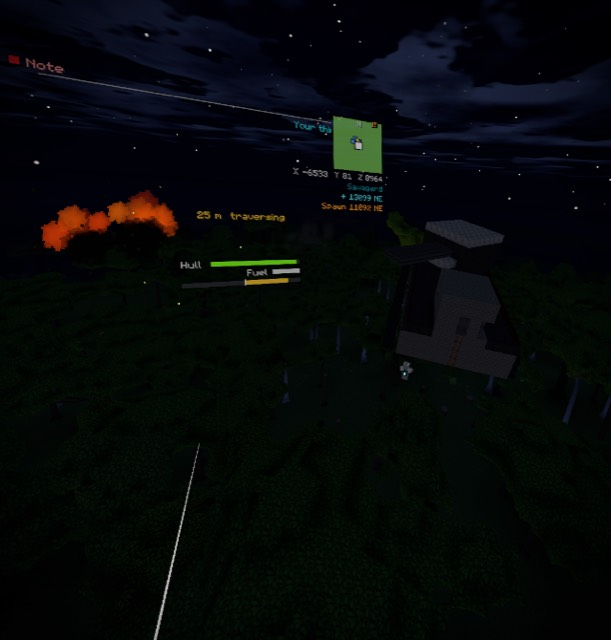

## 08:28:34 - It's stuck in the trees

- **Transcript:** It's stuck in the trees
- **Status:** open
- **Build:** 0.129 (39e0d988, M1-M4 (device-tested; ship riding, chests, comfort options, weapon wheel))
- **World:** New World (26) (seed 530054557992772521)
- **Dimension:** Surface
- **Biome:** Forest
- **Position:** -6527.6 81.2 8956.4
- **Facing:** north (yaw 5, pitch -14)
- **Held:** empty hand
- **Mount:** piloting Ironstride Siege Carriage
- **Looking at:** nothing
- **Mode:** Creative, health 20/20
- **Time:** day 1 23:49, clear
- **Fps:** 68
- **Levels:** mic -39 dBFS, game sound -16 dBFS
- **Length:** 2.3 s (voice 0.7 s)
- **Repro (Mac):** `./snap.sh note --seed 530054557992772521 --x -6527.6 --z 8956.4 --yaw -5 --pitch -14 --time 0.743`
- **Audio (this Mac):** /Users/darthvadar/Documents/Blocksmith/QuestVoiceNotes/raw/vn-20261115-082834-466.aac

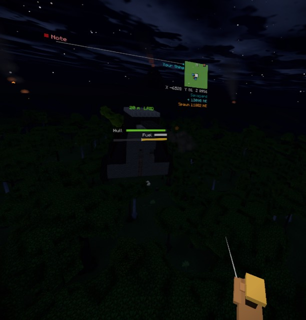

## 08:28:37 - Explosions were nice though

- **Transcript:** Explosions were nice though
- **Status:** open
- **Build:** 0.129 (39e0d988, M1-M4 (device-tested; ship riding, chests, comfort options, weapon wheel))
- **World:** New World (26) (seed 530054557992772521)
- **Dimension:** Surface
- **Biome:** Forest
- **Position:** -6527.8 82.5 8958.4
- **Facing:** south (yaw 174, pitch -5)
- **Held:** empty hand
- **Mount:** on foot, flying
- **Looking at:** nothing
- **Mode:** Creative, health 20/20
- **Time:** day 1 23:53, clear
- **Fps:** 72
- **Levels:** mic -28 dBFS, game sound -29 dBFS
- **Length:** 2.3 s (voice 0.9 s)
- **Just before:** -2s stopped piloting Ironstride Siege Carriage; -2s message: Flying
- **Repro (Mac):** `./snap.sh note --seed 530054557992772521 --x -6527.8 --z 8958.4 --yaw -174 --pitch -5 --time 0.746`
- **Audio (this Mac):** /Users/darthvadar/Documents/Blocksmith/QuestVoiceNotes/raw/vn-20261115-082837-786.aac

## 08:28:47 - Three, three five five seven

- **Transcript:** Three, three five five seven
- **Status:** open
- **Build:** 0.129 (39e0d988, M1-M4 (device-tested; ship riding, chests, comfort options, weapon wheel))
- **World:** New World (26) (seed 530054557992772521)
- **Dimension:** Surface
- **Biome:** Forest
- **Position:** -6524.2 102.0 9014.4
- **Facing:** south-west (yaw 217, pitch 6)
- **Held:** empty hand
- **Mount:** on foot, flying
- **Looking at:** nothing
- **Mode:** Creative, health 20/20
- **Time:** day 1 00:02, clear
- **Fps:** 72
- **Levels:** mic -39 dBFS, game sound -22 dBFS
- **Length:** 3.4 s (voice 1.2 s)
- **Just before:** -12s stopped piloting Ironstride Siege Carriage; -11s message: Flying; -6s opened PauseMenu; -3s opened CommandMenu; -0s closed CommandMenu
- **Repro (Mac):** `./snap.sh note --seed 530054557992772521 --x -6524.2 --z 9014.4 --yaw 143 --pitch 6 --time 0.751`
- **Audio (this Mac):** /Users/darthvadar/Documents/Blocksmith/QuestVoiceNotes/raw/vn-20261115-082847-526.aac

## 08:29:27 - Crown shakes. I like that

- **Transcript:** Crown shakes. I like that
- **Status:** open
- **Build:** 0.129 (39e0d988, M1-M4 (device-tested; ship riding, chests, comfort options, weapon wheel))
- **World:** New World (26) (seed 530054557992772521)
- **Dimension:** Surface
- **Biome:** Taiga
- **Position:** 3546.6 94.5 5772.5
- **Facing:** north-west (yaw 335, pitch 12)
- **Held:** empty hand
- **Mount:** on foot
- **Looking at:** nothing
- **Mode:** Creative, health 20/20
- **Time:** day 1 00:48, clear
- **Fps:** 53
- **Levels:** mic -31 dBFS, game sound -23 dBFS
- **Length:** 2.5 s (voice 0.9 s)
- **Just before:** -28s walked into Snowy Taiga; -27s message: Entering Goremere; -26s walked into Deep Frozen Ocean; -24s walked into Frozen Ocean; -22s walked into Snowy Taiga; -22s message: Entering Valeonia; -20s walked into Snowy Slopes; -19s message: Entering Harwick; -18s walked into Taiga; -16s message: Entering Valawick; -15s message: Entering Feniheim; -14s walked into Frozen Peaks; -13s message: Entering Kesenvania; -12s walked into Taiga; -11s message: Ironback crawler patrol marked on the map; -9s message: Sky isle marked on the map; -7s message: Walking; -4s message: The ground shakes: an Ironback Crawler is near; -2s message: Flying; -1s opened PauseMenu; -0s closed PauseMenu
- **Repro (Mac):** `./snap.sh note --seed 530054557992772521 --x 3546.6 --z 5772.5 --yaw 25 --pitch 12 --time 0.784`
- **Audio (this Mac):** /Users/darthvadar/Documents/Blocksmith/QuestVoiceNotes/raw/vn-20261115-082927-366.aac

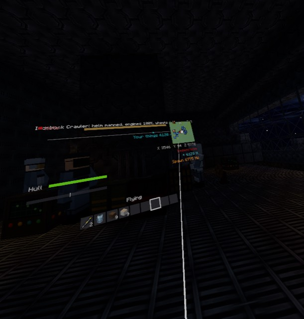

## 08:29:59 - All right, well

- **Transcript:** All right, well
- **Status:** open
- **Build:** 0.129 (39e0d988, M1-M4 (device-tested; ship riding, chests, comfort options, weapon wheel))
- **World:** New World (26) (seed 530054557992772521)
- **Dimension:** Surface
- **Biome:** Old Growth Birch Forest
- **Position:** 3574.9 92.8 5677.8
- **Facing:** west (yaw 254, pitch -41)
- **Held:** empty hand
- **Mount:** piloting Ironback Crawler
- **Looking at:** nothing
- **Mode:** Creative, health 20/20
- **Time:** day 1 01:27, clear
- **Fps:** 72
- **Levels:** mic -26 dBFS, game sound -23 dBFS
- **Length:** 2.2 s (voice 0.8 s)
- **Just before:** -24s into the pack: Falke Pistol; -22s holding Spruce Log; -22s holding Capital Rounds; -22s closed CreativeMenu; -22s holding Falke Pistol; -22s message: Falke Pistol; -21s message: Loaded: 18 / 18; -13s walked into Birch Forest; -11s walked into Taiga; -9s walked into Birch Forest; -4s into the pack: Sechser Revolver; -3s piloting Ironback Crawler; -3s holding empty hand; -3s message: Steering Ironback Crawler; -1s message: You have taken command of the Ironback Crawler!; -1s walked into Old Growth Birch Forest
- **Repro (Mac):** `./snap.sh note --seed 530054557992772521 --x 3574.9 --z 5677.8 --yaw 106 --pitch -41 --time 0.811`
- **Audio (this Mac):** /Users/darthvadar/Documents/Blocksmith/QuestVoiceNotes/raw/vn-20261115-082959-786.aac

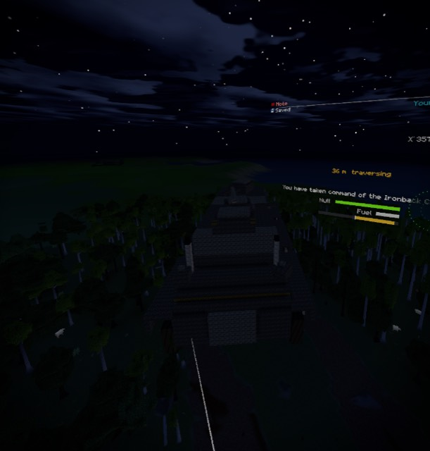

## 08:30:12 - I still can't process jack shit, so

- **Transcript:** I still can't process jack shit, so
- **Status:** open
- **Build:** 0.129 (39e0d988, M1-M4 (device-tested; ship riding, chests, comfort options, weapon wheel))
- **World:** New World (26) (seed 530054557992772521)
- **Dimension:** Surface
- **Biome:** Birch Forest
- **Position:** 3578.7 89.3 5385.8
- **Facing:** north-west (yaw 327, pitch -5)
- **Held:** empty hand
- **Mount:** piloting Ironback Crawler
- **Looking at:** nothing
- **Mode:** Creative, health 20/20, screen PauseMenu
- **Time:** day 1 01:42, clear
- **Fps:** 69
- **Levels:** mic -41 dBFS, game sound -27 dBFS
- **Length:** 3.6 s (voice 1.4 s)
- **Just before:** -25s walked into Birch Forest; -23s walked into Taiga; -21s walked into Birch Forest; -17s into the pack: Sechser Revolver; -16s piloting Ironback Crawler; -16s holding empty hand; -16s message: Steering Ironback Crawler; -14s message: You have taken command of the Ironback Crawler!; -13s walked into Old Growth Birch Forest; -7s walked into Birch Forest; -5s walked into Forest; -1s opened PauseMenu
- **Repro (Mac):** `./snap.sh note --seed 530054557992772521 --x 3578.7 --z 5385.8 --yaw 33 --pitch -5 --time 0.821`
- **Audio (this Mac):** /Users/darthvadar/Documents/Blocksmith/QuestVoiceNotes/raw/vn-20261115-083012-546.aac

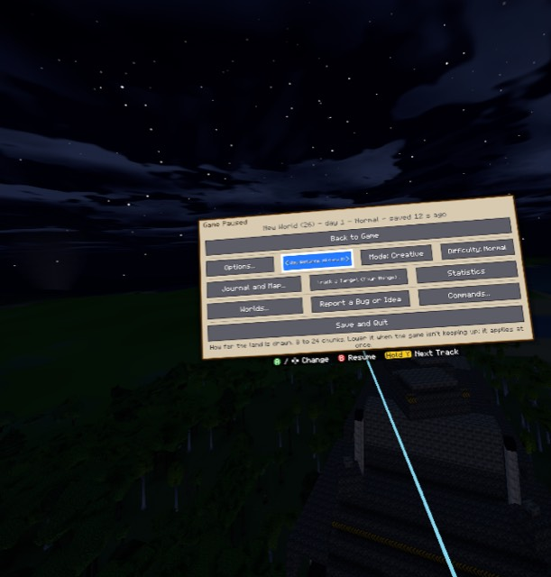

## 08:30:32 - Hold up

- **Transcript:** Hold up
- **Status:** open
- **Build:** 0.129 (39e0d988, M1-M4 (device-tested; ship riding, chests, comfort options, weapon wheel))
- **World:** New World (26) (seed 530054557992772521)
- **Dimension:** Surface
- **Biome:** Forest
- **Position:** 3481.3 91.3 5182.8
- **Facing:** south (yaw 200, pitch -7)
- **Held:** empty hand
- **Mount:** piloting Ironback Crawler
- **Looking at:** nothing
- **Mode:** Creative, health 20/20
- **Time:** day 1 02:05, clear
- **Fps:** 65
- **Levels:** mic -24 dBFS, game sound -17 dBFS
- **Length:** 1.8 s (voice 0.5 s)
- **Just before:** -28s walked into Birch Forest; -26s walked into Forest; -21s opened PauseMenu; -20s walked into Birch Forest; -20s closed PauseMenu; -13s message: The Greywall Garrison is sounding the alarm!; -10s message: The turret is wrecked; -8s walked into Forest
- **Repro (Mac):** `./snap.sh note --seed 530054557992772521 --x 3481.3 --z 5182.8 --yaw 160 --pitch -7 --time 0.837`
- **Audio (this Mac):** /Users/darthvadar/Documents/Blocksmith/QuestVoiceNotes/raw/vn-20261115-083032-866.aac

## 08:30:37 - Oh, fuck's that and I'm taking damage

- **Transcript:** Oh, fuck's that and I'm taking damage
- **Status:** open
- **Build:** 0.129 (39e0d988, M1-M4 (device-tested; ship riding, chests, comfort options, weapon wheel))
- **World:** New World (26) (seed 530054557992772521)
- **Dimension:** Surface
- **Biome:** Forest
- **Position:** 3481.3 91.6 5182.8
- **Facing:** south (yaw 199, pitch -22)
- **Held:** empty hand
- **Mount:** piloting Ironback Crawler
- **Looking at:** nothing
- **Mode:** Creative, health 20/20
- **Time:** day 1 02:10, clear
- **Fps:** 65
- **Levels:** mic -31 dBFS, game sound -18 dBFS
- **Length:** 3.2 s (voice 1.5 s)
- **Just before:** -30s walked into Forest; -25s opened PauseMenu; -24s walked into Birch Forest; -24s closed PauseMenu; -17s message: The Greywall Garrison is sounding the alarm!; -14s message: The turret is wrecked; -12s walked into Forest
- **Repro (Mac):** `./snap.sh note --seed 530054557992772521 --x 3481.3 --z 5182.8 --yaw 161 --pitch -22 --time 0.841`
- **Audio (this Mac):** /Users/darthvadar/Documents/Blocksmith/QuestVoiceNotes/raw/vn-20261115-083037-106.aac

## 08:30:47 - Crawler's not doing enough damage to this base. Not sure what the issu

- **Transcript:** Crawler's not doing enough damage to this base. Not sure what the issue is
- **Status:** open
- **Build:** 0.129 (39e0d988, M1-M4 (device-tested; ship riding, chests, comfort options, weapon wheel))
- **World:** New World (26) (seed 530054557992772521)
- **Dimension:** Surface
- **Biome:** Forest
- **Position:** 3485.6 91.4 5187.5
- **Facing:** south-west (yaw 217, pitch -29)
- **Held:** empty hand
- **Mount:** piloting Ironback Crawler
- **Looking at:** nothing
- **Mode:** Creative, health 20/20
- **Time:** day 1 02:22, clear
- **Fps:** 68
- **Levels:** mic -22 dBFS, game sound -15 dBFS
- **Length:** 4.5 s (voice 2.0 s)
- **Just before:** -27s message: The Greywall Garrison is sounding the alarm!; -25s message: The turret is wrecked; -22s walked into Forest
- **Repro (Mac):** `./snap.sh note --seed 530054557992772521 --x 3485.6 --z 5187.5 --yaw 143 --pitch -29 --time 0.849`
- **Audio (this Mac):** /Users/darthvadar/Documents/Blocksmith/QuestVoiceNotes/raw/vn-20261115-083047-366.aac

## 08:30:52 - Eh, maybe it's fine. I can't really tell

- **Transcript:** Eh, maybe it's fine. I can't really tell
- **Status:** open
- **Build:** 0.129 (39e0d988, M1-M4 (device-tested; ship riding, chests, comfort options, weapon wheel))
- **World:** New World (26) (seed 530054557992772521)
- **Dimension:** Surface
- **Biome:** Forest
- **Position:** 3480.1 90.8 5185.1
- **Facing:** south (yaw 190, pitch -23)
- **Held:** empty hand
- **Mount:** piloting Ironback Crawler
- **Looking at:** nothing
- **Mode:** Creative, health 20/20
- **Time:** day 1 02:29, clear
- **Fps:** 70
- **Levels:** mic -29 dBFS, game sound -21 dBFS
- **Length:** 3.3 s (voice 0.8 s)
- **Just before:** -28s walked into Forest
- **Repro (Mac):** `./snap.sh note --seed 530054557992772521 --x 3480.1 --z 5185.1 --yaw 170 --pitch -23 --time 0.854`
- **Audio (this Mac):** /Users/darthvadar/Documents/Blocksmith/QuestVoiceNotes/raw/vn-20261115-083052-986.aac

## 08:31:04 - Oh, radar. Very nice

- **Transcript:** Oh, radar. Very nice
- **Status:** open
- **Build:** 0.129 (39e0d988, M1-M4 (device-tested; ship riding, chests, comfort options, weapon wheel))
- **World:** New World (26) (seed 530054557992772521)
- **Dimension:** Surface
- **Biome:** Birch Forest
- **Position:** 3250.8 89.6 5079.9
- **Facing:** south (yaw 170, pitch -17)
- **Held:** empty hand
- **Mount:** piloting Ironback Crawler
- **Looking at:** nothing
- **Mode:** Creative, health 20/20
- **Time:** day 1 02:43, clear
- **Fps:** 71
- **Levels:** mic -30 dBFS, game sound -26 dBFS
- **Length:** 2.7 s (voice 1.2 s)
- **Just before:** -5s walked into Birch Forest; -3s walked into Old Growth Birch Forest; -1s walked into Birch Forest
- **Repro (Mac):** `./snap.sh note --seed 530054557992772521 --x 3250.8 --z 5079.9 --yaw -170 --pitch -17 --time 0.864`
- **Audio (this Mac):** /Users/darthvadar/Documents/Blocksmith/QuestVoiceNotes/raw/vn-20261115-083104-686.aac

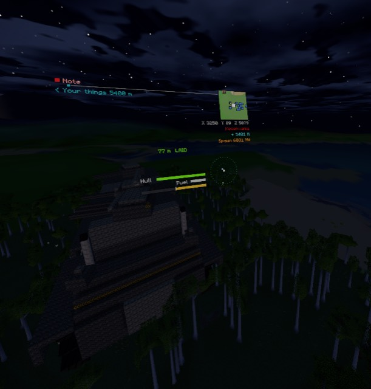

## 08:31:18 - Okay, the radar is based on wherever my stick's pointed. It should be 

- **Transcript:** Okay, the radar is based on wherever my stick's pointed. It should be based on wherever the hell I'm looking, I think, right?
- **Status:** open
- **Build:** 0.129 (39e0d988, M1-M4 (device-tested; ship riding, chests, comfort options, weapon wheel))
- **World:** New World (26) (seed 530054557992772521)
- **Dimension:** Surface
- **Biome:** Forest
- **Position:** 2894.3 85.4 5164.3
- **Facing:** south-west (yaw 208, pitch -8)
- **Held:** empty hand
- **Mount:** piloting Ironback Crawler
- **Looking at:** nothing
- **Mode:** Creative, health 20/20
- **Time:** day 1 03:00, clear
- **Fps:** 69
- **Levels:** mic -50 dBFS, game sound -21 dBFS
- **Length:** 7.5 s (voice 4.1 s)
- **Just before:** -19s walked into Birch Forest; -17s walked into Old Growth Birch Forest; -15s walked into Birch Forest; -11s walked into Forest; -7s walked into Beach; -3s walked into Ocean; -1s walked into Forest
- **While talking:** -2s walked into Beach
- **Position at the end:** 2777.6 85.5 5199.9
- **Repro (Mac):** `./snap.sh note --seed 530054557992772521 --x 2894.3 --z 5164.3 --yaw 152 --pitch -8 --time 0.875`
- **Audio (this Mac):** /Users/darthvadar/Documents/Blocksmith/QuestVoiceNotes/raw/vn-20261115-083118-306.aac

## 08:32:08 - Yeah, this thing, man

- **Transcript:** Yeah, this thing, man
- **Status:** open
- **Build:** 0.129 (39e0d988, M1-M4 (device-tested; ship riding, chests, comfort options, weapon wheel))
- **World:** New World (26) (seed 530054557992772521)
- **Dimension:** Surface
- **Biome:** Forest
- **Position:** 2029.9 124.9 4378.8
- **Facing:** south-east (yaw 139, pitch -25)
- **Held:** empty hand
- **Mount:** piloting Ironback Crawler
- **Looking at:** nothing
- **Mode:** Creative, health 20/20
- **Time:** day 1 04:00, clear
- **Fps:** 69
- **Levels:** mic -33 dBFS, game sound -21 dBFS
- **Length:** 2.9 s (voice 1.2 s)
- **Just before:** -23s walked into River; -21s walked into Taiga; -15s walked into Forest; -5s walked into Plains; -3s walked into Forest
- **Repro (Mac):** `./snap.sh note --seed 530054557992772521 --x 2029.9 --z 4378.8 --yaw -139 --pitch -25 --time 0.917`
- **Audio (this Mac):** /Users/darthvadar/Documents/Blocksmith/QuestVoiceNotes/raw/vn-20261115-083208-266.aac

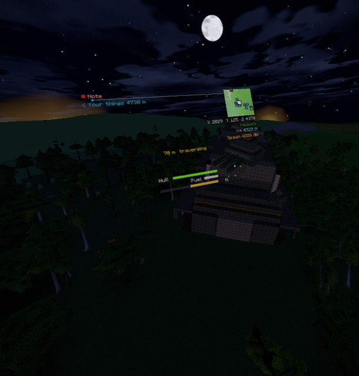

## 08:32:12 - Yeah, I hope they will find some good optimizations for it because it'

- **Transcript:** Yeah, I hope they will find some good optimizations for it because it's really bad in its current state
- **Status:** open
- **Build:** 0.129 (39e0d988, M1-M4 (device-tested; ship riding, chests, comfort options, weapon wheel))
- **World:** New World (26) (seed 530054557992772521)
- **Dimension:** Surface
- **Biome:** Meadow
- **Position:** 1925.1 150.7 4336.6
- **Facing:** south-east (yaw 128, pitch -23)
- **Held:** empty hand
- **Mount:** piloting Ironback Crawler
- **Looking at:** nothing
- **Mode:** Creative, health 20/20
- **Time:** day 1 04:05, clear
- **Fps:** 68
- **Levels:** mic -41 dBFS, game sound -19 dBFS
- **Length:** 5.9 s (voice 2.3 s)
- **Just before:** -27s walked into River; -25s walked into Taiga; -19s walked into Forest; -9s walked into Plains; -7s walked into Forest; -1s walked into Meadow
- **While talking:** -2s walked into Forest
- **Position at the end:** 1812.5 142.1 4331.6
- **Repro (Mac):** `./snap.sh note --seed 530054557992772521 --x 1925.1 --z 4336.6 --yaw -128 --pitch -23 --time 0.920`
- **Audio (this Mac):** /Users/darthvadar/Documents/Blocksmith/QuestVoiceNotes/raw/vn-20261115-083212-566.aac

## 08:33:11 - I should have-- okay, there it goes

- **Transcript:** I should have-- okay, there it goes
- **Status:** open
- **Build:** 0.129 (39e0d988, M1-M4 (device-tested; ship riding, chests, comfort options, weapon wheel))
- **World:** New World (26) (seed 530054557992772521)
- **Dimension:** Surface
- **Biome:** Taiga
- **Position:** 1472.5 133.0 4771.5
- **Facing:** north (yaw 354, pitch 24)
- **Held:** empty hand
- **Mount:** piloting Ironback Crawler
- **Looking at:** nothing
- **Mode:** Creative, health 20/20
- **Time:** day 1 05:16, clear
- **Fps:** 68
- **Levels:** mic -45 dBFS, game sound -17 dBFS
- **Length:** 2.7 s (voice 0.7 s)
- **Just before:** -6s walked into Taiga
- **Repro (Mac):** `./snap.sh note --seed 530054557992772521 --x 1472.5 --z 4771.5 --yaw 6 --pitch 24 --time 0.970`
- **Audio (this Mac):** /Users/darthvadar/Documents/Blocksmith/QuestVoiceNotes/raw/vn-20261115-083311-946.aac

## 08:33:51 - What's a boreal station? Oh, shit

- **Transcript:** What's a boreal station? Oh, shit
- **Status:** open
- **Build:** 0.129 (39e0d988, M1-M4 (device-tested; ship riding, chests, comfort options, weapon wheel))
- **World:** New World (26) (seed 530054557992772521)
- **Dimension:** Surface
- **Biome:** Snowy Slopes
- **Position:** 954.0 189.1 5343.8
- **Facing:** east (yaw 88, pitch -35)
- **Held:** empty hand
- **Mount:** piloting Ironback Crawler
- **Looking at:** nothing
- **Mode:** Creative, health 20/20
- **Time:** day 2 06:03, clear
- **Fps:** 69
- **Levels:** mic -25 dBFS, game sound -24 dBFS
- **Length:** 2.6 s (voice 1.1 s)
- **Just before:** -26s walked into Meadow; -22s walked into Snowy Slopes; -20s walked into Meadow; -18s walked into Taiga; -8s message: The sky is clouding over: fog is coming; -8s walked into Grove; -2s message: Valawick has gone to war with Kesenvania; -2s walked into Snowy Slopes; -0s message: Maroria has gone to war with Mareland
- **Repro (Mac):** `./snap.sh note --seed 530054557992772521 --x 954.0 --z 5343.8 --yaw -88 --pitch -35 --time 0.003`
- **Audio (this Mac):** /Users/darthvadar/Documents/Blocksmith/QuestVoiceNotes/raw/vn-20261115-083351-446.aac

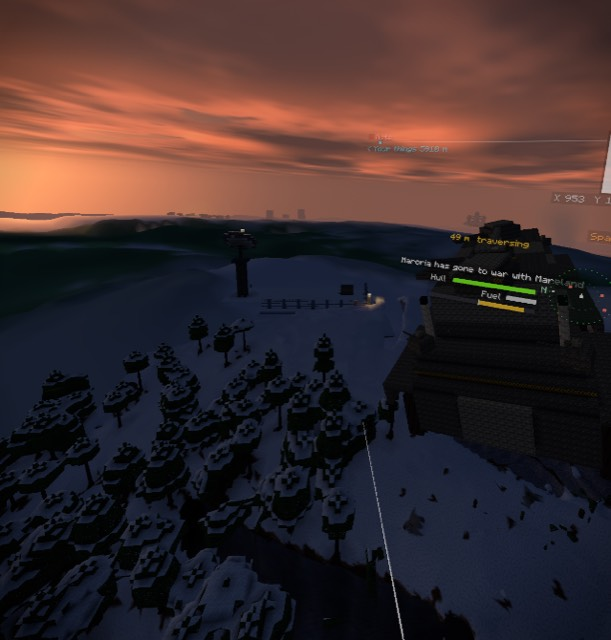

## 08:33:57 - Hasn't quite loaded in yet

- **Transcript:** Hasn't quite loaded in yet
- **Status:** open
- **Build:** 0.129 (39e0d988, M1-M4 (device-tested; ship riding, chests, comfort options, weapon wheel))
- **World:** New World (26) (seed 530054557992772521)
- **Dimension:** Surface
- **Biome:** Grove
- **Position:** 933.0 177.6 5407.3
- **Facing:** east (yaw 71, pitch -13)
- **Held:** empty hand
- **Mount:** piloting Ironback Crawler
- **Looking at:** nothing
- **Mode:** Creative, health 20/20
- **Time:** day 2 06:11, clear
- **Fps:** 61
- **Levels:** mic -34 dBFS, game sound -16 dBFS
- **Length:** 3.0 s (voice 1.3 s)
- **Just before:** -28s walked into Snowy Slopes; -26s walked into Meadow; -24s walked into Taiga; -14s message: The sky is clouding over: fog is coming; -14s walked into Grove; -9s message: Valawick has gone to war with Kesenvania; -8s walked into Snowy Slopes; -6s message: Maroria has gone to war with Mareland; -2s walked into Grove
- **Repro (Mac):** `./snap.sh note --seed 530054557992772521 --x 933.0 --z 5407.3 --yaw -71 --pitch -13 --time 0.008`
- **Audio (this Mac):** /Users/darthvadar/Documents/Blocksmith/QuestVoiceNotes/raw/vn-20261115-083357-726.aac

## 08:34:01 - Taking his sweet ass time

- **Transcript:** Taking his sweet ass time
- **Status:** open
- **Build:** 0.129 (39e0d988, M1-M4 (device-tested; ship riding, chests, comfort options, weapon wheel))
- **World:** New World (26) (seed 530054557992772521)
- **Dimension:** Surface
- **Biome:** Grove
- **Position:** 947.0 174.1 5424.8
- **Facing:** east (yaw 94, pitch -6)
- **Held:** empty hand
- **Mount:** piloting Ironback Crawler
- **Looking at:** nothing
- **Mode:** Creative, health 20/20
- **Time:** day 2 06:16, clear
- **Fps:** 61
- **Levels:** mic -64 dBFS, game sound -19 dBFS
- **Length:** 2.9 s (voice 1.3 s)
- **Just before:** -30s walked into Meadow; -28s walked into Taiga; -18s message: The sky is clouding over: fog is coming; -18s walked into Grove; -13s message: Valawick has gone to war with Kesenvania; -12s walked into Snowy Slopes; -10s message: Maroria has gone to war with Mareland; -6s walked into Grove
- **Repro (Mac):** `./snap.sh note --seed 530054557992772521 --x 947.0 --z 5424.8 --yaw -94 --pitch -6 --time 0.011`
- **Audio (this Mac):** /Users/darthvadar/Documents/Blocksmith/QuestVoiceNotes/raw/vn-20261115-083401-546.aac

## 08:34:07 - Not mad at me just yet, huh? Why not? You should be mad

- **Transcript:** Not mad at me just yet, huh? Why not? You should be mad
- **Status:** open
- **Build:** 0.129 (39e0d988, M1-M4 (device-tested; ship riding, chests, comfort options, weapon wheel))
- **World:** New World (26) (seed 530054557992772521)
- **Dimension:** Surface
- **Biome:** Grove
- **Position:** 1040.1 168.0 5486.8
- **Facing:** north (yaw 6, pitch -2)
- **Held:** empty hand
- **Mount:** piloting Ironback Crawler
- **Looking at:** nothing
- **Mode:** Creative, health 20/20
- **Time:** day 2 06:22, clear
- **Fps:** 63
- **Levels:** mic -29 dBFS, game sound -13 dBFS
- **Length:** 5.0 s (voice 2.6 s)
- **Just before:** -23s message: The sky is clouding over: fog is coming; -23s walked into Grove; -18s message: Valawick has gone to war with Kesenvania; -17s walked into Snowy Slopes; -16s message: Maroria has gone to war with Mareland; -11s walked into Grove
- **Repro (Mac):** `./snap.sh note --seed 530054557992772521 --x 1040.1 --z 5486.8 --yaw -6 --pitch -2 --time 0.016`
- **Audio (this Mac):** /Users/darthvadar/Documents/Blocksmith/QuestVoiceNotes/raw/vn-20261115-083407-206.aac

## 08:34:17 - They should have shot me as soon as they saw me coming

- **Transcript:** They should have shot me as soon as they saw me coming
- **Status:** open
- **Build:** 0.129 (39e0d988, M1-M4 (device-tested; ship riding, chests, comfort options, weapon wheel))
- **World:** New World (26) (seed 530054557992772521)
- **Dimension:** Surface
- **Biome:** Grove
- **Position:** 1062.6 163.6 5478.3
- **Facing:** north-west (yaw 294, pitch -11)
- **Held:** empty hand
- **Mount:** piloting Ironback Crawler
- **Looking at:** nothing
- **Mode:** Creative, health 20/20
- **Time:** day 2 06:35, clear
- **Fps:** 70
- **Levels:** mic -36 dBFS, game sound -16 dBFS
- **Length:** 3.4 s (voice 1.9 s)
- **Just before:** -28s message: Valawick has gone to war with Kesenvania; -28s walked into Snowy Slopes; -26s message: Maroria has gone to war with Mareland; -21s walked into Grove; -7s message: The station alarm is sounding!; -4s message: The turret is wrecked
- **Repro (Mac):** `./snap.sh note --seed 530054557992772521 --x 1062.6 --z 5478.3 --yaw 66 --pitch -11 --time 0.024`
- **Audio (this Mac):** /Users/darthvadar/Documents/Blocksmith/QuestVoiceNotes/raw/vn-20261115-083417-426.aac

## 08:34:23 - And they didn't

- **Transcript:** And they didn't
- **Status:** open
- **Build:** 0.129 (39e0d988, M1-M4 (device-tested; ship riding, chests, comfort options, weapon wheel))
- **World:** New World (26) (seed 530054557992772521)
- **Dimension:** Surface
- **Biome:** Grove
- **Position:** 1081.1 170.8 5443.4
- **Facing:** south-west (yaw 245, pitch -22)
- **Held:** empty hand
- **Mount:** piloting Ironback Crawler
- **Looking at:** nothing
- **Mode:** Creative, health 20/20
- **Time:** day 2 06:42, clear
- **Fps:** 65
- **Levels:** mic -54 dBFS, game sound -11 dBFS
- **Length:** 2.7 s (voice 0.9 s)
- **Just before:** -28s walked into Grove; -13s message: The station alarm is sounding!; -10s message: The turret is wrecked; -4s walked into Snowy Slopes; -2s walked into Grove
- **Repro (Mac):** `./snap.sh note --seed 530054557992772521 --x 1081.1 --z 5443.4 --yaw 115 --pitch -22 --time 0.030`
- **Audio (this Mac):** /Users/darthvadar/Documents/Blocksmith/QuestVoiceNotes/raw/vn-20261115-083423-966.aac

## 08:34:28 - I understand rendering is an issue, but still

- **Transcript:** I understand rendering is an issue, but still
- **Status:** open
- **Build:** 0.129 (39e0d988, M1-M4 (device-tested; ship riding, chests, comfort options, weapon wheel))
- **World:** New World (26) (seed 530054557992772521)
- **Dimension:** Surface
- **Biome:** Snowy Slopes
- **Position:** 1087.0 165.1 5462.0
- **Facing:** south-east (yaw 155, pitch -21)
- **Held:** empty hand
- **Mount:** piloting Ironback Crawler
- **Looking at:** nothing
- **Mode:** Creative, health 20/20
- **Time:** day 2 06:48, clear
- **Fps:** 68
- **Levels:** mic -32 dBFS, game sound -23 dBFS
- **Length:** 4.1 s (voice 1.7 s)
- **Just before:** -18s message: The station alarm is sounding!; -15s message: The turret is wrecked; -9s walked into Snowy Slopes; -7s walked into Grove; -5s walked into Snowy Slopes
- **Repro (Mac):** `./snap.sh note --seed 530054557992772521 --x 1087.0 --z 5462.0 --yaw -155 --pitch -21 --time 0.034`
- **Audio (this Mac):** /Users/darthvadar/Documents/Blocksmith/QuestVoiceNotes/raw/vn-20261115-083428-886.aac

## 08:35:35 - Run out of ammo? Fuck. No way, I'm not. Just low on ammo, I think

- **Transcript:** Run out of ammo? Fuck. No way, I'm not. Just low on ammo, I think
- **Status:** open
- **Build:** 0.129 (39e0d988, M1-M4 (device-tested; ship riding, chests, comfort options, weapon wheel))
- **World:** New World (26) (seed 530054557992772521)
- **Dimension:** Surface
- **Biome:** Snowy Plains
- **Position:** 355.1 107.6 6450.6
- **Facing:** south-east (yaw 153, pitch -11)
- **Held:** empty hand
- **Mount:** piloting Ironback Crawler
- **Looking at:** nothing
- **Mode:** Creative, health 20/20
- **Time:** day 2 08:08, clear
- **Fps:** 69
- **Levels:** mic -29 dBFS, game sound -12 dBFS
- **Length:** 6.3 s (voice 2.4 s)
- **Just before:** -29s walked into Snowy Plains; -23s walked into Plains; -11s walked into Snowy Plains; -5s message: A Capital patrol sets out to investigate; -3s message: The citadel is on lockdown!; -1s message: The turret is wrecked
- **While talking:** -1s message: Ezra Quill: Old Jeb lost another hat to the wind.
- **Position at the end:** 387.5 106.4 6436.2
- **Repro (Mac):** `./snap.sh note --seed 530054557992772521 --x 355.1 --z 6450.6 --yaw -153 --pitch -11 --time 0.089`
- **Audio (this Mac):** /Users/darthvadar/Documents/Blocksmith/QuestVoiceNotes/raw/vn-20261115-083535-266.aac

## 08:35:51 - Uh, had a bit of a frame rate drop there. I mean, understandably so

- **Transcript:** Uh, had a bit of a frame rate drop there. I mean, understandably so
- **Status:** open
- **Build:** 0.129 (39e0d988, M1-M4 (device-tested; ship riding, chests, comfort options, weapon wheel))
- **World:** New World (26) (seed 530054557992772521)
- **Dimension:** Surface
- **Biome:** Snowy Plains
- **Position:** 455.8 101.4 6421.0
- **Facing:** south-west (yaw 215, pitch -2)
- **Held:** empty hand
- **Mount:** piloting Ironback Crawler
- **Looking at:** nothing
- **Mode:** Creative, health 20/20
- **Time:** day 2 08:27, clear
- **Fps:** 62
- **Levels:** mic -28 dBFS, game sound -15 dBFS
- **Length:** 5.7 s (voice 3.1 s)
- **Just before:** -27s walked into Snowy Plains; -21s message: A Capital patrol sets out to investigate; -19s message: The citadel is on lockdown!; -17s message: The turret is wrecked; -12s message: Ezra Quill: Old Jeb lost another hat to the wind.; -9s message: The turret is wrecked; -5s message: Engines hit: going down
- **While talking:** -0s message: The turret is wrecked
- **Position at the end:** 458.4 100.9 6426.8
- **Repro (Mac):** `./snap.sh note --seed 530054557992772521 --x 455.8 --z 6421.0 --yaw 145 --pitch -2 --time 0.103`
- **Audio (this Mac):** /Users/darthvadar/Documents/Blocksmith/QuestVoiceNotes/raw/vn-20261115-083551-986.aac

## 08:35:57 - Uh, yeah

- **Transcript:** Uh, yeah
- **Status:** open
- **Build:** 0.129 (39e0d988, M1-M4 (device-tested; ship riding, chests, comfort options, weapon wheel))
- **World:** New World (26) (seed 530054557992772521)
- **Dimension:** Surface
- **Biome:** Snowy Plains
- **Position:** 456.6 101.1 6427.4
- **Facing:** south-west (yaw 213, pitch -1)
- **Held:** empty hand
- **Mount:** piloting Ironback Crawler
- **Looking at:** nothing
- **Mode:** Creative, health 20/20
- **Time:** day 2 08:32, clear
- **Fps:** 36
- **Levels:** mic -30 dBFS, game sound -18 dBFS
- **Length:** 2.8 s (voice 1.1 s)
- **Just before:** -25s message: A Capital patrol sets out to investigate; -23s message: The citadel is on lockdown!; -20s message: The turret is wrecked; -16s message: Ezra Quill: Old Jeb lost another hat to the wind.; -13s message: The turret is wrecked; -9s message: Engines hit: going down; -0s message: The turret is wrecked
- **Repro (Mac):** `./snap.sh note --seed 530054557992772521 --x 456.6 --z 6427.4 --yaw 147 --pitch -1 --time 0.106`
- **Audio (this Mac):** /Users/darthvadar/Documents/Blocksmith/QuestVoiceNotes/raw/vn-20261115-083557-366.aac

## 08:36:02 - I wonder if that's GPU or CPU that calculates like the trajectory of a

- **Transcript:** I wonder if that's GPU or CPU that calculates like the trajectory of all that
- **Status:** open
- **Build:** 0.129 (39e0d988, M1-M4 (device-tested; ship riding, chests, comfort options, weapon wheel))
- **World:** New World (26) (seed 530054557992772521)
- **Dimension:** Surface
- **Biome:** Snowy Plains
- **Position:** 447.4 102.6 6426.5
- **Facing:** north-west (yaw 293, pitch 49)
- **Held:** empty hand
- **Mount:** piloting Ironback Crawler
- **Looking at:** nothing
- **Mode:** Creative, health 20/20
- **Time:** day 2 08:38, clear
- **Fps:** 45
- **Levels:** mic -34 dBFS, game sound -15 dBFS
- **Length:** 5.6 s (voice 3.1 s)
- **Just before:** -30s message: A Capital patrol sets out to investigate; -28s message: The citadel is on lockdown!; -26s message: The turret is wrecked; -21s message: Ezra Quill: Old Jeb lost another hat to the wind.; -18s message: The turret is wrecked; -14s message: Engines hit: going down; -5s message: The turret is wrecked
- **Position at the end:** 460.4 100.6 6425.6
- **Repro (Mac):** `./snap.sh note --seed 530054557992772521 --x 447.4 --z 6426.5 --yaw 67 --pitch 49 --time 0.110`
- **Audio (this Mac):** /Users/darthvadar/Documents/Blocksmith/QuestVoiceNotes/raw/vn-20261115-083602-426.aac

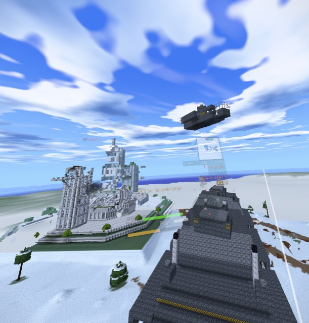

## 08:37:19 - Let's take a look here. [chuckles]

- **Transcript:** Let's take a look here. [chuckles]
- **Status:** open
- **Build:** 0.129 (39e0d988, M1-M4 (device-tested; ship riding, chests, comfort options, weapon wheel))
- **World:** New World (26) (seed 530054557992772521)
- **Dimension:** Surface
- **Biome:** Snowy Taiga
- **Position:** 395.2 92.9 6908.0
- **Facing:** north-east (yaw 44, pitch -38)
- **Held:** Falke Pistol x1
- **Mount:** on foot
- **Looking at:** nothing
- **Mode:** Creative, health 20/20
- **Time:** day 2 10:10, clear
- **Fps:** 50
- **Levels:** mic -34 dBFS, game sound -14 dBFS
- **Length:** 3.0 s (voice 0.9 s)
- **Just before:** -25s message: Ezra Quill: Haven't had a quiet week since spring.; -24s walked into Snowy Taiga; -22s message: The turret is wrecked; -8s walked into Taiga; -6s walked into Snowy Taiga; -4s stopped piloting Ironback Crawler; -4s holding Falke Pistol; -0s walked into Taiga
- **Repro (Mac):** `./snap.sh note --seed 530054557992772521 --x 395.2 --z 6908.0 --yaw -44 --pitch -38 --time 0.174`
- **Audio (this Mac):** /Users/darthvadar/Documents/Blocksmith/QuestVoiceNotes/raw/vn-20261115-083719-126.aac

## 08:37:24 - Everything's doing all right

- **Transcript:** Everything's doing all right
- **Status:** open
- **Build:** 0.129 (39e0d988, M1-M4 (device-tested; ship riding, chests, comfort options, weapon wheel))
- **World:** New World (26) (seed 530054557992772521)
- **Dimension:** Surface
- **Biome:** Snowy Taiga
- **Position:** 405.9 99.1 6948.0
- **Facing:** north-west (yaw 326, pitch -29)
- **Held:** Falke Pistol x1
- **Mount:** on foot, flying
- **Looking at:** nothing
- **Mode:** Creative, health 20/20
- **Time:** day 2 10:16, clear
- **Fps:** 70
- **Levels:** mic -26 dBFS, game sound -17 dBFS
- **Length:** 2.2 s (voice 1.2 s)
- **Just before:** -29s walked into Snowy Taiga; -27s message: The turret is wrecked; -13s walked into Taiga; -11s walked into Snowy Taiga; -9s stopped piloting Ironback Crawler; -9s holding Falke Pistol; -5s walked into Taiga; -4s message: Flying; -3s walked into Snowy Taiga; -3s message: Homestead marked on the map; -1s message: A homestead. Fields, a barn, and a long way from town.
- **Repro (Mac):** `./snap.sh note --seed 530054557992772521 --x 405.9 --z 6948.0 --yaw 34 --pitch -29 --time 0.178`
- **Audio (this Mac):** /Users/darthvadar/Documents/Blocksmith/QuestVoiceNotes/raw/vn-20261115-083724-246.aac

## 08:37:26 - Didn't break any wheels somehow

- **Transcript:** Didn't break any wheels somehow
- **Status:** open
- **Build:** 0.129 (39e0d988, M1-M4 (device-tested; ship riding, chests, comfort options, weapon wheel))
- **World:** New World (26) (seed 530054557992772521)
- **Dimension:** Surface
- **Biome:** Snowy Taiga
- **Position:** 437.9 99.1 6914.2
- **Facing:** south-west (yaw 210, pitch 51)
- **Held:** Falke Pistol x1
- **Mount:** on foot, flying
- **Looking at:** nothing
- **Mode:** Creative, health 20/20
- **Time:** day 2 10:19, clear
- **Fps:** 70
- **Levels:** mic -29 dBFS, game sound -18 dBFS
- **Length:** 2.9 s (voice 1.5 s)
- **Just before:** -30s message: The turret is wrecked; -16s walked into Taiga; -14s walked into Snowy Taiga; -12s stopped piloting Ironback Crawler; -12s holding Falke Pistol; -8s walked into Taiga; -7s message: Flying; -6s walked into Snowy Taiga; -5s message: Homestead marked on the map; -3s message: A homestead. Fields, a barn, and a long way from town.
- **Repro (Mac):** `./snap.sh note --seed 530054557992772521 --x 437.9 --z 6914.2 --yaw 150 --pitch 51 --time 0.180`
- **Audio (this Mac):** /Users/darthvadar/Documents/Blocksmith/QuestVoiceNotes/raw/vn-20261115-083726-686.aac

## 08:37:29 - I mean, that's what it is. The wheels are made of blocks, so

- **Transcript:** I mean, that's what it is. The wheels are made of blocks, so
- **Status:** open
- **Build:** 0.129 (39e0d988, M1-M4 (device-tested; ship riding, chests, comfort options, weapon wheel))
- **World:** New World (26) (seed 530054557992772521)
- **Dimension:** Surface
- **Biome:** Taiga
- **Position:** 370.1 99.1 6844.5
- **Facing:** south (yaw 202, pitch -34)
- **Held:** Falke Pistol x1
- **Mount:** on foot, flying
- **Looking at:** nothing
- **Mode:** Creative, health 20/20
- **Time:** day 2 10:23, clear
- **Fps:** 72
- **Levels:** mic -32 dBFS, game sound -17 dBFS
- **Length:** 4.8 s (voice 2.4 s)
- **Just before:** -19s walked into Taiga; -17s walked into Snowy Taiga; -15s stopped piloting Ironback Crawler; -15s holding Falke Pistol; -11s walked into Taiga; -10s message: Flying; -9s walked into Snowy Taiga; -9s message: Homestead marked on the map; -7s message: A homestead. Fields, a barn, and a long way from town.
- **Repro (Mac):** `./snap.sh note --seed 530054557992772521 --x 370.1 --z 6844.5 --yaw 158 --pitch -34 --time 0.183`
- **Audio (this Mac):** /Users/darthvadar/Documents/Blocksmith/QuestVoiceNotes/raw/vn-20261115-083729-886.aac

## 08:37:36 - I mean, I think I need to create logic so that the wheels are blocks a

- **Transcript:** I mean, I think I need to create logic so that the wheels are blocks and it's the blocks that carry the thing along
- **Status:** open
- **Build:** 0.129 (39e0d988, M1-M4 (device-tested; ship riding, chests, comfort options, weapon wheel))
- **World:** New World (26) (seed 530054557992772521)
- **Dimension:** Surface
- **Biome:** Snowy Taiga
- **Position:** 428.6 99.1 6893.0
- **Facing:** west (yaw 277, pitch -46)
- **Held:** Falke Pistol x1
- **Mount:** on foot, flying
- **Looking at:** nothing
- **Mode:** Creative, health 20/20
- **Time:** day 2 10:31, clear
- **Fps:** 70
- **Levels:** mic -30 dBFS, game sound -16 dBFS
- **Length:** 7.6 s (voice 4.7 s)
- **Just before:** -25s walked into Taiga; -23s walked into Snowy Taiga; -21s stopped piloting Ironback Crawler; -21s holding Falke Pistol; -17s walked into Taiga; -17s message: Flying; -15s walked into Snowy Taiga; -15s message: Homestead marked on the map; -13s message: A homestead. Fields, a barn, and a long way from town.; -5s walked into Taiga; -3s walked into Snowy Taiga
- **Position at the end:** 420.4 99.1 6929.7
- **Repro (Mac):** `./snap.sh note --seed 530054557992772521 --x 428.6 --z 6893.0 --yaw 83 --pitch -46 --time 0.188`
- **Audio (this Mac):** /Users/darthvadar/Documents/Blocksmith/QuestVoiceNotes/raw/vn-20261115-083736-486.aac

## 08:37:43 - Uh, it might be complicated, but I don't know

- **Transcript:** Uh, it might be complicated, but I don't know
- **Status:** open
- **Build:** 0.129 (39e0d988, M1-M4 (device-tested; ship riding, chests, comfort options, weapon wheel))
- **World:** New World (26) (seed 530054557992772521)
- **Dimension:** Surface
- **Biome:** Snowy Taiga
- **Position:** 432.3 99.1 6908.5
- **Facing:** west (yaw 270, pitch -34)
- **Held:** Falke Pistol x1
- **Mount:** on foot, flying
- **Looking at:** nothing
- **Mode:** Creative, health 20/20
- **Time:** day 2 10:40, clear
- **Fps:** 71
- **Levels:** mic -35 dBFS, game sound -18 dBFS
- **Length:** 3.2 s (voice 1.3 s)
- **Just before:** -29s stopped piloting Ironback Crawler; -29s holding Falke Pistol; -25s walked into Taiga; -24s message: Flying; -23s walked into Snowy Taiga; -23s message: Homestead marked on the map; -21s message: A homestead. Fields, a barn, and a long way from town.; -13s walked into Taiga; -11s walked into Snowy Taiga
- **Repro (Mac):** `./snap.sh note --seed 530054557992772521 --x 432.3 --z 6908.5 --yaw 90 --pitch -34 --time 0.195`
- **Audio (this Mac):** /Users/darthvadar/Documents/Blocksmith/QuestVoiceNotes/raw/vn-20261115-083743-986.aac

## 08:37:47 - Something for Faye will to figure out

- **Transcript:** Something for Faye will to figure out
- **Status:** open
- **Build:** 0.129 (39e0d988, M1-M4 (device-tested; ship riding, chests, comfort options, weapon wheel))
- **World:** New World (26) (seed 530054557992772521)
- **Dimension:** Surface
- **Biome:** Snowy Taiga
- **Position:** 421.7 84.1 6894.2
- **Facing:** north-west (yaw 293, pitch -22)
- **Held:** Falke Pistol x1
- **Mount:** on foot, flying
- **Looking at:** nothing
- **Mode:** Creative, health 20/20
- **Time:** day 2 10:44, clear
- **Fps:** 71
- **Levels:** mic -62 dBFS, game sound -17 dBFS
- **Length:** 2.7 s (voice 0.9 s)
- **Just before:** -28s walked into Taiga; -28s message: Flying; -26s walked into Snowy Taiga; -26s message: Homestead marked on the map; -24s message: A homestead. Fields, a barn, and a long way from town.; -16s walked into Taiga; -14s walked into Snowy Taiga; -2s message: Walking; -1s message: Flying
- **Repro (Mac):** `./snap.sh note --seed 530054557992772521 --x 421.7 --z 6894.2 --yaw 67 --pitch -22 --time 0.198`
- **Audio (this Mac):** /Users/darthvadar/Documents/Blocksmith/QuestVoiceNotes/raw/vn-20261115-083747-486.aac

## 08:37:51 - There's a complicated one

- **Transcript:** There's a complicated one
- **Status:** open
- **Build:** 0.129 (39e0d988, M1-M4 (device-tested; ship riding, chests, comfort options, weapon wheel))
- **World:** New World (26) (seed 530054557992772521)
- **Dimension:** Surface
- **Biome:** Snowy Taiga
- **Position:** 404.2 96.9 6974.2
- **Facing:** south-west (yaw 234, pitch -40)
- **Held:** Falke Pistol x1
- **Mount:** on foot, flying
- **Looking at:** nothing
- **Mode:** Creative, health 20/20
- **Time:** day 2 10:49, clear
- **Fps:** 71
- **Levels:** mic -35 dBFS, game sound -16 dBFS
- **Length:** 2.3 s (voice 0.8 s)
- **Just before:** -28s message: A homestead. Fields, a barn, and a long way from town.; -20s walked into Taiga; -18s walked into Snowy Taiga; -7s message: Walking; -5s message: Flying
- **Repro (Mac):** `./snap.sh note --seed 530054557992772521 --x 404.2 --z 6974.2 --yaw 126 --pitch -40 --time 0.201`
- **Audio (this Mac):** /Users/darthvadar/Documents/Blocksmith/QuestVoiceNotes/raw/vn-20261115-083751-546.aac

## 08:37:55 - Yeah. All right, very good

- **Transcript:** Yeah. All right, very good
- **Status:** open
- **Build:** 0.129 (39e0d988, M1-M4 (device-tested; ship riding, chests, comfort options, weapon wheel))
- **World:** New World (26) (seed 530054557992772521)
- **Dimension:** Surface
- **Biome:** Taiga
- **Position:** 343.5 113.1 6962.7
- **Facing:** south-west (yaw 216, pitch -38)
- **Held:** Falke Pistol x1
- **Mount:** on foot, flying
- **Looking at:** nothing
- **Mode:** Creative, health 20/20
- **Time:** day 2 10:53, clear
- **Fps:** 70
- **Levels:** mic -27 dBFS, game sound -20 dBFS
- **Length:** 3.1 s (voice 1.5 s)
- **Just before:** -24s walked into Taiga; -22s walked into Snowy Taiga; -10s message: Walking; -9s message: Flying
- **Repro (Mac):** `./snap.sh note --seed 530054557992772521 --x 343.5 --z 6962.7 --yaw 144 --pitch -38 --time 0.204`
- **Audio (this Mac):** /Users/darthvadar/Documents/Blocksmith/QuestVoiceNotes/raw/vn-20261115-083755-066.aac

## 08:38:36 - Am I escorting somebody? Like

- **Transcript:** Am I escorting somebody? Like
- **Status:** open
- **Build:** 0.129 (39e0d988, M1-M4 (device-tested; ship riding, chests, comfort options, weapon wheel))
- **World:** New World (26) (seed 530054557992772521)
- **Dimension:** Surface
- **Biome:** Snowy Plains
- **Position:** 101.8 75.4 7336.1
- **Facing:** east (yaw 101, pitch -33)
- **Held:** Birch Log x64
- **Mount:** on foot
- **Looking at:** Snowy Grass Block at 104 74 7336
- **Mode:** Survival, health 20/20
- **Time:** day 2 11:42, clear
- **Fps:** 70
- **Levels:** mic -28 dBFS, game sound -21 dBFS
- **Length:** 3.5 s (voice 1.4 s)
- **Just before:** -28s message: Harlan Underhill: New in town? I keep a list. You're on it.; -27s opened PauseMenu; -26s closed PauseMenu; -25s message: Harlan Underhill: Peaceful town. Let's keep it that way.; -25s opened NoticeBoardMenu; -22s message: Survival mode; -21s message: Survival mode. Added to journal: Contract: Escort Cora Quill; -18s message: Harlan Underhill: Looking for work? Here's what's posted.; -15s message: Tracking Contract: Escort Cora Quill; -14s closed NoticeBoardMenu; -5s message: Calvin Merriweather: They found an old wagon wheel in the creek. Nobody knows whose.
- **Repro (Mac):** `./snap.sh note --seed 530054557992772521 --x 101.8 --z 7336.1 --yaw -101 --pitch -33 --time 0.238`
- **Audio (this Mac):** /Users/darthvadar/Documents/Blocksmith/QuestVoiceNotes/raw/vn-20261115-083836-886.aac

## 08:38:40 - Oh, okay

- **Transcript:** Oh, okay
- **Status:** open
- **Build:** 0.129 (39e0d988, M1-M4 (device-tested; ship riding, chests, comfort options, weapon wheel))
- **World:** New World (26) (seed 530054557992772521)
- **Dimension:** Surface
- **Biome:** Snowy Plains
- **Position:** 105.4 75.6 7328.1
- **Facing:** east (yaw 89, pitch -48)
- **Held:** Birch Log x64
- **Mount:** on foot
- **Looking at:** Snow at 106 76 7328
- **Mode:** Survival, health 20/20
- **Time:** day 2 11:46, clear
- **Fps:** 70
- **Levels:** mic -26 dBFS, game sound -21 dBFS
- **Length:** 1.9 s (voice 0.5 s)
- **Just before:** -29s closed PauseMenu; -29s message: Harlan Underhill: Peaceful town. Let's keep it that way.; -29s opened NoticeBoardMenu; -26s message: Survival mode; -25s message: Survival mode. Added to journal: Contract: Escort Cora Quill; -22s message: Harlan Underhill: Looking for work? Here's what's posted.; -19s message: Tracking Contract: Escort Cora Quill; -18s closed NoticeBoardMenu; -8s message: Calvin Merriweather: They found an old wagon wheel in the creek. Nobody knows whose.
- **Repro (Mac):** `./snap.sh note --seed 530054557992772521 --x 105.4 --z 7328.1 --yaw -89 --pitch -48 --time 0.240`
- **Audio (this Mac):** /Users/darthvadar/Documents/Blocksmith/QuestVoiceNotes/raw/vn-20261115-083840-346.aac

## 08:38:45 - I see. Uh, that's gonna need some work. He needs to follow me

- **Transcript:** I see. Uh, that's gonna need some work. He needs to follow me
- **Status:** open
- **Build:** 0.129 (39e0d988, M1-M4 (device-tested; ship riding, chests, comfort options, weapon wheel))
- **World:** New World (26) (seed 530054557992772521)
- **Dimension:** Surface
- **Biome:** Snowy Plains
- **Position:** 135.9 75.8 7295.7
- **Facing:** south-east (yaw 138, pitch -17)
- **Held:** Birch Log x64
- **Mount:** on foot
- **Looking at:** Spruce Leaves at 136 77 7297
- **Mode:** Survival, health 20/20
- **Time:** day 2 11:52, clear
- **Fps:** 70
- **Levels:** mic -47 dBFS, game sound -18 dBFS
- **Length:** 5.1 s (voice 2.4 s)
- **Just before:** -30s message: Survival mode. Added to journal: Contract: Escort Cora Quill; -27s message: Harlan Underhill: Looking for work? Here's what's posted.; -24s message: Tracking Contract: Escort Cora Quill; -23s closed NoticeBoardMenu; -13s message: Calvin Merriweather: They found an old wagon wheel in the creek. Nobody knows whose.
- **Repro (Mac):** `./snap.sh note --seed 530054557992772521 --x 135.9 --z 7295.7 --yaw -138 --pitch -17 --time 0.245`
- **Audio (this Mac):** /Users/darthvadar/Documents/Blocksmith/QuestVoiceNotes/raw/vn-20261115-083845-566.aac

## 08:38:51 - You should also be able to ride in the back of my horse if I had one

- **Transcript:** You should also be able to ride in the back of my horse if I had one
- **Status:** open
- **Build:** 0.129 (39e0d988, M1-M4 (device-tested; ship riding, chests, comfort options, weapon wheel))
- **World:** New World (26) (seed 530054557992772521)
- **Dimension:** Surface
- **Biome:** Snowy Plains
- **Position:** 165.9 75.8 7270.5
- **Facing:** north-east (yaw 34, pitch -61)
- **Held:** Birch Log x64
- **Mount:** on foot
- **Looking at:** Snow at 166 76 7270
- **Mode:** Survival, health 20/20
- **Time:** day 2 11:59, clear
- **Fps:** 68
- **Levels:** mic -39 dBFS, game sound -18 dBFS
- **Length:** 4.1 s (voice 2.4 s)
- **Just before:** -30s message: Tracking Contract: Escort Cora Quill; -29s closed NoticeBoardMenu; -19s message: Calvin Merriweather: They found an old wagon wheel in the creek. Nobody knows whose.
- **Repro (Mac):** `./snap.sh note --seed 530054557992772521 --x 165.9 --z 7270.5 --yaw -34 --pitch -61 --time 0.250`
- **Audio (this Mac):** /Users/darthvadar/Documents/Blocksmith/QuestVoiceNotes/raw/vn-20261115-083851-526.aac

## 08:39:05 - Oh yes, the thin ice

- **Transcript:** Oh yes, the thin ice
- **Status:** open
- **Build:** 0.129 (39e0d988, M1-M4 (device-tested; ship riding, chests, comfort options, weapon wheel))
- **World:** New World (26) (seed 530054557992772521)
- **Dimension:** Surface
- **Biome:** Beach
- **Position:** 157.4 63.4 7167.1
- **Facing:** west (yaw 287, pitch -48)
- **Held:** Birch Log x64
- **Mount:** on foot
- **Looking at:** Sand at 155 62 7166
- **Mode:** Survival, health 20/20
- **Time:** day 2 12:16, clear
- **Fps:** 70
- **Levels:** mic -27 dBFS, game sound -18 dBFS
- **Length:** 2.8 s (voice 1.2 s)
- **Just before:** -8s walked into Snowy Taiga; -2s walked into Snowy Plains; -0s walked into Beach
- **Repro (Mac):** `./snap.sh note --seed 530054557992772521 --x 157.4 --z 7167.1 --yaw 73 --pitch -48 --time 0.262`
- **Audio (this Mac):** /Users/darthvadar/Documents/Blocksmith/QuestVoiceNotes/raw/vn-20261115-083905-866.aac

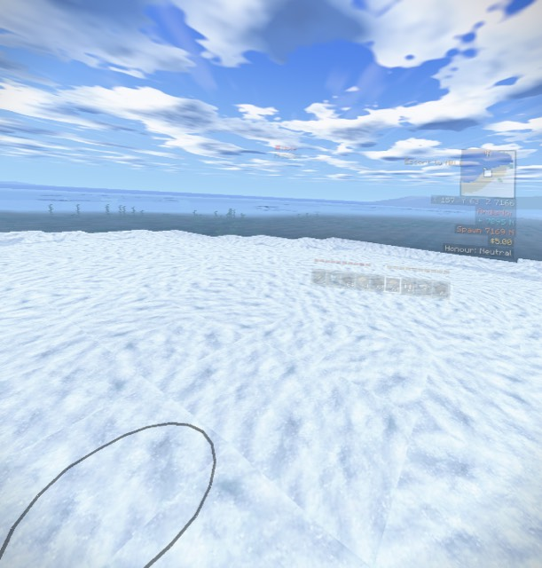

## 08:39:11 - Shooting at ice should put bullet holes in it

- **Transcript:** Shooting at ice should put bullet holes in it
- **Status:** open
- **Build:** 0.129 (39e0d988, M1-M4 (device-tested; ship riding, chests, comfort options, weapon wheel))
- **World:** New World (26) (seed 530054557992772521)
- **Dimension:** Surface
- **Biome:** Cold Ocean
- **Position:** 144.6 63.0 7152.1
- **Facing:** north-west (yaw 293, pitch -17)
- **Held:** Falke Pistol x1
- **Mount:** on foot
- **Looking at:** Sheet Ice at 140 62 7150
- **Mode:** Survival, health 20/20
- **Time:** day 2 12:23, clear
- **Fps:** 70
- **Levels:** mic -47 dBFS, game sound -14 dBFS
- **Length:** 3.1 s (voice 1.4 s)
- **Just before:** -14s walked into Snowy Taiga; -8s walked into Snowy Plains; -6s walked into Beach; -5s holding Capital Rounds; -5s message: Capital Rounds; -5s holding Falke Pistol; -5s message: Falke Pistol; -4s walked into Cold Ocean; -2s message: Loaded: 18 / 18
- **Repro (Mac):** `./snap.sh note --seed 530054557992772521 --x 144.6 --z 7152.1 --yaw 67 --pitch -17 --time 0.266`
- **Audio (this Mac):** /Users/darthvadar/Documents/Blocksmith/QuestVoiceNotes/raw/vn-20261115-083911-286.aac

## 08:39:17 - Uh, we're gonna need Fable to compile a list of things it thinks it ne

- **Transcript:** Uh, we're gonna need Fable to compile a list of things it thinks it needs sounds for from 11 Labs
- **Status:** open
- **Build:** 0.129 (39e0d988, M1-M4 (device-tested; ship riding, chests, comfort options, weapon wheel))
- **World:** New World (26) (seed 530054557992772521)
- **Dimension:** Surface
- **Biome:** Cold Ocean
- **Position:** 131.0 63.0 7110.4
- **Facing:** north-west (yaw 316, pitch -30)
- **Held:** Falke Pistol x1
- **Mount:** on foot
- **Looking at:** Sheet Ice at 129 62 7108
- **Mode:** Survival, health 20/20
- **Time:** day 2 12:30, clear
- **Fps:** 71
- **Levels:** mic -27 dBFS, game sound -20 dBFS
- **Length:** 6.9 s (voice 3.9 s)
- **Just before:** -20s walked into Snowy Taiga; -14s walked into Snowy Plains; -12s walked into Beach; -12s holding Capital Rounds; -12s message: Capital Rounds; -11s holding Falke Pistol; -11s message: Falke Pistol; -10s walked into Cold Ocean; -8s message: Loaded: 18 / 18
- **Position at the end:** 121.0 63.0 7070.1
- **Repro (Mac):** `./snap.sh note --seed 530054557992772521 --x 131.0 --z 7110.4 --yaw 44 --pitch -30 --time 0.271`
- **Audio (this Mac):** /Users/darthvadar/Documents/Blocksmith/QuestVoiceNotes/raw/vn-20261115-083917-626.aac

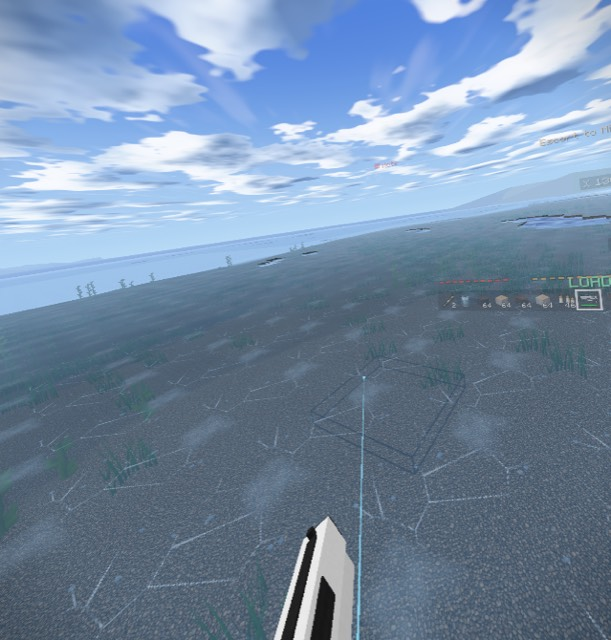

## 08:39:25 - Oh, this ain't bad, Rice. It's not bad at all

- **Transcript:** Oh, this ain't bad, Rice. It's not bad at all
- **Status:** open
- **Build:** 0.129 (39e0d988, M1-M4 (device-tested; ship riding, chests, comfort options, weapon wheel))
- **World:** New World (26) (seed 530054557992772521)
- **Dimension:** Surface
- **Biome:** Cold Ocean
- **Position:** 113.5 63.0 7066.9
- **Facing:** north-west (yaw 293, pitch -37)
- **Held:** Falke Pistol x1
- **Mount:** on foot
- **Looking at:** Sheet Ice at 111 62 7066
- **Mode:** Survival, health 20/20
- **Time:** day 2 12:40, clear
- **Fps:** 70
- **Levels:** mic -26 dBFS, game sound -21 dBFS
- **Length:** 3.8 s (voice 1.8 s)
- **Just before:** -28s walked into Snowy Taiga; -22s walked into Snowy Plains; -20s walked into Beach; -20s holding Capital Rounds; -20s message: Capital Rounds; -19s holding Falke Pistol; -19s message: Falke Pistol; -18s walked into Cold Ocean; -16s message: Loaded: 18 / 18
- **Repro (Mac):** `./snap.sh note --seed 530054557992772521 --x 113.5 --z 7066.9 --yaw 67 --pitch -37 --time 0.278`
- **Audio (this Mac):** /Users/darthvadar/Documents/Blocksmith/QuestVoiceNotes/raw/vn-20261115-083925-666.aac

## 08:40:22 - What the flippity? Is it a well? What is this?

- **Transcript:** What the flippity? Is it a well? What is this?
- **Status:** open
- **Build:** 0.129 (39e0d988, M1-M4 (device-tested; ship riding, chests, comfort options, weapon wheel))
- **World:** New World (26) (seed 530054557992772521)
- **Dimension:** Surface
- **Biome:** Snowy Taiga
- **Position:** 165.8 69.9 6720.2
- **Facing:** west (yaw 266, pitch -35)
- **Held:** Falke Pistol x1
- **Mount:** on foot
- **Looking at:** Snow at 164 70 6720
- **Mode:** Survival, health 20/20
- **Time:** day 2 13:48, clear
- **Fps:** 71
- **Levels:** mic -37 dBFS, game sound -19 dBFS
- **Length:** 4.2 s (voice 1.5 s)
- **Just before:** -29s message: Loaded: 18 / 18; -27s walked into Snowy Taiga; -25s took 1 damage (health 19/20); -24s message: Ardisdor - Torisheim border post marked on the map; -23s walked into Taiga; -19s holding Capital Rounds; -19s message: Capital Rounds; -19s holding Falke Pistol; -19s message: Falke Pistol; -19s holding Capital Rounds; -19s message: Capital Rounds; -18s holding Falke Pistol; -18s message: Falke Pistol; -17s walked into Snowy Taiga; -10s message: Road agents!
- **Repro (Mac):** `./snap.sh note --seed 530054557992772521 --x 165.8 --z 6720.2 --yaw 94 --pitch -35 --time 0.326`
- **Audio (this Mac):** /Users/darthvadar/Documents/Blocksmith/QuestVoiceNotes/raw/vn-20261115-084022-606.aac

## 08:41:05 - That should cause an immediate failure of the, of the quest

- **Transcript:** That should cause an immediate failure of the, of the quest
- **Status:** open
- **Build:** 0.129 (39e0d988, M1-M4 (device-tested; ship riding, chests, comfort options, weapon wheel))
- **World:** New World (26) (seed 530054557992772521)
- **Dimension:** Surface
- **Biome:** Snowy Taiga
- **Position:** 146.5 69.5 6710.0
- **Facing:** south (yaw 179, pitch -14)
- **Held:** Falke Pistol x1
- **Mount:** on foot
- **Looking at:** Spruce Log at 146 69 6715
- **Mode:** Creative, health 20/20
- **Time:** day 2 14:39, clear
- **Fps:** 71
- **Levels:** mic -33 dBFS, game sound -18 dBFS
- **Length:** 5.5 s (voice 2.3 s)
- **Just before:** -28s walked into Snowy Plains; -26s walked into Snowy Taiga; -24s walked into Snowy Plains; -23s opened PauseMenu; -22s message: Creative mode; -22s closed PauseMenu; -20s walked into Snowy Taiga; -13s message: Calvin Merriweather: They say a soldier deserted and hides in the hills.; -10s walked into Snowy Plains; -8s walked into Snowy Taiga; -8s holding Birch Log; -8s message: Birch Log; -7s holding Spruce Log; -7s message: Spruce Log; -6s holding Birch Log; -6s message: Birch Log; -6s holding Capital Rounds; -6s message: Capital Rounds; -6s holding Falke Pistol; -6s message: Falke Pistol; -6s message: Calvin Merriweather: Don't shoot, I've got kids!; -2s walked into Snowy Plains; -0s walked into Snowy Taiga
- **While talking:** -4s holding Spruce Log; -4s message: Spruce Log; -3s holding Combat Stim; -3s message: Combat Stim; -3s holding Titanium Chestplate; -3s message: Titanium Chestplate; -2s holding Spruce Log; -2s message: Spruce Log; -2s holding Birch Log; -2s message: Birch Log; -1s walked into Snowy Plains
- **Position at the end:** 145.8 70.0 6711.3
- **Repro (Mac):** `./snap.sh note --seed 530054557992772521 --x 146.5 --z 6710.0 --yaw -179 --pitch -14 --time 0.361`
- **Audio (this Mac):** /Users/darthvadar/Documents/Blocksmith/QuestVoiceNotes/raw/vn-20261115-084105-966.aac

## 08:41:12 - 'Cause I kill them

- **Transcript:** 'Cause I kill them
- **Status:** open
- **Build:** 0.129 (39e0d988, M1-M4 (device-tested; ship riding, chests, comfort options, weapon wheel))
- **World:** New World (26) (seed 530054557992772521)
- **Dimension:** Surface
- **Biome:** Snowy Plains
- **Position:** 145.8 70.0 6711.3
- **Facing:** south (yaw 199, pitch -44)
- **Held:** Birch Log x64
- **Mount:** on foot
- **Looking at:** Snowy Grass Block at 145 68 6713
- **Mode:** Creative, health 20/20
- **Time:** day 2 14:47, clear
- **Fps:** 71
- **Levels:** mic -33 dBFS, game sound -20 dBFS
- **Length:** 1.8 s (voice 0.4 s)
- **Just before:** -29s opened PauseMenu; -29s message: Creative mode; -28s closed PauseMenu; -27s walked into Snowy Taiga; -20s message: Calvin Merriweather: They say a soldier deserted and hides in the hills.; -17s walked into Snowy Plains; -15s walked into Snowy Taiga; -14s holding Birch Log; -14s message: Birch Log; -13s holding Spruce Log; -13s message: Spruce Log; -13s holding Birch Log; -13s message: Birch Log; -13s holding Capital Rounds; -13s message: Capital Rounds; -13s holding Falke Pistol; -13s message: Falke Pistol; -12s message: Calvin Merriweather: Don't shoot, I've got kids!; -9s walked into Snowy Plains; -7s walked into Snowy Taiga; -5s holding Spruce Log; -5s message: Spruce Log; -5s holding Combat Stim; -5s message: Combat Stim; -4s holding Titanium Chestplate; -4s message: Titanium Chestplate; -4s holding Spruce Log; -4s message: Spruce Log; -4s holding Birch Log; -4s message: Birch Log; -3s walked into Snowy Plains
- **Repro (Mac):** `./snap.sh note --seed 530054557992772521 --x 145.8 --z 6711.3 --yaw 161 --pitch -44 --time 0.366`
- **Audio (this Mac):** /Users/darthvadar/Documents/Blocksmith/QuestVoiceNotes/raw/vn-20261115-084112-527.aac

## 08:41:22 - So we still got the procedural log generation we want going

- **Transcript:** So we still got the procedural log generation we want going
- **Status:** open
- **Build:** 0.129 (39e0d988, M1-M4 (device-tested; ship riding, chests, comfort options, weapon wheel))
- **World:** New World (26) (seed 530054557992772521)
- **Dimension:** Surface
- **Biome:** Snowy Plains
- **Position:** 145.4 70.0 6712.0
- **Facing:** south-west (yaw 215, pitch -77)
- **Held:** Birch Log x64
- **Mount:** on foot
- **Looking at:** Birch Log at 145 68 6712
- **Mode:** Creative, health 20/20
- **Time:** day 2 14:59, clear
- **Fps:** 70
- **Levels:** mic -25 dBFS, game sound -18 dBFS
- **Length:** 4.8 s (voice 2.7 s)
- **Just before:** -29s message: Calvin Merriweather: They say a soldier deserted and hides in the hills.; -26s walked into Snowy Plains; -24s walked into Snowy Taiga; -24s holding Birch Log; -24s message: Birch Log; -23s holding Spruce Log; -23s message: Spruce Log; -22s holding Birch Log; -22s message: Birch Log; -22s holding Capital Rounds; -22s message: Capital Rounds; -22s holding Falke Pistol; -22s message: Falke Pistol; -22s message: Calvin Merriweather: Don't shoot, I've got kids!; -18s walked into Snowy Plains; -16s walked into Snowy Taiga; -15s holding Spruce Log; -15s message: Spruce Log; -14s holding Combat Stim; -14s message: Combat Stim; -14s holding Titanium Chestplate; -14s message: Titanium Chestplate; -14s holding Spruce Log; -14s message: Spruce Log; -13s holding Birch Log; -13s message: Birch Log; -12s walked into Snowy Plains
- **Repro (Mac):** `./snap.sh note --seed 530054557992772521 --x 145.4 --z 6712.0 --yaw 145 --pitch -77 --time 0.374`
- **Audio (this Mac):** /Users/darthvadar/Documents/Blocksmith/QuestVoiceNotes/raw/vn-20261115-084122-046.aac

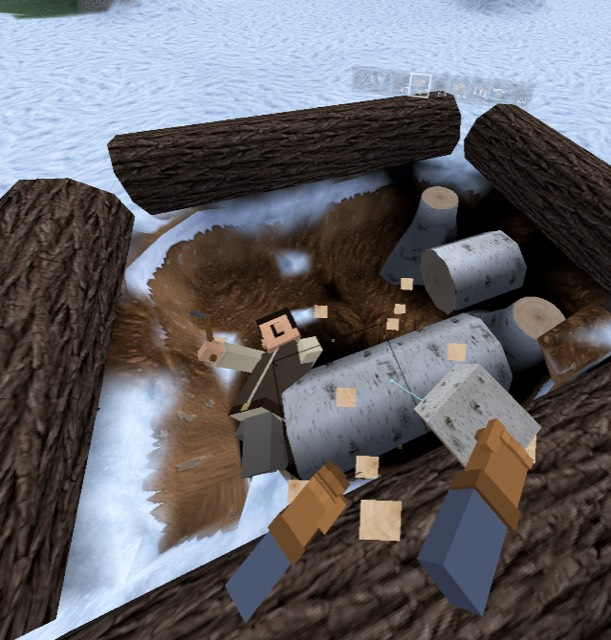

## 08:41:33 - Uh-oh. We got a little bit of an error happening

- **Transcript:** Uh-oh. We got a little bit of an error happening
- **Status:** open
- **Build:** 0.129 (39e0d988, M1-M4 (device-tested; ship riding, chests, comfort options, weapon wheel))
- **World:** New World (26) (seed 530054557992772521)
- **Dimension:** Surface
- **Biome:** Snowy Plains
- **Position:** 145.5 70.0 6712.0
- **Facing:** south (yaw 180, pitch -62)
- **Held:** Oak Planks x64
- **Mount:** on foot
- **Looking at:** Snowy Grass Block at 145 68 6713
- **Mode:** Creative, health 20/20
- **Time:** day 2 15:11, clear
- **Fps:** 61
- **Levels:** mic -29 dBFS, game sound -18 dBFS
- **Length:** 3.4 s (voice 1.9 s)
- **Just before:** -29s walked into Snowy Plains; -27s walked into Snowy Taiga; -26s holding Spruce Log; -26s message: Spruce Log; -25s holding Combat Stim; -25s message: Combat Stim; -25s holding Titanium Chestplate; -25s message: Titanium Chestplate; -25s holding Spruce Log; -25s message: Spruce Log; -24s holding Birch Log; -24s message: Birch Log; -23s walked into Snowy Plains; -8s opened PauseMenu; -8s closed PauseMenu; -8s opened CreativeMenu; -6s closed CreativeMenu; -5s holding Oak Planks; -5s message: Oak Planks
- **Repro (Mac):** `./snap.sh note --seed 530054557992772521 --x 145.5 --z 6712.0 --yaw -180 --pitch -62 --time 0.383`
- **Audio (this Mac):** /Users/darthvadar/Documents/Blocksmith/QuestVoiceNotes/raw/vn-20261115-084133-146.aac

## 08:41:36 - I place a block there, a block under it and on top forms at once. When

- **Transcript:** I place a block there, a block under it and on top forms at once. When I break it, they both go away
- **Status:** open
- **Build:** 0.129 (39e0d988, M1-M4 (device-tested; ship riding, chests, comfort options, weapon wheel))
- **World:** New World (26) (seed 530054557992772521)
- **Dimension:** Surface
- **Biome:** Snowy Plains
- **Position:** 145.5 70.0 6712.0
- **Facing:** south (yaw 167, pitch -71)
- **Held:** Oak Planks x64
- **Mount:** on foot
- **Looking at:** Oak Planks at 145 69 6713
- **Mode:** Creative, health 20/20
- **Time:** day 2 15:15, clear
- **Fps:** 70
- **Levels:** mic -56 dBFS, game sound -14 dBFS
- **Length:** 7.0 s (voice 3.9 s)
- **Just before:** -29s holding Spruce Log; -29s message: Spruce Log; -29s holding Combat Stim; -29s message: Combat Stim; -28s holding Titanium Chestplate; -28s message: Titanium Chestplate; -28s holding Spruce Log; -28s message: Spruce Log; -28s holding Birch Log; -28s message: Birch Log; -27s walked into Snowy Plains; -12s opened PauseMenu; -11s closed PauseMenu; -11s opened CreativeMenu; -10s closed CreativeMenu; -9s holding Oak Planks; -9s message: Oak Planks
- **Position at the end:** 145.5 70.0 6712.0
- **Repro (Mac):** `./snap.sh note --seed 530054557992772521 --x 145.5 --z 6712.0 --yaw -167 --pitch -71 --time 0.386`
- **Audio (this Mac):** /Users/darthvadar/Documents/Blocksmith/QuestVoiceNotes/raw/vn-20261115-084136-606.aac

## 08:41:43 - Look at that. What the fuck?

- **Transcript:** Look at that. What the fuck?
- **Status:** open
- **Build:** 0.129 (39e0d988, M1-M4 (device-tested; ship riding, chests, comfort options, weapon wheel))
- **World:** New World (26) (seed 530054557992772521)
- **Dimension:** Surface
- **Biome:** Snowy Plains
- **Position:** 145.5 70.0 6712.0
- **Facing:** south (yaw 184, pitch -69)
- **Held:** Oak Planks x64
- **Mount:** on foot
- **Looking at:** Oak Planks at 145 67 6713
- **Mode:** Creative, health 20/20
- **Time:** day 2 15:24, clear
- **Fps:** 71
- **Levels:** mic -38 dBFS, game sound -18 dBFS
- **Length:** 2.6 s (voice 0.6 s)
- **Just before:** -19s opened PauseMenu; -18s closed PauseMenu; -18s opened CreativeMenu; -16s closed CreativeMenu; -15s holding Oak Planks; -15s message: Oak Planks
- **Repro (Mac):** `./snap.sh note --seed 530054557992772521 --x 145.5 --z 6712.0 --yaw 176 --pitch -69 --time 0.392`
- **Audio (this Mac):** /Users/darthvadar/Documents/Blocksmith/QuestVoiceNotes/raw/vn-20261115-084143-446.aac

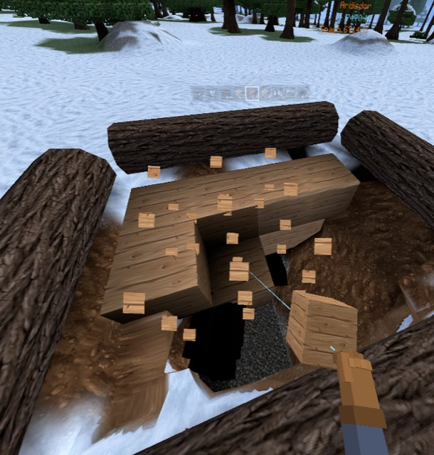

## 08:41:50 - I don't know why that's happening

- **Transcript:** I don't know why that's happening
- **Status:** open
- **Build:** 0.129 (39e0d988, M1-M4 (device-tested; ship riding, chests, comfort options, weapon wheel))
- **World:** New World (26) (seed 530054557992772521)
- **Dimension:** Surface
- **Biome:** Snowy Plains
- **Position:** 144.4 70.0 6712.2
- **Facing:** south-east (yaw 147, pitch -63)
- **Held:** Oak Planks x64
- **Mount:** on foot
- **Looking at:** Oak Planks at 145 69 6713
- **Mode:** Creative, health 20/20
- **Time:** day 2 15:32, clear
- **Fps:** 70
- **Levels:** mic -37 dBFS, game sound -21 dBFS
- **Length:** 2.7 s (voice 1.2 s)
- **Just before:** -26s opened PauseMenu; -25s closed PauseMenu; -25s opened CreativeMenu; -23s closed CreativeMenu; -23s holding Oak Planks; -23s message: Oak Planks
- **Repro (Mac):** `./snap.sh note --seed 530054557992772521 --x 144.4 --z 6712.2 --yaw -147 --pitch -63 --time 0.398`
- **Audio (this Mac):** /Users/darthvadar/Documents/Blocksmith/QuestVoiceNotes/raw/vn-20261115-084150-486.aac

## 08:41:55 - I can't make it not happen, in fact

- **Transcript:** I can't make it not happen, in fact
- **Status:** open
- **Build:** 0.129 (39e0d988, M1-M4 (device-tested; ship riding, chests, comfort options, weapon wheel))
- **World:** New World (26) (seed 530054557992772521)
- **Dimension:** Surface
- **Biome:** Snowy Taiga
- **Position:** 146.3 69.0 6712.9
- **Facing:** south-west (yaw 245, pitch -71)
- **Held:** Oak Planks x64
- **Mount:** on foot
- **Looking at:** Oak Planks at 145 67 6713
- **Mode:** Creative, health 20/20
- **Time:** day 2 15:37, clear
- **Fps:** 70
- **Levels:** mic -25 dBFS, game sound -19 dBFS
- **Length:** 2.7 s (voice 1.1 s)
- **Just before:** -30s closed PauseMenu; -29s opened CreativeMenu; -28s closed CreativeMenu; -27s holding Oak Planks; -27s message: Oak Planks; -1s walked into Snowy Taiga
- **Repro (Mac):** `./snap.sh note --seed 530054557992772521 --x 146.3 --z 6712.9 --yaw 115 --pitch -71 --time 0.401`
- **Audio (this Mac):** /Users/darthvadar/Documents/Blocksmith/QuestVoiceNotes/raw/vn-20261115-084155-026.aac

## 08:41:58 - The, uh, a block constantly forms right here when I press it

- **Transcript:** The, uh, a block constantly forms right here when I press it
- **Status:** open
- **Build:** 0.129 (39e0d988, M1-M4 (device-tested; ship riding, chests, comfort options, weapon wheel))
- **World:** New World (26) (seed 530054557992772521)
- **Dimension:** Surface
- **Biome:** Snowy Plains
- **Position:** 145.6 69.0 6712.6
- **Facing:** south (yaw 195, pitch -59)
- **Held:** Oak Planks x64
- **Mount:** on foot
- **Looking at:** Oak Planks at 145 69 6713
- **Mode:** Creative, health 20/20
- **Time:** day 2 15:41, clear
- **Fps:** 70
- **Levels:** mic -32 dBFS, game sound -16 dBFS
- **Length:** 4.8 s (voice 2.6 s)
- **Just before:** -4s walked into Snowy Taiga
- **Repro (Mac):** `./snap.sh note --seed 530054557992772521 --x 145.6 --z 6712.6 --yaw 165 --pitch -59 --time 0.404`
- **Audio (this Mac):** /Users/darthvadar/Documents/Blocksmith/QuestVoiceNotes/raw/vn-20261115-084158-006.aac

## 08:42:05 - So I don't know why a block forms on top when I place a block here

- **Transcript:** So I don't know why a block forms on top when I place a block here
- **Status:** open
- **Build:** 0.129 (39e0d988, M1-M4 (device-tested; ship riding, chests, comfort options, weapon wheel))
- **World:** New World (26) (seed 530054557992772521)
- **Dimension:** Surface
- **Biome:** Snowy Plains
- **Position:** 145.7 70.0 6712.0
- **Facing:** south (yaw 192, pitch -62)
- **Held:** Birch Log x64
- **Mount:** on foot
- **Looking at:** Oak Planks at 145 67 6713
- **Mode:** Creative, health 20/20
- **Time:** day 2 15:50, clear
- **Fps:** 69
- **Levels:** mic -32 dBFS, game sound -20 dBFS
- **Length:** 5.1 s (voice 2.7 s)
- **Just before:** -11s walked into Snowy Taiga; -7s walked into Snowy Plains; -4s holding Birch Log; -4s message: Birch Log
- **Repro (Mac):** `./snap.sh note --seed 530054557992772521 --x 145.7 --z 6712.0 --yaw 168 --pitch -62 --time 0.410`
- **Audio (this Mac):** /Users/darthvadar/Documents/Blocksmith/QuestVoiceNotes/raw/vn-20261115-084205-466.aac

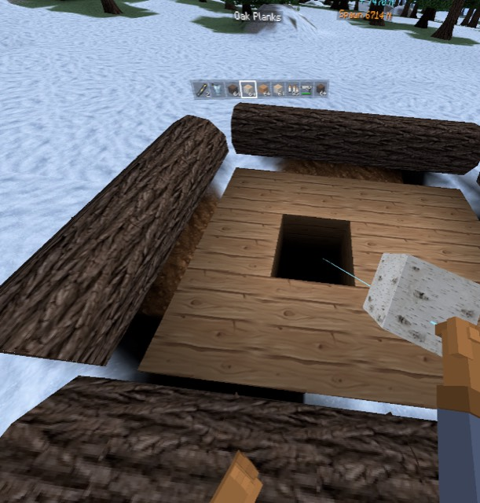

## 08:42:10 - Block there. See there's nothing inside. Place a block. It's over top.

- **Transcript:** Block there. See there's nothing inside. Place a block. It's over top. I don't know what's going on there
- **Status:** open
- **Build:** 0.129 (39e0d988, M1-M4 (device-tested; ship riding, chests, comfort options, weapon wheel))
- **World:** New World (26) (seed 530054557992772521)
- **Dimension:** Surface
- **Biome:** Snowy Plains
- **Position:** 145.6 70.0 6712.0
- **Facing:** south (yaw 182, pitch -60)
- **Held:** Oak Planks x64
- **Mount:** on foot
- **Looking at:** Oak Planks at 145 68 6714
- **Mode:** Creative, health 20/20
- **Time:** day 2 15:57, clear
- **Fps:** 70
- **Levels:** mic -28 dBFS, game sound -16 dBFS
- **Length:** 7.1 s (voice 3.4 s)
- **Just before:** -17s walked into Snowy Taiga; -13s walked into Snowy Plains; -9s holding Birch Log; -9s message: Birch Log; -4s holding Oak Planks; -4s message: Oak Planks
- **Position at the end:** 144.3 70.0 6711.9
- **Repro (Mac):** `./snap.sh note --seed 530054557992772521 --x 145.6 --z 6712.0 --yaw 178 --pitch -60 --time 0.415`
- **Audio (this Mac):** /Users/darthvadar/Documents/Blocksmith/QuestVoiceNotes/raw/vn-20261115-084210-926.aac

## 08:44:00 - Yeah, that's not right

- **Transcript:** Yeah, that's not right
- **Status:** open
- **Build:** 0.129 (39e0d988, M1-M4 (device-tested; ship riding, chests, comfort options, weapon wheel))
- **World:** New World (26) (seed 530054557992772521)
- **Dimension:** Surface
- **Biome:** Snowy Plains
- **Position:** 147.4 69.2 6717.1
- **Facing:** west (yaw 288, pitch -41)
- **Held:** Gray Concrete x64
- **Mount:** on foot
- **Looking at:** Gray Concrete at 144 68 6716
- **Mode:** Creative, health 20/20
- **Time:** day 2 18:06, clear
- **Fps:** 71
- **Levels:** mic -33 dBFS, game sound -25 dBFS
- **Length:** 2.6 s (voice 1.1 s)
- **Just before:** -25s closed CreativeMenu; -24s holding Gray Concrete; -24s message: Gray Concrete; -24s walked into Snowy Plains; -4s walked into Snowy Taiga; -2s walked into Snowy Plains
- **Repro (Mac):** `./snap.sh note --seed 530054557992772521 --x 147.4 --z 6717.1 --yaw 72 --pitch -41 --time 0.505`
- **Audio (this Mac):** /Users/darthvadar/Documents/Blocksmith/QuestVoiceNotes/raw/vn-20261115-084400-266.aac

## 08:44:03 - I can't place a block in this gap without it placing two

- **Transcript:** I can't place a block in this gap without it placing two
- **Status:** open
- **Build:** 0.129 (39e0d988, M1-M4 (device-tested; ship riding, chests, comfort options, weapon wheel))
- **World:** New World (26) (seed 530054557992772521)
- **Dimension:** Surface
- **Biome:** Snowy Plains
- **Position:** 145.6 69.2 6717.9
- **Facing:** north (yaw 357, pitch -50)
- **Held:** Gray Concrete x64
- **Mount:** on foot
- **Looking at:** Snowy Grass Block at 145 68 6716
- **Mode:** Creative, health 20/20
- **Time:** day 2 18:10, clear
- **Fps:** 71
- **Levels:** mic -55 dBFS, game sound -24 dBFS
- **Length:** 4.5 s (voice 1.8 s)
- **Just before:** -28s closed CreativeMenu; -28s holding Gray Concrete; -28s message: Gray Concrete; -27s walked into Snowy Plains; -7s walked into Snowy Taiga; -5s walked into Snowy Plains; -1s walked into Snowy Taiga
- **Repro (Mac):** `./snap.sh note --seed 530054557992772521 --x 145.6 --z 6717.9 --yaw 3 --pitch -50 --time 0.507`
- **Audio (this Mac):** /Users/darthvadar/Documents/Blocksmith/QuestVoiceNotes/raw/vn-20261115-084403-566.aac

## 08:44:11 - Well, good

- **Transcript:** Well, good
- **Status:** open
- **Build:** 0.129 (39e0d988, M1-M4 (device-tested; ship riding, chests, comfort options, weapon wheel))
- **World:** New World (26) (seed 530054557992772521)
- **Dimension:** Surface
- **Biome:** Snowy Plains
- **Position:** 144.1 69.1 6720.9
- **Facing:** north-west (yaw 327, pitch -31)
- **Held:** Gray Concrete x64
- **Mount:** on foot
- **Looking at:** Snowy Grass Block at 142 68 6718
- **Mode:** Creative, health 20/20
- **Time:** day 2 18:20, clear
- **Fps:** 70
- **Levels:** mic -41 dBFS, game sound -23 dBFS
- **Length:** 2.0 s (voice 0.4 s)
- **Just before:** -15s walked into Snowy Taiga; -13s walked into Snowy Plains; -9s walked into Snowy Taiga; -7s walked into Snowy Plains; -1s message: Your pack is full: the Spruce Log stays on the ground
- **Repro (Mac):** `./snap.sh note --seed 530054557992772521 --x 144.1 --z 6720.9 --yaw 33 --pitch -31 --time 0.514`
- **Audio (this Mac):** /Users/darthvadar/Documents/Blocksmith/QuestVoiceNotes/raw/vn-20261115-084411-806.aac

## 08:44:58 - Can't place blocks in here

- **Transcript:** Can't place blocks in here
- **Status:** open
- **Build:** 0.129 (39e0d988, M1-M4 (device-tested; ship riding, chests, comfort options, weapon wheel))
- **World:** New World (26) (seed 530054557992772521)
- **Dimension:** Surface
- **Biome:** Snowy Plains
- **Position:** 145.3 69.0 6719.1
- **Facing:** north (yaw 339, pitch -58)
- **Held:** Bricks x64
- **Mount:** on foot
- **Looking at:** Bricks at 144 68 6717
- **Mode:** Creative, health 20/20
- **Time:** day 2 19:15, clear
- **Fps:** 72
- **Levels:** mic -39 dBFS, game sound -18 dBFS
- **Length:** 2.6 s (voice 0.7 s)
- **Just before:** -27s closed CreativeMenu; -26s holding Bricks; -26s message: Bricks; -26s holding Lever; -26s message: Lever; -18s message: Flying; -17s opened PauseMenu; -17s closed PauseMenu; -17s opened CreativeMenu; -14s closed CreativeMenu; -14s holding Capital Rounds; -14s message: Capital Rounds; -13s holding Lever; -13s message: Lever; -13s holding Bricks; -13s message: Bricks; -13s holding Birch Pressure Plate; -13s message: Birch Pressure Plate; -9s message: Walking; -7s message: Your pack is full: the Spruce Log stays on the ground; -4s holding Bricks; -4s message: Bricks
- **Repro (Mac):** `./snap.sh note --seed 530054557992772521 --x 145.3 --z 6719.1 --yaw 21 --pitch -58 --time 0.552`
- **Audio (this Mac):** /Users/darthvadar/Documents/Blocksmith/QuestVoiceNotes/raw/vn-20261115-084458-946.aac

## 08:45:01 - And look, the ground doesn't come back to it

- **Transcript:** And look, the ground doesn't come back to it
- **Status:** open
- **Build:** 0.129 (39e0d988, M1-M4 (device-tested; ship riding, chests, comfort options, weapon wheel))
- **World:** New World (26) (seed 530054557992772521)
- **Dimension:** Surface
- **Biome:** Snowy Plains
- **Position:** 144.9 69.1 6719.8
- **Facing:** north (yaw 20, pitch -44)
- **Held:** Bricks x64
- **Mount:** on foot
- **Looking at:** Snow at 145 69 6719
- **Mode:** Creative, health 20/20
- **Time:** day 2 19:18, clear
- **Fps:** 70
- **Levels:** mic -29 dBFS, game sound -22 dBFS
- **Length:** 3.5 s (voice 1.6 s)
- **Just before:** -29s closed CreativeMenu; -29s holding Bricks; -29s message: Bricks; -29s holding Lever; -29s message: Lever; -20s message: Flying; -20s opened PauseMenu; -19s closed PauseMenu; -19s opened CreativeMenu; -17s closed CreativeMenu; -16s holding Capital Rounds; -16s message: Capital Rounds; -16s holding Lever; -16s message: Lever; -16s holding Bricks; -16s message: Bricks; -16s holding Birch Pressure Plate; -16s message: Birch Pressure Plate; -11s message: Walking; -10s message: Your pack is full: the Spruce Log stays on the ground; -6s holding Bricks; -6s message: Bricks
- **Repro (Mac):** `./snap.sh note --seed 530054557992772521 --x 144.9 --z 6719.8 --yaw -20 --pitch -44 --time 0.554`
- **Audio (this Mac):** /Users/darthvadar/Documents/Blocksmith/QuestVoiceNotes/raw/vn-20261115-084501-566.aac

## 08:45:05 - Still pretty unsatisfying, I tell you, building

- **Transcript:** Still pretty unsatisfying, I tell you, building
- **Status:** open
- **Build:** 0.129 (39e0d988, M1-M4 (device-tested; ship riding, chests, comfort options, weapon wheel))
- **World:** New World (26) (seed 530054557992772521)
- **Dimension:** Surface
- **Biome:** Snowy Plains
- **Position:** 144.6 69.0 6717.4
- **Facing:** north (yaw 21, pitch -41)
- **Held:** Birch Pressure Plate x64
- **Mount:** on foot
- **Looking at:** Birch Pressure Plate at 144 69 6715
- **Mode:** Creative, health 20/20
- **Time:** day 2 19:22, clear
- **Fps:** 71
- **Levels:** mic -28 dBFS, game sound -18 dBFS
- **Length:** 3.6 s (voice 1.6 s)
- **Just before:** -24s message: Flying; -24s opened PauseMenu; -23s closed PauseMenu; -23s opened CreativeMenu; -21s closed CreativeMenu; -20s holding Capital Rounds; -20s message: Capital Rounds; -20s holding Lever; -20s message: Lever; -20s holding Bricks; -20s message: Bricks; -20s holding Birch Pressure Plate; -20s message: Birch Pressure Plate; -15s message: Walking; -14s message: Your pack is full: the Spruce Log stays on the ground; -10s holding Bricks; -10s message: Bricks; -3s holding Birch Pressure Plate; -3s message: Birch Pressure Plate
- **Repro (Mac):** `./snap.sh note --seed 530054557992772521 --x 144.6 --z 6717.4 --yaw -21 --pitch -41 --time 0.558`
- **Audio (this Mac):** /Users/darthvadar/Documents/Blocksmith/QuestVoiceNotes/raw/vn-20261115-084505-526.aac

## 08:45:15 - Um, doors in there?

- **Transcript:** Um, doors in there?
- **Status:** open
- **Build:** 0.129 (39e0d988, M1-M4 (device-tested; ship riding, chests, comfort options, weapon wheel))
- **World:** New World (26) (seed 530054557992772521)
- **Dimension:** Surface
- **Biome:** Snowy Plains
- **Position:** 144.3 69.1 6719.6
- **Facing:** north (yaw 348, pitch 9)
- **Held:** Birch Pressure Plate x64
- **Mount:** on foot
- **Looking at:** nothing
- **Mode:** Creative, health 20/20, screen CreativeMenu
- **Time:** day 2 19:34, clear
- **Fps:** 72
- **Levels:** mic -39 dBFS, game sound -22 dBFS
- **Length:** 3.1 s (voice 1.1 s)
- **Just before:** -30s holding Lever; -30s message: Lever; -30s holding Bricks; -30s message: Bricks; -29s holding Birch Pressure Plate; -29s message: Birch Pressure Plate; -25s message: Walking; -23s message: Your pack is full: the Spruce Log stays on the ground; -20s holding Bricks; -20s message: Bricks; -13s holding Birch Pressure Plate; -13s message: Birch Pressure Plate; -9s opened PauseMenu; -8s closed PauseMenu; -8s opened CreativeMenu
- **Repro (Mac):** `./snap.sh note --seed 530054557992772521 --x 144.3 --z 6719.6 --yaw 12 --pitch 9 --time 0.565`
- **Audio (this Mac):** /Users/darthvadar/Documents/Blocksmith/QuestVoiceNotes/raw/vn-20261115-084515-246.aac

## 08:45:19 - Yours don't look right in inventory

- **Transcript:** Yours don't look right in inventory
- **Status:** open
- **Build:** 0.129 (39e0d988, M1-M4 (device-tested; ship riding, chests, comfort options, weapon wheel))
- **World:** New World (26) (seed 530054557992772521)
- **Dimension:** Surface
- **Biome:** Snowy Plains
- **Position:** 144.3 69.1 6719.6
- **Facing:** north (yaw 348, pitch 9)
- **Held:** Birch Pressure Plate x64
- **Mount:** on foot
- **Looking at:** nothing
- **Mode:** Creative, health 20/20, screen CreativeMenu
- **Time:** day 2 19:38, clear
- **Fps:** 72
- **Levels:** mic -29 dBFS, game sound -20 dBFS
- **Length:** 2.8 s (voice 1.2 s)
- **Just before:** -29s message: Walking; -27s message: Your pack is full: the Spruce Log stays on the ground; -24s holding Bricks; -24s message: Bricks; -16s holding Birch Pressure Plate; -16s message: Birch Pressure Plate; -13s opened PauseMenu; -12s closed PauseMenu; -12s opened CreativeMenu
- **Repro (Mac):** `./snap.sh note --seed 530054557992772521 --x 144.3 --z 6719.6 --yaw 12 --pitch 9 --time 0.568`
- **Audio (this Mac):** /Users/darthvadar/Documents/Blocksmith/QuestVoiceNotes/raw/vn-20261115-084519-066.aac

## 08:46:27 - Nearly unplayable

- **Transcript:** Nearly unplayable
- **Status:** open
- **Build:** 0.129 (39e0d988, M1-M4 (device-tested; ship riding, chests, comfort options, weapon wheel))
- **World:** New World (26) (seed 530054557992772521)
- **Dimension:** Surface
- **Biome:** Snowy Plains
- **Position:** 146.0 68.9 6720.6
- **Facing:** north-west (yaw 321, pitch -24)
- **Held:** Dirt x64
- **Mount:** on foot
- **Looking at:** Dirt at 144 68 6718
- **Mode:** Creative, health 20/20
- **Time:** day 2 20:59, clear
- **Fps:** 68
- **Levels:** mic -24 dBFS, game sound -15 dBFS
- **Length:** 2.4 s (voice 0.9 s)
- **Just before:** -26s holding Falke Pistol; -26s holding Spruce Log; -25s opened PauseMenu; -24s closed PauseMenu; -24s opened CreativeMenu; -22s closed CreativeMenu; -21s holding Falke Pistol; -21s message: Falke Pistol; -21s holding Combat Stim; -21s message: Combat Stim; -21s holding Falke Pistol; -21s message: Falke Pistol; -21s holding Combat Stim; -21s message: Combat Stim; -20s holding Falke Pistol; -20s message: Falke Pistol; -20s holding Combat Stim; -20s message: Combat Stim; -20s holding Falke Pistol; -20s message: Falke Pistol; -20s holding Combat Stim; -20s message: Combat Stim; -20s holding Falke Pistol; -20s message: Falke Pistol; -19s holding Combat Stim; -19s message: Combat Stim; -19s holding Falke Pistol; -19s message: Falke Pistol; -19s holding Spruce Log; -19s message: Spruce Log; -19s holding Combat Stim; -19s message: Combat Stim; -19s holding Titanium Chestplate; -19s message: Titanium Chestplate; -18s holding Dirt; -18s message: Dirt; -18s holding Birch Pressure Plate; -18s message: Birch Pressure Plate; -17s holding Dirt; -17s message: Dirt
- **Repro (Mac):** `./snap.sh note --seed 530054557992772521 --x 146.0 --z 6720.6 --yaw 39 --pitch -24 --time 0.625`
- **Audio (this Mac):** /Users/darthvadar/Documents/Blocksmith/QuestVoiceNotes/raw/vn-20261115-084627-126.aac

## 08:46:30 - Player has an issue with it, like tries doing this, they're gonna be u

- **Transcript:** Player has an issue with it, like tries doing this, they're gonna be upset
- **Status:** open
- **Build:** 0.129 (39e0d988, M1-M4 (device-tested; ship riding, chests, comfort options, weapon wheel))
- **World:** New World (26) (seed 530054557992772521)
- **Dimension:** Surface
- **Biome:** Snowy Plains
- **Position:** 147.0 69.0 6720.5
- **Facing:** north-west (yaw 293, pitch -49)
- **Held:** Dirt x64
- **Mount:** on foot
- **Looking at:** Snowy Grass Block at 145 68 6719
- **Mode:** Creative, health 20/20
- **Time:** day 2 21:03, clear
- **Fps:** 68
- **Levels:** mic -23 dBFS, game sound -17 dBFS
- **Length:** 5.2 s (voice 2.8 s)
- **Just before:** -29s holding Falke Pistol; -29s holding Spruce Log; -27s opened PauseMenu; -27s closed PauseMenu; -27s opened CreativeMenu; -25s closed CreativeMenu; -24s holding Falke Pistol; -24s message: Falke Pistol; -24s holding Combat Stim; -24s message: Combat Stim; -24s holding Falke Pistol; -24s message: Falke Pistol; -24s holding Combat Stim; -24s message: Combat Stim; -23s holding Falke Pistol; -23s message: Falke Pistol; -23s holding Combat Stim; -23s message: Combat Stim; -23s holding Falke Pistol; -23s message: Falke Pistol; -23s holding Combat Stim; -23s message: Combat Stim; -23s holding Falke Pistol; -23s message: Falke Pistol; -22s holding Combat Stim; -22s message: Combat Stim; -22s holding Falke Pistol; -22s message: Falke Pistol; -22s holding Spruce Log; -22s message: Spruce Log; -22s holding Combat Stim; -22s message: Combat Stim; -21s holding Titanium Chestplate; -21s message: Titanium Chestplate; -21s holding Dirt; -21s message: Dirt; -21s holding Birch Pressure Plate; -21s message: Birch Pressure Plate; -20s holding Dirt; -20s message: Dirt
- **Repro (Mac):** `./snap.sh note --seed 530054557992772521 --x 147.0 --z 6720.5 --yaw 67 --pitch -49 --time 0.627`
- **Audio (this Mac):** /Users/darthvadar/Documents/Blocksmith/QuestVoiceNotes/raw/vn-20261115-084630-066.aac

