# Voice bug notes 2026-11-15 (Quest)

Spoken while playing; transcribed by elevenlabs/scribe-v2. Written by `tools/quest-bugnotes.py` (rewritten each run; edit Status lines in a copy). 283 notes.

## 08:14:38 - This log was hovering and then it corrected to sitting down. That show

- **Transcript:** This log was hovering and then it corrected to sitting down. That shows that patch was used
- **Status:** open
- **Build:** 0.129 (39e0d988, M1-M4 (device-tested; ship riding, chests, comfort options, weapon wheel))
- **World:** New World (26) (seed 530054557992772521)
- **Dimension:** Surface
- **Biome:** Forest
- **Position:** -40.4 71.1 39.3
- **Facing:** west (yaw 260, pitch -30)
- **Held:** empty hand
- **Mount:** on foot
- **Looking at:** Oak Log at -44 71 39
- **Mode:** Survival, health 20/20
- **Time:** day 1 07:45, clear
- **Fps:** 69
- **Levels:** mic -50 dBFS, game sound -20 dBFS
- **Length:** 6.9 s (voice 3.8 s)
- **Just before:** -16s opened PauseMenu; -12s closed PauseMenu; -12s message: Playtest build: voice bug notes ON, your speech is saved (Options > Interface); -11s opened PauseMenu; -16s entered Surface; -16s closed PauseMenu; -16s holding Greywall Dispatch; -16s message: In Clear Ford's jail safe: a Greywall Dispatch; -15s message: In Clear Ford's jail safe: a Greywall Dispatch. Added to journal: Who Holds the Frontier; -12s message: Spring: the snow melts and the young are born; -9s left the pack: Jetpack x2; -9s left the pack: Field Journal of an Ashguard Rifleman; -9s left the pack: Field Stim x52; -9s left the pack: Track Spares x16; -9s left the pack: Aero Engine Spares x18; -9s left the pack: Regular Armour Set; -9s left the pack: Fernblick Rifle; -9s left the pack: Donnerkeil Service Rifle x3; -9s left the pack: Faustrohr; -9s left the pack: Faustrohr Warhead x3; -9s left the pack: Rocket x4; -9s left the pack: Himmelsturm Launcher; -9s left the pack: Duskium Chestplate; -9s left the pack: Falke Pistol x2; -9s left the pack: Titanium Pickaxe; -9s left the pack: Mahlwerk Rotary Gun; -8s holding empty hand; -8s walked into Forest; -6s message: The sky is clouding over: fog is coming; -3s message: Branisesh - Calaonia border post marked on the map
- **Position at the end:** -39.7 71.2 38.2
- **Repro (Mac):** `./snap.sh note --seed 530054557992772521 --x -40.4 --z 39.3 --yaw 100 --pitch -30 --time 0.073`
- **Audio (this Mac):** /Users/darthvadar/Documents/Blocksmith/QuestVoiceNotes/raw/vn-20261115-081438-967.aac

## 08:14:45 - To make it lie down, which is not what we're in, into doing. We don't 

- **Transcript:** To make it lie down, which is not what we're in, into doing. We don't do patches. We fix the problem
- **Status:** open
- **Build:** 0.129 (39e0d988, M1-M4 (device-tested; ship riding, chests, comfort options, weapon wheel))
- **World:** New World (26) (seed 530054557992772521)
- **Dimension:** Surface
- **Biome:** Forest
- **Position:** -39.7 71.2 38.2
- **Facing:** south-west (yaw 244, pitch -29)
- **Held:** empty hand
- **Mount:** on foot
- **Looking at:** Dirt at -44 70 39
- **Mode:** Survival, health 20/20
- **Time:** day 1 07:53, clear
- **Fps:** 70
- **Levels:** mic -35 dBFS, game sound -18 dBFS
- **Length:** 6.8 s (voice 3.5 s)
- **Just before:** -22s opened PauseMenu; -18s closed PauseMenu; -18s message: Playtest build: voice bug notes ON, your speech is saved (Options > Interface); -18s opened PauseMenu; -22s entered Surface; -22s closed PauseMenu; -22s holding Greywall Dispatch; -22s message: In Clear Ford's jail safe: a Greywall Dispatch; -22s message: In Clear Ford's jail safe: a Greywall Dispatch. Added to journal: Who Holds the Frontier; -18s message: Spring: the snow melts and the young are born; -15s left the pack: Jetpack x2; -15s left the pack: Field Journal of an Ashguard Rifleman; -15s left the pack: Field Stim x52; -15s left the pack: Track Spares x16; -15s left the pack: Aero Engine Spares x18; -15s left the pack: Regular Armour Set; -15s left the pack: Fernblick Rifle; -15s left the pack: Donnerkeil Service Rifle x3; -15s left the pack: Faustrohr; -15s left the pack: Faustrohr Warhead x3; -15s left the pack: Rocket x4; -15s left the pack: Himmelsturm Launcher; -15s left the pack: Duskium Chestplate; -15s left the pack: Falke Pistol x2; -15s left the pack: Titanium Pickaxe; -15s left the pack: Mahlwerk Rotary Gun; -15s holding empty hand; -14s walked into Forest; -12s message: The sky is clouding over: fog is coming; -10s message: Branisesh - Calaonia border post marked on the map
- **Position at the end:** -43.0 70.7 41.9
- **Repro (Mac):** `./snap.sh note --seed 530054557992772521 --x -39.7 --z 38.2 --yaw 116 --pitch -29 --time 0.079`
- **Audio (this Mac):** /Users/darthvadar/Documents/Blocksmith/QuestVoiceNotes/raw/vn-20261115-081445-687.aac

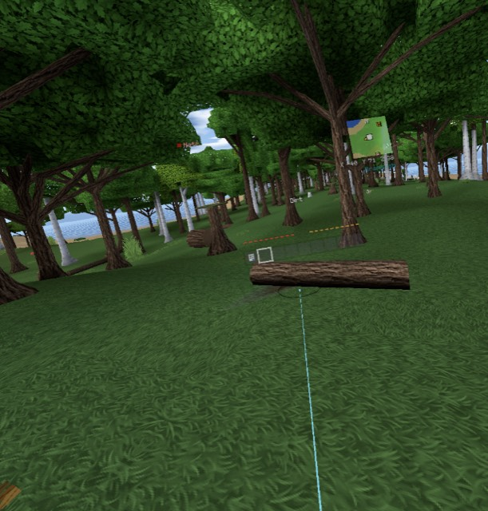

## 08:14:52 - This log's hovering

- **Transcript:** This log's hovering
- **Status:** open
- **Build:** 0.129 (39e0d988, M1-M4 (device-tested; ship riding, chests, comfort options, weapon wheel))
- **World:** New World (26) (seed 530054557992772521)
- **Dimension:** Surface
- **Biome:** Forest
- **Position:** -45.4 70.0 48.5
- **Facing:** north-west (yaw 321, pitch -29)
- **Held:** empty hand
- **Mount:** on foot
- **Looking at:** Oak Log at -48 70 46
- **Mode:** Survival, health 20/20
- **Time:** day 1 08:02, clear
- **Fps:** 72
- **Levels:** mic -24 dBFS, game sound -30 dBFS
- **Length:** 2.2 s (voice 0.7 s)
- **Just before:** -30s opened PauseMenu; -26s closed PauseMenu; -26s message: Playtest build: voice bug notes ON, your speech is saved (Options > Interface); -25s opened PauseMenu; -30s entered Surface; -30s closed PauseMenu; -30s holding Greywall Dispatch; -30s message: In Clear Ford's jail safe: a Greywall Dispatch; -29s message: In Clear Ford's jail safe: a Greywall Dispatch. Added to journal: Who Holds the Frontier; -26s message: Spring: the snow melts and the young are born; -23s left the pack: Jetpack x2; -23s left the pack: Field Journal of an Ashguard Rifleman; -23s left the pack: Field Stim x52; -23s left the pack: Track Spares x16; -23s left the pack: Aero Engine Spares x18; -23s left the pack: Regular Armour Set; -23s left the pack: Fernblick Rifle; -23s left the pack: Donnerkeil Service Rifle x3; -23s left the pack: Faustrohr; -23s left the pack: Faustrohr Warhead x3; -23s left the pack: Rocket x4; -23s left the pack: Himmelsturm Launcher; -23s left the pack: Duskium Chestplate; -23s left the pack: Falke Pistol x2; -23s left the pack: Titanium Pickaxe; -23s left the pack: Mahlwerk Rotary Gun; -22s holding empty hand; -22s walked into Forest; -20s message: The sky is clouding over: fog is coming; -17s message: Branisesh - Calaonia border post marked on the map
- **Repro (Mac):** `./snap.sh note --seed 530054557992772521 --x -45.4 --z 48.5 --yaw 39 --pitch -29 --time 0.085`
- **Audio (this Mac):** /Users/darthvadar/Documents/Blocksmith/QuestVoiceNotes/raw/vn-20261115-081452-986.aac

## 08:14:54 - How is that possible?

- **Transcript:** How is that possible?
- **Status:** open
- **Build:** 0.129 (39e0d988, M1-M4 (device-tested; ship riding, chests, comfort options, weapon wheel))
- **World:** New World (26) (seed 530054557992772521)
- **Dimension:** Surface
- **Biome:** Forest
- **Position:** -45.1 70.2 44.5
- **Facing:** south-west (yaw 218, pitch -16)
- **Held:** empty hand
- **Mount:** on foot
- **Looking at:** Oak Log at -48 70 46
- **Mode:** Survival, health 20/20
- **Time:** day 1 08:04, clear
- **Fps:** 72
- **Levels:** mic -31 dBFS, game sound -25 dBFS
- **Length:** 2.1 s (voice 0.8 s)
- **Just before:** -28s closed PauseMenu; -28s message: Playtest build: voice bug notes ON, your speech is saved (Options > Interface); -27s opened PauseMenu; -28s message: Spring: the snow melts and the young are born; -25s left the pack: Jetpack x2; -25s left the pack: Field Journal of an Ashguard Rifleman; -25s left the pack: Field Stim x52; -25s left the pack: Track Spares x16; -25s left the pack: Aero Engine Spares x18; -25s left the pack: Regular Armour Set; -25s left the pack: Fernblick Rifle; -25s left the pack: Donnerkeil Service Rifle x3; -25s left the pack: Faustrohr; -25s left the pack: Faustrohr Warhead x3; -25s left the pack: Rocket x4; -25s left the pack: Himmelsturm Launcher; -25s left the pack: Duskium Chestplate; -25s left the pack: Falke Pistol x2; -25s left the pack: Titanium Pickaxe; -25s left the pack: Mahlwerk Rotary Gun; -24s holding empty hand; -24s walked into Forest; -21s message: The sky is clouding over: fog is coming; -19s message: Branisesh - Calaonia border post marked on the map
- **Repro (Mac):** `./snap.sh note --seed 530054557992772521 --x -45.1 --z 44.5 --yaw 142 --pitch -16 --time 0.086`
- **Audio (this Mac):** /Users/darthvadar/Documents/Blocksmith/QuestVoiceNotes/raw/vn-20261115-081454-886.aac

## 08:14:57 - And what the fuck? Why moss carpet

- **Transcript:** And what the fuck? Why moss carpet
- **Status:** open
- **Build:** 0.129 (39e0d988, M1-M4 (device-tested; ship riding, chests, comfort options, weapon wheel))
- **World:** New World (26) (seed 530054557992772521)
- **Dimension:** Surface
- **Biome:** Forest
- **Position:** -60.9 69.8 43.1
- **Facing:** west (yaw 257, pitch -4)
- **Held:** empty hand
- **Mount:** on foot
- **Looking at:** nothing
- **Mode:** Survival, health 20/20
- **Time:** day 1 08:08, clear
- **Fps:** 72
- **Levels:** mic -31 dBFS, game sound -17 dBFS
- **Length:** 4.5 s (voice 1.6 s)
- **Just before:** -30s opened PauseMenu; -28s left the pack: Jetpack x2; -28s left the pack: Field Journal of an Ashguard Rifleman; -28s left the pack: Field Stim x52; -28s left the pack: Track Spares x16; -28s left the pack: Aero Engine Spares x18; -28s left the pack: Regular Armour Set; -28s left the pack: Fernblick Rifle; -28s left the pack: Donnerkeil Service Rifle x3; -28s left the pack: Faustrohr; -28s left the pack: Faustrohr Warhead x3; -28s left the pack: Rocket x4; -28s left the pack: Himmelsturm Launcher; -28s left the pack: Duskium Chestplate; -28s left the pack: Falke Pistol x2; -28s left the pack: Titanium Pickaxe; -28s left the pack: Mahlwerk Rotary Gun; -27s holding empty hand; -27s walked into Forest; -25s message: The sky is clouding over: fog is coming; -22s message: Branisesh - Calaonia border post marked on the map
- **Repro (Mac):** `./snap.sh note --seed 530054557992772521 --x -60.9 --z 43.1 --yaw 103 --pitch -4 --time 0.089`
- **Audio (this Mac):** /Users/darthvadar/Documents/Blocksmith/QuestVoiceNotes/raw/vn-20261115-081457-967.aac

## 08:15:02 - See, this looks like shit. No moss. You can just delete the moss if yo

- **Transcript:** See, this looks like shit. No moss. You can just delete the moss if you want
- **Status:** open
- **Build:** 0.129 (39e0d988, M1-M4 (device-tested; ship riding, chests, comfort options, weapon wheel))
- **World:** New World (26) (seed 530054557992772521)
- **Dimension:** Surface
- **Biome:** Forest
- **Position:** -65.8 69.7 43.3
- **Facing:** south-west (yaw 246, pitch 10)
- **Held:** empty hand
- **Mount:** on foot
- **Looking at:** nothing
- **Mode:** Survival, health 20/20
- **Time:** day 1 08:13, clear
- **Fps:** 72
- **Levels:** mic -30 dBFS, game sound -22 dBFS
- **Length:** 5.8 s (voice 2.9 s)
- **Just before:** -29s message: The sky is clouding over: fog is coming; -27s message: Branisesh - Calaonia border post marked on the map
- **While talking:** -2s holding Moss Carpet
- **Position at the end:** -74.0 69.4 48.2
- **Repro (Mac):** `./snap.sh note --seed 530054557992772521 --x -65.8 --z 43.3 --yaw 114 --pitch 10 --time 0.093`
- **Audio (this Mac):** /Users/darthvadar/Documents/Blocksmith/QuestVoiceNotes/raw/vn-20261115-081502-326.aac

## 08:15:12 - Or no, I can keep it, I guess. Just, I don't know

- **Transcript:** Or no, I can keep it, I guess. Just, I don't know
- **Status:** open
- **Build:** 0.129 (39e0d988, M1-M4 (device-tested; ship riding, chests, comfort options, weapon wheel))
- **World:** New World (26) (seed 530054557992772521)
- **Dimension:** Surface
- **Biome:** Forest
- **Position:** -105.4 68.1 48.4
- **Facing:** south-west (yaw 235, pitch -32)
- **Held:** Moss Carpet x1
- **Mount:** on foot
- **Looking at:** Grass Block at -108 67 49
- **Mode:** Survival, health 20/20
- **Time:** day 1 08:24, clear
- **Fps:** 71
- **Levels:** mic -27 dBFS, game sound -13 dBFS
- **Length:** 4.6 s (voice 2.1 s)
- **Just before:** -7s holding Moss Carpet
- **Repro (Mac):** `./snap.sh note --seed 530054557992772521 --x -105.4 --z 48.4 --yaw 125 --pitch -32 --time 0.101`
- **Audio (this Mac):** /Users/darthvadar/Documents/Blocksmith/QuestVoiceNotes/raw/vn-20261115-081512-106.aac

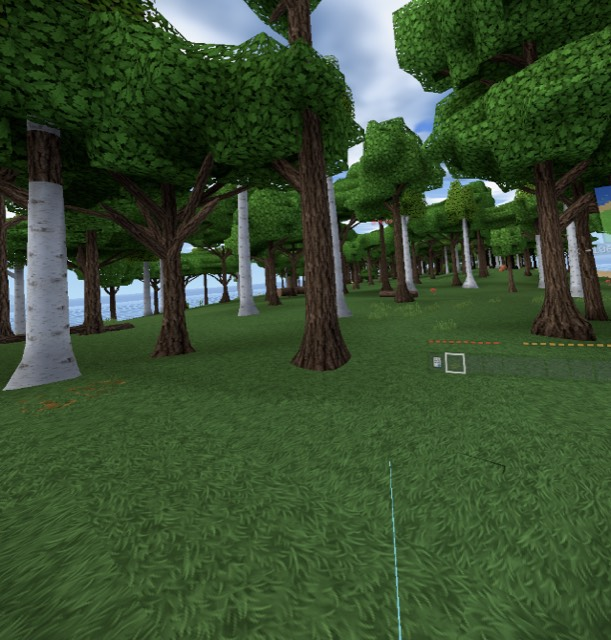

## 08:15:16 - Could make it a mossy stump as its own thing if you want

- **Transcript:** Could make it a mossy stump as its own thing if you want
- **Status:** open
- **Build:** 0.129 (39e0d988, M1-M4 (device-tested; ship riding, chests, comfort options, weapon wheel))
- **World:** New World (26) (seed 530054557992772521)
- **Dimension:** Surface
- **Biome:** Forest
- **Position:** -122.1 68.0 74.9
- **Facing:** west (yaw 248, pitch -20)
- **Held:** Moss Carpet x1
- **Mount:** on foot
- **Looking at:** Grass Block at -126 67 76
- **Mode:** Survival, health 20/20
- **Time:** day 1 08:30, clear
- **Fps:** 72
- **Levels:** mic -23 dBFS, game sound -16 dBFS
- **Length:** 4.3 s (voice 2.1 s)
- **Just before:** -12s holding Moss Carpet
- **Repro (Mac):** `./snap.sh note --seed 530054557992772521 --x -122.1 --z 74.9 --yaw 112 --pitch -20 --time 0.105`
- **Audio (this Mac):** /Users/darthvadar/Documents/Blocksmith/QuestVoiceNotes/raw/vn-20261115-081516-906.aac

## 08:15:45 - I don't think I can actually pay anything here if I wanted to

- **Transcript:** I don't think I can actually pay anything here if I wanted to
- **Status:** open
- **Build:** 0.129 (39e0d988, M1-M4 (device-tested; ship riding, chests, comfort options, weapon wheel))
- **World:** New World (26) (seed 530054557992772521)
- **Dimension:** Surface
- **Biome:** Plains
- **Position:** -22.0 90.0 98.8
- **Facing:** south-west (yaw 241, pitch -33)
- **Held:** Moss Carpet x1
- **Mount:** on foot
- **Looking at:** Spruce Sign at -24 90 99
- **Mode:** Survival, health 20/20
- **Time:** day 1 09:03, clear
- **Fps:** 72
- **Levels:** mic -32 dBFS, game sound -16 dBFS
- **Length:** 4.2 s (voice 2.2 s)
- **Just before:** -25s opened PauseMenu; -24s closed PauseMenu; -22s walked into Beach; -16s walked into Forest; -14s walked into Plains; -3s message: Calaonia customs: nothing to declare
- **Repro (Mac):** `./snap.sh note --seed 530054557992772521 --x -22.0 --z 98.8 --yaw 119 --pitch -33 --time 0.128`
- **Audio (this Mac):** /Users/darthvadar/Documents/Blocksmith/QuestVoiceNotes/raw/vn-20261115-081545-346.aac

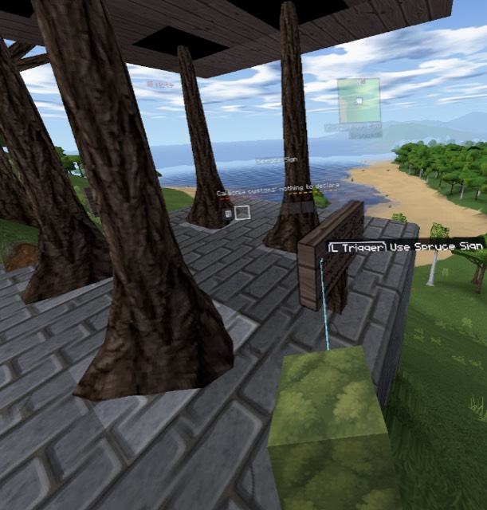

## 08:15:51 - This post

- **Transcript:** This post
- **Status:** open
- **Build:** 0.129 (39e0d988, M1-M4 (device-tested; ship riding, chests, comfort options, weapon wheel))
- **World:** New World (26) (seed 530054557992772521)
- **Dimension:** Surface
- **Biome:** Plains
- **Position:** -23.4 89.3 108.4
- **Facing:** north-west (yaw 311, pitch -4)
- **Held:** Moss Carpet x1
- **Mount:** on foot
- **Looking at:** nothing
- **Mode:** Survival, health 20/20
- **Time:** day 1 09:11, clear
- **Fps:** 72
- **Levels:** mic -42 dBFS, game sound -28 dBFS
- **Length:** 2.2 s (voice 0.6 s)
- **Just before:** -28s walked into Beach; -22s walked into Forest; -20s walked into Plains; -9s message: Calaonia customs: nothing to declare; -4s message: Entering Calaonia; -2s message: Branisesh customs: nothing to declare
- **Repro (Mac):** `./snap.sh note --seed 530054557992772521 --x -23.4 --z 108.4 --yaw 49 --pitch -4 --time 0.133`
- **Audio (this Mac):** /Users/darthvadar/Documents/Blocksmith/QuestVoiceNotes/raw/vn-20261115-081551-886.aac

## 08:15:54 - Customs. Pay here. I don't even know what that means

- **Transcript:** Customs. Pay here. I don't even know what that means
- **Status:** open
- **Build:** 0.129 (39e0d988, M1-M4 (device-tested; ship riding, chests, comfort options, weapon wheel))
- **World:** New World (26) (seed 530054557992772521)
- **Dimension:** Surface
- **Biome:** Plains
- **Position:** -23.3 89.3 107.3
- **Facing:** north (yaw 353, pitch -5)
- **Held:** Moss Carpet x1
- **Mount:** on foot
- **Looking at:** Spruce Sign at -24 90 103
- **Mode:** Survival, health 20/20
- **Time:** day 1 09:15, clear
- **Fps:** 72
- **Levels:** mic -39 dBFS, game sound -26 dBFS
- **Length:** 4.9 s (voice 1.9 s)
- **Just before:** -25s walked into Forest; -23s walked into Plains; -12s message: Calaonia customs: nothing to declare; -7s message: Entering Calaonia; -5s message: Branisesh customs: nothing to declare
- **Repro (Mac):** `./snap.sh note --seed 530054557992772521 --x -23.3 --z 107.3 --yaw 7 --pitch -5 --time 0.136`
- **Audio (this Mac):** /Users/darthvadar/Documents/Blocksmith/QuestVoiceNotes/raw/vn-20261115-081554-706.aac

## 08:16:00 - What happens if I don't?

- **Transcript:** What happens if I don't?
- **Status:** open
- **Build:** 0.129 (39e0d988, M1-M4 (device-tested; ship riding, chests, comfort options, weapon wheel))
- **World:** New World (26) (seed 530054557992772521)
- **Dimension:** Surface
- **Biome:** Plains
- **Position:** -19.8 92.9 127.9
- **Facing:** south (yaw 189, pitch -35)
- **Held:** Moss Carpet x1
- **Mount:** on foot
- **Looking at:** Grass Block at -21 91 131
- **Mode:** Survival, health 20/20
- **Time:** day 1 09:20, clear
- **Fps:** 68
- **Levels:** mic -27 dBFS, game sound -28 dBFS
- **Length:** 2.5 s (voice 0.7 s)
- **Just before:** -28s walked into Plains; -17s message: Calaonia customs: nothing to declare; -12s message: Entering Calaonia; -11s message: Branisesh customs: nothing to declare; -1s opened PauseMenu; -0s closed PauseMenu
- **Repro (Mac):** `./snap.sh note --seed 530054557992772521 --x -19.8 --z 127.9 --yaw 171 --pitch -35 --time 0.139`
- **Audio (this Mac):** /Users/darthvadar/Documents/Blocksmith/QuestVoiceNotes/raw/vn-20261115-081600-106.aac

## 08:16:02 - I never really understood that

- **Transcript:** I never really understood that
- **Status:** open
- **Build:** 0.129 (39e0d988, M1-M4 (device-tested; ship riding, chests, comfort options, weapon wheel))
- **World:** New World (26) (seed 530054557992772521)
- **Dimension:** Surface
- **Biome:** Plains
- **Position:** -13.6 99.0 142.9
- **Facing:** south (yaw 160, pitch -53)
- **Held:** Moss Carpet x1
- **Mount:** on foot
- **Looking at:** Grass Block at -14 98 143
- **Mode:** Survival, health 20/20
- **Time:** day 1 09:23, clear
- **Fps:** 71
- **Levels:** mic -36 dBFS, game sound -18 dBFS
- **Length:** 2.3 s (voice 1.0 s)
- **Just before:** -20s message: Calaonia customs: nothing to declare; -15s message: Entering Calaonia; -13s message: Branisesh customs: nothing to declare; -4s opened PauseMenu; -3s closed PauseMenu
- **Repro (Mac):** `./snap.sh note --seed 530054557992772521 --x -13.6 --z 142.9 --yaw -160 --pitch -53 --time 0.141`
- **Audio (this Mac):** /Users/darthvadar/Documents/Blocksmith/QuestVoiceNotes/raw/vn-20261115-081602-366.aac

## 08:16:14 - Hold on here

- **Transcript:** Hold on here
- **Status:** open
- **Build:** 0.129 (39e0d988, M1-M4 (device-tested; ship riding, chests, comfort options, weapon wheel))
- **World:** New World (26) (seed 530054557992772521)
- **Dimension:** Surface
- **Biome:** Taiga
- **Position:** 29.7 107.3 160.8
- **Facing:** east (yaw 89, pitch -12)
- **Held:** Moss Carpet x1
- **Mount:** on foot
- **Looking at:** Grass Block at 35 107 160
- **Mode:** Creative, health 20/20
- **Time:** day 1 09:36, clear
- **Fps:** 72
- **Levels:** mic -38 dBFS, game sound -19 dBFS
- **Length:** 2.0 s (voice 0.7 s)
- **Just before:** -27s message: Entering Calaonia; -25s message: Branisesh customs: nothing to declare; -16s opened PauseMenu; -15s closed PauseMenu; -11s walked into Taiga; -9s walked into Plains; -7s walked into Taiga; -7s opened PauseMenu; -6s message: Creative mode; -6s closed PauseMenu; -1s message: A stranger in town: Ezra Quill
- **Repro (Mac):** `./snap.sh note --seed 530054557992772521 --x 29.7 --z 160.8 --yaw -89 --pitch -12 --time 0.150`
- **Audio (this Mac):** /Users/darthvadar/Documents/Blocksmith/QuestVoiceNotes/raw/vn-20261115-081614-846.aac

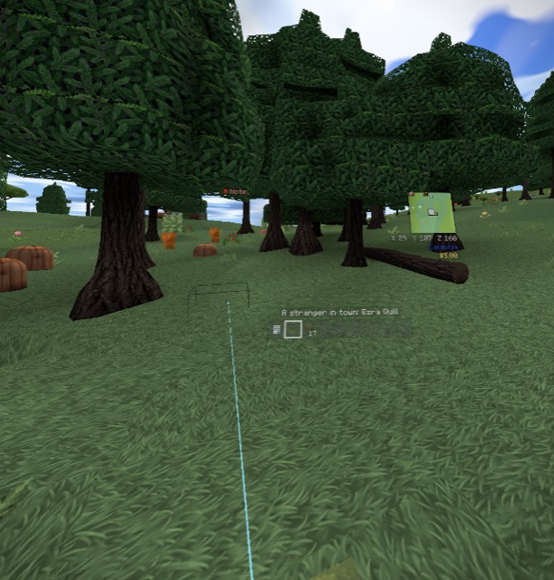

## 08:16:17 - Acem ssuref?

- **Transcript:** Acem ssuref?
- **Status:** open
- **Build:** 0.129 (39e0d988, M1-M4 (device-tested; ship riding, chests, comfort options, weapon wheel))
- **World:** New World (26) (seed 530054557992772521)
- **Dimension:** Surface
- **Biome:** Taiga
- **Position:** 33.5 107.6 162.1
- **Facing:** south-east (yaw 119, pitch -9)
- **Held:** Moss Carpet x1
- **Mount:** on foot
- **Looking at:** Spruce Log at 38 108 165
- **Mode:** Creative, health 20/20
- **Time:** day 1 09:39, clear
- **Fps:** 70
- **Levels:** mic -42 dBFS, game sound -20 dBFS
- **Length:** 2.0 s (voice 0.6 s)
- **Just before:** -30s message: Entering Calaonia; -28s message: Branisesh customs: nothing to declare; -19s opened PauseMenu; -18s closed PauseMenu; -14s walked into Taiga; -12s walked into Plains; -10s walked into Taiga; -9s opened PauseMenu; -8s message: Creative mode; -8s closed PauseMenu; -4s message: A stranger in town: Ezra Quill; -2s message: Ezra Quill: Oh, hello. Lovely day for a walk.
- **Repro (Mac):** `./snap.sh note --seed 530054557992772521 --x 33.5 --z 162.1 --yaw -119 --pitch -9 --time 0.152`
- **Audio (this Mac):** /Users/darthvadar/Documents/Blocksmith/QuestVoiceNotes/raw/vn-20261115-081617-326.aac

## 08:16:19 - Flash that happens

- **Transcript:** Flash that happens
- **Status:** open
- **Build:** 0.129 (39e0d988, M1-M4 (device-tested; ship riding, chests, comfort options, weapon wheel))
- **World:** New World (26) (seed 530054557992772521)
- **Dimension:** Surface
- **Biome:** Taiga
- **Position:** 33.5 107.6 162.1
- **Facing:** south-east (yaw 120, pitch 5)
- **Held:** Moss Carpet x1
- **Mount:** on foot
- **Looking at:** nothing
- **Mode:** Creative, health 20/20
- **Time:** day 1 09:42, clear
- **Fps:** 70
- **Levels:** mic -23 dBFS, game sound -19 dBFS
- **Length:** 2.4 s (voice 0.8 s)
- **Just before:** -21s opened PauseMenu; -20s closed PauseMenu; -16s walked into Taiga; -14s walked into Plains; -12s walked into Taiga; -12s opened PauseMenu; -11s message: Creative mode; -10s closed PauseMenu; -6s message: A stranger in town: Ezra Quill; -4s message: Ezra Quill: Oh, hello. Lovely day for a walk.
- **Repro (Mac):** `./snap.sh note --seed 530054557992772521 --x 33.5 --z 162.1 --yaw -120 --pitch 5 --time 0.154`
- **Audio (this Mac):** /Users/darthvadar/Documents/Blocksmith/QuestVoiceNotes/raw/vn-20261115-081619-526.aac

## 08:16:25 - Oh, I see

- **Transcript:** Oh, I see
- **Status:** open
- **Build:** 0.129 (39e0d988, M1-M4 (device-tested; ship riding, chests, comfort options, weapon wheel))
- **World:** New World (26) (seed 530054557992772521)
- **Dimension:** Surface
- **Biome:** Taiga
- **Position:** 29.4 108.1 169.4
- **Facing:** east (yaw 88, pitch -34)
- **Held:** Moss Carpet x1
- **Mount:** on foot
- **Looking at:** Grass Block at 32 107 169
- **Mode:** Creative, health 20/20
- **Time:** day 1 09:49, clear
- **Fps:** 71
- **Levels:** mic -29 dBFS, game sound -17 dBFS
- **Length:** 2.6 s (voice 1.2 s)
- **Just before:** -27s opened PauseMenu; -26s closed PauseMenu; -22s walked into Taiga; -20s walked into Plains; -18s walked into Taiga; -18s opened PauseMenu; -17s message: Creative mode; -16s closed PauseMenu; -12s message: A stranger in town: Ezra Quill; -10s message: Ezra Quill: Oh, hello. Lovely day for a walk.
- **Repro (Mac):** `./snap.sh note --seed 530054557992772521 --x 29.4 --z 169.4 --yaw -88 --pitch -34 --time 0.159`
- **Audio (this Mac):** /Users/darthvadar/Documents/Blocksmith/QuestVoiceNotes/raw/vn-20261115-081625-526.aac

## 08:16:28 - Okay, Fable misunderstood. Uh, we don't want the tree to just break ap

- **Transcript:** Okay, Fable misunderstood. Uh, we don't want the tree to just break apart like that
- **Status:** open
- **Build:** 0.129 (39e0d988, M1-M4 (device-tested; ship riding, chests, comfort options, weapon wheel))
- **World:** New World (26) (seed 530054557992772521)
- **Dimension:** Surface
- **Biome:** Taiga
- **Position:** 33.5 108.3 168.6
- **Facing:** east (yaw 110, pitch -10)
- **Held:** Moss Carpet x1
- **Mount:** on foot
- **Looking at:** Grass Block at 38 108 170
- **Mode:** Creative, health 20/20
- **Time:** day 1 09:52, clear
- **Fps:** 72
- **Levels:** mic -33 dBFS, game sound -19 dBFS
- **Length:** 7.0 s (voice 3.8 s)
- **Just before:** -29s opened PauseMenu; -28s closed PauseMenu; -24s walked into Taiga; -22s walked into Plains; -20s walked into Taiga; -20s opened PauseMenu; -19s message: Creative mode; -19s closed PauseMenu; -15s message: A stranger in town: Ezra Quill; -13s message: Ezra Quill: Oh, hello. Lovely day for a walk.
- **Position at the end:** 31.9 107.7 164.1
- **Repro (Mac):** `./snap.sh note --seed 530054557992772521 --x 33.5 --z 168.6 --yaw -110 --pitch -10 --time 0.161`
- **Audio (this Mac):** /Users/darthvadar/Documents/Blocksmith/QuestVoiceNotes/raw/vn-20261115-081628-026.aac

## 08:16:34 - I break the bottom log, tree falls just like before

- **Transcript:** I break the bottom log, tree falls just like before
- **Status:** open
- **Build:** 0.129 (39e0d988, M1-M4 (device-tested; ship riding, chests, comfort options, weapon wheel))
- **World:** New World (26) (seed 530054557992772521)
- **Dimension:** Surface
- **Biome:** Taiga
- **Position:** 38.5 108.0 159.7
- **Facing:** north-east (yaw 38, pitch -29)
- **Held:** Moss Carpet x1
- **Mount:** on foot
- **Looking at:** nothing
- **Mode:** Creative, health 20/20
- **Time:** day 1 10:00, clear
- **Fps:** 71
- **Levels:** mic -27 dBFS, game sound -18 dBFS
- **Length:** 3.9 s (voice 1.6 s)
- **Just before:** -29s walked into Plains; -27s walked into Taiga; -27s opened PauseMenu; -26s message: Creative mode; -26s closed PauseMenu; -22s message: A stranger in town: Ezra Quill; -19s message: Ezra Quill: Oh, hello. Lovely day for a walk.
- **Repro (Mac):** `./snap.sh note --seed 530054557992772521 --x 38.5 --z 159.7 --yaw -38 --pitch -29 --time 0.167`
- **Audio (this Mac):** /Users/darthvadar/Documents/Blocksmith/QuestVoiceNotes/raw/vn-20261115-081634-966.aac

## 08:16:38 - It doesn't despawn

- **Transcript:** It doesn't despawn
- **Status:** open
- **Build:** 0.129 (39e0d988, M1-M4 (device-tested; ship riding, chests, comfort options, weapon wheel))
- **World:** New World (26) (seed 530054557992772521)
- **Dimension:** Surface
- **Biome:** Taiga
- **Position:** 45.5 108.5 155.3
- **Facing:** north (yaw 6, pitch -27)
- **Held:** Moss Carpet x1
- **Mount:** on foot
- **Looking at:** Grass Block at 46 107 150
- **Mode:** Creative, health 20/20
- **Time:** day 1 10:05, clear
- **Fps:** 72
- **Levels:** mic -26 dBFS, game sound -28 dBFS
- **Length:** 2.8 s (voice 0.9 s)
- **Just before:** -30s message: Creative mode; -30s closed PauseMenu; -25s message: A stranger in town: Ezra Quill; -23s message: Ezra Quill: Oh, hello. Lovely day for a walk.
- **Repro (Mac):** `./snap.sh note --seed 530054557992772521 --x 45.5 --z 155.3 --yaw -6 --pitch -27 --time 0.170`
- **Audio (this Mac):** /Users/darthvadar/Documents/Blocksmith/QuestVoiceNotes/raw/vn-20261115-081638-766.aac

## 08:16:47 - That's not gruesome at all. All right. That's funny

- **Transcript:** That's not gruesome at all. All right. That's funny
- **Status:** open
- **Build:** 0.129 (39e0d988, M1-M4 (device-tested; ship riding, chests, comfort options, weapon wheel))
- **World:** New World (26) (seed 530054557992772521)
- **Dimension:** Surface
- **Biome:** Taiga
- **Position:** 69.2 111.9 148.3
- **Facing:** east (yaw 72, pitch -26)
- **Held:** Moss Carpet x1
- **Mount:** on foot
- **Looking at:** nothing
- **Mode:** Creative, health 20/20, screen ChestMenu
- **Time:** day 1 10:15, clear
- **Fps:** 71
- **Levels:** mic -42 dBFS, game sound -22 dBFS
- **Length:** 4.5 s (voice 1.7 s)
- **Just before:** -7s walked into Plains; -5s walked into Taiga; -0s opened ChestMenu
- **Repro (Mac):** `./snap.sh note --seed 530054557992772521 --x 69.2 --z 148.3 --yaw -72 --pitch -26 --time 0.177`
- **Audio (this Mac):** /Users/darthvadar/Documents/Blocksmith/QuestVoiceNotes/raw/vn-20261115-081647-326.aac

## 08:17:14 - Fucking is launch anyway

- **Transcript:** Fucking is launch anyway
- **Status:** open
- **Build:** 0.129 (39e0d988, M1-M4 (device-tested; ship riding, chests, comfort options, weapon wheel))
- **World:** New World (26) (seed 530054557992772521)
- **Dimension:** Surface
- **Biome:** Plains
- **Position:** 103.5 111.5 172.7
- **Facing:** south-east (yaw 134, pitch 11)
- **Held:** Faustrohr x1
- **Mount:** on foot
- **Looking at:** nothing
- **Mode:** Survival, health 20/20
- **Time:** day 1 10:43, clear
- **Fps:** 72
- **Levels:** mic -34 dBFS, game sound -20 dBFS
- **Length:** 2.7 s (voice 1.1 s)
- **Just before:** -28s opened ChestMenu; -27s closed ChestMenu; -25s walked into Plains; -21s opened PauseMenu; -20s message: Survival mode; -20s closed PauseMenu; -20s opened InventoryMenu; -19s closed InventoryMenu; -18s opened PauseMenu; -18s closed PauseMenu; -17s opened InventoryMenu; -17s closed InventoryMenu; -17s opened PauseMenu; -16s message: Creative mode; -16s closed PauseMenu; -16s opened CreativeMenu; -10s into the pack: Faustrohr; -6s into the pack: Faustrohr Warhead; -6s closed CreativeMenu; -6s opened PauseMenu; -5s message: Survival mode; -5s closed PauseMenu; -4s holding Spruce Log; -4s holding empty hand; -3s holding Faustrohr; -3s message: Loaded: 1 / 1; -3s left the pack: Faustrohr Warhead (at 97 109 155)
- **Repro (Mac):** `./snap.sh note --seed 530054557992772521 --x 103.5 --z 172.7 --yaw -134 --pitch 11 --time 0.197`
- **Audio (this Mac):** /Users/darthvadar/Documents/Blocksmith/QuestVoiceNotes/raw/vn-20261115-081714-586.aac

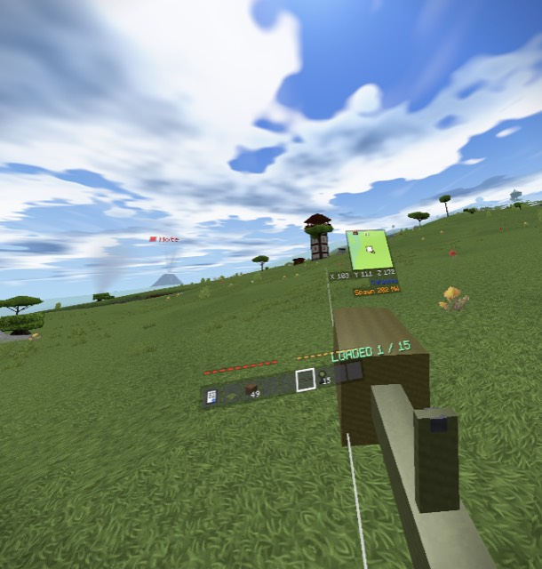

## 08:17:23 - Pretty far, I'd say

- **Transcript:** Pretty far, I'd say
- **Status:** open
- **Build:** 0.129 (39e0d988, M1-M4 (device-tested; ship riding, chests, comfort options, weapon wheel))
- **World:** New World (26) (seed 530054557992772521)
- **Dimension:** Surface
- **Biome:** Plains
- **Position:** 110.5 116.6 203.4
- **Facing:** south-east (yaw 125, pitch 8)
- **Held:** Faustrohr x1
- **Mount:** on foot
- **Looking at:** nothing
- **Mode:** Survival, health 20/20
- **Time:** day 1 10:54, clear
- **Fps:** 71
- **Levels:** mic -29 dBFS, game sound -20 dBFS
- **Length:** 2.1 s (voice 0.6 s)
- **Just before:** -29s message: Survival mode; -29s closed PauseMenu; -29s opened InventoryMenu; -28s closed InventoryMenu; -27s opened PauseMenu; -27s closed PauseMenu; -27s opened InventoryMenu; -26s closed InventoryMenu; -26s opened PauseMenu; -25s message: Creative mode; -25s closed PauseMenu; -25s opened CreativeMenu; -19s into the pack: Faustrohr; -15s into the pack: Faustrohr Warhead; -15s closed CreativeMenu; -15s opened PauseMenu; -14s message: Survival mode; -14s closed PauseMenu; -13s holding Spruce Log; -13s holding empty hand; -13s holding Faustrohr; -12s message: Loaded: 1 / 1; -12s left the pack: Faustrohr Warhead (at 97 109 155); -4s holding empty hand; -3s holding Faustrohr; -3s message: Faustrohr; -3s holding empty hand; -2s holding Faustrohr; -2s message: Loaded: 1 / 1; -2s left the pack: Faustrohr Warhead (at 112 117 203)
- **Repro (Mac):** `./snap.sh note --seed 530054557992772521 --x 110.5 --z 203.4 --yaw -125 --pitch 8 --time 0.205`
- **Audio (this Mac):** /Users/darthvadar/Documents/Blocksmith/QuestVoiceNotes/raw/vn-20261115-081723-726.aac

## 08:17:53 - I don't think the preset trees are in yet

- **Transcript:** I don't think the preset trees are in yet
- **Status:** open
- **Build:** 0.129 (39e0d988, M1-M4 (device-tested; ship riding, chests, comfort options, weapon wheel))
- **World:** New World (26) (seed 530054557992772521)
- **Dimension:** Surface
- **Biome:** Plains
- **Position:** 148.1 111.0 161.5
- **Facing:** north-east (yaw 31, pitch -18)
- **Held:** Faustrohr x1
- **Mount:** on foot
- **Looking at:** Grass Block at 150 110 157
- **Mode:** Survival, health 9/20
- **Time:** day 1 11:30, clear
- **Fps:** 72
- **Levels:** mic -30 dBFS, game sound -14 dBFS
- **Length:** 3.4 s (voice 1.6 s)
- **Just before:** -28s left the pack: Faustrohr Warhead; -25s left the pack: Faustrohr Warhead; -24s left the pack: Faustrohr Warhead; -23s holding empty hand; -22s holding Faustrohr; -21s left the pack: Faustrohr Warhead; -18s took 5 damage (health 15/20); -18s holding empty hand; -17s holding Faustrohr; -17s message: Faustrohr; -17s message: Loaded: 1 / 1; -16s took 5 damage (health 11/20); -16s left the pack: Faustrohr Warhead; -15s left the pack: Faustrohr Warhead (at 131 120 218); -14s took 5 damage (health 6/20)
- **Repro (Mac):** `./snap.sh note --seed 530054557992772521 --x 148.1 --z 161.5 --yaw -31 --pitch -18 --time 0.229`
- **Audio (this Mac):** /Users/darthvadar/Documents/Blocksmith/QuestVoiceNotes/raw/vn-20261115-081753-206.aac

## 08:17:57 - I mean, unless this is a preset bush, like, wow. Like that. Hope not

- **Transcript:** I mean, unless this is a preset bush, like, wow. Like that. Hope not
- **Status:** open
- **Build:** 0.129 (39e0d988, M1-M4 (device-tested; ship riding, chests, comfort options, weapon wheel))
- **World:** New World (26) (seed 530054557992772521)
- **Dimension:** Surface
- **Biome:** Plains
- **Position:** 163.2 110.8 129.5
- **Facing:** north-east (yaw 25, pitch -17)
- **Held:** Faustrohr x1
- **Mount:** on foot
- **Looking at:** Short Grass at 164 111 127
- **Mode:** Survival, health 9/20
- **Time:** day 1 11:35, clear
- **Fps:** 72
- **Levels:** mic -31 dBFS, game sound -24 dBFS
- **Length:** 7.1 s (voice 2.9 s)
- **Just before:** -30s left the pack: Faustrohr Warhead; -28s left the pack: Faustrohr Warhead; -27s holding empty hand; -26s holding Faustrohr; -26s left the pack: Faustrohr Warhead; -22s took 5 damage (health 15/20); -22s holding empty hand; -22s holding Faustrohr; -22s message: Faustrohr; -21s message: Loaded: 1 / 1; -21s took 5 damage (health 11/20); -21s left the pack: Faustrohr Warhead; -19s left the pack: Faustrohr Warhead (at 131 120 218); -18s took 5 damage (health 6/20)
- **Position at the end:** 167.9 110.6 125.0
- **Repro (Mac):** `./snap.sh note --seed 530054557992772521 --x 163.2 --z 129.5 --yaw -25 --pitch -17 --time 0.233`
- **Audio (this Mac):** /Users/darthvadar/Documents/Blocksmith/QuestVoiceNotes/raw/vn-20261115-081757-606.aac

## 08:18:56 - Still volcanoes in the distance

- **Transcript:** Still volcanoes in the distance
- **Status:** open
- **Build:** 0.129 (39e0d988, M1-M4 (device-tested; ship riding, chests, comfort options, weapon wheel))
- **World:** New World (26) (seed 530054557992772521)
- **Dimension:** Surface
- **Biome:** Taiga
- **Position:** 1255.7 199.0 -348.1
- **Facing:** east (yaw 96, pitch -33)
- **Held:** Faustrohr x1
- **Mount:** on foot, flying
- **Looking at:** nothing
- **Mode:** Creative, health 9/20
- **Time:** day 1 12:43, clear
- **Fps:** 71
- **Levels:** mic -41 dBFS, game sound -21 dBFS
- **Length:** 2.6 s (voice 1.1 s)
- **Just before:** -30s message: Flying; -6s message: Entering Ithdor; -0s message: Entering Tamahold
- **Repro (Mac):** `./snap.sh note --seed 530054557992772521 --x 1255.7 --z -348.1 --yaw -96 --pitch -33 --time 0.280`
- **Audio (this Mac):** /Users/darthvadar/Documents/Blocksmith/QuestVoiceNotes/raw/vn-20261115-081856-226.aac

## 08:19:02 - Panzerfaust, I have to say it looks like shit

- **Transcript:** Panzerfaust, I have to say it looks like shit
- **Status:** open
- **Build:** 0.129 (39e0d988, M1-M4 (device-tested; ship riding, chests, comfort options, weapon wheel))
- **World:** New World (26) (seed 530054557992772521)
- **Dimension:** Surface
- **Biome:** Forest
- **Position:** 1889.9 221.2 38.3
- **Facing:** south-west (yaw 220, pitch -48)
- **Held:** Faustrohr x1
- **Mount:** on foot, flying
- **Looking at:** nothing
- **Mode:** Creative, health 9/20
- **Time:** day 1 12:51, clear
- **Fps:** 72
- **Levels:** mic -22 dBFS, game sound -16 dBFS
- **Length:** 4.2 s (voice 2.3 s)
- **Just before:** -13s message: Entering Ithdor; -7s message: Entering Tamahold; -6s walked into Taiga; -4s walked into Forest; -2s walked into Birch Forest; -2s message: Entering Ithdor; -0s walked into Forest
- **Repro (Mac):** `./snap.sh note --seed 530054557992772521 --x 1889.9 --z 38.3 --yaw 140 --pitch -48 --time 0.286`
- **Audio (this Mac):** /Users/darthvadar/Documents/Blocksmith/QuestVoiceNotes/raw/vn-20261115-081902-766.aac

## 08:19:07 - In hand

- **Transcript:** In hand
- **Status:** open
- **Build:** 0.129 (39e0d988, M1-M4 (device-tested; ship riding, chests, comfort options, weapon wheel))
- **World:** New World (26) (seed 530054557992772521)
- **Dimension:** Surface
- **Biome:** Plains
- **Position:** 1965.7 169.5 160.0
- **Facing:** north-east (yaw 55, pitch -53)
- **Held:** Faustrohr x1
- **Mount:** on foot
- **Looking at:** nothing
- **Mode:** Creative, health 9/20
- **Time:** day 1 12:56, clear
- **Fps:** 71
- **Levels:** mic -28 dBFS, game sound -19 dBFS
- **Length:** 1.9 s (voice 0.5 s)
- **Just before:** -18s message: Entering Ithdor; -12s message: Entering Tamahold; -11s walked into Taiga; -9s walked into Forest; -7s walked into Birch Forest; -6s message: Entering Ithdor; -5s walked into Forest; -2s message: Walking; -1s walked into Plains
- **Repro (Mac):** `./snap.sh note --seed 530054557992772521 --x 1965.7 --z 160.0 --yaw -55 --pitch -53 --time 0.290`
- **Audio (this Mac):** /Users/darthvadar/Documents/Blocksmith/QuestVoiceNotes/raw/vn-20261115-081907-326.aac

## 08:19:40 - Let's see what happens when I roll up a tank to this place

- **Transcript:** Let's see what happens when I roll up a tank to this place
- **Status:** open
- **Build:** 0.129 (39e0d988, M1-M4 (device-tested; ship riding, chests, comfort options, weapon wheel))
- **World:** New World (26) (seed 530054557992772521)
- **Dimension:** Surface
- **Biome:** Plains
- **Position:** 2109.5 109.8 276.6
- **Facing:** south-east (yaw 127, pitch 7)
- **Held:** empty hand
- **Mount:** piloting Cinder Tank
- **Looking at:** nothing
- **Mode:** Survival, health 9/20
- **Time:** day 1 13:33, clear
- **Fps:** 70
- **Levels:** mic -34 dBFS, game sound -20 dBFS
- **Length:** 4.4 s (voice 2.3 s)
- **Just before:** -29s opened PauseMenu; -29s closed PauseMenu; -29s opened CreativeMenu; -28s closed CreativeMenu; -28s opened PauseMenu; -27s closed PauseMenu; -27s opened CreativeMenu; -19s opened KeyboardMenu; -15s opened CreativeMenu; -14s closed CreativeMenu; -13s holding Faustrohr Warhead; -13s message: Faustrohr Warhead; -13s holding Faustrohr; -13s message: Faustrohr; -13s holding Cinder Tank Spawn Egg; -13s message: Cinder Tank Spawn Egg; -12s holding Faustrohr; -12s message: Faustrohr; -12s holding Faustrohr Warhead; -12s message: Faustrohr Warhead; -11s holding empty hand; -11s piloting Cinder Tank; -11s message: Steering Cinder Tank; -9s opened PauseMenu; -8s message: Survival mode; -7s closed PauseMenu
- **Repro (Mac):** `./snap.sh note --seed 530054557992772521 --x 2109.5 --z 276.6 --yaw -127 --pitch 7 --time 0.315`
- **Audio (this Mac):** /Users/darthvadar/Documents/Blocksmith/QuestVoiceNotes/raw/vn-20261115-081940-866.aac

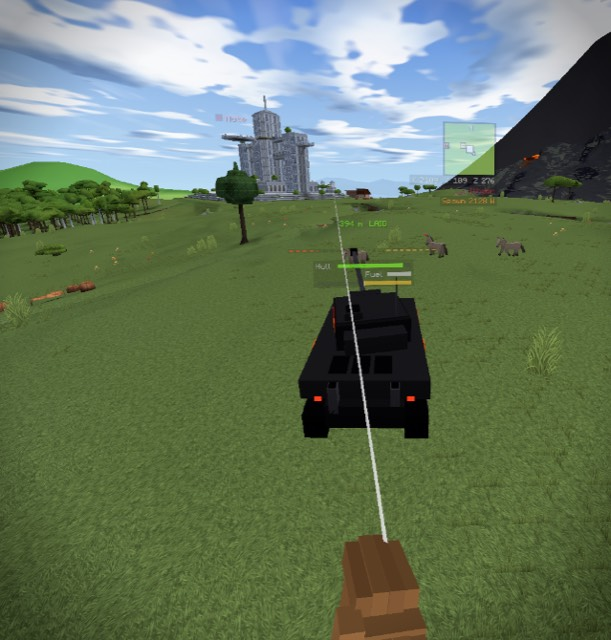

## 08:19:45 - Okay. Also, the, uh, motion sickness part of driving the tank has not 

- **Transcript:** Okay. Also, the, uh, motion sickness part of driving the tank has not been fixed because there are redundant controls to turn the thing
- **Status:** open
- **Build:** 0.129 (39e0d988, M1-M4 (device-tested; ship riding, chests, comfort options, weapon wheel))
- **World:** New World (26) (seed 530054557992772521)
- **Dimension:** Surface
- **Biome:** Plains
- **Position:** 2125.0 110.5 289.3
- **Facing:** south-east (yaw 115, pitch 0)
- **Held:** empty hand
- **Mount:** piloting Cinder Tank
- **Looking at:** nothing
- **Mode:** Survival, health 9/20
- **Time:** day 1 13:38, clear
- **Fps:** 69
- **Levels:** mic -26 dBFS, game sound -16 dBFS
- **Length:** 10.7 s (voice 6.5 s)
- **Just before:** -23s opened KeyboardMenu; -20s opened CreativeMenu; -18s closed CreativeMenu; -18s holding Faustrohr Warhead; -18s message: Faustrohr Warhead; -18s holding Faustrohr; -18s message: Faustrohr; -17s holding Cinder Tank Spawn Egg; -17s message: Cinder Tank Spawn Egg; -16s holding Faustrohr; -16s message: Faustrohr; -16s holding Faustrohr Warhead; -16s message: Faustrohr Warhead; -15s holding empty hand; -15s piloting Cinder Tank; -15s message: Steering Cinder Tank; -14s opened PauseMenu; -12s message: Survival mode; -12s closed PauseMenu
- **Position at the end:** 2170.5 109.5 296.0
- **Repro (Mac):** `./snap.sh note --seed 530054557992772521 --x 2125.0 --z 289.3 --yaw -115 --pitch 0 --time 0.319`
- **Audio (this Mac):** /Users/darthvadar/Documents/Blocksmith/QuestVoiceNotes/raw/vn-20261115-081945-326.aac

## 08:19:55 - making it unpredictable which way it will turn.

- **Transcript:** making it unpredictable which way it will turn.
- **Status:** open
- **Build:** 0.129 (39e0d988, M1-M4 (device-tested; ship riding, chests, comfort options, weapon wheel))
- **World:** New World (26) (seed 530054557992772521)
- **Dimension:** Surface
- **Biome:** Plains
- **Position:** 2173.1 109.3 296.3
- **Facing:** south-east (yaw 132, pitch 51)
- **Held:** empty hand
- **Mount:** piloting Cinder Tank
- **Looking at:** nothing
- **Mode:** Survival, health 9/20
- **Time:** day 1 13:51, clear
- **Fps:** 67
- **Levels:** mic -28 dBFS, game sound -18 dBFS
- **Length:** 3.4 s (voice 1.4 s)
- **Just before:** -29s closed CreativeMenu; -28s holding Faustrohr Warhead; -28s message: Faustrohr Warhead; -28s holding Faustrohr; -28s message: Faustrohr; -28s holding Cinder Tank Spawn Egg; -28s message: Cinder Tank Spawn Egg; -27s holding Faustrohr; -27s message: Faustrohr; -27s holding Faustrohr Warhead; -27s message: Faustrohr Warhead; -26s holding empty hand; -26s piloting Cinder Tank; -26s message: Steering Cinder Tank; -24s opened PauseMenu; -23s message: Survival mode; -22s closed PauseMenu
- **Repro (Mac):** `./snap.sh note --seed 530054557992772521 --x 2173.1 --z 296.3 --yaw -132 --pitch 51 --time 0.328`
- **Audio (this Mac):** /Users/darthvadar/Documents/Blocksmith/QuestVoiceNotes/raw/vn-20261115-081955-906.aac

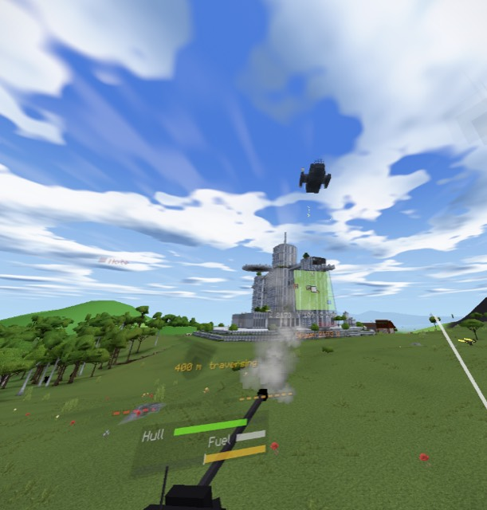

## 08:20:29 - For some reason, the machine gun only fires in bursts

- **Transcript:** For some reason, the machine gun only fires in bursts
- **Status:** open
- **Build:** 0.129 (39e0d988, M1-M4 (device-tested; ship riding, chests, comfort options, weapon wheel))
- **World:** New World (26) (seed 530054557992772521)
- **Dimension:** Surface
- **Biome:** Plains
- **Position:** 2205.5 109.7 316.5
- **Facing:** south-east (yaw 130, pitch 27)
- **Held:** empty hand
- **Mount:** piloting Cinder Tank
- **Looking at:** nothing
- **Mode:** Survival, health 9/20
- **Time:** day 1 14:31, clear
- **Fps:** 69
- **Levels:** mic -26 dBFS, game sound -12 dBFS
- **Length:** 3.6 s (voice 2.0 s)
- **Just before:** -7s message: The turret is wrecked; -0s message: The Capital Dropship's crew has spotted you!
- **Repro (Mac):** `./snap.sh note --seed 530054557992772521 --x 2205.5 --z 316.5 --yaw -130 --pitch 27 --time 0.355`
- **Audio (this Mac):** /Users/darthvadar/Documents/Blocksmith/QuestVoiceNotes/raw/vn-20261115-082029-186.aac

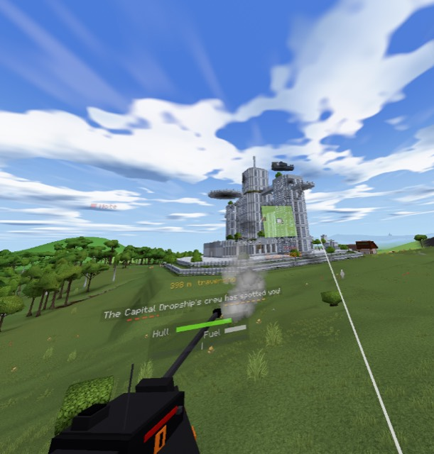

## 08:20:39 - Oh, very good. Okay, I like how the parts showed up afterwards. That's

- **Transcript:** Oh, very good. Okay, I like how the parts showed up afterwards. That's good
- **Status:** open
- **Build:** 0.129 (39e0d988, M1-M4 (device-tested; ship riding, chests, comfort options, weapon wheel))
- **World:** New World (26) (seed 530054557992772521)
- **Dimension:** Surface
- **Biome:** Plains
- **Position:** 2219.0 107.2 325.3
- **Facing:** south-west (yaw 218, pitch -28)
- **Held:** empty hand
- **Mount:** on foot
- **Looking at:** Short Grass at 2218 107 326
- **Mode:** Creative, health 9/20
- **Time:** day 1 14:42, clear
- **Fps:** 63
- **Levels:** mic -22 dBFS, game sound -17 dBFS
- **Length:** 5.1 s (voice 2.6 s)
- **Just before:** -17s message: The turret is wrecked; -11s message: The Capital Dropship's crew has spotted you!; -4s stopped piloting Cinder Tank; -4s message: Missile launch: take cover!; -2s opened PauseMenu; -1s message: Creative mode; -1s closed PauseMenu
- **Repro (Mac):** `./snap.sh note --seed 530054557992772521 --x 2219.0 --z 325.3 --yaw 142 --pitch -28 --time 0.363`
- **Audio (this Mac):** /Users/darthvadar/Documents/Blocksmith/QuestVoiceNotes/raw/vn-20261115-082039-527.aac

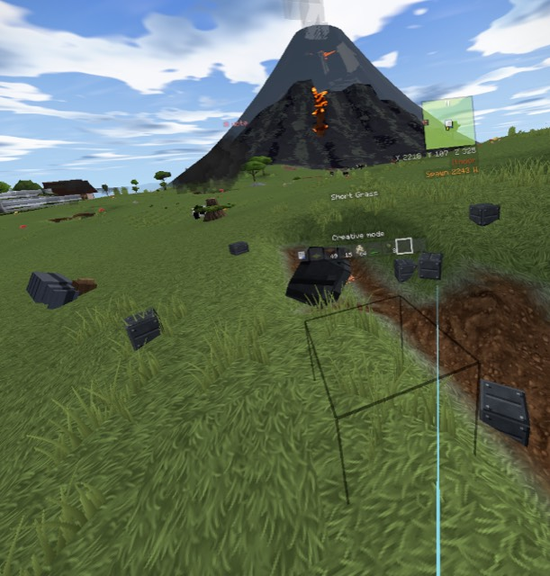

## 08:20:46 - Yeah, they got me good there. Wow

- **Transcript:** Yeah, they got me good there. Wow
- **Status:** open
- **Build:** 0.129 (39e0d988, M1-M4 (device-tested; ship riding, chests, comfort options, weapon wheel))
- **World:** New World (26) (seed 530054557992772521)
- **Dimension:** Surface
- **Biome:** Plains
- **Position:** 2240.4 137.7 406.2
- **Facing:** north (yaw 12, pitch -23)
- **Held:** empty hand
- **Mount:** on foot, flying
- **Looking at:** nothing
- **Mode:** Creative, health 9/20
- **Time:** day 1 14:51, clear
- **Fps:** 65
- **Levels:** mic -30 dBFS, game sound -17 dBFS
- **Length:** 3.2 s (voice 1.5 s)
- **Just before:** -25s message: The turret is wrecked; -18s message: The Capital Dropship's crew has spotted you!; -11s stopped piloting Cinder Tank; -11s message: Missile launch: take cover!; -9s opened PauseMenu; -8s message: Creative mode; -8s closed PauseMenu; -4s message: Flying; -2s message: Capital citadel (the enemy) marked on the map
- **Repro (Mac):** `./snap.sh note --seed 530054557992772521 --x 2240.4 --z 406.2 --yaw -12 --pitch -23 --time 0.369`
- **Audio (this Mac):** /Users/darthvadar/Documents/Blocksmith/QuestVoiceNotes/raw/vn-20261115-082046-846.aac

## 08:20:49 - That was great

- **Transcript:** That was great
- **Status:** open
- **Build:** 0.129 (39e0d988, M1-M4 (device-tested; ship riding, chests, comfort options, weapon wheel))
- **World:** New World (26) (seed 530054557992772521)
- **Dimension:** Surface
- **Biome:** Plains
- **Position:** 2296.0 144.3 448.8
- **Facing:** north (yaw 22, pitch 59)
- **Held:** empty hand
- **Mount:** on foot, flying
- **Looking at:** nothing
- **Mode:** Creative, health 9/20
- **Time:** day 1 14:54, clear
- **Fps:** 65
- **Levels:** mic -42 dBFS, game sound -15 dBFS
- **Length:** 1.7 s (voice 0.4 s)
- **Just before:** -28s message: The turret is wrecked; -21s message: The Capital Dropship's crew has spotted you!; -14s stopped piloting Cinder Tank; -14s message: Missile launch: take cover!; -13s opened PauseMenu; -11s message: Creative mode; -11s closed PauseMenu; -7s message: Flying; -5s message: Capital citadel (the enemy) marked on the map
- **Repro (Mac):** `./snap.sh note --seed 530054557992772521 --x 2296.0 --z 448.8 --yaw -22 --pitch 59 --time 0.371`
- **Audio (this Mac):** /Users/darthvadar/Documents/Blocksmith/QuestVoiceNotes/raw/vn-20261115-082049-866.aac

## 08:22:13 - Why isn't this thing firing?

- **Transcript:** Why isn't this thing firing?
- **Status:** open
- **Build:** 0.129 (39e0d988, M1-M4 (device-tested; ship riding, chests, comfort options, weapon wheel))
- **World:** New World (26) (seed 530054557992772521)
- **Dimension:** Surface
- **Biome:** Birch Forest
- **Position:** 2835.6 73.0 -291.5
- **Facing:** north-west (yaw 335, pitch -4)
- **Held:** Slate Repeater x1
- **Mount:** on foot
- **Looking at:** nothing
- **Mode:** Survival, health 10/20
- **Time:** day 1 16:30, clear
- **Fps:** 70
- **Levels:** mic -34 dBFS, game sound -18 dBFS
- **Length:** 2.3 s (voice 0.8 s)
- **Just before:** -30s holding Slate Repeater; -30s message: Slate Repeater; -29s message: Loaded: 90 / 90; -29s left the pack: Slate Magazine x4 (at 2826 75 -282); -26s message: The guards watch your hands. Put that away; -24s message: Honour raised (you protected the town); -21s message: The garrison opens fire!; -17s into the pack: Regular Armour Set; -13s message: Honour raised (you protected the town); -5s message: Entering Maroria; -4s walked into Birch Forest; -4s left the pack: Slate Magazine x2 (at 2831 74 -297); -4s message: Loaded: 90 / 90; -2s took 6 damage (health 14/20)
- **Repro (Mac):** `./snap.sh note --seed 530054557992772521 --x 2835.6 --z -291.5 --yaw 25 --pitch -4 --time 0.438`
- **Audio (this Mac):** /Users/darthvadar/Documents/Blocksmith/QuestVoiceNotes/raw/vn-20261115-082213-266.aac

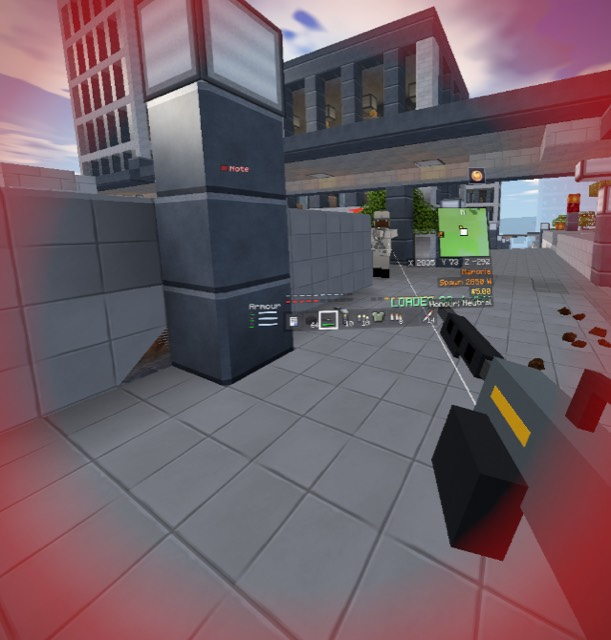

## 08:22:17 - Oh, it wasn't. Hold on. Let's see. I don't know why it wasn't firing

- **Transcript:** Oh, it wasn't. Hold on. Let's see. I don't know why it wasn't firing
- **Status:** open
- **Build:** 0.129 (39e0d988, M1-M4 (device-tested; ship riding, chests, comfort options, weapon wheel))
- **World:** New World (26) (seed 530054557992772521)
- **Dimension:** Surface
- **Biome:** Birch Forest
- **Position:** 2838.9 77.6 -313.8
- **Facing:** north (yaw 354, pitch -9)
- **Held:** Slate Repeater x1
- **Mount:** on foot, flying
- **Looking at:** nothing
- **Mode:** Creative, health 6/20
- **Time:** day 1 16:34, clear
- **Fps:** 72
- **Levels:** mic -26 dBFS, game sound -26 dBFS
- **Length:** 5.5 s (voice 2.4 s)
- **Just before:** -28s message: Honour raised (you protected the town); -26s message: The garrison opens fire!; -21s into the pack: Regular Armour Set; -17s message: Honour raised (you protected the town); -10s message: Entering Maroria; -8s walked into Birch Forest; -8s left the pack: Slate Magazine x2 (at 2831 74 -297); -8s message: Loaded: 90 / 90; -7s took 6 damage (health 14/20); -4s message: Entering Ithdor; -3s opened PauseMenu; -3s took 8 damage (health 6/20); -2s message: Creative mode; -2s closed PauseMenu; -0s message: Flying
- **Repro (Mac):** `./snap.sh note --seed 530054557992772521 --x 2838.9 --z -313.8 --yaw 6 --pitch -9 --time 0.440`
- **Audio (this Mac):** /Users/darthvadar/Documents/Blocksmith/QuestVoiceNotes/raw/vn-20261115-082217-686.aac

## 08:23:09 - Should have elevators in these buildings incorporated from the

- **Transcript:** Should have elevators in these buildings incorporated from the
- **Status:** open
- **Build:** 0.129 (39e0d988, M1-M4 (device-tested; ship riding, chests, comfort options, weapon wheel))
- **World:** New World (26) (seed 530054557992772521)
- **Dimension:** Surface
- **Biome:** Taiga
- **Position:** 2859.0 69.5 -412.6
- **Facing:** west (yaw 278, pitch -36)
- **Held:** Slate Repeater x1
- **Mount:** on foot
- **Looking at:** Capital Steel at 2856 69 -413
- **Mode:** Survival, health 9/20
- **Time:** day 1 17:28, clear
- **Fps:** 66
- **Levels:** mic -24 dBFS, game sound -23 dBFS
- **Length:** 3.8 s (voice 2.0 s)
- **Just before:** -29s left the pack: Field Stim x2 (at 2851 90 -410); -29s opened PauseMenu; -28s message: Creative mode; -28s closed PauseMenu; -21s opened PauseMenu; -20s message: Survival mode; -20s closed PauseMenu; -19s holding Greywall Dispatch; -19s holding Polished Onyxstone; -19s holding Slate Repeater; -17s message: Honour raised (you protected the town); -16s walked into Swamp; -13s message: Mabel Merriweather: Are you mad? Stop!; -12s took 2 damage (health 18/20); -10s walked into Taiga; -10s took 3 damage (health 15/20); -10s message: Loaded: 90 / 90; -10s left the pack: Slate Magazine x3 (at 2856 67 -412); -7s into the pack: Spec Ops Armour Set; -7s into the pack: Donnerkeil Service Rifle; -5s took 2 damage (health 13/20); -3s left the pack: Slate Magazine x2 (at 2856 67 -412)
- **Repro (Mac):** `./snap.sh note --seed 530054557992772521 --x 2859.0 --z -412.6 --yaw 82 --pitch -36 --time 0.478`
- **Audio (this Mac):** /Users/darthvadar/Documents/Blocksmith/QuestVoiceNotes/raw/vn-20261115-082309-946.aac

## 08:23:14 - Capital, synonym

- **Transcript:** Capital, synonym
- **Status:** open
- **Build:** 0.129 (39e0d988, M1-M4 (device-tested; ship riding, chests, comfort options, weapon wheel))
- **World:** New World (26) (seed 530054557992772521)
- **Dimension:** Surface
- **Biome:** Taiga
- **Position:** 2859.6 70.0 -413.4
- **Facing:** west (yaw 253, pitch -58)
- **Held:** Regular Armour Set x1
- **Mount:** on foot
- **Looking at:** Capital Steel at 2858 70 -414
- **Mode:** Survival, health 6/20
- **Time:** day 1 17:33, clear
- **Fps:** 70
- **Levels:** mic -34 dBFS, game sound -21 dBFS
- **Length:** 2.6 s (voice 0.9 s)
- **Just before:** -25s opened PauseMenu; -24s message: Survival mode; -24s closed PauseMenu; -23s holding Greywall Dispatch; -23s holding Polished Onyxstone; -23s holding Slate Repeater; -21s message: Honour raised (you protected the town); -21s walked into Swamp; -17s message: Mabel Merriweather: Are you mad? Stop!; -16s took 2 damage (health 18/20); -15s walked into Taiga; -14s took 3 damage (health 15/20); -14s message: Loaded: 90 / 90; -14s left the pack: Slate Magazine x3 (at 2856 67 -412); -11s into the pack: Spec Ops Armour Set; -11s into the pack: Donnerkeil Service Rifle; -9s took 2 damage (health 13/20); -7s left the pack: Slate Magazine x2 (at 2856 67 -412); -4s took 4 damage (health 9/20); -1s took 3 damage (health 6/20); -1s holding Slate Magazine; -1s message: Slate Magazine; -0s holding Slate Rounds; -0s message: Slate Rounds; -0s holding Regular Armour Set; -0s message: Regular Armour Set
- **Repro (Mac):** `./snap.sh note --seed 530054557992772521 --x 2859.6 --z -413.4 --yaw 107 --pitch -58 --time 0.482`
- **Audio (this Mac):** /Users/darthvadar/Documents/Blocksmith/QuestVoiceNotes/raw/vn-20261115-082314-046.aac

## 08:23:36 - Let's, uh, increase the amount of civilians in here to like

- **Transcript:** Let's, uh, increase the amount of civilians in here to like
- **Status:** open
- **Build:** 0.129 (39e0d988, M1-M4 (device-tested; ship riding, chests, comfort options, weapon wheel))
- **World:** New World (26) (seed 530054557992772521)
- **Dimension:** Surface
- **Biome:** Taiga
- **Position:** 2820.3 66.0 -437.0
- **Facing:** west (yaw 286, pitch -18)
- **Held:** Slate Repeater x1
- **Mount:** on foot
- **Looking at:** Capital Paving at 2815 65 -439
- **Mode:** Survival, health 13/20
- **Time:** day 1 18:00, clear
- **Fps:** 72
- **Levels:** mic -24 dBFS, game sound -14 dBFS
- **Length:** 3.7 s (voice 2.2 s)
- **Just before:** -29s left the pack: Slate Magazine x2 (at 2856 67 -412); -26s took 4 damage (health 9/20); -24s took 3 damage (health 6/20); -23s holding Slate Magazine; -23s message: Slate Magazine; -22s holding Slate Rounds; -22s message: Slate Rounds; -22s holding Regular Armour Set; -22s message: Regular Armour Set; -22s holding Capital Rounds; -22s message: Capital Rounds; -22s holding Spec Ops Armour Set; -22s message: Spec Ops Armour Set; -21s holding Field Stim; -21s message: Field Stim; -21s left the pack: Field Stim (at 2858 70 -414); -21s left the pack: Field Stim (at 2858 70 -414); -21s holding Greywall Dispatch; -21s message: Greywall Dispatch; -20s holding Polished Onyxstone; -20s message: Polished Onyxstone; -20s holding Slate Repeater; -20s message: Slate Repeater; -20s message: Loaded: 90 / 90; -17s into the pack: Regular Armour Set; -16s walked into Swamp; -16s into the pack: Donnerkeil Service Rifle; -11s took 1 damage (health 19/20); -8s walked into Old Growth Pine Taiga; -6s walked into Swamp; -4s walked into Taiga; -2s walked into Old Growth Pine Taiga; -1s took 6 damage (health 13/20); -0s left the pack: Slate Magazine x2 (at 2813 65 -435); -0s walked into Taiga
- **Repro (Mac):** `./snap.sh note --seed 530054557992772521 --x 2820.3 --z -437.0 --yaw 74 --pitch -18 --time 0.500`
- **Audio (this Mac):** /Users/darthvadar/Documents/Blocksmith/QuestVoiceNotes/raw/vn-20261115-082336-066.aac

## 08:23:40 - Maybe like 300 civilians. Well, this place makes a little more sense

- **Transcript:** Maybe like 300 civilians. Well, this place makes a little more sense
- **Status:** open
- **Build:** 0.129 (39e0d988, M1-M4 (device-tested; ship riding, chests, comfort options, weapon wheel))
- **World:** New World (26) (seed 530054557992772521)
- **Dimension:** Surface
- **Biome:** Forest
- **Position:** 2803.3 66.5 -452.0
- **Facing:** west (yaw 270, pitch 0)
- **Held:** Slate Repeater x1
- **Mount:** on foot
- **Looking at:** nothing
- **Mode:** Survival, health 13/20
- **Time:** day 1 18:05, clear
- **Fps:** 72
- **Levels:** mic -28 dBFS, game sound -18 dBFS
- **Length:** 5.1 s (voice 2.6 s)
- **Just before:** -30s took 4 damage (health 9/20); -28s took 3 damage (health 6/20); -27s holding Slate Magazine; -27s message: Slate Magazine; -27s holding Slate Rounds; -27s message: Slate Rounds; -26s holding Regular Armour Set; -26s message: Regular Armour Set; -26s holding Capital Rounds; -26s message: Capital Rounds; -26s holding Spec Ops Armour Set; -26s message: Spec Ops Armour Set; -26s holding Field Stim; -26s message: Field Stim; -25s left the pack: Field Stim (at 2858 70 -414); -25s left the pack: Field Stim (at 2858 70 -414); -25s holding Greywall Dispatch; -25s message: Greywall Dispatch; -25s holding Polished Onyxstone; -25s message: Polished Onyxstone; -24s holding Slate Repeater; -24s message: Slate Repeater; -24s message: Loaded: 90 / 90; -21s into the pack: Regular Armour Set; -21s walked into Swamp; -20s into the pack: Donnerkeil Service Rifle; -15s took 1 damage (health 19/20); -13s walked into Old Growth Pine Taiga; -11s walked into Swamp; -9s walked into Taiga; -7s walked into Old Growth Pine Taiga; -6s took 6 damage (health 13/20); -5s left the pack: Slate Magazine x2 (at 2813 65 -435); -5s walked into Taiga; -1s walked into Dark Forest
- **Repro (Mac):** `./snap.sh note --seed 530054557992772521 --x 2803.3 --z -452.0 --yaw 90 --pitch 0 --time 0.504`
- **Audio (this Mac):** /Users/darthvadar/Documents/Blocksmith/QuestVoiceNotes/raw/vn-20261115-082340-286.aac

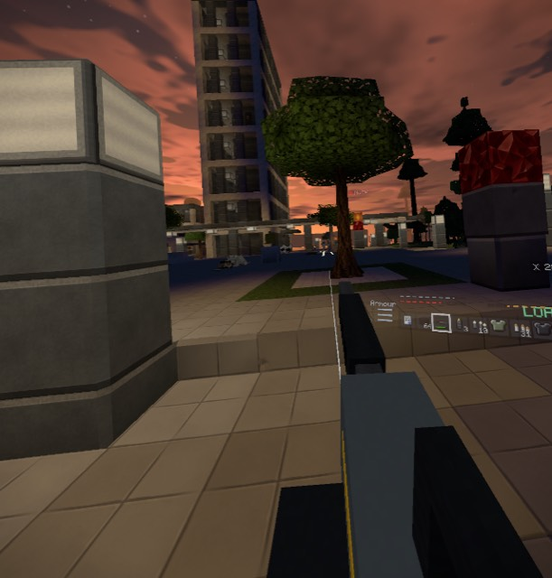

## 08:24:18 - Go to slate rounds. Goddamn

- **Transcript:** Go to slate rounds. Goddamn
- **Status:** open
- **Build:** 0.129 (39e0d988, M1-M4 (device-tested; ship riding, chests, comfort options, weapon wheel))
- **World:** New World (26) (seed 530054557992772521)
- **Dimension:** Surface
- **Biome:** Birch Forest
- **Position:** 2716.2 66.0 -415.7
- **Facing:** south-west (yaw 203, pitch -48)
- **Held:** Slate Repeater x1
- **Mount:** on foot
- **Looking at:** Capital Curtain Glass at 2715 66 -415
- **Mode:** Survival, health 8/20
- **Time:** day 1 18:50, clear
- **Fps:** 72
- **Levels:** mic -53 dBFS, game sound -21 dBFS
- **Length:** 2.6 s (voice 0.6 s)
- **Just before:** -30s left the pack: Slate Magazine x2 (at 2776 67 -456); -25s took 5 damage (health 8/20); -24s walked into Dark Forest; -23s holding Polished Onyxstone; -23s message: Polished Onyxstone; -23s holding Greywall Dispatch; -23s message: Greywall Dispatch; -23s holding Field Stim; -23s message: Field Stim; -22s left the pack: Field Stim; -22s holding Greywall Dispatch; -22s message: Greywall Dispatch; -22s holding Polished Onyxstone; -22s message: Polished Onyxstone; -21s took 3 damage (health 12/20); -21s holding Slate Repeater; -21s message: Slate Repeater; -20s walked into Forest; -16s walked into Dark Forest; -14s walked into Forest; -12s walked into Birch Forest; -10s took 2 damage (health 16/20); -9s message: Loaded: 28 / 90; -9s left the pack: Slate Magazine (at 2723 65 -422); -8s took 1 damage (health 15/20); -6s walked into Forest; -6s took 3 damage (health 12/20); -4s walked into Birch Forest; -2s took 2 damage (health 10/20); -2s message: No Slate Rounds; -2s holding Polished Onyxstone; -1s holding Slate Repeater
- **Repro (Mac):** `./snap.sh note --seed 530054557992772521 --x 2716.2 --z -415.7 --yaw 157 --pitch -48 --time 0.535`
- **Audio (this Mac):** /Users/darthvadar/Documents/Blocksmith/QuestVoiceNotes/raw/vn-20261115-082418-106.aac

## 08:26:02 - I don't know, the city fight feels a little too stale

- **Transcript:** I don't know, the city fight feels a little too stale
- **Status:** open
- **Build:** 0.129 (39e0d988, M1-M4 (device-tested; ship riding, chests, comfort options, weapon wheel))
- **World:** New World (26) (seed 530054557992772521)
- **Dimension:** Surface
- **Biome:** Forest
- **Position:** 20.5 95.3 -71.2
- **Facing:** north-west (yaw 322, pitch -38)
- **Held:** empty hand
- **Mount:** on foot, flying
- **Looking at:** nothing
- **Mode:** Creative, health 20/20
- **Time:** day 1 20:52, clear
- **Fps:** 71
- **Levels:** mic -26 dBFS, game sound -19 dBFS
- **Length:** 3.6 s (voice 1.9 s)
- **Just before:** -25s left the pack: Field Stim (at 2704 67 -318); -25s holding Greywall Dispatch; -25s message: Greywall Dispatch; -25s holding Polished Onyxstone; -25s message: Polished Onyxstone; -25s holding Donnerkeil Service Rifle; -25s message: Donnerkeil Service Rifle; -24s message: Loaded: 12 / 45; -22s message: No Capital Rounds; -20s into the pack: Brecher Shotgun; -20s into the pack: Regular Armour Set; -17s took 1 damage (health 19/20); -14s took 5 damage (health 14/20); -14s holding Regular Armour Set; -14s message: Regular Armour Set; -13s holding Brecher Shotgun; -13s message: Brecher Shotgun; -13s took 3 damage (health 11/20); -9s died; -9s opened DeathMenu; -9s holding empty hand; -9s left the pack: Greywall Dispatch (DeathMenu open); -9s left the pack: Brecher Shotgun (DeathMenu open); -9s left the pack: Duskium Leggings (DeathMenu open); -9s left the pack: Spec Ops Armour Set (DeathMenu open); -9s left the pack: Field Stim x4 (DeathMenu open); -9s left the pack: Slate Repeater (DeathMenu open); -9s left the pack: Regular Armour Set x4 (DeathMenu open); -9s left the pack: Donnerkeil Service Rifle x2 (DeathMenu open); -9s respawned; -9s closed DeathMenu; -9s message: Your things are 2748 blocks east; -8s took 12 damage (health 20/20); -8s walked into Forest; -6s message: Entering Branisesh; -5s opened PauseMenu; -4s took 1 damage (health 20/20); -3s message: Creative mode; -3s closed PauseMenu; -2s message: Flying
- **Repro (Mac):** `./snap.sh note --seed 530054557992772521 --x 20.5 --z -71.2 --yaw 38 --pitch -38 --time 0.620`
- **Audio (this Mac):** /Users/darthvadar/Documents/Blocksmith/QuestVoiceNotes/raw/vn-20261115-082602-406.aac

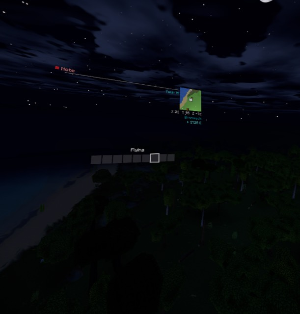

## 08:26:08 - Maybe add a, uh, I don't know. I can't be adding anything

- **Transcript:** Maybe add a, uh, I don't know. I can't be adding anything
- **Status:** open
- **Build:** 0.129 (39e0d988, M1-M4 (device-tested; ship riding, chests, comfort options, weapon wheel))
- **World:** New World (26) (seed 530054557992772521)
- **Dimension:** Surface
- **Biome:** Forest
- **Position:** 361.4 97.1 -273.0
- **Facing:** north-west (yaw 319, pitch -46)
- **Held:** empty hand
- **Mount:** on foot, flying
- **Looking at:** nothing
- **Mode:** Creative, health 20/20
- **Time:** day 1 20:59, clear
- **Fps:** 72
- **Levels:** mic -33 dBFS, game sound -24 dBFS
- **Length:** 5.9 s (voice 2.8 s)
- **Just before:** -30s message: Loaded: 12 / 45; -28s message: No Capital Rounds; -26s into the pack: Brecher Shotgun; -26s into the pack: Regular Armour Set; -22s took 1 damage (health 19/20); -20s took 5 damage (health 14/20); -20s holding Regular Armour Set; -20s message: Regular Armour Set; -19s holding Brecher Shotgun; -19s message: Brecher Shotgun; -19s took 3 damage (health 11/20); -15s died; -15s opened DeathMenu; -15s holding empty hand; -15s left the pack: Greywall Dispatch (DeathMenu open); -15s left the pack: Brecher Shotgun (DeathMenu open); -15s left the pack: Duskium Leggings (DeathMenu open); -15s left the pack: Spec Ops Armour Set (DeathMenu open); -15s left the pack: Field Stim x4 (DeathMenu open); -15s left the pack: Slate Repeater (DeathMenu open); -15s left the pack: Regular Armour Set x4 (DeathMenu open); -15s left the pack: Donnerkeil Service Rifle x2 (DeathMenu open); -14s respawned; -14s closed DeathMenu; -14s message: Your things are 2748 blocks east; -14s took 12 damage (health 20/20); -14s walked into Forest; -12s message: Entering Branisesh; -11s opened PauseMenu; -10s took 1 damage (health 20/20); -9s message: Creative mode; -8s closed PauseMenu; -7s message: Flying
- **While talking:** -1s walked into Plains
- **Position at the end:** 374.2 97.1 -35.8
- **Repro (Mac):** `./snap.sh note --seed 530054557992772521 --x 361.4 --z -273.0 --yaw 41 --pitch -46 --time 0.625`
- **Audio (this Mac):** /Users/darthvadar/Documents/Blocksmith/QuestVoiceNotes/raw/vn-20261115-082608-286.aac

## 08:26:14 - [clears throat] Never mind

- **Transcript:** [clears throat] Never mind
- **Status:** open
- **Build:** 0.129 (39e0d988, M1-M4 (device-tested; ship riding, chests, comfort options, weapon wheel))
- **World:** New World (26) (seed 530054557992772521)
- **Dimension:** Surface
- **Biome:** Plains
- **Position:** 435.8 97.1 37.2
- **Facing:** south-east (yaw 139, pitch -30)
- **Held:** empty hand
- **Mount:** on foot, flying
- **Looking at:** nothing
- **Mode:** Creative, health 20/20
- **Time:** day 1 21:07, clear
- **Fps:** 72
- **Levels:** mic -23 dBFS, game sound -18 dBFS
- **Length:** 2.4 s (voice 0.9 s)
- **Just before:** -29s took 1 damage (health 19/20); -26s took 5 damage (health 14/20); -26s holding Regular Armour Set; -26s message: Regular Armour Set; -25s holding Brecher Shotgun; -25s message: Brecher Shotgun; -25s took 3 damage (health 11/20); -22s died; -22s opened DeathMenu; -22s holding empty hand; -21s left the pack: Greywall Dispatch (DeathMenu open); -21s left the pack: Brecher Shotgun (DeathMenu open); -21s left the pack: Duskium Leggings (DeathMenu open); -21s left the pack: Spec Ops Armour Set (DeathMenu open); -21s left the pack: Field Stim x4 (DeathMenu open); -21s left the pack: Slate Repeater (DeathMenu open); -21s left the pack: Regular Armour Set x4 (DeathMenu open); -21s left the pack: Donnerkeil Service Rifle x2 (DeathMenu open); -21s respawned; -21s closed DeathMenu; -21s message: Your things are 2748 blocks east; -21s took 12 damage (health 20/20); -20s walked into Forest; -19s message: Entering Branisesh; -17s opened PauseMenu; -16s took 1 damage (health 20/20); -15s message: Creative mode; -15s closed PauseMenu; -14s message: Flying; -2s walked into Plains; -1s message: Entering Calaonia
- **Repro (Mac):** `./snap.sh note --seed 530054557992772521 --x 435.8 --z 37.2 --yaw -139 --pitch -30 --time 0.630`
- **Audio (this Mac):** /Users/darthvadar/Documents/Blocksmith/QuestVoiceNotes/raw/vn-20261115-082614-586.aac

## 08:27:18 - Who's that bad boy anyway?

- **Transcript:** Who's that bad boy anyway?
- **Status:** open
- **Build:** 0.129 (39e0d988, M1-M4 (device-tested; ship riding, chests, comfort options, weapon wheel))
- **World:** New World (26) (seed 530054557992772521)
- **Dimension:** Surface
- **Biome:** Forest
- **Position:** -6457.0 116.6 8898.3
- **Facing:** west (yaw 267, pitch -59)
- **Held:** empty hand
- **Mount:** on foot, flying
- **Looking at:** nothing
- **Mode:** Creative, health 20/20
- **Time:** day 1 22:18, clear
- **Fps:** 66
- **Levels:** mic -35 dBFS, game sound -20 dBFS
- **Length:** 2.8 s (voice 1.3 s)
- **Just before:** -30s walked into Jungle; -28s message: Entering Lorareach; -28s walked into Ocean; -26s walked into Deep Lukewarm Ocean; -25s message: Entering Harodor; -24s walked into Frozen Ocean; -23s message: Entering Wenmere; -22s walked into Snowy Plains; -21s message: Entering Savagard; -20s walked into Ocean; -18s message: Siege Carriage patrol marked on the map; -18s walked into Forest; -16s message: Walking; -14s message: Flying; -12s opened PauseMenu; -11s closed PauseMenu
- **Repro (Mac):** `./snap.sh note --seed 530054557992772521 --x -6457.0 --z 8898.3 --yaw 93 --pitch -59 --time 0.680`
- **Audio (this Mac):** /Users/darthvadar/Documents/Blocksmith/QuestVoiceNotes/raw/vn-20261115-082718-406.aac

## 08:27:22 - See, yeah, here it is

- **Transcript:** See, yeah, here it is
- **Status:** open
- **Build:** 0.129 (39e0d988, M1-M4 (device-tested; ship riding, chests, comfort options, weapon wheel))
- **World:** New World (26) (seed 530054557992772521)
- **Dimension:** Surface
- **Biome:** Forest
- **Position:** -6521.7 116.6 8907.3
- **Facing:** south-west (yaw 245, pitch -61)
- **Held:** empty hand
- **Mount:** on foot, flying
- **Looking at:** nothing
- **Mode:** Creative, health 20/20
- **Time:** day 1 22:24, clear
- **Fps:** 66
- **Levels:** mic -33 dBFS, game sound -25 dBFS
- **Length:** 1.8 s (voice 0.4 s)
- **Just before:** -30s message: Entering Harodor; -28s walked into Frozen Ocean; -28s message: Entering Wenmere; -26s walked into Snowy Plains; -26s message: Entering Savagard; -24s walked into Ocean; -23s message: Siege Carriage patrol marked on the map; -22s walked into Forest; -20s message: Walking; -19s message: Flying; -17s opened PauseMenu; -16s closed PauseMenu
- **Repro (Mac):** `./snap.sh note --seed 530054557992772521 --x -6521.7 --z 8907.3 --yaw 115 --pitch -61 --time 0.683`
- **Audio (this Mac):** /Users/darthvadar/Documents/Blocksmith/QuestVoiceNotes/raw/vn-20261115-082722-886.aac

## 08:27:40 - Uh, siege carriage is stuck, so

- **Transcript:** Uh, siege carriage is stuck, so
- **Status:** open
- **Build:** 0.129 (39e0d988, M1-M4 (device-tested; ship riding, chests, comfort options, weapon wheel))
- **World:** New World (26) (seed 530054557992772521)
- **Dimension:** Surface
- **Biome:** Forest
- **Position:** -6532.2 81.9 8952.4
- **Facing:** south-west (yaw 235, pitch -41)
- **Held:** empty hand
- **Mount:** piloting Ironstride Siege Carriage
- **Looking at:** nothing
- **Mode:** Creative, health 20/20
- **Time:** day 1 22:44, clear
- **Fps:** 35
- **Levels:** mic -28 dBFS, game sound -18 dBFS
- **Length:** 4.5 s (voice 2.2 s)
- **Just before:** -16s message: Walking; -9s opened ChestMenu; -5s closed ChestMenu; -4s into the pack: Combat Stim; -4s into the pack: Titanium Chestplate; -3s piloting Ironstride Siege Carriage; -3s message: Steering Ironstride Siege Carriage
- **Repro (Mac):** `./snap.sh note --seed 530054557992772521 --x -6532.2 --z 8952.4 --yaw 125 --pitch -41 --time 0.698`
- **Audio (this Mac):** /Users/darthvadar/Documents/Blocksmith/QuestVoiceNotes/raw/vn-20261115-082740-026.aac

## 08:27:44 - Should probably... Or hold on. Is it? Hmm

- **Transcript:** Should probably... Or hold on. Is it? Hmm
- **Status:** open
- **Build:** 0.129 (39e0d988, M1-M4 (device-tested; ship riding, chests, comfort options, weapon wheel))
- **World:** New World (26) (seed 530054557992772521)
- **Dimension:** Surface
- **Biome:** Forest
- **Position:** -6532.2 81.9 8952.5
- **Facing:** west (yaw 257, pitch -54)
- **Held:** empty hand
- **Mount:** piloting Ironstride Siege Carriage
- **Looking at:** nothing
- **Mode:** Creative, health 20/20
- **Time:** day 1 22:50, clear
- **Fps:** 37
- **Levels:** mic -25 dBFS, game sound -22 dBFS
- **Length:** 4.0 s (voice 1.7 s)
- **Just before:** -21s message: Walking; -14s opened ChestMenu; -10s closed ChestMenu; -9s into the pack: Combat Stim; -8s into the pack: Titanium Chestplate; -8s piloting Ironstride Siege Carriage; -8s message: Steering Ironstride Siege Carriage
- **Repro (Mac):** `./snap.sh note --seed 530054557992772521 --x -6532.2 --z 8952.5 --yaw 103 --pitch -54 --time 0.702`
- **Audio (this Mac):** /Users/darthvadar/Documents/Blocksmith/QuestVoiceNotes/raw/vn-20261115-082744-766.aac

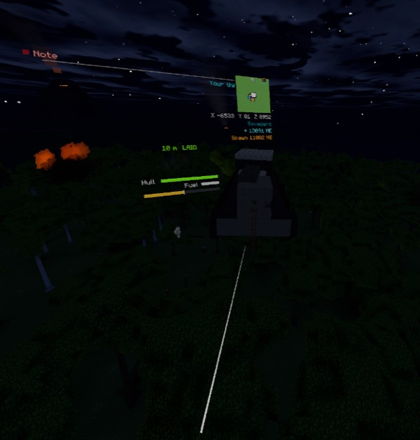

## 08:27:48 - Okay. One of the things that wasn't fixed

- **Transcript:** Okay. One of the things that wasn't fixed
- **Status:** open
- **Build:** 0.129 (39e0d988, M1-M4 (device-tested; ship riding, chests, comfort options, weapon wheel))
- **World:** New World (26) (seed 530054557992772521)
- **Dimension:** Surface
- **Biome:** Forest
- **Position:** -6530.0 82.1 8951.9
- **Facing:** south-east (yaw 120, pitch -72)
- **Held:** empty hand
- **Mount:** on foot, flying
- **Looking at:** nothing
- **Mode:** Creative, health 20/20
- **Time:** day 1 22:54, clear
- **Fps:** 69
- **Levels:** mic -46 dBFS, game sound -15 dBFS
- **Length:** 3.8 s (voice 1.4 s)
- **Just before:** -24s message: Walking; -18s opened ChestMenu; -14s closed ChestMenu; -13s into the pack: Combat Stim; -12s into the pack: Titanium Chestplate; -12s piloting Ironstride Siege Carriage; -12s message: Steering Ironstride Siege Carriage; -3s stopped piloting Ironstride Siege Carriage; -1s message: Flying
- **Repro (Mac):** `./snap.sh note --seed 530054557992772521 --x -6530.0 --z 8951.9 --yaw -120 --pitch -72 --time 0.705`
- **Audio (this Mac):** /Users/darthvadar/Documents/Blocksmith/QuestVoiceNotes/raw/vn-20261115-082748-606.aac

## 08:27:52 - This tail on the siege carriage has to go. Okay?

- **Transcript:** This tail on the siege carriage has to go. Okay?
- **Status:** open
- **Build:** 0.129 (39e0d988, M1-M4 (device-tested; ship riding, chests, comfort options, weapon wheel))
- **World:** New World (26) (seed 530054557992772521)
- **Dimension:** Surface
- **Biome:** Forest
- **Position:** -6526.4 77.2 8950.9
- **Facing:** west (yaw 250, pitch -45)
- **Held:** empty hand
- **Mount:** on foot, flying
- **Looking at:** nothing
- **Mode:** Creative, health 20/20
- **Time:** day 1 22:59, clear
- **Fps:** 72
- **Levels:** mic -33 dBFS, game sound -21 dBFS
- **Length:** 5.4 s (voice 2.3 s)
- **Just before:** -28s message: Walking; -22s opened ChestMenu; -18s closed ChestMenu; -17s into the pack: Combat Stim; -16s into the pack: Titanium Chestplate; -16s piloting Ironstride Siege Carriage; -16s message: Steering Ironstride Siege Carriage; -7s stopped piloting Ironstride Siege Carriage; -5s message: Flying; -2s message: Walking; -1s message: Flying
- **Repro (Mac):** `./snap.sh note --seed 530054557992772521 --x -6526.4 --z 8950.9 --yaw 110 --pitch -45 --time 0.708`
- **Audio (this Mac):** /Users/darthvadar/Documents/Blocksmith/QuestVoiceNotes/raw/vn-20261115-082752-689.aac

## 08:27:57 - How do the troops get onto it? I don't know. I, I don't know how they 

- **Transcript:** How do the troops get onto it? I don't know. I, I don't know how they get on
- **Status:** open
- **Build:** 0.129 (39e0d988, M1-M4 (device-tested; ship riding, chests, comfort options, weapon wheel))
- **World:** New World (26) (seed 530054557992772521)
- **Dimension:** Surface
- **Biome:** Forest
- **Position:** -6525.7 77.2 8950.4
- **Facing:** west (yaw 287, pitch -42)
- **Held:** empty hand
- **Mount:** on foot, flying
- **Looking at:** Oak Leaves at -6531 74 8949
- **Mode:** Creative, health 20/20
- **Time:** day 1 23:06, clear
- **Fps:** 72
- **Levels:** mic -22 dBFS, game sound -23 dBFS
- **Length:** 4.7 s (voice 2.7 s)
- **Just before:** -27s opened ChestMenu; -23s closed ChestMenu; -22s into the pack: Combat Stim; -22s into the pack: Titanium Chestplate; -21s piloting Ironstride Siege Carriage; -21s message: Steering Ironstride Siege Carriage; -12s stopped piloting Ironstride Siege Carriage; -10s message: Flying; -7s message: Walking; -6s message: Flying
- **Repro (Mac):** `./snap.sh note --seed 530054557992772521 --x -6525.7 --z 8950.4 --yaw 73 --pitch -42 --time 0.713`
- **Audio (this Mac):** /Users/darthvadar/Documents/Blocksmith/QuestVoiceNotes/raw/vn-20261115-082757-886.aac

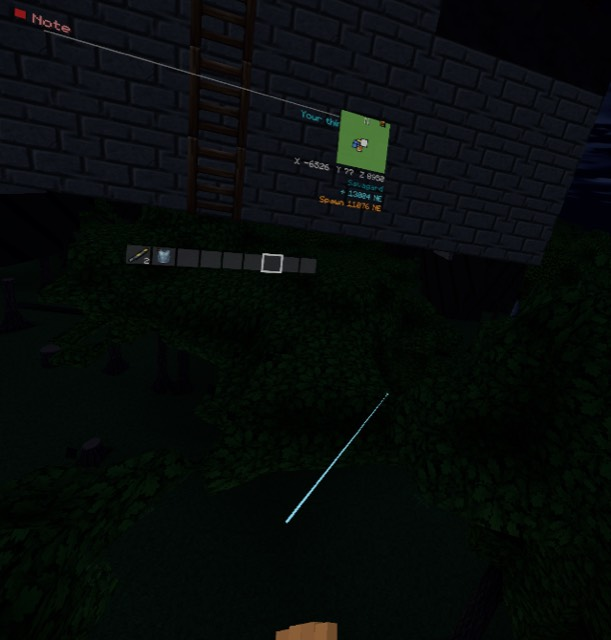

## 08:28:03 - W-whatever. Okay?

- **Transcript:** W-whatever. Okay?
- **Status:** open
- **Build:** 0.129 (39e0d988, M1-M4 (device-tested; ship riding, chests, comfort options, weapon wheel))
- **World:** New World (26) (seed 530054557992772521)
- **Dimension:** Surface
- **Biome:** Forest
- **Position:** -6529.7 81.9 8952.0
- **Facing:** west (yaw 252, pitch -31)
- **Held:** empty hand
- **Mount:** on foot
- **Looking at:** nothing
- **Mode:** Creative, health 20/20
- **Time:** day 1 23:12, clear
- **Fps:** 72
- **Levels:** mic -21 dBFS, game sound -20 dBFS
- **Length:** 2.6 s (voice 0.7 s)
- **Just before:** -28s closed ChestMenu; -27s into the pack: Combat Stim; -27s into the pack: Titanium Chestplate; -26s piloting Ironstride Siege Carriage; -26s message: Steering Ironstride Siege Carriage; -17s stopped piloting Ironstride Siege Carriage; -15s message: Flying; -12s message: Walking; -11s message: Flying; -1s message: Walking
- **Repro (Mac):** `./snap.sh note --seed 530054557992772521 --x -6529.7 --z 8952.0 --yaw 108 --pitch -31 --time 0.717`
- **Audio (this Mac):** /Users/darthvadar/Documents/Blocksmith/QuestVoiceNotes/raw/vn-20261115-082803-026.aac

## 08:28:05 - All right. See if that helps any

- **Transcript:** All right. See if that helps any
- **Status:** open
- **Build:** 0.129 (39e0d988, M1-M4 (device-tested; ship riding, chests, comfort options, weapon wheel))
- **World:** New World (26) (seed 530054557992772521)
- **Dimension:** Surface
- **Biome:** Forest
- **Position:** -6532.2 81.8 8952.7
- **Facing:** west (yaw 291, pitch -22)
- **Held:** empty hand
- **Mount:** piloting Ironstride Siege Carriage
- **Looking at:** nothing
- **Mode:** Creative, health 20/20
- **Time:** day 1 23:15, clear
- **Fps:** 72
- **Levels:** mic -33 dBFS, game sound -19 dBFS
- **Length:** 2.6 s (voice 0.9 s)
- **Just before:** -30s into the pack: Combat Stim; -29s into the pack: Titanium Chestplate; -29s piloting Ironstride Siege Carriage; -29s message: Steering Ironstride Siege Carriage; -20s stopped piloting Ironstride Siege Carriage; -18s message: Flying; -15s message: Walking; -14s message: Flying; -4s message: Walking; -2s piloting Ironstride Siege Carriage; -2s message: Steering Ironstride Siege Carriage
- **Repro (Mac):** `./snap.sh note --seed 530054557992772521 --x -6532.2 --z 8952.7 --yaw 69 --pitch -22 --time 0.719`
- **Audio (this Mac):** /Users/darthvadar/Documents/Blocksmith/QuestVoiceNotes/raw/vn-20261115-082805-826.aac

## 08:28:09 - The siege carriage literally can't move with that though. That's the t

- **Transcript:** The siege carriage literally can't move with that though. That's the thing
- **Status:** open
- **Build:** 0.129 (39e0d988, M1-M4 (device-tested; ship riding, chests, comfort options, weapon wheel))
- **World:** New World (26) (seed 530054557992772521)
- **Dimension:** Surface
- **Biome:** Forest
- **Position:** -6533.4 80.1 8961.7
- **Facing:** north (yaw 14, pitch -31)
- **Held:** empty hand
- **Mount:** piloting Ironstride Siege Carriage
- **Looking at:** nothing
- **Mode:** Creative, health 20/20
- **Time:** day 1 23:19, clear
- **Fps:** 72
- **Levels:** mic -40 dBFS, game sound -18 dBFS
- **Length:** 4.1 s (voice 1.6 s)
- **Just before:** -24s stopped piloting Ironstride Siege Carriage; -21s message: Flying; -19s message: Walking; -17s message: Flying; -7s message: Walking; -6s piloting Ironstride Siege Carriage; -6s message: Steering Ironstride Siege Carriage
- **Repro (Mac):** `./snap.sh note --seed 530054557992772521 --x -6533.4 --z 8961.7 --yaw -14 --pitch -31 --time 0.722`
- **Audio (this Mac):** /Users/darthvadar/Documents/Blocksmith/QuestVoiceNotes/raw/vn-20261115-082809-446.aac

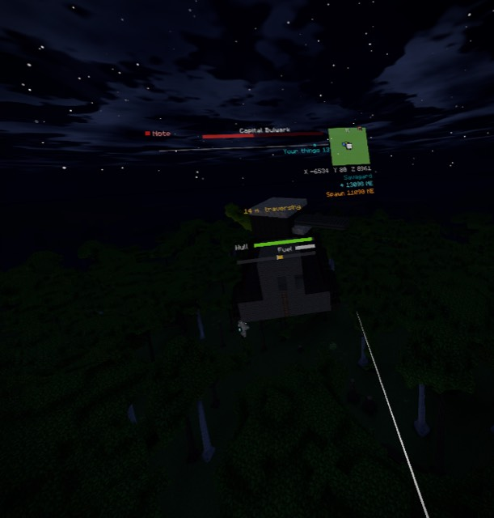

## 08:28:15 - Yeah, this, this thing might need a little more torque or something, '

- **Transcript:** Yeah, this, this thing might need a little more torque or something, 'cause it can't
- **Status:** open
- **Build:** 0.129 (39e0d988, M1-M4 (device-tested; ship riding, chests, comfort options, weapon wheel))
- **World:** New World (26) (seed 530054557992772521)
- **Dimension:** Surface
- **Biome:** Forest
- **Position:** -6537.1 80.4 8962.2
- **Facing:** south-east (yaw 117, pitch -29)
- **Held:** empty hand
- **Mount:** piloting Ironstride Siege Carriage
- **Looking at:** nothing
- **Mode:** Creative, health 20/20
- **Time:** day 1 23:27, clear
- **Fps:** 72
- **Levels:** mic -25 dBFS, game sound -21 dBFS
- **Length:** 5.9 s (voice 3.2 s)
- **Just before:** -30s stopped piloting Ironstride Siege Carriage; -28s message: Flying; -25s message: Walking; -24s message: Flying; -14s message: Walking; -12s piloting Ironstride Siege Carriage; -12s message: Steering Ironstride Siege Carriage
- **Position at the end:** -6536.2 80.6 8963.3
- **Repro (Mac):** `./snap.sh note --seed 530054557992772521 --x -6537.1 --z 8962.2 --yaw -117 --pitch -29 --time 0.727`
- **Audio (this Mac):** /Users/darthvadar/Documents/Blocksmith/QuestVoiceNotes/raw/vn-20261115-082815-666.aac

## 08:28:21 - It's not able to show these trees who's boss

- **Transcript:** It's not able to show these trees who's boss
- **Status:** open
- **Build:** 0.129 (39e0d988, M1-M4 (device-tested; ship riding, chests, comfort options, weapon wheel))
- **World:** New World (26) (seed 530054557992772521)
- **Dimension:** Surface
- **Biome:** Forest
- **Position:** -6532.1 81.3 8964.5
- **Facing:** south-west (yaw 239, pitch -21)
- **Held:** empty hand
- **Mount:** piloting Ironstride Siege Carriage
- **Looking at:** nothing
- **Mode:** Creative, health 20/20
- **Time:** day 1 23:34, clear
- **Fps:** 72
- **Levels:** mic -25 dBFS, game sound -22 dBFS
- **Length:** 3.8 s (voice 2.1 s)
- **Just before:** -29s message: Flying; -19s message: Walking; -18s piloting Ironstride Siege Carriage; -18s message: Steering Ironstride Siege Carriage
- **Repro (Mac):** `./snap.sh note --seed 530054557992772521 --x -6532.1 --z 8964.5 --yaw 121 --pitch -21 --time 0.732`
- **Audio (this Mac):** /Users/darthvadar/Documents/Blocksmith/QuestVoiceNotes/raw/vn-20261115-082821-446.aac

## 08:28:34 - It's stuck in the trees

- **Transcript:** It's stuck in the trees
- **Status:** open
- **Build:** 0.129 (39e0d988, M1-M4 (device-tested; ship riding, chests, comfort options, weapon wheel))
- **World:** New World (26) (seed 530054557992772521)
- **Dimension:** Surface
- **Biome:** Forest
- **Position:** -6527.6 81.2 8956.4
- **Facing:** north (yaw 5, pitch -14)
- **Held:** empty hand
- **Mount:** piloting Ironstride Siege Carriage
- **Looking at:** nothing
- **Mode:** Creative, health 20/20
- **Time:** day 1 23:49, clear
- **Fps:** 68
- **Levels:** mic -39 dBFS, game sound -16 dBFS
- **Length:** 2.3 s (voice 0.7 s)
- **Repro (Mac):** `./snap.sh note --seed 530054557992772521 --x -6527.6 --z 8956.4 --yaw -5 --pitch -14 --time 0.743`
- **Audio (this Mac):** /Users/darthvadar/Documents/Blocksmith/QuestVoiceNotes/raw/vn-20261115-082834-466.aac

## 08:28:37 - Explosions were nice though

- **Transcript:** Explosions were nice though
- **Status:** open
- **Build:** 0.129 (39e0d988, M1-M4 (device-tested; ship riding, chests, comfort options, weapon wheel))
- **World:** New World (26) (seed 530054557992772521)
- **Dimension:** Surface
- **Biome:** Forest
- **Position:** -6527.8 82.5 8958.4
- **Facing:** south (yaw 174, pitch -5)
- **Held:** empty hand
- **Mount:** on foot, flying
- **Looking at:** nothing
- **Mode:** Creative, health 20/20
- **Time:** day 1 23:53, clear
- **Fps:** 72
- **Levels:** mic -28 dBFS, game sound -29 dBFS
- **Length:** 2.3 s (voice 0.9 s)
- **Just before:** -2s stopped piloting Ironstride Siege Carriage; -2s message: Flying
- **Repro (Mac):** `./snap.sh note --seed 530054557992772521 --x -6527.8 --z 8958.4 --yaw -174 --pitch -5 --time 0.746`
- **Audio (this Mac):** /Users/darthvadar/Documents/Blocksmith/QuestVoiceNotes/raw/vn-20261115-082837-786.aac

## 08:28:47 - Three, three five five seven

- **Transcript:** Three, three five five seven
- **Status:** open
- **Build:** 0.129 (39e0d988, M1-M4 (device-tested; ship riding, chests, comfort options, weapon wheel))
- **World:** New World (26) (seed 530054557992772521)
- **Dimension:** Surface
- **Biome:** Forest
- **Position:** -6524.2 102.0 9014.4
- **Facing:** south-west (yaw 217, pitch 6)
- **Held:** empty hand
- **Mount:** on foot, flying
- **Looking at:** nothing
- **Mode:** Creative, health 20/20
- **Time:** day 1 00:02, clear
- **Fps:** 72
- **Levels:** mic -39 dBFS, game sound -22 dBFS
- **Length:** 3.4 s (voice 1.2 s)
- **Just before:** -12s stopped piloting Ironstride Siege Carriage; -11s message: Flying; -6s opened PauseMenu; -3s opened CommandMenu; -0s closed CommandMenu
- **Repro (Mac):** `./snap.sh note --seed 530054557992772521 --x -6524.2 --z 9014.4 --yaw 143 --pitch 6 --time 0.751`
- **Audio (this Mac):** /Users/darthvadar/Documents/Blocksmith/QuestVoiceNotes/raw/vn-20261115-082847-526.aac

## 08:29:27 - Crown shakes. I like that

- **Transcript:** Crown shakes. I like that
- **Status:** open
- **Build:** 0.129 (39e0d988, M1-M4 (device-tested; ship riding, chests, comfort options, weapon wheel))
- **World:** New World (26) (seed 530054557992772521)
- **Dimension:** Surface
- **Biome:** Taiga
- **Position:** 3546.6 94.5 5772.5
- **Facing:** north-west (yaw 335, pitch 12)
- **Held:** empty hand
- **Mount:** on foot
- **Looking at:** nothing
- **Mode:** Creative, health 20/20
- **Time:** day 1 00:48, clear
- **Fps:** 53
- **Levels:** mic -31 dBFS, game sound -23 dBFS
- **Length:** 2.5 s (voice 0.9 s)
- **Just before:** -28s walked into Snowy Taiga; -27s message: Entering Goremere; -26s walked into Deep Frozen Ocean; -24s walked into Frozen Ocean; -22s walked into Snowy Taiga; -22s message: Entering Valeonia; -20s walked into Snowy Slopes; -19s message: Entering Harwick; -18s walked into Taiga; -16s message: Entering Valawick; -15s message: Entering Feniheim; -14s walked into Frozen Peaks; -13s message: Entering Kesenvania; -12s walked into Taiga; -11s message: Ironback crawler patrol marked on the map; -9s message: Sky isle marked on the map; -7s message: Walking; -4s message: The ground shakes: an Ironback Crawler is near; -2s message: Flying; -1s opened PauseMenu; -0s closed PauseMenu
- **Repro (Mac):** `./snap.sh note --seed 530054557992772521 --x 3546.6 --z 5772.5 --yaw 25 --pitch 12 --time 0.784`
- **Audio (this Mac):** /Users/darthvadar/Documents/Blocksmith/QuestVoiceNotes/raw/vn-20261115-082927-366.aac

## 08:29:59 - All right, well

- **Transcript:** All right, well
- **Status:** open
- **Build:** 0.129 (39e0d988, M1-M4 (device-tested; ship riding, chests, comfort options, weapon wheel))
- **World:** New World (26) (seed 530054557992772521)
- **Dimension:** Surface
- **Biome:** Old Growth Birch Forest
- **Position:** 3574.9 92.8 5677.8
- **Facing:** west (yaw 254, pitch -41)
- **Held:** empty hand
- **Mount:** piloting Ironback Crawler
- **Looking at:** nothing
- **Mode:** Creative, health 20/20
- **Time:** day 1 01:27, clear
- **Fps:** 72
- **Levels:** mic -26 dBFS, game sound -23 dBFS
- **Length:** 2.2 s (voice 0.8 s)
- **Just before:** -24s into the pack: Falke Pistol; -22s holding Spruce Log; -22s holding Capital Rounds; -22s closed CreativeMenu; -22s holding Falke Pistol; -22s message: Falke Pistol; -21s message: Loaded: 18 / 18; -13s walked into Birch Forest; -11s walked into Taiga; -9s walked into Birch Forest; -4s into the pack: Sechser Revolver; -3s piloting Ironback Crawler; -3s holding empty hand; -3s message: Steering Ironback Crawler; -1s message: You have taken command of the Ironback Crawler!; -1s walked into Old Growth Birch Forest
- **Repro (Mac):** `./snap.sh note --seed 530054557992772521 --x 3574.9 --z 5677.8 --yaw 106 --pitch -41 --time 0.811`
- **Audio (this Mac):** /Users/darthvadar/Documents/Blocksmith/QuestVoiceNotes/raw/vn-20261115-082959-786.aac

## 08:30:12 - I still can't process jack shit, so

- **Transcript:** I still can't process jack shit, so
- **Status:** open
- **Build:** 0.129 (39e0d988, M1-M4 (device-tested; ship riding, chests, comfort options, weapon wheel))
- **World:** New World (26) (seed 530054557992772521)
- **Dimension:** Surface
- **Biome:** Birch Forest
- **Position:** 3578.7 89.3 5385.8
- **Facing:** north-west (yaw 327, pitch -5)
- **Held:** empty hand
- **Mount:** piloting Ironback Crawler
- **Looking at:** nothing
- **Mode:** Creative, health 20/20, screen PauseMenu
- **Time:** day 1 01:42, clear
- **Fps:** 69
- **Levels:** mic -41 dBFS, game sound -27 dBFS
- **Length:** 3.6 s (voice 1.4 s)
- **Just before:** -25s walked into Birch Forest; -23s walked into Taiga; -21s walked into Birch Forest; -17s into the pack: Sechser Revolver; -16s piloting Ironback Crawler; -16s holding empty hand; -16s message: Steering Ironback Crawler; -14s message: You have taken command of the Ironback Crawler!; -13s walked into Old Growth Birch Forest; -7s walked into Birch Forest; -5s walked into Forest; -1s opened PauseMenu
- **Repro (Mac):** `./snap.sh note --seed 530054557992772521 --x 3578.7 --z 5385.8 --yaw 33 --pitch -5 --time 0.821`
- **Audio (this Mac):** /Users/darthvadar/Documents/Blocksmith/QuestVoiceNotes/raw/vn-20261115-083012-546.aac

## 08:30:32 - Hold up

- **Transcript:** Hold up
- **Status:** open
- **Build:** 0.129 (39e0d988, M1-M4 (device-tested; ship riding, chests, comfort options, weapon wheel))
- **World:** New World (26) (seed 530054557992772521)
- **Dimension:** Surface
- **Biome:** Forest
- **Position:** 3481.3 91.3 5182.8
- **Facing:** south (yaw 200, pitch -7)
- **Held:** empty hand
- **Mount:** piloting Ironback Crawler
- **Looking at:** nothing
- **Mode:** Creative, health 20/20
- **Time:** day 1 02:05, clear
- **Fps:** 65
- **Levels:** mic -24 dBFS, game sound -17 dBFS
- **Length:** 1.8 s (voice 0.5 s)
- **Just before:** -28s walked into Birch Forest; -26s walked into Forest; -21s opened PauseMenu; -20s walked into Birch Forest; -20s closed PauseMenu; -13s message: The Greywall Garrison is sounding the alarm!; -10s message: The turret is wrecked; -8s walked into Forest
- **Repro (Mac):** `./snap.sh note --seed 530054557992772521 --x 3481.3 --z 5182.8 --yaw 160 --pitch -7 --time 0.837`
- **Audio (this Mac):** /Users/darthvadar/Documents/Blocksmith/QuestVoiceNotes/raw/vn-20261115-083032-866.aac

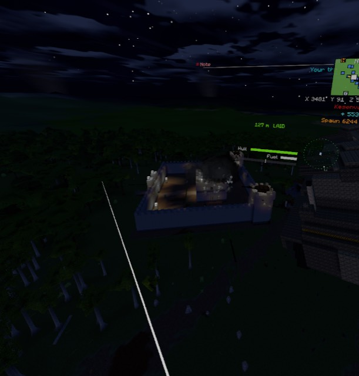

## 08:30:37 - Oh, fuck's that and I'm taking damage

- **Transcript:** Oh, fuck's that and I'm taking damage
- **Status:** open
- **Build:** 0.129 (39e0d988, M1-M4 (device-tested; ship riding, chests, comfort options, weapon wheel))
- **World:** New World (26) (seed 530054557992772521)
- **Dimension:** Surface
- **Biome:** Forest
- **Position:** 3481.3 91.6 5182.8
- **Facing:** south (yaw 199, pitch -22)
- **Held:** empty hand
- **Mount:** piloting Ironback Crawler
- **Looking at:** nothing
- **Mode:** Creative, health 20/20
- **Time:** day 1 02:10, clear
- **Fps:** 65
- **Levels:** mic -31 dBFS, game sound -18 dBFS
- **Length:** 3.2 s (voice 1.5 s)
- **Just before:** -30s walked into Forest; -25s opened PauseMenu; -24s walked into Birch Forest; -24s closed PauseMenu; -17s message: The Greywall Garrison is sounding the alarm!; -14s message: The turret is wrecked; -12s walked into Forest
- **Repro (Mac):** `./snap.sh note --seed 530054557992772521 --x 3481.3 --z 5182.8 --yaw 161 --pitch -22 --time 0.841`
- **Audio (this Mac):** /Users/darthvadar/Documents/Blocksmith/QuestVoiceNotes/raw/vn-20261115-083037-106.aac

## 08:30:47 - Crawler's not doing enough damage to this base. Not sure what the issu

- **Transcript:** Crawler's not doing enough damage to this base. Not sure what the issue is
- **Status:** open
- **Build:** 0.129 (39e0d988, M1-M4 (device-tested; ship riding, chests, comfort options, weapon wheel))
- **World:** New World (26) (seed 530054557992772521)
- **Dimension:** Surface
- **Biome:** Forest
- **Position:** 3485.6 91.4 5187.5
- **Facing:** south-west (yaw 217, pitch -29)
- **Held:** empty hand
- **Mount:** piloting Ironback Crawler
- **Looking at:** nothing
- **Mode:** Creative, health 20/20
- **Time:** day 1 02:22, clear
- **Fps:** 68
- **Levels:** mic -22 dBFS, game sound -15 dBFS
- **Length:** 4.5 s (voice 2.0 s)
- **Just before:** -27s message: The Greywall Garrison is sounding the alarm!; -25s message: The turret is wrecked; -22s walked into Forest
- **Repro (Mac):** `./snap.sh note --seed 530054557992772521 --x 3485.6 --z 5187.5 --yaw 143 --pitch -29 --time 0.849`
- **Audio (this Mac):** /Users/darthvadar/Documents/Blocksmith/QuestVoiceNotes/raw/vn-20261115-083047-366.aac

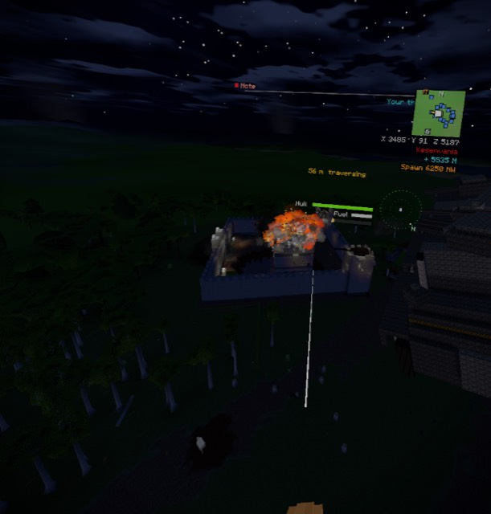

## 08:30:52 - Eh, maybe it's fine. I can't really tell

- **Transcript:** Eh, maybe it's fine. I can't really tell
- **Status:** open
- **Build:** 0.129 (39e0d988, M1-M4 (device-tested; ship riding, chests, comfort options, weapon wheel))
- **World:** New World (26) (seed 530054557992772521)
- **Dimension:** Surface
- **Biome:** Forest
- **Position:** 3480.1 90.8 5185.1
- **Facing:** south (yaw 190, pitch -23)
- **Held:** empty hand
- **Mount:** piloting Ironback Crawler
- **Looking at:** nothing
- **Mode:** Creative, health 20/20
- **Time:** day 1 02:29, clear
- **Fps:** 70
- **Levels:** mic -29 dBFS, game sound -21 dBFS
- **Length:** 3.3 s (voice 0.8 s)
- **Just before:** -28s walked into Forest
- **Repro (Mac):** `./snap.sh note --seed 530054557992772521 --x 3480.1 --z 5185.1 --yaw 170 --pitch -23 --time 0.854`
- **Audio (this Mac):** /Users/darthvadar/Documents/Blocksmith/QuestVoiceNotes/raw/vn-20261115-083052-986.aac

## 08:31:04 - Oh, radar. Very nice

- **Transcript:** Oh, radar. Very nice
- **Status:** open
- **Build:** 0.129 (39e0d988, M1-M4 (device-tested; ship riding, chests, comfort options, weapon wheel))
- **World:** New World (26) (seed 530054557992772521)
- **Dimension:** Surface
- **Biome:** Birch Forest
- **Position:** 3250.8 89.6 5079.9
- **Facing:** south (yaw 170, pitch -17)
- **Held:** empty hand
- **Mount:** piloting Ironback Crawler
- **Looking at:** nothing
- **Mode:** Creative, health 20/20
- **Time:** day 1 02:43, clear
- **Fps:** 71
- **Levels:** mic -30 dBFS, game sound -26 dBFS
- **Length:** 2.7 s (voice 1.2 s)
- **Just before:** -5s walked into Birch Forest; -3s walked into Old Growth Birch Forest; -1s walked into Birch Forest
- **Repro (Mac):** `./snap.sh note --seed 530054557992772521 --x 3250.8 --z 5079.9 --yaw -170 --pitch -17 --time 0.864`
- **Audio (this Mac):** /Users/darthvadar/Documents/Blocksmith/QuestVoiceNotes/raw/vn-20261115-083104-686.aac

## 08:31:18 - Okay, the radar is based on wherever my stick's pointed. It should be 

- **Transcript:** Okay, the radar is based on wherever my stick's pointed. It should be based on wherever the hell I'm looking, I think, right?
- **Status:** open
- **Build:** 0.129 (39e0d988, M1-M4 (device-tested; ship riding, chests, comfort options, weapon wheel))
- **World:** New World (26) (seed 530054557992772521)
- **Dimension:** Surface
- **Biome:** Forest
- **Position:** 2894.3 85.4 5164.3
- **Facing:** south-west (yaw 208, pitch -8)
- **Held:** empty hand
- **Mount:** piloting Ironback Crawler
- **Looking at:** nothing
- **Mode:** Creative, health 20/20
- **Time:** day 1 03:00, clear
- **Fps:** 69
- **Levels:** mic -50 dBFS, game sound -21 dBFS
- **Length:** 7.5 s (voice 4.1 s)
- **Just before:** -19s walked into Birch Forest; -17s walked into Old Growth Birch Forest; -15s walked into Birch Forest; -11s walked into Forest; -7s walked into Beach; -3s walked into Ocean; -1s walked into Forest
- **While talking:** -2s walked into Beach
- **Position at the end:** 2777.6 85.5 5199.9
- **Repro (Mac):** `./snap.sh note --seed 530054557992772521 --x 2894.3 --z 5164.3 --yaw 152 --pitch -8 --time 0.875`
- **Audio (this Mac):** /Users/darthvadar/Documents/Blocksmith/QuestVoiceNotes/raw/vn-20261115-083118-306.aac

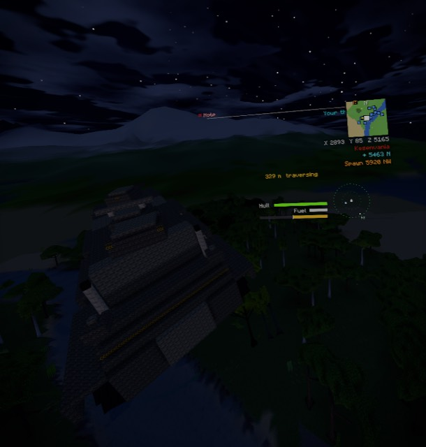

## 08:32:08 - Yeah, this thing, man

- **Transcript:** Yeah, this thing, man
- **Status:** open
- **Build:** 0.129 (39e0d988, M1-M4 (device-tested; ship riding, chests, comfort options, weapon wheel))
- **World:** New World (26) (seed 530054557992772521)
- **Dimension:** Surface
- **Biome:** Forest
- **Position:** 2029.9 124.9 4378.8
- **Facing:** south-east (yaw 139, pitch -25)
- **Held:** empty hand
- **Mount:** piloting Ironback Crawler
- **Looking at:** nothing
- **Mode:** Creative, health 20/20
- **Time:** day 1 04:00, clear
- **Fps:** 69
- **Levels:** mic -33 dBFS, game sound -21 dBFS
- **Length:** 2.9 s (voice 1.2 s)
- **Just before:** -23s walked into River; -21s walked into Taiga; -15s walked into Forest; -5s walked into Plains; -3s walked into Forest
- **Repro (Mac):** `./snap.sh note --seed 530054557992772521 --x 2029.9 --z 4378.8 --yaw -139 --pitch -25 --time 0.917`
- **Audio (this Mac):** /Users/darthvadar/Documents/Blocksmith/QuestVoiceNotes/raw/vn-20261115-083208-266.aac

## 08:32:12 - Yeah, I hope they will find some good optimizations for it because it'

- **Transcript:** Yeah, I hope they will find some good optimizations for it because it's really bad in its current state
- **Status:** open
- **Build:** 0.129 (39e0d988, M1-M4 (device-tested; ship riding, chests, comfort options, weapon wheel))
- **World:** New World (26) (seed 530054557992772521)
- **Dimension:** Surface
- **Biome:** Meadow
- **Position:** 1925.1 150.7 4336.6
- **Facing:** south-east (yaw 128, pitch -23)
- **Held:** empty hand
- **Mount:** piloting Ironback Crawler
- **Looking at:** nothing
- **Mode:** Creative, health 20/20
- **Time:** day 1 04:05, clear
- **Fps:** 68
- **Levels:** mic -41 dBFS, game sound -19 dBFS
- **Length:** 5.9 s (voice 2.3 s)
- **Just before:** -27s walked into River; -25s walked into Taiga; -19s walked into Forest; -9s walked into Plains; -7s walked into Forest; -1s walked into Meadow
- **While talking:** -2s walked into Forest
- **Position at the end:** 1812.5 142.1 4331.6
- **Repro (Mac):** `./snap.sh note --seed 530054557992772521 --x 1925.1 --z 4336.6 --yaw -128 --pitch -23 --time 0.920`
- **Audio (this Mac):** /Users/darthvadar/Documents/Blocksmith/QuestVoiceNotes/raw/vn-20261115-083212-566.aac

## 08:33:11 - I should have-- okay, there it goes

- **Transcript:** I should have-- okay, there it goes
- **Status:** open
- **Build:** 0.129 (39e0d988, M1-M4 (device-tested; ship riding, chests, comfort options, weapon wheel))
- **World:** New World (26) (seed 530054557992772521)
- **Dimension:** Surface
- **Biome:** Taiga
- **Position:** 1472.5 133.0 4771.5
- **Facing:** north (yaw 354, pitch 24)
- **Held:** empty hand
- **Mount:** piloting Ironback Crawler
- **Looking at:** nothing
- **Mode:** Creative, health 20/20
- **Time:** day 1 05:16, clear
- **Fps:** 68
- **Levels:** mic -45 dBFS, game sound -17 dBFS
- **Length:** 2.7 s (voice 0.7 s)
- **Just before:** -6s walked into Taiga
- **Repro (Mac):** `./snap.sh note --seed 530054557992772521 --x 1472.5 --z 4771.5 --yaw 6 --pitch 24 --time 0.970`
- **Audio (this Mac):** /Users/darthvadar/Documents/Blocksmith/QuestVoiceNotes/raw/vn-20261115-083311-946.aac

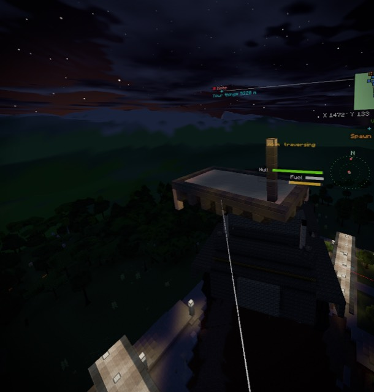

## 08:33:51 - What's a boreal station? Oh, shit

- **Transcript:** What's a boreal station? Oh, shit
- **Status:** open
- **Build:** 0.129 (39e0d988, M1-M4 (device-tested; ship riding, chests, comfort options, weapon wheel))
- **World:** New World (26) (seed 530054557992772521)
- **Dimension:** Surface
- **Biome:** Snowy Slopes
- **Position:** 954.0 189.1 5343.8
- **Facing:** east (yaw 88, pitch -35)
- **Held:** empty hand
- **Mount:** piloting Ironback Crawler
- **Looking at:** nothing
- **Mode:** Creative, health 20/20
- **Time:** day 2 06:03, clear
- **Fps:** 69
- **Levels:** mic -25 dBFS, game sound -24 dBFS
- **Length:** 2.6 s (voice 1.1 s)
- **Just before:** -26s walked into Meadow; -22s walked into Snowy Slopes; -20s walked into Meadow; -18s walked into Taiga; -8s message: The sky is clouding over: fog is coming; -8s walked into Grove; -2s message: Valawick has gone to war with Kesenvania; -2s walked into Snowy Slopes; -0s message: Maroria has gone to war with Mareland
- **Repro (Mac):** `./snap.sh note --seed 530054557992772521 --x 954.0 --z 5343.8 --yaw -88 --pitch -35 --time 0.003`
- **Audio (this Mac):** /Users/darthvadar/Documents/Blocksmith/QuestVoiceNotes/raw/vn-20261115-083351-446.aac

## 08:33:57 - Hasn't quite loaded in yet

- **Transcript:** Hasn't quite loaded in yet
- **Status:** open
- **Build:** 0.129 (39e0d988, M1-M4 (device-tested; ship riding, chests, comfort options, weapon wheel))
- **World:** New World (26) (seed 530054557992772521)
- **Dimension:** Surface
- **Biome:** Grove
- **Position:** 933.0 177.6 5407.3
- **Facing:** east (yaw 71, pitch -13)
- **Held:** empty hand
- **Mount:** piloting Ironback Crawler
- **Looking at:** nothing
- **Mode:** Creative, health 20/20
- **Time:** day 2 06:11, clear
- **Fps:** 61
- **Levels:** mic -34 dBFS, game sound -16 dBFS
- **Length:** 3.0 s (voice 1.3 s)
- **Just before:** -28s walked into Snowy Slopes; -26s walked into Meadow; -24s walked into Taiga; -14s message: The sky is clouding over: fog is coming; -14s walked into Grove; -9s message: Valawick has gone to war with Kesenvania; -8s walked into Snowy Slopes; -6s message: Maroria has gone to war with Mareland; -2s walked into Grove
- **Repro (Mac):** `./snap.sh note --seed 530054557992772521 --x 933.0 --z 5407.3 --yaw -71 --pitch -13 --time 0.008`
- **Audio (this Mac):** /Users/darthvadar/Documents/Blocksmith/QuestVoiceNotes/raw/vn-20261115-083357-726.aac

## 08:34:01 - Taking his sweet ass time

- **Transcript:** Taking his sweet ass time
- **Status:** open
- **Build:** 0.129 (39e0d988, M1-M4 (device-tested; ship riding, chests, comfort options, weapon wheel))
- **World:** New World (26) (seed 530054557992772521)
- **Dimension:** Surface
- **Biome:** Grove
- **Position:** 947.0 174.1 5424.8
- **Facing:** east (yaw 94, pitch -6)
- **Held:** empty hand
- **Mount:** piloting Ironback Crawler
- **Looking at:** nothing
- **Mode:** Creative, health 20/20
- **Time:** day 2 06:16, clear
- **Fps:** 61
- **Levels:** mic -64 dBFS, game sound -19 dBFS
- **Length:** 2.9 s (voice 1.3 s)
- **Just before:** -30s walked into Meadow; -28s walked into Taiga; -18s message: The sky is clouding over: fog is coming; -18s walked into Grove; -13s message: Valawick has gone to war with Kesenvania; -12s walked into Snowy Slopes; -10s message: Maroria has gone to war with Mareland; -6s walked into Grove
- **Repro (Mac):** `./snap.sh note --seed 530054557992772521 --x 947.0 --z 5424.8 --yaw -94 --pitch -6 --time 0.011`
- **Audio (this Mac):** /Users/darthvadar/Documents/Blocksmith/QuestVoiceNotes/raw/vn-20261115-083401-546.aac

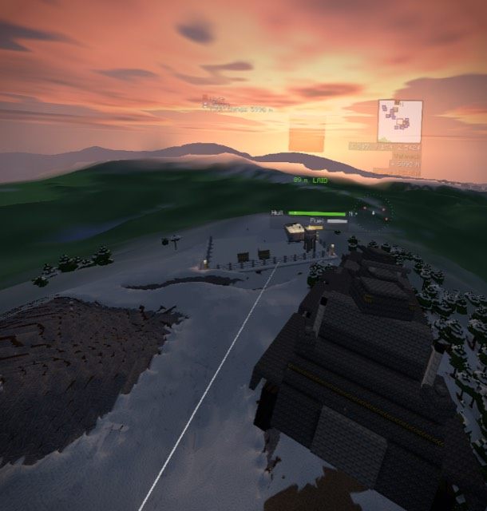

## 08:34:07 - Not mad at me just yet, huh? Why not? You should be mad

- **Transcript:** Not mad at me just yet, huh? Why not? You should be mad
- **Status:** open
- **Build:** 0.129 (39e0d988, M1-M4 (device-tested; ship riding, chests, comfort options, weapon wheel))
- **World:** New World (26) (seed 530054557992772521)
- **Dimension:** Surface
- **Biome:** Grove
- **Position:** 1040.1 168.0 5486.8
- **Facing:** north (yaw 6, pitch -2)
- **Held:** empty hand
- **Mount:** piloting Ironback Crawler
- **Looking at:** nothing
- **Mode:** Creative, health 20/20
- **Time:** day 2 06:22, clear
- **Fps:** 63
- **Levels:** mic -29 dBFS, game sound -13 dBFS
- **Length:** 5.0 s (voice 2.6 s)
- **Just before:** -23s message: The sky is clouding over: fog is coming; -23s walked into Grove; -18s message: Valawick has gone to war with Kesenvania; -17s walked into Snowy Slopes; -16s message: Maroria has gone to war with Mareland; -11s walked into Grove
- **Repro (Mac):** `./snap.sh note --seed 530054557992772521 --x 1040.1 --z 5486.8 --yaw -6 --pitch -2 --time 0.016`
- **Audio (this Mac):** /Users/darthvadar/Documents/Blocksmith/QuestVoiceNotes/raw/vn-20261115-083407-206.aac

## 08:34:17 - They should have shot me as soon as they saw me coming

- **Transcript:** They should have shot me as soon as they saw me coming
- **Status:** open
- **Build:** 0.129 (39e0d988, M1-M4 (device-tested; ship riding, chests, comfort options, weapon wheel))
- **World:** New World (26) (seed 530054557992772521)
- **Dimension:** Surface
- **Biome:** Grove
- **Position:** 1062.6 163.6 5478.3
- **Facing:** north-west (yaw 294, pitch -11)
- **Held:** empty hand
- **Mount:** piloting Ironback Crawler
- **Looking at:** nothing
- **Mode:** Creative, health 20/20
- **Time:** day 2 06:35, clear
- **Fps:** 70
- **Levels:** mic -36 dBFS, game sound -16 dBFS
- **Length:** 3.4 s (voice 1.9 s)
- **Just before:** -28s message: Valawick has gone to war with Kesenvania; -28s walked into Snowy Slopes; -26s message: Maroria has gone to war with Mareland; -21s walked into Grove; -7s message: The station alarm is sounding!; -4s message: The turret is wrecked
- **Repro (Mac):** `./snap.sh note --seed 530054557992772521 --x 1062.6 --z 5478.3 --yaw 66 --pitch -11 --time 0.024`
- **Audio (this Mac):** /Users/darthvadar/Documents/Blocksmith/QuestVoiceNotes/raw/vn-20261115-083417-426.aac

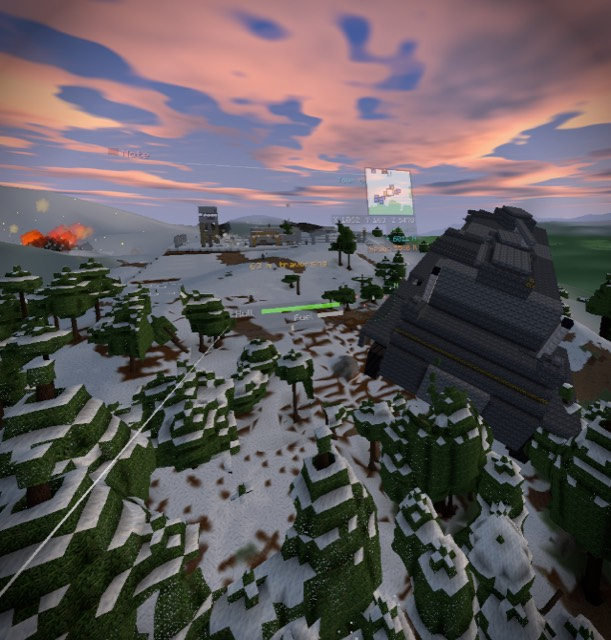

## 08:34:23 - And they didn't

- **Transcript:** And they didn't
- **Status:** open
- **Build:** 0.129 (39e0d988, M1-M4 (device-tested; ship riding, chests, comfort options, weapon wheel))
- **World:** New World (26) (seed 530054557992772521)
- **Dimension:** Surface
- **Biome:** Grove
- **Position:** 1081.1 170.8 5443.4
- **Facing:** south-west (yaw 245, pitch -22)
- **Held:** empty hand
- **Mount:** piloting Ironback Crawler
- **Looking at:** nothing
- **Mode:** Creative, health 20/20
- **Time:** day 2 06:42, clear
- **Fps:** 65
- **Levels:** mic -54 dBFS, game sound -11 dBFS
- **Length:** 2.7 s (voice 0.9 s)
- **Just before:** -28s walked into Grove; -13s message: The station alarm is sounding!; -10s message: The turret is wrecked; -4s walked into Snowy Slopes; -2s walked into Grove
- **Repro (Mac):** `./snap.sh note --seed 530054557992772521 --x 1081.1 --z 5443.4 --yaw 115 --pitch -22 --time 0.030`
- **Audio (this Mac):** /Users/darthvadar/Documents/Blocksmith/QuestVoiceNotes/raw/vn-20261115-083423-966.aac

## 08:34:28 - I understand rendering is an issue, but still

- **Transcript:** I understand rendering is an issue, but still
- **Status:** open
- **Build:** 0.129 (39e0d988, M1-M4 (device-tested; ship riding, chests, comfort options, weapon wheel))
- **World:** New World (26) (seed 530054557992772521)
- **Dimension:** Surface
- **Biome:** Snowy Slopes
- **Position:** 1087.0 165.1 5462.0
- **Facing:** south-east (yaw 155, pitch -21)
- **Held:** empty hand
- **Mount:** piloting Ironback Crawler
- **Looking at:** nothing
- **Mode:** Creative, health 20/20
- **Time:** day 2 06:48, clear
- **Fps:** 68
- **Levels:** mic -32 dBFS, game sound -23 dBFS
- **Length:** 4.1 s (voice 1.7 s)
- **Just before:** -18s message: The station alarm is sounding!; -15s message: The turret is wrecked; -9s walked into Snowy Slopes; -7s walked into Grove; -5s walked into Snowy Slopes
- **Repro (Mac):** `./snap.sh note --seed 530054557992772521 --x 1087.0 --z 5462.0 --yaw -155 --pitch -21 --time 0.034`
- **Audio (this Mac):** /Users/darthvadar/Documents/Blocksmith/QuestVoiceNotes/raw/vn-20261115-083428-886.aac

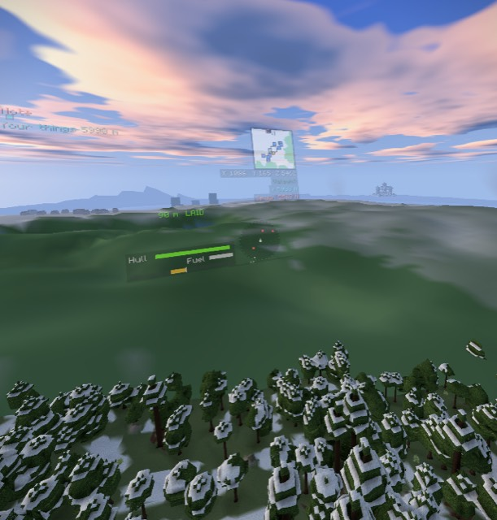

## 08:35:35 - Run out of ammo? Fuck. No way, I'm not. Just low on ammo, I think

- **Transcript:** Run out of ammo? Fuck. No way, I'm not. Just low on ammo, I think
- **Status:** open
- **Build:** 0.129 (39e0d988, M1-M4 (device-tested; ship riding, chests, comfort options, weapon wheel))
- **World:** New World (26) (seed 530054557992772521)
- **Dimension:** Surface
- **Biome:** Snowy Plains
- **Position:** 355.1 107.6 6450.6
- **Facing:** south-east (yaw 153, pitch -11)
- **Held:** empty hand
- **Mount:** piloting Ironback Crawler
- **Looking at:** nothing
- **Mode:** Creative, health 20/20
- **Time:** day 2 08:08, clear
- **Fps:** 69
- **Levels:** mic -29 dBFS, game sound -12 dBFS
- **Length:** 6.3 s (voice 2.4 s)
- **Just before:** -29s walked into Snowy Plains; -23s walked into Plains; -11s walked into Snowy Plains; -5s message: A Capital patrol sets out to investigate; -3s message: The citadel is on lockdown!; -1s message: The turret is wrecked
- **While talking:** -1s message: Ezra Quill: Old Jeb lost another hat to the wind.
- **Position at the end:** 387.5 106.4 6436.2
- **Repro (Mac):** `./snap.sh note --seed 530054557992772521 --x 355.1 --z 6450.6 --yaw -153 --pitch -11 --time 0.089`
- **Audio (this Mac):** /Users/darthvadar/Documents/Blocksmith/QuestVoiceNotes/raw/vn-20261115-083535-266.aac

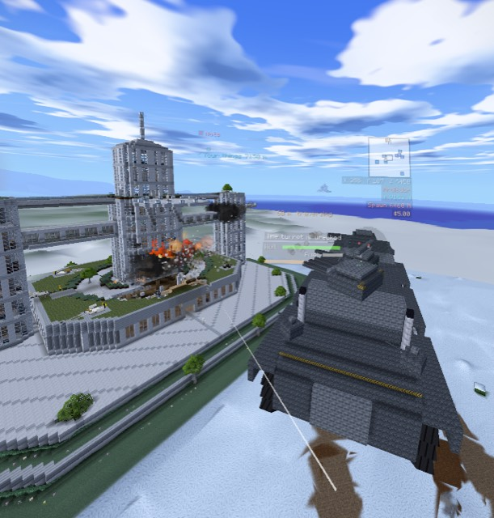

## 08:35:51 - Uh, had a bit of a frame rate drop there. I mean, understandably so

- **Transcript:** Uh, had a bit of a frame rate drop there. I mean, understandably so
- **Status:** open
- **Build:** 0.129 (39e0d988, M1-M4 (device-tested; ship riding, chests, comfort options, weapon wheel))
- **World:** New World (26) (seed 530054557992772521)
- **Dimension:** Surface
- **Biome:** Snowy Plains
- **Position:** 455.8 101.4 6421.0
- **Facing:** south-west (yaw 215, pitch -2)
- **Held:** empty hand
- **Mount:** piloting Ironback Crawler
- **Looking at:** nothing
- **Mode:** Creative, health 20/20
- **Time:** day 2 08:27, clear
- **Fps:** 62
- **Levels:** mic -28 dBFS, game sound -15 dBFS
- **Length:** 5.7 s (voice 3.1 s)
- **Just before:** -27s walked into Snowy Plains; -21s message: A Capital patrol sets out to investigate; -19s message: The citadel is on lockdown!; -17s message: The turret is wrecked; -12s message: Ezra Quill: Old Jeb lost another hat to the wind.; -9s message: The turret is wrecked; -5s message: Engines hit: going down
- **While talking:** -0s message: The turret is wrecked
- **Position at the end:** 458.4 100.9 6426.8
- **Repro (Mac):** `./snap.sh note --seed 530054557992772521 --x 455.8 --z 6421.0 --yaw 145 --pitch -2 --time 0.103`
- **Audio (this Mac):** /Users/darthvadar/Documents/Blocksmith/QuestVoiceNotes/raw/vn-20261115-083551-986.aac

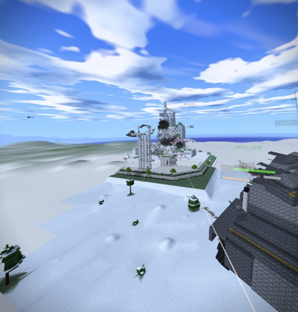

## 08:35:57 - Uh, yeah

- **Transcript:** Uh, yeah
- **Status:** open
- **Build:** 0.129 (39e0d988, M1-M4 (device-tested; ship riding, chests, comfort options, weapon wheel))
- **World:** New World (26) (seed 530054557992772521)
- **Dimension:** Surface
- **Biome:** Snowy Plains
- **Position:** 456.6 101.1 6427.4
- **Facing:** south-west (yaw 213, pitch -1)
- **Held:** empty hand
- **Mount:** piloting Ironback Crawler
- **Looking at:** nothing
- **Mode:** Creative, health 20/20
- **Time:** day 2 08:32, clear
- **Fps:** 36
- **Levels:** mic -30 dBFS, game sound -18 dBFS
- **Length:** 2.8 s (voice 1.1 s)
- **Just before:** -25s message: A Capital patrol sets out to investigate; -23s message: The citadel is on lockdown!; -20s message: The turret is wrecked; -16s message: Ezra Quill: Old Jeb lost another hat to the wind.; -13s message: The turret is wrecked; -9s message: Engines hit: going down; -0s message: The turret is wrecked
- **Repro (Mac):** `./snap.sh note --seed 530054557992772521 --x 456.6 --z 6427.4 --yaw 147 --pitch -1 --time 0.106`
- **Audio (this Mac):** /Users/darthvadar/Documents/Blocksmith/QuestVoiceNotes/raw/vn-20261115-083557-366.aac

## 08:36:02 - I wonder if that's GPU or CPU that calculates like the trajectory of a

- **Transcript:** I wonder if that's GPU or CPU that calculates like the trajectory of all that
- **Status:** open
- **Build:** 0.129 (39e0d988, M1-M4 (device-tested; ship riding, chests, comfort options, weapon wheel))
- **World:** New World (26) (seed 530054557992772521)
- **Dimension:** Surface
- **Biome:** Snowy Plains
- **Position:** 447.4 102.6 6426.5
- **Facing:** north-west (yaw 293, pitch 49)
- **Held:** empty hand
- **Mount:** piloting Ironback Crawler
- **Looking at:** nothing
- **Mode:** Creative, health 20/20
- **Time:** day 2 08:38, clear
- **Fps:** 45
- **Levels:** mic -34 dBFS, game sound -15 dBFS
- **Length:** 5.6 s (voice 3.1 s)
- **Just before:** -30s message: A Capital patrol sets out to investigate; -28s message: The citadel is on lockdown!; -26s message: The turret is wrecked; -21s message: Ezra Quill: Old Jeb lost another hat to the wind.; -18s message: The turret is wrecked; -14s message: Engines hit: going down; -5s message: The turret is wrecked
- **Position at the end:** 460.4 100.6 6425.6
- **Repro (Mac):** `./snap.sh note --seed 530054557992772521 --x 447.4 --z 6426.5 --yaw 67 --pitch 49 --time 0.110`
- **Audio (this Mac):** /Users/darthvadar/Documents/Blocksmith/QuestVoiceNotes/raw/vn-20261115-083602-426.aac

## 08:37:19 - Let's take a look here. [chuckles]

- **Transcript:** Let's take a look here. [chuckles]
- **Status:** open
- **Build:** 0.129 (39e0d988, M1-M4 (device-tested; ship riding, chests, comfort options, weapon wheel))
- **World:** New World (26) (seed 530054557992772521)
- **Dimension:** Surface
- **Biome:** Snowy Taiga
- **Position:** 395.2 92.9 6908.0
- **Facing:** north-east (yaw 44, pitch -38)
- **Held:** Falke Pistol x1
- **Mount:** on foot
- **Looking at:** nothing
- **Mode:** Creative, health 20/20
- **Time:** day 2 10:10, clear
- **Fps:** 50
- **Levels:** mic -34 dBFS, game sound -14 dBFS
- **Length:** 3.0 s (voice 0.9 s)
- **Just before:** -25s message: Ezra Quill: Haven't had a quiet week since spring.; -24s walked into Snowy Taiga; -22s message: The turret is wrecked; -8s walked into Taiga; -6s walked into Snowy Taiga; -4s stopped piloting Ironback Crawler; -4s holding Falke Pistol; -0s walked into Taiga
- **Repro (Mac):** `./snap.sh note --seed 530054557992772521 --x 395.2 --z 6908.0 --yaw -44 --pitch -38 --time 0.174`
- **Audio (this Mac):** /Users/darthvadar/Documents/Blocksmith/QuestVoiceNotes/raw/vn-20261115-083719-126.aac

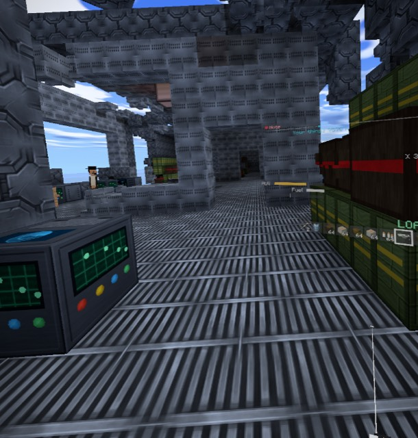

## 08:37:24 - Everything's doing all right

- **Transcript:** Everything's doing all right
- **Status:** open
- **Build:** 0.129 (39e0d988, M1-M4 (device-tested; ship riding, chests, comfort options, weapon wheel))
- **World:** New World (26) (seed 530054557992772521)
- **Dimension:** Surface
- **Biome:** Snowy Taiga
- **Position:** 405.9 99.1 6948.0
- **Facing:** north-west (yaw 326, pitch -29)
- **Held:** Falke Pistol x1
- **Mount:** on foot, flying
- **Looking at:** nothing
- **Mode:** Creative, health 20/20
- **Time:** day 2 10:16, clear
- **Fps:** 70
- **Levels:** mic -26 dBFS, game sound -17 dBFS
- **Length:** 2.2 s (voice 1.2 s)
- **Just before:** -29s walked into Snowy Taiga; -27s message: The turret is wrecked; -13s walked into Taiga; -11s walked into Snowy Taiga; -9s stopped piloting Ironback Crawler; -9s holding Falke Pistol; -5s walked into Taiga; -4s message: Flying; -3s walked into Snowy Taiga; -3s message: Homestead marked on the map; -1s message: A homestead. Fields, a barn, and a long way from town.
- **Repro (Mac):** `./snap.sh note --seed 530054557992772521 --x 405.9 --z 6948.0 --yaw 34 --pitch -29 --time 0.178`
- **Audio (this Mac):** /Users/darthvadar/Documents/Blocksmith/QuestVoiceNotes/raw/vn-20261115-083724-246.aac

## 08:37:26 - Didn't break any wheels somehow

- **Transcript:** Didn't break any wheels somehow
- **Status:** open
- **Build:** 0.129 (39e0d988, M1-M4 (device-tested; ship riding, chests, comfort options, weapon wheel))
- **World:** New World (26) (seed 530054557992772521)
- **Dimension:** Surface
- **Biome:** Snowy Taiga
- **Position:** 437.9 99.1 6914.2
- **Facing:** south-west (yaw 210, pitch 51)
- **Held:** Falke Pistol x1
- **Mount:** on foot, flying
- **Looking at:** nothing
- **Mode:** Creative, health 20/20
- **Time:** day 2 10:19, clear
- **Fps:** 70
- **Levels:** mic -29 dBFS, game sound -18 dBFS
- **Length:** 2.9 s (voice 1.5 s)
- **Just before:** -30s message: The turret is wrecked; -16s walked into Taiga; -14s walked into Snowy Taiga; -12s stopped piloting Ironback Crawler; -12s holding Falke Pistol; -8s walked into Taiga; -7s message: Flying; -6s walked into Snowy Taiga; -5s message: Homestead marked on the map; -3s message: A homestead. Fields, a barn, and a long way from town.
- **Repro (Mac):** `./snap.sh note --seed 530054557992772521 --x 437.9 --z 6914.2 --yaw 150 --pitch 51 --time 0.180`
- **Audio (this Mac):** /Users/darthvadar/Documents/Blocksmith/QuestVoiceNotes/raw/vn-20261115-083726-686.aac

## 08:37:29 - I mean, that's what it is. The wheels are made of blocks, so

- **Transcript:** I mean, that's what it is. The wheels are made of blocks, so
- **Status:** open
- **Build:** 0.129 (39e0d988, M1-M4 (device-tested; ship riding, chests, comfort options, weapon wheel))
- **World:** New World (26) (seed 530054557992772521)
- **Dimension:** Surface
- **Biome:** Taiga
- **Position:** 370.1 99.1 6844.5
- **Facing:** south (yaw 202, pitch -34)
- **Held:** Falke Pistol x1
- **Mount:** on foot, flying
- **Looking at:** nothing
- **Mode:** Creative, health 20/20
- **Time:** day 2 10:23, clear
- **Fps:** 72
- **Levels:** mic -32 dBFS, game sound -17 dBFS
- **Length:** 4.8 s (voice 2.4 s)
- **Just before:** -19s walked into Taiga; -17s walked into Snowy Taiga; -15s stopped piloting Ironback Crawler; -15s holding Falke Pistol; -11s walked into Taiga; -10s message: Flying; -9s walked into Snowy Taiga; -9s message: Homestead marked on the map; -7s message: A homestead. Fields, a barn, and a long way from town.
- **Repro (Mac):** `./snap.sh note --seed 530054557992772521 --x 370.1 --z 6844.5 --yaw 158 --pitch -34 --time 0.183`
- **Audio (this Mac):** /Users/darthvadar/Documents/Blocksmith/QuestVoiceNotes/raw/vn-20261115-083729-886.aac

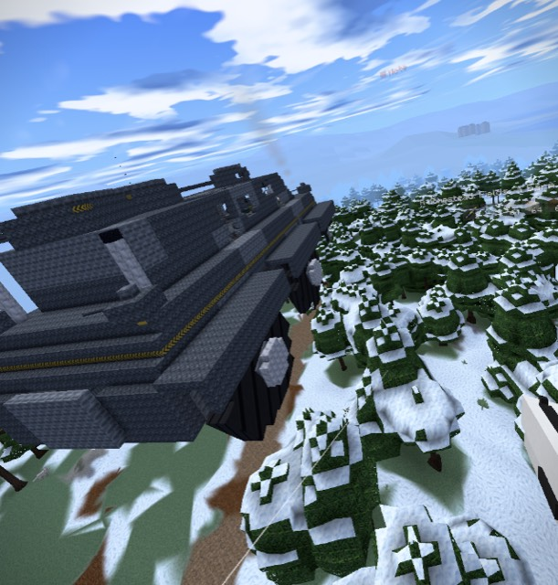

## 08:37:36 - I mean, I think I need to create logic so that the wheels are blocks a

- **Transcript:** I mean, I think I need to create logic so that the wheels are blocks and it's the blocks that carry the thing along
- **Status:** open
- **Build:** 0.129 (39e0d988, M1-M4 (device-tested; ship riding, chests, comfort options, weapon wheel))
- **World:** New World (26) (seed 530054557992772521)
- **Dimension:** Surface
- **Biome:** Snowy Taiga
- **Position:** 428.6 99.1 6893.0
- **Facing:** west (yaw 277, pitch -46)
- **Held:** Falke Pistol x1
- **Mount:** on foot, flying
- **Looking at:** nothing
- **Mode:** Creative, health 20/20
- **Time:** day 2 10:31, clear
- **Fps:** 70
- **Levels:** mic -30 dBFS, game sound -16 dBFS
- **Length:** 7.6 s (voice 4.7 s)
- **Just before:** -25s walked into Taiga; -23s walked into Snowy Taiga; -21s stopped piloting Ironback Crawler; -21s holding Falke Pistol; -17s walked into Taiga; -17s message: Flying; -15s walked into Snowy Taiga; -15s message: Homestead marked on the map; -13s message: A homestead. Fields, a barn, and a long way from town.; -5s walked into Taiga; -3s walked into Snowy Taiga
- **Position at the end:** 420.4 99.1 6929.7
- **Repro (Mac):** `./snap.sh note --seed 530054557992772521 --x 428.6 --z 6893.0 --yaw 83 --pitch -46 --time 0.188`
- **Audio (this Mac):** /Users/darthvadar/Documents/Blocksmith/QuestVoiceNotes/raw/vn-20261115-083736-486.aac

## 08:37:43 - Uh, it might be complicated, but I don't know

- **Transcript:** Uh, it might be complicated, but I don't know
- **Status:** open
- **Build:** 0.129 (39e0d988, M1-M4 (device-tested; ship riding, chests, comfort options, weapon wheel))
- **World:** New World (26) (seed 530054557992772521)
- **Dimension:** Surface
- **Biome:** Snowy Taiga
- **Position:** 432.3 99.1 6908.5
- **Facing:** west (yaw 270, pitch -34)
- **Held:** Falke Pistol x1
- **Mount:** on foot, flying
- **Looking at:** nothing
- **Mode:** Creative, health 20/20
- **Time:** day 2 10:40, clear
- **Fps:** 71
- **Levels:** mic -35 dBFS, game sound -18 dBFS
- **Length:** 3.2 s (voice 1.3 s)
- **Just before:** -29s stopped piloting Ironback Crawler; -29s holding Falke Pistol; -25s walked into Taiga; -24s message: Flying; -23s walked into Snowy Taiga; -23s message: Homestead marked on the map; -21s message: A homestead. Fields, a barn, and a long way from town.; -13s walked into Taiga; -11s walked into Snowy Taiga
- **Repro (Mac):** `./snap.sh note --seed 530054557992772521 --x 432.3 --z 6908.5 --yaw 90 --pitch -34 --time 0.195`
- **Audio (this Mac):** /Users/darthvadar/Documents/Blocksmith/QuestVoiceNotes/raw/vn-20261115-083743-986.aac

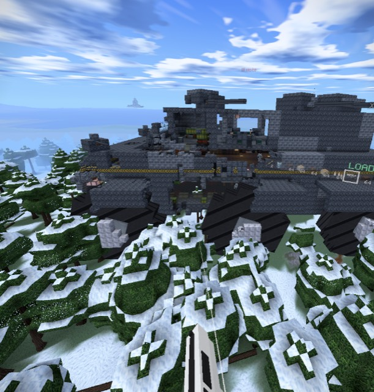

## 08:37:47 - Something for Faye will to figure out

- **Transcript:** Something for Faye will to figure out
- **Status:** open
- **Build:** 0.129 (39e0d988, M1-M4 (device-tested; ship riding, chests, comfort options, weapon wheel))
- **World:** New World (26) (seed 530054557992772521)
- **Dimension:** Surface
- **Biome:** Snowy Taiga
- **Position:** 421.7 84.1 6894.2
- **Facing:** north-west (yaw 293, pitch -22)
- **Held:** Falke Pistol x1
- **Mount:** on foot, flying
- **Looking at:** nothing
- **Mode:** Creative, health 20/20
- **Time:** day 2 10:44, clear
- **Fps:** 71
- **Levels:** mic -62 dBFS, game sound -17 dBFS
- **Length:** 2.7 s (voice 0.9 s)
- **Just before:** -28s walked into Taiga; -28s message: Flying; -26s walked into Snowy Taiga; -26s message: Homestead marked on the map; -24s message: A homestead. Fields, a barn, and a long way from town.; -16s walked into Taiga; -14s walked into Snowy Taiga; -2s message: Walking; -1s message: Flying
- **Repro (Mac):** `./snap.sh note --seed 530054557992772521 --x 421.7 --z 6894.2 --yaw 67 --pitch -22 --time 0.198`
- **Audio (this Mac):** /Users/darthvadar/Documents/Blocksmith/QuestVoiceNotes/raw/vn-20261115-083747-486.aac

## 08:37:51 - There's a complicated one

- **Transcript:** There's a complicated one
- **Status:** open
- **Build:** 0.129 (39e0d988, M1-M4 (device-tested; ship riding, chests, comfort options, weapon wheel))
- **World:** New World (26) (seed 530054557992772521)
- **Dimension:** Surface
- **Biome:** Snowy Taiga
- **Position:** 404.2 96.9 6974.2
- **Facing:** south-west (yaw 234, pitch -40)
- **Held:** Falke Pistol x1
- **Mount:** on foot, flying
- **Looking at:** nothing
- **Mode:** Creative, health 20/20
- **Time:** day 2 10:49, clear
- **Fps:** 71
- **Levels:** mic -35 dBFS, game sound -16 dBFS
- **Length:** 2.3 s (voice 0.8 s)
- **Just before:** -28s message: A homestead. Fields, a barn, and a long way from town.; -20s walked into Taiga; -18s walked into Snowy Taiga; -7s message: Walking; -5s message: Flying
- **Repro (Mac):** `./snap.sh note --seed 530054557992772521 --x 404.2 --z 6974.2 --yaw 126 --pitch -40 --time 0.201`
- **Audio (this Mac):** /Users/darthvadar/Documents/Blocksmith/QuestVoiceNotes/raw/vn-20261115-083751-546.aac

## 08:37:55 - Yeah. All right, very good

- **Transcript:** Yeah. All right, very good
- **Status:** open
- **Build:** 0.129 (39e0d988, M1-M4 (device-tested; ship riding, chests, comfort options, weapon wheel))
- **World:** New World (26) (seed 530054557992772521)
- **Dimension:** Surface
- **Biome:** Taiga
- **Position:** 343.5 113.1 6962.7
- **Facing:** south-west (yaw 216, pitch -38)
- **Held:** Falke Pistol x1
- **Mount:** on foot, flying
- **Looking at:** nothing
- **Mode:** Creative, health 20/20
- **Time:** day 2 10:53, clear
- **Fps:** 70
- **Levels:** mic -27 dBFS, game sound -20 dBFS
- **Length:** 3.1 s (voice 1.5 s)
- **Just before:** -24s walked into Taiga; -22s walked into Snowy Taiga; -10s message: Walking; -9s message: Flying
- **Repro (Mac):** `./snap.sh note --seed 530054557992772521 --x 343.5 --z 6962.7 --yaw 144 --pitch -38 --time 0.204`
- **Audio (this Mac):** /Users/darthvadar/Documents/Blocksmith/QuestVoiceNotes/raw/vn-20261115-083755-066.aac

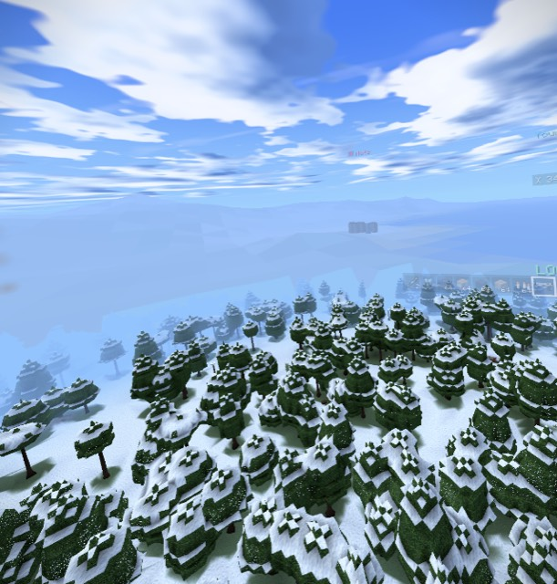

## 08:38:36 - Am I escorting somebody? Like

- **Transcript:** Am I escorting somebody? Like
- **Status:** open
- **Build:** 0.129 (39e0d988, M1-M4 (device-tested; ship riding, chests, comfort options, weapon wheel))
- **World:** New World (26) (seed 530054557992772521)
- **Dimension:** Surface
- **Biome:** Snowy Plains
- **Position:** 101.8 75.4 7336.1
- **Facing:** east (yaw 101, pitch -33)
- **Held:** Birch Log x64
- **Mount:** on foot
- **Looking at:** Snowy Grass Block at 104 74 7336
- **Mode:** Survival, health 20/20
- **Time:** day 2 11:42, clear
- **Fps:** 70
- **Levels:** mic -28 dBFS, game sound -21 dBFS
- **Length:** 3.5 s (voice 1.4 s)
- **Just before:** -28s message: Harlan Underhill: New in town? I keep a list. You're on it.; -27s opened PauseMenu; -26s closed PauseMenu; -25s message: Harlan Underhill: Peaceful town. Let's keep it that way.; -25s opened NoticeBoardMenu; -22s message: Survival mode; -21s message: Survival mode. Added to journal: Contract: Escort Cora Quill; -18s message: Harlan Underhill: Looking for work? Here's what's posted.; -15s message: Tracking Contract: Escort Cora Quill; -14s closed NoticeBoardMenu; -5s message: Calvin Merriweather: They found an old wagon wheel in the creek. Nobody knows whose.
- **Repro (Mac):** `./snap.sh note --seed 530054557992772521 --x 101.8 --z 7336.1 --yaw -101 --pitch -33 --time 0.238`
- **Audio (this Mac):** /Users/darthvadar/Documents/Blocksmith/QuestVoiceNotes/raw/vn-20261115-083836-886.aac

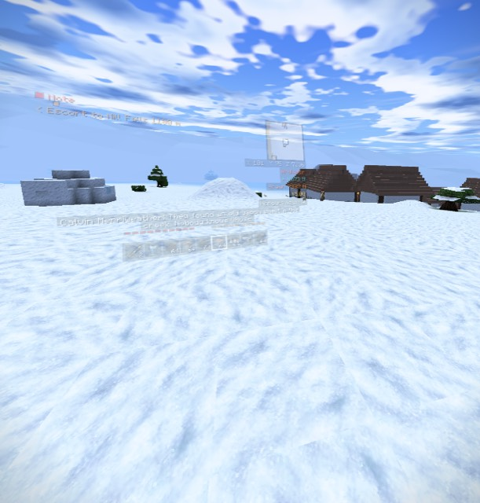

## 08:38:40 - Oh, okay

- **Transcript:** Oh, okay
- **Status:** open
- **Build:** 0.129 (39e0d988, M1-M4 (device-tested; ship riding, chests, comfort options, weapon wheel))
- **World:** New World (26) (seed 530054557992772521)
- **Dimension:** Surface
- **Biome:** Snowy Plains
- **Position:** 105.4 75.6 7328.1
- **Facing:** east (yaw 89, pitch -48)
- **Held:** Birch Log x64
- **Mount:** on foot
- **Looking at:** Snow at 106 76 7328
- **Mode:** Survival, health 20/20
- **Time:** day 2 11:46, clear
- **Fps:** 70
- **Levels:** mic -26 dBFS, game sound -21 dBFS
- **Length:** 1.9 s (voice 0.5 s)
- **Just before:** -29s closed PauseMenu; -29s message: Harlan Underhill: Peaceful town. Let's keep it that way.; -29s opened NoticeBoardMenu; -26s message: Survival mode; -25s message: Survival mode. Added to journal: Contract: Escort Cora Quill; -22s message: Harlan Underhill: Looking for work? Here's what's posted.; -19s message: Tracking Contract: Escort Cora Quill; -18s closed NoticeBoardMenu; -8s message: Calvin Merriweather: They found an old wagon wheel in the creek. Nobody knows whose.
- **Repro (Mac):** `./snap.sh note --seed 530054557992772521 --x 105.4 --z 7328.1 --yaw -89 --pitch -48 --time 0.240`
- **Audio (this Mac):** /Users/darthvadar/Documents/Blocksmith/QuestVoiceNotes/raw/vn-20261115-083840-346.aac

## 08:38:45 - I see. Uh, that's gonna need some work. He needs to follow me

- **Transcript:** I see. Uh, that's gonna need some work. He needs to follow me
- **Status:** open
- **Build:** 0.129 (39e0d988, M1-M4 (device-tested; ship riding, chests, comfort options, weapon wheel))
- **World:** New World (26) (seed 530054557992772521)
- **Dimension:** Surface
- **Biome:** Snowy Plains
- **Position:** 135.9 75.8 7295.7
- **Facing:** south-east (yaw 138, pitch -17)
- **Held:** Birch Log x64
- **Mount:** on foot
- **Looking at:** Spruce Leaves at 136 77 7297
- **Mode:** Survival, health 20/20
- **Time:** day 2 11:52, clear
- **Fps:** 70
- **Levels:** mic -47 dBFS, game sound -18 dBFS
- **Length:** 5.1 s (voice 2.4 s)
- **Just before:** -30s message: Survival mode. Added to journal: Contract: Escort Cora Quill; -27s message: Harlan Underhill: Looking for work? Here's what's posted.; -24s message: Tracking Contract: Escort Cora Quill; -23s closed NoticeBoardMenu; -13s message: Calvin Merriweather: They found an old wagon wheel in the creek. Nobody knows whose.
- **Repro (Mac):** `./snap.sh note --seed 530054557992772521 --x 135.9 --z 7295.7 --yaw -138 --pitch -17 --time 0.245`
- **Audio (this Mac):** /Users/darthvadar/Documents/Blocksmith/QuestVoiceNotes/raw/vn-20261115-083845-566.aac

## 08:38:51 - You should also be able to ride in the back of my horse if I had one

- **Transcript:** You should also be able to ride in the back of my horse if I had one
- **Status:** open
- **Build:** 0.129 (39e0d988, M1-M4 (device-tested; ship riding, chests, comfort options, weapon wheel))
- **World:** New World (26) (seed 530054557992772521)
- **Dimension:** Surface
- **Biome:** Snowy Plains
- **Position:** 165.9 75.8 7270.5
- **Facing:** north-east (yaw 34, pitch -61)
- **Held:** Birch Log x64
- **Mount:** on foot
- **Looking at:** Snow at 166 76 7270
- **Mode:** Survival, health 20/20
- **Time:** day 2 11:59, clear
- **Fps:** 68
- **Levels:** mic -39 dBFS, game sound -18 dBFS
- **Length:** 4.1 s (voice 2.4 s)
- **Just before:** -30s message: Tracking Contract: Escort Cora Quill; -29s closed NoticeBoardMenu; -19s message: Calvin Merriweather: They found an old wagon wheel in the creek. Nobody knows whose.
- **Repro (Mac):** `./snap.sh note --seed 530054557992772521 --x 165.9 --z 7270.5 --yaw -34 --pitch -61 --time 0.250`
- **Audio (this Mac):** /Users/darthvadar/Documents/Blocksmith/QuestVoiceNotes/raw/vn-20261115-083851-526.aac

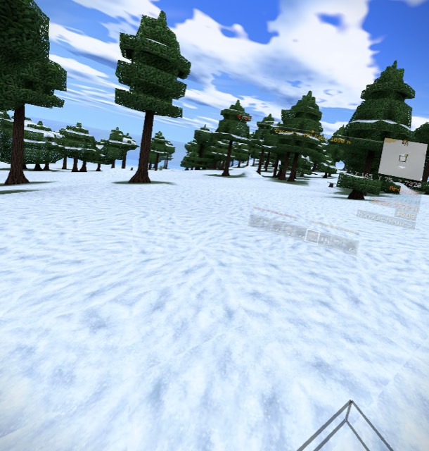

## 08:39:05 - Oh yes, the thin ice

- **Transcript:** Oh yes, the thin ice
- **Status:** open
- **Build:** 0.129 (39e0d988, M1-M4 (device-tested; ship riding, chests, comfort options, weapon wheel))
- **World:** New World (26) (seed 530054557992772521)
- **Dimension:** Surface
- **Biome:** Beach
- **Position:** 157.4 63.4 7167.1
- **Facing:** west (yaw 287, pitch -48)
- **Held:** Birch Log x64
- **Mount:** on foot
- **Looking at:** Sand at 155 62 7166
- **Mode:** Survival, health 20/20
- **Time:** day 2 12:16, clear
- **Fps:** 70
- **Levels:** mic -27 dBFS, game sound -18 dBFS
- **Length:** 2.8 s (voice 1.2 s)
- **Just before:** -8s walked into Snowy Taiga; -2s walked into Snowy Plains; -0s walked into Beach
- **Repro (Mac):** `./snap.sh note --seed 530054557992772521 --x 157.4 --z 7167.1 --yaw 73 --pitch -48 --time 0.262`
- **Audio (this Mac):** /Users/darthvadar/Documents/Blocksmith/QuestVoiceNotes/raw/vn-20261115-083905-866.aac

## 08:39:11 - Shooting at ice should put bullet holes in it

- **Transcript:** Shooting at ice should put bullet holes in it
- **Status:** open
- **Build:** 0.129 (39e0d988, M1-M4 (device-tested; ship riding, chests, comfort options, weapon wheel))
- **World:** New World (26) (seed 530054557992772521)
- **Dimension:** Surface
- **Biome:** Cold Ocean
- **Position:** 144.6 63.0 7152.1
- **Facing:** north-west (yaw 293, pitch -17)
- **Held:** Falke Pistol x1
- **Mount:** on foot
- **Looking at:** Sheet Ice at 140 62 7150
- **Mode:** Survival, health 20/20
- **Time:** day 2 12:23, clear
- **Fps:** 70
- **Levels:** mic -47 dBFS, game sound -14 dBFS
- **Length:** 3.1 s (voice 1.4 s)
- **Just before:** -14s walked into Snowy Taiga; -8s walked into Snowy Plains; -6s walked into Beach; -5s holding Capital Rounds; -5s message: Capital Rounds; -5s holding Falke Pistol; -5s message: Falke Pistol; -4s walked into Cold Ocean; -2s message: Loaded: 18 / 18
- **Repro (Mac):** `./snap.sh note --seed 530054557992772521 --x 144.6 --z 7152.1 --yaw 67 --pitch -17 --time 0.266`
- **Audio (this Mac):** /Users/darthvadar/Documents/Blocksmith/QuestVoiceNotes/raw/vn-20261115-083911-286.aac

## 08:39:17 - Uh, we're gonna need Fable to compile a list of things it thinks it ne

- **Transcript:** Uh, we're gonna need Fable to compile a list of things it thinks it needs sounds for from 11 Labs
- **Status:** open
- **Build:** 0.129 (39e0d988, M1-M4 (device-tested; ship riding, chests, comfort options, weapon wheel))
- **World:** New World (26) (seed 530054557992772521)
- **Dimension:** Surface
- **Biome:** Cold Ocean
- **Position:** 131.0 63.0 7110.4
- **Facing:** north-west (yaw 316, pitch -30)
- **Held:** Falke Pistol x1
- **Mount:** on foot
- **Looking at:** Sheet Ice at 129 62 7108
- **Mode:** Survival, health 20/20
- **Time:** day 2 12:30, clear
- **Fps:** 71
- **Levels:** mic -27 dBFS, game sound -20 dBFS
- **Length:** 6.9 s (voice 3.9 s)
- **Just before:** -20s walked into Snowy Taiga; -14s walked into Snowy Plains; -12s walked into Beach; -12s holding Capital Rounds; -12s message: Capital Rounds; -11s holding Falke Pistol; -11s message: Falke Pistol; -10s walked into Cold Ocean; -8s message: Loaded: 18 / 18
- **Position at the end:** 121.0 63.0 7070.1
- **Repro (Mac):** `./snap.sh note --seed 530054557992772521 --x 131.0 --z 7110.4 --yaw 44 --pitch -30 --time 0.271`
- **Audio (this Mac):** /Users/darthvadar/Documents/Blocksmith/QuestVoiceNotes/raw/vn-20261115-083917-626.aac

## 08:39:25 - Oh, this ain't bad, Rice. It's not bad at all

- **Transcript:** Oh, this ain't bad, Rice. It's not bad at all
- **Status:** open
- **Build:** 0.129 (39e0d988, M1-M4 (device-tested; ship riding, chests, comfort options, weapon wheel))
- **World:** New World (26) (seed 530054557992772521)
- **Dimension:** Surface
- **Biome:** Cold Ocean
- **Position:** 113.5 63.0 7066.9
- **Facing:** north-west (yaw 293, pitch -37)
- **Held:** Falke Pistol x1
- **Mount:** on foot
- **Looking at:** Sheet Ice at 111 62 7066
- **Mode:** Survival, health 20/20
- **Time:** day 2 12:40, clear
- **Fps:** 70
- **Levels:** mic -26 dBFS, game sound -21 dBFS
- **Length:** 3.8 s (voice 1.8 s)
- **Just before:** -28s walked into Snowy Taiga; -22s walked into Snowy Plains; -20s walked into Beach; -20s holding Capital Rounds; -20s message: Capital Rounds; -19s holding Falke Pistol; -19s message: Falke Pistol; -18s walked into Cold Ocean; -16s message: Loaded: 18 / 18
- **Repro (Mac):** `./snap.sh note --seed 530054557992772521 --x 113.5 --z 7066.9 --yaw 67 --pitch -37 --time 0.278`
- **Audio (this Mac):** /Users/darthvadar/Documents/Blocksmith/QuestVoiceNotes/raw/vn-20261115-083925-666.aac

## 08:40:22 - What the flippity? Is it a well? What is this?

- **Transcript:** What the flippity? Is it a well? What is this?
- **Status:** open
- **Build:** 0.129 (39e0d988, M1-M4 (device-tested; ship riding, chests, comfort options, weapon wheel))
- **World:** New World (26) (seed 530054557992772521)
- **Dimension:** Surface
- **Biome:** Snowy Taiga
- **Position:** 165.8 69.9 6720.2
- **Facing:** west (yaw 266, pitch -35)
- **Held:** Falke Pistol x1
- **Mount:** on foot
- **Looking at:** Snow at 164 70 6720
- **Mode:** Survival, health 20/20
- **Time:** day 2 13:48, clear
- **Fps:** 71
- **Levels:** mic -37 dBFS, game sound -19 dBFS
- **Length:** 4.2 s (voice 1.5 s)
- **Just before:** -29s message: Loaded: 18 / 18; -27s walked into Snowy Taiga; -25s took 1 damage (health 19/20); -24s message: Ardisdor - Torisheim border post marked on the map; -23s walked into Taiga; -19s holding Capital Rounds; -19s message: Capital Rounds; -19s holding Falke Pistol; -19s message: Falke Pistol; -19s holding Capital Rounds; -19s message: Capital Rounds; -18s holding Falke Pistol; -18s message: Falke Pistol; -17s walked into Snowy Taiga; -10s message: Road agents!
- **Repro (Mac):** `./snap.sh note --seed 530054557992772521 --x 165.8 --z 6720.2 --yaw 94 --pitch -35 --time 0.326`
- **Audio (this Mac):** /Users/darthvadar/Documents/Blocksmith/QuestVoiceNotes/raw/vn-20261115-084022-606.aac

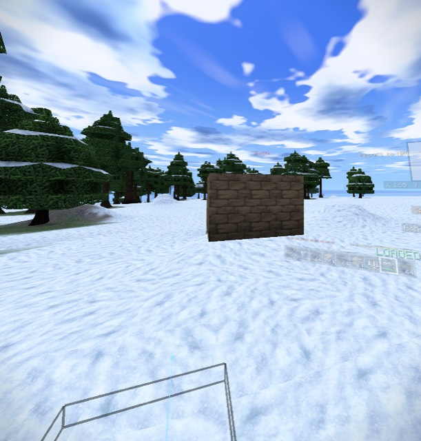

## 08:41:05 - That should cause an immediate failure of the, of the quest

- **Transcript:** That should cause an immediate failure of the, of the quest
- **Status:** open
- **Build:** 0.129 (39e0d988, M1-M4 (device-tested; ship riding, chests, comfort options, weapon wheel))
- **World:** New World (26) (seed 530054557992772521)
- **Dimension:** Surface
- **Biome:** Snowy Taiga
- **Position:** 146.5 69.5 6710.0
- **Facing:** south (yaw 179, pitch -14)
- **Held:** Falke Pistol x1
- **Mount:** on foot
- **Looking at:** Spruce Log at 146 69 6715
- **Mode:** Creative, health 20/20
- **Time:** day 2 14:39, clear
- **Fps:** 71
- **Levels:** mic -33 dBFS, game sound -18 dBFS
- **Length:** 5.5 s (voice 2.3 s)
- **Just before:** -28s walked into Snowy Plains; -26s walked into Snowy Taiga; -24s walked into Snowy Plains; -23s opened PauseMenu; -22s message: Creative mode; -22s closed PauseMenu; -20s walked into Snowy Taiga; -13s message: Calvin Merriweather: They say a soldier deserted and hides in the hills.; -10s walked into Snowy Plains; -8s walked into Snowy Taiga; -8s holding Birch Log; -8s message: Birch Log; -7s holding Spruce Log; -7s message: Spruce Log; -6s holding Birch Log; -6s message: Birch Log; -6s holding Capital Rounds; -6s message: Capital Rounds; -6s holding Falke Pistol; -6s message: Falke Pistol; -6s message: Calvin Merriweather: Don't shoot, I've got kids!; -2s walked into Snowy Plains; -0s walked into Snowy Taiga
- **While talking:** -4s holding Spruce Log; -4s message: Spruce Log; -3s holding Combat Stim; -3s message: Combat Stim; -3s holding Titanium Chestplate; -3s message: Titanium Chestplate; -2s holding Spruce Log; -2s message: Spruce Log; -2s holding Birch Log; -2s message: Birch Log; -1s walked into Snowy Plains
- **Position at the end:** 145.8 70.0 6711.3
- **Repro (Mac):** `./snap.sh note --seed 530054557992772521 --x 146.5 --z 6710.0 --yaw -179 --pitch -14 --time 0.361`
- **Audio (this Mac):** /Users/darthvadar/Documents/Blocksmith/QuestVoiceNotes/raw/vn-20261115-084105-966.aac

## 08:41:12 - 'Cause I kill them

- **Transcript:** 'Cause I kill them
- **Status:** open
- **Build:** 0.129 (39e0d988, M1-M4 (device-tested; ship riding, chests, comfort options, weapon wheel))
- **World:** New World (26) (seed 530054557992772521)
- **Dimension:** Surface
- **Biome:** Snowy Plains
- **Position:** 145.8 70.0 6711.3
- **Facing:** south (yaw 199, pitch -44)
- **Held:** Birch Log x64
- **Mount:** on foot
- **Looking at:** Snowy Grass Block at 145 68 6713
- **Mode:** Creative, health 20/20
- **Time:** day 2 14:47, clear
- **Fps:** 71
- **Levels:** mic -33 dBFS, game sound -20 dBFS
- **Length:** 1.8 s (voice 0.4 s)
- **Just before:** -29s opened PauseMenu; -29s message: Creative mode; -28s closed PauseMenu; -27s walked into Snowy Taiga; -20s message: Calvin Merriweather: They say a soldier deserted and hides in the hills.; -17s walked into Snowy Plains; -15s walked into Snowy Taiga; -14s holding Birch Log; -14s message: Birch Log; -13s holding Spruce Log; -13s message: Spruce Log; -13s holding Birch Log; -13s message: Birch Log; -13s holding Capital Rounds; -13s message: Capital Rounds; -13s holding Falke Pistol; -13s message: Falke Pistol; -12s message: Calvin Merriweather: Don't shoot, I've got kids!; -9s walked into Snowy Plains; -7s walked into Snowy Taiga; -5s holding Spruce Log; -5s message: Spruce Log; -5s holding Combat Stim; -5s message: Combat Stim; -4s holding Titanium Chestplate; -4s message: Titanium Chestplate; -4s holding Spruce Log; -4s message: Spruce Log; -4s holding Birch Log; -4s message: Birch Log; -3s walked into Snowy Plains
- **Repro (Mac):** `./snap.sh note --seed 530054557992772521 --x 145.8 --z 6711.3 --yaw 161 --pitch -44 --time 0.366`
- **Audio (this Mac):** /Users/darthvadar/Documents/Blocksmith/QuestVoiceNotes/raw/vn-20261115-084112-527.aac

## 08:41:22 - So we still got the procedural log generation we want going

- **Transcript:** So we still got the procedural log generation we want going
- **Status:** open
- **Build:** 0.129 (39e0d988, M1-M4 (device-tested; ship riding, chests, comfort options, weapon wheel))
- **World:** New World (26) (seed 530054557992772521)
- **Dimension:** Surface
- **Biome:** Snowy Plains
- **Position:** 145.4 70.0 6712.0
- **Facing:** south-west (yaw 215, pitch -77)
- **Held:** Birch Log x64
- **Mount:** on foot
- **Looking at:** Birch Log at 145 68 6712
- **Mode:** Creative, health 20/20
- **Time:** day 2 14:59, clear
- **Fps:** 70
- **Levels:** mic -25 dBFS, game sound -18 dBFS
- **Length:** 4.8 s (voice 2.7 s)
- **Just before:** -29s message: Calvin Merriweather: They say a soldier deserted and hides in the hills.; -26s walked into Snowy Plains; -24s walked into Snowy Taiga; -24s holding Birch Log; -24s message: Birch Log; -23s holding Spruce Log; -23s message: Spruce Log; -22s holding Birch Log; -22s message: Birch Log; -22s holding Capital Rounds; -22s message: Capital Rounds; -22s holding Falke Pistol; -22s message: Falke Pistol; -22s message: Calvin Merriweather: Don't shoot, I've got kids!; -18s walked into Snowy Plains; -16s walked into Snowy Taiga; -15s holding Spruce Log; -15s message: Spruce Log; -14s holding Combat Stim; -14s message: Combat Stim; -14s holding Titanium Chestplate; -14s message: Titanium Chestplate; -14s holding Spruce Log; -14s message: Spruce Log; -13s holding Birch Log; -13s message: Birch Log; -12s walked into Snowy Plains
- **Repro (Mac):** `./snap.sh note --seed 530054557992772521 --x 145.4 --z 6712.0 --yaw 145 --pitch -77 --time 0.374`
- **Audio (this Mac):** /Users/darthvadar/Documents/Blocksmith/QuestVoiceNotes/raw/vn-20261115-084122-046.aac

## 08:41:33 - Uh-oh. We got a little bit of an error happening

- **Transcript:** Uh-oh. We got a little bit of an error happening
- **Status:** open
- **Build:** 0.129 (39e0d988, M1-M4 (device-tested; ship riding, chests, comfort options, weapon wheel))
- **World:** New World (26) (seed 530054557992772521)
- **Dimension:** Surface
- **Biome:** Snowy Plains
- **Position:** 145.5 70.0 6712.0
- **Facing:** south (yaw 180, pitch -62)
- **Held:** Oak Planks x64
- **Mount:** on foot
- **Looking at:** Snowy Grass Block at 145 68 6713
- **Mode:** Creative, health 20/20
- **Time:** day 2 15:11, clear
- **Fps:** 61
- **Levels:** mic -29 dBFS, game sound -18 dBFS
- **Length:** 3.4 s (voice 1.9 s)
- **Just before:** -29s walked into Snowy Plains; -27s walked into Snowy Taiga; -26s holding Spruce Log; -26s message: Spruce Log; -25s holding Combat Stim; -25s message: Combat Stim; -25s holding Titanium Chestplate; -25s message: Titanium Chestplate; -25s holding Spruce Log; -25s message: Spruce Log; -24s holding Birch Log; -24s message: Birch Log; -23s walked into Snowy Plains; -8s opened PauseMenu; -8s closed PauseMenu; -8s opened CreativeMenu; -6s closed CreativeMenu; -5s holding Oak Planks; -5s message: Oak Planks
- **Repro (Mac):** `./snap.sh note --seed 530054557992772521 --x 145.5 --z 6712.0 --yaw -180 --pitch -62 --time 0.383`
- **Audio (this Mac):** /Users/darthvadar/Documents/Blocksmith/QuestVoiceNotes/raw/vn-20261115-084133-146.aac

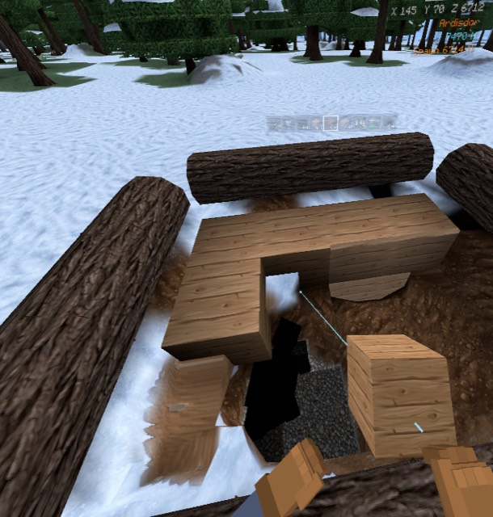

## 08:41:36 - I place a block there, a block under it and on top forms at once. When

- **Transcript:** I place a block there, a block under it and on top forms at once. When I break it, they both go away
- **Status:** open
- **Build:** 0.129 (39e0d988, M1-M4 (device-tested; ship riding, chests, comfort options, weapon wheel))
- **World:** New World (26) (seed 530054557992772521)
- **Dimension:** Surface
- **Biome:** Snowy Plains
- **Position:** 145.5 70.0 6712.0
- **Facing:** south (yaw 167, pitch -71)
- **Held:** Oak Planks x64
- **Mount:** on foot
- **Looking at:** Oak Planks at 145 69 6713
- **Mode:** Creative, health 20/20
- **Time:** day 2 15:15, clear
- **Fps:** 70
- **Levels:** mic -56 dBFS, game sound -14 dBFS
- **Length:** 7.0 s (voice 3.9 s)
- **Just before:** -29s holding Spruce Log; -29s message: Spruce Log; -29s holding Combat Stim; -29s message: Combat Stim; -28s holding Titanium Chestplate; -28s message: Titanium Chestplate; -28s holding Spruce Log; -28s message: Spruce Log; -28s holding Birch Log; -28s message: Birch Log; -27s walked into Snowy Plains; -12s opened PauseMenu; -11s closed PauseMenu; -11s opened CreativeMenu; -10s closed CreativeMenu; -9s holding Oak Planks; -9s message: Oak Planks
- **Position at the end:** 145.5 70.0 6712.0
- **Repro (Mac):** `./snap.sh note --seed 530054557992772521 --x 145.5 --z 6712.0 --yaw -167 --pitch -71 --time 0.386`
- **Audio (this Mac):** /Users/darthvadar/Documents/Blocksmith/QuestVoiceNotes/raw/vn-20261115-084136-606.aac

## 08:41:43 - Look at that. What the fuck?

- **Transcript:** Look at that. What the fuck?
- **Status:** open
- **Build:** 0.129 (39e0d988, M1-M4 (device-tested; ship riding, chests, comfort options, weapon wheel))
- **World:** New World (26) (seed 530054557992772521)
- **Dimension:** Surface
- **Biome:** Snowy Plains
- **Position:** 145.5 70.0 6712.0
- **Facing:** south (yaw 184, pitch -69)
- **Held:** Oak Planks x64
- **Mount:** on foot
- **Looking at:** Oak Planks at 145 67 6713
- **Mode:** Creative, health 20/20
- **Time:** day 2 15:24, clear
- **Fps:** 71
- **Levels:** mic -38 dBFS, game sound -18 dBFS
- **Length:** 2.6 s (voice 0.6 s)
- **Just before:** -19s opened PauseMenu; -18s closed PauseMenu; -18s opened CreativeMenu; -16s closed CreativeMenu; -15s holding Oak Planks; -15s message: Oak Planks
- **Repro (Mac):** `./snap.sh note --seed 530054557992772521 --x 145.5 --z 6712.0 --yaw 176 --pitch -69 --time 0.392`
- **Audio (this Mac):** /Users/darthvadar/Documents/Blocksmith/QuestVoiceNotes/raw/vn-20261115-084143-446.aac

## 08:41:50 - I don't know why that's happening

- **Transcript:** I don't know why that's happening
- **Status:** open
- **Build:** 0.129 (39e0d988, M1-M4 (device-tested; ship riding, chests, comfort options, weapon wheel))
- **World:** New World (26) (seed 530054557992772521)
- **Dimension:** Surface
- **Biome:** Snowy Plains
- **Position:** 144.4 70.0 6712.2
- **Facing:** south-east (yaw 147, pitch -63)
- **Held:** Oak Planks x64
- **Mount:** on foot
- **Looking at:** Oak Planks at 145 69 6713
- **Mode:** Creative, health 20/20
- **Time:** day 2 15:32, clear
- **Fps:** 70
- **Levels:** mic -37 dBFS, game sound -21 dBFS
- **Length:** 2.7 s (voice 1.2 s)
- **Just before:** -26s opened PauseMenu; -25s closed PauseMenu; -25s opened CreativeMenu; -23s closed CreativeMenu; -23s holding Oak Planks; -23s message: Oak Planks
- **Repro (Mac):** `./snap.sh note --seed 530054557992772521 --x 144.4 --z 6712.2 --yaw -147 --pitch -63 --time 0.398`
- **Audio (this Mac):** /Users/darthvadar/Documents/Blocksmith/QuestVoiceNotes/raw/vn-20261115-084150-486.aac

## 08:41:55 - I can't make it not happen, in fact

- **Transcript:** I can't make it not happen, in fact
- **Status:** open
- **Build:** 0.129 (39e0d988, M1-M4 (device-tested; ship riding, chests, comfort options, weapon wheel))
- **World:** New World (26) (seed 530054557992772521)
- **Dimension:** Surface
- **Biome:** Snowy Taiga
- **Position:** 146.3 69.0 6712.9
- **Facing:** south-west (yaw 245, pitch -71)
- **Held:** Oak Planks x64
- **Mount:** on foot
- **Looking at:** Oak Planks at 145 67 6713
- **Mode:** Creative, health 20/20
- **Time:** day 2 15:37, clear
- **Fps:** 70
- **Levels:** mic -25 dBFS, game sound -19 dBFS
- **Length:** 2.7 s (voice 1.1 s)
- **Just before:** -30s closed PauseMenu; -29s opened CreativeMenu; -28s closed CreativeMenu; -27s holding Oak Planks; -27s message: Oak Planks; -1s walked into Snowy Taiga
- **Repro (Mac):** `./snap.sh note --seed 530054557992772521 --x 146.3 --z 6712.9 --yaw 115 --pitch -71 --time 0.401`
- **Audio (this Mac):** /Users/darthvadar/Documents/Blocksmith/QuestVoiceNotes/raw/vn-20261115-084155-026.aac

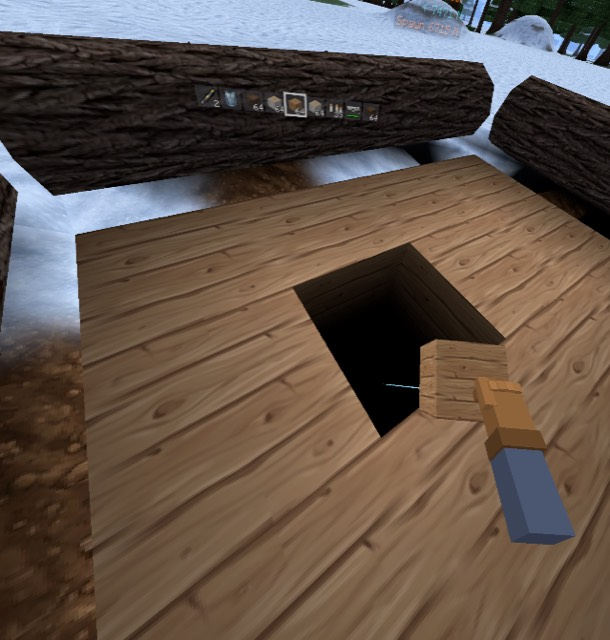

## 08:41:58 - The, uh, a block constantly forms right here when I press it

- **Transcript:** The, uh, a block constantly forms right here when I press it
- **Status:** open
- **Build:** 0.129 (39e0d988, M1-M4 (device-tested; ship riding, chests, comfort options, weapon wheel))
- **World:** New World (26) (seed 530054557992772521)
- **Dimension:** Surface
- **Biome:** Snowy Plains
- **Position:** 145.6 69.0 6712.6
- **Facing:** south (yaw 195, pitch -59)
- **Held:** Oak Planks x64
- **Mount:** on foot
- **Looking at:** Oak Planks at 145 69 6713
- **Mode:** Creative, health 20/20
- **Time:** day 2 15:41, clear
- **Fps:** 70
- **Levels:** mic -32 dBFS, game sound -16 dBFS
- **Length:** 4.8 s (voice 2.6 s)
- **Just before:** -4s walked into Snowy Taiga
- **Repro (Mac):** `./snap.sh note --seed 530054557992772521 --x 145.6 --z 6712.6 --yaw 165 --pitch -59 --time 0.404`
- **Audio (this Mac):** /Users/darthvadar/Documents/Blocksmith/QuestVoiceNotes/raw/vn-20261115-084158-006.aac

## 08:42:05 - So I don't know why a block forms on top when I place a block here

- **Transcript:** So I don't know why a block forms on top when I place a block here
- **Status:** open
- **Build:** 0.129 (39e0d988, M1-M4 (device-tested; ship riding, chests, comfort options, weapon wheel))
- **World:** New World (26) (seed 530054557992772521)
- **Dimension:** Surface
- **Biome:** Snowy Plains
- **Position:** 145.7 70.0 6712.0
- **Facing:** south (yaw 192, pitch -62)
- **Held:** Birch Log x64
- **Mount:** on foot
- **Looking at:** Oak Planks at 145 67 6713
- **Mode:** Creative, health 20/20
- **Time:** day 2 15:50, clear
- **Fps:** 69
- **Levels:** mic -32 dBFS, game sound -20 dBFS
- **Length:** 5.1 s (voice 2.7 s)
- **Just before:** -11s walked into Snowy Taiga; -7s walked into Snowy Plains; -4s holding Birch Log; -4s message: Birch Log
- **Repro (Mac):** `./snap.sh note --seed 530054557992772521 --x 145.7 --z 6712.0 --yaw 168 --pitch -62 --time 0.410`
- **Audio (this Mac):** /Users/darthvadar/Documents/Blocksmith/QuestVoiceNotes/raw/vn-20261115-084205-466.aac

## 08:42:10 - Block there. See there's nothing inside. Place a block. It's over top.

- **Transcript:** Block there. See there's nothing inside. Place a block. It's over top. I don't know what's going on there
- **Status:** open
- **Build:** 0.129 (39e0d988, M1-M4 (device-tested; ship riding, chests, comfort options, weapon wheel))
- **World:** New World (26) (seed 530054557992772521)
- **Dimension:** Surface
- **Biome:** Snowy Plains
- **Position:** 145.6 70.0 6712.0
- **Facing:** south (yaw 182, pitch -60)
- **Held:** Oak Planks x64
- **Mount:** on foot
- **Looking at:** Oak Planks at 145 68 6714
- **Mode:** Creative, health 20/20
- **Time:** day 2 15:57, clear
- **Fps:** 70
- **Levels:** mic -28 dBFS, game sound -16 dBFS
- **Length:** 7.1 s (voice 3.4 s)
- **Just before:** -17s walked into Snowy Taiga; -13s walked into Snowy Plains; -9s holding Birch Log; -9s message: Birch Log; -4s holding Oak Planks; -4s message: Oak Planks
- **Position at the end:** 144.3 70.0 6711.9
- **Repro (Mac):** `./snap.sh note --seed 530054557992772521 --x 145.6 --z 6712.0 --yaw 178 --pitch -60 --time 0.415`
- **Audio (this Mac):** /Users/darthvadar/Documents/Blocksmith/QuestVoiceNotes/raw/vn-20261115-084210-926.aac

## 08:44:00 - Yeah, that's not right

- **Transcript:** Yeah, that's not right
- **Status:** open
- **Build:** 0.129 (39e0d988, M1-M4 (device-tested; ship riding, chests, comfort options, weapon wheel))
- **World:** New World (26) (seed 530054557992772521)
- **Dimension:** Surface
- **Biome:** Snowy Plains
- **Position:** 147.4 69.2 6717.1
- **Facing:** west (yaw 288, pitch -41)
- **Held:** Gray Concrete x64
- **Mount:** on foot
- **Looking at:** Gray Concrete at 144 68 6716
- **Mode:** Creative, health 20/20
- **Time:** day 2 18:06, clear
- **Fps:** 71
- **Levels:** mic -33 dBFS, game sound -25 dBFS
- **Length:** 2.6 s (voice 1.1 s)
- **Just before:** -25s closed CreativeMenu; -24s holding Gray Concrete; -24s message: Gray Concrete; -24s walked into Snowy Plains; -4s walked into Snowy Taiga; -2s walked into Snowy Plains
- **Repro (Mac):** `./snap.sh note --seed 530054557992772521 --x 147.4 --z 6717.1 --yaw 72 --pitch -41 --time 0.505`
- **Audio (this Mac):** /Users/darthvadar/Documents/Blocksmith/QuestVoiceNotes/raw/vn-20261115-084400-266.aac

## 08:44:03 - I can't place a block in this gap without it placing two

- **Transcript:** I can't place a block in this gap without it placing two
- **Status:** open
- **Build:** 0.129 (39e0d988, M1-M4 (device-tested; ship riding, chests, comfort options, weapon wheel))
- **World:** New World (26) (seed 530054557992772521)
- **Dimension:** Surface
- **Biome:** Snowy Plains
- **Position:** 145.6 69.2 6717.9
- **Facing:** north (yaw 357, pitch -50)
- **Held:** Gray Concrete x64
- **Mount:** on foot
- **Looking at:** Snowy Grass Block at 145 68 6716
- **Mode:** Creative, health 20/20
- **Time:** day 2 18:10, clear
- **Fps:** 71
- **Levels:** mic -55 dBFS, game sound -24 dBFS
- **Length:** 4.5 s (voice 1.8 s)
- **Just before:** -28s closed CreativeMenu; -28s holding Gray Concrete; -28s message: Gray Concrete; -27s walked into Snowy Plains; -7s walked into Snowy Taiga; -5s walked into Snowy Plains; -1s walked into Snowy Taiga
- **Repro (Mac):** `./snap.sh note --seed 530054557992772521 --x 145.6 --z 6717.9 --yaw 3 --pitch -50 --time 0.507`
- **Audio (this Mac):** /Users/darthvadar/Documents/Blocksmith/QuestVoiceNotes/raw/vn-20261115-084403-566.aac

## 08:44:11 - Well, good

- **Transcript:** Well, good
- **Status:** open
- **Build:** 0.129 (39e0d988, M1-M4 (device-tested; ship riding, chests, comfort options, weapon wheel))
- **World:** New World (26) (seed 530054557992772521)
- **Dimension:** Surface
- **Biome:** Snowy Plains
- **Position:** 144.1 69.1 6720.9
- **Facing:** north-west (yaw 327, pitch -31)
- **Held:** Gray Concrete x64
- **Mount:** on foot
- **Looking at:** Snowy Grass Block at 142 68 6718
- **Mode:** Creative, health 20/20
- **Time:** day 2 18:20, clear
- **Fps:** 70
- **Levels:** mic -41 dBFS, game sound -23 dBFS
- **Length:** 2.0 s (voice 0.4 s)
- **Just before:** -15s walked into Snowy Taiga; -13s walked into Snowy Plains; -9s walked into Snowy Taiga; -7s walked into Snowy Plains; -1s message: Your pack is full: the Spruce Log stays on the ground
- **Repro (Mac):** `./snap.sh note --seed 530054557992772521 --x 144.1 --z 6720.9 --yaw 33 --pitch -31 --time 0.514`
- **Audio (this Mac):** /Users/darthvadar/Documents/Blocksmith/QuestVoiceNotes/raw/vn-20261115-084411-806.aac

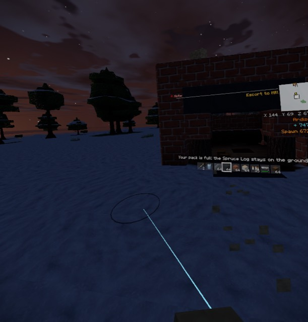

## 08:44:58 - Can't place blocks in here

- **Transcript:** Can't place blocks in here
- **Status:** open
- **Build:** 0.129 (39e0d988, M1-M4 (device-tested; ship riding, chests, comfort options, weapon wheel))
- **World:** New World (26) (seed 530054557992772521)
- **Dimension:** Surface
- **Biome:** Snowy Plains
- **Position:** 145.3 69.0 6719.1
- **Facing:** north (yaw 339, pitch -58)
- **Held:** Bricks x64
- **Mount:** on foot
- **Looking at:** Bricks at 144 68 6717
- **Mode:** Creative, health 20/20
- **Time:** day 2 19:15, clear
- **Fps:** 72
- **Levels:** mic -39 dBFS, game sound -18 dBFS
- **Length:** 2.6 s (voice 0.7 s)
- **Just before:** -27s closed CreativeMenu; -26s holding Bricks; -26s message: Bricks; -26s holding Lever; -26s message: Lever; -18s message: Flying; -17s opened PauseMenu; -17s closed PauseMenu; -17s opened CreativeMenu; -14s closed CreativeMenu; -14s holding Capital Rounds; -14s message: Capital Rounds; -13s holding Lever; -13s message: Lever; -13s holding Bricks; -13s message: Bricks; -13s holding Birch Pressure Plate; -13s message: Birch Pressure Plate; -9s message: Walking; -7s message: Your pack is full: the Spruce Log stays on the ground; -4s holding Bricks; -4s message: Bricks
- **Repro (Mac):** `./snap.sh note --seed 530054557992772521 --x 145.3 --z 6719.1 --yaw 21 --pitch -58 --time 0.552`
- **Audio (this Mac):** /Users/darthvadar/Documents/Blocksmith/QuestVoiceNotes/raw/vn-20261115-084458-946.aac

## 08:45:01 - And look, the ground doesn't come back to it

- **Transcript:** And look, the ground doesn't come back to it
- **Status:** open
- **Build:** 0.129 (39e0d988, M1-M4 (device-tested; ship riding, chests, comfort options, weapon wheel))
- **World:** New World (26) (seed 530054557992772521)
- **Dimension:** Surface
- **Biome:** Snowy Plains
- **Position:** 144.9 69.1 6719.8
- **Facing:** north (yaw 20, pitch -44)
- **Held:** Bricks x64
- **Mount:** on foot
- **Looking at:** Snow at 145 69 6719
- **Mode:** Creative, health 20/20
- **Time:** day 2 19:18, clear
- **Fps:** 70
- **Levels:** mic -29 dBFS, game sound -22 dBFS
- **Length:** 3.5 s (voice 1.6 s)
- **Just before:** -29s closed CreativeMenu; -29s holding Bricks; -29s message: Bricks; -29s holding Lever; -29s message: Lever; -20s message: Flying; -20s opened PauseMenu; -19s closed PauseMenu; -19s opened CreativeMenu; -17s closed CreativeMenu; -16s holding Capital Rounds; -16s message: Capital Rounds; -16s holding Lever; -16s message: Lever; -16s holding Bricks; -16s message: Bricks; -16s holding Birch Pressure Plate; -16s message: Birch Pressure Plate; -11s message: Walking; -10s message: Your pack is full: the Spruce Log stays on the ground; -6s holding Bricks; -6s message: Bricks
- **Repro (Mac):** `./snap.sh note --seed 530054557992772521 --x 144.9 --z 6719.8 --yaw -20 --pitch -44 --time 0.554`
- **Audio (this Mac):** /Users/darthvadar/Documents/Blocksmith/QuestVoiceNotes/raw/vn-20261115-084501-566.aac

## 08:45:05 - Still pretty unsatisfying, I tell you, building

- **Transcript:** Still pretty unsatisfying, I tell you, building
- **Status:** open
- **Build:** 0.129 (39e0d988, M1-M4 (device-tested; ship riding, chests, comfort options, weapon wheel))
- **World:** New World (26) (seed 530054557992772521)
- **Dimension:** Surface
- **Biome:** Snowy Plains
- **Position:** 144.6 69.0 6717.4
- **Facing:** north (yaw 21, pitch -41)
- **Held:** Birch Pressure Plate x64
- **Mount:** on foot
- **Looking at:** Birch Pressure Plate at 144 69 6715
- **Mode:** Creative, health 20/20
- **Time:** day 2 19:22, clear
- **Fps:** 71
- **Levels:** mic -28 dBFS, game sound -18 dBFS
- **Length:** 3.6 s (voice 1.6 s)
- **Just before:** -24s message: Flying; -24s opened PauseMenu; -23s closed PauseMenu; -23s opened CreativeMenu; -21s closed CreativeMenu; -20s holding Capital Rounds; -20s message: Capital Rounds; -20s holding Lever; -20s message: Lever; -20s holding Bricks; -20s message: Bricks; -20s holding Birch Pressure Plate; -20s message: Birch Pressure Plate; -15s message: Walking; -14s message: Your pack is full: the Spruce Log stays on the ground; -10s holding Bricks; -10s message: Bricks; -3s holding Birch Pressure Plate; -3s message: Birch Pressure Plate
- **Repro (Mac):** `./snap.sh note --seed 530054557992772521 --x 144.6 --z 6717.4 --yaw -21 --pitch -41 --time 0.558`
- **Audio (this Mac):** /Users/darthvadar/Documents/Blocksmith/QuestVoiceNotes/raw/vn-20261115-084505-526.aac

## 08:45:15 - Um, doors in there?

- **Transcript:** Um, doors in there?
- **Status:** open
- **Build:** 0.129 (39e0d988, M1-M4 (device-tested; ship riding, chests, comfort options, weapon wheel))
- **World:** New World (26) (seed 530054557992772521)
- **Dimension:** Surface
- **Biome:** Snowy Plains
- **Position:** 144.3 69.1 6719.6
- **Facing:** north (yaw 348, pitch 9)
- **Held:** Birch Pressure Plate x64
- **Mount:** on foot
- **Looking at:** nothing
- **Mode:** Creative, health 20/20, screen CreativeMenu
- **Time:** day 2 19:34, clear
- **Fps:** 72
- **Levels:** mic -39 dBFS, game sound -22 dBFS
- **Length:** 3.1 s (voice 1.1 s)
- **Just before:** -30s holding Lever; -30s message: Lever; -30s holding Bricks; -30s message: Bricks; -29s holding Birch Pressure Plate; -29s message: Birch Pressure Plate; -25s message: Walking; -23s message: Your pack is full: the Spruce Log stays on the ground; -20s holding Bricks; -20s message: Bricks; -13s holding Birch Pressure Plate; -13s message: Birch Pressure Plate; -9s opened PauseMenu; -8s closed PauseMenu; -8s opened CreativeMenu
- **Repro (Mac):** `./snap.sh note --seed 530054557992772521 --x 144.3 --z 6719.6 --yaw 12 --pitch 9 --time 0.565`
- **Audio (this Mac):** /Users/darthvadar/Documents/Blocksmith/QuestVoiceNotes/raw/vn-20261115-084515-246.aac

## 08:45:19 - Yours don't look right in inventory

- **Transcript:** Yours don't look right in inventory
- **Status:** open
- **Build:** 0.129 (39e0d988, M1-M4 (device-tested; ship riding, chests, comfort options, weapon wheel))
- **World:** New World (26) (seed 530054557992772521)
- **Dimension:** Surface
- **Biome:** Snowy Plains
- **Position:** 144.3 69.1 6719.6
- **Facing:** north (yaw 348, pitch 9)
- **Held:** Birch Pressure Plate x64
- **Mount:** on foot
- **Looking at:** nothing
- **Mode:** Creative, health 20/20, screen CreativeMenu
- **Time:** day 2 19:38, clear
- **Fps:** 72
- **Levels:** mic -29 dBFS, game sound -20 dBFS
- **Length:** 2.8 s (voice 1.2 s)
- **Just before:** -29s message: Walking; -27s message: Your pack is full: the Spruce Log stays on the ground; -24s holding Bricks; -24s message: Bricks; -16s holding Birch Pressure Plate; -16s message: Birch Pressure Plate; -13s opened PauseMenu; -12s closed PauseMenu; -12s opened CreativeMenu
- **Repro (Mac):** `./snap.sh note --seed 530054557992772521 --x 144.3 --z 6719.6 --yaw 12 --pitch 9 --time 0.568`
- **Audio (this Mac):** /Users/darthvadar/Documents/Blocksmith/QuestVoiceNotes/raw/vn-20261115-084519-066.aac

## 08:46:27 - Nearly unplayable

- **Transcript:** Nearly unplayable
- **Status:** open
- **Build:** 0.129 (39e0d988, M1-M4 (device-tested; ship riding, chests, comfort options, weapon wheel))
- **World:** New World (26) (seed 530054557992772521)
- **Dimension:** Surface
- **Biome:** Snowy Plains
- **Position:** 146.0 68.9 6720.6
- **Facing:** north-west (yaw 321, pitch -24)
- **Held:** Dirt x64
- **Mount:** on foot
- **Looking at:** Dirt at 144 68 6718
- **Mode:** Creative, health 20/20
- **Time:** day 2 20:59, clear
- **Fps:** 68
- **Levels:** mic -24 dBFS, game sound -15 dBFS
- **Length:** 2.4 s (voice 0.9 s)
- **Just before:** -26s holding Falke Pistol; -26s holding Spruce Log; -25s opened PauseMenu; -24s closed PauseMenu; -24s opened CreativeMenu; -22s closed CreativeMenu; -21s holding Falke Pistol; -21s message: Falke Pistol; -21s holding Combat Stim; -21s message: Combat Stim; -21s holding Falke Pistol; -21s message: Falke Pistol; -21s holding Combat Stim; -21s message: Combat Stim; -20s holding Falke Pistol; -20s message: Falke Pistol; -20s holding Combat Stim; -20s message: Combat Stim; -20s holding Falke Pistol; -20s message: Falke Pistol; -20s holding Combat Stim; -20s message: Combat Stim; -20s holding Falke Pistol; -20s message: Falke Pistol; -19s holding Combat Stim; -19s message: Combat Stim; -19s holding Falke Pistol; -19s message: Falke Pistol; -19s holding Spruce Log; -19s message: Spruce Log; -19s holding Combat Stim; -19s message: Combat Stim; -19s holding Titanium Chestplate; -19s message: Titanium Chestplate; -18s holding Dirt; -18s message: Dirt; -18s holding Birch Pressure Plate; -18s message: Birch Pressure Plate; -17s holding Dirt; -17s message: Dirt
- **Repro (Mac):** `./snap.sh note --seed 530054557992772521 --x 146.0 --z 6720.6 --yaw 39 --pitch -24 --time 0.625`
- **Audio (this Mac):** /Users/darthvadar/Documents/Blocksmith/QuestVoiceNotes/raw/vn-20261115-084627-126.aac

## 08:46:30 - Player has an issue with it, like tries doing this, they're gonna be u

- **Transcript:** Player has an issue with it, like tries doing this, they're gonna be upset
- **Status:** open
- **Build:** 0.129 (39e0d988, M1-M4 (device-tested; ship riding, chests, comfort options, weapon wheel))
- **World:** New World (26) (seed 530054557992772521)
- **Dimension:** Surface
- **Biome:** Snowy Plains
- **Position:** 147.0 69.0 6720.5
- **Facing:** north-west (yaw 293, pitch -49)
- **Held:** Dirt x64
- **Mount:** on foot
- **Looking at:** Snowy Grass Block at 145 68 6719
- **Mode:** Creative, health 20/20
- **Time:** day 2 21:03, clear
- **Fps:** 68
- **Levels:** mic -23 dBFS, game sound -17 dBFS
- **Length:** 5.2 s (voice 2.8 s)
- **Just before:** -29s holding Falke Pistol; -29s holding Spruce Log; -27s opened PauseMenu; -27s closed PauseMenu; -27s opened CreativeMenu; -25s closed CreativeMenu; -24s holding Falke Pistol; -24s message: Falke Pistol; -24s holding Combat Stim; -24s message: Combat Stim; -24s holding Falke Pistol; -24s message: Falke Pistol; -24s holding Combat Stim; -24s message: Combat Stim; -23s holding Falke Pistol; -23s message: Falke Pistol; -23s holding Combat Stim; -23s message: Combat Stim; -23s holding Falke Pistol; -23s message: Falke Pistol; -23s holding Combat Stim; -23s message: Combat Stim; -23s holding Falke Pistol; -23s message: Falke Pistol; -22s holding Combat Stim; -22s message: Combat Stim; -22s holding Falke Pistol; -22s message: Falke Pistol; -22s holding Spruce Log; -22s message: Spruce Log; -22s holding Combat Stim; -22s message: Combat Stim; -21s holding Titanium Chestplate; -21s message: Titanium Chestplate; -21s holding Dirt; -21s message: Dirt; -21s holding Birch Pressure Plate; -21s message: Birch Pressure Plate; -20s holding Dirt; -20s message: Dirt
- **Repro (Mac):** `./snap.sh note --seed 530054557992772521 --x 147.0 --z 6720.5 --yaw 67 --pitch -49 --time 0.627`
- **Audio (this Mac):** /Users/darthvadar/Documents/Blocksmith/QuestVoiceNotes/raw/vn-20261115-084630-066.aac

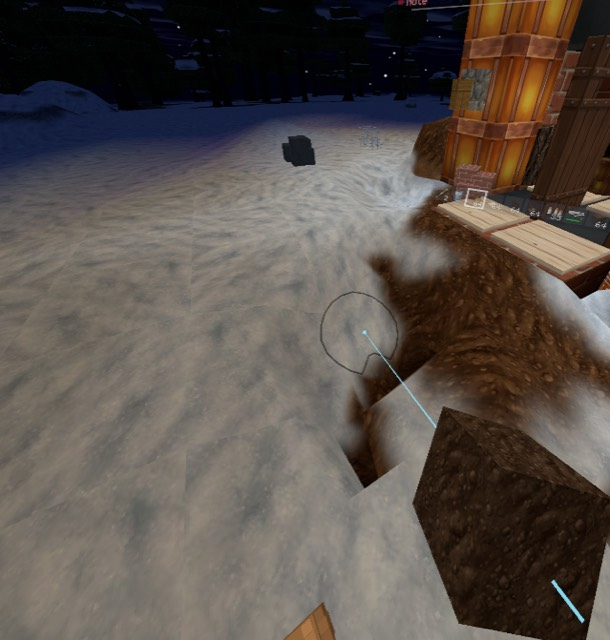

## 20:35:26 - What the fuck did... Okay. Sure

- **Transcript:** What the fuck did... Okay. Sure
- **Status:** open
- **Build:** 0.129 (39e0d988, M1-M4 (device-tested; ship riding, chests, comfort options, weapon wheel))
- **World:** Proving Grounds (seed 88314448595278)
- **Dimension:** Surface
- **Biome:** Taiga
- **Position:** 610.9 240.5 -3894.7
- **Facing:** west (yaw 265, pitch -19)
- **Held:** Grass Block x64
- **Mount:** on foot, flying
- **Looking at:** nothing
- **Mode:** Creative, health 20/20
- **Time:** day 1 08:30, clear
- **Fps:** 63
- **Levels:** mic -44 dBFS, game sound -58 dBFS
- **Length:** 4.1 s (voice 1.5 s)
- **Just before:** --1902s message: Falke Pistol; --1902s holding Combat Stim; --1902s message: Combat Stim; --1902s holding Falke Pistol; --1902s message: Falke Pistol; --1902s holding Combat Stim; --1902s message: Combat Stim; --1903s holding Falke Pistol; --1903s message: Falke Pistol; --1903s holding Spruce Log; --1903s message: Spruce Log; --1903s holding Combat Stim; --1903s message: Combat Stim; --1903s holding Titanium Chestplate; --1903s message: Titanium Chestplate; --1904s holding Dirt; --1904s message: Dirt; --1904s holding Birch Pressure Plate; --1904s message: Birch Pressure Plate; --1904s holding Dirt; --1904s message: Dirt; --1932s message: Your pack is full: the Bricks stays on the ground; --1936s opened PauseMenu; --1937s message: Survival mode; --1937s closed PauseMenu; --1937s opened InventoryMenu; --1940s holding empty hand; --1940s closed InventoryMenu; --1942s holding Bricks; --1955s opened PauseMenu; --1956s opened CommandMenu; --1957s message: Set the time to 1000; --1957s closed CommandMenu; --1964s message: Your pack is full: the Glass stays on the ground; --1970s opened PauseMenu; --1970s message: View recentred; --1972s closed PauseMenu; --1974s opened PauseMenu; -0s closed PauseMenu; -0s holding Grass Block
- **Repro (Mac):** `./snap.sh note --seed 88314448595278 --x 610.9 --z -3894.7 --yaw 95 --pitch -19 --time 0.104`
- **Audio (this Mac):** /Users/darthvadar/Documents/Blocksmith/QuestVoiceNotes/raw/vn-20261115-203526-181.aac

## 20:35:30 - Proving grounds, right. Whatever the hell that means

- **Transcript:** Proving grounds, right. Whatever the hell that means
- **Status:** open
- **Build:** 0.129 (39e0d988, M1-M4 (device-tested; ship riding, chests, comfort options, weapon wheel))
- **World:** Proving Grounds (seed 88314448595278)
- **Dimension:** Surface
- **Biome:** Taiga
- **Position:** 111.7 236.0 -3794.8
- **Facing:** north-east (yaw 43, pitch -35)
- **Held:** Grass Block x64
- **Mount:** on foot, flying
- **Looking at:** Andesite at 113 235 -3797
- **Mode:** Creative, health 20/20
- **Time:** day 1 08:33, clear
- **Fps:** 63
- **Levels:** mic -24 dBFS, game sound -21 dBFS
- **Length:** 3.7 s (voice 2.2 s)
- **Just before:** --1900s holding Combat Stim; --1900s message: Combat Stim; --1900s holding Falke Pistol; --1900s message: Falke Pistol; --1900s holding Combat Stim; --1900s message: Combat Stim; --1900s holding Falke Pistol; --1900s message: Falke Pistol; --1901s holding Spruce Log; --1901s message: Spruce Log; --1901s holding Combat Stim; --1901s message: Combat Stim; --1901s holding Titanium Chestplate; --1901s message: Titanium Chestplate; --1901s holding Dirt; --1901s message: Dirt; --1902s holding Birch Pressure Plate; --1902s message: Birch Pressure Plate; --1902s holding Dirt; --1902s message: Dirt; --1930s message: Your pack is full: the Bricks stays on the ground; --1933s opened PauseMenu; --1934s message: Survival mode; --1934s closed PauseMenu; --1935s opened InventoryMenu; --1937s holding empty hand; --1938s closed InventoryMenu; --1940s holding Bricks; --1953s opened PauseMenu; --1954s opened CommandMenu; --1955s message: Set the time to 1000; --1955s closed CommandMenu; --1961s message: Your pack is full: the Glass stays on the ground; --1968s opened PauseMenu; --1968s message: View recentred; --1969s closed PauseMenu; --1972s opened PauseMenu; -2s closed PauseMenu; -2s holding Grass Block; -2s message: Spring: the snow melts and the young are born
- **Repro (Mac):** `./snap.sh note --seed 88314448595278 --x 111.7 --z -3794.8 --yaw -43 --pitch -35 --time 0.106`
- **Audio (this Mac):** /Users/darthvadar/Documents/Blocksmith/QuestVoiceNotes/raw/vn-20261115-203530-301.aac

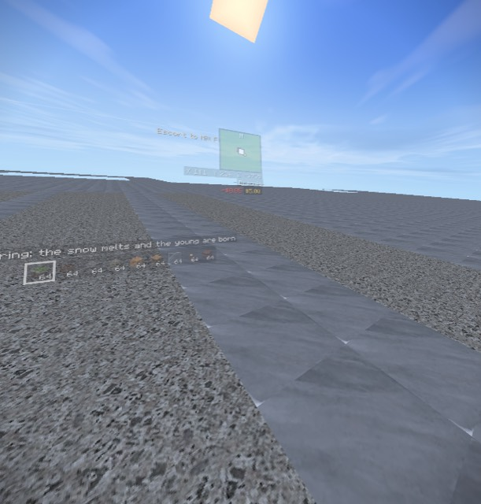

## 20:35:35 - I don't see anything on the Proving Grounds

- **Transcript:** I don't see anything on the Proving Grounds
- **Status:** open
- **Build:** 0.129 (39e0d988, M1-M4 (device-tested; ship riding, chests, comfort options, weapon wheel))
- **World:** Proving Grounds (seed 88314448595278)
- **Dimension:** Surface
- **Biome:** Taiga
- **Position:** 183.8 257.2 -3827.7
- **Facing:** south-west (yaw 239, pitch -47)
- **Held:** Grass Block x64
- **Mount:** on foot, flying
- **Looking at:** nothing
- **Mode:** Creative, health 20/20
- **Time:** day 1 08:38, clear
- **Fps:** 58
- **Levels:** mic -22 dBFS, game sound -23 dBFS
- **Length:** 3.6 s (voice 2.0 s)
- **Just before:** --1895s message: Falke Pistol; --1895s holding Combat Stim; --1895s message: Combat Stim; --1896s holding Falke Pistol; --1896s message: Falke Pistol; --1896s holding Spruce Log; --1896s message: Spruce Log; --1896s holding Combat Stim; --1896s message: Combat Stim; --1896s holding Titanium Chestplate; --1896s message: Titanium Chestplate; --1897s holding Dirt; --1897s message: Dirt; --1897s holding Birch Pressure Plate; --1897s message: Birch Pressure Plate; --1897s holding Dirt; --1897s message: Dirt; --1925s message: Your pack is full: the Bricks stays on the ground; --1929s opened PauseMenu; --1930s message: Survival mode; --1930s closed PauseMenu; --1930s opened InventoryMenu; --1933s holding empty hand; --1933s closed InventoryMenu; --1935s holding Bricks; --1948s opened PauseMenu; --1949s opened CommandMenu; --1950s message: Set the time to 1000; --1950s closed CommandMenu; --1957s message: Your pack is full: the Glass stays on the ground; --1963s opened PauseMenu; --1963s message: View recentred; --1965s closed PauseMenu; --1967s opened PauseMenu; -7s closed PauseMenu; -7s holding Grass Block; -7s message: Spring: the snow melts and the young are born; -4s message: Proving Grounds: building, the deck first; -2s message: Entering Draonia; -0s message: Flying
- **Repro (Mac):** `./snap.sh note --seed 88314448595278 --x 183.8 --z -3827.7 --yaw 121 --pitch -47 --time 0.110`
- **Audio (this Mac):** /Users/darthvadar/Documents/Blocksmith/QuestVoiceNotes/raw/vn-20261115-203535-002.aac

## 20:35:39 - Where's all the... What's supposed to be here? Anything?

- **Transcript:** Where's all the... What's supposed to be here? Anything?
- **Status:** open
- **Build:** 0.129 (39e0d988, M1-M4 (device-tested; ship riding, chests, comfort options, weapon wheel))
- **World:** Proving Grounds (seed 88314448595278)
- **Dimension:** Surface
- **Biome:** Taiga
- **Position:** 184.4 257.2 -3669.4
- **Facing:** north-east (yaw 51, pitch -47)
- **Held:** Grass Block x64
- **Mount:** on foot, flying
- **Looking at:** nothing
- **Mode:** Creative, health 20/20
- **Time:** day 1 08:43, clear
- **Fps:** 66
- **Levels:** mic -30 dBFS, game sound -22 dBFS
- **Length:** 5.3 s (voice 2.4 s)
- **Just before:** --1891s message: Falke Pistol; --1891s holding Combat Stim; --1891s message: Combat Stim; --1892s holding Falke Pistol; --1892s message: Falke Pistol; --1892s holding Spruce Log; --1892s message: Spruce Log; --1892s holding Combat Stim; --1892s message: Combat Stim; --1892s holding Titanium Chestplate; --1892s message: Titanium Chestplate; --1893s holding Dirt; --1893s message: Dirt; --1893s holding Birch Pressure Plate; --1893s message: Birch Pressure Plate; --1893s holding Dirt; --1893s message: Dirt; --1921s message: Your pack is full: the Bricks stays on the ground; --1925s opened PauseMenu; --1925s message: Survival mode; --1926s closed PauseMenu; --1926s opened InventoryMenu; --1929s holding empty hand; --1929s closed InventoryMenu; --1931s holding Bricks; --1944s opened PauseMenu; --1945s opened CommandMenu; --1946s message: Set the time to 1000; --1946s closed CommandMenu; --1953s message: Your pack is full: the Glass stays on the ground; --1959s opened PauseMenu; --1959s message: View recentred; --1961s closed PauseMenu; --1963s opened PauseMenu; -11s closed PauseMenu; -11s holding Grass Block; -11s message: Spring: the snow melts and the young are born; -9s message: Proving Grounds: building, the deck first; -6s message: Entering Draonia; -4s message: Flying
- **Repro (Mac):** `./snap.sh note --seed 88314448595278 --x 184.4 --z -3669.4 --yaw -51 --pitch -47 --time 0.114`
- **Audio (this Mac):** /Users/darthvadar/Documents/Blocksmith/QuestVoiceNotes/raw/vn-20261115-203539-221.aac

## 20:35:44 - I don't see anything up here

- **Transcript:** I don't see anything up here
- **Status:** open
- **Build:** 0.129 (39e0d988, M1-M4 (device-tested; ship riding, chests, comfort options, weapon wheel))
- **World:** Proving Grounds (seed 88314448595278)
- **Dimension:** Surface
- **Biome:** Taiga
- **Position:** 323.0 257.2 -3868.9
- **Facing:** south-east (yaw 141, pitch -51)
- **Held:** Grass Block x64
- **Mount:** on foot, flying
- **Looking at:** nothing
- **Mode:** Creative, health 20/20
- **Time:** day 1 08:49, clear
- **Fps:** 68
- **Levels:** mic -49 dBFS, game sound -21 dBFS
- **Length:** 2.3 s (voice 1.0 s)
- **Just before:** --1886s message: Falke Pistol; --1886s holding Combat Stim; --1886s message: Combat Stim; --1886s holding Falke Pistol; --1886s message: Falke Pistol; --1887s holding Spruce Log; --1887s message: Spruce Log; --1887s holding Combat Stim; --1887s message: Combat Stim; --1887s holding Titanium Chestplate; --1887s message: Titanium Chestplate; --1887s holding Dirt; --1887s message: Dirt; --1888s holding Birch Pressure Plate; --1888s message: Birch Pressure Plate; --1888s holding Dirt; --1888s message: Dirt; --1916s message: Your pack is full: the Bricks stays on the ground; --1920s opened PauseMenu; --1920s message: Survival mode; --1921s closed PauseMenu; --1921s opened InventoryMenu; --1923s holding empty hand; --1924s closed InventoryMenu; --1926s holding Bricks; --1939s opened PauseMenu; --1940s opened CommandMenu; --1941s message: Set the time to 1000; --1941s closed CommandMenu; --1947s message: Your pack is full: the Glass stays on the ground; --1954s opened PauseMenu; --1954s message: View recentred; --1955s closed PauseMenu; --1958s opened PauseMenu; -16s closed PauseMenu; -16s holding Grass Block; -16s message: Spring: the snow melts and the young are born; -14s message: Proving Grounds: building, the deck first; -11s message: Entering Draonia; -9s message: Flying
- **Repro (Mac):** `./snap.sh note --seed 88314448595278 --x 323.0 --z -3868.9 --yaw -141 --pitch -51 --time 0.118`
- **Audio (this Mac):** /Users/darthvadar/Documents/Blocksmith/QuestVoiceNotes/raw/vn-20261115-203544-301.aac

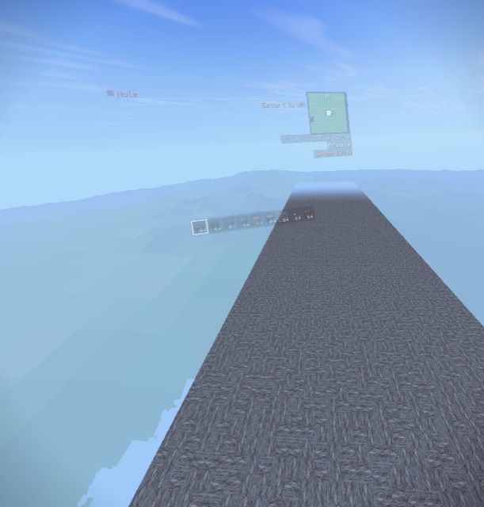

## 20:35:48 - This for later or something?

- **Transcript:** This for later or something?
- **Status:** open
- **Build:** 0.129 (39e0d988, M1-M4 (device-tested; ship riding, chests, comfort options, weapon wheel))
- **World:** Proving Grounds (seed 88314448595278)
- **Dimension:** Surface
- **Biome:** Taiga
- **Position:** 597.6 257.2 -3872.6
- **Facing:** north-east (yaw 48, pitch -43)
- **Held:** Grass Block x64
- **Mount:** on foot, flying
- **Looking at:** nothing
- **Mode:** Creative, health 20/20
- **Time:** day 1 08:54, clear
- **Fps:** 71
- **Levels:** mic -52 dBFS, game sound -18 dBFS
- **Length:** 2.7 s (voice 1.1 s)
- **Just before:** --1882s holding Combat Stim; --1882s message: Combat Stim; --1883s holding Falke Pistol; --1883s message: Falke Pistol; --1883s holding Spruce Log; --1883s message: Spruce Log; --1883s holding Combat Stim; --1883s message: Combat Stim; --1883s holding Titanium Chestplate; --1883s message: Titanium Chestplate; --1884s holding Dirt; --1884s message: Dirt; --1884s holding Birch Pressure Plate; --1884s message: Birch Pressure Plate; --1884s holding Dirt; --1884s message: Dirt; --1912s message: Your pack is full: the Bricks stays on the ground; --1916s opened PauseMenu; --1916s message: Survival mode; --1917s closed PauseMenu; --1917s opened InventoryMenu; --1920s holding empty hand; --1920s closed InventoryMenu; --1922s holding Bricks; --1935s opened PauseMenu; --1936s opened CommandMenu; --1937s message: Set the time to 1000; --1937s closed CommandMenu; --1944s message: Your pack is full: the Glass stays on the ground; --1950s opened PauseMenu; --1950s message: View recentred; --1951s closed PauseMenu; --1954s opened PauseMenu; -20s closed PauseMenu; -20s holding Grass Block; -20s message: Spring: the snow melts and the young are born; -18s message: Proving Grounds: building, the deck first; -15s message: Entering Draonia; -13s message: Flying; -2s message: Entering Wenaresh
- **Repro (Mac):** `./snap.sh note --seed 88314448595278 --x 597.6 --z -3872.6 --yaw -48 --pitch -43 --time 0.121`
- **Audio (this Mac):** /Users/darthvadar/Documents/Blocksmith/QuestVoiceNotes/raw/vn-20261115-203548-241.aac

## 20:35:55 - Vehicle circuits and guns

- **Transcript:** Vehicle circuits and guns
- **Status:** open
- **Build:** 0.129 (39e0d988, M1-M4 (device-tested; ship riding, chests, comfort options, weapon wheel))
- **World:** Proving Grounds (seed 88314448595278)
- **Dimension:** Surface
- **Biome:** Taiga
- **Position:** 473.8 257.2 -3845.3
- **Facing:** west (yaw 253, pitch -27)
- **Held:** Grass Block x64
- **Mount:** on foot, flying
- **Looking at:** nothing
- **Mode:** Creative, health 20/20, screen PauseMenu
- **Time:** day 1 08:57, clear
- **Fps:** 69
- **Levels:** mic -30 dBFS, game sound -29 dBFS
- **Length:** 3.0 s (voice 1.3 s)
- **Just before:** --1875s message: Combat Stim; --1875s holding Falke Pistol; --1875s message: Falke Pistol; --1876s holding Spruce Log; --1876s message: Spruce Log; --1876s holding Combat Stim; --1876s message: Combat Stim; --1876s holding Titanium Chestplate; --1876s message: Titanium Chestplate; --1876s holding Dirt; --1876s message: Dirt; --1877s holding Birch Pressure Plate; --1877s message: Birch Pressure Plate; --1877s holding Dirt; --1877s message: Dirt; --1905s message: Your pack is full: the Bricks stays on the ground; --1908s opened PauseMenu; --1909s message: Survival mode; --1909s closed PauseMenu; --1910s opened InventoryMenu; --1912s holding empty hand; --1913s closed InventoryMenu; --1915s holding Bricks; --1927s opened PauseMenu; --1929s opened CommandMenu; --1929s message: Set the time to 1000; --1930s closed CommandMenu; --1936s message: Your pack is full: the Glass stays on the ground; --1943s opened PauseMenu; --1943s message: View recentred; --1944s closed PauseMenu; --1947s opened PauseMenu; -27s closed PauseMenu; -27s holding Grass Block; -27s message: Spring: the snow melts and the young are born; -25s message: Proving Grounds: building, the deck first; -22s message: Entering Draonia; -21s message: Flying; -9s message: Entering Wenaresh; -5s opened PauseMenu
- **Repro (Mac):** `./snap.sh note --seed 88314448595278 --x 473.8 --z -3845.3 --yaw 107 --pitch -27 --time 0.124`
- **Audio (this Mac):** /Users/darthvadar/Documents/Blocksmith/QuestVoiceNotes/raw/vn-20261115-203555-621.aac

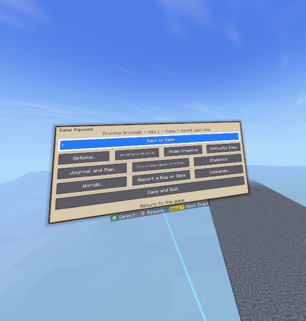

## 20:36:02 - Yeah, there is no vehicle circuits nor guns here. This is nothing. Gia

- **Transcript:** Yeah, there is no vehicle circuits nor guns here. This is nothing. Giant flat
- **Status:** open
- **Build:** 0.129 (39e0d988, M1-M4 (device-tested; ship riding, chests, comfort options, weapon wheel))
- **World:** Proving Grounds (seed 88314448595278)
- **Dimension:** Surface
- **Biome:** Taiga
- **Position:** 269.9 155.4 -3889.8
- **Facing:** north-west (yaw 298, pitch -65)
- **Held:** Grass Block x64
- **Mount:** on foot, flying
- **Looking at:** nothing
- **Mode:** Creative, health 20/20
- **Time:** day 1 09:05, clear
- **Fps:** 58
- **Levels:** mic -28 dBFS, game sound -18 dBFS
- **Length:** 6.4 s (voice 3.8 s)
- **Just before:** --1869s message: Spruce Log; --1869s holding Combat Stim; --1869s message: Combat Stim; --1869s holding Titanium Chestplate; --1869s message: Titanium Chestplate; --1869s holding Dirt; --1869s message: Dirt; --1870s holding Birch Pressure Plate; --1870s message: Birch Pressure Plate; --1870s holding Dirt; --1870s message: Dirt; --1898s message: Your pack is full: the Bricks stays on the ground; --1901s opened PauseMenu; --1902s message: Survival mode; --1902s closed PauseMenu; --1903s opened InventoryMenu; --1905s holding empty hand; --1906s closed InventoryMenu; --1908s holding Bricks; --1921s opened PauseMenu; --1922s opened CommandMenu; --1923s message: Set the time to 1000; --1923s closed CommandMenu; --1929s message: Your pack is full: the Glass stays on the ground; --1936s opened PauseMenu; --1936s message: View recentred; --1937s closed PauseMenu; --1940s opened PauseMenu; -29s message: Entering Draonia; -28s message: Flying; -16s message: Entering Wenaresh; -12s opened PauseMenu; -6s closed PauseMenu; -6s message: Walking; -3s message: Entering Draonia; -2s message: Flying
- **While talking:** --1864s message: Spruce Log; --1864s holding Combat Stim; --1864s message: Combat Stim; --1864s holding Titanium Chestplate; --1864s message: Titanium Chestplate; --1864s holding Dirt; --1864s message: Dirt; --1865s holding Birch Pressure Plate; --1865s message: Birch Pressure Plate; --1865s holding Dirt; --1865s message: Dirt; --1893s message: Your pack is full: the Bricks stays on the ground; --1896s opened PauseMenu; --1897s message: Survival mode; --1897s closed PauseMenu; --1898s opened InventoryMenu; --1900s holding empty hand; --1901s closed InventoryMenu; --1903s holding Bricks; --1916s opened PauseMenu; --1917s opened CommandMenu; --1918s message: Set the time to 1000; --1918s closed CommandMenu; --1924s message: Your pack is full: the Glass stays on the ground; --1931s opened PauseMenu; --1931s message: View recentred; --1932s closed PauseMenu; --1935s opened PauseMenu
- **Position at the end:** 169.3 262.9 -3762.9
- **Repro (Mac):** `./snap.sh note --seed 88314448595278 --x 269.9 --z -3889.8 --yaw 62 --pitch -65 --time 0.129`
- **Audio (this Mac):** /Users/darthvadar/Documents/Blocksmith/QuestVoiceNotes/raw/vn-20261115-203602-542.aac

## 20:36:09 - Thing. Oh, we got some water here. Look, a little swimming pool up her

- **Transcript:** Thing. Oh, we got some water here. Look, a little swimming pool up here. Look at that
- **Status:** open
- **Build:** 0.129 (39e0d988, M1-M4 (device-tested; ship riding, chests, comfort options, weapon wheel))
- **World:** Proving Grounds (seed 88314448595278)
- **Dimension:** Surface
- **Biome:** Taiga
- **Position:** 128.8 262.9 -3744.3
- **Facing:** south-west (yaw 219, pitch -57)
- **Held:** Grass Block x64
- **Mount:** on foot, flying
- **Looking at:** nothing
- **Mode:** Creative, health 20/20
- **Time:** day 1 09:13, clear
- **Fps:** 71
- **Levels:** mic -24 dBFS, game sound -11 dBFS
- **Length:** 6.2 s (voice 3.0 s)
- **Just before:** --1862s message: Spruce Log; --1862s holding Combat Stim; --1862s message: Combat Stim; --1862s holding Titanium Chestplate; --1862s message: Titanium Chestplate; --1863s holding Dirt; --1863s message: Dirt; --1863s holding Birch Pressure Plate; --1863s message: Birch Pressure Plate; --1863s holding Dirt; --1863s message: Dirt; --1891s message: Your pack is full: the Bricks stays on the ground; --1895s opened PauseMenu; --1896s message: Survival mode; --1896s closed PauseMenu; --1896s opened InventoryMenu; --1899s holding empty hand; --1899s closed InventoryMenu; --1901s holding Bricks; --1914s opened PauseMenu; --1915s opened CommandMenu; --1916s message: Set the time to 1000; --1916s closed CommandMenu; --1923s message: Your pack is full: the Glass stays on the ground; --1929s opened PauseMenu; --1929s message: View recentred; --1931s closed PauseMenu; --1933s opened PauseMenu; -23s message: Entering Wenaresh; -18s opened PauseMenu; -13s closed PauseMenu; -12s message: Walking; -10s message: Entering Draonia; -8s message: Flying
- **While talking:** --1857s message: Combat Stim; --1857s holding Titanium Chestplate; --1857s message: Titanium Chestplate; --1858s holding Dirt; --1858s message: Dirt; --1858s holding Birch Pressure Plate; --1858s message: Birch Pressure Plate; --1858s holding Dirt; --1858s message: Dirt; --1886s message: Your pack is full: the Bricks stays on the ground; --1890s opened PauseMenu; --1891s message: Survival mode; --1891s closed PauseMenu; --1891s opened InventoryMenu; --1894s holding empty hand; --1894s closed InventoryMenu; --1896s holding Bricks; --1909s opened PauseMenu; --1910s opened CommandMenu; --1911s message: Set the time to 1000; --1911s closed CommandMenu; --1918s message: Your pack is full: the Glass stays on the ground; --1924s opened PauseMenu; --1924s message: View recentred; --1926s closed PauseMenu; --1928s opened PauseMenu; -4s message: Walking; -0s message: Flying
- **Position at the end:** 135.9 223.2 -3708.9
- **Repro (Mac):** `./snap.sh note --seed 88314448595278 --x 128.8 --z -3744.3 --yaw 141 --pitch -57 --time 0.134`
- **Audio (this Mac):** /Users/darthvadar/Documents/Blocksmith/QuestVoiceNotes/raw/vn-20261115-203609-141.aac

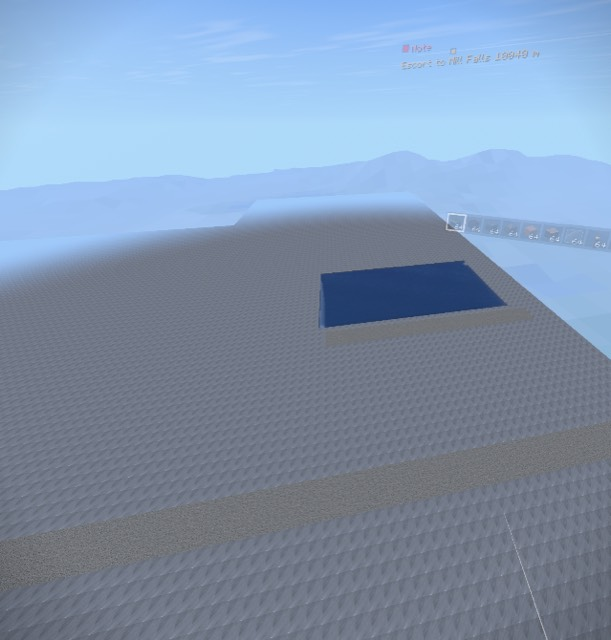

## 20:36:18 - That's about it though

- **Transcript:** That's about it though
- **Status:** open
- **Build:** 0.129 (39e0d988, M1-M4 (device-tested; ship riding, chests, comfort options, weapon wheel))
- **World:** Proving Grounds (seed 88314448595278)
- **Dimension:** Surface
- **Biome:** Taiga
- **Position:** 162.7 253.0 -3651.7
- **Facing:** north (yaw 354, pitch -52)
- **Held:** Grass Block x64
- **Mount:** on foot, flying
- **Looking at:** nothing
- **Mode:** Creative, health 20/20
- **Time:** day 1 09:24, clear
- **Fps:** 61
- **Levels:** mic -22 dBFS, game sound -15 dBFS
- **Length:** 2.2 s (voice 0.7 s)
- **Just before:** --1853s message: Combat Stim; --1853s holding Titanium Chestplate; --1853s message: Titanium Chestplate; --1853s holding Dirt; --1853s message: Dirt; --1854s holding Birch Pressure Plate; --1854s message: Birch Pressure Plate; --1854s holding Dirt; --1854s message: Dirt; --1882s message: Your pack is full: the Bricks stays on the ground; --1885s opened PauseMenu; --1886s message: Survival mode; --1886s closed PauseMenu; --1887s opened InventoryMenu; --1889s holding empty hand; --1890s closed InventoryMenu; --1892s holding Bricks; --1905s opened PauseMenu; --1906s opened CommandMenu; --1907s message: Set the time to 1000; --1907s closed CommandMenu; --1913s message: Your pack is full: the Glass stays on the ground; --1920s opened PauseMenu; --1920s message: View recentred; --1921s closed PauseMenu; --1924s opened PauseMenu; -27s opened PauseMenu; -22s closed PauseMenu; -22s message: Walking; -19s message: Entering Draonia; -18s message: Flying; -8s message: Walking; -4s message: Flying
- **Repro (Mac):** `./snap.sh note --seed 88314448595278 --x 162.7 --z -3651.7 --yaw 6 --pitch -52 --time 0.142`
- **Audio (this Mac):** /Users/darthvadar/Documents/Blocksmith/QuestVoiceNotes/raw/vn-20261115-203618-442.aac

## 20:36:25 - Oh, it's still, wow, it's still loading. Hold on

- **Transcript:** Oh, it's still, wow, it's still loading. Hold on
- **Status:** open
- **Build:** 0.129 (39e0d988, M1-M4 (device-tested; ship riding, chests, comfort options, weapon wheel))
- **World:** Proving Grounds (seed 88314448595278)
- **Dimension:** Surface
- **Biome:** Taiga
- **Position:** 203.5 256.9 -3634.6
- **Facing:** south-east (yaw 117, pitch -35)
- **Held:** Grass Block x64
- **Mount:** on foot, flying
- **Looking at:** nothing
- **Mode:** Creative, health 20/20
- **Time:** day 1 09:32, clear
- **Fps:** 71
- **Levels:** mic -20 dBFS, game sound -18 dBFS
- **Length:** 3.7 s (voice 2.1 s)
- **Just before:** --1846s message: Combat Stim; --1847s holding Titanium Chestplate; --1847s message: Titanium Chestplate; --1847s holding Dirt; --1847s message: Dirt; --1847s holding Birch Pressure Plate; --1847s message: Birch Pressure Plate; --1848s holding Dirt; --1848s message: Dirt; --1875s message: Your pack is full: the Bricks stays on the ground; --1879s opened PauseMenu; --1880s message: Survival mode; --1880s closed PauseMenu; --1880s opened InventoryMenu; --1883s holding empty hand; --1883s closed InventoryMenu; --1885s holding Bricks; --1898s opened PauseMenu; --1899s opened CommandMenu; --1900s message: Set the time to 1000; --1901s closed CommandMenu; --1907s message: Your pack is full: the Glass stays on the ground; --1913s opened PauseMenu; --1913s message: View recentred; --1915s closed PauseMenu; --1917s opened PauseMenu; -29s closed PauseMenu; -28s message: Walking; -26s message: Entering Draonia; -24s message: Flying; -15s message: Walking; -11s message: Flying
- **Repro (Mac):** `./snap.sh note --seed 88314448595278 --x 203.5 --z -3634.6 --yaw -117 --pitch -35 --time 0.148`
- **Audio (this Mac):** /Users/darthvadar/Documents/Blocksmith/QuestVoiceNotes/raw/vn-20261115-203625-101.aac

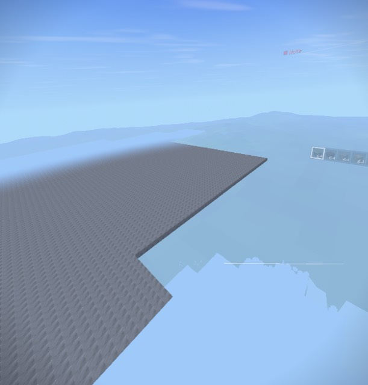

## 20:36:37 - Why the hell they make the platform so fucking big?

- **Transcript:** Why the hell they make the platform so fucking big?
- **Status:** open
- **Build:** 0.129 (39e0d988, M1-M4 (device-tested; ship riding, chests, comfort options, weapon wheel))
- **World:** Proving Grounds (seed 88314448595278)
- **Dimension:** Surface
- **Biome:** Snowy Taiga
- **Position:** 190.2 238.2 -3598.7
- **Facing:** east (yaw 75, pitch -53)
- **Held:** Grass Block x64
- **Mount:** on foot, flying
- **Looking at:** nothing
- **Mode:** Creative, health 20/20
- **Time:** day 1 09:47, clear
- **Fps:** 65
- **Levels:** mic -27 dBFS, game sound -14 dBFS
- **Length:** 3.6 s (voice 1.9 s)
- **Just before:** --1835s message: Dirt; --1835s holding Birch Pressure Plate; --1835s message: Birch Pressure Plate; --1835s holding Dirt; --1835s message: Dirt; --1863s message: Your pack is full: the Bricks stays on the ground; --1867s opened PauseMenu; --1867s message: Survival mode; --1868s closed PauseMenu; --1868s opened InventoryMenu; --1871s holding empty hand; --1871s closed InventoryMenu; --1873s holding Bricks; --1886s opened PauseMenu; --1887s opened CommandMenu; --1888s message: Set the time to 1000; --1888s closed CommandMenu; --1895s message: Your pack is full: the Glass stays on the ground; --1901s opened PauseMenu; --1901s message: View recentred; --1903s closed PauseMenu; --1905s opened PauseMenu; -27s message: Walking; -23s message: Flying; -10s message: Entering Fenivania; -8s message: Entering Draonia; -4s message: Walking; -2s message: Flying
- **Repro (Mac):** `./snap.sh note --seed 88314448595278 --x 190.2 --z -3598.7 --yaw -75 --pitch -53 --time 0.158`
- **Audio (this Mac):** /Users/darthvadar/Documents/Blocksmith/QuestVoiceNotes/raw/vn-20261115-203637-282.aac

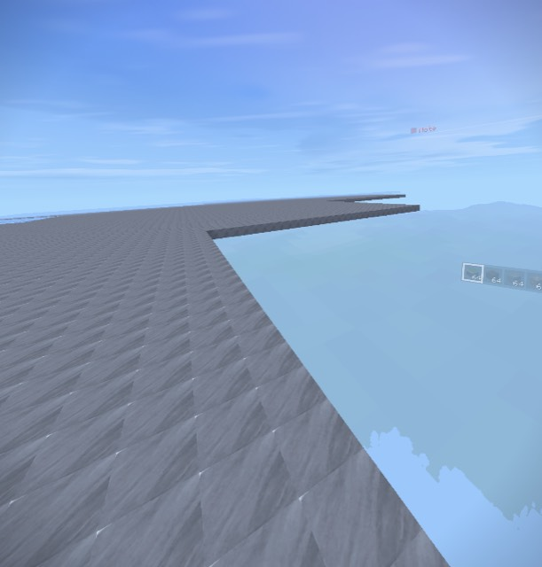

## 20:36:46 - Why isn't it loading ver- fast enough? Like this thing, this thing sho

- **Transcript:** Why isn't it loading ver- fast enough? Like this thing, this thing should've loaded
- **Status:** open
- **Build:** 0.129 (39e0d988, M1-M4 (device-tested; ship riding, chests, comfort options, weapon wheel))
- **World:** Proving Grounds (seed 88314448595278)
- **Dimension:** Surface
- **Biome:** Taiga
- **Position:** 402.1 255.5 -3818.4
- **Facing:** west (yaw 283, pitch -36)
- **Held:** Grass Block x64
- **Mount:** on foot, flying
- **Looking at:** nothing
- **Mode:** Creative, health 20/20
- **Time:** day 1 09:57, clear
- **Fps:** 72
- **Levels:** mic -24 dBFS, game sound -19 dBFS
- **Length:** 4.5 s (voice 2.6 s)
- **Just before:** --1827s message: Dirt; --1855s message: Your pack is full: the Bricks stays on the ground; --1858s opened PauseMenu; --1859s message: Survival mode; --1859s closed PauseMenu; --1859s opened InventoryMenu; --1862s holding empty hand; --1862s closed InventoryMenu; --1864s holding Bricks; --1877s opened PauseMenu; --1878s opened CommandMenu; --1879s message: Set the time to 1000; --1880s closed CommandMenu; --1886s message: Your pack is full: the Glass stays on the ground; --1892s opened PauseMenu; --1892s message: View recentred; --1894s closed PauseMenu; --1896s opened PauseMenu; -19s message: Entering Fenivania; -17s message: Entering Draonia; -13s message: Walking; -10s message: Flying; -7s message: Entering Fenivania; -5s message: Clear Hollow Station marked on the map; -3s message: Westholm Central Station marked on the map; -0s message: You found the Clear & Westholm Railway: 2 stations, marked on your map
- **Repro (Mac):** `./snap.sh note --seed 88314448595278 --x 402.1 --z -3818.4 --yaw 77 --pitch -36 --time 0.165`
- **Audio (this Mac):** /Users/darthvadar/Documents/Blocksmith/QuestVoiceNotes/raw/vn-20261115-203646-041.aac

## 20:36:50 - as I flew over it

- **Transcript:** as I flew over it
- **Status:** open
- **Build:** 0.129 (39e0d988, M1-M4 (device-tested; ship riding, chests, comfort options, weapon wheel))
- **World:** Proving Grounds (seed 88314448595278)
- **Dimension:** Surface
- **Biome:** Snowy Taiga
- **Position:** 227.2 255.5 -3578.4
- **Facing:** north-west (yaw 307, pitch -47)
- **Held:** Grass Block x64
- **Mount:** on foot, flying
- **Looking at:** nothing
- **Mode:** Creative, health 20/20
- **Time:** day 1 10:03, clear
- **Fps:** 72
- **Levels:** mic -23 dBFS, game sound -15 dBFS
- **Length:** 2.8 s (voice 1.1 s)
- **Just before:** --1850s message: Your pack is full: the Bricks stays on the ground; --1853s opened PauseMenu; --1854s message: Survival mode; --1854s closed PauseMenu; --1854s opened InventoryMenu; --1857s holding empty hand; --1858s closed InventoryMenu; --1860s holding Bricks; --1872s opened PauseMenu; --1874s opened CommandMenu; --1874s message: Set the time to 1000; --1875s closed CommandMenu; --1881s message: Your pack is full: the Glass stays on the ground; --1887s opened PauseMenu; --1887s message: View recentred; --1889s closed PauseMenu; --1892s opened PauseMenu; -23s message: Entering Fenivania; -22s message: Entering Draonia; -18s message: Walking; -15s message: Flying; -11s message: Entering Fenivania; -10s message: Clear Hollow Station marked on the map; -7s message: Westholm Central Station marked on the map; -5s message: You found the Clear & Westholm Railway: 2 stations, marked on your map; -2s message: Entering Draonia
- **Repro (Mac):** `./snap.sh note --seed 88314448595278 --x 227.2 --z -3578.4 --yaw 53 --pitch -47 --time 0.169`
- **Audio (this Mac):** /Users/darthvadar/Documents/Blocksmith/QuestVoiceNotes/raw/vn-20261115-203650-801.aac

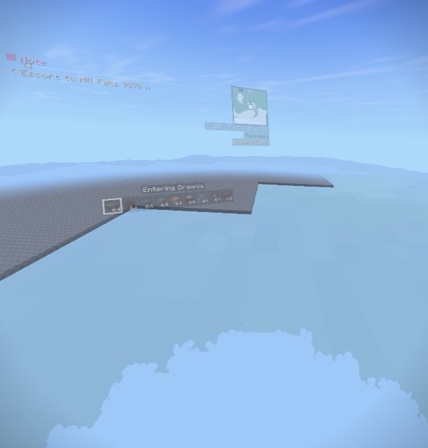

## 20:37:07 - There's nothing in here. Bullshit

- **Transcript:** There's nothing in here. Bullshit
- **Status:** open
- **Build:** 0.129 (39e0d988, M1-M4 (device-tested; ship riding, chests, comfort options, weapon wheel))
- **World:** Proving Grounds (seed 88314448595278)
- **Dimension:** Surface
- **Biome:** Taiga
- **Position:** 184.0 255.5 -3694.0
- **Facing:** south-west (yaw 223, pitch -38)
- **Held:** Grass Block x64
- **Mount:** on foot, flying
- **Looking at:** nothing
- **Mode:** Creative, health 20/20
- **Time:** day 1 10:23, clear
- **Fps:** 72
- **Levels:** mic -22 dBFS, game sound -17 dBFS
- **Length:** 4.0 s (voice 1.4 s)
- **Just before:** --1841s holding empty hand; --1841s closed InventoryMenu; --1843s holding Bricks; --1856s opened PauseMenu; --1857s opened CommandMenu; --1858s message: Set the time to 1000; --1858s closed CommandMenu; --1865s message: Your pack is full: the Glass stays on the ground; --1871s opened PauseMenu; --1871s message: View recentred; --1872s closed PauseMenu; --1875s opened PauseMenu; -28s message: Entering Fenivania; -26s message: Clear Hollow Station marked on the map; -24s message: Westholm Central Station marked on the map; -21s message: You found the Clear & Westholm Railway: 2 stations, marked on your map; -18s message: Entering Draonia; -16s message: Entering Wenaresh; -15s message: Entering Fenivania; -13s message: Entering Draonia; -11s message: Entering Wenaresh; -4s message: Entering Draonia
- **Repro (Mac):** `./snap.sh note --seed 88314448595278 --x 184.0 --z -3694.0 --yaw 137 --pitch -38 --time 0.183`
- **Audio (this Mac):** /Users/darthvadar/Documents/Blocksmith/QuestVoiceNotes/raw/vn-20261115-203707-383.aac

## 20:37:12 - Builder's Grounds

- **Transcript:** Builder's Grounds
- **Status:** open
- **Build:** 0.129 (39e0d988, M1-M4 (device-tested; ship riding, chests, comfort options, weapon wheel))
- **World:** Builders' Grounds (seed 632461258612199693)
- **Dimension:** Surface
- **Biome:** Forest
- **Position:** 5464.5 66.0 -407.5
- **Facing:** north-east (yaw 40, pitch -57)
- **Held:** Grass Block x64
- **Mount:** on foot
- **Looking at:** nothing
- **Mode:** Creative, health 20/20
- **Time:** day 1 07:26, clear
- **Fps:** 71
- **Levels:** mic -93 dBFS, game sound -52 dBFS
- **Length:** 2.5 s (voice 0.8 s)
- **Just before:** --1942s holding Bricks; --1955s opened PauseMenu; --1956s opened CommandMenu; --1957s message: Set the time to 1000; --1957s closed CommandMenu; --1964s message: Your pack is full: the Glass stays on the ground; --1970s opened PauseMenu; --1970s message: View recentred; --1972s closed PauseMenu; --1974s opened PauseMenu; -0s closed PauseMenu; -0s holding Grass Block; --0s message: Spring: the snow melts and the young are born; --3s message: Proving Grounds: building, the deck first; --5s message: Entering Draonia; --7s message: Flying; --18s message: Entering Wenaresh; --23s opened PauseMenu; --28s closed PauseMenu; --29s message: Walking; --31s message: Entering Draonia; --33s message: Flying; --42s message: Walking; --46s message: Flying; --59s message: Entering Fenivania; --61s message: Entering Draonia; --65s message: Walking; --67s message: Flying; --71s message: Entering Fenivania; --73s message: Clear Hollow Station marked on the map; --75s message: Westholm Central Station marked on the map; --78s message: You found the Clear & Westholm Railway: 2 stations, marked on your map; --81s message: Entering Draonia; --83s message: Entering Wenaresh; --84s message: Entering Fenivania; --86s message: Entering Draonia; --88s message: Entering Wenaresh; --95s message: Entering Draonia; --102s opened PauseMenu; -0s closed PauseMenu
- **Repro (Mac):** `./snap.sh note --seed 632461258612199693 --x 5464.5 --z -407.5 --yaw -40 --pitch -57 --time 0.060`
- **Audio (this Mac):** /Users/darthvadar/Documents/Blocksmith/QuestVoiceNotes/raw/vn-20261115-203712-940.aac

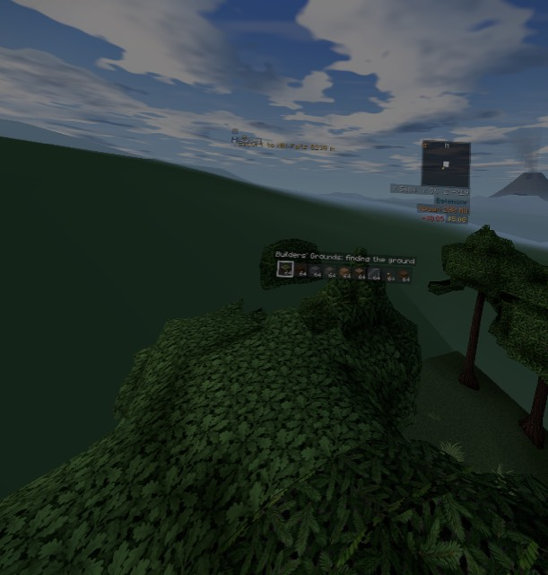

## 20:37:25 - Okay. All right

- **Transcript:** Okay. All right
- **Status:** open
- **Build:** 0.129 (39e0d988, M1-M4 (device-tested; ship riding, chests, comfort options, weapon wheel))
- **World:** Builders' Grounds (seed 632461258612199693)
- **Dimension:** Surface
- **Biome:** Taiga
- **Position:** 5679.4 96.0 -213.2
- **Facing:** south-east (yaw 135, pitch -70)
- **Held:** Grass Block x64
- **Mount:** on foot, flying
- **Looking at:** Spruce Leaves at 5680 93 -213
- **Mode:** Creative, health 20/20
- **Time:** day 1 07:29, clear
- **Fps:** 2
- **Levels:** mic -33 dBFS, game sound -37 dBFS
- **Length:** 3.4 s (voice 1.2 s)
- **Just before:** --1953s opened CommandMenu; --1954s message: Set the time to 1000; --1954s closed CommandMenu; --1961s message: Your pack is full: the Glass stays on the ground; --1967s opened PauseMenu; --1967s message: View recentred; --1969s closed PauseMenu; --1971s opened PauseMenu; -3s closed PauseMenu; -3s holding Grass Block; -3s message: Spring: the snow melts and the young are born; -0s message: Proving Grounds: building, the deck first; --2s message: Entering Draonia; --4s message: Flying; --15s message: Entering Wenaresh; --20s opened PauseMenu; --25s closed PauseMenu; --26s message: Walking; --28s message: Entering Draonia; --30s message: Flying; --39s message: Walking; --43s message: Flying; --56s message: Entering Fenivania; --58s message: Entering Draonia; --62s message: Walking; --65s message: Flying; --68s message: Entering Fenivania; --70s message: Clear Hollow Station marked on the map; --72s message: Westholm Central Station marked on the map; --75s message: You found the Clear & Westholm Railway: 2 stations, marked on your map; --78s message: Entering Draonia; --80s message: Entering Wenaresh; --82s message: Entering Fenivania; --83s message: Entering Draonia; --85s message: Entering Wenaresh; --92s message: Entering Draonia; --99s opened PauseMenu; -3s closed PauseMenu; -3s message: Builders' Grounds: finding the ground; -1s message: Builders' Grounds: the Hillside Cottage going up (1 of 6)
- **Repro (Mac):** `./snap.sh note --seed 632461258612199693 --x 5679.4 --z -213.2 --yaw -135 --pitch -70 --time 0.062`
- **Audio (this Mac):** /Users/darthvadar/Documents/Blocksmith/QuestVoiceNotes/raw/vn-20261115-203725-222.aac

## 20:37:28 - Builder's Grounds. Ooh, we are having a

- **Transcript:** Builder's Grounds. Ooh, we are having a
- **Status:** open
- **Build:** 0.129 (39e0d988, M1-M4 (device-tested; ship riding, chests, comfort options, weapon wheel))
- **World:** Builders' Grounds (seed 632461258612199693)
- **Dimension:** Surface
- **Biome:** Forest
- **Position:** 5674.1 103.1 -220.5
- **Facing:** south-west (yaw 232, pitch -47)
- **Held:** Grass Block x64
- **Mount:** on foot, flying
- **Looking at:** nothing
- **Mode:** Creative, health 20/20
- **Time:** day 1 07:33, clear
- **Fps:** 66
- **Levels:** mic -23 dBFS, game sound -31 dBFS
- **Length:** 3.6 s (voice 2.1 s)
- **Just before:** --1951s message: Set the time to 1000; --1952s closed CommandMenu; --1958s message: Your pack is full: the Glass stays on the ground; --1964s opened PauseMenu; --1964s message: View recentred; --1966s closed PauseMenu; --1968s opened PauseMenu; -6s closed PauseMenu; -6s holding Grass Block; -6s message: Spring: the snow melts and the young are born; -3s message: Proving Grounds: building, the deck first; -1s message: Entering Draonia; --1s message: Flying; --12s message: Entering Wenaresh; --17s opened PauseMenu; --22s closed PauseMenu; --23s message: Walking; --25s message: Entering Draonia; --27s message: Flying; --36s message: Walking; --40s message: Flying; --53s message: Entering Fenivania; --55s message: Entering Draonia; --59s message: Walking; --62s message: Flying; --65s message: Entering Fenivania; --67s message: Clear Hollow Station marked on the map; --69s message: Westholm Central Station marked on the map; --72s message: You found the Clear & Westholm Railway: 2 stations, marked on your map; --75s message: Entering Draonia; --77s message: Entering Wenaresh; --79s message: Entering Fenivania; --80s message: Entering Draonia; --82s message: Entering Wenaresh; --89s message: Entering Draonia; --96s opened PauseMenu; -6s closed PauseMenu; -6s message: Builders' Grounds: finding the ground; -4s message: Builders' Grounds: the Hillside Cottage going up (1 of 6); -1s message: Homestead marked on the map
- **Repro (Mac):** `./snap.sh note --seed 632461258612199693 --x 5674.1 --z -220.5 --yaw 128 --pitch -47 --time 0.065`
- **Audio (this Mac):** /Users/darthvadar/Documents/Blocksmith/QuestVoiceNotes/raw/vn-20261115-203728-461.aac

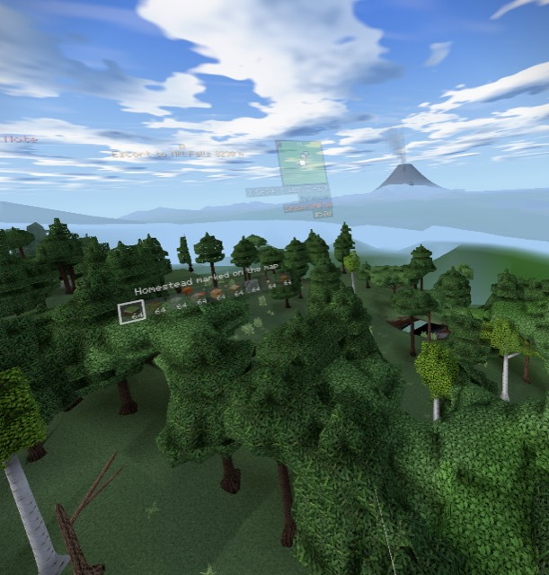

## 20:37:33 - Interesting. We're getting little freezes every few seconds here

- **Transcript:** Interesting. We're getting little freezes every few seconds here
- **Status:** open
- **Build:** 0.129 (39e0d988, M1-M4 (device-tested; ship riding, chests, comfort options, weapon wheel))
- **World:** Builders' Grounds (seed 632461258612199693)
- **Dimension:** Surface
- **Biome:** Forest
- **Position:** 5672.5 109.6 -253.3
- **Facing:** north-east (yaw 46, pitch -47)
- **Held:** Grass Block x64
- **Mount:** on foot, flying
- **Looking at:** nothing
- **Mode:** Creative, health 20/20
- **Time:** day 1 07:38, clear
- **Fps:** 61
- **Levels:** mic -42 dBFS, game sound -30 dBFS
- **Length:** 4.3 s (voice 2.4 s)
- **Just before:** --1953s message: Your pack is full: the Glass stays on the ground; --1960s opened PauseMenu; --1960s message: View recentred; --1961s closed PauseMenu; --1964s opened PauseMenu; -10s closed PauseMenu; -10s holding Grass Block; -10s message: Spring: the snow melts and the young are born; -8s message: Proving Grounds: building, the deck first; -5s message: Entering Draonia; -4s message: Flying; --8s message: Entering Wenaresh; --13s opened PauseMenu; --18s closed PauseMenu; --18s message: Walking; --21s message: Entering Draonia; --22s message: Flying; --32s message: Walking; --36s message: Flying; --49s message: Entering Fenivania; --51s message: Entering Draonia; --54s message: Walking; --57s message: Flying; --61s message: Entering Fenivania; --63s message: Clear Hollow Station marked on the map; --65s message: Westholm Central Station marked on the map; --67s message: You found the Clear & Westholm Railway: 2 stations, marked on your map; --71s message: Entering Draonia; --72s message: Entering Wenaresh; --74s message: Entering Fenivania; --76s message: Entering Draonia; --78s message: Entering Wenaresh; --85s message: Entering Draonia; --91s opened PauseMenu; -10s closed PauseMenu; -10s message: Builders' Grounds: finding the ground; -8s message: Builders' Grounds: the Hillside Cottage going up (1 of 6); -5s message: Homestead marked on the map; -3s message: A stranger in town: Ezra Quill; -1s message: Builders' Grounds: the Beach Lighthouse going up (2 of 6)
- **Repro (Mac):** `./snap.sh note --seed 632461258612199693 --x 5672.5 --z -253.3 --yaw -46 --pitch -47 --time 0.069`
- **Audio (this Mac):** /Users/darthvadar/Documents/Blocksmith/QuestVoiceNotes/raw/vn-20261115-203733-501.aac

## 20:37:47 - I'm sorry. Where, where are the builds?

- **Transcript:** I'm sorry. Where, where are the builds?
- **Status:** open
- **Build:** 0.129 (39e0d988, M1-M4 (device-tested; ship riding, chests, comfort options, weapon wheel))
- **World:** Builders' Grounds (seed 632461258612199693)
- **Dimension:** Surface
- **Biome:** Forest
- **Position:** 5758.3 112.8 -277.5
- **Facing:** south (yaw 166, pitch -47)
- **Held:** Grass Block x64
- **Mount:** on foot, flying
- **Looking at:** nothing
- **Mode:** Creative, health 20/20
- **Time:** day 1 07:55, clear
- **Fps:** 71
- **Levels:** mic -30 dBFS, game sound -22 dBFS
- **Length:** 3.5 s (voice 2.0 s)
- **Just before:** -24s closed PauseMenu; -24s holding Grass Block; -24s message: Spring: the snow melts and the young are born; -22s message: Proving Grounds: building, the deck first; -19s message: Entering Draonia; -18s message: Flying; -6s message: Entering Wenaresh; -2s opened PauseMenu; --4s closed PauseMenu; --4s message: Walking; --7s message: Entering Draonia; --8s message: Flying; --18s message: Walking; --21s message: Flying; --35s message: Entering Fenivania; --37s message: Entering Draonia; --40s message: Walking; --43s message: Flying; --47s message: Entering Fenivania; --49s message: Clear Hollow Station marked on the map; --51s message: Westholm Central Station marked on the map; --53s message: You found the Clear & Westholm Railway: 2 stations, marked on your map; --57s message: Entering Draonia; --58s message: Entering Wenaresh; --60s message: Entering Fenivania; --62s message: Entering Draonia; --64s message: Entering Wenaresh; --71s message: Entering Draonia; --77s opened PauseMenu; -24s closed PauseMenu; -24s message: Builders' Grounds: finding the ground; -22s message: Builders' Grounds: the Hillside Cottage going up (1 of 6); -19s message: Homestead marked on the map; -17s message: A stranger in town: Ezra Quill; -15s message: Builders' Grounds: the Beach Lighthouse going up (2 of 6); -12s message: Builders' Grounds: the Ridge Watchtower going up (3 of 6); -9s message: Builders' Grounds: the Lakeside Boathouse going up (4 of 6); -6s message: A homestead. Fields, a barn, and a long way from town.; -3s message: Builders' Grounds: the Forest Stilt Cabin going up (5 of 6); -0s message: Builders' Grounds: the Stone Gate going up (6 of 6)
- **Repro (Mac):** `./snap.sh note --seed 632461258612199693 --x 5758.3 --z -277.5 --yaw -166 --pitch -47 --time 0.080`
- **Audio (this Mac):** /Users/darthvadar/Documents/Blocksmith/QuestVoiceNotes/raw/vn-20261115-203747-922.aac

## 20:37:52 - All six built. W-where, where are they built?

- **Transcript:** All six built. W-where, where are they built?
- **Status:** open
- **Build:** 0.129 (39e0d988, M1-M4 (device-tested; ship riding, chests, comfort options, weapon wheel))
- **World:** Builders' Grounds (seed 632461258612199693)
- **Dimension:** Surface
- **Biome:** Forest
- **Position:** 5541.8 112.8 -196.2
- **Facing:** south-west (yaw 246, pitch -48)
- **Held:** Grass Block x64
- **Mount:** on foot, flying
- **Looking at:** nothing
- **Mode:** Creative, health 20/20
- **Time:** day 1 08:01, clear
- **Fps:** 71
- **Levels:** mic -42 dBFS, game sound -19 dBFS
- **Length:** 4.2 s (voice 1.8 s)
- **Just before:** -29s holding Grass Block; -29s message: Spring: the snow melts and the young are born; -26s message: Proving Grounds: building, the deck first; -24s message: Entering Draonia; -22s message: Flying; -11s message: Entering Wenaresh; -6s opened PauseMenu; -1s closed PauseMenu; -0s message: Walking; --2s message: Entering Draonia; --4s message: Flying; --13s message: Walking; --17s message: Flying; --30s message: Entering Fenivania; --32s message: Entering Draonia; --36s message: Walking; --39s message: Flying; --42s message: Entering Fenivania; --44s message: Clear Hollow Station marked on the map; --46s message: Westholm Central Station marked on the map; --49s message: You found the Clear & Westholm Railway: 2 stations, marked on your map; --52s message: Entering Draonia; --54s message: Entering Wenaresh; --56s message: Entering Fenivania; --57s message: Entering Draonia; --59s message: Entering Wenaresh; --66s message: Entering Draonia; --73s opened PauseMenu; -29s closed PauseMenu; -29s message: Builders' Grounds: finding the ground; -27s message: Builders' Grounds: the Hillside Cottage going up (1 of 6); -24s message: Homestead marked on the map; -22s message: A stranger in town: Ezra Quill; -20s message: Builders' Grounds: the Beach Lighthouse going up (2 of 6); -17s message: Builders' Grounds: the Ridge Watchtower going up (3 of 6); -14s message: Builders' Grounds: the Lakeside Boathouse going up (4 of 6); -11s message: A homestead. Fields, a barn, and a long way from town.; -8s message: Builders' Grounds: the Forest Stilt Cabin going up (5 of 6); -5s message: Builders' Grounds: the Stone Gate going up (6 of 6); -2s message: Builders' Grounds: all six built
- **Repro (Mac):** `./snap.sh note --seed 632461258612199693 --x 5541.8 --z -196.2 --yaw 114 --pitch -48 --time 0.084`
- **Audio (this Mac):** /Users/darthvadar/Documents/Blocksmith/QuestVoiceNotes/raw/vn-20261115-203752-441.aac

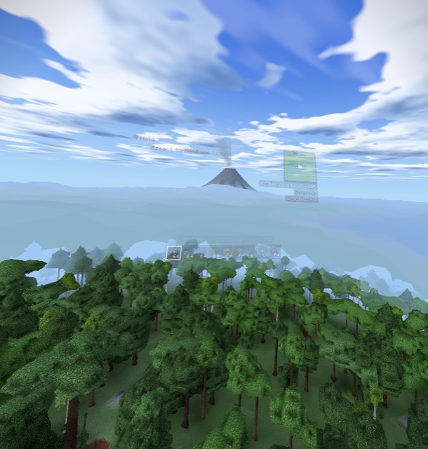

## 20:37:58 - This is a thing right here. What is this?

- **Transcript:** This is a thing right here. What is this?
- **Status:** open
- **Build:** 0.129 (39e0d988, M1-M4 (device-tested; ship riding, chests, comfort options, weapon wheel))
- **World:** Builders' Grounds (seed 632461258612199693)
- **Dimension:** Surface
- **Biome:** Beach
- **Position:** 5541.1 85.7 -397.0
- **Facing:** north-east (yaw 62, pitch -55)
- **Held:** Grass Block x64
- **Mount:** on foot
- **Looking at:** nothing
- **Mode:** Creative, health 20/20
- **Time:** day 1 08:08, clear
- **Fps:** 71
- **Levels:** mic -38 dBFS, game sound -21 dBFS
- **Length:** 3.3 s (voice 1.5 s)
- **Just before:** -28s message: Flying; -17s message: Entering Wenaresh; -12s opened PauseMenu; -7s closed PauseMenu; -6s message: Walking; -4s message: Entering Draonia; -2s message: Flying; --7s message: Walking; --11s message: Flying; --24s message: Entering Fenivania; --26s message: Entering Draonia; --30s message: Walking; --32s message: Flying; --36s message: Entering Fenivania; --38s message: Clear Hollow Station marked on the map; --40s message: Westholm Central Station marked on the map; --43s message: You found the Clear & Westholm Railway: 2 stations, marked on your map; --46s message: Entering Draonia; --48s message: Entering Wenaresh; --49s message: Entering Fenivania; --51s message: Entering Draonia; --53s message: Entering Wenaresh; --60s message: Entering Draonia; --67s opened PauseMenu; -30s message: Homestead marked on the map; -28s message: A stranger in town: Ezra Quill; -26s message: Builders' Grounds: the Beach Lighthouse going up (2 of 6); -23s message: Builders' Grounds: the Ridge Watchtower going up (3 of 6); -20s message: Builders' Grounds: the Lakeside Boathouse going up (4 of 6); -17s message: A homestead. Fields, a barn, and a long way from town.; -14s message: Builders' Grounds: the Forest Stilt Cabin going up (5 of 6); -11s message: Builders' Grounds: the Stone Gate going up (6 of 6); -8s message: Builders' Grounds: all six built; -2s message: Walking
- **Repro (Mac):** `./snap.sh note --seed 632461258612199693 --x 5541.1 --z -397.0 --yaw -62 --pitch -55 --time 0.089`
- **Audio (this Mac):** /Users/darthvadar/Documents/Blocksmith/QuestVoiceNotes/raw/vn-20261115-203758-621.aac

## 20:38:02 - Okay, fine

- **Transcript:** Okay, fine
- **Status:** open
- **Build:** 0.129 (39e0d988, M1-M4 (device-tested; ship riding, chests, comfort options, weapon wheel))
- **World:** Builders' Grounds (seed 632461258612199693)
- **Dimension:** Surface
- **Biome:** Beach
- **Position:** 5540.5 64.0 -407.8
- **Facing:** north (yaw 345, pitch -19)
- **Held:** Grass Block x64
- **Mount:** on foot
- **Looking at:** White Concrete at 5539 64 -412
- **Mode:** Creative, health 20/20
- **Time:** day 1 08:13, clear
- **Fps:** 72
- **Levels:** mic -49 dBFS, game sound -27 dBFS
- **Length:** 2.5 s (voice 0.6 s)
- **Just before:** -21s message: Entering Wenaresh; -16s opened PauseMenu; -11s closed PauseMenu; -10s message: Walking; -8s message: Entering Draonia; -6s message: Flying; --3s message: Walking; --7s message: Flying; --20s message: Entering Fenivania; --22s message: Entering Draonia; --25s message: Walking; --28s message: Flying; --32s message: Entering Fenivania; --34s message: Clear Hollow Station marked on the map; --36s message: Westholm Central Station marked on the map; --39s message: You found the Clear & Westholm Railway: 2 stations, marked on your map; --42s message: Entering Draonia; --44s message: Entering Wenaresh; --45s message: Entering Fenivania; --47s message: Entering Draonia; --49s message: Entering Wenaresh; --56s message: Entering Draonia; --63s opened PauseMenu; -30s message: Builders' Grounds: the Beach Lighthouse going up (2 of 6); -27s message: Builders' Grounds: the Ridge Watchtower going up (3 of 6); -24s message: Builders' Grounds: the Lakeside Boathouse going up (4 of 6); -21s message: A homestead. Fields, a barn, and a long way from town.; -18s message: Builders' Grounds: the Forest Stilt Cabin going up (5 of 6); -15s message: Builders' Grounds: the Stone Gate going up (6 of 6); -12s message: Builders' Grounds: all six built; -6s message: Walking
- **Repro (Mac):** `./snap.sh note --seed 632461258612199693 --x 5540.5 --z -407.8 --yaw 15 --pitch -19 --time 0.093`
- **Audio (this Mac):** /Users/darthvadar/Documents/Blocksmith/QuestVoiceNotes/raw/vn-20261115-203802-742.aac

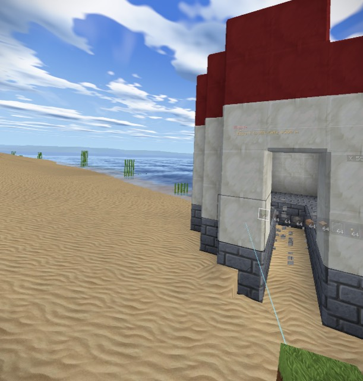

## 20:38:07 - Is there anything else like that around here?

- **Transcript:** Is there anything else like that around here?
- **Status:** open
- **Build:** 0.129 (39e0d988, M1-M4 (device-tested; ship riding, chests, comfort options, weapon wheel))
- **World:** Builders' Grounds (seed 632461258612199693)
- **Dimension:** Surface
- **Biome:** Forest
- **Position:** 5201.6 77.6 -154.5
- **Facing:** north-west (yaw 308, pitch -40)
- **Held:** Grass Block x64
- **Mount:** on foot, flying
- **Looking at:** nothing
- **Mode:** Creative, health 20/20
- **Time:** day 1 08:19, clear
- **Fps:** 72
- **Levels:** mic -31 dBFS, game sound -20 dBFS
- **Length:** 3.1 s (voice 1.5 s)
- **Just before:** -26s message: Entering Wenaresh; -21s opened PauseMenu; -16s closed PauseMenu; -15s message: Walking; -13s message: Entering Draonia; -11s message: Flying; -2s message: Walking; --2s message: Flying; --15s message: Entering Fenivania; --17s message: Entering Draonia; --21s message: Walking; --23s message: Flying; --27s message: Entering Fenivania; --29s message: Clear Hollow Station marked on the map; --31s message: Westholm Central Station marked on the map; --34s message: You found the Clear & Westholm Railway: 2 stations, marked on your map; --37s message: Entering Draonia; --39s message: Entering Wenaresh; --40s message: Entering Fenivania; --42s message: Entering Draonia; --44s message: Entering Wenaresh; --51s message: Entering Draonia; --58s opened PauseMenu; -29s message: Builders' Grounds: the Lakeside Boathouse going up (4 of 6); -26s message: A homestead. Fields, a barn, and a long way from town.; -23s message: Builders' Grounds: the Forest Stilt Cabin going up (5 of 6); -20s message: Builders' Grounds: the Stone Gate going up (6 of 6); -17s message: Builders' Grounds: all six built; -10s message: Walking; -5s message: Flying; -2s message: The sky is clouding over: fog is coming
- **Repro (Mac):** `./snap.sh note --seed 632461258612199693 --x 5201.6 --z -154.5 --yaw 52 --pitch -40 --time 0.097`
- **Audio (this Mac):** /Users/darthvadar/Documents/Blocksmith/QuestVoiceNotes/raw/vn-20261115-203807-582.aac

## 20:38:11 - Surely we have other builds, right?

- **Transcript:** Surely we have other builds, right?
- **Status:** open
- **Build:** 0.129 (39e0d988, M1-M4 (device-tested; ship riding, chests, comfort options, weapon wheel))
- **World:** Builders' Grounds (seed 632461258612199693)
- **Dimension:** Surface
- **Biome:** Forest
- **Position:** 5324.8 86.3 -227.7
- **Facing:** north-east (yaw 67, pitch -42)
- **Held:** Grass Block x64
- **Mount:** on foot, flying
- **Looking at:** nothing
- **Mode:** Creative, health 20/20
- **Time:** day 1 08:23, clear
- **Fps:** 72
- **Levels:** mic -26 dBFS, game sound -19 dBFS
- **Length:** 2.8 s (voice 1.2 s)
- **Just before:** -29s message: Entering Wenaresh; -25s opened PauseMenu; -20s closed PauseMenu; -19s message: Walking; -16s message: Entering Draonia; -15s message: Flying; -6s message: Walking; -2s message: Flying; --12s message: Entering Fenivania; --13s message: Entering Draonia; --17s message: Walking; --20s message: Flying; --24s message: Entering Fenivania; --25s message: Clear Hollow Station marked on the map; --28s message: Westholm Central Station marked on the map; --30s message: You found the Clear & Westholm Railway: 2 stations, marked on your map; --34s message: Entering Draonia; --35s message: Entering Wenaresh; --37s message: Entering Fenivania; --39s message: Entering Draonia; --41s message: Entering Wenaresh; --48s message: Entering Draonia; --54s opened PauseMenu; -29s message: A homestead. Fields, a barn, and a long way from town.; -26s message: Builders' Grounds: the Forest Stilt Cabin going up (5 of 6); -23s message: Builders' Grounds: the Stone Gate going up (6 of 6); -21s message: Builders' Grounds: all six built; -14s message: Walking; -8s message: Flying; -5s message: The sky is clouding over: fog is coming
- **Repro (Mac):** `./snap.sh note --seed 632461258612199693 --x 5324.8 --z -227.7 --yaw -67 --pitch -42 --time 0.100`
- **Audio (this Mac):** /Users/darthvadar/Documents/Blocksmith/QuestVoiceNotes/raw/vn-20261115-203811-041.aac

## 20:38:32 - All right, we gotta do a little better at showing me where the fuck th

- **Transcript:** All right, we gotta do a little better at showing me where the fuck the builds are. Maybe put them right in front of my face when I spawn in. That'd be real nice. Otherwise, like, what the heck?
- **Status:** open
- **Build:** 0.129 (39e0d988, M1-M4 (device-tested; ship riding, chests, comfort options, weapon wheel))
- **World:** Builders' Grounds (seed 632461258612199693)
- **Dimension:** Surface
- **Biome:** Forest
- **Position:** 5716.5 92.0 -389.2
- **Facing:** south-east (yaw 127, pitch -40)
- **Held:** Grass Block x64
- **Mount:** on foot, flying
- **Looking at:** nothing
- **Mode:** Creative, health 20/20
- **Time:** day 1 08:48, clear
- **Fps:** 71
- **Levels:** mic -25 dBFS, game sound -21 dBFS
- **Length:** 11.4 s (voice 7.1 s)
- **Just before:** -27s message: Walking; -23s message: Flying; -9s message: Entering Fenivania; -8s message: Entering Draonia; -4s message: Walking; -1s message: Flying; --3s message: Entering Fenivania; --4s message: Clear Hollow Station marked on the map; --7s message: Westholm Central Station marked on the map; --9s message: You found the Clear & Westholm Railway: 2 stations, marked on your map; --12s message: Entering Draonia; --14s message: Entering Wenaresh; --16s message: Entering Fenivania; --18s message: Entering Draonia; --20s message: Entering Wenaresh; --27s message: Entering Draonia; --33s opened PauseMenu; -29s message: Flying; -26s message: The sky is clouding over: fog is coming; -14s message: Walking; -9s message: Flying
- **While talking:** -2s message: Entering Fenivania; -1s message: Clear Hollow Station marked on the map; --2s message: Westholm Central Station marked on the map; --4s message: You found the Clear & Westholm Railway: 2 stations, marked on your map; --7s message: Entering Draonia; --9s message: Entering Wenaresh; --11s message: Entering Fenivania; --13s message: Entering Draonia; --15s message: Entering Wenaresh; --22s message: Entering Draonia; --28s opened PauseMenu; -3s message: Westholm Central Station marked on the map; -1s message: You found the Clear & Westholm Railway: 2 stations, marked on your map; --2s message: Entering Draonia; --4s message: Entering Wenaresh; --6s message: Entering Fenivania; --8s message: Entering Draonia; --10s message: Entering Wenaresh; --17s message: Entering Draonia; --23s opened PauseMenu
- **Position at the end:** 5573.9 124.7 -185.5
- **Repro (Mac):** `./snap.sh note --seed 632461258612199693 --x 5716.5 --z -389.2 --yaw -127 --pitch -40 --time 0.117`
- **Audio (this Mac):** /Users/darthvadar/Documents/Blocksmith/QuestVoiceNotes/raw/vn-20261115-203832-182.aac

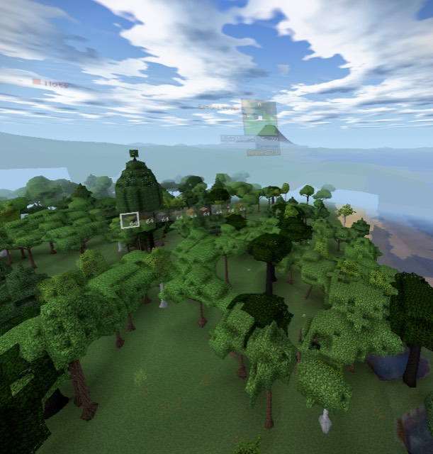

## 20:38:43 - There ain't no builds here

- **Transcript:** There ain't no builds here
- **Status:** open
- **Build:** 0.129 (39e0d988, M1-M4 (device-tested; ship riding, chests, comfort options, weapon wheel))
- **World:** Builders' Grounds (seed 632461258612199693)
- **Dimension:** Surface
- **Biome:** Taiga
- **Position:** 5504.3 124.7 -272.7
- **Facing:** west (yaw 250, pitch -42)
- **Held:** Grass Block x64
- **Mount:** on foot, flying
- **Looking at:** nothing
- **Mode:** Creative, health 20/20
- **Time:** day 1 09:02, clear
- **Fps:** 72
- **Levels:** mic -23 dBFS, game sound -16 dBFS
- **Length:** 2.3 s (voice 0.9 s)
- **Just before:** -21s message: Entering Fenivania; -19s message: Entering Draonia; -15s message: Walking; -12s message: Flying; -9s message: Entering Fenivania; -7s message: Clear Hollow Station marked on the map; -5s message: Westholm Central Station marked on the map; -2s message: You found the Clear & Westholm Railway: 2 stations, marked on your map; --1s message: Entering Draonia; --3s message: Entering Wenaresh; --4s message: Entering Fenivania; --6s message: Entering Draonia; --8s message: Entering Wenaresh; --15s message: Entering Draonia; --22s opened PauseMenu; -25s message: Walking; -21s message: Flying
- **Repro (Mac):** `./snap.sh note --seed 632461258612199693 --x 5504.3 --z -272.7 --yaw 110 --pitch -42 --time 0.127`
- **Audio (this Mac):** /Users/darthvadar/Documents/Blocksmith/QuestVoiceNotes/raw/vn-20261115-203843-502.aac

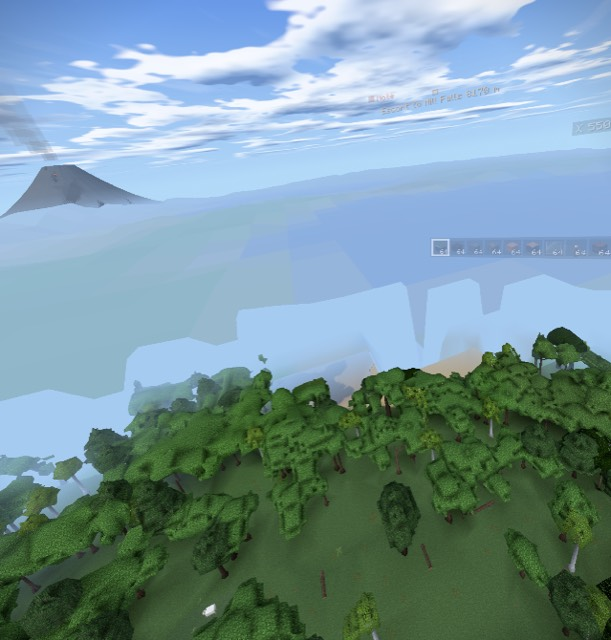

## 20:38:59 - Point and turn

- **Transcript:** Point and turn
- **Status:** open
- **Build:** 0.129 (39e0d988, M1-M4 (device-tested; ship riding, chests, comfort options, weapon wheel))
- **World:** Builders' Grounds (seed 632461258612199693)
- **Dimension:** Surface
- **Biome:** Beach
- **Position:** 5420.1 124.7 -263.3
- **Facing:** south-east (yaw 145, pitch -80)
- **Held:** Grass Block x64
- **Mount:** on foot, flying
- **Looking at:** nothing
- **Mode:** Creative, health 20/20, screen MapMenu
- **Time:** day 1 09:19, clear
- **Fps:** 72
- **Levels:** mic -32 dBFS, game sound -22 dBFS
- **Length:** 2.2 s (voice 0.5 s)
- **Just before:** -28s message: Flying; -25s message: Entering Fenivania; -23s message: Clear Hollow Station marked on the map; -21s message: Westholm Central Station marked on the map; -18s message: You found the Clear & Westholm Railway: 2 stations, marked on your map; -15s message: Entering Draonia; -13s message: Entering Wenaresh; -11s message: Entering Fenivania; -10s message: Entering Draonia; -8s message: Entering Wenaresh; -1s message: Entering Draonia; --6s opened PauseMenu; -15s opened PauseMenu; -13s opened JournalMenu; -12s opened MapMenu
- **Repro (Mac):** `./snap.sh note --seed 632461258612199693 --x 5420.1 --z -263.3 --yaw -145 --pitch -80 --time 0.138`
- **Audio (this Mac):** /Users/darthvadar/Documents/Blocksmith/QuestVoiceNotes/raw/vn-20261115-203859-322.aac

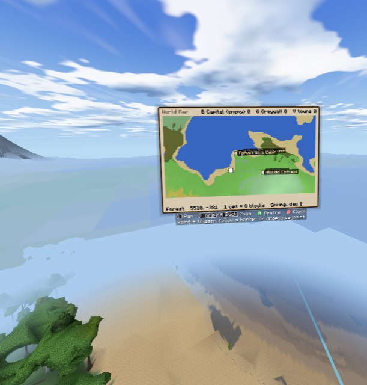

## 20:39:04 - Um, the waypoint isn't, doesn't get dropped where the thing's pointing

- **Transcript:** Um, the waypoint isn't, doesn't get dropped where the thing's pointing. It's, gets dropped like a, a ways under where it's pointing
- **Status:** open
- **Build:** 0.129 (39e0d988, M1-M4 (device-tested; ship riding, chests, comfort options, weapon wheel))
- **World:** Builders' Grounds (seed 632461258612199693)
- **Dimension:** Surface
- **Biome:** Beach
- **Position:** 5420.1 124.7 -263.3
- **Facing:** south-east (yaw 145, pitch -80)
- **Held:** Grass Block x64
- **Mount:** on foot, flying
- **Looking at:** nothing
- **Mode:** Creative, health 20/20, screen JournalMenu
- **Time:** day 1 09:25, clear
- **Fps:** 72
- **Levels:** mic -26 dBFS, game sound -22 dBFS
- **Length:** 9.3 s (voice 5.1 s)
- **Just before:** -30s message: Entering Fenivania; -28s message: Clear Hollow Station marked on the map; -26s message: Westholm Central Station marked on the map; -23s message: You found the Clear & Westholm Railway: 2 stations, marked on your map; -20s message: Entering Draonia; -18s message: Entering Wenaresh; -17s message: Entering Fenivania; -15s message: Entering Draonia; -13s message: Entering Wenaresh; -6s message: Entering Draonia; --1s opened PauseMenu; -20s opened PauseMenu; -18s opened JournalMenu; -17s opened MapMenu; -1s opened JournalMenu
- **While talking:** -4s opened PauseMenu; -5s closed JournalMenu
- **Position at the end:** 5481.2 124.7 -407.0
- **Repro (Mac):** `./snap.sh note --seed 632461258612199693 --x 5420.1 --z -263.3 --yaw -145 --pitch -80 --time 0.143`
- **Audio (this Mac):** /Users/darthvadar/Documents/Blocksmith/QuestVoiceNotes/raw/vn-20261115-203904-621.aac

## 20:39:21 - On the world map. So the waypoint's not, doesn't... Yeah

- **Transcript:** On the world map. So the waypoint's not, doesn't... Yeah
- **Status:** open
- **Build:** 0.129 (39e0d988, M1-M4 (device-tested; ship riding, chests, comfort options, weapon wheel))
- **World:** Builders' Grounds (seed 632461258612199693)
- **Dimension:** Surface
- **Biome:** Forest
- **Position:** 5510.0 124.7 -404.7
- **Facing:** north-east (yaw 56, pitch -27)
- **Held:** Grass Block x64
- **Mount:** on foot, flying
- **Looking at:** nothing
- **Mode:** Creative, health 20/20, screen MapMenu
- **Time:** day 1 09:44, clear
- **Fps:** 72
- **Levels:** mic -26 dBFS, game sound -22 dBFS
- **Length:** 6.1 s (voice 2.5 s)
- **Just before:** -29s message: Entering Wenaresh; -22s message: Entering Draonia; -16s opened PauseMenu; -17s opened JournalMenu; -17s closed JournalMenu; -8s opened PauseMenu; -7s opened JournalMenu; -6s opened MapMenu
- **While talking:** -5s opened JournalMenu; -4s closed JournalMenu
- **Position at the end:** 5534.2 124.7 -155.7
- **Repro (Mac):** `./snap.sh note --seed 632461258612199693 --x 5510.0 --z -404.7 --yaw -56 --pitch -27 --time 0.156`
- **Audio (this Mac):** /Users/darthvadar/Documents/Blocksmith/QuestVoiceNotes/raw/vn-20261115-203921-161.aac

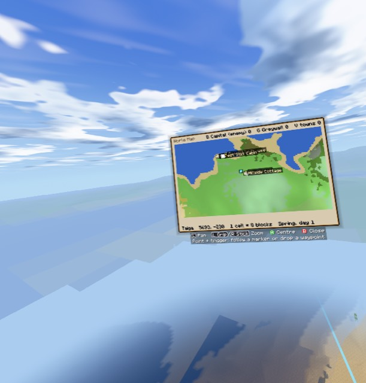

## 20:39:28 - Also, the waypoint should show up on my little nav bar

- **Transcript:** Also, the waypoint should show up on my little nav bar
- **Status:** open
- **Build:** 0.129 (39e0d988, M1-M4 (device-tested; ship riding, chests, comfort options, weapon wheel))
- **World:** Builders' Grounds (seed 632461258612199693)
- **Dimension:** Surface
- **Biome:** Forest
- **Position:** 5526.1 124.7 -120.9
- **Facing:** south (yaw 195, pitch -35)
- **Held:** Grass Block x64
- **Mount:** on foot, flying
- **Looking at:** nothing
- **Mode:** Creative, health 20/20
- **Time:** day 1 09:52, clear
- **Fps:** 72
- **Levels:** mic -28 dBFS, game sound -12 dBFS
- **Length:** 4.4 s (voice 2.1 s)
- **Just before:** -29s message: Entering Draonia; -23s opened PauseMenu; -24s opened JournalMenu; -23s closed JournalMenu; -15s opened PauseMenu; -14s opened JournalMenu; -13s opened MapMenu; -7s opened JournalMenu; -6s closed JournalMenu
- **Repro (Mac):** `./snap.sh note --seed 632461258612199693 --x 5526.1 --z -120.9 --yaw 165 --pitch -35 --time 0.162`
- **Audio (this Mac):** /Users/darthvadar/Documents/Blocksmith/QuestVoiceNotes/raw/vn-20261115-203928-121.aac

## 20:39:49 - Just a homestead

- **Transcript:** Just a homestead
- **Status:** open
- **Build:** 0.129 (39e0d988, M1-M4 (device-tested; ship riding, chests, comfort options, weapon wheel))
- **World:** Builders' Grounds (seed 632461258612199693)
- **Dimension:** Surface
- **Biome:** Forest
- **Position:** 5679.3 124.7 -227.6
- **Facing:** north-east (yaw 62, pitch -72)
- **Held:** Grass Block x64
- **Mount:** on foot, flying
- **Looking at:** nothing
- **Mode:** Creative, health 20/20
- **Time:** day 1 10:17, clear
- **Fps:** 67
- **Levels:** mic -29 dBFS, game sound -18 dBFS
- **Length:** 1.9 s (voice 0.4 s)
- **Just before:** -28s opened JournalMenu; -28s closed JournalMenu; -17s opened PauseMenu; -16s opened JournalMenu; -15s opened MapMenu; -13s opened JournalMenu; -12s closed JournalMenu
- **Repro (Mac):** `./snap.sh note --seed 632461258612199693 --x 5679.3 --z -227.6 --yaw -62 --pitch -72 --time 0.178`
- **Audio (this Mac):** /Users/darthvadar/Documents/Blocksmith/QuestVoiceNotes/raw/vn-20261115-203949-521.aac

## 20:40:06 - All right, where the hell?

- **Transcript:** All right, where the hell?
- **Status:** open
- **Build:** 0.129 (39e0d988, M1-M4 (device-tested; ship riding, chests, comfort options, weapon wheel))
- **World:** Builders' Grounds (seed 632461258612199693)
- **Dimension:** Surface
- **Biome:** Taiga
- **Position:** 5694.6 124.7 -248.4
- **Facing:** north-east (yaw 52, pitch -20)
- **Held:** Grass Block x64
- **Mount:** on foot, flying
- **Looking at:** nothing
- **Mode:** Creative, health 20/20
- **Time:** day 1 10:36, clear
- **Fps:** 72
- **Levels:** mic -26 dBFS, game sound -13 dBFS
- **Length:** 2.6 s (voice 1.2 s)
- **Just before:** -30s opened JournalMenu; -29s closed JournalMenu; -17s message: A homestead. Fields, a barn, and a long way from town.; -15s opened PauseMenu; -15s opened JournalMenu; -13s opened MapMenu; -2s opened JournalMenu; -2s closed JournalMenu
- **Repro (Mac):** `./snap.sh note --seed 632461258612199693 --x 5694.6 --z -248.4 --yaw -52 --pitch -20 --time 0.192`
- **Audio (this Mac):** /Users/darthvadar/Documents/Blocksmith/QuestVoiceNotes/raw/vn-20261115-204006-541.aac

## 20:40:18 - Stonegate, I see

- **Transcript:** Stonegate, I see
- **Status:** open
- **Build:** 0.129 (39e0d988, M1-M4 (device-tested; ship riding, chests, comfort options, weapon wheel))
- **World:** Builders' Grounds (seed 632461258612199693)
- **Dimension:** Surface
- **Biome:** Badlands
- **Position:** 4836.0 99.0 282.6
- **Facing:** east (yaw 90, pitch -59)
- **Held:** Grass Block x64
- **Mount:** on foot, flying
- **Looking at:** nothing
- **Mode:** Creative, health 20/20
- **Time:** day 1 10:51, clear
- **Fps:** 71
- **Levels:** mic -27 dBFS, game sound -30 dBFS
- **Length:** 2.5 s (voice 0.9 s)
- **Just before:** -29s message: A homestead. Fields, a barn, and a long way from town.; -28s opened PauseMenu; -27s opened JournalMenu; -26s opened MapMenu; -15s opened JournalMenu; -14s closed JournalMenu; -9s message: Entering Quelendor; -7s message: Entering Belemoor; -5s message: Entering Quelmark; -2s message: Walking; -1s message: Flying
- **Repro (Mac):** `./snap.sh note --seed 632461258612199693 --x 4836.0 --z 282.6 --yaw -90 --pitch -59 --time 0.202`
- **Audio (this Mac):** /Users/darthvadar/Documents/Blocksmith/QuestVoiceNotes/raw/vn-20261115-204018-861.aac

## 20:40:21 - So what do we have wrong here? I see something. Fucking lanterns aren'

- **Transcript:** So what do we have wrong here? I see something. Fucking lanterns aren't attached to the goddamn block
- **Status:** open
- **Build:** 0.129 (39e0d988, M1-M4 (device-tested; ship riding, chests, comfort options, weapon wheel))
- **World:** Builders' Grounds (seed 632461258612199693)
- **Dimension:** Surface
- **Biome:** Badlands
- **Position:** 4844.5 97.1 273.4
- **Facing:** north (yaw 359, pitch -0)
- **Held:** Grass Block x64
- **Mount:** on foot
- **Looking at:** nothing
- **Mode:** Creative, health 20/20
- **Time:** day 1 10:54, clear
- **Fps:** 71
- **Levels:** mic -27 dBFS, game sound -25 dBFS
- **Length:** 6.9 s (voice 4.4 s)
- **Just before:** -29s opened JournalMenu; -28s opened MapMenu; -17s opened JournalMenu; -17s closed JournalMenu; -11s message: Entering Quelendor; -9s message: Entering Belemoor; -7s message: Entering Quelmark; -4s message: Walking; -3s message: Flying; -1s message: Walking
- **While talking:** -3s message: Flying
- **Position at the end:** 4843.3 94.3 271.0
- **Repro (Mac):** `./snap.sh note --seed 632461258612199693 --x 4844.5 --z 273.4 --yaw 1 --pitch -0 --time 0.204`
- **Audio (this Mac):** /Users/darthvadar/Documents/Blocksmith/QuestVoiceNotes/raw/vn-20261115-204021-161.aac

## 20:40:29 - That's the kinda shit the Asian's supposed to spot when it's building 

- **Transcript:** That's the kinda shit the Asian's supposed to spot when it's building shit
- **Status:** open
- **Build:** 0.129 (39e0d988, M1-M4 (device-tested; ship riding, chests, comfort options, weapon wheel))
- **World:** Builders' Grounds (seed 632461258612199693)
- **Dimension:** Surface
- **Biome:** Badlands
- **Position:** 4840.4 94.3 273.5
- **Facing:** north-east (yaw 23, pitch 15)
- **Held:** Grass Block x64
- **Mount:** on foot, flying
- **Looking at:** nothing
- **Mode:** Creative, health 20/20
- **Time:** day 1 11:03, clear
- **Fps:** 72
- **Levels:** mic -32 dBFS, game sound -38 dBFS
- **Length:** 5.1 s (voice 3.3 s)
- **Just before:** -25s opened JournalMenu; -25s closed JournalMenu; -19s message: Entering Quelendor; -17s message: Entering Belemoor; -15s message: Entering Quelmark; -12s message: Walking; -11s message: Flying; -8s message: Walking; -6s message: Flying
- **Repro (Mac):** `./snap.sh note --seed 632461258612199693 --x 4840.4 --z 273.5 --yaw -23 --pitch 15 --time 0.211`
- **Audio (this Mac):** /Users/darthvadar/Documents/Blocksmith/QuestVoiceNotes/raw/vn-20261115-204029-021.aac

## 20:40:33 - Just saying

- **Transcript:** Just saying
- **Status:** open
- **Build:** 0.129 (39e0d988, M1-M4 (device-tested; ship riding, chests, comfort options, weapon wheel))
- **World:** Builders' Grounds (seed 632461258612199693)
- **Dimension:** Surface
- **Biome:** Badlands
- **Position:** 4838.4 94.3 271.2
- **Facing:** north-east (yaw 52, pitch -0)
- **Held:** Grass Block x64
- **Mount:** on foot, flying
- **Looking at:** nothing
- **Mode:** Creative, health 20/20
- **Time:** day 1 11:09, clear
- **Fps:** 72
- **Levels:** mic -34 dBFS, game sound -37 dBFS
- **Length:** 1.7 s (voice 0.6 s)
- **Just before:** -30s opened JournalMenu; -29s closed JournalMenu; -24s message: Entering Quelendor; -22s message: Entering Belemoor; -20s message: Entering Quelmark; -17s message: Walking; -16s message: Flying; -13s message: Walking; -11s message: Flying
- **Repro (Mac):** `./snap.sh note --seed 632461258612199693 --x 4838.4 --z 271.2 --yaw -52 --pitch -0 --time 0.215`
- **Audio (this Mac):** /Users/darthvadar/Documents/Blocksmith/QuestVoiceNotes/raw/vn-20261115-204033-841.aac

## 20:40:44 - The waypoints aren't easy to set

- **Transcript:** The waypoints aren't easy to set
- **Status:** open
- **Build:** 0.129 (39e0d988, M1-M4 (device-tested; ship riding, chests, comfort options, weapon wheel))
- **World:** Builders' Grounds (seed 632461258612199693)
- **Dimension:** Surface
- **Biome:** Badlands
- **Position:** 4840.2 94.3 276.6
- **Facing:** south-east (yaw 148, pitch -11)
- **Held:** Grass Block x64
- **Mount:** on foot, flying
- **Looking at:** nothing
- **Mode:** Creative, health 20/20, screen MapMenu
- **Time:** day 1 11:21, clear
- **Fps:** 71
- **Levels:** mic -25 dBFS, game sound -32 dBFS
- **Length:** 3.0 s (voice 1.5 s)
- **Just before:** -27s message: Walking; -26s message: Flying; -24s message: Walking; -22s message: Flying; -9s opened PauseMenu; -9s opened JournalMenu; -7s opened MapMenu
- **Repro (Mac):** `./snap.sh note --seed 632461258612199693 --x 4840.2 --z 276.6 --yaw -148 --pitch -11 --time 0.223`
- **Audio (this Mac):** /Users/darthvadar/Documents/Blocksmith/QuestVoiceNotes/raw/vn-20261115-204044-341.aac

## 20:40:52 - Where is this lake?

- **Transcript:** Where is this lake?
- **Status:** open
- **Build:** 0.129 (39e0d988, M1-M4 (device-tested; ship riding, chests, comfort options, weapon wheel))
- **World:** Builders' Grounds (seed 632461258612199693)
- **Dimension:** Surface
- **Biome:** Swamp
- **Position:** 4934.8 116.3 -422.0
- **Facing:** south (yaw 174, pitch -65)
- **Held:** Grass Block x64
- **Mount:** on foot, flying
- **Looking at:** nothing
- **Mode:** Creative, health 20/20
- **Time:** day 1 11:30, clear
- **Fps:** 71
- **Levels:** mic -29 dBFS, game sound -24 dBFS
- **Length:** 2.6 s (voice 1.0 s)
- **Just before:** -29s message: Flying; -17s opened PauseMenu; -16s opened JournalMenu; -15s opened MapMenu; -6s opened JournalMenu; -5s closed JournalMenu; -4s message: Shutters bang in the wind. Nobody has lived here for years.; -1s message: Ghost town marked on the map
- **Repro (Mac):** `./snap.sh note --seed 632461258612199693 --x 4934.8 --z -422.0 --yaw -174 --pitch -65 --time 0.229`
- **Audio (this Mac):** /Users/darthvadar/Documents/Blocksmith/QuestVoiceNotes/raw/vn-20261115-204052-041.aac

## 20:41:03 - I don't see a fucking thing

- **Transcript:** I don't see a fucking thing
- **Status:** open
- **Build:** 0.129 (39e0d988, M1-M4 (device-tested; ship riding, chests, comfort options, weapon wheel))
- **World:** Builders' Grounds (seed 632461258612199693)
- **Dimension:** Surface
- **Biome:** Ocean
- **Position:** 4672.8 114.3 -489.8
- **Facing:** south-west (yaw 213, pitch -64)
- **Held:** Grass Block x64
- **Mount:** on foot
- **Looking at:** nothing
- **Mode:** Creative, health 20/20
- **Time:** day 1 11:44, clear
- **Fps:** 65
- **Levels:** mic -27 dBFS, game sound -31 dBFS
- **Length:** 2.7 s (voice 1.0 s)
- **Just before:** -29s opened PauseMenu; -28s opened JournalMenu; -27s opened MapMenu; -18s opened JournalMenu; -17s closed JournalMenu; -16s message: Shutters bang in the wind. Nobody has lived here for years.; -13s message: Ghost town marked on the map; -11s message: Entering Belemoor; -0s message: Walking
- **Repro (Mac):** `./snap.sh note --seed 632461258612199693 --x 4672.8 --z -489.8 --yaw 147 --pitch -64 --time 0.239`
- **Audio (this Mac):** /Users/darthvadar/Documents/Blocksmith/QuestVoiceNotes/raw/vn-20261115-204103-921.aac

## 20:41:21 - Something over here? Oh, here we go

- **Transcript:** Something over here? Oh, here we go
- **Status:** open
- **Build:** 0.129 (39e0d988, M1-M4 (device-tested; ship riding, chests, comfort options, weapon wheel))
- **World:** Builders' Grounds (seed 632461258612199693)
- **Dimension:** Surface
- **Biome:** Swamp
- **Position:** 4790.1 91.6 -610.1
- **Facing:** east (yaw 69, pitch -62)
- **Held:** Grass Block x64
- **Mount:** on foot, flying
- **Looking at:** nothing
- **Mode:** Creative, health 20/20
- **Time:** day 1 12:00, clear
- **Fps:** 72
- **Levels:** mic -24 dBFS, game sound -28 dBFS
- **Length:** 3.0 s (voice 1.1 s)
- **Just before:** -28s message: Entering Belemoor; -18s message: Walking; -16s message: Flying; -11s opened PauseMenu; -7s opened JournalMenu; -7s opened MapMenu; -5s opened JournalMenu; -5s closed JournalMenu
- **Repro (Mac):** `./snap.sh note --seed 632461258612199693 --x 4790.1 --z -610.1 --yaw -69 --pitch -62 --time 0.251`
- **Audio (this Mac):** /Users/darthvadar/Documents/Blocksmith/QuestVoiceNotes/raw/vn-20261115-204121-421.aac

## 20:41:25 - What the fuck's this thing?

- **Transcript:** What the fuck's this thing?
- **Status:** open
- **Build:** 0.129 (39e0d988, M1-M4 (device-tested; ship riding, chests, comfort options, weapon wheel))
- **World:** Builders' Grounds (seed 632461258612199693)
- **Dimension:** Surface
- **Biome:** Old Growth Pine Taiga
- **Position:** 4712.2 87.8 -638.5
- **Facing:** east (yaw 93, pitch -66)
- **Held:** Grass Block x64
- **Mount:** on foot
- **Looking at:** nothing
- **Mode:** Creative, health 20/20
- **Time:** day 1 12:06, clear
- **Fps:** 72
- **Levels:** mic -28 dBFS, game sound -30 dBFS
- **Length:** 3.1 s (voice 1.1 s)
- **Just before:** -22s message: Walking; -21s message: Flying; -16s opened PauseMenu; -12s opened JournalMenu; -11s opened MapMenu; -10s opened JournalMenu; -9s closed JournalMenu; -1s message: Walking
- **Repro (Mac):** `./snap.sh note --seed 632461258612199693 --x 4712.2 --z -638.5 --yaw -93 --pitch -66 --time 0.254`
- **Audio (this Mac):** /Users/darthvadar/Documents/Blocksmith/QuestVoiceNotes/raw/vn-20261115-204125-942.aac

## 20:41:29 - What even is this?

- **Transcript:** What even is this?
- **Status:** open
- **Build:** 0.129 (39e0d988, M1-M4 (device-tested; ship riding, chests, comfort options, weapon wheel))
- **World:** Builders' Grounds (seed 632461258612199693)
- **Dimension:** Surface
- **Biome:** Ocean
- **Position:** 4718.0 65.7 -651.0
- **Facing:** south (yaw 159, pitch -45)
- **Held:** Grass Block x64
- **Mount:** on foot, flying
- **Looking at:** nothing
- **Mode:** Creative, health 20/20
- **Time:** day 1 12:10, clear
- **Fps:** 68
- **Levels:** mic -31 dBFS, game sound -26 dBFS
- **Length:** 2.4 s (voice 0.9 s)
- **Just before:** -26s message: Walking; -24s message: Flying; -19s opened PauseMenu; -15s opened JournalMenu; -14s opened MapMenu; -13s opened JournalMenu; -13s closed JournalMenu; -4s message: Walking; -2s message: Flying
- **Repro (Mac):** `./snap.sh note --seed 632461258612199693 --x 4718.0 --z -651.0 --yaw -159 --pitch -45 --time 0.257`
- **Audio (this Mac):** /Users/darthvadar/Documents/Blocksmith/QuestVoiceNotes/raw/vn-20261115-204129-241.aac

## 20:41:32 - This is a half-built dock, if anything

- **Transcript:** This is a half-built dock, if anything
- **Status:** open
- **Build:** 0.129 (39e0d988, M1-M4 (device-tested; ship riding, chests, comfort options, weapon wheel))
- **World:** Builders' Grounds (seed 632461258612199693)
- **Dimension:** Surface
- **Biome:** Ocean
- **Position:** 4719.8 65.7 -631.2
- **Facing:** north (yaw 13, pitch -53)
- **Held:** Grass Block x64
- **Mount:** on foot, flying
- **Looking at:** nothing
- **Mode:** Creative, health 20/20
- **Time:** day 1 12:14, clear
- **Fps:** 68
- **Levels:** mic -31 dBFS, game sound -20 dBFS
- **Length:** 4.7 s (voice 2.0 s)
- **Just before:** -29s message: Walking; -28s message: Flying; -22s opened PauseMenu; -19s opened JournalMenu; -18s opened MapMenu; -17s opened JournalMenu; -16s closed JournalMenu; -7s message: Walking; -6s message: Flying
- **Repro (Mac):** `./snap.sh note --seed 632461258612199693 --x 4719.8 --z -631.2 --yaw -13 --pitch -53 --time 0.260`
- **Audio (this Mac):** /Users/darthvadar/Documents/Blocksmith/QuestVoiceNotes/raw/vn-20261115-204132-761.aac

## 20:41:37 - Oh my God

- **Transcript:** Oh my God
- **Status:** open
- **Build:** 0.129 (39e0d988, M1-M4 (device-tested; ship riding, chests, comfort options, weapon wheel))
- **World:** Builders' Grounds (seed 632461258612199693)
- **Dimension:** Surface
- **Biome:** Ocean
- **Position:** 4719.5 67.2 -628.7
- **Facing:** north (yaw 9, pitch -8)
- **Held:** Grass Block x64
- **Mount:** on foot, flying
- **Looking at:** nothing
- **Mode:** Creative, health 20/20, screen JournalMenu
- **Time:** day 1 12:19, clear
- **Fps:** 72
- **Levels:** mic -35 dBFS, game sound -29 dBFS
- **Length:** 2.2 s (voice 0.6 s)
- **Just before:** -27s opened PauseMenu; -23s opened JournalMenu; -23s opened MapMenu; -21s opened JournalMenu; -21s closed JournalMenu; -12s message: Walking; -11s message: Flying; -1s opened PauseMenu; -1s opened JournalMenu
- **Repro (Mac):** `./snap.sh note --seed 632461258612199693 --x 4719.5 --z -628.7 --yaw -9 --pitch -8 --time 0.264`
- **Audio (this Mac):** /Users/darthvadar/Documents/Blocksmith/QuestVoiceNotes/raw/vn-20261115-204137-421.aac

## 20:41:44 - Uh, ridge watch, uh, ridge watchtower. I can fuck... Oh, I can't see s

- **Transcript:** Uh, ridge watch, uh, ridge watchtower. I can fuck... Oh, I can't see shit now. Where the fuck am I?
- **Status:** open
- **Build:** 0.129 (39e0d988, M1-M4 (device-tested; ship riding, chests, comfort options, weapon wheel))
- **World:** Builders' Grounds (seed 632461258612199693)
- **Dimension:** Surface
- **Biome:** Ocean
- **Position:** 4719.5 67.2 -628.7
- **Facing:** north (yaw 9, pitch -8)
- **Held:** Grass Block x64
- **Mount:** on foot, flying
- **Looking at:** nothing
- **Mode:** Creative, health 20/20, screen MapMenu
- **Time:** day 1 12:28, clear
- **Fps:** 72
- **Levels:** mic -39 dBFS, game sound -27 dBFS
- **Length:** 7.7 s (voice 4.4 s)
- **Just before:** -30s opened MapMenu; -29s opened JournalMenu; -28s closed JournalMenu; -20s message: Walking; -18s message: Flying; -9s opened PauseMenu; -8s opened JournalMenu; -7s opened MapMenu
- **Position at the end:** 4719.5 67.2 -628.7
- **Repro (Mac):** `./snap.sh note --seed 632461258612199693 --x 4719.5 --z -628.7 --yaw -9 --pitch -8 --time 0.270`
- **Audio (this Mac):** /Users/darthvadar/Documents/Blocksmith/QuestVoiceNotes/raw/vn-20261115-204144-882.aac

## 20:42:06 - Oh, great. Yeah, this whole waypoint map, it needs a lot of fixes. Hol

- **Transcript:** Oh, great. Yeah, this whole waypoint map, it needs a lot of fixes. Holy shit. This is really bad
- **Status:** open
- **Build:** 0.129 (39e0d988, M1-M4 (device-tested; ship riding, chests, comfort options, weapon wheel))
- **World:** Builders' Grounds (seed 632461258612199693)
- **Dimension:** Surface
- **Biome:** Ocean
- **Position:** 4719.5 67.2 -628.7
- **Facing:** north (yaw 9, pitch -8)
- **Held:** Grass Block x64
- **Mount:** on foot, flying
- **Looking at:** nothing
- **Mode:** Creative, health 20/20, screen MapMenu
- **Time:** day 1 12:54, clear
- **Fps:** 72
- **Levels:** mic -34 dBFS, game sound -19 dBFS
- **Length:** 8.0 s (voice 3.9 s)
- **Just before:** -29s opened MapMenu; -4s message: The sky is clouding over: fog is coming
- **Position at the end:** 4719.5 67.2 -628.7
- **Repro (Mac):** `./snap.sh note --seed 632461258612199693 --x 4719.5 --z -628.7 --yaw -9 --pitch -8 --time 0.288`
- **Audio (this Mac):** /Users/darthvadar/Documents/Blocksmith/QuestVoiceNotes/raw/vn-20261115-204206-641.aac

## 20:42:47 - Ridge Watchtower. That's gotta be the most pathetic thing

- **Transcript:** Ridge Watchtower. That's gotta be the most pathetic thing
- **Status:** open
- **Build:** 0.129 (39e0d988, M1-M4 (device-tested; ship riding, chests, comfort options, weapon wheel))
- **World:** Builders' Grounds (seed 632461258612199693)
- **Dimension:** Surface
- **Biome:** Taiga
- **Position:** 6134.2 96.3 -1204.3
- **Facing:** east (yaw 112, pitch -44)
- **Held:** Grass Block x64
- **Mount:** on foot, flying
- **Looking at:** nothing
- **Mode:** Creative, health 20/20
- **Time:** day 1 13:41, clear
- **Fps:** 72
- **Levels:** mic -24 dBFS, game sound -35 dBFS
- **Length:** 5.9 s (voice 2.8 s)
- **Just before:** -26s opened JournalMenu; -26s closed JournalMenu; -17s opened PauseMenu; -16s opened JournalMenu; -15s opened MapMenu; -14s opened JournalMenu; -13s closed JournalMenu; -7s opened PauseMenu; -7s opened JournalMenu; -6s opened MapMenu; -5s opened JournalMenu; -5s closed JournalMenu
- **Position at the end:** 6149.0 96.3 -1199.4
- **Repro (Mac):** `./snap.sh note --seed 632461258612199693 --x 6134.2 --z -1204.3 --yaw -112 --pitch -44 --time 0.321`
- **Audio (this Mac):** /Users/darthvadar/Documents/Blocksmith/QuestVoiceNotes/raw/vn-20261115-204247-261.aac

## 20:42:58 - That's not... Like we need some better builds here. Come on. Why the h

- **Transcript:** That's not... Like we need some better builds here. Come on. Why the hell is there snow mixed in with sand? That doesn't make a lick of sense
- **Status:** open
- **Build:** 0.129 (39e0d988, M1-M4 (device-tested; ship riding, chests, comfort options, weapon wheel))
- **World:** Builders' Grounds (seed 632461258612199693)
- **Dimension:** Surface
- **Biome:** Cold Ocean
- **Position:** 6330.1 96.3 -1229.7
- **Facing:** east (yaw 81, pitch -21)
- **Held:** Grass Block x64
- **Mount:** on foot, flying
- **Looking at:** nothing
- **Mode:** Creative, health 20/20
- **Time:** day 1 13:54, clear
- **Fps:** 71
- **Levels:** mic -43 dBFS, game sound -26 dBFS
- **Length:** 7.7 s (voice 5.1 s)
- **Just before:** -28s opened PauseMenu; -27s opened JournalMenu; -26s opened MapMenu; -24s opened JournalMenu; -24s closed JournalMenu; -18s opened PauseMenu; -18s opened JournalMenu; -17s opened MapMenu; -16s opened JournalMenu; -16s closed JournalMenu
- **While talking:** -3s message: Walking; -1s message: Flying
- **Position at the end:** 6471.7 74.1 -1193.7
- **Repro (Mac):** `./snap.sh note --seed 632461258612199693 --x 6330.1 --z -1229.7 --yaw -81 --pitch -21 --time 0.330`
- **Audio (this Mac):** /Users/darthvadar/Documents/Blocksmith/QuestVoiceNotes/raw/vn-20261115-204258-121.aac

## 20:43:07 - No, I guess it kind of does. Uh, I don't know

- **Transcript:** No, I guess it kind of does. Uh, I don't know
- **Status:** open
- **Build:** 0.129 (39e0d988, M1-M4 (device-tested; ship riding, chests, comfort options, weapon wheel))
- **World:** Builders' Grounds (seed 632461258612199693)
- **Dimension:** Surface
- **Biome:** Beach
- **Position:** 6529.9 74.1 -1125.2
- **Facing:** south (yaw 170, pitch -44)
- **Held:** Grass Block x64
- **Mount:** on foot, flying
- **Looking at:** nothing
- **Mode:** Creative, health 20/20
- **Time:** day 1 14:06, clear
- **Fps:** 71
- **Levels:** mic -21 dBFS, game sound -14 dBFS
- **Length:** 5.3 s (voice 2.1 s)
- **Just before:** -28s opened PauseMenu; -27s opened JournalMenu; -26s opened MapMenu; -25s opened JournalMenu; -25s closed JournalMenu; -7s message: Walking; -6s message: Flying
- **Repro (Mac):** `./snap.sh note --seed 632461258612199693 --x 6529.9 --z -1125.2 --yaw -170 --pitch -44 --time 0.338`
- **Audio (this Mac):** /Users/darthvadar/Documents/Blocksmith/QuestVoiceNotes/raw/vn-20261115-204307-682.aac

## 20:44:26 - Oh, here we go

- **Transcript:** Oh, here we go
- **Status:** open
- **Build:** 0.129 (39e0d988, M1-M4 (device-tested; ship riding, chests, comfort options, weapon wheel))
- **World:** Sparkstone Workshop (seed 91604158401363)
- **Dimension:** Surface
- **Biome:** Snowy Taiga
- **Position:** 5123.1 124.2 -3419.4
- **Facing:** south-west (yaw 205, pitch -65)
- **Held:** Capital Rounds x64
- **Mount:** on foot, flying
- **Looking at:** nothing
- **Mode:** Creative, health 20/20
- **Time:** day 1 13:32, clear
- **Fps:** 71
- **Levels:** mic -22 dBFS, game sound -21 dBFS
- **Length:** 2.7 s (voice 0.8 s)
- **Just before:** --170s opened JournalMenu; --170s opened MapMenu; --172s opened JournalMenu; --172s closed JournalMenu; --181s message: Walking; --182s message: Flying; --192s opened PauseMenu; --192s opened JournalMenu; --193s opened MapMenu; --218s message: The sky is clouding over: fog is coming; --237s opened JournalMenu; --237s closed JournalMenu; --246s opened PauseMenu; --247s opened JournalMenu; --248s opened MapMenu; --249s opened JournalMenu; --250s closed JournalMenu; --255s opened PauseMenu; --256s opened JournalMenu; --257s opened MapMenu; --258s opened JournalMenu; --258s closed JournalMenu; --276s message: Walking; --277s message: Flying; --286s message: The sky is clouding over: fog is coming; --288s message: Entering Zoriland; --289s opened PauseMenu; --290s message: Entering Belemoor; -13s opened PauseMenu; -12s opened JournalMenu; -11s opened MapMenu; -5s opened JournalMenu; -5s closed JournalMenu
- **Repro (Mac):** `./snap.sh note --seed 91604158401363 --x 5123.1 --z -3419.4 --yaw 155 --pitch -65 --time 0.314`
- **Audio (this Mac):** /Users/darthvadar/Documents/Blocksmith/QuestVoiceNotes/raw/vn-20261115-204426-561.aac

## 20:44:30 - Got some supports. Yes, supports. Right

- **Transcript:** Got some supports. Yes, supports. Right
- **Status:** open
- **Build:** 0.129 (39e0d988, M1-M4 (device-tested; ship riding, chests, comfort options, weapon wheel))
- **World:** Sparkstone Workshop (seed 91604158401363)
- **Dimension:** Surface
- **Biome:** Beach
- **Position:** 5150.9 99.6 -3415.5
- **Facing:** south-east (yaw 123, pitch -43)
- **Held:** Capital Rounds x64
- **Mount:** on foot, flying
- **Looking at:** nothing
- **Mode:** Creative, health 20/20
- **Time:** day 1 13:36, clear
- **Fps:** 63
- **Levels:** mic -41 dBFS, game sound -19 dBFS
- **Length:** 4.4 s (voice 2.3 s)
- **Just before:** --168s opened JournalMenu; --169s closed JournalMenu; --177s message: Walking; --179s message: Flying; --188s opened PauseMenu; --189s opened JournalMenu; --189s opened MapMenu; --215s message: The sky is clouding over: fog is coming; --233s opened JournalMenu; --234s closed JournalMenu; --243s opened PauseMenu; --244s opened JournalMenu; --244s opened MapMenu; --246s opened JournalMenu; --246s closed JournalMenu; --252s opened PauseMenu; --252s opened JournalMenu; --253s opened MapMenu; --254s opened JournalMenu; --255s closed JournalMenu; --273s message: Walking; --274s message: Flying; --282s message: The sky is clouding over: fog is coming; --285s message: Entering Zoriland; --286s opened PauseMenu; --286s message: Entering Belemoor; -16s opened PauseMenu; -15s opened JournalMenu; -15s opened MapMenu; -9s opened JournalMenu; -8s closed JournalMenu; -3s message: Walking; -1s message: Flying
- **Repro (Mac):** `./snap.sh note --seed 91604158401363 --x 5150.9 --z -3415.5 --yaw -123 --pitch -43 --time 0.317`
- **Audio (this Mac):** /Users/darthvadar/Documents/Blocksmith/QuestVoiceNotes/raw/vn-20261115-204430-141.aac

## 20:44:43 - Is it eight o'clock? Yeah, okay, that's

- **Transcript:** Is it eight o'clock? Yeah, okay, that's
- **Status:** open
- **Build:** 0.129 (39e0d988, M1-M4 (device-tested; ship riding, chests, comfort options, weapon wheel))
- **World:** Sparkstone Workshop (seed 91604158401363)
- **Dimension:** Surface
- **Biome:** Snowy Taiga
- **Position:** 5165.5 81.0 -3406.5
- **Facing:** south-east (yaw 149, pitch -29)
- **Held:** Donnerkeil Service Rifle x1
- **Mount:** on foot
- **Looking at:** nothing
- **Mode:** Creative, health 20/20
- **Time:** day 1 13:52, clear
- **Fps:** 72
- **Levels:** mic -32 dBFS, game sound -7 dBFS
- **Length:** 3.5 s (voice 1.6 s)
- **Just before:** --175s opened PauseMenu; --175s opened JournalMenu; --176s opened MapMenu; --201s message: The sky is clouding over: fog is coming; --220s opened JournalMenu; --220s closed JournalMenu; --229s opened PauseMenu; --230s opened JournalMenu; --231s opened MapMenu; --232s opened JournalMenu; --233s closed JournalMenu; --239s opened PauseMenu; --239s opened JournalMenu; --240s opened MapMenu; --241s opened JournalMenu; --241s closed JournalMenu; --259s message: Walking; --261s message: Flying; --269s message: The sky is clouding over: fog is coming; --271s message: Entering Zoriland; --272s opened PauseMenu; --273s message: Entering Belemoor; -30s opened PauseMenu; -29s opened JournalMenu; -28s opened MapMenu; -22s opened JournalMenu; -22s closed JournalMenu; -16s message: Walking; -14s message: Flying; -10s message: Walking; -9s holding Donnerkeil Service Rifle; -2s message: Flying; -0s message: Walking
- **Repro (Mac):** `./snap.sh note --seed 91604158401363 --x 5165.5 --z -3406.5 --yaw -149 --pitch -29 --time 0.328`
- **Audio (this Mac):** /Users/darthvadar/Documents/Blocksmith/QuestVoiceNotes/raw/vn-20261115-204443-422.aac

## 20:44:48 - All these buildings still fell over

- **Transcript:** All these buildings still fell over
- **Status:** open
- **Build:** 0.129 (39e0d988, M1-M4 (device-tested; ship riding, chests, comfort options, weapon wheel))
- **World:** Sparkstone Workshop (seed 91604158401363)
- **Dimension:** Surface
- **Biome:** Snowy Taiga
- **Position:** 5176.7 92.1 -3419.0
- **Facing:** south-east (yaw 156, pitch -37)
- **Held:** Donnerkeil Service Rifle x1
- **Mount:** on foot, flying
- **Looking at:** nothing
- **Mode:** Creative, health 20/20
- **Time:** day 1 13:58, clear
- **Fps:** 72
- **Levels:** mic -26 dBFS, game sound -17 dBFS
- **Length:** 2.8 s (voice 1.5 s)
- **Just before:** --170s opened JournalMenu; --171s opened MapMenu; --197s message: The sky is clouding over: fog is coming; --215s opened JournalMenu; --216s closed JournalMenu; --224s opened PauseMenu; --225s opened JournalMenu; --226s opened MapMenu; --228s opened JournalMenu; --228s closed JournalMenu; --234s opened PauseMenu; --234s opened JournalMenu; --235s opened MapMenu; --236s opened JournalMenu; --236s closed JournalMenu; --254s message: Walking; --256s message: Flying; --264s message: The sky is clouding over: fog is coming; --266s message: Entering Zoriland; --267s opened PauseMenu; --268s message: Entering Belemoor; -27s opened JournalMenu; -27s closed JournalMenu; -21s message: Walking; -19s message: Flying; -15s message: Walking; -14s holding Donnerkeil Service Rifle; -7s message: Flying; -5s message: Walking; -4s message: Flying
- **Repro (Mac):** `./snap.sh note --seed 91604158401363 --x 5176.7 --z -3419.0 --yaw -156 --pitch -37 --time 0.332`
- **Audio (this Mac):** /Users/darthvadar/Documents/Blocksmith/QuestVoiceNotes/raw/vn-20261115-204448-261.aac

## 20:44:58 - There's too much of a delay between pressing the switch and the redsto

- **Transcript:** There's too much of a delay between pressing the switch and the redstone occurring
- **Status:** open
- **Build:** 0.129 (39e0d988, M1-M4 (device-tested; ship riding, chests, comfort options, weapon wheel))
- **World:** Sparkstone Workshop (seed 91604158401363)
- **Dimension:** Surface
- **Biome:** Snowy Taiga
- **Position:** 5177.3 93.2 -3406.3
- **Facing:** south-east (yaw 125, pitch -49)
- **Held:** Donnerkeil Service Rifle x1
- **Mount:** on foot, flying
- **Looking at:** Lever at 5178 92 -3406
- **Mode:** Creative, health 20/20
- **Time:** day 1 14:11, clear
- **Fps:** 70
- **Levels:** mic -36 dBFS, game sound -13 dBFS
- **Length:** 4.9 s (voice 3.0 s)
- **Just before:** --186s message: The sky is clouding over: fog is coming; --205s opened JournalMenu; --205s closed JournalMenu; --214s opened PauseMenu; --215s opened JournalMenu; --216s opened MapMenu; --217s opened JournalMenu; --218s closed JournalMenu; --223s opened PauseMenu; --224s opened JournalMenu; --225s opened MapMenu; --226s opened JournalMenu; --226s closed JournalMenu; --244s message: Walking; --245s message: Flying; --254s message: The sky is clouding over: fog is coming; --256s message: Entering Zoriland; --257s opened PauseMenu; --258s message: Entering Belemoor; -30s message: Flying; -25s message: Walking; -24s holding Donnerkeil Service Rifle; -17s message: Flying; -16s message: Walking; -14s message: Flying; -8s message: Walking; -6s message: Flying
- **Repro (Mac):** `./snap.sh note --seed 91604158401363 --x 5177.3 --z -3406.3 --yaw -125 --pitch -49 --time 0.341`
- **Audio (this Mac):** /Users/darthvadar/Documents/Blocksmith/QuestVoiceNotes/raw/vn-20261115-204458-682.aac

## 20:45:05 - Also, the copper wire sold leaded itself

- **Transcript:** Also, the copper wire sold leaded itself
- **Status:** open
- **Build:** 0.129 (39e0d988, M1-M4 (device-tested; ship riding, chests, comfort options, weapon wheel))
- **World:** Sparkstone Workshop (seed 91604158401363)
- **Dimension:** Surface
- **Biome:** Snowy Taiga
- **Position:** 5204.1 93.2 -3408.7
- **Facing:** south-east (yaw 147, pitch -60)
- **Held:** Donnerkeil Service Rifle x1
- **Mount:** on foot, flying
- **Looking at:** nothing
- **Mode:** Creative, health 20/20
- **Time:** day 1 14:19, clear
- **Fps:** 72
- **Levels:** mic -23 dBFS, game sound -23 dBFS
- **Length:** 4.2 s (voice 2.2 s)
- **Just before:** --179s message: The sky is clouding over: fog is coming; --198s opened JournalMenu; --198s closed JournalMenu; --207s opened PauseMenu; --208s opened JournalMenu; --209s opened MapMenu; --210s opened JournalMenu; --211s closed JournalMenu; --216s opened PauseMenu; --217s opened JournalMenu; --218s opened MapMenu; --219s opened JournalMenu; --219s closed JournalMenu; --237s message: Walking; --238s message: Flying; --246s message: The sky is clouding over: fog is coming; --249s message: Entering Zoriland; --250s opened PauseMenu; --251s message: Entering Belemoor; -24s message: Flying; -23s message: Walking; -21s message: Flying; -15s message: Walking; -13s message: Flying
- **Repro (Mac):** `./snap.sh note --seed 91604158401363 --x 5204.1 --z -3408.7 --yaw -147 --pitch -60 --time 0.347`
- **Audio (this Mac):** /Users/darthvadar/Documents/Blocksmith/QuestVoiceNotes/raw/vn-20261115-204505-821.aac

## 20:45:10 - After a fall, so that wasn't fixed

- **Transcript:** After a fall, so that wasn't fixed
- **Status:** open
- **Build:** 0.129 (39e0d988, M1-M4 (device-tested; ship riding, chests, comfort options, weapon wheel))
- **World:** Sparkstone Workshop (seed 91604158401363)
- **Dimension:** Surface
- **Biome:** Snowy Taiga
- **Position:** 5205.3 93.2 -3406.1
- **Facing:** south-east (yaw 122, pitch -68)
- **Held:** Donnerkeil Service Rifle x1
- **Mount:** on foot, flying
- **Looking at:** nothing
- **Mode:** Creative, health 20/20
- **Time:** day 1 14:25, clear
- **Fps:** 70
- **Levels:** mic -48 dBFS, game sound -15 dBFS
- **Length:** 3.3 s (voice 1.2 s)
- **Just before:** --174s message: The sky is clouding over: fog is coming; --193s opened JournalMenu; --193s closed JournalMenu; --202s opened PauseMenu; --203s opened JournalMenu; --204s opened MapMenu; --205s opened JournalMenu; --206s closed JournalMenu; --211s opened PauseMenu; --212s opened JournalMenu; --213s opened MapMenu; --214s opened JournalMenu; --214s closed JournalMenu; --232s message: Walking; --233s message: Flying; --242s message: The sky is clouding over: fog is coming; --244s message: Entering Zoriland; --245s opened PauseMenu; --246s message: Entering Belemoor; -29s message: Flying; -28s message: Walking; -26s message: Flying; -20s message: Walking; -18s message: Flying
- **Repro (Mac):** `./snap.sh note --seed 91604158401363 --x 5205.3 --z -3406.1 --yaw -122 --pitch -68 --time 0.351`
- **Audio (this Mac):** /Users/darthvadar/Documents/Blocksmith/QuestVoiceNotes/raw/vn-20261115-204510-621.aac

## 20:45:14 - Sure. So we have this

- **Transcript:** Sure. So we have this
- **Status:** open
- **Build:** 0.129 (39e0d988, M1-M4 (device-tested; ship riding, chests, comfort options, weapon wheel))
- **World:** Sparkstone Workshop (seed 91604158401363)
- **Dimension:** Surface
- **Biome:** Snowy Taiga
- **Position:** 5192.5 86.2 -3412.0
- **Facing:** south (yaw 192, pitch -13)
- **Held:** Donnerkeil Service Rifle x1
- **Mount:** on foot, flying
- **Looking at:** Stone Bricks at 5191 86 -3408
- **Mode:** Creative, health 20/20
- **Time:** day 1 14:30, clear
- **Fps:** 59
- **Levels:** mic -31 dBFS, game sound -19 dBFS
- **Length:** 2.2 s (voice 0.7 s)
- **Just before:** --189s opened JournalMenu; --189s closed JournalMenu; --198s opened PauseMenu; --199s opened JournalMenu; --200s opened MapMenu; --201s opened JournalMenu; --202s closed JournalMenu; --207s opened PauseMenu; --208s opened JournalMenu; --209s opened MapMenu; --210s opened JournalMenu; --210s closed JournalMenu; --228s message: Walking; --229s message: Flying; --238s message: The sky is clouding over: fog is coming; --240s message: Entering Zoriland; --241s opened PauseMenu; --242s message: Entering Belemoor; -24s message: Walking; -22s message: Flying; -1s message: Walking
- **Repro (Mac):** `./snap.sh note --seed 91604158401363 --x 5192.5 --z -3412.0 --yaw 168 --pitch -13 --time 0.354`
- **Audio (this Mac):** /Users/darthvadar/Documents/Blocksmith/QuestVoiceNotes/raw/vn-20261115-204514-741.aac

## 20:45:23 - Ought not be standing, and yet it is

- **Transcript:** Ought not be standing, and yet it is
- **Status:** open
- **Build:** 0.129 (39e0d988, M1-M4 (device-tested; ship riding, chests, comfort options, weapon wheel))
- **World:** Sparkstone Workshop (seed 91604158401363)
- **Dimension:** Surface
- **Biome:** Snowy Taiga
- **Position:** 5186.5 86.2 -3411.4
- **Facing:** south (yaw 166, pitch -1)
- **Held:** Capital Rounds x64
- **Mount:** on foot, flying
- **Looking at:** nothing
- **Mode:** Creative, health 20/20
- **Time:** day 1 14:40, clear
- **Fps:** 71
- **Levels:** mic -26 dBFS, game sound -15 dBFS
- **Length:** 3.6 s (voice 2.0 s)
- **Just before:** --190s opened PauseMenu; --191s opened JournalMenu; --191s opened MapMenu; --193s opened JournalMenu; --193s closed JournalMenu; --199s opened PauseMenu; --199s opened JournalMenu; --200s opened MapMenu; --201s opened JournalMenu; --202s closed JournalMenu; --220s message: Walking; --221s message: Flying; --229s message: The sky is clouding over: fog is coming; --232s message: Entering Zoriland; --233s opened PauseMenu; --233s message: Entering Belemoor; -9s message: Walking; -8s message: Flying; -7s holding Capital Rounds
- **Repro (Mac):** `./snap.sh note --seed 91604158401363 --x 5186.5 --z -3411.4 --yaw -166 --pitch -1 --time 0.361`
- **Audio (this Mac):** /Users/darthvadar/Documents/Blocksmith/QuestVoiceNotes/raw/vn-20261115-204523-141.aac

## 20:45:26 - Not sure how physics works for that, but yeah, this platform should be

- **Transcript:** Not sure how physics works for that, but yeah, this platform should be dropping and it's not dropping
- **Status:** open
- **Build:** 0.129 (39e0d988, M1-M4 (device-tested; ship riding, chests, comfort options, weapon wheel))
- **World:** Sparkstone Workshop (seed 91604158401363)
- **Dimension:** Surface
- **Biome:** Snowy Taiga
- **Position:** 5186.8 90.2 -3393.6
- **Facing:** north-east (yaw 29, pitch -29)
- **Held:** Capital Rounds x64
- **Mount:** on foot, flying
- **Looking at:** Smooth Stone at 5189 89 -3399
- **Mode:** Creative, health 20/20
- **Time:** day 1 14:44, clear
- **Fps:** 72
- **Levels:** mic -38 dBFS, game sound -14 dBFS
- **Length:** 5.3 s (voice 3.4 s)
- **Just before:** --186s opened PauseMenu; --187s opened JournalMenu; --188s opened MapMenu; --189s opened JournalMenu; --190s closed JournalMenu; --196s opened PauseMenu; --196s opened JournalMenu; --197s opened MapMenu; --198s opened JournalMenu; --198s closed JournalMenu; --216s message: Walking; --218s message: Flying; --226s message: The sky is clouding over: fog is coming; --228s message: Entering Zoriland; --229s opened PauseMenu; --230s message: Entering Belemoor; -13s message: Walking; -11s message: Flying; -10s holding Capital Rounds
- **While talking:** --181s opened PauseMenu; --182s opened JournalMenu; --183s opened MapMenu; --184s opened JournalMenu; --185s closed JournalMenu; --191s opened PauseMenu; --191s opened JournalMenu; --192s opened MapMenu; --193s opened JournalMenu; --193s closed JournalMenu; --211s message: Walking; --213s message: Flying; --221s message: The sky is clouding over: fog is coming; --223s message: Entering Zoriland; --224s opened PauseMenu; --225s message: Entering Belemoor
- **Position at the end:** 5187.2 90.5 -3401.9
- **Repro (Mac):** `./snap.sh note --seed 91604158401363 --x 5186.8 --z -3393.6 --yaw -29 --pitch -29 --time 0.364`
- **Audio (this Mac):** /Users/darthvadar/Documents/Blocksmith/QuestVoiceNotes/raw/vn-20261115-204526-502.aac

## 20:45:34 - Also, the, uh, wire is not perfectly flush with material under it

- **Transcript:** Also, the, uh, wire is not perfectly flush with material under it
- **Status:** open
- **Build:** 0.129 (39e0d988, M1-M4 (device-tested; ship riding, chests, comfort options, weapon wheel))
- **World:** Sparkstone Workshop (seed 91604158401363)
- **Dimension:** Surface
- **Biome:** Snowy Taiga
- **Position:** 5186.7 93.8 -3399.3
- **Facing:** east (yaw 72, pitch -38)
- **Held:** Capital Rounds x64
- **Mount:** on foot
- **Looking at:** Copper Wire at 5190 92 -3401
- **Mode:** Creative, health 20/20
- **Time:** day 1 14:54, clear
- **Fps:** 60
- **Levels:** mic -26 dBFS, game sound -19 dBFS
- **Length:** 6.6 s (voice 3.3 s)
- **Just before:** --179s opened JournalMenu; --180s opened MapMenu; --181s opened JournalMenu; --182s closed JournalMenu; --187s opened PauseMenu; --188s opened JournalMenu; --189s opened MapMenu; --190s opened JournalMenu; --190s closed JournalMenu; --208s message: Walking; --209s message: Flying; --218s message: The sky is clouding over: fog is coming; --220s message: Entering Zoriland; --221s opened PauseMenu; --222s message: Entering Belemoor; -21s message: Walking; -20s message: Flying; -18s holding Capital Rounds; -0s message: Walking
- **While talking:** --175s opened MapMenu; --176s opened JournalMenu; --177s closed JournalMenu; --182s opened PauseMenu; --183s opened JournalMenu; --184s opened MapMenu; --185s opened JournalMenu; --185s closed JournalMenu; --203s message: Walking; --204s message: Flying; --213s message: The sky is clouding over: fog is coming; --215s message: Entering Zoriland; --216s opened PauseMenu; --217s message: Entering Belemoor; -4s message: Flying
- **Position at the end:** 5187.9 92.1 -3400.6
- **Repro (Mac):** `./snap.sh note --seed 91604158401363 --x 5186.7 --z -3399.3 --yaw -72 --pitch -38 --time 0.371`
- **Audio (this Mac):** /Users/darthvadar/Documents/Blocksmith/QuestVoiceNotes/raw/vn-20261115-204534-661.aac

## 20:45:43 - I'm wondering if the way to-- the best way to do the wire is to litera

- **Transcript:** I'm wondering if the way to-- the best way to do the wire is to literally modify the stone block to show, like, to sh- modify the appearance of the stone block so wi- like the copper wiring is literally a part of the block
- **Status:** open
- **Build:** 0.129 (39e0d988, M1-M4 (device-tested; ship riding, chests, comfort options, weapon wheel))
- **World:** Sparkstone Workshop (seed 91604158401363)
- **Dimension:** Surface
- **Biome:** Snowy Taiga
- **Position:** 5187.8 92.1 -3400.6
- **Facing:** east (yaw 78, pitch -37)
- **Held:** Capital Rounds x64
- **Mount:** on foot, flying
- **Looking at:** Stone at 5190 91 -3402
- **Mode:** Creative, health 20/20
- **Time:** day 1 15:04, clear
- **Fps:** 57
- **Levels:** mic -28 dBFS, game sound -18 dBFS
- **Length:** 14.5 s (voice 8.6 s)
- **Just before:** --171s opened MapMenu; --172s opened JournalMenu; --173s closed JournalMenu; --179s opened PauseMenu; --179s opened JournalMenu; --180s opened MapMenu; --181s opened JournalMenu; --181s closed JournalMenu; --199s message: Walking; --201s message: Flying; --209s message: The sky is clouding over: fog is coming; --211s message: Entering Zoriland; --212s opened PauseMenu; --213s message: Entering Belemoor; -30s message: Walking; -28s message: Flying; -27s holding Capital Rounds; -9s message: Walking; -7s message: Flying
- **While talking:** --166s opened MapMenu; --167s opened JournalMenu; --168s closed JournalMenu; --173s opened PauseMenu; --174s opened JournalMenu; --175s opened MapMenu; --176s opened JournalMenu; --176s closed JournalMenu; --194s message: Walking; --196s message: Flying; --204s message: The sky is clouding over: fog is coming; --206s message: Entering Zoriland; --207s opened PauseMenu; --208s message: Entering Belemoor; --161s opened MapMenu; --162s opened JournalMenu; --163s closed JournalMenu; --168s opened PauseMenu; --169s opened JournalMenu; --170s opened MapMenu; --171s opened JournalMenu; --171s closed JournalMenu; --189s message: Walking; --191s message: Flying; --199s message: The sky is clouding over: fog is coming; --201s message: Entering Zoriland; --202s opened PauseMenu; --203s message: Entering Belemoor
- **Position at the end:** 5187.8 92.1 -3400.6
- **Repro (Mac):** `./snap.sh note --seed 91604158401363 --x 5187.8 --z -3400.6 --yaw -78 --pitch -37 --time 0.378`
- **Audio (this Mac):** /Users/darthvadar/Documents/Blocksmith/QuestVoiceNotes/raw/vn-20261115-204543-502.aac

## 20:45:57 - When it's placed over it? I don't know

- **Transcript:** When it's placed over it? I don't know
- **Status:** open
- **Build:** 0.129 (39e0d988, M1-M4 (device-tested; ship riding, chests, comfort options, weapon wheel))
- **World:** Sparkstone Workshop (seed 91604158401363)
- **Dimension:** Surface
- **Biome:** Snowy Taiga
- **Position:** 5187.9 95.8 -3400.6
- **Facing:** east (yaw 71, pitch -54)
- **Held:** Capital Rounds x64
- **Mount:** on foot, flying
- **Looking at:** nothing
- **Mode:** Creative, health 20/20
- **Time:** day 1 15:22, clear
- **Fps:** 70
- **Levels:** mic -46 dBFS, game sound -20 dBFS
- **Length:** 3.3 s (voice 1.0 s)
- **Just before:** --157s opened MapMenu; --158s opened JournalMenu; --159s closed JournalMenu; --164s opened PauseMenu; --165s opened JournalMenu; --166s opened MapMenu; --167s opened JournalMenu; --167s closed JournalMenu; --185s message: Walking; --186s message: Flying; --194s message: The sky is clouding over: fog is coming; --197s message: Entering Zoriland; --198s opened PauseMenu; --199s message: Entering Belemoor; -23s message: Walking; -22s message: Flying
- **Repro (Mac):** `./snap.sh note --seed 91604158401363 --x 5187.9 --z -3400.6 --yaw -71 --pitch -54 --time 0.390`
- **Audio (this Mac):** /Users/darthvadar/Documents/Blocksmith/QuestVoiceNotes/raw/vn-20261115-204557-802.aac

## 20:46:31 - Oh, f-- okay, what the heck? The trees are still despawning

- **Transcript:** Oh, f-- okay, what the heck? The trees are still despawning
- **Status:** open
- **Build:** 0.129 (39e0d988, M1-M4 (device-tested; ship riding, chests, comfort options, weapon wheel))
- **World:** New World (27) (seed 1898407878262104147)
- **Dimension:** Surface
- **Biome:** Snowy Plains
- **Position:** -5807.6 123.7 -1413.4
- **Facing:** south-east (yaw 123, pitch -20)
- **Held:** Spruce Log x26
- **Mount:** on foot
- **Looking at:** Snow at -5805 124 -1412
- **Mode:** Creative, health 20/20
- **Time:** day 1 07:47, clear
- **Fps:** 66
- **Levels:** mic -24 dBFS, game sound -20 dBFS
- **Length:** 4.8 s (voice 2.3 s)
- **Just before:** --318s message: Flying; --327s message: The sky is clouding over: fog is coming; --329s message: Entering Zoriland; --330s opened PauseMenu; --331s message: Entering Belemoor; -20s closed PauseMenu; -20s holding Capital Rounds; -13s opened PauseMenu; -12s opened JournalMenu; -11s opened MapMenu; -8s opened JournalMenu; -7s closed JournalMenu; --28s opened PauseMenu; --29s opened JournalMenu; --30s opened MapMenu; --36s opened JournalMenu; --36s closed JournalMenu; --42s message: Walking; --43s message: Flying; --48s message: Walking; --49s holding Donnerkeil Service Rifle; --56s message: Flying; --57s message: Walking; --59s message: Flying; --65s message: Walking; --67s message: Flying; --88s message: Walking; --89s message: Flying; --91s holding Capital Rounds; --109s message: Walking; --110s message: Flying; --136s opened PauseMenu; -20s closed PauseMenu; -20s holding empty hand; -17s opened PauseMenu; -15s closed PauseMenu; -11s opened PauseMenu; -10s message: Creative mode; -10s closed PauseMenu; -7s holding Spruce Log
- **Repro (Mac):** `./snap.sh note --seed 1898407878262104147 --x -5807.6 --z -1413.4 --yaw -123 --pitch -20 --time 0.074`
- **Audio (this Mac):** /Users/darthvadar/Documents/Blocksmith/QuestVoiceNotes/raw/vn-20261115-204631-941.aac

## 20:46:37 - It's probably later. You know what? I'm gonna just assume that's a lat

- **Transcript:** It's probably later. You know what? I'm gonna just assume that's a later fix
- **Status:** open
- **Build:** 0.129 (39e0d988, M1-M4 (device-tested; ship riding, chests, comfort options, weapon wheel))
- **World:** New World (27) (seed 1898407878262104147)
- **Dimension:** Surface
- **Biome:** Snowy Plains
- **Position:** -5798.6 123.8 -1422.1
- **Facing:** north-east (yaw 66, pitch -14)
- **Held:** Spruce Log x26
- **Mount:** on foot
- **Looking at:** Spruce Log at -5795 124 -1424
- **Mode:** Creative, health 20/20
- **Time:** day 1 07:53, clear
- **Fps:** 60
- **Levels:** mic -25 dBFS, game sound -20 dBFS
- **Length:** 6.2 s (voice 2.9 s)
- **Just before:** --313s message: Flying; --321s message: The sky is clouding over: fog is coming; --323s message: Entering Zoriland; --324s opened PauseMenu; --325s message: Entering Belemoor; -26s closed PauseMenu; -26s holding Capital Rounds; -18s opened PauseMenu; -18s opened JournalMenu; -17s opened MapMenu; -13s opened JournalMenu; -13s closed JournalMenu; --23s opened PauseMenu; --23s opened JournalMenu; --24s opened MapMenu; --30s opened JournalMenu; --30s closed JournalMenu; --36s message: Walking; --38s message: Flying; --42s message: Walking; --43s holding Donnerkeil Service Rifle; --50s message: Flying; --52s message: Walking; --53s message: Flying; --60s message: Walking; --61s message: Flying; --82s message: Walking; --84s message: Flying; --85s holding Capital Rounds; --103s message: Walking; --105s message: Flying; --131s opened PauseMenu; -26s closed PauseMenu; -26s holding empty hand; -22s opened PauseMenu; -20s closed PauseMenu; -16s opened PauseMenu; -15s message: Creative mode; -15s closed PauseMenu; -13s holding Spruce Log
- **While talking:** --318s message: Entering Zoriland; --319s opened PauseMenu; --320s message: Entering Belemoor; --18s opened PauseMenu; --18s opened JournalMenu; --19s opened MapMenu; --25s opened JournalMenu; --25s closed JournalMenu; --31s message: Walking; --33s message: Flying; --37s message: Walking; --38s holding Donnerkeil Service Rifle; --45s message: Flying; --47s message: Walking; --48s message: Flying; --55s message: Walking; --56s message: Flying; --77s message: Walking; --79s message: Flying; --80s holding Capital Rounds; --98s message: Walking; --100s message: Flying; --126s opened PauseMenu; -4s message: Flying; -1s message: Red Outpost Station marked on the map
- **Position at the end:** -5620.8 137.2 -1611.8
- **Repro (Mac):** `./snap.sh note --seed 1898407878262104147 --x -5798.6 --z -1422.1 --yaw -66 --pitch -14 --time 0.079`
- **Audio (this Mac):** /Users/darthvadar/Documents/Blocksmith/QuestVoiceNotes/raw/vn-20261115-204637-462.aac

## 20:46:44 - Looking forward to driving one of these trains. It'll be a lot of fun

- **Transcript:** Looking forward to driving one of these trains. It'll be a lot of fun
- **Status:** open
- **Build:** 0.129 (39e0d988, M1-M4 (device-tested; ship riding, chests, comfort options, weapon wheel))
- **World:** New World (27) (seed 1898407878262104147)
- **Dimension:** Surface
- **Biome:** Snowy Plains
- **Position:** -5664.7 137.2 -1640.6
- **Facing:** south (yaw 185, pitch -8)
- **Held:** Spruce Log x26
- **Mount:** on foot, flying
- **Looking at:** nothing
- **Mode:** Creative, health 20/20
- **Time:** day 1 08:02, clear
- **Fps:** 69
- **Levels:** mic -46 dBFS, game sound -21 dBFS
- **Length:** 4.3 s (voice 2.2 s)
- **Just before:** --317s opened PauseMenu; --318s message: Entering Belemoor; -25s opened PauseMenu; -25s opened JournalMenu; -24s opened MapMenu; -20s opened JournalMenu; -20s closed JournalMenu; --15s opened PauseMenu; --16s opened JournalMenu; --17s opened MapMenu; --23s opened JournalMenu; --23s closed JournalMenu; --29s message: Walking; --31s message: Flying; --35s message: Walking; --36s holding Donnerkeil Service Rifle; --43s message: Flying; --45s message: Walking; --46s message: Flying; --52s message: Walking; --54s message: Flying; --75s message: Walking; --77s message: Flying; --78s holding Capital Rounds; --96s message: Walking; --98s message: Flying; --124s opened PauseMenu; -29s opened PauseMenu; -27s closed PauseMenu; -23s opened PauseMenu; -22s message: Creative mode; -22s closed PauseMenu; -20s holding Spruce Log; -6s message: Flying; -3s message: Red Outpost Station marked on the map; -0s message: Salt Mill Station marked on the map
- **Repro (Mac):** `./snap.sh note --seed 1898407878262104147 --x -5664.7 --z -1640.6 --yaw 175 --pitch -8 --time 0.085`
- **Audio (this Mac):** /Users/darthvadar/Documents/Blocksmith/QuestVoiceNotes/raw/vn-20261115-204644-602.aac

## 20:48:18 - Okay, why did the Hannibal trooper just deploy a parachute?

- **Transcript:** Okay, why did the Hannibal trooper just deploy a parachute?
- **Status:** open
- **Build:** 0.129 (39e0d988, M1-M4 (device-tested; ship riding, chests, comfort options, weapon wheel))
- **World:** New World (27) (seed 1898407878262104147)
- **Dimension:** Surface
- **Biome:** Snowy Plains
- **Position:** -5646.0 109.0 -1627.5
- **Facing:** north-east (yaw 65, pitch -3)
- **Held:** Shotgun Shell Box x13
- **Mount:** on foot
- **Looking at:** nothing
- **Mode:** Survival, health 16/20
- **Time:** day 1 09:40, clear
- **Fps:** 67
- **Levels:** mic -23 dBFS, game sound -19 dBFS
- **Length:** 5.7 s (voice 2.9 s)
- **Just before:** -26s opened ChestMenu; -25s holding Duskium Chestplate; -24s message: Took 4 stacks; -23s closed ChestMenu; -22s message: The chest is empty; -20s message: You have your things back; -18s message: Flying; -18s opened PauseMenu; -17s closed PauseMenu; -17s message: Walking; -17s opened InventoryMenu; -16s holding empty hand; -16s message: Survival mode; -14s closed InventoryMenu; -14s holding Sturmbrecher Assault Shotgun; -14s holding Shotgun Shell Box; -13s holding Sturmbrecher Assault Shotgun; -13s message: Sturmbrecher Assault Shotgun; -13s message: Loaded: 20 / 20; -8s took 6 damage (health 16/20); -6s holding Shotgun Shell Box; -6s message: Shotgun Shell Box; -6s took 6 damage (health 12/20); -6s holding Shotgun Shells; -6s message: Shotgun Shells; -6s holding Field Stim; -6s message: Field Stim; -5s holding Chiseled Stone Bricks; -5s message: Chiseled Stone Bricks; -5s holding Field Stim; -5s message: Field Stim; -4s holding Shotgun Shells; -4s message: Shotgun Shells; -4s holding Shotgun Shell Box; -4s message: Shotgun Shell Box; -4s holding Sturmbrecher Assault Shotgun; -4s message: Sturmbrecher Assault Shotgun; -0s took 5 damage (health 16/20); -0s holding Shotgun Shell Box; -0s message: Shotgun Shell Box
- **While talking:** -5s holding Shotgun Shells; -5s message: Shotgun Shells; -5s holding Field Stim; -5s message: Field Stim; -4s holding Shotgun Shells; -4s message: Shotgun Shells; -3s holding Shotgun Shell Box; -3s message: Shotgun Shell Box; -3s holding Sturmbrecher Assault Shotgun; -3s message: Sturmbrecher Assault Shotgun; -3s took 2 damage (health 19/20)
- **Position at the end:** -5643.3 103.3 -1625.0
- **Repro (Mac):** `./snap.sh note --seed 1898407878262104147 --x -5646.0 --z -1627.5 --yaw -65 --pitch -3 --time 0.153`
- **Audio (this Mac):** /Users/darthvadar/Documents/Blocksmith/QuestVoiceNotes/raw/vn-20261115-204818-362.aac

## 20:48:31 - That shit's insane. [chuckles] That's crazy, and it's good, good kind 

- **Transcript:** That shit's insane. [chuckles] That's crazy, and it's good, good kind of crazy
- **Status:** open
- **Build:** 0.129 (39e0d988, M1-M4 (device-tested; ship riding, chests, comfort options, weapon wheel))
- **World:** New World (27) (seed 1898407878262104147)
- **Dimension:** Surface
- **Biome:** Snowy Plains
- **Position:** -5831.2 123.1 -1418.0
- **Facing:** north-east (yaw 59, pitch -30)
- **Held:** empty hand
- **Mount:** on foot
- **Looking at:** Chest at -5831 123 -1419
- **Mode:** Survival, health 19/20
- **Time:** day 1 09:56, clear
- **Fps:** 68
- **Levels:** mic -28 dBFS, game sound -20 dBFS
- **Length:** 6.5 s (voice 2.8 s)
- **Just before:** -19s message: Shotgun Shell Box; -19s took 6 damage (health 12/20); -19s holding Shotgun Shells; -19s message: Shotgun Shells; -18s holding Field Stim; -18s message: Field Stim; -18s holding Chiseled Stone Bricks; -18s message: Chiseled Stone Bricks; -18s holding Field Stim; -18s message: Field Stim; -17s holding Shotgun Shells; -17s message: Shotgun Shells; -17s holding Shotgun Shell Box; -17s message: Shotgun Shell Box; -16s holding Sturmbrecher Assault Shotgun; -16s message: Sturmbrecher Assault Shotgun; -13s took 5 damage (health 16/20); -13s holding Shotgun Shell Box; -13s message: Shotgun Shell Box; -13s holding Shotgun Shells; -13s message: Shotgun Shells; -13s holding Field Stim; -13s message: Field Stim; -12s holding Shotgun Shells; -12s message: Shotgun Shells; -11s holding Shotgun Shell Box; -11s message: Shotgun Shell Box; -11s holding Sturmbrecher Assault Shotgun; -11s message: Sturmbrecher Assault Shotgun; -11s took 2 damage (health 19/20); -8s message: Loaded: 20 / 20; -7s took 7 damage (health 15/20); -4s took 15 damage (health 3/20); -4s died; -4s opened DeathMenu; -4s holding empty hand; -4s message: You have your things back; -3s took 6 damage (health -3/20); -2s respawned; -2s closed DeathMenu
- **While talking:** -3s opened PauseMenu; -3s took 3 damage (health 19/20); -2s message: Creative mode; -2s closed PauseMenu; -1s message: Flying
- **Position at the end:** -5751.1 136.6 -1475.7
- **Repro (Mac):** `./snap.sh note --seed 1898407878262104147 --x -5831.2 --z -1418.0 --yaw -59 --pitch -30 --time 0.164`
- **Audio (this Mac):** /Users/darthvadar/Documents/Blocksmith/QuestVoiceNotes/raw/vn-20261115-204831-262.aac

## 20:50:05 - So there's periods of times when I'm holding my gun where the left gri

- **Transcript:** So there's periods of times when I'm holding my gun where the left grip doesn't do anything, right? Like right now
- **Status:** open
- **Build:** 0.129 (39e0d988, M1-M4 (device-tested; ship riding, chests, comfort options, weapon wheel))
- **World:** New World (27) (seed 1898407878262104147)
- **Dimension:** Surface
- **Biome:** Snowy Plains
- **Position:** -5660.9 112.7 -1666.2
- **Facing:** north-east (yaw 67, pitch -20)
- **Held:** Sturmbrecher Assault Shotgun x1
- **Mount:** on foot
- **Looking at:** Dirt at -5659 113 -1668
- **Mode:** Survival, health 18/20
- **Time:** day 1 11:41, clear
- **Fps:** 70
- **Levels:** mic -23 dBFS, game sound -12 dBFS
- **Length:** 7.4 s (voice 3.8 s)
- **Just before:** -30s message: Flying; -27s message: Walking; -25s message: Flying; -24s message: Walking; -24s opened ChestMenu; -22s message: You've reached Your things; -22s holding Field Stim; -20s closed ChestMenu; -19s opened ChestMenu; -18s closed ChestMenu; -16s message: Flying; -13s message: Walking; -12s opened PauseMenu; -11s message: Survival mode; -11s closed PauseMenu; -10s opened InventoryMenu; -8s closed InventoryMenu; -7s holding Sturmbrecher Assault Shotgun; -7s message: Sturmbrecher Assault Shotgun; -6s message: Loaded: 20 / 20; -5s took 8 damage (health 14/20); -3s holding Field Stim; -3s message: Field Stim; -3s holding empty hand; -3s holding Field Stim; -2s took 6 damage (health 17/20); -1s holding Sturmbrecher Assault Shotgun; -1s message: Sturmbrecher Assault Shotgun
- **While talking:** -4s took 3 damage (health 18/20); -2s took 6 damage (health 14/20); -0s holding Field Stim; -0s message: Field Stim
- **Position at the end:** -5659.8 109.4 -1662.2
- **Repro (Mac):** `./snap.sh note --seed 1898407878262104147 --x -5660.9 --z -1666.2 --yaw -67 --pitch -20 --time 0.237`
- **Audio (this Mac):** /Users/darthvadar/Documents/Blocksmith/QuestVoiceNotes/raw/vn-20261115-205005-961.aac

## 20:50:42 - A gun store

- **Transcript:** A gun store
- **Status:** open
- **Build:** 0.129 (39e0d988, M1-M4 (device-tested; ship riding, chests, comfort options, weapon wheel))
- **World:** New World (27) (seed 1898407878262104147)
- **Dimension:** Surface
- **Biome:** Snowy Plains
- **Position:** -5598.7 105.0 -1631.4
- **Facing:** north-west (yaw 307, pitch -1)
- **Held:** Sturmbrecher Assault Shotgun x1
- **Mount:** on foot
- **Looking at:** Stone at -5604 106 -1635
- **Mode:** Survival, health 20/20
- **Time:** day 1 12:24, clear
- **Fps:** 68
- **Levels:** mic -50 dBFS, game sound -13 dBFS
- **Length:** 2.5 s (voice 0.9 s)
- **Just before:** -30s took 7 damage (health 16/20); -25s took 2 damage (health 19/20); -22s took 6 damage (health 20/20); -18s holding Sturmbrecher Assault Shotgun; -18s message: Sturmbrecher Assault Shotgun; -18s took 1 damage (health 20/20); -17s message: Honour raised (you protected the town); -15s took 6 damage (health 15/20); -15s message: The Capital now counts you an ally.; -14s took 1 damage (health 15/20); -9s message: Honour raised (you protected the town); -8s took 2 damage (health 15/20); -5s holding Field Stim; -5s message: Field Stim; -5s took 10 damage (health 12/20); -4s holding Sturmbrecher Assault Shotgun; -4s message: Sturmbrecher Assault Shotgun
- **Repro (Mac):** `./snap.sh note --seed 1898407878262104147 --x -5598.7 --z -1631.4 --yaw 53 --pitch -1 --time 0.267`
- **Audio (this Mac):** /Users/darthvadar/Documents/Blocksmith/QuestVoiceNotes/raw/vn-20261115-205042-162.aac

## 20:50:52 - Who is fucking hitting me? Oh my God, the, the gun store

- **Transcript:** Who is fucking hitting me? Oh my God, the, the gun store
- **Status:** open
- **Build:** 0.129 (39e0d988, M1-M4 (device-tested; ship riding, chests, comfort options, weapon wheel))
- **World:** New World (27) (seed 1898407878262104147)
- **Dimension:** Surface
- **Biome:** Snowy Plains
- **Position:** -5588.8 105.9 -1630.7
- **Facing:** west (yaw 248, pitch -9)
- **Held:** Sturmbrecher Assault Shotgun x1
- **Mount:** on foot
- **Looking at:** nothing
- **Mode:** Survival, health 18/20
- **Time:** day 1 12:37, clear
- **Fps:** 70
- **Levels:** mic -25 dBFS, game sound -16 dBFS
- **Length:** 6.3 s (voice 3.3 s)
- **Just before:** -29s holding Sturmbrecher Assault Shotgun; -29s message: Sturmbrecher Assault Shotgun; -29s took 1 damage (health 20/20); -28s message: Honour raised (you protected the town); -26s took 6 damage (health 15/20); -26s message: The Capital now counts you an ally.; -25s took 1 damage (health 15/20); -19s message: Honour raised (you protected the town); -18s took 2 damage (health 15/20); -16s holding Field Stim; -16s message: Field Stim; -15s took 10 damage (health 12/20); -14s holding Sturmbrecher Assault Shotgun; -14s message: Sturmbrecher Assault Shotgun; -9s message: Reinforcements coming down the stairwell; -8s holding Field Stim; -8s holding Sturmbrecher Assault Shotgun; -8s took 6 damage (health 20/20); -3s message: Honour raised (you protected the town); -1s took 4 damage (health 17/20)
- **While talking:** -3s message: Loaded: 20 / 20; -1s holding Regular Armour Set; -1s holding Sturmbrecher Assault Shotgun
- **Position at the end:** -5591.1 105.0 -1632.3
- **Repro (Mac):** `./snap.sh note --seed 1898407878262104147 --x -5588.8 --z -1630.7 --yaw 112 --pitch -9 --time 0.276`
- **Audio (this Mac):** /Users/darthvadar/Documents/Blocksmith/QuestVoiceNotes/raw/vn-20261115-205052-782.aac

## 20:51:30 - The guns still, the, uh, auto, the robot guns, whatever you call them,

- **Transcript:** The guns still, the, uh, auto, the robot guns, whatever you call them, still aren't pointing at what they're shooting at
- **Status:** open
- **Build:** 0.129 (39e0d988, M1-M4 (device-tested; ship riding, chests, comfort options, weapon wheel))
- **World:** New World (27) (seed 1898407878262104147)
- **Dimension:** Surface
- **Biome:** Snowy Plains
- **Position:** -5596.6 93.0 -1640.5
- **Facing:** north (yaw 356, pitch -17)
- **Held:** Sturmbrecher Assault Shotgun x1
- **Mount:** on foot
- **Looking at:** Bulkhead Door at -5597 94 -1641
- **Mode:** Survival, health 11/20
- **Time:** day 1 13:22, clear
- **Fps:** 71
- **Levels:** mic -22 dBFS, game sound -21 dBFS
- **Length:** 10.1 s (voice 6.1 s)
- **Just before:** -30s took 8 damage (health 10/20); -29s holding Field Stim; -29s holding Sturmbrecher Assault Shotgun; -20s message: Reinforcements coming down the stairwell; -20s took 1 damage (health 19/20); -12s message: Loaded: 20 / 20; -1s took 8 damage (health 11/20)
- **While talking:** -5s holding Field Stim; -5s message: Field Stim; -2s holding Sturmbrecher Assault Shotgun; -2s message: Sturmbrecher Assault Shotgun
- **Position at the end:** -5596.4 93.0 -1639.6
- **Repro (Mac):** `./snap.sh note --seed 1898407878262104147 --x -5596.6 --z -1640.5 --yaw 4 --pitch -17 --time 0.307`
- **Audio (this Mac):** /Users/darthvadar/Documents/Blocksmith/QuestVoiceNotes/raw/vn-20261115-205130-102.aac

## 20:51:52 - Christ, what the hell?

- **Transcript:** Christ, what the hell?
- **Status:** open
- **Build:** 0.129 (39e0d988, M1-M4 (device-tested; ship riding, chests, comfort options, weapon wheel))
- **World:** New World (27) (seed 1898407878262104147)
- **Dimension:** Surface
- **Biome:** Snowy Plains
- **Position:** -5602.4 93.0 -1644.2
- **Facing:** north (yaw 339, pitch -3)
- **Held:** Field Stim x1
- **Mount:** on foot
- **Looking at:** nothing
- **Mode:** Survival, health 12/20
- **Time:** day 1 13:49, clear
- **Fps:** 72
- **Levels:** mic -46 dBFS, game sound -17 dBFS
- **Length:** 2.4 s (voice 0.7 s)
- **Just before:** -23s took 8 damage (health 11/20); -22s holding Field Stim; -22s message: Field Stim; -19s holding Sturmbrecher Assault Shotgun; -19s message: Sturmbrecher Assault Shotgun; -5s message: Loaded: 20 / 20; -5s took 1 damage (health 19/20); -3s took 4 damage (health 15/20); -2s message: Reinforcements coming down the stairwell; -1s took 9 damage (health 6/20); -1s holding Field Stim
- **Repro (Mac):** `./snap.sh note --seed 1898407878262104147 --x -5602.4 --z -1644.2 --yaw 21 --pitch -3 --time 0.326`
- **Audio (this Mac):** /Users/darthvadar/Documents/Blocksmith/QuestVoiceNotes/raw/vn-20261115-205152-702.aac

## 20:52:09 - No more sick girl

- **Transcript:** No more sick girl
- **Status:** open
- **Build:** 0.129 (39e0d988, M1-M4 (device-tested; ship riding, chests, comfort options, weapon wheel))
- **World:** New World (27) (seed 1898407878262104147)
- **Dimension:** Surface
- **Biome:** Snowy Plains
- **Position:** -5795.2 140.0 -1504.5
- **Facing:** north-west (yaw 293, pitch -10)
- **Held:** empty hand
- **Mount:** on foot, flying
- **Looking at:** nothing
- **Mode:** Creative, health 20/20
- **Time:** day 1 14:08, clear
- **Fps:** 72
- **Levels:** mic -30 dBFS, game sound -22 dBFS
- **Length:** 2.3 s (voice 0.9 s)
- **Just before:** -22s message: Loaded: 20 / 20; -22s took 1 damage (health 19/20); -19s took 4 damage (health 15/20); -19s message: Reinforcements coming down the stairwell; -17s took 9 damage (health 6/20); -17s holding Field Stim; -16s holding Sturmbrecher Assault Shotgun; -16s took 1 damage (health 12/20); -15s holding Field Stim; -15s message: Field Stim; -14s holding empty hand; -14s holding Sturmbrecher Assault Shotgun; -14s message: Sturmbrecher Assault Shotgun; -11s took 5 damage (health 16/20); -11s message: Loaded: 20 / 20; -9s took 11 damage (health 7/20); -7s died; -7s opened DeathMenu; -7s holding empty hand; -7s message: You have your things back; -6s respawned; -6s closed DeathMenu; -6s took 12 damage (health 20/20); -5s message: Target gone from the list. Back to the story's objective; -4s opened PauseMenu; -3s closed PauseMenu; -2s message: Creative mode; -1s message: Flying
- **Repro (Mac):** `./snap.sh note --seed 1898407878262104147 --x -5795.2 --z -1504.5 --yaw 67 --pitch -10 --time 0.339`
- **Audio (this Mac):** /Users/darthvadar/Documents/Blocksmith/QuestVoiceNotes/raw/vn-20261115-205209-142.aac

## 20:52:22 - That gun's so intact. Unbelievable

- **Transcript:** That gun's so intact. Unbelievable
- **Status:** open
- **Build:** 0.129 (39e0d988, M1-M4 (device-tested; ship riding, chests, comfort options, weapon wheel))
- **World:** New World (27) (seed 1898407878262104147)
- **Dimension:** Surface
- **Biome:** Snowy Plains
- **Position:** -5590.3 150.2 -1622.7
- **Facing:** north (yaw 13, pitch -68)
- **Held:** empty hand
- **Mount:** on foot, flying
- **Looking at:** nothing
- **Mode:** Creative, health 20/20
- **Time:** day 1 14:23, clear
- **Fps:** 72
- **Levels:** mic -23 dBFS, game sound -17 dBFS
- **Length:** 3.0 s (voice 1.4 s)
- **Just before:** -29s holding Sturmbrecher Assault Shotgun; -29s took 1 damage (health 12/20); -28s holding Field Stim; -28s message: Field Stim; -27s holding empty hand; -27s holding Sturmbrecher Assault Shotgun; -27s message: Sturmbrecher Assault Shotgun; -24s took 5 damage (health 16/20); -24s message: Loaded: 20 / 20; -22s took 11 damage (health 7/20); -20s died; -20s opened DeathMenu; -20s holding empty hand; -20s message: You have your things back; -19s respawned; -19s closed DeathMenu; -19s took 12 damage (health 20/20); -18s message: Target gone from the list. Back to the story's objective; -17s opened PauseMenu; -16s closed PauseMenu; -15s message: Creative mode; -14s message: Flying; -10s opened PauseMenu; -9s closed PauseMenu
- **Repro (Mac):** `./snap.sh note --seed 1898407878262104147 --x -5590.3 --z -1622.7 --yaw -13 --pitch -68 --time 0.349`
- **Audio (this Mac):** /Users/darthvadar/Documents/Blocksmith/QuestVoiceNotes/raw/vn-20261115-205222-182.aac

## 20:52:53 - It's kind of strange why am I picking up those weapons but not that am

- **Transcript:** It's kind of strange why am I picking up those weapons but not that ammo?
- **Status:** open
- **Build:** 0.129 (39e0d988, M1-M4 (device-tested; ship riding, chests, comfort options, weapon wheel))
- **World:** New World (27) (seed 1898407878262104147)
- **Dimension:** Surface
- **Biome:** Snowy Plains
- **Position:** -5564.7 109.0 -1640.3
- **Facing:** west (yaw 252, pitch -4)
- **Held:** Sturmbrecher Assault Shotgun x1
- **Mount:** on foot
- **Looking at:** nothing
- **Mode:** Survival, health 20/20
- **Time:** day 1 14:59, clear
- **Fps:** 72
- **Levels:** mic -43 dBFS, game sound -18 dBFS
- **Length:** 5.4 s (voice 2.8 s)
- **Just before:** -30s message: Flying; -28s message: Walking; -24s holding Rifle Rounds; -23s message: Flying; -17s message: Walking; -17s opened PauseMenu; -16s message: Survival mode; -16s closed PauseMenu; -15s opened InventoryMenu; -3s closed InventoryMenu; -2s holding Shotgun Shells; -2s message: Shotgun Shells; -2s holding Spruce Log; -2s message: Spruce Log; -2s holding Sturmbrecher Assault Shotgun; -2s message: Sturmbrecher Assault Shotgun
- **Repro (Mac):** `./snap.sh note --seed 1898407878262104147 --x -5564.7 --z -1640.3 --yaw 108 --pitch -4 --time 0.375`
- **Audio (this Mac):** /Users/darthvadar/Documents/Blocksmith/QuestVoiceNotes/raw/vn-20261115-205253-682.aac

## 20:54:52 - The, um

- **Transcript:** The, um
- **Status:** open
- **Build:** 0.129 (39e0d988, M1-M4 (device-tested; ship riding, chests, comfort options, weapon wheel))
- **World:** New World (27) (seed 1898407878262104147)
- **Dimension:** Surface
- **Biome:** Snowy Plains
- **Position:** -5586.7 93.4 -1658.9
- **Facing:** west (yaw 258, pitch 4)
- **Held:** Slatefall Carbine x1
- **Mount:** on foot
- **Looking at:** nothing
- **Mode:** Survival, health 20/20
- **Time:** day 1 17:22, clear
- **Fps:** 72
- **Levels:** mic -31 dBFS, game sound -28 dBFS
- **Length:** 2.2 s (voice 0.8 s)
- **Just before:** -24s opened ChestMenu; -21s closed ChestMenu; -20s opened ChestMenu; -18s closed ChestMenu; -17s message: The station is cleared; -17s opened ChestMenu; -16s closed ChestMenu; -14s opened ChestMenu; -14s closed ChestMenu; -14s opened ChestMenu; -13s closed ChestMenu; -13s opened ChestMenu; -13s closed ChestMenu; -12s opened ChestMenu; -12s closed ChestMenu; -12s opened ChestMenu; -11s closed ChestMenu; -11s opened ChestMenu; -11s closed ChestMenu; -10s opened ChestMenu; -10s closed ChestMenu
- **Repro (Mac):** `./snap.sh note --seed 1898407878262104147 --x -5586.7 --z -1658.9 --yaw 102 --pitch 4 --time 0.474`
- **Audio (this Mac):** /Users/darthvadar/Documents/Blocksmith/QuestVoiceNotes/raw/vn-20261115-205452-801.aac

## 20:54:57 - The objectives when invading the Boyle Station are kind of unclear

- **Transcript:** The objectives when invading the Boyle Station are kind of unclear
- **Status:** open
- **Build:** 0.129 (39e0d988, M1-M4 (device-tested; ship riding, chests, comfort options, weapon wheel))
- **World:** New World (27) (seed 1898407878262104147)
- **Dimension:** Surface
- **Biome:** Snowy Plains
- **Position:** -5589.8 94.0 -1656.2
- **Facing:** north-west (yaw 296, pitch -34)
- **Held:** Slatefall Carbine x1
- **Mount:** on foot
- **Looking at:** Command Console at -5593 93 -1658
- **Mode:** Survival, health 20/20
- **Time:** day 1 17:27, clear
- **Fps:** 67
- **Levels:** mic -30 dBFS, game sound -25 dBFS
- **Length:** 5.3 s (voice 3.1 s)
- **Just before:** -29s opened ChestMenu; -25s closed ChestMenu; -24s opened ChestMenu; -22s closed ChestMenu; -21s message: The station is cleared; -21s opened ChestMenu; -20s closed ChestMenu; -19s opened ChestMenu; -18s closed ChestMenu; -18s opened ChestMenu; -18s closed ChestMenu; -17s opened ChestMenu; -17s closed ChestMenu; -17s opened ChestMenu; -16s closed ChestMenu; -16s opened ChestMenu; -16s closed ChestMenu; -15s opened ChestMenu; -15s closed ChestMenu; -15s opened ChestMenu; -14s closed ChestMenu
- **Repro (Mac):** `./snap.sh note --seed 1898407878262104147 --x -5589.8 --z -1656.2 --yaw 64 --pitch -34 --time 0.478`
- **Audio (this Mac):** /Users/darthvadar/Documents/Blocksmith/QuestVoiceNotes/raw/vn-20261115-205457-122.aac

## 20:55:02 - And like, I'm not-- I don't really understand the point of it. Like

- **Transcript:** And like, I'm not-- I don't really understand the point of it. Like
- **Status:** open
- **Build:** 0.129 (39e0d988, M1-M4 (device-tested; ship riding, chests, comfort options, weapon wheel))
- **World:** New World (27) (seed 1898407878262104147)
- **Dimension:** Surface
- **Biome:** Snowy Plains
- **Position:** -5574.8 93.0 -1645.7
- **Facing:** south (yaw 160, pitch -12)
- **Held:** Slatefall Carbine x1
- **Mount:** on foot
- **Looking at:** Hazard Plating at -5574 93 -1643
- **Mode:** Survival, health 20/20
- **Time:** day 1 17:34, clear
- **Fps:** 71
- **Levels:** mic -27 dBFS, game sound -20 dBFS
- **Length:** 4.1 s (voice 1.9 s)
- **Just before:** -28s closed ChestMenu; -27s message: The station is cleared; -27s opened ChestMenu; -26s closed ChestMenu; -25s opened ChestMenu; -24s closed ChestMenu; -24s opened ChestMenu; -23s closed ChestMenu; -23s opened ChestMenu; -23s closed ChestMenu; -22s opened ChestMenu; -22s closed ChestMenu; -22s opened ChestMenu; -21s closed ChestMenu; -21s opened ChestMenu; -21s closed ChestMenu; -21s opened ChestMenu; -20s closed ChestMenu
- **Repro (Mac):** `./snap.sh note --seed 1898407878262104147 --x -5574.8 --z -1645.7 --yaw -160 --pitch -12 --time 0.483`
- **Audio (this Mac):** /Users/darthvadar/Documents/Blocksmith/QuestVoiceNotes/raw/vn-20261115-205502-982.aac

## 20:55:41 - Okay, interesting

- **Transcript:** Okay, interesting
- **Status:** open
- **Build:** 0.129 (39e0d988, M1-M4 (device-tested; ship riding, chests, comfort options, weapon wheel))
- **World:** New World (27) (seed 1898407878262104147)
- **Dimension:** Surface
- **Biome:** Snowy Plains
- **Position:** -6382.8 127.2 -1526.3
- **Facing:** west (yaw 258, pitch -56)
- **Held:** Slatefall Carbine x1
- **Mount:** on foot
- **Looking at:** nothing
- **Mode:** Creative, health 20/20
- **Time:** day 1 18:16, clear
- **Fps:** 72
- **Levels:** mic -40 dBFS, game sound -17 dBFS
- **Length:** 2.6 s (voice 1.0 s)
- **Just before:** -25s opened PauseMenu; -24s message: Creative mode; -24s closed PauseMenu; -22s message: Flying; -20s opened PauseMenu; -18s closed PauseMenu; -14s message: The generator is wrecked; -6s message: Entering Valigard; -4s message: Walking; -2s message: Flying; -0s message: Walking
- **Repro (Mac):** `./snap.sh note --seed 1898407878262104147 --x -6382.8 --z -1526.3 --yaw 102 --pitch -56 --time 0.512`
- **Audio (this Mac):** /Users/darthvadar/Documents/Blocksmith/QuestVoiceNotes/raw/vn-20261115-205541-782.aac

## 20:55:44 - Tunnel just goes underground. Nice

- **Transcript:** Tunnel just goes underground. Nice
- **Status:** open
- **Build:** 0.129 (39e0d988, M1-M4 (device-tested; ship riding, chests, comfort options, weapon wheel))
- **World:** New World (27) (seed 1898407878262104147)
- **Dimension:** Surface
- **Biome:** Snowy Plains
- **Position:** -6398.7 101.2 -1513.2
- **Facing:** south-west (yaw 235, pitch -45)
- **Held:** Slatefall Carbine x1
- **Mount:** on foot
- **Looking at:** Rail at -6402 99 -1512
- **Mode:** Creative, health 20/20
- **Time:** day 1 18:20, clear
- **Fps:** 66
- **Levels:** mic -24 dBFS, game sound -17 dBFS
- **Length:** 3.9 s (voice 1.7 s)
- **Just before:** -28s opened PauseMenu; -27s message: Creative mode; -27s closed PauseMenu; -25s message: Flying; -23s opened PauseMenu; -21s closed PauseMenu; -17s message: The generator is wrecked; -9s message: Entering Valigard; -7s message: Walking; -5s message: Flying; -3s message: Walking
- **Repro (Mac):** `./snap.sh note --seed 1898407878262104147 --x -6398.7 --z -1513.2 --yaw 125 --pitch -45 --time 0.514`
- **Audio (this Mac):** /Users/darthvadar/Documents/Blocksmith/QuestVoiceNotes/raw/vn-20261115-205544-921.aac

## 20:55:48 - Okay, it comes out here

- **Transcript:** Okay, it comes out here
- **Status:** open
- **Build:** 0.129 (39e0d988, M1-M4 (device-tested; ship riding, chests, comfort options, weapon wheel))
- **World:** New World (27) (seed 1898407878262104147)
- **Dimension:** Surface
- **Biome:** Plains
- **Position:** -6487.6 131.9 -1390.4
- **Facing:** north-west (yaw 302, pitch -60)
- **Held:** Slatefall Carbine x1
- **Mount:** on foot, flying
- **Looking at:** nothing
- **Mode:** Creative, health 20/20
- **Time:** day 1 18:25, clear
- **Fps:** 66
- **Levels:** mic -33 dBFS, game sound -17 dBFS
- **Length:** 2.7 s (voice 1.3 s)
- **Just before:** -29s message: Flying; -27s opened PauseMenu; -24s closed PauseMenu; -21s message: The generator is wrecked; -13s message: Entering Valigard; -11s message: Walking; -8s message: Flying; -7s message: Walking; -4s message: Flying; -2s message: Entering Belowick
- **Repro (Mac):** `./snap.sh note --seed 1898407878262104147 --x -6487.6 --z -1390.4 --yaw 58 --pitch -60 --time 0.517`
- **Audio (this Mac):** /Users/darthvadar/Documents/Blocksmith/QuestVoiceNotes/raw/vn-20261115-205548-502.aac

## 20:55:55 - Wouldn't mind having a train

- **Transcript:** Wouldn't mind having a train
- **Status:** open
- **Build:** 0.129 (39e0d988, M1-M4 (device-tested; ship riding, chests, comfort options, weapon wheel))
- **World:** New World (27) (seed 1898407878262104147)
- **Dimension:** Surface
- **Biome:** Snowy Plains
- **Position:** -7057.5 145.9 -1431.0
- **Facing:** west (yaw 273, pitch -46)
- **Held:** Slatefall Carbine x1
- **Mount:** on foot, flying
- **Looking at:** nothing
- **Mode:** Creative, health 20/20
- **Time:** day 1 18:33, clear
- **Fps:** 72
- **Levels:** mic -34 dBFS, game sound -12 dBFS
- **Length:** 2.6 s (voice 1.1 s)
- **Just before:** -28s message: The generator is wrecked; -20s message: Entering Valigard; -18s message: Walking; -15s message: Flying; -14s message: Walking; -11s message: Flying; -9s message: Entering Belowick
- **Repro (Mac):** `./snap.sh note --seed 1898407878262104147 --x -7057.5 --z -1431.0 --yaw 87 --pitch -46 --time 0.523`
- **Audio (this Mac):** /Users/darthvadar/Documents/Blocksmith/QuestVoiceNotes/raw/vn-20261115-205555-462.aac

## 20:56:23 - There we go. Got a military train. Uh-oh, we got an end here

- **Transcript:** There we go. Got a military train. Uh-oh, we got an end here
- **Status:** open
- **Build:** 0.129 (39e0d988, M1-M4 (device-tested; ship riding, chests, comfort options, weapon wheel))
- **World:** New World (27) (seed 1898407878262104147)
- **Dimension:** Surface
- **Biome:** Snowy Taiga
- **Position:** -8576.0 145.9 -1392.3
- **Facing:** north-west (yaw 334, pitch -72)
- **Held:** Slatefall Carbine x1
- **Mount:** on foot, flying
- **Looking at:** nothing
- **Mode:** Creative, health 20/20
- **Time:** day 1 19:06, clear
- **Fps:** 66
- **Levels:** mic -28 dBFS, game sound -9 dBFS
- **Length:** 6.2 s (voice 3.1 s)
- **Just before:** -15s message: Juniper Rock Station marked on the map; -13s message: Stone Rock Station marked on the map; -11s message: You found the Juniper & Stone Rail Road: 2 stations, marked on your map; -7s message: Entering Savgard
- **While talking:** -3s message: Walking; -2s message: Flying; -1s message: Troops pile out of the Greywall Troop Train
- **Position at the end:** -8680.5 128.5 -1390.6
- **Repro (Mac):** `./snap.sh note --seed 1898407878262104147 --x -8576.0 --z -1392.3 --yaw 26 --pitch -72 --time 0.546`
- **Audio (this Mac):** /Users/darthvadar/Documents/Blocksmith/QuestVoiceNotes/raw/vn-20261115-205623-142.aac

## 20:56:29 - Trails ended. It's not what we wanna see

- **Transcript:** Trails ended. It's not what we wanna see
- **Status:** open
- **Build:** 0.129 (39e0d988, M1-M4 (device-tested; ship riding, chests, comfort options, weapon wheel))
- **World:** New World (27) (seed 1898407878262104147)
- **Dimension:** Surface
- **Biome:** Snowy Plains
- **Position:** -8674.3 107.3 -1387.5
- **Facing:** south-east (yaw 123, pitch -26)
- **Held:** Slatefall Carbine x1
- **Mount:** on foot
- **Looking at:** Gravel at -8672 106 -1386
- **Mode:** Creative, health 20/20
- **Time:** day 1 19:14, clear
- **Fps:** 47
- **Levels:** mic -22 dBFS, game sound -20 dBFS
- **Length:** 3.7 s (voice 1.7 s)
- **Just before:** -22s message: Juniper Rock Station marked on the map; -20s message: Stone Rock Station marked on the map; -18s message: You found the Juniper & Stone Rail Road: 2 stations, marked on your map; -14s message: Entering Savgard; -5s message: Walking; -4s message: Flying; -2s message: Troops pile out of the Greywall Troop Train
- **Repro (Mac):** `./snap.sh note --seed 1898407878262104147 --x -8674.3 --z -1387.5 --yaw -123 --pitch -26 --time 0.552`
- **Audio (this Mac):** /Users/darthvadar/Documents/Blocksmith/QuestVoiceNotes/raw/vn-20261115-205629-862.aac

## 20:56:34 - Troop car. How do I get into the gun car?

- **Transcript:** Troop car. How do I get into the gun car?
- **Status:** open
- **Build:** 0.129 (39e0d988, M1-M4 (device-tested; ship riding, chests, comfort options, weapon wheel))
- **World:** New World (27) (seed 1898407878262104147)
- **Dimension:** Surface
- **Biome:** Snowy Plains
- **Position:** -8650.5 107.4 -1385.6
- **Facing:** east (yaw 85, pitch -12)
- **Held:** Slatefall Carbine x1
- **Mount:** on foot
- **Looking at:** nothing
- **Mode:** Creative, health 20/20
- **Time:** day 1 19:20, clear
- **Fps:** 31
- **Levels:** mic -60 dBFS, game sound -21 dBFS
- **Length:** 4.3 s (voice 2.1 s)
- **Just before:** -27s message: Juniper Rock Station marked on the map; -25s message: Stone Rock Station marked on the map; -22s message: You found the Juniper & Stone Rail Road: 2 stations, marked on your map; -19s message: Entering Savgard; -10s message: Walking; -8s message: Flying; -7s message: Troops pile out of the Greywall Troop Train; -5s message: Walking
- **Repro (Mac):** `./snap.sh note --seed 1898407878262104147 --x -8650.5 --z -1385.6 --yaw -85 --pitch -12 --time 0.556`
- **Audio (this Mac):** /Users/darthvadar/Documents/Blocksmith/QuestVoiceNotes/raw/vn-20261115-205634-542.aac

## 20:56:39 - That's my next question

- **Transcript:** That's my next question
- **Status:** open
- **Build:** 0.129 (39e0d988, M1-M4 (device-tested; ship riding, chests, comfort options, weapon wheel))
- **World:** New World (27) (seed 1898407878262104147)
- **Dimension:** Surface
- **Biome:** Snowy Plains
- **Position:** -8635.8 110.6 -1385.8
- **Facing:** east (yaw 94, pitch -15)
- **Held:** Slatefall Carbine x1
- **Mount:** on foot
- **Looking at:** nothing
- **Mode:** Creative, health 20/20
- **Time:** day 1 19:26, clear
- **Fps:** 27
- **Levels:** mic -28 dBFS, game sound -19 dBFS
- **Length:** 2.3 s (voice 0.8 s)
- **Just before:** -30s message: Stone Rock Station marked on the map; -27s message: You found the Juniper & Stone Rail Road: 2 stations, marked on your map; -24s message: Entering Savgard; -15s message: Walking; -14s message: Flying; -12s message: Troops pile out of the Greywall Troop Train; -10s message: Walking; -2s message: Flying; -0s message: Walking
- **Repro (Mac):** `./snap.sh note --seed 1898407878262104147 --x -8635.8 --z -1385.8 --yaw -94 --pitch -15 --time 0.560`
- **Audio (this Mac):** /Users/darthvadar/Documents/Blocksmith/QuestVoiceNotes/raw/vn-20261115-205639-842.aac

## 20:56:48 - Oh, okay

- **Transcript:** Oh, okay
- **Status:** open
- **Build:** 0.129 (39e0d988, M1-M4 (device-tested; ship riding, chests, comfort options, weapon wheel))
- **World:** New World (27) (seed 1898407878262104147)
- **Dimension:** Surface
- **Biome:** Snowy Taiga
- **Position:** -8570.3 103.4 -1385.5
- **Facing:** east (yaw 92, pitch -14)
- **Held:** Slatefall Carbine x1
- **Mount:** riding Minecart
- **Looking at:** nothing
- **Mode:** Creative, health 20/20
- **Time:** day 1 19:36, clear
- **Fps:** 32
- **Levels:** mic -28 dBFS, game sound -15 dBFS
- **Length:** 2.0 s (voice 0.5 s)
- **Just before:** -24s message: Walking; -22s message: Flying; -21s message: Troops pile out of the Greywall Troop Train; -18s message: Walking; -10s message: Flying; -9s message: Walking; -3s message: Flying; -2s message: Walking; -1s mounted Minecart; -0s message: The train is yours: forward opens the regulator
- **Repro (Mac):** `./snap.sh note --seed 1898407878262104147 --x -8570.3 --z -1385.5 --yaw -92 --pitch -14 --time 0.567`
- **Audio (this Mac):** /Users/darthvadar/Documents/Blocksmith/QuestVoiceNotes/raw/vn-20261115-205648-362.aac

## 20:56:53 - I can't use the gun on this thing. Why can't I use the gun?

- **Transcript:** I can't use the gun on this thing. Why can't I use the gun?
- **Status:** open
- **Build:** 0.129 (39e0d988, M1-M4 (device-tested; ship riding, chests, comfort options, weapon wheel))
- **World:** New World (27) (seed 1898407878262104147)
- **Dimension:** Surface
- **Biome:** Snowy Plains
- **Position:** -8510.6 99.2 -1385.5
- **Facing:** south (yaw 189, pitch -3)
- **Held:** Sechser Revolver x1
- **Mount:** riding Minecart
- **Looking at:** nothing
- **Mode:** Creative, health 20/20
- **Time:** day 1 19:43, clear
- **Fps:** 32
- **Levels:** mic -49 dBFS, game sound -18 dBFS
- **Length:** 4.4 s (voice 2.7 s)
- **Just before:** -29s message: Walking; -28s message: Flying; -26s message: Troops pile out of the Greywall Troop Train; -24s message: Walking; -16s message: Flying; -14s message: Walking; -9s message: Flying; -7s message: Walking; -7s mounted Minecart; -6s message: The train is yours: forward opens the regulator; -2s holding Sechser Revolver; -2s message: Sechser Revolver
- **Repro (Mac):** `./snap.sh note --seed 1898407878262104147 --x -8510.6 --z -1385.5 --yaw 171 --pitch -3 --time 0.572`
- **Audio (this Mac):** /Users/darthvadar/Documents/Blocksmith/QuestVoiceNotes/raw/vn-20261115-205653-862.aac

## 20:57:01 - All right. We should also have something happen like

- **Transcript:** All right. We should also have something happen like
- **Status:** open
- **Build:** 0.129 (39e0d988, M1-M4 (device-tested; ship riding, chests, comfort options, weapon wheel))
- **World:** New World (27) (seed 1898407878262104147)
- **Dimension:** Surface
- **Biome:** Windswept Gravelly Hills
- **Position:** -8358.3 84.4 -1385.5
- **Facing:** north-east (yaw 47, pitch -43)
- **Held:** Sechser Revolver x1
- **Mount:** riding Minecart
- **Looking at:** Stone at -8358 83 -1388
- **Mode:** Creative, health 20/20
- **Time:** day 1 19:53, clear
- **Fps:** 71
- **Levels:** mic -27 dBFS, game sound -16 dBFS
- **Length:** 4.3 s (voice 2.4 s)
- **Just before:** -24s message: Flying; -22s message: Walking; -17s message: Flying; -15s message: Walking; -15s mounted Minecart; -14s message: The train is yours: forward opens the regulator; -10s holding Sechser Revolver; -10s message: Sechser Revolver
- **Repro (Mac):** `./snap.sh note --seed 1898407878262104147 --x -8358.3 --z -1385.5 --yaw -47 --pitch -43 --time 0.578`
- **Audio (this Mac):** /Users/darthvadar/Documents/Blocksmith/QuestVoiceNotes/raw/vn-20261115-205701-862.aac

## 20:57:06 - Someone's gotta give the, the train some trouble. So I think like

- **Transcript:** Someone's gotta give the, the train some trouble. So I think like
- **Status:** open
- **Build:** 0.129 (39e0d988, M1-M4 (device-tested; ship riding, chests, comfort options, weapon wheel))
- **World:** New World (27) (seed 1898407878262104147)
- **Dimension:** Surface
- **Biome:** Taiga
- **Position:** -8256.6 103.3 -1435.5
- **Facing:** north-east (yaw 59, pitch -44)
- **Held:** Sechser Revolver x1
- **Mount:** riding Minecart
- **Looking at:** Gravel at -8256 101 -1437
- **Mode:** Creative, health 20/20
- **Time:** day 1 19:58, clear
- **Fps:** 72
- **Levels:** mic -22 dBFS, game sound -16 dBFS
- **Length:** 4.9 s (voice 2.7 s)
- **Just before:** -28s message: Flying; -27s message: Walking; -21s message: Flying; -20s message: Walking; -19s mounted Minecart; -18s message: The train is yours: forward opens the regulator; -15s holding Sechser Revolver; -15s message: Sechser Revolver
- **Repro (Mac):** `./snap.sh note --seed 1898407878262104147 --x -8256.6 --z -1435.5 --yaw -59 --pitch -44 --time 0.582`
- **Audio (this Mac):** /Users/darthvadar/Documents/Blocksmith/QuestVoiceNotes/raw/vn-20261115-205706-442.aac

## 20:57:11 - If you steal a passenger train, maybe you could have like

- **Transcript:** If you steal a passenger train, maybe you could have like
- **Status:** open
- **Build:** 0.129 (39e0d988, M1-M4 (device-tested; ship riding, chests, comfort options, weapon wheel))
- **World:** New World (27) (seed 1898407878262104147)
- **Dimension:** Surface
- **Biome:** Taiga
- **Position:** -8117.3 103.9 -1435.5
- **Facing:** east (yaw 93, pitch -42)
- **Held:** Sechser Revolver x1
- **Mount:** riding Minecart
- **Looking at:** Rail at -8116 103 -1436
- **Mode:** Creative, health 20/20
- **Time:** day 1 20:04, clear
- **Fps:** 69
- **Levels:** mic -25 dBFS, game sound -17 dBFS
- **Length:** 6.0 s (voice 3.2 s)
- **Just before:** -26s message: Flying; -25s message: Walking; -24s mounted Minecart; -23s message: The train is yours: forward opens the regulator; -20s holding Sechser Revolver; -20s message: Sechser Revolver
- **Position at the end:** -7976.9 94.3 -1435.5
- **Repro (Mac):** `./snap.sh note --seed 1898407878262104147 --x -8117.3 --z -1435.5 --yaw -93 --pitch -42 --time 0.586`
- **Audio (this Mac):** /Users/darthvadar/Documents/Blocksmith/QuestVoiceNotes/raw/vn-20261115-205711-442.aac

## 20:57:18 - I don't even know. Like bands of horses show up alongside the train an

- **Transcript:** I don't even know. Like bands of horses show up alongside the train and try to shoot at you
- **Status:** open
- **Build:** 0.129 (39e0d988, M1-M4 (device-tested; ship riding, chests, comfort options, weapon wheel))
- **World:** New World (27) (seed 1898407878262104147)
- **Dimension:** Surface
- **Biome:** Taiga
- **Position:** -7929.5 88.4 -1435.5
- **Facing:** east (yaw 90, pitch -14)
- **Held:** Sechser Revolver x1
- **Mount:** riding Minecart
- **Looking at:** nothing
- **Mode:** Creative, health 20/20
- **Time:** day 1 20:12, clear
- **Fps:** 69
- **Levels:** mic -24 dBFS, game sound -18 dBFS
- **Length:** 6.2 s (voice 4.0 s)
- **Just before:** -27s holding Sechser Revolver; -27s message: Sechser Revolver
- **Position at the end:** -7789.5 85.7 -1435.5
- **Repro (Mac):** `./snap.sh note --seed 1898407878262104147 --x -7929.5 --z -1435.5 --yaw -90 --pitch -14 --time 0.592`
- **Audio (this Mac):** /Users/darthvadar/Documents/Blocksmith/QuestVoiceNotes/raw/vn-20261115-205718-122.aac

## 20:57:24 - And then make the engine-- the engine can only take so much damage and

- **Transcript:** And then make the engine-- the engine can only take so much damage and then it shuts down or I don't know
- **Status:** open
- **Build:** 0.129 (39e0d988, M1-M4 (device-tested; ship riding, chests, comfort options, weapon wheel))
- **World:** New World (27) (seed 1898407878262104147)
- **Dimension:** Surface
- **Biome:** Taiga
- **Position:** -7765.2 84.4 -1435.5
- **Facing:** east (yaw 90, pitch -31)
- **Held:** Sechser Revolver x1
- **Mount:** riding Minecart
- **Looking at:** Gravel at -7761 82 -1436
- **Mode:** Creative, health 20/20
- **Time:** day 1 20:19, clear
- **Fps:** 71
- **Levels:** mic -34 dBFS, game sound -18 dBFS
- **Length:** 7.6 s (voice 4.4 s)
- **Position at the end:** -7624.7 86.3 -1435.5
- **Repro (Mac):** `./snap.sh note --seed 1898407878262104147 --x -7765.2 --z -1435.5 --yaw -90 --pitch -31 --time 0.597`
- **Audio (this Mac):** /Users/darthvadar/Documents/Blocksmith/QuestVoiceNotes/raw/vn-20261115-205724-002.aac

## 20:57:31 - That way you like

- **Transcript:** That way you like
- **Status:** open
- **Build:** 0.129 (39e0d988, M1-M4 (device-tested; ship riding, chests, comfort options, weapon wheel))
- **World:** New World (27) (seed 1898407878262104147)
- **Dimension:** Surface
- **Biome:** Plains
- **Position:** -7550.1 89.3 -1435.5
- **Facing:** west (yaw 283, pitch 20)
- **Held:** Sechser Revolver x1
- **Mount:** riding Minecart
- **Looking at:** nothing
- **Mode:** Creative, health 20/20
- **Time:** day 1 20:28, clear
- **Fps:** 72
- **Levels:** mic -23 dBFS, game sound -19 dBFS
- **Length:** 1.9 s (voice 0.6 s)
- **Repro (Mac):** `./snap.sh note --seed 1898407878262104147 --x -7550.1 --z -1435.5 --yaw 77 --pitch 20 --time 0.603`
- **Audio (this Mac):** /Users/darthvadar/Documents/Blocksmith/QuestVoiceNotes/raw/vn-20261115-205731-682.aac

## 20:57:33 - It's not just boring, I guess. There's stuff to do

- **Transcript:** It's not just boring, I guess. There's stuff to do
- **Status:** open
- **Build:** 0.129 (39e0d988, M1-M4 (device-tested; ship riding, chests, comfort options, weapon wheel))
- **World:** New World (27) (seed 1898407878262104147)
- **Dimension:** Surface
- **Biome:** Plains
- **Position:** -7495.7 89.7 -1435.5
- **Facing:** north-east (yaw 66, pitch -17)
- **Held:** Sechser Revolver x1
- **Mount:** riding Minecart
- **Looking at:** nothing
- **Mode:** Creative, health 20/20
- **Time:** day 1 20:31, clear
- **Fps:** 72
- **Levels:** mic -34 dBFS, game sound -12 dBFS
- **Length:** 3.9 s (voice 1.8 s)
- **Repro (Mac):** `./snap.sh note --seed 1898407878262104147 --x -7495.7 --z -1435.5 --yaw -66 --pitch -17 --time 0.605`
- **Audio (this Mac):** /Users/darthvadar/Documents/Blocksmith/QuestVoiceNotes/raw/vn-20261115-205733-622.aac

## 20:57:39 - Then if on the military train, well, they might have a drop ship or so

- **Transcript:** Then if on the military train, well, they might have a drop ship or something, or I don't know, whatever faction this is
- **Status:** open
- **Build:** 0.129 (39e0d988, M1-M4 (device-tested; ship riding, chests, comfort options, weapon wheel))
- **World:** New World (27) (seed 1898407878262104147)
- **Dimension:** Surface
- **Biome:** Plains
- **Position:** -7317.5 101.4 -1435.5
- **Facing:** east (yaw 92, pitch -64)
- **Held:** Sechser Revolver x1
- **Mount:** riding Minecart
- **Looking at:** Gravel at -7317 99 -1436
- **Mode:** Creative, health 20/20
- **Time:** day 1 20:38, clear
- **Fps:** 63
- **Levels:** mic -26 dBFS, game sound -19 dBFS
- **Length:** 7.7 s (voice 4.4 s)
- **Position at the end:** -7177.6 117.8 -1435.5
- **Repro (Mac):** `./snap.sh note --seed 1898407878262104147 --x -7317.5 --z -1435.5 --yaw -92 --pitch -64 --time 0.610`
- **Audio (this Mac):** /Users/darthvadar/Documents/Blocksmith/QuestVoiceNotes/raw/vn-20261115-205739-982.aac

## 20:57:48 - Eventually I will like to add a, uh, Warthog equivalent to the, to the

- **Transcript:** Eventually I will like to add a, uh, Warthog equivalent to the, to the game
- **Status:** open
- **Build:** 0.129 (39e0d988, M1-M4 (device-tested; ship riding, chests, comfort options, weapon wheel))
- **World:** New World (27) (seed 1898407878262104147)
- **Dimension:** Surface
- **Biome:** Snowy Plains
- **Position:** -7068.0 119.0 -1435.5
- **Facing:** north-east (yaw 36, pitch -13)
- **Held:** Sechser Revolver x1
- **Mount:** riding Minecart
- **Looking at:** nothing
- **Mode:** Creative, health 20/20
- **Time:** day 1 20:49, clear
- **Fps:** 69
- **Levels:** mic -35 dBFS, game sound -12 dBFS
- **Length:** 5.6 s (voice 3.4 s)
- **Position at the end:** -6928.0 101.5 -1435.5
- **Repro (Mac):** `./snap.sh note --seed 1898407878262104147 --x -7068.0 --z -1435.5 --yaw -36 --pitch -13 --time 0.618`
- **Audio (this Mac):** /Users/darthvadar/Documents/Blocksmith/QuestVoiceNotes/raw/vn-20261115-205748-862.aac

## 20:57:54 - But we gotta stop adding features

- **Transcript:** But we gotta stop adding features
- **Status:** open
- **Build:** 0.129 (39e0d988, M1-M4 (device-tested; ship riding, chests, comfort options, weapon wheel))
- **World:** New World (27) (seed 1898407878262104147)
- **Dimension:** Surface
- **Biome:** Plains
- **Position:** -6917.9 100.3 -1435.5
- **Facing:** south-east (yaw 120, pitch -24)
- **Held:** Sechser Revolver x1
- **Mount:** riding Minecart
- **Looking at:** nothing
- **Mode:** Creative, health 20/20
- **Time:** day 1 20:55, clear
- **Fps:** 72
- **Levels:** mic -40 dBFS, game sound -20 dBFS
- **Length:** 3.1 s (voice 1.2 s)
- **Repro (Mac):** `./snap.sh note --seed 1898407878262104147 --x -6917.9 --z -1435.5 --yaw -120 --pitch -24 --time 0.622`
- **Audio (this Mac):** /Users/darthvadar/Documents/Blocksmith/QuestVoiceNotes/raw/vn-20261115-205754-262.aac

## 20:58:16 - Oh dear. Motion sickness. We got snaking rails

- **Transcript:** Oh dear. Motion sickness. We got snaking rails
- **Status:** open
- **Build:** 0.129 (39e0d988, M1-M4 (device-tested; ship riding, chests, comfort options, weapon wheel))
- **World:** New World (27) (seed 1898407878262104147)
- **Dimension:** Surface
- **Biome:** Snowy Plains
- **Position:** -6354.2 109.1 -1558.3
- **Facing:** north (yaw 4, pitch -25)
- **Held:** Sechser Revolver x1
- **Mount:** riding Minecart
- **Looking at:** Snow at -6355 108 -1563
- **Mode:** Creative, health 20/20
- **Time:** day 1 21:22, clear
- **Fps:** 71
- **Levels:** mic -28 dBFS, game sound -13 dBFS
- **Length:** 4.9 s (voice 2.8 s)
- **Just before:** -17s message: Loaded: 6 / 6
- **Repro (Mac):** `./snap.sh note --seed 1898407878262104147 --x -6354.2 --z -1558.3 --yaw -4 --pitch -25 --time 0.640`
- **Audio (this Mac):** /Users/darthvadar/Documents/Blocksmith/QuestVoiceNotes/raw/vn-20261115-205816-222.aac

## 20:58:23 - Yeah, it's just making rails right there

- **Transcript:** Yeah, it's just making rails right there
- **Status:** open
- **Build:** 0.129 (39e0d988, M1-M4 (device-tested; ship riding, chests, comfort options, weapon wheel))
- **World:** New World (27) (seed 1898407878262104147)
- **Dimension:** Surface
- **Biome:** Snowy Plains
- **Position:** -6165.3 120.3 -1612.5
- **Facing:** east (yaw 108, pitch -11)
- **Held:** Sechser Revolver x1
- **Mount:** riding Minecart
- **Looking at:** nothing
- **Mode:** Creative, health 20/20
- **Time:** day 1 21:31, clear
- **Fps:** 71
- **Levels:** mic -34 dBFS, game sound -19 dBFS
- **Length:** 3.1 s (voice 1.4 s)
- **Just before:** -25s message: Loaded: 6 / 6
- **Repro (Mac):** `./snap.sh note --seed 1898407878262104147 --x -6165.3 --z -1612.5 --yaw -108 --pitch -11 --time 0.647`
- **Audio (this Mac):** /Users/darthvadar/Documents/Blocksmith/QuestVoiceNotes/raw/vn-20261115-205823-761.aac

## 20:58:30 - Floating tree

- **Transcript:** Floating tree
- **Status:** open
- **Build:** 0.129 (39e0d988, M1-M4 (device-tested; ship riding, chests, comfort options, weapon wheel))
- **World:** New World (27) (seed 1898407878262104147)
- **Dimension:** Surface
- **Biome:** Snowy Plains
- **Position:** -5984.9 123.7 -1612.5
- **Facing:** south-east (yaw 113, pitch -16)
- **Held:** Sechser Revolver x1
- **Mount:** riding Minecart
- **Looking at:** nothing
- **Mode:** Creative, health 20/20
- **Time:** day 1 21:39, clear
- **Fps:** 72
- **Levels:** mic -23 dBFS, game sound -15 dBFS
- **Length:** 2.1 s (voice 0.7 s)
- **Repro (Mac):** `./snap.sh note --seed 1898407878262104147 --x -5984.9 --z -1612.5 --yaw -113 --pitch -16 --time 0.652`
- **Audio (this Mac):** /Users/darthvadar/Documents/Blocksmith/QuestVoiceNotes/raw/vn-20261115-205830-202.aac

## 20:58:33 - Also, the trees aren't despawning in the way, so when I hit the trees,

- **Transcript:** Also, the trees aren't despawning in the way, so when I hit the trees, the, the train breaks them
- **Status:** open
- **Build:** 0.129 (39e0d988, M1-M4 (device-tested; ship riding, chests, comfort options, weapon wheel))
- **World:** New World (27) (seed 1898407878262104147)
- **Dimension:** Surface
- **Biome:** Snowy Plains
- **Position:** -5894.2 125.9 -1612.5
- **Facing:** east (yaw 81, pitch -13)
- **Held:** Sechser Revolver x1
- **Mount:** riding Minecart
- **Looking at:** nothing
- **Mode:** Creative, health 20/20
- **Time:** day 1 21:42, clear
- **Fps:** 72
- **Levels:** mic -30 dBFS, game sound -18 dBFS
- **Length:** 8.3 s (voice 4.1 s)
- **Position at the end:** -5753.6 125.8 -1612.5
- **Repro (Mac):** `./snap.sh note --seed 1898407878262104147 --x -5894.2 --z -1612.5 --yaw -81 --pitch -13 --time 0.655`
- **Audio (this Mac):** /Users/darthvadar/Documents/Blocksmith/QuestVoiceNotes/raw/vn-20261115-205833-442.aac

## 20:59:07 - Snacking again

- **Transcript:** Snacking again
- **Status:** open
- **Build:** 0.129 (39e0d988, M1-M4 (device-tested; ship riding, chests, comfort options, weapon wheel))
- **World:** New World (27) (seed 1898407878262104147)
- **Dimension:** Surface
- **Biome:** Snowy Plains
- **Position:** -4957.4 79.4 -1579.5
- **Facing:** east (yaw 103, pitch -23)
- **Held:** Sechser Revolver x1
- **Mount:** riding Minecart
- **Looking at:** nothing
- **Mode:** Creative, health 20/20
- **Time:** day 1 22:23, clear
- **Fps:** 72
- **Levels:** mic -24 dBFS, game sound -18 dBFS
- **Length:** 2.2 s (voice 0.7 s)
- **Repro (Mac):** `./snap.sh note --seed 1898407878262104147 --x -4957.4 --z -1579.5 --yaw -103 --pitch -23 --time 0.683`
- **Audio (this Mac):** /Users/darthvadar/Documents/Blocksmith/QuestVoiceNotes/raw/vn-20261115-205907-362.aac

## 20:59:15 - Looks like with any major turns, it's vulnerable to snaking

- **Transcript:** Looks like with any major turns, it's vulnerable to snaking
- **Status:** open
- **Build:** 0.129 (39e0d988, M1-M4 (device-tested; ship riding, chests, comfort options, weapon wheel))
- **World:** New World (27) (seed 1898407878262104147)
- **Dimension:** Surface
- **Biome:** Snowy Plains
- **Position:** -4772.6 82.3 -1498.5
- **Facing:** east (yaw 72, pitch -12)
- **Held:** Sechser Revolver x1
- **Mount:** riding Minecart
- **Looking at:** nothing
- **Mode:** Creative, health 20/20
- **Time:** day 1 22:33, clear
- **Fps:** 72
- **Levels:** mic -37 dBFS, game sound -20 dBFS
- **Length:** 4.8 s (voice 2.4 s)
- **Repro (Mac):** `./snap.sh note --seed 1898407878262104147 --x -4772.6 --z -1498.5 --yaw -72 --pitch -12 --time 0.690`
- **Audio (this Mac):** /Users/darthvadar/Documents/Blocksmith/QuestVoiceNotes/raw/vn-20261115-205915-182.aac

## 20:59:56 - Uh-oh

- **Transcript:** Uh-oh
- **Status:** open
- **Build:** 0.129 (39e0d988, M1-M4 (device-tested; ship riding, chests, comfort options, weapon wheel))
- **World:** New World (27) (seed 1898407878262104147)
- **Dimension:** Surface
- **Biome:** Snowy Taiga
- **Position:** -3639.4 99.1 -1498.5
- **Facing:** north-east (yaw 54, pitch -8)
- **Held:** Sechser Revolver x1
- **Mount:** riding Minecart
- **Looking at:** nothing
- **Mode:** Creative, health 20/20
- **Time:** day 1 23:21, clear
- **Fps:** 71
- **Levels:** mic -37 dBFS, game sound -23 dBFS
- **Length:** 2.3 s (voice 0.4 s)
- **Just before:** -21s opened PauseMenu; -21s closed PauseMenu
- **Repro (Mac):** `./snap.sh note --seed 1898407878262104147 --x -3639.4 --z -1498.5 --yaw -54 --pitch -8 --time 0.724`
- **Audio (this Mac):** /Users/darthvadar/Documents/Blocksmith/QuestVoiceNotes/raw/vn-20261115-205956-482.aac

## 20:59:58 - Trail came to an end again. It looped on itself

- **Transcript:** Trail came to an end again. It looped on itself
- **Status:** open
- **Build:** 0.129 (39e0d988, M1-M4 (device-tested; ship riding, chests, comfort options, weapon wheel))
- **World:** New World (27) (seed 1898407878262104147)
- **Dimension:** Surface
- **Biome:** Snowy Taiga
- **Position:** -3650.7 107.0 -1473.4
- **Facing:** north-east (yaw 42, pitch -44)
- **Held:** Sechser Revolver x1
- **Mount:** on foot, flying
- **Looking at:** nothing
- **Mode:** Creative, health 20/20
- **Time:** day 1 23:24, clear
- **Fps:** 71
- **Levels:** mic -22 dBFS, game sound -27 dBFS
- **Length:** 4.1 s (voice 2.0 s)
- **Just before:** -24s opened PauseMenu; -23s closed PauseMenu; -2s dismounted Minecart; -2s message: Flying
- **Repro (Mac):** `./snap.sh note --seed 1898407878262104147 --x -3650.7 --z -1473.4 --yaw -42 --pitch -44 --time 0.725`
- **Audio (this Mac):** /Users/darthvadar/Documents/Blocksmith/QuestVoiceNotes/raw/vn-20261115-205958-782.aac

## 21:00:04 - So we have not fixed the rails yet. So [laughs] I mean, clearly work w

- **Transcript:** So we have not fixed the rails yet. So [laughs] I mean, clearly work was done, but nowhere near enough work
- **Status:** open
- **Build:** 0.129 (39e0d988, M1-M4 (device-tested; ship riding, chests, comfort options, weapon wheel))
- **World:** New World (27) (seed 1898407878262104147)
- **Dimension:** Surface
- **Biome:** Snowy Plains
- **Position:** -3671.1 116.1 -1541.2
- **Facing:** north-west (yaw 315, pitch -44)
- **Held:** Sechser Revolver x1
- **Mount:** on foot, flying
- **Looking at:** nothing
- **Mode:** Creative, health 20/20
- **Time:** day 1 23:32, clear
- **Fps:** 71
- **Levels:** mic -21 dBFS, game sound -28 dBFS
- **Length:** 8.5 s (voice 4.8 s)
- **Just before:** -30s opened PauseMenu; -29s closed PauseMenu; -8s dismounted Minecart; -8s message: Flying
- **Position at the end:** -3686.0 119.6 -1508.2
- **Repro (Mac):** `./snap.sh note --seed 1898407878262104147 --x -3671.1 --z -1541.2 --yaw 45 --pitch -44 --time 0.731`
- **Audio (this Mac):** /Users/darthvadar/Documents/Blocksmith/QuestVoiceNotes/raw/vn-20261115-210004-982.aac

## 21:00:20 - So the abandoned villages, why don't we just make them like normal vil

- **Transcript:** So the abandoned villages, why don't we just make them like normal village generation, but just have
- **Status:** open
- **Build:** 0.129 (39e0d988, M1-M4 (device-tested; ship riding, chests, comfort options, weapon wheel))
- **World:** New World (27) (seed 1898407878262104147)
- **Dimension:** Surface
- **Biome:** Snowy Plains
- **Position:** -3391.5 133.7 -1568.4
- **Facing:** east (yaw 71, pitch -53)
- **Held:** Sechser Revolver x1
- **Mount:** on foot, flying
- **Looking at:** nothing
- **Mode:** Creative, health 20/20
- **Time:** day 1 23:50, clear
- **Fps:** 71
- **Levels:** mic -25 dBFS, game sound -24 dBFS
- **Length:** 6.0 s (voice 3.8 s)
- **Just before:** -23s dismounted Minecart; -23s message: Flying; -4s message: Ghost town marked on the map
- **Position at the end:** -3477.0 133.7 -1527.9
- **Repro (Mac):** `./snap.sh note --seed 1898407878262104147 --x -3391.5 --z -1568.4 --yaw -71 --pitch -53 --time 0.743`
- **Audio (this Mac):** /Users/darthvadar/Documents/Blocksmith/QuestVoiceNotes/raw/vn-20261115-210020-062.aac

## 21:00:26 - Like it, make it a normal village, but the village is abandoned, then 

- **Transcript:** Like it, make it a normal village, but the village is abandoned, then you'll chain modify each village building so it's abandoned. That way, someone sees an abandoned village doesn't just look like the same thing every time
- **Status:** open
- **Build:** 0.129 (39e0d988, M1-M4 (device-tested; ship riding, chests, comfort options, weapon wheel))
- **World:** New World (27) (seed 1898407878262104147)
- **Dimension:** Surface
- **Biome:** Snowy Taiga
- **Position:** -3477.0 133.7 -1527.9
- **Facing:** north-east (yaw 61, pitch -50)
- **Held:** Sechser Revolver x1
- **Mount:** on foot, flying
- **Looking at:** nothing
- **Mode:** Creative, health 20/20
- **Time:** day 1 23:57, clear
- **Fps:** 71
- **Levels:** mic -56 dBFS, game sound -24 dBFS
- **Length:** 13.2 s (voice 8.6 s)
- **Just before:** -30s dismounted Minecart; -29s message: Flying; -10s message: Ghost town marked on the map
- **While talking:** -2s message: Shutters bang in the wind. Nobody has lived here for years.
- **Position at the end:** -2929.3 181.0 -1542.0
- **Repro (Mac):** `./snap.sh note --seed 1898407878262104147 --x -3477.0 --z -1527.9 --yaw -61 --pitch -50 --time 0.748`
- **Audio (this Mac):** /Users/darthvadar/Documents/Blocksmith/QuestVoiceNotes/raw/vn-20261115-210026-122.aac

## 21:00:49 - Maybe we need a little more cave generation too

- **Transcript:** Maybe we need a little more cave generation too
- **Status:** open
- **Build:** 0.129 (39e0d988, M1-M4 (device-tested; ship riding, chests, comfort options, weapon wheel))
- **World:** New World (27) (seed 1898407878262104147)
- **Dimension:** Surface
- **Biome:** Frozen Peaks
- **Position:** -2613.4 156.3 -1639.6
- **Facing:** east (yaw 81, pitch -39)
- **Held:** Sechser Revolver x1
- **Mount:** on foot, flying
- **Looking at:** nothing
- **Mode:** Creative, health 20/20
- **Time:** day 1 00:25, clear
- **Fps:** 72
- **Levels:** mic -34 dBFS, game sound -20 dBFS
- **Length:** 3.7 s (voice 2.2 s)
- **Just before:** -20s message: Shutters bang in the wind. Nobody has lived here for years.; -11s message: Walking; -9s message: Flying; -5s message: Entering Calereach
- **Repro (Mac):** `./snap.sh note --seed 1898407878262104147 --x -2613.4 --z -1639.6 --yaw -81 --pitch -39 --time 0.768`
- **Audio (this Mac):** /Users/darthvadar/Documents/Blocksmith/QuestVoiceNotes/raw/vn-20261115-210049-382.aac

## 21:00:54 - Looks a little lackluster. Lots of ravines, which is fine, but like ca

- **Transcript:** Looks a little lackluster. Lots of ravines, which is fine, but like caves themselves
- **Status:** open
- **Build:** 0.129 (39e0d988, M1-M4 (device-tested; ship riding, chests, comfort options, weapon wheel))
- **World:** New World (27) (seed 1898407878262104147)
- **Dimension:** Surface
- **Biome:** Frozen Peaks
- **Position:** -2436.1 198.4 -1631.6
- **Facing:** east (yaw 111, pitch -47)
- **Held:** Sechser Revolver x1
- **Mount:** on foot, flying
- **Looking at:** nothing
- **Mode:** Creative, health 20/20
- **Time:** day 1 00:30, clear
- **Fps:** 72
- **Levels:** mic -38 dBFS, game sound -20 dBFS
- **Length:** 6.3 s (voice 3.6 s)
- **Just before:** -25s message: Shutters bang in the wind. Nobody has lived here for years.; -15s message: Walking; -14s message: Flying; -10s message: Entering Calereach
- **While talking:** -2s message: Walking
- **Position at the end:** -2367.2 147.4 -1541.1
- **Repro (Mac):** `./snap.sh note --seed 1898407878262104147 --x -2436.1 --z -1631.6 --yaw -111 --pitch -47 --time 0.772`
- **Audio (this Mac):** /Users/darthvadar/Documents/Blocksmith/QuestVoiceNotes/raw/vn-20261115-210054-022.aac

## 21:01:00 - Maybe double them.

- **Transcript:** Maybe double them.
- **Status:** open
- **Build:** 0.129 (39e0d988, M1-M4 (device-tested; ship riding, chests, comfort options, weapon wheel))
- **World:** New World (27) (seed 1898407878262104147)
- **Dimension:** Surface
- **Biome:** Snowy Plains
- **Position:** -2356.3 130.0 -1538.2
- **Facing:** east (yaw 87, pitch -57)
- **Held:** Sechser Revolver x1
- **Mount:** on foot, flying
- **Looking at:** Snowy Grass Block at -2354 126 -1539
- **Mode:** Creative, health 20/20
- **Time:** day 1 00:38, clear
- **Fps:** 72
- **Levels:** mic -27 dBFS, game sound -22 dBFS
- **Length:** 2.2 s (voice 0.8 s)
- **Just before:** -22s message: Walking; -20s message: Flying; -16s message: Entering Calereach; -3s message: Walking; -1s message: Flying
- **Repro (Mac):** `./snap.sh note --seed 1898407878262104147 --x -2356.3 --z -1538.2 --yaw -87 --pitch -57 --time 0.777`
- **Audio (this Mac):** /Users/darthvadar/Documents/Blocksmith/QuestVoiceNotes/raw/vn-20261115-210100-342.aac

## 21:01:28 - Also, the roads don't look great. We gotta find a better way to do roa

- **Transcript:** Also, the roads don't look great. We gotta find a better way to do roads
- **Status:** open
- **Build:** 0.129 (39e0d988, M1-M4 (device-tested; ship riding, chests, comfort options, weapon wheel))
- **World:** New World (27) (seed 1898407878262104147)
- **Dimension:** Surface
- **Biome:** Snowy Plains
- **Position:** -1934.7 133.9 -1349.6
- **Facing:** east (yaw 84, pitch -67)
- **Held:** Sechser Revolver x1
- **Mount:** on foot, flying
- **Looking at:** nothing
- **Mode:** Creative, health 20/20
- **Time:** day 1 01:10, clear
- **Fps:** 71
- **Levels:** mic -36 dBFS, game sound -14 dBFS
- **Length:** 4.8 s (voice 2.8 s)
- **Just before:** -29s message: Flying; -28s message: Walking; -16s opened PauseMenu; -14s closed PauseMenu; -14s message: Flying
- **Repro (Mac):** `./snap.sh note --seed 1898407878262104147 --x -1934.7 --z -1349.6 --yaw -84 --pitch -67 --time 0.799`
- **Audio (this Mac):** /Users/darthvadar/Documents/Blocksmith/QuestVoiceNotes/raw/vn-20261115-210128-782.aac

## 21:01:36 - Shouldn't be any trees in the ways of-- way of the roads

- **Transcript:** Shouldn't be any trees in the ways of-- way of the roads
- **Status:** open
- **Build:** 0.129 (39e0d988, M1-M4 (device-tested; ship riding, chests, comfort options, weapon wheel))
- **World:** New World (27) (seed 1898407878262104147)
- **Dimension:** Surface
- **Biome:** Snowy Plains
- **Position:** -2034.8 133.9 -1305.1
- **Facing:** south-east (yaw 136, pitch -39)
- **Held:** Sechser Revolver x1
- **Mount:** on foot, flying
- **Looking at:** nothing
- **Mode:** Creative, health 20/20
- **Time:** day 1 01:19, clear
- **Fps:** 66
- **Levels:** mic -26 dBFS, game sound -16 dBFS
- **Length:** 3.9 s (voice 2.3 s)
- **Just before:** -23s opened PauseMenu; -21s closed PauseMenu; -21s message: Flying
- **Repro (Mac):** `./snap.sh note --seed 1898407878262104147 --x -2034.8 --z -1305.1 --yaw -136 --pitch -39 --time 0.805`
- **Audio (this Mac):** /Users/darthvadar/Documents/Blocksmith/QuestVoiceNotes/raw/vn-20261115-210136-002.aac

## 21:01:42 - Where are my horse riders and carriages?

- **Transcript:** Where are my horse riders and carriages?
- **Status:** open
- **Build:** 0.129 (39e0d988, M1-M4 (device-tested; ship riding, chests, comfort options, weapon wheel))
- **World:** New World (27) (seed 1898407878262104147)
- **Dimension:** Surface
- **Biome:** Snowy Plains
- **Position:** -1597.4 147.2 -1363.2
- **Facing:** east (yaw 75, pitch -26)
- **Held:** Sechser Revolver x1
- **Mount:** on foot, flying
- **Looking at:** nothing
- **Mode:** Creative, health 20/20
- **Time:** day 1 01:27, clear
- **Fps:** 68
- **Levels:** mic -29 dBFS, game sound -17 dBFS
- **Length:** 3.4 s (voice 1.9 s)
- **Just before:** -29s opened PauseMenu; -28s closed PauseMenu; -27s message: Flying
- **Repro (Mac):** `./snap.sh note --seed 1898407878262104147 --x -1597.4 --z -1363.2 --yaw -75 --pitch -26 --time 0.811`
- **Audio (this Mac):** /Users/darthvadar/Documents/Blocksmith/QuestVoiceNotes/raw/vn-20261115-210142-402.aac

## 21:02:06 - 35:30

- **Transcript:** 35:30
- **Status:** open
- **Build:** 0.129 (39e0d988, M1-M4 (device-tested; ship riding, chests, comfort options, weapon wheel))
- **World:** New World (27) (seed 1898407878262104147)
- **Dimension:** Surface
- **Biome:** Snowy Slopes
- **Position:** -759.5 178.7 -1492.1
- **Facing:** north (yaw 15, pitch -33)
- **Held:** Sechser Revolver x1
- **Mount:** on foot, flying
- **Looking at:** nothing
- **Mode:** Creative, health 20/20
- **Time:** day 1 01:54, clear
- **Fps:** 72
- **Levels:** mic -37 dBFS, game sound -15 dBFS
- **Length:** 2.4 s (voice 0.7 s)
- **Just before:** -20s opened PauseMenu; -19s closed PauseMenu; -8s opened PauseMenu; -7s opened CommandMenu; -3s message: Capital City: -1687 ~ -391 (1439 blocks), marked on your map; -0s closed CommandMenu
- **Repro (Mac):** `./snap.sh note --seed 1898407878262104147 --x -759.5 --z -1492.1 --yaw -15 --pitch -33 --time 0.830`
- **Audio (this Mac):** /Users/darthvadar/Documents/Blocksmith/QuestVoiceNotes/raw/vn-20261115-210206-942.aac

## 21:03:07 - Yeah, I tell you, the guns really fuck things up on the, uh, toolbar. 

- **Transcript:** Yeah, I tell you, the guns really fuck things up on the, uh, toolbar. But look, I was right-clicking
- **Status:** open
- **Build:** 0.129 (39e0d988, M1-M4 (device-tested; ship riding, chests, comfort options, weapon wheel))
- **World:** New World (27) (seed 1898407878262104147)
- **Dimension:** Surface
- **Biome:** Beach
- **Position:** 5508.5 84.2 2999.2
- **Facing:** south-west (yaw 205, pitch -17)
- **Held:** Sechser Revolver x1
- **Mount:** on foot
- **Looking at:** nothing
- **Mode:** Creative, health 20/20
- **Time:** day 1 03:06, clear
- **Fps:** 71
- **Levels:** mic -43 dBFS, game sound -21 dBFS
- **Length:** 6.2 s (voice 3.6 s)
- **Just before:** -22s message: Entering Gorenland; -20s message: Walking; -19s message: The ground shakes: an Ironback Crawler is near; -13s message: Flying; -7s message: Walking; -4s holding Slatefall Carbine; -4s message: Slatefall Carbine; -4s holding Sechser Revolver; -4s message: Sechser Revolver; -4s holding Greywall Keycard; -4s message: Greywall Keycard; -3s holding Sechser Revolver; -3s message: Sechser Revolver; -2s holding Greywall Keycard; -2s message: Greywall Keycard; -2s holding Sechser Revolver; -2s message: Sechser Revolver; -2s holding Greywall Keycard; -2s message: Greywall Keycard; -1s holding Rifle Rounds; -1s message: Rifle Rounds; -1s holding Shotgun Shells; -1s message: Shotgun Shells; -1s holding Rifle Rounds; -1s message: Rifle Rounds; -1s holding Greywall Keycard; -1s message: Greywall Keycard; -0s holding Sechser Revolver; -0s message: Sechser Revolver
- **While talking:** -5s holding Greywall Keycard; -5s message: Greywall Keycard; -5s holding Rifle Rounds; -5s message: Rifle Rounds; -5s holding Sechser Revolver; -5s message: Sechser Revolver; -4s holding Greywall Keycard; -4s message: Greywall Keycard; -4s holding Sechser Revolver; -4s message: Sechser Revolver; -4s holding Greywall Keycard; -4s message: Greywall Keycard; -3s holding Sechser Revolver; -3s message: Sechser Revolver; -3s holding Greywall Keycard; -3s message: Greywall Keycard; -3s holding Sechser Revolver; -3s message: Sechser Revolver; -3s holding Greywall Keycard; -3s message: Greywall Keycard; -2s holding Rifle Rounds; -2s message: Rifle Rounds; -2s holding Shotgun Shells; -2s message: Shotgun Shells; -1s holding Rifle Rounds; -1s message: Rifle Rounds; -1s holding Greywall Keycard; -1s message: Greywall Keycard; -1s holding Sechser Revolver; -1s message: Sechser Revolver; -1s holding Greywall Keycard; -1s message: Greywall Keycard; -0s holding Rifle Rounds; -0s message: Rifle Rounds; -0s holding Shotgun Shells; -0s message: Shotgun Shells
- **Position at the end:** 5520.6 84.8 3002.2
- **Repro (Mac):** `./snap.sh note --seed 1898407878262104147 --x 5508.5 --z 2999.2 --yaw 155 --pitch -17 --time 0.880`
- **Audio (this Mac):** /Users/darthvadar/Documents/Blocksmith/QuestVoiceNotes/raw/vn-20261115-210307-002.aac

## 21:03:12 - See if I can repeat it

- **Transcript:** See if I can repeat it
- **Status:** open
- **Build:** 0.129 (39e0d988, M1-M4 (device-tested; ship riding, chests, comfort options, weapon wheel))
- **World:** New World (27) (seed 1898407878262104147)
- **Dimension:** Surface
- **Biome:** Beach
- **Position:** 5521.9 84.9 3003.4
- **Facing:** west (yaw 263, pitch -19)
- **Held:** Slatefall Carbine x1
- **Mount:** on foot
- **Looking at:** nothing
- **Mode:** Creative, health 20/20
- **Time:** day 1 03:13, clear
- **Fps:** 72
- **Levels:** mic -28 dBFS, game sound -16 dBFS
- **Length:** 1.8 s (voice 0.6 s)
- **Just before:** -5s holding Greywall Keycard; -5s message: Greywall Keycard; -5s holding Sechser Revolver; -5s message: Sechser Revolver; -4s holding Greywall Keycard; -4s message: Greywall Keycard; -4s holding Sechser Revolver; -4s message: Sechser Revolver; -4s holding Greywall Keycard; -4s message: Greywall Keycard; -4s holding Sechser Revolver; -4s message: Sechser Revolver; -4s holding Greywall Keycard; -4s message: Greywall Keycard; -3s holding Rifle Rounds; -3s message: Rifle Rounds; -3s holding Shotgun Shells; -3s message: Shotgun Shells; -2s holding Rifle Rounds; -2s message: Rifle Rounds; -2s holding Greywall Keycard; -2s message: Greywall Keycard; -2s holding Sechser Revolver; -2s message: Sechser Revolver; -1s holding Greywall Keycard; -1s message: Greywall Keycard; -1s holding Rifle Rounds; -1s message: Rifle Rounds; -1s holding Shotgun Shells; -1s message: Shotgun Shells; -1s holding Spruce Log; -1s message: Spruce Log; -1s holding Sturmbrecher Assault Shotgun; -1s message: Sturmbrecher Assault Shotgun; -0s holding Field Stim; -0s message: Field Stim; -0s holding Sechser Revolver; -0s message: Sechser Revolver; -0s holding Slatefall Carbine; -0s message: Slatefall Carbine
- **Repro (Mac):** `./snap.sh note --seed 1898407878262104147 --x 5521.9 --z 3003.4 --yaw 97 --pitch -19 --time 0.885`
- **Audio (this Mac):** /Users/darthvadar/Documents/Blocksmith/QuestVoiceNotes/raw/vn-20261115-210312-862.aac

## 21:03:19 - Oh, I feel like the guns are fucking things around. I don't know

- **Transcript:** Oh, I feel like the guns are fucking things around. I don't know
- **Status:** open
- **Build:** 0.129 (39e0d988, M1-M4 (device-tested; ship riding, chests, comfort options, weapon wheel))
- **World:** New World (27) (seed 1898407878262104147)
- **Dimension:** Surface
- **Biome:** Beach
- **Position:** 5525.6 86.5 3016.8
- **Facing:** north-west (yaw 306, pitch -26)
- **Held:** Spruce Log x3
- **Mount:** on foot
- **Looking at:** nothing
- **Mode:** Creative, health 20/20
- **Time:** day 1 03:21, clear
- **Fps:** 72
- **Levels:** mic -31 dBFS, game sound -17 dBFS
- **Length:** 4.4 s (voice 2.4 s)
- **Just before:** -6s holding Greywall Keycard; -6s message: Greywall Keycard; -6s holding Rifle Rounds; -6s message: Rifle Rounds; -6s holding Shotgun Shells; -6s message: Shotgun Shells; -6s holding Spruce Log; -6s message: Spruce Log; -5s holding Shotgun Shells; -5s message: Shotgun Shells; -5s holding Rifle Rounds; -5s message: Rifle Rounds; -5s holding Greywall Keycard; -5s message: Greywall Keycard; -5s holding Sechser Revolver; -5s message: Sechser Revolver; -5s message: The sky is clouding over: fog is coming; -4s holding Slatefall Carbine; -4s holding Sechser Revolver; -4s holding Slatefall Carbine; -3s holding Sechser Revolver; -3s holding Greywall Keycard; -3s holding Rifle Rounds; -3s holding Shotgun Shells; -3s holding Spruce Log; -3s holding Sturmbrecher Assault Shotgun; -2s holding Field Stim; -2s holding Sechser Revolver; -2s holding Slatefall Carbine; -2s message: Slatefall Carbine; -1s holding Sechser Revolver; -1s message: Sechser Revolver; -1s holding Greywall Keycard; -1s message: Greywall Keycard; -1s holding Rifle Rounds; -1s message: Rifle Rounds; -0s holding Shotgun Shells; -0s message: Shotgun Shells; -0s holding Spruce Log; -0s message: Spruce Log
- **Repro (Mac):** `./snap.sh note --seed 1898407878262104147 --x 5525.6 --z 3016.8 --yaw 54 --pitch -26 --time 0.890`
- **Audio (this Mac):** /Users/darthvadar/Documents/Blocksmith/QuestVoiceNotes/raw/vn-20261115-210319-322.aac

## 21:03:23 - Can't prove it yet

- **Transcript:** Can't prove it yet
- **Status:** open
- **Build:** 0.129 (39e0d988, M1-M4 (device-tested; ship riding, chests, comfort options, weapon wheel))
- **World:** New World (27) (seed 1898407878262104147)
- **Dimension:** Surface
- **Biome:** Beach
- **Position:** 5532.4 86.1 3016.1
- **Facing:** north (yaw 22, pitch -5)
- **Held:** Sechser Revolver x1
- **Mount:** on foot
- **Looking at:** nothing
- **Mode:** Creative, health 20/20
- **Time:** day 1 03:26, clear
- **Fps:** 72
- **Levels:** mic -23 dBFS, game sound -15 dBFS
- **Length:** 1.9 s (voice 0.7 s)
- **Just before:** -7s holding Spruce Log; -7s holding Sturmbrecher Assault Shotgun; -6s holding Field Stim; -6s holding Sechser Revolver; -6s holding Slatefall Carbine; -6s message: Slatefall Carbine; -5s holding Sechser Revolver; -5s message: Sechser Revolver; -5s holding Greywall Keycard; -5s message: Greywall Keycard; -5s holding Rifle Rounds; -5s message: Rifle Rounds; -5s holding Shotgun Shells; -5s message: Shotgun Shells; -4s holding Spruce Log; -4s message: Spruce Log; -4s holding Sturmbrecher Assault Shotgun; -4s message: Sturmbrecher Assault Shotgun; -4s holding Spruce Log; -4s message: Spruce Log; -4s holding Shotgun Shells; -4s message: Shotgun Shells; -4s holding Spruce Log; -4s message: Spruce Log; -4s holding Shotgun Shells; -4s message: Shotgun Shells; -3s holding Rifle Rounds; -3s message: Rifle Rounds; -3s holding Greywall Keycard; -3s message: Greywall Keycard; -3s holding Rifle Rounds; -3s message: Rifle Rounds; -3s holding Greywall Keycard; -3s message: Greywall Keycard; -3s holding Sechser Revolver; -3s message: Sechser Revolver; -2s holding Slatefall Carbine; -2s message: Slatefall Carbine; -1s holding Sechser Revolver; -1s message: Sechser Revolver
- **Repro (Mac):** `./snap.sh note --seed 1898407878262104147 --x 5532.4 --z 3016.1 --yaw -22 --pitch -5 --time 0.893`
- **Audio (this Mac):** /Users/darthvadar/Documents/Blocksmith/QuestVoiceNotes/raw/vn-20261115-210323-482.aac

## 21:03:53 - Can't say I'm too impressed with the efficiency improvements.

- **Transcript:** Can't say I'm too impressed with the efficiency improvements.
- **Status:** open
- **Build:** 0.129 (39e0d988, M1-M4 (device-tested; ship riding, chests, comfort options, weapon wheel))
- **World:** New World (27) (seed 1898407878262104147)
- **Dimension:** Surface
- **Biome:** Jungle
- **Position:** 5633.9 95.2 3204.3
- **Facing:** east (yaw 78, pitch -18)
- **Held:** empty hand
- **Mount:** piloting Ironback Crawler
- **Looking at:** nothing
- **Mode:** Creative, health 20/20
- **Time:** day 1 04:02, clear
- **Fps:** 56
- **Levels:** mic -29 dBFS, game sound -22 dBFS
- **Length:** 4.3 s (voice 2.6 s)
- **Just before:** -29s message: Loaded: 6 / 6; -11s piloting Ironback Crawler; -11s holding empty hand; -11s message: Steering Ironback Crawler; -9s message: You have taken command of the Ironback Crawler!
- **Repro (Mac):** `./snap.sh note --seed 1898407878262104147 --x 5633.9 --z 3204.3 --yaw -78 --pitch -18 --time 0.919`
- **Audio (this Mac):** /Users/darthvadar/Documents/Blocksmith/QuestVoiceNotes/raw/vn-20261115-210353-682.aac

## 21:03:57 - I guess they haven't been added yet

- **Transcript:** I guess they haven't been added yet
- **Status:** open
- **Build:** 0.129 (39e0d988, M1-M4 (device-tested; ship riding, chests, comfort options, weapon wheel))
- **World:** New World (27) (seed 1898407878262104147)
- **Dimension:** Surface
- **Biome:** Jungle
- **Position:** 5666.7 94.6 3305.0
- **Facing:** north-east (yaw 50, pitch -10)
- **Held:** empty hand
- **Mount:** piloting Ironback Crawler
- **Looking at:** nothing
- **Mode:** Creative, health 20/20
- **Time:** day 1 04:07, clear
- **Fps:** 68
- **Levels:** mic -37 dBFS, game sound -16 dBFS
- **Length:** 3.1 s (voice 1.6 s)
- **Just before:** -15s piloting Ironback Crawler; -15s holding empty hand; -15s message: Steering Ironback Crawler; -13s message: You have taken command of the Ironback Crawler!
- **Repro (Mac):** `./snap.sh note --seed 1898407878262104147 --x 5666.7 --z 3305.0 --yaw -50 --pitch -10 --time 0.922`
- **Audio (this Mac):** /Users/darthvadar/Documents/Blocksmith/QuestVoiceNotes/raw/vn-20261115-210357-902.aac

## 21:04:05 - I guess none of the upgrades have been added yet for the crawler

- **Transcript:** I guess none of the upgrades have been added yet for the crawler
- **Status:** open
- **Build:** 0.129 (39e0d988, M1-M4 (device-tested; ship riding, chests, comfort options, weapon wheel))
- **World:** New World (27) (seed 1898407878262104147)
- **Dimension:** Surface
- **Biome:** Sparse Jungle
- **Position:** 5783.2 92.0 3421.3
- **Facing:** north (yaw 356, pitch -2)
- **Held:** empty hand
- **Mount:** piloting Ironback Crawler
- **Looking at:** nothing
- **Mode:** Creative, health 20/20
- **Time:** day 1 04:16, clear
- **Fps:** 72
- **Levels:** mic -32 dBFS, game sound -19 dBFS
- **Length:** 3.8 s (voice 2.1 s)
- **Just before:** -23s piloting Ironback Crawler; -23s holding empty hand; -23s message: Steering Ironback Crawler; -21s message: You have taken command of the Ironback Crawler!
- **Repro (Mac):** `./snap.sh note --seed 1898407878262104147 --x 5783.2 --z 3421.3 --yaw 4 --pitch -2 --time 0.928`
- **Audio (this Mac):** /Users/darthvadar/Documents/Blocksmith/QuestVoiceNotes/raw/vn-20261115-210405-222.aac

## 21:04:09 - This radar's not up there either

- **Transcript:** This radar's not up there either
- **Status:** open
- **Build:** 0.129 (39e0d988, M1-M4 (device-tested; ship riding, chests, comfort options, weapon wheel))
- **World:** New World (27) (seed 1898407878262104147)
- **Dimension:** Surface
- **Biome:** Jungle
- **Position:** 5857.6 91.4 3426.1
- **Facing:** north (yaw 351, pitch -12)
- **Held:** empty hand
- **Mount:** piloting Ironback Crawler
- **Looking at:** nothing
- **Mode:** Creative, health 20/20
- **Time:** day 1 04:21, clear
- **Fps:** 72
- **Levels:** mic -26 dBFS, game sound -17 dBFS
- **Length:** 2.6 s (voice 1.1 s)
- **Just before:** -26s piloting Ironback Crawler; -26s holding empty hand; -26s message: Steering Ironback Crawler; -25s message: You have taken command of the Ironback Crawler!
- **Repro (Mac):** `./snap.sh note --seed 1898407878262104147 --x 5857.6 --z 3426.1 --yaw 9 --pitch -12 --time 0.931`
- **Audio (this Mac):** /Users/darthvadar/Documents/Blocksmith/QuestVoiceNotes/raw/vn-20261115-210409-102.aac

## 21:04:13 - I don't need to know if fog's coming or not. Get rid of that

- **Transcript:** I don't need to know if fog's coming or not. Get rid of that
- **Status:** open
- **Build:** 0.129 (39e0d988, M1-M4 (device-tested; ship riding, chests, comfort options, weapon wheel))
- **World:** New World (27) (seed 1898407878262104147)
- **Dimension:** Surface
- **Biome:** Sparse Jungle
- **Position:** 5953.5 93.8 3380.0
- **Facing:** north (yaw 1, pitch -10)
- **Held:** empty hand
- **Mount:** piloting Ironback Crawler
- **Looking at:** nothing
- **Mode:** Creative, health 20/20
- **Time:** day 1 04:26, clear
- **Fps:** 72
- **Levels:** mic -25 dBFS, game sound -24 dBFS
- **Length:** 3.9 s (voice 2.1 s)
- **Just before:** -29s message: You have taken command of the Ironback Crawler!; -4s message: The sky is clouding over: fog is coming
- **Repro (Mac):** `./snap.sh note --seed 1898407878262104147 --x 5953.5 --z 3380.0 --yaw -1 --pitch -10 --time 0.935`
- **Audio (this Mac):** /Users/darthvadar/Documents/Blocksmith/QuestVoiceNotes/raw/vn-20261115-210413-222.aac

## 21:06:02 - The radar is very nice though, I'll give it that

- **Transcript:** The radar is very nice though, I'll give it that
- **Status:** open
- **Build:** 0.129 (39e0d988, M1-M4 (device-tested; ship riding, chests, comfort options, weapon wheel))
- **World:** New World (27) (seed 1898407878262104147)
- **Dimension:** Surface
- **Biome:** Beach
- **Position:** 5893.3 86.1 1323.9
- **Facing:** north (yaw 353, pitch -0)
- **Held:** empty hand
- **Mount:** piloting Ironback Crawler
- **Looking at:** nothing
- **Mode:** Creative, health 20/20
- **Time:** day 2 06:37, clear
- **Fps:** 70
- **Levels:** mic -25 dBFS, game sound -15 dBFS
- **Length:** 3.5 s (voice 1.4 s)
- **Repro (Mac):** `./snap.sh note --seed 1898407878262104147 --x 5893.3 --z 1323.9 --yaw 7 --pitch -0 --time 0.026`
- **Audio (this Mac):** /Users/darthvadar/Documents/Blocksmith/QuestVoiceNotes/raw/vn-20261115-210602-762.aac

## 21:06:34 - Explosion's still taking too long to register

- **Transcript:** Explosion's still taking too long to register
- **Status:** open
- **Build:** 0.129 (39e0d988, M1-M4 (device-tested; ship riding, chests, comfort options, weapon wheel))
- **World:** New World (27) (seed 1898407878262104147)
- **Dimension:** Surface
- **Biome:** Savanna
- **Position:** 5744.7 89.4 576.7
- **Facing:** west (yaw 272, pitch -13)
- **Held:** empty hand
- **Mount:** piloting Ironback Crawler
- **Looking at:** nothing
- **Mode:** Creative, health 20/20
- **Time:** day 2 07:16, clear
- **Fps:** 71
- **Levels:** mic -24 dBFS, game sound -24 dBFS
- **Length:** 3.5 s (voice 1.9 s)
- **Repro (Mac):** `./snap.sh note --seed 1898407878262104147 --x 5744.7 --z 576.7 --yaw 88 --pitch -13 --time 0.053`
- **Audio (this Mac):** /Users/darthvadar/Documents/Blocksmith/QuestVoiceNotes/raw/vn-20261115-210634-890.aac

## 21:06:40 - Two seconds for it to register there, yeah

- **Transcript:** Two seconds for it to register there, yeah
- **Status:** open
- **Build:** 0.129 (39e0d988, M1-M4 (device-tested; ship riding, chests, comfort options, weapon wheel))
- **World:** New World (27) (seed 1898407878262104147)
- **Dimension:** Surface
- **Biome:** Savanna
- **Position:** 5706.9 90.8 532.0
- **Facing:** west (yaw 254, pitch -17)
- **Held:** empty hand
- **Mount:** piloting Ironback Crawler
- **Looking at:** nothing
- **Mode:** Creative, health 20/20
- **Time:** day 2 07:22, clear
- **Fps:** 69
- **Levels:** mic -36 dBFS, game sound -17 dBFS
- **Length:** 3.1 s (voice 1.5 s)
- **Just before:** -1s message: A stranger in town: Ezra Quill
- **Repro (Mac):** `./snap.sh note --seed 1898407878262104147 --x 5706.9 --z 532.0 --yaw 106 --pitch -17 --time 0.057`
- **Audio (this Mac):** /Users/darthvadar/Documents/Blocksmith/QuestVoiceNotes/raw/vn-20261115-210640-030.aac

## 21:09:53 - Drop ships keep spawning from out of nowhere. That shouldn't happen. T

- **Transcript:** Drop ships keep spawning from out of nowhere. That shouldn't happen. There should be a fixed amount of drop ships
- **Status:** open
- **Build:** 0.129 (39e0d988, M1-M4 (device-tested; ship riding, chests, comfort options, weapon wheel))
- **World:** New World (27) (seed 1898407878262104147)
- **Dimension:** Surface
- **Biome:** Desert
- **Position:** 6708.8 97.6 757.3
- **Facing:** north-east (yaw 56, pitch -26)
- **Held:** Sechser Revolver x1
- **Mount:** on foot, flying
- **Looking at:** nothing
- **Mode:** Creative, health 20/20
- **Time:** day 2 11:14, clear
- **Fps:** 68
- **Levels:** mic -33 dBFS, game sound -15 dBFS
- **Length:** 6.5 s (voice 4.1 s)
- **Just before:** -16s stopped piloting Ironback Crawler; -16s holding Sechser Revolver; -14s message: A Capital Dropship is landing troops!; -12s message: Flying
- **Position at the end:** 6725.3 124.3 724.6
- **Repro (Mac):** `./snap.sh note --seed 1898407878262104147 --x 6708.8 --z 757.3 --yaw -56 --pitch -26 --time 0.218`
- **Audio (this Mac):** /Users/darthvadar/Documents/Blocksmith/QuestVoiceNotes/raw/vn-20261115-210953-431.aac

## 21:09:59 - And they should reside on base prior

- **Transcript:** And they should reside on base prior
- **Status:** open
- **Build:** 0.129 (39e0d988, M1-M4 (device-tested; ship riding, chests, comfort options, weapon wheel))
- **World:** New World (27) (seed 1898407878262104147)
- **Dimension:** Surface
- **Biome:** Desert
- **Position:** 6773.8 125.1 743.9
- **Facing:** north-east (yaw 60, pitch -56)
- **Held:** Sechser Revolver x1
- **Mount:** on foot
- **Looking at:** nothing
- **Mode:** Creative, health 20/20
- **Time:** day 2 11:21, clear
- **Fps:** 62
- **Levels:** mic -37 dBFS, game sound -12 dBFS
- **Length:** 3.6 s (voice 1.9 s)
- **Just before:** -23s stopped piloting Ironback Crawler; -23s holding Sechser Revolver; -21s message: A Capital Dropship is landing troops!; -19s message: Flying; -0s message: Walking
- **Repro (Mac):** `./snap.sh note --seed 1898407878262104147 --x 6773.8 --z 743.9 --yaw -60 --pitch -56 --time 0.224`
- **Audio (this Mac):** /Users/darthvadar/Documents/Blocksmith/QuestVoiceNotes/raw/vn-20261115-210959-870.aac

## 21:10:03 - Man, this place is a wreck

- **Transcript:** Man, this place is a wreck
- **Status:** open
- **Build:** 0.129 (39e0d988, M1-M4 (device-tested; ship riding, chests, comfort options, weapon wheel))
- **World:** New World (27) (seed 1898407878262104147)
- **Dimension:** Surface
- **Biome:** Desert
- **Position:** 6756.6 86.3 760.4
- **Facing:** north-east (yaw 34, pitch -59)
- **Held:** Sechser Revolver x1
- **Mount:** on foot, flying
- **Looking at:** nothing
- **Mode:** Creative, health 20/20
- **Time:** day 2 11:26, clear
- **Fps:** 65
- **Levels:** mic -33 dBFS, game sound -15 dBFS
- **Length:** 3.3 s (voice 1.1 s)
- **Just before:** -26s stopped piloting Ironback Crawler; -26s holding Sechser Revolver; -25s message: A Capital Dropship is landing troops!; -23s message: Flying; -4s message: Walking; -2s message: Flying
- **Repro (Mac):** `./snap.sh note --seed 1898407878262104147 --x 6756.6 --z 760.4 --yaw -34 --pitch -59 --time 0.227`
- **Audio (this Mac):** /Users/darthvadar/Documents/Blocksmith/QuestVoiceNotes/raw/vn-20261115-211003-830.aac

## 21:10:07 - Beautiful though

- **Transcript:** Beautiful though
- **Status:** open
- **Build:** 0.129 (39e0d988, M1-M4 (device-tested; ship riding, chests, comfort options, weapon wheel))
- **World:** New World (27) (seed 1898407878262104147)
- **Dimension:** Surface
- **Biome:** Desert
- **Position:** 6751.5 80.0 728.1
- **Facing:** north-east (yaw 32, pitch -4)
- **Held:** Sechser Revolver x1
- **Mount:** on foot
- **Looking at:** nothing
- **Mode:** Creative, health 20/20
- **Time:** day 2 11:30, clear
- **Fps:** 57
- **Levels:** mic -20 dBFS, game sound -12 dBFS
- **Length:** 2.1 s (voice 0.6 s)
- **Just before:** -30s stopped piloting Ironback Crawler; -30s holding Sechser Revolver; -28s message: A Capital Dropship is landing troops!; -26s message: Flying; -7s message: Walking; -6s message: Flying; -3s message: Walking
- **Repro (Mac):** `./snap.sh note --seed 1898407878262104147 --x 6751.5 --z 728.1 --yaw -32 --pitch -4 --time 0.230`
- **Audio (this Mac):** /Users/darthvadar/Documents/Blocksmith/QuestVoiceNotes/raw/vn-20261115-211007-270.aac

## 21:10:13 - It is beautiful

- **Transcript:** It is beautiful
- **Status:** open
- **Build:** 0.129 (39e0d988, M1-M4 (device-tested; ship riding, chests, comfort options, weapon wheel))
- **World:** New World (27) (seed 1898407878262104147)
- **Dimension:** Surface
- **Biome:** Desert
- **Position:** 6747.3 80.0 729.9
- **Facing:** west (yaw 253, pitch -1)
- **Held:** Sechser Revolver x1
- **Mount:** on foot
- **Looking at:** nothing
- **Mode:** Creative, health 20/20
- **Time:** day 2 11:37, clear
- **Fps:** 67
- **Levels:** mic -28 dBFS, game sound -10 dBFS
- **Length:** 2.2 s (voice 0.5 s)
- **Just before:** -13s message: Walking; -12s message: Flying; -9s message: Walking
- **Repro (Mac):** `./snap.sh note --seed 1898407878262104147 --x 6747.3 --z 729.9 --yaw 107 --pitch -1 --time 0.235`
- **Audio (this Mac):** /Users/darthvadar/Documents/Blocksmith/QuestVoiceNotes/raw/vn-20261115-211013-230.aac

## 21:10:58 - This thing isn't as fast as it used to be

- **Transcript:** This thing isn't as fast as it used to be
- **Status:** open
- **Build:** 0.129 (39e0d988, M1-M4 (device-tested; ship riding, chests, comfort options, weapon wheel))
- **World:** New World (27) (seed 1898407878262104147)
- **Dimension:** Surface
- **Biome:** Desert
- **Position:** 6854.9 93.2 257.7
- **Facing:** north-east (yaw 29, pitch -16)
- **Held:** empty hand
- **Mount:** piloting Ironback Crawler
- **Looking at:** nothing
- **Mode:** Creative, health 20/20
- **Time:** day 2 12:31, clear
- **Fps:** 72
- **Levels:** mic -23 dBFS, game sound -19 dBFS
- **Length:** 3.1 s (voice 1.6 s)
- **Repro (Mac):** `./snap.sh note --seed 1898407878262104147 --x 6854.9 --z 257.7 --yaw -29 --pitch -16 --time 0.272`
- **Audio (this Mac):** /Users/darthvadar/Documents/Blocksmith/QuestVoiceNotes/raw/vn-20261115-211058-070.aac

## 21:11:07 - Well, maybe this is a more appropriate speed

- **Transcript:** Well, maybe this is a more appropriate speed
- **Status:** open
- **Build:** 0.129 (39e0d988, M1-M4 (device-tested; ship riding, chests, comfort options, weapon wheel))
- **World:** New World (27) (seed 1898407878262104147)
- **Dimension:** Surface
- **Biome:** Desert
- **Position:** 6951.3 91.4 110.3
- **Facing:** north-east (yaw 48, pitch -28)
- **Held:** empty hand
- **Mount:** piloting Ironback Crawler
- **Looking at:** nothing
- **Mode:** Creative, health 20/20
- **Time:** day 2 12:43, clear
- **Fps:** 72
- **Levels:** mic -28 dBFS, game sound -27 dBFS
- **Length:** 3.7 s (voice 1.8 s)
- **Repro (Mac):** `./snap.sh note --seed 1898407878262104147 --x 6951.3 --z 110.3 --yaw -48 --pitch -28 --time 0.280`
- **Audio (this Mac):** /Users/darthvadar/Documents/Blocksmith/QuestVoiceNotes/raw/vn-20261115-211107-690.aac

## 21:11:51 - That base isn't firing at me. It should be

- **Transcript:** That base isn't firing at me. It should be
- **Status:** open
- **Build:** 0.129 (39e0d988, M1-M4 (device-tested; ship riding, chests, comfort options, weapon wheel))
- **World:** New World (27) (seed 1898407878262104147)
- **Dimension:** Surface
- **Biome:** Taiga
- **Position:** 7361.7 91.6 -502.3
- **Facing:** south (yaw 163, pitch -22)
- **Held:** empty hand
- **Mount:** piloting Ironback Crawler
- **Looking at:** nothing
- **Mode:** Creative, health 20/20
- **Time:** day 2 13:35, clear
- **Fps:** 71
- **Levels:** mic -23 dBFS, game sound -22 dBFS
- **Length:** 3.7 s (voice 1.9 s)
- **Repro (Mac):** `./snap.sh note --seed 1898407878262104147 --x 7361.7 --z -502.3 --yaw -163 --pitch -22 --time 0.316`
- **Audio (this Mac):** /Users/darthvadar/Documents/Blocksmith/QuestVoiceNotes/raw/vn-20261115-211151-093.aac

## 21:11:58 - Yeah, they're not shooting at the frigate. Look at that

- **Transcript:** Yeah, they're not shooting at the frigate. Look at that
- **Status:** open
- **Build:** 0.129 (39e0d988, M1-M4 (device-tested; ship riding, chests, comfort options, weapon wheel))
- **World:** New World (27) (seed 1898407878262104147)
- **Dimension:** Surface
- **Biome:** Taiga
- **Position:** 7389.9 91.7 -499.5
- **Facing:** south-west (yaw 233, pitch -23)
- **Held:** empty hand
- **Mount:** piloting Ironback Crawler
- **Looking at:** nothing
- **Mode:** Creative, health 20/20
- **Time:** day 2 13:44, clear
- **Fps:** 70
- **Levels:** mic -24 dBFS, game sound -21 dBFS
- **Length:** 3.4 s (voice 1.7 s)
- **Just before:** -5s message: They've found a body! The base is on alert; -2s message: The Greywall Garrison is sounding the alarm!
- **Repro (Mac):** `./snap.sh note --seed 1898407878262104147 --x 7389.9 --z -499.5 --yaw 127 --pitch -23 --time 0.322`
- **Audio (this Mac):** /Users/darthvadar/Documents/Blocksmith/QuestVoiceNotes/raw/vn-20261115-211158-430.aac

## 21:12:01 - They should be shooting at me, but they're not

- **Transcript:** They should be shooting at me, but they're not
- **Status:** open
- **Build:** 0.129 (39e0d988, M1-M4 (device-tested; ship riding, chests, comfort options, weapon wheel))
- **World:** New World (27) (seed 1898407878262104147)
- **Dimension:** Surface
- **Biome:** Taiga
- **Position:** 7389.8 91.8 -499.5
- **Facing:** south-west (yaw 212, pitch -23)
- **Held:** empty hand
- **Mount:** piloting Ironback Crawler
- **Looking at:** nothing
- **Mode:** Creative, health 20/20
- **Time:** day 2 13:48, clear
- **Fps:** 72
- **Levels:** mic -40 dBFS, game sound -15 dBFS
- **Length:** 3.0 s (voice 1.6 s)
- **Just before:** -8s message: They've found a body! The base is on alert; -5s message: The Greywall Garrison is sounding the alarm!
- **Repro (Mac):** `./snap.sh note --seed 1898407878262104147 --x 7389.8 --z -499.5 --yaw 148 --pitch -23 --time 0.325`
- **Audio (this Mac):** /Users/darthvadar/Documents/Blocksmith/QuestVoiceNotes/raw/vn-20261115-211201-830.aac

## 21:12:06 - Like literally, I'm gonna blow up their fucking base

- **Transcript:** Like literally, I'm gonna blow up their fucking base
- **Status:** open
- **Build:** 0.129 (39e0d988, M1-M4 (device-tested; ship riding, chests, comfort options, weapon wheel))
- **World:** New World (27) (seed 1898407878262104147)
- **Dimension:** Surface
- **Biome:** Taiga
- **Position:** 7389.8 91.8 -499.5
- **Facing:** south-west (yaw 217, pitch -19)
- **Held:** empty hand
- **Mount:** piloting Ironback Crawler
- **Looking at:** nothing
- **Mode:** Creative, health 20/20
- **Time:** day 2 13:53, clear
- **Fps:** 70
- **Levels:** mic -28 dBFS, game sound -17 dBFS
- **Length:** 3.3 s (voice 1.6 s)
- **Just before:** -12s message: They've found a body! The base is on alert; -10s message: The Greywall Garrison is sounding the alarm!; -1s message: The turret is wrecked
- **Repro (Mac):** `./snap.sh note --seed 1898407878262104147 --x 7389.8 --z -499.5 --yaw 143 --pitch -19 --time 0.329`
- **Audio (this Mac):** /Users/darthvadar/Documents/Blocksmith/QuestVoiceNotes/raw/vn-20261115-211206-350.aac

## 21:12:09 - Maybe it's because they're the same faction

- **Transcript:** Maybe it's because they're the same faction
- **Status:** open
- **Build:** 0.129 (39e0d988, M1-M4 (device-tested; ship riding, chests, comfort options, weapon wheel))
- **World:** New World (27) (seed 1898407878262104147)
- **Dimension:** Surface
- **Biome:** Taiga
- **Position:** 7389.8 91.8 -499.5
- **Facing:** south-west (yaw 215, pitch -25)
- **Held:** empty hand
- **Mount:** piloting Ironback Crawler
- **Looking at:** nothing
- **Mode:** Creative, health 20/20
- **Time:** day 2 13:58, clear
- **Fps:** 70
- **Levels:** mic -26 dBFS, game sound -17 dBFS
- **Length:** 3.7 s (voice 2.0 s)
- **Just before:** -16s message: They've found a body! The base is on alert; -14s message: The Greywall Garrison is sounding the alarm!; -4s message: The turret is wrecked
- **Repro (Mac):** `./snap.sh note --seed 1898407878262104147 --x 7389.8 --z -499.5 --yaw 145 --pitch -25 --time 0.332`
- **Audio (this Mac):** /Users/darthvadar/Documents/Blocksmith/QuestVoiceNotes/raw/vn-20261115-211209-990.aac

## 21:12:45 - Doors still don't open fast enough

- **Transcript:** Doors still don't open fast enough
- **Status:** open
- **Build:** 0.129 (39e0d988, M1-M4 (device-tested; ship riding, chests, comfort options, weapon wheel))
- **World:** New World (27) (seed 1898407878262104147)
- **Dimension:** Surface
- **Biome:** Taiga
- **Position:** 7385.3 69.0 -445.8
- **Facing:** south-east (yaw 139, pitch -35)
- **Held:** Sechser Revolver x1
- **Mount:** on foot
- **Looking at:** Station Floor Tiles at 7387 68 -445
- **Mode:** Creative, health 20/20
- **Time:** day 2 14:41, clear
- **Fps:** 70
- **Levels:** mic -27 dBFS, game sound -17 dBFS
- **Length:** 3.1 s (voice 1.4 s)
- **Just before:** -10s stopped piloting Ironback Crawler; -10s holding Sechser Revolver; -7s message: Flying; -6s message: Walking
- **Repro (Mac):** `./snap.sh note --seed 1898407878262104147 --x 7385.3 --z -445.8 --yaw -139 --pitch -35 --time 0.362`
- **Audio (this Mac):** /Users/darthvadar/Documents/Blocksmith/QuestVoiceNotes/raw/vn-20261115-211245-970.aac

## 21:12:52 - Yeah, I'd say optimizations

- **Transcript:** Yeah, I'd say optimizations
- **Status:** open
- **Build:** 0.129 (39e0d988, M1-M4 (device-tested; ship riding, chests, comfort options, weapon wheel))
- **World:** New World (27) (seed 1898407878262104147)
- **Dimension:** Surface
- **Biome:** Taiga
- **Position:** 7383.8 69.0 -442.7
- **Facing:** south-west (yaw 209, pitch -15)
- **Held:** Sechser Revolver x1
- **Mount:** on foot
- **Looking at:** Station Concrete at 7382 70 -441
- **Mode:** Creative, health 20/20
- **Time:** day 2 14:49, clear
- **Fps:** 70
- **Levels:** mic -25 dBFS, game sound -19 dBFS
- **Length:** 4.1 s (voice 2.3 s)
- **Just before:** -17s stopped piloting Ironback Crawler; -17s holding Sechser Revolver; -14s message: Flying; -13s message: Walking
- **Repro (Mac):** `./snap.sh note --seed 1898407878262104147 --x 7383.8 --z -442.7 --yaw 151 --pitch -15 --time 0.367`
- **Audio (this Mac):** /Users/darthvadar/Documents/Blocksmith/QuestVoiceNotes/raw/vn-20261115-211252-610.aac

## 21:12:57 - Definitely optimization. Uh-oh, water. This is bad

- **Transcript:** Definitely optimization. Uh-oh, water. This is bad
- **Status:** open
- **Build:** 0.129 (39e0d988, M1-M4 (device-tested; ship riding, chests, comfort options, weapon wheel))
- **World:** New World (27) (seed 1898407878262104147)
- **Dimension:** Surface
- **Biome:** Beach
- **Position:** 7419.6 82.3 -423.9
- **Facing:** south (yaw 174, pitch -69)
- **Held:** Sechser Revolver x1
- **Mount:** on foot, flying
- **Looking at:** nothing
- **Mode:** Creative, health 20/20
- **Time:** day 2 14:55, clear
- **Fps:** 71
- **Levels:** mic -28 dBFS, game sound -19 dBFS
- **Length:** 5.2 s (voice 2.7 s)
- **Just before:** -22s stopped piloting Ironback Crawler; -22s holding Sechser Revolver; -19s message: Flying; -18s message: Walking; -4s message: Flying
- **Repro (Mac):** `./snap.sh note --seed 1898407878262104147 --x 7419.6 --z -423.9 --yaw -174 --pitch -69 --time 0.372`
- **Audio (this Mac):** /Users/darthvadar/Documents/Blocksmith/QuestVoiceNotes/raw/vn-20261115-211257-870.aac

## 21:13:03 - Fix fluid dynamics

- **Transcript:** Fix fluid dynamics
- **Status:** open
- **Build:** 0.129 (39e0d988, M1-M4 (device-tested; ship riding, chests, comfort options, weapon wheel))
- **World:** New World (27) (seed 1898407878262104147)
- **Dimension:** Surface
- **Biome:** Beach
- **Position:** 7427.7 59.9 -419.8
- **Facing:** south-east (yaw 135, pitch -52)
- **Held:** Sechser Revolver x1
- **Mount:** on foot, flying
- **Looking at:** nothing
- **Mode:** Creative, health 20/20
- **Time:** day 2 15:02, clear
- **Fps:** 71
- **Levels:** mic -40 dBFS, game sound -15 dBFS
- **Length:** 2.6 s (voice 1.1 s)
- **Just before:** -27s stopped piloting Ironback Crawler; -27s holding Sechser Revolver; -25s message: Flying; -23s message: Walking; -9s message: Flying; -6s message: Walking; -2s message: Flying
- **Repro (Mac):** `./snap.sh note --seed 1898407878262104147 --x 7427.7 --z -419.8 --yaw -135 --pitch -52 --time 0.377`
- **Audio (this Mac):** /Users/darthvadar/Documents/Blocksmith/QuestVoiceNotes/raw/vn-20261115-211303-570.aac

## 21:13:24 - Så det er et klart og et

- **Transcript:** Så det er et klart og et
- **Status:** open
- **Build:** 0.129 (39e0d988, M1-M4 (device-tested; ship riding, chests, comfort options, weapon wheel))
- **World:** New World (27) (seed 1898407878262104147)
- **Dimension:** Surface
- **Biome:** Taiga
- **Position:** 7403.6 72.2 -477.3
- **Facing:** north-west (yaw 337, pitch 12)
- **Held:** Rifle Rounds x47
- **Mount:** on foot, flying
- **Looking at:** nothing
- **Mode:** Creative, health 20/20
- **Time:** day 2 15:27, clear
- **Fps:** 71
- **Levels:** mic -34 dBFS, game sound -17 dBFS
- **Length:** 2.1 s (voice 0.5 s)
- **Just before:** -26s message: Walking; -22s message: Flying; -8s message: Walking; -6s message: Flying; -5s message: Walking; -5s holding Greywall Keycard; -4s holding Rifle Rounds; -2s message: Flying
- **Repro (Mac):** `./snap.sh note --seed 1898407878262104147 --x 7403.6 --z -477.3 --yaw 23 --pitch 12 --time 0.394`
- **Audio (this Mac):** /Users/darthvadar/Documents/Blocksmith/QuestVoiceNotes/raw/vn-20261115-211324-330.aac

## 21:13:26 - Here they are, blocks and the wheel

- **Transcript:** Here they are, blocks and the wheel
- **Status:** open
- **Build:** 0.129 (39e0d988, M1-M4 (device-tested; ship riding, chests, comfort options, weapon wheel))
- **World:** New World (27) (seed 1898407878262104147)
- **Dimension:** Surface
- **Biome:** Taiga
- **Position:** 7399.1 73.0 -478.7
- **Facing:** north-west (yaw 324, pitch 20)
- **Held:** Rifle Rounds x47
- **Mount:** on foot, flying
- **Looking at:** nothing
- **Mode:** Creative, health 20/20
- **Time:** day 2 15:29, clear
- **Fps:** 71
- **Levels:** mic -29 dBFS, game sound -15 dBFS
- **Length:** 2.6 s (voice 1.4 s)
- **Just before:** -28s message: Walking; -24s message: Flying; -10s message: Walking; -8s message: Flying; -7s message: Walking; -6s holding Greywall Keycard; -6s holding Rifle Rounds; -4s message: Flying
- **Repro (Mac):** `./snap.sh note --seed 1898407878262104147 --x 7399.1 --z -478.7 --yaw 36 --pitch 20 --time 0.395`
- **Audio (this Mac):** /Users/darthvadar/Documents/Blocksmith/QuestVoiceNotes/raw/vn-20261115-211326-070.aac

## 21:13:29 - They don't get removed when I break them though

- **Transcript:** They don't get removed when I break them though
- **Status:** open
- **Build:** 0.129 (39e0d988, M1-M4 (device-tested; ship riding, chests, comfort options, weapon wheel))
- **World:** New World (27) (seed 1898407878262104147)
- **Dimension:** Surface
- **Biome:** Taiga
- **Position:** 7389.4 74.2 -479.0
- **Facing:** north-east (yaw 27, pitch 2)
- **Held:** Rifle Rounds x47
- **Mount:** on foot, flying
- **Looking at:** nothing
- **Mode:** Creative, health 20/20
- **Time:** day 2 15:33, clear
- **Fps:** 71
- **Levels:** mic -23 dBFS, game sound -20 dBFS
- **Length:** 3.5 s (voice 1.7 s)
- **Just before:** -27s message: Flying; -13s message: Walking; -11s message: Flying; -10s message: Walking; -9s holding Greywall Keycard; -9s holding Rifle Rounds; -7s message: Flying
- **Repro (Mac):** `./snap.sh note --seed 1898407878262104147 --x 7389.4 --z -479.0 --yaw -27 --pitch 2 --time 0.398`
- **Audio (this Mac):** /Users/darthvadar/Documents/Blocksmith/QuestVoiceNotes/raw/vn-20261115-211329-070.aac

## 21:14:15 - Why can't I get in this chair?

- **Transcript:** Why can't I get in this chair?
- **Status:** open
- **Build:** 0.129 (39e0d988, M1-M4 (device-tested; ship riding, chests, comfort options, weapon wheel))
- **World:** New World (27) (seed 1898407878262104147)
- **Dimension:** Surface
- **Biome:** Taiga
- **Position:** 7388.5 91.6 -503.6
- **Facing:** west (yaw 254, pitch -42)
- **Held:** Spruce Log x64
- **Mount:** on foot
- **Looking at:** nothing
- **Mode:** Creative, health 20/20
- **Time:** day 2 16:28, clear
- **Fps:** 69
- **Levels:** mic -33 dBFS, game sound -20 dBFS
- **Length:** 2.4 s (voice 1.0 s)
- **Just before:** -30s message: Walking; -28s message: Flying; -27s message: Walking; -25s message: Flying; -15s message: Walking; -13s message: Flying; -9s message: Walking; -1s holding Shotgun Shells; -1s message: Shotgun Shells; -1s holding Spruce Log; -1s message: Spruce Log
- **Repro (Mac):** `./snap.sh note --seed 1898407878262104147 --x 7388.5 --z -503.6 --yaw 106 --pitch -42 --time 0.437`
- **Audio (this Mac):** /Users/darthvadar/Documents/Blocksmith/QuestVoiceNotes/raw/vn-20261115-211415-529.aac

## 21:14:23 - Greywall party? Hold on

- **Transcript:** Greywall party? Hold on
- **Status:** open
- **Build:** 0.129 (39e0d988, M1-M4 (device-tested; ship riding, chests, comfort options, weapon wheel))
- **World:** New World (27) (seed 1898407878262104147)
- **Dimension:** Surface
- **Biome:** Taiga
- **Position:** 7388.4 91.6 -503.9
- **Facing:** west (yaw 266, pitch 7)
- **Held:** Slatefall Carbine x1
- **Mount:** on foot
- **Looking at:** nothing
- **Mode:** Survival, health 20/20
- **Time:** day 2 16:37, clear
- **Fps:** 71
- **Levels:** mic -22 dBFS, game sound -21 dBFS
- **Length:** 3.4 s (voice 1.1 s)
- **Just before:** -22s message: Walking; -21s message: Flying; -17s message: Walking; -9s holding Shotgun Shells; -9s message: Shotgun Shells; -9s holding Spruce Log; -9s message: Spruce Log; -6s opened PauseMenu; -5s message: Survival mode; -5s closed PauseMenu; -4s message: A Greywall party is coming out to meet you; -4s holding Sturmbrecher Assault Shotgun; -3s holding Field Stim; -1s holding Sechser Revolver; -1s holding Slatefall Carbine
- **Repro (Mac):** `./snap.sh note --seed 1898407878262104147 --x 7388.4 --z -503.9 --yaw 94 --pitch 7 --time 0.442`
- **Audio (this Mac):** /Users/darthvadar/Documents/Blocksmith/QuestVoiceNotes/raw/vn-20261115-211423-410.aac

## 21:14:34 - Where's this Graywall power you speak of?

- **Transcript:** Where's this Graywall power you speak of?
- **Status:** open
- **Build:** 0.129 (39e0d988, M1-M4 (device-tested; ship riding, chests, comfort options, weapon wheel))
- **World:** New World (27) (seed 1898407878262104147)
- **Dimension:** Surface
- **Biome:** Taiga
- **Position:** 7414.1 94.5 -498.7
- **Facing:** south-west (yaw 232, pitch -27)
- **Held:** Rifle Rounds x47
- **Mount:** on foot, flying
- **Looking at:** nothing
- **Mode:** Creative, health 20/20
- **Time:** day 2 16:47, clear
- **Fps:** 72
- **Levels:** mic -31 dBFS, game sound -15 dBFS
- **Length:** 3.0 s (voice 1.3 s)
- **Just before:** -27s message: Walking; -20s holding Shotgun Shells; -20s message: Shotgun Shells; -19s holding Spruce Log; -19s message: Spruce Log; -17s opened PauseMenu; -16s message: Survival mode; -16s closed PauseMenu; -14s message: A Greywall party is coming out to meet you; -14s holding Sturmbrecher Assault Shotgun; -13s holding Field Stim; -12s holding Sechser Revolver; -12s holding Slatefall Carbine; -10s message: Loaded: 30 / 30; -9s opened PauseMenu; -8s message: Creative mode; -7s closed PauseMenu; -6s holding Sechser Revolver; -5s holding Greywall Keycard; -5s message: Greywall Keycard; -5s holding Rifle Rounds; -5s message: Rifle Rounds; -3s message: Flying
- **Repro (Mac):** `./snap.sh note --seed 1898407878262104147 --x 7414.1 --z -498.7 --yaw 128 --pitch -27 --time 0.450`
- **Audio (this Mac):** /Users/darthvadar/Documents/Blocksmith/QuestVoiceNotes/raw/vn-20261115-211434-050.aac

## 21:15:06 - So the Grey Wall party was coming

- **Transcript:** So the Grey Wall party was coming
- **Status:** open
- **Build:** 0.129 (39e0d988, M1-M4 (device-tested; ship riding, chests, comfort options, weapon wheel))
- **World:** New World (27) (seed 1898407878262104147)
- **Dimension:** Surface
- **Biome:** Taiga
- **Position:** 7374.6 70.9 -477.2
- **Facing:** west (yaw 286, pitch -17)
- **Held:** Sechser Revolver x1
- **Mount:** on foot
- **Looking at:** Grass Block at 7370 70 -479
- **Mode:** Survival, health 18/20
- **Time:** day 2 17:24, clear
- **Fps:** 71
- **Levels:** mic -30 dBFS, game sound -14 dBFS
- **Length:** 3.0 s (voice 1.4 s)
- **Just before:** -20s opened PauseMenu; -19s message: Survival mode; -19s closed PauseMenu; -17s took 3 damage (health 18/20); -17s holding Sechser Revolver; -15s holding Rifle Rounds; -15s message: Rifle Rounds; -14s holding Sechser Revolver; -14s message: Sechser Revolver; -14s holding Slatefall Carbine; -14s message: Slatefall Carbine; -14s took 3 damage (health 17/20); -13s holding Sechser Revolver; -13s message: Sechser Revolver; -13s holding Field Stim; -13s message: Field Stim; -13s holding Sturmbrecher Assault Shotgun; -13s message: Sturmbrecher Assault Shotgun; -12s holding Field Stim; -12s message: Field Stim; -8s took 1 damage (health 18/20); -4s took 1 damage (health 18/20); -4s holding Sechser Revolver; -4s message: Sechser Revolver; -3s holding Rifle Rounds; -3s message: Rifle Rounds; -3s holding Sechser Revolver; -3s message: Sechser Revolver; -3s holding Rifle Rounds; -3s message: Rifle Rounds; -2s holding Shotgun Shells; -2s message: Shotgun Shells; -2s holding Spruce Log; -2s message: Spruce Log; -2s holding Sturmbrecher Assault Shotgun; -2s message: Sturmbrecher Assault Shotgun; -1s holding Field Stim; -1s message: Field Stim; -1s holding Sechser Revolver; -1s message: Sechser Revolver
- **Repro (Mac):** `./snap.sh note --seed 1898407878262104147 --x 7374.6 --z -477.2 --yaw 74 --pitch -17 --time 0.475`
- **Audio (this Mac):** /Users/darthvadar/Documents/Blocksmith/QuestVoiceNotes/raw/vn-20261115-211506-490.aac

## 21:15:09 - Where are they?

- **Transcript:** Where are they?
- **Status:** open
- **Build:** 0.129 (39e0d988, M1-M4 (device-tested; ship riding, chests, comfort options, weapon wheel))
- **World:** New World (27) (seed 1898407878262104147)
- **Dimension:** Surface
- **Biome:** Taiga
- **Position:** 7366.0 71.1 -472.3
- **Facing:** south-west (yaw 245, pitch -7)
- **Held:** Slatefall Carbine x1
- **Mount:** on foot
- **Looking at:** nothing
- **Mode:** Survival, health 19/20
- **Time:** day 2 17:28, clear
- **Fps:** 71
- **Levels:** mic -28 dBFS, game sound -10 dBFS
- **Length:** 2.0 s (voice 0.7 s)
- **Just before:** -22s closed PauseMenu; -21s took 3 damage (health 18/20); -20s holding Sechser Revolver; -18s holding Rifle Rounds; -18s message: Rifle Rounds; -18s holding Sechser Revolver; -18s message: Sechser Revolver; -17s holding Slatefall Carbine; -17s message: Slatefall Carbine; -17s took 3 damage (health 17/20); -17s holding Sechser Revolver; -17s message: Sechser Revolver; -16s holding Field Stim; -16s message: Field Stim; -16s holding Sturmbrecher Assault Shotgun; -16s message: Sturmbrecher Assault Shotgun; -16s holding Field Stim; -16s message: Field Stim; -11s took 1 damage (health 18/20); -7s took 1 damage (health 18/20); -7s holding Sechser Revolver; -7s message: Sechser Revolver; -7s holding Rifle Rounds; -7s message: Rifle Rounds; -6s holding Sechser Revolver; -6s message: Sechser Revolver; -6s holding Rifle Rounds; -6s message: Rifle Rounds; -5s holding Shotgun Shells; -5s message: Shotgun Shells; -5s holding Spruce Log; -5s message: Spruce Log; -5s holding Sturmbrecher Assault Shotgun; -5s message: Sturmbrecher Assault Shotgun; -5s holding Field Stim; -5s message: Field Stim; -4s holding Sechser Revolver; -4s message: Sechser Revolver; -3s holding Slatefall Carbine; -3s message: Slatefall Carbine
- **Repro (Mac):** `./snap.sh note --seed 1898407878262104147 --x 7366.0 --z -472.3 --yaw 115 --pitch -7 --time 0.478`
- **Audio (this Mac):** /Users/darthvadar/Documents/Blocksmith/QuestVoiceNotes/raw/vn-20261115-211509-770.aac

## 21:15:40 - Who the fuck shot me?

- **Transcript:** Who the fuck shot me?
- **Status:** open
- **Build:** 0.129 (39e0d988, M1-M4 (device-tested; ship riding, chests, comfort options, weapon wheel))
- **World:** New World (27) (seed 1898407878262104147)
- **Dimension:** Surface
- **Biome:** Taiga
- **Position:** 7408.5 68.3 -465.2
- **Facing:** south-west (yaw 237, pitch -35)
- **Held:** Slatefall Carbine x1
- **Mount:** on foot
- **Looking at:** Grass Block at 7407 68 -465
- **Mode:** Survival, health 19/20
- **Time:** day 2 07:14, clear
- **Fps:** 72
- **Levels:** mic -26 dBFS, game sound -16 dBFS
- **Length:** 3.0 s (voice 1.1 s)
- **Just before:** -19s message: Loaded: 30 / 30; -14s opened PauseMenu; -13s opened CommandMenu; -12s message: Set the time to 1000; -12s closed CommandMenu; -8s holding Sechser Revolver; -8s message: Sechser Revolver; -7s holding Field Stim; -7s message: Field Stim; -7s holding Sechser Revolver; -7s message: Sechser Revolver; -7s holding Field Stim; -7s message: Field Stim; -6s holding Sechser Revolver; -6s message: Sechser Revolver; -6s holding Slatefall Carbine; -6s message: Slatefall Carbine
- **Repro (Mac):** `./snap.sh note --seed 1898407878262104147 --x 7408.5 --z -465.2 --yaw 123 --pitch -35 --time 0.052`
- **Audio (this Mac):** /Users/darthvadar/Documents/Blocksmith/QuestVoiceNotes/raw/vn-20261115-211540-251.aac

## 21:16:21 - Takes way too long for the doors to open

- **Transcript:** Takes way too long for the doors to open
- **Status:** open
- **Build:** 0.129 (39e0d988, M1-M4 (device-tested; ship riding, chests, comfort options, weapon wheel))
- **World:** New World (27) (seed 1898407878262104147)
- **Dimension:** Surface
- **Biome:** Taiga
- **Position:** 7384.4 69.0 -436.3
- **Facing:** north (yaw 359, pitch -10)
- **Held:** Slatefall Carbine x1
- **Mount:** on foot
- **Looking at:** nothing
- **Mode:** Survival, health 15/20
- **Time:** day 2 08:04, clear
- **Fps:** 70
- **Levels:** mic -45 dBFS, game sound -20 dBFS
- **Length:** 3.2 s (voice 1.5 s)
- **Just before:** -21s message: The sky is clouding over: fog is coming; -19s took 2 damage (health 17/20); -16s message: The Greywall Garrison is sounding the alarm!; -12s message: Loaded: 30 / 30; -6s took 2 damage (health 15/20); -6s message: Minnie Ingram: Pleasure. Name's not important. Neither's mine.
- **Repro (Mac):** `./snap.sh note --seed 1898407878262104147 --x 7384.4 --z -436.3 --yaw 1 --pitch -10 --time 0.086`
- **Audio (this Mac):** /Users/darthvadar/Documents/Blocksmith/QuestVoiceNotes/raw/vn-20261115-211621-630.aac

## 21:16:44 - Once again, I don't quite know where the reinforcements are supposed t

- **Transcript:** Once again, I don't quite know where the reinforcements are supposed to be. I don't see them
- **Status:** open
- **Build:** 0.129 (39e0d988, M1-M4 (device-tested; ship riding, chests, comfort options, weapon wheel))
- **World:** New World (27) (seed 1898407878262104147)
- **Dimension:** Surface
- **Biome:** Forest
- **Position:** 7388.2 70.3 -429.2
- **Facing:** east (yaw 110, pitch -5)
- **Held:** Slatefall Carbine x1
- **Mount:** on foot
- **Looking at:** nothing
- **Mode:** Survival, health 20/20
- **Time:** day 2 08:31, clear
- **Fps:** 63
- **Levels:** mic -33 dBFS, game sound -16 dBFS
- **Length:** 7.9 s (voice 4.6 s)
- **Just before:** -29s took 2 damage (health 15/20); -29s message: Minnie Ingram: Pleasure. Name's not important. Neither's mine.; -21s message: Honour raised (you protected the town); -18s took 3 damage (health 12/20); -18s holding Sechser Revolver; -18s message: Sechser Revolver; -18s holding Field Stim; -18s message: Field Stim; -17s holding Sechser Revolver; -17s message: Sechser Revolver; -17s holding Slatefall Carbine; -17s message: Slatefall Carbine; -16s holding Sechser Revolver; -16s message: Sechser Revolver; -16s holding Slatefall Carbine; -16s message: Slatefall Carbine; -12s message: Keycard accepted; -10s opened ChestMenu; -9s closed ChestMenu
- **Position at the end:** 7373.8 67.2 -435.3
- **Repro (Mac):** `./snap.sh note --seed 1898407878262104147 --x 7388.2 --z -429.2 --yaw -110 --pitch -5 --time 0.105`
- **Audio (this Mac):** /Users/darthvadar/Documents/Blocksmith/QuestVoiceNotes/raw/vn-20261115-211644-270.aac

## 21:16:53 - Well, it's got a bunch of floating shit in the air here

- **Transcript:** Well, it's got a bunch of floating shit in the air here
- **Status:** open
- **Build:** 0.129 (39e0d988, M1-M4 (device-tested; ship riding, chests, comfort options, weapon wheel))
- **World:** New World (27) (seed 1898407878262104147)
- **Dimension:** Surface
- **Biome:** Taiga
- **Position:** 7350.1 58.0 -431.3
- **Facing:** west (yaw 276, pitch 45)
- **Held:** Slatefall Carbine x1
- **Mount:** on foot
- **Looking at:** nothing
- **Mode:** Survival, health 20/20
- **Time:** day 2 08:42, clear
- **Fps:** 70
- **Levels:** mic -31 dBFS, game sound -33 dBFS
- **Length:** 3.3 s (voice 1.8 s)
- **Just before:** -28s took 3 damage (health 12/20); -27s holding Sechser Revolver; -27s message: Sechser Revolver; -27s holding Field Stim; -27s message: Field Stim; -26s holding Sechser Revolver; -26s message: Sechser Revolver; -26s holding Slatefall Carbine; -26s message: Slatefall Carbine; -26s holding Sechser Revolver; -26s message: Sechser Revolver; -25s holding Slatefall Carbine; -25s message: Slatefall Carbine; -21s message: Keycard accepted; -20s opened ChestMenu; -18s closed ChestMenu
- **Repro (Mac):** `./snap.sh note --seed 1898407878262104147 --x 7350.1 --z -431.3 --yaw 84 --pitch 45 --time 0.113`
- **Audio (this Mac):** /Users/darthvadar/Documents/Blocksmith/QuestVoiceNotes/raw/vn-20261115-211653-710.aac

## 21:16:57 - That for, uh, matte and polish way

- **Transcript:** That for, uh, matte and polish way
- **Status:** open
- **Build:** 0.129 (39e0d988, M1-M4 (device-tested; ship riding, chests, comfort options, weapon wheel))
- **World:** New World (27) (seed 1898407878262104147)
- **Dimension:** Surface
- **Biome:** Taiga
- **Position:** 7342.4 64.9 -446.8
- **Facing:** north (yaw 17, pitch -3)
- **Held:** Slatefall Carbine x1
- **Mount:** on foot
- **Looking at:** Stone at 7343 66 -452
- **Mode:** Survival, health 20/20
- **Time:** day 2 08:47, clear
- **Fps:** 71
- **Levels:** mic -31 dBFS, game sound -25 dBFS
- **Length:** 4.0 s (voice 1.9 s)
- **Just before:** -30s holding Sechser Revolver; -30s message: Sechser Revolver; -30s holding Slatefall Carbine; -30s message: Slatefall Carbine; -29s holding Sechser Revolver; -29s message: Sechser Revolver; -29s holding Slatefall Carbine; -29s message: Slatefall Carbine; -25s message: Keycard accepted; -23s opened ChestMenu; -22s closed ChestMenu
- **Repro (Mac):** `./snap.sh note --seed 1898407878262104147 --x 7342.4 --z -446.8 --yaw -17 --pitch -3 --time 0.116`
- **Audio (this Mac):** /Users/darthvadar/Documents/Blocksmith/QuestVoiceNotes/raw/vn-20261115-211657-350.aac

## 21:17:16 - Yeah, I see what you were talking about

- **Transcript:** Yeah, I see what you were talking about
- **Status:** open
- **Build:** 0.129 (39e0d988, M1-M4 (device-tested; ship riding, chests, comfort options, weapon wheel))
- **World:** New World (27) (seed 1898407878262104147)
- **Dimension:** Surface
- **Biome:** Taiga
- **Position:** 7360.0 77.2 -437.0
- **Facing:** south-east (yaw 151, pitch -20)
- **Held:** Slatefall Carbine x1
- **Mount:** on foot, flying
- **Looking at:** nothing
- **Mode:** Creative, health 20/20
- **Time:** day 2 09:08, clear
- **Fps:** 71
- **Levels:** mic -26 dBFS, game sound -24 dBFS
- **Length:** 4.0 s (voice 1.8 s)
- **Just before:** -19s message: Your pack is full: the Stick stays on the ground; -2s opened PauseMenu; -1s message: Creative mode; -1s closed PauseMenu
- **Repro (Mac):** `./snap.sh note --seed 1898407878262104147 --x 7360.0 --z -437.0 --yaw -151 --pitch -20 --time 0.131`
- **Audio (this Mac):** /Users/darthvadar/Documents/Blocksmith/QuestVoiceNotes/raw/vn-20261115-211716-270.aac

## 21:18:02 - I think we need some more nuanced cave generation. This could get bori

- **Transcript:** I think we need some more nuanced cave generation. This could get boring real quick
- **Status:** open
- **Build:** 0.129 (39e0d988, M1-M4 (device-tested; ship riding, chests, comfort options, weapon wheel))
- **World:** New World (27) (seed 1898407878262104147)
- **Dimension:** Surface
- **Biome:** Desert
- **Position:** 6852.9 -28.8 418.6
- **Facing:** south-west (yaw 213, pitch -63)
- **Held:** Slatefall Carbine x1
- **Mount:** on foot
- **Looking at:** Deeprock at 6852 -30 418
- **Mode:** Creative, health 20/20
- **Time:** day 2 10:04, clear
- **Fps:** 59
- **Levels:** mic -31 dBFS, game sound -21 dBFS
- **Length:** 6.1 s (voice 3.7 s)
- **Just before:** -30s message: Entering Zorareach; -26s message: Walking; -23s message: Flying; -22s message: Walking; -17s message: Flying; -15s message: Walking; -13s message: Flying; -12s message: Walking
- **While talking:** -2s message: Flying
- **Position at the end:** 6836.0 -27.2 386.2
- **Repro (Mac):** `./snap.sh note --seed 1898407878262104147 --x 6852.9 --z 418.6 --yaw 147 --pitch -63 --time 0.170`
- **Audio (this Mac):** /Users/darthvadar/Documents/Blocksmith/QuestVoiceNotes/raw/vn-20261115-211802-669.aac

## 21:18:19 - Low priority on that one though

- **Transcript:** Low priority on that one though
- **Status:** open
- **Build:** 0.129 (39e0d988, M1-M4 (device-tested; ship riding, chests, comfort options, weapon wheel))
- **World:** New World (27) (seed 1898407878262104147)
- **Dimension:** Surface
- **Biome:** Desert
- **Position:** 6939.5 -6.8 333.2
- **Facing:** north-east (yaw 35, pitch -58)
- **Held:** Slatefall Carbine x1
- **Mount:** on foot
- **Looking at:** Deeprock at 6939 -8 333
- **Mode:** Creative, health 20/20
- **Time:** day 2 10:24, clear
- **Fps:** 56
- **Levels:** mic -29 dBFS, game sound -8 dBFS
- **Length:** 3.0 s (voice 1.3 s)
- **Just before:** -30s message: Flying; -29s message: Walking; -14s message: Flying; -3s message: Walking
- **Repro (Mac):** `./snap.sh note --seed 1898407878262104147 --x 6939.5 --z 333.2 --yaw -35 --pitch -58 --time 0.183`
- **Audio (this Mac):** /Users/darthvadar/Documents/Blocksmith/QuestVoiceNotes/raw/vn-20261115-211819-190.aac

