# Voice bug notes 2026-11-16 (Quest)

Spoken while playing; transcribed by whisper.cpp small.en (local). Written by `tools/quest-bugnotes.py` (rewritten each run; edit Status lines in a copy). 214 notes.

## 20:42:13 - What the fuck is this thing? Look at this thing. What the hell is this

- **Transcript:** What the fuck is this thing? Look at this thing. What the hell is this?
- **Status:** open
- **Build:** 0.129 (26ceac53, M1-M4 (device-tested; ship riding, chests, comfort options, weapon wheel))
- **World:** New World (28) (seed 3084501862406496736)
- **Dimension:** Surface
- **Biome:** Sparse Jungle
- **Position:** 718.3 79.4 30.8
- **Facing:** north-west (yaw 299, pitch -15)
- **Held:** Greywall Dispatch x1
- **Mount:** on foot
- **Looking at:** Jungle Log at 715 80 29
- **Mode:** Survival, health 20/20
- **Time:** day 1 07:34, clear
- **Fps:** 70
- **Levels:** mic -25 dBFS, game sound -36 dBFS
- **Length:** 5.3 s (voice 1.6 s)
- **Just before:** -7s opened PauseMenu; -6s closed PauseMenu; -6s message: Playtest build: voice bug notes ON, your speech is saved (Options > Interface); -5s opened PauseMenu; -7s entered Surface; -7s closed PauseMenu; -7s holding Greywall Dispatch; -7s message: In Clear Ford's jail safe: a Greywall Dispatch; -6s message: In Clear Ford's jail safe: a Greywall Dispatch. Added to journal: Who Holds the Frontier; -3s message: Spring: the snow melts and the young are born; -2s left the pack: Rocket x4 (at 714 79 34); -2s left the pack: Faustrohr Warhead x3 (at 714 79 34); -2s left the pack: Duskium Chestplate (at 714 79 34); -2s left the pack: Track Spares x16 (at 714 79 34); -2s left the pack: Regular Armour Set (at 714 79 34); -2s left the pack: Field Stim x52 (at 714 79 34); -2s left the pack: Jetpack x2 (at 714 79 34); -2s left the pack: Faustrohr (at 714 79 34); -2s left the pack: Titanium Pickaxe (at 714 79 34); -2s left the pack: Himmelsturm Launcher (at 714 79 34); -2s left the pack: Falke Pistol x2 (at 714 79 34); -2s left the pack: Fernblick Rifle (at 714 79 34); -2s left the pack: Donnerkeil Service Rifle x3 (at 714 79 34); -2s left the pack: Aero Engine Spares x18 (at 714 79 34); -2s left the pack: Field Journal of an Ashguard Rifleman (at 714 79 34); -2s left the pack: Mahlwerk Rotary Gun (at 714 79 34); -1s walked into Sparse Jungle
- **Repro (Mac):** `./snap.sh note --seed 3084501862406496736 --x 718.3 --z 30.8 --yaw 61 --pitch -15 --time 0.066`
- **Audio (this Mac):** /Users/darthvadar/Documents/Blocksmith/QuestVoiceNotes/raw/vn-20261116-204213-714.aac

## 20:42:18 - Tree Jungle Lock. Looks like a diamond. Levitating.

- **Transcript:** Tree Jungle Lock. Looks like a diamond. Levitating.
- **Status:** open
- **Build:** 0.129 (26ceac53, M1-M4 (device-tested; ship riding, chests, comfort options, weapon wheel))
- **World:** New World (28) (seed 3084501862406496736)
- **Dimension:** Surface
- **Biome:** Sparse Jungle
- **Position:** 718.0 79.4 30.7
- **Facing:** north-west (yaw 293, pitch -12)
- **Held:** empty hand
- **Mount:** on foot
- **Looking at:** Jungle Log at 715 80 29
- **Mode:** Survival, health 20/20
- **Time:** day 1 07:40, clear
- **Fps:** 67
- **Levels:** mic -22 dBFS, game sound -30 dBFS
- **Length:** 4.9 s (voice 2.5 s)
- **Just before:** -12s opened PauseMenu; -11s closed PauseMenu; -11s message: Playtest build: voice bug notes ON, your speech is saved (Options > Interface); -10s opened PauseMenu; -12s entered Surface; -12s closed PauseMenu; -12s holding Greywall Dispatch; -12s message: In Clear Ford's jail safe: a Greywall Dispatch; -11s message: In Clear Ford's jail safe: a Greywall Dispatch. Added to journal: Who Holds the Frontier; -8s message: Spring: the snow melts and the young are born; -7s left the pack: Rocket x4 (at 714 79 34); -7s left the pack: Faustrohr Warhead x3 (at 714 79 34); -7s left the pack: Duskium Chestplate (at 714 79 34); -7s left the pack: Track Spares x16 (at 714 79 34); -7s left the pack: Regular Armour Set (at 714 79 34); -7s left the pack: Field Stim x52 (at 714 79 34); -7s left the pack: Jetpack x2 (at 714 79 34); -7s left the pack: Faustrohr (at 714 79 34); -7s left the pack: Titanium Pickaxe (at 714 79 34); -7s left the pack: Himmelsturm Launcher (at 714 79 34); -7s left the pack: Falke Pistol x2 (at 714 79 34); -7s left the pack: Fernblick Rifle (at 714 79 34); -7s left the pack: Donnerkeil Service Rifle x3 (at 714 79 34); -7s left the pack: Aero Engine Spares x18 (at 714 79 34); -7s left the pack: Field Journal of an Ashguard Rifleman (at 714 79 34); -7s left the pack: Mahlwerk Rotary Gun (at 714 79 34); -6s walked into Sparse Jungle; -4s holding empty hand
- **Repro (Mac):** `./snap.sh note --seed 3084501862406496736 --x 718.0 --z 30.7 --yaw 67 --pitch -12 --time 0.070`
- **Audio (this Mac):** /Users/darthvadar/Documents/Blocksmith/QuestVoiceNotes/raw/vn-20261116-204218-794.aac

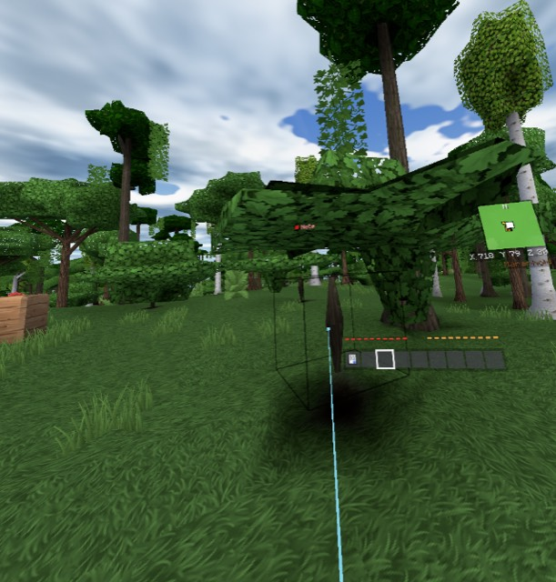

## 20:42:24 - Physics failure.

- **Transcript:** Physics failure.
- **Status:** open
- **Build:** 0.129 (26ceac53, M1-M4 (device-tested; ship riding, chests, comfort options, weapon wheel))
- **World:** New World (28) (seed 3084501862406496736)
- **Dimension:** Surface
- **Biome:** Sparse Jungle
- **Position:** 719.7 79.4 29.2
- **Facing:** west (yaw 266, pitch -8)
- **Held:** empty hand
- **Mount:** on foot
- **Looking at:** Jungle Log at 715 80 29
- **Mode:** Survival, health 20/20
- **Time:** day 1 07:47, clear
- **Fps:** 54
- **Levels:** mic -26 dBFS, game sound -35 dBFS
- **Length:** 2.3 s (voice 0.8 s)
- **Just before:** -17s opened PauseMenu; -16s closed PauseMenu; -16s message: Playtest build: voice bug notes ON, your speech is saved (Options > Interface); -16s opened PauseMenu; -17s entered Surface; -17s closed PauseMenu; -17s holding Greywall Dispatch; -17s message: In Clear Ford's jail safe: a Greywall Dispatch; -17s message: In Clear Ford's jail safe: a Greywall Dispatch. Added to journal: Who Holds the Frontier; -13s message: Spring: the snow melts and the young are born; -13s left the pack: Rocket x4 (at 714 79 34); -13s left the pack: Faustrohr Warhead x3 (at 714 79 34); -13s left the pack: Duskium Chestplate (at 714 79 34); -13s left the pack: Track Spares x16 (at 714 79 34); -13s left the pack: Regular Armour Set (at 714 79 34); -13s left the pack: Field Stim x52 (at 714 79 34); -13s left the pack: Jetpack x2 (at 714 79 34); -13s left the pack: Faustrohr (at 714 79 34); -13s left the pack: Titanium Pickaxe (at 714 79 34); -13s left the pack: Himmelsturm Launcher (at 714 79 34); -13s left the pack: Falke Pistol x2 (at 714 79 34); -13s left the pack: Fernblick Rifle (at 714 79 34); -13s left the pack: Donnerkeil Service Rifle x3 (at 714 79 34); -13s left the pack: Aero Engine Spares x18 (at 714 79 34); -13s left the pack: Field Journal of an Ashguard Rifleman (at 714 79 34); -13s left the pack: Mahlwerk Rotary Gun (at 714 79 34); -11s walked into Sparse Jungle; -9s holding empty hand
- **Repro (Mac):** `./snap.sh note --seed 3084501862406496736 --x 719.7 --z 29.2 --yaw 94 --pitch -8 --time 0.074`
- **Audio (this Mac):** /Users/darthvadar/Documents/Blocksmith/QuestVoiceNotes/raw/vn-20261116-204224-194.aac

## 20:42:26 - Artifact failure. What the fuck is this?

- **Transcript:** Artifact failure. What the fuck is this?
- **Status:** open
- **Build:** 0.129 (26ceac53, M1-M4 (device-tested; ship riding, chests, comfort options, weapon wheel))
- **World:** New World (28) (seed 3084501862406496736)
- **Dimension:** Surface
- **Biome:** Sparse Jungle
- **Position:** 717.8 79.4 30.5
- **Facing:** north-west (yaw 295, pitch -12)
- **Held:** empty hand
- **Mount:** on foot
- **Looking at:** Jungle Log at 715 80 29
- **Mode:** Survival, health 20/20
- **Time:** day 1 07:49, clear
- **Fps:** 54
- **Levels:** mic -17 dBFS, game sound -29 dBFS
- **Length:** 4.7 s (voice 1.8 s)
- **Just before:** -20s opened PauseMenu; -19s closed PauseMenu; -19s message: Playtest build: voice bug notes ON, your speech is saved (Options > Interface); -18s opened PauseMenu; -20s entered Surface; -20s closed PauseMenu; -20s holding Greywall Dispatch; -20s message: In Clear Ford's jail safe: a Greywall Dispatch; -19s message: In Clear Ford's jail safe: a Greywall Dispatch. Added to journal: Who Holds the Frontier; -16s message: Spring: the snow melts and the young are born; -15s left the pack: Rocket x4 (at 714 79 34); -15s left the pack: Faustrohr Warhead x3 (at 714 79 34); -15s left the pack: Duskium Chestplate (at 714 79 34); -15s left the pack: Track Spares x16 (at 714 79 34); -15s left the pack: Regular Armour Set (at 714 79 34); -15s left the pack: Field Stim x52 (at 714 79 34); -15s left the pack: Jetpack x2 (at 714 79 34); -15s left the pack: Faustrohr (at 714 79 34); -15s left the pack: Titanium Pickaxe (at 714 79 34); -15s left the pack: Himmelsturm Launcher (at 714 79 34); -15s left the pack: Falke Pistol x2 (at 714 79 34); -15s left the pack: Fernblick Rifle (at 714 79 34); -15s left the pack: Donnerkeil Service Rifle x3 (at 714 79 34); -15s left the pack: Aero Engine Spares x18 (at 714 79 34); -15s left the pack: Field Journal of an Ashguard Rifleman (at 714 79 34); -15s left the pack: Mahlwerk Rotary Gun (at 714 79 34); -14s walked into Sparse Jungle; -12s holding empty hand
- **Repro (Mac):** `./snap.sh note --seed 3084501862406496736 --x 717.8 --z 30.5 --yaw 65 --pitch -12 --time 0.076`
- **Audio (this Mac):** /Users/darthvadar/Documents/Blocksmith/QuestVoiceNotes/raw/vn-20261116-204226-654.aac

## 20:42:33 - Then the whole top just disappears.

- **Transcript:** Then the whole top just disappears.
- **Status:** open
- **Build:** 0.129 (26ceac53, M1-M4 (device-tested; ship riding, chests, comfort options, weapon wheel))
- **World:** New World (28) (seed 3084501862406496736)
- **Dimension:** Surface
- **Biome:** Sparse Jungle
- **Position:** 720.5 79.2 30.9
- **Facing:** west (yaw 282, pitch 32)
- **Held:** empty hand
- **Mount:** on foot
- **Looking at:** nothing
- **Mode:** Survival, health 20/20
- **Time:** day 1 07:58, clear
- **Fps:** 70
- **Levels:** mic -24 dBFS, game sound -23 dBFS
- **Length:** 2.8 s (voice 1.1 s)
- **Just before:** -26s opened PauseMenu; -25s closed PauseMenu; -25s message: Playtest build: voice bug notes ON, your speech is saved (Options > Interface); -25s opened PauseMenu; -26s entered Surface; -26s closed PauseMenu; -26s holding Greywall Dispatch; -26s message: In Clear Ford's jail safe: a Greywall Dispatch; -26s message: In Clear Ford's jail safe: a Greywall Dispatch. Added to journal: Who Holds the Frontier; -22s message: Spring: the snow melts and the young are born; -22s left the pack: Rocket x4 (at 714 79 34); -22s left the pack: Faustrohr Warhead x3 (at 714 79 34); -22s left the pack: Duskium Chestplate (at 714 79 34); -22s left the pack: Track Spares x16 (at 714 79 34); -22s left the pack: Regular Armour Set (at 714 79 34); -22s left the pack: Field Stim x52 (at 714 79 34); -22s left the pack: Jetpack x2 (at 714 79 34); -22s left the pack: Faustrohr (at 714 79 34); -22s left the pack: Titanium Pickaxe (at 714 79 34); -22s left the pack: Himmelsturm Launcher (at 714 79 34); -22s left the pack: Falke Pistol x2 (at 714 79 34); -22s left the pack: Fernblick Rifle (at 714 79 34); -22s left the pack: Donnerkeil Service Rifle x3 (at 714 79 34); -22s left the pack: Aero Engine Spares x18 (at 714 79 34); -22s left the pack: Field Journal of an Ashguard Rifleman (at 714 79 34); -22s left the pack: Mahlwerk Rotary Gun (at 714 79 34); -20s walked into Sparse Jungle; -18s holding empty hand
- **Repro (Mac):** `./snap.sh note --seed 3084501862406496736 --x 720.5 --z 30.9 --yaw 78 --pitch 32 --time 0.082`
- **Audio (this Mac):** /Users/darthvadar/Documents/Blocksmith/QuestVoiceNotes/raw/vn-20261116-204233-474.aac

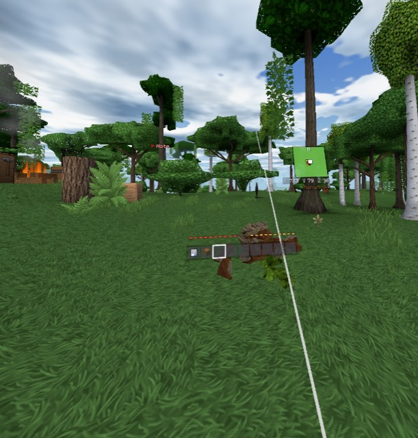

## 20:42:42 - Well, at least that works all right.

- **Transcript:** Well, at least that works all right.
- **Status:** open
- **Build:** 0.129 (26ceac53, M1-M4 (device-tested; ship riding, chests, comfort options, weapon wheel))
- **World:** New World (28) (seed 3084501862406496736)
- **Dimension:** Surface
- **Biome:** Sparse Jungle
- **Position:** 719.0 79.4 27.2
- **Facing:** west (yaw 287, pitch -22)
- **Held:** Oak Sapling x1
- **Mount:** on foot
- **Looking at:** Short Grass at 716 80 26
- **Mode:** Creative, health 20/20
- **Time:** day 1 08:07, clear
- **Fps:** 72
- **Levels:** mic -32 dBFS, game sound -20 dBFS
- **Length:** 2.8 s (voice 1.2 s)
- **Just before:** -29s walked into Sparse Jungle; -27s holding empty hand; -7s opened PauseMenu; -6s message: Creative mode; -6s closed PauseMenu; -2s holding Oak Sapling
- **Repro (Mac):** `./snap.sh note --seed 3084501862406496736 --x 719.0 --z 27.2 --yaw 73 --pitch -22 --time 0.088`
- **Audio (this Mac):** /Users/darthvadar/Documents/Blocksmith/QuestVoiceNotes/raw/vn-20261116-204242-134.aac

## 20:42:48 - How is this? Okay.

- **Transcript:** How is this? Okay.
- **Status:** open
- **Build:** 0.129 (26ceac53, M1-M4 (device-tested; ship riding, chests, comfort options, weapon wheel))
- **World:** New World (28) (seed 3084501862406496736)
- **Dimension:** Surface
- **Biome:** Sparse Jungle
- **Position:** 714.6 79.5 23.9
- **Facing:** north-west (yaw 312, pitch -29)
- **Held:** Oak Sapling x1
- **Mount:** on foot
- **Looking at:** nothing
- **Mode:** Creative, health 20/20
- **Time:** day 1 08:14, clear
- **Fps:** 72
- **Levels:** mic -25 dBFS, game sound -24 dBFS
- **Length:** 3.2 s (voice 1.1 s)
- **Just before:** -13s opened PauseMenu; -12s message: Creative mode; -12s closed PauseMenu; -8s holding Oak Sapling
- **Repro (Mac):** `./snap.sh note --seed 3084501862406496736 --x 714.6 --z 23.9 --yaw 48 --pitch -29 --time 0.093`
- **Audio (this Mac):** /Users/darthvadar/Documents/Blocksmith/QuestVoiceNotes/raw/vn-20261116-204248-154.aac

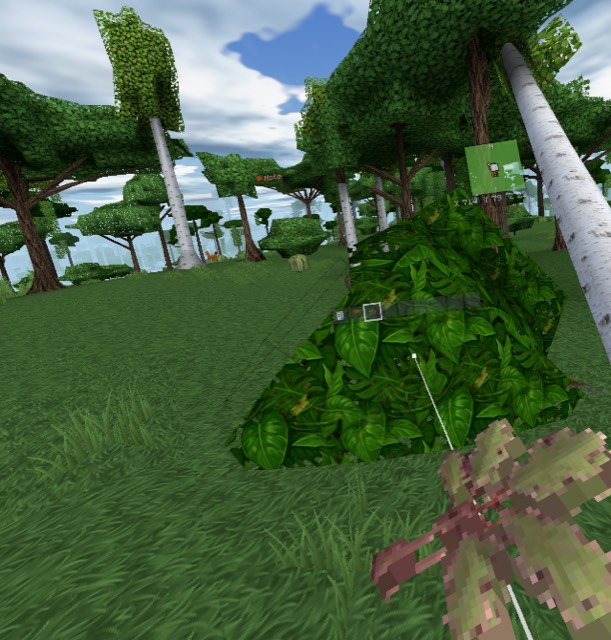

## 20:42:54 - How the hell did that happen?

- **Transcript:** How the hell did that happen?
- **Status:** open
- **Build:** 0.129 (26ceac53, M1-M4 (device-tested; ship riding, chests, comfort options, weapon wheel))
- **World:** New World (28) (seed 3084501862406496736)
- **Dimension:** Surface
- **Biome:** Sparse Jungle
- **Position:** 700.5 79.8 21.9
- **Facing:** west (yaw 269, pitch -8)
- **Held:** Oak Sapling x1
- **Mount:** on foot
- **Looking at:** nothing
- **Mode:** Creative, health 20/20
- **Time:** day 1 08:22, clear
- **Fps:** 72
- **Levels:** mic -23 dBFS, game sound -17 dBFS
- **Length:** 2.3 s (voice 0.9 s)
- **Just before:** -20s opened PauseMenu; -19s message: Creative mode; -19s closed PauseMenu; -14s holding Oak Sapling
- **Repro (Mac):** `./snap.sh note --seed 3084501862406496736 --x 700.5 --z 21.9 --yaw 91 --pitch -8 --time 0.099`
- **Audio (this Mac):** /Users/darthvadar/Documents/Blocksmith/QuestVoiceNotes/raw/vn-20261116-204254-694.aac

## 20:42:58 - I cut above the stump and the stump came with it when it fell.

- **Transcript:** I cut above the stump and the stump came with it when it fell.
- **Status:** open
- **Build:** 0.129 (26ceac53, M1-M4 (device-tested; ship riding, chests, comfort options, weapon wheel))
- **World:** New World (28) (seed 3084501862406496736)
- **Dimension:** Surface
- **Biome:** Sparse Jungle
- **Position:** 698.9 79.9 22.6
- **Facing:** west (yaw 256, pitch -9)
- **Held:** Oak Sapling x1
- **Mount:** on foot
- **Looking at:** nothing
- **Mode:** Creative, health 20/20
- **Time:** day 1 08:26, clear
- **Fps:** 72
- **Levels:** mic -22 dBFS, game sound -23 dBFS
- **Length:** 4.3 s (voice 2.3 s)
- **Just before:** -23s opened PauseMenu; -22s message: Creative mode; -22s closed PauseMenu; -18s holding Oak Sapling
- **Repro (Mac):** `./snap.sh note --seed 3084501862406496736 --x 698.9 --z 22.6 --yaw 104 --pitch -9 --time 0.102`
- **Audio (this Mac):** /Users/darthvadar/Documents/Blocksmith/QuestVoiceNotes/raw/vn-20261116-204258-014.aac

## 20:43:05 - Not horrible though, some of this stuff.

- **Transcript:** Not horrible though, some of this stuff.
- **Status:** open
- **Build:** 0.129 (26ceac53, M1-M4 (device-tested; ship riding, chests, comfort options, weapon wheel))
- **World:** New World (28) (seed 3084501862406496736)
- **Dimension:** Surface
- **Biome:** Sparse Jungle
- **Position:** 694.0 78.6 8.6
- **Facing:** west (yaw 274, pitch -13)
- **Held:** Oak Sapling x1
- **Mount:** on foot
- **Looking at:** nothing
- **Mode:** Creative, health 20/20
- **Time:** day 1 08:35, clear
- **Fps:** 72
- **Levels:** mic -29 dBFS, game sound -15 dBFS
- **Length:** 3.8 s (voice 2.1 s)
- **Just before:** -30s closed PauseMenu; -26s holding Oak Sapling
- **Repro (Mac):** `./snap.sh note --seed 3084501862406496736 --x 694.0 --z 8.6 --yaw 86 --pitch -13 --time 0.108`
- **Audio (this Mac):** /Users/darthvadar/Documents/Blocksmith/QuestVoiceNotes/raw/vn-20261116-204305-994.aac

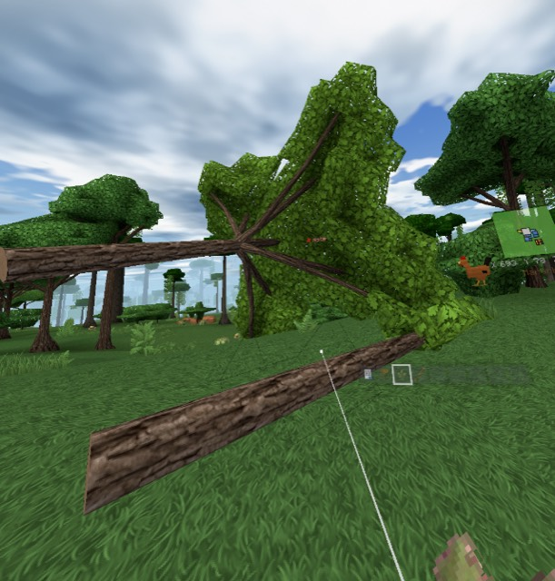

## 20:43:10 - I mean something like this shit. This has got to get fixed right away.

- **Transcript:** I mean something like this shit. This has got to get fixed right away.
- **Status:** open
- **Build:** 0.129 (26ceac53, M1-M4 (device-tested; ship riding, chests, comfort options, weapon wheel))
- **World:** New World (28) (seed 3084501862406496736)
- **Dimension:** Surface
- **Biome:** Sparse Jungle
- **Position:** 672.6 76.1 16.4
- **Facing:** south-west (yaw 247, pitch -18)
- **Held:** Oak Sapling x1
- **Mount:** on foot
- **Looking at:** Short Grass at 669 76 17
- **Mode:** Creative, health 20/20
- **Time:** day 1 08:40, clear
- **Fps:** 72
- **Levels:** mic -34 dBFS, game sound -20 dBFS
- **Length:** 4.8 s (voice 3.0 s)
- **Just before:** -30s holding Oak Sapling
- **Repro (Mac):** `./snap.sh note --seed 3084501862406496736 --x 672.6 --z 16.4 --yaw 113 --pitch -18 --time 0.112`
- **Audio (this Mac):** /Users/darthvadar/Documents/Blocksmith/QuestVoiceNotes/raw/vn-20261116-204310-074.aac

## 20:43:32 - in the, uh, frame rate, like...

- **Transcript:** in the, uh, frame rate, like...
- **Status:** open
- **Build:** 0.129 (26ceac53, M1-M4 (device-tested; ship riding, chests, comfort options, weapon wheel))
- **World:** New World (28) (seed 3084501862406496736)
- **Dimension:** Surface
- **Biome:** Forest
- **Position:** 586.4 122.9 124.8
- **Facing:** south-west (yaw 234, pitch -28)
- **Held:** Jungle Log x1
- **Mount:** on foot, flying
- **Looking at:** nothing
- **Mode:** Creative, health 20/20
- **Time:** day 1 09:04, clear
- **Fps:** 72
- **Levels:** mic -25 dBFS, game sound -20 dBFS
- **Length:** 3.2 s (voice 1.6 s)
- **Just before:** -10s holding Jungle Log; -10s message: Jungle Log; -6s opened PauseMenu; -5s closed PauseMenu; -5s message: Flying; -3s opened PauseMenu; -2s walked into Forest; -2s closed PauseMenu
- **Repro (Mac):** `./snap.sh note --seed 3084501862406496736 --x 586.4 --z 124.8 --yaw 126 --pitch -28 --time 0.128`
- **Audio (this Mac):** /Users/darthvadar/Documents/Blocksmith/QuestVoiceNotes/raw/vn-20261116-204332-014.aac

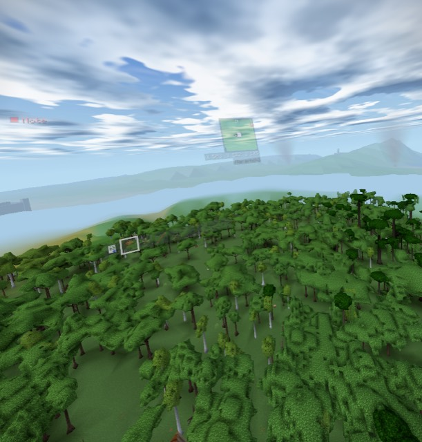

## 20:43:35 - Have you not really gotten to work on those efficiency improvements ju

- **Transcript:** Have you not really gotten to work on those efficiency improvements just yet, or what?
- **Status:** open
- **Build:** 0.129 (26ceac53, M1-M4 (device-tested; ship riding, chests, comfort options, weapon wheel))
- **World:** New World (28) (seed 3084501862406496736)
- **Dimension:** Surface
- **Biome:** Forest
- **Position:** 485.7 123.2 221.9
- **Facing:** south-west (yaw 234, pitch -27)
- **Held:** Jungle Log x1
- **Mount:** on foot, flying
- **Looking at:** nothing
- **Mode:** Creative, health 20/20
- **Time:** day 1 09:08, clear
- **Fps:** 69
- **Levels:** mic -26 dBFS, game sound -21 dBFS
- **Length:** 4.3 s (voice 2.7 s)
- **Just before:** -14s holding Jungle Log; -14s message: Jungle Log; -10s opened PauseMenu; -9s closed PauseMenu; -9s message: Flying; -7s opened PauseMenu; -6s walked into Forest; -5s closed PauseMenu
- **Repro (Mac):** `./snap.sh note --seed 3084501862406496736 --x 485.7 --z 221.9 --yaw 126 --pitch -27 --time 0.131`
- **Audio (this Mac):** /Users/darthvadar/Documents/Blocksmith/QuestVoiceNotes/raw/vn-20261116-204335-714.aac

## 20:43:46 - Come on, let's go.

- **Transcript:** Come on, let's go.
- **Status:** open
- **Build:** 0.129 (26ceac53, M1-M4 (device-tested; ship riding, chests, comfort options, weapon wheel))
- **World:** New World (28) (seed 3084501862406496736)
- **Dimension:** Surface
- **Biome:** Savanna
- **Position:** 910.4 123.2 371.8
- **Facing:** east (yaw 79, pitch -25)
- **Held:** Jungle Log x1
- **Mount:** on foot, flying
- **Looking at:** nothing
- **Mode:** Creative, health 20/20
- **Time:** day 1 09:21, clear
- **Fps:** 70
- **Levels:** mic -51 dBFS, game sound -20 dBFS
- **Length:** 2.6 s (voice 1.1 s)
- **Just before:** -25s holding Jungle Log; -25s message: Jungle Log; -20s opened PauseMenu; -20s closed PauseMenu; -19s message: Flying; -18s opened PauseMenu; -17s walked into Forest; -16s closed PauseMenu; -9s walked into Savanna; -5s walked into Plains; -3s walked into Forest; -2s opened PauseMenu; -1s closed PauseMenu
- **Repro (Mac):** `./snap.sh note --seed 3084501862406496736 --x 910.4 --z 371.8 --yaw -79 --pitch -25 --time 0.140`
- **Audio (this Mac):** /Users/darthvadar/Documents/Blocksmith/QuestVoiceNotes/raw/vn-20261116-204346-554.aac

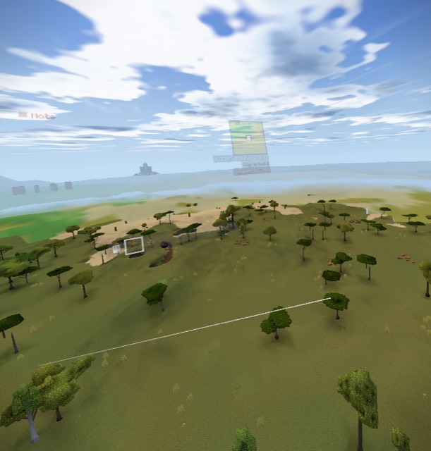

## 20:43:59 - Oh, wow, a frigate.

- **Transcript:** Oh, wow, a frigate.
- **Status:** open
- **Build:** 0.129 (26ceac53, M1-M4 (device-tested; ship riding, chests, comfort options, weapon wheel))
- **World:** New World (28) (seed 3084501862406496736)
- **Dimension:** Surface
- **Biome:** Flower Forest
- **Position:** 1410.5 123.2 355.0
- **Facing:** east (yaw 80, pitch -27)
- **Held:** Jungle Log x1
- **Mount:** on foot, flying
- **Looking at:** nothing
- **Mode:** Creative, health 20/20
- **Time:** day 1 09:36, clear
- **Fps:** 68
- **Levels:** mic -34 dBFS, game sound -19 dBFS
- **Length:** 2.2 s (voice 0.7 s)
- **Just before:** -30s walked into Forest; -29s closed PauseMenu; -22s walked into Savanna; -18s walked into Plains; -16s walked into Forest; -14s opened PauseMenu; -14s closed PauseMenu; -10s walked into Savanna; -6s walked into Forest; -3s walked into Savanna; -3s message: A Meridian Frigate looms on the horizon
- **Repro (Mac):** `./snap.sh note --seed 3084501862406496736 --x 1410.5 --z 355.0 --yaw -80 --pitch -27 --time 0.150`
- **Audio (this Mac):** /Users/darthvadar/Documents/Blocksmith/QuestVoiceNotes/raw/vn-20261116-204359-214.aac

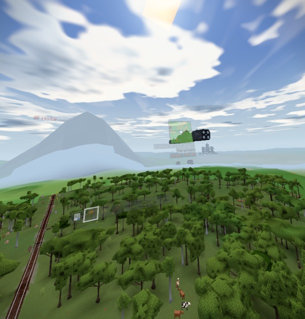

## 20:44:03 - I don't mind if I do

- **Transcript:** I don't mind if I do
- **Status:** open
- **Build:** 0.129 (26ceac53, M1-M4 (device-tested; ship riding, chests, comfort options, weapon wheel))
- **World:** New World (28) (seed 3084501862406496736)
- **Dimension:** Surface
- **Biome:** Plains
- **Position:** 1685.0 165.3 561.4
- **Facing:** east (yaw 86, pitch -28)
- **Held:** Jungle Log x1
- **Mount:** on foot, flying
- **Looking at:** nothing
- **Mode:** Creative, health 20/20
- **Time:** day 1 09:41, clear
- **Fps:** 71
- **Levels:** mic -30 dBFS, game sound -11 dBFS
- **Length:** 2.4 s (voice 0.9 s)
- **Just before:** -26s walked into Savanna; -22s walked into Plains; -20s walked into Forest; -19s opened PauseMenu; -18s closed PauseMenu; -14s walked into Savanna; -10s walked into Forest; -8s walked into Savanna; -7s message: A Meridian Frigate looms on the horizon; -4s walked into Forest; -2s message: Meridian frigate patrol marked on the map
- **Repro (Mac):** `./snap.sh note --seed 3084501862406496736 --x 1685.0 --z 561.4 --yaw -86 --pitch -28 --time 0.154`
- **Audio (this Mac):** /Users/darthvadar/Documents/Blocksmith/QuestVoiceNotes/raw/vn-20261116-204403-314.aac

## 20:44:21 - Well, it looked like a hit.

- **Transcript:** Well, it looked like a hit.
- **Status:** open
- **Build:** 0.129 (26ceac53, M1-M4 (device-tested; ship riding, chests, comfort options, weapon wheel))
- **World:** New World (28) (seed 3084501862406496736)
- **Dimension:** Surface
- **Biome:** Plains
- **Position:** 1950.8 266.6 662.0
- **Facing:** south (yaw 183, pitch -27)
- **Held:** empty hand
- **Mount:** piloting Meridian Frigate
- **Looking at:** nothing
- **Mode:** Creative, health 20/20
- **Time:** day 1 10:03, clear
- **Fps:** 69
- **Levels:** mic -25 dBFS, game sound -15 dBFS
- **Length:** 2.1 s (voice 0.6 s)
- **Just before:** -28s walked into Forest; -26s walked into Savanna; -25s message: A Meridian Frigate looms on the horizon; -22s walked into Forest; -20s message: Meridian frigate patrol marked on the map; -18s walked into Sunflower Plains; -18s message: Ash Creek marked on the map; -16s message: Fort Red Station marked on the map; -13s message: Mill Bend Station marked on the map; -13s piloting Meridian Frigate; -13s holding empty hand; -11s message: You found the Greywall & Mill Railway: 4 stations, marked on your map; -8s message: Walking; -8s walked into Plains; -6s message: Steering Meridian Frigate; -4s message: You have taken command of the Meridian Frigate!; -1s message: Tidebreaker hit on the Capital citadel: 0 of the garrison down (hit 1 of 3 to break it)
- **Repro (Mac):** `./snap.sh note --seed 3084501862406496736 --x 1950.8 --z 662.0 --yaw 177 --pitch -27 --time 0.169`
- **Audio (this Mac):** /Users/darthvadar/Documents/Blocksmith/QuestVoiceNotes/raw/vn-20261116-204421-514.aac

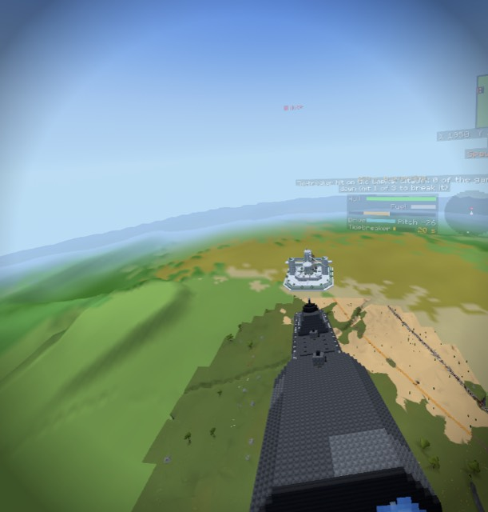

## 20:44:40 - Optimizations still aren't quite there yet.

- **Transcript:** Optimizations still aren't quite there yet.
- **Status:** open
- **Build:** 0.129 (26ceac53, M1-M4 (device-tested; ship riding, chests, comfort options, weapon wheel))
- **World:** New World (28) (seed 3084501862406496736)
- **Dimension:** Surface
- **Biome:** Savanna
- **Position:** 1947.3 125.2 1129.1
- **Facing:** east (yaw 68, pitch -28)
- **Held:** empty hand
- **Mount:** piloting Meridian Frigate
- **Looking at:** nothing
- **Mode:** Creative, health 20/20
- **Time:** day 1 10:25, clear
- **Fps:** 68
- **Levels:** mic -24 dBFS, game sound -10 dBFS
- **Length:** 3.9 s (voice 2.3 s)
- **Just before:** -30s message: You found the Greywall & Mill Railway: 4 stations, marked on your map; -27s message: Walking; -26s walked into Plains; -25s message: Steering Meridian Frigate; -23s message: You have taken command of the Meridian Frigate!; -20s message: Tidebreaker hit on the Capital citadel: 0 of the garrison down (hit 1 of 3 to break it); -13s message: The turret is wrecked; -10s walked into Desert; -4s walked into Savanna; -4s message: The citadel is on lockdown!; -1s message: The turret is wrecked
- **Repro (Mac):** `./snap.sh note --seed 3084501862406496736 --x 1947.3 --z 1129.1 --yaw -68 --pitch -28 --time 0.185`
- **Audio (this Mac):** /Users/darthvadar/Documents/Blocksmith/QuestVoiceNotes/raw/vn-20261116-204440-234.aac

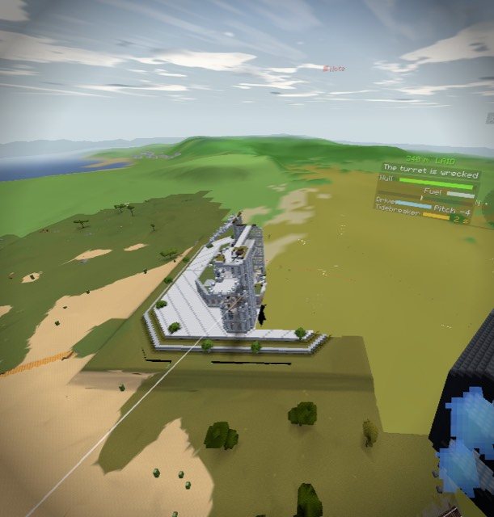

## 20:45:04 - I can't fucking...

- **Transcript:** I can't fucking...
- **Status:** open
- **Build:** 0.129 (26ceac53, M1-M4 (device-tested; ship riding, chests, comfort options, weapon wheel))
- **World:** New World (28) (seed 3084501862406496736)
- **Dimension:** Surface
- **Biome:** Plains
- **Position:** 2136.4 121.2 808.1
- **Facing:** south-west (yaw 208, pitch -13)
- **Held:** empty hand
- **Mount:** piloting Meridian Frigate
- **Looking at:** nothing
- **Mode:** Creative, health 20/20
- **Time:** day 1 10:54, clear
- **Fps:** 68
- **Levels:** mic -25 dBFS, game sound -19 dBFS
- **Length:** 2.6 s (voice 0.7 s)
- **Just before:** -29s walked into Savanna; -28s message: The citadel is on lockdown!; -26s message: The turret is wrecked; -14s message: Tidebreaker hit on the Capital citadel: 5 of the garrison down (hit 2 of 3 to break it); -4s walked into Plains
- **Repro (Mac):** `./snap.sh note --seed 3084501862406496736 --x 2136.4 --z 808.1 --yaw 152 --pitch -13 --time 0.205`
- **Audio (this Mac):** /Users/darthvadar/Documents/Blocksmith/QuestVoiceNotes/raw/vn-20261116-204504-534.aac

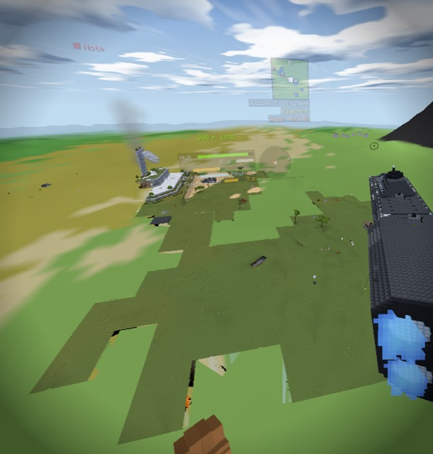

## 20:45:07 - I barely see the damn capital.

- **Transcript:** I barely see the damn capital.
- **Status:** open
- **Build:** 0.129 (26ceac53, M1-M4 (device-tested; ship riding, chests, comfort options, weapon wheel))
- **World:** New World (28) (seed 3084501862406496736)
- **Dimension:** Surface
- **Biome:** Plains
- **Position:** 2139.7 122.1 827.3
- **Facing:** south-west (yaw 229, pitch -11)
- **Held:** empty hand
- **Mount:** piloting Meridian Frigate
- **Looking at:** nothing
- **Mode:** Creative, health 20/20
- **Time:** day 1 10:58, clear
- **Fps:** 68
- **Levels:** mic -22 dBFS, game sound -18 dBFS
- **Length:** 2.9 s (voice 1.4 s)
- **Just before:** -29s message: The turret is wrecked; -17s message: Tidebreaker hit on the Capital citadel: 5 of the garrison down (hit 2 of 3 to break it); -7s walked into Plains
- **Repro (Mac):** `./snap.sh note --seed 3084501862406496736 --x 2139.7 --z 827.3 --yaw 131 --pitch -11 --time 0.207`
- **Audio (this Mac):** /Users/darthvadar/Documents/Blocksmith/QuestVoiceNotes/raw/vn-20261116-204507-634.aac

## 20:45:15 - Things aren't loading.

- **Transcript:** Things aren't loading.
- **Status:** open
- **Build:** 0.129 (26ceac53, M1-M4 (device-tested; ship riding, chests, comfort options, weapon wheel))
- **World:** New World (28) (seed 3084501862406496736)
- **Dimension:** Surface
- **Biome:** Plains
- **Position:** 1947.5 116.7 909.6
- **Facing:** south-east (yaw 148, pitch -18)
- **Held:** empty hand
- **Mount:** piloting Meridian Frigate
- **Looking at:** nothing
- **Mode:** Creative, health 20/20
- **Time:** day 1 11:08, clear
- **Fps:** 66
- **Levels:** mic -39 dBFS, game sound -18 dBFS
- **Length:** 2.3 s (voice 0.9 s)
- **Just before:** -25s message: Tidebreaker hit on the Capital citadel: 5 of the garrison down (hit 2 of 3 to break it); -16s walked into Plains; -1s walked into Desert
- **Repro (Mac):** `./snap.sh note --seed 3084501862406496736 --x 1947.5 --z 909.6 --yaw -148 --pitch -18 --time 0.214`
- **Audio (this Mac):** /Users/darthvadar/Documents/Blocksmith/QuestVoiceNotes/raw/vn-20261116-204515-634.aac

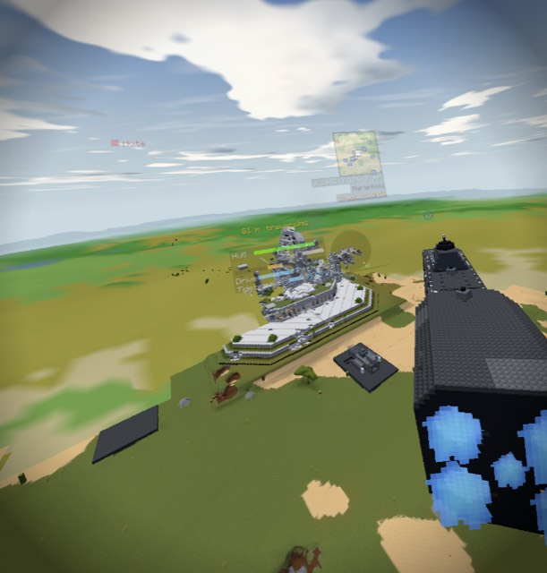

## 20:46:34 - Oh wow, look at that. Nice. That's beautiful.

- **Transcript:** Oh wow, look at that. Nice. That's beautiful.
- **Status:** open
- **Build:** 0.129 (26ceac53, M1-M4 (device-tested; ship riding, chests, comfort options, weapon wheel))
- **World:** New World (28) (seed 3084501862406496736)
- **Dimension:** Surface
- **Biome:** Jungle
- **Position:** -588.8 119.5 2711.5
- **Facing:** north-west (yaw 336, pitch -38)
- **Held:** Jungle Log x1
- **Mount:** on foot, flying
- **Looking at:** Jungle Leaves at -590 118 2708
- **Mode:** Creative, health 20/20
- **Time:** day 1 12:42, clear
- **Fps:** 65
- **Levels:** mic -32 dBFS, game sound -26 dBFS
- **Length:** 5.7 s (voice 1.9 s)
- **Just before:** -30s walked into Beach; -28s walked into Sparse Jungle; -26s walked into Jungle; -24s walked into Sparse Jungle; -22s walked into Jungle; -6s stopped piloting Meridian Frigate; -6s holding Jungle Log; -4s message: The Meridian Frigate has crash-landed; -2s message: Flying
- **Position at the end:** -625.7 119.5 2703.7
- **Repro (Mac):** `./snap.sh note --seed 3084501862406496736 --x -588.8 --z 2711.5 --yaw 24 --pitch -38 --time 0.280`
- **Audio (this Mac):** /Users/darthvadar/Documents/Blocksmith/QuestVoiceNotes/raw/vn-20261116-204634-654.aac

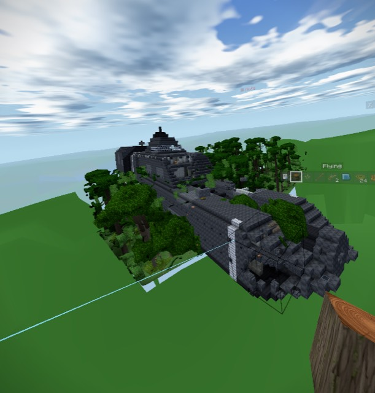

## 20:46:40 - That is beautiful.

- **Transcript:** That is beautiful.
- **Status:** open
- **Build:** 0.129 (26ceac53, M1-M4 (device-tested; ship riding, chests, comfort options, weapon wheel))
- **World:** New World (28) (seed 3084501862406496736)
- **Dimension:** Surface
- **Biome:** Jungle
- **Position:** -643.9 134.2 2667.1
- **Facing:** west (yaw 275, pitch -51)
- **Held:** Jungle Log x1
- **Mount:** on foot, flying
- **Looking at:** nothing
- **Mode:** Creative, health 20/20
- **Time:** day 1 12:50, clear
- **Fps:** 67
- **Levels:** mic -25 dBFS, game sound -22 dBFS
- **Length:** 2.3 s (voice 0.7 s)
- **Just before:** -28s walked into Jungle; -12s stopped piloting Meridian Frigate; -12s holding Jungle Log; -10s message: The Meridian Frigate has crash-landed; -8s message: Flying
- **Repro (Mac):** `./snap.sh note --seed 3084501862406496736 --x -643.9 --z 2667.1 --yaw 85 --pitch -51 --time 0.285`
- **Audio (this Mac):** /Users/darthvadar/Documents/Blocksmith/QuestVoiceNotes/raw/vn-20261116-204640-914.aac

## 20:46:43 - Okay, very good.

- **Transcript:** Okay, very good.
- **Status:** open
- **Build:** 0.129 (26ceac53, M1-M4 (device-tested; ship riding, chests, comfort options, weapon wheel))
- **World:** New World (28) (seed 3084501862406496736)
- **Dimension:** Surface
- **Biome:** Jungle
- **Position:** -598.4 134.9 2529.8
- **Facing:** north (yaw 1, pitch -41)
- **Held:** Jungle Log x1
- **Mount:** on foot, flying
- **Looking at:** nothing
- **Mode:** Creative, health 20/20
- **Time:** day 1 12:54, clear
- **Fps:** 68
- **Levels:** mic -30 dBFS, game sound -16 dBFS
- **Length:** 2.5 s (voice 1.1 s)
- **Just before:** -15s stopped piloting Meridian Frigate; -15s holding Jungle Log; -13s message: The Meridian Frigate has crash-landed; -11s message: Flying
- **Repro (Mac):** `./snap.sh note --seed 3084501862406496736 --x -598.4 --z 2529.8 --yaw -1 --pitch -41 --time 0.288`
- **Audio (this Mac):** /Users/darthvadar/Documents/Blocksmith/QuestVoiceNotes/raw/vn-20261116-204643-994.aac

## 20:46:47 - We really gotta work on these optimizations though, I mean that's real

- **Transcript:** We really gotta work on these optimizations though, I mean that's really a killer.
- **Status:** open
- **Build:** 0.129 (26ceac53, M1-M4 (device-tested; ship riding, chests, comfort options, weapon wheel))
- **World:** New World (28) (seed 3084501862406496736)
- **Dimension:** Surface
- **Biome:** Jungle
- **Position:** -504.0 207.0 2489.8
- **Facing:** east (yaw 78, pitch -38)
- **Held:** Jungle Log x1
- **Mount:** on foot, flying
- **Looking at:** nothing
- **Mode:** Creative, health 20/20, screen PauseMenu
- **Time:** day 1 12:58, clear
- **Fps:** 68
- **Levels:** mic -28 dBFS, game sound -27 dBFS
- **Length:** 6.4 s (voice 4.3 s)
- **Just before:** -19s stopped piloting Meridian Frigate; -19s holding Jungle Log; -17s message: The Meridian Frigate has crash-landed; -15s message: Flying; -0s opened PauseMenu
- **While talking:** -5s closed PauseMenu
- **Position at the end:** -313.6 207.3 2466.1
- **Repro (Mac):** `./snap.sh note --seed 3084501862406496736 --x -504.0 --z 2489.8 --yaw -78 --pitch -38 --time 0.290`
- **Audio (this Mac):** /Users/darthvadar/Documents/Blocksmith/QuestVoiceNotes/raw/vn-20261116-204647-674.aac

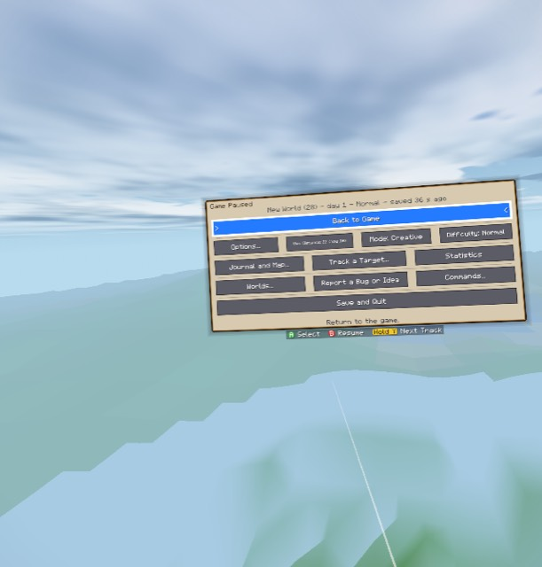

## 20:46:54 - Make sure this is going to load a little quicker, huh?

- **Transcript:** Make sure this is going to load a little quicker, huh?
- **Status:** open
- **Build:** 0.129 (26ceac53, M1-M4 (device-tested; ship riding, chests, comfort options, weapon wheel))
- **World:** New World (28) (seed 3084501862406496736)
- **Dimension:** Surface
- **Biome:** Jungle
- **Position:** -309.6 159.7 2459.7
- **Facing:** north-east (yaw 52, pitch -65)
- **Held:** Jungle Log x1
- **Mount:** on foot
- **Looking at:** nothing
- **Mode:** Creative, health 20/20
- **Time:** day 1 13:05, clear
- **Fps:** 71
- **Levels:** mic -23 dBFS, game sound -17 dBFS
- **Length:** 4.2 s (voice 2.0 s)
- **Just before:** -26s stopped piloting Meridian Frigate; -26s holding Jungle Log; -24s message: The Meridian Frigate has crash-landed; -21s message: Flying; -7s opened PauseMenu; -6s closed PauseMenu; -2s message: Walking
- **Repro (Mac):** `./snap.sh note --seed 3084501862406496736 --x -309.6 --z 2459.7 --yaw -52 --pitch -65 --time 0.296`
- **Audio (this Mac):** /Users/darthvadar/Documents/Blocksmith/QuestVoiceNotes/raw/vn-20261116-204654-434.aac

## 20:46:58 - Come on! Load!

- **Transcript:** Come on! Load!
- **Status:** open
- **Build:** 0.129 (26ceac53, M1-M4 (device-tested; ship riding, chests, comfort options, weapon wheel))
- **World:** New World (28) (seed 3084501862406496736)
- **Dimension:** Surface
- **Biome:** Jungle
- **Position:** -24.0 141.2 2333.0
- **Facing:** south-west (yaw 219, pitch -53)
- **Held:** Jungle Log x1
- **Mount:** on foot, flying
- **Looking at:** nothing
- **Mode:** Creative, health 20/20
- **Time:** day 1 13:10, clear
- **Fps:** 68
- **Levels:** mic -24 dBFS, game sound -21 dBFS
- **Length:** 2.8 s (voice 0.9 s)
- **Just before:** -30s stopped piloting Meridian Frigate; -30s holding Jungle Log; -28s message: The Meridian Frigate has crash-landed; -26s message: Flying; -11s opened PauseMenu; -10s closed PauseMenu; -6s message: Walking; -4s message: Flying; -1s walked into Mangrove Swamp
- **Repro (Mac):** `./snap.sh note --seed 3084501862406496736 --x -24.0 --z 2333.0 --yaw 141 --pitch -53 --time 0.299`
- **Audio (this Mac):** /Users/darthvadar/Documents/Blocksmith/QuestVoiceNotes/raw/vn-20261116-204658-574.aac

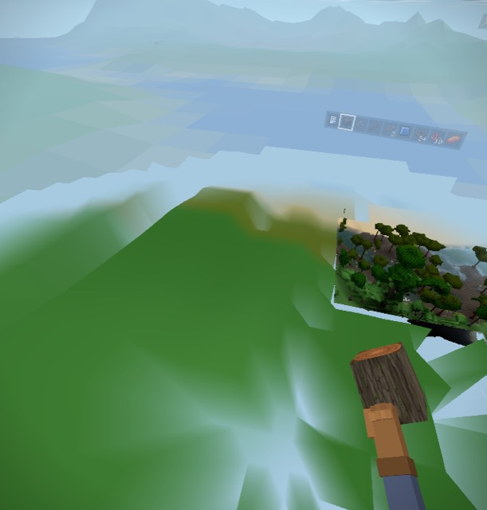

## 20:47:03 - Like really what's holding it up load would you

- **Transcript:** Like really what's holding it up load would you
- **Status:** open
- **Build:** 0.129 (26ceac53, M1-M4 (device-tested; ship riding, chests, comfort options, weapon wheel))
- **World:** New World (28) (seed 3084501862406496736)
- **Dimension:** Surface
- **Biome:** Jungle
- **Position:** 130.2 141.2 2321.2
- **Facing:** north (yaw 15, pitch -57)
- **Held:** Jungle Log x1
- **Mount:** on foot, flying
- **Looking at:** nothing
- **Mode:** Creative, health 20/20
- **Time:** day 1 13:16, clear
- **Fps:** 71
- **Levels:** mic -24 dBFS, game sound -25 dBFS
- **Length:** 4.5 s (voice 2.1 s)
- **Just before:** -16s opened PauseMenu; -16s closed PauseMenu; -11s message: Walking; -9s message: Flying; -7s walked into Mangrove Swamp; -5s walked into Jungle
- **Repro (Mac):** `./snap.sh note --seed 3084501862406496736 --x 130.2 --z 2321.2 --yaw -15 --pitch -57 --time 0.303`
- **Audio (this Mac):** /Users/darthvadar/Documents/Blocksmith/QuestVoiceNotes/raw/vn-20261116-204703-654.aac

## 20:48:07 - I got a crack right here going into the void.

- **Transcript:** I got a crack right here going into the void.
- **Status:** open
- **Build:** 0.129 (26ceac53, M1-M4 (device-tested; ship riding, chests, comfort options, weapon wheel))
- **World:** New World (28) (seed 3084501862406496736)
- **Dimension:** Surface
- **Biome:** Jungle
- **Position:** 576.9 68.6 3057.3
- **Facing:** north-west (yaw 309, pitch -66)
- **Held:** Slatefall Carbine x1
- **Mount:** on foot
- **Looking at:** Coarse Dirt at 576 68 3057
- **Mode:** Survival, health 20/20
- **Time:** day 1 14:30, clear
- **Fps:** 68
- **Levels:** mic -28 dBFS, game sound -22 dBFS
- **Length:** 3.5 s (voice 1.7 s)
- **Just before:** -30s into the pack: Slatefall Carbine; -28s into the pack: Slate Magazine; -25s left the pack: Greywall Dispatch (CreativeMenu open); -23s holding Field Stim; -23s closed CreativeMenu; -23s into the pack: Field Stim; -22s opened PauseMenu; -22s closed PauseMenu; -22s opened CreativeMenu; -21s closed CreativeMenu; -21s opened PauseMenu; -20s message: Survival mode; -20s closed PauseMenu; -20s opened InventoryMenu; -19s left the pack: Duskium Helmet (InventoryMenu open); -19s message: A Greywall party is coming out to meet you; -19s left the pack: Duskium Chestplate (InventoryMenu open); -19s left the pack: Duskium Leggings (InventoryMenu open); -18s closed InventoryMenu; -18s left the pack: Duskium Boots (at 605 92 3150); -18s holding Slate Magazine; -17s holding Slatefall Carbine; -17s left the pack: Slate Magazine x2 (at 606 90 3146); -16s holding Slate Magazine; -16s message: Loaded: 30 / 30; -16s holding Slatefall Carbine; -12s walked into Jungle; -12s took 6 damage (health 14/20); -10s took 6 damage (health 10/20); -9s holding Slate Magazine; -9s message: Slate Magazine; -8s holding Field Stim; -8s message: Field Stim; -8s left the pack: Field Stim (at 578 74 3102); -8s message: A stranger in town: Ezra Quill; -7s holding Slate Magazine; -6s took 3 damage (health 16/20); -6s holding Slatefall Carbine; -6s message: The Greywall Garrison is sounding the alarm!; -5s took 2 damage (health 15/20)
- **Repro (Mac):** `./snap.sh note --seed 3084501862406496736 --x 576.9 --z 3057.3 --yaw 51 --pitch -66 --time 0.354`
- **Audio (this Mac):** /Users/darthvadar/Documents/Blocksmith/QuestVoiceNotes/raw/vn-20261116-204807-674.aac

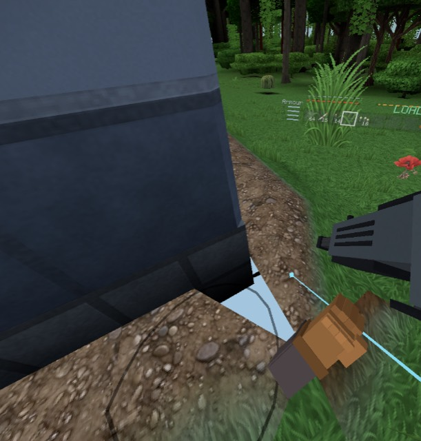

## 20:48:34 - All right, that actually worked all right.

- **Transcript:** All right, that actually worked all right.
- **Status:** open
- **Build:** 0.129 (26ceac53, M1-M4 (device-tested; ship riding, chests, comfort options, weapon wheel))
- **World:** New World (28) (seed 3084501862406496736)
- **Dimension:** Surface
- **Biome:** Jungle
- **Position:** 518.5 69.0 3094.6
- **Facing:** north (yaw 343, pitch 40)
- **Held:** Slatefall Carbine x1
- **Mount:** on foot
- **Looking at:** Station Concrete at 517 72 3091
- **Mode:** Survival, health 15/20
- **Time:** day 1 15:03, clear
- **Fps:** 69
- **Levels:** mic -26 dBFS, game sound -20 dBFS
- **Length:** 3.1 s (voice 1.7 s)
- **Just before:** -8s message: Honour raised (you protected the town); -6s took 4 damage (health 16/20); -5s took 2 damage (health 14/20)
- **Repro (Mac):** `./snap.sh note --seed 3084501862406496736 --x 518.5 --z 3094.6 --yaw 17 --pitch 40 --time 0.377`
- **Audio (this Mac):** /Users/darthvadar/Documents/Blocksmith/QuestVoiceNotes/raw/vn-20261116-204834-974.aac

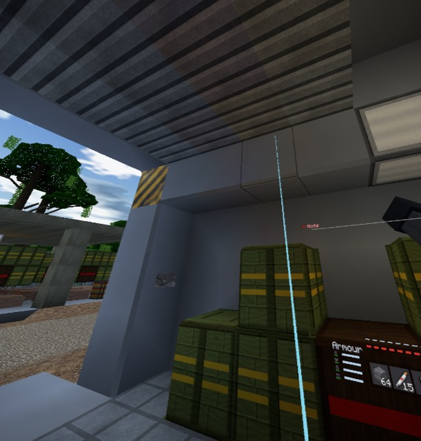

## 20:48:43 - Okay, except the thing the gradually spawns for about a quarter of a s

- **Transcript:** Okay, except the thing the gradually spawns for about a quarter of a second before actually going up like it should
- **Status:** open
- **Build:** 0.129 (26ceac53, M1-M4 (device-tested; ship riding, chests, comfort options, weapon wheel))
- **World:** New World (28) (seed 3084501862406496736)
- **Dimension:** Surface
- **Biome:** Jungle
- **Position:** 512.6 68.8 3084.7
- **Facing:** north (yaw 359, pitch -6)
- **Held:** Slatefall Carbine x1
- **Mount:** on foot
- **Looking at:** nothing
- **Mode:** Survival, health 15/20
- **Time:** day 1 15:13, clear
- **Fps:** 71
- **Levels:** mic -25 dBFS, game sound -23 dBFS
- **Length:** 8.3 s (voice 4.6 s)
- **Just before:** -17s message: Honour raised (you protected the town); -14s took 4 damage (health 16/20); -13s took 2 damage (health 14/20); -7s opened ChestMenu; -6s closed ChestMenu; -5s message: Loaded: 30 / 30; -4s holding empty hand; -3s holding Slatefall Carbine
- **Position at the end:** 511.6 68.8 3073.6
- **Repro (Mac):** `./snap.sh note --seed 3084501862406496736 --x 512.6 --z 3084.7 --yaw 1 --pitch -6 --time 0.384`
- **Audio (this Mac):** /Users/darthvadar/Documents/Blocksmith/QuestVoiceNotes/raw/vn-20261116-204843-454.aac

## 20:48:51 - otherwise very nice animation.

- **Transcript:** otherwise very nice animation.
- **Status:** open
- **Build:** 0.129 (26ceac53, M1-M4 (device-tested; ship riding, chests, comfort options, weapon wheel))
- **World:** New World (28) (seed 3084501862406496736)
- **Dimension:** Surface
- **Biome:** Jungle
- **Position:** 509.7 68.8 3064.7
- **Facing:** east (yaw 68, pitch -15)
- **Held:** Slatefall Carbine x1
- **Mount:** on foot
- **Looking at:** Station Concrete at 514 69 3062
- **Mode:** Survival, health 15/20
- **Time:** day 1 15:23, clear
- **Fps:** 72
- **Levels:** mic -23 dBFS, game sound -9 dBFS
- **Length:** 3.8 s (voice 2.0 s)
- **Just before:** -25s message: Honour raised (you protected the town); -23s took 4 damage (health 16/20); -21s took 2 damage (health 14/20); -15s opened ChestMenu; -14s closed ChestMenu; -13s message: Loaded: 30 / 30; -12s holding empty hand; -12s holding Slatefall Carbine
- **Repro (Mac):** `./snap.sh note --seed 3084501862406496736 --x 509.7 --z 3064.7 --yaw -68 --pitch -15 --time 0.391`
- **Audio (this Mac):** /Users/darthvadar/Documents/Blocksmith/QuestVoiceNotes/raw/vn-20261116-204851-654.aac

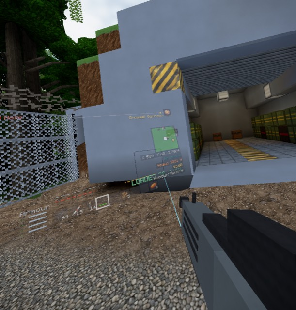

## 20:48:59 - Some weird Sankei.

- **Transcript:** Some weird Sankei.
- **Status:** open
- **Build:** 0.129 (26ceac53, M1-M4 (device-tested; ship riding, chests, comfort options, weapon wheel))
- **World:** New World (28) (seed 3084501862406496736)
- **Dimension:** Surface
- **Biome:** Jungle
- **Position:** 507.9 68.8 3100.3
- **Facing:** east (yaw 98, pitch -13)
- **Held:** Slatefall Carbine x1
- **Mount:** on foot
- **Looking at:** nothing
- **Mode:** Survival, health 15/20
- **Time:** day 1 15:32, clear
- **Fps:** 72
- **Levels:** mic -26 dBFS, game sound -18 dBFS
- **Length:** 3.8 s (voice 1.8 s)
- **Just before:** -29s took 2 damage (health 14/20); -22s opened ChestMenu; -21s closed ChestMenu; -21s message: Loaded: 30 / 30; -20s holding empty hand; -19s holding Slatefall Carbine; -5s into the pack: Regular Armour Set; -2s holding Slate Rounds; -2s message: Slate Rounds; -1s holding Slatefall Carbine; -1s message: Slatefall Carbine
- **Repro (Mac):** `./snap.sh note --seed 3084501862406496736 --x 507.9 --z 3100.3 --yaw -98 --pitch -13 --time 0.397`
- **Audio (this Mac):** /Users/darthvadar/Documents/Blocksmith/QuestVoiceNotes/raw/vn-20261116-204859-254.aac

## 20:49:45 - Come on.

- **Transcript:** Come on.
- **Status:** open
- **Build:** 0.129 (26ceac53, M1-M4 (device-tested; ship riding, chests, comfort options, weapon wheel))
- **World:** New World (28) (seed 3084501862406496736)
- **Dimension:** Surface
- **Biome:** Jungle
- **Position:** 531.9 82.4 3060.4
- **Facing:** east (yaw 95, pitch -5)
- **Held:** empty hand
- **Mount:** on foot
- **Looking at:** nothing
- **Mode:** Survival, health 19/20
- **Time:** day 1 16:27, clear
- **Fps:** 66
- **Levels:** mic -24 dBFS, game sound -18 dBFS
- **Length:** 1.9 s (voice 0.5 s)
- **Just before:** -30s message: Loaded: 30 / 30; -30s left the pack: Slate Magazine (at 542 70 3102); -26s took 3 damage (health 17/20); -22s left the pack: Slate Magazine (at 547 72 3107); -20s message: Honour raised (you protected the town); -6s holding empty hand; -4s message: Manning the deck gun; -2s message: Gun Control: the gun overhead, worked from this computer
- **Repro (Mac):** `./snap.sh note --seed 3084501862406496736 --x 531.9 --z 3060.4 --yaw -95 --pitch -5 --time 0.436`
- **Audio (this Mac):** /Users/darthvadar/Documents/Blocksmith/QuestVoiceNotes/raw/vn-20261116-204945-395.aac

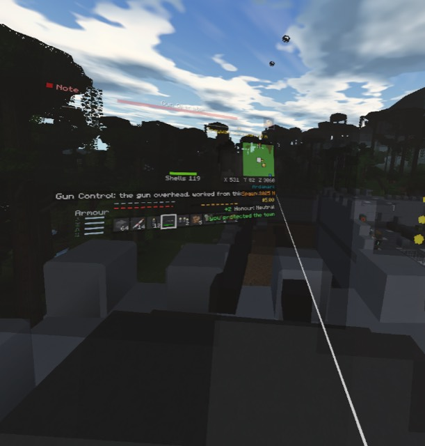

## 20:49:57 - I don't think I can land a hit. It's just a bad hit.

- **Transcript:** I don't think I can land a hit. It's just a bad hit.
- **Status:** open
- **Build:** 0.129 (26ceac53, M1-M4 (device-tested; ship riding, chests, comfort options, weapon wheel))
- **World:** New World (28) (seed 3084501862406496736)
- **Dimension:** Surface
- **Biome:** Jungle
- **Position:** 550.7 70.3 3066.9
- **Facing:** west (yaw 288, pitch -1)
- **Held:** Slatefall Carbine x1
- **Mount:** on foot
- **Looking at:** nothing
- **Mode:** Survival, health 19/20
- **Time:** day 1 16:41, clear
- **Fps:** 69
- **Levels:** mic -30 dBFS, game sound -16 dBFS
- **Length:** 4.0 s (voice 2.3 s)
- **Just before:** -18s holding empty hand; -16s message: Manning the deck gun; -14s message: Gun Control: the gun overhead, worked from this computer; -11s message: The turret is wrecked; -9s holding Slatefall Carbine; -8s into the pack: Regular Armour Set
- **Repro (Mac):** `./snap.sh note --seed 3084501862406496736 --x 550.7 --z 3066.9 --yaw 72 --pitch -1 --time 0.446`
- **Audio (this Mac):** /Users/darthvadar/Documents/Blocksmith/QuestVoiceNotes/raw/vn-20261116-204957-394.aac

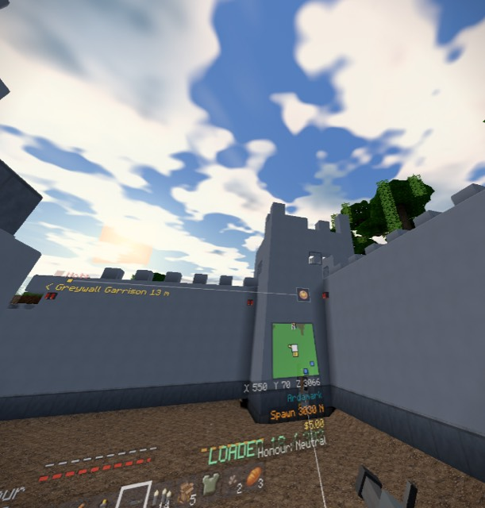

## 20:50:25 - Okay, what gun did that guy use? Whatever gun he used was overpowered.

- **Transcript:** Okay, what gun did that guy use? Whatever gun he used was overpowered.
- **Status:** open
- **Build:** 0.129 (26ceac53, M1-M4 (device-tested; ship riding, chests, comfort options, weapon wheel))
- **World:** New World (28) (seed 3084501862406496736)
- **Dimension:** Surface
- **Biome:** Jungle
- **Position:** 551.5 69.0 3082.6
- **Facing:** north (yaw 2, pitch -11)
- **Held:** empty hand
- **Mount:** on foot
- **Looking at:** nothing
- **Mode:** Survival, health -2/20, screen DeathMenu
- **Time:** day 1 17:12, clear
- **Fps:** 71
- **Levels:** mic -20 dBFS, game sound -13 dBFS
- **Length:** 7.0 s (voice 3.9 s)
- **Just before:** -19s message: Greywall Command now counts you tolerated.; -18s took 9 damage (health 10/20); -17s holding Slate Magazine; -17s holding Field Stim; -17s left the pack: Field Stim; -17s holding Slate Magazine; -16s holding Slatefall Carbine; -15s message: Isaiah Whitlock: Somebody ring the bell!; -15s holding Slate Magazine; -14s holding Field Stim; -14s holding Slate Magazine; -13s holding Slatefall Carbine; -12s took 1 damage (health 19/20); -12s message: Loaded: 30 / 30; -12s left the pack: Slate Magazine (at 550 69 3076); -10s holding Slate Magazine; -10s opened PauseMenu; -9s took 18 damage (health 3/20); -8s message: Creative mode; -8s closed PauseMenu; -7s holding Slatefall Carbine; -7s holding Slate Magazine; -6s holding Slatefall Carbine; -4s opened PauseMenu; -3s message: Survival mode; -3s closed PauseMenu; -3s holding Slate Magazine; -2s holding Field Stim; -2s left the pack: Field Stim (at 552 69 3076); -1s holding Slate Magazine; -1s left the pack: Field Stim; -1s holding Slatefall Carbine; -1s died; -1s opened DeathMenu; -1s holding empty hand; -1s left the pack: Field Stim x11 (DeathMenu open); -1s left the pack: Slate Magazine x11 (DeathMenu open); -1s left the pack: Slatefall Carbine (DeathMenu open); -1s left the pack: Regular Armour Set x2 (DeathMenu open); -0s took 19 damage (health -2/20)
- **While talking:** -4s respawned; -4s closed DeathMenu; -4s message: Your things are 3046 blocks south; -2s walked into Sparse Jungle; -2s message: Entering Mararhold
- **Position at the end:** 715.8 80.2 35.5
- **Repro (Mac):** `./snap.sh note --seed 3084501862406496736 --x 551.5 --z 3082.6 --yaw -2 --pitch -11 --time 0.467`
- **Audio (this Mac):** /Users/darthvadar/Documents/Blocksmith/QuestVoiceNotes/raw/vn-20261116-205025-794.aac

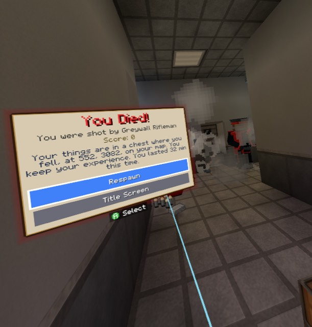

## 20:50:35 - No way, I gotta just, yeah, a few shots, I'm dead. Come on.

- **Transcript:** No way, I gotta just, yeah, a few shots, I'm dead. Come on.
- **Status:** open
- **Build:** 0.129 (26ceac53, M1-M4 (device-tested; ship riding, chests, comfort options, weapon wheel))
- **World:** New World (28) (seed 3084501862406496736)
- **Dimension:** Surface
- **Biome:** Sparse Jungle
- **Position:** 672.9 95.1 5.0
- **Facing:** west (yaw 280, pitch -9)
- **Held:** empty hand
- **Mount:** on foot, flying
- **Looking at:** nothing
- **Mode:** Creative, health 20/20
- **Time:** day 1 17:21, clear
- **Fps:** 72
- **Levels:** mic -27 dBFS, game sound -30 dBFS
- **Length:** 5.3 s (voice 2.6 s)
- **Just before:** -24s holding Field Stim; -23s holding Slate Magazine; -23s holding Slatefall Carbine; -22s took 1 damage (health 19/20); -21s message: Loaded: 30 / 30; -21s left the pack: Slate Magazine (at 550 69 3076); -20s holding Slate Magazine; -19s opened PauseMenu; -18s took 18 damage (health 3/20); -17s message: Creative mode; -17s closed PauseMenu; -16s holding Slatefall Carbine; -16s holding Slate Magazine; -16s holding Slatefall Carbine; -14s opened PauseMenu; -12s message: Survival mode; -12s closed PauseMenu; -12s holding Slate Magazine; -11s holding Field Stim; -11s left the pack: Field Stim (at 552 69 3076); -11s holding Slate Magazine; -11s left the pack: Field Stim; -11s holding Slatefall Carbine; -10s died; -10s opened DeathMenu; -10s holding empty hand; -10s left the pack: Field Stim x11 (DeathMenu open); -10s left the pack: Slate Magazine x11 (DeathMenu open); -10s left the pack: Slatefall Carbine (DeathMenu open); -10s left the pack: Regular Armour Set x2 (DeathMenu open); -9s took 19 damage (health -2/20); -8s respawned; -8s closed DeathMenu; -8s message: Your things are 3046 blocks south; -6s walked into Sparse Jungle; -6s message: Entering Mararhold; -3s opened PauseMenu; -2s message: Creative mode; -2s closed PauseMenu; -0s message: Flying
- **Repro (Mac):** `./snap.sh note --seed 3084501862406496736 --x 672.9 --z 5.0 --yaw 80 --pitch -9 --time 0.473`
- **Audio (this Mac):** /Users/darthvadar/Documents/Blocksmith/QuestVoiceNotes/raw/vn-20261116-205035-014.aac

## 20:51:12 - Oh, wow. Hold on.

- **Transcript:** Oh, wow. Hold on.
- **Status:** open
- **Build:** 0.129 (26ceac53, M1-M4 (device-tested; ship riding, chests, comfort options, weapon wheel))
- **World:** New World (28) (seed 3084501862406496736)
- **Dimension:** Surface
- **Biome:** Desert
- **Position:** 495.9 79.1 577.0
- **Facing:** south-west (yaw 209, pitch -72)
- **Held:** empty hand
- **Mount:** on foot
- **Looking at:** Fire at 495 80 577
- **Mode:** Survival, health 1/20
- **Time:** day 1 18:04, clear
- **Fps:** 72
- **Levels:** mic -24 dBFS, game sound -17 dBFS
- **Length:** 2.7 s (voice 1.1 s)
- **Just before:** -30s message: Walking; -28s opened PauseMenu; -28s closed PauseMenu; -27s opened CreativeMenu; -26s opened KeyboardMenu; -25s opened CreativeMenu; -22s opened KeyboardMenu; -18s opened CreativeMenu; -16s closed CreativeMenu; -15s message: Flying; -15s opened PauseMenu; -14s closed PauseMenu; -14s opened CreativeMenu; -14s message: Next track; -13s opened KeyboardMenu; -8s opened CreativeMenu; -6s closed CreativeMenu; -6s holding Cinder Tank Spawn Egg; -6s message: Cinder Tank Spawn Egg; -5s holding empty hand; -5s piloting Cinder Tank; -5s message: Steering Cinder Tank; -4s opened PauseMenu; -3s message: Survival mode; -3s closed PauseMenu; -2s stopped piloting Cinder Tank
- **Repro (Mac):** `./snap.sh note --seed 3084501862406496736 --x 495.9 --z 577.0 --yaw 151 --pitch -72 --time 0.503`
- **Audio (this Mac):** /Users/darthvadar/Documents/Blocksmith/QuestVoiceNotes/raw/vn-20261116-205112-834.aac

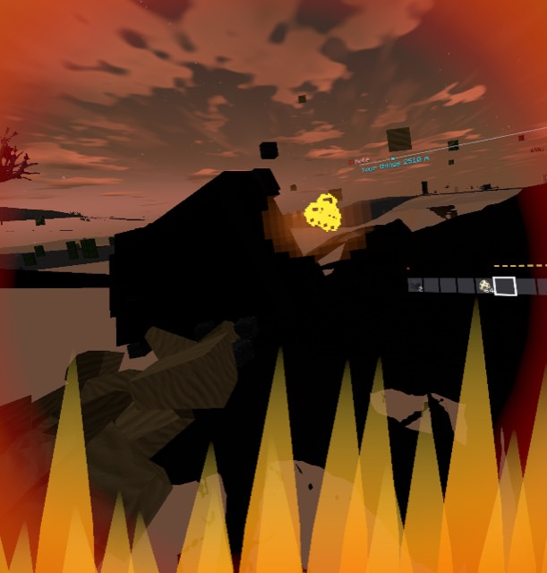

## 20:51:16 - That's crazy

- **Transcript:** That's crazy
- **Status:** open
- **Build:** 0.129 (26ceac53, M1-M4 (device-tested; ship riding, chests, comfort options, weapon wheel))
- **World:** New World (28) (seed 3084501862406496736)
- **Dimension:** Surface
- **Biome:** Desert
- **Position:** 495.9 84.6 568.4
- **Facing:** south (yaw 165, pitch -52)
- **Held:** empty hand
- **Mount:** on foot, flying
- **Looking at:** nothing
- **Mode:** Creative, health 2/20
- **Time:** day 1 18:06, clear
- **Fps:** 69
- **Levels:** mic -33 dBFS, game sound -22 dBFS
- **Length:** 2.1 s (voice 0.6 s)
- **Just before:** -29s opened CreativeMenu; -26s opened KeyboardMenu; -22s opened CreativeMenu; -20s closed CreativeMenu; -20s message: Flying; -19s opened PauseMenu; -19s closed PauseMenu; -18s opened CreativeMenu; -18s message: Next track; -18s opened KeyboardMenu; -12s opened CreativeMenu; -11s closed CreativeMenu; -10s holding Cinder Tank Spawn Egg; -10s message: Cinder Tank Spawn Egg; -9s holding empty hand; -9s piloting Cinder Tank; -9s message: Steering Cinder Tank; -8s opened PauseMenu; -7s message: Survival mode; -7s closed PauseMenu; -6s stopped piloting Cinder Tank; -4s opened PauseMenu; -3s took 21 damage (health 1/20); -3s closed PauseMenu; -3s opened PauseMenu; -2s message: Creative mode; -1s closed PauseMenu; -0s message: Flying
- **Repro (Mac):** `./snap.sh note --seed 3084501862406496736 --x 495.9 --z 568.4 --yaw -165 --pitch -52 --time 0.505`
- **Audio (this Mac):** /Users/darthvadar/Documents/Blocksmith/QuestVoiceNotes/raw/vn-20261116-205116-934.aac

## 20:51:19 - Just didn't survive that. Okay.

- **Transcript:** Just didn't survive that. Okay.
- **Status:** open
- **Build:** 0.129 (26ceac53, M1-M4 (device-tested; ship riding, chests, comfort options, weapon wheel))
- **World:** New World (28) (seed 3084501862406496736)
- **Dimension:** Surface
- **Biome:** Desert
- **Position:** 420.0 88.1 559.3
- **Facing:** south-west (yaw 219, pitch -21)
- **Held:** empty hand
- **Mount:** on foot, flying
- **Looking at:** nothing
- **Mode:** Creative, health 2/20
- **Time:** day 1 18:09, clear
- **Fps:** 70
- **Levels:** mic -33 dBFS, game sound -17 dBFS
- **Length:** 3.3 s (voice 1.6 s)
- **Just before:** -29s opened KeyboardMenu; -24s opened CreativeMenu; -23s closed CreativeMenu; -22s message: Flying; -22s opened PauseMenu; -21s closed PauseMenu; -21s opened CreativeMenu; -21s message: Next track; -20s opened KeyboardMenu; -15s opened CreativeMenu; -13s closed CreativeMenu; -13s holding Cinder Tank Spawn Egg; -13s message: Cinder Tank Spawn Egg; -12s holding empty hand; -11s piloting Cinder Tank; -11s message: Steering Cinder Tank; -10s opened PauseMenu; -10s message: Survival mode; -9s closed PauseMenu; -8s stopped piloting Cinder Tank; -6s opened PauseMenu; -6s took 21 damage (health 1/20); -6s closed PauseMenu; -5s opened PauseMenu; -4s message: Creative mode; -4s closed PauseMenu; -3s message: Flying; -0s message: Intel: this base is a Field Hospital
- **Repro (Mac):** `./snap.sh note --seed 3084501862406496736 --x 420.0 --z 559.3 --yaw 141 --pitch -21 --time 0.507`
- **Audio (this Mac):** /Users/darthvadar/Documents/Blocksmith/QuestVoiceNotes/raw/vn-20261116-205119-554.aac

## 20:51:29 - This might be fine

- **Transcript:** This might be fine
- **Status:** open
- **Build:** 0.129 (26ceac53, M1-M4 (device-tested; ship riding, chests, comfort options, weapon wheel))
- **World:** New World (28) (seed 3084501862406496736)
- **Dimension:** Surface
- **Biome:** Plains
- **Position:** 116.3 101.4 687.0
- **Facing:** west (yaw 261, pitch -52)
- **Held:** empty hand
- **Mount:** on foot, flying
- **Looking at:** nothing
- **Mode:** Creative, health 2/20
- **Time:** day 1 18:21, clear
- **Fps:** 71
- **Levels:** mic -27 dBFS, game sound -21 dBFS
- **Length:** 4.2 s (voice 2.1 s)
- **Just before:** -30s opened KeyboardMenu; -25s opened CreativeMenu; -23s closed CreativeMenu; -22s holding Cinder Tank Spawn Egg; -22s message: Cinder Tank Spawn Egg; -21s holding empty hand; -21s piloting Cinder Tank; -21s message: Steering Cinder Tank; -20s opened PauseMenu; -19s message: Survival mode; -19s closed PauseMenu; -18s stopped piloting Cinder Tank; -16s opened PauseMenu; -15s took 21 damage (health 1/20); -15s closed PauseMenu; -15s opened PauseMenu; -14s message: Creative mode; -14s closed PauseMenu; -12s message: Flying; -10s message: Intel: this base is a Field Hospital; -2s walked into Plains
- **Repro (Mac):** `./snap.sh note --seed 3084501862406496736 --x 116.3 --z 687.0 --yaw 99 --pitch -52 --time 0.515`
- **Audio (this Mac):** /Users/darthvadar/Documents/Blocksmith/QuestVoiceNotes/raw/vn-20261116-205129-094.aac

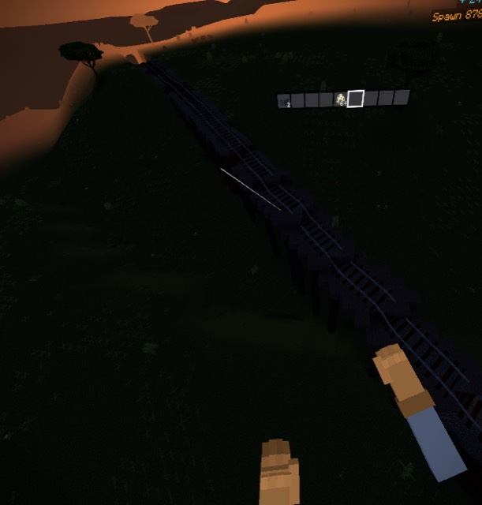

## 20:53:18 - There's shaking and snaking going on.

- **Transcript:** There's shaking and snaking going on.
- **Status:** open
- **Build:** 0.129 (26ceac53, M1-M4 (device-tested; ship riding, chests, comfort options, weapon wheel))
- **World:** New World (28) (seed 3084501862406496736)
- **Dimension:** Surface
- **Biome:** Warm Ocean
- **Position:** -6651.0 65.8 798.4
- **Facing:** south-west (yaw 227, pitch -19)
- **Held:** empty hand
- **Mount:** riding Minecart
- **Looking at:** nothing
- **Mode:** Creative, health 2/20
- **Time:** day 1 20:32, clear
- **Fps:** 72
- **Levels:** mic -28 dBFS, game sound -17 dBFS
- **Length:** 3.7 s (voice 2.0 s)
- **Just before:** -29s message: Sky isle marked on the map; -27s message: Clear Bluff marked on the map; -25s message: Walking; -24s message: Flying; -22s message: Thaddeus Coffey: Mind the dark out there.; -20s message: Walking; -17s mounted Minecart; -17s message: Riding the Clear & Fort Rail Road; -10s walked into Beach; -6s walked into Warm Ocean
- **Repro (Mac):** `./snap.sh note --seed 3084501862406496736 --x -6651.0 --z 798.4 --yaw 133 --pitch -19 --time 0.606`
- **Audio (this Mac):** /Users/darthvadar/Documents/Blocksmith/QuestVoiceNotes/raw/vn-20261116-205318-094.aac

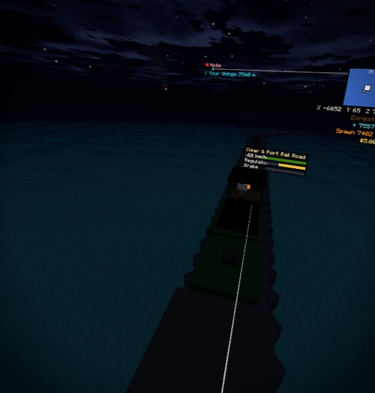

## 20:53:21 - I'm thinking the solution of that is just fixing the

- **Transcript:** I'm thinking the solution of that is just fixing the
- **Status:** open
- **Build:** 0.129 (26ceac53, M1-M4 (device-tested; ship riding, chests, comfort options, weapon wheel))
- **World:** New World (28) (seed 3084501862406496736)
- **Dimension:** Surface
- **Biome:** Warm Ocean
- **Position:** -6706.9 65.8 836.1
- **Facing:** west (yaw 272, pitch -19)
- **Held:** empty hand
- **Mount:** riding Minecart
- **Looking at:** nothing
- **Mode:** Creative, health 2/20
- **Time:** day 1 20:36, clear
- **Fps:** 72
- **Levels:** mic -37 dBFS, game sound -10 dBFS
- **Length:** 6.1 s (voice 3.8 s)
- **Just before:** -28s message: Walking; -27s message: Flying; -25s message: Thaddeus Coffey: Mind the dark out there.; -23s message: Walking; -20s mounted Minecart; -20s message: Riding the Clear & Fort Rail Road; -14s walked into Beach; -10s walked into Warm Ocean; -3s message: Minnie Ingram: Bar your door tonight, friend.
- **Position at the end:** -6814.8 65.8 836.1
- **Repro (Mac):** `./snap.sh note --seed 3084501862406496736 --x -6706.9 --z 836.1 --yaw 88 --pitch -19 --time 0.608`
- **Audio (this Mac):** /Users/darthvadar/Documents/Blocksmith/QuestVoiceNotes/raw/vn-20261116-205321-394.aac

## 20:53:27 - Third person camera so that it can't shake.

- **Transcript:** Third person camera so that it can't shake.
- **Status:** open
- **Build:** 0.129 (26ceac53, M1-M4 (device-tested; ship riding, chests, comfort options, weapon wheel))
- **World:** New World (28) (seed 3084501862406496736)
- **Dimension:** Surface
- **Biome:** Warm Ocean
- **Position:** -6854.2 65.8 836.1
- **Facing:** west (yaw 258, pitch -31)
- **Held:** empty hand
- **Mount:** riding Minecart
- **Looking at:** nothing
- **Mode:** Creative, health 2/20
- **Time:** day 1 20:44, clear
- **Fps:** 72
- **Levels:** mic -25 dBFS, game sound -13 dBFS
- **Length:** 4.2 s (voice 1.9 s)
- **Just before:** -29s message: Walking; -27s mounted Minecart; -27s message: Riding the Clear & Fort Rail Road; -20s walked into Beach; -16s walked into Warm Ocean; -10s message: Minnie Ingram: Bar your door tonight, friend.
- **Repro (Mac):** `./snap.sh note --seed 3084501862406496736 --x -6854.2 --z 836.1 --yaw 102 --pitch -31 --time 0.614`
- **Audio (this Mac):** /Users/darthvadar/Documents/Blocksmith/QuestVoiceNotes/raw/vn-20261116-205327-974.aac

## 20:53:38 - Most of the UI is not perfect for this. The speed regulator overlaps w

- **Transcript:** Most of the UI is not perfect for this. The speed regulator overlaps with some of the bars.
- **Status:** open
- **Build:** 0.129 (26ceac53, M1-M4 (device-tested; ship riding, chests, comfort options, weapon wheel))
- **World:** New World (28) (seed 3084501862406496736)
- **Dimension:** Surface
- **Biome:** Warm Ocean
- **Position:** -7151.0 88.6 836.1
- **Facing:** west (yaw 292, pitch -67)
- **Held:** empty hand
- **Mount:** riding Minecart
- **Looking at:** Spruce Planks at -7152 86 835
- **Mode:** Creative, health 2/20
- **Time:** day 1 20:56, clear
- **Fps:** 72
- **Levels:** mic -41 dBFS, game sound -16 dBFS
- **Length:** 9.4 s (voice 5.3 s)
- **Just before:** -27s walked into Warm Ocean; -20s message: Minnie Ingram: Bar your door tonight, friend.
- **Position at the end:** -7291.4 106.2 836.1
- **Repro (Mac):** `./snap.sh note --seed 3084501862406496736 --x -7151.0 --z 836.1 --yaw 68 --pitch -67 --time 0.623`
- **Audio (this Mac):** /Users/darthvadar/Documents/Blocksmith/QuestVoiceNotes/raw/vn-20261116-205338-674.aac

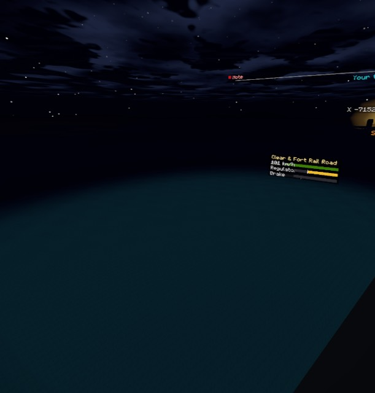

## 20:56:01 - If a flashing sensation happens...

- **Transcript:** If a flashing sensation happens...
- **Status:** open
- **Build:** 0.129 (26ceac53, M1-M4 (device-tested; ship riding, chests, comfort options, weapon wheel))
- **World:** New World (28) (seed 3084501862406496736)
- **Dimension:** Surface
- **Biome:** Savanna
- **Position:** -11153.4 70.7 836.1
- **Facing:** east (yaw 104, pitch 6)
- **Held:** empty hand
- **Mount:** riding Minecart
- **Looking at:** nothing
- **Mode:** Creative, health 2/20
- **Time:** day 1 23:48, thunderstorm
- **Fps:** 72
- **Levels:** mic -30 dBFS, game sound -12 dBFS
- **Length:** 3.7 s (voice 2.1 s)
- **Just before:** -27s walked into Forest; -11s walked into Meadow; -7s walked into Forest; -5s walked into Plains; -1s message: Viola Pickett: Strange shapes in the dark out past the fence.
- **Repro (Mac):** `./snap.sh note --seed 3084501862406496736 --x -11153.4 --z 836.1 --yaw -104 --pitch 6 --time 0.742`
- **Audio (this Mac):** /Users/darthvadar/Documents/Blocksmith/QuestVoiceNotes/raw/vn-20261116-205601-574.aac

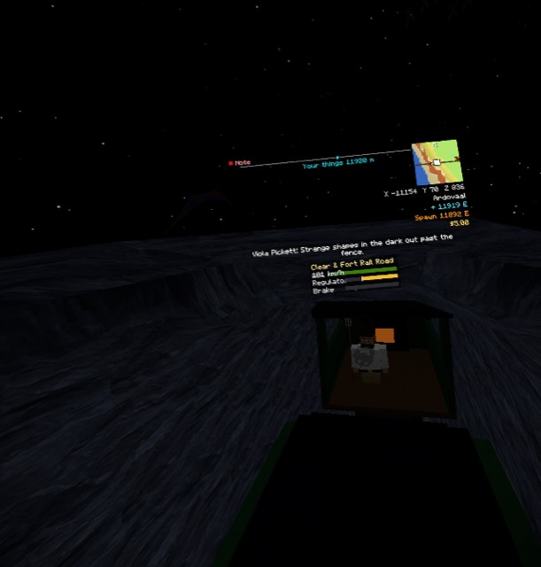

## 20:56:05 - When you're going on a ground sometimes.

- **Transcript:** When you're going on a ground sometimes.
- **Status:** open
- **Build:** 0.129 (26ceac53, M1-M4 (device-tested; ship riding, chests, comfort options, weapon wheel))
- **World:** New World (28) (seed 3084501862406496736)
- **Dimension:** Surface
- **Biome:** Warm Ocean
- **Position:** -11257.3 65.8 836.1
- **Facing:** south-east (yaw 141, pitch -37)
- **Held:** empty hand
- **Mount:** riding Minecart
- **Looking at:** nothing
- **Mode:** Creative, health 2/20
- **Time:** day 1 23:52, thunderstorm
- **Fps:** 72
- **Levels:** mic -35 dBFS, game sound -12 dBFS
- **Length:** 3.3 s (voice 1.8 s)
- **Just before:** -15s walked into Meadow; -11s walked into Forest; -9s walked into Plains; -5s message: Viola Pickett: Strange shapes in the dark out past the fence.; -2s walked into Desert; -0s walked into Warm Ocean
- **Repro (Mac):** `./snap.sh note --seed 3084501862406496736 --x -11257.3 --z 836.1 --yaw -141 --pitch -37 --time 0.745`
- **Audio (this Mac):** /Users/darthvadar/Documents/Blocksmith/QuestVoiceNotes/raw/vn-20261116-205605-294.aac

## 20:56:29 - Flashing, I mean the camera is going in and out of the stone because t

- **Transcript:** Flashing, I mean the camera is going in and out of the stone because the third party, third person following camera can't
- **Status:** open
- **Build:** 0.129 (26ceac53, M1-M4 (device-tested; ship riding, chests, comfort options, weapon wheel))
- **World:** New World (28) (seed 3084501862406496736)
- **Dimension:** Surface
- **Biome:** Warm Ocean
- **Position:** -11929.0 65.8 836.1
- **Facing:** south (yaw 159, pitch -56)
- **Held:** empty hand
- **Mount:** riding Minecart
- **Looking at:** nothing
- **Mode:** Creative, health 2/20
- **Time:** day 1 00:21, thunderstorm
- **Fps:** 71
- **Levels:** mic -29 dBFS, game sound -17 dBFS
- **Length:** 10.9 s (voice 5.3 s)
- **Just before:** -29s message: Viola Pickett: Strange shapes in the dark out past the fence.; -26s walked into Desert; -24s walked into Warm Ocean
- **While talking:** -3s message: Viola Pickett: Lanterns are lit. Town looks pretty this time of night.
- **Position at the end:** -12209.3 65.8 836.1
- **Repro (Mac):** `./snap.sh note --seed 3084501862406496736 --x -11929.0 --z 836.1 --yaw -159 --pitch -56 --time 0.765`
- **Audio (this Mac):** /Users/darthvadar/Documents/Blocksmith/QuestVoiceNotes/raw/vn-20261116-205629-274.aac

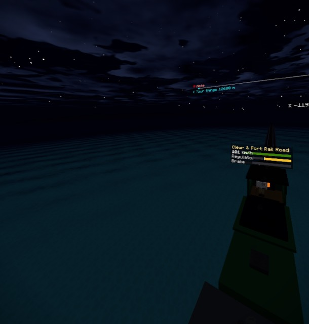

## 20:56:40 - Can't follow perfectly. There's enough room for it.

- **Transcript:** Can't follow perfectly. There's enough room for it.
- **Status:** open
- **Build:** 0.129 (26ceac53, M1-M4 (device-tested; ship riding, chests, comfort options, weapon wheel))
- **World:** New World (28) (seed 3084501862406496736)
- **Dimension:** Surface
- **Biome:** Warm Ocean
- **Position:** -12238.5 65.8 836.1
- **Facing:** south (yaw 185, pitch -55)
- **Held:** empty hand
- **Mount:** riding Minecart
- **Looking at:** nothing
- **Mode:** Creative, health 2/20
- **Time:** day 1 00:34, thunderstorm
- **Fps:** 71
- **Levels:** mic -43 dBFS, game sound -16 dBFS
- **Length:** 4.0 s (voice 1.7 s)
- **Just before:** -4s message: Viola Pickett: Lanterns are lit. Town looks pretty this time of night.
- **Repro (Mac):** `./snap.sh note --seed 3084501862406496736 --x -12238.5 --z 836.1 --yaw 175 --pitch -55 --time 0.774`
- **Audio (this Mac):** /Users/darthvadar/Documents/Blocksmith/QuestVoiceNotes/raw/vn-20261116-205640-334.aac

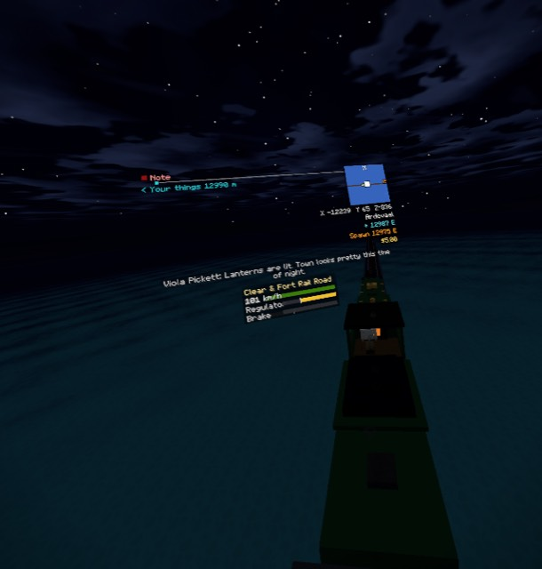

## 20:57:38 - Alright, I've decided that maybe we shouldn't have the railroads going

- **Transcript:** Alright, I've decided that maybe we shouldn't have the railroads going over the entire fucking ocean.
- **Status:** open
- **Build:** 0.129 (26ceac53, M1-M4 (device-tested; ship riding, chests, comfort options, weapon wheel))
- **World:** New World (28) (seed 3084501862406496736)
- **Dimension:** Surface
- **Biome:** Deep Lukewarm Ocean
- **Position:** -13858.3 65.8 836.1
- **Facing:** south (yaw 169, pitch -38)
- **Held:** empty hand
- **Mount:** riding Minecart
- **Looking at:** nothing
- **Mode:** Creative, health 2/20
- **Time:** day 1 01:44, thunderstorm
- **Fps:** 72
- **Levels:** mic -25 dBFS, game sound -19 dBFS
- **Length:** 8.2 s (voice 5.6 s)
- **Just before:** -29s walked into Deep Lukewarm Ocean; -12s message: Viola Pickett: Owls are out. Mice should be in.
- **Position at the end:** -13998.7 65.8 836.1
- **Repro (Mac):** `./snap.sh note --seed 3084501862406496736 --x -13858.3 --z 836.1 --yaw -169 --pitch -38 --time 0.822`
- **Audio (this Mac):** /Users/darthvadar/Documents/Blocksmith/QuestVoiceNotes/raw/vn-20261116-205738-174.aac

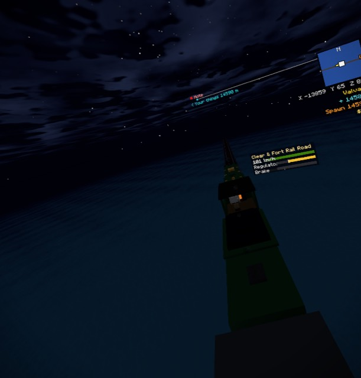

## 20:57:46 - Please remind.

- **Transcript:** Please remind.
- **Status:** open
- **Build:** 0.129 (26ceac53, M1-M4 (device-tested; ship riding, chests, comfort options, weapon wheel))
- **World:** New World (28) (seed 3084501862406496736)
- **Dimension:** Surface
- **Biome:** Deep Lukewarm Ocean
- **Position:** -14089.3 65.8 836.1
- **Facing:** south (yaw 192, pitch -35)
- **Held:** empty hand
- **Mount:** riding Minecart
- **Looking at:** nothing
- **Mode:** Creative, health 2/20
- **Time:** day 1 01:54, thunderstorm
- **Fps:** 72
- **Levels:** mic -24 dBFS, game sound -17 dBFS
- **Length:** 2.1 s (voice 0.7 s)
- **Just before:** -21s message: Viola Pickett: Owls are out. Mice should be in.
- **Repro (Mac):** `./snap.sh note --seed 3084501862406496736 --x -14089.3 --z 836.1 --yaw 168 --pitch -35 --time 0.829`
- **Audio (this Mac):** /Users/darthvadar/Documents/Blocksmith/QuestVoiceNotes/raw/vn-20261116-205746-434.aac

## 20:58:14 - I'm still gonna hit land anytime soon, Christ.

- **Transcript:** I'm still gonna hit land anytime soon, Christ.
- **Status:** open
- **Build:** 0.129 (26ceac53, M1-M4 (device-tested; ship riding, chests, comfort options, weapon wheel))
- **World:** New World (28) (seed 3084501862406496736)
- **Dimension:** Surface
- **Biome:** Lukewarm Ocean
- **Position:** -14874.9 65.8 836.1
- **Facing:** south-east (yaw 156, pitch -52)
- **Held:** empty hand
- **Mount:** riding Minecart
- **Looking at:** nothing
- **Mode:** Creative, health 2/20
- **Time:** day 1 02:27, thunderstorm
- **Fps:** 71
- **Levels:** mic -28 dBFS, game sound -14 dBFS
- **Length:** 3.4 s (voice 1.9 s)
- **Just before:** -11s walked into Lukewarm Ocean; -9s message: Minnie Ingram: Night air's good for thinking. And catching cold.; -9s walked into Deep Lukewarm Ocean; -7s walked into Lukewarm Ocean
- **Repro (Mac):** `./snap.sh note --seed 3084501862406496736 --x -14874.9 --z 836.1 --yaw -156 --pitch -52 --time 0.853`
- **Audio (this Mac):** /Users/darthvadar/Documents/Blocksmith/QuestVoiceNotes/raw/vn-20261116-205814-474.aac

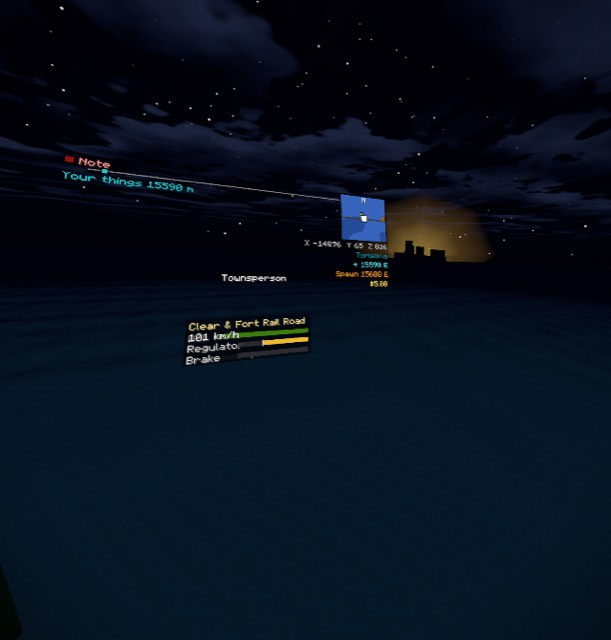

## 20:58:54 - Something better stop at that village

- **Transcript:** Something better stop at that village
- **Status:** open
- **Build:** 0.129 (26ceac53, M1-M4 (device-tested; ship riding, chests, comfort options, weapon wheel))
- **World:** New World (28) (seed 3084501862406496736)
- **Dimension:** Surface
- **Biome:** Warm Ocean
- **Position:** -15996.0 65.8 836.1
- **Facing:** south-east (yaw 130, pitch -40)
- **Held:** empty hand
- **Mount:** riding Minecart
- **Looking at:** nothing
- **Mode:** Creative, health 2/20
- **Time:** day 1 03:15, thunderstorm
- **Fps:** 71
- **Levels:** mic -27 dBFS, game sound -14 dBFS
- **Length:** 2.9 s (voice 1.5 s)
- **Just before:** -17s walked into Warm Ocean
- **Repro (Mac):** `./snap.sh note --seed 3084501862406496736 --x -15996.0 --z 836.1 --yaw -130 --pitch -40 --time 0.886`
- **Audio (this Mac):** /Users/darthvadar/Documents/Blocksmith/QuestVoiceNotes/raw/vn-20261116-205854-514.aac

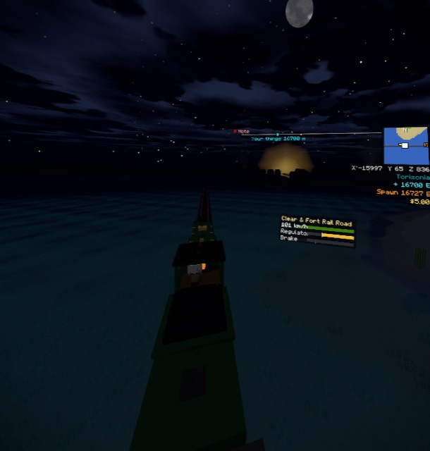

## 20:58:59 - It's not stopping there, is it?

- **Transcript:** It's not stopping there, is it?
- **Status:** open
- **Build:** 0.129 (26ceac53, M1-M4 (device-tested; ship riding, chests, comfort options, weapon wheel))
- **World:** New World (28) (seed 3084501862406496736)
- **Dimension:** Surface
- **Biome:** Lukewarm Ocean
- **Position:** -16121.6 65.8 836.1
- **Facing:** south-east (yaw 131, pitch -40)
- **Held:** empty hand
- **Mount:** riding Minecart
- **Looking at:** nothing
- **Mode:** Creative, health 2/20
- **Time:** day 1 03:21, thunderstorm
- **Fps:** 71
- **Levels:** mic -27 dBFS, game sound -15 dBFS
- **Length:** 2.6 s (voice 1.2 s)
- **Just before:** -21s walked into Warm Ocean; -3s message: Minnie Ingram: Cold one tonight. Wear a coat.
- **Repro (Mac):** `./snap.sh note --seed 3084501862406496736 --x -16121.6 --z 836.1 --yaw -131 --pitch -40 --time 0.890`
- **Audio (this Mac):** /Users/darthvadar/Documents/Blocksmith/QuestVoiceNotes/raw/vn-20261116-205859-014.aac

## 20:59:02 - Oh my god, it's not even stopping there.

- **Transcript:** Oh my god, it's not even stopping there.
- **Status:** open
- **Build:** 0.129 (26ceac53, M1-M4 (device-tested; ship riding, chests, comfort options, weapon wheel))
- **World:** New World (28) (seed 3084501862406496736)
- **Dimension:** Surface
- **Biome:** Plains
- **Position:** -16209.5 70.8 836.1
- **Facing:** south-east (yaw 132, pitch -39)
- **Held:** empty hand
- **Mount:** riding Minecart
- **Looking at:** Grass Block at -16207 68 838
- **Mode:** Creative, health 2/20
- **Time:** day 1 03:25, thunderstorm
- **Fps:** 71
- **Levels:** mic -31 dBFS, game sound -14 dBFS
- **Length:** 3.2 s (voice 1.6 s)
- **Just before:** -24s walked into Warm Ocean; -6s message: Minnie Ingram: Cold one tonight. Wear a coat.; -2s walked into Beach; -0s walked into Plains
- **Repro (Mac):** `./snap.sh note --seed 3084501862406496736 --x -16209.5 --z 836.1 --yaw -132 --pitch -39 --time 0.892`
- **Audio (this Mac):** /Users/darthvadar/Documents/Blocksmith/QuestVoiceNotes/raw/vn-20261116-205902-134.aac

## 20:59:07 - I'm gonna give you a fucking minute.

- **Transcript:** I'm gonna give you a fucking minute.
- **Status:** open
- **Build:** 0.129 (26ceac53, M1-M4 (device-tested; ship riding, chests, comfort options, weapon wheel))
- **World:** New World (28) (seed 3084501862406496736)
- **Dimension:** Surface
- **Biome:** Plains
- **Position:** -16352.6 67.7 836.1
- **Facing:** south-east (yaw 135, pitch -38)
- **Held:** empty hand
- **Mount:** riding Minecart, flying
- **Looking at:** Grass Block at -16349 65 839
- **Mode:** Creative, health 2/20
- **Time:** day 1 03:31, thunderstorm
- **Fps:** 71
- **Levels:** mic -33 dBFS, game sound -11 dBFS
- **Length:** 3.0 s (voice 1.1 s)
- **Just before:** -29s walked into Warm Ocean; -11s message: Minnie Ingram: Cold one tonight. Wear a coat.; -7s walked into Beach; -5s walked into Plains; -0s message: Flying
- **Repro (Mac):** `./snap.sh note --seed 3084501862406496736 --x -16352.6 --z 836.1 --yaw -135 --pitch -38 --time 0.897`
- **Audio (this Mac):** /Users/darthvadar/Documents/Blocksmith/QuestVoiceNotes/raw/vn-20261116-205907-254.aac

## 20:59:13 - Does this thing stop at another village?

- **Transcript:** Does this thing stop at another village?
- **Status:** open
- **Build:** 0.129 (26ceac53, M1-M4 (device-tested; ship riding, chests, comfort options, weapon wheel))
- **World:** New World (28) (seed 3084501862406496736)
- **Dimension:** Surface
- **Biome:** Sparse Jungle
- **Position:** -16675.6 91.3 836.3
- **Facing:** south-east (yaw 152, pitch -51)
- **Held:** empty hand
- **Mount:** on foot, flying
- **Looking at:** nothing
- **Mode:** Creative, health 2/20
- **Time:** day 1 03:38, thunderstorm
- **Fps:** 70
- **Levels:** mic -25 dBFS, game sound -16 dBFS
- **Length:** 3.6 s (voice 2.0 s)
- **Just before:** -17s message: Minnie Ingram: Cold one tonight. Wear a coat.; -13s walked into Beach; -11s walked into Plains; -6s message: Flying; -4s dismounted Minecart; -3s walked into Sparse Jungle
- **Repro (Mac):** `./snap.sh note --seed 3084501862406496736 --x -16675.6 --z 836.3 --yaw -152 --pitch -51 --time 0.902`
- **Audio (this Mac):** /Users/darthvadar/Documents/Blocksmith/QuestVoiceNotes/raw/vn-20261116-205913-274.aac

## 20:59:17 - That's my question.

- **Transcript:** That's my question.
- **Status:** open
- **Build:** 0.129 (26ceac53, M1-M4 (device-tested; ship riding, chests, comfort options, weapon wheel))
- **World:** New World (28) (seed 3084501862406496736)
- **Dimension:** Surface
- **Biome:** Beach
- **Position:** -17015.8 91.3 826.7
- **Facing:** south-east (yaw 147, pitch -51)
- **Held:** empty hand
- **Mount:** on foot, flying
- **Looking at:** nothing
- **Mode:** Creative, health 2/20
- **Time:** day 1 03:43, thunderstorm
- **Fps:** 71
- **Levels:** mic -28 dBFS, game sound -24 dBFS
- **Length:** 2.1 s (voice 0.6 s)
- **Just before:** -21s message: Minnie Ingram: Cold one tonight. Wear a coat.; -17s walked into Beach; -15s walked into Plains; -10s message: Flying; -8s dismounted Minecart; -7s walked into Sparse Jungle; -1s walked into Forest
- **Repro (Mac):** `./snap.sh note --seed 3084501862406496736 --x -17015.8 --z 826.7 --yaw -147 --pitch -51 --time 0.905`
- **Audio (this Mac):** /Users/darthvadar/Documents/Blocksmith/QuestVoiceNotes/raw/vn-20261116-205917-194.aac

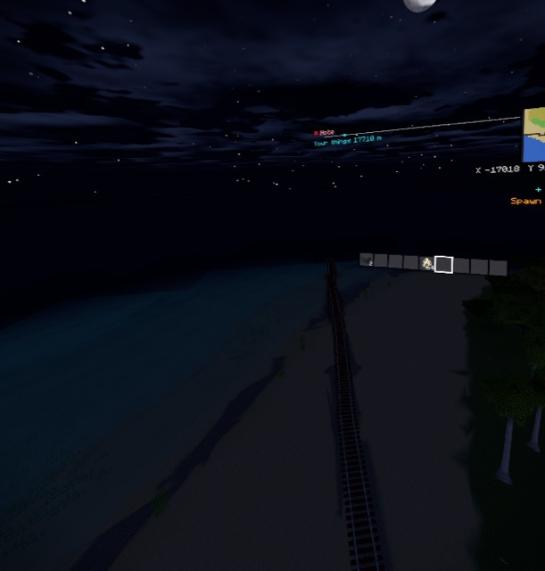

## 20:59:20 - Well I can see you're just going a straight fucking line.

- **Transcript:** Well I can see you're just going a straight fucking line.
- **Status:** open
- **Build:** 0.129 (26ceac53, M1-M4 (device-tested; ship riding, chests, comfort options, weapon wheel))
- **World:** New World (28) (seed 3084501862406496736)
- **Dimension:** Surface
- **Biome:** Lukewarm Ocean
- **Position:** -17260.5 110.4 831.2
- **Facing:** south-east (yaw 148, pitch -50)
- **Held:** empty hand
- **Mount:** on foot, flying
- **Looking at:** nothing
- **Mode:** Creative, health 2/20
- **Time:** day 1 03:46, thunderstorm
- **Fps:** 71
- **Levels:** mic -26 dBFS, game sound -20 dBFS
- **Length:** 3.6 s (voice 1.9 s)
- **Just before:** -24s message: Minnie Ingram: Cold one tonight. Wear a coat.; -20s walked into Beach; -18s walked into Plains; -13s message: Flying; -11s dismounted Minecart; -10s walked into Sparse Jungle; -4s walked into Forest; -2s walked into Lukewarm Ocean
- **Repro (Mac):** `./snap.sh note --seed 3084501862406496736 --x -17260.5 --z 831.2 --yaw -148 --pitch -50 --time 0.907`
- **Audio (this Mac):** /Users/darthvadar/Documents/Blocksmith/QuestVoiceNotes/raw/vn-20261116-205920-014.aac

## 20:59:43 - There it is.

- **Transcript:** There it is.
- **Status:** open
- **Build:** 0.129 (26ceac53, M1-M4 (device-tested; ship riding, chests, comfort options, weapon wheel))
- **World:** New World (28) (seed 3084501862406496736)
- **Dimension:** Surface
- **Biome:** Ocean
- **Position:** -18089.6 128.2 392.8
- **Facing:** south-west (yaw 234, pitch -24)
- **Held:** empty hand
- **Mount:** on foot, flying
- **Looking at:** nothing
- **Mode:** Creative, health 2/20
- **Time:** day 1 04:12, thunderstorm
- **Fps:** 71
- **Levels:** mic -40 dBFS, game sound -17 dBFS
- **Length:** 1.9 s (voice 0.4 s)
- **Just before:** -28s walked into Forest; -26s walked into Lukewarm Ocean; -18s message: Entering Gorenesh; -16s message: Sky isle marked on the map; -16s walked into Deep Lukewarm Ocean; -14s message: Entering Quelestad; -12s message: Entering Gorenesh; -12s walked into Ocean; -8s walked into Beach; -7s opened PauseMenu; -5s closed PauseMenu; -4s walked into Ocean
- **Repro (Mac):** `./snap.sh note --seed 3084501862406496736 --x -18089.6 --z 392.8 --yaw 126 --pitch -24 --time 0.926`
- **Audio (this Mac):** /Users/darthvadar/Documents/Blocksmith/QuestVoiceNotes/raw/vn-20261116-205943-834.aac

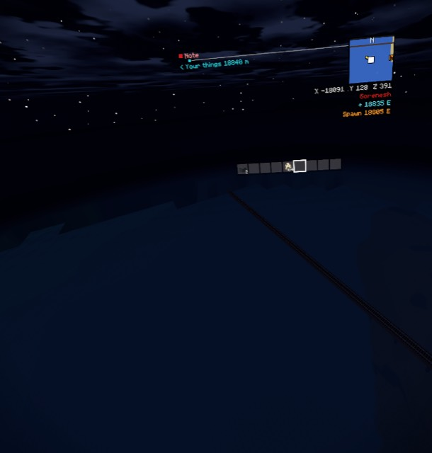

## 20:59:57 - This rail goes in one direction and is not stopping anywhere.

- **Transcript:** This rail goes in one direction and is not stopping anywhere.
- **Status:** open
- **Build:** 0.129 (26ceac53, M1-M4 (device-tested; ship riding, chests, comfort options, weapon wheel))
- **World:** New World (28) (seed 3084501862406496736)
- **Dimension:** Surface
- **Biome:** Deep Lukewarm Ocean
- **Position:** -19685.2 128.2 336.2
- **Facing:** south (yaw 177, pitch -39)
- **Held:** empty hand
- **Mount:** on foot, flying
- **Looking at:** nothing
- **Mode:** Creative, health 2/20
- **Time:** day 1 04:28, thunderstorm
- **Fps:** 72
- **Levels:** mic -28 dBFS, game sound -19 dBFS
- **Length:** 6.8 s (voice 3.9 s)
- **Just before:** -30s message: Sky isle marked on the map; -29s walked into Deep Lukewarm Ocean; -28s message: Entering Quelestad; -26s message: Entering Gorenesh; -25s walked into Ocean; -21s walked into Beach; -20s opened PauseMenu; -18s closed PauseMenu; -17s walked into Ocean; -9s walked into Deep Lukewarm Ocean
- **While talking:** -4s message: Entering Quelestad; -3s message: Entering Ithiesh
- **Position at the end:** -20582.5 128.2 349.7
- **Repro (Mac):** `./snap.sh note --seed 3084501862406496736 --x -19685.2 --z 336.2 --yaw -177 --pitch -39 --time 0.937`
- **Audio (this Mac):** /Users/darthvadar/Documents/Blocksmith/QuestVoiceNotes/raw/vn-20261116-205957-214.aac

## 21:00:04 - Just keep going straight and boring

- **Transcript:** Just keep going straight and boring
- **Status:** open
- **Build:** 0.129 (26ceac53, M1-M4 (device-tested; ship riding, chests, comfort options, weapon wheel))
- **World:** New World (28) (seed 3084501862406496736)
- **Dimension:** Surface
- **Biome:** Sunflower Plains
- **Position:** -20775.7 128.2 345.7
- **Facing:** south (yaw 175, pitch -38)
- **Held:** empty hand
- **Mount:** on foot, flying
- **Looking at:** nothing
- **Mode:** Creative, health 2/20
- **Time:** day 1 04:37, thunderstorm
- **Fps:** 72
- **Levels:** mic -40 dBFS, game sound -16 dBFS
- **Length:** 4.3 s (voice 1.9 s)
- **Just before:** -28s walked into Beach; -27s opened PauseMenu; -25s closed PauseMenu; -24s walked into Ocean; -16s walked into Deep Lukewarm Ocean; -7s message: Entering Quelestad; -5s message: Entering Ithiesh; -2s walked into Lukewarm Ocean
- **Repro (Mac):** `./snap.sh note --seed 3084501862406496736 --x -20775.7 --z 345.7 --yaw -175 --pitch -38 --time 0.943`
- **Audio (this Mac):** /Users/darthvadar/Documents/Blocksmith/QuestVoiceNotes/raw/vn-20261116-210004-454.aac

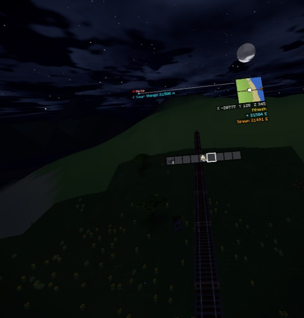

## 21:00:12 - It doesn't stop at all. It doesn't turn. It doesn't do anything anymor

- **Transcript:** It doesn't stop at all. It doesn't turn. It doesn't do anything anymore.
- **Status:** open
- **Build:** 0.129 (26ceac53, M1-M4 (device-tested; ship riding, chests, comfort options, weapon wheel))
- **World:** New World (28) (seed 3084501862406496736)
- **Dimension:** Surface
- **Biome:** Desert
- **Position:** -21273.0 166.7 351.8
- **Facing:** south (yaw 175, pitch -38)
- **Held:** empty hand
- **Mount:** on foot, flying
- **Looking at:** nothing
- **Mode:** Creative, health 2/20
- **Time:** day 1 04:47, thunderstorm
- **Fps:** 71
- **Levels:** mic -28 dBFS, game sound -17 dBFS
- **Length:** 4.6 s (voice 3.1 s)
- **Just before:** -24s walked into Deep Lukewarm Ocean; -15s message: Entering Quelestad; -13s message: Entering Ithiesh; -10s walked into Lukewarm Ocean; -8s walked into Sunflower Plains; -6s walked into Plains; -6s message: Sky isle marked on the map; -2s walked into Desert
- **Repro (Mac):** `./snap.sh note --seed 3084501862406496736 --x -21273.0 --z 351.8 --yaw -175 --pitch -38 --time 0.950`
- **Audio (this Mac):** /Users/darthvadar/Documents/Blocksmith/QuestVoiceNotes/raw/vn-20261116-210012-634.aac

## 21:00:17 - Just go straight.

- **Transcript:** Just go straight.
- **Status:** open
- **Build:** 0.129 (26ceac53, M1-M4 (device-tested; ship riding, chests, comfort options, weapon wheel))
- **World:** New World (28) (seed 3084501862406496736)
- **Dimension:** Surface
- **Biome:** Badlands
- **Position:** -21672.8 166.7 345.6
- **Facing:** south (yaw 191, pitch -49)
- **Held:** empty hand
- **Mount:** on foot, flying
- **Looking at:** nothing
- **Mode:** Creative, health 2/20
- **Time:** day 1 04:52, thunderstorm
- **Fps:** 71
- **Levels:** mic -29 dBFS, game sound -22 dBFS
- **Length:** 2.1 s (voice 0.7 s)
- **Just before:** -29s walked into Deep Lukewarm Ocean; -19s message: Entering Quelestad; -18s message: Entering Ithiesh; -15s walked into Lukewarm Ocean; -13s walked into Sunflower Plains; -11s walked into Plains; -10s message: Sky isle marked on the map; -7s walked into Desert
- **Repro (Mac):** `./snap.sh note --seed 3084501862406496736 --x -21672.8 --z 345.6 --yaw 169 --pitch -49 --time 0.953`
- **Audio (this Mac):** /Users/darthvadar/Documents/Blocksmith/QuestVoiceNotes/raw/vn-20261116-210017-254.aac

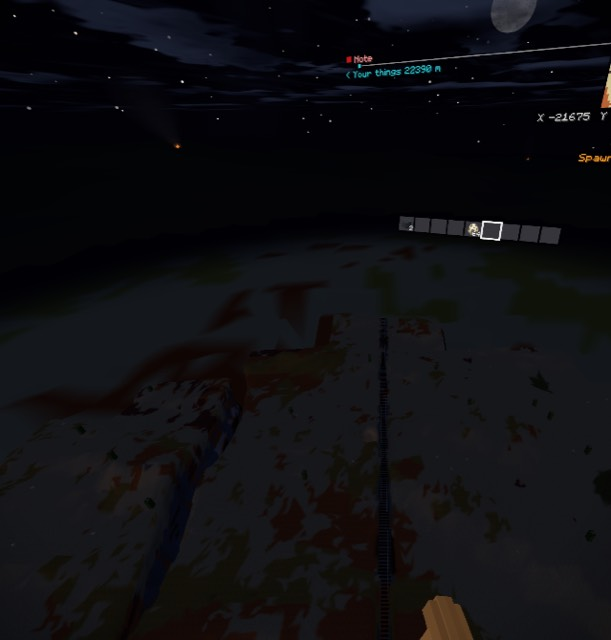

## 21:00:20 - That's alright.

- **Transcript:** That's alright.
- **Status:** open
- **Build:** 0.129 (26ceac53, M1-M4 (device-tested; ship riding, chests, comfort options, weapon wheel))
- **World:** New World (28) (seed 3084501862406496736)
- **Dimension:** Surface
- **Biome:** Desert
- **Position:** -21895.3 166.7 361.2
- **Facing:** south-west (yaw 207, pitch -56)
- **Held:** empty hand
- **Mount:** on foot, flying
- **Looking at:** nothing
- **Mode:** Creative, health 2/20
- **Time:** day 1 04:56, thunderstorm
- **Fps:** 71
- **Levels:** mic -30 dBFS, game sound -14 dBFS
- **Length:** 2.1 s (voice 0.7 s)
- **Just before:** -22s message: Entering Quelestad; -21s message: Entering Ithiesh; -18s walked into Lukewarm Ocean; -16s walked into Sunflower Plains; -14s walked into Plains; -13s message: Sky isle marked on the map; -10s walked into Desert
- **Repro (Mac):** `./snap.sh note --seed 3084501862406496736 --x -21895.3 --z 361.2 --yaw 153 --pitch -56 --time 0.956`
- **Audio (this Mac):** /Users/darthvadar/Documents/Blocksmith/QuestVoiceNotes/raw/vn-20261116-210020-214.aac

## 21:00:22 - It needs to conjoin cities and shit.

- **Transcript:** It needs to conjoin cities and shit.
- **Status:** open
- **Build:** 0.129 (26ceac53, M1-M4 (device-tested; ship riding, chests, comfort options, weapon wheel))
- **World:** New World (28) (seed 3084501862406496736)
- **Dimension:** Surface
- **Biome:** Savanna
- **Position:** -22105.8 166.7 383.0
- **Facing:** south (yaw 194, pitch -55)
- **Held:** empty hand
- **Mount:** on foot, flying
- **Looking at:** nothing
- **Mode:** Creative, health 2/20
- **Time:** day 1 04:59, thunderstorm
- **Fps:** 71
- **Levels:** mic -24 dBFS, game sound -19 dBFS
- **Length:** 4.3 s (voice 2.0 s)
- **Just before:** -25s message: Entering Quelestad; -23s message: Entering Ithiesh; -20s walked into Lukewarm Ocean; -18s walked into Sunflower Plains; -16s walked into Plains; -16s message: Sky isle marked on the map; -12s walked into Desert; -2s walked into Savanna; -2s message: Entering Kesamere
- **Repro (Mac):** `./snap.sh note --seed 3084501862406496736 --x -22105.8 --z 383.0 --yaw 166 --pitch -55 --time 0.958`
- **Audio (this Mac):** /Users/darthvadar/Documents/Blocksmith/QuestVoiceNotes/raw/vn-20261116-210022-814.aac

## 21:00:26 - That's why rail exists

- **Transcript:** That's why rail exists
- **Status:** open
- **Build:** 0.129 (26ceac53, M1-M4 (device-tested; ship riding, chests, comfort options, weapon wheel))
- **World:** New World (28) (seed 3084501862406496736)
- **Dimension:** Surface
- **Biome:** Savanna
- **Position:** -22101.4 166.7 269.5
- **Facing:** south-west (yaw 239, pitch -51)
- **Held:** empty hand
- **Mount:** on foot, flying
- **Looking at:** nothing
- **Mode:** Creative, health 2/20
- **Time:** day 1 05:04, thunderstorm
- **Fps:** 71
- **Levels:** mic -26 dBFS, game sound -16 dBFS
- **Length:** 3.3 s (voice 1.6 s)
- **Just before:** -29s message: Entering Quelestad; -27s message: Entering Ithiesh; -24s walked into Lukewarm Ocean; -22s walked into Sunflower Plains; -20s walked into Plains; -20s message: Sky isle marked on the map; -16s walked into Desert; -6s walked into Savanna; -6s message: Entering Kesamere; -0s walked into Plains
- **Repro (Mac):** `./snap.sh note --seed 3084501862406496736 --x -22101.4 --z 269.5 --yaw 121 --pitch -51 --time 0.961`
- **Audio (this Mac):** /Users/darthvadar/Documents/Blocksmith/QuestVoiceNotes/raw/vn-20261116-210026-894.aac

## 21:00:53 - All right, well here we go

- **Transcript:** All right, well here we go
- **Status:** open
- **Build:** 0.129 (26ceac53, M1-M4 (device-tested; ship riding, chests, comfort options, weapon wheel))
- **World:** Proving Grounds (seed 88314448595278)
- **Dimension:** Surface
- **Biome:** Taiga
- **Position:** 102.5 236.0 -3795.4
- **Facing:** south-east (yaw 155, pitch -51)
- **Held:** Grass Block x64
- **Mount:** on foot, flying
- **Looking at:** Smooth Stone at 103 235 -3795
- **Mode:** Creative, health 20/20
- **Time:** day 1 10:27, clear
- **Fps:** 69
- **Levels:** mic -31 dBFS, game sound -18 dBFS
- **Length:** 2.9 s (voice 1.5 s)
- **Just before:** --973s walked into Deep Lukewarm Ocean; --990s walked into Warm Ocean; --1008s message: Minnie Ingram: Cold one tonight. Wear a coat.; --1012s walked into Beach; --1014s walked into Plains; --1019s message: Flying; --1021s dismounted Minecart; --1022s walked into Sparse Jungle; --1028s walked into Forest; --1030s walked into Lukewarm Ocean; --1037s message: Entering Gorenesh; --1039s message: Sky isle marked on the map; --1040s walked into Deep Lukewarm Ocean; --1041s message: Entering Quelestad; --1043s message: Entering Gorenesh; --1044s walked into Ocean; --1048s walked into Beach; --1049s opened PauseMenu; --1051s closed PauseMenu; --1052s walked into Ocean; --1060s walked into Deep Lukewarm Ocean; --1070s message: Entering Quelestad; --1071s message: Entering Ithiesh; --1074s walked into Lukewarm Ocean; --1076s walked into Sunflower Plains; --1078s walked into Plains; --1079s message: Sky isle marked on the map; --1082s walked into Desert; --1092s walked into Savanna; --1093s message: Entering Kesamere; --1098s walked into Plains; --1100s walked into Savanna; --1101s message: Walking; --1102s message: Homestead marked on the map; --1104s message: A homestead, fenced against the wild. Someone's home.; --1110s message: Flying; --1116s opened PauseMenu; -1s closed PauseMenu; -1s holding Grass Block; -1s message: Proving Grounds: building round you
- **Repro (Mac):** `./snap.sh note --seed 88314448595278 --x 102.5 --z -3795.4 --yaw -155 --pitch -51 --time 0.186`
- **Audio (this Mac):** /Users/darthvadar/Documents/Blocksmith/QuestVoiceNotes/raw/vn-20261116-210053-334.aac

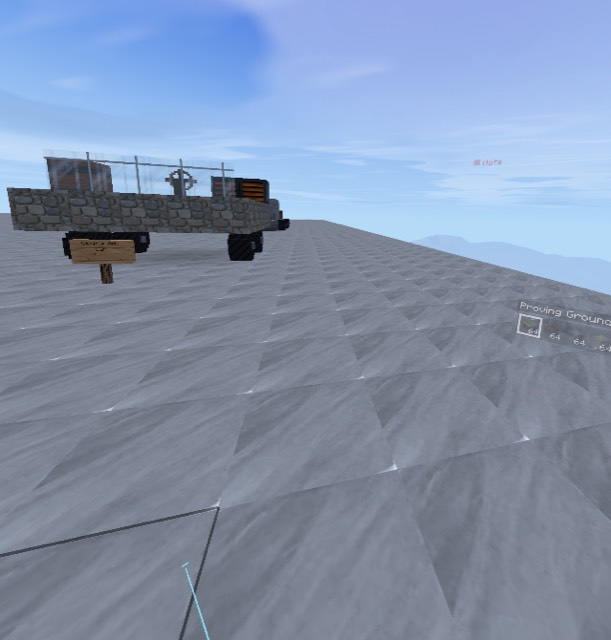

## 21:00:57 - Oh yeah, we're talking. Alright, so...

- **Transcript:** Oh yeah, we're talking. Alright, so...
- **Status:** open
- **Build:** 0.129 (26ceac53, M1-M4 (device-tested; ship riding, chests, comfort options, weapon wheel))
- **World:** Proving Grounds (seed 88314448595278)
- **Dimension:** Surface
- **Biome:** Taiga
- **Position:** 106.0 244.8 -3790.9
- **Facing:** east (yaw 97, pitch -28)
- **Held:** Grass Block x64
- **Mount:** on foot, flying
- **Looking at:** nothing
- **Mode:** Creative, health 20/20
- **Time:** day 1 10:32, clear
- **Fps:** 62
- **Levels:** mic -22 dBFS, game sound -25 dBFS
- **Length:** 3.7 s (voice 1.9 s)
- **Just before:** --1004s message: Minnie Ingram: Cold one tonight. Wear a coat.; --1008s walked into Beach; --1010s walked into Plains; --1015s message: Flying; --1017s dismounted Minecart; --1018s walked into Sparse Jungle; --1024s walked into Forest; --1026s walked into Lukewarm Ocean; --1033s message: Entering Gorenesh; --1035s message: Sky isle marked on the map; --1036s walked into Deep Lukewarm Ocean; --1037s message: Entering Quelestad; --1039s message: Entering Gorenesh; --1040s walked into Ocean; --1044s walked into Beach; --1045s opened PauseMenu; --1047s closed PauseMenu; --1048s walked into Ocean; --1056s walked into Deep Lukewarm Ocean; --1066s message: Entering Quelestad; --1067s message: Entering Ithiesh; --1070s walked into Lukewarm Ocean; --1072s walked into Sunflower Plains; --1074s walked into Plains; --1075s message: Sky isle marked on the map; --1078s walked into Desert; --1088s walked into Savanna; --1089s message: Entering Kesamere; --1094s walked into Plains; --1096s walked into Savanna; --1097s message: Walking; --1098s message: Homestead marked on the map; --1100s message: A homestead, fenced against the wild. Someone's home.; --1106s message: Flying; --1112s opened PauseMenu; -5s closed PauseMenu; -5s holding Grass Block; -5s message: Proving Grounds: building round you; -2s message: Walking; -1s message: Flying
- **Repro (Mac):** `./snap.sh note --seed 88314448595278 --x 106.0 --z -3790.9 --yaw -97 --pitch -28 --time 0.189`
- **Audio (this Mac):** /Users/darthvadar/Documents/Blocksmith/QuestVoiceNotes/raw/vn-20261116-210057-494.aac

## 21:01:02 - Let's see what we got going on here.

- **Transcript:** Let's see what we got going on here.
- **Status:** open
- **Build:** 0.129 (26ceac53, M1-M4 (device-tested; ship riding, chests, comfort options, weapon wheel))
- **World:** Proving Grounds (seed 88314448595278)
- **Dimension:** Surface
- **Biome:** Taiga
- **Position:** 106.1 245.1 -3818.3
- **Facing:** south-east (yaw 140, pitch -34)
- **Held:** Dirt x64
- **Mount:** on foot, flying
- **Looking at:** nothing
- **Mode:** Creative, health 20/20
- **Time:** day 1 10:39, clear
- **Fps:** 69
- **Levels:** mic -27 dBFS, game sound -21 dBFS
- **Length:** 3.2 s (voice 1.8 s)
- **Just before:** --1002s walked into Beach; --1004s walked into Plains; --1009s message: Flying; --1011s dismounted Minecart; --1012s walked into Sparse Jungle; --1018s walked into Forest; --1020s walked into Lukewarm Ocean; --1028s message: Entering Gorenesh; --1030s message: Sky isle marked on the map; --1031s walked into Deep Lukewarm Ocean; --1032s message: Entering Quelestad; --1034s message: Entering Gorenesh; --1035s walked into Ocean; --1039s walked into Beach; --1039s opened PauseMenu; --1041s closed PauseMenu; --1043s walked into Ocean; --1051s walked into Deep Lukewarm Ocean; --1060s message: Entering Quelestad; --1062s message: Entering Ithiesh; --1065s walked into Lukewarm Ocean; --1067s walked into Sunflower Plains; --1069s walked into Plains; --1069s message: Sky isle marked on the map; --1073s walked into Desert; --1083s walked into Savanna; --1084s message: Entering Kesamere; --1089s walked into Plains; --1091s walked into Savanna; --1091s message: Walking; --1093s message: Homestead marked on the map; --1095s message: A homestead, fenced against the wild. Someone's home.; --1101s message: Flying; --1106s opened PauseMenu; -11s closed PauseMenu; -11s holding Grass Block; -11s message: Proving Grounds: building round you; -7s message: Walking; -6s message: Flying; -4s holding Dirt
- **Repro (Mac):** `./snap.sh note --seed 88314448595278 --x 106.1 --z -3818.3 --yaw -140 --pitch -34 --time 0.194`
- **Audio (this Mac):** /Users/darthvadar/Documents/Blocksmith/QuestVoiceNotes/raw/vn-20261116-210102-854.aac

## 21:01:10 - I'll start with you, I guess.

- **Transcript:** I'll start with you, I guess.
- **Status:** open
- **Build:** 0.129 (26ceac53, M1-M4 (device-tested; ship riding, chests, comfort options, weapon wheel))
- **World:** Proving Grounds (seed 88314448595278)
- **Dimension:** Surface
- **Biome:** Taiga
- **Position:** 147.1 245.7 -3729.9
- **Facing:** south-east (yaw 154, pitch -59)
- **Held:** Dirt x64
- **Mount:** on foot
- **Looking at:** nothing
- **Mode:** Creative, health 20/20
- **Time:** day 1 10:47, clear
- **Fps:** 69
- **Levels:** mic -27 dBFS, game sound -20 dBFS
- **Length:** 2.4 s (voice 1.0 s)
- **Just before:** --997s walked into Plains; --1002s message: Flying; --1004s dismounted Minecart; --1005s walked into Sparse Jungle; --1011s walked into Forest; --1013s walked into Lukewarm Ocean; --1021s message: Entering Gorenesh; --1023s message: Sky isle marked on the map; --1023s walked into Deep Lukewarm Ocean; --1025s message: Entering Quelestad; --1027s message: Entering Gorenesh; --1027s walked into Ocean; --1031s walked into Beach; --1032s opened PauseMenu; --1034s closed PauseMenu; --1035s walked into Ocean; --1043s walked into Deep Lukewarm Ocean; --1053s message: Entering Quelestad; --1055s message: Entering Ithiesh; --1058s walked into Lukewarm Ocean; --1060s walked into Sunflower Plains; --1062s walked into Plains; --1062s message: Sky isle marked on the map; --1066s walked into Desert; --1076s walked into Savanna; --1076s message: Entering Kesamere; --1082s walked into Plains; --1084s walked into Savanna; --1084s message: Walking; --1086s message: Homestead marked on the map; --1088s message: A homestead, fenced against the wild. Someone's home.; --1094s message: Flying; --1099s opened PauseMenu; -18s closed PauseMenu; -18s holding Grass Block; -18s message: Proving Grounds: building round you; -14s message: Walking; -13s message: Flying; -11s holding Dirt; -0s message: Walking
- **Repro (Mac):** `./snap.sh note --seed 88314448595278 --x 147.1 --z -3729.9 --yaw -154 --pitch -59 --time 0.200`
- **Audio (this Mac):** /Users/darthvadar/Documents/Blocksmith/QuestVoiceNotes/raw/vn-20261116-210110-074.aac

## 21:01:20 - First of all the follow camera is inverted for this.

- **Transcript:** First of all the follow camera is inverted for this.
- **Status:** open
- **Build:** 0.129 (26ceac53, M1-M4 (device-tested; ship riding, chests, comfort options, weapon wheel))
- **World:** Proving Grounds (seed 88314448595278)
- **Dimension:** Surface
- **Biome:** Taiga
- **Position:** 150.5 238.1 -3728.3
- **Facing:** south-east (yaw 128, pitch -13)
- **Held:** empty hand
- **Mount:** piloting Ship
- **Looking at:** nothing
- **Mode:** Creative, health 20/20
- **Time:** day 1 11:00, clear
- **Fps:** 66
- **Levels:** mic -35 dBFS, game sound -16 dBFS
- **Length:** 5.8 s (voice 3.1 s)
- **Just before:** --1001s walked into Forest; --1003s walked into Lukewarm Ocean; --1010s message: Entering Gorenesh; --1012s message: Sky isle marked on the map; --1013s walked into Deep Lukewarm Ocean; --1014s message: Entering Quelestad; --1016s message: Entering Gorenesh; --1017s walked into Ocean; --1021s walked into Beach; --1022s opened PauseMenu; --1024s closed PauseMenu; --1025s walked into Ocean; --1033s walked into Deep Lukewarm Ocean; --1043s message: Entering Quelestad; --1044s message: Entering Ithiesh; --1047s walked into Lukewarm Ocean; --1049s walked into Sunflower Plains; --1051s walked into Plains; --1052s message: Sky isle marked on the map; --1055s walked into Desert; --1065s walked into Savanna; --1066s message: Entering Kesamere; --1071s walked into Plains; --1073s walked into Savanna; --1074s message: Walking; --1075s message: Homestead marked on the map; --1077s message: A homestead, fenced against the wild. Someone's home.; --1083s message: Flying; --1089s opened PauseMenu; -28s closed PauseMenu; -28s holding Grass Block; -28s message: Proving Grounds: building round you; -25s message: Walking; -23s message: Flying; -22s holding Dirt; -10s message: Walking; -9s message: Assembled 132 blocks (77.9 t, 1 turret); -9s piloting Ship; -9s holding empty hand; -7s message: Steering Ship
- **While talking:** --996s walked into Forest; --998s walked into Lukewarm Ocean; --1005s message: Entering Gorenesh; --1007s message: Sky isle marked on the map; --1008s walked into Deep Lukewarm Ocean; --1009s message: Entering Quelestad; --1011s message: Entering Gorenesh; --1012s walked into Ocean; --1016s walked into Beach; --1017s opened PauseMenu; --1019s closed PauseMenu; --1020s walked into Ocean; --1028s walked into Deep Lukewarm Ocean; --1038s message: Entering Quelestad; --1039s message: Entering Ithiesh; --1042s walked into Lukewarm Ocean; --1044s walked into Sunflower Plains; --1046s walked into Plains; --1047s message: Sky isle marked on the map; --1050s walked into Desert; --1060s walked into Savanna; --1061s message: Entering Kesamere; --1066s walked into Plains; --1068s walked into Savanna; --1069s message: Walking; --1070s message: Homestead marked on the map; --1072s message: A homestead, fenced against the wild. Someone's home.; --1078s message: Flying; --1084s opened PauseMenu
- **Position at the end:** 157.2 238.1 -3698.4
- **Repro (Mac):** `./snap.sh note --seed 88314448595278 --x 150.5 --z -3728.3 --yaw -128 --pitch -13 --time 0.208`
- **Audio (this Mac):** /Users/darthvadar/Documents/Blocksmith/QuestVoiceNotes/raw/vn-20261116-210120-354.aac

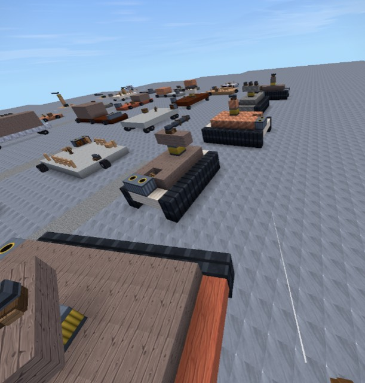

## 21:01:27 - So it was the shooting gun, so that's nice.

- **Transcript:** So it was the shooting gun, so that's nice.
- **Status:** open
- **Build:** 0.129 (26ceac53, M1-M4 (device-tested; ship riding, chests, comfort options, weapon wheel))
- **World:** Proving Grounds (seed 88314448595278)
- **Dimension:** Surface
- **Biome:** Taiga
- **Position:** 161.7 238.1 -3683.9
- **Facing:** east (yaw 73, pitch -20)
- **Held:** empty hand
- **Mount:** piloting Ship
- **Looking at:** nothing
- **Mode:** Creative, health 20/20
- **Time:** day 1 11:08, clear
- **Fps:** 68
- **Levels:** mic -23 dBFS, game sound -11 dBFS
- **Length:** 4.2 s (voice 2.6 s)
- **Just before:** --994s walked into Forest; --996s walked into Lukewarm Ocean; --1003s message: Entering Gorenesh; --1005s message: Sky isle marked on the map; --1006s walked into Deep Lukewarm Ocean; --1007s message: Entering Quelestad; --1009s message: Entering Gorenesh; --1010s walked into Ocean; --1014s walked into Beach; --1015s opened PauseMenu; --1017s closed PauseMenu; --1018s walked into Ocean; --1026s walked into Deep Lukewarm Ocean; --1035s message: Entering Quelestad; --1037s message: Entering Ithiesh; --1040s walked into Lukewarm Ocean; --1042s walked into Sunflower Plains; --1044s walked into Plains; --1045s message: Sky isle marked on the map; --1048s walked into Desert; --1058s walked into Savanna; --1059s message: Entering Kesamere; --1064s walked into Plains; --1066s walked into Savanna; --1067s message: Walking; --1068s message: Homestead marked on the map; --1070s message: A homestead, fenced against the wild. Someone's home.; --1076s message: Flying; --1082s opened PauseMenu; -29s holding Dirt; -18s message: Walking; -16s message: Assembled 132 blocks (77.9 t, 1 turret); -16s piloting Ship; -16s holding empty hand; -14s message: Steering Ship
- **Repro (Mac):** `./snap.sh note --seed 88314448595278 --x 161.7 --z -3683.9 --yaw -73 --pitch -20 --time 0.214`
- **Audio (this Mac):** /Users/darthvadar/Documents/Blocksmith/QuestVoiceNotes/raw/vn-20261116-210127-594.aac

## 21:01:33 - Also a thing.

- **Transcript:** Also a thing.
- **Status:** open
- **Build:** 0.129 (26ceac53, M1-M4 (device-tested; ship riding, chests, comfort options, weapon wheel))
- **World:** Proving Grounds (seed 88314448595278)
- **Dimension:** Surface
- **Biome:** Taiga
- **Position:** 174.2 239.3 -3655.6
- **Facing:** east (yaw 79, pitch -30)
- **Held:** Dirt x64
- **Mount:** on foot
- **Looking at:** nothing
- **Mode:** Creative, health 20/20
- **Time:** day 1 11:15, clear
- **Fps:** 68
- **Levels:** mic -27 dBFS, game sound -19 dBFS
- **Length:** 2.5 s (voice 1.0 s)
- **Just before:** --997s message: Entering Gorenesh; --999s message: Sky isle marked on the map; --1000s walked into Deep Lukewarm Ocean; --1001s message: Entering Quelestad; --1004s message: Entering Gorenesh; --1004s walked into Ocean; --1008s walked into Beach; --1009s opened PauseMenu; --1011s closed PauseMenu; --1012s walked into Ocean; --1020s walked into Deep Lukewarm Ocean; --1030s message: Entering Quelestad; --1032s message: Entering Ithiesh; --1034s walked into Lukewarm Ocean; --1036s walked into Sunflower Plains; --1038s walked into Plains; --1039s message: Sky isle marked on the map; --1042s walked into Desert; --1053s walked into Savanna; --1053s message: Entering Kesamere; --1059s walked into Plains; --1061s walked into Savanna; --1061s message: Walking; --1063s message: Homestead marked on the map; --1065s message: A homestead, fenced against the wild. Someone's home.; --1071s message: Flying; --1076s opened PauseMenu; -23s message: Walking; -22s message: Assembled 132 blocks (77.9 t, 1 turret); -21s piloting Ship; -21s holding empty hand; -19s message: Steering Ship; -2s stopped piloting Ship; -2s holding Dirt
- **Repro (Mac):** `./snap.sh note --seed 88314448595278 --x 174.2 --z -3655.6 --yaw -79 --pitch -30 --time 0.219`
- **Audio (this Mac):** /Users/darthvadar/Documents/Blocksmith/QuestVoiceNotes/raw/vn-20261116-210133-134.aac

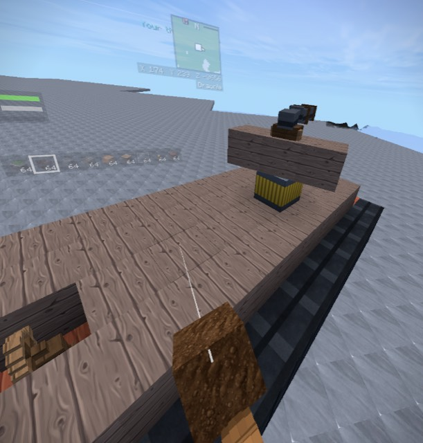

## 21:01:35 - Okay, whatever.

- **Transcript:** Okay, whatever.
- **Status:** open
- **Build:** 0.129 (26ceac53, M1-M4 (device-tested; ship riding, chests, comfort options, weapon wheel))
- **World:** Proving Grounds (seed 88314448595278)
- **Dimension:** Surface
- **Biome:** Taiga
- **Position:** 170.5 240.7 -3660.5
- **Facing:** east (yaw 68, pitch -31)
- **Held:** Dirt x64
- **Mount:** on foot, flying
- **Looking at:** nothing
- **Mode:** Creative, health 20/20
- **Time:** day 1 11:18, clear
- **Fps:** 69
- **Levels:** mic -33 dBFS, game sound -15 dBFS
- **Length:** 2.2 s (voice 0.8 s)
- **Just before:** --997s message: Sky isle marked on the map; --998s walked into Deep Lukewarm Ocean; --999s message: Entering Quelestad; --1001s message: Entering Gorenesh; --1002s walked into Ocean; --1006s walked into Beach; --1007s opened PauseMenu; --1009s closed PauseMenu; --1010s walked into Ocean; --1018s walked into Deep Lukewarm Ocean; --1028s message: Entering Quelestad; --1029s message: Entering Ithiesh; --1032s walked into Lukewarm Ocean; --1034s walked into Sunflower Plains; --1036s walked into Plains; --1037s message: Sky isle marked on the map; --1040s walked into Desert; --1050s walked into Savanna; --1051s message: Entering Kesamere; --1056s walked into Plains; --1058s walked into Savanna; --1059s message: Walking; --1060s message: Homestead marked on the map; --1062s message: A homestead, fenced against the wild. Someone's home.; --1068s message: Flying; --1074s opened PauseMenu; -25s message: Walking; -24s message: Assembled 132 blocks (77.9 t, 1 turret); -24s piloting Ship; -24s holding empty hand; -22s message: Steering Ship; -4s stopped piloting Ship; -4s holding Dirt; -1s message: Flying
- **Repro (Mac):** `./snap.sh note --seed 88314448595278 --x 170.5 --z -3660.5 --yaw -68 --pitch -31 --time 0.221`
- **Audio (this Mac):** /Users/darthvadar/Documents/Blocksmith/QuestVoiceNotes/raw/vn-20261116-210135-354.aac

## 21:01:37 - So I'm not very impressed by the variety of vehicles here.

- **Transcript:** So I'm not very impressed by the variety of vehicles here.
- **Status:** open
- **Build:** 0.129 (26ceac53, M1-M4 (device-tested; ship riding, chests, comfort options, weapon wheel))
- **World:** Proving Grounds (seed 88314448595278)
- **Dimension:** Surface
- **Biome:** Taiga
- **Position:** 172.7 240.7 -3722.8
- **Facing:** north-east (yaw 39, pitch -30)
- **Held:** Dirt x64
- **Mount:** on foot, flying
- **Looking at:** nothing
- **Mode:** Creative, health 20/20
- **Time:** day 1 11:20, clear
- **Fps:** 69
- **Levels:** mic -29 dBFS, game sound -12 dBFS
- **Length:** 5.0 s (voice 2.7 s)
- **Just before:** --995s message: Sky isle marked on the map; --996s walked into Deep Lukewarm Ocean; --997s message: Entering Quelestad; --999s message: Entering Gorenesh; --1000s walked into Ocean; --1004s walked into Beach; --1005s opened PauseMenu; --1007s closed PauseMenu; --1008s walked into Ocean; --1016s walked into Deep Lukewarm Ocean; --1025s message: Entering Quelestad; --1027s message: Entering Ithiesh; --1030s walked into Lukewarm Ocean; --1032s walked into Sunflower Plains; --1034s walked into Plains; --1034s message: Sky isle marked on the map; --1038s walked into Desert; --1048s walked into Savanna; --1049s message: Entering Kesamere; --1054s walked into Plains; --1056s walked into Savanna; --1057s message: Walking; --1058s message: Homestead marked on the map; --1060s message: A homestead, fenced against the wild. Someone's home.; --1066s message: Flying; --1072s opened PauseMenu; -28s message: Walking; -26s message: Assembled 132 blocks (77.9 t, 1 turret); -26s piloting Ship; -26s holding empty hand; -24s message: Steering Ship; -6s stopped piloting Ship; -6s holding Dirt; -4s message: Flying
- **Repro (Mac):** `./snap.sh note --seed 88314448595278 --x 172.7 --z -3722.8 --yaw -39 --pitch -30 --time 0.223`
- **Audio (this Mac):** /Users/darthvadar/Documents/Blocksmith/QuestVoiceNotes/raw/vn-20261116-210137-734.aac

## 21:01:44 - But yeah, clearly the following cameras inverted, so glad we caught th

- **Transcript:** But yeah, clearly the following cameras inverted, so glad we caught that.
- **Status:** open
- **Build:** 0.129 (26ceac53, M1-M4 (device-tested; ship riding, chests, comfort options, weapon wheel))
- **World:** Proving Grounds (seed 88314448595278)
- **Dimension:** Surface
- **Biome:** Taiga
- **Position:** 218.3 239.1 -3728.1
- **Facing:** south-west (yaw 237, pitch -66)
- **Held:** Dirt x64
- **Mount:** on foot
- **Looking at:** nothing
- **Mode:** Creative, health 20/20
- **Time:** day 1 11:29, clear
- **Fps:** 69
- **Levels:** mic -27 dBFS, game sound -17 dBFS
- **Length:** 5.3 s (voice 3.3 s)
- **Just before:** --990s message: Entering Quelestad; --992s message: Entering Gorenesh; --993s walked into Ocean; --997s walked into Beach; --998s opened PauseMenu; --1000s closed PauseMenu; --1001s walked into Ocean; --1009s walked into Deep Lukewarm Ocean; --1019s message: Entering Quelestad; --1020s message: Entering Ithiesh; --1023s walked into Lukewarm Ocean; --1025s walked into Sunflower Plains; --1027s walked into Plains; --1028s message: Sky isle marked on the map; --1031s walked into Desert; --1041s walked into Savanna; --1042s message: Entering Kesamere; --1047s walked into Plains; --1049s walked into Savanna; --1050s message: Walking; --1051s message: Homestead marked on the map; --1053s message: A homestead, fenced against the wild. Someone's home.; --1059s message: Flying; --1065s opened PauseMenu; -13s stopped piloting Ship; -13s holding Dirt; -10s message: Flying; -2s message: Walking; -0s message: Assembled 99 blocks (112.2 t, 1 turret)
- **Repro (Mac):** `./snap.sh note --seed 88314448595278 --x 218.3 --z -3728.1 --yaw 123 --pitch -66 --time 0.228`
- **Audio (this Mac):** /Users/darthvadar/Documents/Blocksmith/QuestVoiceNotes/raw/vn-20261116-210144-434.aac

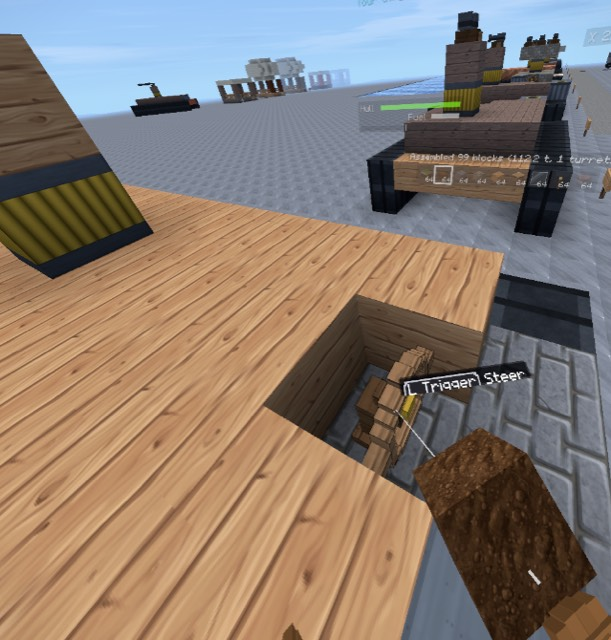

## 21:01:52 - Also, this is what cans are reduced to, we need some, we can't just ha

- **Transcript:** Also, this is what cans are reduced to, we need some, we can't just have a can, alright.
- **Status:** open
- **Build:** 0.129 (26ceac53, M1-M4 (device-tested; ship riding, chests, comfort options, weapon wheel))
- **World:** Proving Grounds (seed 88314448595278)
- **Dimension:** Surface
- **Biome:** Taiga
- **Position:** 223.0 240.6 -3685.6
- **Facing:** south-west (yaw 227, pitch -14)
- **Held:** Dirt x64
- **Mount:** on foot, flying
- **Looking at:** nothing
- **Mode:** Creative, health 20/20
- **Time:** day 1 11:39, clear
- **Fps:** 69
- **Levels:** mic -23 dBFS, game sound -15 dBFS
- **Length:** 7.3 s (voice 4.3 s)
- **Just before:** --993s walked into Ocean; --1001s walked into Deep Lukewarm Ocean; --1010s message: Entering Quelestad; --1012s message: Entering Ithiesh; --1015s walked into Lukewarm Ocean; --1017s walked into Sunflower Plains; --1019s walked into Plains; --1019s message: Sky isle marked on the map; --1023s walked into Desert; --1033s walked into Savanna; --1034s message: Entering Kesamere; --1039s walked into Plains; --1041s walked into Savanna; --1041s message: Walking; --1043s message: Homestead marked on the map; --1045s message: A homestead, fenced against the wild. Someone's home.; --1051s message: Flying; --1057s opened PauseMenu; -21s stopped piloting Ship; -21s holding Dirt; -19s message: Flying; -10s message: Walking; -9s message: Assembled 99 blocks (112.2 t, 1 turret); -8s piloting Ship; -8s holding empty hand; -6s message: Steering Ship; -2s stopped piloting Ship; -2s holding Dirt; -1s message: Flying
- **While talking:** --988s walked into Ocean; --996s walked into Deep Lukewarm Ocean; --1005s message: Entering Quelestad; --1007s message: Entering Ithiesh; --1010s walked into Lukewarm Ocean; --1012s walked into Sunflower Plains; --1014s walked into Plains; --1014s message: Sky isle marked on the map; --1018s walked into Desert; --1028s walked into Savanna; --1029s message: Entering Kesamere; --1034s walked into Plains; --1036s walked into Savanna; --1036s message: Walking; --1038s message: Homestead marked on the map; --1040s message: A homestead, fenced against the wild. Someone's home.; --1046s message: Flying; --1051s opened PauseMenu
- **Position at the end:** 220.7 241.6 -3683.8
- **Repro (Mac):** `./snap.sh note --seed 88314448595278 --x 223.0 --z -3685.6 --yaw 133 --pitch -14 --time 0.235`
- **Audio (this Mac):** /Users/darthvadar/Documents/Blocksmith/QuestVoiceNotes/raw/vn-20261116-210152-814.aac

## 21:01:59 - Like you gotta have a dispenser right now I can dispensers

- **Transcript:** Like you gotta have a dispenser right now I can dispensers
- **Status:** open
- **Build:** 0.129 (26ceac53, M1-M4 (device-tested; ship riding, chests, comfort options, weapon wheel))
- **World:** Proving Grounds (seed 88314448595278)
- **Dimension:** Surface
- **Biome:** Taiga
- **Position:** 220.7 241.6 -3683.8
- **Facing:** south-west (yaw 232, pitch 18)
- **Held:** Dirt x64
- **Mount:** on foot, flying
- **Looking at:** nothing
- **Mode:** Creative, health 20/20
- **Time:** day 1 11:47, clear
- **Fps:** 70
- **Levels:** mic -38 dBFS, game sound -16 dBFS
- **Length:** 6.1 s (voice 2.9 s)
- **Just before:** --986s walked into Ocean; --994s walked into Deep Lukewarm Ocean; --1003s message: Entering Quelestad; --1005s message: Entering Ithiesh; --1008s walked into Lukewarm Ocean; --1010s walked into Sunflower Plains; --1012s walked into Plains; --1012s message: Sky isle marked on the map; --1016s walked into Desert; --1026s walked into Savanna; --1027s message: Entering Kesamere; --1032s walked into Plains; --1034s walked into Savanna; --1035s message: Walking; --1036s message: Homestead marked on the map; --1038s message: A homestead, fenced against the wild. Someone's home.; --1044s message: Flying; --1050s opened PauseMenu; -28s stopped piloting Ship; -28s holding Dirt; -26s message: Flying; -17s message: Walking; -16s message: Assembled 99 blocks (112.2 t, 1 turret); -15s piloting Ship; -15s holding empty hand; -13s message: Steering Ship; -9s stopped piloting Ship; -9s holding Dirt; -8s message: Flying
- **While talking:** --981s walked into Ocean; --989s walked into Deep Lukewarm Ocean; --998s message: Entering Quelestad; --1000s message: Entering Ithiesh; --1003s walked into Lukewarm Ocean; --1005s walked into Sunflower Plains; --1007s walked into Plains; --1007s message: Sky isle marked on the map; --1011s walked into Desert; --1021s walked into Savanna; --1022s message: Entering Kesamere; --1027s walked into Plains; --1029s walked into Savanna; --1030s message: Walking; --1031s message: Homestead marked on the map; --1033s message: A homestead, fenced against the wild. Someone's home.; --1039s message: Flying; --1045s opened PauseMenu
- **Position at the end:** 208.5 241.6 -3704.2
- **Repro (Mac):** `./snap.sh note --seed 88314448595278 --x 220.7 --z -3683.8 --yaw 128 --pitch 18 --time 0.241`
- **Audio (this Mac):** /Users/darthvadar/Documents/Blocksmith/QuestVoiceNotes/raw/vn-20261116-210159-814.aac

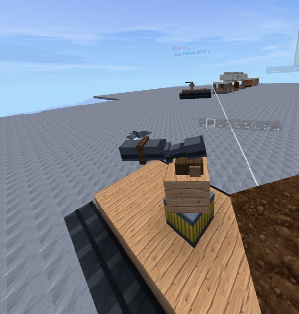

## 21:02:05 - Those are the things we're using.

- **Transcript:** Those are the things we're using.
- **Status:** open
- **Build:** 0.129 (26ceac53, M1-M4 (device-tested; ship riding, chests, comfort options, weapon wheel))
- **World:** Proving Grounds (seed 88314448595278)
- **Dimension:** Surface
- **Biome:** Taiga
- **Position:** 203.3 241.6 -3729.5
- **Facing:** north-west (yaw 314, pitch -21)
- **Held:** Dirt x64
- **Mount:** on foot, flying
- **Looking at:** nothing
- **Mode:** Creative, health 20/20
- **Time:** day 1 11:54, clear
- **Fps:** 70
- **Levels:** mic -24 dBFS, game sound -13 dBFS
- **Length:** 3.1 s (voice 1.7 s)
- **Just before:** --980s walked into Ocean; --988s walked into Deep Lukewarm Ocean; --997s message: Entering Quelestad; --999s message: Entering Ithiesh; --1002s walked into Lukewarm Ocean; --1004s walked into Sunflower Plains; --1006s walked into Plains; --1006s message: Sky isle marked on the map; --1010s walked into Desert; --1020s walked into Savanna; --1020s message: Entering Kesamere; --1026s walked into Plains; --1028s walked into Savanna; --1028s message: Walking; --1030s message: Homestead marked on the map; --1032s message: A homestead, fenced against the wild. Someone's home.; --1038s message: Flying; --1043s opened PauseMenu; -23s message: Walking; -22s message: Assembled 99 blocks (112.2 t, 1 turret); -21s piloting Ship; -21s holding empty hand; -19s message: Steering Ship; -15s stopped piloting Ship; -15s holding Dirt; -14s message: Flying
- **Repro (Mac):** `./snap.sh note --seed 88314448595278 --x 203.3 --z -3729.5 --yaw 46 --pitch -21 --time 0.246`
- **Audio (this Mac):** /Users/darthvadar/Documents/Blocksmith/QuestVoiceNotes/raw/vn-20261116-210205-874.aac

## 21:02:09 - I can't, so we use cans for everything here. Do it, no way.

- **Transcript:** I can't, so we use cans for everything here. Do it, no way.
- **Status:** open
- **Build:** 0.129 (26ceac53, M1-M4 (device-tested; ship riding, chests, comfort options, weapon wheel))
- **World:** Proving Grounds (seed 88314448595278)
- **Dimension:** Surface
- **Biome:** Taiga
- **Position:** 193.9 241.6 -3722.9
- **Facing:** north-west (yaw 300, pitch -17)
- **Held:** Dirt x64
- **Mount:** on foot, flying
- **Looking at:** nothing
- **Mode:** Creative, health 20/20
- **Time:** day 1 11:58, clear
- **Fps:** 70
- **Levels:** mic -42 dBFS, game sound -10 dBFS
- **Length:** 4.3 s (voice 2.4 s)
- **Just before:** --976s walked into Ocean; --984s walked into Deep Lukewarm Ocean; --994s message: Entering Quelestad; --995s message: Entering Ithiesh; --998s walked into Lukewarm Ocean; --1000s walked into Sunflower Plains; --1002s walked into Plains; --1003s message: Sky isle marked on the map; --1006s walked into Desert; --1016s walked into Savanna; --1017s message: Entering Kesamere; --1022s walked into Plains; --1024s walked into Savanna; --1025s message: Walking; --1026s message: Homestead marked on the map; --1028s message: A homestead, fenced against the wild. Someone's home.; --1034s message: Flying; --1040s opened PauseMenu; -27s message: Walking; -25s message: Assembled 99 blocks (112.2 t, 1 turret); -25s piloting Ship; -25s holding empty hand; -23s message: Steering Ship; -18s stopped piloting Ship; -18s holding Dirt; -17s message: Flying
- **Repro (Mac):** `./snap.sh note --seed 88314448595278 --x 193.9 --z -3722.9 --yaw 60 --pitch -17 --time 0.249`
- **Audio (this Mac):** /Users/darthvadar/Documents/Blocksmith/QuestVoiceNotes/raw/vn-20261116-210209-294.aac

## 21:02:13 - What is this?

- **Transcript:** What is this?
- **Status:** open
- **Build:** 0.129 (26ceac53, M1-M4 (device-tested; ship riding, chests, comfort options, weapon wheel))
- **World:** Proving Grounds (seed 88314448595278)
- **Dimension:** Surface
- **Biome:** Taiga
- **Position:** 178.2 238.1 -3743.3
- **Facing:** north-west (yaw 330, pitch -47)
- **Held:** Dirt x64
- **Mount:** on foot
- **Looking at:** nothing
- **Mode:** Creative, health 20/20
- **Time:** day 1 12:04, clear
- **Fps:** 72
- **Levels:** mic -31 dBFS, game sound -12 dBFS
- **Length:** 2.0 s (voice 0.6 s)
- **Just before:** --989s message: Entering Quelestad; --991s message: Entering Ithiesh; --994s walked into Lukewarm Ocean; --996s walked into Sunflower Plains; --998s walked into Plains; --998s message: Sky isle marked on the map; --1002s walked into Desert; --1012s walked into Savanna; --1013s message: Entering Kesamere; --1018s walked into Plains; --1020s walked into Savanna; --1020s message: Walking; --1022s message: Homestead marked on the map; --1024s message: A homestead, fenced against the wild. Someone's home.; --1030s message: Flying; --1035s opened PauseMenu; -30s message: Assembled 99 blocks (112.2 t, 1 turret); -29s piloting Ship; -29s holding empty hand; -27s message: Steering Ship; -23s stopped piloting Ship; -23s holding Dirt; -22s message: Flying; -2s message: Proving Grounds: building, 25%; -0s message: Walking
- **Repro (Mac):** `./snap.sh note --seed 88314448595278 --x 178.2 --z -3743.3 --yaw 30 --pitch -47 --time 0.253`
- **Audio (this Mac):** /Users/darthvadar/Documents/Blocksmith/QuestVoiceNotes/raw/vn-20261116-210213-834.aac

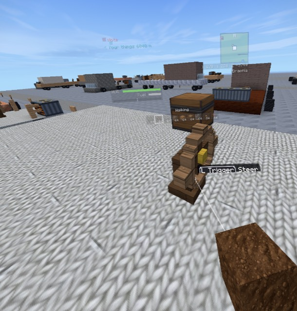

## 21:02:17 - This is it. Okay.

- **Transcript:** This is it. Okay.
- **Status:** open
- **Build:** 0.129 (26ceac53, M1-M4 (device-tested; ship riding, chests, comfort options, weapon wheel))
- **World:** Proving Grounds (seed 88314448595278)
- **Dimension:** Surface
- **Biome:** Taiga
- **Position:** 171.0 238.1 -3745.1
- **Facing:** west (yaw 284, pitch -21)
- **Held:** empty hand
- **Mount:** piloting Ship
- **Looking at:** nothing
- **Mode:** Creative, health 20/20
- **Time:** day 1 12:08, clear
- **Fps:** 67
- **Levels:** mic -40 dBFS, game sound -20 dBFS
- **Length:** 2.7 s (voice 0.7 s)
- **Just before:** --994s walked into Plains; --995s message: Sky isle marked on the map; --998s walked into Desert; --1009s walked into Savanna; --1009s message: Entering Kesamere; --1015s walked into Plains; --1017s walked into Savanna; --1017s message: Walking; --1019s message: Homestead marked on the map; --1021s message: A homestead, fenced against the wild. Someone's home.; --1027s message: Flying; --1032s opened PauseMenu; -26s stopped piloting Ship; -26s holding Dirt; -25s message: Flying; -6s message: Proving Grounds: building, 25%; -4s message: Walking; -3s piloting Ship; -3s holding empty hand; -2s message: Assembled 65 blocks (14.7 t); -0s message: Steering Ship
- **Repro (Mac):** `./snap.sh note --seed 88314448595278 --x 171.0 --z -3745.1 --yaw 76 --pitch -21 --time 0.256`
- **Audio (this Mac):** /Users/darthvadar/Documents/Blocksmith/QuestVoiceNotes/raw/vn-20261116-210217-174.aac

## 21:02:20 - You know what the hell that thing is.

- **Transcript:** You know what the hell that thing is.
- **Status:** open
- **Build:** 0.129 (26ceac53, M1-M4 (device-tested; ship riding, chests, comfort options, weapon wheel))
- **World:** Proving Grounds (seed 88314448595278)
- **Dimension:** Surface
- **Biome:** Taiga
- **Position:** 171.1 238.1 -3745.2
- **Facing:** west (yaw 277, pitch -37)
- **Held:** empty hand
- **Mount:** piloting Ship
- **Looking at:** nothing
- **Mode:** Creative, health 20/20
- **Time:** day 1 12:11, clear
- **Fps:** 70
- **Levels:** mic -32 dBFS, game sound -18 dBFS
- **Length:** 2.7 s (voice 1.1 s)
- **Just before:** --991s walked into Plains; --992s message: Sky isle marked on the map; --995s walked into Desert; --1005s walked into Savanna; --1006s message: Entering Kesamere; --1011s walked into Plains; --1013s walked into Savanna; --1014s message: Walking; --1015s message: Homestead marked on the map; --1017s message: A homestead, fenced against the wild. Someone's home.; --1023s message: Flying; --1029s opened PauseMenu; -29s stopped piloting Ship; -29s holding Dirt; -28s message: Flying; -9s message: Proving Grounds: building, 25%; -7s message: Walking; -6s piloting Ship; -6s holding empty hand; -5s message: Assembled 65 blocks (14.7 t); -3s message: Steering Ship
- **Repro (Mac):** `./snap.sh note --seed 88314448595278 --x 171.1 --z -3745.2 --yaw 83 --pitch -37 --time 0.258`
- **Audio (this Mac):** /Users/darthvadar/Documents/Blocksmith/QuestVoiceNotes/raw/vn-20261116-210220-294.aac

## 21:02:23 - This was supposed to be a truck.

- **Transcript:** This was supposed to be a truck.
- **Status:** open
- **Build:** 0.129 (26ceac53, M1-M4 (device-tested; ship riding, chests, comfort options, weapon wheel))
- **World:** Proving Grounds (seed 88314448595278)
- **Dimension:** Surface
- **Biome:** Taiga
- **Position:** 177.2 238.0 -3755.5
- **Facing:** north (yaw 345, pitch -53)
- **Held:** Dirt x64
- **Mount:** on foot
- **Looking at:** Ship Helm at 176 237 -3758
- **Mode:** Creative, health 20/20
- **Time:** day 1 12:15, clear
- **Fps:** 70
- **Levels:** mic -41 dBFS, game sound -14 dBFS
- **Length:** 2.2 s (voice 0.4 s)
- **Just before:** --1003s message: Entering Kesamere; --1009s walked into Plains; --1011s walked into Savanna; --1011s message: Walking; --1013s message: Homestead marked on the map; --1015s message: A homestead, fenced against the wild. Someone's home.; --1021s message: Flying; --1026s opened PauseMenu; -12s message: Proving Grounds: building, 25%; -10s message: Walking; -9s piloting Ship; -9s holding empty hand; -8s message: Assembled 65 blocks (14.7 t); -6s message: Steering Ship; -2s stopped piloting Ship; -2s holding Dirt; -2s message: Flying; -0s message: Walking
- **Repro (Mac):** `./snap.sh note --seed 88314448595278 --x 177.2 --z -3755.5 --yaw 15 --pitch -53 --time 0.261`
- **Audio (this Mac):** /Users/darthvadar/Documents/Blocksmith/QuestVoiceNotes/raw/vn-20261116-210223-014.aac

## 21:02:30 - Yeah, it says things probably inverted.

- **Transcript:** Yeah, it says things probably inverted.
- **Status:** open
- **Build:** 0.129 (26ceac53, M1-M4 (device-tested; ship riding, chests, comfort options, weapon wheel))
- **World:** Proving Grounds (seed 88314448595278)
- **Dimension:** Surface
- **Biome:** Taiga
- **Position:** 177.9 237.2 -3774.3
- **Facing:** west (yaw 265, pitch -30)
- **Held:** empty hand
- **Mount:** piloting Ship
- **Looking at:** nothing
- **Mode:** Creative, health 20/20
- **Time:** day 1 12:23, clear
- **Fps:** 70
- **Levels:** mic -41 dBFS, game sound -17 dBFS
- **Length:** 3.8 s (voice 2.0 s)
- **Just before:** --1006s message: Homestead marked on the map; --1008s message: A homestead, fenced against the wild. Someone's home.; --1014s message: Flying; --1019s opened PauseMenu; -19s message: Proving Grounds: building, 25%; -17s message: Walking; -16s piloting Ship; -16s holding empty hand; -15s message: Assembled 65 blocks (14.7 t); -13s message: Steering Ship; -9s stopped piloting Ship; -9s holding Dirt; -9s message: Flying; -7s message: Walking; -6s piloting Ship; -6s holding empty hand; -6s message: Assembled 142 blocks (84.8 t); -4s message: Steering Ship
- **Repro (Mac):** `./snap.sh note --seed 88314448595278 --x 177.9 --z -3774.3 --yaw 95 --pitch -30 --time 0.266`
- **Audio (this Mac):** /Users/darthvadar/Documents/Blocksmith/QuestVoiceNotes/raw/vn-20261116-210230-014.aac

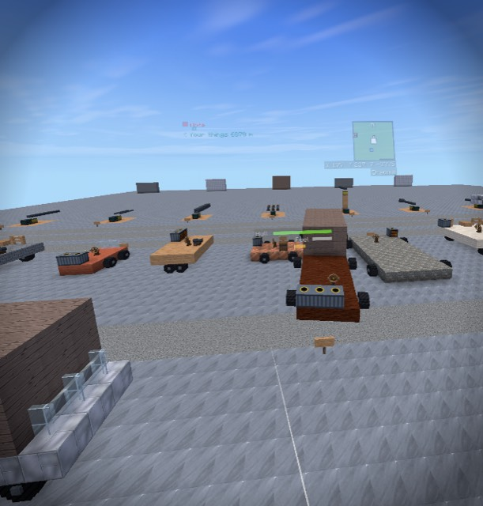

## 21:02:34 - I don't know, maybe not.

- **Transcript:** I don't know, maybe not.
- **Status:** open
- **Build:** 0.129 (26ceac53, M1-M4 (device-tested; ship riding, chests, comfort options, weapon wheel))
- **World:** Proving Grounds (seed 88314448595278)
- **Dimension:** Surface
- **Biome:** Taiga
- **Position:** 179.9 237.1 -3792.6
- **Facing:** south-west (yaw 215, pitch -17)
- **Held:** empty hand
- **Mount:** piloting Ship
- **Looking at:** nothing
- **Mode:** Creative, health 20/20
- **Time:** day 1 12:29, clear
- **Fps:** 70
- **Levels:** mic -23 dBFS, game sound -20 dBFS
- **Length:** 2.4 s (voice 1.0 s)
- **Just before:** --1001s message: Homestead marked on the map; --1003s message: A homestead, fenced against the wild. Someone's home.; --1009s message: Flying; --1015s opened PauseMenu; -23s message: Proving Grounds: building, 25%; -21s message: Walking; -20s piloting Ship; -20s holding empty hand; -20s message: Assembled 65 blocks (14.7 t); -18s message: Steering Ship; -14s stopped piloting Ship; -14s holding Dirt; -13s message: Flying; -12s message: Walking; -11s piloting Ship; -11s holding empty hand; -10s message: Assembled 142 blocks (84.8 t); -8s message: Steering Ship
- **Repro (Mac):** `./snap.sh note --seed 88314448595278 --x 179.9 --z -3792.6 --yaw 145 --pitch -17 --time 0.270`
- **Audio (this Mac):** /Users/darthvadar/Documents/Blocksmith/QuestVoiceNotes/raw/vn-20261116-210234-574.aac

## 21:02:38 - I can't tell

- **Transcript:** I can't tell
- **Status:** open
- **Build:** 0.129 (26ceac53, M1-M4 (device-tested; ship riding, chests, comfort options, weapon wheel))
- **World:** Proving Grounds (seed 88314448595278)
- **Dimension:** Surface
- **Biome:** Taiga
- **Position:** 191.6 237.1 -3840.1
- **Facing:** north-east (yaw 23, pitch -16)
- **Held:** empty hand
- **Mount:** piloting Ship
- **Looking at:** nothing
- **Mode:** Creative, health 20/20
- **Time:** day 1 12:33, clear
- **Fps:** 72
- **Levels:** mic -35 dBFS, game sound -16 dBFS
- **Length:** 3.3 s (voice 1.1 s)
- **Just before:** --998s message: Homestead marked on the map; --1000s message: A homestead, fenced against the wild. Someone's home.; --1006s message: Flying; --1011s opened PauseMenu; -27s message: Proving Grounds: building, 25%; -25s message: Walking; -24s piloting Ship; -24s holding empty hand; -23s message: Assembled 65 blocks (14.7 t); -21s message: Steering Ship; -17s stopped piloting Ship; -17s holding Dirt; -17s message: Flying; -15s message: Walking; -14s piloting Ship; -14s holding empty hand; -14s message: Assembled 142 blocks (84.8 t); -12s message: Steering Ship
- **Repro (Mac):** `./snap.sh note --seed 88314448595278 --x 191.6 --z -3840.1 --yaw -23 --pitch -16 --time 0.273`
- **Audio (this Mac):** /Users/darthvadar/Documents/Blocksmith/QuestVoiceNotes/raw/vn-20261116-210238-154.aac

## 21:02:46 - As you can see here... Oh, whoa!

- **Transcript:** As you can see here... Oh, whoa!
- **Status:** open
- **Build:** 0.129 (26ceac53, M1-M4 (device-tested; ship riding, chests, comfort options, weapon wheel))
- **World:** Proving Grounds (seed 88314448595278)
- **Dimension:** Surface
- **Biome:** Taiga
- **Position:** 231.5 241.2 -3804.8
- **Facing:** east (yaw 76, pitch -37)
- **Held:** Dirt x64
- **Mount:** on foot
- **Looking at:** nothing
- **Mode:** Creative, health 20/20
- **Time:** day 1 12:43, clear
- **Fps:** 72
- **Levels:** mic -22 dBFS, game sound -18 dBFS
- **Length:** 4.3 s (voice 2.8 s)
- **Just before:** -30s message: Steering Ship; -26s stopped piloting Ship; -26s holding Dirt; -25s message: Flying; -24s message: Walking; -23s piloting Ship; -23s holding empty hand; -23s message: Assembled 142 blocks (84.8 t); -21s message: Steering Ship; -4s stopped piloting Ship; -4s holding Dirt; -2s message: Flying; -0s message: Walking
- **Repro (Mac):** `./snap.sh note --seed 88314448595278 --x 231.5 --z -3804.8 --yaw -76 --pitch -37 --time 0.280`
- **Audio (this Mac):** /Users/darthvadar/Documents/Blocksmith/QuestVoiceNotes/raw/vn-20261116-210246-894.aac

## 21:02:51 - Oh, that's cool.

- **Transcript:** Oh, that's cool.
- **Status:** open
- **Build:** 0.129 (26ceac53, M1-M4 (device-tested; ship riding, chests, comfort options, weapon wheel))
- **World:** Proving Grounds (seed 88314448595278)
- **Dimension:** Surface
- **Biome:** Taiga
- **Position:** 236.5 236.0 -3807.4
- **Facing:** north (yaw 345, pitch 1)
- **Held:** empty hand
- **Mount:** piloting Ship
- **Looking at:** nothing
- **Mode:** Creative, health 20/20
- **Time:** day 1 12:48, clear
- **Fps:** 70
- **Levels:** mic -31 dBFS, game sound -11 dBFS
- **Length:** 2.4 s (voice 1.0 s)
- **Just before:** -30s message: Flying; -28s message: Walking; -27s piloting Ship; -27s holding empty hand; -27s message: Assembled 142 blocks (84.8 t); -25s message: Steering Ship; -8s stopped piloting Ship; -8s holding Dirt; -6s message: Flying; -4s message: Walking; -3s piloting Ship; -3s holding empty hand; -3s message: Steering Ship; -1s message: Gun Control: your gun, worked from this computer
- **Repro (Mac):** `./snap.sh note --seed 88314448595278 --x 236.5 --z -3807.4 --yaw 15 --pitch 1 --time 0.284`
- **Audio (this Mac):** /Users/darthvadar/Documents/Blocksmith/QuestVoiceNotes/raw/vn-20261116-210251-054.aac

## 21:02:54 - I mean, it's neat. I just don't know how you did that.

- **Transcript:** I mean, it's neat. I just don't know how you did that.
- **Status:** open
- **Build:** 0.129 (26ceac53, M1-M4 (device-tested; ship riding, chests, comfort options, weapon wheel))
- **World:** Proving Grounds (seed 88314448595278)
- **Dimension:** Surface
- **Biome:** Taiga
- **Position:** 235.5 236.0 -3807.4
- **Facing:** north (yaw 5, pitch -9)
- **Held:** Dirt x64
- **Mount:** on foot
- **Looking at:** nothing
- **Mode:** Creative, health 20/20
- **Time:** day 1 12:52, clear
- **Fps:** 70
- **Levels:** mic -23 dBFS, game sound -17 dBFS
- **Length:** 4.4 s (voice 2.7 s)
- **Just before:** -28s message: Steering Ship; -11s stopped piloting Ship; -11s holding Dirt; -10s message: Flying; -8s message: Walking; -7s piloting Ship; -7s holding empty hand; -6s message: Steering Ship; -5s message: Gun Control: your gun, worked from this computer; -0s stopped piloting Ship; -0s holding Dirt
- **Repro (Mac):** `./snap.sh note --seed 88314448595278 --x 235.5 --z -3807.4 --yaw -5 --pitch -9 --time 0.287`
- **Audio (this Mac):** /Users/darthvadar/Documents/Blocksmith/QuestVoiceNotes/raw/vn-20261116-210254-374.aac

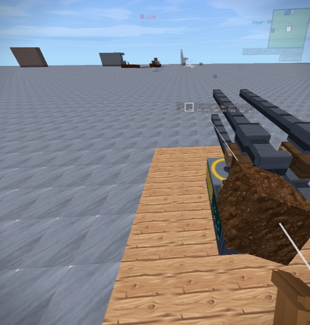

## 21:02:58 - Wow, okay, interesting. Just turn it into dispensers or something, but

- **Transcript:** Wow, okay, interesting. Just turn it into dispensers or something, but I want you some more logic. This gun would fuck things up.
- **Status:** open
- **Build:** 0.129 (26ceac53, M1-M4 (device-tested; ship riding, chests, comfort options, weapon wheel))
- **World:** Proving Grounds (seed 88314448595278)
- **Dimension:** Surface
- **Biome:** Taiga
- **Position:** 233.1 236.0 -3805.7
- **Facing:** north-east (yaw 65, pitch -14)
- **Held:** Dirt x64
- **Mount:** on foot
- **Looking at:** nothing
- **Mode:** Creative, health 20/20
- **Time:** day 1 12:58, clear
- **Fps:** 70
- **Levels:** mic -27 dBFS, game sound -15 dBFS
- **Length:** 9.9 s (voice 5.5 s)
- **Just before:** -16s stopped piloting Ship; -16s holding Dirt; -14s message: Flying; -12s message: Walking; -11s piloting Ship; -11s holding empty hand; -11s message: Steering Ship; -9s message: Gun Control: your gun, worked from this computer; -5s stopped piloting Ship; -5s holding Dirt; -4s piloting Ship; -4s holding empty hand; -4s message: Steering Ship; -2s stopped piloting Ship; -2s holding Dirt
- **Position at the end:** 235.7 236.0 -3804.1
- **Repro (Mac):** `./snap.sh note --seed 88314448595278 --x 233.1 --z -3805.7 --yaw -65 --pitch -14 --time 0.290`
- **Audio (this Mac):** /Users/darthvadar/Documents/Blocksmith/QuestVoiceNotes/raw/vn-20261116-210258-894.aac

## 21:03:11 - It was this window

- **Transcript:** It was this window
- **Status:** open
- **Build:** 0.129 (26ceac53, M1-M4 (device-tested; ship riding, chests, comfort options, weapon wheel))
- **World:** Proving Grounds (seed 88314448595278)
- **Dimension:** Surface
- **Biome:** Taiga
- **Position:** 252.5 236.0 -3807.4
- **Facing:** north-east (yaw 65, pitch -7)
- **Held:** empty hand
- **Mount:** piloting Ship
- **Looking at:** nothing
- **Mode:** Creative, health 20/20
- **Time:** day 1 13:13, clear
- **Fps:** 72
- **Levels:** mic -34 dBFS, game sound -20 dBFS
- **Length:** 2.2 s (voice 0.7 s)
- **Just before:** -28s stopped piloting Ship; -28s holding Dirt; -27s message: Flying; -25s message: Walking; -24s piloting Ship; -24s holding empty hand; -23s message: Steering Ship; -22s message: Gun Control: your gun, worked from this computer; -17s stopped piloting Ship; -17s holding Dirt; -16s piloting Ship; -16s holding empty hand; -16s message: Steering Ship; -14s stopped piloting Ship; -14s holding Dirt; -6s piloting Ship; -6s holding empty hand; -3s stopped piloting Ship; -3s holding Dirt; -0s piloting Ship; -0s holding empty hand
- **Repro (Mac):** `./snap.sh note --seed 88314448595278 --x 252.5 --z -3807.4 --yaw -65 --pitch -7 --time 0.301`
- **Audio (this Mac):** /Users/darthvadar/Documents/Blocksmith/QuestVoiceNotes/raw/vn-20261116-210311-674.aac

## 21:03:20 - This is a what?

- **Transcript:** This is a what?
- **Status:** open
- **Build:** 0.129 (26ceac53, M1-M4 (device-tested; ship riding, chests, comfort options, weapon wheel))
- **World:** Proving Grounds (seed 88314448595278)
- **Dimension:** Surface
- **Biome:** Taiga
- **Position:** 221.7 241.5 -3803.8
- **Facing:** north (yaw 348, pitch -41)
- **Held:** Dirt x64
- **Mount:** on foot, flying
- **Looking at:** nothing
- **Mode:** Creative, health 20/20
- **Time:** day 1 13:23, clear
- **Fps:** 71
- **Levels:** mic -27 dBFS, game sound -18 dBFS
- **Length:** 3.1 s (voice 1.4 s)
- **Just before:** -26s stopped piloting Ship; -26s holding Dirt; -25s piloting Ship; -25s holding empty hand; -25s message: Steering Ship; -23s stopped piloting Ship; -23s holding Dirt; -15s piloting Ship; -15s holding empty hand; -11s stopped piloting Ship; -11s holding Dirt; -9s piloting Ship; -9s holding empty hand; -7s message: Gun Control: your gun, worked from this computer; -4s stopped piloting Ship; -4s holding Dirt; -1s message: Flying
- **Repro (Mac):** `./snap.sh note --seed 88314448595278 --x 221.7 --z -3803.8 --yaw 12 --pitch -41 --time 0.308`
- **Audio (this Mac):** /Users/darthvadar/Documents/Blocksmith/QuestVoiceNotes/raw/vn-20261116-210320-094.aac

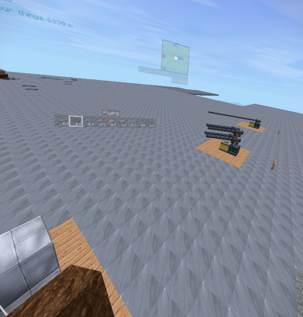

## 21:03:27 - So what barrel size that was changed about

- **Transcript:** So what barrel size that was changed about
- **Status:** open
- **Build:** 0.129 (26ceac53, M1-M4 (device-tested; ship riding, chests, comfort options, weapon wheel))
- **World:** Proving Grounds (seed 88314448595278)
- **Dimension:** Surface
- **Biome:** Taiga
- **Position:** 220.5 236.0 -3807.4
- **Facing:** north (yaw 347, pitch 1)
- **Held:** empty hand
- **Mount:** piloting Ship
- **Looking at:** nothing
- **Mode:** Creative, health 20/20
- **Time:** day 1 13:32, clear
- **Fps:** 71
- **Levels:** mic -36 dBFS, game sound -18 dBFS
- **Length:** 3.6 s (voice 1.7 s)
- **Just before:** -30s stopped piloting Ship; -30s holding Dirt; -22s piloting Ship; -22s holding empty hand; -18s stopped piloting Ship; -18s holding Dirt; -16s piloting Ship; -16s holding empty hand; -14s message: Gun Control: your gun, worked from this computer; -11s stopped piloting Ship; -11s holding Dirt; -8s message: Flying; -7s message: Walking; -6s piloting Ship; -6s holding empty hand; -5s message: Steering Ship; -4s message: Gun Control: your gun, worked from this computer
- **Repro (Mac):** `./snap.sh note --seed 88314448595278 --x 220.5 --z -3807.4 --yaw 13 --pitch 1 --time 0.314`
- **Audio (this Mac):** /Users/darthvadar/Documents/Blocksmith/QuestVoiceNotes/raw/vn-20261116-210327-074.aac

## 21:03:33 - This is a huge barrel

- **Transcript:** This is a huge barrel
- **Status:** open
- **Build:** 0.129 (26ceac53, M1-M4 (device-tested; ship riding, chests, comfort options, weapon wheel))
- **World:** Proving Grounds (seed 88314448595278)
- **Dimension:** Surface
- **Biome:** Taiga
- **Position:** 204.5 236.0 -3807.4
- **Facing:** north-west (yaw 324, pitch -5)
- **Held:** empty hand
- **Mount:** piloting Ship
- **Looking at:** nothing
- **Mode:** Creative, health 20/20
- **Time:** day 1 13:39, clear
- **Fps:** 71
- **Levels:** mic -39 dBFS, game sound -16 dBFS
- **Length:** 2.6 s (voice 1.1 s)
- **Just before:** -28s piloting Ship; -28s holding empty hand; -25s stopped piloting Ship; -25s holding Dirt; -22s piloting Ship; -22s holding empty hand; -21s message: Gun Control: your gun, worked from this computer; -18s stopped piloting Ship; -18s holding Dirt; -15s message: Flying; -13s message: Walking; -12s piloting Ship; -12s holding empty hand; -12s message: Steering Ship; -10s message: Gun Control: your gun, worked from this computer; -5s stopped piloting Ship; -5s holding Dirt; -0s piloting Ship; -0s holding empty hand; -0s message: Steering Ship
- **Repro (Mac):** `./snap.sh note --seed 88314448595278 --x 204.5 --z -3807.4 --yaw 36 --pitch -5 --time 0.319`
- **Audio (this Mac):** /Users/darthvadar/Documents/Blocksmith/QuestVoiceNotes/raw/vn-20261116-210333-654.aac

## 21:03:35 - Oh, wow. Okay.

- **Transcript:** Oh, wow. Okay.
- **Status:** open
- **Build:** 0.129 (26ceac53, M1-M4 (device-tested; ship riding, chests, comfort options, weapon wheel))
- **World:** Proving Grounds (seed 88314448595278)
- **Dimension:** Surface
- **Biome:** Taiga
- **Position:** 204.5 236.0 -3807.4
- **Facing:** north (yaw 341, pitch -1)
- **Held:** empty hand
- **Mount:** piloting Ship
- **Looking at:** nothing
- **Mode:** Creative, health 20/20
- **Time:** day 1 13:42, clear
- **Fps:** 72
- **Levels:** mic -25 dBFS, game sound -13 dBFS
- **Length:** 2.1 s (voice 0.9 s)
- **Just before:** -27s stopped piloting Ship; -27s holding Dirt; -24s piloting Ship; -24s holding empty hand; -23s message: Gun Control: your gun, worked from this computer; -20s stopped piloting Ship; -20s holding Dirt; -17s message: Flying; -16s message: Walking; -15s piloting Ship; -15s holding empty hand; -14s message: Steering Ship; -13s message: Gun Control: your gun, worked from this computer; -8s stopped piloting Ship; -8s holding Dirt; -3s piloting Ship; -3s holding empty hand; -3s message: Steering Ship; -1s message: Gun Control: your gun, worked from this computer
- **Repro (Mac):** `./snap.sh note --seed 88314448595278 --x 204.5 --z -3807.4 --yaw 19 --pitch -1 --time 0.321`
- **Audio (this Mac):** /Users/darthvadar/Documents/Blocksmith/QuestVoiceNotes/raw/vn-20261116-210335-914.aac

## 21:03:38 - I understand we need some more sophisticated logic though like somethi

- **Transcript:** I understand we need some more sophisticated logic though like something like this it probably It's canon and a loader and probably needs a loader needs all the sorts of shit. It probably needs like
- **Status:** open
- **Build:** 0.129 (26ceac53, M1-M4 (device-tested; ship riding, chests, comfort options, weapon wheel))
- **World:** Proving Grounds (seed 88314448595278)
- **Dimension:** Surface
- **Biome:** Taiga
- **Position:** 204.3 236.0 -3804.0
- **Facing:** north-east (yaw 23, pitch -3)
- **Held:** Dirt x64
- **Mount:** on foot
- **Looking at:** nothing
- **Mode:** Creative, health 20/20
- **Time:** day 1 13:45, clear
- **Fps:** 72
- **Levels:** mic -22 dBFS, game sound -22 dBFS
- **Length:** 10.8 s (voice 7.2 s)
- **Just before:** -30s stopped piloting Ship; -30s holding Dirt; -27s piloting Ship; -27s holding empty hand; -25s message: Gun Control: your gun, worked from this computer; -22s stopped piloting Ship; -22s holding Dirt; -19s message: Flying; -18s message: Walking; -17s piloting Ship; -17s holding empty hand; -17s message: Steering Ship; -15s message: Gun Control: your gun, worked from this computer; -10s stopped piloting Ship; -10s holding Dirt; -5s piloting Ship; -5s holding empty hand; -5s message: Steering Ship; -3s message: Gun Control: your gun, worked from this computer; -1s stopped piloting Ship; -1s holding Dirt
- **Position at the end:** 206.5 236.0 -3807.7
- **Repro (Mac):** `./snap.sh note --seed 88314448595278 --x 204.3 --z -3804.0 --yaw -23 --pitch -3 --time 0.323`
- **Audio (this Mac):** /Users/darthvadar/Documents/Blocksmith/QuestVoiceNotes/raw/vn-20261116-210338-274.aac

## 21:03:49 - Probably nine of these to sit on. I can't just make it so it's a giant

- **Transcript:** Probably nine of these to sit on. I can't just make it so it's a giant barrel attached to that cannon.
- **Status:** open
- **Build:** 0.129 (26ceac53, M1-M4 (device-tested; ship riding, chests, comfort options, weapon wheel))
- **World:** Proving Grounds (seed 88314448595278)
- **Dimension:** Surface
- **Biome:** Taiga
- **Position:** 206.5 236.0 -3808.0
- **Facing:** west (yaw 256, pitch -25)
- **Held:** Dirt x64
- **Mount:** on foot
- **Looking at:** nothing
- **Mode:** Creative, health 20/20
- **Time:** day 1 13:58, clear
- **Fps:** 72
- **Levels:** mic -28 dBFS, game sound -13 dBFS
- **Length:** 8.3 s (voice 4.9 s)
- **Just before:** -29s message: Walking; -28s piloting Ship; -28s holding empty hand; -27s message: Steering Ship; -26s message: Gun Control: your gun, worked from this computer; -21s stopped piloting Ship; -21s holding Dirt; -16s piloting Ship; -16s holding empty hand; -16s message: Steering Ship; -14s message: Gun Control: your gun, worked from this computer; -12s stopped piloting Ship; -12s holding Dirt
- **While talking:** -1s piloting Ship; -1s holding empty hand; -1s message: Steering Ship
- **Position at the end:** 188.5 236.0 -3807.4
- **Repro (Mac):** `./snap.sh note --seed 88314448595278 --x 206.5 --z -3808.0 --yaw 104 --pitch -25 --time 0.332`
- **Audio (this Mac):** /Users/darthvadar/Documents/Blocksmith/QuestVoiceNotes/raw/vn-20261116-210349-134.aac

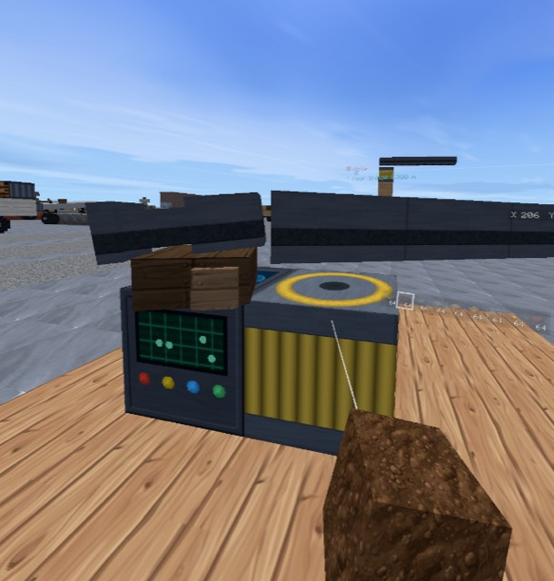

## 21:03:57 - and then it becomes a fucking obliterator.

- **Transcript:** and then it becomes a fucking obliterator.
- **Status:** open
- **Build:** 0.129 (26ceac53, M1-M4 (device-tested; ship riding, chests, comfort options, weapon wheel))
- **World:** Proving Grounds (seed 88314448595278)
- **Dimension:** Surface
- **Biome:** Taiga
- **Position:** 188.3 236.0 -3808.2
- **Facing:** south (yaw 187, pitch 21)
- **Held:** Dirt x64
- **Mount:** on foot
- **Looking at:** nothing
- **Mode:** Creative, health 20/20
- **Time:** day 1 14:08, clear
- **Fps:** 71
- **Levels:** mic -29 dBFS, game sound -25 dBFS
- **Length:** 4.5 s (voice 2.0 s)
- **Just before:** -29s stopped piloting Ship; -29s holding Dirt; -24s piloting Ship; -24s holding empty hand; -24s message: Steering Ship; -22s message: Gun Control: your gun, worked from this computer; -20s stopped piloting Ship; -20s holding Dirt; -4s piloting Ship; -4s holding empty hand; -4s message: Steering Ship; -3s message: Gun Control: your gun, worked from this computer; -1s stopped piloting Ship; -1s holding Dirt
- **Repro (Mac):** `./snap.sh note --seed 88314448595278 --x 188.3 --z -3808.2 --yaw 173 --pitch 21 --time 0.339`
- **Audio (this Mac):** /Users/darthvadar/Documents/Blocksmith/QuestVoiceNotes/raw/vn-20261116-210357-134.aac

## 21:04:10 - I don't know what this can is, but okay.

- **Transcript:** I don't know what this can is, but okay.
- **Status:** open
- **Build:** 0.129 (26ceac53, M1-M4 (device-tested; ship riding, chests, comfort options, weapon wheel))
- **World:** Proving Grounds (seed 88314448595278)
- **Dimension:** Surface
- **Biome:** Taiga
- **Position:** 156.5 236.0 -3807.4
- **Facing:** north-west (yaw 324, pitch 1)
- **Held:** empty hand
- **Mount:** piloting Ship
- **Looking at:** nothing
- **Mode:** Creative, health 20/20
- **Time:** day 1 14:24, clear
- **Fps:** 71
- **Levels:** mic -34 dBFS, game sound -27 dBFS
- **Length:** 3.5 s (voice 1.4 s)
- **Just before:** -18s piloting Ship; -18s holding empty hand; -18s message: Steering Ship; -16s message: Gun Control: your gun, worked from this computer; -14s stopped piloting Ship; -14s holding Dirt; -11s piloting Ship; -11s holding empty hand; -11s message: Steering Ship; -10s message: Gun Control: your gun, worked from this computer; -9s stopped piloting Ship; -9s holding Dirt; -7s piloting Ship; -7s holding empty hand; -7s message: Steering Ship; -5s message: Gun Control: your gun, worked from this computer
- **Repro (Mac):** `./snap.sh note --seed 88314448595278 --x 156.5 --z -3807.4 --yaw 36 --pitch 1 --time 0.350`
- **Audio (this Mac):** /Users/darthvadar/Documents/Blocksmith/QuestVoiceNotes/raw/vn-20261116-210410-614.aac

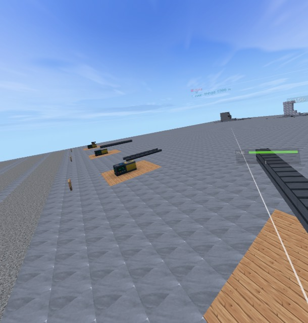

## 21:04:23 - Well, alright.

- **Transcript:** Well, alright.
- **Status:** open
- **Build:** 0.129 (26ceac53, M1-M4 (device-tested; ship riding, chests, comfort options, weapon wheel))
- **World:** Proving Grounds (seed 88314448595278)
- **Dimension:** Surface
- **Biome:** Taiga
- **Position:** 156.2 236.0 -3808.2
- **Facing:** west (yaw 292, pitch -1)
- **Held:** Dirt x64
- **Mount:** on foot
- **Looking at:** nothing
- **Mode:** Creative, health 20/20
- **Time:** day 1 14:39, clear
- **Fps:** 71
- **Levels:** mic -35 dBFS, game sound -22 dBFS
- **Length:** 2.3 s (voice 0.5 s)
- **Just before:** -29s message: Gun Control: your gun, worked from this computer; -27s stopped piloting Ship; -27s holding Dirt; -24s piloting Ship; -24s holding empty hand; -24s message: Steering Ship; -23s message: Gun Control: your gun, worked from this computer; -22s stopped piloting Ship; -22s holding Dirt; -20s piloting Ship; -20s holding empty hand; -20s message: Steering Ship; -18s message: Gun Control: your gun, worked from this computer; -1s stopped piloting Ship; -1s holding Dirt
- **Repro (Mac):** `./snap.sh note --seed 88314448595278 --x 156.2 --z -3808.2 --yaw 68 --pitch -1 --time 0.361`
- **Audio (this Mac):** /Users/darthvadar/Documents/Blocksmith/QuestVoiceNotes/raw/vn-20261116-210423-614.aac

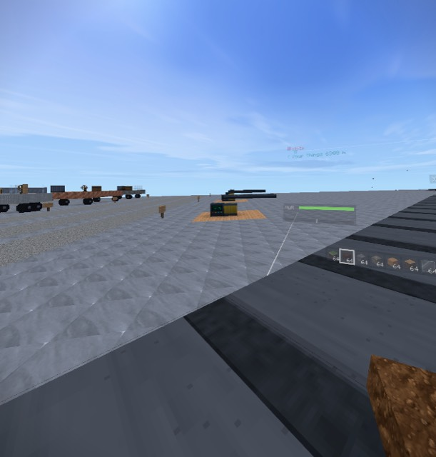

## 21:05:13 - Yeah, the gun is inverted in this one.

- **Transcript:** Yeah, the gun is inverted in this one.
- **Status:** open
- **Build:** 0.129 (26ceac53, M1-M4 (device-tested; ship riding, chests, comfort options, weapon wheel))
- **World:** Proving Grounds (seed 88314448595278)
- **Dimension:** Surface
- **Biome:** Taiga
- **Position:** 196.3 238.3 -3745.2
- **Facing:** north-east (yaw 58, pitch -6)
- **Held:** empty hand
- **Mount:** piloting Ship
- **Looking at:** nothing
- **Mode:** Creative, health 20/20
- **Time:** day 1 15:40, clear
- **Fps:** 71
- **Levels:** mic -26 dBFS, game sound -17 dBFS
- **Length:** 3.3 s (voice 1.8 s)
- **Just before:** -30s opened ChestMenu; -29s closed ChestMenu; -28s message: Assembled 38 blocks (68.6 t); -28s piloting Ship; -28s holding empty hand; -26s message: Steering Ship; -17s stopped piloting Ship; -17s holding Dirt; -17s message: Flying; -14s message: Walking; -13s message: Assembled 32 blocks (22.2 t); -12s piloting Ship; -12s holding empty hand; -11s message: Steering Ship; -7s stopped piloting Ship; -7s holding Dirt; -7s message: Flying; -4s message: Walking; -3s message: Assembled 67 blocks (40.1 t, 1 turret); -3s piloting Ship; -3s holding empty hand; -0s message: Steering Ship
- **Repro (Mac):** `./snap.sh note --seed 88314448595278 --x 196.3 --z -3745.2 --yaw -58 --pitch -6 --time 0.403`
- **Audio (this Mac):** /Users/darthvadar/Documents/Blocksmith/QuestVoiceNotes/raw/vn-20261116-210513-974.aac

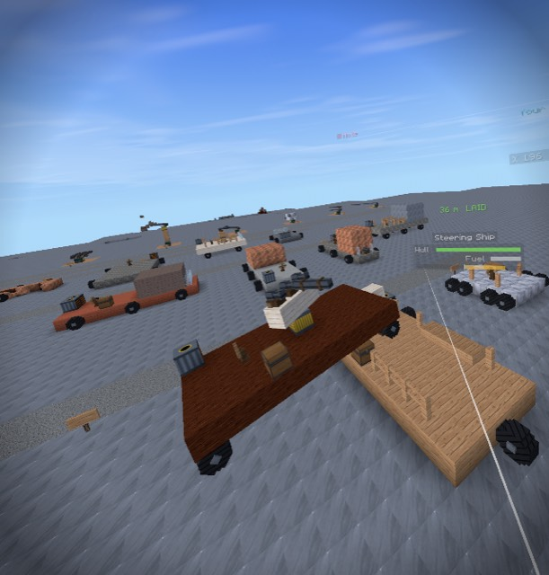

## 21:05:18 - Yeah, it seems I'm upgraded machinery logic. Or upgrade machinery and 

- **Transcript:** Yeah, it seems I'm upgraded machinery logic. Or upgrade machinery and shit.
- **Status:** open
- **Build:** 0.129 (26ceac53, M1-M4 (device-tested; ship riding, chests, comfort options, weapon wheel))
- **World:** Proving Grounds (seed 88314448595278)
- **Dimension:** Surface
- **Biome:** Taiga
- **Position:** 196.7 238.3 -3744.5
- **Facing:** east (yaw 83, pitch -8)
- **Held:** empty hand
- **Mount:** piloting Ship
- **Looking at:** nothing
- **Mode:** Creative, health 20/20
- **Time:** day 1 15:46, clear
- **Fps:** 71
- **Levels:** mic -25 dBFS, game sound -18 dBFS
- **Length:** 6.8 s (voice 4.0 s)
- **Just before:** -22s stopped piloting Ship; -22s holding Dirt; -22s message: Flying; -19s message: Walking; -17s message: Assembled 32 blocks (22.2 t); -17s piloting Ship; -17s holding empty hand; -15s message: Steering Ship; -12s stopped piloting Ship; -12s holding Dirt; -12s message: Flying; -9s message: Walking; -8s message: Assembled 67 blocks (40.1 t, 1 turret); -8s piloting Ship; -8s holding empty hand; -5s message: Steering Ship
- **While talking:** -5s stopped piloting Ship; -5s holding Dirt; -4s message: Flying
- **Position at the end:** 169.2 242.7 -3712.5
- **Repro (Mac):** `./snap.sh note --seed 88314448595278 --x 196.7 --z -3744.5 --yaw -83 --pitch -8 --time 0.407`
- **Audio (this Mac):** /Users/darthvadar/Documents/Blocksmith/QuestVoiceNotes/raw/vn-20261116-210518-834.aac

## 21:05:25 - Oh, look at this. We got boats. Very nice.

- **Transcript:** Oh, look at this. We got boats. Very nice.
- **Status:** open
- **Build:** 0.129 (26ceac53, M1-M4 (device-tested; ship riding, chests, comfort options, weapon wheel))
- **World:** Proving Grounds (seed 88314448595278)
- **Dimension:** Surface
- **Biome:** Taiga
- **Position:** 152.1 244.1 -3698.5
- **Facing:** south-east (yaw 141, pitch -32)
- **Held:** Dirt x64
- **Mount:** on foot, flying
- **Looking at:** nothing
- **Mode:** Creative, health 20/20
- **Time:** day 1 15:54, clear
- **Fps:** 66
- **Levels:** mic -28 dBFS, game sound -23 dBFS
- **Length:** 4.0 s (voice 1.9 s)
- **Just before:** -29s stopped piloting Ship; -29s holding Dirt; -29s message: Flying; -26s message: Walking; -24s message: Assembled 32 blocks (22.2 t); -24s piloting Ship; -24s holding empty hand; -22s message: Steering Ship; -19s stopped piloting Ship; -19s holding Dirt; -19s message: Flying; -16s message: Walking; -14s message: Assembled 67 blocks (40.1 t, 1 turret); -14s piloting Ship; -14s holding empty hand; -12s message: Steering Ship; -6s stopped piloting Ship; -6s holding Dirt; -6s message: Flying
- **Repro (Mac):** `./snap.sh note --seed 88314448595278 --x 152.1 --z -3698.5 --yaw -141 --pitch -32 --time 0.413`
- **Audio (this Mac):** /Users/darthvadar/Documents/Blocksmith/QuestVoiceNotes/raw/vn-20261116-210525-594.aac

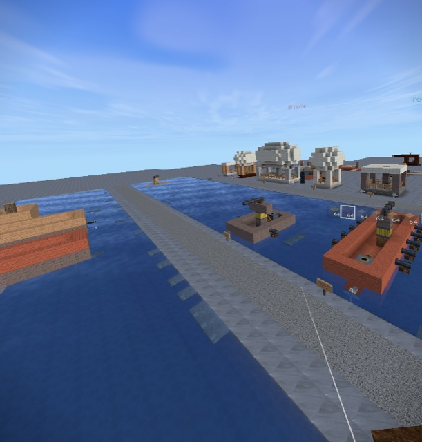

## 21:05:31 - Nice, here.

- **Transcript:** Nice, here.
- **Status:** open
- **Build:** 0.129 (26ceac53, M1-M4 (device-tested; ship riding, chests, comfort options, weapon wheel))
- **World:** Proving Grounds (seed 88314448595278)
- **Dimension:** Surface
- **Biome:** Taiga
- **Position:** 166.7 237.0 -3681.7
- **Facing:** east (yaw 70, pitch -45)
- **Held:** Dirt x64
- **Mount:** on foot
- **Looking at:** Ship Helm at 168 236 -3683
- **Mode:** Creative, health 20/20
- **Time:** day 1 16:01, clear
- **Fps:** 68
- **Levels:** mic -31 dBFS, game sound -14 dBFS
- **Length:** 2.5 s (voice 1.1 s)
- **Just before:** -30s piloting Ship; -30s holding empty hand; -28s message: Steering Ship; -25s stopped piloting Ship; -25s holding Dirt; -25s message: Flying; -22s message: Walking; -21s message: Assembled 67 blocks (40.1 t, 1 turret); -20s piloting Ship; -20s holding empty hand; -18s message: Steering Ship; -13s stopped piloting Ship; -13s holding Dirt; -12s message: Flying; -1s message: Walking
- **Repro (Mac):** `./snap.sh note --seed 88314448595278 --x 166.7 --z -3681.7 --yaw -70 --pitch -45 --time 0.418`
- **Audio (this Mac):** /Users/darthvadar/Documents/Blocksmith/QuestVoiceNotes/raw/vn-20261116-210531-694.aac

## 21:05:53 - Alright, nice.

- **Transcript:** Alright, nice.
- **Status:** open
- **Build:** 0.129 (26ceac53, M1-M4 (device-tested; ship riding, chests, comfort options, weapon wheel))
- **World:** Proving Grounds (seed 88314448595278)
- **Dimension:** Surface
- **Biome:** Taiga
- **Position:** 182.1 237.9 -3680.1
- **Facing:** south-east (yaw 151, pitch -20)
- **Held:** Dirt x64
- **Mount:** on foot, flying
- **Looking at:** nothing
- **Mode:** Creative, health 20/20
- **Time:** day 1 16:27, clear
- **Fps:** 70
- **Levels:** mic -27 dBFS, game sound -14 dBFS
- **Length:** 3.6 s (voice 1.0 s)
- **Just before:** -23s message: Walking; -22s message: Assembled 69 blocks (40.2 t, 1 turret); -21s piloting Ship; -21s holding empty hand; -19s message: Steering Ship; -1s stopped piloting Ship; -1s holding Dirt; -1s message: Flying
- **Repro (Mac):** `./snap.sh note --seed 88314448595278 --x 182.1 --z -3680.1 --yaw -151 --pitch -20 --time 0.436`
- **Audio (this Mac):** /Users/darthvadar/Documents/Blocksmith/QuestVoiceNotes/raw/vn-20261116-210553-754.aac

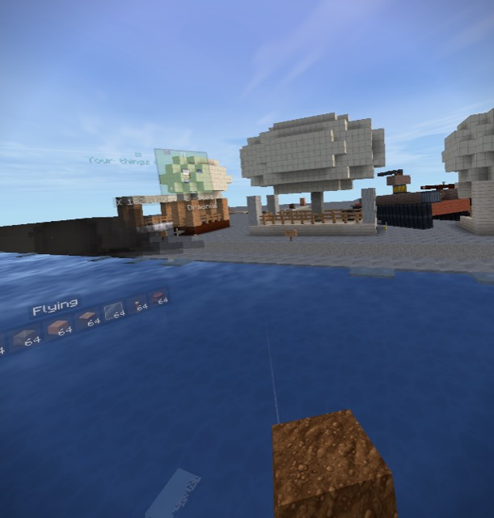

## 21:05:58 - All the cans are turned the wrong way in this thing, but whatever.

- **Transcript:** All the cans are turned the wrong way in this thing, but whatever.
- **Status:** open
- **Build:** 0.129 (26ceac53, M1-M4 (device-tested; ship riding, chests, comfort options, weapon wheel))
- **World:** Proving Grounds (seed 88314448595278)
- **Dimension:** Surface
- **Biome:** Taiga
- **Position:** 158.3 239.6 -3684.6
- **Facing:** south-west (yaw 240, pitch -67)
- **Held:** Dirt x64
- **Mount:** on foot, flying
- **Looking at:** nothing
- **Mode:** Creative, health 20/20
- **Time:** day 1 16:33, clear
- **Fps:** 70
- **Levels:** mic -28 dBFS, game sound -17 dBFS
- **Length:** 4.7 s (voice 2.7 s)
- **Just before:** -28s message: Walking; -27s message: Assembled 69 blocks (40.2 t, 1 turret); -26s piloting Ship; -26s holding empty hand; -24s message: Steering Ship; -6s stopped piloting Ship; -6s holding Dirt; -5s message: Flying; -1s message: Assembled 107 blocks (62.0 t, 1 turret)
- **Repro (Mac):** `./snap.sh note --seed 88314448595278 --x 158.3 --z -3684.6 --yaw 120 --pitch -67 --time 0.440`
- **Audio (this Mac):** /Users/darthvadar/Documents/Blocksmith/QuestVoiceNotes/raw/vn-20261116-210558-714.aac

## 21:06:04 - Alright, I just shot that thing, so...

- **Transcript:** Alright, I just shot that thing, so...
- **Status:** open
- **Build:** 0.129 (26ceac53, M1-M4 (device-tested; ship riding, chests, comfort options, weapon wheel))
- **World:** Proving Grounds (seed 88314448595278)
- **Dimension:** Surface
- **Biome:** Taiga
- **Position:** 148.2 240.2 -3684.3
- **Facing:** west (yaw 255, pitch -78)
- **Held:** Dirt x64
- **Mount:** on foot, flying
- **Looking at:** Engine at 147 236 -3685
- **Mode:** Creative, health 20/20
- **Time:** day 1 16:40, clear
- **Fps:** 59
- **Levels:** mic -29 dBFS, game sound -15 dBFS
- **Length:** 3.5 s (voice 1.8 s)
- **Just before:** -12s stopped piloting Ship; -12s holding Dirt; -11s message: Flying; -6s message: Assembled 107 blocks (62.0 t, 1 turret); -5s piloting Ship; -5s holding empty hand; -4s message: Walking; -3s message: Steering Ship; -2s stopped piloting Ship; -2s holding Dirt; -1s message: Flying
- **Repro (Mac):** `./snap.sh note --seed 88314448595278 --x 148.2 --z -3684.3 --yaw 105 --pitch -78 --time 0.445`
- **Audio (this Mac):** /Users/darthvadar/Documents/Blocksmith/QuestVoiceNotes/raw/vn-20261116-210604-434.aac

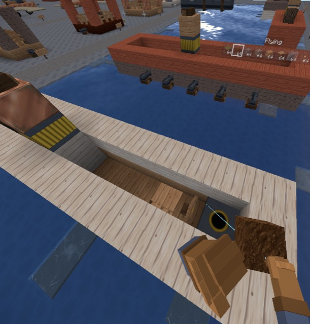

## 21:06:08 - What happens? Nothing?

- **Transcript:** What happens? Nothing?
- **Status:** open
- **Build:** 0.129 (26ceac53, M1-M4 (device-tested; ship riding, chests, comfort options, weapon wheel))
- **World:** Proving Grounds (seed 88314448595278)
- **Dimension:** Surface
- **Biome:** Taiga
- **Position:** 147.5 235.1 -3684.3
- **Facing:** north (yaw 351, pitch -74)
- **Held:** empty hand
- **Mount:** piloting Ship
- **Looking at:** nothing
- **Mode:** Creative, health 20/20
- **Time:** day 1 16:45, clear
- **Fps:** 56
- **Levels:** mic -31 dBFS, game sound -19 dBFS
- **Length:** 3.4 s (voice 1.1 s)
- **Just before:** -16s stopped piloting Ship; -16s holding Dirt; -15s message: Flying; -10s message: Assembled 107 blocks (62.0 t, 1 turret); -9s piloting Ship; -9s holding empty hand; -8s message: Walking; -7s message: Steering Ship; -6s stopped piloting Ship; -6s holding Dirt; -5s message: Flying; -4s message: Walking; -2s piloting Ship; -2s holding empty hand; -2s message: Assembled 112 blocks (70.7 t, 1 turret)
- **Repro (Mac):** `./snap.sh note --seed 88314448595278 --x 147.5 --z -3684.3 --yaw 9 --pitch -74 --time 0.448`
- **Audio (this Mac):** /Users/darthvadar/Documents/Blocksmith/QuestVoiceNotes/raw/vn-20261116-210608-434.aac

## 21:06:26 - I don't know. Okay.

- **Transcript:** I don't know. Okay.
- **Status:** open
- **Build:** 0.129 (26ceac53, M1-M4 (device-tested; ship riding, chests, comfort options, weapon wheel))
- **World:** Proving Grounds (seed 88314448595278)
- **Dimension:** Surface
- **Biome:** Taiga
- **Position:** 137.4 236.8 -3674.5
- **Facing:** north-west (yaw 327, pitch -14)
- **Held:** Dirt x64
- **Mount:** on foot
- **Looking at:** nothing
- **Mode:** Creative, health 20/20
- **Time:** day 1 17:07, clear
- **Fps:** 69
- **Levels:** mic -30 dBFS, game sound -20 dBFS
- **Length:** 2.6 s (voice 1.0 s)
- **Just before:** -29s message: Assembled 107 blocks (62.0 t, 1 turret); -27s piloting Ship; -27s holding empty hand; -26s message: Walking; -25s message: Steering Ship; -24s stopped piloting Ship; -24s holding Dirt; -23s message: Flying; -22s message: Walking; -21s piloting Ship; -21s holding empty hand; -20s message: Assembled 112 blocks (70.7 t, 1 turret); -18s message: Steering Ship; -17s stopped piloting Ship; -17s holding Dirt; -17s message: Flying; -15s message: Walking; -14s message: Flying; -11s message: Walking; -9s message: Assembled 140 blocks (80.2 t, 1 turret); -9s piloting Ship; -9s holding empty hand; -7s message: Steering Ship; -0s stopped piloting Ship; -0s holding Dirt
- **Repro (Mac):** `./snap.sh note --seed 88314448595278 --x 137.4 --z -3674.5 --yaw 33 --pitch -14 --time 0.463`
- **Audio (this Mac):** /Users/darthvadar/Documents/Blocksmith/QuestVoiceNotes/raw/vn-20261116-210626-834.aac

## 21:06:40 - Yep, camera's not facing the correct way here. Where I'm pointing is n

- **Transcript:** Yep, camera's not facing the correct way here. Where I'm pointing is not where it's aiming.
- **Status:** open
- **Build:** 0.129 (26ceac53, M1-M4 (device-tested; ship riding, chests, comfort options, weapon wheel))
- **World:** Proving Grounds (seed 88314448595278)
- **Dimension:** Surface
- **Biome:** Taiga
- **Position:** 127.6 235.1 -3685.4
- **Facing:** west (yaw 285, pitch -6)
- **Held:** empty hand
- **Mount:** piloting Ship
- **Looking at:** nothing
- **Mode:** Creative, health 20/20
- **Time:** day 1 17:23, clear
- **Fps:** 58
- **Levels:** mic -23 dBFS, game sound -11 dBFS
- **Length:** 6.1 s (voice 3.4 s)
- **Just before:** -29s message: Walking; -27s message: Flying; -24s message: Walking; -23s message: Assembled 140 blocks (80.2 t, 1 turret); -23s piloting Ship; -23s holding empty hand; -21s message: Steering Ship; -14s stopped piloting Ship; -14s holding Dirt; -13s message: Flying; -12s message: Walking; -11s message: Flying; -9s message: Walking; -8s message: Assembled 71 blocks (42.0 t, 1 turret); -5s piloting Ship; -5s holding empty hand; -5s message: Steering Ship
- **Position at the end:** 129.2 234.2 -3685.3
- **Repro (Mac):** `./snap.sh note --seed 88314448595278 --x 127.6 --z -3685.4 --yaw 75 --pitch -6 --time 0.475`
- **Audio (this Mac):** /Users/darthvadar/Documents/Blocksmith/QuestVoiceNotes/raw/vn-20261116-210640-394.aac

## 21:06:46 - 90 degrees off and that one probably enough

- **Transcript:** 90 degrees off and that one probably enough
- **Status:** open
- **Build:** 0.129 (26ceac53, M1-M4 (device-tested; ship riding, chests, comfort options, weapon wheel))
- **World:** Proving Grounds (seed 88314448595278)
- **Dimension:** Surface
- **Biome:** Taiga
- **Position:** 127.5 236.4 -3685.0
- **Facing:** west (yaw 269, pitch -4)
- **Held:** Dirt x64
- **Mount:** on foot
- **Looking at:** nothing
- **Mode:** Creative, health 20/20
- **Time:** day 1 17:30, clear
- **Fps:** 67
- **Levels:** mic -37 dBFS, game sound -16 dBFS
- **Length:** 3.6 s (voice 2.0 s)
- **Just before:** -29s message: Assembled 140 blocks (80.2 t, 1 turret); -29s piloting Ship; -29s holding empty hand; -27s message: Steering Ship; -20s stopped piloting Ship; -20s holding Dirt; -19s message: Flying; -18s message: Walking; -17s message: Flying; -15s message: Walking; -14s message: Assembled 71 blocks (42.0 t, 1 turret); -11s piloting Ship; -11s holding empty hand; -11s message: Steering Ship; -0s stopped piloting Ship; -0s holding Dirt
- **Repro (Mac):** `./snap.sh note --seed 88314448595278 --x 127.5 --z -3685.0 --yaw 91 --pitch -4 --time 0.480`
- **Audio (this Mac):** /Users/darthvadar/Documents/Blocksmith/QuestVoiceNotes/raw/vn-20261116-210646-394.aac

## 21:06:50 - Alright, I've got some sort of playing here. Very nice.

- **Transcript:** Alright, I've got some sort of playing here. Very nice.
- **Status:** open
- **Build:** 0.129 (26ceac53, M1-M4 (device-tested; ship riding, chests, comfort options, weapon wheel))
- **World:** Proving Grounds (seed 88314448595278)
- **Dimension:** Surface
- **Biome:** Taiga
- **Position:** 113.0 239.9 -3673.4
- **Facing:** south (yaw 186, pitch -35)
- **Held:** Dirt x64
- **Mount:** on foot, flying
- **Looking at:** nothing
- **Mode:** Creative, health 20/20
- **Time:** day 1 17:35, clear
- **Fps:** 72
- **Levels:** mic -25 dBFS, game sound -16 dBFS
- **Length:** 4.4 s (voice 2.7 s)
- **Just before:** -24s stopped piloting Ship; -24s holding Dirt; -24s message: Flying; -22s message: Walking; -21s message: Flying; -19s message: Walking; -18s message: Assembled 71 blocks (42.0 t, 1 turret); -15s piloting Ship; -15s holding empty hand; -15s message: Steering Ship; -5s stopped piloting Ship; -5s holding Dirt; -4s message: Flying
- **Repro (Mac):** `./snap.sh note --seed 88314448595278 --x 113.0 --z -3673.4 --yaw 174 --pitch -35 --time 0.483`
- **Audio (this Mac):** /Users/darthvadar/Documents/Blocksmith/QuestVoiceNotes/raw/vn-20261116-210650-494.aac

## 21:07:15 - Now this thing...

- **Transcript:** Now this thing...
- **Status:** open
- **Build:** 0.129 (26ceac53, M1-M4 (device-tested; ship riding, chests, comfort options, weapon wheel))
- **World:** Proving Grounds (seed 88314448595278)
- **Dimension:** Surface
- **Biome:** Taiga
- **Position:** 110.4 236.9 -3632.5
- **Facing:** north-west (yaw 300, pitch -9)
- **Held:** empty hand
- **Mount:** piloting Ship
- **Looking at:** nothing
- **Mode:** Creative, health 20/20
- **Time:** day 1 18:05, clear
- **Fps:** 68
- **Levels:** mic -32 dBFS, game sound -13 dBFS
- **Length:** 2.5 s (voice 1.0 s)
- **Just before:** -30s stopped piloting Ship; -30s holding Dirt; -29s message: Flying; -23s message: Walking; -22s message: Assembled 106 blocks (63.3 t); -21s piloting Ship; -21s holding empty hand; -20s message: Steering Ship; -13s stopped piloting Ship; -13s holding Dirt; -10s message: Flying; -4s message: Walking; -2s message: Assembled 82 blocks (261.3 t); -2s piloting Ship; -2s holding empty hand; -0s message: Steering Ship
- **Repro (Mac):** `./snap.sh note --seed 88314448595278 --x 110.4 --z -3632.5 --yaw 60 --pitch -9 --time 0.504`
- **Audio (this Mac):** /Users/darthvadar/Documents/Blocksmith/QuestVoiceNotes/raw/vn-20261116-210715-594.aac

## 21:07:23 - isn't moving.

- **Transcript:** isn't moving.
- **Status:** open
- **Build:** 0.129 (26ceac53, M1-M4 (device-tested; ship riding, chests, comfort options, weapon wheel))
- **World:** Proving Grounds (seed 88314448595278)
- **Dimension:** Surface
- **Biome:** Taiga
- **Position:** 110.4 236.9 -3632.5
- **Facing:** north-west (yaw 323, pitch -18)
- **Held:** empty hand
- **Mount:** piloting Ship
- **Looking at:** nothing
- **Mode:** Creative, health 20/20
- **Time:** day 1 18:15, clear
- **Fps:** 68
- **Levels:** mic -28 dBFS, game sound -19 dBFS
- **Length:** 2.2 s (voice 0.7 s)
- **Just before:** -30s message: Assembled 106 blocks (63.3 t); -29s piloting Ship; -29s holding empty hand; -27s message: Steering Ship; -20s stopped piloting Ship; -20s holding Dirt; -17s message: Flying; -12s message: Walking; -10s message: Assembled 82 blocks (261.3 t); -10s piloting Ship; -10s holding empty hand; -8s message: Steering Ship
- **Repro (Mac):** `./snap.sh note --seed 88314448595278 --x 110.4 --z -3632.5 --yaw 37 --pitch -18 --time 0.511`
- **Audio (this Mac):** /Users/darthvadar/Documents/Blocksmith/QuestVoiceNotes/raw/vn-20261116-210723-395.aac

## 21:07:26 - Stuck in place.

- **Transcript:** Stuck in place.
- **Status:** open
- **Build:** 0.129 (26ceac53, M1-M4 (device-tested; ship riding, chests, comfort options, weapon wheel))
- **World:** Proving Grounds (seed 88314448595278)
- **Dimension:** Surface
- **Biome:** Taiga
- **Position:** 110.4 236.9 -3632.5
- **Facing:** north-west (yaw 321, pitch -13)
- **Held:** empty hand
- **Mount:** piloting Ship
- **Looking at:** nothing
- **Mode:** Creative, health 20/20
- **Time:** day 1 18:19, clear
- **Fps:** 68
- **Levels:** mic -56 dBFS, game sound -22 dBFS
- **Length:** 2.1 s (voice 0.5 s)
- **Just before:** -24s stopped piloting Ship; -24s holding Dirt; -21s message: Flying; -15s message: Walking; -14s message: Assembled 82 blocks (261.3 t); -13s piloting Ship; -13s holding empty hand; -12s message: Steering Ship
- **Repro (Mac):** `./snap.sh note --seed 88314448595278 --x 110.4 --z -3632.5 --yaw 39 --pitch -13 --time 0.513`
- **Audio (this Mac):** /Users/darthvadar/Documents/Blocksmith/QuestVoiceNotes/raw/vn-20261116-210726-874.aac

## 21:07:29 - Probably because the propellers are facing the wrong way.

- **Transcript:** Probably because the propellers are facing the wrong way.
- **Status:** open
- **Build:** 0.129 (26ceac53, M1-M4 (device-tested; ship riding, chests, comfort options, weapon wheel))
- **World:** Proving Grounds (seed 88314448595278)
- **Dimension:** Surface
- **Biome:** Taiga
- **Position:** 110.4 236.9 -3632.5
- **Facing:** north-west (yaw 297, pitch -15)
- **Held:** empty hand
- **Mount:** piloting Ship
- **Looking at:** nothing
- **Mode:** Creative, health 20/20
- **Time:** day 1 18:22, clear
- **Fps:** 68
- **Levels:** mic -27 dBFS, game sound -17 dBFS
- **Length:** 3.2 s (voice 1.6 s)
- **Just before:** -26s stopped piloting Ship; -26s holding Dirt; -24s message: Flying; -18s message: Walking; -16s message: Assembled 82 blocks (261.3 t); -16s piloting Ship; -16s holding empty hand; -14s message: Steering Ship
- **Repro (Mac):** `./snap.sh note --seed 88314448595278 --x 110.4 --z -3632.5 --yaw 63 --pitch -15 --time 0.516`
- **Audio (this Mac):** /Users/darthvadar/Documents/Blocksmith/QuestVoiceNotes/raw/vn-20261116-210729-514.aac

## 21:07:42 - This one's working.

- **Transcript:** This one's working.
- **Status:** open
- **Build:** 0.129 (26ceac53, M1-M4 (device-tested; ship riding, chests, comfort options, weapon wheel))
- **World:** Proving Grounds (seed 88314448595278)
- **Dimension:** Surface
- **Biome:** Taiga
- **Position:** 141.7 237.9 -3631.7
- **Facing:** north (yaw 4, pitch -7)
- **Held:** empty hand
- **Mount:** piloting Ship
- **Looking at:** nothing
- **Mode:** Creative, health 20/20
- **Time:** day 1 18:38, clear
- **Fps:** 68
- **Levels:** mic -27 dBFS, game sound -13 dBFS
- **Length:** 2.1 s (voice 0.6 s)
- **Just before:** -29s message: Assembled 82 blocks (261.3 t); -29s piloting Ship; -29s holding empty hand; -27s message: Steering Ship; -11s stopped piloting Ship; -11s holding Dirt; -10s message: Flying; -8s message: Walking; -6s message: Flying; -4s message: Walking; -3s piloting Ship; -3s holding empty hand; -3s message: Assembled 88 blocks (27.5 t); -1s message: Steering Ship
- **Repro (Mac):** `./snap.sh note --seed 88314448595278 --x 141.7 --z -3631.7 --yaw -4 --pitch -7 --time 0.526`
- **Audio (this Mac):** /Users/darthvadar/Documents/Blocksmith/QuestVoiceNotes/raw/vn-20261116-210742-494.aac

## 21:07:46 - Sure why the other one wasn't.

- **Transcript:** Sure why the other one wasn't.
- **Status:** open
- **Build:** 0.129 (26ceac53, M1-M4 (device-tested; ship riding, chests, comfort options, weapon wheel))
- **World:** Proving Grounds (seed 88314448595278)
- **Dimension:** Surface
- **Biome:** Taiga
- **Position:** 137.3 238.2 -3632.7
- **Facing:** north-east (yaw 37, pitch -18)
- **Held:** empty hand
- **Mount:** piloting Ship
- **Looking at:** nothing
- **Mode:** Creative, health 20/20
- **Time:** day 1 18:42, clear
- **Fps:** 67
- **Levels:** mic -31 dBFS, game sound -18 dBFS
- **Length:** 2.3 s (voice 0.9 s)
- **Just before:** -15s stopped piloting Ship; -15s holding Dirt; -14s message: Flying; -11s message: Walking; -9s message: Flying; -8s message: Walking; -6s piloting Ship; -6s holding empty hand; -6s message: Assembled 88 blocks (27.5 t); -4s message: Steering Ship
- **Repro (Mac):** `./snap.sh note --seed 88314448595278 --x 137.3 --z -3632.7 --yaw -37 --pitch -18 --time 0.529`
- **Audio (this Mac):** /Users/darthvadar/Documents/Blocksmith/QuestVoiceNotes/raw/vn-20261116-210746-054.aac

## 21:07:56 - Very hard the cameras like

- **Transcript:** Very hard the cameras like
- **Status:** open
- **Build:** 0.129 (26ceac53, M1-M4 (device-tested; ship riding, chests, comfort options, weapon wheel))
- **World:** Proving Grounds (seed 88314448595278)
- **Dimension:** Surface
- **Biome:** Taiga
- **Position:** 154.8 237.9 -3623.7
- **Facing:** north-west (yaw 307, pitch -12)
- **Held:** empty hand
- **Mount:** piloting Ship
- **Looking at:** nothing
- **Mode:** Creative, health 20/20
- **Time:** day 1 18:54, clear
- **Fps:** 67
- **Levels:** mic -25 dBFS, game sound -17 dBFS
- **Length:** 2.8 s (voice 1.3 s)
- **Just before:** -25s stopped piloting Ship; -25s holding Dirt; -24s message: Flying; -22s message: Walking; -20s message: Flying; -18s message: Walking; -17s piloting Ship; -17s holding empty hand; -16s message: Assembled 88 blocks (27.5 t); -14s message: Steering Ship
- **Repro (Mac):** `./snap.sh note --seed 88314448595278 --x 154.8 --z -3623.7 --yaw 53 --pitch -12 --time 0.538`
- **Audio (this Mac):** /Users/darthvadar/Documents/Blocksmith/QuestVoiceNotes/raw/vn-20261116-210756-374.aac

## 21:07:58 - 90 degrees off where it should be.

- **Transcript:** 90 degrees off where it should be.
- **Status:** open
- **Build:** 0.129 (26ceac53, M1-M4 (device-tested; ship riding, chests, comfort options, weapon wheel))
- **World:** Proving Grounds (seed 88314448595278)
- **Dimension:** Surface
- **Biome:** Taiga
- **Position:** 146.7 237.9 -3631.2
- **Facing:** north-west (yaw 327, pitch -10)
- **Held:** empty hand
- **Mount:** piloting Ship
- **Looking at:** nothing
- **Mode:** Creative, health 20/20
- **Time:** day 1 18:57, clear
- **Fps:** 67
- **Levels:** mic -28 dBFS, game sound -15 dBFS
- **Length:** 2.8 s (voice 1.5 s)
- **Just before:** -27s stopped piloting Ship; -27s holding Dirt; -27s message: Flying; -24s message: Walking; -22s message: Flying; -20s message: Walking; -19s piloting Ship; -19s holding empty hand; -19s message: Assembled 88 blocks (27.5 t); -17s message: Steering Ship
- **Repro (Mac):** `./snap.sh note --seed 88314448595278 --x 146.7 --z -3631.2 --yaw 33 --pitch -10 --time 0.540`
- **Audio (this Mac):** /Users/darthvadar/Documents/Blocksmith/QuestVoiceNotes/raw/vn-20261116-210758-894.aac

## 21:08:01 - I was like 270 degrees. I should be at the 180 degrees.

- **Transcript:** I was like 270 degrees. I should be at the 180 degrees.
- **Status:** open
- **Build:** 0.129 (26ceac53, M1-M4 (device-tested; ship riding, chests, comfort options, weapon wheel))
- **World:** Proving Grounds (seed 88314448595278)
- **Dimension:** Surface
- **Biome:** Taiga
- **Position:** 141.0 238.0 -3639.3
- **Facing:** north-west (yaw 304, pitch -9)
- **Held:** empty hand
- **Mount:** piloting Ship
- **Looking at:** nothing
- **Mode:** Creative, health 20/20
- **Time:** day 1 19:00, clear
- **Fps:** 69
- **Levels:** mic -34 dBFS, game sound -17 dBFS
- **Length:** 5.3 s (voice 3.0 s)
- **Just before:** -29s message: Flying; -27s message: Walking; -25s message: Flying; -23s message: Walking; -22s piloting Ship; -22s holding empty hand; -22s message: Assembled 88 blocks (27.5 t); -20s message: Steering Ship
- **Position at the end:** 135.3 237.9 -3643.2
- **Repro (Mac):** `./snap.sh note --seed 88314448595278 --x 141.0 --z -3639.3 --yaw 56 --pitch -9 --time 0.542`
- **Audio (this Mac):** /Users/darthvadar/Documents/Blocksmith/QuestVoiceNotes/raw/vn-20261116-210801-634.aac

## 21:08:15 - I'm just going to take off these things in a room.

- **Transcript:** I'm just going to take off these things in a room.
- **Status:** open
- **Build:** 0.129 (26ceac53, M1-M4 (device-tested; ship riding, chests, comfort options, weapon wheel))
- **World:** Proving Grounds (seed 88314448595278)
- **Dimension:** Surface
- **Biome:** Taiga
- **Position:** 130.9 237.9 -3642.4
- **Facing:** north-east (yaw 23, pitch -43)
- **Held:** Dirt x64
- **Mount:** on foot
- **Looking at:** nothing
- **Mode:** Creative, health 20/20
- **Time:** day 1 19:17, clear
- **Fps:** 71
- **Levels:** mic -26 dBFS, game sound -16 dBFS
- **Length:** 3.2 s (voice 1.6 s)
- **Just before:** -1s stopped piloting Ship; -1s holding Dirt
- **Repro (Mac):** `./snap.sh note --seed 88314448595278 --x 130.9 --z -3642.4 --yaw -23 --pitch -43 --time 0.554`
- **Audio (this Mac):** /Users/darthvadar/Documents/Blocksmith/QuestVoiceNotes/raw/vn-20261116-210815-194.aac

## 21:08:27 - I'm just saying...

- **Transcript:** I'm just saying...
- **Status:** open
- **Build:** 0.129 (26ceac53, M1-M4 (device-tested; ship riding, chests, comfort options, weapon wheel))
- **World:** Proving Grounds (seed 88314448595278)
- **Dimension:** Surface
- **Biome:** Taiga
- **Position:** 163.5 236.9 -3634.6
- **Facing:** north (yaw 12, pitch -31)
- **Held:** empty hand
- **Mount:** piloting Ship
- **Looking at:** nothing
- **Mode:** Creative, health 20/20
- **Time:** day 1 19:31, clear
- **Fps:** 67
- **Levels:** mic -39 dBFS, game sound -12 dBFS
- **Length:** 2.1 s (voice 0.6 s)
- **Just before:** -12s stopped piloting Ship; -12s holding Dirt; -12s message: Flying; -7s message: Walking; -5s message: Assembled 66 blocks (32.7 t); -5s piloting Ship; -5s holding empty hand; -3s message: Steering Ship
- **Repro (Mac):** `./snap.sh note --seed 88314448595278 --x 163.5 --z -3634.6 --yaw -12 --pitch -31 --time 0.564`
- **Audio (this Mac):** /Users/darthvadar/Documents/Blocksmith/QuestVoiceNotes/raw/vn-20261116-210827-134.aac

## 21:08:29 - Doesn't move

- **Transcript:** Doesn't move
- **Status:** open
- **Build:** 0.129 (26ceac53, M1-M4 (device-tested; ship riding, chests, comfort options, weapon wheel))
- **World:** Proving Grounds (seed 88314448595278)
- **Dimension:** Surface
- **Biome:** Taiga
- **Position:** 163.5 236.9 -3634.6
- **Facing:** north-east (yaw 40, pitch -35)
- **Held:** Dirt x64
- **Mount:** on foot
- **Looking at:** Smooth Stone at 165 235 -3638
- **Mode:** Creative, health 20/20
- **Time:** day 1 19:34, clear
- **Fps:** 67
- **Levels:** mic -33 dBFS, game sound -15 dBFS
- **Length:** 2.0 s (voice 0.6 s)
- **Just before:** -15s stopped piloting Ship; -15s holding Dirt; -14s message: Flying; -9s message: Walking; -8s message: Assembled 66 blocks (32.7 t); -8s piloting Ship; -8s holding empty hand; -6s message: Steering Ship; -0s stopped piloting Ship; -0s holding Dirt
- **Repro (Mac):** `./snap.sh note --seed 88314448595278 --x 163.5 --z -3634.6 --yaw -40 --pitch -35 --time 0.566`
- **Audio (this Mac):** /Users/darthvadar/Documents/Blocksmith/QuestVoiceNotes/raw/vn-20261116-210829-574.aac

## 21:08:38 - The colors are awesome the wrong way in this one.

- **Transcript:** The colors are awesome the wrong way in this one.
- **Status:** open
- **Build:** 0.129 (26ceac53, M1-M4 (device-tested; ship riding, chests, comfort options, weapon wheel))
- **World:** Proving Grounds (seed 88314448595278)
- **Dimension:** Surface
- **Biome:** Taiga
- **Position:** 181.6 236.9 -3630.5
- **Facing:** north-east (yaw 59, pitch -11)
- **Held:** empty hand
- **Mount:** piloting Ship
- **Looking at:** nothing
- **Mode:** Creative, health 20/20
- **Time:** day 1 19:44, clear
- **Fps:** 69
- **Levels:** mic -32 dBFS, game sound -19 dBFS
- **Length:** 3.2 s (voice 1.8 s)
- **Just before:** -24s stopped piloting Ship; -24s holding Dirt; -23s message: Flying; -18s message: Walking; -16s message: Assembled 66 blocks (32.7 t); -16s piloting Ship; -16s holding empty hand; -14s message: Steering Ship; -9s stopped piloting Ship; -9s holding Dirt; -8s message: Flying; -7s message: Walking; -5s message: Assembled 95 blocks (29.4 t); -5s piloting Ship; -5s holding empty hand; -3s message: Steering Ship
- **Repro (Mac):** `./snap.sh note --seed 88314448595278 --x 181.6 --z -3630.5 --yaw -59 --pitch -11 --time 0.573`
- **Audio (this Mac):** /Users/darthvadar/Documents/Blocksmith/QuestVoiceNotes/raw/vn-20261116-210838-234.aac

## 21:08:44 - Okay, this one this one has a straight runway this one's gonna work

- **Transcript:** Okay, this one this one has a straight runway this one's gonna work
- **Status:** open
- **Build:** 0.129 (26ceac53, M1-M4 (device-tested; ship riding, chests, comfort options, weapon wheel))
- **World:** Proving Grounds (seed 88314448595278)
- **Dimension:** Surface
- **Biome:** Taiga
- **Position:** 232.3 240.5 -3635.6
- **Facing:** north-east (yaw 50, pitch -43)
- **Held:** Dirt x64
- **Mount:** on foot, flying
- **Looking at:** nothing
- **Mode:** Creative, health 20/20
- **Time:** day 1 19:52, clear
- **Fps:** 69
- **Levels:** mic -37 dBFS, game sound -17 dBFS
- **Length:** 4.6 s (voice 2.7 s)
- **Just before:** -29s message: Flying; -25s message: Walking; -23s message: Assembled 66 blocks (32.7 t); -23s piloting Ship; -23s holding empty hand; -21s message: Steering Ship; -16s stopped piloting Ship; -16s holding Dirt; -15s message: Flying; -13s message: Walking; -12s message: Assembled 95 blocks (29.4 t); -12s piloting Ship; -12s holding empty hand; -10s message: Steering Ship; -5s stopped piloting Ship; -5s holding Dirt; -3s message: Flying
- **Repro (Mac):** `./snap.sh note --seed 88314448595278 --x 232.3 --z -3635.6 --yaw -50 --pitch -43 --time 0.578`
- **Audio (this Mac):** /Users/darthvadar/Documents/Blocksmith/QuestVoiceNotes/raw/vn-20261116-210844-954.aac

## 21:08:54 - Come on, work.

- **Transcript:** Come on, work.
- **Status:** open
- **Build:** 0.129 (26ceac53, M1-M4 (device-tested; ship riding, chests, comfort options, weapon wheel))
- **World:** Proving Grounds (seed 88314448595278)
- **Dimension:** Surface
- **Biome:** Taiga
- **Position:** 236.5 236.9 -3634.6
- **Facing:** south (yaw 202, pitch -42)
- **Held:** empty hand
- **Mount:** piloting Ship
- **Looking at:** nothing
- **Mode:** Creative, health 20/20
- **Time:** day 1 20:04, clear
- **Fps:** 69
- **Levels:** mic -28 dBFS, game sound -19 dBFS
- **Length:** 2.4 s (voice 1.0 s)
- **Just before:** -25s stopped piloting Ship; -25s holding Dirt; -25s message: Flying; -23s message: Walking; -22s message: Assembled 95 blocks (29.4 t); -22s piloting Ship; -22s holding empty hand; -20s message: Steering Ship; -15s stopped piloting Ship; -15s holding Dirt; -13s message: Flying; -9s message: Walking; -8s message: Assembled 54 blocks (173.8 t); -7s piloting Ship; -7s holding empty hand; -6s message: Steering Ship
- **Repro (Mac):** `./snap.sh note --seed 88314448595278 --x 236.5 --z -3634.6 --yaw 158 --pitch -42 --time 0.587`
- **Audio (this Mac):** /Users/darthvadar/Documents/Blocksmith/QuestVoiceNotes/raw/vn-20261116-210854-874.aac

## 21:08:57 - It's not working.

- **Transcript:** It's not working.
- **Status:** open
- **Build:** 0.129 (26ceac53, M1-M4 (device-tested; ship riding, chests, comfort options, weapon wheel))
- **World:** Proving Grounds (seed 88314448595278)
- **Dimension:** Surface
- **Biome:** Taiga
- **Position:** 236.5 236.9 -3634.6
- **Facing:** south-west (yaw 246, pitch -15)
- **Held:** empty hand
- **Mount:** piloting Ship
- **Looking at:** nothing
- **Mode:** Creative, health 20/20
- **Time:** day 1 20:08, clear
- **Fps:** 69
- **Levels:** mic -37 dBFS, game sound -15 dBFS
- **Length:** 1.9 s (voice 0.5 s)
- **Just before:** -28s stopped piloting Ship; -28s holding Dirt; -28s message: Flying; -26s message: Walking; -25s message: Assembled 95 blocks (29.4 t); -25s piloting Ship; -25s holding empty hand; -23s message: Steering Ship; -18s stopped piloting Ship; -18s holding Dirt; -16s message: Flying; -12s message: Walking; -11s message: Assembled 54 blocks (173.8 t); -10s piloting Ship; -10s holding empty hand; -9s message: Steering Ship
- **Repro (Mac):** `./snap.sh note --seed 88314448595278 --x 236.5 --z -3634.6 --yaw 114 --pitch -15 --time 0.589`
- **Audio (this Mac):** /Users/darthvadar/Documents/Blocksmith/QuestVoiceNotes/raw/vn-20261116-210857-974.aac

## 21:08:59 - Much of the planes don't work.

- **Transcript:** Much of the planes don't work.
- **Status:** open
- **Build:** 0.129 (26ceac53, M1-M4 (device-tested; ship riding, chests, comfort options, weapon wheel))
- **World:** Proving Grounds (seed 88314448595278)
- **Dimension:** Surface
- **Biome:** Taiga
- **Position:** 233.6 238.7 -3621.4
- **Facing:** south-west (yaw 229, pitch -31)
- **Held:** Dirt x64
- **Mount:** on foot, flying
- **Looking at:** nothing
- **Mode:** Creative, health 20/20
- **Time:** day 1 20:10, clear
- **Fps:** 69
- **Levels:** mic -21 dBFS, game sound -17 dBFS
- **Length:** 2.3 s (voice 1.2 s)
- **Just before:** -30s message: Flying; -28s message: Walking; -27s message: Assembled 95 blocks (29.4 t); -26s piloting Ship; -26s holding empty hand; -24s message: Steering Ship; -19s stopped piloting Ship; -19s holding Dirt; -18s message: Flying; -14s message: Walking; -12s message: Assembled 54 blocks (173.8 t); -12s piloting Ship; -12s holding empty hand; -10s message: Steering Ship; -1s stopped piloting Ship; -1s holding Dirt; -1s message: Flying
- **Repro (Mac):** `./snap.sh note --seed 88314448595278 --x 233.6 --z -3621.4 --yaw 131 --pitch -31 --time 0.591`
- **Audio (this Mac):** /Users/darthvadar/Documents/Blocksmith/QuestVoiceNotes/raw/vn-20261116-210859-654.aac

## 21:09:02 - Now where the hell is this?

- **Transcript:** Now where the hell is this?
- **Status:** open
- **Build:** 0.129 (26ceac53, M1-M4 (device-tested; ship riding, chests, comfort options, weapon wheel))
- **World:** Proving Grounds (seed 88314448595278)
- **Dimension:** Surface
- **Biome:** Taiga
- **Position:** 209.2 237.5 -3608.7
- **Facing:** north (yaw 354, pitch -28)
- **Held:** Dirt x64
- **Mount:** on foot
- **Looking at:** nothing
- **Mode:** Creative, health 20/20
- **Time:** day 1 20:14, clear
- **Fps:** 69
- **Levels:** mic -33 dBFS, game sound -18 dBFS
- **Length:** 2.8 s (voice 1.3 s)
- **Just before:** -30s message: Assembled 95 blocks (29.4 t); -30s piloting Ship; -30s holding empty hand; -28s message: Steering Ship; -23s stopped piloting Ship; -23s holding Dirt; -21s message: Flying; -17s message: Walking; -16s message: Assembled 54 blocks (173.8 t); -15s piloting Ship; -15s holding empty hand; -14s message: Steering Ship; -5s stopped piloting Ship; -5s holding Dirt; -4s message: Flying; -1s message: Walking
- **Repro (Mac):** `./snap.sh note --seed 88314448595278 --x 209.2 --z -3608.7 --yaw 6 --pitch -28 --time 0.593`
- **Audio (this Mac):** /Users/darthvadar/Documents/Blocksmith/QuestVoiceNotes/raw/vn-20261116-210902-994.aac

## 21:09:07 - Oh, it's a helicopter. Oh, with a gun on it.

- **Transcript:** Oh, it's a helicopter. Oh, with a gun on it.
- **Status:** open
- **Build:** 0.129 (26ceac53, M1-M4 (device-tested; ship riding, chests, comfort options, weapon wheel))
- **World:** Proving Grounds (seed 88314448595278)
- **Dimension:** Surface
- **Biome:** Taiga
- **Position:** 208.6 236.9 -3610.5
- **Facing:** north-west (yaw 311, pitch -13)
- **Held:** empty hand
- **Mount:** piloting Ship
- **Looking at:** nothing
- **Mode:** Creative, health 20/20
- **Time:** day 1 20:19, clear
- **Fps:** 67
- **Levels:** mic -44 dBFS, game sound -11 dBFS
- **Length:** 4.2 s (voice 1.6 s)
- **Just before:** -27s stopped piloting Ship; -27s holding Dirt; -25s message: Flying; -21s message: Walking; -20s message: Assembled 54 blocks (173.8 t); -19s piloting Ship; -19s holding empty hand; -18s message: Steering Ship; -9s stopped piloting Ship; -9s holding Dirt; -9s message: Flying; -5s message: Walking; -3s message: Assembled 47 blocks (53.2 t); -1s piloting Ship; -1s holding empty hand; -1s message: Steering Ship
- **Repro (Mac):** `./snap.sh note --seed 88314448595278 --x 208.6 --z -3610.5 --yaw 49 --pitch -13 --time 0.597`
- **Audio (this Mac):** /Users/darthvadar/Documents/Blocksmith/QuestVoiceNotes/raw/vn-20261116-210907-214.aac

## 21:09:11 - Camera's still wrong.

- **Transcript:** Camera's still wrong.
- **Status:** open
- **Build:** 0.129 (26ceac53, M1-M4 (device-tested; ship riding, chests, comfort options, weapon wheel))
- **World:** Proving Grounds (seed 88314448595278)
- **Dimension:** Surface
- **Biome:** Taiga
- **Position:** 209.2 245.0 -3611.9
- **Facing:** north-east (yaw 66, pitch -8)
- **Held:** empty hand
- **Mount:** piloting Ship
- **Looking at:** nothing
- **Mode:** Creative, health 20/20
- **Time:** day 1 20:24, clear
- **Fps:** 68
- **Levels:** mic -28 dBFS, game sound -11 dBFS
- **Length:** 2.8 s (voice 1.3 s)
- **Just before:** -30s message: Flying; -26s message: Walking; -24s message: Assembled 54 blocks (173.8 t); -24s piloting Ship; -24s holding empty hand; -22s message: Steering Ship; -13s stopped piloting Ship; -13s holding Dirt; -13s message: Flying; -10s message: Walking; -8s message: Assembled 47 blocks (53.2 t); -6s piloting Ship; -6s holding empty hand; -6s message: Steering Ship
- **Repro (Mac):** `./snap.sh note --seed 88314448595278 --x 209.2 --z -3611.9 --yaw -66 --pitch -8 --time 0.601`
- **Audio (this Mac):** /Users/darthvadar/Documents/Blocksmith/QuestVoiceNotes/raw/vn-20261116-210911-574.aac

## 21:09:14 - That's at 90 degrees, it should be at the 180.

- **Transcript:** That's at 90 degrees, it should be at the 180.
- **Status:** open
- **Build:** 0.129 (26ceac53, M1-M4 (device-tested; ship riding, chests, comfort options, weapon wheel))
- **World:** Proving Grounds (seed 88314448595278)
- **Dimension:** Surface
- **Biome:** Taiga
- **Position:** 230.1 264.1 -3618.7
- **Facing:** north-east (yaw 34, pitch -25)
- **Held:** empty hand
- **Mount:** piloting Ship
- **Looking at:** nothing
- **Mode:** Creative, health 20/20
- **Time:** day 1 20:28, clear
- **Fps:** 68
- **Levels:** mic -54 dBFS, game sound -17 dBFS
- **Length:** 3.8 s (voice 2.3 s)
- **Just before:** -29s message: Walking; -28s message: Assembled 54 blocks (173.8 t); -27s piloting Ship; -27s holding empty hand; -26s message: Steering Ship; -17s stopped piloting Ship; -17s holding Dirt; -16s message: Flying; -13s message: Walking; -11s message: Assembled 47 blocks (53.2 t); -9s piloting Ship; -9s holding empty hand; -9s message: Steering Ship
- **Repro (Mac):** `./snap.sh note --seed 88314448595278 --x 230.1 --z -3618.7 --yaw -34 --pitch -25 --time 0.603`
- **Audio (this Mac):** /Users/darthvadar/Documents/Blocksmith/QuestVoiceNotes/raw/vn-20261116-210914-954.aac

## 21:09:19 - Very nice though. The helicopter actually worked out real well.

- **Transcript:** Very nice though. The helicopter actually worked out real well.
- **Status:** open
- **Build:** 0.129 (26ceac53, M1-M4 (device-tested; ship riding, chests, comfort options, weapon wheel))
- **World:** Proving Grounds (seed 88314448595278)
- **Dimension:** Surface
- **Biome:** Taiga
- **Position:** 272.2 285.4 -3631.6
- **Facing:** north-west (yaw 305, pitch -37)
- **Held:** empty hand
- **Mount:** piloting Ship
- **Looking at:** nothing
- **Mode:** Creative, health 20/20
- **Time:** day 1 20:34, clear
- **Fps:** 71
- **Levels:** mic -25 dBFS, game sound -15 dBFS
- **Length:** 4.7 s (voice 2.6 s)
- **Just before:** -22s stopped piloting Ship; -22s holding Dirt; -21s message: Flying; -18s message: Walking; -16s message: Assembled 47 blocks (53.2 t); -14s piloting Ship; -14s holding empty hand; -14s message: Steering Ship
- **Repro (Mac):** `./snap.sh note --seed 88314448595278 --x 272.2 --z -3631.6 --yaw 55 --pitch -37 --time 0.608`
- **Audio (this Mac):** /Users/darthvadar/Documents/Blocksmith/QuestVoiceNotes/raw/vn-20261116-210919-894.aac

## 21:09:46 - I hope I was able to try and fly with this thing.

- **Transcript:** I hope I was able to try and fly with this thing.
- **Status:** open
- **Build:** 0.129 (26ceac53, M1-M4 (device-tested; ship riding, chests, comfort options, weapon wheel))
- **World:** Proving Grounds (seed 88314448595278)
- **Dimension:** Surface
- **Biome:** Taiga
- **Position:** 105.7 237.1 -3544.5
- **Facing:** north (yaw 351, pitch -32)
- **Held:** empty hand
- **Mount:** piloting Ship
- **Looking at:** nothing
- **Mode:** Creative, health 20/20
- **Time:** day 1 21:07, clear
- **Fps:** 69
- **Levels:** mic -27 dBFS, game sound -17 dBFS
- **Length:** 3.6 s (voice 1.4 s)
- **Just before:** -26s stopped piloting Ship; -26s holding Dirt; -25s message: Flying; -22s message: Entering Draonia; -20s message: Walking; -17s message: Flying; -14s message: Walking; -13s message: Flying; -11s message: Walking; -10s piloting Ship; -10s holding empty hand; -10s message: Assembled 57 blocks (33.0 t); -8s message: Steering Ship
- **Repro (Mac):** `./snap.sh note --seed 88314448595278 --x 105.7 --z -3544.5 --yaw 9 --pitch -32 --time 0.630`
- **Audio (this Mac):** /Users/darthvadar/Documents/Blocksmith/QuestVoiceNotes/raw/vn-20261116-210946-914.aac

## 21:10:09 - Oh, this is working better than I thought it would, you know?

- **Transcript:** Oh, this is working better than I thought it would, you know?
- **Status:** open
- **Build:** 0.129 (26ceac53, M1-M4 (device-tested; ship riding, chests, comfort options, weapon wheel))
- **World:** Proving Grounds (seed 88314448595278)
- **Dimension:** Surface
- **Biome:** Snowy Taiga
- **Position:** 117.7 259.2 -3568.3
- **Facing:** north-east (yaw 67, pitch -55)
- **Held:** Dirt x64
- **Mount:** on foot, flying
- **Looking at:** nothing
- **Mode:** Creative, health 20/20
- **Time:** day 1 21:33, clear
- **Fps:** 72
- **Levels:** mic -27 dBFS, game sound -20 dBFS
- **Length:** 3.9 s (voice 2.4 s)
- **Just before:** -30s message: Steering Ship; -8s stopped piloting Ship; -8s holding Dirt; -7s message: Flying; -1s message: Entering Draonia
- **Repro (Mac):** `./snap.sh note --seed 88314448595278 --x 117.7 --z -3568.3 --yaw -67 --pitch -55 --time 0.649`
- **Audio (this Mac):** /Users/darthvadar/Documents/Blocksmith/QuestVoiceNotes/raw/vn-20261116-211009-314.aac

## 21:10:13 - This is supposed to be a bus.

- **Transcript:** This is supposed to be a bus.
- **Status:** open
- **Build:** 0.129 (26ceac53, M1-M4 (device-tested; ship riding, chests, comfort options, weapon wheel))
- **World:** Proving Grounds (seed 88314448595278)
- **Dimension:** Surface
- **Biome:** Taiga
- **Position:** 180.9 254.1 -3579.2
- **Facing:** north-east (yaw 51, pitch -53)
- **Held:** Dirt x64
- **Mount:** on foot
- **Looking at:** nothing
- **Mode:** Creative, health 20/20
- **Time:** day 1 21:38, clear
- **Fps:** 68
- **Levels:** mic -33 dBFS, game sound -16 dBFS
- **Length:** 2.5 s (voice 0.7 s)
- **Just before:** -12s stopped piloting Ship; -12s holding Dirt; -11s message: Flying; -5s message: Entering Draonia; -0s message: Walking
- **Repro (Mac):** `./snap.sh note --seed 88314448595278 --x 180.9 --z -3579.2 --yaw -51 --pitch -53 --time 0.652`
- **Audio (this Mac):** /Users/darthvadar/Documents/Blocksmith/QuestVoiceNotes/raw/vn-20261116-211013-234.aac

## 21:10:19 - Whatever it is, it's flying somehow.

- **Transcript:** Whatever it is, it's flying somehow.
- **Status:** open
- **Build:** 0.129 (26ceac53, M1-M4 (device-tested; ship riding, chests, comfort options, weapon wheel))
- **World:** Proving Grounds (seed 88314448595278)
- **Dimension:** Surface
- **Biome:** Taiga
- **Position:** 187.4 246.9 -3589.5
- **Facing:** north-east (yaw 52, pitch -36)
- **Held:** empty hand
- **Mount:** piloting Ship
- **Looking at:** nothing
- **Mode:** Creative, health 20/20
- **Time:** day 1 21:46, clear
- **Fps:** 68
- **Levels:** mic -25 dBFS, game sound -18 dBFS
- **Length:** 3.8 s (voice 2.1 s)
- **Just before:** -18s stopped piloting Ship; -18s holding Dirt; -18s message: Flying; -12s message: Entering Draonia; -7s message: Walking; -4s message: Assembled 101 blocks (49.4 t); -3s piloting Ship; -3s holding empty hand; -2s message: Steering Ship
- **Repro (Mac):** `./snap.sh note --seed 88314448595278 --x 187.4 --z -3589.5 --yaw -52 --pitch -36 --time 0.657`
- **Audio (this Mac):** /Users/darthvadar/Documents/Blocksmith/QuestVoiceNotes/raw/vn-20261116-211019-814.aac

## 21:10:23 - I don't know how this thing can possibly fly. Doesn't make sense. How 

- **Transcript:** I don't know how this thing can possibly fly. Doesn't make sense. How can this thing fly?
- **Status:** open
- **Build:** 0.129 (26ceac53, M1-M4 (device-tested; ship riding, chests, comfort options, weapon wheel))
- **World:** Proving Grounds (seed 88314448595278)
- **Dimension:** Surface
- **Biome:** Taiga
- **Position:** 186.0 258.7 -3589.4
- **Facing:** east (yaw 84, pitch -32)
- **Held:** empty hand
- **Mount:** piloting Ship
- **Looking at:** nothing
- **Mode:** Creative, health 20/20
- **Time:** day 1 21:51, clear
- **Fps:** 68
- **Levels:** mic -28 dBFS, game sound -20 dBFS
- **Length:** 6.4 s (voice 3.3 s)
- **Just before:** -22s stopped piloting Ship; -22s holding Dirt; -22s message: Flying; -16s message: Entering Draonia; -11s message: Walking; -8s message: Assembled 101 blocks (49.4 t); -7s piloting Ship; -7s holding empty hand; -6s message: Steering Ship
- **Position at the end:** 184.5 280.4 -3591.0
- **Repro (Mac):** `./snap.sh note --seed 88314448595278 --x 186.0 --z -3589.4 --yaw -84 --pitch -32 --time 0.661`
- **Audio (this Mac):** /Users/darthvadar/Documents/Blocksmith/QuestVoiceNotes/raw/vn-20261116-211023-734.aac

## 21:10:48 - Flying bus, okay.

- **Transcript:** Flying bus, okay.
- **Status:** open
- **Build:** 0.129 (26ceac53, M1-M4 (device-tested; ship riding, chests, comfort options, weapon wheel))
- **World:** Proving Grounds (seed 88314448595278)
- **Dimension:** Surface
- **Biome:** Taiga
- **Position:** 343.0 287.8 -3534.1
- **Facing:** north (yaw 341, pitch -28)
- **Held:** empty hand
- **Mount:** piloting Ship
- **Looking at:** nothing
- **Mode:** Creative, health 20/20
- **Time:** day 1 22:20, clear
- **Fps:** 69
- **Levels:** mic -27 dBFS, game sound -19 dBFS
- **Length:** 2.7 s (voice 1.1 s)
- **Repro (Mac):** `./snap.sh note --seed 88314448595278 --x 343.0 --z -3534.1 --yaw 19 --pitch -28 --time 0.681`
- **Audio (this Mac):** /Users/darthvadar/Documents/Blocksmith/QuestVoiceNotes/raw/vn-20261116-211048-174.aac

## 21:11:15 - Okay, well this is nice.

- **Transcript:** Okay, well this is nice.
- **Status:** open
- **Build:** 0.129 (26ceac53, M1-M4 (device-tested; ship riding, chests, comfort options, weapon wheel))
- **World:** Builders' Grounds (seed 632461258612199693)
- **Dimension:** Surface
- **Biome:** Old Growth Spruce Taiga
- **Position:** 5093.2 78.0 -707.4
- **Facing:** north (yaw 355, pitch -34)
- **Held:** Grass Block x64
- **Mount:** on foot, flying
- **Looking at:** nothing
- **Mode:** Creative, health 20/20
- **Time:** day 1 14:17, clear
- **Fps:** 32
- **Levels:** mic -34 dBFS, game sound -52 dBFS
- **Length:** 2.5 s (voice 0.7 s)
- **Just before:** --481s holding Dirt; --482s message: Flying; --485s message: Walking; --487s message: Assembled 47 blocks (53.2 t); --489s piloting Ship; --489s holding empty hand; --489s message: Steering Ship; --503s stopped piloting Ship; --503s holding Dirt; --505s message: Flying; --508s message: Entering Draonia; --510s message: Walking; --513s message: Flying; --516s message: Walking; --517s message: Flying; --519s message: Walking; --519s piloting Ship; --519s holding empty hand; --520s message: Assembled 57 blocks (33.0 t); --522s message: Steering Ship; --544s stopped piloting Ship; --544s holding Dirt; --545s message: Flying; --551s message: Entering Draonia; --556s message: Walking; --559s message: Assembled 101 blocks (49.4 t); --559s piloting Ship; --559s holding empty hand; --561s message: Steering Ship; --592s stopped piloting Ship; --592s holding Dirt; --593s message: Flying; --595s message: Walking; --597s message: Flying; --599s message: Entering Draonia; --600s opened PauseMenu; -4s closed PauseMenu; -4s holding Grass Block; -4s message: Builders' Grounds: finding the ground; -2s message: Builders' Grounds: the Hillside Cottage going up (1 of 6)
- **Repro (Mac):** `./snap.sh note --seed 632461258612199693 --x 5093.2 --z -707.4 --yaw 5 --pitch -34 --time 0.346`
- **Audio (this Mac):** /Users/darthvadar/Documents/Blocksmith/QuestVoiceNotes/raw/vn-20261116-211115-794.aac

## 21:11:18 - This house is nice.

- **Transcript:** This house is nice.
- **Status:** open
- **Build:** 0.129 (26ceac53, M1-M4 (device-tested; ship riding, chests, comfort options, weapon wheel))
- **World:** Builders' Grounds (seed 632461258612199693)
- **Dimension:** Surface
- **Biome:** Old Growth Spruce Taiga
- **Position:** 5094.1 78.0 -715.8
- **Facing:** north (yaw 357, pitch -35)
- **Held:** Grass Block x64
- **Mount:** on foot, flying
- **Looking at:** nothing
- **Mode:** Creative, health 20/20
- **Time:** day 1 14:21, clear
- **Fps:** 63
- **Levels:** mic -31 dBFS, game sound -41 dBFS
- **Length:** 2.5 s (voice 0.8 s)
- **Just before:** --479s message: Flying; --483s message: Walking; --484s message: Assembled 47 blocks (53.2 t); --486s piloting Ship; --486s holding empty hand; --486s message: Steering Ship; --501s stopped piloting Ship; --501s holding Dirt; --502s message: Flying; --506s message: Entering Draonia; --507s message: Walking; --511s message: Flying; --513s message: Walking; --515s message: Flying; --516s message: Walking; --517s piloting Ship; --517s holding empty hand; --518s message: Assembled 57 blocks (33.0 t); --520s message: Steering Ship; --542s stopped piloting Ship; --542s holding Dirt; --542s message: Flying; --548s message: Entering Draonia; --553s message: Walking; --556s message: Assembled 101 blocks (49.4 t); --557s piloting Ship; --557s holding empty hand; --558s message: Steering Ship; --589s stopped piloting Ship; --589s holding Dirt; --590s message: Flying; --593s message: Walking; --594s message: Flying; --597s message: Entering Draonia; --597s opened PauseMenu; -7s closed PauseMenu; -7s holding Grass Block; -7s message: Builders' Grounds: finding the ground; -4s message: Builders' Grounds: the Hillside Cottage going up (1 of 6); -1s message: Builders' Grounds: the Beach Lighthouse going up (2 of 6)
- **Repro (Mac):** `./snap.sh note --seed 632461258612199693 --x 5094.1 --z -715.8 --yaw 3 --pitch -35 --time 0.348`
- **Audio (this Mac):** /Users/darthvadar/Documents/Blocksmith/QuestVoiceNotes/raw/vn-20261116-211118-494.aac

## 21:11:35 - Very nice, I approve.

- **Transcript:** Very nice, I approve.
- **Status:** open
- **Build:** 0.129 (26ceac53, M1-M4 (device-tested; ship riding, chests, comfort options, weapon wheel))
- **World:** Builders' Grounds (seed 632461258612199693)
- **Dimension:** Surface
- **Biome:** Old Growth Spruce Taiga
- **Position:** 5102.2 69.0 -700.4
- **Facing:** north-east (yaw 38, pitch -20)
- **Held:** Grass Block x64
- **Mount:** on foot
- **Looking at:** Spruce Planks at 5104 68 -704
- **Mode:** Creative, health 20/20
- **Time:** day 1 14:40, clear
- **Fps:** 65
- **Levels:** mic -26 dBFS, game sound -28 dBFS
- **Length:** 3.3 s (voice 1.1 s)
- **Just before:** --484s stopped piloting Ship; --484s holding Dirt; --486s message: Flying; --489s message: Entering Draonia; --491s message: Walking; --494s message: Flying; --497s message: Walking; --498s message: Flying; --500s message: Walking; --500s piloting Ship; --500s holding empty hand; --501s message: Assembled 57 blocks (33.0 t); --503s message: Steering Ship; --525s stopped piloting Ship; --525s holding Dirt; --526s message: Flying; --532s message: Entering Draonia; --537s message: Walking; --540s message: Assembled 101 blocks (49.4 t); --540s piloting Ship; --540s holding empty hand; --542s message: Steering Ship; --573s stopped piloting Ship; --573s holding Dirt; --574s message: Flying; --576s message: Walking; --578s message: Flying; --580s message: Entering Draonia; --581s opened PauseMenu; -23s closed PauseMenu; -23s holding Grass Block; -23s message: Builders' Grounds: finding the ground; -21s message: Builders' Grounds: the Hillside Cottage going up (1 of 6); -18s message: Builders' Grounds: the Beach Lighthouse going up (2 of 6); -15s message: Builders' Grounds: the Ridge Watchtower going up (3 of 6); -12s message: Walking; -10s message: Builders' Grounds: the Lakeside Boathouse going up (4 of 6); -7s message: Builders' Grounds: the Forest Stilt Cabin going up (5 of 6); -4s message: Builders' Grounds: the Stone Gate going up (6 of 6); -1s message: Builders' Grounds: all six built
- **Repro (Mac):** `./snap.sh note --seed 632461258612199693 --x 5102.2 --z -700.4 --yaw -38 --pitch -20 --time 0.362`
- **Audio (this Mac):** /Users/darthvadar/Documents/Blocksmith/QuestVoiceNotes/raw/vn-20261116-211135-394.aac

## 21:11:39 - This is a builder far more

- **Transcript:** This is a builder far more
- **Status:** open
- **Build:** 0.129 (26ceac53, M1-M4 (device-tested; ship riding, chests, comfort options, weapon wheel))
- **World:** Builders' Grounds (seed 632461258612199693)
- **Dimension:** Surface
- **Biome:** Beach
- **Position:** 5121.7 69.2 -709.3
- **Facing:** north-east (yaw 26, pitch -49)
- **Held:** Grass Block x64
- **Mount:** on foot, flying
- **Looking at:** Oak Stairs at 5122 70 -710
- **Mode:** Creative, health 20/20
- **Time:** day 1 14:45, clear
- **Fps:** 72
- **Levels:** mic -37 dBFS, game sound -32 dBFS
- **Length:** 3.6 s (voice 1.9 s)
- **Just before:** --481s holding Dirt; --482s message: Flying; --485s message: Entering Draonia; --487s message: Walking; --490s message: Flying; --493s message: Walking; --495s message: Flying; --496s message: Walking; --497s piloting Ship; --497s holding empty hand; --497s message: Assembled 57 blocks (33.0 t); --499s message: Steering Ship; --521s stopped piloting Ship; --521s holding Dirt; --522s message: Flying; --528s message: Entering Draonia; --533s message: Walking; --536s message: Assembled 101 blocks (49.4 t); --537s piloting Ship; --537s holding empty hand; --538s message: Steering Ship; --569s stopped piloting Ship; --569s holding Dirt; --570s message: Flying; --573s message: Walking; --574s message: Flying; --577s message: Entering Draonia; --577s opened PauseMenu; -27s closed PauseMenu; -27s holding Grass Block; -27s message: Builders' Grounds: finding the ground; -25s message: Builders' Grounds: the Hillside Cottage going up (1 of 6); -22s message: Builders' Grounds: the Beach Lighthouse going up (2 of 6); -19s message: Builders' Grounds: the Ridge Watchtower going up (3 of 6); -16s message: Walking; -14s message: Builders' Grounds: the Lakeside Boathouse going up (4 of 6); -11s message: Builders' Grounds: the Forest Stilt Cabin going up (5 of 6); -8s message: Builders' Grounds: the Stone Gate going up (6 of 6); -5s message: Builders' Grounds: all six built; -1s message: Flying
- **Repro (Mac):** `./snap.sh note --seed 632461258612199693 --x 5121.7 --z -709.3 --yaw -26 --pitch -49 --time 0.365`
- **Audio (this Mac):** /Users/darthvadar/Documents/Blocksmith/QuestVoiceNotes/raw/vn-20261116-211139-234.aac

## 21:11:44 - And the ones I saw the time before

- **Transcript:** And the ones I saw the time before
- **Status:** open
- **Build:** 0.129 (26ceac53, M1-M4 (device-tested; ship riding, chests, comfort options, weapon wheel))
- **World:** Builders' Grounds (seed 632461258612199693)
- **Dimension:** Surface
- **Biome:** Ocean
- **Position:** 5128.3 65.9 -701.7
- **Facing:** north (yaw 356, pitch -14)
- **Held:** Grass Block x64
- **Mount:** on foot, flying
- **Looking at:** nothing
- **Mode:** Creative, health 20/20
- **Time:** day 1 14:52, clear
- **Fps:** 71
- **Levels:** mic -32 dBFS, game sound -18 dBFS
- **Length:** 2.8 s (voice 1.3 s)
- **Just before:** --480s message: Entering Draonia; --481s message: Walking; --485s message: Flying; --487s message: Walking; --489s message: Flying; --490s message: Walking; --491s piloting Ship; --491s holding empty hand; --492s message: Assembled 57 blocks (33.0 t); --494s message: Steering Ship; --516s stopped piloting Ship; --516s holding Dirt; --516s message: Flying; --522s message: Entering Draonia; --527s message: Walking; --530s message: Assembled 101 blocks (49.4 t); --531s piloting Ship; --531s holding empty hand; --532s message: Steering Ship; --564s stopped piloting Ship; --564s holding Dirt; --564s message: Flying; --567s message: Walking; --568s message: Flying; --571s message: Entering Draonia; --572s opened PauseMenu; -27s message: Builders' Grounds: the Beach Lighthouse going up (2 of 6); -24s message: Builders' Grounds: the Ridge Watchtower going up (3 of 6); -21s message: Walking; -20s message: Builders' Grounds: the Lakeside Boathouse going up (4 of 6); -16s message: Builders' Grounds: the Forest Stilt Cabin going up (5 of 6); -13s message: Builders' Grounds: the Stone Gate going up (6 of 6); -11s message: Builders' Grounds: all six built; -6s message: Flying; -5s message: Walking; -1s message: Flying
- **Repro (Mac):** `./snap.sh note --seed 632461258612199693 --x 5128.3 --z -701.7 --yaw 4 --pitch -14 --time 0.370`
- **Audio (this Mac):** /Users/darthvadar/Documents/Blocksmith/QuestVoiceNotes/raw/vn-20261116-211144-954.aac

## 21:12:05 - Oh, nice.

- **Transcript:** Oh, nice.
- **Status:** open
- **Build:** 0.129 (26ceac53, M1-M4 (device-tested; ship riding, chests, comfort options, weapon wheel))
- **World:** Builders' Grounds (seed 632461258612199693)
- **Dimension:** Surface
- **Biome:** Old Growth Spruce Taiga
- **Position:** 5095.8 86.6 -740.3
- **Facing:** east (yaw 77, pitch -34)
- **Held:** Grass Block x64
- **Mount:** on foot, flying
- **Looking at:** Stone Brick Wall at 5097 87 -741
- **Mode:** Creative, health 20/20
- **Time:** day 1 15:16, clear
- **Fps:** 72
- **Levels:** mic -31 dBFS, game sound -21 dBFS
- **Length:** 1.9 s (voice 0.5 s)
- **Just before:** --469s message: Flying; --470s message: Walking; --471s piloting Ship; --471s holding empty hand; --471s message: Assembled 57 blocks (33.0 t); --473s message: Steering Ship; --496s stopped piloting Ship; --496s holding Dirt; --496s message: Flying; --502s message: Entering Draonia; --507s message: Walking; --510s message: Assembled 101 blocks (49.4 t); --511s piloting Ship; --511s holding empty hand; --512s message: Steering Ship; --543s stopped piloting Ship; --543s holding Dirt; --544s message: Flying; --547s message: Walking; --548s message: Flying; --551s message: Entering Draonia; --551s opened PauseMenu; -27s message: Flying; -25s message: Walking; -22s message: Flying; -18s message: Walking; -14s message: Flying; -12s message: Walking; -3s message: Flying
- **Repro (Mac):** `./snap.sh note --seed 632461258612199693 --x 5095.8 --z -740.3 --yaw -77 --pitch -34 --time 0.386`
- **Audio (this Mac):** /Users/darthvadar/Documents/Blocksmith/QuestVoiceNotes/raw/vn-20261116-211205-194.aac

## 21:12:07 - Very neat.

- **Transcript:** Very neat.
- **Status:** open
- **Build:** 0.129 (26ceac53, M1-M4 (device-tested; ship riding, chests, comfort options, weapon wheel))
- **World:** Builders' Grounds (seed 632461258612199693)
- **Dimension:** Surface
- **Biome:** Old Growth Spruce Taiga
- **Position:** 5090.4 88.9 -746.5
- **Facing:** north-east (yaw 45, pitch -25)
- **Held:** Grass Block x64
- **Mount:** on foot, flying
- **Looking at:** nothing
- **Mode:** Creative, health 20/20
- **Time:** day 1 15:18, clear
- **Fps:** 71
- **Levels:** mic -23 dBFS, game sound -18 dBFS
- **Length:** 2.1 s (voice 0.7 s)
- **Just before:** --467s message: Flying; --468s message: Walking; --469s piloting Ship; --469s holding empty hand; --470s message: Assembled 57 blocks (33.0 t); --472s message: Steering Ship; --494s stopped piloting Ship; --494s holding Dirt; --494s message: Flying; --500s message: Entering Draonia; --505s message: Walking; --508s message: Assembled 101 blocks (49.4 t); --509s piloting Ship; --509s holding empty hand; --510s message: Steering Ship; --541s stopped piloting Ship; --541s holding Dirt; --542s message: Flying; --545s message: Walking; --546s message: Flying; --549s message: Entering Draonia; --549s opened PauseMenu; -29s message: Flying; -27s message: Walking; -23s message: Flying; -20s message: Walking; -16s message: Flying; -14s message: Walking; -5s message: Flying
- **Repro (Mac):** `./snap.sh note --seed 632461258612199693 --x 5090.4 --z -746.5 --yaw -45 --pitch -25 --time 0.388`
- **Audio (this Mac):** /Users/darthvadar/Documents/Blocksmith/QuestVoiceNotes/raw/vn-20261116-211207-034.aac

## 21:12:12 - I want to see some builds that are like

- **Transcript:** I want to see some builds that are like
- **Status:** open
- **Build:** 0.129 (26ceac53, M1-M4 (device-tested; ship riding, chests, comfort options, weapon wheel))
- **World:** Builders' Grounds (seed 632461258612199693)
- **Dimension:** Surface
- **Biome:** Beach
- **Position:** 5194.8 98.2 -865.3
- **Facing:** west (yaw 273, pitch -48)
- **Held:** Grass Block x64
- **Mount:** on foot, flying
- **Looking at:** nothing
- **Mode:** Creative, health 20/20
- **Time:** day 1 15:25, clear
- **Fps:** 69
- **Levels:** mic -25 dBFS, game sound -19 dBFS
- **Length:** 3.5 s (voice 2.1 s)
- **Just before:** --461s message: Flying; --463s message: Walking; --463s piloting Ship; --463s holding empty hand; --464s message: Assembled 57 blocks (33.0 t); --466s message: Steering Ship; --488s stopped piloting Ship; --488s holding Dirt; --489s message: Flying; --495s message: Entering Draonia; --499s message: Walking; --503s message: Assembled 101 blocks (49.4 t); --503s piloting Ship; --503s holding empty hand; --505s message: Steering Ship; --536s stopped piloting Ship; --536s holding Dirt; --536s message: Flying; --539s message: Walking; --541s message: Flying; --543s message: Entering Draonia; --544s opened PauseMenu; -29s message: Flying; -25s message: Walking; -22s message: Flying; -19s message: Walking; -10s message: Flying
- **Repro (Mac):** `./snap.sh note --seed 632461258612199693 --x 5194.8 --z -865.3 --yaw 87 --pitch -48 --time 0.393`
- **Audio (this Mac):** /Users/darthvadar/Documents/Blocksmith/QuestVoiceNotes/raw/vn-20261116-211212-554.aac

## 21:12:18 - Very unique very unusual block type something very creative

- **Transcript:** Very unique very unusual block type something very creative
- **Status:** open
- **Build:** 0.129 (26ceac53, M1-M4 (device-tested; ship riding, chests, comfort options, weapon wheel))
- **World:** Builders' Grounds (seed 632461258612199693)
- **Dimension:** Surface
- **Biome:** Beach
- **Position:** 5125.7 98.2 -712.0
- **Facing:** south (yaw 190, pitch -35)
- **Held:** Grass Block x64
- **Mount:** on foot, flying
- **Looking at:** nothing
- **Mode:** Creative, health 20/20
- **Time:** day 1 15:33, clear
- **Fps:** 71
- **Levels:** mic -22 dBFS, game sound -18 dBFS
- **Length:** 5.1 s (voice 3.1 s)
- **Just before:** --455s message: Flying; --456s message: Walking; --457s piloting Ship; --457s holding empty hand; --458s message: Assembled 57 blocks (33.0 t); --460s message: Steering Ship; --482s stopped piloting Ship; --482s holding Dirt; --482s message: Flying; --488s message: Entering Draonia; --493s message: Walking; --496s message: Assembled 101 blocks (49.4 t); --497s piloting Ship; --497s holding empty hand; --498s message: Steering Ship; --529s stopped piloting Ship; --529s holding Dirt; --530s message: Flying; --533s message: Walking; --534s message: Flying; --537s message: Entering Draonia; --537s opened PauseMenu; -28s message: Flying; -26s message: Walking; -17s message: Flying
- **Repro (Mac):** `./snap.sh note --seed 632461258612199693 --x 5125.7 --z -712.0 --yaw 170 --pitch -35 --time 0.398`
- **Audio (this Mac):** /Users/darthvadar/Documents/Blocksmith/QuestVoiceNotes/raw/vn-20261116-211218-994.aac

## 21:12:24 - Alright, this looks great, but we need some completely like

- **Transcript:** Alright, this looks great, but we need some completely like
- **Status:** open
- **Build:** 0.129 (26ceac53, M1-M4 (device-tested; ship riding, chests, comfort options, weapon wheel))
- **World:** Builders' Grounds (seed 632461258612199693)
- **Dimension:** Surface
- **Biome:** Old Growth Spruce Taiga
- **Position:** 5117.8 98.2 -743.5
- **Facing:** south (yaw 161, pitch -53)
- **Held:** Grass Block x64
- **Mount:** on foot, flying
- **Looking at:** nothing
- **Mode:** Creative, health 20/20
- **Time:** day 1 15:39, clear
- **Fps:** 71
- **Levels:** mic -29 dBFS, game sound -16 dBFS
- **Length:** 5.1 s (voice 2.7 s)
- **Just before:** --450s message: Flying; --451s message: Walking; --452s piloting Ship; --452s holding empty hand; --452s message: Assembled 57 blocks (33.0 t); --455s message: Steering Ship; --477s stopped piloting Ship; --477s holding Dirt; --477s message: Flying; --483s message: Entering Draonia; --488s message: Walking; --491s message: Assembled 101 blocks (49.4 t); --492s piloting Ship; --492s holding empty hand; --493s message: Steering Ship; --524s stopped piloting Ship; --524s holding Dirt; --525s message: Flying; --528s message: Walking; --529s message: Flying; --532s message: Entering Draonia; --532s opened PauseMenu; -22s message: Flying
- **Repro (Mac):** `./snap.sh note --seed 632461258612199693 --x 5117.8 --z -743.5 --yaw -161 --pitch -53 --time 0.402`
- **Audio (this Mac):** /Users/darthvadar/Documents/Blocksmith/QuestVoiceNotes/raw/vn-20261116-211224-115.aac

## 21:12:29 - What the fuck kind of block types being used? I don't know, like gold,

- **Transcript:** What the fuck kind of block types being used? I don't know, like gold, titanium blocks, maybe some of the hell blocks. Just shit like that.
- **Status:** open
- **Build:** 0.129 (26ceac53, M1-M4 (device-tested; ship riding, chests, comfort options, weapon wheel))
- **World:** Builders' Grounds (seed 632461258612199693)
- **Dimension:** Surface
- **Biome:** Old Growth Spruce Taiga
- **Position:** 5118.7 98.2 -742.6
- **Facing:** south-west (yaw 219, pitch -37)
- **Held:** Grass Block x64
- **Mount:** on foot, flying
- **Looking at:** nothing
- **Mode:** Creative, health 20/20
- **Time:** day 1 15:45, clear
- **Fps:** 70
- **Levels:** mic -29 dBFS, game sound -20 dBFS
- **Length:** 11.7 s (voice 6.6 s)
- **Just before:** --445s message: Flying; --446s message: Walking; --447s piloting Ship; --447s holding empty hand; --447s message: Assembled 57 blocks (33.0 t); --449s message: Steering Ship; --472s stopped piloting Ship; --472s holding Dirt; --472s message: Flying; --478s message: Entering Draonia; --483s message: Walking; --486s message: Assembled 101 blocks (49.4 t); --487s piloting Ship; --487s holding empty hand; --488s message: Steering Ship; --519s stopped piloting Ship; --519s holding Dirt; --520s message: Flying; --523s message: Walking; --524s message: Flying; --527s message: Entering Draonia; --527s opened PauseMenu; -27s message: Flying
- **While talking:** --440s message: Flying; --441s message: Walking; --442s piloting Ship; --442s holding empty hand; --442s message: Assembled 57 blocks (33.0 t); --444s message: Steering Ship; --466s stopped piloting Ship; --466s holding Dirt; --467s message: Flying; --473s message: Entering Draonia; --478s message: Walking; --481s message: Assembled 101 blocks (49.4 t); --482s piloting Ship; --482s holding empty hand; --483s message: Steering Ship; --514s stopped piloting Ship; --514s holding Dirt; --515s message: Flying; --518s message: Walking; --519s message: Flying; --522s message: Entering Draonia; --522s opened PauseMenu; --435s message: Flying; --436s message: Walking; --437s piloting Ship; --437s holding empty hand; --437s message: Assembled 57 blocks (33.0 t); --439s message: Steering Ship; --461s stopped piloting Ship; --461s holding Dirt; --462s message: Flying; --468s message: Entering Draonia; --473s message: Walking; --476s message: Assembled 101 blocks (49.4 t); --477s piloting Ship; --477s holding empty hand; --478s message: Steering Ship; --509s stopped piloting Ship; --509s holding Dirt; --510s message: Flying; --513s message: Walking; --514s message: Flying; --517s message: Entering Draonia; --517s opened PauseMenu
- **Position at the end:** 5118.7 98.2 -742.7
- **Repro (Mac):** `./snap.sh note --seed 632461258612199693 --x 5118.7 --z -742.6 --yaw 141 --pitch -37 --time 0.406`
- **Audio (this Mac):** /Users/darthvadar/Documents/Blocksmith/QuestVoiceNotes/raw/vn-20261116-211229-174.aac

## 21:12:51 - The circus is repaired. Good.

- **Transcript:** The circus is repaired. Good.
- **Status:** open
- **Build:** 0.129 (26ceac53, M1-M4 (device-tested; ship riding, chests, comfort options, weapon wheel))
- **World:** Sparkstone Workshop (seed 91604158401363)
- **Dimension:** Surface
- **Biome:** Snowy Beach
- **Position:** 5151.1 77.0 -3403.4
- **Facing:** north (yaw 18, pitch -49)
- **Held:** Capital Rounds x64
- **Mount:** on foot, flying
- **Looking at:** Chiseled Stone Bricks at 5151 76 -3405
- **Mode:** Creative, health 20/20
- **Time:** day 1 15:31, clear
- **Fps:** 55
- **Levels:** mic -37 dBFS, game sound -21 dBFS
- **Length:** 2.8 s (voice 0.9 s)
- **Just before:** --521s message: Assembled 57 blocks (33.0 t); --523s message: Steering Ship; --545s stopped piloting Ship; --545s holding Dirt; --546s message: Flying; --552s message: Entering Draonia; --556s message: Walking; --560s message: Assembled 101 blocks (49.4 t); --560s piloting Ship; --560s holding empty hand; --562s message: Steering Ship; --593s stopped piloting Ship; --593s holding Dirt; --593s message: Flying; --596s message: Walking; --598s message: Flying; --600s message: Entering Draonia; --601s opened PauseMenu; -3s closed PauseMenu; -3s holding Grass Block; -3s message: Builders' Grounds: finding the ground; -1s message: Builders' Grounds: the Hillside Cottage going up (1 of 6); --2s message: Builders' Grounds: the Beach Lighthouse going up (2 of 6); --5s message: Builders' Grounds: the Ridge Watchtower going up (3 of 6); --8s message: Walking; --10s message: Builders' Grounds: the Lakeside Boathouse going up (4 of 6); --13s message: Builders' Grounds: the Forest Stilt Cabin going up (5 of 6); --16s message: Builders' Grounds: the Stone Gate going up (6 of 6); --19s message: Builders' Grounds: all six built; --23s message: Flying; --24s message: Walking; --28s message: Flying; --32s message: Walking; --35s message: Flying; --38s message: Walking; --47s message: Flying; --85s opened PauseMenu; -3s closed PauseMenu; -3s holding Capital Rounds; -3s message: Sparkstone Workshop: rebuilt
- **Repro (Mac):** `./snap.sh note --seed 91604158401363 --x 5151.1 --z -3403.4 --yaw -18 --pitch -49 --time 0.397`
- **Audio (this Mac):** /Users/darthvadar/Documents/Blocksmith/QuestVoiceNotes/raw/vn-20261116-211251-594.aac

## 21:12:56 - shot by this gun

- **Transcript:** shot by this gun
- **Status:** open
- **Build:** 0.129 (26ceac53, M1-M4 (device-tested; ship riding, chests, comfort options, weapon wheel))
- **World:** Sparkstone Workshop (seed 91604158401363)
- **Dimension:** Surface
- **Biome:** Snowy Beach
- **Position:** 5152.4 77.0 -3399.6
- **Facing:** south-east (yaw 146, pitch -3)
- **Held:** Donnerkeil Service Rifle x1
- **Mount:** on foot
- **Looking at:** nothing
- **Mode:** Creative, health 20/20
- **Time:** day 1 15:36, clear
- **Fps:** 70
- **Levels:** mic -54 dBFS, game sound -28 dBFS
- **Length:** 1.9 s (voice 0.4 s)
- **Just before:** --546s message: Entering Draonia; --551s message: Walking; --554s message: Assembled 101 blocks (49.4 t); --555s piloting Ship; --555s holding empty hand; --556s message: Steering Ship; --588s stopped piloting Ship; --588s holding Dirt; --588s message: Flying; --591s message: Walking; --592s message: Flying; --595s message: Entering Draonia; --596s opened PauseMenu; -8s closed PauseMenu; -8s holding Grass Block; -8s message: Builders' Grounds: finding the ground; -6s message: Builders' Grounds: the Hillside Cottage going up (1 of 6); -3s message: Builders' Grounds: the Beach Lighthouse going up (2 of 6); -0s message: Builders' Grounds: the Ridge Watchtower going up (3 of 6); --3s message: Walking; --4s message: Builders' Grounds: the Lakeside Boathouse going up (4 of 6); --8s message: Builders' Grounds: the Forest Stilt Cabin going up (5 of 6); --11s message: Builders' Grounds: the Stone Gate going up (6 of 6); --13s message: Builders' Grounds: all six built; --18s message: Flying; --19s message: Walking; --23s message: Flying; --26s message: Walking; --30s message: Flying; --32s message: Walking; --41s message: Flying; --80s opened PauseMenu; -8s closed PauseMenu; -8s holding Capital Rounds; -8s message: Sparkstone Workshop: rebuilt; -3s holding Donnerkeil Service Rifle; -3s message: Donnerkeil Service Rifle; -1s message: Walking; -1s opened PauseMenu; -0s closed PauseMenu
- **Repro (Mac):** `./snap.sh note --seed 91604158401363 --x 5152.4 --z -3399.6 --yaw -146 --pitch -3 --time 0.401`
- **Audio (this Mac):** /Users/darthvadar/Documents/Blocksmith/QuestVoiceNotes/raw/vn-20261116-211256-914.aac

## 21:12:58 - So, no.

- **Transcript:** So, no.
- **Status:** open
- **Build:** 0.129 (26ceac53, M1-M4 (device-tested; ship riding, chests, comfort options, weapon wheel))
- **World:** Sparkstone Workshop (seed 91604158401363)
- **Dimension:** Surface
- **Biome:** Snowy Beach
- **Position:** 5152.4 77.0 -3399.6
- **Facing:** south-east (yaw 156, pitch -5)
- **Held:** Donnerkeil Service Rifle x1
- **Mount:** on foot
- **Looking at:** nothing
- **Mode:** Creative, health 20/20
- **Time:** day 1 15:38, clear
- **Fps:** 70
- **Levels:** mic -33 dBFS, game sound -30 dBFS
- **Length:** 1.9 s (voice 0.8 s)
- **Just before:** --552s message: Assembled 101 blocks (49.4 t); --553s piloting Ship; --553s holding empty hand; --555s message: Steering Ship; --586s stopped piloting Ship; --586s holding Dirt; --586s message: Flying; --589s message: Walking; --591s message: Flying; --593s message: Entering Draonia; --594s opened PauseMenu; -10s closed PauseMenu; -10s holding Grass Block; -10s message: Builders' Grounds: finding the ground; -8s message: Builders' Grounds: the Hillside Cottage going up (1 of 6); -5s message: Builders' Grounds: the Beach Lighthouse going up (2 of 6); -2s message: Builders' Grounds: the Ridge Watchtower going up (3 of 6); --1s message: Walking; --3s message: Builders' Grounds: the Lakeside Boathouse going up (4 of 6); --6s message: Builders' Grounds: the Forest Stilt Cabin going up (5 of 6); --9s message: Builders' Grounds: the Stone Gate going up (6 of 6); --12s message: Builders' Grounds: all six built; --16s message: Flying; --17s message: Walking; --21s message: Flying; --25s message: Walking; --28s message: Flying; --31s message: Walking; --40s message: Flying; --78s opened PauseMenu; -10s closed PauseMenu; -10s holding Capital Rounds; -10s message: Sparkstone Workshop: rebuilt; -5s holding Donnerkeil Service Rifle; -5s message: Donnerkeil Service Rifle; -3s message: Walking; -2s opened PauseMenu; -2s closed PauseMenu; -2s opened CreativeMenu; -0s closed CreativeMenu
- **Repro (Mac):** `./snap.sh note --seed 91604158401363 --x 5152.4 --z -3399.6 --yaw -156 --pitch -5 --time 0.402`
- **Audio (this Mac):** /Users/darthvadar/Documents/Blocksmith/QuestVoiceNotes/raw/vn-20261116-211258-634.aac

## 21:13:06 - Oh, good. Catch this shit on fire. That's what we wanted.

- **Transcript:** Oh, good. Catch this shit on fire. That's what we wanted.
- **Status:** open
- **Build:** 0.129 (26ceac53, M1-M4 (device-tested; ship riding, chests, comfort options, weapon wheel))
- **World:** Sparkstone Workshop (seed 91604158401363)
- **Dimension:** Surface
- **Biome:** Snowy Taiga
- **Position:** 5163.6 77.0 -3406.6
- **Facing:** north-east (yaw 50, pitch -10)
- **Held:** Donnerkeil Service Rifle x1
- **Mount:** on foot
- **Looking at:** nothing
- **Mode:** Creative, health 20/20
- **Time:** day 1 15:47, clear
- **Fps:** 70
- **Levels:** mic -25 dBFS, game sound -17 dBFS
- **Length:** 4.4 s (voice 2.0 s)
- **Just before:** --545s message: Assembled 101 blocks (49.4 t); --546s piloting Ship; --546s holding empty hand; --547s message: Steering Ship; --578s stopped piloting Ship; --578s holding Dirt; --579s message: Flying; --582s message: Walking; --583s message: Flying; --586s message: Entering Draonia; --586s opened PauseMenu; -18s closed PauseMenu; -18s holding Grass Block; -18s message: Builders' Grounds: finding the ground; -15s message: Builders' Grounds: the Hillside Cottage going up (1 of 6); -12s message: Builders' Grounds: the Beach Lighthouse going up (2 of 6); -10s message: Builders' Grounds: the Ridge Watchtower going up (3 of 6); -7s message: Walking; -5s message: Builders' Grounds: the Lakeside Boathouse going up (4 of 6); -2s message: Builders' Grounds: the Forest Stilt Cabin going up (5 of 6); --1s message: Builders' Grounds: the Stone Gate going up (6 of 6); --4s message: Builders' Grounds: all six built; --8s message: Flying; --10s message: Walking; --13s message: Flying; --17s message: Walking; --21s message: Flying; --23s message: Walking; --32s message: Flying; --71s opened PauseMenu; -18s closed PauseMenu; -18s holding Capital Rounds; -18s message: Sparkstone Workshop: rebuilt; -13s holding Donnerkeil Service Rifle; -13s message: Donnerkeil Service Rifle; -10s message: Walking; -10s opened PauseMenu; -9s closed PauseMenu; -9s opened CreativeMenu; -8s closed CreativeMenu
- **Repro (Mac):** `./snap.sh note --seed 91604158401363 --x 5163.6 --z -3406.6 --yaw -50 --pitch -10 --time 0.408`
- **Audio (this Mac):** /Users/darthvadar/Documents/Blocksmith/QuestVoiceNotes/raw/vn-20261116-211306-154.aac

## 21:13:11 - server clock okay I don't appear to be working

- **Transcript:** server clock okay I don't appear to be working
- **Status:** open
- **Build:** 0.129 (26ceac53, M1-M4 (device-tested; ship riding, chests, comfort options, weapon wheel))
- **World:** Sparkstone Workshop (seed 91604158401363)
- **Dimension:** Surface
- **Biome:** Snowy Taiga
- **Position:** 5163.9 77.0 -3406.1
- **Facing:** south (yaw 165, pitch -29)
- **Held:** Capital Rounds x64
- **Mount:** on foot
- **Looking at:** Oak Sign at 5164 77 -3405
- **Mode:** Creative, health 20/20
- **Time:** day 1 15:54, clear
- **Fps:** 72
- **Levels:** mic -23 dBFS, game sound -19 dBFS
- **Length:** 6.2 s (voice 2.9 s)
- **Just before:** --540s holding empty hand; --542s message: Steering Ship; --573s stopped piloting Ship; --573s holding Dirt; --573s message: Flying; --576s message: Walking; --578s message: Flying; --580s message: Entering Draonia; --581s opened PauseMenu; -23s closed PauseMenu; -23s holding Grass Block; -23s message: Builders' Grounds: finding the ground; -21s message: Builders' Grounds: the Hillside Cottage going up (1 of 6); -18s message: Builders' Grounds: the Beach Lighthouse going up (2 of 6); -15s message: Builders' Grounds: the Ridge Watchtower going up (3 of 6); -12s message: Walking; -10s message: Builders' Grounds: the Lakeside Boathouse going up (4 of 6); -7s message: Builders' Grounds: the Forest Stilt Cabin going up (5 of 6); -4s message: Builders' Grounds: the Stone Gate going up (6 of 6); -1s message: Builders' Grounds: all six built; --3s message: Flying; --4s message: Walking; --8s message: Flying; --12s message: Walking; --15s message: Flying; --18s message: Walking; --27s message: Flying; --65s opened PauseMenu; -23s closed PauseMenu; -23s holding Capital Rounds; -23s message: Sparkstone Workshop: rebuilt; -18s holding Donnerkeil Service Rifle; -18s message: Donnerkeil Service Rifle; -16s message: Walking; -15s opened PauseMenu; -15s closed PauseMenu; -14s opened CreativeMenu; -13s closed CreativeMenu; -3s holding Capital Rounds; -3s message: Capital Rounds
- **While talking:** --535s holding empty hand; --537s message: Steering Ship; --568s stopped piloting Ship; --568s holding Dirt; --568s message: Flying; --571s message: Walking; --573s message: Flying; --575s message: Entering Draonia; --576s opened PauseMenu; -2s message: Flying; -1s message: Walking; --3s message: Flying; --7s message: Walking; --10s message: Flying; --13s message: Walking; --22s message: Flying; --60s opened PauseMenu
- **Position at the end:** 5166.4 78.0 -3403.9
- **Repro (Mac):** `./snap.sh note --seed 91604158401363 --x 5163.9 --z -3406.1 --yaw -165 --pitch -29 --time 0.413`
- **Audio (this Mac):** /Users/darthvadar/Documents/Blocksmith/QuestVoiceNotes/raw/vn-20261116-211311-574.aac

## 21:13:19 - I mean, give me a sec here.

- **Transcript:** I mean, give me a sec here.
- **Status:** open
- **Build:** 0.129 (26ceac53, M1-M4 (device-tested; ship riding, chests, comfort options, weapon wheel))
- **World:** Sparkstone Workshop (seed 91604158401363)
- **Dimension:** Surface
- **Biome:** Snowy Taiga
- **Position:** 5166.5 77.0 -3400.4
- **Facing:** north (yaw 2, pitch -21)
- **Held:** Capital Rounds x64
- **Mount:** on foot
- **Looking at:** Copper Lamp at 5166 77 -3404
- **Mode:** Creative, health 20/20
- **Time:** day 1 16:03, clear
- **Fps:** 71
- **Levels:** mic -31 dBFS, game sound -21 dBFS
- **Length:** 3.5 s (voice 1.0 s)
- **Just before:** --533s holding empty hand; --534s message: Steering Ship; --565s stopped piloting Ship; --565s holding Dirt; --566s message: Flying; --569s message: Walking; --570s message: Flying; --573s message: Entering Draonia; --573s opened PauseMenu; -28s message: Builders' Grounds: the Hillside Cottage going up (1 of 6); -25s message: Builders' Grounds: the Beach Lighthouse going up (2 of 6); -23s message: Builders' Grounds: the Ridge Watchtower going up (3 of 6); -20s message: Walking; -18s message: Builders' Grounds: the Lakeside Boathouse going up (4 of 6); -15s message: Builders' Grounds: the Forest Stilt Cabin going up (5 of 6); -12s message: Builders' Grounds: the Stone Gate going up (6 of 6); -9s message: Builders' Grounds: all six built; -5s message: Flying; -3s message: Walking; --1s message: Flying; --4s message: Walking; --8s message: Flying; --10s message: Walking; --19s message: Flying; --58s opened PauseMenu; -26s holding Donnerkeil Service Rifle; -26s message: Donnerkeil Service Rifle; -23s message: Walking; -23s opened PauseMenu; -22s closed PauseMenu; -22s opened CreativeMenu; -21s closed CreativeMenu; -11s holding Capital Rounds; -11s message: Capital Rounds
- **Repro (Mac):** `./snap.sh note --seed 91604158401363 --x 5166.5 --z -3400.4 --yaw -2 --pitch -21 --time 0.419`
- **Audio (this Mac):** /Users/darthvadar/Documents/Blocksmith/QuestVoiceNotes/raw/vn-20261116-211319-114.aac

## 21:13:36 - Yes, they're flashing on and off but the copper lamps don't show it

- **Transcript:** Yes, they're flashing on and off but the copper lamps don't show it
- **Status:** open
- **Build:** 0.129 (26ceac53, M1-M4 (device-tested; ship riding, chests, comfort options, weapon wheel))
- **World:** Sparkstone Workshop (seed 91604158401363)
- **Dimension:** Surface
- **Biome:** Snowy Taiga
- **Position:** 5165.7 77.0 -3399.6
- **Facing:** north (yaw 11, pitch -24)
- **Held:** Copper Lamp x64
- **Mount:** on foot
- **Looking at:** Smooth Stone at 5166 76 -3404
- **Mode:** Creative, health 20/20
- **Time:** day 1 16:24, clear
- **Fps:** 72
- **Levels:** mic -43 dBFS, game sound -19 dBFS
- **Length:** 4.6 s (voice 2.6 s)
- **Just before:** -29s message: Builders' Grounds: the Stone Gate going up (6 of 6); -26s message: Builders' Grounds: all six built; -22s message: Flying; -21s message: Walking; -17s message: Flying; -14s message: Walking; -10s message: Flying; -8s message: Walking; --2s message: Flying; --40s opened PauseMenu; -28s holding Capital Rounds; -28s message: Capital Rounds; -17s opened CreativeMenu; -10s closed CreativeMenu; -10s holding Donnerkeil Service Rifle; -10s message: Donnerkeil Service Rifle; -9s holding Grass Block; -9s message: Grass Block; -9s holding Dirt; -9s message: Dirt; -9s holding Stone; -9s message: Stone; -9s holding Copper Lamp; -9s message: Copper Lamp
- **Repro (Mac):** `./snap.sh note --seed 91604158401363 --x 5165.7 --z -3399.6 --yaw -11 --pitch -24 --time 0.434`
- **Audio (this Mac):** /Users/darthvadar/Documents/Blocksmith/QuestVoiceNotes/raw/vn-20261116-211336-734.aac

## 21:13:42 - This is a repeater. It's working successfully.

- **Transcript:** This is a repeater. It's working successfully.
- **Status:** open
- **Build:** 0.129 (26ceac53, M1-M4 (device-tested; ship riding, chests, comfort options, weapon wheel))
- **World:** Sparkstone Workshop (seed 91604158401363)
- **Dimension:** Surface
- **Biome:** Snowy Beach
- **Position:** 5154.3 77.0 -3400.5
- **Facing:** north (yaw 20, pitch -25)
- **Held:** Copper Lamp x64
- **Mount:** on foot
- **Looking at:** Smooth Stone at 5155 77 -3404
- **Mode:** Creative, health 20/20
- **Time:** day 1 16:31, clear
- **Fps:** 72
- **Levels:** mic -46 dBFS, game sound -18 dBFS
- **Length:** 3.8 s (voice 1.9 s)
- **Just before:** -28s message: Flying; -27s message: Walking; -23s message: Flying; -19s message: Walking; -15s message: Flying; -13s message: Walking; -4s message: Flying; --34s opened PauseMenu; -23s opened CreativeMenu; -16s closed CreativeMenu; -15s holding Donnerkeil Service Rifle; -15s message: Donnerkeil Service Rifle; -15s holding Grass Block; -15s message: Grass Block; -15s holding Dirt; -15s message: Dirt; -14s holding Stone; -14s message: Stone; -14s holding Copper Lamp; -14s message: Copper Lamp
- **Repro (Mac):** `./snap.sh note --seed 91604158401363 --x 5154.3 --z -3400.5 --yaw -20 --pitch -25 --time 0.438`
- **Audio (this Mac):** /Users/darthvadar/Documents/Blocksmith/QuestVoiceNotes/raw/vn-20261116-211342-434.aac

## 21:13:53 - It's working a little faster. It's good.

- **Transcript:** It's working a little faster. It's good.
- **Status:** open
- **Build:** 0.129 (26ceac53, M1-M4 (device-tested; ship riding, chests, comfort options, weapon wheel))
- **World:** Sparkstone Workshop (seed 91604158401363)
- **Dimension:** Surface
- **Biome:** Snowy Taiga
- **Position:** 5173.5 77.0 -3405.6
- **Facing:** south-east (yaw 144, pitch -36)
- **Held:** Copper Lamp x64
- **Mount:** on foot
- **Looking at:** Oak Sign at 5174 77 -3405
- **Mode:** Creative, health 20/20
- **Time:** day 1 16:45, clear
- **Fps:** 71
- **Levels:** mic -30 dBFS, game sound -20 dBFS
- **Length:** 2.9 s (voice 1.0 s)
- **Just before:** -27s message: Flying; -25s message: Walking; -16s message: Flying; --23s opened PauseMenu; -28s closed CreativeMenu; -27s holding Donnerkeil Service Rifle; -27s message: Donnerkeil Service Rifle; -27s holding Grass Block; -27s message: Grass Block; -26s holding Dirt; -26s message: Dirt; -26s holding Stone; -26s message: Stone; -26s holding Copper Lamp; -26s message: Copper Lamp
- **Repro (Mac):** `./snap.sh note --seed 91604158401363 --x 5173.5 --z -3405.6 --yaw -144 --pitch -36 --time 0.448`
- **Audio (this Mac):** /Users/darthvadar/Documents/Blocksmith/QuestVoiceNotes/raw/vn-20261116-211353-874.aac

## 21:14:04 - You've still ironed.

- **Transcript:** You've still ironed.
- **Status:** open
- **Build:** 0.129 (26ceac53, M1-M4 (device-tested; ship riding, chests, comfort options, weapon wheel))
- **World:** Sparkstone Workshop (seed 91604158401363)
- **Dimension:** Surface
- **Biome:** Snowy Taiga
- **Position:** 5186.8 79.2 -3406.2
- **Facing:** south-east (yaw 128, pitch -57)
- **Held:** Copper Lamp x64
- **Mount:** on foot, flying
- **Looking at:** Chiseled Stone Bricks at 5188 76 -3405
- **Mode:** Creative, health 20/20
- **Time:** day 1 16:58, clear
- **Fps:** 72
- **Levels:** mic -29 dBFS, game sound -19 dBFS
- **Length:** 1.8 s (voice 0.5 s)
- **Just before:** -26s message: Flying; --12s opened PauseMenu; -7s opened ChestMenu; -6s closed ChestMenu; -4s message: Flying; -3s opened ChestMenu; -3s closed ChestMenu
- **Repro (Mac):** `./snap.sh note --seed 91604158401363 --x 5186.8 --z -3406.2 --yaw -128 --pitch -57 --time 0.457`
- **Audio (this Mac):** /Users/darthvadar/Documents/Blocksmith/QuestVoiceNotes/raw/vn-20261116-211404-654.aac

## 21:14:10 - See if that does work.

- **Transcript:** See if that does work.
- **Status:** open
- **Build:** 0.129 (26ceac53, M1-M4 (device-tested; ship riding, chests, comfort options, weapon wheel))
- **World:** Sparkstone Workshop (seed 91604158401363)
- **Dimension:** Surface
- **Biome:** Snowy Taiga
- **Position:** 5186.8 79.2 -3406.3
- **Facing:** south-east (yaw 132, pitch 14)
- **Held:** Copper Lamp x64
- **Mount:** on foot, flying
- **Looking at:** nothing
- **Mode:** Creative, health 20/20, screen CreativeMenu
- **Time:** day 1 17:03, clear
- **Fps:** 72
- **Levels:** mic -35 dBFS, game sound -15 dBFS
- **Length:** 2.3 s (voice 0.9 s)
- **Just before:** --7s opened PauseMenu; -12s opened ChestMenu; -11s closed ChestMenu; -9s message: Flying; -9s opened ChestMenu; -8s closed ChestMenu; -5s opened ChestMenu; -3s closed ChestMenu; -2s opened PauseMenu; -2s closed PauseMenu; -2s opened CreativeMenu
- **Repro (Mac):** `./snap.sh note --seed 91604158401363 --x 5186.8 --z -3406.3 --yaw -132 --pitch 14 --time 0.461`
- **Audio (this Mac):** /Users/darthvadar/Documents/Blocksmith/QuestVoiceNotes/raw/vn-20261116-211410-034.aac

## 21:14:42 - If you compare it, it looks a little better, but it still has two hove

- **Transcript:** If you compare it, it looks a little better, but it still has two hovering blocks coming off of it.
- **Status:** open
- **Build:** 0.129 (26ceac53, M1-M4 (device-tested; ship riding, chests, comfort options, weapon wheel))
- **World:** Sparkstone Workshop (seed 91604158401363)
- **Dimension:** Surface
- **Biome:** Snowy Taiga
- **Position:** 5210.0 77.0 -3405.5
- **Facing:** south-west (yaw 241, pitch -33)
- **Held:** empty hand
- **Mount:** on foot
- **Looking at:** Chiseled Stone Bricks at 5207 76 -3405
- **Mode:** Creative, health 20/20
- **Time:** day 1 17:43, clear
- **Fps:** 71
- **Levels:** mic -30 dBFS, game sound -19 dBFS
- **Length:** 5.3 s (voice 3.3 s)
- **Just before:** -27s holding Iron Ingot; -27s closed CreativeMenu; -26s opened ChestMenu; -25s holding empty hand; -24s closed ChestMenu; -23s opened ChestMenu; -22s closed ChestMenu; -22s opened HopperMenu; -22s closed HopperMenu; -21s opened ChestMenu; -20s closed ChestMenu; -20s opened HopperMenu; -19s closed HopperMenu; -19s opened HopperMenu; -18s closed HopperMenu; -18s opened HopperMenu; -17s closed HopperMenu; -16s opened HopperMenu; -16s closed HopperMenu; -16s opened HopperMenu; -15s closed HopperMenu; -15s opened HopperMenu; -15s closed HopperMenu; -14s opened ChestMenu; -14s closed ChestMenu; -12s message: Walking
- **Repro (Mac):** `./snap.sh note --seed 91604158401363 --x 5210.0 --z -3405.5 --yaw 119 --pitch -33 --time 0.488`
- **Audio (this Mac):** /Users/darthvadar/Documents/Blocksmith/QuestVoiceNotes/raw/vn-20261116-211442-634.aac

## 21:15:05 - Well, it's a nice circuit so we'll see some really complicated builds 

- **Transcript:** Well, it's a nice circuit so we'll see some really complicated builds though.
- **Status:** open
- **Build:** 0.129 (26ceac53, M1-M4 (device-tested; ship riding, chests, comfort options, weapon wheel))
- **World:** Sparkstone Workshop (seed 91604158401363)
- **Dimension:** Surface
- **Biome:** Snowy Taiga
- **Position:** 5199.0 85.8 -3388.0
- **Facing:** north-west (yaw 297, pitch -28)
- **Held:** Oak Planks x64
- **Mount:** on foot, flying
- **Looking at:** nothing
- **Mode:** Creative, health 20/20
- **Time:** day 1 18:10, clear
- **Fps:** 71
- **Levels:** mic -33 dBFS, game sound -25 dBFS
- **Length:** 4.7 s (voice 2.9 s)
- **Just before:** -7s holding Oak Planks; -7s message: Oak Planks; -2s message: Flying
- **Repro (Mac):** `./snap.sh note --seed 91604158401363 --x 5199.0 --z -3388.0 --yaw 63 --pitch -28 --time 0.507`
- **Audio (this Mac):** /Users/darthvadar/Documents/Blocksmith/QuestVoiceNotes/raw/vn-20261116-211505-534.aac

## 21:15:10 - Like, I don't know, a 3x3 door or something.

- **Transcript:** Like, I don't know, a 3x3 door or something.
- **Status:** open
- **Build:** 0.129 (26ceac53, M1-M4 (device-tested; ship riding, chests, comfort options, weapon wheel))
- **World:** Sparkstone Workshop (seed 91604158401363)
- **Dimension:** Surface
- **Biome:** Snowy Taiga
- **Position:** 5178.2 85.8 -3395.1
- **Facing:** east (yaw 91, pitch -42)
- **Held:** Oak Planks x64
- **Mount:** on foot, flying
- **Looking at:** nothing
- **Mode:** Creative, health 20/20
- **Time:** day 1 18:15, clear
- **Fps:** 71
- **Levels:** mic -32 dBFS, game sound -25 dBFS
- **Length:** 3.4 s (voice 2.0 s)
- **Just before:** -12s holding Oak Planks; -12s message: Oak Planks; -7s message: Flying
- **Repro (Mac):** `./snap.sh note --seed 91604158401363 --x 5178.2 --z -3395.1 --yaw -91 --pitch -42 --time 0.511`
- **Audio (this Mac):** /Users/darthvadar/Documents/Blocksmith/QuestVoiceNotes/raw/vn-20261116-211510-014.aac

## 21:15:13 - Something ridiculous maybe like a super smelter. I don't know

- **Transcript:** Something ridiculous maybe like a super smelter. I don't know
- **Status:** open
- **Build:** 0.129 (26ceac53, M1-M4 (device-tested; ship riding, chests, comfort options, weapon wheel))
- **World:** Sparkstone Workshop (seed 91604158401363)
- **Dimension:** Surface
- **Biome:** Snowy Taiga
- **Position:** 5194.7 85.8 -3396.9
- **Facing:** north-east (yaw 42, pitch -67)
- **Held:** Oak Planks x64
- **Mount:** on foot, flying
- **Looking at:** nothing
- **Mode:** Creative, health 20/20
- **Time:** day 1 18:20, clear
- **Fps:** 71
- **Levels:** mic -35 dBFS, game sound -22 dBFS
- **Length:** 5.8 s (voice 3.1 s)
- **Just before:** -15s holding Oak Planks; -15s message: Oak Planks; -10s message: Flying
- **While talking:** -1s holding empty hand
- **Position at the end:** 5194.7 85.8 -3396.9
- **Repro (Mac):** `./snap.sh note --seed 91604158401363 --x 5194.7 --z -3396.9 --yaw -42 --pitch -67 --time 0.514`
- **Audio (this Mac):** /Users/darthvadar/Documents/Blocksmith/QuestVoiceNotes/raw/vn-20261116-211513-474.aac

## 21:15:19 - Go find some really complex builds in Minecraft and try and reproduce 

- **Transcript:** Go find some really complex builds in Minecraft and try and reproduce them here.
- **Status:** open
- **Build:** 0.129 (26ceac53, M1-M4 (device-tested; ship riding, chests, comfort options, weapon wheel))
- **World:** Sparkstone Workshop (seed 91604158401363)
- **Dimension:** Surface
- **Biome:** Snowy Taiga
- **Position:** 5193.3 85.8 -3396.0
- **Facing:** north-east (yaw 38, pitch -32)
- **Held:** empty hand
- **Mount:** on foot, flying
- **Looking at:** nothing
- **Mode:** Creative, health 20/20
- **Time:** day 1 18:26, clear
- **Fps:** 70
- **Levels:** mic -23 dBFS, game sound -19 dBFS
- **Length:** 5.1 s (voice 3.1 s)
- **Just before:** -21s holding Oak Planks; -21s message: Oak Planks; -16s message: Flying; -2s holding empty hand
- **Repro (Mac):** `./snap.sh note --seed 91604158401363 --x 5193.3 --z -3396.0 --yaw -38 --pitch -32 --time 0.519`
- **Audio (this Mac):** /Users/darthvadar/Documents/Blocksmith/QuestVoiceNotes/raw/vn-20261116-211519-254.aac

## 21:15:34 - Remove the track a target thing from the menu.

- **Transcript:** Remove the track a target thing from the menu.
- **Status:** open
- **Build:** 0.129 (26ceac53, M1-M4 (device-tested; ship riding, chests, comfort options, weapon wheel))
- **World:** Sparkstone Workshop (seed 91604158401363)
- **Dimension:** Surface
- **Biome:** Snowy Taiga
- **Position:** 5197.9 77.0 -3399.5
- **Facing:** north-east (yaw 58, pitch -7)
- **Held:** empty hand
- **Mount:** on foot
- **Looking at:** nothing
- **Mode:** Creative, health 20/20, screen PauseMenu
- **Time:** day 1 18:36, clear
- **Fps:** 72
- **Levels:** mic -27 dBFS, game sound -27 dBFS
- **Length:** 5.5 s (voice 3.2 s)
- **Just before:** -17s holding empty hand; -11s message: Walking; -10s opened PauseMenu; -4s opened TrackMenu; -2s closed TrackMenu; -1s opened PauseMenu
- **Repro (Mac):** `./snap.sh note --seed 91604158401363 --x 5197.9 --z -3399.5 --yaw -58 --pitch -7 --time 0.525`
- **Audio (this Mac):** /Users/darthvadar/Documents/Blocksmith/QuestVoiceNotes/raw/vn-20261116-211534-274.aac

## 21:15:42 - Remove stats.

- **Transcript:** Remove stats.
- **Status:** open
- **Build:** 0.129 (26ceac53, M1-M4 (device-tested; ship riding, chests, comfort options, weapon wheel))
- **World:** Sparkstone Workshop (seed 91604158401363)
- **Dimension:** Surface
- **Biome:** Snowy Taiga
- **Position:** 5197.9 77.0 -3399.5
- **Facing:** north-east (yaw 58, pitch -7)
- **Held:** empty hand
- **Mount:** on foot
- **Looking at:** nothing
- **Mode:** Creative, health 20/20, screen PauseMenu
- **Time:** day 1 18:36, clear
- **Fps:** 72
- **Levels:** mic -27 dBFS, game sound -26 dBFS
- **Length:** 2.6 s (voice 1.1 s)
- **Just before:** -25s holding empty hand; -19s message: Walking; -18s opened PauseMenu; -12s opened TrackMenu; -10s closed TrackMenu; -9s opened PauseMenu
- **Repro (Mac):** `./snap.sh note --seed 91604158401363 --x 5197.9 --z -3399.5 --yaw -58 --pitch -7 --time 0.525`
- **Audio (this Mac):** /Users/darthvadar/Documents/Blocksmith/QuestVoiceNotes/raw/vn-20261116-211542-254.aac

## 21:15:50 - With that

- **Transcript:** With that
- **Status:** open
- **Build:** 0.129 (26ceac53, M1-M4 (device-tested; ship riding, chests, comfort options, weapon wheel))
- **World:** Sparkstone Workshop (seed 91604158401363)
- **Dimension:** Surface
- **Biome:** Snowy Taiga
- **Position:** 5197.9 77.0 -3399.5
- **Facing:** north-east (yaw 58, pitch -7)
- **Held:** empty hand
- **Mount:** on foot
- **Looking at:** nothing
- **Mode:** Creative, health 20/20, screen PauseMenu
- **Time:** day 1 18:36, clear
- **Fps:** 72
- **Levels:** mic -31 dBFS, game sound -29 dBFS
- **Length:** 2.0 s (voice 0.5 s)
- **Just before:** -27s message: Walking; -26s opened PauseMenu; -20s opened TrackMenu; -18s closed TrackMenu; -17s opened PauseMenu
- **Repro (Mac):** `./snap.sh note --seed 91604158401363 --x 5197.9 --z -3399.5 --yaw -58 --pitch -7 --time 0.525`
- **Audio (this Mac):** /Users/darthvadar/Documents/Blocksmith/QuestVoiceNotes/raw/vn-20261116-211550-114.aac

## 21:15:59 - And I'll make the menu bigger, that way the buttons can be bigger.

- **Transcript:** And I'll make the menu bigger, that way the buttons can be bigger.
- **Status:** open
- **Build:** 0.129 (26ceac53, M1-M4 (device-tested; ship riding, chests, comfort options, weapon wheel))
- **World:** Sparkstone Workshop (seed 91604158401363)
- **Dimension:** Surface
- **Biome:** Snowy Taiga
- **Position:** 5197.9 77.0 -3399.5
- **Facing:** north-east (yaw 58, pitch -7)
- **Held:** empty hand
- **Mount:** on foot
- **Looking at:** nothing
- **Mode:** Creative, health 20/20, screen PauseMenu
- **Time:** day 1 18:36, clear
- **Fps:** 72
- **Levels:** mic -29 dBFS, game sound -35 dBFS
- **Length:** 4.4 s (voice 2.6 s)
- **Just before:** -28s opened TrackMenu; -27s closed TrackMenu; -26s opened PauseMenu
- **Repro (Mac):** `./snap.sh note --seed 91604158401363 --x 5197.9 --z -3399.5 --yaw -58 --pitch -7 --time 0.525`
- **Audio (this Mac):** /Users/darthvadar/Documents/Blocksmith/QuestVoiceNotes/raw/vn-20261116-211559-095.aac

## 21:16:23 - yep, here's a glitch

- **Transcript:** yep, here's a glitch
- **Status:** open
- **Build:** 0.129 (26ceac53, M1-M4 (device-tested; ship riding, chests, comfort options, weapon wheel))
- **World:** New World (29) (seed 7780452129890778212)
- **Dimension:** Surface
- **Biome:** Forest
- **Position:** -2605.4 64.3 569.7
- **Facing:** north-east (yaw 46, pitch -22)
- **Held:** empty hand
- **Mount:** on foot
- **Looking at:** nothing
- **Mode:** Creative, health 20/20
- **Time:** day 1 07:39, clear
- **Fps:** 70
- **Levels:** mic -23 dBFS, game sound -30 dBFS
- **Length:** 2.8 s (voice 1.3 s)
- **Just before:** --80s opened HopperMenu; --80s closed HopperMenu; --81s opened ChestMenu; --82s closed ChestMenu; --82s opened HopperMenu; --83s closed HopperMenu; --83s opened HopperMenu; --84s closed HopperMenu; --84s opened HopperMenu; --85s closed HopperMenu; --86s opened HopperMenu; --86s closed HopperMenu; --87s opened HopperMenu; --87s closed HopperMenu; --87s opened HopperMenu; --88s closed HopperMenu; --88s opened ChestMenu; --88s closed ChestMenu; --90s message: Walking; --118s holding Oak Planks; --118s message: Oak Planks; --123s message: Flying; --137s holding empty hand; --143s message: Walking; --144s opened PauseMenu; --150s opened TrackMenu; --152s closed TrackMenu; --153s opened PauseMenu; --180s closed PauseMenu; --181s message: Flying; --185s opened PauseMenu; -12s closed PauseMenu; -10s message: You rest by the fire. Your wounds mend.; -9s opened ChestMenu; -8s closed ChestMenu; -6s opened PauseMenu; -5s message: Creative mode; -5s closed PauseMenu; -3s message: Flying; -2s message: Walking
- **Repro (Mac):** `./snap.sh note --seed 7780452129890778212 --x -2605.4 --z 569.7 --yaw -46 --pitch -22 --time 0.069`
- **Audio (this Mac):** /Users/darthvadar/Documents/Blocksmith/QuestVoiceNotes/raw/vn-20261116-211623-014.aac

## 21:16:25 - Wreck a tree. It falls as if the stump is still attached to it.

- **Transcript:** Wreck a tree. It falls as if the stump is still attached to it.
- **Status:** open
- **Build:** 0.129 (26ceac53, M1-M4 (device-tested; ship riding, chests, comfort options, weapon wheel))
- **World:** New World (29) (seed 7780452129890778212)
- **Dimension:** Surface
- **Biome:** Forest
- **Position:** -2605.3 64.2 568.6
- **Facing:** north-east (yaw 47, pitch 18)
- **Held:** empty hand
- **Mount:** on foot
- **Looking at:** nothing
- **Mode:** Creative, health 20/20
- **Time:** day 1 07:42, clear
- **Fps:** 70
- **Levels:** mic -24 dBFS, game sound -28 dBFS
- **Length:** 5.7 s (voice 2.4 s)
- **Just before:** --77s opened HopperMenu; --78s closed HopperMenu; --78s opened ChestMenu; --79s closed ChestMenu; --80s opened HopperMenu; --80s closed HopperMenu; --81s opened HopperMenu; --81s closed HopperMenu; --82s opened HopperMenu; --82s closed HopperMenu; --83s opened HopperMenu; --83s closed HopperMenu; --84s opened HopperMenu; --84s closed HopperMenu; --85s opened HopperMenu; --85s closed HopperMenu; --85s opened ChestMenu; --86s closed ChestMenu; --87s message: Walking; --115s holding Oak Planks; --115s message: Oak Planks; --120s message: Flying; --134s holding empty hand; --140s message: Walking; --141s opened PauseMenu; --147s opened TrackMenu; --149s closed TrackMenu; --150s opened PauseMenu; --177s closed PauseMenu; --178s message: Flying; --182s opened PauseMenu; -15s closed PauseMenu; -13s message: You rest by the fire. Your wounds mend.; -12s opened ChestMenu; -11s closed ChestMenu; -9s opened PauseMenu; -8s message: Creative mode; -8s closed PauseMenu; -6s message: Flying; -5s message: Walking
- **While talking:** --72s opened HopperMenu; --73s closed HopperMenu; --73s opened ChestMenu; --74s closed ChestMenu; --75s opened HopperMenu; --75s closed HopperMenu; --76s opened HopperMenu; --76s closed HopperMenu; --77s opened HopperMenu; --77s closed HopperMenu; --78s opened HopperMenu; --78s closed HopperMenu; --79s opened HopperMenu; --79s closed HopperMenu; --80s opened HopperMenu; --80s closed HopperMenu; --80s opened ChestMenu; --81s closed ChestMenu; --82s message: Walking; --110s holding Oak Planks; --110s message: Oak Planks; --115s message: Flying; --129s holding empty hand; --135s message: Walking; --136s opened PauseMenu; --142s opened TrackMenu; --144s closed TrackMenu; --145s opened PauseMenu; --172s closed PauseMenu; --173s message: Flying; --177s opened PauseMenu
- **Position at the end:** -2605.2 64.3 571.2
- **Repro (Mac):** `./snap.sh note --seed 7780452129890778212 --x -2605.3 --z 568.6 --yaw -47 --pitch 18 --time 0.071`
- **Audio (this Mac):** /Users/darthvadar/Documents/Blocksmith/QuestVoiceNotes/raw/vn-20261116-211625-814.aac

## 21:16:31 - I break the stump.

- **Transcript:** I break the stump.
- **Status:** open
- **Build:** 0.129 (26ceac53, M1-M4 (device-tested; ship riding, chests, comfort options, weapon wheel))
- **World:** New World (29) (seed 7780452129890778212)
- **Dimension:** Surface
- **Biome:** Forest
- **Position:** -2604.1 64.3 570.0
- **Facing:** east (yaw 84, pitch -18)
- **Held:** empty hand
- **Mount:** on foot
- **Looking at:** Grass Block at -2599 63 569
- **Mode:** Creative, health 20/20
- **Time:** day 1 07:49, clear
- **Fps:** 71
- **Levels:** mic -35 dBFS, game sound -27 dBFS
- **Length:** 2.0 s (voice 0.5 s)
- **Just before:** --72s opened HopperMenu; --72s closed HopperMenu; --73s opened ChestMenu; --74s closed ChestMenu; --74s opened HopperMenu; --75s closed HopperMenu; --75s opened HopperMenu; --76s closed HopperMenu; --76s opened HopperMenu; --77s closed HopperMenu; --77s opened HopperMenu; --78s closed HopperMenu; --78s opened HopperMenu; --79s closed HopperMenu; --79s opened HopperMenu; --79s closed HopperMenu; --80s opened ChestMenu; --80s closed ChestMenu; --81s message: Walking; --109s holding Oak Planks; --109s message: Oak Planks; --114s message: Flying; --129s holding empty hand; --135s message: Walking; --135s opened PauseMenu; --142s opened TrackMenu; --144s closed TrackMenu; --145s opened PauseMenu; --172s closed PauseMenu; --173s message: Flying; --176s opened PauseMenu; -20s closed PauseMenu; -19s message: You rest by the fire. Your wounds mend.; -18s opened ChestMenu; -16s closed ChestMenu; -14s opened PauseMenu; -13s message: Creative mode; -13s closed PauseMenu; -12s message: Flying; -10s message: Walking
- **Repro (Mac):** `./snap.sh note --seed 7780452129890778212 --x -2604.1 --z 570.0 --yaw -84 --pitch -18 --time 0.076`
- **Audio (this Mac):** /Users/darthvadar/Documents/Blocksmith/QuestVoiceNotes/raw/vn-20261116-211631-414.aac

## 21:16:33 - Hold on. Two trees that are attached together act as if they're one tr

- **Transcript:** Hold on. Two trees that are attached together act as if they're one tree.
- **Status:** open
- **Build:** 0.129 (26ceac53, M1-M4 (device-tested; ship riding, chests, comfort options, weapon wheel))
- **World:** New World (29) (seed 7780452129890778212)
- **Dimension:** Surface
- **Biome:** Forest
- **Position:** -2606.8 64.4 571.0
- **Facing:** east (yaw 84, pitch -22)
- **Held:** empty hand
- **Mount:** on foot
- **Looking at:** Grass Block at -2603 63 570
- **Mode:** Creative, health 20/20
- **Time:** day 1 07:51, clear
- **Fps:** 72
- **Levels:** mic -27 dBFS, game sound -25 dBFS
- **Length:** 6.7 s (voice 3.2 s)
- **Just before:** --70s opened HopperMenu; --70s closed HopperMenu; --71s opened ChestMenu; --72s closed ChestMenu; --72s opened HopperMenu; --73s closed HopperMenu; --73s opened HopperMenu; --74s closed HopperMenu; --74s opened HopperMenu; --75s closed HopperMenu; --76s opened HopperMenu; --76s closed HopperMenu; --76s opened HopperMenu; --77s closed HopperMenu; --77s opened HopperMenu; --77s closed HopperMenu; --78s opened ChestMenu; --78s closed ChestMenu; --79s message: Walking; --107s holding Oak Planks; --107s message: Oak Planks; --112s message: Flying; --127s holding empty hand; --133s message: Walking; --133s opened PauseMenu; --140s opened TrackMenu; --142s closed TrackMenu; --143s opened PauseMenu; --170s closed PauseMenu; --171s message: Flying; --174s opened PauseMenu; -22s closed PauseMenu; -20s message: You rest by the fire. Your wounds mend.; -20s opened ChestMenu; -18s closed ChestMenu; -16s opened PauseMenu; -15s message: Creative mode; -15s closed PauseMenu; -14s message: Flying; -12s message: Walking
- **While talking:** --65s opened HopperMenu; --65s closed HopperMenu; --66s opened ChestMenu; --67s closed ChestMenu; --67s opened HopperMenu; --68s closed HopperMenu; --68s opened HopperMenu; --69s closed HopperMenu; --69s opened HopperMenu; --70s closed HopperMenu; --71s opened HopperMenu; --71s closed HopperMenu; --71s opened HopperMenu; --72s closed HopperMenu; --72s opened HopperMenu; --72s closed HopperMenu; --73s opened ChestMenu; --73s closed ChestMenu; --74s message: Walking; --102s holding Oak Planks; --102s message: Oak Planks; --107s message: Flying; --122s holding empty hand; --128s message: Walking; --128s opened PauseMenu; --135s opened TrackMenu; --137s closed TrackMenu; --138s opened PauseMenu; --165s closed PauseMenu; --166s message: Flying; --169s opened PauseMenu
- **Position at the end:** -2605.0 64.6 574.8
- **Repro (Mac):** `./snap.sh note --seed 7780452129890778212 --x -2606.8 --z 571.0 --yaw -84 --pitch -22 --time 0.078`
- **Audio (this Mac):** /Users/darthvadar/Documents/Blocksmith/QuestVoiceNotes/raw/vn-20261116-211633-334.aac

## 21:16:39 - I just cut down one and two logs fell over from another tree entirely.

- **Transcript:** I just cut down one and two logs fell over from another tree entirely.
- **Status:** open
- **Build:** 0.129 (26ceac53, M1-M4 (device-tested; ship riding, chests, comfort options, weapon wheel))
- **World:** New World (29) (seed 7780452129890778212)
- **Dimension:** Surface
- **Biome:** Forest
- **Position:** -2605.9 64.7 575.1
- **Facing:** north-east (yaw 40, pitch -16)
- **Held:** empty hand
- **Mount:** on foot
- **Looking at:** nothing
- **Mode:** Creative, health 20/20
- **Time:** day 1 07:59, clear
- **Fps:** 72
- **Levels:** mic -37 dBFS, game sound -19 dBFS
- **Length:** 5.5 s (voice 3.3 s)
- **Just before:** --63s opened HopperMenu; --64s closed HopperMenu; --64s opened ChestMenu; --65s closed ChestMenu; --66s opened HopperMenu; --66s closed HopperMenu; --67s opened HopperMenu; --67s closed HopperMenu; --68s opened HopperMenu; --68s closed HopperMenu; --69s opened HopperMenu; --69s closed HopperMenu; --70s opened HopperMenu; --70s closed HopperMenu; --71s opened HopperMenu; --71s closed HopperMenu; --71s opened ChestMenu; --72s closed ChestMenu; --73s message: Walking; --101s holding Oak Planks; --101s message: Oak Planks; --106s message: Flying; --120s holding empty hand; --126s message: Walking; --127s opened PauseMenu; --133s opened TrackMenu; --135s closed TrackMenu; --136s opened PauseMenu; --163s closed PauseMenu; --164s message: Flying; --168s opened PauseMenu; -29s closed PauseMenu; -27s message: You rest by the fire. Your wounds mend.; -26s opened ChestMenu; -25s closed ChestMenu; -23s opened PauseMenu; -22s message: Creative mode; -22s closed PauseMenu; -20s message: Flying; -19s message: Walking
- **While talking:** --58s opened HopperMenu; --59s closed HopperMenu; --59s opened ChestMenu; --60s closed ChestMenu; --61s opened HopperMenu; --61s closed HopperMenu; --62s opened HopperMenu; --62s closed HopperMenu; --63s opened HopperMenu; --63s closed HopperMenu; --64s opened HopperMenu; --64s closed HopperMenu; --65s opened HopperMenu; --65s closed HopperMenu; --66s opened HopperMenu; --66s closed HopperMenu; --66s opened ChestMenu; --67s closed ChestMenu; --68s message: Walking; --96s holding Oak Planks; --96s message: Oak Planks; --101s message: Flying; --115s holding empty hand; --121s message: Walking; --122s opened PauseMenu; --128s opened TrackMenu; --130s closed TrackMenu; --131s opened PauseMenu; --158s closed PauseMenu; --159s message: Flying; --163s opened PauseMenu
- **Position at the end:** -2608.5 64.7 576.7
- **Repro (Mac):** `./snap.sh note --seed 7780452129890778212 --x -2605.9 --z 575.1 --yaw -40 --pitch -16 --time 0.083`
- **Audio (this Mac):** /Users/darthvadar/Documents/Blocksmith/QuestVoiceNotes/raw/vn-20261116-211639-834.aac

## 21:16:45 - Oh, it just happened again. Look at that.

- **Transcript:** Oh, it just happened again. Look at that.
- **Status:** open
- **Build:** 0.129 (26ceac53, M1-M4 (device-tested; ship riding, chests, comfort options, weapon wheel))
- **World:** New World (29) (seed 7780452129890778212)
- **Dimension:** Surface
- **Biome:** Forest
- **Position:** -2608.3 64.8 578.0
- **Facing:** north (yaw 352, pitch -5)
- **Held:** empty hand
- **Mount:** on foot
- **Looking at:** nothing
- **Mode:** Creative, health 20/20
- **Time:** day 1 08:06, clear
- **Fps:** 72
- **Levels:** mic -23 dBFS, game sound -25 dBFS
- **Length:** 2.9 s (voice 1.3 s)
- **Just before:** --58s opened HopperMenu; --58s closed HopperMenu; --58s opened ChestMenu; --59s closed ChestMenu; --60s opened HopperMenu; --61s closed HopperMenu; --61s opened HopperMenu; --61s closed HopperMenu; --62s opened HopperMenu; --63s closed HopperMenu; --63s opened HopperMenu; --64s closed HopperMenu; --64s opened HopperMenu; --64s closed HopperMenu; --65s opened HopperMenu; --65s closed HopperMenu; --65s opened ChestMenu; --66s closed ChestMenu; --67s message: Walking; --95s holding Oak Planks; --95s message: Oak Planks; --100s message: Flying; --115s holding empty hand; --120s message: Walking; --121s opened PauseMenu; --128s opened TrackMenu; --129s closed TrackMenu; --130s opened PauseMenu; --158s closed PauseMenu; --158s message: Flying; --162s opened PauseMenu; -29s opened PauseMenu; -28s message: Creative mode; -27s closed PauseMenu; -26s message: Flying; -25s message: Walking
- **Repro (Mac):** `./snap.sh note --seed 7780452129890778212 --x -2608.3 --z 578.0 --yaw 8 --pitch -5 --time 0.088`
- **Audio (this Mac):** /Users/darthvadar/Documents/Blocksmith/QuestVoiceNotes/raw/vn-20261116-211645-654.aac

## 21:16:49 - It's a perfect picture of two issues right there. I cut that thing and

- **Transcript:** It's a perfect picture of two issues right there. I cut that thing and two trees fell and the stump fell with it.
- **Status:** open
- **Build:** 0.129 (26ceac53, M1-M4 (device-tested; ship riding, chests, comfort options, weapon wheel))
- **World:** New World (29) (seed 7780452129890778212)
- **Dimension:** Surface
- **Biome:** Forest
- **Position:** -2608.3 64.8 577.4
- **Facing:** north (yaw 359, pitch 24)
- **Held:** empty hand
- **Mount:** on foot
- **Looking at:** nothing
- **Mode:** Creative, health 20/20
- **Time:** day 1 08:11, clear
- **Fps:** 72
- **Levels:** mic -29 dBFS, game sound -13 dBFS
- **Length:** 10.5 s (voice 4.8 s)
- **Just before:** --54s opened HopperMenu; --54s closed HopperMenu; --55s opened ChestMenu; --56s closed ChestMenu; --56s opened HopperMenu; --57s closed HopperMenu; --57s opened HopperMenu; --57s closed HopperMenu; --58s opened HopperMenu; --59s closed HopperMenu; --59s opened HopperMenu; --60s closed HopperMenu; --60s opened HopperMenu; --61s closed HopperMenu; --61s opened HopperMenu; --61s closed HopperMenu; --62s opened ChestMenu; --62s closed ChestMenu; --63s message: Walking; --91s holding Oak Planks; --91s message: Oak Planks; --96s message: Flying; --111s holding empty hand; --117s message: Walking; --117s opened PauseMenu; --124s opened TrackMenu; --126s closed TrackMenu; --127s opened PauseMenu; --154s closed PauseMenu; --155s message: Flying; --158s opened PauseMenu; -30s message: Flying; -28s message: Walking
- **While talking:** --49s opened HopperMenu; --49s closed HopperMenu; --50s opened ChestMenu; --51s closed ChestMenu; --51s opened HopperMenu; --52s closed HopperMenu; --52s opened HopperMenu; --52s closed HopperMenu; --53s opened HopperMenu; --54s closed HopperMenu; --54s opened HopperMenu; --55s closed HopperMenu; --55s opened HopperMenu; --56s closed HopperMenu; --56s opened HopperMenu; --56s closed HopperMenu; --57s opened ChestMenu; --57s closed ChestMenu; --58s message: Walking; --86s holding Oak Planks; --86s message: Oak Planks; --91s message: Flying; --106s holding empty hand; --111s message: Walking; --112s opened PauseMenu; --119s opened TrackMenu; --121s closed TrackMenu; --122s opened PauseMenu; --149s closed PauseMenu; --150s message: Flying; --153s opened PauseMenu
- **Position at the end:** -2609.1 64.7 575.6
- **Repro (Mac):** `./snap.sh note --seed 7780452129890778212 --x -2608.3 --z 577.4 --yaw 1 --pitch 24 --time 0.091`
- **Audio (this Mac):** /Users/darthvadar/Documents/Blocksmith/QuestVoiceNotes/raw/vn-20261116-211649-454.aac

## 21:17:00 - Physically impossible.

- **Transcript:** Physically impossible.
- **Status:** open
- **Build:** 0.129 (26ceac53, M1-M4 (device-tested; ship riding, chests, comfort options, weapon wheel))
- **World:** New World (29) (seed 7780452129890778212)
- **Dimension:** Surface
- **Biome:** Forest
- **Position:** -2610.0 64.8 578.7
- **Facing:** west (yaw 281, pitch -0)
- **Held:** empty hand
- **Mount:** on foot
- **Looking at:** nothing
- **Mode:** Creative, health 20/20
- **Time:** day 1 08:24, clear
- **Fps:** 72
- **Levels:** mic -28 dBFS, game sound -11 dBFS
- **Length:** 2.5 s (voice 1.1 s)
- **Just before:** --43s opened HopperMenu; --43s closed HopperMenu; --44s opened ChestMenu; --45s closed ChestMenu; --45s opened HopperMenu; --46s closed HopperMenu; --46s opened HopperMenu; --47s closed HopperMenu; --47s opened HopperMenu; --48s closed HopperMenu; --49s opened HopperMenu; --49s closed HopperMenu; --49s opened HopperMenu; --50s closed HopperMenu; --50s opened HopperMenu; --50s closed HopperMenu; --51s opened ChestMenu; --51s closed ChestMenu; --52s message: Walking; --80s holding Oak Planks; --80s message: Oak Planks; --85s message: Flying; --100s holding empty hand; --106s message: Walking; --106s opened PauseMenu; --113s opened TrackMenu; --115s closed TrackMenu; --116s opened PauseMenu; --143s closed PauseMenu; --144s message: Flying; --147s opened PauseMenu
- **Repro (Mac):** `./snap.sh note --seed 7780452129890778212 --x -2610.0 --z 578.7 --yaw 79 --pitch -0 --time 0.100`
- **Audio (this Mac):** /Users/darthvadar/Documents/Blocksmith/QuestVoiceNotes/raw/vn-20261116-211700-274.aac

## 21:17:08 - I should try building something now. Yeah, I had no idea.

- **Transcript:** I should try building something now. Yeah, I had no idea.
- **Status:** open
- **Build:** 0.129 (26ceac53, M1-M4 (device-tested; ship riding, chests, comfort options, weapon wheel))
- **World:** New World (29) (seed 7780452129890778212)
- **Dimension:** Surface
- **Biome:** Forest
- **Position:** -2624.0 65.2 603.2
- **Facing:** south (yaw 167, pitch -26)
- **Held:** empty hand
- **Mount:** on foot
- **Looking at:** Oak Log at -2624 65 605
- **Mode:** Creative, health 20/20
- **Time:** day 1 08:34, clear
- **Fps:** 71
- **Levels:** mic -32 dBFS, game sound -21 dBFS
- **Length:** 5.0 s (voice 2.6 s)
- **Just before:** --35s opened HopperMenu; --35s closed HopperMenu; --35s opened ChestMenu; --37s closed ChestMenu; --37s opened HopperMenu; --38s closed HopperMenu; --38s opened HopperMenu; --38s closed HopperMenu; --39s opened HopperMenu; --40s closed HopperMenu; --40s opened HopperMenu; --41s closed HopperMenu; --41s opened HopperMenu; --41s closed HopperMenu; --42s opened HopperMenu; --42s closed HopperMenu; --42s opened ChestMenu; --43s closed ChestMenu; --44s message: Walking; --72s holding Oak Planks; --72s message: Oak Planks; --77s message: Flying; --92s holding empty hand; --97s message: Walking; --98s opened PauseMenu; --105s opened TrackMenu; --106s closed TrackMenu; --108s opened PauseMenu; --135s closed PauseMenu; --136s message: Flying; --139s opened PauseMenu
- **Repro (Mac):** `./snap.sh note --seed 7780452129890778212 --x -2624.0 --z 603.2 --yaw -167 --pitch -26 --time 0.107`
- **Audio (this Mac):** /Users/darthvadar/Documents/Blocksmith/QuestVoiceNotes/raw/vn-20261116-211708-594.aac

## 21:17:15 - I'm going to use some really random blocks as my plan.

- **Transcript:** I'm going to use some really random blocks as my plan.
- **Status:** open
- **Build:** 0.129 (26ceac53, M1-M4 (device-tested; ship riding, chests, comfort options, weapon wheel))
- **World:** New World (29) (seed 7780452129890778212)
- **Dimension:** Surface
- **Biome:** Beach
- **Position:** -2618.3 64.6 675.4
- **Facing:** south-east (yaw 153, pitch 12)
- **Held:** empty hand
- **Mount:** on foot
- **Looking at:** nothing
- **Mode:** Creative, health 20/20, screen CreativeMenu
- **Time:** day 1 08:41, clear
- **Fps:** 71
- **Levels:** mic -28 dBFS, game sound -18 dBFS
- **Length:** 4.3 s (voice 2.1 s)
- **Just before:** --30s closed HopperMenu; --31s opened HopperMenu; --31s closed HopperMenu; --32s opened HopperMenu; --33s closed HopperMenu; --33s opened HopperMenu; --34s closed HopperMenu; --34s opened HopperMenu; --34s closed HopperMenu; --35s opened HopperMenu; --35s closed HopperMenu; --35s opened ChestMenu; --36s closed ChestMenu; --37s message: Walking; --65s holding Oak Planks; --65s message: Oak Planks; --70s message: Flying; --85s holding empty hand; --90s message: Walking; --91s opened PauseMenu; --97s opened TrackMenu; --99s closed TrackMenu; --100s opened PauseMenu; --128s closed PauseMenu; --128s message: Flying; --132s opened PauseMenu; -7s message: Flying; -5s message: Walking; -5s opened PauseMenu; -5s closed PauseMenu; -4s opened CreativeMenu
- **Repro (Mac):** `./snap.sh note --seed 7780452129890778212 --x -2618.3 --z 675.4 --yaw -153 --pitch 12 --time 0.112`
- **Audio (this Mac):** /Users/darthvadar/Documents/Blocksmith/QuestVoiceNotes/raw/vn-20261116-211715-674.aac

## 21:18:05 - Okay, so I

- **Transcript:** Okay, so I
- **Status:** open
- **Build:** 0.129 (26ceac53, M1-M4 (device-tested; ship riding, chests, comfort options, weapon wheel))
- **World:** New World (29) (seed 7780452129890778212)
- **Dimension:** Surface
- **Biome:** Beach
- **Position:** -2620.0 64.0 682.1
- **Facing:** north (yaw 338, pitch -16)
- **Held:** Ashen Moss Block x64
- **Mount:** on foot
- **Looking at:** Air at -2621 64 679
- **Mode:** Creative, health 20/20
- **Time:** day 1 09:41, clear
- **Fps:** 72
- **Levels:** mic -27 dBFS, game sound -11 dBFS
- **Length:** 2.5 s (voice 1.0 s)
- **Just before:** -17s closed HopperMenu; -16s opened HopperMenu; -16s closed HopperMenu; -16s opened HopperMenu; -15s closed HopperMenu; -15s opened HopperMenu; -14s closed HopperMenu; -14s opened ChestMenu; -14s closed ChestMenu; -12s message: Walking; --16s holding Oak Planks; --16s message: Oak Planks; --21s message: Flying; --35s holding empty hand; --41s message: Walking; --41s opened PauseMenu; --48s opened TrackMenu; --50s closed TrackMenu; --51s opened PauseMenu; --78s closed PauseMenu; --79s message: Flying; --82s opened PauseMenu; -28s closed CreativeMenu; -3s holding Ashen Moss Block; -3s message: Ashen Moss Block
- **Repro (Mac):** `./snap.sh note --seed 7780452129890778212 --x -2620.0 --z 682.1 --yaw 22 --pitch -16 --time 0.154`
- **Audio (this Mac):** /Users/darthvadar/Documents/Blocksmith/QuestVoiceNotes/raw/vn-20261116-211805-155.aac

## 21:18:07 - I am pointing here in a block in the wrong place because the wrong spo

- **Transcript:** I am pointing here in a block in the wrong place because the wrong spot gets placed. There's clearly something wrong with that logic.
- **Status:** open
- **Build:** 0.129 (26ceac53, M1-M4 (device-tested; ship riding, chests, comfort options, weapon wheel))
- **World:** New World (29) (seed 7780452129890778212)
- **Dimension:** Surface
- **Biome:** Beach
- **Position:** -2620.1 64.0 682.1
- **Facing:** north-west (yaw 330, pitch -27)
- **Held:** Ashen Moss Block x64
- **Mount:** on foot
- **Looking at:** Sand at -2622 63 678
- **Mode:** Creative, health 20/20
- **Time:** day 1 09:44, clear
- **Fps:** 71
- **Levels:** mic -42 dBFS, game sound -15 dBFS
- **Length:** 9.9 s (voice 5.0 s)
- **Just before:** -19s closed HopperMenu; -19s opened HopperMenu; -18s closed HopperMenu; -18s opened HopperMenu; -18s closed HopperMenu; -17s opened HopperMenu; -17s closed HopperMenu; -16s opened ChestMenu; -16s closed ChestMenu; -15s message: Walking; --13s holding Oak Planks; --13s message: Oak Planks; --18s message: Flying; --33s holding empty hand; --38s message: Walking; --39s opened PauseMenu; --46s opened TrackMenu; --48s closed TrackMenu; --49s opened PauseMenu; --76s closed PauseMenu; --77s message: Flying; --80s opened PauseMenu; -5s holding Ashen Moss Block; -5s message: Ashen Moss Block
- **While talking:** --8s holding Oak Planks; --8s message: Oak Planks; --13s message: Flying; --28s holding empty hand; --33s message: Walking; --34s opened PauseMenu; --41s opened TrackMenu; --43s closed TrackMenu; --44s opened PauseMenu; --71s closed PauseMenu; --72s message: Flying; --75s opened PauseMenu
- **Position at the end:** -2620.0 64.0 681.9
- **Repro (Mac):** `./snap.sh note --seed 7780452129890778212 --x -2620.1 --z 682.1 --yaw 30 --pitch -27 --time 0.156`
- **Audio (this Mac):** /Users/darthvadar/Documents/Blocksmith/QuestVoiceNotes/raw/vn-20261116-211807-494.aac

## 21:18:17 - I actually can't place blocks on this on these

- **Transcript:** I actually can't place blocks on this on these
- **Status:** open
- **Build:** 0.129 (26ceac53, M1-M4 (device-tested; ship riding, chests, comfort options, weapon wheel))
- **World:** New World (29) (seed 7780452129890778212)
- **Dimension:** Surface
- **Biome:** Beach
- **Position:** -2619.3 64.0 680.7
- **Facing:** north-west (yaw 302, pitch -31)
- **Held:** Ashen Moss Block x64
- **Mount:** on foot
- **Looking at:** Sand at -2622 63 678
- **Mode:** Creative, health 20/20
- **Time:** day 1 09:55, clear
- **Fps:** 72
- **Levels:** mic -26 dBFS, game sound -18 dBFS
- **Length:** 3.2 s (voice 1.8 s)
- **Just before:** -29s closed HopperMenu; -28s opened HopperMenu; -28s closed HopperMenu; -28s opened HopperMenu; -27s closed HopperMenu; -27s opened HopperMenu; -27s closed HopperMenu; -26s opened ChestMenu; -26s closed ChestMenu; -24s message: Walking; --4s holding Oak Planks; --4s message: Oak Planks; --9s message: Flying; --23s holding empty hand; --29s message: Walking; --29s opened PauseMenu; --36s opened TrackMenu; --38s closed TrackMenu; --39s opened PauseMenu; --66s closed PauseMenu; --67s message: Flying; --70s opened PauseMenu; -15s holding Ashen Moss Block; -15s message: Ashen Moss Block
- **Repro (Mac):** `./snap.sh note --seed 7780452129890778212 --x -2619.3 --z 680.7 --yaw 58 --pitch -31 --time 0.164`
- **Audio (this Mac):** /Users/darthvadar/Documents/Blocksmith/QuestVoiceNotes/raw/vn-20261116-211817-194.aac

## 21:18:21 - I don't know if it thinks there's sand, I think it thinks there's sand

- **Transcript:** I don't know if it thinks there's sand, I think it thinks there's sand on top of it, but there's not.
- **Status:** open
- **Build:** 0.129 (26ceac53, M1-M4 (device-tested; ship riding, chests, comfort options, weapon wheel))
- **World:** New World (29) (seed 7780452129890778212)
- **Dimension:** Surface
- **Biome:** Beach
- **Position:** -2619.6 64.0 681.6
- **Facing:** north-west (yaw 311, pitch -43)
- **Held:** Ashen Moss Block x64
- **Mount:** on foot
- **Looking at:** Ashen Moss Block at -2621 64 680
- **Mode:** Creative, health 20/20
- **Time:** day 1 10:01, clear
- **Fps:** 72
- **Levels:** mic -24 dBFS, game sound -27 dBFS
- **Length:** 5.8 s (voice 3.4 s)
- **Just before:** -29s message: Walking; -1s holding Oak Planks; -1s message: Oak Planks; --4s message: Flying; --18s holding empty hand; --24s message: Walking; --25s opened PauseMenu; --31s opened TrackMenu; --33s closed TrackMenu; --34s opened PauseMenu; --61s closed PauseMenu; --62s message: Flying; --66s opened PauseMenu; -20s holding Ashen Moss Block; -20s message: Ashen Moss Block
- **While talking:** -1s message: Flying; --13s holding empty hand; --19s message: Walking; --20s opened PauseMenu; --26s opened TrackMenu; --28s closed TrackMenu; --29s opened PauseMenu; --56s closed PauseMenu; --57s message: Flying; --61s opened PauseMenu; -0s holding Waxed Block of Copper; -0s message: Waxed Block of Copper; -0s holding Gloam Moss; -0s message: Gloam Moss
- **Position at the end:** -2620.3 64.0 683.0
- **Repro (Mac):** `./snap.sh note --seed 7780452129890778212 --x -2619.6 --z 681.6 --yaw 49 --pitch -43 --time 0.168`
- **Audio (this Mac):** /Users/darthvadar/Documents/Blocksmith/QuestVoiceNotes/raw/vn-20261116-211821-814.aac

## 21:18:27 - I think that's the issue.

- **Transcript:** I think that's the issue.
- **Status:** open
- **Build:** 0.129 (26ceac53, M1-M4 (device-tested; ship riding, chests, comfort options, weapon wheel))
- **World:** New World (29) (seed 7780452129890778212)
- **Dimension:** Surface
- **Biome:** Beach
- **Position:** -2620.6 64.0 682.3
- **Facing:** north-west (yaw 313, pitch -42)
- **Held:** Waxed Block of Copper x64
- **Mount:** on foot
- **Looking at:** Waxed Block of Copper at -2622 63 680
- **Mode:** Creative, health 20/20
- **Time:** day 1 10:08, clear
- **Fps:** 72
- **Levels:** mic -35 dBFS, game sound -24 dBFS
- **Length:** 2.2 s (voice 0.7 s)
- **Just before:** -7s holding Oak Planks; -7s message: Oak Planks; -2s message: Flying; --13s holding empty hand; --18s message: Walking; --19s opened PauseMenu; --26s opened TrackMenu; --27s closed TrackMenu; --29s opened PauseMenu; --56s closed PauseMenu; --56s message: Flying; --60s opened PauseMenu; -26s holding Ashen Moss Block; -26s message: Ashen Moss Block; -1s holding Waxed Block of Copper; -1s message: Waxed Block of Copper; -1s holding Gloam Moss; -1s message: Gloam Moss; -1s holding Waxed Block of Copper; -1s message: Waxed Block of Copper
- **Repro (Mac):** `./snap.sh note --seed 7780452129890778212 --x -2620.6 --z 682.3 --yaw 47 --pitch -42 --time 0.172`
- **Audio (this Mac):** /Users/darthvadar/Documents/Blocksmith/QuestVoiceNotes/raw/vn-20261116-211827-614.aac

## 21:18:31 - And look at that. I placed sand on there, and it puts in a sand block.

- **Transcript:** And look at that. I placed sand on there, and it puts in a sand block. So right here, even though it looks like there's nothing on it, it thinks there's sand there.
- **Status:** open
- **Build:** 0.129 (26ceac53, M1-M4 (device-tested; ship riding, chests, comfort options, weapon wheel))
- **World:** New World (29) (seed 7780452129890778212)
- **Dimension:** Surface
- **Biome:** Beach
- **Position:** -2619.4 64.0 681.1
- **Facing:** west (yaw 258, pitch -20)
- **Held:** Ashen Moss Block x64
- **Mount:** on foot
- **Looking at:** Ashen Moss Block at -2622 65 681
- **Mode:** Creative, health 20/20
- **Time:** day 1 10:12, clear
- **Fps:** 72
- **Levels:** mic -26 dBFS, game sound -17 dBFS
- **Length:** 10.6 s (voice 5.8 s)
- **Just before:** -10s holding Oak Planks; -10s message: Oak Planks; -5s message: Flying; --9s holding empty hand; --15s message: Walking; --15s opened PauseMenu; --22s opened TrackMenu; --24s closed TrackMenu; --25s opened PauseMenu; --52s closed PauseMenu; --53s message: Flying; --56s opened PauseMenu; -29s holding Ashen Moss Block; -29s message: Ashen Moss Block; -5s holding Waxed Block of Copper; -5s message: Waxed Block of Copper; -4s holding Gloam Moss; -4s message: Gloam Moss; -4s holding Waxed Block of Copper; -4s message: Waxed Block of Copper; -3s holding Ashen Moss Block; -3s message: Ashen Moss Block
- **While talking:** --4s holding empty hand; --10s message: Walking; --10s opened PauseMenu; --17s opened TrackMenu; --19s closed TrackMenu; --20s opened PauseMenu; --47s closed PauseMenu; --48s message: Flying; --51s opened PauseMenu; -1s holding empty hand; --5s message: Walking; --5s opened PauseMenu; --12s opened TrackMenu; --14s closed TrackMenu; --15s opened PauseMenu; --42s closed PauseMenu; --43s message: Flying; --46s opened PauseMenu
- **Position at the end:** -2619.2 64.0 680.1
- **Repro (Mac):** `./snap.sh note --seed 7780452129890778212 --x -2619.4 --z 681.1 --yaw 102 --pitch -20 --time 0.175`
- **Audio (this Mac):** /Users/darthvadar/Documents/Blocksmith/QuestVoiceNotes/raw/vn-20261116-211831-234.aac

## 21:18:44 - There, that's not so bad.

- **Transcript:** There, that's not so bad.
- **Status:** open
- **Build:** 0.129 (26ceac53, M1-M4 (device-tested; ship riding, chests, comfort options, weapon wheel))
- **World:** New World (29) (seed 7780452129890778212)
- **Dimension:** Surface
- **Biome:** Beach
- **Position:** -2622.7 64.6 678.0
- **Facing:** south-east (yaw 117, pitch -26)
- **Held:** Ashen Moss Block x64
- **Mount:** on foot
- **Looking at:** Ashen Moss Block at -2619 64 679
- **Mode:** Creative, health 20/20
- **Time:** day 1 10:28, clear
- **Fps:** 72
- **Levels:** mic -30 dBFS, game sound -20 dBFS
- **Length:** 3.3 s (voice 1.8 s)
- **Just before:** -24s holding Oak Planks; -24s message: Oak Planks; -19s message: Flying; -4s holding empty hand; --1s message: Walking; --2s opened PauseMenu; --8s opened TrackMenu; --10s closed TrackMenu; --11s opened PauseMenu; --38s closed PauseMenu; --39s message: Flying; --43s opened PauseMenu; -18s holding Waxed Block of Copper; -18s message: Waxed Block of Copper; -18s holding Gloam Moss; -18s message: Gloam Moss; -18s holding Waxed Block of Copper; -18s message: Waxed Block of Copper; -17s holding Ashen Moss Block; -17s message: Ashen Moss Block
- **Repro (Mac):** `./snap.sh note --seed 7780452129890778212 --x -2622.7 --z 678.0 --yaw -117 --pitch -26 --time 0.187`
- **Audio (this Mac):** /Users/darthvadar/Documents/Blocksmith/QuestVoiceNotes/raw/vn-20261116-211844-695.aac

## 21:18:47 - Oh I should stand corrected. It's kind of the same issue we were havin

- **Transcript:** Oh I should stand corrected. It's kind of the same issue we were having before.
- **Status:** open
- **Build:** 0.129 (26ceac53, M1-M4 (device-tested; ship riding, chests, comfort options, weapon wheel))
- **World:** New World (29) (seed 7780452129890778212)
- **Dimension:** Surface
- **Biome:** Beach
- **Position:** -2624.8 64.5 678.7
- **Facing:** east (yaw 103, pitch -29)
- **Held:** Ashen Moss Block x64
- **Mount:** on foot
- **Looking at:** Ashen Moss Block at -2623 65 679
- **Mode:** Creative, health 20/20
- **Time:** day 1 10:32, clear
- **Fps:** 70
- **Levels:** mic -27 dBFS, game sound -22 dBFS
- **Length:** 6.3 s (voice 3.2 s)
- **Just before:** -27s holding Oak Planks; -27s message: Oak Planks; -22s message: Flying; -8s holding empty hand; -2s message: Walking; -1s opened PauseMenu; --5s opened TrackMenu; --7s closed TrackMenu; --8s opened PauseMenu; --35s closed PauseMenu; --36s message: Flying; --40s opened PauseMenu; -21s holding Waxed Block of Copper; -21s message: Waxed Block of Copper; -21s holding Gloam Moss; -21s message: Gloam Moss; -21s holding Waxed Block of Copper; -21s message: Waxed Block of Copper; -20s holding Ashen Moss Block; -20s message: Ashen Moss Block
- **While talking:** --0s opened TrackMenu; --2s closed TrackMenu; --3s opened PauseMenu; --30s closed PauseMenu; --31s message: Flying; --35s opened PauseMenu
- **Position at the end:** -2619.3 65.4 679.7
- **Repro (Mac):** `./snap.sh note --seed 7780452129890778212 --x -2624.8 --z 678.7 --yaw -103 --pitch -29 --time 0.189`
- **Audio (this Mac):** /Users/darthvadar/Documents/Blocksmith/QuestVoiceNotes/raw/vn-20261116-211847-854.aac

## 21:18:55 - Sand right there.

- **Transcript:** Sand right there.
- **Status:** open
- **Build:** 0.129 (26ceac53, M1-M4 (device-tested; ship riding, chests, comfort options, weapon wheel))
- **World:** New World (29) (seed 7780452129890778212)
- **Dimension:** Surface
- **Biome:** Beach
- **Position:** -2621.4 64.6 684.6
- **Facing:** north (yaw 346, pitch -26)
- **Held:** Ashen Moss Block x64
- **Mount:** on foot
- **Looking at:** Ashen Moss Block at -2623 64 680
- **Mode:** Creative, health 20/20
- **Time:** day 1 10:41, clear
- **Fps:** 72
- **Levels:** mic -29 dBFS, game sound -18 dBFS
- **Length:** 2.3 s (voice 0.7 s)
- **Just before:** -29s message: Flying; -15s holding empty hand; -9s message: Walking; -9s opened PauseMenu; -2s opened TrackMenu; -0s closed TrackMenu; --1s opened PauseMenu; --28s closed PauseMenu; --29s message: Flying; --32s opened PauseMenu; -29s holding Waxed Block of Copper; -29s message: Waxed Block of Copper; -28s holding Gloam Moss; -28s message: Gloam Moss; -28s holding Waxed Block of Copper; -28s message: Waxed Block of Copper; -27s holding Ashen Moss Block; -27s message: Ashen Moss Block
- **Repro (Mac):** `./snap.sh note --seed 7780452129890778212 --x -2621.4 --z 684.6 --yaw 14 --pitch -26 --time 0.195`
- **Audio (this Mac):** /Users/darthvadar/Documents/Blocksmith/QuestVoiceNotes/raw/vn-20261116-211855-194.aac

## 21:19:08 - See, I put a block here, it places two.

- **Transcript:** See, I put a block here, it places two.
- **Status:** open
- **Build:** 0.129 (26ceac53, M1-M4 (device-tested; ship riding, chests, comfort options, weapon wheel))
- **World:** New World (29) (seed 7780452129890778212)
- **Dimension:** Surface
- **Biome:** Beach
- **Position:** -2620.5 64.7 686.5
- **Facing:** north (yaw 345, pitch -56)
- **Held:** Ashen Moss Block x64
- **Mount:** on foot
- **Looking at:** Sand at -2621 64 685
- **Mode:** Creative, health 20/20
- **Time:** day 1 10:56, clear
- **Fps:** 71
- **Levels:** mic -20 dBFS, game sound -19 dBFS
- **Length:** 3.6 s (voice 1.7 s)
- **Just before:** -28s holding empty hand; -22s message: Walking; -22s opened PauseMenu; -15s opened TrackMenu; -13s closed TrackMenu; -12s opened PauseMenu; --15s closed PauseMenu; --16s message: Flying; --19s opened PauseMenu
- **Repro (Mac):** `./snap.sh note --seed 7780452129890778212 --x -2620.5 --z 686.5 --yaw 15 --pitch -56 --time 0.206`
- **Audio (this Mac):** /Users/darthvadar/Documents/Blocksmith/QuestVoiceNotes/raw/vn-20261116-211908-255.aac

## 21:19:11 - We don't want that.

- **Transcript:** We don't want that.
- **Status:** open
- **Build:** 0.129 (26ceac53, M1-M4 (device-tested; ship riding, chests, comfort options, weapon wheel))
- **World:** New World (29) (seed 7780452129890778212)
- **Dimension:** Surface
- **Biome:** Beach
- **Position:** -2621.6 65.7 685.8
- **Facing:** north (yaw 353, pitch -33)
- **Held:** Ashen Moss Block x64
- **Mount:** on foot
- **Looking at:** Ashen Moss Block at -2623 64 681
- **Mode:** Creative, health 20/20
- **Time:** day 1 11:00, clear
- **Fps:** 71
- **Levels:** mic -26 dBFS, game sound -19 dBFS
- **Length:** 1.8 s (voice 0.5 s)
- **Just before:** -26s message: Walking; -25s opened PauseMenu; -18s opened TrackMenu; -17s closed TrackMenu; -15s opened PauseMenu; --12s closed PauseMenu; --12s message: Flying; --16s opened PauseMenu
- **Repro (Mac):** `./snap.sh note --seed 7780452129890778212 --x -2621.6 --z 685.8 --yaw 7 --pitch -33 --time 0.209`
- **Audio (this Mac):** /Users/darthvadar/Documents/Blocksmith/QuestVoiceNotes/raw/vn-20261116-211911-614.aac

## 21:19:25 - I know the weird ass house.

- **Transcript:** I know the weird ass house.
- **Status:** open
- **Build:** 0.129 (26ceac53, M1-M4 (device-tested; ship riding, chests, comfort options, weapon wheel))
- **World:** New World (29) (seed 7780452129890778212)
- **Dimension:** Surface
- **Biome:** Beach
- **Position:** -2620.6 65.5 686.4
- **Facing:** north (yaw 7, pitch -32)
- **Held:** Dark Oak Wood x64
- **Mount:** on foot
- **Looking at:** nothing
- **Mode:** Creative, health 20/20
- **Time:** day 1 11:17, clear
- **Fps:** 71
- **Levels:** mic -33 dBFS, game sound -48 dBFS
- **Length:** 2.5 s (voice 1.1 s)
- **Just before:** -14s holding Dark Oak Wood; -14s message: Dark Oak Wood; -13s holding empty hand; -13s holding Bread; -13s message: Bread; -13s holding empty hand; -12s holding Gloam Moss; -12s message: Gloam Moss; -4s holding Waxed Block of Copper; -4s message: Waxed Block of Copper; -4s holding Ashen Moss Block; -4s message: Ashen Moss Block; -3s holding Dark Oak Wood; -3s message: Dark Oak Wood
- **Repro (Mac):** `./snap.sh note --seed 7780452129890778212 --x -2620.6 --z 686.4 --yaw -7 --pitch -32 --time 0.221`
- **Audio (this Mac):** /Users/darthvadar/Documents/Blocksmith/QuestVoiceNotes/raw/vn-20261116-211925-594.aac

## 21:19:56 - Yeah, this is when you broke that I can see through this block now tha

- **Transcript:** Yeah, this is when you broke that I can see through this block now that's bad
- **Status:** open
- **Build:** 0.129 (26ceac53, M1-M4 (device-tested; ship riding, chests, comfort options, weapon wheel))
- **World:** New World (29) (seed 7780452129890778212)
- **Dimension:** Surface
- **Biome:** Beach
- **Position:** -2625.0 64.5 688.6
- **Facing:** south-west (yaw 205, pitch -30)
- **Held:** Capital Steel x64
- **Mount:** on foot
- **Looking at:** Sand at -2627 64 691
- **Mode:** Creative, health 20/20
- **Time:** day 1 11:53, clear
- **Fps:** 72
- **Levels:** mic -29 dBFS, game sound -42 dBFS
- **Length:** 6.5 s (voice 3.8 s)
- **Just before:** -29s opened PauseMenu; -29s closed PauseMenu; -29s opened CreativeMenu; -15s closed CreativeMenu; -14s holding Brown Glazed Terracotta; -14s message: Brown Glazed Terracotta; -14s holding Red Glazed Terracotta; -14s message: Red Glazed Terracotta; -13s holding Bread; -13s message: Bread; -13s holding empty hand; -13s holding Capital Steel; -13s message: Capital Steel
- **Position at the end:** -2624.7 64.6 689.3
- **Repro (Mac):** `./snap.sh note --seed 7780452129890778212 --x -2625.0 --z 688.6 --yaw 155 --pitch -30 --time 0.246`
- **Audio (this Mac):** /Users/darthvadar/Documents/Blocksmith/QuestVoiceNotes/raw/vn-20261116-211956-234.aac

## 21:20:02 - Yeah, we definitely need some logic fixes it needs to know when you're

- **Transcript:** Yeah, we definitely need some logic fixes it needs to know when you're trying to build a wall
- **Status:** open
- **Build:** 0.129 (26ceac53, M1-M4 (device-tested; ship riding, chests, comfort options, weapon wheel))
- **World:** New World (29) (seed 7780452129890778212)
- **Dimension:** Surface
- **Biome:** Beach
- **Position:** -2626.1 64.4 688.6
- **Facing:** south (yaw 195, pitch -44)
- **Held:** Capital Steel x64
- **Mount:** on foot
- **Looking at:** Sand at -2627 62 691
- **Mode:** Creative, health 20/20
- **Time:** day 1 12:01, clear
- **Fps:** 71
- **Levels:** mic -32 dBFS, game sound -25 dBFS
- **Length:** 6.3 s (voice 3.9 s)
- **Just before:** -21s closed CreativeMenu; -20s holding Brown Glazed Terracotta; -20s message: Brown Glazed Terracotta; -20s holding Red Glazed Terracotta; -20s message: Red Glazed Terracotta; -20s holding Bread; -20s message: Bread; -19s holding empty hand; -19s holding Capital Steel; -19s message: Capital Steel
- **Position at the end:** -2627.7 64.2 687.5
- **Repro (Mac):** `./snap.sh note --seed 7780452129890778212 --x -2626.1 --z 688.6 --yaw 165 --pitch -44 --time 0.251`
- **Audio (this Mac):** /Users/darthvadar/Documents/Blocksmith/QuestVoiceNotes/raw/vn-20261116-212002-574.aac

## 21:20:14 - Also, sometimes it's just putting a block where I didn't expect it to 

- **Transcript:** Also, sometimes it's just putting a block where I didn't expect it to put a block.
- **Status:** open
- **Build:** 0.129 (26ceac53, M1-M4 (device-tested; ship riding, chests, comfort options, weapon wheel))
- **World:** New World (29) (seed 7780452129890778212)
- **Dimension:** Surface
- **Biome:** Beach
- **Position:** -2623.3 64.6 685.0
- **Facing:** south-west (yaw 247, pitch -18)
- **Held:** Capital Steel x64
- **Mount:** on foot
- **Looking at:** Capital Steel at -2627 64 686
- **Mode:** Creative, health 20/20
- **Time:** day 1 12:15, clear
- **Fps:** 70
- **Levels:** mic -35 dBFS, game sound -41 dBFS
- **Length:** 5.6 s (voice 3.2 s)
- **While talking:** -0s message: Flying
- **Position at the end:** -2622.6 63.1 682.7
- **Repro (Mac):** `./snap.sh note --seed 7780452129890778212 --x -2623.3 --z 685.0 --yaw 113 --pitch -18 --time 0.261`
- **Audio (this Mac):** /Users/darthvadar/Documents/Blocksmith/QuestVoiceNotes/raw/vn-20261116-212014-074.aac

## 21:20:19 - So I can't have them figure out exactly what's causing that yet, but I

- **Transcript:** So I can't have them figure out exactly what's causing that yet, but I will
- **Status:** open
- **Build:** 0.129 (26ceac53, M1-M4 (device-tested; ship riding, chests, comfort options, weapon wheel))
- **World:** New World (29) (seed 7780452129890778212)
- **Dimension:** Surface
- **Biome:** Beach
- **Position:** -2623.2 63.2 682.7
- **Facing:** south-west (yaw 224, pitch -53)
- **Held:** Capital Steel x64
- **Mount:** on foot, flying
- **Looking at:** Sand at -2624 64 683
- **Mode:** Creative, health 20/20
- **Time:** day 1 12:22, clear
- **Fps:** 70
- **Levels:** mic -36 dBFS, game sound -31 dBFS
- **Length:** 6.8 s (voice 3.8 s)
- **Just before:** -1s message: Flying
- **While talking:** -3s message: Walking
- **Position at the end:** -2623.1 64.7 689.3
- **Repro (Mac):** `./snap.sh note --seed 7780452129890778212 --x -2623.2 --z 682.7 --yaw 136 --pitch -53 --time 0.265`
- **Audio (this Mac):** /Users/darthvadar/Documents/Blocksmith/QuestVoiceNotes/raw/vn-20261116-212019-674.aac

## 21:20:26 - Know that soon.

- **Transcript:** Know that soon.
- **Status:** open
- **Build:** 0.129 (26ceac53, M1-M4 (device-tested; ship riding, chests, comfort options, weapon wheel))
- **World:** New World (29) (seed 7780452129890778212)
- **Dimension:** Surface
- **Biome:** Beach
- **Position:** -2624.6 64.7 688.6
- **Facing:** west (yaw 258, pitch -32)
- **Held:** Waxed Block of Copper x64
- **Mount:** on foot
- **Looking at:** Sand at -2629 63 689
- **Mode:** Creative, health 20/20
- **Time:** day 1 12:29, clear
- **Fps:** 71
- **Levels:** mic -33 dBFS, game sound -97 dBFS
- **Length:** 2.3 s (voice 1.0 s)
- **Just before:** -8s message: Flying; -4s message: Walking; -0s holding Gloam Moss; -0s message: Gloam Moss; -0s holding Waxed Block of Copper; -0s message: Waxed Block of Copper
- **Repro (Mac):** `./snap.sh note --seed 7780452129890778212 --x -2624.6 --z 688.6 --yaw 102 --pitch -32 --time 0.271`
- **Audio (this Mac):** /Users/darthvadar/Documents/Blocksmith/QuestVoiceNotes/raw/vn-20261116-212026-233.aac

## 21:20:31 - That should fill in and remove the sand under it, but it doesn't.

- **Transcript:** That should fill in and remove the sand under it, but it doesn't.
- **Status:** open
- **Build:** 0.129 (26ceac53, M1-M4 (device-tested; ship riding, chests, comfort options, weapon wheel))
- **World:** New World (29) (seed 7780452129890778212)
- **Dimension:** Surface
- **Biome:** Beach
- **Position:** -2627.0 64.3 689.3
- **Facing:** south-west (yaw 246, pitch -36)
- **Held:** Red Glazed Terracotta x64
- **Mount:** on foot
- **Looking at:** Sand at -2630 63 690
- **Mode:** Creative, health 20/20
- **Time:** day 1 12:36, clear
- **Fps:** 71
- **Levels:** mic -29 dBFS, game sound -45 dBFS
- **Length:** 4.8 s (voice 3.1 s)
- **Just before:** -13s message: Flying; -10s message: Walking; -6s holding Gloam Moss; -6s message: Gloam Moss; -6s holding Waxed Block of Copper; -6s message: Waxed Block of Copper; -5s holding Ashen Moss Block; -5s message: Ashen Moss Block; -4s holding Dark Oak Wood; -4s message: Dark Oak Wood; -4s holding Brown Glazed Terracotta; -4s message: Brown Glazed Terracotta; -4s holding Red Glazed Terracotta; -4s message: Red Glazed Terracotta
- **Repro (Mac):** `./snap.sh note --seed 7780452129890778212 --x -2627.0 --z 689.3 --yaw 114 --pitch -36 --time 0.275`
- **Audio (this Mac):** /Users/darthvadar/Documents/Blocksmith/QuestVoiceNotes/raw/vn-20261116-212031-534.aac

## 21:20:38 - Here. That should fill it in. It doesn't. So I got a giant asshole her

- **Transcript:** Here. That should fill it in. It doesn't. So I got a giant asshole here. Now I'm going to try to fill it in.
- **Status:** open
- **Build:** 0.129 (26ceac53, M1-M4 (device-tested; ship riding, chests, comfort options, weapon wheel))
- **World:** New World (29) (seed 7780452129890778212)
- **Dimension:** Surface
- **Biome:** Beach
- **Position:** -2626.4 64.4 689.8
- **Facing:** south-west (yaw 246, pitch -55)
- **Held:** Red Glazed Terracotta x64
- **Mount:** on foot
- **Looking at:** Red Glazed Terracotta at -2629 63 690
- **Mode:** Creative, health 20/20
- **Time:** day 1 12:45, clear
- **Fps:** 72
- **Levels:** mic -26 dBFS, game sound -100 dBFS
- **Length:** 10.0 s (voice 5.2 s)
- **Just before:** -20s message: Flying; -17s message: Walking; -13s holding Gloam Moss; -13s message: Gloam Moss; -13s holding Waxed Block of Copper; -13s message: Waxed Block of Copper; -12s holding Ashen Moss Block; -12s message: Ashen Moss Block; -12s holding Dark Oak Wood; -12s message: Dark Oak Wood; -12s holding Brown Glazed Terracotta; -12s message: Brown Glazed Terracotta; -11s holding Red Glazed Terracotta; -11s message: Red Glazed Terracotta
- **Position at the end:** -2625.3 62.9 688.6
- **Repro (Mac):** `./snap.sh note --seed 7780452129890778212 --x -2626.4 --z 689.8 --yaw 114 --pitch -55 --time 0.281`
- **Audio (this Mac):** /Users/darthvadar/Documents/Blocksmith/QuestVoiceNotes/raw/vn-20261116-212038-973.aac

## 21:20:50 - Not having very good luck.

- **Transcript:** Not having very good luck.
- **Status:** open
- **Build:** 0.129 (26ceac53, M1-M4 (device-tested; ship riding, chests, comfort options, weapon wheel))
- **World:** New World (29) (seed 7780452129890778212)
- **Dimension:** Surface
- **Biome:** Beach
- **Position:** -2626.2 64.7 688.4
- **Facing:** west (yaw 260, pitch -54)
- **Held:** Red Glazed Terracotta x64
- **Mount:** on foot, flying
- **Looking at:** Sand at -2629 62 688
- **Mode:** Creative, health 20/20
- **Time:** day 1 12:59, clear
- **Fps:** 71
- **Levels:** mic -29 dBFS, game sound -47 dBFS
- **Length:** 2.7 s (voice 1.2 s)
- **Just before:** -29s message: Walking; -25s holding Gloam Moss; -25s message: Gloam Moss; -25s holding Waxed Block of Copper; -25s message: Waxed Block of Copper; -24s holding Ashen Moss Block; -24s message: Ashen Moss Block; -24s holding Dark Oak Wood; -24s message: Dark Oak Wood; -24s holding Brown Glazed Terracotta; -24s message: Brown Glazed Terracotta; -23s holding Red Glazed Terracotta; -23s message: Red Glazed Terracotta; -1s message: Flying
- **Repro (Mac):** `./snap.sh note --seed 7780452129890778212 --x -2626.2 --z 688.4 --yaw 100 --pitch -54 --time 0.291`
- **Audio (this Mac):** /Users/darthvadar/Documents/Blocksmith/QuestVoiceNotes/raw/vn-20261116-212050-994.aac

## 21:21:08 - Yeah, nope.

- **Transcript:** Yeah, nope.
- **Status:** open
- **Build:** 0.129 (26ceac53, M1-M4 (device-tested; ship riding, chests, comfort options, weapon wheel))
- **World:** New World (29) (seed 7780452129890778212)
- **Dimension:** Surface
- **Biome:** Beach
- **Position:** -2628.0 64.7 690.6
- **Facing:** east (yaw 78, pitch -75)
- **Held:** Red Glazed Terracotta x64
- **Mount:** on foot, flying
- **Looking at:** Red Glazed Terracotta at -2627 62 690
- **Mode:** Creative, health 20/20
- **Time:** day 1 13:20, clear
- **Fps:** 71
- **Levels:** mic -27 dBFS, game sound -17 dBFS
- **Length:** 1.9 s (voice 0.5 s)
- **Just before:** -18s message: Flying
- **Repro (Mac):** `./snap.sh note --seed 7780452129890778212 --x -2628.0 --z 690.6 --yaw -78 --pitch -75 --time 0.306`
- **Audio (this Mac):** /Users/darthvadar/Documents/Blocksmith/QuestVoiceNotes/raw/vn-20261116-212108-094.aac

## 21:21:09 - This right here is broken. There's no sand I can't break any sand and 

- **Transcript:** This right here is broken. There's no sand I can't break any sand and yet it thinks they're sand So yeah, also a bit of sand. Okay, that's saying get rid of that. No problem
- **Status:** open
- **Build:** 0.129 (26ceac53, M1-M4 (device-tested; ship riding, chests, comfort options, weapon wheel))
- **World:** New World (29) (seed 7780452129890778212)
- **Dimension:** Surface
- **Biome:** Beach
- **Position:** -2629.6 64.7 689.9
- **Facing:** east (yaw 110, pitch -47)
- **Held:** Red Glazed Terracotta x64
- **Mount:** on foot, flying
- **Looking at:** Red Glazed Terracotta at -2627 63 690
- **Mode:** Creative, health 20/20
- **Time:** day 1 13:22, clear
- **Fps:** 71
- **Levels:** mic -31 dBFS, game sound -27 dBFS
- **Length:** 12.7 s (voice 7.8 s)
- **Just before:** -20s message: Flying
- **Position at the end:** -2630.7 66.8 693.0
- **Repro (Mac):** `./snap.sh note --seed 7780452129890778212 --x -2629.6 --z 689.9 --yaw -110 --pitch -47 --time 0.307`
- **Audio (this Mac):** /Users/darthvadar/Documents/Blocksmith/QuestVoiceNotes/raw/vn-20261116-212109-854.aac

## 21:22:10 - Uh-oh, yep, this block section is cursed.

- **Transcript:** Uh-oh, yep, this block section is cursed.
- **Status:** open
- **Build:** 0.129 (26ceac53, M1-M4 (device-tested; ship riding, chests, comfort options, weapon wheel))
- **World:** New World (29) (seed 7780452129890778212)
- **Dimension:** Surface
- **Biome:** Beach
- **Position:** -2633.1 63.4 688.1
- **Facing:** south-east (yaw 150, pitch -28)
- **Held:** Gate Stone x64
- **Mount:** on foot
- **Looking at:** Gate Stone at -2632 63 691
- **Mode:** Creative, health 20/20
- **Time:** day 1 14:34, clear
- **Fps:** 71
- **Levels:** mic -32 dBFS, game sound -21 dBFS
- **Length:** 4.2 s (voice 2.1 s)
- **Just before:** -27s closed CreativeMenu; -26s message: Walking; -26s holding Gloam Moss; -25s holding Waxed Block of Copper; -25s holding Ashen Moss Block; -25s holding Dark Oak Wood; -25s holding Charwood Door; -22s holding Dark Oak Wood; -22s message: Dark Oak Wood; -18s opened PauseMenu; -17s closed PauseMenu; -17s opened CreativeMenu; -11s closed CreativeMenu; -10s holding Gate Stone; -10s message: Gate Stone; -10s holding Waxed Block of Copper; -10s message: Waxed Block of Copper; -10s holding Gate Stone; -10s message: Gate Stone
- **Repro (Mac):** `./snap.sh note --seed 7780452129890778212 --x -2633.1 --z 688.1 --yaw -150 --pitch -28 --time 0.357`
- **Audio (this Mac):** /Users/darthvadar/Documents/Blocksmith/QuestVoiceNotes/raw/vn-20261116-212210-934.aac

## 21:22:16 - Thanks for sand here. There is no sand.

- **Transcript:** Thanks for sand here. There is no sand.
- **Status:** open
- **Build:** 0.129 (26ceac53, M1-M4 (device-tested; ship riding, chests, comfort options, weapon wheel))
- **World:** New World (29) (seed 7780452129890778212)
- **Dimension:** Surface
- **Biome:** Beach
- **Position:** -2633.3 63.6 689.0
- **Facing:** south-east (yaw 138, pitch -51)
- **Held:** Gate Stone x64
- **Mount:** on foot
- **Looking at:** Sand at -2632 62 690
- **Mode:** Creative, health 20/20
- **Time:** day 1 14:41, clear
- **Fps:** 72
- **Levels:** mic -41 dBFS, game sound -20 dBFS
- **Length:** 3.4 s (voice 1.8 s)
- **Just before:** -28s holding Dark Oak Wood; -28s message: Dark Oak Wood; -24s opened PauseMenu; -23s closed PauseMenu; -23s opened CreativeMenu; -17s closed CreativeMenu; -16s holding Gate Stone; -16s message: Gate Stone; -16s holding Waxed Block of Copper; -16s message: Waxed Block of Copper; -16s holding Gate Stone; -16s message: Gate Stone
- **Repro (Mac):** `./snap.sh note --seed 7780452129890778212 --x -2633.3 --z 689.0 --yaw -138 --pitch -51 --time 0.362`
- **Audio (this Mac):** /Users/darthvadar/Documents/Blocksmith/QuestVoiceNotes/raw/vn-20261116-212216-994.aac

## 21:22:20 - It's never going to stop thinking that there's sand here.

- **Transcript:** It's never going to stop thinking that there's sand here.
- **Status:** open
- **Build:** 0.129 (26ceac53, M1-M4 (device-tested; ship riding, chests, comfort options, weapon wheel))
- **World:** New World (29) (seed 7780452129890778212)
- **Dimension:** Surface
- **Biome:** Beach
- **Position:** -2633.3 63.6 689.0
- **Facing:** south-east (yaw 116, pitch -39)
- **Held:** Gate Stone x64
- **Mount:** on foot
- **Looking at:** Gate Stone at -2631 62 690
- **Mode:** Creative, health 20/20
- **Time:** day 1 14:46, clear
- **Fps:** 71
- **Levels:** mic -39 dBFS, game sound -19 dBFS
- **Length:** 3.9 s (voice 2.1 s)
- **Just before:** -27s opened PauseMenu; -27s closed PauseMenu; -27s opened CreativeMenu; -21s closed CreativeMenu; -20s holding Gate Stone; -20s message: Gate Stone; -20s holding Waxed Block of Copper; -20s message: Waxed Block of Copper; -19s holding Gate Stone; -19s message: Gate Stone
- **Repro (Mac):** `./snap.sh note --seed 7780452129890778212 --x -2633.3 --z 689.0 --yaw -116 --pitch -39 --time 0.365`
- **Audio (this Mac):** /Users/darthvadar/Documents/Blocksmith/QuestVoiceNotes/raw/vn-20261116-212220-494.aac

## 21:22:28 - So there's a bad bug.

- **Transcript:** So there's a bad bug.
- **Status:** open
- **Build:** 0.129 (26ceac53, M1-M4 (device-tested; ship riding, chests, comfort options, weapon wheel))
- **World:** New World (29) (seed 7780452129890778212)
- **Dimension:** Surface
- **Biome:** Beach
- **Position:** -2633.3 63.8 691.8
- **Facing:** north-east (yaw 65, pitch -35)
- **Held:** Gate Stone x64
- **Mount:** on foot
- **Looking at:** Gate Stone at -2631 62 690
- **Mode:** Creative, health 20/20
- **Time:** day 1 14:55, clear
- **Fps:** 72
- **Levels:** mic -27 dBFS, game sound -20 dBFS
- **Length:** 2.7 s (voice 1.1 s)
- **Just before:** -29s closed CreativeMenu; -28s holding Gate Stone; -28s message: Gate Stone; -28s holding Waxed Block of Copper; -28s message: Waxed Block of Copper; -27s holding Gate Stone; -27s message: Gate Stone
- **Repro (Mac):** `./snap.sh note --seed 7780452129890778212 --x -2633.3 --z 691.8 --yaw -65 --pitch -35 --time 0.372`
- **Audio (this Mac):** /Users/darthvadar/Documents/Blocksmith/QuestVoiceNotes/raw/vn-20261116-212228-714.aac

## 21:22:31 - I think I can do that more.

- **Transcript:** I think I can do that more.
- **Status:** open
- **Build:** 0.129 (26ceac53, M1-M4 (device-tested; ship riding, chests, comfort options, weapon wheel))
- **World:** New World (29) (seed 7780452129890778212)
- **Dimension:** Surface
- **Biome:** Beach
- **Position:** -2634.3 63.6 688.6
- **Facing:** east (yaw 94, pitch -30)
- **Held:** Gate Stone x64
- **Mount:** on foot
- **Looking at:** Sand at -2631 63 688
- **Mode:** Creative, health 20/20
- **Time:** day 1 14:59, clear
- **Fps:** 72
- **Levels:** mic -33 dBFS, game sound -14 dBFS
- **Length:** 2.4 s (voice 1.1 s)
- **Repro (Mac):** `./snap.sh note --seed 7780452129890778212 --x -2634.3 --z 688.6 --yaw -94 --pitch -30 --time 0.374`
- **Audio (this Mac):** /Users/darthvadar/Documents/Blocksmith/QuestVoiceNotes/raw/vn-20261116-212231-274.aac

## 21:23:09 - I think we do need to double the cave openings here though.

- **Transcript:** I think we do need to double the cave openings here though.
- **Status:** open
- **Build:** 0.129 (26ceac53, M1-M4 (device-tested; ship riding, chests, comfort options, weapon wheel))
- **World:** New World (29) (seed 7780452129890778212)
- **Dimension:** Surface
- **Biome:** Forest
- **Position:** -2548.1 95.8 621.8
- **Facing:** north-west (yaw 306, pitch -33)
- **Held:** Gate Stone x64
- **Mount:** on foot, flying
- **Looking at:** nothing
- **Mode:** Creative, health 20/20
- **Time:** day 1 15:45, clear
- **Fps:** 71
- **Levels:** mic -32 dBFS, game sound -27 dBFS
- **Length:** 4.3 s (voice 2.4 s)
- **Just before:** -27s message: Flying; -24s message: Walking; -23s message: Flying; -20s message: Walking; -16s message: Flying
- **Repro (Mac):** `./snap.sh note --seed 7780452129890778212 --x -2548.1 --z 621.8 --yaw 54 --pitch -33 --time 0.407`
- **Audio (this Mac):** /Users/darthvadar/Documents/Blocksmith/QuestVoiceNotes/raw/vn-20261116-212309-854.aac

## 21:23:23 - Pretty good actually for generation, thank you.

- **Transcript:** Pretty good actually for generation, thank you.
- **Status:** open
- **Build:** 0.129 (26ceac53, M1-M4 (device-tested; ship riding, chests, comfort options, weapon wheel))
- **World:** New World (29) (seed 7780452129890778212)
- **Dimension:** Surface
- **Biome:** Forest
- **Position:** -2551.4 136.7 -1.8
- **Facing:** north (yaw 344, pitch -49)
- **Held:** Dark Oak Wood x64
- **Mount:** on foot, flying
- **Looking at:** nothing
- **Mode:** Creative, health 20/20
- **Time:** day 1 16:00, clear
- **Fps:** 72
- **Levels:** mic -35 dBFS, game sound -17 dBFS
- **Length:** 3.9 s (voice 2.1 s)
- **Just before:** -29s message: Flying; -4s holding Dark Oak Wood; -4s message: Dark Oak Wood; -2s opened PauseMenu; -1s closed PauseMenu
- **Repro (Mac):** `./snap.sh note --seed 7780452129890778212 --x -2551.4 --z -1.8 --yaw 16 --pitch -49 --time 0.417`
- **Audio (this Mac):** /Users/darthvadar/Documents/Blocksmith/QuestVoiceNotes/raw/vn-20261116-212323-374.aac

## 21:23:30 - Yeah, let's say double the amount of cave openings.

- **Transcript:** Yeah, let's say double the amount of cave openings.
- **Status:** open
- **Build:** 0.129 (26ceac53, M1-M4 (device-tested; ship riding, chests, comfort options, weapon wheel))
- **World:** New World (29) (seed 7780452129890778212)
- **Dimension:** Surface
- **Biome:** Taiga
- **Position:** -2575.6 136.7 -127.3
- **Facing:** north-east (yaw 23, pitch -53)
- **Held:** Dark Oak Wood x64
- **Mount:** on foot, flying
- **Looking at:** nothing
- **Mode:** Creative, health 20/20
- **Time:** day 1 16:09, clear
- **Fps:** 70
- **Levels:** mic -26 dBFS, game sound -19 dBFS
- **Length:** 4.0 s (voice 2.3 s)
- **Just before:** -11s holding Dark Oak Wood; -11s message: Dark Oak Wood; -9s opened PauseMenu; -9s closed PauseMenu; -5s opened PauseMenu; -5s closed PauseMenu
- **Repro (Mac):** `./snap.sh note --seed 7780452129890778212 --x -2575.6 --z -127.3 --yaw -23 --pitch -53 --time 0.423`
- **Audio (this Mac):** /Users/darthvadar/Documents/Blocksmith/QuestVoiceNotes/raw/vn-20261116-212330-834.aac

## 21:23:40 - Yeah, railroads need a little more sophistication procedural generatio

- **Transcript:** Yeah, railroads need a little more sophistication procedural generation as mentioned earlier. Yeah
- **Status:** open
- **Build:** 0.129 (26ceac53, M1-M4 (device-tested; ship riding, chests, comfort options, weapon wheel))
- **World:** New World (29) (seed 7780452129890778212)
- **Dimension:** Surface
- **Biome:** Dark Forest
- **Position:** -2421.0 136.7 -281.9
- **Facing:** north-east (yaw 24, pitch -68)
- **Held:** Dark Oak Wood x64
- **Mount:** on foot, flying
- **Looking at:** nothing
- **Mode:** Creative, health 20/20
- **Time:** day 1 16:20, clear
- **Fps:** 65
- **Levels:** mic -33 dBFS, game sound -25 dBFS
- **Length:** 9.2 s (voice 5.2 s)
- **Just before:** -21s holding Dark Oak Wood; -21s message: Dark Oak Wood; -19s opened PauseMenu; -18s closed PauseMenu; -15s opened PauseMenu; -14s closed PauseMenu; -5s message: Intel: this base is a Fuel Depot
- **Position at the end:** -2180.8 136.7 -279.1
- **Repro (Mac):** `./snap.sh note --seed 7780452129890778212 --x -2421.0 --z -281.9 --yaw -24 --pitch -68 --time 0.431`
- **Audio (this Mac):** /Users/darthvadar/Documents/Blocksmith/QuestVoiceNotes/raw/vn-20261116-212340-434.aac

