# Voice bug notes 2026-11-17 (Quest)

Spoken while playing; transcribed by whisper.cpp small.en (local). Written by `tools/quest-bugnotes.py` (rewritten each run; edit Status lines in a copy). 147 notes.

## 19:48:32 - Bit of an issue or stock moving for some reason

- **Transcript:** Bit of an issue or stock moving for some reason
- **Status:** open
- **Build:** 0.995 (35064603, M1-M4 (device-tested; ship riding, chests, comfort options, weapon wheel))
- **World:** Gate58869 (seed 1794958869)
- **Dimension:** Surface
- **Biome:** Savanna
- **Position:** 5590.3 72.8 560.6
- **Facing:** north-east (yaw 25, pitch -15)
- **Held:** empty hand
- **Mount:** on foot
- **Looking at:** Short Grass at 5592 73 556
- **Mode:** Survival, health 20/20
- **Time:** day 1 07:46, clear
- **Fps:** 68
- **Levels:** mic -31 dBFS, game sound -25 dBFS
- **Length:** 4.3 s (voice 2.6 s)
- **Just before:** -15s message: View recentred; -14s closed PauseMenu; -13s message: Right controller lost: bring it into view of the headset, or check its battery; -13s walked into Badlands; -12s holding empty hand; -10s message: Right controller is back; -8s message: A stranger in town: Ezra Quill; -6s message: Ezra Quill: My neighbour's goat ate my washing.; -3s opened PauseMenu; -3s walked into Savanna; -2s closed PauseMenu
- **Repro (Mac):** `./snap.sh note --seed 1794958869 --x 5590.3 --z 560.6 --yaw -25 --pitch -15 --time 0.074`
- **Audio (this Mac):** /tmp/vn17local/raw/vn-20261117-194832-308.aac

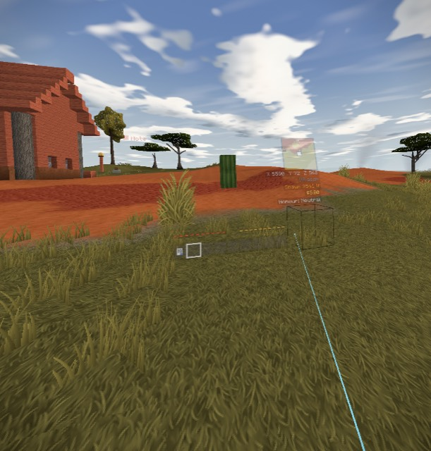

## 19:48:43 - Let me see, this is a...

- **Transcript:** Let me see, this is a...
- **Status:** open
- **Build:** 0.995 (35064603, M1-M4 (device-tested; ship riding, chests, comfort options, weapon wheel))
- **World:** Gate58869 (seed 1794958869)
- **Dimension:** Surface
- **Biome:** Desert
- **Position:** 5857.1 113.4 342.0
- **Facing:** north-east (yaw 50, pitch -24)
- **Held:** empty hand
- **Mount:** on foot, flying
- **Looking at:** nothing
- **Mode:** Creative, health 20/20
- **Time:** day 1 07:57, clear
- **Fps:** 72
- **Levels:** mic -41 dBFS, game sound -24 dBFS
- **Length:** 2.7 s (voice 0.8 s)
- **Just before:** -26s message: View recentred; -25s closed PauseMenu; -24s message: Right controller lost: bring it into view of the headset, or check its battery; -24s walked into Badlands; -23s holding empty hand; -21s message: Right controller is back; -19s message: A stranger in town: Ezra Quill; -17s message: Ezra Quill: My neighbour's goat ate my washing.; -14s opened PauseMenu; -14s walked into Savanna; -13s closed PauseMenu; -8s opened PauseMenu; -8s walked into Badlands; -8s message: Creative mode; -7s closed PauseMenu; -6s message: Flying; -2s opened PauseMenu; -1s closed PauseMenu; -0s message: Sky isle marked on the map; -0s walked into Desert
- **Repro (Mac):** `./snap.sh note --seed 1794958869 --x 5857.1 --z 342.0 --yaw -50 --pitch -24 --time 0.082`
- **Audio (this Mac):** /tmp/vn17local/raw/vn-20261117-194843-328.aac

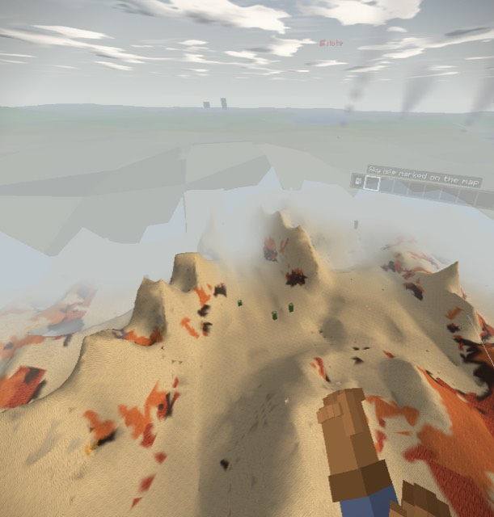

## 19:48:45 - controller issue

- **Transcript:** controller issue
- **Status:** open
- **Build:** 0.995 (35064603, M1-M4 (device-tested; ship riding, chests, comfort options, weapon wheel))
- **World:** Gate58869 (seed 1794958869)
- **Dimension:** Surface
- **Biome:** Desert
- **Position:** 5951.5 113.4 149.7
- **Facing:** north-east (yaw 34, pitch -24)
- **Held:** empty hand
- **Mount:** on foot, flying
- **Looking at:** nothing
- **Mode:** Creative, health 20/20
- **Time:** day 1 08:00, clear
- **Fps:** 72
- **Levels:** mic -27 dBFS, game sound -23 dBFS
- **Length:** 2.0 s (voice 0.7 s)
- **Just before:** -28s message: View recentred; -28s closed PauseMenu; -27s message: Right controller lost: bring it into view of the headset, or check its battery; -27s walked into Badlands; -26s holding empty hand; -23s message: Right controller is back; -21s message: A stranger in town: Ezra Quill; -19s message: Ezra Quill: My neighbour's goat ate my washing.; -17s opened PauseMenu; -17s walked into Savanna; -16s closed PauseMenu; -11s opened PauseMenu; -11s walked into Badlands; -10s message: Creative mode; -10s closed PauseMenu; -9s message: Flying; -5s opened PauseMenu; -4s closed PauseMenu; -3s message: Sky isle marked on the map; -3s walked into Desert; -1s message: Entering Ostewick
- **Repro (Mac):** `./snap.sh note --seed 1794958869 --x 5951.5 --z 149.7 --yaw -34 --pitch -24 --time 0.084`
- **Audio (this Mac):** /tmp/vn17local/raw/vn-20261117-194845-968.aac

## 19:48:59 - It was a control issue.

- **Transcript:** It was a control issue.
- **Status:** open
- **Build:** 0.995 (35064603, M1-M4 (device-tested; ship riding, chests, comfort options, weapon wheel))
- **World:** Gate58869 (seed 1794958869)
- **Dimension:** Surface
- **Biome:** Swamp
- **Position:** 6636.5 64.8 -373.6
- **Facing:** south (yaw 201, pitch -49)
- **Held:** empty hand
- **Mount:** on foot
- **Looking at:** Grass Block at 6635 64 -373
- **Mode:** Survival, health 20/20
- **Time:** day 1 08:17, clear
- **Fps:** 72
- **Levels:** mic -41 dBFS, game sound -22 dBFS
- **Length:** 2.7 s (voice 0.8 s)
- **Just before:** -30s closed PauseMenu; -25s opened PauseMenu; -25s walked into Badlands; -24s message: Creative mode; -24s closed PauseMenu; -23s message: Flying; -18s opened PauseMenu; -18s closed PauseMenu; -17s message: Sky isle marked on the map; -16s walked into Desert; -14s message: Entering Ostewick; -12s walked into Savanna; -10s walked into Forest; -8s walked into Birch Forest; -6s walked into Swamp; -6s message: Left controller lost: bring it into view of the headset, or check its battery; -3s message: Left controller is back
- **Repro (Mac):** `./snap.sh note --seed 1794958869 --x 6636.5 --z -373.6 --yaw 159 --pitch -49 --time 0.095`
- **Audio (this Mac):** /tmp/vn17local/raw/vn-20261117-194859-808.aac

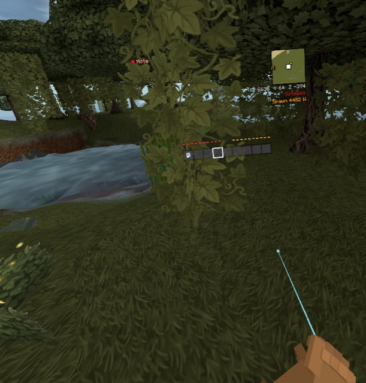

## 19:49:17 - All right, I think it feels smooth.

- **Transcript:** All right, I think it feels smooth.
- **Status:** open
- **Build:** 0.995 (35064603, M1-M4 (device-tested; ship riding, chests, comfort options, weapon wheel))
- **World:** Gate58869 (seed 1794958869)
- **Dimension:** Surface
- **Biome:** Swamp
- **Position:** 6617.1 82.1 -315.7
- **Facing:** north (yaw 13, pitch -22)
- **Held:** empty hand
- **Mount:** on foot, flying
- **Looking at:** nothing
- **Mode:** Creative, health 11/20
- **Time:** day 1 08:32, clear
- **Fps:** 71
- **Levels:** mic -24 dBFS, game sound -28 dBFS
- **Length:** 3.6 s (voice 1.3 s)
- **Just before:** -28s walked into Savanna; -26s walked into Forest; -24s walked into Birch Forest; -22s walked into Swamp; -22s message: Left controller lost: bring it into view of the headset, or check its battery; -19s message: Left controller is back; -14s took 4 damage (health 16/20); -13s opened PauseMenu; -12s took 8 damage (health 10/20); -11s closed PauseMenu; -10s opened PauseMenu; -9s message: Creative mode; -8s closed PauseMenu; -1s message: Flying
- **Repro (Mac):** `./snap.sh note --seed 1794958869 --x 6617.1 --z -315.7 --yaw -13 --pitch -22 --time 0.106`
- **Audio (this Mac):** /tmp/vn17local/raw/vn-20261117-194917-189.aac

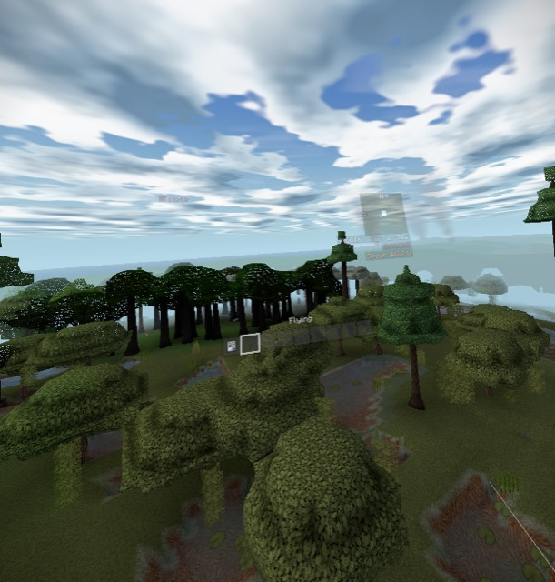

## 19:49:21 - Rainer distance at 6. Okay then.

- **Transcript:** Rainer distance at 6. Okay then.
- **Status:** open
- **Build:** 0.995 (35064603, M1-M4 (device-tested; ship riding, chests, comfort options, weapon wheel))
- **World:** Gate58869 (seed 1794958869)
- **Dimension:** Surface
- **Biome:** Swamp
- **Position:** 6527.8 101.9 -214.4
- **Facing:** south-west (yaw 240, pitch -17)
- **Held:** empty hand
- **Mount:** on foot, flying
- **Looking at:** nothing
- **Mode:** Creative, health 11/20, screen PauseMenu
- **Time:** day 1 08:36, clear
- **Fps:** 72
- **Levels:** mic -24 dBFS, game sound -41 dBFS
- **Length:** 4.7 s (voice 2.1 s)
- **Just before:** -29s walked into Birch Forest; -27s walked into Swamp; -27s message: Left controller lost: bring it into view of the headset, or check its battery; -23s message: Left controller is back; -19s took 4 damage (health 16/20); -17s opened PauseMenu; -17s took 8 damage (health 10/20); -15s closed PauseMenu; -14s opened PauseMenu; -13s message: Creative mode; -13s closed PauseMenu; -6s message: Flying; -3s opened PauseMenu; -3s walked into Ashen Grove; -3s closed PauseMenu; -1s walked into Swamp; -1s opened PauseMenu
- **Repro (Mac):** `./snap.sh note --seed 1794958869 --x 6527.8 --z -214.4 --yaw 120 --pitch -17 --time 0.109`
- **Audio (this Mac):** /tmp/vn17local/raw/vn-20261117-194921-628.aac

## 19:49:27 - That's one way to do it, I guess.

- **Transcript:** That's one way to do it, I guess.
- **Status:** open
- **Build:** 0.995 (35064603, M1-M4 (device-tested; ship riding, chests, comfort options, weapon wheel))
- **World:** Gate58869 (seed 1794958869)
- **Dimension:** Surface
- **Biome:** Dark Forest
- **Position:** 6420.5 67.2 -189.9
- **Facing:** west (yaw 269, pitch -29)
- **Held:** empty hand
- **Mount:** on foot
- **Looking at:** Grass Block at 6418 67 -190
- **Mode:** Creative, health 11/20
- **Time:** day 1 08:43, clear
- **Fps:** 72
- **Levels:** mic -45 dBFS, game sound -26 dBFS
- **Length:** 2.7 s (voice 1.2 s)
- **Just before:** -29s message: Left controller is back; -25s took 4 damage (health 16/20); -23s opened PauseMenu; -23s took 8 damage (health 10/20); -21s closed PauseMenu; -20s opened PauseMenu; -19s message: Creative mode; -19s closed PauseMenu; -12s message: Flying; -9s opened PauseMenu; -9s walked into Ashen Grove; -9s closed PauseMenu; -7s walked into Swamp; -7s opened PauseMenu; -6s closed PauseMenu; -5s walked into Forest; -3s walked into Swamp; -2s message: Walking
- **Repro (Mac):** `./snap.sh note --seed 1794958869 --x 6420.5 --z -189.9 --yaw 91 --pitch -29 --time 0.113`
- **Audio (this Mac):** /tmp/vn17local/raw/vn-20261117-194927-628.aac

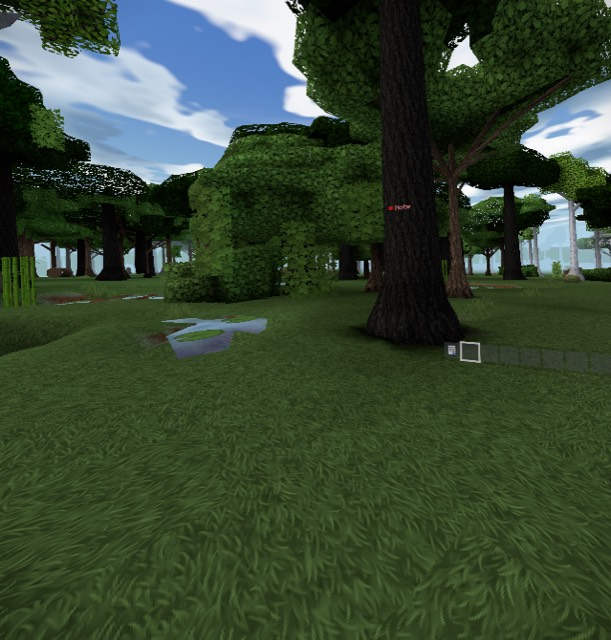

## 19:49:32 - Man, all my controls are fucked. You sucker.

- **Transcript:** Man, all my controls are fucked. You sucker.
- **Status:** open
- **Build:** 0.995 (35064603, M1-M4 (device-tested; ship riding, chests, comfort options, weapon wheel))
- **World:** Gate58869 (seed 1794958869)
- **Dimension:** Surface
- **Biome:** Dark Forest
- **Position:** 6421.5 67.9 -187.8
- **Facing:** west (yaw 258, pitch -18)
- **Held:** empty hand
- **Mount:** on foot
- **Looking at:** Dark Oak Log at 6416 68 -187
- **Mode:** Creative, health 11/20
- **Time:** day 1 08:49, clear
- **Fps:** 72
- **Levels:** mic -28 dBFS, game sound -22 dBFS
- **Length:** 3.9 s (voice 1.0 s)
- **Just before:** -29s took 4 damage (health 16/20); -28s opened PauseMenu; -27s took 8 damage (health 10/20); -26s closed PauseMenu; -25s opened PauseMenu; -24s message: Creative mode; -24s closed PauseMenu; -17s message: Flying; -14s opened PauseMenu; -13s walked into Ashen Grove; -13s closed PauseMenu; -11s walked into Swamp; -11s opened PauseMenu; -11s closed PauseMenu; -9s walked into Forest; -7s walked into Swamp; -7s message: Walking; -3s walked into Dark Forest
- **Repro (Mac):** `./snap.sh note --seed 1794958869 --x 6421.5 --z -187.8 --yaw 102 --pitch -18 --time 0.117`
- **Audio (this Mac):** /tmp/vn17local/raw/vn-20261117-194932-408.aac

## 19:49:39 - Oh, that doesn't look good.

- **Transcript:** Oh, that doesn't look good.
- **Status:** open
- **Build:** 0.995 (35064603, M1-M4 (device-tested; ship riding, chests, comfort options, weapon wheel))
- **World:** Gate58869 (seed 1794958869)
- **Dimension:** Surface
- **Biome:** Dark Forest
- **Position:** 6421.6 67.8 -187.8
- **Facing:** west (yaw 263, pitch -29)
- **Held:** Greywall Dispatch x1
- **Mount:** on foot
- **Looking at:** nothing
- **Mode:** Creative, health 11/20
- **Time:** day 1 08:57, clear
- **Fps:** 72
- **Levels:** mic -31 dBFS, game sound -24 dBFS
- **Length:** 2.4 s (voice 0.8 s)
- **Just before:** -23s message: Flying; -21s opened PauseMenu; -20s walked into Ashen Grove; -20s closed PauseMenu; -18s walked into Swamp; -18s opened PauseMenu; -17s closed PauseMenu; -16s walked into Forest; -14s walked into Swamp; -14s message: Walking; -10s walked into Dark Forest; -5s holding Greywall Dispatch; -5s message: Greywall Dispatch
- **Repro (Mac):** `./snap.sh note --seed 1794958869 --x 6421.6 --z -187.8 --yaw 97 --pitch -29 --time 0.123`
- **Audio (this Mac):** /tmp/vn17local/raw/vn-20261117-194939-248.aac

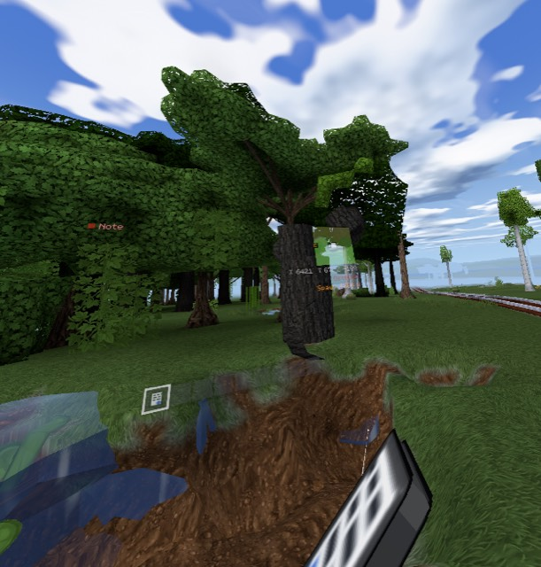

## 19:50:02 - Why is it still breaking stuff?

- **Transcript:** Why is it still breaking stuff?
- **Status:** open
- **Build:** 0.995 (35064603, M1-M4 (device-tested; ship riding, chests, comfort options, weapon wheel))
- **World:** Gate58869 (seed 1794958869)
- **Dimension:** Surface
- **Biome:** Swamp
- **Position:** 6420.1 67.2 -191.3
- **Facing:** west (yaw 277, pitch -22)
- **Held:** Greywall Dispatch x1
- **Mount:** on foot
- **Looking at:** Grass Block at 6416 67 -192
- **Mode:** Creative, health 11/20
- **Time:** day 1 09:25, clear
- **Fps:** 72
- **Levels:** mic -30 dBFS, game sound -15 dBFS
- **Length:** 3.4 s (voice 1.7 s)
- **Just before:** -28s holding Greywall Dispatch; -28s message: Greywall Dispatch; -7s message: Right controller lost: bring it into view of the headset, or check its battery; -2s message: Right controller is back; -1s walked into Swamp
- **Repro (Mac):** `./snap.sh note --seed 1794958869 --x 6420.1 --z -191.3 --yaw 83 --pitch -22 --time 0.142`
- **Audio (this Mac):** /tmp/vn17local/raw/vn-20261117-195002-428.aac

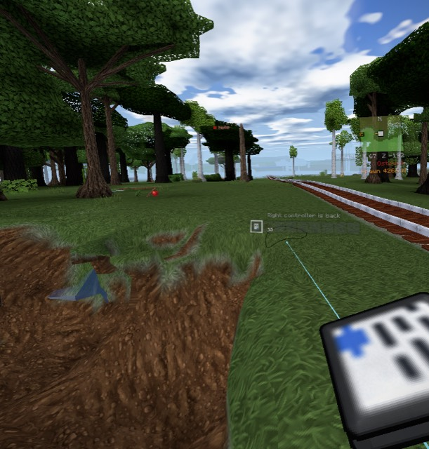

## 19:50:18 - I'm going to use the left controller, I think.

- **Transcript:** I'm going to use the left controller, I think.
- **Status:** open
- **Build:** 0.995 (35064603, M1-M4 (device-tested; ship riding, chests, comfort options, weapon wheel))
- **World:** Gate58869 (seed 1794958869)
- **Dimension:** Surface
- **Biome:** Dark Forest
- **Position:** 6413.8 67.3 -192.4
- **Facing:** south-west (yaw 244, pitch -12)
- **Held:** Dark Oak Log x30
- **Mount:** on foot
- **Looking at:** nothing
- **Mode:** Creative, health 11/20
- **Time:** day 1 09:44, clear
- **Fps:** 71
- **Levels:** mic -29 dBFS, game sound -22 dBFS
- **Length:** 3.1 s (voice 1.2 s)
- **Just before:** -23s message: Right controller lost: bring it into view of the headset, or check its battery; -18s message: Right controller is back; -18s walked into Swamp; -16s walked into Dark Forest; -13s holding empty hand; -11s holding Greywall Dispatch; -11s message: Greywall Dispatch; -7s holding Dark Oak Log; -7s message: Dark Oak Log; -3s message: Right controller lost: bring it into view of the headset, or check its battery
- **Repro (Mac):** `./snap.sh note --seed 1794958869 --x 6413.8 --z -192.4 --yaw 116 --pitch -12 --time 0.156`
- **Audio (this Mac):** /tmp/vn17local/raw/vn-20261117-195018-928.aac

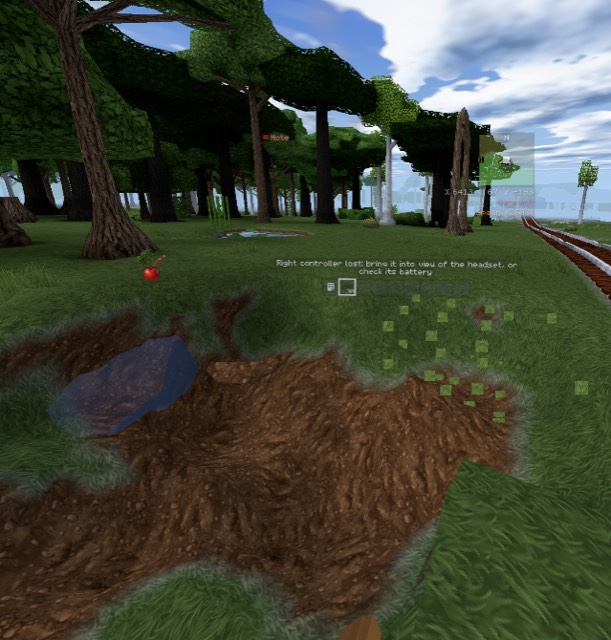

## 19:50:22 - What the heck, man?

- **Transcript:** What the heck, man?
- **Status:** open
- **Build:** 0.995 (35064603, M1-M4 (device-tested; ship riding, chests, comfort options, weapon wheel))
- **World:** Gate58869 (seed 1794958869)
- **Dimension:** Surface
- **Biome:** Dark Forest
- **Position:** 6414.0 67.3 -192.5
- **Facing:** east (yaw 93, pitch -14)
- **Held:** Dark Oak Log x30
- **Mount:** on foot
- **Looking at:** Grass Block at 6419 67 -193
- **Mode:** Creative, health 11/20
- **Time:** day 1 09:48, clear
- **Fps:** 71
- **Levels:** mic -33 dBFS, game sound -21 dBFS
- **Length:** 2.7 s (voice 1.1 s)
- **Just before:** -27s message: Right controller lost: bring it into view of the headset, or check its battery; -22s message: Right controller is back; -21s walked into Swamp; -19s walked into Dark Forest; -16s holding empty hand; -15s holding Greywall Dispatch; -15s message: Greywall Dispatch; -11s holding Dark Oak Log; -11s message: Dark Oak Log; -7s message: Right controller lost: bring it into view of the headset, or check its battery
- **Repro (Mac):** `./snap.sh note --seed 1794958869 --x 6414.0 --z -192.5 --yaw -93 --pitch -14 --time 0.159`
- **Audio (this Mac):** /tmp/vn17local/raw/vn-20261117-195022-289.aac

## 19:50:28 - Oh, Christ.

- **Transcript:** Oh, Christ.
- **Status:** open
- **Build:** 0.995 (35064603, M1-M4 (device-tested; ship riding, chests, comfort options, weapon wheel))
- **World:** Gate58869 (seed 1794958869)
- **Dimension:** Surface
- **Biome:** Dark Forest
- **Position:** 6413.6 63.3 -192.4
- **Facing:** south-east (yaw 119, pitch -58)
- **Held:** Dark Oak Log x30
- **Mount:** on foot
- **Looking at:** Dirt at 6414 63 -193
- **Mode:** Creative, health 11/20
- **Time:** day 1 09:56, clear
- **Fps:** 71
- **Levels:** mic -32 dBFS, game sound -18 dBFS
- **Length:** 3.0 s (voice 1.0 s)
- **Just before:** -28s message: Right controller is back; -27s walked into Swamp; -25s walked into Dark Forest; -22s holding empty hand; -21s holding Greywall Dispatch; -21s message: Greywall Dispatch; -17s holding Dark Oak Log; -17s message: Dark Oak Log; -13s message: Right controller lost: bring it into view of the headset, or check its battery
- **Repro (Mac):** `./snap.sh note --seed 1794958869 --x 6413.6 --z -192.4 --yaw -119 --pitch -58 --time 0.164`
- **Audio (this Mac):** /tmp/vn17local/raw/vn-20261117-195028-608.aac

## 19:50:33 - Left controller is still hitting shit.

- **Transcript:** Left controller is still hitting shit.
- **Status:** open
- **Build:** 0.995 (35064603, M1-M4 (device-tested; ship riding, chests, comfort options, weapon wheel))
- **World:** Gate58869 (seed 1794958869)
- **Dimension:** Surface
- **Biome:** Dark Forest
- **Position:** 6413.3 59.7 -192.6
- **Facing:** south-east (yaw 119, pitch -10)
- **Held:** Dark Oak Log x30
- **Mount:** on foot
- **Looking at:** Stone at 6418 60 -190
- **Mode:** Creative, health 11/20
- **Time:** day 1 10:01, clear
- **Fps:** 72
- **Levels:** mic -29 dBFS, game sound -16 dBFS
- **Length:** 3.2 s (voice 1.3 s)
- **Just before:** -30s walked into Dark Forest; -27s holding empty hand; -26s holding Greywall Dispatch; -26s message: Greywall Dispatch; -21s holding Dark Oak Log; -21s message: Dark Oak Log; -17s message: Right controller lost: bring it into view of the headset, or check its battery
- **Repro (Mac):** `./snap.sh note --seed 1794958869 --x 6413.3 --z -192.6 --yaw -119 --pitch -10 --time 0.168`
- **Audio (this Mac):** /tmp/vn17local/raw/vn-20261117-195033-028.aac

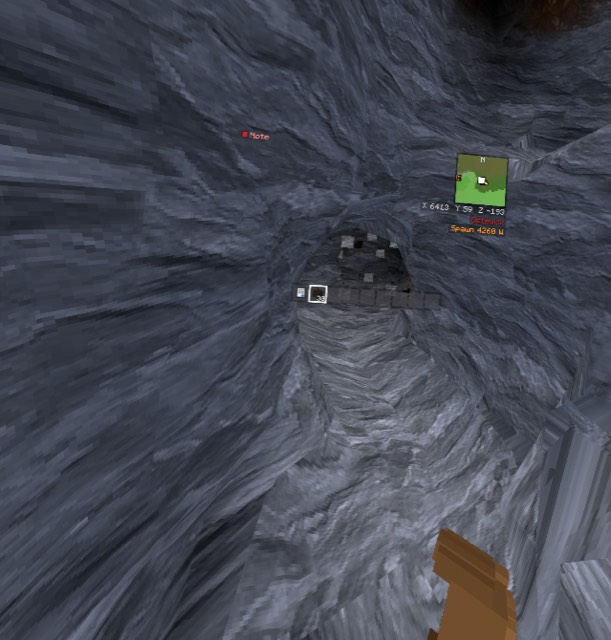

## 19:51:00 - What the fuck?

- **Transcript:** What the fuck?
- **Status:** open
- **Build:** 0.995 (35064603, M1-M4 (device-tested; ship riding, chests, comfort options, weapon wheel))
- **World:** Gate58869 (seed 1794958869)
- **Dimension:** Surface
- **Biome:** Forest
- **Position:** 6413.5 170.2 -73.1
- **Facing:** south (yaw 186, pitch -32)
- **Held:** Stone x64
- **Mount:** on foot
- **Looking at:** nothing
- **Mode:** Creative, health 11/20
- **Time:** day 1 10:20, clear
- **Fps:** 71
- **Levels:** mic -26 dBFS, game sound -18 dBFS
- **Length:** 2.4 s (voice 0.6 s)
- **Just before:** -23s holding Greywall Dispatch; -23s message: Greywall Dispatch; -18s opened PauseMenu; -18s message: Controllers put down: paused; -6s closed PauseMenu; -6s holding Stone; -6s message: Stone; -4s message: A Stormwarden Frigate looms on the horizon; -3s walked into Forest
- **Repro (Mac):** `./snap.sh note --seed 1794958869 --x 6413.5 --z -73.1 --yaw 174 --pitch -32 --time 0.181`
- **Audio (this Mac):** /tmp/vn17local/raw/vn-20261117-195100-548.aac

## 19:51:03 - How did I even get in here?

- **Transcript:** How did I even get in here?
- **Status:** open
- **Build:** 0.995 (35064603, M1-M4 (device-tested; ship riding, chests, comfort options, weapon wheel))
- **World:** Gate58869 (seed 1794958869)
- **Dimension:** Surface
- **Biome:** Forest
- **Position:** 6413.6 169.9 -97.1
- **Facing:** north-east (yaw 51, pitch 4)
- **Held:** Dark Oak Log x30
- **Mount:** on foot
- **Looking at:** nothing
- **Mode:** Creative, health 11/20
- **Time:** day 1 10:23, clear
- **Fps:** 71
- **Levels:** mic -24 dBFS, game sound -11 dBFS
- **Length:** 2.6 s (voice 1.2 s)
- **Just before:** -26s holding Greywall Dispatch; -26s message: Greywall Dispatch; -21s opened PauseMenu; -21s message: Controllers put down: paused; -9s closed PauseMenu; -9s holding Stone; -9s message: Stone; -7s message: A Stormwarden Frigate looms on the horizon; -5s walked into Forest; -1s holding Dark Oak Log; -1s message: Dark Oak Log
- **Repro (Mac):** `./snap.sh note --seed 1794958869 --x 6413.6 --z -97.1 --yaw -51 --pitch 4 --time 0.183`
- **Audio (this Mac):** /tmp/vn17local/raw/vn-20261117-195103-028.aac

## 19:51:05 - Man, what is going on?

- **Transcript:** Man, what is going on?
- **Status:** open
- **Build:** 0.995 (35064603, M1-M4 (device-tested; ship riding, chests, comfort options, weapon wheel))
- **World:** Gate58869 (seed 1794958869)
- **Dimension:** Surface
- **Biome:** Forest
- **Position:** 6413.5 169.9 -125.3
- **Facing:** north-east (yaw 39, pitch -1)
- **Held:** Dark Oak Log x30
- **Mount:** on foot
- **Looking at:** nothing
- **Mode:** Creative, health 11/20
- **Time:** day 1 10:26, clear
- **Fps:** 72
- **Levels:** mic -27 dBFS, game sound -16 dBFS
- **Length:** 2.7 s (voice 1.2 s)
- **Just before:** -29s holding Greywall Dispatch; -29s message: Greywall Dispatch; -23s opened PauseMenu; -23s message: Controllers put down: paused; -11s closed PauseMenu; -11s holding Stone; -11s message: Stone; -9s message: A Stormwarden Frigate looms on the horizon; -8s walked into Forest; -4s holding Dark Oak Log; -4s message: Dark Oak Log
- **Repro (Mac):** `./snap.sh note --seed 1794958869 --x 6413.5 --z -125.3 --yaw -39 --pitch -1 --time 0.185`
- **Audio (this Mac):** /tmp/vn17local/raw/vn-20261117-195105-848.aac

## 19:51:17 - Okay, that's a good sign.

- **Transcript:** Okay, that's a good sign.
- **Status:** open
- **Build:** 0.995 (35064603, M1-M4 (device-tested; ship riding, chests, comfort options, weapon wheel))
- **World:** Gate58869 (seed 1794958869)
- **Dimension:** Surface
- **Biome:** Swamp
- **Position:** 6413.4 170.0 -246.1
- **Facing:** east (yaw 80, pitch -27)
- **Held:** Stone x64
- **Mount:** on foot
- **Looking at:** nothing
- **Mode:** Creative, health 11/20
- **Time:** day 1 10:41, clear
- **Fps:** 71
- **Levels:** mic -34 dBFS, game sound -16 dBFS
- **Length:** 2.9 s (voice 1.2 s)
- **Just before:** -24s closed PauseMenu; -23s holding Stone; -23s message: Stone; -21s message: A Stormwarden Frigate looms on the horizon; -20s walked into Forest; -16s holding Dark Oak Log; -16s message: Dark Oak Log; -8s walked into Dark Forest; -5s message: Right controller is back; -4s holding Stone; -2s walked into Swamp
- **Repro (Mac):** `./snap.sh note --seed 1794958869 --x 6413.4 --z -246.1 --yaw -80 --pitch -27 --time 0.195`
- **Audio (this Mac):** /tmp/vn17local/raw/vn-20261117-195117-888.aac

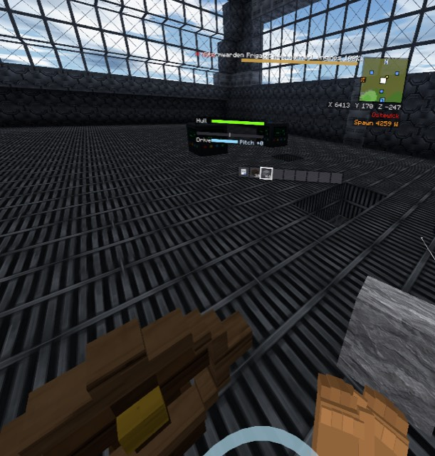

## 19:51:32 - Oh, whoa. This is something. Holy cow.

- **Transcript:** Oh, whoa. This is something. Holy cow.
- **Status:** open
- **Build:** 0.995 (35064603, M1-M4 (device-tested; ship riding, chests, comfort options, weapon wheel))
- **World:** Gate58869 (seed 1794958869)
- **Dimension:** Surface
- **Biome:** Beach
- **Position:** 6431.8 165.4 -387.6
- **Facing:** north (yaw 11, pitch -33)
- **Held:** empty hand
- **Mount:** piloting Stormwarden Frigate
- **Looking at:** nothing
- **Mode:** Creative, health 11/20
- **Time:** day 1 10:58, clear
- **Fps:** 71
- **Levels:** mic -24 dBFS, game sound -22 dBFS
- **Length:** 4.6 s (voice 2.3 s)
- **Just before:** -23s walked into Dark Forest; -20s message: Right controller is back; -19s holding Stone; -17s walked into Swamp; -2s piloting Stormwarden Frigate; -2s holding empty hand; -2s message: Steering Stormwarden Frigate
- **Repro (Mac):** `./snap.sh note --seed 1794958869 --x 6431.8 --z -387.6 --yaw -11 --pitch -33 --time 0.208`
- **Audio (this Mac):** /tmp/vn17local/raw/vn-20261117-195132-608.aac

## 19:51:47 - It's not the normal frigate is it holy cow

- **Transcript:** It's not the normal frigate is it holy cow
- **Status:** open
- **Build:** 0.995 (35064603, M1-M4 (device-tested; ship riding, chests, comfort options, weapon wheel))
- **World:** Gate58869 (seed 1794958869)
- **Dimension:** Surface
- **Biome:** Ocean
- **Position:** 6489.8 174.3 -446.1
- **Facing:** south-west (yaw 225, pitch -40)
- **Held:** empty hand
- **Mount:** piloting Stormwarden Frigate
- **Looking at:** nothing
- **Mode:** Creative, health 11/20
- **Time:** day 1 11:16, clear
- **Fps:** 72
- **Levels:** mic -25 dBFS, game sound -18 dBFS
- **Length:** 3.4 s (voice 1.7 s)
- **Just before:** -16s piloting Stormwarden Frigate; -16s holding empty hand; -16s message: Steering Stormwarden Frigate; -14s message: You have taken command of the Stormwarden Frigate!; -13s walked into Ocean
- **Repro (Mac):** `./snap.sh note --seed 1794958869 --x 6489.8 --z -446.1 --yaw 135 --pitch -40 --time 0.220`
- **Audio (this Mac):** /tmp/vn17local/raw/vn-20261117-195147-068.aac

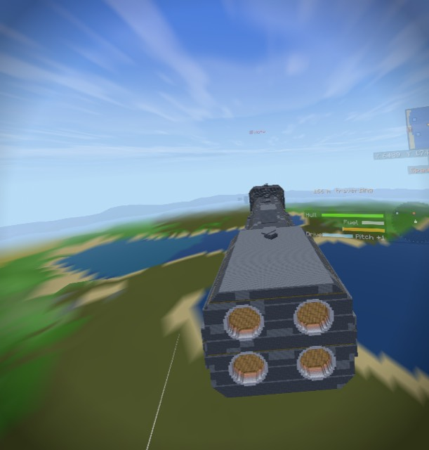

## 19:51:56 - Sure as hell doesn't move very fast though. Holy cow

- **Transcript:** Sure as hell doesn't move very fast though. Holy cow
- **Status:** open
- **Build:** 0.995 (35064603, M1-M4 (device-tested; ship riding, chests, comfort options, weapon wheel))
- **World:** Gate58869 (seed 1794958869)
- **Dimension:** Surface
- **Biome:** Beach
- **Position:** 6368.4 168.8 -568.2
- **Facing:** south-west (yaw 208, pitch -50)
- **Held:** empty hand
- **Mount:** piloting Stormwarden Frigate
- **Looking at:** nothing
- **Mode:** Creative, health 11/20
- **Time:** day 1 11:27, clear
- **Fps:** 72
- **Levels:** mic -30 dBFS, game sound -17 dBFS
- **Length:** 4.2 s (voice 2.2 s)
- **Just before:** -26s piloting Stormwarden Frigate; -26s holding empty hand; -26s message: Steering Stormwarden Frigate; -24s message: You have taken command of the Stormwarden Frigate!; -23s walked into Ocean; -5s walked into Swamp; -1s walked into Beach
- **Repro (Mac):** `./snap.sh note --seed 1794958869 --x 6368.4 --z -568.2 --yaw 152 --pitch -50 --time 0.228`
- **Audio (this Mac):** /tmp/vn17local/raw/vn-20261117-195156-628.aac

## 19:52:00 - Surely this thing has a...

- **Transcript:** Surely this thing has a...
- **Status:** open
- **Build:** 0.995 (35064603, M1-M4 (device-tested; ship riding, chests, comfort options, weapon wheel))
- **World:** Gate58869 (seed 1794958869)
- **Dimension:** Surface
- **Biome:** Ocean
- **Position:** 6300.8 180.0 -599.9
- **Facing:** south-east (yaw 144, pitch -41)
- **Held:** empty hand
- **Mount:** piloting Stormwarden Frigate
- **Looking at:** nothing
- **Mode:** Creative, health 11/20
- **Time:** day 1 11:32, clear
- **Fps:** 72
- **Levels:** mic -20 dBFS, game sound -16 dBFS
- **Length:** 2.7 s (voice 1.3 s)
- **Just before:** -28s message: You have taken command of the Stormwarden Frigate!; -27s walked into Ocean; -9s walked into Swamp; -5s walked into Beach; -1s walked into Ocean
- **Repro (Mac):** `./snap.sh note --seed 1794958869 --x 6300.8 --z -599.9 --yaw -144 --pitch -41 --time 0.231`
- **Audio (this Mac):** /tmp/vn17local/raw/vn-20261117-195200-888.aac

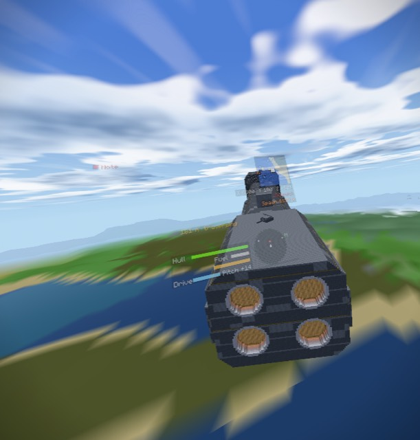

## 19:52:03 - Speed mode, I mean the other frigate didn't move like this.

- **Transcript:** Speed mode, I mean the other frigate didn't move like this.
- **Status:** open
- **Build:** 0.995 (35064603, M1-M4 (device-tested; ship riding, chests, comfort options, weapon wheel))
- **World:** Gate58869 (seed 1794958869)
- **Dimension:** Surface
- **Biome:** Ocean
- **Position:** 6253.1 192.5 -619.5
- **Facing:** south-east (yaw 154, pitch -2)
- **Held:** empty hand
- **Mount:** piloting Stormwarden Frigate
- **Looking at:** nothing
- **Mode:** Creative, health 11/20
- **Time:** day 1 11:36, clear
- **Fps:** 72
- **Levels:** mic -26 dBFS, game sound -17 dBFS
- **Length:** 5.0 s (voice 2.3 s)
- **Just before:** -30s walked into Ocean; -12s walked into Swamp; -8s walked into Beach; -4s walked into Ocean
- **Repro (Mac):** `./snap.sh note --seed 1794958869 --x 6253.1 --z -619.5 --yaw -154 --pitch -2 --time 0.234`
- **Audio (this Mac):** /tmp/vn17local/raw/vn-20261117-195203-828.aac

## 19:52:15 - I'm gonna fly right into the ground and see what happens.

- **Transcript:** I'm gonna fly right into the ground and see what happens.
- **Status:** open
- **Build:** 0.995 (35064603, M1-M4 (device-tested; ship riding, chests, comfort options, weapon wheel))
- **World:** Gate58869 (seed 1794958869)
- **Dimension:** Surface
- **Biome:** Dark Forest
- **Position:** 6050.2 222.1 -721.4
- **Facing:** south-west (yaw 217, pitch -19)
- **Held:** empty hand
- **Mount:** piloting Stormwarden Frigate
- **Looking at:** nothing
- **Mode:** Creative, health 11/20
- **Time:** day 1 11:50, clear
- **Fps:** 71
- **Levels:** mic -44 dBFS, game sound -15 dBFS
- **Length:** 3.2 s (voice 1.7 s)
- **Just before:** -24s walked into Swamp; -20s walked into Beach; -16s walked into Ocean; -10s walked into Beach; -7s walked into Swamp; -3s walked into Dark Forest; -1s walked into Swamp
- **Repro (Mac):** `./snap.sh note --seed 1794958869 --x 6050.2 --z -721.4 --yaw 143 --pitch -19 --time 0.243`
- **Audio (this Mac):** /tmp/vn17local/raw/vn-20261117-195215-568.aac

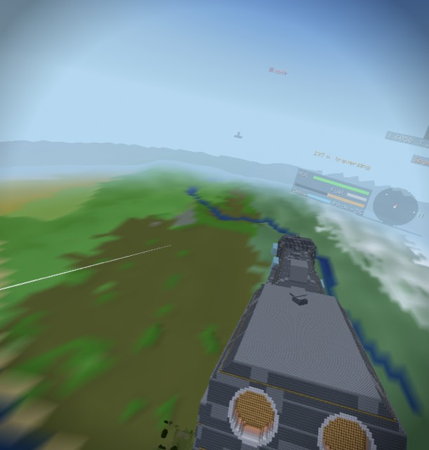

## 19:52:24 - Like man, this thing's big. Why can't I move? Let me out of here.

- **Transcript:** Like man, this thing's big. Why can't I move? Let me out of here.
- **Status:** open
- **Build:** 0.995 (35064603, M1-M4 (device-tested; ship riding, chests, comfort options, weapon wheel))
- **World:** Gate58869 (seed 1794958869)
- **Dimension:** Surface
- **Biome:** Taiga
- **Position:** 6013.2 146.2 -797.1
- **Facing:** south-west (yaw 207, pitch -9)
- **Held:** Stone x64
- **Mount:** on foot
- **Looking at:** nothing
- **Mode:** Creative, health 11/20
- **Time:** day 1 12:01, clear
- **Fps:** 71
- **Levels:** mic -38 dBFS, game sound -10 dBFS
- **Length:** 5.3 s (voice 2.9 s)
- **Just before:** -29s walked into Beach; -25s walked into Ocean; -19s walked into Beach; -17s walked into Swamp; -13s walked into Dark Forest; -11s walked into Swamp; -9s walked into Dark Forest; -7s walked into Taiga; -6s message: The Stormwarden Frigate's engines shook loose and stopped; -2s stopped piloting Stormwarden Frigate; -2s holding Stone; -1s message: Flying
- **Repro (Mac):** `./snap.sh note --seed 1794958869 --x 6013.2 --z -797.1 --yaw 153 --pitch -9 --time 0.251`
- **Audio (this Mac):** /tmp/vn17local/raw/vn-20261117-195224-988.aac

## 19:52:29 - Am I on some agent bill? Like, what the fuck?

- **Transcript:** Am I on some agent bill? Like, what the fuck?
- **Status:** open
- **Build:** 0.995 (35064603, M1-M4 (device-tested; ship riding, chests, comfort options, weapon wheel))
- **World:** Gate58869 (seed 1794958869)
- **Dimension:** Surface
- **Biome:** Taiga
- **Position:** 6013.8 144.4 -801.5
- **Facing:** south-west (yaw 241, pitch -56)
- **Held:** Stone x64
- **Mount:** on foot
- **Looking at:** nothing
- **Mode:** Creative, health 11/20
- **Time:** day 1 12:07, clear
- **Fps:** 66
- **Levels:** mic -25 dBFS, game sound -17 dBFS
- **Length:** 3.3 s (voice 1.7 s)
- **Just before:** -30s walked into Ocean; -24s walked into Beach; -22s walked into Swamp; -18s walked into Dark Forest; -16s walked into Swamp; -14s walked into Dark Forest; -12s walked into Taiga; -11s message: The Stormwarden Frigate's engines shook loose and stopped; -7s stopped piloting Stormwarden Frigate; -7s holding Stone; -6s message: Flying
- **Repro (Mac):** `./snap.sh note --seed 1794958869 --x 6013.8 --z -801.5 --yaw 119 --pitch -56 --time 0.255`
- **Audio (this Mac):** /tmp/vn17local/raw/vn-20261117-195229-988.aac

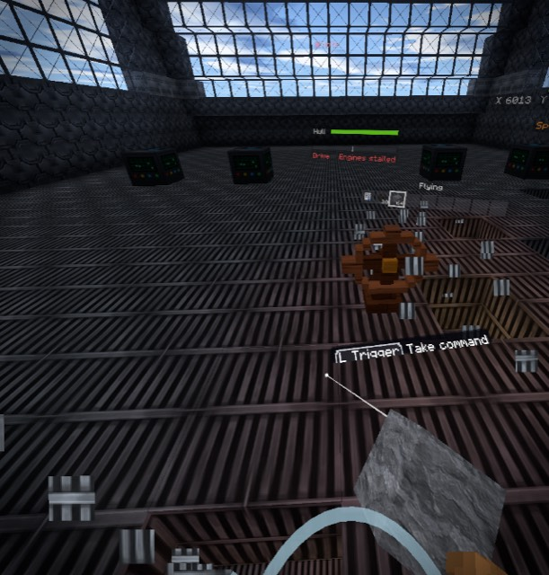

## 19:52:33 - Okay, if I only got out of it, I couldn't leave.

- **Transcript:** Okay, if I only got out of it, I couldn't leave.
- **Status:** open
- **Build:** 0.995 (35064603, M1-M4 (device-tested; ship riding, chests, comfort options, weapon wheel))
- **World:** Gate58869 (seed 1794958869)
- **Dimension:** Surface
- **Biome:** Taiga
- **Position:** 6007.4 138.0 -801.9
- **Facing:** south-west (yaw 222, pitch -7)
- **Held:** Stone x64
- **Mount:** on foot
- **Looking at:** nothing
- **Mode:** Creative, health 11/20
- **Time:** day 1 12:11, clear
- **Fps:** 66
- **Levels:** mic -31 dBFS, game sound -16 dBFS
- **Length:** 3.2 s (voice 1.6 s)
- **Just before:** -27s walked into Beach; -25s walked into Swamp; -21s walked into Dark Forest; -19s walked into Swamp; -17s walked into Dark Forest; -15s walked into Taiga; -14s message: The Stormwarden Frigate's engines shook loose and stopped; -10s stopped piloting Stormwarden Frigate; -10s holding Stone; -9s message: Flying; -3s message: Walking; -2s message: The Stormwarden Frigate's engines caught again
- **Repro (Mac):** `./snap.sh note --seed 1794958869 --x 6007.4 --z -801.9 --yaw 138 --pitch -7 --time 0.258`
- **Audio (this Mac):** /tmp/vn17local/raw/vn-20261117-195233-248.aac

## 19:52:46 - Okay, very good.

- **Transcript:** Okay, very good.
- **Status:** open
- **Build:** 0.995 (35064603, M1-M4 (device-tested; ship riding, chests, comfort options, weapon wheel))
- **World:** Gate58869 (seed 1794958869)
- **Dimension:** Surface
- **Biome:** Taiga
- **Position:** 5909.3 98.9 -688.3
- **Facing:** north (yaw 10, pitch -50)
- **Held:** Stone x64
- **Mount:** on foot, flying
- **Looking at:** nothing
- **Mode:** Creative, health 11/20
- **Time:** day 1 12:27, clear
- **Fps:** 66
- **Levels:** mic -26 dBFS, game sound -18 dBFS
- **Length:** 2.5 s (voice 1.0 s)
- **Just before:** -29s walked into Taiga; -28s message: The Stormwarden Frigate's engines shook loose and stopped; -24s stopped piloting Stormwarden Frigate; -24s holding Stone; -23s message: Flying; -17s message: Walking; -15s message: The Stormwarden Frigate's engines caught again; -11s message: Flying; -5s message: Walking; -5s walked into Swamp; -3s message: Flying
- **Repro (Mac):** `./snap.sh note --seed 1794958869 --x 5909.3 --z -688.3 --yaw -10 --pitch -50 --time 0.269`
- **Audio (this Mac):** /tmp/vn17local/raw/vn-20261117-195246-808.aac

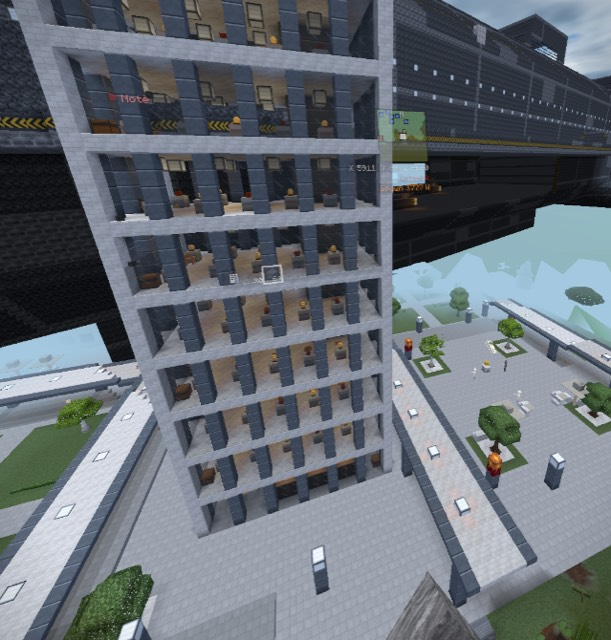

## 19:52:51 - I don't know if it was shooting out. Nice.

- **Transcript:** I don't know if it was shooting out. Nice.
- **Status:** open
- **Build:** 0.995 (35064603, M1-M4 (device-tested; ship riding, chests, comfort options, weapon wheel))
- **World:** Gate58869 (seed 1794958869)
- **Dimension:** Surface
- **Biome:** Old Growth Spruce Taiga
- **Position:** 5952.4 98.9 -694.9
- **Facing:** north (yaw 349, pitch -34)
- **Held:** Stone x64
- **Mount:** on foot, flying
- **Looking at:** nothing
- **Mode:** Creative, health 11/20
- **Time:** day 1 12:34, clear
- **Fps:** 68
- **Levels:** mic -34 dBFS, game sound -15 dBFS
- **Length:** 3.2 s (voice 1.6 s)
- **Just before:** -29s stopped piloting Stormwarden Frigate; -29s holding Stone; -28s message: Flying; -22s message: Walking; -20s message: The Stormwarden Frigate's engines caught again; -16s message: Flying; -10s message: Walking; -10s walked into Swamp; -9s message: Flying; -4s walked into Old Growth Spruce Taiga; -2s walked into Taiga
- **Repro (Mac):** `./snap.sh note --seed 1794958869 --x 5952.4 --z -694.9 --yaw 11 --pitch -34 --time 0.274`
- **Audio (this Mac):** /tmp/vn17local/raw/vn-20261117-195251-988.aac

## 19:53:02 - I'm convinced this is not a coincidence.

- **Transcript:** I'm convinced this is not a coincidence.
- **Status:** open
- **Build:** 0.995 (35064603, M1-M4 (device-tested; ship riding, chests, comfort options, weapon wheel))
- **World:** Gate58869 (seed 1794958869)
- **Dimension:** Surface
- **Biome:** Snowy Taiga
- **Position:** 6167.5 70.8 -2388.1
- **Facing:** north-east (yaw 66, pitch -33)
- **Held:** Stone x64
- **Mount:** riding Minecart
- **Looking at:** Gravel at 6170 68 -2390
- **Mode:** Creative, health 11/20
- **Time:** day 1 12:46, clear
- **Fps:** 71
- **Levels:** mic -41 dBFS, game sound -17 dBFS
- **Length:** 6.3 s (voice 3.5 s)
- **Just before:** -27s message: Flying; -21s message: Walking; -20s walked into Swamp; -19s message: Flying; -14s walked into Old Growth Spruce Taiga; -12s walked into Taiga; -10s walked into Old Growth Spruce Taiga; -9s message: Walking; -8s walked into Taiga; -7s message: Stone Ford marked on the map; -6s walked into Snowy Plains; -5s mounted Minecart; -5s message: Fort Flint Station marked on the map; -2s message: You found the Stone & Fort Rail Road: 2 stations, marked on your map; -1s opened PauseMenu; -0s closed PauseMenu; -0s walked into Snowy Taiga
- **While talking:** -4s message: Riding the Stone & Fort Rail Road; -2s message: Ruth Quill: Hi. Sorry, I'm in a hurry. Hello though.; -1s walked into Snowy Plains
- **Position at the end:** 6232.2 70.7 -2388.1
- **Repro (Mac):** `./snap.sh note --seed 1794958869 --x 6167.5 --z -2388.1 --yaw -66 --pitch -33 --time 0.282`
- **Audio (this Mac):** /tmp/vn17local/raw/vn-20261117-195302-749.aac

## 19:53:08 - I must be on some sort of agent build or something because I keep gett

- **Transcript:** I must be on some sort of agent build or something because I keep getting spawned around all around the map.
- **Status:** open
- **Build:** 0.995 (35064603, M1-M4 (device-tested; ship riding, chests, comfort options, weapon wheel))
- **World:** Gate58869 (seed 1794958869)
- **Dimension:** Surface
- **Biome:** Snowy Plains
- **Position:** 6247.9 71.3 -2388.1
- **Facing:** north-east (yaw 43, pitch -48)
- **Held:** Stone x64
- **Mount:** riding Minecart
- **Looking at:** Gravel at 6249 69 -2390
- **Mode:** Creative, health 11/20
- **Time:** day 1 12:53, clear
- **Fps:** 72
- **Levels:** mic -21 dBFS, game sound -10 dBFS
- **Length:** 6.6 s (voice 4.3 s)
- **Just before:** -27s message: Walking; -26s walked into Swamp; -25s message: Flying; -20s walked into Old Growth Spruce Taiga; -18s walked into Taiga; -16s walked into Old Growth Spruce Taiga; -15s message: Walking; -14s walked into Taiga; -13s message: Stone Ford marked on the map; -12s walked into Snowy Plains; -11s mounted Minecart; -11s message: Fort Flint Station marked on the map; -8s message: You found the Stone & Fort Rail Road: 2 stations, marked on your map; -7s opened PauseMenu; -6s closed PauseMenu; -6s walked into Snowy Taiga; -5s message: Riding the Stone & Fort Rail Road; -3s message: Ruth Quill: Hi. Sorry, I'm in a hurry. Hello though.; -2s walked into Snowy Plains
- **Position at the end:** 6328.5 80.8 -2449.7
- **Repro (Mac):** `./snap.sh note --seed 1794958869 --x 6247.9 --z -2388.1 --yaw -43 --pitch -48 --time 0.287`
- **Audio (this Mac):** /tmp/vn17local/raw/vn-20261117-195308-648.aac

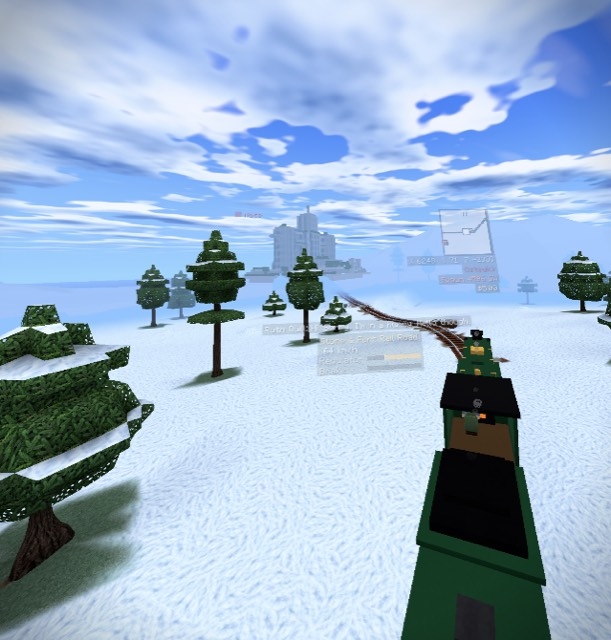

## 19:53:15 - I'm going to train now, driving it.

- **Transcript:** I'm going to train now, driving it.
- **Status:** open
- **Build:** 0.995 (35064603, M1-M4 (device-tested; ship riding, chests, comfort options, weapon wheel))
- **World:** Gate58869 (seed 1794958869)
- **Dimension:** Surface
- **Biome:** Snowy Plains
- **Position:** 6364.4 87.3 -2465.1
- **Facing:** east (yaw 71, pitch -24)
- **Held:** Stone x64
- **Mount:** riding Minecart
- **Looking at:** Spruce Planks at 6367 85 -2467
- **Mode:** Creative, health 11/20
- **Time:** day 1 13:01, clear
- **Fps:** 72
- **Levels:** mic -36 dBFS, game sound -17 dBFS
- **Length:** 3.3 s (voice 1.4 s)
- **Just before:** -27s walked into Old Growth Spruce Taiga; -25s walked into Taiga; -23s walked into Old Growth Spruce Taiga; -22s message: Walking; -21s walked into Taiga; -20s message: Stone Ford marked on the map; -19s walked into Snowy Plains; -18s mounted Minecart; -17s message: Fort Flint Station marked on the map; -15s message: You found the Stone & Fort Rail Road: 2 stations, marked on your map; -14s opened PauseMenu; -13s closed PauseMenu; -13s walked into Snowy Taiga; -12s message: Riding the Stone & Fort Rail Road; -10s message: Ruth Quill: Hi. Sorry, I'm in a hurry. Hello though.; -9s walked into Snowy Plains
- **Repro (Mac):** `./snap.sh note --seed 1794958869 --x 6364.4 --z -2465.1 --yaw -71 --pitch -24 --time 0.293`
- **Audio (this Mac):** /tmp/vn17local/raw/vn-20261117-195315-568.aac

## 19:53:29 - Yeah, I'd say I'm gonna train.

- **Transcript:** Yeah, I'd say I'm gonna train.
- **Status:** open
- **Build:** 0.995 (35064603, M1-M4 (device-tested; ship riding, chests, comfort options, weapon wheel))
- **World:** Gate58869 (seed 1794958869)
- **Dimension:** Surface
- **Biome:** Snowy Plains
- **Position:** 6675.9 97.2 -2507.3
- **Facing:** north-east (yaw 64, pitch -36)
- **Held:** Stone x64
- **Mount:** riding Minecart
- **Looking at:** nothing
- **Mode:** Creative, health 11/20
- **Time:** day 1 13:17, clear
- **Fps:** 72
- **Levels:** mic -27 dBFS, game sound -18 dBFS
- **Length:** 2.8 s (voice 1.4 s)
- **Just before:** -29s message: You found the Stone & Fort Rail Road: 2 stations, marked on your map; -28s opened PauseMenu; -27s closed PauseMenu; -27s walked into Snowy Taiga; -26s message: Riding the Stone & Fort Rail Road; -24s message: Ruth Quill: Hi. Sorry, I'm in a hurry. Hello though.; -23s walked into Snowy Plains; -7s dismounted Minecart; -7s mounted Minecart; -7s message: Riding the Stone & Fort Rail Road; -5s message: Flying; -4s opened PauseMenu; -4s closed PauseMenu; -3s dismounted Minecart; -3s message: Walking; -3s mounted Minecart; -2s message: Riding the Stone & Fort Rail Road; -2s dismounted Minecart; -1s mounted Minecart
- **Repro (Mac):** `./snap.sh note --seed 1794958869 --x 6675.9 --z -2507.3 --yaw -64 --pitch -36 --time 0.304`
- **Audio (this Mac):** /tmp/vn17local/raw/vn-20261117-195329-368.aac

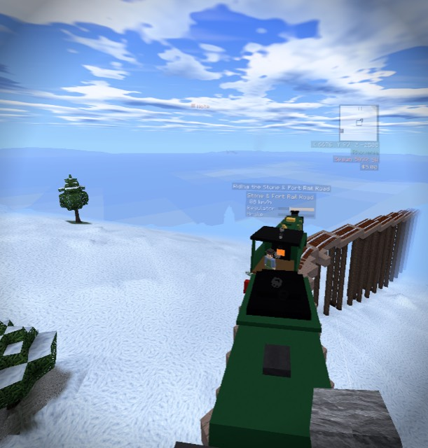

## 19:53:42 - This should fix all of our problems, right?

- **Transcript:** This should fix all of our problems, right?
- **Status:** open
- **Build:** 0.995 (35064603, M1-M4 (device-tested; ship riding, chests, comfort options, weapon wheel))
- **World:** New World (30) (seed 4259144782798118884)
- **Dimension:** Surface
- **Biome:** Taiga
- **Position:** -2408.0 73.3 -3319.1
- **Facing:** south-west (yaw 232, pitch -48)
- **Held:** empty hand
- **Mount:** on foot
- **Looking at:** Grass Block at -2410 73 -3319
- **Mode:** Survival, health 20/20
- **Time:** day 1 07:27, clear
- **Fps:** 69
- **Levels:** mic -30 dBFS, game sound -57 dBFS
- **Length:** 3.7 s (voice 1.7 s)
- **Just before:** --651s message: Walking; --652s message: The Stormwarden Frigate's engines caught again; --657s message: Flying; --662s message: Walking; --663s walked into Swamp; --664s message: Flying; --669s walked into Old Growth Spruce Taiga; --671s walked into Taiga; --673s walked into Old Growth Spruce Taiga; --675s message: Walking; --675s walked into Taiga; --677s message: Stone Ford marked on the map; --677s walked into Snowy Plains; --678s mounted Minecart; --679s message: Fort Flint Station marked on the map; --681s message: You found the Stone & Fort Rail Road: 2 stations, marked on your map; --682s opened PauseMenu; --683s closed PauseMenu; --683s walked into Snowy Taiga; --684s message: Riding the Stone & Fort Rail Road; --687s message: Ruth Quill: Hi. Sorry, I'm in a hurry. Hello though.; --687s walked into Snowy Plains; --703s dismounted Minecart; --703s mounted Minecart; --703s message: Riding the Stone & Fort Rail Road; --706s message: Flying; --706s opened PauseMenu; --706s closed PauseMenu; --707s dismounted Minecart; --707s message: Walking; --707s mounted Minecart; --708s message: Riding the Stone & Fort Rail Road; --708s dismounted Minecart; --709s mounted Minecart; --710s opened PauseMenu; -1s dismounted Minecart; -1s closed PauseMenu; -1s holding empty hand; -1s opened PauseMenu; -1s closed PauseMenu
- **Repro (Mac):** `./snap.sh note --seed 4259144782798118884 --x -2408.0 --z -3319.1 --yaw 128 --pitch -48 --time 0.061`
- **Audio (this Mac):** /tmp/vn17local/raw/vn-20261117-195342-468.aac

## 19:53:46 - Right. Okay.

- **Transcript:** Right. Okay.
- **Status:** open
- **Build:** 0.995 (35064603, M1-M4 (device-tested; ship riding, chests, comfort options, weapon wheel))
- **World:** New World (30) (seed 4259144782798118884)
- **Dimension:** Surface
- **Biome:** Taiga
- **Position:** -2404.4 68.8 -3302.6
- **Facing:** south-east (yaw 115, pitch -12)
- **Held:** empty hand
- **Mount:** on foot
- **Looking at:** nothing
- **Mode:** Survival, health 20/20
- **Time:** day 1 07:32, clear
- **Fps:** 72
- **Levels:** mic -37 dBFS, game sound -17 dBFS
- **Length:** 2.6 s (voice 0.5 s)
- **Just before:** --647s message: Walking; --648s message: The Stormwarden Frigate's engines caught again; --653s message: Flying; --659s message: Walking; --659s walked into Swamp; --660s message: Flying; --665s walked into Old Growth Spruce Taiga; --667s walked into Taiga; --669s walked into Old Growth Spruce Taiga; --671s message: Walking; --671s walked into Taiga; --673s message: Stone Ford marked on the map; --673s walked into Snowy Plains; --674s mounted Minecart; --675s message: Fort Flint Station marked on the map; --677s message: You found the Stone & Fort Rail Road: 2 stations, marked on your map; --679s opened PauseMenu; --679s closed PauseMenu; --679s walked into Snowy Taiga; --681s message: Riding the Stone & Fort Rail Road; --683s message: Ruth Quill: Hi. Sorry, I'm in a hurry. Hello though.; --683s walked into Snowy Plains; --699s dismounted Minecart; --700s mounted Minecart; --700s message: Riding the Stone & Fort Rail Road; --702s message: Flying; --702s opened PauseMenu; --702s closed PauseMenu; --703s dismounted Minecart; --703s message: Walking; --704s mounted Minecart; --705s message: Riding the Stone & Fort Rail Road; --705s dismounted Minecart; --706s mounted Minecart; --707s opened PauseMenu; -5s dismounted Minecart; -5s closed PauseMenu; -5s holding empty hand; -5s opened PauseMenu; -5s closed PauseMenu
- **Repro (Mac):** `./snap.sh note --seed 4259144782798118884 --x -2404.4 --z -3302.6 --yaw -115 --pitch -12 --time 0.064`
- **Audio (this Mac):** /tmp/vn17local/raw/vn-20261117-195346-328.aac

## 19:53:50 - We've got a flowing log. That came down good. Good.

- **Transcript:** We've got a flowing log. That came down good. Good.
- **Status:** open
- **Build:** 0.995 (35064603, M1-M4 (device-tested; ship riding, chests, comfort options, weapon wheel))
- **World:** New World (30) (seed 4259144782798118884)
- **Dimension:** Surface
- **Biome:** Taiga
- **Position:** -2398.5 67.6 -3301.6
- **Facing:** north-east (yaw 31, pitch -20)
- **Held:** empty hand
- **Mount:** on foot
- **Looking at:** Grass Block at -2397 67 -3306
- **Mode:** Creative, health 20/20
- **Time:** day 1 07:36, clear
- **Fps:** 72
- **Levels:** mic -30 dBFS, game sound -29 dBFS
- **Length:** 5.5 s (voice 2.6 s)
- **Just before:** --655s message: Walking; --655s walked into Swamp; --656s message: Flying; --661s walked into Old Growth Spruce Taiga; --663s walked into Taiga; --665s walked into Old Growth Spruce Taiga; --667s message: Walking; --667s walked into Taiga; --669s message: Stone Ford marked on the map; --669s walked into Snowy Plains; --671s mounted Minecart; --671s message: Fort Flint Station marked on the map; --673s message: You found the Stone & Fort Rail Road: 2 stations, marked on your map; --675s opened PauseMenu; --675s closed PauseMenu; --675s walked into Snowy Taiga; --677s message: Riding the Stone & Fort Rail Road; --679s message: Ruth Quill: Hi. Sorry, I'm in a hurry. Hello though.; --679s walked into Snowy Plains; --695s dismounted Minecart; --696s mounted Minecart; --696s message: Riding the Stone & Fort Rail Road; --698s message: Flying; --698s opened PauseMenu; --699s closed PauseMenu; --699s dismounted Minecart; --699s message: Walking; --700s mounted Minecart; --701s message: Riding the Stone & Fort Rail Road; --701s dismounted Minecart; --702s mounted Minecart; --703s opened PauseMenu; -9s dismounted Minecart; -9s closed PauseMenu; -9s holding empty hand; -9s opened PauseMenu; -9s closed PauseMenu; -2s opened PauseMenu; -1s message: Creative mode; -1s closed PauseMenu
- **Repro (Mac):** `./snap.sh note --seed 4259144782798118884 --x -2398.5 --z -3301.6 --yaw -31 --pitch -20 --time 0.067`
- **Audio (this Mac):** /tmp/vn17local/raw/vn-20261117-195350-248.aac

## 19:53:56 - Some have so something went wrong for leaves in this one

- **Transcript:** Some have so something went wrong for leaves in this one
- **Status:** open
- **Build:** 0.995 (35064603, M1-M4 (device-tested; ship riding, chests, comfort options, weapon wheel))
- **World:** New World (30) (seed 4259144782798118884)
- **Dimension:** Surface
- **Biome:** Taiga
- **Position:** -2398.7 67.4 -3300.8
- **Facing:** north (yaw 350, pitch 1)
- **Held:** empty hand
- **Mount:** on foot
- **Looking at:** nothing
- **Mode:** Creative, health 20/20
- **Time:** day 1 07:43, clear
- **Fps:** 72
- **Levels:** mic -25 dBFS, game sound -38 dBFS
- **Length:** 6.3 s (voice 3.5 s)
- **Just before:** --648s message: Walking; --649s walked into Swamp; --650s message: Flying; --655s walked into Old Growth Spruce Taiga; --657s walked into Taiga; --659s walked into Old Growth Spruce Taiga; --661s message: Walking; --661s walked into Taiga; --663s message: Stone Ford marked on the map; --663s walked into Snowy Plains; --664s mounted Minecart; --665s message: Fort Flint Station marked on the map; --667s message: You found the Stone & Fort Rail Road: 2 stations, marked on your map; --668s opened PauseMenu; --669s closed PauseMenu; --669s walked into Snowy Taiga; --670s message: Riding the Stone & Fort Rail Road; --673s message: Ruth Quill: Hi. Sorry, I'm in a hurry. Hello though.; --673s walked into Snowy Plains; --689s dismounted Minecart; --689s mounted Minecart; --689s message: Riding the Stone & Fort Rail Road; --692s message: Flying; --692s opened PauseMenu; --692s closed PauseMenu; --693s dismounted Minecart; --693s message: Walking; --693s mounted Minecart; --694s message: Riding the Stone & Fort Rail Road; --694s dismounted Minecart; --695s mounted Minecart; --696s opened PauseMenu; -15s dismounted Minecart; -15s closed PauseMenu; -15s holding empty hand; -15s opened PauseMenu; -15s closed PauseMenu; -8s opened PauseMenu; -7s message: Creative mode; -7s closed PauseMenu
- **While talking:** --643s message: Walking; --644s walked into Swamp; --645s message: Flying; --650s walked into Old Growth Spruce Taiga; --652s walked into Taiga; --654s walked into Old Growth Spruce Taiga; --656s message: Walking; --656s walked into Taiga; --658s message: Stone Ford marked on the map; --658s walked into Snowy Plains; --659s mounted Minecart; --660s message: Fort Flint Station marked on the map; --662s message: You found the Stone & Fort Rail Road: 2 stations, marked on your map; --663s opened PauseMenu; --664s closed PauseMenu; --664s walked into Snowy Taiga; --665s message: Riding the Stone & Fort Rail Road; --668s message: Ruth Quill: Hi. Sorry, I'm in a hurry. Hello though.; --668s walked into Snowy Plains; --684s dismounted Minecart; --684s mounted Minecart; --684s message: Riding the Stone & Fort Rail Road; --687s message: Flying; --687s opened PauseMenu; --687s closed PauseMenu; --688s dismounted Minecart; --688s message: Walking; --688s mounted Minecart; --689s message: Riding the Stone & Fort Rail Road; --689s dismounted Minecart; --690s mounted Minecart; --691s opened PauseMenu
- **Position at the end:** -2399.6 67.7 -3301.6
- **Repro (Mac):** `./snap.sh note --seed 4259144782798118884 --x -2398.7 --z -3300.8 --yaw 10 --pitch 1 --time 0.072`
- **Audio (this Mac):** /tmp/vn17local/raw/vn-20261117-195356-488.aac

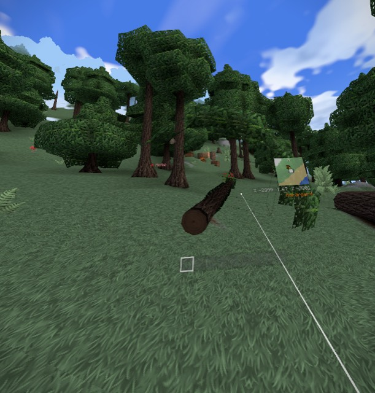

## 19:54:07 - Pretty good hero.

- **Transcript:** Pretty good hero.
- **Status:** open
- **Build:** 0.995 (35064603, M1-M4 (device-tested; ship riding, chests, comfort options, weapon wheel))
- **World:** New World (30) (seed 4259144782798118884)
- **Dimension:** Surface
- **Biome:** Taiga
- **Position:** -2391.8 67.6 -3309.8
- **Facing:** north-east (yaw 26, pitch 4)
- **Held:** empty hand
- **Mount:** on foot
- **Looking at:** nothing
- **Mode:** Creative, health 20/20
- **Time:** day 1 07:56, clear
- **Fps:** 72
- **Levels:** mic -37 dBFS, game sound -12 dBFS
- **Length:** 2.0 s (voice 0.6 s)
- **Just before:** --637s message: Walking; --638s walked into Swamp; --639s message: Flying; --644s walked into Old Growth Spruce Taiga; --646s walked into Taiga; --648s walked into Old Growth Spruce Taiga; --650s message: Walking; --650s walked into Taiga; --652s message: Stone Ford marked on the map; --652s walked into Snowy Plains; --653s mounted Minecart; --654s message: Fort Flint Station marked on the map; --656s message: You found the Stone & Fort Rail Road: 2 stations, marked on your map; --657s opened PauseMenu; --658s closed PauseMenu; --658s walked into Snowy Taiga; --659s message: Riding the Stone & Fort Rail Road; --662s message: Ruth Quill: Hi. Sorry, I'm in a hurry. Hello though.; --662s walked into Snowy Plains; --678s dismounted Minecart; --678s mounted Minecart; --678s message: Riding the Stone & Fort Rail Road; --681s message: Flying; --681s opened PauseMenu; --681s closed PauseMenu; --682s dismounted Minecart; --682s message: Walking; --682s mounted Minecart; --683s message: Riding the Stone & Fort Rail Road; --683s dismounted Minecart; --684s mounted Minecart; --685s opened PauseMenu; -26s dismounted Minecart; -26s closed PauseMenu; -26s holding empty hand; -26s opened PauseMenu; -26s closed PauseMenu; -19s opened PauseMenu; -18s message: Creative mode; -18s closed PauseMenu
- **Repro (Mac):** `./snap.sh note --seed 4259144782798118884 --x -2391.8 --z -3309.8 --yaw -26 --pitch 4 --time 0.081`
- **Audio (this Mac):** /tmp/vn17local/raw/vn-20261117-195407-488.aac

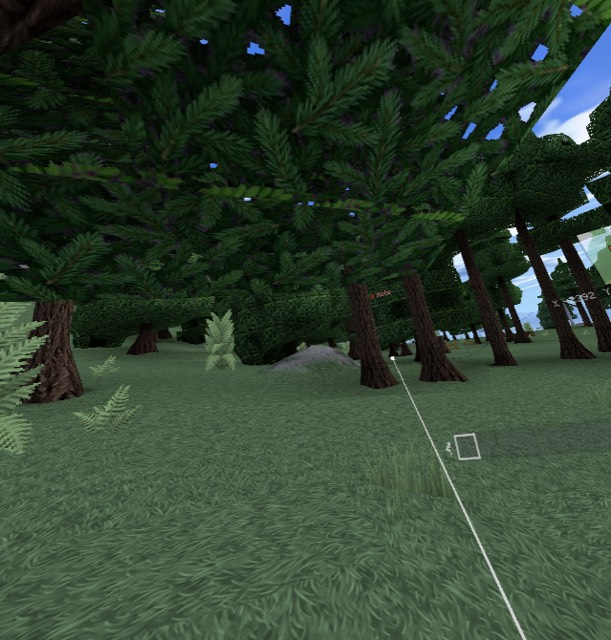

## 19:54:17 - And we're just holding this whole thing on six like I mean we can do t

- **Transcript:** And we're just holding this whole thing on six like I mean we can do that but
- **Status:** open
- **Build:** 0.995 (35064603, M1-M4 (device-tested; ship riding, chests, comfort options, weapon wheel))
- **World:** New World (30) (seed 4259144782798118884)
- **Dimension:** Surface
- **Biome:** Taiga
- **Position:** -2373.6 74.1 -3343.6
- **Facing:** north-east (yaw 59, pitch -15)
- **Held:** empty hand
- **Mount:** on foot, flying
- **Looking at:** nothing
- **Mode:** Creative, health 20/20
- **Time:** day 1 08:07, clear
- **Fps:** 72
- **Levels:** mic -34 dBFS, game sound -23 dBFS
- **Length:** 5.4 s (voice 3.5 s)
- **Just before:** --640s message: Walking; --641s walked into Taiga; --642s message: Stone Ford marked on the map; --643s walked into Snowy Plains; --644s mounted Minecart; --644s message: Fort Flint Station marked on the map; --647s message: You found the Stone & Fort Rail Road: 2 stations, marked on your map; --648s opened PauseMenu; --649s closed PauseMenu; --649s walked into Snowy Taiga; --650s message: Riding the Stone & Fort Rail Road; --652s message: Ruth Quill: Hi. Sorry, I'm in a hurry. Hello though.; --653s walked into Snowy Plains; --669s dismounted Minecart; --669s mounted Minecart; --669s message: Riding the Stone & Fort Rail Road; --671s message: Flying; --671s opened PauseMenu; --672s closed PauseMenu; --672s dismounted Minecart; --672s message: Walking; --673s mounted Minecart; --674s message: Riding the Stone & Fort Rail Road; --674s dismounted Minecart; --675s mounted Minecart; --676s opened PauseMenu; -29s opened PauseMenu; -28s message: Creative mode; -28s closed PauseMenu; -7s message: Flying; -5s message: Entering Hargard; -3s message: Walking; -2s opened PauseMenu; -1s closed PauseMenu; -0s message: Flying
- **Repro (Mac):** `./snap.sh note --seed 4259144782798118884 --x -2373.6 --z -3343.6 --yaw -59 --pitch -15 --time 0.088`
- **Audio (this Mac):** /tmp/vn17local/raw/vn-20261117-195417-088.aac

## 19:54:22 - I mean, ideally if we could trust the auto render, that would be nice.

- **Transcript:** I mean, ideally if we could trust the auto render, that would be nice.
- **Status:** open
- **Build:** 0.995 (35064603, M1-M4 (device-tested; ship riding, chests, comfort options, weapon wheel))
- **World:** New World (30) (seed 4259144782798118884)
- **Dimension:** Surface
- **Biome:** Beach
- **Position:** -2312.3 62.9 -3443.5
- **Facing:** east (yaw 81, pitch -47)
- **Held:** empty hand
- **Mount:** on foot
- **Looking at:** Sand at -2311 62 -3444
- **Mode:** Creative, health 20/20
- **Time:** day 1 08:14, clear
- **Fps:** 72
- **Levels:** mic -33 dBFS, game sound -27 dBFS
- **Length:** 5.9 s (voice 3.0 s)
- **Just before:** --635s walked into Taiga; --636s message: Stone Ford marked on the map; --637s walked into Snowy Plains; --638s mounted Minecart; --638s message: Fort Flint Station marked on the map; --641s message: You found the Stone & Fort Rail Road: 2 stations, marked on your map; --642s opened PauseMenu; --643s closed PauseMenu; --643s walked into Snowy Taiga; --644s message: Riding the Stone & Fort Rail Road; --646s message: Ruth Quill: Hi. Sorry, I'm in a hurry. Hello though.; --647s walked into Snowy Plains; --663s dismounted Minecart; --663s mounted Minecart; --663s message: Riding the Stone & Fort Rail Road; --665s message: Flying; --665s opened PauseMenu; --666s closed PauseMenu; --666s dismounted Minecart; --667s message: Walking; --667s mounted Minecart; --668s message: Riding the Stone & Fort Rail Road; --668s dismounted Minecart; --669s mounted Minecart; --670s opened PauseMenu; -13s message: Flying; -10s message: Entering Hargard; -9s message: Walking; -8s opened PauseMenu; -7s closed PauseMenu; -6s message: Flying; -2s message: Walking
- **While talking:** --633s message: Fort Flint Station marked on the map; --636s message: You found the Stone & Fort Rail Road: 2 stations, marked on your map; --637s opened PauseMenu; --638s closed PauseMenu; --638s walked into Snowy Taiga; --639s message: Riding the Stone & Fort Rail Road; --641s message: Ruth Quill: Hi. Sorry, I'm in a hurry. Hello though.; --642s walked into Snowy Plains; --658s dismounted Minecart; --658s mounted Minecart; --658s message: Riding the Stone & Fort Rail Road; --660s message: Flying; --660s opened PauseMenu; --661s closed PauseMenu; --661s dismounted Minecart; --662s message: Walking; --662s mounted Minecart; --663s message: Riding the Stone & Fort Rail Road; --663s dismounted Minecart; --664s mounted Minecart; --665s opened PauseMenu; -2s opened ChestMenu; -2s closed ChestMenu; -1s opened ChestMenu; -1s closed ChestMenu
- **Position at the end:** -2306.8 64.0 -3446.8
- **Repro (Mac):** `./snap.sh note --seed 4259144782798118884 --x -2312.3 --z -3443.5 --yaw -81 --pitch -47 --time 0.093`
- **Audio (this Mac):** /tmp/vn17local/raw/vn-20261117-195422-908.aac

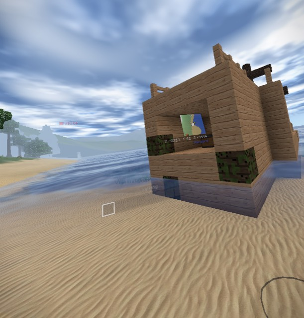

## 19:54:40 - Okay, whoa, holy shit, what is this thing?

- **Transcript:** Okay, whoa, holy shit, what is this thing?
- **Status:** open
- **Build:** 0.995 (35064603, M1-M4 (device-tested; ship riding, chests, comfort options, weapon wheel))
- **World:** New World (30) (seed 4259144782798118884)
- **Dimension:** Surface
- **Biome:** Ocean
- **Position:** -2287.7 82.8 -3520.4
- **Facing:** north (yaw 352, pitch -26)
- **Held:** empty hand
- **Mount:** on foot, flying
- **Looking at:** nothing
- **Mode:** Creative, health 20/20
- **Time:** day 1 08:35, clear
- **Fps:** 72
- **Levels:** mic -28 dBFS, game sound -23 dBFS
- **Length:** 6.2 s (voice 3.7 s)
- **Just before:** --645s dismounted Minecart; --646s mounted Minecart; --646s message: Riding the Stone & Fort Rail Road; --648s message: Flying; --648s opened PauseMenu; --649s closed PauseMenu; --649s dismounted Minecart; --649s message: Walking; --650s mounted Minecart; --651s message: Riding the Stone & Fort Rail Road; --651s dismounted Minecart; --652s mounted Minecart; --653s opened PauseMenu; -28s message: Entering Hargard; -26s message: Walking; -25s opened PauseMenu; -24s closed PauseMenu; -23s message: Flying; -19s message: Walking; -15s opened ChestMenu; -14s closed ChestMenu; -14s opened ChestMenu; -13s closed ChestMenu; -12s holding Book; -12s message: Book; -11s opened ChestMenu; -11s closed ChestMenu; -8s holding empty hand; -5s opened ChestMenu; -4s closed ChestMenu; -1s message: Flying
- **While talking:** --640s dismounted Minecart; --641s mounted Minecart; --641s message: Riding the Stone & Fort Rail Road; --643s message: Flying; --643s opened PauseMenu; --644s closed PauseMenu; --644s dismounted Minecart; --644s message: Walking; --645s mounted Minecart; --646s message: Riding the Stone & Fort Rail Road; --646s dismounted Minecart; --647s mounted Minecart; --648s opened PauseMenu
- **Position at the end:** -2075.2 116.8 -3582.7
- **Repro (Mac):** `./snap.sh note --seed 4259144782798118884 --x -2287.7 --z -3520.4 --yaw 8 --pitch -26 --time 0.108`
- **Audio (this Mac):** /tmp/vn17local/raw/vn-20261117-195440-208.aac

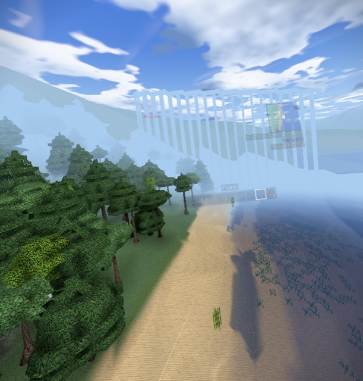

## 19:54:48 - Okay, I guess we never did remove that, did we?

- **Transcript:** Okay, I guess we never did remove that, did we?
- **Status:** open
- **Build:** 0.995 (35064603, M1-M4 (device-tested; ship riding, chests, comfort options, weapon wheel))
- **World:** New World (30) (seed 4259144782798118884)
- **Dimension:** Surface
- **Biome:** Ocean
- **Position:** -1950.7 77.7 -3593.0
- **Facing:** east (yaw 96, pitch -60)
- **Held:** empty hand
- **Mount:** on foot
- **Looking at:** nothing
- **Mode:** Creative, health 20/20
- **Time:** day 1 08:45, clear
- **Fps:** 72
- **Levels:** mic -35 dBFS, game sound -18 dBFS
- **Length:** 3.8 s (voice 2.2 s)
- **Just before:** --637s message: Riding the Stone & Fort Rail Road; --639s message: Flying; --640s opened PauseMenu; --640s closed PauseMenu; --641s dismounted Minecart; --641s message: Walking; --641s mounted Minecart; --642s message: Riding the Stone & Fort Rail Road; --642s dismounted Minecart; --643s mounted Minecart; --644s opened PauseMenu; -28s message: Walking; -23s opened ChestMenu; -23s closed ChestMenu; -22s opened ChestMenu; -21s closed ChestMenu; -20s holding Book; -20s message: Book; -20s opened ChestMenu; -19s closed ChestMenu; -17s holding empty hand; -13s opened ChestMenu; -12s closed ChestMenu; -9s message: Flying; -3s message: Entering Savevaal; -1s message: Walking
- **Repro (Mac):** `./snap.sh note --seed 4259144782798118884 --x -1950.7 --z -3593.0 --yaw -96 --pitch -60 --time 0.115`
- **Audio (this Mac):** /tmp/vn17local/raw/vn-20261117-195448-608.aac

## 19:54:57 - What the fuck just happened?

- **Transcript:** What the fuck just happened?
- **Status:** open
- **Build:** 0.995 (35064603, M1-M4 (device-tested; ship riding, chests, comfort options, weapon wheel))
- **World:** New World (30) (seed 4259144782798118884)
- **Dimension:** Surface
- **Biome:** Grove
- **Position:** -2391.4 129.4 -3599.2
- **Facing:** west (yaw 250, pitch -36)
- **Held:** empty hand
- **Mount:** on foot, flying
- **Looking at:** nothing
- **Mode:** Creative, health 20/20
- **Time:** day 1 08:53, clear
- **Fps:** 72
- **Levels:** mic -87 dBFS, game sound -17 dBFS
- **Length:** 3.0 s (voice 1.0 s)
- **Just before:** --707s opened PauseMenu; --708s closed PauseMenu; --708s dismounted Minecart; --708s message: Walking; --709s mounted Minecart; --710s message: Riding the Stone & Fort Rail Road; --710s dismounted Minecart; --711s mounted Minecart; --712s opened PauseMenu; -0s dismounted Minecart; -0s closed PauseMenu; -0s holding empty hand; --0s opened PauseMenu; --0s closed PauseMenu; --7s opened PauseMenu; --8s message: Creative mode; --8s closed PauseMenu; --29s message: Flying; --31s message: Entering Hargard; --33s message: Walking; --34s opened PauseMenu; --35s closed PauseMenu; --36s message: Flying; --40s message: Walking; --44s opened ChestMenu; --45s closed ChestMenu; --46s opened ChestMenu; --46s closed ChestMenu; --47s holding Book; --47s message: Book; --48s opened ChestMenu; --48s closed ChestMenu; --51s holding empty hand; --54s opened ChestMenu; --55s closed ChestMenu; --58s message: Flying; --65s message: Entering Savevaal; --67s message: Walking; --68s message: Flying; --71s message: Entering Hargard
- **Repro (Mac):** `./snap.sh note --seed 4259144782798118884 --x -2391.4 --z -3599.2 --yaw 110 --pitch -36 --time 0.121`
- **Audio (this Mac):** /tmp/vn17local/raw/vn-20261117-195457-207.aac

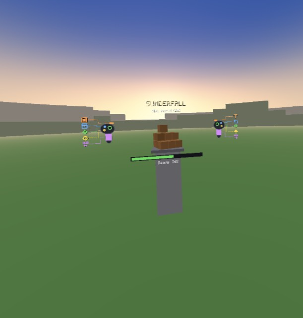

## 19:55:00 - What the hell just happened?

- **Transcript:** What the hell just happened?
- **Status:** open
- **Build:** 0.995 (35064603, M1-M4 (device-tested; ship riding, chests, comfort options, weapon wheel))
- **World:** New World (30) (seed 4259144782798118884)
- **Dimension:** Surface
- **Biome:** Grove
- **Position:** -2389.9 129.4 -3593.0
- **Facing:** west (yaw 253, pitch -36)
- **Held:** empty hand
- **Mount:** on foot, flying
- **Looking at:** nothing
- **Mode:** Creative, health 20/20
- **Time:** day 1 08:55, clear
- **Fps:** 71
- **Levels:** mic -24 dBFS, game sound -27 dBFS
- **Length:** 2.3 s (voice 0.8 s)
- **Just before:** --706s dismounted Minecart; --707s message: Walking; --707s mounted Minecart; --708s message: Riding the Stone & Fort Rail Road; --708s dismounted Minecart; --709s mounted Minecart; --710s opened PauseMenu; -2s dismounted Minecart; -2s closed PauseMenu; -2s holding empty hand; -2s opened PauseMenu; -2s closed PauseMenu; --6s opened PauseMenu; --6s message: Creative mode; --7s closed PauseMenu; --27s message: Flying; --30s message: Entering Hargard; --32s message: Walking; --32s opened PauseMenu; --33s closed PauseMenu; --34s message: Flying; --38s message: Walking; --43s opened ChestMenu; --43s closed ChestMenu; --44s opened ChestMenu; --45s closed ChestMenu; --46s holding Book; --46s message: Book; --46s opened ChestMenu; --47s closed ChestMenu; --49s holding empty hand; --53s opened ChestMenu; --54s closed ChestMenu; --57s message: Flying; --63s message: Entering Savevaal; --65s message: Walking; --66s message: Flying; --69s message: Entering Hargard; -2s opened PauseMenu; -2s closed PauseMenu
- **Repro (Mac):** `./snap.sh note --seed 4259144782798118884 --x -2389.9 --z -3593.0 --yaw 107 --pitch -36 --time 0.122`
- **Audio (this Mac):** /tmp/vn17local/raw/vn-20261117-195500-708.aac

## 19:55:03 - That crash happened? What the hell was that?

- **Transcript:** That crash happened? What the hell was that?
- **Status:** open
- **Build:** 0.995 (35064603, M1-M4 (device-tested; ship riding, chests, comfort options, weapon wheel))
- **World:** New World (30) (seed 4259144782798118884)
- **Dimension:** Surface
- **Biome:** Grove
- **Position:** -2383.7 129.4 -3590.6
- **Facing:** west (yaw 260, pitch -42)
- **Held:** empty hand
- **Mount:** on foot, flying
- **Looking at:** Spruce Leaves at -2387 127 -3590
- **Mode:** Creative, health 20/20
- **Time:** day 1 08:58, clear
- **Fps:** 71
- **Levels:** mic -29 dBFS, game sound -25 dBFS
- **Length:** 3.2 s (voice 1.7 s)
- **Just before:** --704s dismounted Minecart; --704s message: Walking; --705s mounted Minecart; --706s message: Riding the Stone & Fort Rail Road; --706s dismounted Minecart; --707s mounted Minecart; --708s opened PauseMenu; -4s dismounted Minecart; -4s closed PauseMenu; -4s holding empty hand; -4s opened PauseMenu; -4s closed PauseMenu; --3s opened PauseMenu; --4s message: Creative mode; --4s closed PauseMenu; --25s message: Flying; --27s message: Entering Hargard; --29s message: Walking; --30s opened PauseMenu; --31s closed PauseMenu; --32s message: Flying; --36s message: Walking; --40s opened ChestMenu; --41s closed ChestMenu; --41s opened ChestMenu; --42s closed ChestMenu; --43s holding Book; --43s message: Book; --44s opened ChestMenu; --44s closed ChestMenu; --47s holding empty hand; --50s opened ChestMenu; --51s closed ChestMenu; --54s message: Flying; --61s message: Entering Savevaal; --63s message: Walking; --64s message: Flying; --67s message: Entering Hargard; -4s opened PauseMenu; -4s closed PauseMenu
- **Repro (Mac):** `./snap.sh note --seed 4259144782798118884 --x -2383.7 --z -3590.6 --yaw 100 --pitch -42 --time 0.124`
- **Audio (this Mac):** /tmp/vn17local/raw/vn-20261117-195503-168.aac

## 19:55:06 - I think it just stopped and loaded.

- **Transcript:** I think it just stopped and loaded.
- **Status:** open
- **Build:** 0.995 (35064603, M1-M4 (device-tested; ship riding, chests, comfort options, weapon wheel))
- **World:** New World (30) (seed 4259144782798118884)
- **Dimension:** Surface
- **Biome:** Grove
- **Position:** -2536.5 129.4 -3598.0
- **Facing:** west (yaw 262, pitch -32)
- **Held:** empty hand
- **Mount:** on foot, flying
- **Looking at:** nothing
- **Mode:** Creative, health 20/20
- **Time:** day 1 09:02, clear
- **Fps:** 71
- **Levels:** mic -30 dBFS, game sound -19 dBFS
- **Length:** 2.7 s (voice 1.1 s)
- **Just before:** --701s dismounted Minecart; --701s message: Walking; --701s mounted Minecart; --702s message: Riding the Stone & Fort Rail Road; --702s dismounted Minecart; --703s mounted Minecart; --704s opened PauseMenu; -7s dismounted Minecart; -7s closed PauseMenu; -7s holding empty hand; -7s opened PauseMenu; -7s closed PauseMenu; -0s opened PauseMenu; --1s message: Creative mode; --1s closed PauseMenu; --21s message: Flying; --24s message: Entering Hargard; --26s message: Walking; --27s opened PauseMenu; --27s closed PauseMenu; --28s message: Flying; --32s message: Walking; --37s opened ChestMenu; --37s closed ChestMenu; --38s opened ChestMenu; --39s closed ChestMenu; --40s holding Book; --40s message: Book; --40s opened ChestMenu; --41s closed ChestMenu; --43s holding empty hand; --47s opened ChestMenu; --48s closed ChestMenu; --51s message: Flying; --57s message: Entering Savevaal; --59s message: Walking; --61s message: Flying; --64s message: Entering Hargard; -7s opened PauseMenu; -7s closed PauseMenu
- **Repro (Mac):** `./snap.sh note --seed 4259144782798118884 --x -2536.5 --z -3598.0 --yaw 98 --pitch -32 --time 0.127`
- **Audio (this Mac):** /tmp/vn17local/raw/vn-20261117-195506-589.aac

## 19:55:10 - Maybe that was like a fix to prevent a

- **Transcript:** Maybe that was like a fix to prevent a
- **Status:** open
- **Build:** 0.995 (35064603, M1-M4 (device-tested; ship riding, chests, comfort options, weapon wheel))
- **World:** New World (30) (seed 4259144782798118884)
- **Dimension:** Surface
- **Biome:** Taiga
- **Position:** -2713.2 129.4 -3587.9
- **Facing:** west (yaw 274, pitch -47)
- **Held:** empty hand
- **Mount:** on foot, flying
- **Looking at:** nothing
- **Mode:** Creative, health 20/20
- **Time:** day 1 09:07, clear
- **Fps:** 72
- **Levels:** mic -26 dBFS, game sound -29 dBFS
- **Length:** 3.5 s (voice 1.8 s)
- **Just before:** --696s dismounted Minecart; --697s message: Walking; --697s mounted Minecart; --698s message: Riding the Stone & Fort Rail Road; --698s dismounted Minecart; --699s mounted Minecart; --700s opened PauseMenu; -12s dismounted Minecart; -12s closed PauseMenu; -12s holding empty hand; -12s opened PauseMenu; -12s closed PauseMenu; -4s opened PauseMenu; -4s message: Creative mode; -3s closed PauseMenu; --17s message: Flying; --20s message: Entering Hargard; --21s message: Walking; --22s opened PauseMenu; --23s closed PauseMenu; --24s message: Flying; --28s message: Walking; --33s opened ChestMenu; --33s closed ChestMenu; --34s opened ChestMenu; --35s closed ChestMenu; --36s holding Book; --36s message: Book; --36s opened ChestMenu; --36s closed ChestMenu; --39s holding empty hand; --43s opened ChestMenu; --43s closed ChestMenu; --46s message: Flying; --53s message: Entering Savevaal; --55s message: Walking; --56s message: Flying; --59s message: Entering Hargard; -12s opened PauseMenu; -12s closed PauseMenu
- **Repro (Mac):** `./snap.sh note --seed 4259144782798118884 --x -2713.2 --z -3587.9 --yaw 86 --pitch -47 --time 0.131`
- **Audio (this Mac):** /tmp/vn17local/raw/vn-20261117-195510-828.aac

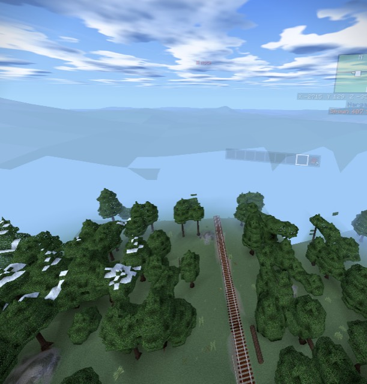

## 19:55:15 - dropping below 72.

- **Transcript:** dropping below 72.
- **Status:** open
- **Build:** 0.995 (35064603, M1-M4 (device-tested; ship riding, chests, comfort options, weapon wheel))
- **World:** New World (30) (seed 4259144782798118884)
- **Dimension:** Surface
- **Biome:** Taiga
- **Position:** -2947.0 129.4 -3584.2
- **Facing:** west (yaw 277, pitch -40)
- **Held:** empty hand
- **Mount:** on foot, flying
- **Looking at:** nothing
- **Mode:** Creative, health 20/20
- **Time:** day 1 09:13, clear
- **Fps:** 72
- **Levels:** mic -32 dBFS, game sound -23 dBFS
- **Length:** 2.8 s (voice 1.3 s)
- **Just before:** --692s dismounted Minecart; --692s message: Walking; --692s mounted Minecart; --693s message: Riding the Stone & Fort Rail Road; --693s dismounted Minecart; --694s mounted Minecart; --696s opened PauseMenu; -16s dismounted Minecart; -16s closed PauseMenu; -16s holding empty hand; -16s opened PauseMenu; -16s closed PauseMenu; -9s opened PauseMenu; -8s message: Creative mode; -8s closed PauseMenu; --13s message: Flying; --15s message: Entering Hargard; --17s message: Walking; --18s opened PauseMenu; --19s closed PauseMenu; --19s message: Flying; --23s message: Walking; --28s opened ChestMenu; --29s closed ChestMenu; --29s opened ChestMenu; --30s closed ChestMenu; --31s holding Book; --31s message: Book; --31s opened ChestMenu; --32s closed ChestMenu; --35s holding empty hand; --38s opened ChestMenu; --39s closed ChestMenu; --42s message: Flying; --49s message: Entering Savevaal; --50s message: Walking; --52s message: Flying; --55s message: Entering Hargard; -16s opened PauseMenu; -16s closed PauseMenu
- **Repro (Mac):** `./snap.sh note --seed 4259144782798118884 --x -2947.0 --z -3584.2 --yaw 83 --pitch -40 --time 0.134`
- **Audio (this Mac):** /tmp/vn17local/raw/vn-20261117-195515-408.aac

## 19:56:02 - I think I'm worried about these caves is...

- **Transcript:** I think I'm worried about these caves is...
- **Status:** open
- **Build:** 0.995 (35064603, M1-M4 (device-tested; ship riding, chests, comfort options, weapon wheel))
- **World:** New World (30) (seed 4259144782798118884)
- **Dimension:** Surface
- **Biome:** Taiga
- **Position:** -3351.4 49.9 -3572.0
- **Facing:** south-east (yaw 156, pitch -65)
- **Held:** empty hand
- **Mount:** on foot
- **Looking at:** Stone at -3352 49 -3573
- **Mode:** Creative, health 20/20
- **Time:** day 1 10:10, clear
- **Fps:** 72
- **Levels:** mic -29 dBFS, game sound -21 dBFS
- **Length:** 3.5 s (voice 1.7 s)
- **Just before:** --646s message: Riding the Stone & Fort Rail Road; --646s dismounted Minecart; --647s mounted Minecart; --648s opened PauseMenu; -30s opened PauseMenu; -29s closed PauseMenu; -28s message: Flying; -24s message: Walking; -19s opened ChestMenu; -19s closed ChestMenu; -18s opened ChestMenu; -17s closed ChestMenu; -16s holding Book; -16s message: Book; -16s opened ChestMenu; -15s closed ChestMenu; -13s holding empty hand; -9s opened ChestMenu; -9s closed ChestMenu; -6s message: Flying; --1s message: Entering Savevaal; --3s message: Walking; --4s message: Flying; --7s message: Entering Hargard; -30s message: Walking
- **Repro (Mac):** `./snap.sh note --seed 4259144782798118884 --x -3351.4 --z -3572.0 --yaw -156 --pitch -65 --time 0.174`
- **Audio (this Mac):** /tmp/vn17local/raw/vn-20261117-195602-788.aac

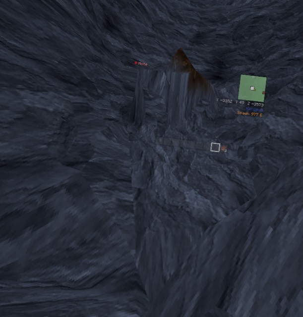

## 19:56:06 - People will be on survival mode. They'll have a crappy pickaxe, and th

- **Transcript:** People will be on survival mode. They'll have a crappy pickaxe, and they won't be able to move around in the caves easily. It'll be frustrating, annoying.
- **Status:** open
- **Build:** 0.995 (35064603, M1-M4 (device-tested; ship riding, chests, comfort options, weapon wheel))
- **World:** New World (30) (seed 4259144782798118884)
- **Dimension:** Surface
- **Biome:** Taiga
- **Position:** -3348.1 55.5 -3568.0
- **Facing:** south (yaw 169, pitch 23)
- **Held:** empty hand
- **Mount:** on foot
- **Looking at:** Stone at -3347 58 -3565
- **Mode:** Creative, health 20/20
- **Time:** day 1 10:14, clear
- **Fps:** 72
- **Levels:** mic -31 dBFS, game sound -21 dBFS
- **Length:** 9.7 s (voice 6.0 s)
- **Just before:** --642s message: Riding the Stone & Fort Rail Road; --642s dismounted Minecart; --643s mounted Minecart; --644s opened PauseMenu; -28s message: Walking; -23s opened ChestMenu; -23s closed ChestMenu; -22s opened ChestMenu; -21s closed ChestMenu; -20s holding Book; -20s message: Book; -20s opened ChestMenu; -19s closed ChestMenu; -17s holding empty hand; -13s opened ChestMenu; -12s closed ChestMenu; -9s message: Flying; -3s message: Entering Savevaal; -1s message: Walking; --1s message: Flying; --4s message: Entering Hargard
- **While talking:** --637s dismounted Minecart; --638s mounted Minecart; --639s opened PauseMenu; -4s message: Flying; -1s message: Entering Hargard; -3s message: Entering Marargard
- **Position at the end:** -3368.5 67.8 -3543.3
- **Repro (Mac):** `./snap.sh note --seed 4259144782798118884 --x -3348.1 --z -3568.0 --yaw -169 --pitch 23 --time 0.177`
- **Audio (this Mac):** /tmp/vn17local/raw/vn-20261117-195606-529.aac

## 19:56:15 - because they'll be too narrow and they won't be able to fit walk throu

- **Transcript:** because they'll be too narrow and they won't be able to fit walk through them.
- **Status:** open
- **Build:** 0.995 (35064603, M1-M4 (device-tested; ship riding, chests, comfort options, weapon wheel))
- **World:** New World (30) (seed 4259144782798118884)
- **Dimension:** Surface
- **Biome:** Taiga
- **Position:** -3368.4 69.1 -3539.6
- **Facing:** south (yaw 190, pitch 68)
- **Held:** empty hand
- **Mount:** on foot
- **Looking at:** nothing
- **Mode:** Creative, health 20/20
- **Time:** day 1 10:26, clear
- **Fps:** 72
- **Levels:** mic -38 dBFS, game sound -17 dBFS
- **Length:** 5.3 s (voice 2.3 s)
- **Just before:** --633s dismounted Minecart; --634s mounted Minecart; --635s opened PauseMenu; -30s holding Book; -30s message: Book; -29s opened ChestMenu; -29s closed ChestMenu; -26s holding empty hand; -23s opened ChestMenu; -22s closed ChestMenu; -19s message: Flying; -12s message: Entering Savevaal; -10s message: Walking; -9s message: Flying; -6s message: Entering Hargard; -8s message: Entering Marargard
- **While talking:** --629s mounted Minecart; --630s opened PauseMenu; -2s message: Flying
- **Position at the end:** -3443.5 93.9 -3435.1
- **Repro (Mac):** `./snap.sh note --seed 4259144782798118884 --x -3368.4 --z -3539.6 --yaw 170 --pitch 68 --time 0.185`
- **Audio (this Mac):** /tmp/vn17local/raw/vn-20261117-195615-968.aac

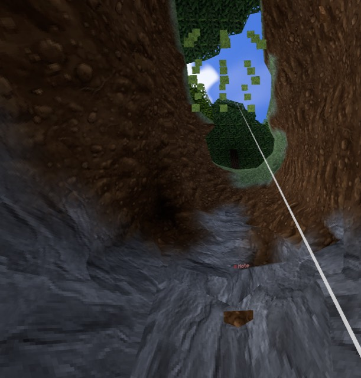

## 19:56:21 - and then breaking each block. It might have to break several. It won't

- **Transcript:** and then breaking each block. It might have to break several. It won't be obvious which ones have to break to be able to squeeze through.
- **Status:** open
- **Build:** 0.995 (35064603, M1-M4 (device-tested; ship riding, chests, comfort options, weapon wheel))
- **World:** New World (30) (seed 4259144782798118884)
- **Dimension:** Surface
- **Biome:** Taiga
- **Position:** -3460.9 93.9 -3429.1
- **Facing:** south-east (yaw 122, pitch -38)
- **Held:** empty hand
- **Mount:** on foot, flying
- **Looking at:** nothing
- **Mode:** Creative, health 20/20
- **Time:** day 1 10:32, clear
- **Fps:** 72
- **Levels:** mic -33 dBFS, game sound -22 dBFS
- **Length:** 8.3 s (voice 4.8 s)
- **Just before:** --629s mounted Minecart; --630s opened PauseMenu; -28s opened ChestMenu; -27s closed ChestMenu; -24s message: Flying; -17s message: Entering Savevaal; -15s message: Walking; -14s message: Flying; -11s message: Entering Hargard; -13s message: Entering Marargard; -2s message: Flying
- **While talking:** --624s mounted Minecart; --625s opened PauseMenu
- **Position at the end:** -3512.3 105.5 -3201.0
- **Repro (Mac):** `./snap.sh note --seed 4259144782798118884 --x -3460.9 --z -3429.1 --yaw -122 --pitch -38 --time 0.189`
- **Audio (this Mac):** /tmp/vn17local/raw/vn-20261117-195621-208.aac

## 19:56:30 - I'm going to pressure test this. 22.

- **Transcript:** I'm going to pressure test this. 22.
- **Status:** open
- **Build:** 0.995 (35064603, M1-M4 (device-tested; ship riding, chests, comfort options, weapon wheel))
- **World:** New World (30) (seed 4259144782798118884)
- **Dimension:** Surface
- **Biome:** Taiga
- **Position:** -3596.2 105.5 -3116.1
- **Facing:** south-west (yaw 217, pitch -63)
- **Held:** empty hand
- **Mount:** on foot, flying
- **Looking at:** nothing
- **Mode:** Creative, health 20/20
- **Time:** day 1 10:41, clear
- **Fps:** 72
- **Levels:** mic -25 dBFS, game sound -20 dBFS
- **Length:** 3.6 s (voice 1.6 s)
- **Just before:** -26s message: Entering Savevaal; -25s message: Walking; -23s message: Flying; -20s message: Entering Hargard; -22s message: Entering Marargard; -12s message: Flying; -2s opened PauseMenu; -1s closed PauseMenu
- **Repro (Mac):** `./snap.sh note --seed 4259144782798118884 --x -3596.2 --z -3116.1 --yaw 143 --pitch -63 --time 0.196`
- **Audio (this Mac):** /tmp/vn17local/raw/vn-20261117-195630-348.aac

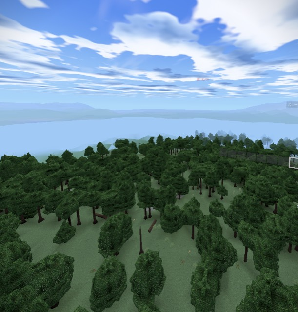

## 19:56:40 - Yeah, it doesn't like 22 very much.

- **Transcript:** Yeah, it doesn't like 22 very much.
- **Status:** open
- **Build:** 0.995 (35064603, M1-M4 (device-tested; ship riding, chests, comfort options, weapon wheel))
- **World:** New World (30) (seed 4259144782798118884)
- **Dimension:** Surface
- **Biome:** Taiga
- **Position:** -3674.2 133.8 -2856.4
- **Facing:** south (yaw 164, pitch -39)
- **Held:** empty hand
- **Mount:** on foot, flying
- **Looking at:** nothing
- **Mode:** Creative, health 20/20
- **Time:** day 1 10:52, clear
- **Fps:** 69
- **Levels:** mic -30 dBFS, game sound -15 dBFS
- **Length:** 3.3 s (voice 1.6 s)
- **Just before:** -30s message: Entering Hargard; -21s message: Flying; -12s opened PauseMenu; -10s closed PauseMenu; -2s opened PauseMenu; -2s closed PauseMenu
- **Repro (Mac):** `./snap.sh note --seed 4259144782798118884 --x -3674.2 --z -2856.4 --yaw -164 --pitch -39 --time 0.203`
- **Audio (this Mac):** /tmp/vn17local/raw/vn-20261117-195640-068.aac

## 19:56:48 - Weird. It's almost as if the rails have lost their diagonal.

- **Transcript:** Weird. It's almost as if the rails have lost their diagonal.
- **Status:** open
- **Build:** 0.995 (35064603, M1-M4 (device-tested; ship riding, chests, comfort options, weapon wheel))
- **World:** New World (30) (seed 4259144782798118884)
- **Dimension:** Surface
- **Biome:** Plains
- **Position:** -3240.1 133.8 -2974.7
- **Facing:** south-east (yaw 157, pitch -66)
- **Held:** empty hand
- **Mount:** on foot, flying
- **Looking at:** nothing
- **Mode:** Creative, health 20/20
- **Time:** day 1 11:02, clear
- **Fps:** 71
- **Levels:** mic -23 dBFS, game sound -19 dBFS
- **Length:** 5.3 s (voice 3.5 s)
- **Just before:** -29s message: Flying; -20s opened PauseMenu; -18s closed PauseMenu; -10s opened PauseMenu; -10s closed PauseMenu
- **Repro (Mac):** `./snap.sh note --seed 4259144782798118884 --x -3240.1 --z -2974.7 --yaw -157 --pitch -66 --time 0.210`
- **Audio (this Mac):** /tmp/vn17local/raw/vn-20261117-195648-188.aac

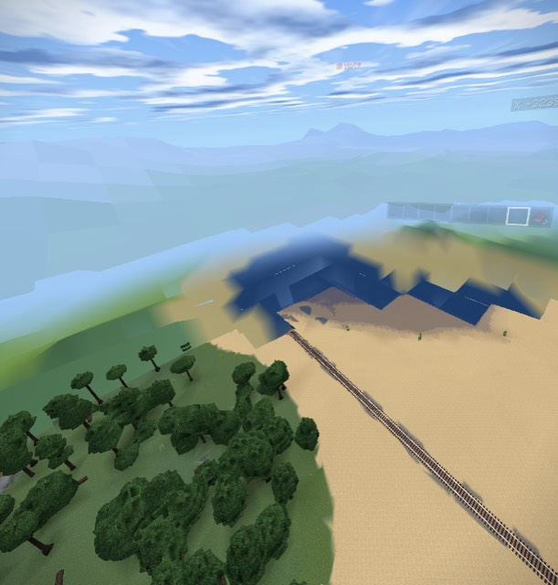

## 19:57:01 - The roads are too straight too. We need to make them

- **Transcript:** The roads are too straight too. We need to make them
- **Status:** open
- **Build:** 0.995 (35064603, M1-M4 (device-tested; ship riding, chests, comfort options, weapon wheel))
- **World:** New World (30) (seed 4259144782798118884)
- **Dimension:** Surface
- **Biome:** Snowy Plains
- **Position:** -2590.2 183.1 -2682.6
- **Facing:** south (yaw 183, pitch -43)
- **Held:** empty hand
- **Mount:** on foot, flying
- **Looking at:** nothing
- **Mode:** Creative, health 20/20
- **Time:** day 1 11:18, clear
- **Fps:** 72
- **Levels:** mic -27 dBFS, game sound -18 dBFS
- **Length:** 5.2 s (voice 2.3 s)
- **Just before:** -24s opened PauseMenu; -23s closed PauseMenu
- **Repro (Mac):** `./snap.sh note --seed 4259144782798118884 --x -2590.2 --z -2682.6 --yaw 177 --pitch -43 --time 0.221`
- **Audio (this Mac):** /tmp/vn17local/raw/vn-20261117-195701-308.aac

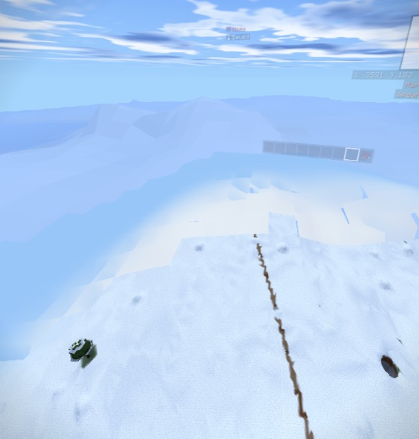

## 19:57:06 - Can't be so straight. They got to be like actual roads. They should al

- **Transcript:** Can't be so straight. They got to be like actual roads. They should also follow some sort of path of least resistance that can even be
- **Status:** open
- **Build:** 0.995 (35064603, M1-M4 (device-tested; ship riding, chests, comfort options, weapon wheel))
- **World:** New World (30) (seed 4259144782798118884)
- **Dimension:** Surface
- **Biome:** Snowy Plains
- **Position:** -2506.3 183.1 -2375.1
- **Facing:** east (yaw 68, pitch -51)
- **Held:** empty hand
- **Mount:** on foot, flying
- **Looking at:** nothing
- **Mode:** Creative, health 20/20
- **Time:** day 1 11:24, clear
- **Fps:** 72
- **Levels:** mic -38 dBFS, game sound -17 dBFS
- **Length:** 8.9 s (voice 5.4 s)
- **Just before:** -28s opened PauseMenu; -28s closed PauseMenu
- **Position at the end:** -2494.4 183.1 -2122.0
- **Repro (Mac):** `./snap.sh note --seed 4259144782798118884 --x -2506.3 --z -2375.1 --yaw -68 --pitch -51 --time 0.225`
- **Audio (this Mac):** /tmp/vn17local/raw/vn-20261117-195706-268.aac

## 19:57:18 - Alright, we've got a military train here, hold on.

- **Transcript:** Alright, we've got a military train here, hold on.
- **Status:** open
- **Build:** 0.995 (35064603, M1-M4 (device-tested; ship riding, chests, comfort options, weapon wheel))
- **World:** New World (30) (seed 4259144782798118884)
- **Dimension:** Surface
- **Biome:** Snowy Plains
- **Position:** -2363.1 76.0 -1941.4
- **Facing:** south-east (yaw 124, pitch -47)
- **Held:** empty hand
- **Mount:** on foot, flying
- **Looking at:** nothing
- **Mode:** Creative, health 20/20
- **Time:** day 1 11:38, clear
- **Fps:** 72
- **Levels:** mic -26 dBFS, game sound -13 dBFS
- **Length:** 3.9 s (voice 2.4 s)
- **Just before:** -5s message: Entering Selenwick; -3s message: Walking; -1s message: Flying
- **Repro (Mac):** `./snap.sh note --seed 4259144782798118884 --x -2363.1 --z -1941.4 --yaw -124 --pitch -47 --time 0.235`
- **Audio (this Mac):** /tmp/vn17local/raw/vn-20261117-195718-088.aac

## 19:57:26 - Can't fire the gun on it, unfortunately.

- **Transcript:** Can't fire the gun on it, unfortunately.
- **Status:** open
- **Build:** 0.995 (35064603, M1-M4 (device-tested; ship riding, chests, comfort options, weapon wheel))
- **World:** New World (30) (seed 4259144782798118884)
- **Dimension:** Surface
- **Biome:** Snowy Plains
- **Position:** -2276.7 69.4 -2001.6
- **Facing:** north-east (yaw 41, pitch -12)
- **Held:** empty hand
- **Mount:** riding Minecart
- **Looking at:** nothing
- **Mode:** Creative, health 20/20
- **Time:** day 1 11:48, clear
- **Fps:** 70
- **Levels:** mic -64 dBFS, game sound -15 dBFS
- **Length:** 3.3 s (voice 1.6 s)
- **Just before:** -14s message: Entering Selenwick; -12s message: Walking; -9s message: Flying; -8s message: A stranger in town: Ezra Quill; -6s message: Walking; -3s mounted Minecart; -3s message: Aboard the troop car: 4 soldiers in it
- **Repro (Mac):** `./snap.sh note --seed 4259144782798118884 --x -2276.7 --z -2001.6 --yaw -41 --pitch -12 --time 0.242`
- **Audio (this Mac):** /tmp/vn17local/raw/vn-20261117-195726-468.aac

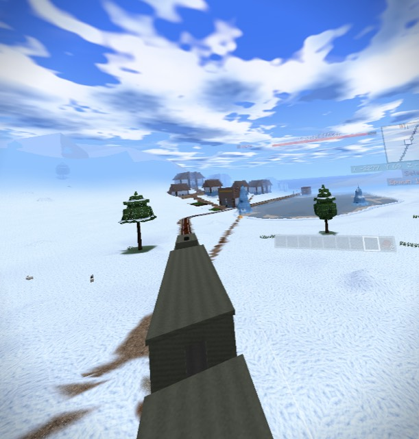

## 19:57:51 - I really can't get out of here, can I?

- **Transcript:** I really can't get out of here, can I?
- **Status:** open
- **Build:** 0.995 (35064603, M1-M4 (device-tested; ship riding, chests, comfort options, weapon wheel))
- **World:** New World (30) (seed 4259144782798118884)
- **Dimension:** Surface
- **Biome:** Snowy Plains
- **Position:** -2135.1 66.1 -2058.9
- **Facing:** north-west (yaw 302, pitch 7)
- **Held:** empty hand
- **Mount:** on foot, flying
- **Looking at:** nothing
- **Mode:** Creative, health 20/20
- **Time:** day 1 12:18, clear
- **Fps:** 69
- **Levels:** mic -38 dBFS, game sound -17 dBFS
- **Length:** 3.2 s (voice 1.2 s)
- **Just before:** -28s mounted Minecart; -28s message: Aboard the troop car: 4 soldiers in it; -14s message: Juniper Point Station marked on the map; -11s message: Sage Springs Station marked on the map; -9s message: You found the Juniper & Sage Railway: 2 stations, marked on your map; -7s dismounted Minecart; -6s message: Troops pile out of the Greywall Troop Train; -3s message: Flying; -2s message: Walking; -0s message: Flying
- **Repro (Mac):** `./snap.sh note --seed 4259144782798118884 --x -2135.1 --z -2058.9 --yaw 58 --pitch 7 --time 0.263`
- **Audio (this Mac):** /tmp/vn17local/raw/vn-20261117-195751-648.aac

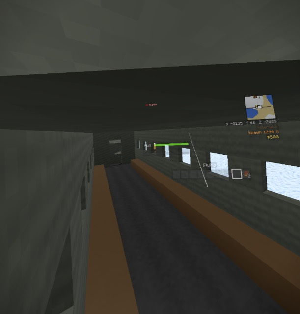

## 19:57:55 - There we go.

- **Transcript:** There we go.
- **Status:** open
- **Build:** 0.995 (35064603, M1-M4 (device-tested; ship riding, chests, comfort options, weapon wheel))
- **World:** New World (30) (seed 4259144782798118884)
- **Dimension:** Surface
- **Biome:** Snowy Plains
- **Position:** -2146.8 64.9 -2061.0
- **Facing:** north-west (yaw 317, pitch -25)
- **Held:** empty hand
- **Mount:** on foot
- **Looking at:** nothing
- **Mode:** Creative, health 20/20
- **Time:** day 1 12:22, clear
- **Fps:** 72
- **Levels:** mic -35 dBFS, game sound -15 dBFS
- **Length:** 1.9 s (voice 0.6 s)
- **Just before:** -17s message: Juniper Point Station marked on the map; -15s message: Sage Springs Station marked on the map; -12s message: You found the Juniper & Sage Railway: 2 stations, marked on your map; -10s dismounted Minecart; -9s message: Troops pile out of the Greywall Troop Train; -7s message: Flying; -5s message: Walking; -4s message: Flying; -2s message: Walking
- **Repro (Mac):** `./snap.sh note --seed 4259144782798118884 --x -2146.8 --z -2061.0 --yaw 43 --pitch -25 --time 0.266`
- **Audio (this Mac):** /tmp/vn17local/raw/vn-20261117-195755-048.aac

## 19:57:59 - whatever. I'll fix it for later.

- **Transcript:** whatever. I'll fix it for later.
- **Status:** open
- **Build:** 0.995 (35064603, M1-M4 (device-tested; ship riding, chests, comfort options, weapon wheel))
- **World:** New World (30) (seed 4259144782798118884)
- **Dimension:** Surface
- **Biome:** Snowy Plains
- **Position:** -2151.4 68.3 -2068.4
- **Facing:** south-west (yaw 231, pitch -28)
- **Held:** empty hand
- **Mount:** on foot, flying
- **Looking at:** nothing
- **Mode:** Creative, health 20/20
- **Time:** day 1 12:27, clear
- **Fps:** 72
- **Levels:** mic -37 dBFS, game sound -17 dBFS
- **Length:** 2.9 s (voice 0.9 s)
- **Just before:** -21s message: Juniper Point Station marked on the map; -19s message: Sage Springs Station marked on the map; -17s message: You found the Juniper & Sage Railway: 2 stations, marked on your map; -15s dismounted Minecart; -13s message: Troops pile out of the Greywall Troop Train; -11s message: Flying; -9s message: Walking; -8s message: Flying; -6s message: Walking; -3s message: Flying
- **Repro (Mac):** `./snap.sh note --seed 4259144782798118884 --x -2151.4 --z -2068.4 --yaw 129 --pitch -28 --time 0.269`
- **Audio (this Mac):** /tmp/vn17local/raw/vn-20261117-195759-288.aac

## 19:58:01 - For later, the train should be destructible.

- **Transcript:** For later, the train should be destructible.
- **Status:** open
- **Build:** 0.995 (35064603, M1-M4 (device-tested; ship riding, chests, comfort options, weapon wheel))
- **World:** New World (30) (seed 4259144782798118884)
- **Dimension:** Surface
- **Biome:** Snowy Plains
- **Position:** -2217.8 71.2 -2104.2
- **Facing:** north (yaw 351, pitch -43)
- **Held:** empty hand
- **Mount:** on foot, flying
- **Looking at:** Spruce Door at -2219 70 -2108
- **Mode:** Creative, health 20/20
- **Time:** day 1 12:31, clear
- **Fps:** 71
- **Levels:** mic -30 dBFS, game sound -15 dBFS
- **Length:** 4.3 s (voice 2.1 s)
- **Just before:** -24s message: Juniper Point Station marked on the map; -21s message: Sage Springs Station marked on the map; -19s message: You found the Juniper & Sage Railway: 2 stations, marked on your map; -17s dismounted Minecart; -16s message: Troops pile out of the Greywall Troop Train; -13s message: Flying; -12s message: Walking; -11s message: Flying; -9s message: Walking; -6s message: Flying
- **Repro (Mac):** `./snap.sh note --seed 4259144782798118884 --x -2217.8 --z -2104.2 --yaw 9 --pitch -43 --time 0.272`
- **Audio (this Mac):** /tmp/vn17local/raw/vn-20261117-195801-828.aac

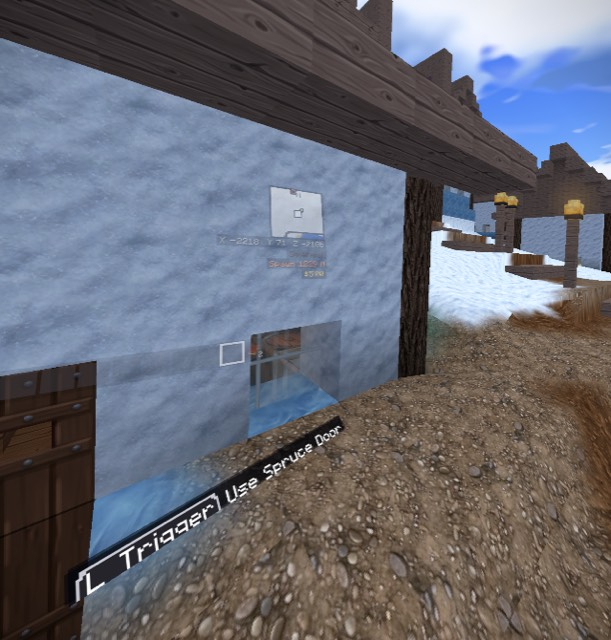

## 19:58:28 - This is another issue for later. See this shit shouldn't be happening.

- **Transcript:** This is another issue for later. See this shit shouldn't be happening.
- **Status:** open
- **Build:** 0.995 (35064603, M1-M4 (device-tested; ship riding, chests, comfort options, weapon wheel))
- **World:** New World (30) (seed 4259144782798118884)
- **Dimension:** Surface
- **Biome:** Snowy Plains
- **Position:** -2117.3 65.9 -2102.4
- **Facing:** west (yaw 269, pitch -22)
- **Held:** empty hand
- **Mount:** on foot
- **Looking at:** Dirt at -2122 65 -2103
- **Mode:** Creative, health 20/20
- **Time:** day 1 13:02, clear
- **Fps:** 72
- **Levels:** mic -36 dBFS, game sound -14 dBFS
- **Length:** 5.2 s (voice 3.1 s)
- **Just before:** -26s message: Entering Marargard; -20s message: Entering Selenwick; -16s message: Entering Marargard; -15s message: Walking; -14s opened ChestMenu; -14s closed ChestMenu; -12s message: Flying; -9s message: Walking; -8s message: Entering Selenwick; -5s opened ChestMenu; -4s closed ChestMenu; -3s message: Flying; -1s message: Walking
- **Repro (Mac):** `./snap.sh note --seed 4259144782798118884 --x -2117.3 --z -2102.4 --yaw 91 --pitch -22 --time 0.293`
- **Audio (this Mac):** /tmp/vn17local/raw/vn-20261117-195828-068.aac

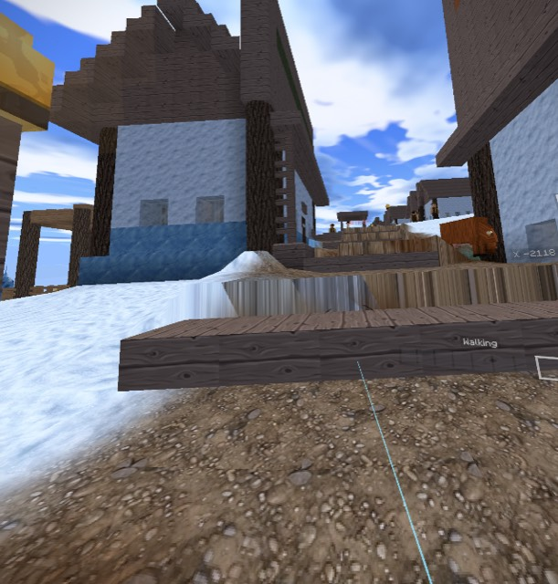

## 19:58:32 - I don't know what kind of wish that is, but I've seen it before.

- **Transcript:** I don't know what kind of wish that is, but I've seen it before.
- **Status:** open
- **Build:** 0.995 (35064603, M1-M4 (device-tested; ship riding, chests, comfort options, weapon wheel))
- **World:** New World (30) (seed 4259144782798118884)
- **Dimension:** Surface
- **Biome:** Snowy Plains
- **Position:** -2124.5 67.0 -2101.9
- **Facing:** west (yaw 276, pitch -30)
- **Held:** empty hand
- **Mount:** on foot
- **Looking at:** Coarse Dirt at -2127 67 -2103
- **Mode:** Creative, health 20/20
- **Time:** day 1 13:08, clear
- **Fps:** 72
- **Levels:** mic -30 dBFS, game sound -23 dBFS
- **Length:** 3.5 s (voice 1.9 s)
- **Just before:** -25s message: Entering Selenwick; -21s message: Entering Marargard; -20s message: Walking; -19s opened ChestMenu; -19s closed ChestMenu; -17s message: Flying; -14s message: Walking; -13s message: Entering Selenwick; -10s opened ChestMenu; -9s closed ChestMenu; -7s message: Flying; -6s message: Walking
- **Repro (Mac):** `./snap.sh note --seed 4259144782798118884 --x -2124.5 --z -2101.9 --yaw 84 --pitch -30 --time 0.297`
- **Audio (this Mac):** /tmp/vn17local/raw/vn-20261117-195832-988.aac

## 19:58:37 - another video games

- **Transcript:** another video games
- **Status:** open
- **Build:** 0.995 (35064603, M1-M4 (device-tested; ship riding, chests, comfort options, weapon wheel))
- **World:** New World (30) (seed 4259144782798118884)
- **Dimension:** Surface
- **Biome:** Snowy Plains
- **Position:** -2143.5 70.5 -2100.3
- **Facing:** west (yaw 291, pitch -14)
- **Held:** empty hand
- **Mount:** on foot
- **Looking at:** Coarse Dirt at -2148 70 -2103
- **Mode:** Creative, health 20/20
- **Time:** day 1 13:13, clear
- **Fps:** 72
- **Levels:** mic -33 dBFS, game sound -23 dBFS
- **Length:** 2.3 s (voice 0.9 s)
- **Just before:** -29s message: Entering Selenwick; -25s message: Entering Marargard; -24s message: Walking; -23s opened ChestMenu; -23s closed ChestMenu; -21s message: Flying; -18s message: Walking; -17s message: Entering Selenwick; -14s opened ChestMenu; -13s closed ChestMenu; -12s message: Flying; -10s message: Walking
- **Repro (Mac):** `./snap.sh note --seed 4259144782798118884 --x -2143.5 --z -2100.3 --yaw 69 --pitch -14 --time 0.301`
- **Audio (this Mac):** /tmp/vn17local/raw/vn-20261117-195837-108.aac

## 19:59:15 - Okay, it went diagonally.

- **Transcript:** Okay, it went diagonally.
- **Status:** open
- **Build:** 0.995 (35064603, M1-M4 (device-tested; ship riding, chests, comfort options, weapon wheel))
- **World:** New World (30) (seed 4259144782798118884)
- **Dimension:** Surface
- **Biome:** Snowy Plains
- **Position:** 304.0 142.3 -1879.0
- **Facing:** east (yaw 110, pitch -29)
- **Held:** empty hand
- **Mount:** on foot, flying
- **Looking at:** nothing
- **Mode:** Creative, health 20/20
- **Time:** day 1 13:59, clear
- **Fps:** 72
- **Levels:** mic -52 dBFS, game sound -17 dBFS
- **Length:** 2.9 s (voice 1.2 s)
- **Just before:** -28s message: Entering Torenstad; -27s opened PauseMenu; -26s closed PauseMenu; -16s message: Entering Wenisland
- **Repro (Mac):** `./snap.sh note --seed 4259144782798118884 --x 304.0 --z -1879.0 --yaw -110 --pitch -29 --time 0.333`
- **Audio (this Mac):** /tmp/vn17local/raw/vn-20261117-195915-968.aac

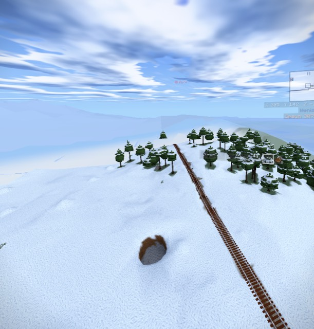

## 19:59:56 - Oh, this doesn't map shop.

- **Transcript:** Oh, this doesn't map shop.
- **Status:** open
- **Build:** 0.995 (35064603, M1-M4 (device-tested; ship riding, chests, comfort options, weapon wheel))
- **World:** Builders' Grounds (seed 632461258612199693)
- **Dimension:** Surface
- **Biome:** Old Growth Spruce Taiga
- **Position:** 5101.0 113.4 -730.8
- **Facing:** west (yaw 290, pitch -53)
- **Held:** Dirt x64
- **Mount:** on foot, flying
- **Looking at:** nothing
- **Mode:** Creative, health 20/20
- **Time:** day 1 16:17, clear
- **Fps:** 72
- **Levels:** mic -37 dBFS, game sound -24 dBFS
- **Length:** 2.8 s (voice 1.2 s)
- **Just before:** --128s mounted Minecart; --128s message: Aboard the troop car: 4 soldiers in it; --143s message: Juniper Point Station marked on the map; --145s message: Sage Springs Station marked on the map; --147s message: You found the Juniper & Sage Railway: 2 stations, marked on your map; --149s dismounted Minecart; --151s message: Troops pile out of the Greywall Troop Train; --153s message: Flying; --155s message: Walking; --156s message: Flying; --158s message: Walking; --161s message: Flying; --167s message: Entering Marargard; --172s message: Entering Selenwick; --176s message: Entering Marargard; --178s message: Walking; --178s opened ChestMenu; --179s closed ChestMenu; --181s message: Flying; --183s message: Walking; --185s message: Entering Selenwick; --188s opened ChestMenu; --189s closed ChestMenu; --190s message: Flying; --192s message: Walking; --210s message: Flying; --213s message: Entering Torenstad; --214s opened PauseMenu; --214s closed PauseMenu; --225s message: Entering Wenisland; --254s opened PauseMenu; -16s closed PauseMenu; -16s holding Grass Block; -16s opened PauseMenu; -16s closed PauseMenu; -9s opened PauseMenu; -8s opened JournalMenu; -2s closed JournalMenu; -0s holding Dirt; -0s message: Dirt
- **Repro (Mac):** `./snap.sh note --seed 632461258612199693 --x 5101.0 --z -730.8 --yaw 70 --pitch -53 --time 0.429`
- **Audio (this Mac):** /tmp/vn17local/raw/vn-20261117-195956-728.aac

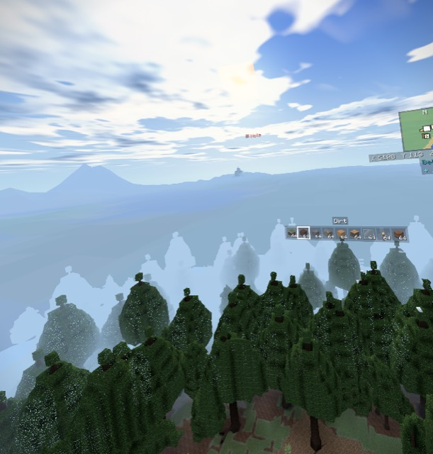

## 20:00:56 - Flooring log.

- **Transcript:** Flooring log.
- **Status:** open
- **Build:** 0.995 (35064603, M1-M4 (device-tested; ship riding, chests, comfort options, weapon wheel))
- **World:** New World (30) (seed 4259144782798118884)
- **Dimension:** Surface
- **Biome:** Taiga
- **Position:** 979.4 66.7 -1509.9
- **Facing:** north-east (yaw 32, pitch -18)
- **Held:** empty hand
- **Mount:** on foot
- **Looking at:** Spruce Log at 980 67 -1513
- **Mode:** Creative, health 20/20
- **Time:** day 1 14:58, clear
- **Fps:** 71
- **Levels:** mic -25 dBFS, game sound -23 dBFS
- **Length:** 2.2 s (voice 0.7 s)
- **Just before:** --152s message: Entering Selenwick; --156s message: Entering Marargard; --157s message: Walking; --158s opened ChestMenu; --158s closed ChestMenu; --160s message: Flying; --163s message: Walking; --164s message: Entering Selenwick; --167s opened ChestMenu; --168s closed ChestMenu; --169s message: Flying; --171s message: Walking; --189s message: Flying; --192s message: Entering Torenstad; --193s opened PauseMenu; --194s closed PauseMenu; --204s message: Entering Wenisland; --233s opened PauseMenu; -29s opened PauseMenu; -29s opened JournalMenu; -23s closed JournalMenu; -21s holding Dirt; -21s message: Dirt; -19s message: Entering Quelendor; -12s message: Entering Belemoor; -10s message: Entering Quelendor; -9s opened PauseMenu; -25s opened PauseMenu; -24s closed PauseMenu; -8s message: Walking
- **Repro (Mac):** `./snap.sh note --seed 4259144782798118884 --x 979.4 --z -1509.9 --yaw -32 --pitch -18 --time 0.374`
- **Audio (this Mac):** /tmp/vn17local/raw/vn-20261117-200056-508.aac

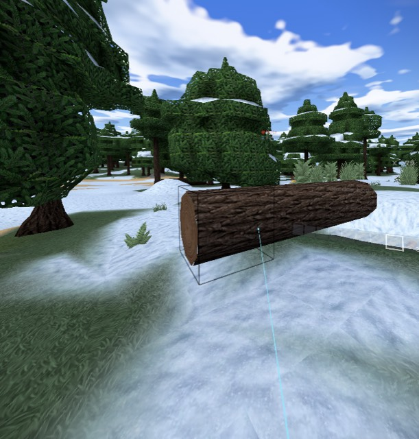

## 20:01:04 - other floating log

- **Transcript:** other floating log
- **Status:** open
- **Build:** 0.995 (35064603, M1-M4 (device-tested; ship riding, chests, comfort options, weapon wheel))
- **World:** New World (30) (seed 4259144782798118884)
- **Dimension:** Surface
- **Biome:** Taiga
- **Position:** 1002.1 66.6 -1526.6
- **Facing:** north (yaw 357, pitch -23)
- **Held:** empty hand
- **Mount:** on foot
- **Looking at:** Spruce Log at 1001 66 -1532
- **Mode:** Creative, health 20/20
- **Time:** day 1 15:08, clear
- **Fps:** 72
- **Levels:** mic -33 dBFS, game sound -20 dBFS
- **Length:** 2.5 s (voice 1.0 s)
- **Just before:** --144s message: Entering Selenwick; --148s message: Entering Marargard; --149s message: Walking; --150s opened ChestMenu; --150s closed ChestMenu; --152s message: Flying; --155s message: Walking; --156s message: Entering Selenwick; --159s opened ChestMenu; --160s closed ChestMenu; --162s message: Flying; --163s message: Walking; --181s message: Flying; --184s message: Entering Torenstad; --185s opened PauseMenu; --186s closed PauseMenu; --196s message: Entering Wenisland; --225s opened PauseMenu; -29s holding Dirt; -29s message: Dirt; -27s message: Entering Quelendor; -20s message: Entering Belemoor; -18s message: Entering Quelendor; -17s opened PauseMenu; -16s message: Walking
- **Repro (Mac):** `./snap.sh note --seed 4259144782798118884 --x 1002.1 --z -1526.6 --yaw 3 --pitch -23 --time 0.381`
- **Audio (this Mac):** /tmp/vn17local/raw/vn-20261117-200104-408.aac

## 20:01:09 - Like every log I'm going to find is going to be floating. That's when 

- **Transcript:** Like every log I'm going to find is going to be floating. That's when it's still floating, yep.
- **Status:** open
- **Build:** 0.995 (35064603, M1-M4 (device-tested; ship riding, chests, comfort options, weapon wheel))
- **World:** New World (30) (seed 4259144782798118884)
- **Dimension:** Surface
- **Biome:** Taiga
- **Position:** 1022.0 66.1 -1545.1
- **Facing:** north-east (yaw 26, pitch -16)
- **Held:** empty hand
- **Mount:** on foot
- **Looking at:** Grass Block at 1023 65 -1549
- **Mode:** Creative, health 20/20
- **Time:** day 1 15:13, clear
- **Fps:** 72
- **Levels:** mic -43 dBFS, game sound -14 dBFS
- **Length:** 6.2 s (voice 3.4 s)
- **Just before:** --139s message: Entering Selenwick; --143s message: Entering Marargard; --145s message: Walking; --145s opened ChestMenu; --146s closed ChestMenu; --147s message: Flying; --150s message: Walking; --151s message: Entering Selenwick; --155s opened ChestMenu; --155s closed ChestMenu; --157s message: Flying; --159s message: Walking; --177s message: Flying; --179s message: Entering Torenstad; --181s opened PauseMenu; --181s closed PauseMenu; --192s message: Entering Wenisland; --221s opened PauseMenu; -24s message: Entering Belemoor; -23s message: Entering Quelendor; -21s opened PauseMenu; -21s message: Walking
- **While talking:** --134s message: Entering Selenwick; --138s message: Entering Marargard; --140s message: Walking; --140s opened ChestMenu; --141s closed ChestMenu; --142s message: Flying; --145s message: Walking; --146s message: Entering Selenwick; --150s opened ChestMenu; --150s closed ChestMenu; --152s message: Flying; --154s message: Walking; --171s message: Flying; --174s message: Entering Torenstad; --176s opened PauseMenu; --176s closed PauseMenu; --187s message: Entering Wenisland; --216s opened PauseMenu
- **Position at the end:** 1034.7 68.2 -1560.8
- **Repro (Mac):** `./snap.sh note --seed 4259144782798118884 --x 1022.0 --z -1545.1 --yaw -26 --pitch -16 --time 0.385`
- **Audio (this Mac):** /tmp/vn17local/raw/vn-20261117-200109-088.aac

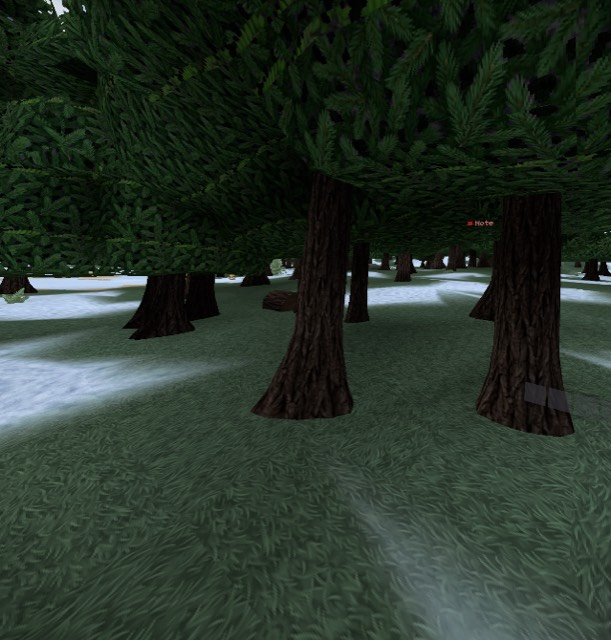

## 20:01:16 - This one's also floating

- **Transcript:** This one's also floating
- **Status:** open
- **Build:** 0.995 (35064603, M1-M4 (device-tested; ship riding, chests, comfort options, weapon wheel))
- **World:** New World (30) (seed 4259144782798118884)
- **Dimension:** Surface
- **Biome:** Taiga
- **Position:** 1045.7 69.0 -1570.0
- **Facing:** north-east (yaw 49, pitch -17)
- **Held:** empty hand
- **Mount:** on foot
- **Looking at:** Spruce Log at 1049 69 -1573
- **Mode:** Creative, health 20/20
- **Time:** day 1 15:22, clear
- **Fps:** 72
- **Levels:** mic -43 dBFS, game sound -25 dBFS
- **Length:** 2.4 s (voice 0.9 s)
- **Just before:** --132s message: Entering Selenwick; --136s message: Entering Marargard; --138s message: Walking; --138s opened ChestMenu; --139s closed ChestMenu; --140s message: Flying; --143s message: Walking; --144s message: Entering Selenwick; --148s opened ChestMenu; --148s closed ChestMenu; --150s message: Flying; --151s message: Walking; --169s message: Flying; --172s message: Entering Torenstad; --173s opened PauseMenu; --174s closed PauseMenu; --185s message: Entering Wenisland; --214s opened PauseMenu; -30s message: Entering Quelendor; -28s opened PauseMenu; -28s message: Walking
- **Repro (Mac):** `./snap.sh note --seed 4259144782798118884 --x 1045.7 --z -1570.0 --yaw -49 --pitch -17 --time 0.390`
- **Audio (this Mac):** /tmp/vn17local/raw/vn-20261117-200116-229.aac

## 20:01:18 - Lots of flowing logs.

- **Transcript:** Lots of flowing logs.
- **Status:** open
- **Build:** 0.995 (35064603, M1-M4 (device-tested; ship riding, chests, comfort options, weapon wheel))
- **World:** New World (30) (seed 4259144782798118884)
- **Dimension:** Surface
- **Biome:** Taiga
- **Position:** 1049.1 69.5 -1582.1
- **Facing:** north-west (yaw 330, pitch -60)
- **Held:** empty hand
- **Mount:** on foot
- **Looking at:** Snow at 1048 70 -1583
- **Mode:** Creative, health 20/20
- **Time:** day 1 15:25, clear
- **Fps:** 72
- **Levels:** mic -28 dBFS, game sound -17 dBFS
- **Length:** 2.6 s (voice 1.1 s)
- **Just before:** --130s message: Entering Selenwick; --134s message: Entering Marargard; --135s message: Walking; --136s opened ChestMenu; --136s closed ChestMenu; --138s message: Flying; --141s message: Walking; --142s message: Entering Selenwick; --145s opened ChestMenu; --146s closed ChestMenu; --147s message: Flying; --149s message: Walking; --167s message: Flying; --170s message: Entering Torenstad; --171s opened PauseMenu; --172s closed PauseMenu; --182s message: Entering Wenisland; --211s opened PauseMenu
- **Repro (Mac):** `./snap.sh note --seed 4259144782798118884 --x 1049.1 --z -1582.1 --yaw 30 --pitch -60 --time 0.392`
- **Audio (this Mac):** /tmp/vn17local/raw/vn-20261117-200118-468.aac

## 20:01:26 - Looks like we got some snow and a pumpkin just hovering right here. It

- **Transcript:** Looks like we got some snow and a pumpkin just hovering right here. It's not good.
- **Status:** open
- **Build:** 0.995 (35064603, M1-M4 (device-tested; ship riding, chests, comfort options, weapon wheel))
- **World:** New World (30) (seed 4259144782798118884)
- **Dimension:** Surface
- **Biome:** Snowy Taiga
- **Position:** 1101.0 74.7 -1571.5
- **Facing:** south-east (yaw 113, pitch -16)
- **Held:** empty hand
- **Mount:** on foot
- **Looking at:** Snow at 1104 75 -1570
- **Mode:** Creative, health 20/20
- **Time:** day 1 15:34, clear
- **Fps:** 72
- **Levels:** mic -27 dBFS, game sound -18 dBFS
- **Length:** 4.3 s (voice 2.4 s)
- **Just before:** --122s message: Entering Selenwick; --126s message: Entering Marargard; --128s message: Walking; --128s opened ChestMenu; --129s closed ChestMenu; --131s message: Flying; --133s message: Walking; --135s message: Entering Selenwick; --138s opened ChestMenu; --138s closed ChestMenu; --140s message: Flying; --142s message: Walking; --160s message: Flying; --163s message: Entering Torenstad; --164s opened PauseMenu; --164s closed PauseMenu; --175s message: Entering Wenisland; --204s opened PauseMenu
- **Repro (Mac):** `./snap.sh note --seed 4259144782798118884 --x 1101.0 --z -1571.5 --yaw -113 --pitch -16 --time 0.399`
- **Audio (this Mac):** /tmp/vn17local/raw/vn-20261117-200126-048.aac

## 20:01:33 - Also, square snow on a stump. It's not good.

- **Transcript:** Also, square snow on a stump. It's not good.
- **Status:** open
- **Build:** 0.995 (35064603, M1-M4 (device-tested; ship riding, chests, comfort options, weapon wheel))
- **World:** New World (30) (seed 4259144782798118884)
- **Dimension:** Surface
- **Biome:** Snowy Taiga
- **Position:** 1137.6 74.4 -1584.0
- **Facing:** north (yaw 353, pitch -20)
- **Held:** empty hand
- **Mount:** on foot
- **Looking at:** Snow at 1137 75 -1587
- **Mode:** Creative, health 20/20
- **Time:** day 1 15:43, clear
- **Fps:** 72
- **Levels:** mic -27 dBFS, game sound -20 dBFS
- **Length:** 4.1 s (voice 2.1 s)
- **Just before:** --114s message: Entering Selenwick; --118s message: Entering Marargard; --120s message: Walking; --120s opened ChestMenu; --121s closed ChestMenu; --123s message: Flying; --125s message: Walking; --127s message: Entering Selenwick; --130s opened ChestMenu; --131s closed ChestMenu; --132s message: Flying; --134s message: Walking; --152s message: Flying; --155s message: Entering Torenstad; --156s opened PauseMenu; --156s closed PauseMenu; --167s message: Entering Wenisland; --196s opened PauseMenu
- **Repro (Mac):** `./snap.sh note --seed 4259144782798118884 --x 1137.6 --z -1584.0 --yaw 7 --pitch -20 --time 0.405`
- **Audio (this Mac):** /tmp/vn17local/raw/vn-20261117-200133-708.aac

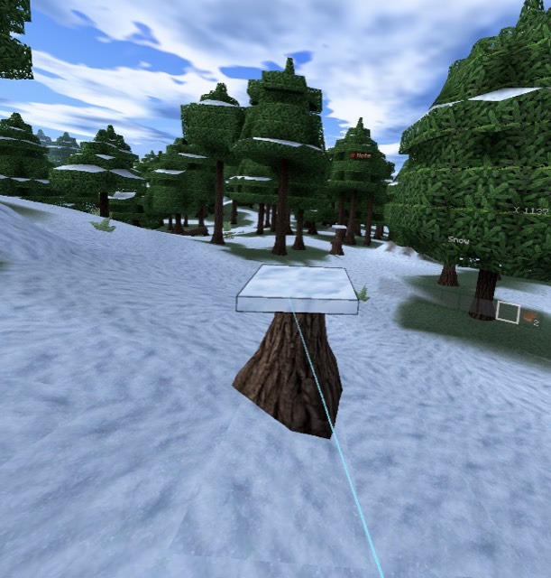

## 20:01:39 - Nothing falls in squares anymore.

- **Transcript:** Nothing falls in squares anymore.
- **Status:** open
- **Build:** 0.995 (35064603, M1-M4 (device-tested; ship riding, chests, comfort options, weapon wheel))
- **World:** New World (30) (seed 4259144782798118884)
- **Dimension:** Surface
- **Biome:** Snowy Taiga
- **Position:** 1166.2 71.8 -1599.6
- **Facing:** north (yaw 20, pitch -48)
- **Held:** empty hand
- **Mount:** on foot
- **Looking at:** Snow at 1166 72 -1601
- **Mode:** Creative, health 20/20
- **Time:** day 1 15:49, clear
- **Fps:** 71
- **Levels:** mic -34 dBFS, game sound -15 dBFS
- **Length:** 3.4 s (voice 1.8 s)
- **Just before:** --109s message: Entering Selenwick; --113s message: Entering Marargard; --115s message: Walking; --115s opened ChestMenu; --116s closed ChestMenu; --117s message: Flying; --120s message: Walking; --121s message: Entering Selenwick; --125s opened ChestMenu; --125s closed ChestMenu; --127s message: Flying; --129s message: Walking; --146s message: Flying; --149s message: Entering Torenstad; --151s opened PauseMenu; --151s closed PauseMenu; --162s message: Entering Wenisland; --191s opened PauseMenu
- **Repro (Mac):** `./snap.sh note --seed 4259144782798118884 --x 1166.2 --z -1599.6 --yaw -20 --pitch -48 --time 0.410`
- **Audio (this Mac):** /tmp/vn17local/raw/vn-20261117-200139-108.aac

## 20:01:42 - Oh, moral station.

- **Transcript:** Oh, moral station.
- **Status:** open
- **Build:** 0.995 (35064603, M1-M4 (device-tested; ship riding, chests, comfort options, weapon wheel))
- **World:** New World (30) (seed 4259144782798118884)
- **Dimension:** Surface
- **Biome:** Taiga
- **Position:** 1184.0 70.3 -1624.2
- **Facing:** north (yaw 16, pitch -20)
- **Held:** empty hand
- **Mount:** on foot
- **Looking at:** Snowy Grass Block at 1185 69 -1629
- **Mode:** Creative, health 20/20
- **Time:** day 1 15:54, clear
- **Fps:** 72
- **Levels:** mic -42 dBFS, game sound -19 dBFS
- **Length:** 2.3 s (voice 0.6 s)
- **Just before:** --105s message: Entering Selenwick; --109s message: Entering Marargard; --111s message: Walking; --111s opened ChestMenu; --112s closed ChestMenu; --114s message: Flying; --116s message: Walking; --118s message: Entering Selenwick; --121s opened ChestMenu; --122s closed ChestMenu; --123s message: Flying; --125s message: Walking; --143s message: Flying; --146s message: Entering Torenstad; --147s opened PauseMenu; --147s closed PauseMenu; --158s message: Entering Wenisland; --187s opened PauseMenu
- **Repro (Mac):** `./snap.sh note --seed 4259144782798118884 --x 1184.0 --z -1624.2 --yaw -16 --pitch -20 --time 0.413`
- **Audio (this Mac):** /tmp/vn17local/raw/vn-20261117-200142-949.aac

## 20:01:47 - All right.

- **Transcript:** All right.
- **Status:** open
- **Build:** 0.995 (35064603, M1-M4 (device-tested; ship riding, chests, comfort options, weapon wheel))
- **World:** New World (30) (seed 4259144782798118884)
- **Dimension:** Surface
- **Biome:** Taiga
- **Position:** 1184.1 70.3 -1624.2
- **Facing:** north (yaw 19, pitch 12)
- **Held:** empty hand
- **Mount:** on foot
- **Looking at:** nothing
- **Mode:** Creative, health 20/20, screen CreativeMenu
- **Time:** day 1 15:59, clear
- **Fps:** 72
- **Levels:** mic -27 dBFS, game sound -19 dBFS
- **Length:** 2.4 s (voice 0.9 s)
- **Just before:** --107s opened ChestMenu; --107s closed ChestMenu; --109s message: Flying; --112s message: Walking; --113s message: Entering Selenwick; --116s opened ChestMenu; --117s closed ChestMenu; --118s message: Flying; --120s message: Walking; --138s message: Flying; --141s message: Entering Torenstad; --142s opened PauseMenu; --143s closed PauseMenu; --153s message: Entering Wenisland; --182s opened PauseMenu; -4s opened PauseMenu; -4s closed PauseMenu; -4s opened CreativeMenu
- **Repro (Mac):** `./snap.sh note --seed 4259144782798118884 --x 1184.1 --z -1624.2 --yaw -19 --pitch 12 --time 0.416`
- **Audio (this Mac):** /tmp/vn17local/raw/vn-20261117-200147-508.aac

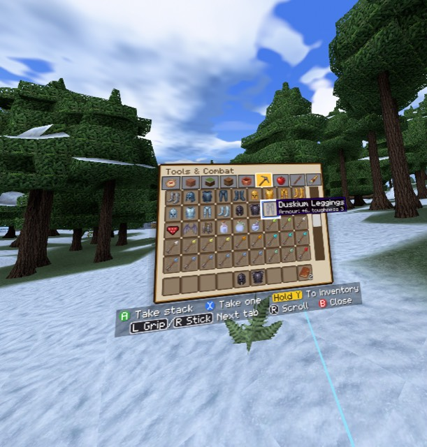

## 20:02:22 - Hold on.

- **Transcript:** Hold on.
- **Status:** open
- **Build:** 0.995 (35064603, M1-M4 (device-tested; ship riding, chests, comfort options, weapon wheel))
- **World:** New World (30) (seed 4259144782798118884)
- **Dimension:** Surface
- **Biome:** Snowy Taiga
- **Position:** 1201.4 67.0 -1682.5
- **Facing:** north (yaw 12, pitch -3)
- **Held:** Sturmbrecher Assault Shotgun x1
- **Mount:** on foot
- **Looking at:** nothing
- **Mode:** Survival, health 20/20
- **Time:** day 1 16:40, clear
- **Fps:** 72
- **Levels:** mic -36 dBFS, game sound -11 dBFS
- **Length:** 1.8 s (voice 0.4 s)
- **Just before:** -22s closed CreativeMenu; -21s opened PauseMenu; -21s message: Survival mode; -20s closed PauseMenu; -20s opened InventoryMenu; -19s holding empty hand; -19s closed InventoryMenu; -18s holding Book; -18s message: Book; -18s holding Cracked Stone Bricks; -18s message: Cracked Stone Bricks; -18s holding Shotgun Shell Box; -18s message: Shotgun Shell Box; -18s holding Sturmbrecher Assault Shotgun; -18s message: Sturmbrecher Assault Shotgun; -17s message: Loaded: 20 / 20; -10s message: Added to journal: Orders: Boreal Station; -9s opened PauseMenu; -8s closed PauseMenu
- **Repro (Mac):** `./snap.sh note --seed 4259144782798118884 --x 1201.4 --z -1682.5 --yaw -12 --pitch -3 --time 0.444`
- **Audio (this Mac):** /tmp/vn17local/raw/vn-20261117-200222-848.aac

## 20:02:25 - Why is there no one here?

- **Transcript:** Why is there no one here?
- **Status:** open
- **Build:** 0.995 (35064603, M1-M4 (device-tested; ship riding, chests, comfort options, weapon wheel))
- **World:** New World (30) (seed 4259144782798118884)
- **Dimension:** Surface
- **Biome:** Taiga
- **Position:** 1197.4 67.0 -1697.7
- **Facing:** north (yaw 355, pitch -16)
- **Held:** Sturmbrecher Assault Shotgun x1
- **Mount:** on foot
- **Looking at:** Snow at 1196 67 -1703
- **Mode:** Survival, health 20/20
- **Time:** day 1 16:43, clear
- **Fps:** 72
- **Levels:** mic -25 dBFS, game sound -24 dBFS
- **Length:** 2.3 s (voice 0.9 s)
- **Just before:** -25s closed CreativeMenu; -24s opened PauseMenu; -24s message: Survival mode; -23s closed PauseMenu; -23s opened InventoryMenu; -22s holding empty hand; -22s closed InventoryMenu; -21s holding Book; -21s message: Book; -21s holding Cracked Stone Bricks; -21s message: Cracked Stone Bricks; -21s holding Shotgun Shell Box; -21s message: Shotgun Shell Box; -21s holding Sturmbrecher Assault Shotgun; -21s message: Sturmbrecher Assault Shotgun; -20s message: Loaded: 20 / 20; -14s message: Added to journal: Orders: Boreal Station; -12s opened PauseMenu; -11s closed PauseMenu
- **Repro (Mac):** `./snap.sh note --seed 4259144782798118884 --x 1197.4 --z -1697.7 --yaw 5 --pitch -16 --time 0.447`
- **Audio (this Mac):** /tmp/vn17local/raw/vn-20261117-200225-888.aac

## 20:02:30 - No one's in this borehole station.

- **Transcript:** No one's in this borehole station.
- **Status:** open
- **Build:** 0.995 (35064603, M1-M4 (device-tested; ship riding, chests, comfort options, weapon wheel))
- **World:** New World (30) (seed 4259144782798118884)
- **Dimension:** Surface
- **Biome:** Snowy Taiga
- **Position:** 1185.4 67.0 -1704.5
- **Facing:** south (yaw 188, pitch -7)
- **Held:** Sturmbrecher Assault Shotgun x1
- **Mount:** on foot
- **Looking at:** nothing
- **Mode:** Survival, health 20/20
- **Time:** day 1 16:49, clear
- **Fps:** 72
- **Levels:** mic -22 dBFS, game sound -25 dBFS
- **Length:** 2.9 s (voice 1.3 s)
- **Just before:** -29s closed CreativeMenu; -29s opened PauseMenu; -28s message: Survival mode; -28s closed PauseMenu; -28s opened InventoryMenu; -26s holding empty hand; -26s closed InventoryMenu; -26s holding Book; -26s message: Book; -26s holding Cracked Stone Bricks; -26s message: Cracked Stone Bricks; -25s holding Shotgun Shell Box; -25s message: Shotgun Shell Box; -25s holding Sturmbrecher Assault Shotgun; -25s message: Sturmbrecher Assault Shotgun; -25s message: Loaded: 20 / 20; -18s message: Added to journal: Orders: Boreal Station; -16s opened PauseMenu; -16s closed PauseMenu
- **Repro (Mac):** `./snap.sh note --seed 4259144782798118884 --x 1185.4 --z -1704.5 --yaw 172 --pitch -7 --time 0.451`
- **Audio (this Mac):** /tmp/vn17local/raw/vn-20261117-200230-528.aac

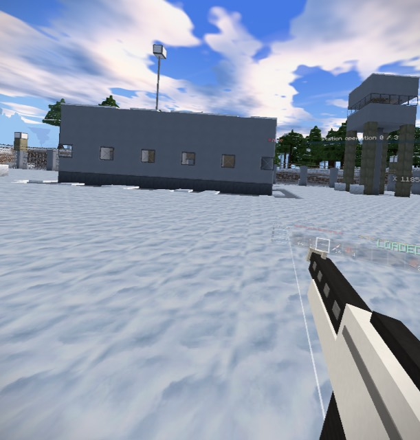

## 20:02:37 - At all, I don't think.

- **Transcript:** At all, I don't think.
- **Status:** open
- **Build:** 0.995 (35064603, M1-M4 (device-tested; ship riding, chests, comfort options, weapon wheel))
- **World:** New World (30) (seed 4259144782798118884)
- **Dimension:** Surface
- **Biome:** Snowy Taiga
- **Position:** 1191.6 64.1 -1683.5
- **Facing:** east (yaw 70, pitch -43)
- **Held:** Sturmbrecher Assault Shotgun x1
- **Mount:** on foot
- **Looking at:** Station Concrete at 1192 64 -1685
- **Mode:** Survival, health 20/20
- **Time:** day 1 16:57, clear
- **Fps:** 72
- **Levels:** mic -31 dBFS, game sound -30 dBFS
- **Length:** 2.7 s (voice 0.7 s)
- **Just before:** -25s message: Added to journal: Orders: Boreal Station; -23s opened PauseMenu; -22s closed PauseMenu
- **Repro (Mac):** `./snap.sh note --seed 4259144782798118884 --x 1191.6 --z -1683.5 --yaw -70 --pitch -43 --time 0.457`
- **Audio (this Mac):** /tmp/vn17local/raw/vn-20261117-200237-368.aac

## 20:02:40 - There's no one here

- **Transcript:** There's no one here
- **Status:** open
- **Build:** 0.995 (35064603, M1-M4 (device-tested; ship riding, chests, comfort options, weapon wheel))
- **World:** New World (30) (seed 4259144782798118884)
- **Dimension:** Surface
- **Biome:** Snowy Taiga
- **Position:** 1191.9 56.5 -1687.0
- **Facing:** west (yaw 267, pitch -50)
- **Held:** Sturmbrecher Assault Shotgun x1
- **Mount:** on foot
- **Looking at:** nothing
- **Mode:** Survival, health 20/20
- **Time:** day 1 17:01, clear
- **Fps:** 72
- **Levels:** mic -23 dBFS, game sound -27 dBFS
- **Length:** 2.3 s (voice 0.8 s)
- **Just before:** -29s message: Added to journal: Orders: Boreal Station; -27s opened PauseMenu; -26s closed PauseMenu; -3s holding Shotgun Shell Box; -3s message: Shotgun Shell Box; -3s holding Cracked Stone Bricks; -3s message: Cracked Stone Bricks; -3s holding Shotgun Shell Box; -3s message: Shotgun Shell Box; -2s holding Sturmbrecher Assault Shotgun; -2s message: Sturmbrecher Assault Shotgun
- **Repro (Mac):** `./snap.sh note --seed 4259144782798118884 --x 1191.9 --z -1687.0 --yaw 93 --pitch -50 --time 0.460`
- **Audio (this Mac):** /tmp/vn17local/raw/vn-20261117-200240-908.aac

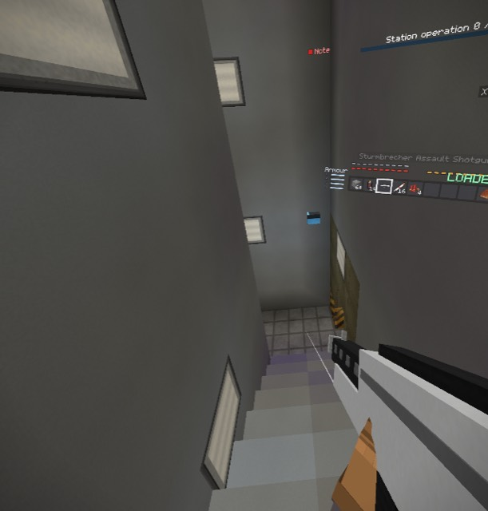

## 20:02:46 - Gun store works.

- **Transcript:** Gun store works.
- **Status:** open
- **Build:** 0.995 (35064603, M1-M4 (device-tested; ship riding, chests, comfort options, weapon wheel))
- **World:** New World (30) (seed 4259144782798118884)
- **Dimension:** Surface
- **Biome:** Snowy Taiga
- **Position:** 1182.0 51.0 -1691.5
- **Facing:** north (yaw 356, pitch 6)
- **Held:** Sturmbrecher Assault Shotgun x1
- **Mount:** on foot
- **Looking at:** nothing
- **Mode:** Survival, health 13/20
- **Time:** day 1 17:08, clear
- **Fps:** 72
- **Levels:** mic -23 dBFS, game sound -24 dBFS
- **Length:** 2.3 s (voice 0.8 s)
- **Just before:** -9s holding Shotgun Shell Box; -9s message: Shotgun Shell Box; -8s holding Cracked Stone Bricks; -8s message: Cracked Stone Bricks; -8s holding Shotgun Shell Box; -8s message: Shotgun Shell Box; -7s holding Sturmbrecher Assault Shotgun; -7s message: Sturmbrecher Assault Shotgun; -4s took 1 damage (health 20/20); -2s message: The station alarm is sounding!; -1s took 8 damage (health 13/20)
- **Repro (Mac):** `./snap.sh note --seed 4259144782798118884 --x 1182.0 --z -1691.5 --yaw 4 --pitch 6 --time 0.464`
- **Audio (this Mac):** /tmp/vn17local/raw/vn-20261117-200246-308.aac

## 20:02:55 - Oh yeah, look at that.

- **Transcript:** Oh yeah, look at that.
- **Status:** open
- **Build:** 0.995 (35064603, M1-M4 (device-tested; ship riding, chests, comfort options, weapon wheel))
- **World:** New World (30) (seed 4259144782798118884)
- **Dimension:** Surface
- **Biome:** Taiga
- **Position:** 1195.3 51.0 -1691.7
- **Facing:** east (yaw 86, pitch 15)
- **Held:** Sturmbrecher Assault Shotgun x1
- **Mount:** on foot
- **Looking at:** nothing
- **Mode:** Survival, health 18/20
- **Time:** day 1 17:18, clear
- **Fps:** 72
- **Levels:** mic -32 dBFS, game sound -12 dBFS
- **Length:** 2.5 s (voice 1.0 s)
- **Just before:** -18s holding Shotgun Shell Box; -18s message: Shotgun Shell Box; -17s holding Cracked Stone Bricks; -17s message: Cracked Stone Bricks; -17s holding Shotgun Shell Box; -17s message: Shotgun Shell Box; -16s holding Sturmbrecher Assault Shotgun; -16s message: Sturmbrecher Assault Shotgun; -13s took 1 damage (health 20/20); -11s message: The station alarm is sounding!; -10s took 8 damage (health 13/20); -4s message: Loaded: 20 / 20; -4s took 6 damage (health 8/20); -4s holding Field Stim; -3s holding Sturmbrecher Assault Shotgun
- **Repro (Mac):** `./snap.sh note --seed 4259144782798118884 --x 1195.3 --z -1691.7 --yaw -86 --pitch 15 --time 0.471`
- **Audio (this Mac):** /tmp/vn17local/raw/vn-20261117-200255-008.aac

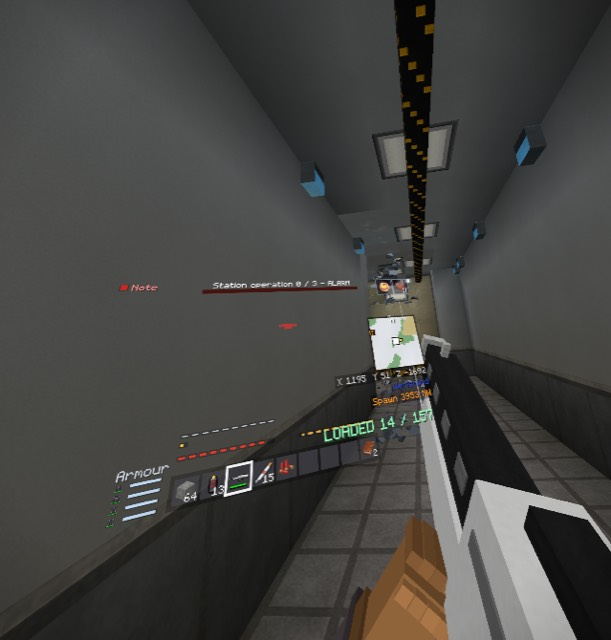

## 20:02:57 - Those guns work perfectly, no.

- **Transcript:** Those guns work perfectly, no.
- **Status:** open
- **Build:** 0.995 (35064603, M1-M4 (device-tested; ship riding, chests, comfort options, weapon wheel))
- **World:** New World (30) (seed 4259144782798118884)
- **Dimension:** Surface
- **Biome:** Taiga
- **Position:** 1201.2 51.0 -1692.7
- **Facing:** east (yaw 72, pitch -30)
- **Held:** Sturmbrecher Assault Shotgun x1
- **Mount:** on foot
- **Looking at:** Station Concrete at 1201 52 -1694
- **Mode:** Survival, health 20/20
- **Time:** day 1 17:21, clear
- **Fps:** 72
- **Levels:** mic -34 dBFS, game sound -20 dBFS
- **Length:** 2.9 s (voice 1.3 s)
- **Just before:** -20s holding Shotgun Shell Box; -20s message: Shotgun Shell Box; -20s holding Cracked Stone Bricks; -20s message: Cracked Stone Bricks; -19s holding Shotgun Shell Box; -19s message: Shotgun Shell Box; -19s holding Sturmbrecher Assault Shotgun; -19s message: Sturmbrecher Assault Shotgun; -15s took 1 damage (health 20/20); -13s message: The station alarm is sounding!; -12s took 8 damage (health 13/20); -7s message: Loaded: 20 / 20; -7s took 6 damage (health 8/20); -6s holding Field Stim; -6s holding Sturmbrecher Assault Shotgun
- **Repro (Mac):** `./snap.sh note --seed 4259144782798118884 --x 1201.2 --z -1692.7 --yaw -72 --pitch -30 --time 0.473`
- **Audio (this Mac):** /tmp/vn17local/raw/vn-20261117-200257-588.aac

## 20:03:04 - Yes, there's just no troops there.

- **Transcript:** Yes, there's just no troops there.
- **Status:** open
- **Build:** 0.995 (35064603, M1-M4 (device-tested; ship riding, chests, comfort options, weapon wheel))
- **World:** New World (30) (seed 4259144782798118884)
- **Dimension:** Surface
- **Biome:** Snowy Taiga
- **Position:** 1203.2 51.0 -1714.0
- **Facing:** north-west (yaw 321, pitch -7)
- **Held:** Sturmbrecher Assault Shotgun x1
- **Mount:** on foot
- **Looking at:** Station Concrete at 1200 52 -1718
- **Mode:** Survival, health 13/20
- **Time:** day 1 17:29, clear
- **Fps:** 72
- **Levels:** mic -26 dBFS, game sound -22 dBFS
- **Length:** 4.2 s (voice 1.8 s)
- **Just before:** -27s holding Shotgun Shell Box; -27s message: Shotgun Shell Box; -27s holding Cracked Stone Bricks; -27s message: Cracked Stone Bricks; -26s holding Shotgun Shell Box; -26s message: Shotgun Shell Box; -26s holding Sturmbrecher Assault Shotgun; -26s message: Sturmbrecher Assault Shotgun; -22s took 1 damage (health 20/20); -20s message: The station alarm is sounding!; -19s took 8 damage (health 13/20); -14s message: Loaded: 20 / 20; -13s took 6 damage (health 8/20); -13s holding Field Stim; -13s holding Sturmbrecher Assault Shotgun; -2s took 7 damage (health 13/20); -2s holding Shotgun Shell Box; -2s message: Shotgun Shell Box; -1s holding Sturmbrecher Assault Shotgun; -1s message: Sturmbrecher Assault Shotgun; -1s message: Loaded: 20 / 20
- **Repro (Mac):** `./snap.sh note --seed 4259144782798118884 --x 1203.2 --z -1714.0 --yaw 39 --pitch -7 --time 0.479`
- **Audio (this Mac):** /tmp/vn17local/raw/vn-20261117-200304-448.aac

## 20:03:16 - All right.

- **Transcript:** All right.
- **Status:** open
- **Build:** 0.995 (35064603, M1-M4 (device-tested; ship riding, chests, comfort options, weapon wheel))
- **World:** New World (30) (seed 4259144782798118884)
- **Dimension:** Surface
- **Biome:** Snowy Taiga
- **Position:** 1204.8 52.2 -1713.7
- **Facing:** south (yaw 162, pitch 5)
- **Held:** empty hand
- **Mount:** on foot
- **Looking at:** Station Concrete at 1206 53 -1711
- **Mode:** Survival, health 20/20
- **Time:** day 1 17:44, clear
- **Fps:** 72
- **Levels:** mic -26 dBFS, game sound -24 dBFS
- **Length:** 1.9 s (voice 0.4 s)
- **Just before:** -26s message: Loaded: 20 / 20; -26s took 6 damage (health 8/20); -26s holding Field Stim; -25s holding Sturmbrecher Assault Shotgun; -14s took 7 damage (health 13/20); -14s holding Shotgun Shell Box; -14s message: Shotgun Shell Box; -13s holding Sturmbrecher Assault Shotgun; -13s message: Sturmbrecher Assault Shotgun; -13s message: Loaded: 20 / 20; -8s took 8 damage (health 6/20); -7s holding Field Stim; -6s holding Sturmbrecher Assault Shotgun; -2s holding Field Stim; -2s message: Field Stim; -2s holding Shotgun Shells; -2s message: Shotgun Shells; -2s holding empty hand
- **Repro (Mac):** `./snap.sh note --seed 4259144782798118884 --x 1204.8 --z -1713.7 --yaw -162 --pitch 5 --time 0.489`
- **Audio (this Mac):** /tmp/vn17local/raw/vn-20261117-200316-748.aac

## 20:03:19 - I'm going to check a gravel station

- **Transcript:** I'm going to check a gravel station
- **Status:** open
- **Build:** 0.995 (35064603, M1-M4 (device-tested; ship riding, chests, comfort options, weapon wheel))
- **World:** New World (30) (seed 4259144782798118884)
- **Dimension:** Surface
- **Biome:** Taiga
- **Position:** 1205.5 51.0 -1710.3
- **Facing:** south (yaw 180, pitch 15)
- **Held:** empty hand
- **Mount:** on foot
- **Looking at:** nothing
- **Mode:** Survival, health 20/20, screen PauseMenu
- **Time:** day 1 17:47, clear
- **Fps:** 72
- **Levels:** mic -36 dBFS, game sound -33 dBFS
- **Length:** 3.1 s (voice 1.4 s)
- **Just before:** -29s message: Loaded: 20 / 20; -29s took 6 damage (health 8/20); -29s holding Field Stim; -28s holding Sturmbrecher Assault Shotgun; -17s took 7 damage (health 13/20); -17s holding Shotgun Shell Box; -17s message: Shotgun Shell Box; -16s holding Sturmbrecher Assault Shotgun; -16s message: Sturmbrecher Assault Shotgun; -16s message: Loaded: 20 / 20; -11s took 8 damage (health 6/20); -10s holding Field Stim; -9s holding Sturmbrecher Assault Shotgun; -5s holding Field Stim; -5s message: Field Stim; -5s holding Shotgun Shells; -5s message: Shotgun Shells; -5s holding empty hand; -2s opened PauseMenu; -2s opened ReportMenu; -1s closed ReportMenu; -0s opened PauseMenu
- **Repro (Mac):** `./snap.sh note --seed 4259144782798118884 --x 1205.5 --z -1710.3 --yaw -180 --pitch 15 --time 0.491`
- **Audio (this Mac):** /tmp/vn17local/raw/vn-20261117-200319-808.aac

## 20:03:23 - That's a big one for store release, I think

- **Transcript:** That's a big one for store release, I think
- **Status:** open
- **Build:** 0.995 (35064603, M1-M4 (device-tested; ship riding, chests, comfort options, weapon wheel))
- **World:** New World (30) (seed 4259144782798118884)
- **Dimension:** Surface
- **Biome:** Snowy Taiga
- **Position:** 1188.2 51.0 -1689.6
- **Facing:** south (yaw 196, pitch -8)
- **Held:** empty hand
- **Mount:** on foot
- **Looking at:** Steel Plating at 1188 52 -1689
- **Mode:** Creative, health 20/20
- **Time:** day 1 17:50, clear
- **Fps:** 72
- **Levels:** mic -27 dBFS, game sound -18 dBFS
- **Length:** 3.6 s (voice 1.9 s)
- **Just before:** -21s took 7 damage (health 13/20); -21s holding Shotgun Shell Box; -21s message: Shotgun Shell Box; -20s holding Sturmbrecher Assault Shotgun; -20s message: Sturmbrecher Assault Shotgun; -20s message: Loaded: 20 / 20; -15s took 8 damage (health 6/20); -13s holding Field Stim; -13s holding Sturmbrecher Assault Shotgun; -9s holding Field Stim; -9s message: Field Stim; -8s holding Shotgun Shells; -8s message: Shotgun Shells; -8s holding empty hand; -6s opened PauseMenu; -5s opened ReportMenu; -5s closed ReportMenu; -4s opened PauseMenu; -3s message: Creative mode; -3s closed PauseMenu; -1s message: Flying; -0s message: Walking
- **Repro (Mac):** `./snap.sh note --seed 4259144782798118884 --x 1188.2 --z -1689.6 --yaw 164 --pitch -8 --time 0.493`
- **Audio (this Mac):** /tmp/vn17local/raw/vn-20261117-200323-389.aac

## 20:03:27 - Maybe we can add later an update. I don't know.

- **Transcript:** Maybe we can add later an update. I don't know.
- **Status:** open
- **Build:** 0.995 (35064603, M1-M4 (device-tested; ship riding, chests, comfort options, weapon wheel))
- **World:** New World (30) (seed 4259144782798118884)
- **Dimension:** Surface
- **Biome:** Taiga
- **Position:** 1186.7 67.0 -1683.4
- **Facing:** south (yaw 178, pitch -14)
- **Held:** empty hand
- **Mount:** on foot
- **Looking at:** nothing
- **Mode:** Creative, health 20/20
- **Time:** day 1 17:55, clear
- **Fps:** 72
- **Levels:** mic -28 dBFS, game sound -18 dBFS
- **Length:** 3.5 s (voice 1.9 s)
- **Just before:** -25s took 7 damage (health 13/20); -25s holding Shotgun Shell Box; -25s message: Shotgun Shell Box; -24s holding Sturmbrecher Assault Shotgun; -24s message: Sturmbrecher Assault Shotgun; -24s message: Loaded: 20 / 20; -19s took 8 damage (health 6/20); -18s holding Field Stim; -17s holding Sturmbrecher Assault Shotgun; -13s holding Field Stim; -13s message: Field Stim; -13s holding Shotgun Shells; -13s message: Shotgun Shells; -12s holding empty hand; -10s opened PauseMenu; -9s opened ReportMenu; -9s closed ReportMenu; -8s opened PauseMenu; -7s message: Creative mode; -7s closed PauseMenu; -6s message: Flying; -4s message: Walking
- **Repro (Mac):** `./snap.sh note --seed 4259144782798118884 --x 1186.7 --z -1683.4 --yaw -178 --pitch -14 --time 0.497`
- **Audio (this Mac):** /tmp/vn17local/raw/vn-20261117-200327-608.aac

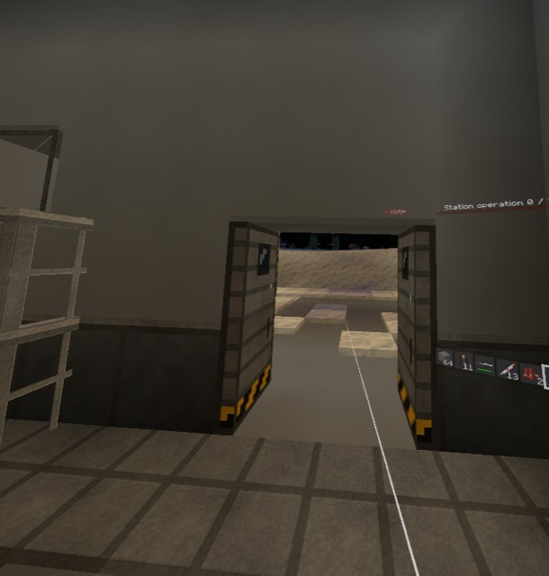

## 20:03:31 - But yeah, we need troops here.

- **Transcript:** But yeah, we need troops here.
- **Status:** open
- **Build:** 0.995 (35064603, M1-M4 (device-tested; ship riding, chests, comfort options, weapon wheel))
- **World:** New World (30) (seed 4259144782798118884)
- **Dimension:** Surface
- **Biome:** Taiga
- **Position:** 1207.0 74.1 -1695.9
- **Facing:** north-west (yaw 337, pitch -23)
- **Held:** empty hand
- **Mount:** on foot, flying
- **Looking at:** nothing
- **Mode:** Creative, health 20/20
- **Time:** day 1 17:59, clear
- **Fps:** 71
- **Levels:** mic -34 dBFS, game sound -20 dBFS
- **Length:** 2.9 s (voice 1.4 s)
- **Just before:** -29s took 7 damage (health 13/20); -29s holding Shotgun Shell Box; -29s message: Shotgun Shell Box; -28s holding Sturmbrecher Assault Shotgun; -28s message: Sturmbrecher Assault Shotgun; -28s message: Loaded: 20 / 20; -23s took 8 damage (health 6/20); -21s holding Field Stim; -20s holding Sturmbrecher Assault Shotgun; -17s holding Field Stim; -17s message: Field Stim; -16s holding Shotgun Shells; -16s message: Shotgun Shells; -16s holding empty hand; -14s opened PauseMenu; -13s opened ReportMenu; -13s closed ReportMenu; -12s opened PauseMenu; -11s message: Creative mode; -11s closed PauseMenu; -9s message: Flying; -8s message: Walking; -2s message: Flying
- **Repro (Mac):** `./snap.sh note --seed 4259144782798118884 --x 1207.0 --z -1695.9 --yaw 23 --pitch -23 --time 0.500`
- **Audio (this Mac):** /tmp/vn17local/raw/vn-20261117-200331-368.aac

## 20:03:53 - 14, 9 to 15.

- **Transcript:** 14, 9 to 15.
- **Status:** open
- **Build:** 0.995 (35064603, M1-M4 (device-tested; ship riding, chests, comfort options, weapon wheel))
- **World:** New World (30) (seed 4259144782798118884)
- **Dimension:** Surface
- **Biome:** Taiga
- **Position:** 2164.0 161.1 -3305.7
- **Facing:** north-east (yaw 40, pitch 3)
- **Held:** empty hand
- **Mount:** on foot, flying
- **Looking at:** nothing
- **Mode:** Creative, health 20/20
- **Time:** day 1 18:23, clear
- **Fps:** 72
- **Levels:** mic -30 dBFS, game sound -16 dBFS
- **Length:** 2.8 s (voice 1.0 s)
- **Just before:** -24s message: Flying; -15s message: Entering Ardogard; -13s message: Entering Keseheim; -12s message: Entering Ardogard; -11s opened PauseMenu; -9s opened CommandMenu; -7s message: Capital Citadel: 1960 ~ -3460 (255 blocks), marked on your map; -0s closed CommandMenu
- **Repro (Mac):** `./snap.sh note --seed 4259144782798118884 --x 2164.0 --z -3305.7 --yaw -40 --pitch 3 --time 0.517`
- **Audio (this Mac):** /tmp/vn17local/raw/vn-20261117-200353-408.aac
- **Video (this Mac):** /tmp/vn17local/raw/vn-20261117-200353-408.mp4

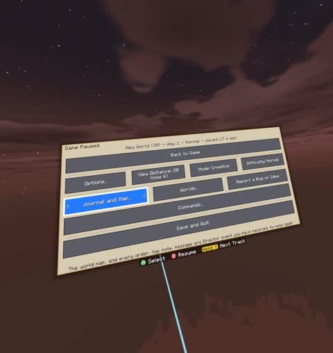 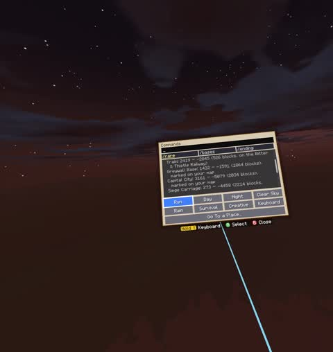 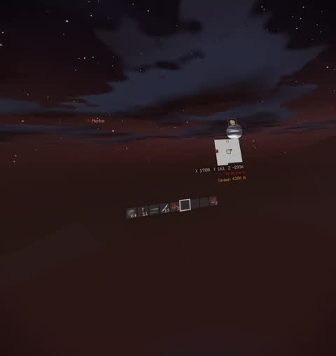 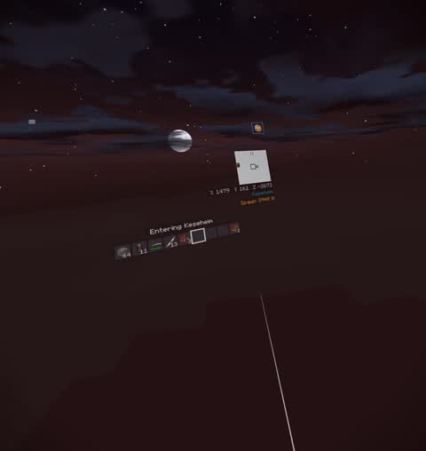

## 20:04:05 - Alright, my real face, where we at?

- **Transcript:** Alright, my real face, where we at?
- **Status:** open
- **Build:** 0.995 (35064603, M1-M4 (device-tested; ship riding, chests, comfort options, weapon wheel))
- **World:** New World (30) (seed 4259144782798118884)
- **Dimension:** Surface
- **Biome:** Snowy Taiga
- **Position:** 1458.3 161.1 -1513.3
- **Facing:** south-west (yaw 227, pitch -62)
- **Held:** empty hand
- **Mount:** on foot, flying
- **Looking at:** nothing
- **Mode:** Creative, health 20/20
- **Time:** day 1 18:38, clear
- **Fps:** 72
- **Levels:** mic -28 dBFS, game sound -17 dBFS
- **Length:** 3.6 s (voice 1.7 s)
- **Just before:** -28s message: Entering Ardogard; -26s message: Entering Keseheim; -24s message: Entering Ardogard; -24s opened PauseMenu; -22s opened CommandMenu; -19s message: Capital Citadel: 1960 ~ -3460 (255 blocks), marked on your map; -12s closed CommandMenu; -9s message: Entering Keseheim; -4s message: Entering Ardogard; -3s message: Entering Wenisland
- **Repro (Mac):** `./snap.sh note --seed 4259144782798118884 --x 1458.3 --z -1513.3 --yaw 133 --pitch -62 --time 0.527`
- **Audio (this Mac):** /tmp/vn17local/raw/vn-20261117-200405-589.aac
- **Video (this Mac):** /tmp/vn17local/raw/vn-20261117-200405-589.mp4

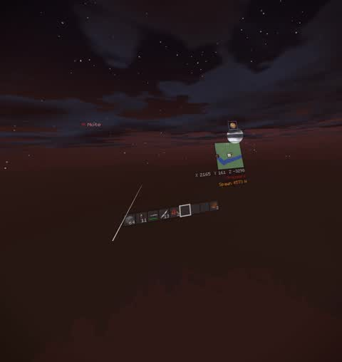 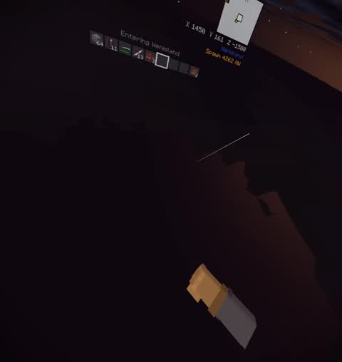 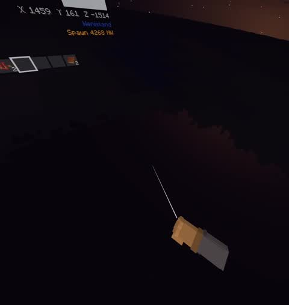 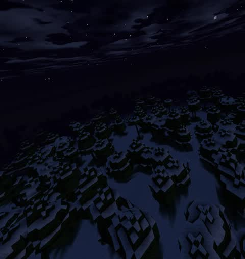

## 20:04:16 - I don't see any real basis just yet.

- **Transcript:** I don't see any real basis just yet.
- **Status:** open
- **Build:** 0.995 (35064603, M1-M4 (device-tested; ship riding, chests, comfort options, weapon wheel))
- **World:** New World (30) (seed 4259144782798118884)
- **Dimension:** Surface
- **Biome:** Snowy Taiga
- **Position:** 1486.0 124.5 -1477.9
- **Facing:** west (yaw 285, pitch -57)
- **Held:** empty hand
- **Mount:** on foot, flying
- **Looking at:** nothing
- **Mode:** Creative, health 20/20
- **Time:** day 1 18:50, clear
- **Fps:** 72
- **Levels:** mic -30 dBFS, game sound -16 dBFS
- **Length:** 3.9 s (voice 2.2 s)
- **Just before:** -30s message: Capital Citadel: 1960 ~ -3460 (255 blocks), marked on your map; -23s closed CommandMenu; -20s message: Entering Keseheim; -15s message: Entering Ardogard; -13s message: Entering Wenisland; -8s message: Walking; -6s message: Flying; -3s opened PauseMenu; -2s closed PauseMenu
- **Repro (Mac):** `./snap.sh note --seed 4259144782798118884 --x 1486.0 --z -1477.9 --yaw 75 --pitch -57 --time 0.535`
- **Audio (this Mac):** /tmp/vn17local/raw/vn-20261117-200416-408.aac
- **Video (this Mac):** /tmp/vn17local/raw/vn-20261117-200416-408.mp4

   

## 20:04:20 - The coordinates are on.

- **Transcript:** The coordinates are on.
- **Status:** open
- **Build:** 0.995 (35064603, M1-M4 (device-tested; ship riding, chests, comfort options, weapon wheel))
- **World:** New World (30) (seed 4259144782798118884)
- **Dimension:** Surface
- **Biome:** Snowy Taiga
- **Position:** 1566.8 124.5 -1412.2
- **Facing:** east (yaw 81, pitch -20)
- **Held:** empty hand
- **Mount:** on foot, flying
- **Looking at:** nothing
- **Mode:** Creative, health 20/20
- **Time:** day 1 18:55, clear
- **Fps:** 70
- **Levels:** mic -42 dBFS, game sound -18 dBFS
- **Length:** 2.3 s (voice 0.8 s)
- **Just before:** -28s closed CommandMenu; -24s message: Entering Keseheim; -19s message: Entering Ardogard; -18s message: Entering Wenisland; -12s message: Walking; -10s message: Flying; -7s opened PauseMenu; -6s closed PauseMenu
- **Repro (Mac):** `./snap.sh note --seed 4259144782798118884 --x 1566.8 --z -1412.2 --yaw -81 --pitch -20 --time 0.539`
- **Audio (this Mac):** /tmp/vn17local/raw/vn-20261117-200420-589.aac
- **Video (this Mac):** /tmp/vn17local/raw/vn-20261117-200420-589.mp4

   

## 20:04:28 - 14, -15.

- **Transcript:** 14, -15.
- **Status:** open
- **Build:** 0.995 (35064603, M1-M4 (device-tested; ship riding, chests, comfort options, weapon wheel))
- **World:** New World (30) (seed 4259144782798118884)
- **Dimension:** Surface
- **Biome:** Snowy Taiga
- **Position:** 1601.8 124.5 -1439.6
- **Facing:** north-east (yaw 39, pitch -3)
- **Held:** empty hand
- **Mount:** on foot, flying
- **Looking at:** nothing
- **Mode:** Creative, health 20/20, screen CommandMenu
- **Time:** day 1 19:03, clear
- **Fps:** 72
- **Levels:** mic -35 dBFS, game sound -18 dBFS
- **Length:** 2.9 s (voice 1.1 s)
- **Just before:** -27s message: Entering Ardogard; -25s message: Entering Wenisland; -20s message: Walking; -18s message: Flying; -15s opened PauseMenu; -14s closed PauseMenu; -7s opened PauseMenu; -6s opened CommandMenu
- **Repro (Mac):** `./snap.sh note --seed 4259144782798118884 --x 1601.8 --z -1439.6 --yaw -39 --pitch -3 --time 0.544`
- **Audio (this Mac):** /tmp/vn17local/raw/vn-20261117-200428-428.aac
- **Video (this Mac):** /tmp/vn17local/raw/vn-20261117-200428-428.mp4

   

## 20:04:32 - 14, -15, there we go.

- **Transcript:** 14, -15, there we go.
- **Status:** open
- **Build:** 0.995 (35064603, M1-M4 (device-tested; ship riding, chests, comfort options, weapon wheel))
- **World:** New World (30) (seed 4259144782798118884)
- **Dimension:** Surface
- **Biome:** Snowy Taiga
- **Position:** 1437.8 124.5 -1500.2
- **Facing:** east (yaw 98, pitch -16)
- **Held:** empty hand
- **Mount:** on foot, flying
- **Looking at:** nothing
- **Mode:** Creative, health 20/20
- **Time:** day 1 19:08, clear
- **Fps:** 72
- **Levels:** mic -41 dBFS, game sound -20 dBFS
- **Length:** 4.3 s (voice 1.6 s)
- **Just before:** -29s message: Entering Wenisland; -24s message: Walking; -22s message: Flying; -19s opened PauseMenu; -18s closed PauseMenu; -11s opened PauseMenu; -10s opened CommandMenu; -4s closed CommandMenu
- **Repro (Mac):** `./snap.sh note --seed 4259144782798118884 --x 1437.8 --z -1500.2 --yaw -98 --pitch -16 --time 0.548`
- **Audio (this Mac):** /tmp/vn17local/raw/vn-20261117-200432-349.aac
- **Video (this Mac):** /tmp/vn17local/raw/vn-20261117-200432-349.mp4

   

## 20:04:36 - Hello here, and we do have men there, but the Boral Station doesn't ha

- **Transcript:** Hello here, and we do have men there, but the Boral Station doesn't have men, which is weird.
- **Status:** open
- **Build:** 0.995 (35064603, M1-M4 (device-tested; ship riding, chests, comfort options, weapon wheel))
- **World:** New World (30) (seed 4259144782798118884)
- **Dimension:** Surface
- **Biome:** Snowy Taiga
- **Position:** 1431.4 124.5 -1555.9
- **Facing:** north-east (yaw 24, pitch -44)
- **Held:** empty hand
- **Mount:** on foot, flying
- **Looking at:** nothing
- **Mode:** Creative, health 20/20
- **Time:** day 1 19:13, clear
- **Fps:** 69
- **Levels:** mic -21 dBFS, game sound -16 dBFS
- **Length:** 6.1 s (voice 3.8 s)
- **Just before:** -28s message: Walking; -26s message: Flying; -23s opened PauseMenu; -22s closed PauseMenu; -15s opened PauseMenu; -14s opened CommandMenu; -8s closed CommandMenu; -2s message: Intel: this base is a Field Hospital
- **While talking:** -3s message: Walking; -0s opened PauseMenu
- **Position at the end:** 1431.0 68.3 -1520.1
- **Repro (Mac):** `./snap.sh note --seed 4259144782798118884 --x 1431.4 --z -1555.9 --yaw -24 --pitch -44 --time 0.551`
- **Audio (this Mac):** /tmp/vn17local/raw/vn-20261117-200436-468.aac
- **Video (this Mac):** /tmp/vn17local/raw/vn-20261117-200436-468.mp4

   

## 20:05:09 - All right, that's good.

- **Transcript:** All right, that's good.
- **Status:** open
- **Build:** 0.995 (35064603, M1-M4 (device-tested; ship riding, chests, comfort options, weapon wheel))
- **World:** New World (30) (seed 4259144782798118884)
- **Dimension:** Surface
- **Biome:** Taiga
- **Position:** -2405.9 72.6 -3319.1
- **Facing:** north-east (yaw 40, pitch -19)
- **Held:** empty hand
- **Mount:** on foot
- **Looking at:** Grass Block at -2403 71 -3324
- **Mode:** Survival, health 20/20
- **Time:** day 1 19:51, clear
- **Fps:** 69
- **Levels:** mic -29 dBFS, game sound -28 dBFS
- **Length:** 2.3 s (voice 0.5 s)
- **Just before:** -28s opened PauseMenu; -27s message: Survival mode; -27s closed PauseMenu; -26s holding Shotgun Shells; -26s holding Field Stim; -26s holding Sturmbrecher Assault Shotgun; -19s message: The Greywall Fortress is sounding the alarm!; -19s took 1 damage (health 19/20); -11s message: Honour raised (you protected the town); -8s took 8 damage (health 11/20); -7s holding Field Stim; -7s message: Field Stim; -6s took 6 damage (health 18/20); -6s holding Sturmbrecher Assault Shotgun; -6s message: Sturmbrecher Assault Shotgun; -6s message: Loaded: 20 / 20; -4s died; -4s opened DeathMenu; -4s holding empty hand; -3s took 20 damage (health 0/20); -3s respawned; -3s closed DeathMenu; -3s message: Your things are 4207 blocks south-east; -0s message: Entering Marargard
- **Repro (Mac):** `./snap.sh note --seed 4259144782798118884 --x -2405.9 --z -3319.1 --yaw -40 --pitch -19 --time 0.577`
- **Audio (this Mac):** /tmp/vn17local/raw/vn-20261117-200509-528.aac
- **Video (this Mac):** /tmp/vn17local/raw/vn-20261117-200509-528.mp4

   

## 20:05:15 - I'm curious about...

- **Transcript:** I'm curious about...
- **Status:** open
- **Build:** 0.995 (35064603, M1-M4 (device-tested; ship riding, chests, comfort options, weapon wheel))
- **World:** New World (30) (seed 4259144782798118884)
- **Dimension:** Surface
- **Biome:** Taiga
- **Position:** -2405.0 72.8 -3321.3
- **Facing:** east (yaw 90, pitch -6)
- **Held:** empty hand
- **Mount:** on foot
- **Looking at:** nothing
- **Mode:** Creative, health 20/20, screen CreativeMenu
- **Time:** day 1 19:56, clear
- **Fps:** 72
- **Levels:** mic -34 dBFS, game sound -26 dBFS
- **Length:** 2.6 s (voice 0.8 s)
- **Just before:** -26s message: The Greywall Fortress is sounding the alarm!; -26s took 1 damage (health 19/20); -18s message: Honour raised (you protected the town); -14s took 8 damage (health 11/20); -14s holding Field Stim; -14s message: Field Stim; -13s took 6 damage (health 18/20); -13s holding Sturmbrecher Assault Shotgun; -13s message: Sturmbrecher Assault Shotgun; -12s message: Loaded: 20 / 20; -10s died; -10s opened DeathMenu; -10s holding empty hand; -9s took 20 damage (health 0/20); -9s respawned; -9s closed DeathMenu; -9s message: Your things are 4207 blocks south-east; -7s message: Entering Marargard; -4s opened PauseMenu; -3s closed PauseMenu; -3s opened InventoryMenu; -2s closed InventoryMenu; -2s opened PauseMenu; -1s message: Creative mode; -1s closed PauseMenu; -0s opened CreativeMenu
- **Repro (Mac):** `./snap.sh note --seed 4259144782798118884 --x -2405.0 --z -3321.3 --yaw -90 --pitch -6 --time 0.581`
- **Audio (this Mac):** /tmp/vn17local/raw/vn-20261117-200515-949.aac
- **Video (this Mac):** /tmp/vn17local/raw/vn-20261117-200515-949.mp4

   

## 20:06:04 - New village.

- **Transcript:** New village.
- **Status:** open
- **Build:** 0.995 (35064603, M1-M4 (device-tested; ship riding, chests, comfort options, weapon wheel))
- **World:** New World (30) (seed 4259144782798118884)
- **Dimension:** Surface
- **Biome:** Taiga
- **Position:** -3379.7 197.7 -3090.0
- **Facing:** north-west (yaw 314, pitch -75)
- **Held:** empty hand
- **Mount:** on foot, flying
- **Looking at:** nothing
- **Mode:** Creative, health 20/20
- **Time:** day 1 20:51, clear
- **Fps:** 72
- **Levels:** mic -40 dBFS, game sound -22 dBFS
- **Length:** 2.3 s (voice 0.7 s)
- **Just before:** -29s opened PauseMenu; -28s closed PauseMenu; -26s message: Walking; -24s message: Flying; -15s message: Entering Marargard; -7s message: Homestead marked on the map; -5s message: A homestead. Fields, a barn, and a long way from town.
- **Repro (Mac):** `./snap.sh note --seed 4259144782798118884 --x -3379.7 --z -3090.0 --yaw 46 --pitch -75 --time 0.619`
- **Audio (this Mac):** /tmp/vn17local/raw/vn-20261117-200604-008.aac
- **Video (this Mac):** /tmp/vn17local/raw/vn-20261117-200604-008.mp4

   

## 20:06:13 - Still looking pretty good.

- **Transcript:** Still looking pretty good.
- **Status:** open
- **Build:** 0.995 (35064603, M1-M4 (device-tested; ship riding, chests, comfort options, weapon wheel))
- **World:** New World (30) (seed 4259144782798118884)
- **Dimension:** Surface
- **Biome:** Snowy Plains
- **Position:** -4044.9 197.7 -2874.2
- **Facing:** north-west (yaw 314, pitch -63)
- **Held:** empty hand
- **Mount:** on foot, flying
- **Looking at:** nothing
- **Mode:** Creative, health 20/20
- **Time:** day 1 21:02, clear
- **Fps:** 71
- **Levels:** mic -31 dBFS, game sound -14 dBFS
- **Length:** 2.6 s (voice 1.0 s)
- **Just before:** -25s message: Entering Marargard; -17s message: Homestead marked on the map; -15s message: A homestead. Fields, a barn, and a long way from town.
- **Repro (Mac):** `./snap.sh note --seed 4259144782798118884 --x -4044.9 --z -2874.2 --yaw 46 --pitch -63 --time 0.627`
- **Audio (this Mac):** /tmp/vn17local/raw/vn-20261117-200613-608.aac
- **Video (this Mac):** /tmp/vn17local/raw/vn-20261117-200613-608.mp4

   

## 20:06:37 - What the hell? Goes in the store.

- **Transcript:** What the hell? Goes in the store.
- **Status:** open
- **Build:** 0.995 (35064603, M1-M4 (device-tested; ship riding, chests, comfort options, weapon wheel))
- **World:** New World (30) (seed 4259144782798118884)
- **Dimension:** Surface
- **Biome:** Taiga
- **Position:** -4225.6 72.0 -2971.6
- **Facing:** east (yaw 83, pitch -2)
- **Held:** empty hand
- **Mount:** on foot
- **Looking at:** Crafting Table at -4223 73 -2972
- **Mode:** Survival, health 20/20
- **Time:** day 1 07:14, clear
- **Fps:** 72
- **Levels:** mic -24 dBFS, game sound -21 dBFS
- **Length:** 3.6 s (voice 1.7 s)
- **Just before:** -20s message: Walking; -15s opened PauseMenu; -14s opened CommandMenu; -14s message: Set the time to 1000; -13s closed CommandMenu; -13s opened PauseMenu; -11s message: Survival mode; -11s closed PauseMenu; -6s took 1 damage (health 20/20); -6s opened ShopMenu; -0s closed ShopMenu
- **Repro (Mac):** `./snap.sh note --seed 4259144782798118884 --x -4225.6 --z -2971.6 --yaw -83 --pitch -2 --time 0.052`
- **Audio (this Mac):** /tmp/vn17local/raw/vn-20261117-200637-628.aac
- **Video (this Mac):** /tmp/vn17local/raw/vn-20261117-200637-628.mp4

   

## 20:06:41 - Let me sell gold to it.

- **Transcript:** Let me sell gold to it.
- **Status:** open
- **Build:** 0.995 (35064603, M1-M4 (device-tested; ship riding, chests, comfort options, weapon wheel))
- **World:** New World (30) (seed 4259144782798118884)
- **Dimension:** Surface
- **Biome:** Taiga
- **Position:** -4225.5 72.0 -2971.6
- **Facing:** north-east (yaw 51, pitch 13)
- **Held:** empty hand
- **Mount:** on foot
- **Looking at:** Snow Block at -4222 74 -2975
- **Mode:** Survival, health 20/20
- **Time:** day 1 07:18, clear
- **Fps:** 72
- **Levels:** mic -32 dBFS, game sound -14 dBFS
- **Length:** 2.7 s (voice 1.1 s)
- **Just before:** -24s message: Walking; -19s opened PauseMenu; -18s opened CommandMenu; -17s message: Set the time to 1000; -17s closed CommandMenu; -16s opened PauseMenu; -14s message: Survival mode; -14s closed PauseMenu; -9s took 1 damage (health 20/20); -9s opened ShopMenu; -4s closed ShopMenu; -2s opened ShopMenu; -0s closed ShopMenu
- **Repro (Mac):** `./snap.sh note --seed 4259144782798118884 --x -4225.5 --z -2971.6 --yaw -51 --pitch 13 --time 0.054`
- **Audio (this Mac):** /tmp/vn17local/raw/vn-20261117-200641-148.aac
- **Video (this Mac):** /tmp/vn17local/raw/vn-20261117-200641-148.mp4

   

## 20:06:44 - That's like crucial.

- **Transcript:** That's like crucial.
- **Status:** open
- **Build:** 0.995 (35064603, M1-M4 (device-tested; ship riding, chests, comfort options, weapon wheel))
- **World:** New World (30) (seed 4259144782798118884)
- **Dimension:** Surface
- **Biome:** Taiga
- **Position:** -4225.6 72.0 -2971.6
- **Facing:** north (yaw 22, pitch 7)
- **Held:** empty hand
- **Mount:** on foot
- **Looking at:** Snow Block at -4224 74 -2977
- **Mode:** Survival, health 20/20, screen PauseMenu
- **Time:** day 1 07:21, clear
- **Fps:** 72
- **Levels:** mic -27 dBFS, game sound -23 dBFS
- **Length:** 2.3 s (voice 0.6 s)
- **Just before:** -28s message: Walking; -22s opened PauseMenu; -22s opened CommandMenu; -21s message: Set the time to 1000; -21s closed CommandMenu; -20s opened PauseMenu; -18s message: Survival mode; -18s closed PauseMenu; -13s took 1 damage (health 20/20); -13s opened ShopMenu; -7s closed ShopMenu; -6s opened ShopMenu; -4s closed ShopMenu; -2s opened PauseMenu; -1s closed PauseMenu; -1s opened InventoryMenu; -1s closed InventoryMenu; -0s opened PauseMenu
- **Repro (Mac):** `./snap.sh note --seed 4259144782798118884 --x -4225.6 --z -2971.6 --yaw -22 --pitch 7 --time 0.057`
- **Audio (this Mac):** /tmp/vn17local/raw/vn-20261117-200644-788.aac
- **Video (this Mac):** /tmp/vn17local/raw/vn-20261117-200644-788.mp4

   

## 20:06:47 - Sure, I'll take emeralds though, alright.

- **Transcript:** Sure, I'll take emeralds though, alright.
- **Status:** open
- **Build:** 0.995 (35064603, M1-M4 (device-tested; ship riding, chests, comfort options, weapon wheel))
- **World:** New World (30) (seed 4259144782798118884)
- **Dimension:** Surface
- **Biome:** Taiga
- **Position:** -4225.6 72.0 -2971.6
- **Facing:** north-east (yaw 32, pitch -4)
- **Held:** empty hand
- **Mount:** on foot
- **Looking at:** nothing
- **Mode:** Creative, health 20/20, screen CreativeMenu
- **Time:** day 1 07:24, clear
- **Fps:** 72
- **Levels:** mic -33 dBFS, game sound -21 dBFS
- **Length:** 2.9 s (voice 1.1 s)
- **Just before:** -25s opened PauseMenu; -25s opened CommandMenu; -24s message: Set the time to 1000; -24s closed CommandMenu; -23s opened PauseMenu; -21s message: Survival mode; -21s closed PauseMenu; -16s took 1 damage (health 20/20); -16s opened ShopMenu; -10s closed ShopMenu; -9s opened ShopMenu; -7s closed ShopMenu; -5s opened PauseMenu; -4s closed PauseMenu; -4s opened InventoryMenu; -4s closed InventoryMenu; -3s opened PauseMenu; -3s message: Creative mode; -2s closed PauseMenu; -2s opened CreativeMenu
- **Repro (Mac):** `./snap.sh note --seed 4259144782798118884 --x -4225.6 --z -2971.6 --yaw -32 --pitch -4 --time 0.059`
- **Audio (this Mac):** /tmp/vn17local/raw/vn-20261117-200647-808.aac
- **Video (this Mac):** /tmp/vn17local/raw/vn-20261117-200647-808.mp4

   

## 20:07:15 - Some sound keeps playing over and over again. Someone's shouting. It w

- **Transcript:** Some sound keeps playing over and over again. Someone's shouting. It would work if it was way less frequent.
- **Status:** open
- **Build:** 0.995 (35064603, M1-M4 (device-tested; ship riding, chests, comfort options, weapon wheel))
- **World:** New World (30) (seed 4259144782798118884)
- **Dimension:** Surface
- **Biome:** Taiga
- **Position:** -4231.5 71.9 -2970.6
- **Facing:** north-west (yaw 313, pitch -33)
- **Held:** Clock x1
- **Mount:** on foot
- **Looking at:** Coarse Dirt at -4234 71 -2973
- **Mode:** Survival, health 20/20
- **Time:** day 1 07:57, clear
- **Fps:** 72
- **Levels:** mic -42 dBFS, game sound -20 dBFS
- **Length:** 7.0 s (voice 4.1 s)
- **Just before:** -28s holding Emerald; -28s closed CreativeMenu; -27s opened PauseMenu; -27s message: Survival mode; -27s closed PauseMenu; -26s opened ShopMenu; -25s message: Honour raised (a fair trade); -3s closed ShopMenu; -2s holding empty hand; -2s holding Flint and Steel; -2s message: Flint and Steel; -1s holding Clock; -1s message: Clock
- **Position at the end:** -4235.4 72.0 -2963.3
- **Repro (Mac):** `./snap.sh note --seed 4259144782798118884 --x -4231.5 --z -2970.6 --yaw 47 --pitch -33 --time 0.082`
- **Audio (this Mac):** /tmp/vn17local/raw/vn-20261117-200715-988.aac
- **Video (this Mac):** /tmp/vn17local/raw/vn-20261117-200715-988.mp4

   

## 20:07:26 - Okay, I've got a clock here except for the fact it doesn't show me tim

- **Transcript:** Okay, I've got a clock here except for the fact it doesn't show me time or anything. Again, there's no interface support. It's useless.
- **Status:** open
- **Build:** 0.995 (35064603, M1-M4 (device-tested; ship riding, chests, comfort options, weapon wheel))
- **World:** New World (30) (seed 4259144782798118884)
- **Dimension:** Surface
- **Biome:** Taiga
- **Position:** -4239.0 71.8 -2976.0
- **Facing:** north-west (yaw 310, pitch -27)
- **Held:** Clock x1
- **Mount:** on foot
- **Looking at:** Coarse Dirt at -4242 71 -2979
- **Mode:** Survival, health 20/20
- **Time:** day 1 08:10, clear
- **Fps:** 71
- **Levels:** mic -28 dBFS, game sound -15 dBFS
- **Length:** 8.6 s (voice 5.0 s)
- **Just before:** -14s closed ShopMenu; -13s holding empty hand; -13s holding Flint and Steel; -13s message: Flint and Steel; -11s holding Clock; -11s message: Clock; -4s holding Flint and Steel; -4s message: Flint and Steel; -3s holding Clock; -3s message: Clock
- **Position at the end:** -4240.1 71.8 -2974.8
- **Repro (Mac):** `./snap.sh note --seed 4259144782798118884 --x -4239.0 --z -2976.0 --yaw 50 --pitch -27 --time 0.091`
- **Audio (this Mac):** /tmp/vn17local/raw/vn-20261117-200726-948.aac
- **Video (this Mac):** /tmp/vn17local/raw/vn-20261117-200726-948.mp4

   

## 20:08:19 - savings exchange

- **Transcript:** savings exchange
- **Status:** open
- **Build:** 0.995 (35064603, M1-M4 (device-tested; ship riding, chests, comfort options, weapon wheel))
- **World:** New World (30) (seed 4259144782798118884)
- **Dimension:** Surface
- **Biome:** Taiga
- **Position:** -4236.2 71.0 -3028.3
- **Facing:** west (yaw 271, pitch -5)
- **Held:** empty hand
- **Mount:** on foot
- **Looking at:** nothing
- **Mode:** Survival, health 20/20
- **Time:** day 1 09:13, clear
- **Fps:** 72
- **Levels:** mic -31 dBFS, game sound -16 dBFS
- **Length:** 2.5 s (voice 1.0 s)
- **Just before:** -22s holding Pumpkin Pie; -22s closed ShopMenu; -21s holding Emerald; -21s message: Emerald; -21s holding Pumpkin Pie; -21s message: Pumpkin Pie; -17s message: You're full; -16s message: The piano player's at the keys; -15s holding Emerald; -15s holding Gold Ingot; -15s holding empty hand; -13s message: Elias Ellery: This next one's for you.
- **Repro (Mac):** `./snap.sh note --seed 4259144782798118884 --x -4236.2 --z -3028.3 --yaw 89 --pitch -5 --time 0.134`
- **Audio (this Mac):** /tmp/vn17local/raw/vn-20261117-200819-048.aac
- **Video (this Mac):** /tmp/vn17local/raw/vn-20261117-200819-048.mp4

   

## 20:08:30 - Just depositing money in a bank would only make sense if it meant I lo

- **Transcript:** Just depositing money in a bank would only make sense if it meant I lost money when I died.
- **Status:** open
- **Build:** 0.995 (35064603, M1-M4 (device-tested; ship riding, chests, comfort options, weapon wheel))
- **World:** New World (30) (seed 4259144782798118884)
- **Dimension:** Surface
- **Biome:** Taiga
- **Position:** -4231.3 71.0 -3015.8
- **Facing:** south (yaw 175, pitch -4)
- **Held:** empty hand
- **Mount:** on foot
- **Looking at:** nothing
- **Mode:** Survival, health 20/20
- **Time:** day 1 09:27, clear
- **Fps:** 72
- **Levels:** mic -20 dBFS, game sound -13 dBFS
- **Length:** 6.4 s (voice 4.2 s)
- **Just before:** -29s message: You're full; -27s message: The piano player's at the keys; -27s holding Emerald; -26s holding Gold Ingot; -26s holding empty hand; -25s message: Elias Ellery: This next one's for you.; -11s opened BankMenu; -11s message: Zeke Hale: Mornin'. Coffee's on at the saloon.; -3s closed BankMenu; -3s message: Zeke Hale: Go easy now.
- **Position at the end:** -4221.3 71.2 -2978.4
- **Repro (Mac):** `./snap.sh note --seed 4259144782798118884 --x -4231.3 --z -3015.8 --yaw -175 --pitch -4 --time 0.144`
- **Audio (this Mac):** /tmp/vn17local/raw/vn-20261117-200830-608.aac
- **Video (this Mac):** /tmp/vn17local/raw/vn-20261117-200830-608.mp4

   

## 20:08:49 - Hunters map.

- **Transcript:** Hunters map.
- **Status:** open
- **Build:** 0.995 (35064603, M1-M4 (device-tested; ship riding, chests, comfort options, weapon wheel))
- **World:** New World (30) (seed 4259144782798118884)
- **Dimension:** Surface
- **Biome:** Plains
- **Position:** -4213.4 69.8 -2986.2
- **Facing:** west (yaw 261, pitch -29)
- **Held:** empty hand
- **Mount:** on foot
- **Looking at:** Coarse Dirt at -4216 69 -2986
- **Mode:** Survival, health 20/20
- **Time:** day 1 09:49, clear
- **Fps:** 72
- **Levels:** mic -57 dBFS, game sound -13 dBFS
- **Length:** 2.0 s (voice 0.5 s)
- **Just before:** -22s closed BankMenu; -22s message: Zeke Hale: Go easy now.; -7s opened ShopMenu; -7s message: Marian Merriweather: Smells good, doesn't it?; -3s holding Hunter's Map; -3s closed ShopMenu; -3s message: Marian Merriweather: Come back hungry!; -1s holding empty hand; -1s message: The Ashen Wolf's den marked on the map
- **Repro (Mac):** `./snap.sh note --seed 4259144782798118884 --x -4213.4 --z -2986.2 --yaw 99 --pitch -29 --time 0.160`
- **Audio (this Mac):** /tmp/vn17local/raw/vn-20261117-200849-408.aac
- **Video (this Mac):** /tmp/vn17local/raw/vn-20261117-200849-408.mp4

   

## 20:08:52 - I should've wolfed them.

- **Transcript:** I should've wolfed them.
- **Status:** open
- **Build:** 0.995 (35064603, M1-M4 (device-tested; ship riding, chests, comfort options, weapon wheel))
- **World:** New World (30) (seed 4259144782798118884)
- **Dimension:** Surface
- **Biome:** Plains
- **Position:** -4213.8 69.8 -2987.5
- **Facing:** west (yaw 256, pitch -1)
- **Held:** empty hand
- **Mount:** on foot
- **Looking at:** nothing
- **Mode:** Survival, health 20/20
- **Time:** day 1 09:52, clear
- **Fps:** 72
- **Levels:** mic -35 dBFS, game sound -26 dBFS
- **Length:** 2.7 s (voice 0.9 s)
- **Just before:** -25s closed BankMenu; -25s message: Zeke Hale: Go easy now.; -11s opened ShopMenu; -11s message: Marian Merriweather: Smells good, doesn't it?; -7s holding Hunter's Map; -6s closed ShopMenu; -6s message: Marian Merriweather: Come back hungry!; -4s holding empty hand; -4s message: The Ashen Wolf's den marked on the map; -1s opened PauseMenu; -0s closed PauseMenu
- **Repro (Mac):** `./snap.sh note --seed 4259144782798118884 --x -4213.8 --z -2987.5 --yaw 104 --pitch -1 --time 0.162`
- **Audio (this Mac):** /tmp/vn17local/raw/vn-20261117-200852-749.aac
- **Video (this Mac):** /tmp/vn17local/raw/vn-20261117-200852-749.mp4

   

## 20:08:58 - There ain't no map. Okay. Well, there we go.

- **Transcript:** There ain't no map. Okay. Well, there we go.
- **Status:** open
- **Build:** 0.995 (35064603, M1-M4 (device-tested; ship riding, chests, comfort options, weapon wheel))
- **World:** New World (30) (seed 4259144782798118884)
- **Dimension:** Surface
- **Biome:** Plains
- **Position:** -4219.5 70.4 -2987.9
- **Facing:** south-west (yaw 232, pitch -30)
- **Held:** empty hand
- **Mount:** on foot
- **Looking at:** nothing
- **Mode:** Survival, health 20/20, screen JournalMenu
- **Time:** day 1 09:59, clear
- **Fps:** 72
- **Levels:** mic -44 dBFS, game sound -19 dBFS
- **Length:** 4.7 s (voice 2.2 s)
- **Just before:** -16s opened ShopMenu; -16s message: Marian Merriweather: Smells good, doesn't it?; -12s holding Hunter's Map; -12s closed ShopMenu; -12s message: Marian Merriweather: Come back hungry!; -10s holding empty hand; -10s message: The Ashen Wolf's den marked on the map; -7s opened PauseMenu; -6s closed PauseMenu; -3s opened PauseMenu; -3s opened JournalMenu
- **Repro (Mac):** `./snap.sh note --seed 4259144782798118884 --x -4219.5 --z -2987.9 --yaw 128 --pitch -30 --time 0.166`
- **Audio (this Mac):** /tmp/vn17local/raw/vn-20261117-200858-548.aac
- **Video (this Mac):** /tmp/vn17local/raw/vn-20261117-200858-548.mp4

   

## 20:09:03 - Wolf Den, where...

- **Transcript:** Wolf Den, where...
- **Status:** open
- **Build:** 0.995 (35064603, M1-M4 (device-tested; ship riding, chests, comfort options, weapon wheel))
- **World:** New World (30) (seed 4259144782798118884)
- **Dimension:** Surface
- **Biome:** Plains
- **Position:** -4219.5 70.4 -2987.9
- **Facing:** south-west (yaw 232, pitch -30)
- **Held:** empty hand
- **Mount:** on foot
- **Looking at:** nothing
- **Mode:** Survival, health 20/20, screen MapMenu
- **Time:** day 1 10:05, clear
- **Fps:** 72
- **Levels:** mic -33 dBFS, game sound -13 dBFS
- **Length:** 3.6 s (voice 1.3 s)
- **Just before:** -22s opened ShopMenu; -22s message: Marian Merriweather: Smells good, doesn't it?; -18s holding Hunter's Map; -17s closed ShopMenu; -17s message: Marian Merriweather: Come back hungry!; -15s holding empty hand; -15s message: The Ashen Wolf's den marked on the map; -12s opened PauseMenu; -11s closed PauseMenu; -9s opened PauseMenu; -8s opened JournalMenu; -3s opened MapMenu
- **Repro (Mac):** `./snap.sh note --seed 4259144782798118884 --x -4219.5 --z -2987.9 --yaw 128 --pitch -30 --time 0.171`
- **Audio (this Mac):** /tmp/vn17local/raw/vn-20261117-200903-948.aac
- **Video (this Mac):** /tmp/vn17local/raw/vn-20261117-200903-948.mp4

   

## 20:09:08 - I don't understand.

- **Transcript:** I don't understand.
- **Status:** open
- **Build:** 0.995 (35064603, M1-M4 (device-tested; ship riding, chests, comfort options, weapon wheel))
- **World:** New World (30) (seed 4259144782798118884)
- **Dimension:** Surface
- **Biome:** Plains
- **Position:** -4219.5 70.4 -2987.9
- **Facing:** south-west (yaw 232, pitch -30)
- **Held:** empty hand
- **Mount:** on foot
- **Looking at:** nothing
- **Mode:** Survival, health 20/20, screen MapMenu
- **Time:** day 1 10:11, clear
- **Fps:** 72
- **Levels:** mic -35 dBFS, game sound -16 dBFS
- **Length:** 2.4 s (voice 0.8 s)
- **Just before:** -27s opened ShopMenu; -27s message: Marian Merriweather: Smells good, doesn't it?; -23s holding Hunter's Map; -22s closed ShopMenu; -22s message: Marian Merriweather: Come back hungry!; -20s holding empty hand; -20s message: The Ashen Wolf's den marked on the map; -17s opened PauseMenu; -16s closed PauseMenu; -14s opened PauseMenu; -13s opened JournalMenu; -8s opened MapMenu
- **Repro (Mac):** `./snap.sh note --seed 4259144782798118884 --x -4219.5 --z -2987.9 --yaw 128 --pitch -30 --time 0.175`
- **Audio (this Mac):** /tmp/vn17local/raw/vn-20261117-200908-948.aac
- **Video (this Mac):** /tmp/vn17local/raw/vn-20261117-200908-948.mp4

   

## 20:09:12 - One map.

- **Transcript:** One map.
- **Status:** open
- **Build:** 0.995 (35064603, M1-M4 (device-tested; ship riding, chests, comfort options, weapon wheel))
- **World:** New World (30) (seed 4259144782798118884)
- **Dimension:** Surface
- **Biome:** Plains
- **Position:** -4219.5 70.4 -2987.9
- **Facing:** south-west (yaw 232, pitch -30)
- **Held:** empty hand
- **Mount:** on foot
- **Looking at:** nothing
- **Mode:** Survival, health 20/20, screen JournalMenu
- **Time:** day 1 10:16, clear
- **Fps:** 72
- **Levels:** mic -34 dBFS, game sound -19 dBFS
- **Length:** 2.0 s (voice 0.6 s)
- **Just before:** -27s holding Hunter's Map; -26s closed ShopMenu; -26s message: Marian Merriweather: Come back hungry!; -24s holding empty hand; -24s message: The Ashen Wolf's den marked on the map; -21s opened PauseMenu; -20s closed PauseMenu; -18s opened PauseMenu; -17s opened JournalMenu; -12s opened MapMenu; -3s opened JournalMenu
- **Repro (Mac):** `./snap.sh note --seed 4259144782798118884 --x -4219.5 --z -2987.9 --yaw 128 --pitch -30 --time 0.178`
- **Audio (this Mac):** /tmp/vn17local/raw/vn-20261117-200912-748.aac
- **Video (this Mac):** /tmp/vn17local/raw/vn-20261117-200912-748.mp4

   

## 20:09:17 - What mouse and mark done?

- **Transcript:** What mouse and mark done?
- **Status:** open
- **Build:** 0.995 (35064603, M1-M4 (device-tested; ship riding, chests, comfort options, weapon wheel))
- **World:** New World (30) (seed 4259144782798118884)
- **Dimension:** Surface
- **Biome:** Plains
- **Position:** -4220.4 70.5 -2987.2
- **Facing:** north (yaw 339, pitch -72)
- **Held:** empty hand
- **Mount:** on foot
- **Looking at:** Short Grass at -4221 71 -2988
- **Mode:** Survival, health 20/20
- **Time:** day 1 10:21, clear
- **Fps:** 72
- **Levels:** mic -23 dBFS, game sound -18 dBFS
- **Length:** 2.7 s (voice 1.2 s)
- **Just before:** -29s holding empty hand; -28s message: The Ashen Wolf's den marked on the map; -25s opened PauseMenu; -25s closed PauseMenu; -22s opened PauseMenu; -21s opened JournalMenu; -16s opened MapMenu; -8s opened JournalMenu; -4s closed JournalMenu
- **Repro (Mac):** `./snap.sh note --seed 4259144782798118884 --x -4220.4 --z -2987.2 --yaw 21 --pitch -72 --time 0.182`
- **Audio (this Mac):** /tmp/vn17local/raw/vn-20261117-200917-128.aac
- **Video (this Mac):** /tmp/vn17local/raw/vn-20261117-200917-128.mp4

   

## 20:09:19 - There's no map for the wolf den.

- **Transcript:** There's no map for the wolf den.
- **Status:** open
- **Build:** 0.995 (35064603, M1-M4 (device-tested; ship riding, chests, comfort options, weapon wheel))
- **World:** New World (30) (seed 4259144782798118884)
- **Dimension:** Surface
- **Biome:** Plains
- **Position:** -4222.8 70.9 -2993.2
- **Facing:** north (yaw 338, pitch -15)
- **Held:** empty hand
- **Mount:** on foot
- **Looking at:** Snowy Grass Block at -4225 70 -2998
- **Mode:** Survival, health 20/20
- **Time:** day 1 10:23, clear
- **Fps:** 72
- **Levels:** mic -27 dBFS, game sound -12 dBFS
- **Length:** 2.8 s (voice 1.4 s)
- **Just before:** -28s opened PauseMenu; -27s closed PauseMenu; -24s opened PauseMenu; -24s opened JournalMenu; -18s opened MapMenu; -10s opened JournalMenu; -6s closed JournalMenu; -1s opened PauseMenu; -0s closed PauseMenu
- **Repro (Mac):** `./snap.sh note --seed 4259144782798118884 --x -4222.8 --z -2993.2 --yaw 22 --pitch -15 --time 0.183`
- **Audio (this Mac):** /tmp/vn17local/raw/vn-20261117-200919-528.aac
- **Video (this Mac):** /tmp/vn17local/raw/vn-20261117-200919-528.mp4

   

## 20:09:22 - You can't see it anywhere.

- **Transcript:** You can't see it anywhere.
- **Status:** open
- **Build:** 0.995 (35064603, M1-M4 (device-tested; ship riding, chests, comfort options, weapon wheel))
- **World:** New World (30) (seed 4259144782798118884)
- **Dimension:** Surface
- **Biome:** Taiga
- **Position:** -4236.7 71.0 -3003.3
- **Facing:** north-west (yaw 308, pitch -45)
- **Held:** empty hand
- **Mount:** on foot
- **Looking at:** Snow at -4238 71 -3005
- **Mode:** Survival, health 20/20
- **Time:** day 1 10:26, clear
- **Fps:** 72
- **Levels:** mic -26 dBFS, game sound -18 dBFS
- **Length:** 1.9 s (voice 0.6 s)
- **Just before:** -30s closed PauseMenu; -27s opened PauseMenu; -27s opened JournalMenu; -21s opened MapMenu; -13s opened JournalMenu; -9s closed JournalMenu; -4s opened PauseMenu; -3s closed PauseMenu
- **Repro (Mac):** `./snap.sh note --seed 4259144782798118884 --x -4236.7 --z -3003.3 --yaw 52 --pitch -45 --time 0.185`
- **Audio (this Mac):** /tmp/vn17local/raw/vn-20261117-200922-508.aac
- **Video (this Mac):** /tmp/vn17local/raw/vn-20261117-200922-508.mp4

   

## 20:09:41 - The barring system might be a little too Minecrafty. Not sure if it's 

- **Transcript:** The barring system might be a little too Minecrafty. Not sure if it's even needed.
- **Status:** open
- **Build:** 0.995 (35064603, M1-M4 (device-tested; ship riding, chests, comfort options, weapon wheel))
- **World:** New World (30) (seed 4259144782798118884)
- **Dimension:** Surface
- **Biome:** Taiga
- **Position:** -4242.7 71.9 -2975.2
- **Facing:** west (yaw 259, pitch -12)
- **Held:** empty hand
- **Mount:** on foot
- **Looking at:** nothing
- **Mode:** Survival, health 19/20
- **Time:** day 1 10:49, clear
- **Fps:** 72
- **Levels:** mic -22 dBFS, game sound -20 dBFS
- **Length:** 6.1 s (voice 3.2 s)
- **Just before:** -28s closed JournalMenu; -23s opened PauseMenu; -22s closed PauseMenu; -16s message: Matthias Burke: Hello, dear. Mind your manners.; -14s opened ShopMenu; -9s opened MerchantMenu; -9s message: Matthias Burke: Visit an old soul again sometime.; -5s closed MerchantMenu; -1s took 1 damage (health 19/20)
- **Position at the end:** -4250.4 72.0 -2978.9
- **Repro (Mac):** `./snap.sh note --seed 4259144782798118884 --x -4242.7 --z -2975.2 --yaw 101 --pitch -12 --time 0.201`
- **Audio (this Mac):** /tmp/vn17local/raw/vn-20261117-200941-289.aac
- **Video (this Mac):** /tmp/vn17local/raw/vn-20261117-200941-289.mp4

   

## 20:10:26 - Yeah, no, delete the bar ring. That's just too Minecraft related.

- **Transcript:** Yeah, no, delete the bar ring. That's just too Minecraft related.
- **Status:** open
- **Build:** 0.995 (35064603, M1-M4 (device-tested; ship riding, chests, comfort options, weapon wheel))
- **World:** New World (30) (seed 4259144782798118884)
- **Dimension:** Surface
- **Biome:** Snowy Taiga
- **Position:** -4233.5 84.9 -2888.6
- **Facing:** west (yaw 287, pitch -18)
- **Held:** empty hand
- **Mount:** on foot
- **Looking at:** Smooth Stone at -4239 84 -2891
- **Mode:** Survival, health 20/20
- **Time:** day 1 11:43, clear
- **Fps:** 72
- **Levels:** mic -25 dBFS, game sound -9 dBFS
- **Length:** 5.0 s (voice 2.6 s)
- **Just before:** -23s message: Flora Dawes: The jail's empty. Let's keep it that way.; -11s opened ShopMenu; -11s message: Delia Burke: Welcome to town. We've got one of everything. Mostly.; -2s opened MerchantMenu; -2s message: Delia Burke: Mind the road.; -1s closed MerchantMenu
- **Repro (Mac):** `./snap.sh note --seed 4259144782798118884 --x -4233.5 --z -2888.6 --yaw 73 --pitch -18 --time 0.238`
- **Audio (this Mac):** /tmp/vn17local/raw/vn-20261117-201026-128.aac
- **Video (this Mac):** /tmp/vn17local/raw/vn-20261117-201026-128.mp4

   

## 20:10:34 - I just literally just copied from Minecraft.

- **Transcript:** I just literally just copied from Minecraft.
- **Status:** open
- **Build:** 0.995 (35064603, M1-M4 (device-tested; ship riding, chests, comfort options, weapon wheel))
- **World:** New World (30) (seed 4259144782798118884)
- **Dimension:** Surface
- **Biome:** Snowy Plains
- **Position:** -4234.4 92.4 -2870.7
- **Facing:** south (yaw 178, pitch -17)
- **Held:** empty hand
- **Mount:** on foot
- **Looking at:** nothing
- **Mode:** Survival, health 20/20
- **Time:** day 1 11:53, clear
- **Fps:** 72
- **Levels:** mic -30 dBFS, game sound -27 dBFS
- **Length:** 3.2 s (voice 1.5 s)
- **Just before:** -20s opened ShopMenu; -20s message: Delia Burke: Welcome to town. We've got one of everything. Mostly.; -10s opened MerchantMenu; -10s message: Delia Burke: Mind the road.; -9s closed MerchantMenu; -7s opened ChestMenu; -5s closed ChestMenu
- **Repro (Mac):** `./snap.sh note --seed 4259144782798118884 --x -4234.4 --z -2870.7 --yaw -178 --pitch -17 --time 0.246`
- **Audio (this Mac):** /tmp/vn17local/raw/vn-20261117-201034-689.aac
- **Video (this Mac):** /tmp/vn17local/raw/vn-20261117-201034-689.mp4

   

## 20:10:37 - Our own system does the same thing, so it's no need for it.

- **Transcript:** Our own system does the same thing, so it's no need for it.
- **Status:** open
- **Build:** 0.995 (35064603, M1-M4 (device-tested; ship riding, chests, comfort options, weapon wheel))
- **World:** New World (30) (seed 4259144782798118884)
- **Dimension:** Surface
- **Biome:** Snowy Plains
- **Position:** -4241.8 93.1 -2854.8
- **Facing:** south-west (yaw 204, pitch -36)
- **Held:** empty hand
- **Mount:** on foot
- **Looking at:** Snowy Grass Block at -4243 92 -2853
- **Mode:** Survival, health 20/20
- **Time:** day 1 11:57, clear
- **Fps:** 72
- **Levels:** mic -31 dBFS, game sound -22 dBFS
- **Length:** 3.8 s (voice 1.9 s)
- **Just before:** -23s opened ShopMenu; -23s message: Delia Burke: Welcome to town. We've got one of everything. Mostly.; -13s opened MerchantMenu; -13s message: Delia Burke: Mind the road.; -13s closed MerchantMenu; -10s opened ChestMenu; -8s closed ChestMenu
- **Repro (Mac):** `./snap.sh note --seed 4259144782798118884 --x -4241.8 --z -2854.8 --yaw 156 --pitch -36 --time 0.248`
- **Audio (this Mac):** /tmp/vn17local/raw/vn-20261117-201037-849.aac
- **Video (this Mac):** /tmp/vn17local/raw/vn-20261117-201037-849.mp4

   

## 20:10:58 - You'll see the mountains climb up to 400 in generation.

- **Transcript:** You'll see the mountains climb up to 400 in generation.
- **Status:** open
- **Build:** 0.995 (35064603, M1-M4 (device-tested; ship riding, chests, comfort options, weapon wheel))
- **World:** New World (30) (seed 4259144782798118884)
- **Dimension:** Surface
- **Biome:** Jagged Peaks
- **Position:** -4813.5 217.9 -2512.0
- **Facing:** south-west (yaw 217, pitch -62)
- **Held:** empty hand
- **Mount:** on foot
- **Looking at:** nothing
- **Mode:** Creative, health 20/20
- **Time:** day 1 12:20, clear
- **Fps:** 72
- **Levels:** mic -43 dBFS, game sound -17 dBFS
- **Length:** 5.2 s (voice 2.5 s)
- **Just before:** -29s closed ChestMenu; -18s opened PauseMenu; -17s message: Creative mode; -16s closed PauseMenu; -15s message: Flying; -4s message: Entering Savemere; -1s message: Walking
- **Repro (Mac):** `./snap.sh note --seed 4259144782798118884 --x -4813.5 --z -2512.0 --yaw 143 --pitch -62 --time 0.264`
- **Audio (this Mac):** /tmp/vn17local/raw/vn-20261117-201058-549.aac
- **Video (this Mac):** /tmp/vn17local/raw/vn-20261117-201058-549.mp4

   

## 20:11:04 - for later

- **Transcript:** for later
- **Status:** open
- **Build:** 0.995 (35064603, M1-M4 (device-tested; ship riding, chests, comfort options, weapon wheel))
- **World:** New World (30) (seed 4259144782798118884)
- **Dimension:** Surface
- **Biome:** Frozen Peaks
- **Position:** -4724.9 190.1 -2347.0
- **Facing:** south-west (yaw 210, pitch -41)
- **Held:** empty hand
- **Mount:** on foot, flying
- **Looking at:** nothing
- **Mode:** Creative, health 20/20
- **Time:** day 1 12:27, clear
- **Fps:** 72
- **Levels:** mic -39 dBFS, game sound -18 dBFS
- **Length:** 1.8 s (voice 0.4 s)
- **Just before:** -24s opened PauseMenu; -22s message: Creative mode; -22s closed PauseMenu; -21s message: Flying; -10s message: Entering Savemere; -7s message: Walking; -3s message: Flying; -1s message: Entering Marargard
- **Repro (Mac):** `./snap.sh note --seed 4259144782798118884 --x -4724.9 --z -2347.0 --yaw 150 --pitch -41 --time 0.269`
- **Audio (this Mac):** /tmp/vn17local/raw/vn-20261117-201104-509.aac
- **Video (this Mac):** /tmp/vn17local/raw/vn-20261117-201104-509.mp4

   

## 20:11:09 - Who was it? Pretty much fine.

- **Transcript:** Who was it? Pretty much fine.
- **Status:** open
- **Build:** 0.995 (35064603, M1-M4 (device-tested; ship riding, chests, comfort options, weapon wheel))
- **World:** New World (30) (seed 4259144782798118884)
- **Dimension:** Surface
- **Biome:** Snowy Slopes
- **Position:** -4669.3 190.1 -2054.4
- **Facing:** south (yaw 182, pitch -64)
- **Held:** empty hand
- **Mount:** on foot, flying
- **Looking at:** nothing
- **Mode:** Creative, health 20/20
- **Time:** day 1 12:32, clear
- **Fps:** 72
- **Levels:** mic -31 dBFS, game sound -10 dBFS
- **Length:** 4.0 s (voice 1.5 s)
- **Just before:** -29s opened PauseMenu; -27s message: Creative mode; -27s closed PauseMenu; -26s message: Flying; -14s message: Entering Savemere; -11s message: Walking; -7s message: Flying; -5s message: Entering Marargard; -3s message: Entering Vesmark
- **Repro (Mac):** `./snap.sh note --seed 4259144782798118884 --x -4669.3 --z -2054.4 --yaw 178 --pitch -64 --time 0.273`
- **Audio (this Mac):** /tmp/vn17local/raw/vn-20261117-201109-149.aac
- **Video (this Mac):** /tmp/vn17local/raw/vn-20261117-201109-149.mp4

   

## 20:11:14 - They make the pore bears a little more scary here.

- **Transcript:** They make the pore bears a little more scary here.
- **Status:** open
- **Build:** 0.995 (35064603, M1-M4 (device-tested; ship riding, chests, comfort options, weapon wheel))
- **World:** New World (30) (seed 4259144782798118884)
- **Dimension:** Surface
- **Biome:** Snowy Slopes
- **Position:** -4734.6 190.1 -2064.6
- **Facing:** south (yaw 202, pitch -48)
- **Held:** empty hand
- **Mount:** on foot, flying
- **Looking at:** nothing
- **Mode:** Creative, health 20/20
- **Time:** day 1 12:38, clear
- **Fps:** 72
- **Levels:** mic -30 dBFS, game sound -16 dBFS
- **Length:** 4.2 s (voice 2.5 s)
- **Just before:** -19s message: Entering Savemere; -16s message: Walking; -12s message: Flying; -10s message: Entering Marargard; -8s message: Entering Vesmark
- **Repro (Mac):** `./snap.sh note --seed 4259144782798118884 --x -4734.6 --z -2064.6 --yaw 158 --pitch -48 --time 0.277`
- **Audio (this Mac):** /tmp/vn17local/raw/vn-20261117-201114-088.aac
- **Video (this Mac):** /tmp/vn17local/raw/vn-20261117-201114-088.mp4

   

## 20:11:18 - Mountain llamas, these things need to look more sophisticated. Or yeah

- **Transcript:** Mountain llamas, these things need to look more sophisticated. Or yeah, mountain goat. Mountain goats don't look good enough.
- **Status:** open
- **Build:** 0.995 (35064603, M1-M4 (device-tested; ship riding, chests, comfort options, weapon wheel))
- **World:** New World (30) (seed 4259144782798118884)
- **Dimension:** Surface
- **Biome:** Jagged Peaks
- **Position:** -4640.0 159.6 -1900.2
- **Facing:** south-east (yaw 129, pitch -26)
- **Held:** empty hand
- **Mount:** on foot
- **Looking at:** nothing
- **Mode:** Creative, health 20/20
- **Time:** day 1 12:44, clear
- **Fps:** 72
- **Levels:** mic -34 dBFS, game sound -13 dBFS
- **Length:** 8.3 s (voice 4.4 s)
- **Just before:** -24s message: Entering Savemere; -21s message: Walking; -17s message: Flying; -15s message: Entering Marargard; -13s message: Entering Vesmark; -1s message: Walking
- **Position at the end:** -4636.3 159.2 -1885.2
- **Repro (Mac):** `./snap.sh note --seed 4259144782798118884 --x -4640.0 --z -1900.2 --yaw -129 --pitch -26 --time 0.281`
- **Audio (this Mac):** /tmp/vn17local/raw/vn-20261117-201118-589.aac
- **Video (this Mac):** /tmp/vn17local/raw/vn-20261117-201118-589.mp4

   

## 20:11:30 - Okay, road cannot go through here. That's just wrong.

- **Transcript:** Okay, road cannot go through here. That's just wrong.
- **Status:** open
- **Build:** 0.995 (35064603, M1-M4 (device-tested; ship riding, chests, comfort options, weapon wheel))
- **World:** New World (30) (seed 4259144782798118884)
- **Dimension:** Surface
- **Biome:** Snowy Plains
- **Position:** -4794.8 163.1 -1642.8
- **Facing:** south (yaw 182, pitch -82)
- **Held:** empty hand
- **Mount:** on foot, flying
- **Looking at:** nothing
- **Mode:** Creative, health 20/20
- **Time:** day 1 12:58, clear
- **Fps:** 72
- **Levels:** mic -21 dBFS, game sound -22 dBFS
- **Length:** 6.0 s (voice 3.6 s)
- **Just before:** -29s message: Flying; -27s message: Entering Marargard; -25s message: Entering Vesmark; -13s message: Walking; -7s message: Flying
- **Position at the end:** -4792.8 163.1 -1650.4
- **Repro (Mac):** `./snap.sh note --seed 4259144782798118884 --x -4794.8 --z -1642.8 --yaw 178 --pitch -82 --time 0.291`
- **Audio (this Mac):** /tmp/vn17local/raw/vn-20261117-201130-548.aac
- **Video (this Mac):** /tmp/vn17local/raw/vn-20261117-201130-548.mp4

   

## 20:11:36 - We need to be a little more until, a little more logic applied to the 

- **Transcript:** We need to be a little more until, a little more logic applied to the road generation.
- **Status:** open
- **Build:** 0.995 (35064603, M1-M4 (device-tested; ship riding, chests, comfort options, weapon wheel))
- **World:** New World (30) (seed 4259144782798118884)
- **Dimension:** Surface
- **Biome:** Snowy Plains
- **Position:** -4797.5 155.4 -1648.7
- **Facing:** south-west (yaw 237, pitch -52)
- **Held:** empty hand
- **Mount:** on foot
- **Looking at:** nothing
- **Mode:** Creative, health 20/20
- **Time:** day 1 13:05, clear
- **Fps:** 72
- **Levels:** mic -26 dBFS, game sound -21 dBFS
- **Length:** 6.0 s (voice 3.7 s)
- **Just before:** -19s message: Walking; -12s message: Flying; -1s message: Walking
- **While talking:** -4s message: Flying
- **Position at the end:** -5028.5 135.4 -1675.7
- **Repro (Mac):** `./snap.sh note --seed 4259144782798118884 --x -4797.5 --z -1648.7 --yaw 123 --pitch -52 --time 0.295`
- **Audio (this Mac):** /tmp/vn17local/raw/vn-20261117-201136-389.aac
- **Video (this Mac):** /tmp/vn17local/raw/vn-20261117-201136-389.mp4

   

## 20:12:27 - Oh, we still got the barrels that can't be like glitching through bloc

- **Transcript:** Oh, we still got the barrels that can't be like glitching through blocks like that.
- **Status:** open
- **Build:** 0.995 (35064603, M1-M4 (device-tested; ship riding, chests, comfort options, weapon wheel))
- **World:** New World (30) (seed 4259144782798118884)
- **Dimension:** Surface
- **Biome:** Snowy Plains
- **Position:** -5046.4 102.0 -1670.1
- **Facing:** north-west (yaw 308, pitch -35)
- **Held:** empty hand
- **Mount:** on foot, flying
- **Looking at:** nothing
- **Mode:** Creative, health 20/20
- **Time:** day 1 14:06, clear
- **Fps:** 72
- **Levels:** mic -22 dBFS, game sound -18 dBFS
- **Length:** 5.8 s (voice 3.0 s)
- **Just before:** -28s message: The turret is wrecked; -16s message: Flying; -13s message: Walking; -12s message: Flying; -10s message: Walking; -9s left the pack: Greywall Dispatch (at -5027 67 -1638); -9s into the pack: Flint and Steel; -8s message: Flying; -7s message: Greywall Garrison marked on the map
- **While talking:** -3s message: Walking; -2s message: Flying
- **Position at the end:** -5067.7 97.9 -1665.0
- **Repro (Mac):** `./snap.sh note --seed 4259144782798118884 --x -5046.4 --z -1670.1 --yaw 52 --pitch -35 --time 0.338`
- **Audio (this Mac):** /tmp/vn17local/raw/vn-20261117-201227-108.aac
- **Video (this Mac):** /tmp/vn17local/raw/vn-20261117-201227-108.mp4

   

## 20:12:35 - Also, we got some rips right here look at that

- **Transcript:** Also, we got some rips right here look at that
- **Status:** open
- **Build:** 0.995 (35064603, M1-M4 (device-tested; ship riding, chests, comfort options, weapon wheel))
- **World:** New World (30) (seed 4259144782798118884)
- **Dimension:** Surface
- **Biome:** Snowy Plains
- **Position:** -5009.9 102.8 -1693.2
- **Facing:** east (yaw 83, pitch -47)
- **Held:** empty hand
- **Mount:** on foot, flying
- **Looking at:** nothing
- **Mode:** Creative, health 20/20
- **Time:** day 1 14:15, clear
- **Fps:** 72
- **Levels:** mic -25 dBFS, game sound -15 dBFS
- **Length:** 3.9 s (voice 2.2 s)
- **Just before:** -24s message: Flying; -21s message: Walking; -20s message: Flying; -18s message: Walking; -17s left the pack: Greywall Dispatch (at -5027 67 -1638); -17s into the pack: Flint and Steel; -16s message: Flying; -15s message: Greywall Garrison marked on the map; -6s message: Walking; -5s message: Flying
- **Repro (Mac):** `./snap.sh note --seed 4259144782798118884 --x -5009.9 --z -1693.2 --yaw -83 --pitch -47 --time 0.344`
- **Audio (this Mac):** /tmp/vn17local/raw/vn-20261117-201235-108.aac
- **Video (this Mac):** /tmp/vn17local/raw/vn-20261117-201235-108.mp4

   

## 20:12:38 - Gonna rip in the ground, not good. We'll need that.

- **Transcript:** Gonna rip in the ground, not good. We'll need that.
- **Status:** open
- **Build:** 0.995 (35064603, M1-M4 (device-tested; ship riding, chests, comfort options, weapon wheel))
- **World:** New World (30) (seed 4259144782798118884)
- **Dimension:** Surface
- **Biome:** Snowy Plains
- **Position:** -5024.0 102.8 -1693.0
- **Facing:** east (yaw 97, pitch -48)
- **Held:** empty hand
- **Mount:** on foot, flying
- **Looking at:** nothing
- **Mode:** Creative, health 20/20
- **Time:** day 1 14:20, clear
- **Fps:** 72
- **Levels:** mic -32 dBFS, game sound -16 dBFS
- **Length:** 4.5 s (voice 2.2 s)
- **Just before:** -28s message: Flying; -25s message: Walking; -23s message: Flying; -22s message: Walking; -20s left the pack: Greywall Dispatch (at -5027 67 -1638); -20s into the pack: Flint and Steel; -20s message: Flying; -19s message: Greywall Garrison marked on the map; -10s message: Walking; -9s message: Flying
- **Repro (Mac):** `./snap.sh note --seed 4259144782798118884 --x -5024.0 --z -1693.0 --yaw -97 --pitch -48 --time 0.347`
- **Audio (this Mac):** /tmp/vn17local/raw/vn-20261117-201238-768.aac
- **Video (this Mac):** /tmp/vn17local/raw/vn-20261117-201238-768.mp4

   

## 20:12:51 - This is nice though. These gullies, these are pretty cool.

- **Transcript:** This is nice though. These gullies, these are pretty cool.
- **Status:** open
- **Build:** 0.995 (35064603, M1-M4 (device-tested; ship riding, chests, comfort options, weapon wheel))
- **World:** New World (30) (seed 4259144782798118884)
- **Dimension:** Surface
- **Biome:** Snowy Plains
- **Position:** -4777.5 134.6 -1517.3
- **Facing:** south-west (yaw 206, pitch -35)
- **Held:** empty hand
- **Mount:** on foot, flying
- **Looking at:** nothing
- **Mode:** Creative, health 20/20
- **Time:** day 1 14:35, clear
- **Fps:** 72
- **Levels:** mic -47 dBFS, game sound -18 dBFS
- **Length:** 3.7 s (voice 1.7 s)
- **Just before:** -23s message: Walking; -22s message: Flying
- **Repro (Mac):** `./snap.sh note --seed 4259144782798118884 --x -4777.5 --z -1517.3 --yaw 154 --pitch -35 --time 0.358`
- **Audio (this Mac):** /tmp/vn17local/raw/vn-20261117-201251-750.aac
- **Video (this Mac):** /tmp/vn17local/raw/vn-20261117-201251-750.mp4

   

## 20:12:56 - It's reduced the amount of railroads there are by about half. This sho

- **Transcript:** It's reduced the amount of railroads there are by about half. This should be a bit more rare to find.
- **Status:** open
- **Build:** 0.995 (35064603, M1-M4 (device-tested; ship riding, chests, comfort options, weapon wheel))
- **World:** New World (30) (seed 4259144782798118884)
- **Dimension:** Surface
- **Biome:** Snowy Plains
- **Position:** -5082.6 134.6 -1373.9
- **Facing:** south-west (yaw 235, pitch -47)
- **Held:** empty hand
- **Mount:** on foot, flying
- **Looking at:** nothing
- **Mode:** Creative, health 20/20
- **Time:** day 1 14:41, clear
- **Fps:** 72
- **Levels:** mic -25 dBFS, game sound -18 dBFS
- **Length:** 6.5 s (voice 4.1 s)
- **Just before:** -28s message: Walking; -27s message: Flying
- **While talking:** -4s walked into Snowy Taiga; -1s walked into Snowy Plains
- **Position at the end:** -5511.5 134.6 -1379.1
- **Repro (Mac):** `./snap.sh note --seed 4259144782798118884 --x -5082.6 --z -1373.9 --yaw 125 --pitch -47 --time 0.362`
- **Audio (this Mac):** /tmp/vn17local/raw/vn-20261117-201256-769.aac
- **Video (this Mac):** /tmp/vn17local/raw/vn-20261117-201256-769.mp4

   

## 20:13:03 - They're going to be more twisty and turny.

- **Transcript:** They're going to be more twisty and turny.
- **Status:** open
- **Build:** 0.995 (35064603, M1-M4 (device-tested; ship riding, chests, comfort options, weapon wheel))
- **World:** New World (30) (seed 4259144782798118884)
- **Dimension:** Surface
- **Biome:** Snowy Plains
- **Position:** -5622.2 134.6 -1377.0
- **Facing:** west (yaw 255, pitch -43)
- **Held:** empty hand
- **Mount:** on foot, flying
- **Looking at:** nothing
- **Mode:** Creative, health 20/20
- **Time:** day 1 14:49, clear
- **Fps:** 72
- **Levels:** mic -38 dBFS, game sound -18 dBFS
- **Length:** 3.6 s (voice 2.1 s)
- **Just before:** -5s walked into Snowy Taiga; -3s walked into Snowy Plains
- **Repro (Mac):** `./snap.sh note --seed 4259144782798118884 --x -5622.2 --z -1377.0 --yaw 105 --pitch -43 --time 0.368`
- **Audio (this Mac):** /tmp/vn17local/raw/vn-20261117-201303-068.aac
- **Video (this Mac):** /tmp/vn17local/raw/vn-20261117-201303-068.mp4

   

## 20:13:06 - less boring and they gotta go to villages more

- **Transcript:** less boring and they gotta go to villages more
- **Status:** open
- **Build:** 0.995 (35064603, M1-M4 (device-tested; ship riding, chests, comfort options, weapon wheel))
- **World:** New World (30) (seed 4259144782798118884)
- **Dimension:** Surface
- **Biome:** Plains
- **Position:** -5826.3 134.6 -1296.0
- **Facing:** south-east (yaw 131, pitch -71)
- **Held:** empty hand
- **Mount:** on foot, flying
- **Looking at:** nothing
- **Mode:** Creative, health 20/20
- **Time:** day 1 14:54, clear
- **Fps:** 72
- **Levels:** mic -40 dBFS, game sound -21 dBFS
- **Length:** 4.0 s (voice 2.4 s)
- **Just before:** -9s walked into Snowy Taiga; -7s walked into Snowy Plains; -3s walked into Plains; -1s walked into Taiga
- **Repro (Mac):** `./snap.sh note --seed 4259144782798118884 --x -5826.3 --z -1296.0 --yaw -131 --pitch -71 --time 0.371`
- **Audio (this Mac):** /tmp/vn17local/raw/vn-20261117-201306-949.aac
- **Video (this Mac):** /tmp/vn17local/raw/vn-20261117-201306-949.mp4

   

## 20:13:10 - So, yeah.

- **Transcript:** So, yeah.
- **Status:** open
- **Build:** 0.995 (35064603, M1-M4 (device-tested; ship riding, chests, comfort options, weapon wheel))
- **World:** New World (30) (seed 4259144782798118884)
- **Dimension:** Surface
- **Biome:** Taiga
- **Position:** -5668.3 134.6 -1072.0
- **Facing:** south-east (yaw 113, pitch -35)
- **Held:** empty hand
- **Mount:** on foot, flying
- **Looking at:** nothing
- **Mode:** Creative, health 20/20
- **Time:** day 1 14:58, clear
- **Fps:** 72
- **Levels:** mic -39 dBFS, game sound -22 dBFS
- **Length:** 1.7 s (voice 0.4 s)
- **Just before:** -13s walked into Snowy Taiga; -11s walked into Snowy Plains; -7s walked into Plains; -5s walked into Taiga
- **Repro (Mac):** `./snap.sh note --seed 4259144782798118884 --x -5668.3 --z -1072.0 --yaw -113 --pitch -35 --time 0.374`
- **Audio (this Mac):** /tmp/vn17local/raw/vn-20261117-201310-869.aac
- **Video (this Mac):** /tmp/vn17local/raw/vn-20261117-201310-869.mp4

   

## 20:13:17 - If I find a village, I should be like...

- **Transcript:** If I find a village, I should be like...
- **Status:** open
- **Build:** 0.995 (35064603, M1-M4 (device-tested; ship riding, chests, comfort options, weapon wheel))
- **World:** New World (30) (seed 4259144782798118884)
- **Dimension:** Surface
- **Biome:** Taiga
- **Position:** -5325.5 134.6 -921.5
- **Facing:** south (yaw 202, pitch -41)
- **Held:** empty hand
- **Mount:** on foot, flying
- **Looking at:** nothing
- **Mode:** Creative, health 20/20
- **Time:** day 1 15:07, clear
- **Fps:** 72
- **Levels:** mic -38 dBFS, game sound -24 dBFS
- **Length:** 3.1 s (voice 1.5 s)
- **Just before:** -20s walked into Snowy Taiga; -18s walked into Snowy Plains; -14s walked into Plains; -12s walked into Taiga; -4s message: Pine Mill marked on the map
- **Repro (Mac):** `./snap.sh note --seed 4259144782798118884 --x -5325.5 --z -921.5 --yaw 158 --pitch -41 --time 0.380`
- **Audio (this Mac):** /tmp/vn17local/raw/vn-20261117-201317-828.aac
- **Video (this Mac):** /tmp/vn17local/raw/vn-20261117-201317-828.mp4

   

## 20:13:20 - If it's big enough, it should have a railroad on it.

- **Transcript:** If it's big enough, it should have a railroad on it.
- **Status:** open
- **Build:** 0.995 (35064603, M1-M4 (device-tested; ship riding, chests, comfort options, weapon wheel))
- **World:** New World (30) (seed 4259144782798118884)
- **Dimension:** Surface
- **Biome:** Taiga
- **Position:** -5172.1 134.6 -935.6
- **Facing:** east (yaw 93, pitch -39)
- **Held:** empty hand
- **Mount:** on foot, flying
- **Looking at:** nothing
- **Mode:** Creative, health 20/20
- **Time:** day 1 15:10, clear
- **Fps:** 72
- **Levels:** mic -44 dBFS, game sound -17 dBFS
- **Length:** 3.6 s (voice 1.8 s)
- **Just before:** -22s walked into Snowy Taiga; -20s walked into Snowy Plains; -16s walked into Plains; -14s walked into Taiga; -7s message: Pine Mill marked on the map
- **Repro (Mac):** `./snap.sh note --seed 4259144782798118884 --x -5172.1 --z -935.6 --yaw -93 --pitch -39 --time 0.382`
- **Audio (this Mac):** /tmp/vn17local/raw/vn-20261117-201320-628.aac
- **Video (this Mac):** /tmp/vn17local/raw/vn-20261117-201320-628.mp4

   

## 20:14:06 - Fire is not sophisticated enough.

- **Transcript:** Fire is not sophisticated enough.
- **Status:** open
- **Build:** 0.995 (35064603, M1-M4 (device-tested; ship riding, chests, comfort options, weapon wheel))
- **World:** New World (30) (seed 4259144782798118884)
- **Dimension:** Surface
- **Biome:** Forest
- **Position:** -5214.9 74.2 -575.7
- **Facing:** south (yaw 198, pitch -37)
- **Held:** Flint and Steel x1
- **Mount:** on foot, flying
- **Looking at:** nothing
- **Mode:** Creative, health 20/20
- **Time:** day 1 16:01, clear
- **Fps:** 72
- **Levels:** mic -25 dBFS, game sound -23 dBFS
- **Length:** 3.1 s (voice 1.5 s)
- **Just before:** -29s message: Flying; -26s walked into Forest; -25s message: Walking; -17s holding Gold Ingot; -17s message: Gold Ingot; -17s holding Emerald; -17s message: Emerald; -16s holding Pumpkin Pie; -16s message: Pumpkin Pie; -16s holding Flint and Steel; -16s message: Flint and Steel; -11s opened ChestMenu; -10s closed ChestMenu; -5s message: Flying
- **Repro (Mac):** `./snap.sh note --seed 4259144782798118884 --x -5214.9 --z -575.7 --yaw 162 --pitch -37 --time 0.418`
- **Audio (this Mac):** /tmp/vn17local/raw/vn-20261117-201406-028.aac
- **Video (this Mac):** /tmp/vn17local/raw/vn-20261117-201406-028.mp4

   

## 20:14:09 - Shouldn't be just like a fold like, well it can be a fold like that bu

- **Transcript:** Shouldn't be just like a fold like, well it can be a fold like that but it has to be properly hanging off the side of blocks and shit like a Minecraft at a minimum.
- **Status:** open
- **Build:** 0.995 (35064603, M1-M4 (device-tested; ship riding, chests, comfort options, weapon wheel))
- **World:** New World (30) (seed 4259144782798118884)
- **Dimension:** Surface
- **Biome:** Forest
- **Position:** -5215.6 74.2 -570.6
- **Facing:** south-west (yaw 216, pitch -48)
- **Held:** Flint and Steel x1
- **Mount:** on foot, flying
- **Looking at:** nothing
- **Mode:** Creative, health 20/20
- **Time:** day 1 16:05, clear
- **Fps:** 72
- **Levels:** mic -29 dBFS, game sound -14 dBFS
- **Length:** 10.3 s (voice 5.8 s)
- **Just before:** -29s walked into Forest; -29s message: Walking; -20s holding Gold Ingot; -20s message: Gold Ingot; -20s holding Emerald; -20s message: Emerald; -20s holding Pumpkin Pie; -20s message: Pumpkin Pie; -20s holding Flint and Steel; -20s message: Flint and Steel; -14s opened ChestMenu; -14s closed ChestMenu; -8s message: Flying
- **While talking:** -5s message: Walking
- **Position at the end:** -5216.4 66.9 -569.6
- **Repro (Mac):** `./snap.sh note --seed 4259144782798118884 --x -5215.6 --z -570.6 --yaw 144 --pitch -48 --time 0.421`
- **Audio (this Mac):** /tmp/vn17local/raw/vn-20261117-201409-409.aac
- **Video (this Mac):** /tmp/vn17local/raw/vn-20261117-201409-409.mp4

   

## 20:14:19 - Either that or maybe try to experiment with some sort of constant smok

- **Transcript:** Either that or maybe try to experiment with some sort of constant smoke effect that's orange.
- **Status:** open
- **Build:** 0.995 (35064603, M1-M4 (device-tested; ship riding, chests, comfort options, weapon wheel))
- **World:** New World (30) (seed 4259144782798118884)
- **Dimension:** Surface
- **Biome:** Forest
- **Position:** -5183.1 102.8 -371.4
- **Facing:** south-west (yaw 213, pitch -53)
- **Held:** Flint and Steel x1
- **Mount:** on foot, flying
- **Looking at:** nothing
- **Mode:** Creative, health 20/20
- **Time:** day 1 16:18, clear
- **Fps:** 72
- **Levels:** mic -27 dBFS, game sound -26 dBFS
- **Length:** 7.2 s (voice 3.7 s)
- **Just before:** -30s holding Flint and Steel; -30s message: Flint and Steel; -25s opened ChestMenu; -24s closed ChestMenu; -18s message: Flying; -10s message: Walking; -3s message: Flying
- **While talking:** -2s message: Vesmark - Draenvaal border post marked on the map
- **Position at the end:** -4940.2 102.8 -342.1
- **Repro (Mac):** `./snap.sh note --seed 4259144782798118884 --x -5183.1 --z -371.4 --yaw 147 --pitch -53 --time 0.429`
- **Audio (this Mac):** /tmp/vn17local/raw/vn-20261117-201419-628.aac
- **Video (this Mac):** /tmp/vn17local/raw/vn-20261117-201419-628.mp4

   

## 20:14:28 - That could be better.

- **Transcript:** That could be better.
- **Status:** open
- **Build:** 0.995 (35064603, M1-M4 (device-tested; ship riding, chests, comfort options, weapon wheel))
- **World:** New World (30) (seed 4259144782798118884)
- **Dimension:** Surface
- **Biome:** River
- **Position:** -4661.6 102.8 -343.3
- **Facing:** south (yaw 169, pitch -62)
- **Held:** Flint and Steel x1
- **Mount:** on foot, flying
- **Looking at:** nothing
- **Mode:** Creative, health 20/20
- **Time:** day 1 16:29, clear
- **Fps:** 72
- **Levels:** mic -39 dBFS, game sound -26 dBFS
- **Length:** 2.3 s (voice 0.7 s)
- **Just before:** -28s message: Flying; -19s message: Walking; -12s message: Flying; -6s message: Vesmark - Draenvaal border post marked on the map; -4s message: Entering Draenvaal; -2s walked into Old Growth Birch Forest; -0s walked into River
- **Repro (Mac):** `./snap.sh note --seed 4259144782798118884 --x -4661.6 --z -343.3 --yaw -169 --pitch -62 --time 0.437`
- **Audio (this Mac):** /tmp/vn17local/raw/vn-20261117-201428-828.aac
- **Video (this Mac):** /tmp/vn17local/raw/vn-20261117-201428-828.mp4

   

## 20:14:35 - We got some pumpkins here. These don't look very good. They should be 

- **Transcript:** We got some pumpkins here. These don't look very good. They should be actual circles.
- **Status:** open
- **Build:** 0.995 (35064603, M1-M4 (device-tested; ship riding, chests, comfort options, weapon wheel))
- **World:** New World (30) (seed 4259144782798118884)
- **Dimension:** Surface
- **Biome:** Forest
- **Position:** -4568.6 87.9 -318.2
- **Facing:** south (yaw 187, pitch 11)
- **Held:** Flint and Steel x1
- **Mount:** on foot
- **Looking at:** Pumpkin at -4569 90 -315
- **Mode:** Creative, health 20/20
- **Time:** day 1 16:36, clear
- **Fps:** 72
- **Levels:** mic -32 dBFS, game sound -22 dBFS
- **Length:** 5.6 s (voice 3.5 s)
- **Just before:** -25s message: Walking; -18s message: Flying; -13s message: Vesmark - Draenvaal border post marked on the map; -10s message: Entering Draenvaal; -8s walked into Old Growth Birch Forest; -6s walked into River; -4s walked into Forest; -2s message: Walking
- **Position at the end:** -4570.2 88.1 -316.5
- **Repro (Mac):** `./snap.sh note --seed 4259144782798118884 --x -4568.6 --z -318.2 --yaw 173 --pitch 11 --time 0.442`
- **Audio (this Mac):** /tmp/vn17local/raw/vn-20261117-201435-108.aac
- **Video (this Mac):** /tmp/vn17local/raw/vn-20261117-201435-108.mp4

   

## 20:14:41 - Right, I can't just have cutouts.

- **Transcript:** Right, I can't just have cutouts.
- **Status:** open
- **Build:** 0.995 (35064603, M1-M4 (device-tested; ship riding, chests, comfort options, weapon wheel))
- **World:** New World (30) (seed 4259144782798118884)
- **Dimension:** Surface
- **Biome:** Forest
- **Position:** -4570.3 88.1 -316.4
- **Facing:** south-west (yaw 208, pitch -52)
- **Held:** Flint and Steel x1
- **Mount:** on foot
- **Looking at:** Grass Block at -4571 87 -316
- **Mode:** Creative, health 20/20
- **Time:** day 1 16:43, clear
- **Fps:** 70
- **Levels:** mic -30 dBFS, game sound -23 dBFS
- **Length:** 3.1 s (voice 1.2 s)
- **Just before:** -24s message: Flying; -19s message: Vesmark - Draenvaal border post marked on the map; -16s message: Entering Draenvaal; -14s walked into Old Growth Birch Forest; -12s walked into River; -10s walked into Forest; -8s message: Walking
- **Repro (Mac):** `./snap.sh note --seed 4259144782798118884 --x -4570.3 --z -316.4 --yaw 152 --pitch -52 --time 0.447`
- **Audio (this Mac):** /tmp/vn17local/raw/vn-20261117-201441-088.aac
- **Video (this Mac):** /tmp/vn17local/raw/vn-20261117-201441-088.mp4

   
