# Voice bug notes 2026-11-20 (Quest)

Spoken while playing; transcribed by whisper.cpp small.en (local). Written by `tools/quest-bugnotes.py` (rewritten each run; edit Status lines in a copy). 38 notes.

## 06:53:41 - Oh, okay, hold on.

- **Transcript:** Oh, okay, hold on.
- **Status:** open
- **Build:** 0.995 (3376e5ab, M1-M4 (device-tested; ship riding, chests, comfort options, weapon wheel))
- **World:** New World (32) (seed 2436324470025364514)
- **Dimension:** Surface
- **Biome:** Snowy Plains
- **Position:** 5108.4 96.1 -3305.8
- **Facing:** north (yaw 1, pitch 0)
- **Held:** empty hand
- **Mount:** on foot
- **Looking at:** nothing
- **Mode:** Survival, health 11/20
- **Time:** day 1 07:33, clear
- **Fps:** 72
- **Levels:** mic -31 dBFS, game sound -11 dBFS
- **Length:** 4.5 s (voice 2.0 s)
- **Just before:** -16s opened PauseMenu; -16s message: Playtest build: voice bug notes ON, your speech is saved (Options > Interface); -14s closed PauseMenu; -13s opened PauseMenu; -12s closed PauseMenu; -11s opened PauseMenu; -6s entered Surface; -6s closed PauseMenu; -6s holding Greywall Dispatch; -6s message: In Clear Ford's jail safe: a Greywall Dispatch; -6s opened PauseMenu; -6s closed PauseMenu; -6s walked into Snowy Plains; -6s left the pack: Faustrohr Warhead x3 (at 5112 96 -3308); -6s left the pack: Himmelsturm Launcher (at 5112 96 -3308); -6s left the pack: Duskium Chestplate (at 5112 96 -3308); -6s left the pack: Falke Pistol x2 (at 5112 96 -3308); -6s left the pack: Regular Armour Set (at 5112 96 -3308); -6s left the pack: Track Spares x16 (at 5112 96 -3308); -6s left the pack: Field Journal of an Ashguard Rifleman (at 5112 96 -3308); -6s left the pack: Fernblick Rifle (at 5112 96 -3308); -6s left the pack: Rocket x4 (at 5112 96 -3308); -6s left the pack: Aero Engine Spares x18 (at 5112 96 -3308); -6s left the pack: Jetpack x2 (at 5112 96 -3308); -6s left the pack: Faustrohr (at 5112 96 -3308); -6s left the pack: Donnerkeil Service Rifle x3 (at 5112 96 -3308); -6s left the pack: Mahlwerk Rotary Gun (at 5112 96 -3308); -6s left the pack: Titanium Pickaxe (at 5112 96 -3308); -6s left the pack: Field Stim x52 (at 5112 96 -3308); -5s message: In Clear Ford's jail safe: a Greywall Dispatch. Added to journal: Who Holds the Frontier; -4s holding empty hand; -3s opened ChestMenu; -2s closed ChestMenu; -2s message: Spring: the snow melts and the young are born
- **Repro (Mac):** `./snap.sh note --seed 2436324470025364514 --x 5108.4 --z -3305.8 --yaw -1 --pitch 0 --time 0.065`
- **Audio (this Mac):** /Users/darthvadar/Documents/Blocksmith/QuestVoiceNotes/raw/vn-20261120-065341-759.aac
- **Video (this Mac):** /Users/darthvadar/Documents/Blocksmith/QuestVoiceNotes/raw/vn-20261120-065341-759.mp4

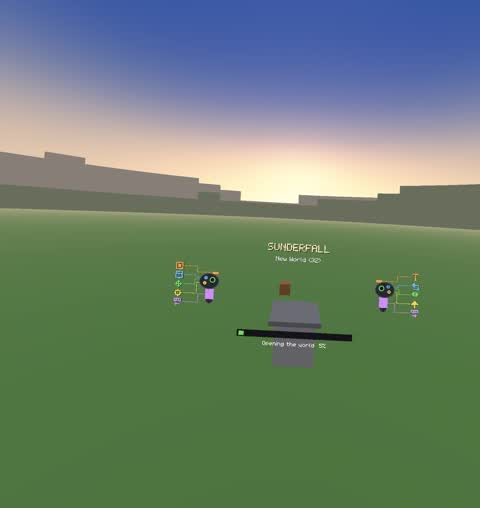 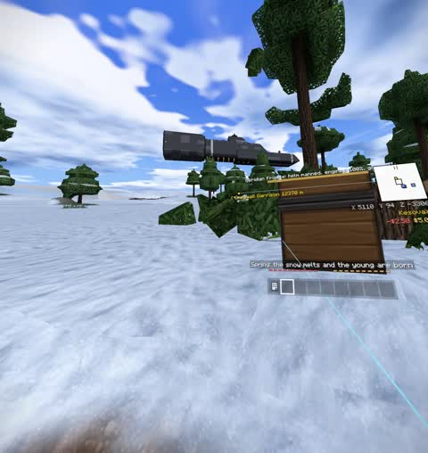 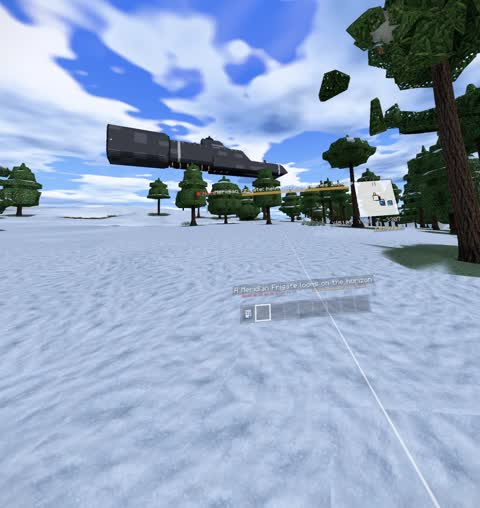 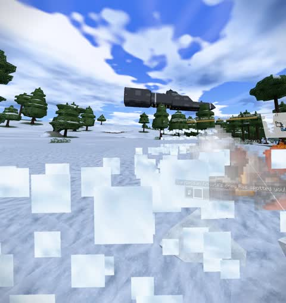

## 06:53:46 - I just spawned in with a f*cking frigate shooting at me. Oh.

- **Transcript:** I just spawned in with a f*cking frigate shooting at me. Oh.
- **Status:** open
- **Build:** 0.995 (3376e5ab, M1-M4 (device-tested; ship riding, chests, comfort options, weapon wheel))
- **World:** New World (32) (seed 2436324470025364514)
- **Dimension:** Surface
- **Biome:** Snowy Plains
- **Position:** 5102.2 96.1 -3309.9
- **Facing:** north (yaw 356, pitch 2)
- **Held:** empty hand
- **Mount:** on foot
- **Looking at:** nothing
- **Mode:** Creative, health 13/20
- **Time:** day 1 07:37, clear
- **Fps:** 72
- **Levels:** mic -31 dBFS, game sound -19 dBFS
- **Length:** 4.0 s (voice 1.7 s)
- **Just before:** -21s opened PauseMenu; -21s message: Playtest build: voice bug notes ON, your speech is saved (Options > Interface); -19s closed PauseMenu; -17s opened PauseMenu; -17s closed PauseMenu; -15s opened PauseMenu; -11s entered Surface; -11s closed PauseMenu; -11s holding Greywall Dispatch; -11s message: In Clear Ford's jail safe: a Greywall Dispatch; -11s opened PauseMenu; -11s closed PauseMenu; -11s walked into Snowy Plains; -10s left the pack: Faustrohr Warhead x3 (at 5112 96 -3308); -10s left the pack: Himmelsturm Launcher (at 5112 96 -3308); -10s left the pack: Duskium Chestplate (at 5112 96 -3308); -10s left the pack: Falke Pistol x2 (at 5112 96 -3308); -10s left the pack: Regular Armour Set (at 5112 96 -3308); -10s left the pack: Track Spares x16 (at 5112 96 -3308); -10s left the pack: Field Journal of an Ashguard Rifleman (at 5112 96 -3308); -10s left the pack: Fernblick Rifle (at 5112 96 -3308); -10s left the pack: Rocket x4 (at 5112 96 -3308); -10s left the pack: Aero Engine Spares x18 (at 5112 96 -3308); -10s left the pack: Jetpack x2 (at 5112 96 -3308); -10s left the pack: Faustrohr (at 5112 96 -3308); -10s left the pack: Donnerkeil Service Rifle x3 (at 5112 96 -3308); -10s left the pack: Mahlwerk Rotary Gun (at 5112 96 -3308); -10s left the pack: Titanium Pickaxe (at 5112 96 -3308); -10s left the pack: Field Stim x52 (at 5112 96 -3308); -10s message: In Clear Ford's jail safe: a Greywall Dispatch. Added to journal: Who Holds the Frontier; -9s holding empty hand; -8s opened ChestMenu; -7s closed ChestMenu; -7s message: Spring: the snow melts and the young are born; -4s message: A Meridian Frigate looms on the horizon; -4s took 9 damage (health 11/20); -3s opened PauseMenu; -2s message: The Meridian Frigate's crew has spotted you!; -1s closed PauseMenu
- **Repro (Mac):** `./snap.sh note --seed 2436324470025364514 --x 5102.2 --z -3309.9 --yaw 4 --pitch 2 --time 0.067`
- **Audio (this Mac):** /Users/darthvadar/Documents/Blocksmith/QuestVoiceNotes/raw/vn-20261120-065346-719.aac
- **Video (this Mac):** /Users/darthvadar/Documents/Blocksmith/QuestVoiceNotes/raw/vn-20261120-065346-719.mp4

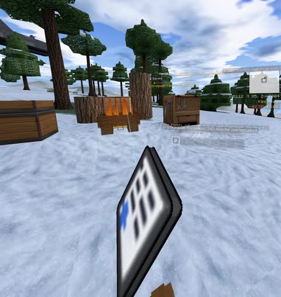 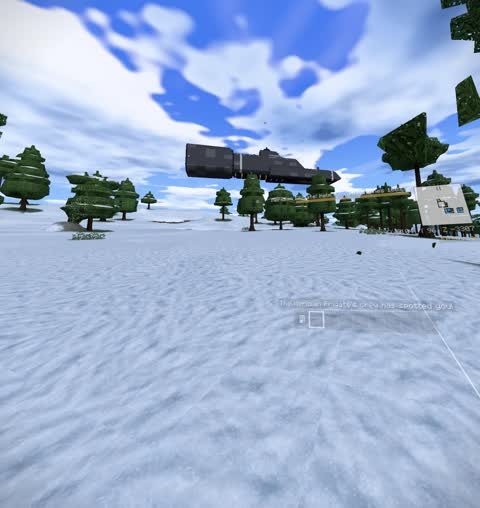 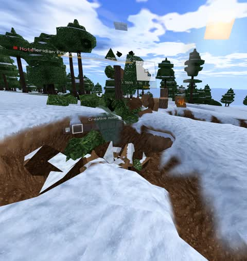 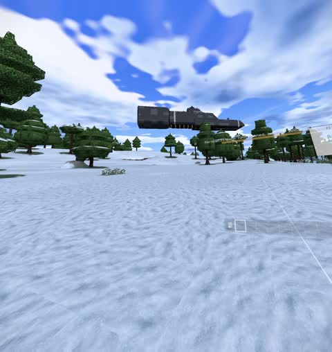

## 06:54:08 - What is that? Is that a missile?

- **Transcript:** What is that? Is that a missile?
- **Status:** open
- **Build:** 0.995 (3376e5ab, M1-M4 (device-tested; ship riding, chests, comfort options, weapon wheel))
- **World:** New World (32) (seed 2436324470025364514)
- **Dimension:** Surface
- **Biome:** Snowy Plains
- **Position:** 5077.7 96.9 -3278.7
- **Facing:** north (yaw 344, pitch 24)
- **Held:** empty hand
- **Mount:** on foot
- **Looking at:** nothing
- **Mode:** Survival, health 17/20
- **Time:** day 1 07:59, clear
- **Fps:** 72
- **Levels:** mic -36 dBFS, game sound -22 dBFS
- **Length:** 2.8 s (voice 0.9 s)
- **Just before:** -29s opened ChestMenu; -29s closed ChestMenu; -28s message: Spring: the snow melts and the young are born; -26s message: A Meridian Frigate looms on the horizon; -25s took 9 damage (health 11/20); -24s opened PauseMenu; -23s message: The Meridian Frigate's crew has spotted you!; -23s closed PauseMenu; -21s message: Creative mode; -16s opened PauseMenu; -14s message: Survival mode; -14s closed PauseMenu; -9s message: Meridian frigate patrol marked on the map
- **Repro (Mac):** `./snap.sh note --seed 2436324470025364514 --x 5077.7 --z -3278.7 --yaw 16 --pitch 24 --time 0.083`
- **Audio (this Mac):** /Users/darthvadar/Documents/Blocksmith/QuestVoiceNotes/raw/vn-20261120-065408-298.aac
- **Video (this Mac):** /Users/darthvadar/Documents/Blocksmith/QuestVoiceNotes/raw/vn-20261120-065408-298.mp4

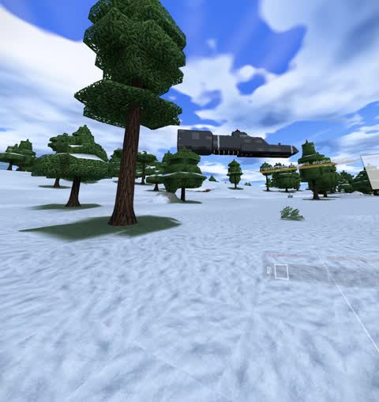 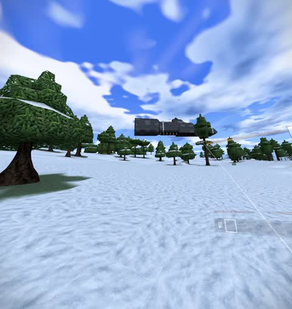 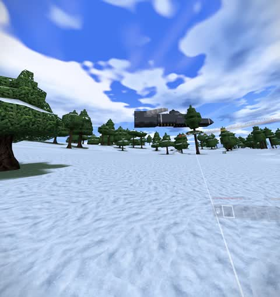 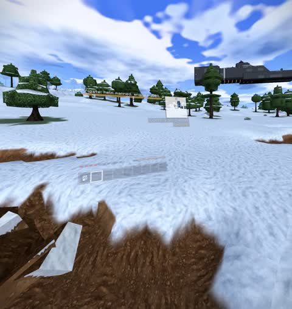

## 06:54:11 - Okay, the missiles don't look like missiles.

- **Transcript:** Okay, the missiles don't look like missiles.
- **Status:** open
- **Build:** 0.995 (3376e5ab, M1-M4 (device-tested; ship riding, chests, comfort options, weapon wheel))
- **World:** New World (32) (seed 2436324470025364514)
- **Dimension:** Surface
- **Biome:** Snowy Plains
- **Position:** 5093.4 95.3 -3285.0
- **Facing:** north (yaw 356, pitch 6)
- **Held:** empty hand
- **Mount:** on foot
- **Looking at:** nothing
- **Mode:** Survival, health 9/20
- **Time:** day 1 08:03, clear
- **Fps:** 71
- **Levels:** mic -48 dBFS, game sound -17 dBFS
- **Length:** 3.7 s (voice 1.4 s)
- **Just before:** -29s message: A Meridian Frigate looms on the horizon; -28s took 9 damage (health 11/20); -27s opened PauseMenu; -26s message: The Meridian Frigate's crew has spotted you!; -25s closed PauseMenu; -24s message: Creative mode; -19s opened PauseMenu; -17s message: Survival mode; -17s closed PauseMenu; -12s message: Meridian frigate patrol marked on the map; -1s took 9 damage (health 8/20)
- **Repro (Mac):** `./snap.sh note --seed 2436324470025364514 --x 5093.4 --z -3285.0 --yaw 4 --pitch 6 --time 0.086`
- **Audio (this Mac):** /Users/darthvadar/Documents/Blocksmith/QuestVoiceNotes/raw/vn-20261120-065411-218.aac
- **Video (this Mac):** /Users/darthvadar/Documents/Blocksmith/QuestVoiceNotes/raw/vn-20261120-065411-218.mp4

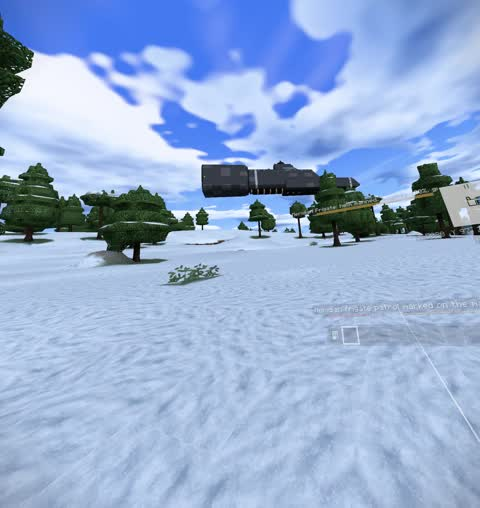 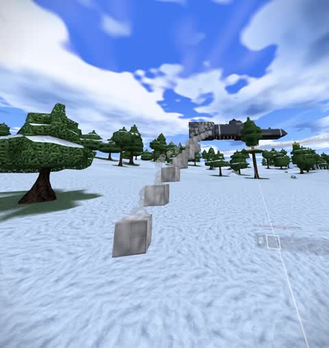 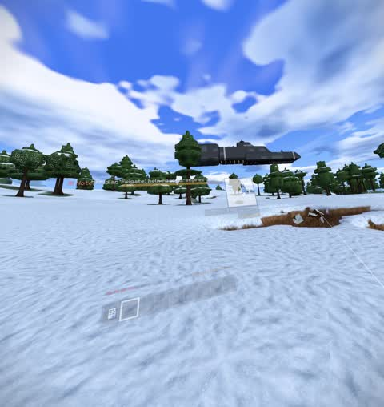 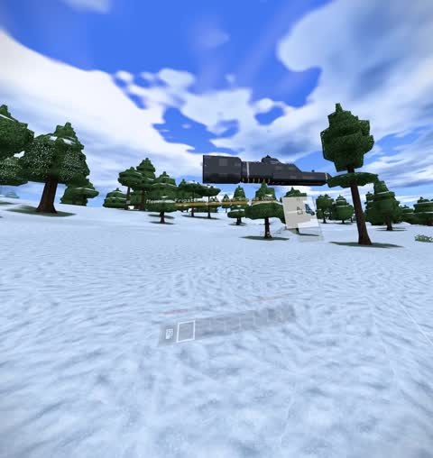

## 06:54:14 - That needs to change

- **Transcript:** That needs to change
- **Status:** open
- **Build:** 0.995 (3376e5ab, M1-M4 (device-tested; ship riding, chests, comfort options, weapon wheel))
- **World:** New World (32) (seed 2436324470025364514)
- **Dimension:** Surface
- **Biome:** Snowy Plains
- **Position:** 5071.2 98.8 -3293.2
- **Facing:** north (yaw 8, pitch -4)
- **Held:** empty hand
- **Mount:** on foot
- **Looking at:** nothing
- **Mode:** Survival, health 9/20
- **Time:** day 1 08:07, clear
- **Fps:** 72
- **Levels:** mic -38 dBFS, game sound -23 dBFS
- **Length:** 2.7 s (voice 1.0 s)
- **Just before:** -30s message: The Meridian Frigate's crew has spotted you!; -29s closed PauseMenu; -27s message: Creative mode; -23s opened PauseMenu; -20s message: Survival mode; -20s closed PauseMenu; -15s message: Meridian frigate patrol marked on the map; -5s took 9 damage (health 8/20)
- **Repro (Mac):** `./snap.sh note --seed 2436324470025364514 --x 5071.2 --z -3293.2 --yaw -8 --pitch -4 --time 0.089`
- **Audio (this Mac):** /Users/darthvadar/Documents/Blocksmith/QuestVoiceNotes/raw/vn-20261120-065414-742.aac
- **Video (this Mac):** /Users/darthvadar/Documents/Blocksmith/QuestVoiceNotes/raw/vn-20261120-065414-742.mp4

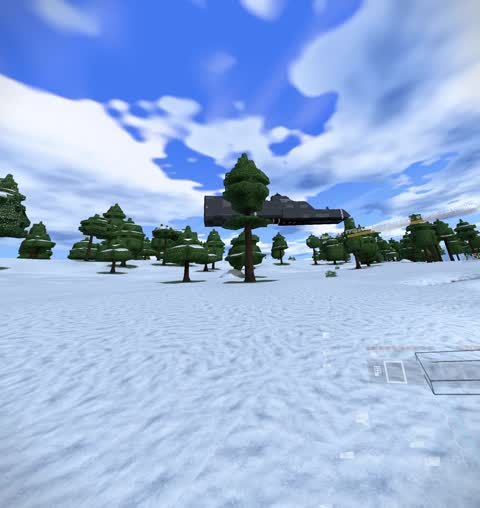 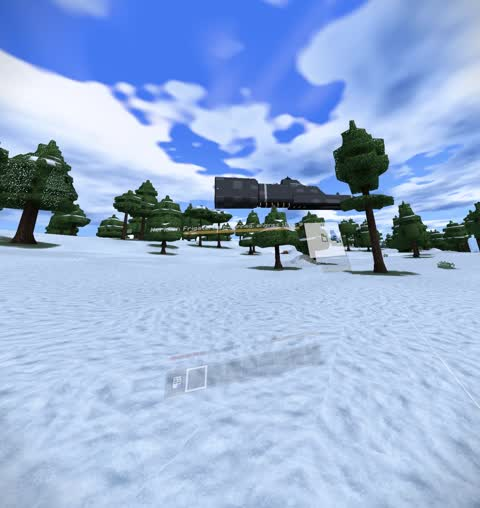 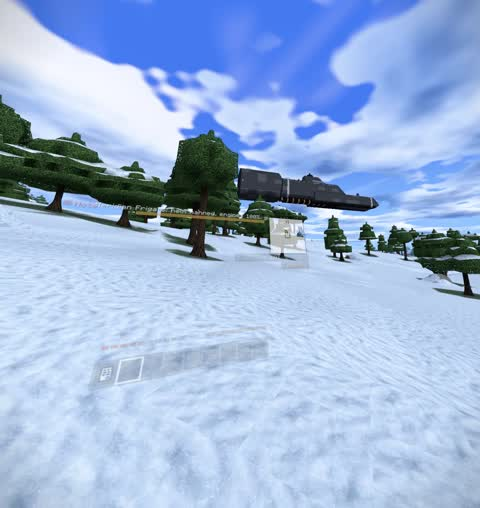 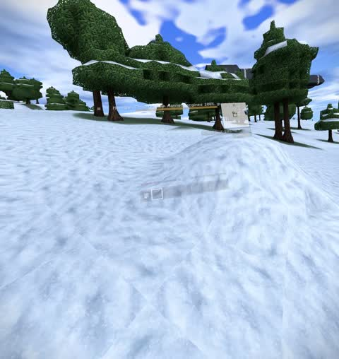

## 06:54:39 - Definitely better at 12.

- **Transcript:** Definitely better at 12.
- **Status:** open
- **Build:** 0.995 (3376e5ab, M1-M4 (device-tested; ship riding, chests, comfort options, weapon wheel))
- **World:** New World (32) (seed 2436324470025364514)
- **Dimension:** Surface
- **Biome:** Snowy Plains
- **Position:** 5043.2 174.1 -3373.1
- **Facing:** north-east (yaw 45, pitch -23)
- **Held:** empty hand
- **Mount:** on foot, flying
- **Looking at:** nothing
- **Mode:** Creative, health 9/20
- **Time:** day 1 08:34, clear
- **Fps:** 72
- **Levels:** mic -40 dBFS, game sound -19 dBFS
- **Length:** 2.8 s (voice 0.9 s)
- **Just before:** -29s took 9 damage (health 8/20); -10s opened PauseMenu; -9s message: Creative mode; -8s closed PauseMenu; -7s message: Flying; -4s opened PauseMenu; -3s closed PauseMenu
- **Repro (Mac):** `./snap.sh note --seed 2436324470025364514 --x 5043.2 --z -3373.1 --yaw -45 --pitch -23 --time 0.107`
- **Audio (this Mac):** /Users/darthvadar/Documents/Blocksmith/QuestVoiceNotes/raw/vn-20261120-065439-378.aac
- **Video (this Mac):** /Users/darthvadar/Documents/Blocksmith/QuestVoiceNotes/raw/vn-20261120-065439-378.mp4

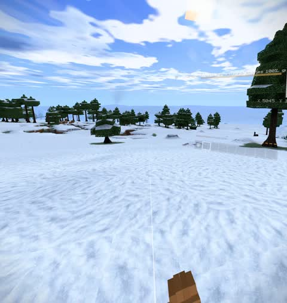 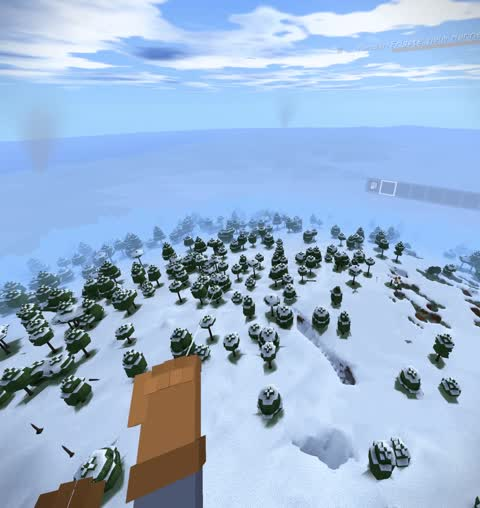 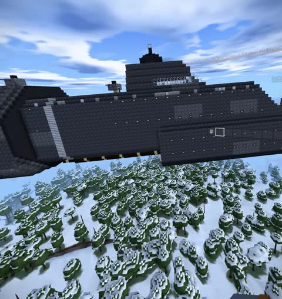 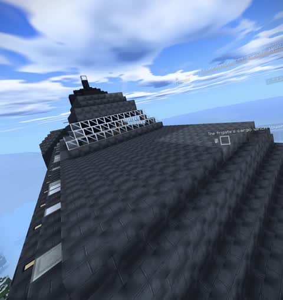

## 06:54:52 - See well this works for us

- **Transcript:** See well this works for us
- **Status:** open
- **Build:** 0.995 (3376e5ab, M1-M4 (device-tested; ship riding, chests, comfort options, weapon wheel))
- **World:** New World (32) (seed 2436324470025364514)
- **Dimension:** Surface
- **Biome:** Snowy Plains
- **Position:** 5240.2 155.1 -3453.4
- **Facing:** north-east (yaw 59, pitch -15)
- **Held:** empty hand
- **Mount:** piloting Meridian Frigate
- **Looking at:** nothing
- **Mode:** Creative, health 9/20
- **Time:** day 1 08:50, clear
- **Fps:** 70
- **Levels:** mic -39 dBFS, game sound -13 dBFS
- **Length:** 2.6 s (voice 0.8 s)
- **Just before:** -24s opened PauseMenu; -22s message: Creative mode; -22s closed PauseMenu; -21s message: Flying; -17s opened PauseMenu; -16s closed PauseMenu; -12s walked into Snowy Taiga; -11s message: The frigate's cargo winch lowers a line; -9s message: Kesovaal - Eldarhold border post marked on the map; -6s message: Walking; -3s piloting Meridian Frigate; -3s message: Steering Meridian Frigate; -2s walked into Snowy Plains; -1s message: You have taken command of the Meridian Frigate!
- **Repro (Mac):** `./snap.sh note --seed 2436324470025364514 --x 5240.2 --z -3453.4 --yaw -59 --pitch -15 --time 0.118`
- **Audio (this Mac):** /Users/darthvadar/Documents/Blocksmith/QuestVoiceNotes/raw/vn-20261120-065452-820.aac
- **Video (this Mac):** /Users/darthvadar/Documents/Blocksmith/QuestVoiceNotes/raw/vn-20261120-065452-820.mp4

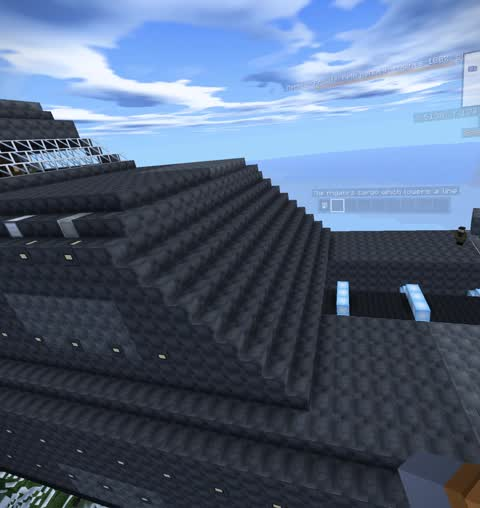 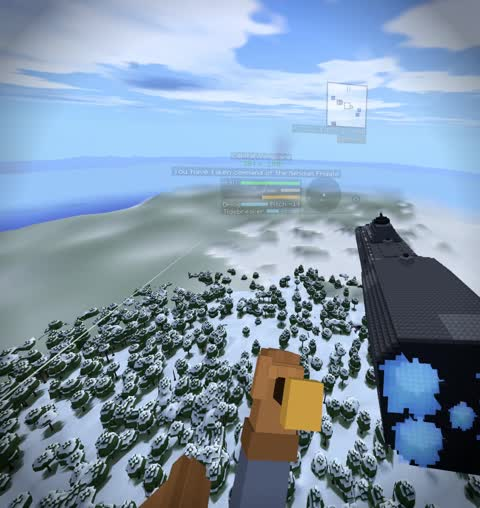 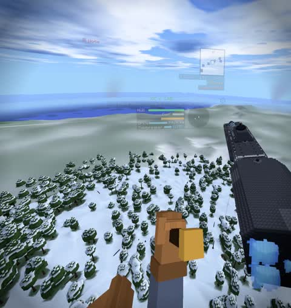 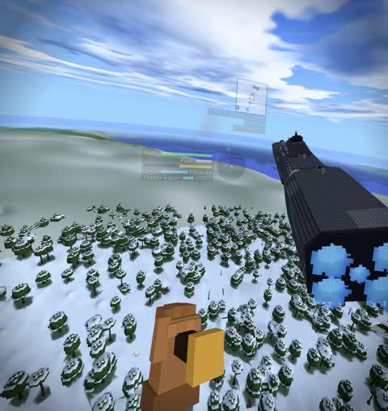

## 06:54:58 - Grab the frigate now, so see what render distance holds up.

- **Transcript:** Grab the frigate now, so see what render distance holds up.
- **Status:** open
- **Build:** 0.995 (3376e5ab, M1-M4 (device-tested; ship riding, chests, comfort options, weapon wheel))
- **World:** New World (32) (seed 2436324470025364514)
- **Dimension:** Surface
- **Biome:** Snowy Taiga
- **Position:** 5419.2 169.6 -3734.2
- **Facing:** west (yaw 272, pitch -11)
- **Held:** empty hand
- **Mount:** piloting Meridian Frigate
- **Looking at:** nothing
- **Mode:** Creative, health 9/20
- **Time:** day 1 08:57, clear
- **Fps:** 71
- **Levels:** mic -37 dBFS, game sound -20 dBFS
- **Length:** 4.7 s (voice 2.4 s)
- **Just before:** -30s opened PauseMenu; -28s message: Creative mode; -28s closed PauseMenu; -27s message: Flying; -23s opened PauseMenu; -22s closed PauseMenu; -18s walked into Snowy Taiga; -17s message: The frigate's cargo winch lowers a line; -15s message: Kesovaal - Eldarhold border post marked on the map; -12s message: Walking; -9s piloting Meridian Frigate; -9s message: Steering Meridian Frigate; -8s walked into Snowy Plains; -7s message: You have taken command of the Meridian Frigate!; -2s walked into Snowy Taiga
- **Repro (Mac):** `./snap.sh note --seed 2436324470025364514 --x 5419.2 --z -3734.2 --yaw 88 --pitch -11 --time 0.123`
- **Audio (this Mac):** /Users/darthvadar/Documents/Blocksmith/QuestVoiceNotes/raw/vn-20261120-065458-778.aac
- **Video (this Mac):** /Users/darthvadar/Documents/Blocksmith/QuestVoiceNotes/raw/vn-20261120-065458-778.mp4

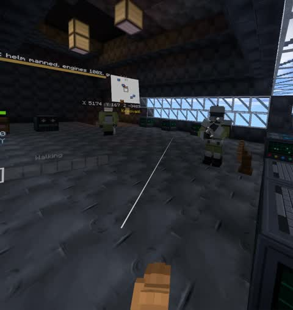 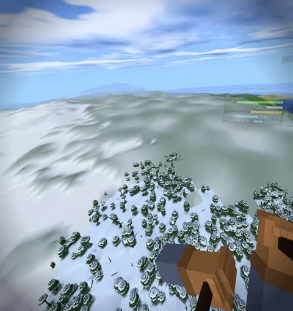 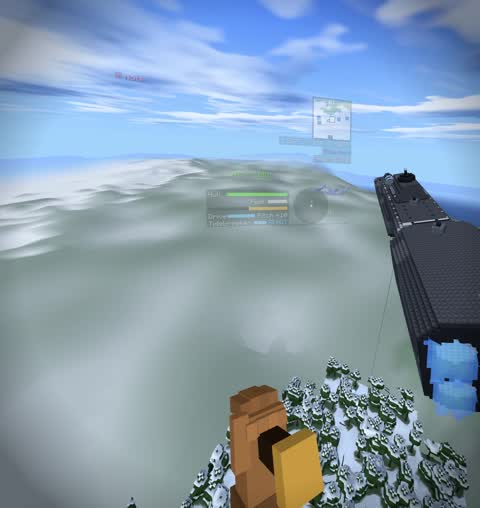 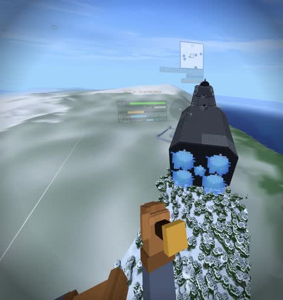

## 06:55:10 - Ooh, shit, the base is firing.

- **Transcript:** Ooh, shit, the base is firing.
- **Status:** open
- **Build:** 0.995 (3376e5ab, M1-M4 (device-tested; ship riding, chests, comfort options, weapon wheel))
- **World:** New World (32) (seed 2436324470025364514)
- **Dimension:** Surface
- **Biome:** Snowy Taiga
- **Position:** 4973.8 229.6 -3865.6
- **Facing:** south (yaw 187, pitch -12)
- **Held:** empty hand
- **Mount:** piloting Meridian Frigate
- **Looking at:** nothing
- **Mode:** Creative, health 9/20
- **Time:** day 1 09:11, clear
- **Fps:** 70
- **Levels:** mic -39 dBFS, game sound -22 dBFS
- **Length:** 2.9 s (voice 0.9 s)
- **Just before:** -30s walked into Snowy Taiga; -29s message: The frigate's cargo winch lowers a line; -27s message: Kesovaal - Eldarhold border post marked on the map; -24s message: Walking; -21s piloting Meridian Frigate; -21s message: Steering Meridian Frigate; -20s walked into Snowy Plains; -19s message: You have taken command of the Meridian Frigate!; -14s walked into Snowy Taiga
- **Repro (Mac):** `./snap.sh note --seed 2436324470025364514 --x 4973.8 --z -3865.6 --yaw 173 --pitch -12 --time 0.133`
- **Audio (this Mac):** /Users/darthvadar/Documents/Blocksmith/QuestVoiceNotes/raw/vn-20261120-065510-458.aac
- **Video (this Mac):** /Users/darthvadar/Documents/Blocksmith/QuestVoiceNotes/raw/vn-20261120-065510-458.mp4

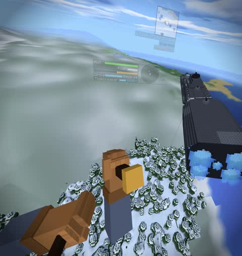 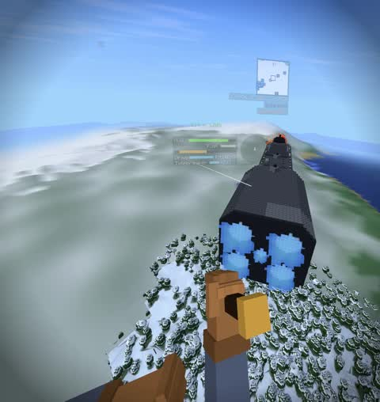 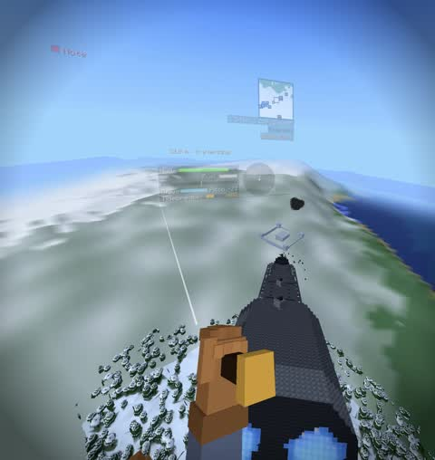 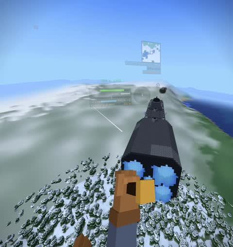

## 06:55:33 - Those are definitely a better performance than before because the base

- **Transcript:** Those are definitely a better performance than before because the bases guns were actually online
- **Status:** open
- **Build:** 0.995 (3376e5ab, M1-M4 (device-tested; ship riding, chests, comfort options, weapon wheel))
- **World:** New World (32) (seed 2436324470025364514)
- **Dimension:** Surface
- **Biome:** Snowy Taiga
- **Position:** 5056.5 96.1 -3853.1
- **Facing:** west (yaw 251, pitch -18)
- **Held:** Capital Rounds x25
- **Mount:** on foot, flying
- **Looking at:** nothing
- **Mode:** Creative, health 9/20
- **Time:** day 1 09:39, clear
- **Fps:** 71
- **Levels:** mic -31 dBFS, game sound -17 dBFS
- **Length:** 7.9 s (voice 4.3 s)
- **Just before:** -14s message: Intel: this base is a Field Hospital; -12s message: The Greywall Fortress is sounding the alarm!; -9s into the pack: Combat Stim; -9s into the pack: Rocket; -3s message: The Meridian Frigate's engines shook loose and stopped; -2s stopped piloting Meridian Frigate; -2s holding Capital Rounds; -0s message: Flying
- **Position at the end:** 5078.0 115.3 -3923.1
- **Repro (Mac):** `./snap.sh note --seed 2436324470025364514 --x 5056.5 --z -3853.1 --yaw 109 --pitch -18 --time 0.152`
- **Audio (this Mac):** /Users/darthvadar/Documents/Blocksmith/QuestVoiceNotes/raw/vn-20261120-065533-498.aac
- **Video (this Mac):** /Users/darthvadar/Documents/Blocksmith/QuestVoiceNotes/raw/vn-20261120-065533-498.mp4

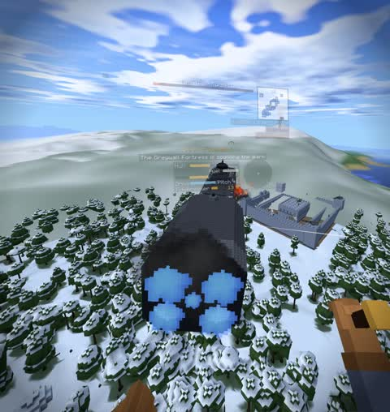 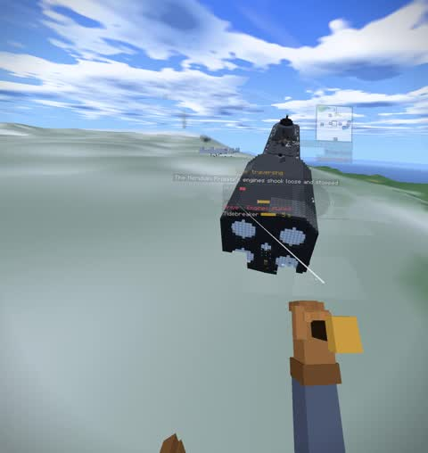 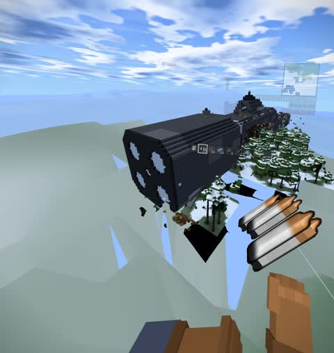 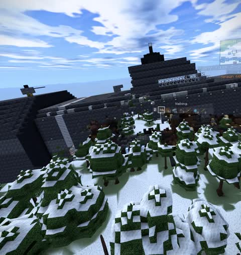

## 06:55:41 - Wow look what they did to this thing holy shit Fucking obliterate the 

- **Transcript:** Wow look what they did to this thing holy shit Fucking obliterate the fucking wow that was great
- **Status:** open
- **Build:** 0.995 (3376e5ab, M1-M4 (device-tested; ship riding, chests, comfort options, weapon wheel))
- **World:** New World (32) (seed 2436324470025364514)
- **Dimension:** Surface
- **Biome:** Taiga
- **Position:** 5072.5 106.3 -3903.5
- **Facing:** south-west (yaw 219, pitch -23)
- **Held:** Capital Rounds x25
- **Mount:** on foot
- **Looking at:** nothing
- **Mode:** Creative, health 9/20
- **Time:** day 1 09:48, clear
- **Fps:** 72
- **Levels:** mic -35 dBFS, game sound -19 dBFS
- **Length:** 10.1 s (voice 5.9 s)
- **Just before:** -22s message: Intel: this base is a Field Hospital; -19s message: The Greywall Fortress is sounding the alarm!; -17s into the pack: Combat Stim; -17s into the pack: Rocket; -11s message: The Meridian Frigate's engines shook loose and stopped; -10s stopped piloting Meridian Frigate; -10s holding Capital Rounds; -8s message: Flying; -1s message: Walking; -0s walked into Taiga
- **While talking:** -5s message: Flying; -3s walked into Snowy Taiga
- **Position at the end:** 5059.4 100.9 -3901.9
- **Repro (Mac):** `./snap.sh note --seed 2436324470025364514 --x 5072.5 --z -3903.5 --yaw 141 --pitch -23 --time 0.159`
- **Audio (this Mac):** /Users/darthvadar/Documents/Blocksmith/QuestVoiceNotes/raw/vn-20261120-065541-278.aac
- **Video (this Mac):** /Users/darthvadar/Documents/Blocksmith/QuestVoiceNotes/raw/vn-20261120-065541-278.mp4

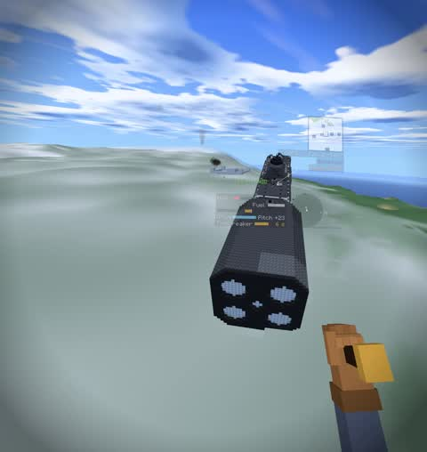 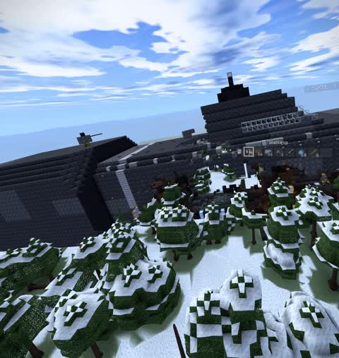 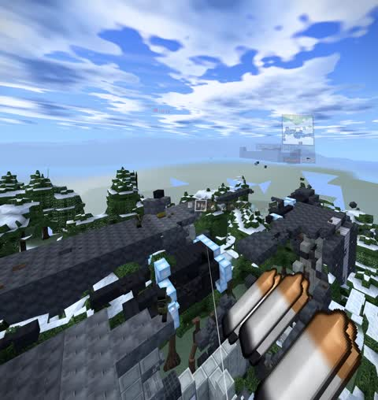 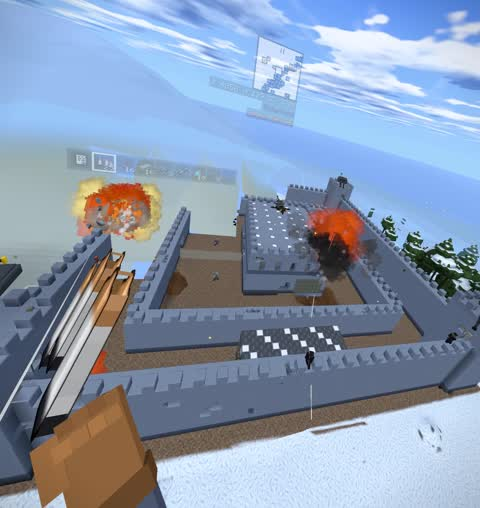

## 06:56:04 - The ship one

- **Transcript:** The ship one
- **Status:** open
- **Build:** 0.995 (3376e5ab, M1-M4 (device-tested; ship riding, chests, comfort options, weapon wheel))
- **World:** New World (32) (seed 2436324470025364514)
- **Dimension:** Surface
- **Biome:** Snowy Taiga
- **Position:** 4909.9 129.5 -3882.9
- **Facing:** south (yaw 175, pitch -26)
- **Held:** Capital Rounds x25
- **Mount:** on foot, flying
- **Looking at:** nothing
- **Mode:** Creative, health 9/20
- **Time:** day 1 10:16, clear
- **Fps:** 69
- **Levels:** mic -44 dBFS, game sound -20 dBFS
- **Length:** 2.1 s (voice 0.5 s)
- **Just before:** -24s message: Walking; -24s walked into Taiga; -23s message: Flying; -22s walked into Snowy Taiga; -15s message: Greywall reinforcements at the gate
- **Repro (Mac):** `./snap.sh note --seed 2436324470025364514 --x 4909.9 --z -3882.9 --yaw -175 --pitch -26 --time 0.178`
- **Audio (this Mac):** /Users/darthvadar/Documents/Blocksmith/QuestVoiceNotes/raw/vn-20261120-065604-698.aac
- **Video (this Mac):** /Users/darthvadar/Documents/Blocksmith/QuestVoiceNotes/raw/vn-20261120-065604-698.mp4

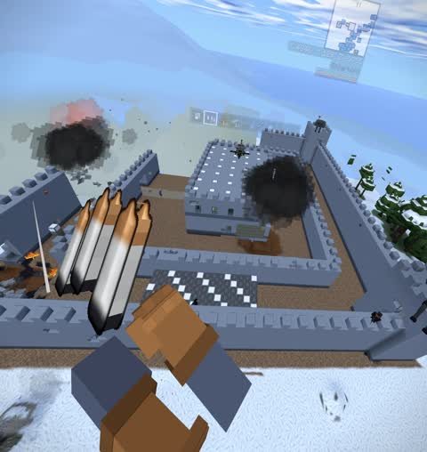 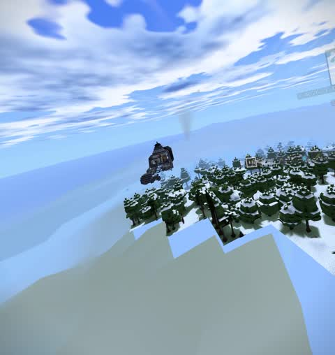 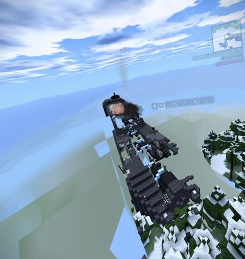 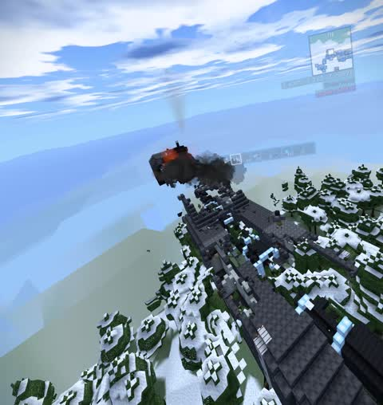

## 06:56:08 - Oh, yeah, okay. Shit.

- **Transcript:** Oh, yeah, okay. Shit.
- **Status:** open
- **Build:** 0.995 (3376e5ab, M1-M4 (device-tested; ship riding, chests, comfort options, weapon wheel))
- **World:** New World (32) (seed 2436324470025364514)
- **Dimension:** Surface
- **Biome:** Snowy Taiga
- **Position:** 4987.6 129.5 -3889.6
- **Facing:** south (yaw 169, pitch -26)
- **Held:** Capital Rounds x25
- **Mount:** on foot, flying
- **Looking at:** nothing
- **Mode:** Creative, health 9/20
- **Time:** day 1 10:21, clear
- **Fps:** 67
- **Levels:** mic -30 dBFS, game sound -13 dBFS
- **Length:** 3.3 s (voice 0.9 s)
- **Just before:** -28s message: Walking; -27s walked into Taiga; -27s message: Flying; -25s walked into Snowy Taiga; -19s message: Greywall reinforcements at the gate
- **Repro (Mac):** `./snap.sh note --seed 2436324470025364514 --x 4987.6 --z -3889.6 --yaw -169 --pitch -26 --time 0.181`
- **Audio (this Mac):** /Users/darthvadar/Documents/Blocksmith/QuestVoiceNotes/raw/vn-20261120-065608-558.aac
- **Video (this Mac):** /Users/darthvadar/Documents/Blocksmith/QuestVoiceNotes/raw/vn-20261120-065608-558.mp4

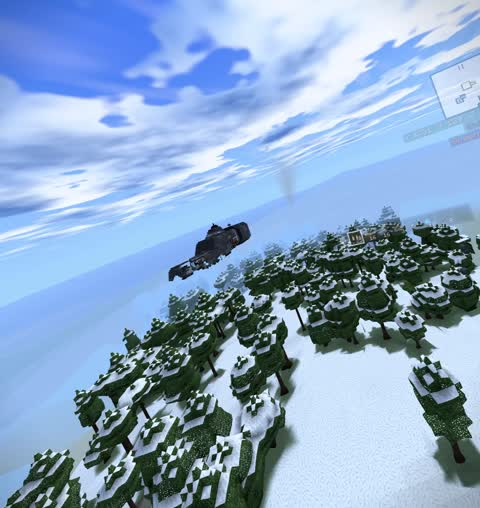  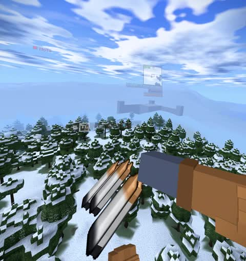 

## 06:56:19 - So I blew this up though what blew that up

- **Transcript:** So I blew this up though what blew that up
- **Status:** open
- **Build:** 0.995 (3376e5ab, M1-M4 (device-tested; ship riding, chests, comfort options, weapon wheel))
- **World:** New World (32) (seed 2436324470025364514)
- **Dimension:** Surface
- **Biome:** Snowy Taiga
- **Position:** 4782.4 129.5 -3732.8
- **Facing:** east (yaw 82, pitch -38)
- **Held:** Capital Rounds x25
- **Mount:** on foot, flying
- **Looking at:** nothing
- **Mode:** Creative, health 9/20
- **Time:** day 1 10:33, clear
- **Fps:** 71
- **Levels:** mic -43 dBFS, game sound -18 dBFS
- **Length:** 4.2 s (voice 1.7 s)
- **Just before:** -30s message: Greywall reinforcements at the gate; -8s message: That was the Greywall Fortress's last reinforcements
- **Repro (Mac):** `./snap.sh note --seed 2436324470025364514 --x 4782.4 --z -3732.8 --yaw -82 --pitch -38 --time 0.190`
- **Audio (this Mac):** /Users/darthvadar/Documents/Blocksmith/QuestVoiceNotes/raw/vn-20261120-065619-280.aac
- **Video (this Mac):** /Users/darthvadar/Documents/Blocksmith/QuestVoiceNotes/raw/vn-20261120-065619-280.mp4

   

## 06:56:44 - Yeah, let's say a frigate dessert commission.

- **Transcript:** Yeah, let's say a frigate dessert commission.
- **Status:** open
- **Build:** 0.995 (3376e5ab, M1-M4 (device-tested; ship riding, chests, comfort options, weapon wheel))
- **World:** New World (32) (seed 2436324470025364514)
- **Dimension:** Surface
- **Biome:** Snowy Taiga
- **Position:** 5103.8 129.5 -3870.5
- **Facing:** west (yaw 258, pitch -40)
- **Held:** empty hand
- **Mount:** on foot, flying
- **Looking at:** nothing
- **Mode:** Creative, health 9/20
- **Time:** day 1 11:04, clear
- **Fps:** 70
- **Levels:** mic -34 dBFS, game sound -20 dBFS
- **Length:** 3.5 s (voice 1.7 s)
- **Just before:** -19s holding Heavy Rounds; -19s message: Heavy Rounds; -19s holding Titanium Ingot; -19s message: Titanium Ingot; -19s holding Iron Nugget; -19s message: Iron Nugget; -18s holding Combat Stim; -18s message: Combat Stim; -18s holding Arc Cell; -18s message: Arc Cell; -18s holding Rocket; -18s message: Rocket; -17s holding empty hand
- **Repro (Mac):** `./snap.sh note --seed 2436324470025364514 --x 5103.8 --z -3870.5 --yaw 102 --pitch -40 --time 0.212`
- **Audio (this Mac):** /Users/darthvadar/Documents/Blocksmith/QuestVoiceNotes/raw/vn-20261120-065644-819.aac
- **Video (this Mac):** /Users/darthvadar/Documents/Blocksmith/QuestVoiceNotes/raw/vn-20261120-065644-819.mp4

   

## 06:56:50 - In addition, this is definitely not holding up well here.

- **Transcript:** In addition, this is definitely not holding up well here.
- **Status:** open
- **Build:** 0.995 (3376e5ab, M1-M4 (device-tested; ship riding, chests, comfort options, weapon wheel))
- **World:** New World (32) (seed 2436324470025364514)
- **Dimension:** Surface
- **Biome:** Snowy Taiga
- **Position:** 4863.9 129.5 -3731.4
- **Facing:** south-west (yaw 221, pitch 2)
- **Held:** empty hand
- **Mount:** on foot, flying
- **Looking at:** nothing
- **Mode:** Creative, health 9/20
- **Time:** day 1 11:10, clear
- **Fps:** 72
- **Levels:** mic -29 dBFS, game sound -19 dBFS
- **Length:** 5.6 s (voice 3.0 s)
- **Just before:** -24s holding Heavy Rounds; -24s message: Heavy Rounds; -24s holding Titanium Ingot; -24s message: Titanium Ingot; -24s holding Iron Nugget; -24s message: Iron Nugget; -24s holding Combat Stim; -24s message: Combat Stim; -23s holding Arc Cell; -23s message: Arc Cell; -23s holding Rocket; -23s message: Rocket; -23s holding empty hand
- **While talking:** -3s opened PauseMenu; -3s closed PauseMenu
- **Position at the end:** 4803.4 129.5 -3775.7
- **Repro (Mac):** `./snap.sh note --seed 2436324470025364514 --x 4863.9 --z -3731.4 --yaw 139 --pitch 2 --time 0.216`
- **Audio (this Mac):** /Users/darthvadar/Documents/Blocksmith/QuestVoiceNotes/raw/vn-20261120-065650-019.aac
- **Video (this Mac):** /Users/darthvadar/Documents/Blocksmith/QuestVoiceNotes/raw/vn-20261120-065650-019.mp4

   

## 06:56:56 - Understandably so, I guess, although this is kind of compute-heavy, it

- **Transcript:** Understandably so, I guess, although this is kind of compute-heavy, it's on GPU-heavy, so...
- **Status:** open
- **Build:** 0.995 (3376e5ab, M1-M4 (device-tested; ship riding, chests, comfort options, weapon wheel))
- **World:** New World (32) (seed 2436324470025364514)
- **Dimension:** Surface
- **Biome:** Snowy Taiga
- **Position:** 4803.6 129.5 -3779.9
- **Facing:** south (yaw 179, pitch -26)
- **Held:** empty hand
- **Mount:** on foot, flying
- **Looking at:** nothing
- **Mode:** Creative, health 9/20
- **Time:** day 1 11:17, clear
- **Fps:** 71
- **Levels:** mic -44 dBFS, game sound -18 dBFS
- **Length:** 5.8 s (voice 3.2 s)
- **Just before:** -30s holding Arc Cell; -30s message: Arc Cell; -29s holding Rocket; -29s message: Rocket; -29s holding empty hand; -5s opened PauseMenu; -4s closed PauseMenu
- **Position at the end:** 4826.3 129.5 -3779.0
- **Repro (Mac):** `./snap.sh note --seed 2436324470025364514 --x 4803.6 --z -3779.9 --yaw -179 --pitch -26 --time 0.221`
- **Audio (this Mac):** /Users/darthvadar/Documents/Blocksmith/QuestVoiceNotes/raw/vn-20261120-065656-659.aac
- **Video (this Mac):** /Users/darthvadar/Documents/Blocksmith/QuestVoiceNotes/raw/vn-20261120-065656-659.mp4

   

## 06:57:04 - Maybe it should be even better.

- **Transcript:** Maybe it should be even better.
- **Status:** open
- **Build:** 0.995 (3376e5ab, M1-M4 (device-tested; ship riding, chests, comfort options, weapon wheel))
- **World:** New World (32) (seed 2436324470025364514)
- **Dimension:** Surface
- **Biome:** Snowy Taiga
- **Position:** 4831.3 129.5 -3747.9
- **Facing:** south-east (yaw 142, pitch -27)
- **Held:** empty hand
- **Mount:** on foot, flying
- **Looking at:** nothing
- **Mode:** Creative, health 9/20
- **Time:** day 1 11:26, clear
- **Fps:** 70
- **Levels:** mic -41 dBFS, game sound -19 dBFS
- **Length:** 2.9 s (voice 1.4 s)
- **Just before:** -12s opened PauseMenu; -12s closed PauseMenu
- **Repro (Mac):** `./snap.sh note --seed 2436324470025364514 --x 4831.3 --z -3747.9 --yaw -142 --pitch -27 --time 0.227`
- **Audio (this Mac):** /Users/darthvadar/Documents/Blocksmith/QuestVoiceNotes/raw/vn-20261120-065704-119.aac
- **Video (this Mac):** /Users/darthvadar/Documents/Blocksmith/QuestVoiceNotes/raw/vn-20261120-065704-119.mp4

   

## 06:57:07 - I'm in a way now

- **Transcript:** I'm in a way now
- **Status:** open
- **Build:** 0.995 (3376e5ab, M1-M4 (device-tested; ship riding, chests, comfort options, weapon wheel))
- **World:** New World (32) (seed 2436324470025364514)
- **Dimension:** Surface
- **Biome:** Snowy Taiga
- **Position:** 4733.3 146.3 -3574.5
- **Facing:** south-east (yaw 154, pitch -33)
- **Held:** empty hand
- **Mount:** on foot, flying
- **Looking at:** nothing
- **Mode:** Creative, health 9/20
- **Time:** day 1 11:30, clear
- **Fps:** 67
- **Levels:** mic -38 dBFS, game sound -16 dBFS
- **Length:** 2.6 s (voice 1.2 s)
- **Just before:** -16s opened PauseMenu; -15s closed PauseMenu
- **Repro (Mac):** `./snap.sh note --seed 2436324470025364514 --x 4733.3 --z -3574.5 --yaw -154 --pitch -33 --time 0.230`
- **Audio (this Mac):** /Users/darthvadar/Documents/Blocksmith/QuestVoiceNotes/raw/vn-20261120-065707-859.aac
- **Video (this Mac):** /Users/darthvadar/Documents/Blocksmith/QuestVoiceNotes/raw/vn-20261120-065707-859.mp4

   

## 06:57:10 - See how long it takes to update.

- **Transcript:** See how long it takes to update.
- **Status:** open
- **Build:** 0.995 (3376e5ab, M1-M4 (device-tested; ship riding, chests, comfort options, weapon wheel))
- **World:** New World (32) (seed 2436324470025364514)
- **Dimension:** Surface
- **Biome:** Grove
- **Position:** 4705.1 176.6 -3488.1
- **Facing:** south (yaw 161, pitch -21)
- **Held:** empty hand
- **Mount:** on foot, flying
- **Looking at:** nothing
- **Mode:** Creative, health 9/20
- **Time:** day 1 11:33, clear
- **Fps:** 67
- **Levels:** mic -33 dBFS, game sound -15 dBFS
- **Length:** 2.4 s (voice 0.8 s)
- **Just before:** -18s opened PauseMenu; -18s closed PauseMenu; -2s opened PauseMenu; -1s closed PauseMenu; -0s walked into Grove
- **Repro (Mac):** `./snap.sh note --seed 2436324470025364514 --x 4705.1 --z -3488.1 --yaw -161 --pitch -21 --time 0.232`
- **Audio (this Mac):** /Users/darthvadar/Documents/Blocksmith/QuestVoiceNotes/raw/vn-20261120-065710-339.aac
- **Video (this Mac):** /Users/darthvadar/Documents/Blocksmith/QuestVoiceNotes/raw/vn-20261120-065710-339.mp4

   

## 06:57:14 - That's six. It should immediately update to twelve.

- **Transcript:** That's six. It should immediately update to twelve.
- **Status:** open
- **Build:** 0.995 (3376e5ab, M1-M4 (device-tested; ship riding, chests, comfort options, weapon wheel))
- **World:** New World (32) (seed 2436324470025364514)
- **Dimension:** Surface
- **Biome:** Grove
- **Position:** 4686.8 179.0 -3345.7
- **Facing:** south-east (yaw 157, pitch -30)
- **Held:** empty hand
- **Mount:** on foot, flying
- **Looking at:** nothing
- **Mode:** Creative, health 9/20
- **Time:** day 1 11:37, clear
- **Fps:** 67
- **Levels:** mic -30 dBFS, game sound -20 dBFS
- **Length:** 4.1 s (voice 1.3 s)
- **Just before:** -22s opened PauseMenu; -21s closed PauseMenu; -5s opened PauseMenu; -5s closed PauseMenu; -4s walked into Grove; -1s opened PauseMenu; -1s closed PauseMenu
- **Repro (Mac):** `./snap.sh note --seed 2436324470025364514 --x 4686.8 --z -3345.7 --yaw -157 --pitch -30 --time 0.234`
- **Audio (this Mac):** /Users/darthvadar/Documents/Blocksmith/QuestVoiceNotes/raw/vn-20261120-065714-019.aac
- **Video (this Mac):** /Users/darthvadar/Documents/Blocksmith/QuestVoiceNotes/raw/vn-20261120-065714-019.mp4

   

## 06:57:19 - We're at 22 now, see what draws that.

- **Transcript:** We're at 22 now, see what draws that.
- **Status:** open
- **Build:** 0.995 (3376e5ab, M1-M4 (device-tested; ship riding, chests, comfort options, weapon wheel))
- **World:** New World (32) (seed 2436324470025364514)
- **Dimension:** Surface
- **Biome:** Snowy Taiga
- **Position:** 4568.3 184.3 -3138.3
- **Facing:** south (yaw 164, pitch -26)
- **Held:** empty hand
- **Mount:** on foot, flying
- **Looking at:** nothing
- **Mode:** Creative, health 9/20
- **Time:** day 1 11:42, clear
- **Fps:** 72
- **Levels:** mic -34 dBFS, game sound -12 dBFS
- **Length:** 3.5 s (voice 1.2 s)
- **Just before:** -28s opened PauseMenu; -27s closed PauseMenu; -11s opened PauseMenu; -11s closed PauseMenu; -10s walked into Grove; -7s opened PauseMenu; -7s closed PauseMenu; -5s message: Entering Kesovaal; -4s opened PauseMenu; -4s closed PauseMenu; -4s walked into Frozen Peaks; -2s walked into Snowy Taiga; -2s opened PauseMenu; -1s closed PauseMenu
- **Repro (Mac):** `./snap.sh note --seed 2436324470025364514 --x 4568.3 --z -3138.3 --yaw -164 --pitch -26 --time 0.238`
- **Audio (this Mac):** /Users/darthvadar/Documents/Blocksmith/QuestVoiceNotes/raw/vn-20261120-065719-939.aac
- **Video (this Mac):** /Users/darthvadar/Documents/Blocksmith/QuestVoiceNotes/raw/vn-20261120-065719-939.mp4

   

## 06:57:53 - The hands look like shit.

- **Transcript:** The hands look like shit.
- **Status:** open
- **Build:** 0.995 (3376e5ab, M1-M4 (device-tested; ship riding, chests, comfort options, weapon wheel))
- **World:** New World (32) (seed 2436324470025364514)
- **Dimension:** Surface
- **Biome:** Frozen Peaks
- **Position:** 4310.9 175.6 -3485.6
- **Facing:** south-west (yaw 235, pitch 29)
- **Held:** empty hand
- **Mount:** on foot
- **Looking at:** nothing
- **Mode:** Creative, health 9/20
- **Time:** day 1 12:22, clear
- **Fps:** 71
- **Levels:** mic -38 dBFS, game sound -19 dBFS
- **Length:** 2.5 s (voice 0.8 s)
- **Just before:** -23s walked into Snowy Plains; -21s opened PauseMenu; -20s closed PauseMenu; -18s message: Entering Eldarhold; -13s walked into Snowy Taiga; -11s walked into Frozen Peaks; -6s message: Walking
- **Repro (Mac):** `./snap.sh note --seed 2436324470025364514 --x 4310.9 --z -3485.6 --yaw 125 --pitch 29 --time 0.265`
- **Audio (this Mac):** /Users/darthvadar/Documents/Blocksmith/QuestVoiceNotes/raw/vn-20261120-065753-259.aac
- **Video (this Mac):** /Users/darthvadar/Documents/Blocksmith/QuestVoiceNotes/raw/vn-20261120-065753-259.mp4

   

## 06:58:13 - Maybe it would be allowed to copy the quest sounds or something? I don

- **Transcript:** Maybe it would be allowed to copy the quest sounds or something? I don't know.
- **Status:** open
- **Build:** 0.995 (3376e5ab, M1-M4 (device-tested; ship riding, chests, comfort options, weapon wheel))
- **World:** New World (32) (seed 2436324470025364514)
- **Dimension:** Surface
- **Biome:** Frozen Peaks
- **Position:** 4304.8 176.8 -3485.9
- **Facing:** west (yaw 290, pitch -16)
- **Held:** empty hand
- **Mount:** on foot
- **Looking at:** nothing
- **Mode:** Creative, health 9/20
- **Time:** day 1 12:46, clear
- **Fps:** 72
- **Levels:** mic -35 dBFS, game sound -12 dBFS
- **Length:** 4.3 s (voice 2.3 s)
- **Just before:** -26s message: Walking
- **Repro (Mac):** `./snap.sh note --seed 2436324470025364514 --x 4304.8 --z -3485.9 --yaw 70 --pitch -16 --time 0.282`
- **Audio (this Mac):** /Users/darthvadar/Documents/Blocksmith/QuestVoiceNotes/raw/vn-20261120-065813-259.aac
- **Video (this Mac):** /Users/darthvadar/Documents/Blocksmith/QuestVoiceNotes/raw/vn-20261120-065813-259.mp4

   

## 06:58:17 - But yeah, this doesn't look great.

- **Transcript:** But yeah, this doesn't look great.
- **Status:** open
- **Build:** 0.995 (3376e5ab, M1-M4 (device-tested; ship riding, chests, comfort options, weapon wheel))
- **World:** New World (32) (seed 2436324470025364514)
- **Dimension:** Surface
- **Biome:** Frozen Peaks
- **Position:** 4294.0 168.6 -3473.7
- **Facing:** west (yaw 263, pitch -26)
- **Held:** empty hand
- **Mount:** on foot
- **Looking at:** nothing
- **Mode:** Creative, health 9/20
- **Time:** day 1 12:51, clear
- **Fps:** 72
- **Levels:** mic -38 dBFS, game sound -17 dBFS
- **Length:** 2.9 s (voice 1.2 s)
- **Repro (Mac):** `./snap.sh note --seed 2436324470025364514 --x 4294.0 --z -3473.7 --yaw 97 --pitch -26 --time 0.286`
- **Audio (this Mac):** /Users/darthvadar/Documents/Blocksmith/QuestVoiceNotes/raw/vn-20261120-065817-919.aac
- **Video (this Mac):** /Users/darthvadar/Documents/Blocksmith/QuestVoiceNotes/raw/vn-20261120-065817-919.mp4

   

## 06:58:33 - What? The render distance is at 8 now? What the hell?

- **Transcript:** What? The render distance is at 8 now? What the hell?
- **Status:** open
- **Build:** 0.995 (3376e5ab, M1-M4 (device-tested; ship riding, chests, comfort options, weapon wheel))
- **World:** New World (32) (seed 2436324470025364514)
- **Dimension:** Surface
- **Biome:** Snowy Taiga
- **Position:** 4223.4 91.4 -3486.6
- **Facing:** west (yaw 287, pitch -1)
- **Held:** empty hand
- **Mount:** on foot
- **Looking at:** nothing
- **Mode:** Creative, health 9/20
- **Time:** day 1 13:10, clear
- **Fps:** 72
- **Levels:** mic -33 dBFS, game sound -21 dBFS
- **Length:** 4.0 s (voice 2.2 s)
- **Just before:** -11s walked into Grove; -7s walked into Snowy Taiga; -6s message: Flying; -5s message: Walking; -2s opened PauseMenu; -2s closed PauseMenu
- **Repro (Mac):** `./snap.sh note --seed 2436324470025364514 --x 4223.4 --z -3486.6 --yaw 73 --pitch -1 --time 0.299`
- **Audio (this Mac):** /Users/darthvadar/Documents/Blocksmith/QuestVoiceNotes/raw/vn-20261120-065833-739.aac
- **Video (this Mac):** /Users/darthvadar/Documents/Blocksmith/QuestVoiceNotes/raw/vn-20261120-065833-739.mp4

   

## 06:58:42 - Hold at 12.

- **Transcript:** Hold at 12.
- **Status:** open
- **Build:** 0.995 (3376e5ab, M1-M4 (device-tested; ship riding, chests, comfort options, weapon wheel))
- **World:** New World (32) (seed 2436324470025364514)
- **Dimension:** Surface
- **Biome:** Taiga
- **Position:** 4199.4 74.9 -3482.0
- **Facing:** west (yaw 284, pitch -26)
- **Held:** empty hand
- **Mount:** on foot
- **Looking at:** nothing
- **Mode:** Creative, health 9/20
- **Time:** day 1 13:19, clear
- **Fps:** 72
- **Levels:** mic -38 dBFS, game sound -18 dBFS
- **Length:** 2.1 s (voice 0.5 s)
- **Just before:** -20s walked into Grove; -16s walked into Snowy Taiga; -16s message: Flying; -14s message: Walking; -11s opened PauseMenu; -11s closed PauseMenu; -9s opened PauseMenu; -8s closed PauseMenu; -7s opened PauseMenu; -6s closed PauseMenu; -4s walked into Taiga
- **Repro (Mac):** `./snap.sh note --seed 2436324470025364514 --x 4199.4 --z -3482.0 --yaw 76 --pitch -26 --time 0.305`
- **Audio (this Mac):** /Users/darthvadar/Documents/Blocksmith/QuestVoiceNotes/raw/vn-20261120-065842-759.aac
- **Video (this Mac):** /Users/darthvadar/Documents/Blocksmith/QuestVoiceNotes/raw/vn-20261120-065842-759.mp4

   

## 06:58:50 - Uh oh. Both logs fell together in one hit.

- **Transcript:** Uh oh. Both logs fell together in one hit.
- **Status:** open
- **Build:** 0.995 (3376e5ab, M1-M4 (device-tested; ship riding, chests, comfort options, weapon wheel))
- **World:** New World (32) (seed 2436324470025364514)
- **Dimension:** Surface
- **Biome:** Taiga
- **Position:** 4174.7 68.3 -3479.8
- **Facing:** west (yaw 290, pitch -17)
- **Held:** empty hand
- **Mount:** on foot
- **Looking at:** nothing
- **Mode:** Creative, health 9/20
- **Time:** day 1 13:28, clear
- **Fps:** 72
- **Levels:** mic -35 dBFS, game sound -24 dBFS
- **Length:** 4.4 s (voice 1.6 s)
- **Just before:** -28s walked into Grove; -24s walked into Snowy Taiga; -23s message: Flying; -22s message: Walking; -19s opened PauseMenu; -18s closed PauseMenu; -17s opened PauseMenu; -16s closed PauseMenu; -15s opened PauseMenu; -14s closed PauseMenu; -12s walked into Taiga
- **Repro (Mac):** `./snap.sh note --seed 2436324470025364514 --x 4174.7 --z -3479.8 --yaw 70 --pitch -17 --time 0.311`
- **Audio (this Mac):** /Users/darthvadar/Documents/Blocksmith/QuestVoiceNotes/raw/vn-20261120-065850-299.aac
- **Video (this Mac):** /Users/darthvadar/Documents/Blocksmith/QuestVoiceNotes/raw/vn-20261120-065850-299.mp4

   

## 06:59:20 - There's still a little flash that happens when I hit a log.

- **Transcript:** There's still a little flash that happens when I hit a log.
- **Status:** open
- **Build:** 0.995 (3376e5ab, M1-M4 (device-tested; ship riding, chests, comfort options, weapon wheel))
- **World:** New World (32) (seed 2436324470025364514)
- **Dimension:** Surface
- **Biome:** Taiga
- **Position:** 4120.5 70.3 -3491.2
- **Facing:** west (yaw 277, pitch -15)
- **Held:** Spruce Log x4
- **Mount:** on foot
- **Looking at:** nothing
- **Mode:** Creative, health 9/20
- **Time:** day 1 14:03, clear
- **Fps:** 72
- **Levels:** mic -34 dBFS, game sound -15 dBFS
- **Length:** 5.0 s (voice 2.8 s)
- **Just before:** -24s holding Spruce Log
- **Repro (Mac):** `./snap.sh note --seed 2436324470025364514 --x 4120.5 --z -3491.2 --yaw 83 --pitch -15 --time 0.336`
- **Audio (this Mac):** /Users/darthvadar/Documents/Blocksmith/QuestVoiceNotes/raw/vn-20261120-065920-159.aac
- **Video (this Mac):** /Users/darthvadar/Documents/Blocksmith/QuestVoiceNotes/raw/vn-20261120-065920-159.mp4

   

## 06:59:25 - It's almost like it despawns this normal tree then respawns the one th

- **Transcript:** It's almost like it despawns this normal tree then respawns the one that falls and is disconnected or something like really quickly
- **Status:** open
- **Build:** 0.995 (3376e5ab, M1-M4 (device-tested; ship riding, chests, comfort options, weapon wheel))
- **World:** New World (32) (seed 2436324470025364514)
- **Dimension:** Surface
- **Biome:** Taiga
- **Position:** 4112.5 68.7 -3487.2
- **Facing:** west (yaw 277, pitch 2)
- **Held:** Spruce Log x4
- **Mount:** on foot
- **Looking at:** Spruce Log at 4108 70 -3488
- **Mode:** Creative, health 9/20
- **Time:** day 1 14:09, clear
- **Fps:** 72
- **Levels:** mic -34 dBFS, game sound -15 dBFS
- **Length:** 9.4 s (voice 5.4 s)
- **Just before:** -29s holding Spruce Log
- **Position at the end:** 4084.7 68.2 -3473.4
- **Repro (Mac):** `./snap.sh note --seed 2436324470025364514 --x 4112.5 --z -3487.2 --yaw 83 --pitch 2 --time 0.340`
- **Audio (this Mac):** /Users/darthvadar/Documents/Blocksmith/QuestVoiceNotes/raw/vn-20261120-065925-119.aac
- **Video (this Mac):** /Users/darthvadar/Documents/Blocksmith/QuestVoiceNotes/raw/vn-20261120-065925-119.mp4

   

## 06:59:35 - And then again, it doesn't happen all the time.

- **Transcript:** And then again, it doesn't happen all the time.
- **Status:** open
- **Build:** 0.995 (3376e5ab, M1-M4 (device-tested; ship riding, chests, comfort options, weapon wheel))
- **World:** New World (32) (seed 2436324470025364514)
- **Dimension:** Surface
- **Biome:** Taiga
- **Position:** 4072.4 68.2 -3473.8
- **Facing:** west (yaw 267, pitch -5)
- **Held:** Spruce Log x4
- **Mount:** on foot
- **Looking at:** nothing
- **Mode:** Creative, health 9/20
- **Time:** day 1 14:22, clear
- **Fps:** 72
- **Levels:** mic -26 dBFS, game sound -12 dBFS
- **Length:** 3.1 s (voice 1.5 s)
- **Repro (Mac):** `./snap.sh note --seed 2436324470025364514 --x 4072.4 --z -3473.8 --yaw 93 --pitch -5 --time 0.349`
- **Audio (this Mac):** /Users/darthvadar/Documents/Blocksmith/QuestVoiceNotes/raw/vn-20261120-065935-899.aac
- **Video (this Mac):** /Users/darthvadar/Documents/Blocksmith/QuestVoiceNotes/raw/vn-20261120-065935-899.mp4

   

## 06:59:40 - What happened there? This one caused both logs to fall.

- **Transcript:** What happened there? This one caused both logs to fall.
- **Status:** open
- **Build:** 0.995 (3376e5ab, M1-M4 (device-tested; ship riding, chests, comfort options, weapon wheel))
- **World:** New World (32) (seed 2436324470025364514)
- **Dimension:** Surface
- **Biome:** Taiga
- **Position:** 4053.4 66.5 -3471.2
- **Facing:** west (yaw 269, pitch -3)
- **Held:** Spruce Log x4
- **Mount:** on foot
- **Looking at:** nothing
- **Mode:** Creative, health 9/20
- **Time:** day 1 14:28, clear
- **Fps:** 72
- **Levels:** mic -34 dBFS, game sound -18 dBFS
- **Length:** 5.1 s (voice 1.7 s)
- **Repro (Mac):** `./snap.sh note --seed 2436324470025364514 --x 4053.4 --z -3471.2 --yaw 91 --pitch -3 --time 0.353`
- **Audio (this Mac):** /Users/darthvadar/Documents/Blocksmith/QuestVoiceNotes/raw/vn-20261120-065940-859.aac
- **Video (this Mac):** /Users/darthvadar/Documents/Blocksmith/QuestVoiceNotes/raw/vn-20261120-065940-859.mp4

   

## 06:59:52 - Whoa, what happened there? I just hit a log and it disappeared. Log go

- **Transcript:** Whoa, what happened there? I just hit a log and it disappeared. Log goes already on the ground. And it turned into a way bigger log. That shouldn't have happened.
- **Status:** open
- **Build:** 0.995 (3376e5ab, M1-M4 (device-tested; ship riding, chests, comfort options, weapon wheel))
- **World:** New World (32) (seed 2436324470025364514)
- **Dimension:** Surface
- **Biome:** Taiga
- **Position:** 4007.5 65.7 -3479.5
- **Facing:** west (yaw 252, pitch -23)
- **Held:** Spruce Log x4
- **Mount:** on foot
- **Looking at:** Short Grass at 4004 66 -3479
- **Mode:** Creative, health 9/20
- **Time:** day 1 14:43, clear
- **Fps:** 72
- **Levels:** mic -31 dBFS, game sound -14 dBFS
- **Length:** 9.2 s (voice 5.6 s)
- **Just before:** -4s walked into Beach; -2s walked into Taiga
- **While talking:** -1s walked into Beach
- **Position at the end:** 4005.9 65.6 -3479.6
- **Repro (Mac):** `./snap.sh note --seed 2436324470025364514 --x 4007.5 --z -3479.5 --yaw 108 --pitch -23 --time 0.363`
- **Audio (this Mac):** /Users/darthvadar/Documents/Blocksmith/QuestVoiceNotes/raw/vn-20261120-065952-939.aac
- **Video (this Mac):** /Users/darthvadar/Documents/Blocksmith/QuestVoiceNotes/raw/vn-20261120-065952-939.mp4

   

## 07:00:03 - And it's rolling as if the top and bottom are connected.

- **Transcript:** And it's rolling as if the top and bottom are connected.
- **Status:** open
- **Build:** 0.995 (3376e5ab, M1-M4 (device-tested; ship riding, chests, comfort options, weapon wheel))
- **World:** New World (32) (seed 2436324470025364514)
- **Dimension:** Surface
- **Biome:** Taiga
- **Position:** 4006.9 65.7 -3478.8
- **Facing:** south-west (yaw 238, pitch -30)
- **Held:** Spruce Log x4
- **Mount:** on foot
- **Looking at:** Dirt at 4003 65 -3477
- **Mode:** Creative, health 9/20
- **Time:** day 1 14:55, clear
- **Fps:** 72
- **Levels:** mic -32 dBFS, game sound -34 dBFS
- **Length:** 5.1 s (voice 2.4 s)
- **Just before:** -14s walked into Beach; -12s walked into Taiga; -6s walked into Beach; -4s walked into Taiga
- **Repro (Mac):** `./snap.sh note --seed 2436324470025364514 --x 4006.9 --z -3478.8 --yaw 122 --pitch -30 --time 0.372`
- **Audio (this Mac):** /Users/darthvadar/Documents/Blocksmith/QuestVoiceNotes/raw/vn-20261120-070003-099.aac
- **Video (this Mac):** /Users/darthvadar/Documents/Blocksmith/QuestVoiceNotes/raw/vn-20261120-070003-099.mp4

   

## 07:01:41 - Still have problems with fluid dynamics, kind of.

- **Transcript:** Still have problems with fluid dynamics, kind of.
- **Status:** open
- **Build:** 0.995 (3376e5ab, M1-M4 (device-tested; ship riding, chests, comfort options, weapon wheel))
- **World:** New World (32) (seed 2436324470025364514)
- **Dimension:** Surface
- **Biome:** Beach
- **Position:** -432.6 62.9 -1122.3
- **Facing:** south (yaw 170, pitch -16)
- **Held:** Spruce Log x4
- **Mount:** on foot
- **Looking at:** Snow at -432 63 -1118
- **Mode:** Creative, health 9/20
- **Time:** day 1 16:51, clear
- **Fps:** 72
- **Levels:** mic -28 dBFS, game sound -18 dBFS
- **Length:** 3.9 s (voice 1.6 s)
- **Just before:** -28s walked into Plains; -18s walked into Snowy Plains; -16s walked into Snowy Taiga; -14s message: Entering Branimoor; -12s walked into Grove; -10s walked into Snowy Taiga; -10s message: Branimoor - Loreesh border post marked on the map; -6s message: Walking; -6s walked into Beach
- **Repro (Mac):** `./snap.sh note --seed 2436324470025364514 --x -432.6 --z -1122.3 --yaw -170 --pitch -16 --time 0.452`
- **Audio (this Mac):** /Users/darthvadar/Documents/Blocksmith/QuestVoiceNotes/raw/vn-20261120-070141-459.aac
- **Video (this Mac):** /Users/darthvadar/Documents/Blocksmith/QuestVoiceNotes/raw/vn-20261120-070141-459.mp4

   

## 07:01:47 - This is actually fine.

- **Transcript:** This is actually fine.
- **Status:** open
- **Build:** 0.995 (3376e5ab, M1-M4 (device-tested; ship riding, chests, comfort options, weapon wheel))
- **World:** New World (32) (seed 2436324470025364514)
- **Dimension:** Surface
- **Biome:** Beach
- **Position:** -423.7 62.6 -1118.2
- **Facing:** south-east (yaw 145, pitch -13)
- **Held:** Spruce Log x4
- **Mount:** on foot
- **Looking at:** Sheet Ice at -421 62 -1115
- **Mode:** Creative, health 9/20
- **Time:** day 1 16:58, clear
- **Fps:** 72
- **Levels:** mic -29 dBFS, game sound -16 dBFS
- **Length:** 2.9 s (voice 1.0 s)
- **Just before:** -24s walked into Snowy Plains; -22s walked into Snowy Taiga; -20s message: Entering Branimoor; -18s walked into Grove; -16s walked into Snowy Taiga; -16s message: Branimoor - Loreesh border post marked on the map; -12s message: Walking; -12s walked into Beach
- **Repro (Mac):** `./snap.sh note --seed 2436324470025364514 --x -423.7 --z -1118.2 --yaw -145 --pitch -13 --time 0.458`
- **Audio (this Mac):** /Users/darthvadar/Documents/Blocksmith/QuestVoiceNotes/raw/vn-20261120-070147-799.aac
- **Video (this Mac):** /Users/darthvadar/Documents/Blocksmith/QuestVoiceNotes/raw/vn-20261120-070147-799.mp4

   

## 07:02:04 - The music is not cycling that well. It's kind of just the same song ov

- **Transcript:** The music is not cycling that well. It's kind of just the same song over and over again.
- **Status:** open
- **Build:** 0.995 (3376e5ab, M1-M4 (device-tested; ship riding, chests, comfort options, weapon wheel))
- **World:** New World (32) (seed 2436324470025364514)
- **Dimension:** Surface
- **Biome:** Plains
- **Position:** -2027.7 150.4 -1310.7
- **Facing:** south-west (yaw 213, pitch -40)
- **Held:** Spruce Log x4
- **Mount:** on foot, flying
- **Looking at:** nothing
- **Mode:** Creative, health 9/20
- **Time:** day 1 17:19, clear
- **Fps:** 72
- **Levels:** mic -38 dBFS, game sound -23 dBFS
- **Length:** 6.0 s (voice 3.9 s)
- **Just before:** -30s message: Walking; -30s walked into Beach; -7s message: Flying; -5s walked into Taiga; -3s walked into Cold Ocean; -1s walked into Plains
- **While talking:** -3s message: Capital citadel (the enemy) marked on the map; -1s message: Walking
- **Position at the end:** -2124.1 89.5 -1312.6
- **Repro (Mac):** `./snap.sh note --seed 2436324470025364514 --x -2027.7 --z -1310.7 --yaw 147 --pitch -40 --time 0.472`
- **Audio (this Mac):** /Users/darthvadar/Documents/Blocksmith/QuestVoiceNotes/raw/vn-20261120-070204-999.aac
- **Video (this Mac):** /Users/darthvadar/Documents/Blocksmith/QuestVoiceNotes/raw/vn-20261120-070204-999.mp4

   

## 07:02:11 - We have plenty of songs in the actual script, so

- **Transcript:** We have plenty of songs in the actual script, so
- **Status:** open
- **Build:** 0.995 (3376e5ab, M1-M4 (device-tested; ship riding, chests, comfort options, weapon wheel))
- **World:** New World (32) (seed 2436324470025364514)
- **Dimension:** Surface
- **Biome:** Snowy Plains
- **Position:** -2143.6 91.1 -1280.5
- **Facing:** south (yaw 200, pitch -20)
- **Held:** Spruce Log x4
- **Mount:** on foot, flying
- **Looking at:** nothing
- **Mode:** Creative, health 9/20
- **Time:** day 1 17:26, clear
- **Fps:** 72
- **Levels:** mic -31 dBFS, game sound -18 dBFS
- **Length:** 4.8 s (voice 2.3 s)
- **Just before:** -13s message: Flying; -12s walked into Taiga; -9s walked into Cold Ocean; -7s walked into Plains; -4s message: Capital citadel (the enemy) marked on the map; -2s message: Walking; -0s message: Flying
- **Repro (Mac):** `./snap.sh note --seed 2436324470025364514 --x -2143.6 --z -1280.5 --yaw 160 --pitch -20 --time 0.477`
- **Audio (this Mac):** /Users/darthvadar/Documents/Blocksmith/QuestVoiceNotes/raw/vn-20261120-070211-059.aac
- **Video (this Mac):** /Users/darthvadar/Documents/Blocksmith/QuestVoiceNotes/raw/vn-20261120-070211-059.mp4

   
