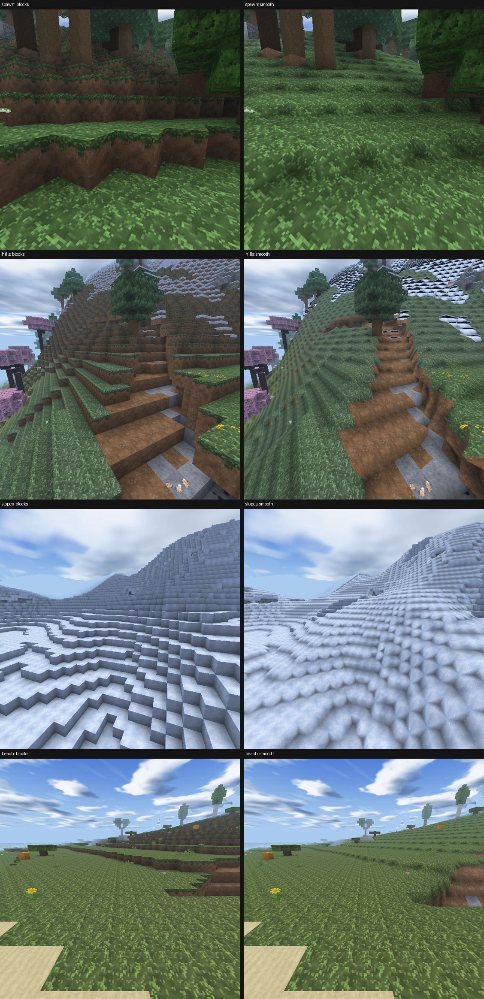

# Polygon terrain test (backlog M1, task 25b5a, 2026-10-11)

Objectives: docs/objectives/polygon-test.md. Built on the smooth-terrain prototype (docs/proposals/smooth-terrain.md).

## How to walk around in it (Quest)
- New world: Create New World > **Terrain: Blocks / Smooth (Test)**. The choice is saved with the world and shown in the
  worlds list; older worlds load as Blocks. Block data never changes, so a world can be flipped back any time.
- Open world: Options > Video > **Smooth Terrain (Test, This World)** flips the current world in place (remeshes in the
  background) and saves the choice with it.
- APK: quest-dist from Quest CI run on 04d12966 (contains the smooth normals, 89036360). The headset was not on adb this
  session, so nothing was installed; see docs/status/device-checklist.md section 2.

## What changed in this round
- Natural blocks (grass, dirt, stone, sand, snow, gravel, ores...) mesh as one smooth surface; crafted/built blocks stay cubes.
- **Smooth vertex normals** (new): each vertex carries a normal from the solidity gradient around it (the same on both
  sides of a section border), packed into the existing vertex format (u = 31, v + overlay bit = a 7x7 tilt code). The Quest
  chunk and ship shaders light smooth vertices with it (Gouraud), so slopes shade gradually instead of in 6 flat face
  tones. Mac shaders read the same encoding (Mac look unchanged otherwise).
- Natural one-block steps are walked up without a jump (eased VR view step); built blocks still need a jump.
- `--smoothtest` 13/13 PASS (step walking, mesh rules, normal codes, world option save/load, older saves, create page).

## Side by side (Quest renderer, questcheck on lavapipe, left eye, seed 12345)

Single shots: polygon-test/{spawn,hills,slopes,beach}_{blocks,smooth}.jpg.

## Cost
Quest renderer (questcheck, same views): quads drawn blocks -> smooth: spawn 102k -> 105k, hills 63k -> 70k,
slopes 26k -> 30k, beach 32k -> 39k (+3 to +25%). CPU record time within noise (3.5-4.9 ms both ways).

Quest proxy bench (`tools/bench_routes.sh --quest --cubic|--smooth`, release build, 2 eyes 1440x1584, budget 13.9 ms):

| route | p99 blocks | p99 smooth | max blocks | max smooth | peak MB blocks | smooth | load ms blocks | smooth |
|---|---|---|---|---|---|---|---|---|
| plains | 6.8 | 7.9 | 26.6 | 20.1 | 318 | 341 | 251 | 278 |
| forest | 7.5 | 7.9 | 8.8 | 9.5 | 329 | 353 | 315 | 346 |
| village | 5.5 | 6.0 | 12.0 | 11.2 | 340 | 361 | 283 | 298 |
| cave | 4.9 | 5.6 | 21.5 | 20.9 | 319 | 342 | 251 | 281 |
| capital | 5.8 | 5.9 | 12.9 | 10.5 | 333 | 351 | 295 | 331 |
| ashvault | 7.3 | 7.4 | 12.4 | 12.6 | 338 | 367 | 308 | 340 |
| taiga | 9.5 | 10.0 | 15.0 | 14.9 | 353 | 378 | 339 | 346 |

All smooth routes PASS (the one blocks FAIL, plains, is a single 26 ms hitch, not a smooth-mode effect).
Meshing one section (background thread): +40-70% (spawn 0.41 -> 0.63 ms, village 0.69 -> 0.94 ms).
Device fps: not measured (no headset on adb); first item in device-checklist section 2.

## Verdict
- **Reads better:** grassland, hills, beaches and riverbanks look like real land; the stair-step skyline is gone, and
  with the new normals slopes shade smoothly. Walking is easier in VR (no hop at every natural step).
- **What breaks / looks off:** steep stone and snow slopes look scalloped (every block becomes a rounded lump, because
  the surface still follows the block grid; a heightfield-smoothed surface would fix this but costs more meshing).
  Paths and built blocks stay cubic, so a path through hills is a staircase in smooth land. A placed dirt/sand block
  turns into a lump. Mining still removes whole blocks, so a dug hole is a rounded pit, not a cube.
- **Cost:** about +0.5 ms p99, +20-30 MB, +5-10% load, +3-25% triangles: affordable on Quest at the current budgets.
- **Recommendation:** keep it as a per-world option (done) and let Remington walk it on the headset. If he likes it,
  next steps are (1) a wider blur for steep stone/snow so they read as rock faces, not lumps, (2) smooth paths
  (path/farmland join the smooth surface), (3) device fps at rd 16. Keep Blocks as the default until he decides.

## M3 (device feel for lane A/B features)
Flying vehicles, the crawler, frigate radar (lane A) and the knights (B6) have not merged yet, so there is nothing to
feel-check for them. The merged lane B features that need hands-on VR feel (six-iron, hunting: skinning and the fishing fight) are listed in device-checklist section 3 with what to judge.
